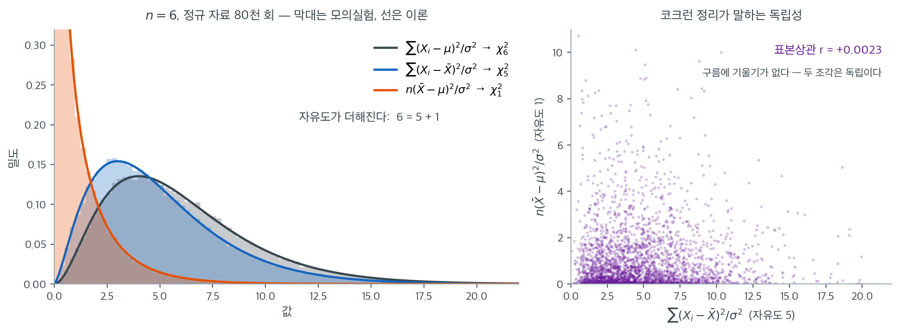

# 유도와 분포이론

모분산에 대한 카이제곱 검정은 하나의 분포이론적 결과 위에 서 있다. 자료가 정규분포를 따를 때 척도가 조정된 표본분산이 카이제곱분포를 따른다는 것이다. 이 절은 표준정규 변수와 카이제곱족의 연결에서 출발하여 그 결과를 처음부터 유도한다.

---

## 1. 표준정규 제곱의 합

5장에서 보았듯 $Z_1, Z_2, \ldots, Z_n$이 독립인 표준정규 확률변수이면 그 제곱합은 자유도 $n$인 카이제곱분포를 따른다.

$$
\sum_{i=1}^{n} Z_i^2 \sim \chi^2_n
$$

이것이 카이제곱분포의 정의적 성질이다. 각 $Z_i^2$이 자유도 1을 기여하고, 독립성 덕분에 자유도가 더해진다.

---

## 2. 관측값의 표준화

$X_1, X_2, \ldots, X_n$이 독립이고 동일하게 $X_i \sim N(\mu, \sigma^2)$을 따른다고 하자. 표준화된 관측값을

$$
Z_i = \frac{X_i - \mu}{\sigma}
$$

로 정의하면 각 $Z_i$가 독립적으로 $\mathcal{N}(0, 1)$을 따른다. 그러면

$$
\sum_{i=1}^{n} \left(\frac{X_i - \mu}{\sigma}\right)^2 = \sum_{i=1}^{n} Z_i^2 \sim \chi^2_n
$$

이 합은 독립인 표준정규 제곱 $n$개로 이루어지고 추정된 모수가 없으므로 자유도가 $n$이다.

---

## 3. 모평균을 표본평균으로 바꾸기

실무에서 $\mu$는 알려져 있지 않으므로 표본평균 $\bar{X} = \frac{1}{n}\sum_{i=1}^{n} X_i$로 대체한다. 다음 분해를 생각하자.

$$
\sum_{i=1}^{n} (X_i - \mu)^2 = \sum_{i=1}^{n} (X_i - \bar{X})^2 + n(\bar{X} - \mu)^2
$$

양변을 $\sigma^2$으로 나누면

$$
\sum_{i=1}^{n} \left(\frac{X_i - \mu}{\sigma}\right)^2 = \sum_{i=1}^{n} \left(\frac{X_i - \bar{X}}{\sigma}\right)^2 + \left(\frac{\bar{X} - \mu}{\sigma / \sqrt{n}}\right)^2
$$

좌변은 $\chi^2_n$이다. 우변의 마지막 항은 표준정규 변수의 제곱이므로($\bar{X} \sim N(\mu, \sigma^2/n)$이기 때문) $\chi^2_1$이다. Cochran 정리에 의해 우변의 두 항은 독립이며, 따라서

$$
\sum_{i=1}^{n} \left(\frac{X_i - \bar{X}}{\sigma}\right)^2 \sim \chi^2_{n-1}
$$

자유도가 하나 줄어드는 것은 제약 $\sum_{i=1}^{n}(X_i - \bar{X}) = 0$을 반영하며, 이 제약이 $n$개의 제곱항에서 자유로운 차원 하나를 없앤다.

---

## 4. 핵심 결과

표본분산은 다음과 같이 정의된다.

$$
S^2 = \frac{1}{n-1} \sum_{i=1}^{n} (X_i - \bar{X})^2
$$

양변에 $(n-1)/\sigma^2$을 곱하면

$$
\frac{(n-1)S^2}{\sigma^2} = \sum_{i=1}^{n} \left(\frac{X_i - \bar{X}}{\sigma}\right)^2 \sim \chi^2_{n-1}
$$

이것이 $\sigma^2$에 관한 추론의 추축량(pivotal quantity)이다. $H_0\colon \sigma^2 = \sigma_0^2$ 아래에서 검정통계량은

$$
\chi^2 = \frac{(n-1)S^2}{\sigma_0^2} \sim \chi^2_{n-1}
$$

!!! note "Cochran 정리의 역할"
    Cochran 정리는 $\sum(X_i - \bar{X})^2/\sigma^2$과 $(\bar{X} - \mu)^2/(\sigma^2/n)$이 독립인 카이제곱 변수이고 그 자유도의 합이 $n$임을 보장한다. 이 독립성이 없으면 위 분해로부터 표본분산의 정확한 카이제곱분포를 얻을 수 없다.

유도가 주장하는 두 가지, 곧 **자유도가 $6 = 5 + 1$로 쪼개진다**는 것과 **두 조각이 독립이다**라는 것을 $n = 6$인 정규 자료 8만 벌로 확인해 보자.



왼쪽 그림에서 막대는 모의실험이고 선은 이론곡선이다. 세 쌍이 모두 포개진다. 회색은 모평균을 아는 경우의 $\sum(X_i-\mu)^2/\sigma^2$으로 $\chi^2_6$을 따르고, 파랑은 $\bar{X}$로 바꾼 $\sum(X_i-\bar{X})^2/\sigma^2$으로 $\chi^2_5$를, 주황은 떼어 낸 조각 $n(\bar{X}-\mu)^2/\sigma^2$으로 $\chi^2_1$을 따른다. 파란 봉우리가 회색보다 **왼쪽에** 있다는 점을 보라. $\bar{X}$는 자기 표본에 맞춰 놓은 중심이므로 편차의 제곱합이 참 $\mu$를 쓸 때보다 항상 작다. 그 줄어든 몫이 정확히 주황 조각이고, 평균으로 보면 $6 - 5 = 1$이다.

오른쪽은 독립성이다. 8만 벌 중 3000벌을 찍어 두 조각을 좌표로 놓았다. **구름에 기울기도 휘어짐도 없고 표본상관은 $r = +0.0023$이다.** 표본평균이 우연히 $\mu$에서 멀리 떨어진 벌(그림의 위쪽)이라고 해서 잔차제곱합이 크지도 작지도 않다. 정규분포에서만 성립하는 성질이며, 이 독립성이 깨지면 뒤에 나오는 $F$ 검정도 무너진다. 두 카이제곱의 비가 $F$ 분포를 따르려면 분자와 분모가 독립이어야 하기 때문이다.

항등식 $\sum(X_i-\mu)^2 = \sum(X_i-\bar{X})^2 + n(\bar{X}-\mu)^2$ 자체는 대수적 항등식이라 어떤 자료에서도 성립한다. 8만 벌에서 좌변과 우변의 차이는 최대 $1.1 \times 10^{-14}$, 곧 부동소수점 오차뿐이었다. **분포를 만드는 것은 항등식이 아니라 정규성이다.** 항등식은 어디서나 참이지만, 두 조각이 각각 카이제곱이고 서로 독립이라는 결론은 정규 자료에서만 나온다.

---

## 5. 카이제곱분포의 성질

자유도 $\nu$인 카이제곱분포는 분산 검정과 관련된 몇 가지 성질을 갖는다.

- **평균:** $E[\chi^2_\nu] = \nu$
- **분산:** $\operatorname{Var}(\chi^2_\nu) = 2\nu$
- **왜도:** $\sqrt{8/\nu}$, $\nu$가 커질수록 줄어든다
- **최빈값:** $\nu \ge 2$일 때 $\nu - 2$

카이제곱분포가 오른쪽으로 치우쳐 있으므로 $\sigma^2$의 신뢰구간은 비대칭이다. 자유도가 크면 중심극한정리에 의해 분포가 근사적으로 정규가 된다.

<div class="exbox" markdown>

**보기 1.** <span class="diff easy" title="쉬움"></span> 모분산의 카이제곱 검정. 정규 모집단에서 $n = 21$개의 확률표본을 뽑았고 표본분산이 $S^2 = 18.5$였다고 하자. 유의수준 $\alpha = 0.05$에서 $H_0\colon \sigma^2 = 15$를 $H_1\colon \sigma^2 \neq 15$에 대해 검정하자.

</div>

??? success "풀이"
    **1단계.** 검정통계량을 계산한다.

    $$
    \chi^2 = \frac{(21 - 1)(18.5)}{15} = \frac{20 \times 18.5}{15} = 24.667
    $$

    **2단계.** $\alpha = 0.05$(양측)에서 $\chi^2_{20}$의 임계값을 구한다.

    - 하단 임계값: $\chi^2_{0.975, 20} = 9.591$
    - 상단 임계값: $\chi^2_{0.025, 20} = 34.170$

    **3단계.** $9.591 < 24.667 < 34.170$이므로 검정통계량이 채택역 안에 있다. $H_0$을 기각하지 못한다.

    유의수준 5%에서 모분산이 15와 다르다고 결론지을 만한 증거가 충분하지 않다($p = 0.429$).

<div class="exbox" markdown>

**보기 2.** <span class="diff easy" title="쉬움"></span> 요약값으로 하는 분산 검정. 보기 1 의 자료($n = 21$, $S^2 = 18.5$, $\sigma_0^2 = 15$, $\alpha = 0.05$)를 원자료 없이 요약값만으로 코드에 넣는다.

**(1)** 임계값을 **$S^2$ 의 눈금으로 되돌려** 채택역을 $S^2$ 의 구간으로 적고, 관측값 $18.5$ 가 경계에서 얼마나 떨어져 있는지 구하시오. 이 구간이 $S^2 = 18.5$ 의 신뢰구간과 어떻게 맞물리는가.

**(2)** 이 판정이 정규성에 얼마나 기대고 있는지 재시오. 비정규 모집단에서 명목 $5\%$ 검정의 실제 크기를 모의실험으로 구하고, **$n$ 을 키우면 $0.05$ 로 돌아오는지** 확인하시오.

</div>

??? success "풀이"

    **(1) 임계값을 $S^2$ 의 눈금으로 되돌린다.** 채택역은 $\chi^2_{\alpha/2,\,n-1} \le (n-1)S^2/\sigma_0^2 \le \chi^2_{1-\alpha/2,\,n-1}$ 이므로, 양변에 $\sigma_0^2/(n-1)$ 을 곱하면

    $$
    \frac{\sigma_0^2\, \chi^2_{\alpha/2,\,n-1}}{n-1} \;\le\; S^2 \;\le\; \frac{\sigma_0^2\, \chi^2_{1-\alpha/2,\,n-1}}{n-1}
    $$

    이다. **채택역이 $\sigma_0^2$ 의 상수배 구간**이고 그 두 배수 $\chi^2_{\alpha/2}/(n-1)$, $\chi^2_{1-\alpha/2}/(n-1)$ 은 자유도와 $\alpha$ 만으로 정해진다. $n = 21$, $\alpha = 0.05$ 에서 $\chi^2_{0.025,\,20} = 9.5908$, $\chi^2_{0.975,\,20} = 34.1696$ 이므로 배수가 $0.47954$ 와 $1.70848$ 이고

    $$
    S^2 \in [15 \times 0.47954,\; 15 \times 1.70848] = [7.1931,\; 25.6272]
    $$

    이면 기각하지 못한다. 관측된 $18.5$ 는 이 안쪽이고 위쪽 경계까지 $7.1272$ 가 남았다. **표본분산이 $38\%$ 더 커졌어야 기각했다**는 뜻이다($25.6272/18.5 = 1.385$).

    **신뢰구간과의 맞물림.** 앞 절의 쌍대성이 여기서 그대로 보인다. $S^2 = 18.5$ 의 $95\%$ 신뢰구간은

    $$
    \left(\frac{20 \times 18.5}{34.1696},\; \frac{20 \times 18.5}{9.5908}\right) = (10.8283,\; 38.5787)
    $$

    이고 $\sigma_0^2 = 15$ 가 그 안에 있다. 두 진술은 같은 부등식을 어느 쪽 변수로 풀었느냐의 차이일 뿐이다. 채택역은 $\sigma_0^2$ 을 고정하고 $S^2$ 에 대해 푼 것이고, 신뢰구간은 $S^2$ 을 고정하고 $\sigma^2$ 에 대해 푼 것이다.

    **확인한다.**

    ```python
    import numpy as np
    from scipy import stats

    n = 21
    s_squared = 18.5
    sigma_0_squared = 15
    alpha = 0.05

    # (n-1)S^2/sigma_0^2 은 귀무가설이 참일 때 자유도 n-1 인 카이제곱을 따른다.
    # 이 검정은 정규성에 매우 민감하다 — 평균에 대한 t 검정과 달리 중심극한정리의
    # 보호를 받지 못하기 때문이다.
    chi2_stat = (n - 1) * s_squared / sigma_0_squared

    # 좌우가 대칭이 아니므로 양쪽 기각값을 따로 구한다.
    df = n - 1
    chi2_lower = stats.chi2.ppf(alpha / 2, df)
    chi2_upper = stats.chi2.ppf(1 - alpha / 2, df)

    # 양측 p-값은 두 꼬리 넓이 중 작은 쪽을 두 배 한다.
    p_value = 2 * min(stats.chi2.cdf(chi2_stat, df), stats.chi2.sf(chi2_stat, df))

    print(f"Test statistic: {chi2_stat:.3f}")
    print(f"Critical values: [{chi2_lower:.3f}, {chi2_upper:.3f}]")
    print(f"P-value: {p_value:.4f}")

    if p_value < alpha:
        print("Reject H0: variance differs from the hypothesized value.")
    else:
        print("Fail to reject H0: insufficient evidence of a difference.")

    # (1) 어떤 S^2 이었다면 기각했을까. 임계값을 S^2 의 눈금으로 되돌린다.
    s2_lo = sigma_0_squared * chi2_lower / df
    s2_hi = sigma_0_squared * chi2_upper / df
    print(f"\nS^2 의 채택역 = [{s2_lo:.4f}, {s2_hi:.4f}]")
    print(f"  관측된 S^2 = {s_squared}  ->  위쪽 경계까지 {s2_hi - s_squared:.4f} 남았다")
    print(f"  배수로 보면 sigma_0^2 x [{chi2_lower / df:.5f}, {chi2_upper / df:.5f}]")

    # 쌍대 관계: sigma_0^2 = 15 가 S^2 = 18.5 의 신뢰구간 안에 있는가.
    ci_lo = df * s_squared / chi2_upper
    ci_hi = df * s_squared / chi2_lower
    print(f"\nS^2 = {s_squared} 의 95% 신뢰구간 = ({ci_lo:.4f}, {ci_hi:.4f})")
    print(f"  sigma_0^2 = {sigma_0_squared} 이 구간 안에 있는가: {ci_lo <= sigma_0_squared <= ci_hi}")
    ```

    출력:

    ```text
    Test statistic: 24.667
    Critical values: [9.591, 34.170]
    P-value: 0.4290
    Fail to reject H0: insufficient evidence of a difference.

    S^2 의 채택역 = [7.1931, 25.6272]
      관측된 S^2 = 18.5  ->  위쪽 경계까지 7.1272 남았다
      배수로 보면 sigma_0^2 x [0.47954, 1.70848]

    S^2 = 18.5 의 95% 신뢰구간 = (10.8283, 38.5787)
      sigma_0^2 = 15 이 구간 안에 있는가: True
    ```

    유도한 채택역 $[7.1931, 25.6272]$ 와 신뢰구간 $(10.8283, 38.5787)$ 이 코드와 맞고, $\sigma_0^2 = 15$ 가 구간 안이라는 판정이 $p = 0.4290 > 0.05$ 와 일치한다.

    **(2) 이 모든 수가 한 줄에 매달려 있다.** 위에서 쓴 것은 $\chi^2_{20}$ 분포뿐이고, 그것은 이 쪽이 유도한 $(n-1)S^2/\sigma^2 \sim \chi^2_{n-1}$ 에서 나왔으며, 그 유도는 **첫 단계부터 정규성을 쓴다.** $\sum Z_i^2$ 이 카이제곱이 되려면 $Z_i$ 가 정규여야 하기 때문이다. 정규성이 깨지면 임계값 $9.591$ 과 $34.170$ 이 엉뚱한 자리가 된다.

    **얼마나 엉뚱해지는지는 미리 계산할 수 있다.** 5.3절이 유도한 결과를 빌린다. $n$ 이 크면 $\chi^2_{n-1}$ 의 양측 임계값이 $(n-1)\bigl(1 \pm 1.96\sqrt{2/(n-1)}\bigr)$ 이므로, 검정은 $S^2/\sigma^2$ 의 표준편차를 $\sqrt{2/n}$ 로 **믿고** 기각역을 긋는다. 그런데 참 표준편차는 $\operatorname{Var}(S^2) \approx (\beta_2-1)\sigma^4/n$ 에서 $\sqrt{(\beta_2-1)/n}$ 이다. 기각역이 참 표준편차 단위로는

    $$
    \frac{1.96\sqrt{2/n}}{\sqrt{(\beta_2-1)/n}} = 1.96\sqrt{\frac{2}{\beta_2-1}}
    $$

    만큼만 뻗으므로

    $$
    \text{실제 오류율} \;\longrightarrow\; 2\left[1 - \Phi\!\left(1.96\sqrt{\frac{2}{\beta_2-1}}\right)\right]
    $$

    가 된다. **$\sqrt n$ 이 분자와 분모에서 함께 약분되어 $n$ 이 사라졌다.** 임계값도 $1/\sqrt n$ 로 줄고 참 산포도 $1/\sqrt n$ 로 줄기 때문이다. 그러므로 이 어긋남은 **표본을 키워도 낫지 않는다.** 남는 것은 모집단 첨도 $\beta_2$ 하나뿐이다.

    **모의실험으로 확인한다.**

    ```python
    import numpy as np
    from scipy import stats

    rng = np.random.default_rng(15)

    pops = [
        ("정규", lambda s: rng.normal(size=s), 1.0, 3.0),
        ("균등", lambda s: rng.uniform(size=s), 1 / 12, 1.8),
        ("지수", lambda s: rng.exponential(size=s), 1.0, 9.0),
        ("로그정규", lambda s: rng.lognormal(0, 1, size=s),
         (np.exp(1) - 1) * np.exp(1), np.exp(4) + 2 * np.exp(3) + 3 * np.exp(2) - 3),
    ]

    ns = [21, 100, 1000, 10_000]
    hdr = "".join(f"{'n=' + str(n):>10}" for n in ns)
    print(f"{'모집단':>8}{'beta2':>10}{'극한':>9}{hdr}")
    for name, gen, var0, beta2 in pops:
        limit = 2 * (1 - stats.norm.cdf(1.96 * np.sqrt(2 / (beta2 - 1))))
        row = ""
        for n in ns:
            lo, hi = stats.chi2.ppf([0.025, 0.975], n - 1)
            reps = 40_000 if n <= 1000 else 4_000
            rej = 0
            done = 0
            while done < reps:
                blk = min(2000, reps - done)
                T = (n - 1) * gen((blk, n)).var(axis=1, ddof=1) / var0
                rej += np.sum((T < lo) | (T > hi))
                done += blk
            row += f"{rej / reps:>10.4f}"
        print(f"{name:>6}{beta2:>11.3f}{limit:>9.4f}{row}")
    print("\n반복수: n <= 1000 은 40,000 벌, n = 10,000 은 4,000 벌")
    print(f"  0.05 근처 몬테카를로 표준오차:  40,000 벌 {np.sqrt(0.05 * 0.95 / 40_000):.4f}"
          f"   4,000 벌 {np.sqrt(0.05 * 0.95 / 4_000):.4f}")
    ```

    출력:

    ```text
         모집단     beta2       극한      n=21     n=100    n=1000   n=10000
        정규      3.000   0.0500    0.0505    0.0485    0.0499    0.0548
        균등      1.800   0.0019    0.0040    0.0020    0.0020    0.0013
        지수      9.000   0.3271    0.2718    0.3087    0.3212    0.3222
      로그정규    113.936   0.7942    0.5763    0.6553    0.7208    0.7560

    반복수: n <= 1000 은 40,000 벌, n = 10,000 은 4,000 벌
      0.05 근처 몬테카를로 표준오차:  40,000 벌 0.0011   4,000 벌 0.0034
    ```

    **정규 줄만 수평이다.** $0.0505$, $0.0485$, $0.0499$, $0.0548$ 로 $n$ 이 $500$ 배 늘어나는 동안 $0.05$ 에 머문다. 마지막 칸이 조금 높아 보이지만 반복이 $4{,}000$ 벌뿐이라 몬테카를로 표준오차가 $0.0034$ 이고, $0.0548$ 은 $0.05$ 에서 $1.4$ 표준오차 떨어진 값이다. 우연으로 설명된다.

    **나머지 셋은 각자의 상수로 간다.** 지수분포는 $0.2718 \to 0.3087 \to 0.3212 \to 0.3222$ 로 극한값 $0.3271$ 에 붙어 간다. 명목 $5\%$ 검정이 실제로는 **세 번에 한 번 꼴로 기각**한다. 균등분포는 반대 방향으로 $0.002$ 에 머물러 지나치게 보수적이다($\beta_2 < 3$ 이라 참 산포가 믿는 것보다 작다). 로그정규는 $0.5763 \to 0.6553 \to 0.7208 \to 0.7560$ 으로 $0.7942$ 를 향해 **계속 올라간다.**

    로그정규가 아직 극한에 닿지 않은 것은 흠이 아니라 예상된 일이다. 위 유도는 $S^2$ 의 정규근사에 기대는데, $\beta_2 = 113.9$ 인 모집단에서 그 근사가 쓸 만해지려면 $n$ 이 아주 커야 한다. **중요한 것은 방향이다.** 네 줄 가운데 $n$ 과 함께 $0.05$ 쪽으로 돌아오는 줄은 **하나도 없다.** 정규는 처음부터 맞고, 나머지 셋은 $n$ 을 키울수록 명목값에서 **더 멀어진다.**

    **이것이 분산 추론과 평균 추론의 갈림길이다.** 평균에 대한 $t$ 검정은 중심극한정리가 비정규성을 씻어 주므로 $n$ 을 키우면 명목 수준에 수렴한다. 분산에는 그런 보호가 없다. 유도의 첫 단계가 정규성이고, 그 단계가 틀리면 **표본크기로는 고칠 수 없다.** 연습문제 3 가 "평균은 맞지만 산포가 틀린다"고 적은 것의 수치적 실물이 이 표다.

---

## 연습문제

<div class="drillbox" markdown>

**연습문제 1.** <span class="diff med" title="중간"></span>
유도의 출발점이 되는 항등식

$$
\sum_{i=1}^{n} (X_i - \mu)^2 = \sum_{i=1}^{n} (X_i - \bar{X})^2 + n(\bar{X} - \mu)^2
$$

을 증명하라.

</div>

??? success "풀이"
    $X_i - \mu = (X_i - \bar{X}) + (\bar{X} - \mu)$로 쓰고 제곱하여 합한다.

    $$
    \sum_i (X_i - \mu)^2 = \sum_i (X_i - \bar{X})^2 + 2(\bar{X} - \mu)\sum_i (X_i - \bar{X}) + \sum_i (\bar{X} - \mu)^2.
    $$

    두 번째 항에서 $(\bar{X} - \mu)$는 $i$에 의존하지 않으므로 합 밖으로 빼냈다. 그런데

    $$
    \sum_i (X_i - \bar{X}) = \sum_i X_i - n\bar{X} = n\bar{X} - n\bar{X} = 0
    $$

    이므로 교차항이 **사라진다**. 세 번째 항은 $i$에 무관한 값을 $n$번 더한 것이므로 $n(\bar{X}-\mu)^2$이다. 따라서

    $$
    \sum_i (X_i - \mu)^2 = \sum_i (X_i - \bar{X})^2 + n(\bar{X} - \mu)^2.
    $$

    이 항등식은 **평행축 정리** 또는 **편차제곱합 분해**로 불린다. 교차항이 0이 되는 것은 $\bar{X}$가 $\sum_i (X_i - c)^2$을 최소화하는 $c$라는 사실의 다른 표현이며, 이 때문에 $\bar{X}$가 최소제곱 추정량이 된다.

    부수적 결과로 $\mu \neq \bar{X}$인 한 $\sum_i (X_i - \bar{X})^2 < \sum_i (X_i - \mu)^2$이다. 표본평균으로 계산한 제곱합이 참 평균으로 계산한 것보다 항상 작으며, 이것이 $n$이 아니라 $n-1$로 나누어 편향을 보정하는 이유이다. $\square$

---

<div class="drillbox" markdown>

**연습문제 2.** <span class="diff med" title="중간"></span>
$\chi^2_\nu$의 왜도가 $\sqrt{8/\nu}$임을 이용하여, 왜 $\sigma^2$의 신뢰구간이 비대칭이며 $\nu$가 커질수록 대칭에 가까워지는지 설명하라. $\nu = 5, 20, 50, 200$에서 정규근사와 Wilson-Hilferty 근사의 정확도를 비교하라.

</div>

??? success "풀이"
    **비대칭성의 근원.** $\chi^2_\nu$의 왜도는 $\sqrt{8/\nu}$이다.

    | $\nu$ | 5 | 20 | 50 | 200 |
    |---|---|---|---|---|
    | 왜도 | 1.265 | 0.632 | 0.400 | 0.200 |

    작은 자유도에서 분포가 강하게 오른쪽으로 치우쳐 있으므로 상단 분위수가 평균 $\nu$에서 하단 분위수보다 훨씬 멀리 떨어져 있다. 신뢰구간을 만들 때 $\sigma^2$을 이 분위수로 **나누므로** 결과 구간의 상한이 하한보다 점추정값에서 멀어진다.

    $\nu \to \infty$이면 왜도가 $0$으로 가고 분포가 정규에 접근하여 구간이 대칭에 가까워진다.

    **근사의 정확도.** 두 가지 근사를 비교하자.

    - **단순 정규근사:** $\chi^2_\nu \approx \nu + z\sqrt{2\nu}$
    - **Wilson-Hilferty 근사:** $\chi^2_\nu \approx \nu\left(1 - \frac{2}{9\nu} + z\sqrt{\frac{2}{9\nu}}\right)^3$

    ```python
    import numpy as np
    from scipy import stats

    z = 1.96
    print(f"{'df':>5} {'exact':>10} {'normal':>10} {'Wilson-H':>10}")
    for df in [5, 20, 50, 200]:
        exact = stats.chi2.ppf(0.975, df)
        norm_ap = df + z * np.sqrt(2 * df)
        wh = df * (1 - 2 / (9 * df) + z * np.sqrt(2 / (9 * df)))**3
        print(f"{df:>5} {exact:>10.3f} {norm_ap:>10.3f} {wh:>10.3f}")
    ```

    출력:

    ```text
       df      exact     normal   Wilson-H
        5     12.833     11.198     12.822
       20     34.170     32.396     34.172
       50     71.420     69.600     71.424
      200    241.058    239.200    241.061
    ```

    단순 정규근사는 $\nu = 5$에서 12.8을 11.2로 추정하여 **13% 오차**를 낸다. $\nu = 200$에서도 여전히 0.8% 부족하다. 근사가 치우침을 무시하므로 상단 분위수를 체계적으로 과소추정한다.

    Wilson-Hilferty 근사는 $\nu = 5$에서 이미 소수 둘째 자리까지 맞고 $\nu \geq 20$에서는 사실상 정확하다. $(\chi^2_\nu/\nu)^{1/3}$이 거의 정규라는 사실에 기반하며, 세제곱근 변환이 치우침을 제거한다. Box-Cox 계열의 변환이 왜 유용한지를 보여주는 좋은 예이다. $\square$

---

<div class="drillbox" markdown>

**연습문제 3.** <span class="diff med" title="중간"></span>
Cochran 정리 없이도 $\sum(X_i - \bar{X})^2/\sigma^2$의 **평균**은 $n-1$임을 정규성 가정 없이 보일 수 있다. 이를 증명하고, 왜 평균만으로는 카이제곱 검정을 정당화할 수 없는지 설명하라.

</div>

??? success "풀이"
    **평균의 계산(정규성 불필요).** $X_i$가 i.i.d.이고 $\mathbb{E}[X_i] = \mu$, $\operatorname{Var}(X_i) = \sigma^2$이라고만 가정하자. 연습문제 1의 항등식에 기댓값을 취하면

    $$
    \mathbb{E}\left[\sum_i (X_i - \bar{X})^2\right] = \mathbb{E}\left[\sum_i (X_i - \mu)^2\right] - n\,\mathbb{E}\left[(\bar{X} - \mu)^2\right] = n\sigma^2 - n \cdot \frac{\sigma^2}{n} = (n-1)\sigma^2.
    $$

    따라서

    $$
    \mathbb{E}\left[\frac{(n-1)S^2}{\sigma^2}\right] = n - 1
    $$

    이며, 이는 $\chi^2_{n-1}$의 평균과 일치한다. 어떤 분포에서든 성립한다. 동시에 $\mathbb{E}[S^2] = \sigma^2$, 곧 $S^2$이 $\sigma^2$의 불편추정량임을 보여준다.

    **평균만으로는 부족한 이유.** 검정을 하려면 통계량의 **전체 분포**가 필요하지 평균만으로는 안 된다. 두 분포가 같은 평균을 가져도 임계값이 전혀 다를 수 있다.

    구체적으로 15.1절에서 보았듯

    $$
    \operatorname{Var}\left(\frac{(n-1)S^2}{\sigma^2}\right) \approx (n-1)(\gamma_2 + 2)
    $$

    인데 $\chi^2_{n-1}$의 분산은 $2(n-1)$이다. 두 값이 일치하는 것은 $\gamma_2 = 0$, 곧 정규분포일 때뿐이다.

    곧 **비정규 자료에서도 검정통계량의 평균은 맞지만 산포가 틀린다.** 기준분포의 중심은 제자리인데 폭이 좁으므로, 실제 통계량이 임계값 밖으로 자주 벗어나 제1종 오류가 팽창한다.

    이것이 Cochran 정리가 필요한 이유이다. 정규성 아래에서만 1차 적률뿐 아니라 **분포 전체**가 정확히 카이제곱이 된다. $\square$

---

<div class="drillbox" markdown>

**연습문제 4.** <span class="diff hard" title="어려움"></span>
정규 자료에서 $\bar{X}$와 $S^2$이 독립임을 보여라. 이 독립성이 정규분포에만 특유한 성질임을 설명하라.

</div>

??? success "풀이"
    **정규성 아래의 증명 개요.** $Z_i = (X_i - \mu)/\sigma$라 하고 벡터 $\mathbf{Z} = (Z_1,\ldots,Z_n)^\top \sim \mathcal{N}(\mathbf{0}, I_n)$을 생각한다. 첫 행이 $\frac{1}{\sqrt{n}}(1,1,\ldots,1)$인 직교행렬 $Q$를 잡고 $\mathbf{Y} = Q\mathbf{Z}$라 하자.

    직교변환은 표준정규 벡터의 분포를 보존하므로 $\mathbf{Y} \sim \mathcal{N}(\mathbf{0}, I_n)$이고 성분들이 서로 독립이다. 그런데

    $$
    Y_1 = \frac{1}{\sqrt{n}}\sum_i Z_i = \sqrt{n}\,\frac{\bar{X}-\mu}{\sigma}, \qquad \sum_{j=2}^n Y_j^2 = \|\mathbf{Z}\|^2 - Y_1^2 = \frac{(n-1)S^2}{\sigma^2}.
    $$

    $Y_1$과 $(Y_2,\ldots,Y_n)$이 독립이므로 $\bar{X}$와 $S^2$도 독립이다. 동시에 $\sum_{j=2}^n Y_j^2$은 독립인 표준정규 제곱 $n-1$개의 합이므로 $\chi^2_{n-1}$을 따른다. 이것이 본문 결과의 엄밀한 증명이다.

    **왜 정규분포에만 특유한가.** 증명에서 결정적으로 쓴 성질은 **표준정규 벡터의 분포가 직교변환에 불변**이라는 것이다. 이 회전불변성을 갖는 유일한 독립 성분 분포가 정규분포이다(Maxwell의 정리).

    실제로 Lukacs의 정리는 더 강한 결과를 준다. $X_1,\ldots,X_n$이 i.i.d.일 때 $\bar{X}$와 $S^2$이 독립일 **필요충분조건**이 바탕 분포가 정규라는 것이다.

    **실무적 함의.** 비정규 자료에서는 $\bar{X}$와 $S^2$이 상관되어 있다. 예컨대 오른쪽으로 치우친 분포에서는 큰 $\bar{X}$가 큰 $S^2$과 함께 나타나는 경향이 있다. 이 상관이 $t$ 통계량의 분포를 왜곡하는 한 원인이며, 분산 검정에서는 카이제곱 근사를 무너뜨린다. $\square$

---

<div class="drillbox" markdown>

**연습문제 5.** <span class="diff hard" title="어려움"></span>
보기 2 는 명목 $5\%$ 양측 카이제곱 검정의 실제 크기가 표본크기와 무관하게

$$
a(\beta_2) = 2\left[1 - \Phi\!\left(1.96\sqrt{\frac{2}{\beta_2 - 1}}\right)\right]
$$

로 간다는 것을 보였다. 이 함수를 더 밀어 보자.

**(1)** $a$ 가 $\beta_2 > 1$ 에서 증가함수이고 $\beta_2 = 3$ 에서만 정확히 $0.05$ 임을 보이시오. 또 실제 크기가 명목값의 두 배인 $0.10$ 이 되는 첨도를 구하시오.

**(2)** $\beta_2 \downarrow 1$ 이면 $a \to 0$ 이다. 2장의 하한 $\beta_2 \ge 1 + \gamma_1^2$ 에 따르면 $\beta_2 = 1$ 은 어떤 모양의 분포에서만 가능한가. 그 분포에서 검정통계량 $T = (n-1)S^2/\sigma^2$ 을 직접 적어, 왜 기각확률이 $0$ 으로 가는지 보이시오.

**(3)** 같은 하한을 써서 **왜도만 알아도 실제 크기의 하한이 정해진다**는 것을 보이고, $\lvert \gamma_1 \rvert > \sqrt{2}$ 인 분포에서는 이 검정이 결코 보수적일 수 없음을 논증하시오. $\gamma_1 = 2$ 인 분포에서 하한값을 수로 구하고 지수분포의 실제값 $0.3271$ 과 비교하시오.

</div>

??? success "풀이"
    **(1) 단조성.** 괄호 안의 값

    $$
    u(\beta_2) = 1.96\sqrt{\frac{2}{\beta_2 - 1}}
    $$

    은 $\beta_2 > 1$ 에서 양수이고 $\beta_2$ 에 대해 **감소**한다. $a = 2[1 - \Phi(u)]$ 는 $u$ 에 대해 감소하므로, 두 감소가 겹쳐 $a$ 는 $\beta_2$ 에 대해 **증가**한다. 꼬리가 무거워질수록 실제 오류율이 커진다는 뜻이다.

    $\beta_2 = 3$ 이면 $u = 1.96\sqrt{2/2} = 1.96$ 이고 $a = 2[1 - \Phi(1.96)] = 0.05$ 로 명목값과 정확히 같다. $a$ 가 강증가이므로 $a(\beta_2) = 0.05$ 를 만족하는 $\beta_2$ 는 $3$ 하나뿐이다. **정규분포의 첨도가 바로 이 검정이 믿고 있는 값이다.**

    **두 배가 되는 첨도.** $a(\beta_2) = 0.10$ 이면 $u = z_{0.05} = 1.6449$ 이므로

    $$
    \frac{2}{\beta_2 - 1} = \left(\frac{1.6449}{1.96}\right)^2 = 0.70428
    \quad\Longrightarrow\quad
    \beta_2 = 1 + \frac{2}{0.70428} = 3.8398
    $$

    이다. 일반적으로 실제 크기가 $a$ 가 되는 첨도는 $\beta_2 = 1 + 2(1.96/z_{a/2})^2$ 이고, 여기서 $a = 0.25$ 는 $\beta_2 = 6.8061$, $a = 0.50$ 은 $\beta_2 = 17.8885$ 를 준다.

    $3 \to 3.84$ 는 **눈으로는 거의 정규로 보이는 수준의 꼬리**다. 그만큼으로 명목 $5\%$ 가 $10\%$ 가 된다.

    **(2) 하한에 붙은 분포.** 2장의 하한 $\beta_2 \ge 1 + \gamma_1^2$ 에서 $\beta_2 = 1$ 은 $\gamma_1 = 0$ 과 등호를 동시에 요구한다. 등호는 **두 점에만 질량을 두는 분포**에서만 성립하고, 거기에 $\gamma_1 = 0$ 을 더하면 두 점의 확률이 같아야 한다. 곧

    $$
    P(X = \mu + a) = P(X = \mu - a) = \tfrac12 , \qquad \sigma^2 = a^2
    $$

    이다. 편의상 $\mu = 0$ 으로 두면 $X_i \in \{-a, +a\}$ 이므로 $\sum_i X_i^2 = na^2$ 이 **상수**이고

    $$
    (n-1)S^2 = \sum_i X_i^2 - n\bar X^2 = n\left(a^2 - \bar X^2\right)
    $$

    이다. 따라서

    $$
    T = \frac{(n-1)S^2}{\sigma^2} = n\left(1 - \frac{\bar X^2}{a^2}\right) = n - \frac{\bar X^2}{a^2/n}
    $$

    이고, $\operatorname{Var}(\bar X) = a^2/n$ 이므로 중심극한정리에 의해 뺀 항은 $\chi^2_1$ 로 수렴한다. 곧 **$T \approx n - \chi^2_1$ 이다.**

    기준분포 $\chi^2_{n-1}$ 의 양측 임계값은 $(n-1)\bigl(1 \pm 1.96\sqrt{2/(n-1)}\bigr) \approx n \pm 1.96\sqrt{2n}$ 로 중심에서 $\sqrt n$ 의 속도로 벌어지는데, $T$ 는 $n$ 에서 $O(1)$ 만큼만 아래로 떨어진다. 위쪽으로는 $T \le n$ 이라 아예 넘지 못하고, 아래쪽으로는 $\chi^2_1$ 이 $1.96\sqrt{2n}$ 를 넘어야 하므로 확률이 $0$ 으로 간다. **기각률 $\to 0$ 이다.**

    산포로 말하면 같은 이야기다. 검정은 $\operatorname{sd}(S^2) \approx \sigma^2\sqrt{2/n}$ 을 믿는데 여기서 참값은 $\operatorname{Var}(\bar X^2) = O(n^{-2})$ 때문에 $O(n^{-1})$, 곧 믿는 값보다 $\sqrt n$ 배 작다. $(\beta_2 - 1)$ 이 $0$ 이라 보기 2 의 근사가 주도항을 잃은 자리이며, 극한값 $a(1) = 0$ 이 그것을 그대로 가리킨다.

    **(3) 왜도만으로 정해지는 하한.** $a$ 가 증가함수이고 $\beta_2 \ge 1 + \gamma_1^2$ 이므로

    $$
    a(\beta_2) \;\ge\; a\left(1 + \gamma_1^2\right)
    = 2\left[1 - \Phi\!\left(\frac{1.96\sqrt{2}}{\lvert \gamma_1 \rvert}\right)\right]
    = 2\left[1 - \Phi\!\left(\frac{2.7719}{\lvert \gamma_1 \rvert}\right)\right]
    $$

    이다. 오른쪽은 $\gamma_1$ 만의 함수이고 $\lvert \gamma_1 \rvert$ 에 대해 증가한다.

    $\lvert \gamma_1 \rvert > \sqrt 2$ 이면 $\beta_2 \ge 1 + \gamma_1^2 > 3$ 이므로 $a(\beta_2) > a(3) = 0.05$ 다. **치우친 분포는 이 검정을 보수적으로 만들 수 없다.** 꼬리를 따로 조사하지 않고 왜도 하나만 보고도 과대기각이 확정된다. 균등분포가 보수적일 수 있었던 것($a = 0.0019$)은 그것이 대칭이어서 하한이 $\beta_2 \ge 1$ 로 느슨했기 때문이다.

    $\gamma_1 = 2$ 이면 하한이

    $$
    2\left[1 - \Phi(1.3859)\right] = 2(1 - 0.9171) = 0.1658
    $$

    이다. **왜도가 $2$ 인 어떤 분포에서든 명목 $5\%$ 검정의 실제 크기가 적어도 $16.6\%$ 다.** 지수분포는 $\gamma_1 = 2$ 이지만 $\beta_2 = 9 > 1 + 2^2 = 5$ 로 하한에서 멀리 떨어져 있으므로 실제값 $0.3271$ 이 $0.1658$ 보다 큰 것이 맞다. 하한은 왜도가 강제하는 **최소한의 피해**이고, 꼬리가 하한보다 무거우면 피해는 더 커진다. $\square$

---

<div class="drillbox" markdown>

**연습문제 6.** <span class="diff hard" title="어려움"></span>
보기 2 의 논법을 한 단계 추상화하자. 어떤 추정량이 $\sqrt n(\hat\theta - \theta) \to \mathcal{N}(0, \tau^2)$ 를 만족하는데, 검정은 **정규 모형에서 계산한** 표준오차 $\tau_0/\sqrt n$ 을 써서 $\lvert \hat\theta - \theta_0 \rvert > 1.96\,\tau_0/\sqrt n$ 일 때 $H_0\colon \theta = \theta_0$ 을 기각한다고 하자.

**(1)** 이 검정의 실제 크기가 $2[1 - \Phi(1.96\,\tau_0/\tau)]$ 로 가고 **표본크기에 의존하지 않음**을 보이시오.

**(2)** 세 검정에 대해 비 $\tau_0/\tau$ 를 구하시오. (i) 평균에 대한 $t$ 검정, (ii) 이 쪽 4절의 카이제곱 검정($\hat\theta = S^2$), (iii) 2절의 **모평균을 아는** 검정 $\sum_i (X_i - \mu)^2/\sigma_0^2 \sim \chi^2_n$. 세 번째가 자유도 하나를 돌려받는데도 정규성 의존에서는 한 치도 나아지지 않음을 설명하고, $n = 21$ 에서 자유도 하나의 이득을 채택역의 폭으로 재시오.

**(3)** 분산 검정의 비정규성 피해는 표본크기로 고칠 수 없는데 평균 검정의 피해는 $n \to \infty$ 에서 사라진다. (1) 과 (2) 를 써서 그 차이가 어디서 오는지 한 문장으로 적으시오.

</div>

??? success "풀이"
    **(1) 비 하나가 모든 것을 정한다.** $H_0$ 이 참일 때 $Z_n = \sqrt n(\hat\theta - \theta_0)/\tau \to \mathcal{N}(0,1)$ 이다. 기각사건을 $Z_n$ 으로 다시 쓰면

    $$
    \lvert \hat\theta - \theta_0 \rvert > \frac{1.96\,\tau_0}{\sqrt n}
    \iff
    \lvert Z_n \rvert > 1.96\,\frac{\tau_0}{\tau}
    $$

    이므로 기각확률이 $2[1 - \Phi(1.96\,\tau_0/\tau)]$ 로 수렴한다. **양변에서 $\sqrt n$ 이 함께 약분되었다.** 임계값도 $1/\sqrt n$ 로 줄고 통계량의 참 산포도 $1/\sqrt n$ 로 줄기 때문이다. 남는 것은 **믿는 산포와 참 산포의 비** $\tau_0/\tau$ 뿐이고, 검정이 점근적으로 타당할 필요충분조건은 $\tau_0 = \tau$ 다.

    **(2) 세 검정의 비.**

    **(i) 평균의 $t$ 검정.** $\hat\theta = \bar X$ 의 참 분산은 분포에 상관없이 $\operatorname{Var}(\bar X) = \sigma^2/n$ 이므로 $\tau^2 = \sigma^2$ 이다. 검정이 쓰는 표준오차는 $S/\sqrt n$ 이고 $S \to \sigma$ 이므로 $\tau_0 = \sigma$ 다. 따라서

    $$
    \frac{\tau_0}{\tau} = 1, \qquad \text{실제 크기} \to 2[1-\Phi(1.96)] = 0.05 .
    $$

    **첨도가 식에 들어올 자리가 없다.** $\operatorname{Var}(\bar X)$ 는 2차 적률만으로 정해지기 때문이다.

    **(ii) 카이제곱 분산검정.** $\hat\theta = S^2$ 의 참 분산은 5장의 결과 $\operatorname{Var}(S^2) \approx (\beta_2 - 1)\sigma^4/n$ 에서 $\tau^2 = (\beta_2-1)\sigma^4$ 이다. 한편 검정은 $(n-1)S^2/\sigma_0^2 \sim \chi^2_{n-1}$ 을 믿으므로 $\operatorname{Var}(S^2) = 2\sigma^4/(n-1) \approx 2\sigma^4/n$, 곧 $\tau_0^2 = 2\sigma^4$ 로 본다. 따라서

    $$
    \frac{\tau_0}{\tau} = \sqrt{\frac{2}{\beta_2 - 1}}
    $$

    이고 (1) 에 넣으면 보기 2 의 공식이 그대로 나온다.

    **(iii) 모평균을 아는 검정.** $\hat\theta = \frac1n\sum_i (X_i-\mu)^2$ 은 i.i.d. 인 $(X_i-\mu)^2$ 의 평균이므로 참 분산이

    $$
    \frac{\operatorname{Var}\bigl((X-\mu)^2\bigr)}{n} = \frac{\mathbb{E}(X-\mu)^4 - \sigma^4}{n} = \frac{(\beta_2-1)\sigma^4}{n}
    $$

    곧 $\tau^2 = (\beta_2-1)\sigma^4$ 로 (ii) 와 **같다.** 믿는 쪽도 같다. $\sum_i (X_i-\mu)^2/\sigma^2 \sim \chi^2_n$ 이면 $\operatorname{Var}(\hat\theta) = 2\sigma^4/n$ 이므로 $\tau_0^2 = 2\sigma^4$ 다. 따라서 비도 $\sqrt{2/(\beta_2-1)}$ 로 **똑같고 극한 크기가 글자 하나 다르지 않다.**

    **자유도 하나의 이득은 다른 차원에 있다.** $n = 21$ 에서 두 검정의 채택역을 $\sigma_0^2$ 의 배수로 적으면

    | 검정 | 기준분포 | 채택역(배수) | 폭 |
    |---|---|---|---|
    | 2절, $\mu$ 를 안다 | $\chi^2_{21}$ | $[0.48966,\ 1.68947]$ | $1.19981$ |
    | 4절, $\mu$ 를 추정 | $\chi^2_{20}$ | $[0.47954,\ 1.70848]$ | $1.22894$ |

    이다. $\mu$ 를 알면 채택역이 $2.4\%$ 좁아져 검정력이 조금 오른다. **$O(1/n)$ 의 이득이다.** 반면 로버스트성의 결함은 $\tau_0/\tau$ 에 들어 있어 $n$ 과 무관한 $O(1)$ 이다. 자유도를 돌려받는 것과 정규성에서 풀려나는 것은 전혀 다른 일이다.

    **(3) 차이의 자리.** 평균 검정은 **참 산포 $\sigma/\sqrt n$ 자체가 분포에 의존하지 않아** 믿는 값과 참값이 처음부터 일치하고($\tau_0/\tau = 1$), 분산 검정은 참 산포가 4차 적률을 타고 믿는 값과 **비율로** 어긋나는데 그 비율 $\sqrt{2/(\beta_2-1)}$ 안에 $n$ 이 들어 있지 않아 표본을 키워도 비가 $1$ 로 돌아오지 않는다. $\square$

---

<div class="drillbox" markdown>

**연습문제 7.** <span class="diff hard" title="어려움"></span>
5절은 $\chi^2_\nu$ 가 오른쪽으로 치우쳐 있다고 적었다. 그 치우침은 임계값의 비대칭만 낳는 것이 아니다. 보기 1 의 설정($n = 21$, $\alpha = 0.05$)에서 $r = \sigma^2/\sigma_0^2$ 의 함수로 본 검정력이

$$
\pi(r) = P\!\left(\chi^2_{20} < \frac{c_L}{r}\right) + P\!\left(\chi^2_{20} > \frac{c_U}{r}\right),
\qquad c_L = 9.5908,\; c_U = 34.1696
$$

임을 먼저 확인하고, 다음을 보이시오.

**(1)** $\pi'(1) = -c_L f(c_L) + c_U f(c_U)$ 이다. 여기서 $f$ 는 $\chi^2_{20}$ 의 밀도이다.

**(2)** $f(x) \propto x^{9} e^{-x/2}$ 를 써서 $c_U f(c_U) \big/ \bigl(c_L f(c_L)\bigr)$ 을 로그로 계산하고 $\pi'(1) > 0$ 임을 보이시오.

**(3)** 그래서 이 검정은 **불편(unbiased)이 아니다.** 곧 $\pi(r) < \alpha$ 인 $r \ne 1$ 이 존재함을 논증하시오. 등꼬리 대신 임계값에 어떤 조건을 걸면 불편이 되는가.

</div>

??? success "풀이"
    **검정력함수의 모양.** 참값이 $\sigma^2$ 일 때 검정통계량은

    $$
    T = \frac{(n-1)S^2}{\sigma_0^2} = \frac{\sigma^2}{\sigma_0^2} \cdot \frac{(n-1)S^2}{\sigma^2} = r \cdot \chi^2_{20}
    $$

    이므로 $T < c_L$ 은 $\chi^2_{20} < c_L/r$ 과, $T > c_U$ 는 $\chi^2_{20} > c_U/r$ 과 같은 사건이다. 문제의 $\pi(r)$ 이 바로 기각확률이고 $\pi(1) = 0.025 + 0.025 = 0.05$ 다.

    **(1) 미분.** $F$ 를 $\chi^2_{20}$ 의 분포함수라 하면 $\pi(r) = F(c_L/r) + 1 - F(c_U/r)$ 이고, 연쇄법칙에서 $\frac{d}{dr}F(c/r) = f(c/r)\cdot(-c/r^2)$ 이므로

    $$
    \pi'(r) = -\frac{c_L}{r^2} f\!\left(\frac{c_L}{r}\right) + \frac{c_U}{r^2} f\!\left(\frac{c_U}{r}\right)
    $$

    이다. $r = 1$ 을 넣으면 $\pi'(1) = -c_L f(c_L) + c_U f(c_U)$ 를 얻는다. **두 꼬리의 확률이 같아도 두 끝점에서 $x f(x)$ 가 같을 이유는 없다.**

    **(2) 두 끝점 비교.** $\nu = 20$ 에서 $f(x) = x^{9}e^{-x/2}/(2^{10}\,9!)$ 이므로 $x f(x) \propto x^{10}e^{-x/2}$ 이고

    $$
    \ln \frac{c_U f(c_U)}{c_L f(c_L)}
    = 10 \ln \frac{34.1696}{9.5908} - \frac{34.1696 - 9.5908}{2}
    = 10(1.27053) - 12.28941 = 0.41593
    $$

    이다. 따라서 비가 $e^{0.41593} = 1.5158 > 1$ 이다. 실제 값은 $c_L f(c_L) = 0.14651$, $c_U f(c_U) = 0.22208$ 이고

    $$
    \pi'(1) = -0.14651 + 0.22208 = +0.07557 > 0 .
    $$

    오른쪽 끝점이 $c_L$ 보다 $3.56$ 배 멀리 있는 대신 밀도가 작은데, $x$ 를 곱하면 거리의 승이 밀도의 감쇠를 이겨 **위쪽 끝이 더 민감하다.**

    **(3) 불편이 아니다.** $\pi(1) = 0.05$ 이고 $\pi$ 가 $r = 1$ 에서 미분가능하며 $\pi'(1) = 0.07557 > 0$ 이므로, 충분히 작은 $\varepsilon > 0$ 에 대해

    $$
    \pi(1-\varepsilon) \approx 0.05 - 0.07557\,\varepsilon < 0.05
    $$

    이다. 곧 **참 분산이 $\sigma_0^2$ 보다 조금 작을 때 검정이 그것을 알아차릴 확률이, 분산이 맞는데도 헛되게 기각할 확률보다 작다.** 불편검정의 정의 $\pi(r) \ge \alpha\ (r \ne 1)$ 가 깨진다. 수치로 풀면 $\pi$ 는 $r = 0.96726$ 에서 최소 $0.04875$ 를 갖고, $r \in (0.93503,\,1)$ 전체에서 $\pi(r) < 0.05$ 다. 분산이 $6\%$ 작은 모집단이 분산이 정확히 맞는 모집단보다 기각되기 어렵다.

    **불편이 되는 조건.** $\pi'(1) = 0$ 이어야 하므로 임계값에

    $$
    P(c_L < \chi^2_\nu < c_U) = 1-\alpha
    \qquad\text{와}\qquad
    c_L f_\nu(c_L) = c_U f_\nu(c_U)
    $$

    를 함께 걸면 된다. 두 번째 조건은 깔끔하게 다시 쓸 수 있다. $x f_\nu(x) = \nu f_{\nu+2}(x)$ 이므로(밀도식에 $x$ 를 곱하고 $\Gamma(\nu/2+1) = (\nu/2)\Gamma(\nu/2)$ 를 쓰면 바로 나온다) 조건은 **$\chi^2_{\nu+2}$ 의 밀도가 두 끝점에서 같아야 한다**는 것이다. $\nu = 20$, $\alpha = 0.05$ 에서 두 식을 풀면 $(c_L, c_U) = (9.9579,\ 35.2267)$ 이고 꼬리확률이 $0.0311$ 과 $0.0189$ 로 **반씩이 아니다.**

    치우친 기준분포에서 꼬리를 반씩 나누는 관행은 계산의 편의일 뿐 최적성의 결과가 아니다. 5절의 왜도 $\sqrt{8/\nu}$ 가 신뢰구간을 비대칭으로 만든다는 말은, 검정 쪽에서는 등꼬리 구성이 편향을 품는다는 말과 같다. $\square$

---

<div class="drillbox" markdown>

**연습문제 8.** <span class="diff hard" title="어려움"></span>
두 분산의 $F$ 검정은 이 쪽의 결과를 **분자와 분모에 두 번** 쓴다. $S_1^2/S_2^2$ 의 분자와 분모가 각각 카이제곱이고 서로 독립이어야 하므로 정규성이 두 겹으로 걸려 있다. 그러면 비정규 자료에서 피해도 두 배인가.

**(1)** 두 표본이 크기 $n_1, n_2$ 이고 첨도가 $\beta_2$ 인 같은 분포에서 왔다고 하자. 델타법으로 $\ln(S_1^2/S_2^2)$ 의 참 분산과 정규 모형이 믿는 분산을 각각 구하고 연습문제 6 의 비 $\tau_0/\tau$ 를 계산하시오.

**(2)** 그 비가 카이제곱 검정의 비와 **같고** $n_1, n_2$ 에 의존하지 않음을 확인하시오. 두 겹의 의존이 피해를 두 배로 만들지 않는 이유를 설명하고, 지수자료에서 $F$ 검정의 극한 크기를 수로 적으시오.

**(3)** 두 모집단의 첨도가 다를 때($n_1 = n_2$, 첨도 $\beta_2^{(1)}, \beta_2^{(2)}$) 극한 크기 공식을 쓰고, 한쪽이 균등($\beta_2 = 1.8$)이고 다른 쪽이 지수($\beta_2 = 9$)인 경우를 계산하시오. **두 모분산이 정말 같은데도** 그만큼 기각한다는 것이 11장의 사전검정 관행에 어떤 뜻인지 한 줄로 적으시오.

</div>

??? success "풀이"
    **(1) 로그비의 분산.** $\operatorname{Var}(S^2) \approx (\beta_2-1)\sigma^4/n$ 이므로 $g(v) = \ln v$ 에 델타법을 쓰면 $g'(\sigma^2) = 1/\sigma^2$ 에서

    $$
    \operatorname{Var}\bigl(\ln S^2\bigr) \approx \frac{\operatorname{Var}(S^2)}{\sigma^4} = \frac{\beta_2 - 1}{n}
    $$

    이다. **$\sigma^2$ 이 사라져 척도에 무관한 양이 되었다.** 두 표본이 독립이므로

    $$
    \tau^2\text{-쪽}\colon \quad \operatorname{Var}\left(\ln \frac{S_1^2}{S_2^2}\right) \approx (\beta_2-1)\left(\frac{1}{n_1} + \frac{1}{n_2}\right)
    $$

    이다. 정규 모형은 $\beta_2 = 3$ 을 믿으므로 같은 양을

    $$
    \tau_0^2\text{-쪽}\colon \quad 2\left(\frac{1}{n_1} + \frac{1}{n_2}\right)
    $$

    로 본다($F_{n_1-1,\,n_2-1}$ 의 임계값이 큰 표본에서 $\ln F \approx \pm 1.96\sqrt{2(1/n_1+1/n_2)}$ 를 주는 것과 같다). 따라서

    $$
    \frac{\tau_0}{\tau} = \sqrt{\frac{2\left(\frac{1}{n_1}+\frac{1}{n_2}\right)}{(\beta_2-1)\left(\frac{1}{n_1}+\frac{1}{n_2}\right)}} = \sqrt{\frac{2}{\beta_2-1}} .
    $$

    **(2) 같은 비, 같은 극한.** 표본크기가 담긴 괄호 $\bigl(1/n_1 + 1/n_2\bigr)$ 가 분자와 분모에서 그대로 약분되어, 비가 연습문제 6(2)(ii) 의 카이제곱 검정과 **글자 하나 다르지 않다.** 그러므로 극한 크기도 같다.

    $$
    2\left[1 - \Phi\!\left(1.96\sqrt{\frac{2}{\beta_2-1}}\right)\right]
    $$

    **두 겹이 두 배의 피해가 아닌 까닭.** 피해를 정하는 것은 정규성을 몇 번 썼는가가 아니라 **믿는 산포와 참 산포의 비** 하나다. 비정규성은 분자의 분산과 분모의 분산을 **같은 배수** $(\beta_2-1)/2$ 로 함께 부풀린다. 두 분산이 더해질 때 그 공통 배수는 합 밖으로 빠져나오고, 믿는 쪽도 같은 괄호를 갖고 있으므로 비에서 사라진다. 지수자료($\beta_2 = 9$)에서 $F$ 검정의 극한 크기는

    $$
    2\left[1 - \Phi\!\left(1.96\sqrt{\tfrac{2}{8}}\right)\right] = 2[1 - \Phi(0.98)] = 0.3271
    $$

    로 보기 2 의 한 표본 검정과 같은 수다(연습문제 9 의 모의실험이 이것을 확인한다).

    **(3) 첨도가 다를 때.** 참 분산이 $\bigl(\beta_2^{(1)}-1\bigr)/n + \bigl(\beta_2^{(2)}-1\bigr)/n$ 이고 믿는 분산은 여전히 $4/n$ 이므로

    $$
    \frac{\tau_0}{\tau} = \sqrt{\frac{4}{\bigl(\beta_2^{(1)}-1\bigr) + \bigl(\beta_2^{(2)}-1\bigr)}},
    \qquad
    \text{실제 크기} \to 2\left[1 - \Phi\!\left(1.96\,\frac{\tau_0}{\tau}\right)\right]
    $$

    이다. 균등과 지수를 짝지으면 분모가 $0.8 + 8 = 8.8$ 이므로 $\tau_0/\tau = \sqrt{4/8.8} = 0.6742$ 이고

    $$
    \text{실제 크기} \to 2[1 - \Phi(1.3214)] = 0.1864 .
    $$

    두 모집단의 분산이 **정확히 같아도** 명목 $5\%$ 검정이 다섯 번에 한 번쯤 "분산이 다르다"고 말한다. $F$ 검정이 실제로 재는 것은 분산의 비가 아니라 **분산의 비와 모양의 차이가 섞인 것**이다.

    11장의 사전검정 관행, 곧 등분산 검정을 먼저 해 보고 통상 분산분석과 웰치를 고르는 절차가 이 지점에서 무너진다. 고르는 데 쓰는 검정 자체가 명목 수준을 지키지 못하므로 두 단계를 합친 오류율은 어느 쪽 명목값도 아니게 되고, 처음부터 웰치를 쓰는 쪽이 낫다는 5장의 결론이 그대로 되살아난다. $\square$

---

<div class="drillbox" markdown>

**연습문제 9.** <span class="diff hard" title="어려움"></span>
보기 2 의 극한 공식은 두 꼬리에 몫을 **반씩** 준다. 지수자료($\beta_2 = 9$)에서 한쪽 꼬리의 몫은 $1 - \Phi(0.98) = 0.1635$ 다. 유한 표본에서도 그런가.

**(1)** $T = (n-1)S^2/\sigma^2$ 의 평균을 $n-1$, 분산을 $n(\beta_2-1)$ 로 맞춘 **척도조정 카이제곱** $T \approx c\,\chi^2_\nu$ 를 세워 $c$ 와 $\nu$ 를 $n, \beta_2$ 로 구하시오. $n = 21$, $\beta_2 = 9$ 에서 값을 적고, 두 꼬리 중 어느 쪽이 더 많이 기각할지 **예측**하시오.

**(2)** 모의실험으로 $n = 21, 100, 1000$ 에서 왼쪽·오른쪽 기각률을 따로 재어 (1) 의 예측과 비교하시오. 같은 모의실험에서 두 분산 $F$ 검정의 크기도 재어 연습문제 8 의 결론을 확인하시오.

</div>

??? success "풀이"
    **(1) 적률 맞추기.** $c\,\chi^2_\nu$ 의 평균은 $c\nu$, 분산은 $2c^2\nu$ 다. 이것을 $T$ 의 평균 $n-1$ 과 분산

    $$
    \operatorname{Var}(T) = \frac{(n-1)^2}{\sigma^4}\operatorname{Var}(S^2) \approx \frac{(n-1)^2(\beta_2-1)}{n} \approx n(\beta_2-1)
    $$

    에 맞춘다. 두 식을 나누면 $2c = n(\beta_2-1)/(n-1)$ 이므로

    $$
    c = \frac{n(\beta_2-1)}{2(n-1)}, \qquad \nu = \frac{n-1}{c} = \frac{2(n-1)^2}{n(\beta_2-1)} \approx \frac{2n}{\beta_2-1} .
    $$

    $n = 21$, $\beta_2 = 9$ 에서 $c = 21 \times 8/40 = 4.2$, $\nu = 20/4.2 = 4.762$ 다. **자유도가 $20$ 이라고 믿는 통계량이 실제로는 자유도 $4.8$ 짜리처럼 행동한다.**

    **예측.** $\chi^2_\nu$ 의 왜도는 $\sqrt{8/\nu} = \sqrt{8/4.762} = 1.296$ 으로 크다. 오른쪽으로 길게 치우친 분포는 **중앙값이 평균보다 작아** 질량이 왼쪽에 쌓이므로, 중심 부근을 기준으로 그은 임계값 가운데 **아래쪽이 더 자주 넘어간다.** 수로 적으면

    $$
    P\left(\chi^2_{4.762} < \frac{9.5908}{4.2}\right) = P\bigl(\chi^2_{4.762} < 2.2835\bigr) = 0.2170,
    $$

    $$
    P\left(\chi^2_{4.762} > \frac{34.1696}{4.2}\right) = P\bigl(\chi^2_{4.762} > 8.1356\bigr) = 0.1324
    $$

    이다. 왼쪽이 더 크다. $n$ 이 커지면 $\nu \approx 2n/(\beta_2-1) = n/4$ 도 커지고 왜도가 $0$ 으로 가므로 두 몫이 각각 $0.1635$ 로 모여야 한다.

    **(2) 모의실험.**

    ```python
    import numpy as np
    from scipy import stats

    rng = np.random.default_rng(15)
    beta2 = 9.0                 # 지수분포의 첨도
    reps = 20_000

    # 극한 공식은 두 꼬리에 같은 몫을 준다.
    one_tail = 1 - stats.norm.cdf(1.96 * np.sqrt(2 / (beta2 - 1)))
    print(f"지수분포, 명목 5% 양측 — 극한 공식: 꼬리마다 {one_tail:.4f}, 합 {2*one_tail:.4f}")
    print(f"{'n':>6}{'nu_eff':>9}{'pred_L':>9}{'pred_R':>9}"
          f"{'sim_L':>9}{'sim_R':>9}{'sim_tot':>9}{'F_test':>9}")

    for n in [21, 100, 1000]:
        df = n - 1
        c_lo, c_hi = stats.chi2.ppf([0.025, 0.975], df)
        f_lo, f_hi = stats.f.ppf([0.025, 0.975], df, df)

        # (1) 평균 n-1, 분산 n(beta2-1) 로 맞춘 척도조정 카이제곱 c * chi2_nu
        c = n * (beta2 - 1) / (2 * df)
        nu = df / c
        pred_L = stats.chi2.cdf(c_lo / c, nu)
        pred_R = stats.chi2.sf(c_hi / c, nu)

        # (2) 모의실험. sigma^2 = 1 이므로 T = (n-1) S^2 이다.
        left = right = f_rej = 0
        done = 0
        while done < reps:
            blk = min(1000, reps - done)
            v1 = rng.exponential(size=(blk, n)).var(axis=1, ddof=1)
            v2 = rng.exponential(size=(blk, n)).var(axis=1, ddof=1)
            T = df * v1
            left += int(np.sum(T < c_lo))
            right += int(np.sum(T > c_hi))
            F = v1 / v2
            f_rej += int(np.sum((F < f_lo) | (F > f_hi)))
            done += blk

        print(f"{n:>6}{nu:>9.3f}{pred_L:>9.4f}{pred_R:>9.4f}"
              f"{left/reps:>9.4f}{right/reps:>9.4f}{(left+right)/reps:>9.4f}"
              f"{f_rej/reps:>9.4f}")

    print(f"\n반복 {reps:,} 벌 — 0.3 근처 몬테카를로 표준오차 "
          f"{np.sqrt(0.3*0.7/reps):.4f}")
    ```

    출력:

    ```text
    지수분포, 명목 5% 양측 — 극한 공식: 꼬리마다 0.1635, 합 0.3271
         n   nu_eff   pred_L   pred_R    sim_L    sim_R  sim_tot   F_test
        21    4.762   0.2170   0.1324   0.1645   0.1090   0.2735   0.2658
       100   24.502   0.1836   0.1479   0.1701   0.1389   0.3091   0.3096
      1000  249.500   0.1693   0.1582   0.1676   0.1549   0.3225   0.3209

    반복 20,000 벌 — 0.3 근처 몬테카를로 표준오차 0.0032
    ```

    **예측한 방향이 맞다.** 세 줄 모두 왼쪽 기각률이 오른쪽보다 크다($0.1645$ 대 $0.1090$, $0.1701$ 대 $0.1389$, $0.1676$ 대 $0.1549$). $n = 21$ 에서는 아래쪽 꼬리가 이미 극한 몫 $0.1635$ 에 올라가 있는데 위쪽 꼬리는 $0.1090$ 으로 뒤처져 있고, $n$ 이 커지면서 둘이 $0.1635$ 로 모인다. **두 꼬리가 같은 몫을 받는 것은 극한에서만 참이다.**

    크기(magnitude)까지 맞히지는 못한다. $n = 21$ 의 예측 $0.2170$ 은 실제 $0.1645$ 보다 크다. 감마 모양으로 적률 둘만 맞춘 근사라 $n$ 이 작을 때 3차 이상의 어긋남이 남기 때문이다. $n = 100$ 에서 $0.1836$ 대 $0.1701$, $n = 1000$ 에서 $0.1693$ 대 $0.1676$ 으로 근사가 빠르게 좋아진다. 몬테카를로 표준오차가 $0.0032$ 이므로 마지막 줄의 차이는 사실상 없다.

    **$F$ 검정 칸이 연습문제 8 을 확인한다.** $0.2658 \to 0.3096 \to 0.3209$ 로 한 표본 카이제곱 검정의 합 $0.2735 \to 0.3091 \to 0.3225$ 와 거의 포개지고 같은 극한값 $0.3271$ 로 간다. 정규성을 두 번 쓴 검정이 한 번 쓴 검정보다 더 나쁘지도 않다. 피해의 크기를 정하는 것은 사용 횟수가 아니라 첨도 하나다. $\square$

---

<div class="drillbox" markdown>

**연습문제 10.** <span class="diff hard" title="어려움"></span>
오른쪽 그림은 정규자료에서 두 조각의 표본상관이 $r = +0.0023$, 곧 독립임을 보여 주었다. 비정규자료에서 이것이 얼마나 어긋나는지 정확히 재 보자.

**(1)** $X_1, \ldots, X_n$ 이 i.i.d. 이고 $\mu_3 = \mathbb{E}[(X-\mu)^3]$ 이 존재하면 **정규성 없이**

$$
\operatorname{Cov}(\bar X, S^2) = \frac{\mu_3}{n}
$$

임을 보이시오.

**(2)** $\operatorname{Var}(S^2) \approx (\beta_2-1)\sigma^4/n$ 을 써서 $\operatorname{Corr}(\bar X, S^2)$ 의 극한이 $\rho = \gamma_1/\sqrt{\beta_2-1}$ 임을 보이고, 이 값이 **$n$ 이 커져도 줄지 않음**을 지적하시오. 지수분포에서 값을 구하시오.

**(3)** $\lvert \rho \rvert \le 1$ 이라는 사실만으로 2장의 하한 $\beta_2 \ge 1 + \gamma_1^2$ 이 다시 나옴을 보이시오. 등호는 어떤 분포에서 성립하며 그때 $\bar X$ 와 $S^2$ 의 관계는 무엇인가. 연습문제 5(2) 와 이어 붙이시오.

</div>

??? success "풀이"
    **(1) 공분산의 정확한 값.** $S^2$ 은 평행이동에 불변이고 $\bar X$ 는 상수만큼 옮겨지므로 공분산은 변하지 않는다. 따라서 $\mu = 0$ 으로 두어도 일반성을 잃지 않고, 이때 $\mathbb{E}[\bar X] = 0$ 이다. 연습문제 1 의 항등식을 $\mu = 0$ 에서 쓰면

    $$
    (n-1)S^2 = \sum_i X_i^2 - n\bar X^2
    $$

    이므로

    $$
    \operatorname{Cov}\bigl(\bar X, (n-1)S^2\bigr) = \mathbb{E}\left[\bar X \sum_i X_i^2\right] - n\,\mathbb{E}\bigl[\bar X^3\bigr]
    $$

    이다. 첫 항에서

    $$
    \mathbb{E}\left[\bar X \sum_j X_j^2\right] = \frac{1}{n}\sum_i \sum_j \mathbb{E}\bigl[X_i X_j^2\bigr] = \frac{1}{n}\left(n \mu_3\right) = \mu_3
    $$

    인데, $i \ne j$ 인 항은 독립성과 $\mathbb{E}[X_i] = 0$ 에서 $\mathbb{E}[X_i]\mathbb{E}[X_j^2] = 0$ 으로 **모두 사라지고** $i = j$ 인 $n$ 개만 $\mathbb{E}[X_i^3] = \mu_3$ 를 남긴다. 둘째 항에서는

    $$
    \mathbb{E}\bigl[\bar X^3\bigr] = \frac{1}{n^3}\sum_{i,j,k} \mathbb{E}\bigl[X_i X_j X_k\bigr] = \frac{1}{n^3}\left(n\mu_3\right) = \frac{\mu_3}{n^2}
    $$

    이다. 세 첨자가 모두 같을 때만 살아남고, 둘만 같은 항은 $\mathbb{E}[X_i^2]\mathbb{E}[X_k] = 0$, 셋이 모두 다른 항은 $0$ 이기 때문이다. 합치면

    $$
    \operatorname{Cov}\bigl(\bar X, (n-1)S^2\bigr) = \mu_3 - n \cdot \frac{\mu_3}{n^2} = \mu_3\,\frac{n-1}{n}
    \quad\Longrightarrow\quad
    \operatorname{Cov}(\bar X, S^2) = \frac{\mu_3}{n}
    $$

    이다. 근사가 아니라 **정확한 등식**이고 3차 적률만 있으면 어떤 분포에서나 성립한다. 대칭분포($\mu_3 = 0$)에서는 공분산이 $0$ 이지만 그것이 독립을 뜻하지는 않는다. 정규분포에서만 상관이 $0$ 을 넘어 **독립**까지 간다(연습문제 4).

    **(2) 상관은 줄지 않는다.** $\operatorname{sd}(\bar X) = \sigma/\sqrt n$ 이고 $\operatorname{sd}(S^2) \approx \sigma^2\sqrt{(\beta_2-1)/n}$ 이므로 두 표준편차의 곱이

    $$
    \frac{\sigma}{\sqrt n} \cdot \sigma^2 \sqrt{\frac{\beta_2-1}{n}} = \frac{\sigma^3\sqrt{\beta_2-1}}{n}
    $$

    이다. 분자인 공분산도 $\mu_3/n$ 로 $n$ 의 같은 승을 갖고 있으므로

    $$
    \operatorname{Corr}(\bar X, S^2) \approx \frac{\mu_3/n}{\sigma^3\sqrt{\beta_2-1}\big/n} = \frac{\mu_3/\sigma^3}{\sqrt{\beta_2-1}} = \frac{\gamma_1}{\sqrt{\beta_2-1}} \;=\; \rho .
    $$

    **$n$ 이 깨끗이 약분되었다.** 보기 2 에서 실제 오류율이 $n$ 에 의존하지 않았던 것과 같은 약분이다. 공분산과 두 표준편차의 곱이 같은 속도로 줄어들기 때문에 **상관은 표본을 아무리 키워도 그대로 남는다.**

    지수분포는 $\gamma_1 = 2$, $\beta_2 = 9$ 이므로

    $$
    \rho = \frac{2}{\sqrt{8}} = 0.7071
    $$

    이다. $n = 10{,}000$ 이어도 $\bar X$ 와 $S^2$ 의 상관이 $0.71$ 이다. 로그정규($\gamma_1 = 6.1849$, $\beta_2 = 113.936$)에서는 $6.1849/\sqrt{112.936} = 0.5820$ 이다. 정규분포는 $\gamma_1 = 0$ 이어서 $\rho = 0$ 이고, 그림이 보고한 $r = +0.0023$ 이 그 수치적 실물이다. 같은 그림을 지수자료로 그리면 구름이 눈에 보이게 기울어진다.

    **(3) 하한의 재발견.** $\rho$ 는 상관계수의 극한이므로 $\lvert \rho \rvert \le 1$ 이어야 한다. 곧

    $$
    \frac{\gamma_1^2}{\beta_2-1} \le 1
    \quad\Longleftrightarrow\quad
    \beta_2 \ge 1 + \gamma_1^2
    $$

    로 2장의 하한이 그대로 나온다. 두 길이 사실 한 길이다. $Y = (X-\mu)/\sigma$ 에 대해 $\operatorname{Cov}(Y, Y^2) = \gamma_1$, $\operatorname{Var}(Y) = 1$, $\operatorname{Var}(Y^2) = \beta_2 - 1$ 이므로

    $$
    \rho = \frac{\gamma_1}{\sqrt{\beta_2-1}} = \operatorname{Corr}\bigl(Y, Y^2\bigr)
    $$

    이고, 2장이 코시-슈바르츠로 얻은 하한은 바로 이 상관이 $1$ 을 넘을 수 없다는 요구였다. **$\bar X$ 와 $S^2$ 의 극한 상관은 한 관측값에서 $Y$ 와 $Y^2$ 의 상관과 같다.** 표본평균과 표본분산이 관측값 하나의 1차와 2차 모멘트를 각각 평균한 것이니 그럴 수밖에 없다.

    **등호의 자리.** $\gamma_1 \ne 0$ 인 등호는 $\lvert \rho \rvert = 1$, 곧 $Y^2 - 1 = cY$ 가 확률 $1$ 로 성립한다는 뜻이고, 이차방정식의 해가 둘뿐이므로 $X$ 가 **두 점에만 질량을 둔다.** 2장이 말한 등호조건과 같다. 그 경우 $X \in \{a, b\}$ 에서 $X^2 = (a+b)X - ab$ 이므로

    $$
    \sum_i X_i^2 = (a+b)\,n\bar X - n\,ab
    \quad\Longrightarrow\quad
    S^2 = \frac{n}{n-1}\left[(a+b)\bar X - ab - \bar X^2\right]
    $$

    이다. $S^2$ 이 $\bar X$ 만의 결정적 함수이고, $\bar X$ 는 $\mu$ 근방의 $O(n^{-1/2})$ 범위에만 머무르므로 그 자리에서 이 이차함수는 사실상 직선이다. 그래서 상관이 $\pm 1$ 이 된다.

    **$\gamma_1 = 0$ 인 등호는 따로 보아야 한다.** $\beta_2 = 1$ 이면 $\rho$ 의 식이 $0/0$ 이 되어 읽을 수 없다. $\operatorname{Var}(S^2)$ 의 주도항 $(\beta_2-1)\sigma^4/n$ 자체가 사라졌기 때문이고, 그 자리가 바로 연습문제 5(2) 의 대칭 두점분포다. 거기서는 $c = 0$, 곧 $Y^2 = 1$ 이라 $S^2$ 이 $\bar X$ 의 **일차항 없는** 함수 $T = n - \bar X^2/(a^2/n)$ 가 된다. 상관은 $0$ 인데 $S^2$ 은 $\bar X$ 에 완전히 매여 있다. **상관이 $0$ 이어도 독립과는 멀다**는 것을 극단에서 보여 주는 예이자, 연습문제 5(2) 에서 기각률이 $0$ 으로 갔던 이유의 다른 이름이다.

    세 문제를 한 줄로 묶으면 이렇다. 코크런 정리가 주는 독립성은 정규분포만의 선물이고, 어긋남의 크기는 표본크기가 아니라 분포의 모양이 정한다. $\square$

---

## 정리하며

추축량의 유도가 **세 단계**로 이루어진다.

- **첫째, 표준정규 제곱합이 카이제곱이다.** $\sum Z_i^2\sim\chi^2_n$ 이라는 정의에서 출발한다.
- **둘째, 평균을 추정하면 자유도를 하나 잃는다.** $\sum(X_i-\mu)^2/\sigma^2\sim\chi^2_n$ 이지만 $\mu$ 를 $\bar X$ 로 바꾸면 $\chi^2_{n-1}$ 이 된다. 부록 A의 코크런 정리가 그 분해를 보장한다.
- **셋째, $\sigma^2$ 이 소거된다.** $(n-1)S^2/\sigma^2$ 의 분포가 **미지 모수에 의존하지 않으므로** 추축량이 되고, 그래서 구간과 검정을 만들 수 있다.
- **정규성이 첫 단계부터 필요하다.** 제곱합이 카이제곱이 되는 근거가 정규성이므로, 이 가정이 깨지면 **유도의 출발점부터 무너진다.**
- **$\bar X$ 와 $S^2$ 의 독립성도 함께 나온다.** 정규분포만의 성질이며 $t$ 분포의 근거이기도 하다(5.6절).

다음 절 **분산의 신뢰구간**으로 넘어간다.
