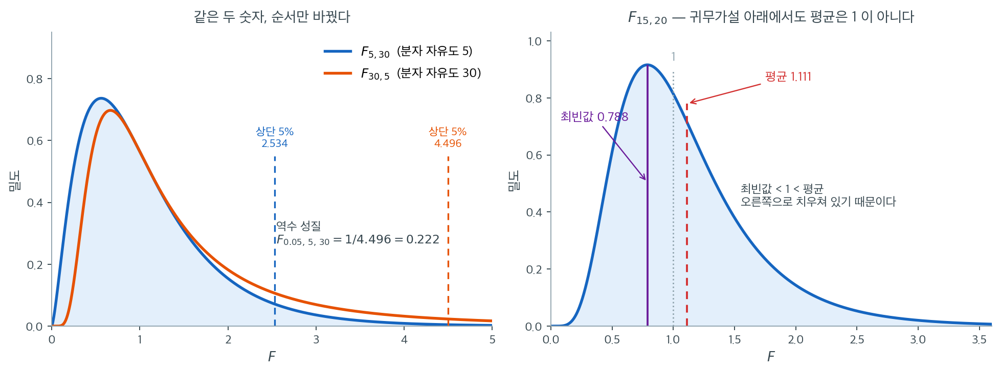

# F 분포와 자유도

<div class="leadbox" markdown>

**들어가는 이야기** — 평균이 1 이 아니다

정규 모집단에서 $n_1 = 16$, $n_2 = 21$ 인 두 표본을 뽑아 $S_1^2 = 45$, $S_2^2 = 28$ 을 얻었다. 비가 $45/28$ 이니 첫 집단이 더 퍼진 것처럼 보이고 관측값은 실제로 평균보다 $0.85$ 표준편차 위에 있는데, 양측 $p$ 값은 $0.3184$ 로 기각에 한참 못 미친다. **비가 $1$ 보다 크다는 사실 자체는 증거가 되지 못한다는 뜻이다.**

까닭은 이 분포가 애초에 $1$ 을 중심으로 대칭이 아니라는 데 있다. 평균이 $1$ 이 아니라 $d_2/(d_2-2)$ 이고 그것도 $d_2 > 2$ 에서만 존재한다. **분모 자유도가 작으면 귀무가설이 참인데도 $F$ 가 $1$ 보다 눈에 띄게 크게 나온다.** 지지집합이 $[0, \infty)$ 로 한쪽만 열려 있으니 오른쪽으로 길게 늘어지는 것이 당연한 모양이다.

그래서 자유도 둘의 순서를 바꾸면 다른 분포가 된다. 다만 바꾸어도 되는 길이 하나 있는데 그것이 역수 성질 $F_{1-\alpha, d_1, d_2} = 1/F_{\alpha, d_2, d_1}$ 이다. 수기 계산 시대에 표의 한쪽 꼬리만 찍어 놓고도 양측검정을 할 수 있었던 것이 이 등식 덕분이고, 지금도 아래쪽 임계값을 구할 때 그대로 쓰인다.

그러면 그 비대칭은 어디서 오고, 자유도 둘은 각각 분포의 무엇을 움직이는가. 그리고 이 분포는 $t$ 와 카이제곱과 어떻게 이어져 있는가. 이 쪽이 두 카이제곱의 비에서 출발해 성질을 세우고, $\S 4$ 와 $\S 5$ 에서 그 두 물음에 답한다.

</div>

F 분포는 독립인 두 정규 모집단의 분산을 비교할 때 자연스럽게 등장한다. 독립인 두 카이제곱 확률변수를 각자의 자유도로 나눈 것의 비로 구성된다. F 분포를 이해하는 것은 필수적이다. F 검정의 귀무분포를 제공할 뿐 아니라 분산분석과 회귀분석 전반에 등장하기 때문이다.

<div class="defn" markdown>

### 정의 1. F 분포 { .dfn }

$U \sim \chi^2_{d_1}$과 $V \sim \chi^2_{d_2}$가 자유도 $d_1$, $d_2$인 독립 카이제곱 확률변수라 하자. 확률변수

$$
F = \frac{U / d_1}{V / d_2}
$$

는 분자 자유도 $d_1$, 분모 자유도 $d_2$인 F 분포를 따르며 $F \sim F_{d_1, d_2}$로 쓴다.

자유도의 순서가 중요하다. $d_1 = d_2$가 아닌 한 $F_{d_1, d_2}$와 $F_{d_2, d_1}$은 서로 다른 분포이다.

</div>

---

## 1. 표본분산과의 연결

정규 모집단에서 독립인 두 확률표본을 뽑았다고 하자.

$$
X_1, \ldots, X_{n_1} \sim N(\mu_1, \sigma_1^2), \qquad Y_1, \ldots, Y_{n_2} \sim N(\mu_2, \sigma_2^2)
$$

표본분산에 대한 카이제곱 결과에서

$$
\frac{(n_1 - 1)S_1^2}{\sigma_1^2} \sim \chi^2_{n_1 - 1}, \qquad \frac{(n_2 - 1)S_2^2}{\sigma_2^2} \sim \chi^2_{n_2 - 1}
$$

여기서 $S_1^2$과 $S_2^2$은 표본분산이다. 두 표본이 독립이므로 이 카이제곱 변수들도 독립이다. 비를 만들면

$$
F = \frac{S_1^2 / \sigma_1^2}{S_2^2 / \sigma_2^2} = \frac{S_1^2 \sigma_2^2}{S_2^2 \sigma_1^2} \sim F_{n_1-1,\, n_2-1}
$$

귀무가설 $H_0\colon \sigma_1^2 = \sigma_2^2$ 아래에서 이 비는 다음으로 간단해진다.

$$
F = \frac{S_1^2}{S_2^2} \sim F_{n_1-1,\, n_2-1}
$$

이것이 분산 동일성에 대한 F 검정의 검정통계량이다.


<div class="aibox" markdown>

**AI로 보는 통계학 1.** 특징을 고르는 자리에 이 비가 그대로 있다

위 식의 $F = S_1^2 / S_2^2$ 는 **두 분산의 비**다. 분산분석은 같은 꼴을 집단 쪽으로
돌려 쓴다 — 분자가 집단 사이의 평균제곱, 분모가 집단 안의 평균제곱이고, 귀무가설
아래에서 그 비가 정의 1 의 $F_{k-1,\,N-k}$ 를 따른다.

기계학습 꾸러미에서 **연속형 특징을 분류 표적에 대해 점수 매기는 함수**가 이 비를
글자 그대로 쓴다. `sklearn.feature_selection.f_classif` 는 특징 하나하나에 대해
표적의 분류를 집단으로 보고 일원배치 $F$ 를 계산하며, 돌려주는 $p$ 값은 위에서 세운
그 $F$ 분포의 상단 꼬리다. 「비슷한 통계량」이 아니라 **같은 수**인지 보자.

```python
import numpy as np
from scipy import stats
from sklearn.feature_selection import f_classif

rng = np.random.default_rng(15)
n, k = 30, 3                                  # 집단 셋, 집단마다 30 개
y = np.repeat(np.arange(k), n)
good = np.concatenate([rng.normal(m, 1, n) for m in (0.0, 0.6, 1.2)])
noise = rng.normal(0, 1, n * k)               # 집단과 무관한 특징
X = np.column_stack([good, noise])

F_sk, p_sk = f_classif(X, y)
F_sp, p_sp = stats.f_oneway(*(good[y == i] for i in range(k)))

# 손으로: 집단간 평균제곱 / 집단내 평균제곱
gm = good.mean()
msb = sum(n * (good[y == i].mean() - gm) ** 2 for i in range(k)) / (k - 1)
msw = sum(((good[y == i] - good[y == i].mean()) ** 2).sum() for i in range(k)) / (k * n - k)

print(f"손계산    F = {msb / msw:.6f}")
print(f"f_oneway  F = {F_sp:.6f}  p = {p_sp:.3e}")
print(f"f_classif F = {F_sk[0]:.6f}  p = {p_sk[0]:.3e}   (쓸모 있는 특징)")
print(f"          F = {F_sk[1]:.6f}  p = {p_sk[1]:.3e}   (잡음 특징)")
print(f"기각 임계값 F(2, 87) 상단 5% = {stats.f.ppf(0.95, k - 1, k * n - k):.6f}")
```

출력:

```
손계산    F = 12.293279
f_oneway  F = 12.293279  p = 1.986e-05
f_classif F = 12.293279  p = 1.986e-05   (쓸모 있는 특징)
          F = 2.393483  p = 9.730e-02   (잡음 특징)
기각 임계값 F(2, 87) 상단 5% = 3.101296
```

소수 여섯 자리까지 같다. 특징 선택 점수라 불리는 수가 **이 쪽이 세운 비 그 자체**이고,
잡음 특징의 $2.393$ 은 임계값 $3.101$ 아래에 있어 걸러진다.

그래서 이 점수가 재는 것이 무엇인지도 식에 적혀 있다 — **한 특징이 홀로 집단을 가르는
힘**이다. 둘이 함께여야 갈라지는 특징 쌍은 각각의 분자가 작아 둘 다 낮은 점수를 받고
**함께 탈락한다.** 비의 분모가 「집단 안」인 한, 다른 특징이 무엇을 하고 있는지는
이 수에 들어오지 않는다.

</div>

---

## 2. F 분포의 성질

자유도 $d_1$, $d_2$인 F 분포는 다음 성질을 갖는다.

- **정의역:** $F > 0$ (양수의 비는 항상 양수)
- **평균:** $d_2 > 2$일 때 $E[F] = \dfrac{d_2}{d_2 - 2}$
- **분산:** $d_2 > 4$일 때 $\operatorname{Var}(F) = \dfrac{2d_2^2(d_1 + d_2 - 2)}{d_1(d_2-2)^2(d_2-4)}$
- **최빈값:** $d_1 > 2$일 때 $\dfrac{d_1 - 2}{d_1} \cdot \dfrac{d_2}{d_2 + 2}$
- **오른쪽 치우침:** 항상 양의 왜도를 가지며, 두 자유도가 모두 커지면 왜도가 줄어든다

!!! note "귀무가설 아래에서 평균이 1 근처"
    $d_2$가 어느 정도 크면 $E[F] \approx 1$이다. 직관적으로 타당하다. $H_0\colon \sigma_1^2 = \sigma_2^2$ 아래에서 비 $S_1^2/S_2^2$은 평균적으로 1에 가까워야 한다. $F$가 1보다 훨씬 크거나 작으면 분산이 같지 않다는 증거가 된다.

    다만 평균 $d_2/(d_2-2)$가 정확히 1은 **아니다**. $d_2 = 20$이면 $E[F] = 1.111$이다. 이 위쪽 치우침은 F 분포가 비대칭이기 때문이며, 최빈값은 반대로 1보다 작다($d_1 = 15$, $d_2 = 20$에서 $0.788$).

---

## 3. 자유도의 역할

두 자유도 모수 $d_1$과 $d_2$가 F 분포의 모양을 결정한다.

- **분자 자유도** $d_1 = n_1 - 1$: 분자에 분산이 오는 집단의 표본크기를 반영한다. $d_1$이 커지면 분포가 더 집중된다.
- **분모 자유도** $d_2 = n_2 - 1$: 분모에 오는 집단의 표본크기를 반영한다. $d_2$가 커지면 분산이 줄고 평균이 1에 가까워진다.

$d_1$과 $d_2$가 모두 크면 F 분포가 1 근처를 중심으로 하는 정규분포에 접근한다.

---

## 4. 역수 성질

$F \sim F_{d_1, d_2}$이면

$$
\frac{1}{F} \sim F_{d_2, d_1}
$$

이 성질은 하단 임계값을 계산하는 데 유용하다. (표에 늘 실려 있지는 않은) $F_{\alpha,\, d_1,\, d_2}$를 찾는 대신 다음을 쓸 수 있다.

$$
F_{\alpha,\, d_1,\, d_2} = \frac{1}{F_{1-\alpha,\, d_2,\, d_1}}
$$

자유도의 순서가 왜 중요한지, 그리고 귀무가설 아래에서도 왜 평균이 1이 아닌지를 한 그림에 모았다.



왼쪽은 같은 두 숫자 5와 30을 순서만 바꾼 두 분포다. $F_{5,30}$은 분자 자유도가 작아 분자의 표본분산이 불안정하므로 오른쪽으로 길게 늘어진다. $F_{30,5}$는 반대로 분모가 불안정해서 큰 값 쪽 꼬리가 더 두껍다. 실무에서 차이가 드러나는 지점은 임계값이다. **상단 5% 임계값이 $2.534$와 $4.496$으로 1.8배 차이 난다.** 어느 집단을 분자에 놓았는지 헷갈린 채 표에서 $2.534$를 읽으면, 실제로는 5% 검정이 아니라 훨씬 헐거운 검정을 하게 된다.

두 곡선이 같은 그림에 있으니 역수 성질도 눈으로 확인된다. $F_{5,30}$의 **하단** 5% 지점은 $1/4.496 = 0.222$이다. 주황 곡선의 상단 5% 임계값 하나만 알면 파랑 곡선의 하단 임계값이 따라 나온다. 상단 분위수만 실린 옛 표로 양측검정을 할 수 있었던 것이 이 덕분이다.

오른쪽은 $F_{15,20}$ 하나만 자세히 본 것이다. 세 개의 세로선이 최빈값 $0.788$, 기준점 $1$, 평균 $1.111$이다. **최빈값 < 1 < 평균**이라는 순서가 F 분포가 오른쪽으로 치우쳐 있다는 사실의 직접적인 표현이다. 가장 흔히 나오는 값은 1보다 작은데 평균은 1보다 크다. 오른쪽 꼬리에 드물지만 아주 큰 값들이 있어 평균을 끌어올리기 때문이다.

그래서 "$H_0$ 아래에서 $F$는 1 근처"라는 직관을 쓸 때는 **어느 의미의 근처인지** 따져야 한다. $E[F] = d_2/(d_2-2)$이고 $d_2$가 작으면 1에서 꽤 멀다. $d_2 = 20$에서 $1.111$, $d_2 = 6$이면 $1.5$나 된다. 판정은 언제나 평균이 아니라 임계값으로 해야 한다.

---

## 5. 다른 분포와의 관계

F 분포는 여러 다른 분포와 연결된다.

- **베타분포:** $F \sim F_{d_1, d_2}$이면 $d_1 F / (d_1 F + d_2) \sim \text{Beta}(d_1/2, d_2/2)$이다.
- **$t$ 분포:** $T \sim t_\nu$이면 $T^2 \sim F_{1, \nu}$이다. $t$ 검정통계량의 제곱은 분자 자유도가 1인 F 통계량이다.
- **큰 표본 극한:** $d_2 \to \infty$이면 $d_1 F \to \chi^2_{d_1}$이다. F 분포를 카이제곱으로 되돌려 연결한다.

<div class="exbox" markdown>

**보기 1.** <span class="diff easy" title="쉬움"></span> 두 모분산의 F 검정. 정규 모집단에서 크기 $n_1 = 16$, $n_2 = 21$인 독립 표본을 뽑았다. 표본분산은 $S_1^2 = 45$, $S_2^2 = 28$이다. $H_0\colon \sigma_1^2 = \sigma_2^2$ 아래에서

</div>

??? success "풀이"
    $$
    F = \frac{45}{28} = 1.607
    $$

    이 통계량은 귀무가설 아래에서 $F_{15, 20}$을 따른다. $F_{15,20}$의 평균은 $20/18 \approx 1.111$이다. 관측값 1.607은 평균보다 크지만 임계값 $F_{0.975}(15, 20) = 2.573$($\alpha = 0.05$ 양측)과 비교해야 한다. $1.607 < 2.573$이므로 $H_0$을 기각하지 못한다($p = 0.318$).

<div class="exbox" markdown>

**보기 2.** <span class="diff easy" title="쉬움"></span> F 분포의 성질과 기각값. 보기 1 의 설정 $d_1 = 15$, $d_2 = 20$, $F_{\text{obs}} = 45/28$ 을 그대로 쓴다.

**(1)** $F_{15,20}$ 의 평균과 분산을 닫힌 꼴로 구하고, **상단 분위수만 실린 표**로 하단 임계값 $F_{0.025}(15,20)$ 을 얻는 법을 보이시오.

**(2)** 코드로 확인하시오. 관측값 $1.607$ 이 평균 $1.111$ 보다 큰데도 기각하지 못하는 까닭을 **분산의 크기로** 설명하시오.

</div>

??? success "풀이"

    **(1) 평균과 분산.** 평균은 연습문제 1 에서 유도한다.

    $$
    E[F] = \frac{d_2}{d_2 - 2} = \frac{20}{18} = 1.1111 \qquad (d_2 > 2)
    $$

    분산은 $d_2 > 4$ 에서

    $$
    \operatorname{Var}(F) = \frac{2 d_2^2 (d_1 + d_2 - 2)}{d_1 (d_2-2)^2 (d_2-4)}
    = \frac{2 \cdot 400 \cdot 33}{15 \cdot 324 \cdot 16}
    = \frac{26400}{77760} = 0.339506
    $$

    이다. 표준편차로는 $\sqrt{0.339506} = 0.5827$ 이다. **평균은 $d_1$ 에 의존하지 않지만 분산은 의존한다** — 분자 자유도가 작을수록 분자가 불안정해 비가 더 흔들린다.

    **하단 임계값은 상단 분위수 하나로 얻는다.** 역수 성질 $1/F \sim F_{d_2,d_1}$ 에서

    $$
    \alpha = P\bigl(F_{d_1,d_2} \le F_\alpha(d_1,d_2)\bigr)
    = P\!\left(F_{d_2,d_1} \ge \frac{1}{F_\alpha(d_1,d_2)}\right)
    $$

    이므로 $1/F_\alpha(d_1,d_2)$ 가 $F_{d_2,d_1}$ 의 상단 $\alpha$ 점, 곧

    $$
    F_\alpha(d_1,d_2) = \frac{1}{F_{1-\alpha}(d_2,d_1)}
    $$

    이다. 여기서는 $F_{0.025}(15,20) = 1/F_{0.975}(20,15)$ 이고, **자유도의 순서가 뒤바뀐다**는 데 주의해야 한다. 옛 표에 상단 분위수만 실려 있어도 양측검정을 할 수 있었던 것이 이 덕분이다.

    **(2) 확인한다.**

    ```python
    from scipy import stats

    # 분자와 분모의 자유도
    d1, d2 = 15, 20

    # F 분포의 평균은 d2/(d2-2) 로 1 보다 조금 크다. 분산비의 분포이므로
    # 아래로는 0 에서 막히고 위로는 열려 있어 오른쪽으로 치우친 탓이다.
    print(f"Mean: {stats.f.mean(d1, d2):.4f}")
    print(f"Variance: {stats.f.var(d1, d2):.4f}")

    alpha = 0.05
    f_lower = stats.f.ppf(alpha / 2, d1, d2)
    f_upper = stats.f.ppf(1 - alpha / 2, d1, d2)
    print(f"Critical values: [{f_lower:.3f}, {f_upper:.3f}]")

    # 두 표본분산의 비. 큰 쪽을 분자에 두면 오른쪽 꼬리만 보면 되지만,
    # 여기서는 순서를 정해 놓고 양측으로 계산한다.
    f_stat = 45 / 28
    p_value = 2 * min(stats.f.cdf(f_stat, d1, d2), stats.f.sf(f_stat, d1, d2))
    print(f"F-statistic: {f_stat:.3f}")
    print(f"P-value: {p_value:.4f}")

    # (1) 의 닫힌 꼴과 맞춰 본다.
    mean_formula = d2 / (d2 - 2)
    var_formula = 2 * d2**2 * (d1 + d2 - 2) / (d1 * (d2 - 2) ** 2 * (d2 - 4))
    print(f"\n공식 평균 d2/(d2-2)                       = {mean_formula:.6f}")
    print(f"공식 분산 2 d2^2 (d1+d2-2) / (d1 (d2-2)^2 (d2-4)) = {var_formula:.6f}")

    # 하단 임계값을 상단 분위수만으로 얻는다: F_a(d1,d2) = 1 / F_{1-a}(d2,d1)
    upper_swapped = stats.f.ppf(1 - alpha / 2, d2, d1)      # 자유도를 뒤바꾼 상단 분위수
    print(f"\nF_0.975(20,15)      = {upper_swapped:.6f}")
    print(f"1 / F_0.975(20,15)  = {1 / upper_swapped:.6f}")
    print(f"F_0.025(15,20)      = {f_lower:.6f}")

    # 관측값이 평균에서 몇 표준편차 떨어져 있는가
    sd = var_formula**0.5
    print(f"\n표준편차 = {sd:.4f}")
    print(f"(F_obs - 평균)/표준편차 = {(f_stat - mean_formula) / sd:.4f}")
    ```

    출력:

    ```text
    Mean: 1.1111
    Variance: 0.3395
    Critical values: [0.363, 2.573]
    F-statistic: 1.607
    P-value: 0.3184

    공식 평균 d2/(d2-2)                       = 1.111111
    공식 분산 2 d2^2 (d1+d2-2) / (d1 (d2-2)^2 (d2-4)) = 0.339506

    F_0.975(20,15)      = 2.755902
    1 / F_0.975(20,15)  = 0.362858
    F_0.025(15,20)      = 0.362858

    표준편차 = 0.5827
    (F_obs - 평균)/표준편차 = 0.8513
    ```

    **세 가지가 모두 맞는다.** 공식 평균 $1.111111$ 과 분산 $0.339506$ 이 `scipy` 의 $1.1111$, $0.3395$ 와 같고, $1/F_{0.975}(20,15) = 0.362858$ 이 $F_{0.025}(15,20) = 0.362858$ 과 소수 여섯째 자리까지 같다.

    **기각하지 못하는 까닭은 분산이 크기 때문이다.** 표준편차가 $0.5827$ 인데 관측값은 평균에서 겨우 $0.85$ 표준편차 떨어져 있다. 정규분포라면 $0.85$ 표준편차는 흔하디흔한 자리다. 채택역 $[0.363,\ 2.573]$ 을 같은 눈금으로 재면 평균에서 아래로 $1.28$, 위로 $2.51$ 표준편차까지 뻗어 있으니 $0.85$ 는 한참 안쪽이다. $p = 0.3184$ 가 그 말이다.

    **"관측값이 평균보다 크다"는 것은 아무 증거도 아니다.** $F$ 분포의 평균 $1.111$ 자체가 1 보다 크고(오른쪽 치우침 때문이다), 그 주위의 산포는 그보다 훨씬 크다. **판정은 언제나 평균이 아니라 임계값으로** 해야 한다.

---

## 연습문제

<div class="drillbox" markdown>

**연습문제 1.** <span class="diff med" title="중간"></span>
$F \sim F_{d_1,d_2}$의 평균이 $d_2 > 2$일 때 $d_2/(d_2-2)$임을 유도하라. 왜 이 값이 $d_1$에 의존하지 않는지 설명하라.

</div>

??? success "풀이"
    $F = (U/d_1)/(V/d_2)$이고 $U \sim \chi^2_{d_1}$, $V \sim \chi^2_{d_2}$가 독립이다. 독립성에 의해

    $$
    E[F] = \frac{d_2}{d_1}\, E[U]\, E\!\left[\frac{1}{V}\right].
    $$

    $E[U] = d_1$이다. 역수의 기댓값은 역카이제곱분포의 성질에서

    $$
    E\!\left[\frac{1}{V}\right] = \frac{1}{d_2 - 2} \quad (d_2 > 2).
    $$

    이를 직접 계산해 보면, $V \sim \chi^2_{d_2}$의 밀도가 $f(v) = \frac{v^{d_2/2-1}e^{-v/2}}{2^{d_2/2}\Gamma(d_2/2)}$이므로

    $$
    E\!\left[\frac{1}{V}\right] = \int_0^\infty \frac{v^{d_2/2-2}e^{-v/2}}{2^{d_2/2}\Gamma(d_2/2)}\,dv = \frac{2^{d_2/2-1}\Gamma(d_2/2-1)}{2^{d_2/2}\Gamma(d_2/2)} = \frac{1}{2}\cdot\frac{1}{d_2/2-1} = \frac{1}{d_2-2}.
    $$

    적분이 수렴하려면 $d_2/2 - 2 > -1$, 곧 $d_2 > 2$가 필요하다. 따라서

    $$
    E[F] = \frac{d_2}{d_1} \cdot d_1 \cdot \frac{1}{d_2-2} = \frac{d_2}{d_2-2}.
    $$

    **왜 $d_1$에 의존하지 않는가.** $U/d_1$의 기댓값이 $d_1$과 무관하게 항상 1이기 때문이다. 곧 분자는 어떤 자유도에서든 평균 1인 확률변수이고, 평균이 1에서 벗어나는 것은 전적으로 **분모의 역수 기댓값**에서 온다. Jensen 부등식에 의해 $E[1/W] > 1/E[W] = 1$이며($W = V/d_2$, $E[W]=1$), 그 초과분이 $d_2/(d_2-2) - 1 = 2/(d_2-2)$이다.

    실무적 함의: $E[F]$가 1보다 큰 것은 분산 차이의 증거가 아니라 **비의 기댓값이 갖는 편향**이다. $d_2 = 5$이면 $E[F] = 1.67$이나 되므로 작은 표본에서 $F$ 값을 1과 비교할 때 이 점을 유념해야 한다. $\square$

<div class="drillbox" markdown>

**연습문제 2.** <span class="diff med" title="중간"></span>
$T \sim t_\nu$이면 $T^2 \sim F_{1,\nu}$임을 보이고, 이 관계가 이표본 $t$ 검정과 일원분산분석의 관계에 어떻게 나타나는지 설명하라.

</div>

??? success "풀이"
    **증명.** $t$ 분포의 정의에 의해

    $$
    T = \frac{Z}{\sqrt{V/\nu}}, \qquad Z \sim \mathcal{N}(0,1),\; V \sim \chi^2_\nu \text{ 독립}.
    $$

    제곱하면

    $$
    T^2 = \frac{Z^2}{V/\nu} = \frac{Z^2/1}{V/\nu}.
    $$

    $Z^2 \sim \chi^2_1$이고 $V \sim \chi^2_\nu$가 독립이므로, 이는 정확히 $F_{1,\nu}$의 정의이다.

    **수치 확인.** $t_{0.975,10} = 2.2281$이고 그 제곱은 $4.9646$이다. 한편 $F_{0.95}(1,10) = 4.9646$이다. 정확히 일치한다. $t$의 **양측** 확률이 $F$의 **단측** 확률에 대응한다는 점에 주목하라. $F$가 $T^2$이므로 $T$의 양쪽 꼬리가 $F$의 오른쪽 꼬리 하나로 접힌다.

    **이표본 $t$ 검정과 분산분석의 관계.** 두 집단($k=2$)에 대한 일원분산분석의 F 통계량은

    $$
    F = \frac{\text{집단간 평균제곱}}{\text{집단내 평균제곱}} \sim F_{1,\, n_1+n_2-2}
    $$

    이고, 합동분산 이표본 $t$ 검정의 통계량은 $T \sim t_{n_1+n_2-2}$이다. 두 통계량 사이에는 정확히 $F = T^2$이 성립한다.

    따라서 **두 집단에 대한 분산분석과 양측 이표본 $t$ 검정은 완전히 같은 검정**이다. $p$값도 동일하다. 분산분석이 $t$ 검정을 $k > 2$로 일반화한 것이라는 서술의 정확한 의미가 이것이다. $\square$

<div class="drillbox" markdown>

**연습문제 3.** <span class="diff med" title="중간"></span>
$d_2 \to \infty$일 때 $d_1 F \to \chi^2_{d_1}$임을 보이고, $d_1 = 5$에 대해 $d_2 \in \{10, 100, 10000\}$에서 이 근사의 정확도를 수치로 확인하라.

</div>

??? success "풀이"
    **증명.** $F = (U/d_1)/(V/d_2)$이므로

    $$
    d_1 F = \frac{U}{V/d_2}.
    $$

    $V \sim \chi^2_{d_2}$이므로 $E[V/d_2] = 1$이고 $\operatorname{Var}(V/d_2) = 2/d_2 \to 0$이다. 따라서 대수의 법칙에 의해 $V/d_2 \xrightarrow{p} 1$이다.

    Slutsky 정리에 의해

    $$
    d_1 F = \frac{U}{V/d_2} \xrightarrow{d} \frac{U}{1} = U \sim \chi^2_{d_1}.
    $$

    **수치 확인.**

    ```python
    from scipy import stats

    d1 = 5
    print(f"chi2_5 0.95 quantile: {stats.chi2.ppf(0.95, d1):.4f}\n")
    for d2 in [10, 100, 10000]:
        print(f"d2 = {d2:>5}: d1 * F_0.95 = {d1 * stats.f.ppf(0.95, d1, d2):.4f}")
    ```

    출력:

    ```text
    chi2_5 0.95 quantile: 11.0705

    d2 =    10: d1 * F_0.95 = 16.6292
    d2 =   100: d1 * F_0.95 = 11.5266
    d2 = 10000: d1 * F_0.95 = 11.0750
    ```

    | $d_2$ | $d_1 F_{0.95}$ | $\chi^2_{5,\,0.95}$ 대비 오차 |
    |---|---|---|
    | 10 | 16.629 | $+50\%$ |
    | 100 | 11.527 | $+4.1\%$ |
    | 10000 | 11.075 | $+0.04\%$ |

    수렴은 하지만 **느리다**. $d_2 = 10$에서 오차가 50%에 이른다. 분모 자유도가 작을 때 분모의 변동이 F 통계량의 꼬리를 크게 부풀리기 때문이다.

    **실무적 함의.** 회귀분석과 분산분석에서 F 검정 대신 카이제곱 근사(Wald 검정 등)를 쓰는 경우가 있는데, 이는 분모 자유도(잔차 자유도)가 충분히 클 때만 정당하다. 잔차 자유도가 수십 수준이면 F 분포를 그대로 쓰는 편이 훨씬 정확하다. $\square$

<div class="drillbox" markdown>

**연습문제 4.** <span class="diff med" title="중간"></span>
F 분포의 왜도가 자유도에 따라 어떻게 변하는지 조사하고, 이것이 왜 F 검정의 양측 임계값을 비대칭으로 만드는지 설명하라.

</div>

??? success "풀이"

    ```python
    from scipy import stats

    print(f"{'d1':>5} {'d2':>5} {'skewness':>10} {'lower':>8} {'upper':>8}")
    for d1, d2 in [(5, 10), (15, 20), (50, 50), (200, 200)]:
        sk = stats.f.stats(d1, d2, moments='s')
        lo = stats.f.ppf(0.025, d1, d2)
        up = stats.f.ppf(0.975, d1, d2)
        print(f"{d1:>5} {d2:>5} {sk:>10.4f} {lo:>8.4f} {up:>8.4f}")
    ```

    출력:

    ```text
       d1    d2   skewness    lower    upper
        5    10     3.8670   0.1511   4.2361
       15    20     1.7435   0.3629   2.5731
       50    50     0.9218   0.5708   1.7520
      200   200     0.4326   0.7573   1.3204
    ```

    | $d_1, d_2$ | 왜도 | 하단 | 상단 | $1$과의 거리 (하 / 상) |
    |---|---|---|---|---|
    | 5, 10 | 3.87 | 0.151 | 4.236 | 0.85 / 3.24 |
    | 15, 20 | 1.74 | 0.363 | 2.573 | 0.64 / 1.57 |
    | 50, 50 | 0.92 | 0.571 | 1.752 | 0.43 / 0.75 |
    | 200, 200 | 0.43 | 0.757 | 1.320 | 0.24 / 0.32 |

    **비대칭의 근원.** F 통계량은 두 양수의 **비**이다. 비는 위쪽으로는 무한대까지 갈 수 있지만 아래쪽으로는 0에서 막혀 있다. 따라서 분포가 필연적으로 오른쪽으로 치우친다.

    이 때문에 임계값이 1을 중심으로 대칭이 아니다. $d_1 = d_2 = 50$에서 하단 임계값은 1에서 $0.43$ 떨어져 있지만 상단은 $0.75$ 떨어져 있다. 상단이 거의 두 배 멀다.

    **로그 척도에서는 대칭에 가깝다.** $\ln F$를 생각하면 역수 성질 $1/F \sim F_{d_2,d_1}$에 의해 $d_1 = d_2$일 때 $\ln F$의 분포가 0을 중심으로 **정확히 대칭**이다. 실제로 $d_1=d_2=50$에서 $\ln(0.5708) = -0.5607$이고 $\ln(1.7520) = +0.5607$로 크기가 정확히 같다.

    이것이 분산비를 논할 때 로그 척도가 자연스러운 이유이며, Bartlett 검정이 $\ln S_i^2$의 형태를 취하는 것과 같은 배경이다. $\square$

<div class="drillbox" markdown>

**연습문제 5.** <span class="diff med" title="중간"></span>
5 절의 베타분포 관계 $W = d_1 F/(d_1 F + d_2) \sim \text{Beta}(d_1/2,\, d_2/2)$ 를 정의 1 에서 직접 유도하라.

**(1)** $W$ 를 $U$ 와 $V$ 만으로 나타내고, 그 분포가 왜 베타분포가 되는지 보이시오.

**(2)** 이 관계만 써서 4 절의 역수 성질 $1/F \sim F_{d_2,d_1}$ 을 다시 증명하시오.

**(3)** 보기 1 의 $F_{\text{obs}} = 45/28$, $(d_1,d_2) = (15,20)$ 에 대응하는 $W_{\text{obs}}$ 를 분수로 구하고, $P(W \le W_{\text{obs}})$ 가 보기 2 의 코드가 찍은 $p = 0.3184$ 와 맞물리는지 확인하시오.

</div>

??? success "풀이"

    **(1) $W$ 는 두 카이제곱의 상대적 몫이다.** 정의 1 에서 $F = (U/d_1)/(V/d_2)$ 이므로

    $$
    d_1 F = d_1 \cdot \frac{U/d_1}{V/d_2} = \frac{d_2 U}{V}
    $$

    이고, 따라서

    $$
    W = \frac{d_1 F}{d_1 F + d_2} = \frac{d_2 U / V}{d_2 U / V + d_2} = \frac{U/V}{U/V + 1} = \frac{U}{U + V}.
    $$

    **자유도가 모두 사라졌다.** $W$ 는 두 카이제곱의 합 가운데 분자가 차지하는 **몫**이다. $U \sim \chi^2_{d_1}$ 은 $\text{Gamma}(d_1/2,\ \text{척도} 2)$, $V \sim \chi^2_{d_2}$ 은 $\text{Gamma}(d_2/2,\ \text{척도 } 2)$ 이고 **척도가 같다**. 척도가 같은 독립 감마 두 개에 대해 $U/(U+V) \sim \text{Beta}(d_1/2,\, d_2/2)$ 이므로

    $$
    W \sim \text{Beta}\!\left(\frac{d_1}{2},\, \frac{d_2}{2}\right).
    $$

    이것이 5 절의 관계다. $F$ 의 꼬리확률을 불완전 베타함수로 계산할 수 있는 근거이며, 실제로 `scipy` 의 `f.cdf` 가 이 경로로 계산한다.

    **(2) 역수 성질.** $F' = 1/F = (V/d_2)/(U/d_1)$ 로 두면 $F'$ 에 대응하는 몫은 자유도의 자리가 바뀌어

    $$
    W' = \frac{d_2 F'}{d_2 F' + d_1} = \frac{V}{U+V} = 1 - W
    $$

    이다. $W \sim \text{Beta}(d_1/2, d_2/2)$ 이면 $1 - W \sim \text{Beta}(d_2/2, d_1/2)$ 이므로 $W'$ 은 자유도 $(d_2, d_1)$ 인 F 분포에 딸린 베타분포를 따른다. 그리고 $x \mapsto d_2 x/(d_2 x + d_1)$ 은 $(0,\infty)$ 에서 $(0,1)$ 로 가는 **강증가 전단사**이므로 $W'$ 의 분포가 $F'$ 의 분포를 유일하게 결정한다. 따라서

    $$
    \frac{1}{F} \sim F_{d_2,\, d_1}.
    $$

    역수 성질이 베타분포의 **$1-W$ 대칭**과 같은 사실이라는 것이 이 증명의 요점이다.

    **(3) 보기 1 의 값.** $d_1 F_{\text{obs}} = 15 \cdot \dfrac{45}{28} = \dfrac{675}{28}$ 이므로

    $$
    W_{\text{obs}} = \frac{675/28}{675/28 + 20} = \frac{675}{675 + 560} = \frac{675}{1235} = \frac{135}{247} = 0.5466.
    $$

    $W \sim \text{Beta}(7.5,\, 10)$ 에서 $P(W \le 0.5466) = 0.8408$ 이다. 곧 오른쪽 꼬리가 $1 - 0.8408 = 0.1592$ 이고, 양측 $p$ 값은 $2 \times 0.1592 = 0.3184$ 로 보기 2 의 출력과 **소수 넷째 자리까지 같다**.

    베타분포 쪽이 수치적으로 편한 까닭도 보인다. $F$ 는 $1.607$ 처럼 $(0,\infty)$ 어디에나 있을 수 있지만 $W$ 는 항상 $[0,1]$ 안의 $0.5466$ 이다. 꼬리확률을 유계구간의 적분으로 바꾸어 놓은 것이다. $\square$

<div class="drillbox" markdown>

**연습문제 6.** <span class="diff hard" title="어려움"></span>
2 절은 $F_{15,20}$ 에서 최빈값 $0.788 < 1 < 1.111 = E[F]$ 임을 들어 오른쪽 치우침을 설명했다. 이 치우침이 **얼마나 큰지**를 산포와 견주어 재어 보자.

**(1)** $d_1 > 2$, $d_2 > 2$ 이면 최빈값 $< 1 < E[F]$ 가 **항상** 성립함을 보이시오.

**(2)** $d_1 = d_2 = d$ ($d > 4$) 로 두고 $E[F] - 1$, $1 - \text{최빈값}$, $\text{SD}(F)$ 를 $d$ 의 식으로 쓰고, $d \to \infty$ 에서 앞의 두 양은 $O(1/d)$, 마지막은 $O(1/\sqrt d)$ 임을 확인하시오.

**(3)** $\dfrac{E[F]-1}{\text{SD}(F)}$ 를 $d$ 의 닫힌 꼴로 구하고 그 **최댓값과 그때의 $d$** 를 정확히 구하시오. 결과를 보기 2 의 결론과 이으시오.

</div>

??? success "풀이"

    **(1) 최빈값은 늘 1 보다 작고 평균은 늘 1 보다 크다.** 2 절의 최빈값 공식에서

    $$
    \frac{d_1-2}{d_1}\cdot\frac{d_2}{d_2+2} < 1
    \iff (d_1-2) d_2 < d_1 (d_2+2)
    \iff -2 d_2 < 2 d_1
    $$

    이고 $d_1, d_2 > 0$ 이므로 마지막 부등식은 **언제나** 참이다. 평균 쪽은 $E[F] = d_2/(d_2-2) = 1 + 2/(d_2-2) > 1$ 이 $d_2 > 2$ 에서 자명하다. 두 인자 각각이 1 보다 작다는 사실이 최빈값 쪽을 더 분명하게 해 준다. $(d_1-2)/d_1 < 1$ 은 분자의 불안정에서 오고 $d_2/(d_2+2) < 1$ 은 분모의 불안정에서 온다.

    **(2) $d_1 = d_2 = d$ 인 경우.**

    $$
    E[F] - 1 = \frac{2}{d-2}, \qquad
    1 - \text{최빈값} = 1 - \frac{d-2}{d+2} = \frac{4}{d+2}
    $$

    이고, 분산은

    $$
    \operatorname{Var}(F) = \frac{2d^2(2d-2)}{d(d-2)^2(d-4)} = \frac{4d(d-1)}{(d-2)^2(d-4)}
    \;\Longrightarrow\;
    \text{SD}(F) = \frac{2\sqrt{d(d-1)}}{(d-2)\sqrt{d-4}}.
    $$

    큰 $d$ 에서 $\operatorname{Var}(F) \approx 4d^2/d^3 = 4/d$ 이므로 $\text{SD}(F) \approx 2/\sqrt d$ 다. 정리하면

    | 양 | $d$ 에 대한 차수 | $d = 20$ |
    |---|---|---|
    | $E[F]-1$ | $2/d$ | $0.1111$ |
    | $1 - \text{최빈값}$ | $4/d$ | $0.1818$ |
    | $\text{SD}(F)$ | $2/\sqrt d$ | $0.5415$ |

    **치우침은 $1/d$ 로 줄고 산포는 $1/\sqrt d$ 로 줄므로, 자유도가 커질수록 치우침이 산포보다 훨씬 빨리 사라진다.**

    **(3) 비의 닫힌 꼴.**

    $$
    \frac{E[F]-1}{\text{SD}(F)}
    = \frac{2}{d-2} \cdot \frac{(d-2)\sqrt{d-4}}{2\sqrt{d(d-1)}}
    = \sqrt{\frac{d-4}{d(d-1)}}.
    $$

    제곱한 $h(d) = (d-4)/(d^2-d)$ 를 미분하면 분자가

    $$
    (d^2-d) - (d-4)(2d-1) = -d^2 + 8d - 4
    $$

    이고 $d^2 - 8d + 4 = 0$ 에서 $d = 4 + 2\sqrt 3 = 7.4641$ 이다($d>4$ 쪽 뿌리). 이때

    $$
    h(d) = 7 - 4\sqrt 3, \qquad
    \sqrt{h(d)} = \sqrt{7-4\sqrt3} = 2 - \sqrt 3 = 0.2679.
    $$

    $(2-\sqrt3)^2 = 7-4\sqrt3$ 이므로 마지막 등식이 정확하다. 확인해 보면 $d = 6$ 에서 $\sqrt{2/30} = 0.2582$, $d = 20$ 에서 $\sqrt{16/380} = 0.2052$, $d = 200$ 에서 $0.0702$ 로 $d = 7.46$ 근처가 꼭대기다.

    **읽는 법.** $F$ 분포의 평균은 **어떤 자유도에서도 1 보다 $0.268$ 표준편차 넘게 위에 있지 못한다.** 2 절의 "최빈값 < 1 < 평균" 은 참이지만, 그 어긋남은 분포의 산포에 비하면 늘 작은 양이다. 보기 2 에서 관측값이 평균보다 컸는데도($+0.85$ 표준편차) 기각하지 못한 것과 같은 이야기다. **치우침은 모양의 성질이고 판정은 산포의 문제이므로, 1 과의 비교가 아니라 임계값과의 비교가 결론을 낸다.** $\square$

<div class="drillbox" markdown>

**연습문제 7.** <span class="diff hard" title="어려움"></span>
4 절의 그림은 상단 5% 임계값이 $F_{0.95}(5,30) = 2.534$, $F_{0.95}(30,5) = 4.496$ 으로 1.8 배 차이 난다고 했다. $n_1 = 6$, $n_2 = 31$ 인 자료에서 표의 **행을 잘못 읽는** 두 가지 실수를 생각한다.

**(가)** 통계량은 $S_1^2/S_2^2 \sim F_{5,30}$ 인데 임계값은 $4.496$ 을 읽었다.
**(나)** 통계량은 $S_2^2/S_1^2 \sim F_{30,5}$ 인데 임계값은 $2.534$ 를 읽었다.

두 실수의 **실제 유의수준**을 코드로 구하고, 역수 성질로 하단 임계값을 얻어 두 자유도 순서의 올바른 양측 채택역을 함께 구하라. 두 실수 가운데 어느 쪽이 더 위험한지 수로 답하라.

</div>

??? success "풀이"

    ```python
    from scipy import stats

    alpha = 0.05

    # 표의 두 행: 자유도 순서만 바꾼 것이다.
    c_right = stats.f.ppf(1 - alpha, 5, 30)
    c_swap = stats.f.ppf(1 - alpha, 30, 5)
    print(f"F_0.95(5,30) = {c_right:.4f}")
    print(f"F_0.95(30,5) = {c_swap:.4f}")
    print(f"두 임계값의 비 = {c_swap / c_right:.4f}\n")

    # 행을 잘못 읽었을 때 실제 유의수준
    size_a = stats.f.sf(c_swap, 5, 30)
    size_b = stats.f.sf(c_right, 30, 5)
    print(f"(가) 참분포 F(5,30), 임계값 {c_swap:.3f} -> 실제 크기 {size_a:.4f}")
    print(f"(나) 참분포 F(30,5), 임계값 {c_right:.3f} -> 실제 크기 {size_b:.4f}\n")

    # 역수 성질로 하단 임계값을 얻는다.
    lo_rec = 1 / c_swap
    lo_dir = stats.f.ppf(alpha, 5, 30)
    print(f"1 / F_0.95(30,5) = {lo_rec:.4f}")
    print(f"F_0.05(5,30)     = {lo_dir:.4f}\n")

    # 올바른 양측 채택역
    print("올바른 양측 5% 채택역")
    print(f"  (5,30): [{stats.f.ppf(0.025, 5, 30):.4f}, {stats.f.ppf(0.975, 5, 30):.4f}]")
    print(f"  (30,5): [{stats.f.ppf(0.025, 30, 5):.4f}, {stats.f.ppf(0.975, 30, 5):.4f}]")
    ```

    출력:

    ```text
    F_0.95(5,30) = 2.5336
    F_0.95(30,5) = 4.4957
    두 임계값의 비 = 1.7745

    (가) 참분포 F(5,30), 임계값 4.496 -> 실제 크기 0.0036
    (나) 참분포 F(30,5), 임계값 2.534 -> 실제 크기 0.1515

    1 / F_0.95(30,5) = 0.2224
    F_0.05(5,30)     = 0.2224

    올바른 양측 5% 채택역
      (5,30): [0.1606, 3.0265]
      (30,5): [0.3304, 6.2269]
    ```

    **두 실수는 방향이 반대고 크기가 다르다.**

    | 실수 | 참분포 | 쓴 임계값 | 실제 크기 | 명목 $0.05$ 대비 |
    |---|---|---|---|---|
    | (가) | $F_{5,30}$ | $4.496$ | $0.0036$ | $1/14$ 배 |
    | (나) | $F_{30,5}$ | $2.534$ | $0.1515$ | $3.03$ 배 |

    **(가) 는 검정을 지나치게 보수적으로 만든다.** 임계값이 참분포의 상단 $0.36\%$ 점이므로 명목 5% 검정이 사실상 0.4% 검정이 된다. 1 종 오류는 줄지만 검정력을 크게 잃는다.

    **(나) 가 더 위험하다.** 실제 크기가 $0.1515$ 로 명목값의 **세 배**다. 4 절에서 "표에서 $2.534$ 를 읽으면 훨씬 헐거운 검정을 하게 된다" 고 한 말의 값이 이 수다. 분모 자유도가 5 밖에 안 되는 쪽이 꼬리가 훨씬 두꺼운데 분모 자유도 30 짜리 임계값을 갖다 댄 탓이다. **기각하지 못할 일을 기각하는 쪽의 실수가 늘 더 비싸다.**

    **역수 성질이 하단 임계값을 공짜로 준다.** $1/F_{0.95}(30,5) = 0.2224$ 가 $F_{0.05}(5,30) = 0.2224$ 와 같다. 4 절에서 $1/4.496 = 0.222$ 라고 한 것이 이것이다.

    **올바른 양측 채택역도 자유도 순서에 따라 전혀 다르다.** $(5,30)$ 에서는 $[0.1606,\ 3.0265]$ 이고 $(30,5)$ 에서는 $[0.3304,\ 6.2269]$ 다. 두 구간은 서로 역수 관계다. $1/6.2269 = 0.1606$, $1/0.3304 = 3.0266$ 임을 확인할 수 있다. **어느 집단을 분자에 두었는지를 적어 두지 않으면 어느 구간을 써야 할지 알 수 없다.** $\square$

<div class="drillbox" markdown>

**연습문제 8.** <span class="diff hard" title="어려움"></span>
실무에서 널리 쓰이는 관행이 있다. "큰 표본분산을 분자에 놓고 상단 $\alpha$ 점 하나와만 비교한다." 늘 $F \ge 1$ 이 되니 꼬리 하나만 보면 된다는 생각이다. 연습문제 7 의 $d_1 = 5$, $d_2 = 30$ 설정에서 이 관행의 **실제 유의수준**을 구한다.

**(1)** 방향에 맞는 행을 그때그때 바로 읽는다면(큰 쪽이 1 번 표본이면 $F_{0.95}(5,30)$, 2 번 표본이면 $F_{0.95}(30,5)$) 실제 크기가 **정확히 $2\alpha$** 임을 증명하시오.

**(2)** 방향과 무관하게 늘 $(5,30)$ 행의 $2.534$ 만 쓴다면 실제 크기가 얼마인가. 연습문제 7 의 수를 그대로 쓰시오.

**(3)** 두 경우의 올바른 고침을 말하고, 자유도가 같을 때($d_1 = d_2$) 왜 이 문제가 눈에 덜 띄는지 설명하시오.

</div>

??? success "풀이"

    **(1) 두 꼬리를 보고 있다.** $R = \max(S_1^2, S_2^2)/\min(S_1^2, S_2^2)$ 라 하고 $F = S_1^2/S_2^2 \sim F_{5,30}$ 이라 하자. 관행이 기각하는 사건은

    $$
    \{S_1^2 > S_2^2,\ F > F_{0.95}(5,30)\} \;\cup\; \{S_2^2 > S_1^2,\ 1/F > F_{0.95}(30,5)\}
    $$

    이다. 두 임계값이 모두 1 보다 크므로 첫 사건은 $F > 2.534$ 와, 둘째 사건은 $1/F > 4.496$ 곧 $F < 0.2224$ 와 같다. 두 사건은 서로 배반이고 각각의 확률은

    $$
    P\bigl(F > F_{0.95}(5,30)\bigr) = 0.05, \qquad
    P\bigl(1/F > F_{0.95}(30,5)\bigr) = 0.05
    $$

    이다. 뒤쪽 등식이 바로 역수 성질 $1/F \sim F_{30,5}$ 다. 따라서 실제 크기는

    $$
    0.05 + 0.05 = 0.10 = 2\alpha.
    $$

    자유도가 무엇이든 성립한다. **큰 쪽을 분자에 놓는 순간 양측검정을 하고 있는 것이며, 단측 임계값을 쓰면 수준이 정확히 두 배가 된다.**

    **(2) 행을 고정하면 더 나빠진다.** 늘 $c = 2.5336$ 과 비교하면 기각사건은 $\{F > c\} \cup \{1/F > c\} = \{F > c\} \cup \{F < 1/c\}$ 이고

    $$
    P(F > c) + P(F < 1/c) = P(F > c) + P\bigl(F_{30,5} > c\bigr)
    = 0.0500 + 0.1515 = 0.2015.
    $$

    가운데 등식이 다시 역수 성질이고, $0.1515$ 는 연습문제 7 의 (나) 에서 이미 구한 수다. **명목 5% 가 실제 20%** 다. 두 배가 아니라 네 배다. 한쪽 꼬리는 제대로 5% 인데 다른 쪽 꼬리가 15% 나 되기 때문이다.

    **(3) 고침.** (1) 의 관행은 상단 $\alpha/2$ 점을 써야 한다. 곧 $F_{0.975}(5,30) = 3.0265$ 와 $F_{0.975}(30,5) = 6.2269$ 를 방향에 맞게 쓰면 두 배반사건의 확률이 각각 $0.025$ 가 되어 합이 정확히 $0.05$ 다. (2) 는 그 위에 자유도 순서까지 바로잡아야 한다. 가장 안전한 길은 분자·분모를 **자료를 보기 전에** 정해 놓고 연습문제 7 의 양측 채택역을 쓰는 것이다.

    **자유도가 같으면 왜 덜 띄는가.** $d_1 = d_2 = d$ 면 $F_{0.95}(d,d)$ 한 수뿐이어서 "행을 잘못 읽는" 실수가 아예 생기지 않는다. $d = 20$ 이면 $c = 2.1242$ 이고 두 꼬리가 각각 정확히 $0.05$ 라 실제 크기가 $0.10$ 으로 (1) 과 같다. **자유도가 같을 때 남는 잘못은 $2\alpha$ 하나뿐이지만, 자유도가 다르면 거기에 행을 잘못 읽는 비대칭이 겹친다.** 균형설계가 주는 안전이 이런 식으로 나타난다. $\square$

<div class="drillbox" markdown>

**연습문제 9.** <span class="diff hard" title="어려움"></span>
3 절은 두 자유도가 F 분포의 **모양과 산포를 정한다**고 했다. 정규성이 깨지면 $(n-1)S^2/\sigma^2$ 이 더는 카이제곱이 아니지만, 거꾸로 "그러면 자유도가 **얼마였어야 하는가**" 를 물을 수 있다.

5 장의 결과 $\operatorname{Var}(S^2) = \dfrac{\sigma^4}{n}\Bigl(\beta_2 - \dfrac{n-3}{n-1}\Bigr)$ 와 델타법 $\operatorname{Var}(\ln S^2) \approx \operatorname{Var}(S^2)/\sigma^4$ 를 쓰고, F 모형이 믿는 $\operatorname{Var}(\ln S^2) \approx 2/d$ 와 맞추어 **유효 자유도**

$$
d_{\text{eff}} = \frac{2n}{\beta_2 - \dfrac{n-3}{n-1}}
$$

를 정의한다.

**(1)** 정규모집단($\beta_2 = 3$)에서 $d_{\text{eff}} = n-1$ 이 **정확히** 나옴을 보이시오.

**(2)** $n = 21$ 에서 네 모집단($\beta_2 = 3,\ 1.8,\ 9,\ 113.9$)의 $d_{\text{eff}}$ 를 구하고, 명목 자유도 $(20,20)$ 으로 짠 양측 5% 채택역을 $F_{d_{\text{eff}},\, d_{\text{eff}}}$ 아래에서 재어 실제 크기를 코드로 구하시오. 5 장의 극한공식 $2[1-\Phi(1.96\sqrt{2/(\beta_2-1)})]$ 과 비교하시오.

**(3)** 네 모집단 가운데 두 값이 어긋나는 곳이 한 군데 있다. 어디인지 찾고 **2 절의 적률 존재조건**으로 그 까닭을 설명하시오.

</div>

??? success "풀이"

    **(1) 정규에서 정확히 $n-1$ 이다.** 분모를 정리하면

    $$
    3 - \frac{n-3}{n-1} = \frac{3(n-1) - (n-3)}{n-1} = \frac{2n}{n-1}
    $$

    이므로

    $$
    d_{\text{eff}} = \frac{2n}{2n/(n-1)} = n-1.
    $$

    **맞추기가 정규모집단을 정확히 되돌려 준다**는 것이 이 정의가 쓸 만하다는 최소한의 보증이다.

    **(2) 계산.**

    ```python
    import numpy as np
    from scipy import stats

    n = 21
    d = n - 1                                      # 명목 자유도 n-1
    lo, up = stats.f.ppf(0.025, d, d), stats.f.ppf(0.975, d, d)
    print(f"nominal df ({d},{d}): two-sided 5% bracket = [{lo:.4f}, {up:.4f}]\n")

    print(f"{'population':>10} {'beta2':>7} {'d_eff':>8} {'size':>8} {'log-normal':>11}")
    rows = [("Normal", 3.0), ("Uniform", 1.8), ("Exp", 9.0), ("LogNormal", 113.9)]
    for name, b2 in rows:
        v_log = (b2 - (n - 3) / (n - 1)) / n        # Var(log S^2) 의 유한표본 근사
        d_eff = 2 / v_log                           # 2/d_eff = Var(log S^2) 로 맞춘다
        size = stats.f.sf(up, d_eff, d_eff) + stats.f.cdf(lo, d_eff, d_eff)
        approx = 2 * stats.norm.sf(1.96 * np.sqrt(2 / (b2 - 1)))
        print(f"{name:>10} {b2:>7.1f} {d_eff:>8.3f} {size:>8.4f} {approx:>11.4f}")

    # 지수모집단에서 유효 자유도로 짠 '정직한' 채택역
    d_exp = 2 / ((9.0 - (n - 3) / (n - 1)) / n)
    print(f"\nExp: d_eff = {d_exp:.3f}")
    print(f"honest bracket = [{stats.f.ppf(0.025, d_exp, d_exp):.4f}, "
          f"{stats.f.ppf(0.975, d_exp, d_exp):.4f}]")
    ```

    출력:

    ```text
    nominal df (20,20): two-sided 5% bracket = [0.4058, 2.4645]

    population   beta2    d_eff     size  log-normal
        Normal     3.0   20.000   0.0500      0.0500
       Uniform     1.8   46.667   0.0026      0.0019
           Exp     9.0    5.185   0.3351      0.3271
     LogNormal   113.9    0.372   0.8662      0.7942

    Exp: d_eff = 5.185
    honest bracket = [0.1461, 6.8434]
    ```

    **자유도 하나로 읽힌다.** 지수모집단에서 $d_{\text{eff}} = 5.185$ 다. $n = 21$ 짜리 표본을 쓰면서 실제로는 **표본크기 6 쯤의 정보**만 가지고 있는 셈이다. 그래서 $(20,20)$ 으로 짠 좁은 채택역 $[0.4058,\ 2.4645]$ 가 턱없이 좁고, 정직한 채택역은 $[0.1461,\ 6.8434]$ 로 네 배 가까이 넓다. 실제 크기 $0.3351$ 은 5 장의 극한공식 $0.3271$ 과 잘 맞는다. 꼬리가 가벼운 균등모집단은 거꾸로 $d_{\text{eff}} = 46.7$ 로 자유도를 **벌어서** 크기가 $0.0026$ 까지 내려간다(지나치게 보수적이다).

    **(3) 어긋나는 곳은 로그정규다.** $0.8662$ 와 $0.7942$ 가 $0.07$ 이나 벌어진다. 까닭은 $d_{\text{eff}} = 0.372$ 라는 수 자체에 있다. 2 절의 적률 존재조건은 평균이 $d_2 > 2$, 분산이 $d_2 > 4$, 최빈값이 $d_1 > 2$ 를 요구하는데, $d_{\text{eff}} = 0.372$ 짜리 $F_{0.372,\,0.372}$ 는 **평균도 분산도 존재하지 않는다**. 그런데 $d_{\text{eff}}$ 는 애초에 **분산(로그 척도의 분산)을 맞추어** 정한 수다. 맞추려는 양이 존재하지 않는 분포로 끌려 들어간 것이니 그 지점에서 장치가 깨지는 것이 당연하다.

    **읽는 법.** 유효 자유도는 첨도가 적당할 때 "정규 가정이 자유도를 얼마나 과대계상하는가" 를 한 수로 보여 주는 좋은 눈금이다($\beta_2 = 9$ 에서 $20 \to 5.2$). 그러나 첨도가 극단이면 $d_{\text{eff}} < 2$ 가 되어 **F 분포의 적률이 사라지는 영역**으로 넘어가고, 그때는 어떤 자유도 보정으로도 F 검정을 구해 낼 수 없다. 로버스트 검정이나 붓스트랩으로 갈라서는 자리가 거기다. $\square$

<div class="drillbox" markdown>

**연습문제 10.** <span class="diff hard" title="어려움"></span>
5 절의 극한 $d_2 \to \infty$ 에서 $d_1 F \to \chi^2_{d_1}$ 은 "분모의 분산을 아는 경우" 에 해당한다. 분모를 **추정한 값**이 아니라 **아는 값**으로 바꾸면 임계값이 얼마나 줄어드는지를 재어, 분모 자유도의 값어치를 따진다.

**(1)** 이 극한에서 $F_{1-\alpha}(d_1, \infty) = \chi^2_{1-\alpha,\, d_1}/d_1$ 임을 보이시오.

**(2)** 보기 1 의 $d_1 = 15$ 에서 상단 $2.5\%$ 임계값을 $d_2 = 20$ 인 경우와 $d_2 = \infty$ 인 경우로 비교하시오($\chi^2_{0.975,\,15} = 27.488$). 초과분이 $d_2$ 와 함께 어떻게 줄어드는지 아래 표에서 법칙을 읽고, 초과분을 $1\%$ 아래로 떨어뜨리는 데 필요한 $d_2$ 를 어림하시오.

| $d_2$ | $F_{0.975}(15,d_2)$ | $\chi^2_{0.975,15}/15 = 1.8326$ 대비 |
|---|---|---|
| 20 | 2.5731 | $+40.4\%$ |
| 40 | 2.1819 | $+19.1\%$ |
| 80 | 2.0026 | $+9.3\%$ |
| 160 | 1.9165 | $+4.6\%$ |
| 320 | 1.8743 | $+2.3\%$ |
| 640 | 1.8534 | $+1.1\%$ |

**(3)** 같은 일을 평균의 검정에서 하면 두 번째 표본을 키워 얻는 이득이 $1/n_2$ 로 들어온다. 분산비에서는 왜 이렇게 비싼지 설명하고, 실무에서 어떤 선택으로 이어지는지 쓰시오.

</div>

??? success "풀이"

    **(1) 극한.** 5 절에서 $d_2 \to \infty$ 일 때 $d_1 F \xrightarrow{d} \chi^2_{d_1}$ 이다(연습문제 3 에서 증명했다). 극한분포의 분포함수가 연속이고 강증가이므로 분위수도 수렴한다. 곧

    $$
    d_1 F_{1-\alpha}(d_1, \infty) = \chi^2_{1-\alpha,\, d_1}
    \;\Longrightarrow\;
    F_{1-\alpha}(d_1,\infty) = \frac{\chi^2_{1-\alpha,\, d_1}}{d_1}.
    $$

    직접 보아도 같다. $d_2 = \infty$ 는 $V/d_2 \to 1$ 이므로 $F = U/d_1$ 이고, $U \sim \chi^2_{d_1}$ 이다. **분모의 표본분산을 모분산으로 갈아 끼운 것**이 이 극한의 뜻이다.

    **(2) 분모를 추정하는 값.** $\chi^2_{0.975,15}/15 = 27.488/15 = 1.8326$ 인데 $F_{0.975}(15,20) = 2.5731$ 이다. 초과분이

    $$
    \frac{2.5731}{1.8326} - 1 = 0.404
    $$

    로 **40%** 다. $\sigma_2^2$ 을 자유도 20 으로 추정한 대가가 임계값 40% 인상이다. 표를 보면 $d_2$ 가 두 배가 될 때마다 초과분이 거의 정확히 절반이 된다($40.4 \to 19.1 \to 9.3 \to 4.6 \to 2.3 \to 1.1$). 곧 초과분이 $c/d_2$ 꼴이고 상수는

    $$
    0.404 \times 20 = 8.1,\quad 0.191 \times 40 = 7.6,\quad 0.093 \times 80 = 7.4,\quad 0.0114 \times 640 = 7.3
    $$

    에서 $c \approx 7.3$ 이다. 따라서 초과분 $1\%$ 에는

    $$
    \frac{7.3}{d_2} \le 0.01 \;\Longrightarrow\; d_2 \ge 730
    $$

    이 필요하다(정확히 계산하면 $d_2 = 727$ 에서 $F_{0.975}(15,727) = 1.8509$ 로 $+1.00\%$ 다). **분자 쪽 표본은 16 개인데, 분모 쪽은 700 개가 넘어야 "분산을 안다" 고 해도 되는 셈이다.**

    로그 척도로 보면 $c$ 의 정체도 짐작된다. $\operatorname{SD}(\ln F) \approx \sqrt{2/d_1 + 2/d_2}$ 이므로 분모를 추정하는 비용이 로그 임계값에 $\sqrt{1 + d_1/d_2}$ 배로 곱해 들어오고, 작은 $d_1/d_2$ 에서 그 초과분이 $\tfrac12 d_1/d_2$ 에 비례한다. $d_1 = 15$ 가 클수록 비용도 커진다.

    **(3) 왜 이렇게 비싼가.** 평균의 검정에서 둘째 표본은 **표준오차에만** 들어온다. $\operatorname{SE} = \sqrt{\sigma_1^2/n_1 + \sigma_2^2/n_2}$ 이므로 $n_2$ 를 키우면 그 항이 $1/n_2$ 로 사라지고, 남는 것은 $n_1$ 쪽 항이다. 분산비에서는 사정이 다르다. $F$ 의 **분모 자체가 확률변수**이고 그 변동이 분포의 꼬리를 직접 부풀린다. 2 절의 분산공식에서 $d_2 - 4$ 가 분모에 있고 $d_2 \le 4$ 에서 분산이 아예 없어지는 것, 연습문제 3 에서 $d_2 = 10$ 일 때 카이제곱 근사의 오차가 50% 에 이르던 것이 모두 같은 사실의 다른 얼굴이다. **분모의 불안정은 평균처럼 "더해져 묻히는" 것이 아니라 비를 통해 곱으로 들어온다.**

    실무의 선택은 셋이다. 첫째, $\sigma_2^2$ 을 오랜 관리자료처럼 믿을 만한 출처에서 **아는 값**으로 가져올 수 있으면 분산비 F 검정 대신 카이제곱 분산검정을 쓴다(9 장). 임계값이 $2.5731$ 에서 $1.8326$ 으로 내려가 같은 자료로 훨씬 예민한 검정이 된다. 둘째, 그럴 수 없다면 **분모 쪽 표본을 키우는 것이 분자 쪽을 키우는 것보다 값이 싸다**(초과분이 $1/d_2$ 로 줄기 때문이다). 셋째, 어느 쪽도 어렵고 자유도가 둘 다 작으면 F 검정의 결론 자체를 조심해야 한다. **자유도 20 짜리 분모는 "분산을 안다" 와 40% 나 떨어져 있다.** $\square$

---

## 정리하며

$F$ 분포는 **독립인 두 카이제곱의 비**다.

$$
F=\frac{U/d_1}{V/d_2},\qquad U\sim\chi^2_{d_1},\;V\sim\chi^2_{d_2}
$$

- **오른쪽으로 치우쳐 있고 지지집합이 $[0,\infty)$ 다.** 두 자유도가 커질수록 $1$ 주위로 모인다.
- **평균이 $1$ 이 아니라 $d_2/(d_2-2)$ 다.** $d_2>2$ 에서만 존재하며, **분모 자유도가 작으면 귀무가설 아래에서도 $F$ 가 1 보다 눈에 띄게 크게 나온다.**
- **뒤집기 성질.** $F_{1-\alpha,d_1,d_2}=1/F_{\alpha,d_2,d_1}$ 이므로 표 한쪽만 있으면 된다.
- **$t^2=F_{1,\nu}$ 다.** 자유도 1 짜리 $F$ 검정과 양측 $t$ 검정이 같은 결론을 준다.
- **여러 곳에 등장한다.** 분산비 검정, 분산분석, 회귀의 전체 $F$ 검정, 내포모형 비교가 모두 이 분포를 쓴다.

다음 절 **[민감도](sensitivity.md)**로 넘어간다.
