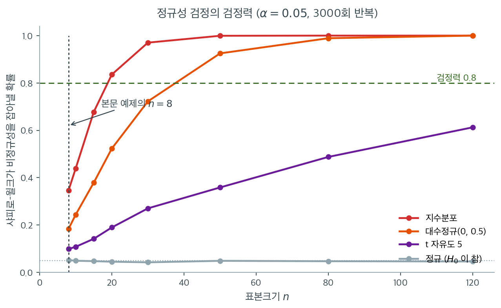

# F 검정의 정규성 민감도와 로버스트 대안

## 개요

분산 동일성에 대한 F 검정은 두 모집단이 모두 정규분포를 따른다고 가정한다. 이 가정이 위배되면 검정이 오도하는 결과를 낼 수 있다. 이 페이지는 Shapiro-Wilk 검정으로 정규성 가정을 확인하는 방법을 시연하고, 그 대신 쓸 로버스트 대안(Levene 검정, Brown-Forsythe 검정, Fligner-Killeen 검정)을 제시한다. 셋이 같지 않다는 점을 미리 적어 둔다 — **평균을 중심으로 쓰는 Levene은 치우침에서 제1종 오류율을 지키지 못한다**(15.5절 [로버스트 방법의 비교](../robust_tests/comparison.md)의 크기 표에서 지수 $0.192$, 로그정규 $0.254$). 중심을 중앙값으로 바꾼 Brown-Forsythe가 그 표의 모든 줄에서 통제된다.

---

## 1. 정규성 확인

F 검정을 적용하기 전에 정규성 가정이 성립하는지 평가하는 것이 신중하다. Shapiro-Wilk 검정은 정규성에 대해 가장 강력한 검정 가운데 하나이다.

$$
H_0: \text{자료가 정규분포에서 온다} \quad \text{대} \quad H_1: \text{자료가 정규가 아니다}.
$$

$p$값이 작으면 비정규성을 시사하며, 그 경우 F 검정의 로버스트 대안을 써야 한다.

---

## 2. 로버스트 대안

| 검정 | 구현 | 핵심 성질 |
|---|---|---|
| Levene (평균) | `levene(x1, x2, center='mean')` | 평균으로부터의 절대편차에 분산분석 |
| Brown-Forsythe | `levene(x1, x2, center='median')` | 중앙값으로부터의 절대편차에 분산분석 |
| Fligner-Killeen | `fligner(x1, x2)` | 비모수, 절대편차의 순위에 기반 |

Brown-Forsythe 검정은 집단평균을 집단중앙값으로 바꾸어 치우침에 더 로버스트하다. Fligner-Killeen 검정은 순위 기반 접근을 써서 대칭인 두꺼운 꼬리에 가장 로버스트하다.

<div class="storybox" markdown>

**그림으로 보는 통계학 1.** 표에 넷째가 있었고, 그것은 다른 것을 하려고 만들어졌다

위 표의 셋은 모두 같은 발상이다 — 중심에서의 **절대편차**를 만들어 산포의 대리값으로
쓰고, 그 대리값들의 평균을 견준다. 그런데 넷째 길이 있다. $1979$ 년에 **R. G. 오브라이언**이 낸 변환이다.

$$
u_{as} = \frac{N_a(N_a - 1.5)\,(Y_{as} - M_a)^2 - 0.5\,SS_a}{(N_a - 1)(N_a - 2)}
$$

$M_a$ 는 집단 $a$ 의 평균, $SS_a$ 는 그 집단의 편차제곱합이다. 복잡해 보이는 분모와
$1.5$ 라는 수가 무엇을 위한 것인지는 변환값의 평균을 내 보면 드러난다.

```python
import numpy as np

rng = np.random.default_rng(15)

# 한글은 고정폭에서 두 칸을 차지하므로 f-string 자리맞춤이 보이는 열과 어긋난다
print("  집단당 n   참 σ      u 의 집단 평균            그 집단의 S²")
for n, sd in ((8, 1.0), (25, 2.0), (40, 0.5)):
    y = rng.normal(0, sd, n)
    M, SS = y.mean(), ((y - y.mean()) ** 2).sum()
    u = (n * (n - 1.5) * (y - M) ** 2 - 0.5 * SS) / ((n - 1) * (n - 2))
    print(f"  {n:7d} {sd:7.1f}   {u.mean():20.16f}   {y.var(ddof=1):20.16f}")
    assert np.isclose(u.mean(), y.var(ddof=1), rtol=0, atol=1e-13)
print("\n  세 줄 모두 1e-13 안에서 같다 (assert 통과)")
```

출력:

```text
  집단당 n   참 σ      u 의 집단 평균            그 집단의 S²
        8     1.0     1.0120243258465367     1.0120243258465365
       25     2.0     4.3200439820783760     4.3200439820783751
       40     0.5     0.2436094981849254     0.2436094981849254

  세 줄 모두 1e-13 안에서 같다 (assert 통과)
```

**끝자리 둘만 떨어져 있고 그것은 부동소수점 반올림이다.** 절대편차가 산포의 *대리값*인 것과
달리, $u$ 의 집단 평균은 그 집단의 **표본분산 그 자체**다. 손으로 한 줄이면 보인다 —
$\sum_s (Y_{as} - M_a)^2 = SS_a$ 이므로

$$
\frac{1}{N_a}\sum_s u_{as}
= \frac{N_a(N_a-1.5)\,SS_a - 0.5\,N_a\,SS_a}{N_a(N_a-1)(N_a-2)}
= \frac{SS_a\,(N_a-2)}{(N_a-1)(N_a-2)}
= \frac{SS_a}{N_a-1}
= S_a^2
$$

이고, $-1.5$ 와 $-0.5$ 는 분자의 $N_a-2$ 가 분모의 $N_a-2$ 와 약분되도록 맞춘 수다.

그 차이가 무엇을 가능하게 하는가. 오브라이언이 이 변환을 만든 까닭은 「분산이 같은가」를
묻는 **옴니버스 검정**이 아니었다 — 분산을 평균 자리에 정확히 놓으면 분산분석의 **모든
도구**가 분산에 대해 그대로 돌아간다. 대조분석, 다중비교, 요인설계의 주효과와 교호작용까지.
「세 처치의 분산이 다른가」가 아니라 「처치 A 와 B 의 분산 차이가 C 와 D 의 차이와
같은가」를 물을 수 있게 된다. $1981$ 년 논문의 제목이 그것을 말한다 — 「실험설계에서
분산 효과에 대한 간단한 검정」이다.

그러면 이 책의 표는 왜 셋으로 끝나는가. 이 쪽이 묻는 것이 옴니버스 하나이기 때문이다.
그 물음에는 Brown-Forsythe 가 충분하고, 비교 연구들도 옴니버스 검정력에서는 그쪽을
앞세운다. 손잡이가 더 달린 도구는 그 손잡이를 쓸 일이 있을 때 값이 생긴다.

_확인한 곳 — 오브라이언의 두 논문이 「A general ANOVA method for robust test of
additive models for variance」(『Journal of the American Statistical Association』
$74$ 권 $877$–$880$ 쪽, $1979$)와 「A simple test for variance effects in experimental
designs」(『Psychological Bulletin』 $89$ 권 $570$–$574$ 쪽, $1981$)라는 것, 위 변환식의
꼴, 이 변환이 르빈의 절대편차 방식을 대신하며 대조분석·다중비교 같은 더 정교한 절차를
쓰기 위해 제안되었다는 것, 그리고 비교 연구에서 옴니버스 분산차 탐지력은
Brown-Forsythe 가 앞선다고 보고된 것을 확인했다. 표의 수는 모두 직접 계산한 값이다_

</div>

<div class="exbox" markdown>

**보기 1.** <span class="diff easy" title="쉬움"></span> 정규성 확인 뒤 로버스트 대안으로. 집단당 8 개짜리 두 표본에 샤피로–윌크를 돌린 뒤 위 표의 세 검정을 적용한다.

**(1)** `levene(x1, x2)` 를 **아무 인자 없이** 부르면 위 표의 어느 줄이 돌아가는가. 함수 서명에서 확인하고, 셋 가운데 어느 둘이 **똑같은 수**를 주어야 하는지 밝히시오.

**(2)** F 검정까지 넣어 네 $p$ 값을 견주시오. 샤피로–윌크의 $p = 0.86$, $0.93$ 을 "정규성이 확인되었다"로 읽으면 안 되는 까닭을 $n = 8$ 에서의 **검정력 수치**로 밝히시오.

</div>

??? success "풀이"

    **(1) 기본값은 `'median'` 이다.** `scipy.stats.levene` 의 `center` 기본값이 `'median'` 이므로 아무 인자도 주지 않은 `levene(x1, x2)` 는 표의 둘째 줄, 곧 **Brown-Forsythe 검정**이다. 원래의 Levene(1960) 검정을 돌리려면 `center='mean'` 을 **명시해야** 한다.

    따라서 `levene(x1, x2)` 와 `levene(x1, x2, center='median')` 은 같은 계산을 하므로 통계량과 $p$ 값이 소수점 끝자리까지 같아야 한다. 이 책에서 "Levene 검정"이라 적을 때도 실제로 돌아가는 것은 중앙값 기준임을 기억해 두라.

    중심이 무엇이든 집단이 둘뿐이면 변환값 $Z_{ij} = \lvert y_{ij} - c_i \rvert$ 에 대한 일원분산분석이므로 통계량이 $F_{1, N-2} = F_{1, 14}$ 를 참조한다. 중심의 선택이 참조분포를 바꾸지는 않는다. **바뀌는 것은 $Z$ 의 값뿐**이고, 그래서 치우친 자료에서 두 선택이 크게 갈린다(15.5절 [Levene 검정 정규 대 치우친 분포 모의실험](../robust_tests/levene_simulation.md) 연습문제 1 에서 평균 중심 $0.247$ 대 중앙값 중심 $0.037$).

    **(2) 돌려서 견준다.**

    ```python
    import inspect
    import numpy as np
    from scipy.stats import levene, fligner, shapiro, f

    print("levene 의 center 기본값 =", inspect.signature(levene).parameters["center"].default)

    x1 = np.array([12, 15, 14, 10, 13, 14, 12, 11], dtype=float)
    x2 = np.array([22, 25, 20, 18, 24, 23, 19, 21], dtype=float)

    # 1단계: F 검정은 정규성에 매우 민감하므로 먼저 그것부터 확인한다.
    # 다만 n=8 로 작아 검정력이 낮다 — 기각되지 않았다고 정규라는 뜻은 아니다.
    W1, p1 = shapiro(x1)
    W2, p2 = shapiro(x2)
    print(f"Shapiro-Wilk x1: W={W1:.4f}, p={p1:.4f}")
    print(f"Shapiro-Wilk x2: W={W2:.4f}, p={p2:.4f}")

    # 2단계: F 검정과 로버스트 대안 셋을 나란히 둔다. 평균 중심 Levene,
    # 중앙값 중심 Brown-Forsythe, 순위를 쓰는 Fligner-Killeen 순으로
    # 더 로버스트해진다.
    F = x1.var(ddof=1) / x2.var(ddof=1)
    pF_test = 2 * min(f.cdf(F, 7, 7), f.sf(F, 7, 7))
    print(f"F 검정:                           F={F:.4f}, p={pF_test:.6f}")

    Wm, pm = levene(x1, x2, center='mean')
    print(f"Levene (mean-centered):           W={Wm:.4f}, p={pm:.6f}")

    Wmed, pmed = levene(x1, x2, center='median')
    print(f"Brown-Forsythe (median-centered): W={Wmed:.4f}, p={pmed:.6f}")

    Wdef, pdef = levene(x1, x2)
    print(f"levene(x1, x2)  — 인자 없이:      W={Wdef:.4f}, p={pdef:.6f}")

    X2, pFK = fligner(x1, x2)
    print(f"Fligner-Killeen:                  X2={X2:.4f}, p={pFK:.6f}")

    # n=8 에서 샤피로-윌크가 비정규를 잡아내는 비율
    rng = np.random.default_rng(5)
    B, n, alpha = 20_000, 8, 0.05
    print(f"\n샤피로-윌크의 검정력 (n={n}, 반복 {B:,}회, alpha={alpha})")
    for name, draw in [("정규", lambda: rng.normal(size=n)),
                       ("t_5", lambda: rng.standard_t(5, size=n)),
                       ("지수", lambda: rng.exponential(size=n))]:
        rej = sum(shapiro(draw()).pvalue < alpha for _ in range(B))
        print(f"  {name} 모집단: {rej / B:.3f}")
    ```

    출력:

    ```text
    levene 의 center 기본값 = median
    Shapiro-Wilk x1: W=0.9657, p=0.8619
    Shapiro-Wilk x2: W=0.9749, p=0.9332
    F 검정:                           F=0.4732, p=0.344772
    Levene (mean-centered):           W=1.4831, p=0.243425
    Brown-Forsythe (median-centered): W=1.4706, p=0.245320
    levene(x1, x2)  — 인자 없이:      W=1.4706, p=0.245320
    Fligner-Killeen:                  X2=1.6063, p=0.205015

    샤피로-윌크의 검정력 (n=8, 반복 20,000회, alpha=0.05)
      정규 모집단: 0.052
      t_5 모집단: 0.094
      지수 모집단: 0.331
    ```

    **(1)의 예측대로다.** 서명이 `median` 을 돌려주고, `levene(x1, x2)` 가 `center='median'` 과 똑같이 $W = 1.4706$, $p = 0.245320$ 을 준다. 인자를 명시하지 않은 호출이 Brown-Forsythe 였다는 것이 이 한 줄로 확인된다.

    **네 $p$ 값이 모두 $0.2$ 와 $0.35$ 사이다.** $0.3448$(F), $0.2434$(Levene), $0.2453$(Brown-Forsythe), $0.2050$(Fligner-Killeen). 어느 것으로도 기각하지 못한다. 눈여겨볼 것은 **로버스트 검정들이 F 검정보다 오히려 작은 $p$ 를 주었다**는 점이다. 로버스트한 절차가 언제나 더 보수적이라는 생각은 틀렸다. 여기서는 세 로버스트 검정이 서로 $0.04$ 안에서 모여 있고 F 검정 하나가 떨어져 있다.

    **샤피로–윌크의 $p$ 가 크다는 것은 아무 뜻도 아니다.** $n = 8$ 에서 재어 보니 **정규 모집단에서 $0.052$, $t_5$ 에서 $0.094$, 지수에서 $0.331$** 이다. 정규일 때가 $0.052$ 이니 $t_5$ 의 $0.094$ 는 명목수준의 **두 배도 안 된다.** 이 표본크기로는 정규와 $t_5$ 를 사실상 구별하지 못한다는 뜻이다. 가장 극단적으로 치우친 지수조차 열 번에 세 번만 잡는다. (본문 그림이 읽은 $0.346$ 과 가까운 자리이며, 모의실험 설정이 달라 셋째 자리는 어긋난다.)

    그러므로 $p = 0.8619$, $p = 0.9332$ 는 "정규가 맞다"가 아니라 **"이 자료로는 어떤 이탈도 탐지할 수 없다"** 로 읽어야 한다. 증거의 부재를 부재의 증거로 바꿔치기하지 않으려면 그렇다.

    그리고 하필 **샤피로–윌크가 가장 못 잡는 이탈이 꼬리의 두께**인데, 15.3절이 보인 대로 F 검정을 망가뜨리는 주범이 바로 그 꼬리의 두께다. 정규성 검정이 통과시켰다는 사실은 F 검정을 쓸 면허가 되지 못한다.

---

## 3. 해석

- Shapiro-Wilk $p$값이 크면(예: $> 0.05$) 정규성 가정이 그럴듯하고 F 검정을 쓸 수 있다.
- 어느 한 표본이라도 정규성이 기각되면 F 검정을 신뢰해서는 안 된다. Levene, Brown-Forsythe, Fligner-Killeen을 대신 쓰라.
- 위 보기에서는 로버스트 검정들이 모두 큰 $p$값을 내므로 두 집단의 분산에 유의한 차이가 없다고 본다.
- 실무에서 많은 분석가는 F 검정을 아예 건너뛰고 Levene이나 Brown-Forsythe를 기본값으로 쓴다. 정규성 아래에서도 타당하며 검정력 손실이 크지 않기 때문이다.

!!! warning "이 절차 자체가 두 단계 문제를 안고 있다"
    "Shapiro-Wilk로 정규성을 확인한 뒤 검정을 고른다"는 흐름은 15.7절 [분산분석 사전검정](../applications/anova_pretest.md)에서 논한 두 단계 절차와 같은 구조적 문제를 갖는다.

    특히 $n = 8$인 이 보기에서 Shapiro-Wilk의 검정력은 사실상 없다. $p = 0.86$과 $p = 0.93$은 "정규성이 확인되었다"가 아니라 "이 자료로는 어떤 이탈도 탐지할 수 없다"는 뜻이다.

    본문 마지막 항목의 권고("아예 로버스트 검정을 기본값으로")가 실제로 가장 나은 대응이다.

"$n = 8$에서는 검정력이 사실상 없다"는 말이 과장이 아님을 숫자로 확인하자. 세 가지 **명백한 비정규** 모집단에서 표본을 뽑아 샤피로–윌크가 $\alpha = 0.05$에서 정규성을 기각하는 비율을 표본크기별로 3000번씩 추정했다.



$n = 8$의 세로 점선 위를 보라. 가장 극단적으로 치우친 지수분포조차 탐지 확률이 $0.346$이다. **열 번 중 예닐곱 번은 그냥 통과시킨다.** 대수정규는 $0.183$, $t_5$는 $0.099$로 거의 동전던지기만도 못하다. $t_5$의 $0.099$는 유의수준 $0.05$의 두 배에 불과하다. 곧 이 자료로는 정규분포와 $t_5$를 구별할 능력이 거의 없다.

곡선의 모양도 읽을 만하다. 지수분포는 $n = 20$에서 $0.836$으로 쓸 만해지지만, $t_5$는 $n = 120$에서도 $0.613$에 그친다. **꼬리의 두께는 치우침보다 훨씬 탐지하기 어렵다.** 그런데 15.3절에서 보았듯 F 검정을 망가뜨리는 주범이 바로 그 꼬리의 두께다. 정규성 검정이 가장 못 잡는 이탈이 하필 분산 검정에 가장 해로운 이탈인 것이다.

회색 선은 자료가 실제로 정규일 때다. 표본크기와 무관하게 $0.042 \sim 0.052$로 평평하다. 이것이 정상이다. 문제는 이 선과 $t_5$ 선이 작은 $n$에서 거의 붙어 있다는 점이다. **$p = 0.86$이라는 결과는 "정규다"가 아니라 "모르겠다"이다.** 검정이 통과시켰다는 사실에서 정규성을 결론짓는 것은 증거의 부재를 부재의 증거로 바꿔치기하는 흔한 오류다.

---

## 연습문제

<div class="drillbox" markdown>

**연습문제 1.** <span class="diff easy" title="쉬움"></span> 위 코드의 두 표본에 Shapiro-Wilk 검정을 적용하라. 그 결과에 근거할 때 F 검정을 쓰는 것이 적절한가? 답을 정당화하라.

</div>

??? success "풀이"

    ```python
    import numpy as np
    from scipy.stats import shapiro

    x1 = np.array([12, 15, 14, 10, 13, 14, 12, 11], dtype=float)
    x2 = np.array([22, 25, 20, 18, 24, 23, 19, 21], dtype=float)

    W1, p1 = shapiro(x1)
    W2, p2 = shapiro(x2)
    print(f"x1: W={W1:.4f}, p={p1:.4f}")
    print(f"x2: W={W2:.4f}, p={p2:.4f}")
    ```

    출력:

    ```text
    x1: W=0.9657, p=0.8619
    x2: W=0.9749, p=0.9332
    ```

    두 $p$값이 모두 0.05를 훨씬 넘으므로 어느 표본에서도 정규성을 기각하지 못한다. 형식적으로는 F 검정이 적절해 보인다.

    **그러나 신중해야 한다.** 집단당 관측값이 $n = 8$뿐이므로 Shapiro-Wilk의 비정규성 탐지 검정력이 매우 낮다.

    14장 [Shapiro-Wilk 검정력 모의실험](../../ch14/limitations/sample_size_power.md)에서 보았듯 $n = 20$인 $t_5$ 자료에서도 검정력이 0.2 수준이다. $n = 8$이면 그보다 훨씬 낮아 사실상 어떤 이탈도 탐지하지 못한다.

    **올바른 결론.** "정규성이 확인되었다"가 아니라 **"이 자료로는 정규성 여부를 판정할 수 없다"**이다. 그러므로 정규성에 의존하지 않는 검정을 쓰는 편이 안전하다. 위 출력에서 세 로버스트 검정의 $p$값이 $0.205$~$0.245$로 서로 비슷하므로, 어느 것을 보고해도 결론이 같다. $\square$

<div class="drillbox" markdown>

**연습문제 2.** <span class="diff easy" title="쉬움"></span> $\chi^2_3$ 분포에서 관측값 50개, $\chi^2_5$ 분포에서 50개를 생성하라. F 검정, Levene 검정, Fligner-Killeen 검정을 적용하고 결론을 비교하라.

</div>

??? success "풀이"

    ```python
    import numpy as np
    from scipy.stats import levene, fligner, f as fdist

    rng = np.random.default_rng(42)
    x1 = rng.chisquare(df=3, size=50)
    x2 = rng.chisquare(df=5, size=50)

    print(f"sample variances: {np.var(x1, ddof=1):.3f}, "
          f"{np.var(x2, ddof=1):.3f} (true: 6, 10)")

    # F 검정 — 정규성에 민감하다
    F = np.var(x1, ddof=1) / np.var(x2, ddof=1)
    p_f = 2 * min(fdist(49, 49).cdf(F), fdist(49, 49).sf(F))
    print(f"F-test:          F={F:.3f}, p={p_f:.4g}")

    # Levene / Brown-Forsythe / Fligner-Killeen — 로버스트한 대안들
    W, p_l = levene(x1, x2, center='mean')
    print(f"Levene (mean):   W={W:.3f}, p={p_l:.4g}")
    W, p_bf = levene(x1, x2, center='median')
    print(f"Brown-Forsythe:  W={W:.3f}, p={p_bf:.4g}")
    X2, p_fk = fligner(x1, x2)
    print(f"Fligner-Killeen: X2={X2:.3f}, p={p_fk:.4g}")
    ```

    출력:

    ```text
    sample variances: 2.207, 10.648 (true: 6, 10)
    F-test:          F=0.207, p=1.681e-07
    Levene (mean):   W=17.140, p=7.358e-05
    Brown-Forsythe:  W=12.596, p=0.0005955
    Fligner-Killeen: X2=11.175, p=0.0008291
    ```

    참 분산은 $2 \times 3 = 6$과 $2 \times 5 = 10$이므로($\operatorname{Var}(\chi^2_d) = 2d$) 실제로 다르다. 네 검정 모두 올바르게 기각한다.

    !!! warning "표본분산 2.207은 참값 6에서 크게 벗어나 있다"
        $\chi^2_3$ 표본의 분산이 $2.207$로 참값 $6$의 **37%에 불과하다.** $\chi^2_3$의 초과첨도가 $12/3 = 4$로 크므로 $S^2$의 변동이 정규 대비 세 배이다. $n = 50$에서 $S^2$의 상대 표준오차가 $\sqrt{(4+2)/50} = 34.6\%$이니 $-2$ 표준오차 정도의 편차이다.

        그 결과 관측된 분산비 $0.207$이 참 비율 $0.6$보다 훨씬 극단적이고, F 검정의 $p$값 $1.7 \times 10^{-7}$이 로버스트 검정들의 $10^{-4}$ 수준보다 훨씬 작다.

    **$p$값의 순서에 주목하라.** F($1.7\times10^{-7}$) < Levene($7.4\times10^{-5}$) < Brown-Forsythe($6.0\times10^{-4}$) ≈ Fligner-Killeen($8.3\times10^{-4}$). 로버스트할수록 보수적이다.

    **여기서는 결론이 같지만 F 검정의 $p$값은 신뢰할 수 없다.** $\chi^2_3$은 왜도 $1.63$, 초과첨도 $4$로 강하게 비정규이다. 15.3절 표에 따르면 이런 자료에서 F 검정의 실제 크기는 0.15~0.25이므로, 명목 $p = 1.7\times10^{-7}$이 실제로 나타내는 증거는 훨씬 약하다.

    이탈이 워낙 커서 어느 검정을 쓰든 기각하지만, **보고할 $p$값은 로버스트 검정의 것이어야 한다.** $\square$

<div class="drillbox" markdown>

**연습문제 3.** <span class="diff med" title="중간"></span> Levene 검정의 `center='mean'`과 `center='median'`의 차이를 설명하라. 어떤 조건에서 이 선택이 중요해지는가?

</div>

??? success "풀이"

    `center='mean'`이면 절대편차를 $Z_{ij} = |X_{ij} - \bar{X}_i|$로 계산한다. `center='median'`이면 $Z_{ij} = |X_{ij} - \tilde{X}_i|$이며 $\tilde{X}_i$는 집단중앙값이다.

    이 선택은 주로 자료가 **치우쳐 있을 때** 중요하다. 오른쪽으로 치우친 분포에서는 평균이 오른쪽 꼬리 쪽으로 끌려가므로, 꼬리 쪽 관측값의 $Z_{ij}$가 커지고 평균 아래 관측값의 $Z_{ij}$가 작아진다. 이 비대칭이 $Z_{ij}$의 집단내 변동을 부풀려 검정의 보정에 영향을 준다. 중앙값은 치우침에 저항하므로 중앙값 중심 편차가 더 대칭적이고 $H_0$ 아래에서 검정통계량이 더 잘 보정된다.

    대칭 분포(정규 포함)에서는 평균과 중앙값이 가까워 두 판이 비슷하게 작동한다. 정규성 아래에서는 평균 중심 판의 검정력이 약간 높을 수 있다.

    **수치로 본 차이.** 15.5절 [대수정규에서의 비교](../robust_tests/robust_tests_comparison.md)의 결과를 정리하면($k=3$, $n=30$, $\alpha=0.05$)

    | 자료 | Levene (평균) | Brown-Forsythe (중앙값) |
    |---|---|---|
    | $\mathcal{N}(0,1)$ | 0.058 | 0.039 |
    | $t_5$ (대칭, 두꺼운 꼬리) | 0.054 | 0.042 |
    | Exponential (치우침) | **0.187** | 0.047 |
    | Lognormal(0,1) (극단 치우침) | **0.261** | 0.030 |

    대칭 분포에서는 두 판의 차이가 미미하지만, 치우친 분포에서는 평균 중심 판이 네 배에서 다섯 배까지 부풀려진다.

    **실무 지침.** 자료가 대칭임을 확신할 수 있으면 평균 중심 판이 검정력에서 조금 유리하다. 확신할 수 없으면 중앙값 중심(SciPy의 기본값)을 쓰라. $\square$

<div class="drillbox" markdown>

**연습문제 4.** <span class="diff med" title="중간"></span> Fligner-Killeen 검정은 절대편차에 정규점수 변환을 쓴다. 이 절차를 단계별로 기술하고 왜 로버스트성을 얻는지 설명하라.

</div>

??? success "풀이"

    Fligner-Killeen 절차는

    1. 집단중앙값으로부터의 절대편차를 계산한다. $Z_{ij} = |X_{ij} - \tilde{X}_i|$.
    2. 모든 집단의 $Z_{ij}$ 값에 순위를 매겨 $R_{ij}$를 얻는다.
    3. 순위를 정규점수로 변환한다. $a_{ij} = \Phi^{-1}\!\left(\frac{1 + R_{ij}/(N+1)}{2}\right)$, 여기서 $\Phi^{-1}$은 표준정규 분위수함수이다.
    4. $a_{ij}$ 점수에 분산분석 형태의 검정통계량을 계산한다.

    로버스트성은 순위 변환이 편차의 **크기** 정보를 버리고 상대적 **순서**만 보존하는 데서 나온다. 극단적 이상점은 큰 순위를 받지만 불균형하게 큰 점수를 받지는 않는다. 정규점수 변환이 유계이기 때문이다.

    **정량적으로.** $N$개 편차 중 최대 편차가 받는 점수는

    $$
    a_{\max} = \Phi^{-1}\!\left(\frac{1 + N/(N+1)}{2}\right)
    $$

    이며 $N = 100$이면 $2.58$, $N = 10000$이면 $3.89$이다. **원자료의 편차가 $10^6$이든 $10^{12}$이든 점수는 이 값을 넘지 못한다.**

    반면 Bartlett 검정에서는 이상점 하나가 $S_i^2$을 통해 무제한으로 통계량을 키운다. 유계와 무계의 차이가 로버스트성의 본질이다.

    **다만 만능은 아니다.** 15.5절 [대수정규에서의 비교](../robust_tests/robust_tests_comparison.md)에서 보았듯 극단적으로 치우친 자료($\text{Lognormal}(0,1)$)에서는 Fligner-Killeen의 크기가 $0.114$까지 올라가 Brown-Forsythe의 $0.030$보다 나쁘다. 순위 변환이 **대칭인** 두꺼운 꼬리에는 잘 대응하지만, 편차 자체의 강한 치우침은 완전히 제거하지 못하기 때문이다. $\square$

<div class="drillbox" markdown>

**연습문제 5.** <span class="diff med" title="중간"></span> 분산분석을 수행하기 전에 등분산을 확인해야 하는 분석가를 위한 작업 흐름을 설계하라. 정규성 확인과 검정 선택의 판정 지점을 포함하라. 이 흐름을 Python 함수로 구현하라.

</div>

??? success "풀이"

    ```python
    import numpy as np
    from scipy.stats import shapiro, levene, fligner

    def check_equal_variances(*groups, alpha=0.05):
        """
        Workflow for checking equality of variances.
        Returns a dict with test results and recommendation.
        """
        # 1단계: 집단마다 정규성 확인
        normality_ok = True
        shapiro_results = []
        for g in groups:
            W, p = shapiro(g)
            shapiro_results.append((round(W, 4), round(p, 4)))
            if p < alpha:
                normality_ok = False

        # 2단계: 그에 맞는 검정 고르기
        if normality_ok:
            test_name = "Levene (mean-centered)"
            stat, pval = levene(*groups, center='mean')
        else:
            test_name = "Brown-Forsythe (median-centered)"
            stat, pval = levene(*groups, center='median')

        # 3단계: 확인 삼아 Fligner-Killeen 도 돌려 본다
        fk_stat, fk_p = fligner(*groups)

        return {
            "normality_assumed": normality_ok,
            "shapiro_results": shapiro_results,
            "primary_test": test_name,
            "statistic": round(stat, 4),
            "p_value": pval,
            "fligner_killeen_p": fk_p,
            "equal_variances": pval >= alpha,
        }

    # 사용 예
    rng = np.random.default_rng(0)
    g1 = rng.normal(0, 1, 30)
    g2 = rng.normal(0, 1.5, 30)
    g3 = rng.normal(0, 2, 30)
    result = check_equal_variances(g1, g2, g3)
    for k, v in result.items():
        print(f"{k}: {v}")
    ```

    출력:

    ```text
    normality_assumed: True
    shapiro_results: [(0.9752, 0.6879), (0.9578, 0.2725), (0.9695, 0.5253)]
    primary_test: Levene (mean-centered)
    statistic: 14.4774
    p_value: 3.736985145892101e-06
    fligner_killeen_p: 1.5741483418264177e-05
    equal_variances: False
    ```

    자료를 표준편차 $1, 1.5, 2$로 생성했으므로 등분산이 아니고, 함수가 이를 올바르게 탐지한다($p = 3.7 \times 10^{-6}$). 세 집단 모두 정규성 검정을 통과하여 평균 중심 Levene이 선택되었다. Fligner-Killeen도 $p = 1.6 \times 10^{-5}$로 같은 결론이다.

    !!! warning "이 흐름의 근본적 한계"
        위 함수는 요청받은 대로 구현되었지만, 몇 가지 문제를 안고 있다.

        1. **두 단계 결정.** 정규성 검정 결과로 분산 검정을 고르므로 결합된 절차의 크기가 통제되지 않는다.
        2. **다중 정규성 검정.** 집단이 $k$개면 Shapiro-Wilk를 $k$번 수행한다. $k = 3$, $\alpha = 0.05$이면 정규 자료에서도 적어도 하나가 기각될 확률이 $1 - 0.95^3 = 14\%$이다. 14장에서 논한 다중검정 문제이다.
        3. **`equal_variances` 필드가 오도한다.** $p \geq \alpha$를 "분산이 같다"로 반환하는데, 이는 기각 실패를 증명으로 오독하는 것이다. 특히 검정력이 낮은 작은 표본에서 위험하다.

        **개선안.**

        ```python
        def describe_variances(*groups):
            """판정하지 말고 보고하라.

                정규성 검정 결과에 따라 다음 검정을 자동으로 고르면 최종 오류율이
                명목수준을 넘는다. 그래서 여기서는 여러 검정의 결과를 나란히 내놓기만
                하고, 판단은 사람에게 맡긴다.
                """
            import numpy as np
            from scipy.stats import levene, fligner
            return {
                "n": [len(g) for g in groups],
                "sd": [round(float(np.std(g, ddof=1)), 4) for g in groups],
                "sd_ratio_max_min": round(
                    max(np.std(g, ddof=1) for g in groups) /
                    min(np.std(g, ddof=1) for g in groups), 3),
                "brown_forsythe_p": levene(*groups, center='median')[1],
                "fligner_killeen_p": fligner(*groups)[1],
            }
        ```

        이 판은 (1) 검정을 고르지 않고 Brown-Forsythe를 고정으로 쓰며, (2) 이분법적 판정을 반환하지 않고 집단별 표준편차와 그 비율을 함께 제시하여 독자가 판단하게 한다.

        후속 분석은 이 결과와 무관하게 Welch 분산분석을 쓰면 되므로, 애초에 판정이 필요 없다. $\square$

<div class="drillbox" markdown>

**연습문제 6.** <span class="diff med" title="중간"></span> 보기 1 의 두 표본은 $n_1 = n_2 = 8$ 이고 $s_1 = 1.685$, $s_2 = 2.449$, $F = 0.4732$, $p = 0.3448$ 이었다. 이 표본크기에서 F 검정이 **애초에 볼 수 있는 것**이 무엇인지 재어 보자.

**(1)** $F_{7,7}$ 의 양쪽 $2.5\%$ 임계값을 적고, 양측 $\alpha = 0.05$ 의 F 검정이 기각하려면 표준편차의 비 $s_1/s_2$ 가 어느 범위에 있어야 하는지 구하시오. 관측된 비는 그 범위에서 얼마나 떨어져 있는가.

**(2)** 참 비 $\sigma_1/\sigma_2$ 가 $1.5$, $2$, $3$ 일 때 이 검정의 검정력을 구하시오. $\dfrac{S_1^2/\sigma_1^2}{S_2^2/\sigma_2^2} \sim F_{7,7}$ 을 쓰라.

**(3)** 그 결과에 비추어 §3 의 셋째 항목("위 보기에서는 로버스트 검정들이 모두 큰 $p$값을 내므로 두 집단의 분산에 유의한 차이가 없다고 본다")을 고쳐 쓰시오.

</div>

??? success "풀이"

    **(1) 표준편차가 2.23 배 벌어져야 기각한다.** $F_{7,7}$ 의 임계값은

    $$
    F_{0.025,\,7,7} = 0.2002, \qquad F_{0.975,\,7,7} = 4.9949
    $$

    이고 둘은 서로 역수다($1/4.9949 = 0.2002$). $F = (s_1/s_2)^2$ 이므로 기각역을 비로 옮기면

    $$
    \frac{s_1}{s_2} < \sqrt{0.2002} = 0.4474
    \quad\text{또는}\quad
    \frac{s_1}{s_2} > \sqrt{4.9949} = 2.2349
    $$

    이다. 관측값은 $s_1/s_2 = 1.685/2.449 = 0.6880$ 으로 아래쪽 임계값 $0.4474$ 와 한참 떨어져 있다. 기각하려면 $s_2$ 가 $2.2349 \times 1.685 = 3.766$ 이상이어야 하는데 실제 값은 $2.449$ 다. $F = 0.4732$ 와 임계값 $0.2002$ 사이의 이 거리가 $p = 0.3448$ 의 정체다.

    **(2) 분산이 네 배 달라도 열 번에 네 번만 잡는다.** $\sigma_1/\sigma_2 = r$ 이면 $S_1^2/S_2^2 = r^2 F$, $F \sim F_{7,7}$ 이므로 검정력은

    $$
    P\!\left(F > \frac{4.9949}{r^2}\right) + P\!\left(F < \frac{0.2002}{r^2}\right)
    $$

    이다. 넣어서 계산한다.

    | $r = \sigma_1/\sigma_2$ | $4.9949/r^2$ | 위꼬리 | 아래꼬리 | 검정력 |
    |---:|---:|---:|---:|---:|
    | 1 | 4.9949 | 0.0250 | 0.0250 | 0.0500 |
    | 1.5 | 2.2200 | 0.1573 | 0.0025 | 0.1598 |
    | 2 | 1.2487 | 0.3885 | 0.0004 | 0.3889 |
    | 3 | 0.5550 | 0.7723 | 0.0000 | 0.7724 |

    $r = 1$ 에서 정확히 $0.05$ 가 나오는 것이 검산이다. 표준편차가 두 배(분산이 네 배) 달라도 검정력이 $0.3889$ 뿐이어서 **열 번에 여섯 번은 놓친다.** $n = 20$ 이면 같은 $r = 2$ 에서 검정력이 $0.8375$ 로 올라간다. 곧 $n = 8$ 이라는 표본크기가 문제의 거의 전부다.

    **(3) "차이가 없다"가 아니라 "있어도 못 본다"다.** 이 자료에서 네 검정이 모두 기각하지 못한 것은 분산이 같다는 증거가 아니다. 표준편차가 두 배 달라도 F 검정은 $61\%$ 의 확률로 지금과 똑같이 "유의하지 않다"고 답했을 것이기 때문이다. 셋째 항목은 이렇게 적어야 한다.

    > 위 보기에서는 네 검정 모두 기각하지 못했다. 다만 $n = 8$ 에서는 표준편차가 $2.23$ 배 이상 벌어지지 않으면 기각할 수 없고, 두 배 차이에 대한 검정력도 $0.39$ 에 그친다. 그러므로 이 결과는 "분산이 같다"가 아니라 **"이 자료로는 어지간한 차이도 가릴 수 없다"**로 읽어야 한다.

    같은 일이 연습문제 1 에서 샤피로–윌크에 대해 벌어졌다는 데 주목하라. $n = 8$ 에서는 정규성 검정도, 등분산 검정도 기각하지 못하는데, **두 번의 기각 실패가 모두 증거의 부재일 뿐**이다. 작은 표본에서 "가정이 다 통과했다"는 말은 거의 언제나 "아무것도 재지 못했다"는 말이다.

    덧붙여 §3 의 넷째 항목("정규성 아래에서도 타당하며 검정력 손실이 크지 않기 때문")도 이 표본크기에서는 공허하다. F 검정 자신의 검정력이 $0.39$ 인 자리에서 로버스트 검정의 검정력 손실을 아끼는 것은 의미가 없다. 그 맞바꿈이 실제로 얼마인지는 연습문제 9 에서 잰다. $\square$

<div class="drillbox" markdown>

**연습문제 7.** <span class="diff hard" title="어려움"></span> 본문 그림은 $n = 8$ 에서 샤피로–윌크의 탐지 확률을 $t_5$ 에서 $0.099$, 대수정규에서 $0.183$, 지수에서 $0.346$ 으로, 자료가 참으로 정규일 때의 기각률을 $0.042 \sim 0.052$ 로 읽었다. 아래에서는 정규일 때의 기각률을 $0.05$ 로 둔다.

**(1)** 어떤 자료가 정규이거나 $t_5$ 이고 둘의 사전확률이 반반이라 하자. "샤피로–윌크가 기각하지 않았다"를 관측한 뒤 **비정규의 사후확률**과 정규를 지지하는 베이즈 인자를 구하시오. 대수정규와 지수에 대해서도 같은 계산을 하시오.

**(2)** 통과가 비정규의 사전 승산을 **절반으로** 줄이려면 샤피로–윌크의 검정력이 얼마여야 하는가. 본문 그림에서 지수와 $t_5$ 가 각각 그 수준에 닿는 표본크기는 어디쯤인가.

**(3)** 연습문제 1 처럼 두 표본에 각각 검정을 적용해 둘 다 통과했다면 증거가 두 배로 쌓이는가. $t_5$ 로 답하시오.

</div>

??? success "풀이"

    **(1) 통과는 거의 아무 정보도 주지 않는다.** $A$ 를 "샤피로–윌크가 $\alpha = 0.05$ 에서 기각하지 않았다"로 쓰면

    $$
    P(A \mid \text{정규}) = 1 - 0.05 = 0.95, \qquad
    P(A \mid \text{비정규}) = 1 - (\text{검정력})
    $$

    이다. 사전 승산이 $1 : 1$ 이므로 사후 승산은 그대로 우도비 $\Lambda = P(A \mid \text{비정규}) / P(A \mid \text{정규})$ 다.

    | 대립 모집단 | 검정력 | $P(A \mid \text{비정규})$ | 우도비 $\Lambda$ | 비정규의 사후확률 | 정규 쪽 베이즈 인자 $1/\Lambda$ |
    |:---|---:|---:|---:|---:|---:|
    | $t_5$ | 0.099 | 0.901 | 0.9484 | 0.4868 | 1.054 |
    | 대수정규 | 0.183 | 0.817 | 0.8600 | 0.4624 | 1.163 |
    | 지수 | 0.346 | 0.654 | 0.6884 | 0.4077 | 1.453 |

    사후확률이 $0.5$ 에서 $0.4868$ 로 간다. **$t_5$ 일 가능성이 $50\%$ 에서 $48.7\%$ 로 내려앉은 것이 "정규성이 확인되었다"의 실제 내용이다.** 베이즈 인자 $1.05$ 는 제프리스의 눈금에서 "언급할 가치조차 없는" 칸에 들어간다. 가장 극단적으로 치우친 지수조차 $1.45$ 로, "약한" 증거에 겨우 닿는다.

    **(2) 검정력이 $0.525$ 는 되어야 한다.** 승산을 절반으로 줄인다는 것은 $\Lambda = 0.5$ 이므로

    $$
    1 - (\text{검정력}) = 0.5 \times 0.95 = 0.475
    \quad\Longrightarrow\quad
    \text{검정력} = 0.525 .
    $$

    본문 그림에서 지수는 $n = 8$ 에서 $0.346$, $n = 20$ 에서 $0.836$ 이므로 그 사이에서 $0.525$ 를 지난다. 반면 $t_5$ 는 $n = 120$ 에서도 $0.613$ 이라 그제서야 겨우 넘어선다($\Lambda = 0.387/0.95 = 0.407$). **꼬리가 두꺼운 이탈에 대해서는 세 자리 수의 표본이 되어야 통과를 증거라 부를 수 있다.** 그런데 15.3절 [비정규성에 대한 민감도](sensitivity.md)가 보인 대로 F 검정을 망가뜨리는 주범이 바로 그 꼬리의 두께다.

    **(3) 두 배로 쌓이지만 두 배가 아무것도 아니다.** 두 표본이 독립이므로 우도비가 곱해진다.

    $$
    \Lambda_2 = \left(\frac{0.901}{0.95}\right)^{2} = 0.8995,
    \qquad
    P(\text{비정규} \mid \text{둘 다 통과}) = \frac{0.8995}{1 + 0.8995} = 0.4735 .
    $$

    로그 우도비로 보면 $-0.053$ 이 $-0.106$ 으로 정확히 두 배가 되었지만, 확률로는 $0.4868$ 이 $0.4735$ 로 갔을 뿐이다. 베이즈 인자도 $1.054$ 에서 $1.112$ 로 는 것이 전부다. **같은 증거를 $k$ 개 모아도 하나하나가 영에 가까우면 합도 영에 가깝다.**

    마지막으로 이 계산이 사전검정에 무엇을 뜻하는지 보자. $n = 20$ 으로 올려 보면 연습문제 1 이 인용한 대로 $t_5$ 에 대한 샤피로–윌크의 검정력이 $0.2$ 쯤이고, 15.3절 표에서 F 검정의 실제 크기는 정규에서 $0.053$, $t_5$ 에서 $0.160$ 이다. 반반 사전에서 통과한 표본들만 모으면 비정규 비율이 $0.8/(0.8+0.95) = 0.457$ 이므로, 그 표본에 F 검정을 돌릴 때의 실제 크기는 대략

    $$
    \frac{0.95 \times 0.053 + 0.80 \times 0.160}{0.95 + 0.80} = 0.1019
    $$

    다. **정규성 검정을 통과시킨 뒤에도 명목 $5\%$ 검정이 실제로는 $10\%$ 다.** (통과 여부와 F 통계량이 독립이 아니므로 이는 근사다. 통과한 표본이 더 정규처럼 보이는 쪽으로 선택되니 참값은 $0.10$ 보다 조금 작다.) 15.7절 [분산분석 사전검정](../applications/anova_pretest.md)의 결론과 같은 결이고, 본문 경고상자가 말한 "두 단계 문제"가 수로는 이 모양이다. $\square$

<div class="drillbox" markdown>

**연습문제 8.** <span class="diff hard" title="어려움"></span> 보기 1 의 $x_1$ 에서 둘째 관측값 $15$ 를 $c$ 로 바꾼 자료를 생각한다. 나머지 일곱 개와 $x_2$ 는 그대로다.

**(1)** $x_2$ 의 표본분산이 정확히 $6$ 임을 쓰고, F 검정이 $\alpha = 0.05$ 에서 기각으로 넘어가는 문턱 $c^*$ 를 구하시오.

**(2)** $c = 30$ 에서 F 검정과 세 로버스트 검정의 $p$ 값을 구해 **F 검정만 기각하는 반례**를 완성하시오.

**(3)** $c$ 를 $10^6$ 까지 키울 때 네 $p$ 값이 각각 어디로 가는가. 특히 플리그너–킬린의 $p$ 값이 $c \ge 25$ 에서 **한 글자도 바뀌지 않는** 까닭을 밝히고, 르벤(평균)의 $p$ 값이 끝내 어디에 머무는지 적으시오.

</div>

??? success "풀이"

    ```python
    import numpy as np
    from scipy import stats
    from scipy.stats import levene, fligner
    from scipy.optimize import brentq

    x1 = np.array([12, 15, 14, 10, 13, 14, 12, 11], dtype=float)
    x2 = np.array([22, 25, 20, 18, 24, 23, 19, 21], dtype=float)


    def contaminate(c):
        """x1 의 둘째 관측값 15 를 c 로 바꾼 표본."""
        y = x1.copy()
        y[1] = c
        return y


    # F 검정이 기각으로 넘어가는 c 를 먼저 찾는다. F_{7,7} 의 상위 임계값이
    # 4.9949 이고 x2 의 표본분산이 정확히 6 이므로 임계 분산은 29.97 이다.
    crit = stats.f(7, 7).ppf(0.975)
    c_star = brentq(lambda c: contaminate(c).var(ddof=1) / x2.var(ddof=1) - crit, 16, 100)
    print(f"F_{{7,7}} 상위 임계값 = {crit:.4f},  x2 의 표본분산 = {x2.var(ddof=1):.4f}")
    print(f"F 검정이 기각으로 넘어가는 오염값 c* = {c_star:.4f}\n")

    print(f"{'c':>10} {'s1':>8} {'F':>10} {'p(F)':>10} {'p(Lev)':>8} {'p(BF)':>8} {'p(FK)':>8}")
    for c in (15.0, 25.0, 30.0, 40.0, 100.0, 1e6):
        y = contaminate(c)
        F = y.var(ddof=1) / x2.var(ddof=1)
        pF = 2 * min(stats.f.cdf(F, 7, 7), stats.f.sf(F, 7, 7))
        pL = levene(y, x2, center='mean')[1]
        pB = levene(y, x2, center='median')[1]
        pK = fligner(y, x2)[1]
        print(f"{c:>10.0f} {y.std(ddof=1):>8.3f} {F:>10.2e} {pF:>10.2e} "
              f"{pL:>8.4f} {pB:>8.4f} {pK:>8.4f}")

    # c=30 일 때 중앙값 중심 편차. 중앙값은 오염에 꿈쩍도 하지 않는다.
    y = contaminate(30.0)
    print(f"\n중앙값: x1 원본 {np.median(x1):.1f} -> 오염 후 {np.median(y):.1f},  x2 {np.median(x2):.1f}")
    print("Z1 =", np.abs(y - np.median(y)))
    print("Z2 =", np.abs(x2 - np.median(x2)))
    print("Z1 의 순위 =", stats.rankdata(np.concatenate([np.abs(y - np.median(y)),
                                                      np.abs(x2 - np.median(x2))]))[:8])
    ```

    출력:

    ```text
    F_{7,7} 상위 임계값 = 4.9949,  x2 의 표본분산 = 6.0000
    F 검정이 기각으로 넘어가는 오염값 c* = 27.2660

             c       s1          F       p(F)   p(Lev)    p(BF)    p(FK)
            15    1.685   4.73e-01   3.45e-01   0.2434   0.2453   0.2050
            25    4.704   3.69e+00   1.07e-01   0.5383   0.6819   0.5591
            30    6.414   6.86e+00   2.11e-02   0.3106   0.5600   0.5591
            40    9.896   1.63e+01   1.54e-03   0.1515   0.4642   0.5591
           100   31.043   1.61e+02   6.86e-07   0.0560   0.3700   0.5591
       1000000 353549.047   2.08e+10   2.85e-35   0.0351   0.3343   0.5591

    중앙값: x1 원본 12.5 -> 오염 후 12.5,  x2 21.5
    Z1 = [ 0.5 17.5  1.5  2.5  0.5  1.5  0.5  1.5]
    Z2 = [0.5 3.5 1.5 3.5 2.5 1.5 2.5 0.5]
    Z1 의 순위 = [ 3. 16.  8. 12.  3.  8.  3.  8.]
    ```

    **(1) 문턱은 $c^* = 27.27$ 이다.** $x_2 = (22,25,20,18,24,23,19,21)$ 의 평균이 $21.5$ 이고 편차가 $(0.5, 3.5, -1.5, -3.5, 2.5, 1.5, -2.5, -0.5)$ 이므로 제곱합이 $42$, 표본분산이 $42/7 = 6$ 으로 **정확히** 나온다. 따라서 F 검정이 기각하려면

    $$
    s_1^2 > 4.9949 \times 6 = 29.97
    $$

    이어야 하고, 이것을 $c$ 에 대해 풀면 $c^* = 27.2660$ 이다. 연습문제 6 에서 본 "표준편차가 $2.23$ 배 벌어져야 한다"는 조건을 한 점을 움직여서 만족시키는 것이며, 오염된 점 하나로 그것이 가능하다.

    **(2) $c = 30$ 이 반례다.** 네 $p$ 값이

    $$
    p_F = 0.0211, \quad p_{\text{Lev}} = 0.3106, \quad p_{\text{BF}} = 0.5600, \quad p_{\text{FK}} = 0.5591
    $$

    이다. F 검정은 $\alpha = 0.05$ 에서 기각하고 **세 로버스트 검정은 $0.3$ 아래로도 내려가지 않는다.** 자료를 보면 $x_1$ 의 여덟 값 가운데 일곱이 $10$–$14$ 에 모여 있고 하나만 $30$ 이다. 분산이 커진 것이 아니라 **점 하나가 멀리 있는 것**인데, $s_1^2 = 41.1$ 은 그 둘을 구별하지 못한다. 중앙값은 오염 전후로 $12.5$ 에서 꿈쩍도 하지 않고(출력의 마지막 묶음), 중앙값 중심 편차 $Z_1$ 에서도 큰 값은 $17.5$ 하나뿐이어서 집단내 변동만 키운다. 르벤 통계량의 분모가 커지므로 $p$ 값이 오히려 **올라간다**($0.2453 \to 0.5600$).

    **(3) F 만 홀로 영으로 간다.** $c$ 를 키우면

    - $p_F$ 는 $0.345 \to 0.0211 \to 2.85 \times 10^{-35}$ 로 **끝없이 작아진다.** $s_1^2 \sim c^2/8$ 이므로 $\ln F \sim 2\ln c$ 로 무한히 커진다. 한 점이 $p$ 값을 어디로든 데려갈 수 있다.
    - $p_{\text{FK}}$ 는 $c \ge 25$ 에서 $0.5591$ 에 **고정된다.** 플리그너–킬린은 합동 편차의 **순위**만 쓰는데, 중앙값이 $12.5$ 로 고정이고 오염된 점의 편차 $\lvert c - 12.5 \rvert$ 가 나머지 $15$ 개 편차의 최댓값 $3.5$ 를 넘는 순간부터 순위 벡터가 $(3, 16, 8, 12, 3, 8, 3, 8)$ 로 **얼어붙기** 때문이다. 순위가 같으면 정규점수도 같고 통계량도 글자 그대로 같다.
    - $p_{\text{BF}}$ 는 $0.3343$ 으로, $p_{\text{Lev}}$ 는 $0.0351$ 로 수렴한다($c = 10^9$, $10^{12}$ 에서도 같은 값이다). 르벤(평균)은 평균이 오염에 끌려가므로 $p$ 값이 $c$ 와 함께 계속 줄어 $c = 100$ 의 $0.0560$ 과 $0.05$ 사이를 지나 결국 **기각 쪽에 선다.** 다만 아무리 밀어도 $0.0351$ 아래로는 내려가지 않으므로, F 처럼 $p$ 를 영으로 데려가지는 못한다. 곧 평균 중심 르벤은 **유계이지만 명목수준을 지켜 주지는 않는다.**

    눈여겨볼 것이 하나 더 있다. 플리그너–킬린의 $p$ 값이 오염 전 $0.2050$ 에서 오염 후 $0.5591$ 로 **올라갔다.** 오염된 점이 $x_1$ 쪽에 큰 순위를 하나 보태 두 집단의 평균 점수를 가깝게 만들었기 때문이다. 로버스트 검정은 이상점이 만드는 거짓 양성을 막아 주지만, 같은 이상점이 **참인 차이를 가리는** 것도 막아 주지는 못한다.

    이것이 연습문제 4 에서 본 유계성의 실제 모습이다. F·바틀렛의 통계량은 한 점에 무계로 반응하고, 플리그너–킬린은 유계일 뿐 아니라 어느 지점부터는 **아예 반응하지 않는다.** 그 성질의 양면을 연습문제 10 에서 더 본다. $\square$

<div class="drillbox" markdown>

**연습문제 9.** <span class="diff hard" title="어려움"></span> §3 의 넷째 항목은 로버스트 검정이 "정규성 아래에서도 타당하며 검정력 손실이 크지 않다"고 했다. 그 맞바꿈을 수로 재자. $n_1 = n_2 = 20$, $\alpha = 0.05$, 반복 $20{,}000$ 회로 한다.

**(1)** 정규와 지수 모집단 각각에서 $\sigma_1 : \sigma_2 = 1:1$ (크기)과 $1:2$ (검정력)의 네 설정에 대해 F 검정, 르벤(평균), 브라운–포사이드(중앙값)의 기각률을 재시오. 연습문제 3 의 표($k=3$, $n=30$)와 15.3절 표(F, $n=20$)가 재현되는지 확인하시오.

**(2)** 정규자료에서 브라운–포사이드가 잃은 검정력을 **표본크기로 환산**하시오. 곧 $n = 20$ 의 F 검정과 같은 검정력을 내려면 브라운–포사이드는 몇 개가 필요한가.

**(3)** 지수자료의 $1:2$ 줄에서 F 의 기각률이 브라운–포사이드보다 높다. 이것을 "지수자료에서는 F 가 더 강력하다"로 읽어도 되는가. 두 검정의 크기를 $0.05$ 로 맞춘 뒤 다시 재어 답하시오.

</div>

??? success "풀이"

    ```python
    import numpy as np
    from scipy import stats
    from scipy.stats import levene


    def levene_p(x1, x2, center):
        """두 집단 Levene 검정의 p 값을 행 단위로 한꺼번에 계산한다.

        Z_ij = |x_ij - c_i| 에 대한 일원분산분석이고 집단이 둘이므로
        통계량은 F(1, N-2) 를 참조한다.
        """
        z1 = np.abs(x1 - center(x1, axis=1, keepdims=True))
        z2 = np.abs(x2 - center(x2, axis=1, keepdims=True))
        n = x1.shape[1]
        N = 2 * n
        m1, m2 = z1.mean(axis=1), z2.mean(axis=1)
        m = (m1 + m2) / 2
        between = n * (m1 - m) ** 2 + n * (m2 - m) ** 2
        within = (((z1 - m1[:, None]) ** 2).sum(axis=1)
                  + ((z2 - m2[:, None]) ** 2).sum(axis=1))
        return stats.f.sf(between / (within / (N - 2)), 1, N - 2)


    # 벡터판이 scipy 와 같은 수를 주는지 먼저 확인한다.
    chk = np.random.default_rng(0)
    a, b = chk.normal(size=(2, 20)), chk.normal(size=(2, 20))
    print("벡터판 대 scipy (center='median'):",
          np.allclose(levene_p(a, b, np.median),
                      [levene(a[i], b[i], center='median')[1] for i in range(2)]))

    rng = np.random.default_rng(15)
    B, n, alpha = 20_000, 20, 0.05
    lo, hi = stats.f(n - 1, n - 1).ppf([alpha / 2, 1 - alpha / 2])


    def fstat(x1, x2):
        return x1.var(axis=1, ddof=1) / x2.var(axis=1, ddof=1)


    scenarios = [
        ("정규 sd 1:1 (크기)", lambda m: (rng.normal(0, 1, (B, m)), rng.normal(0, 1, (B, m)))),
        ("지수 sd 1:1 (크기)", lambda m: (rng.exponential(1, (B, m)), rng.exponential(1, (B, m)))),
        ("정규 sd 1:2 (검정력)", lambda m: (rng.normal(0, 1, (B, m)), rng.normal(0, 2, (B, m)))),
        ("지수 sd 1:2 (검정력)", lambda m: (rng.exponential(1, (B, m)), rng.exponential(2, (B, m)))),
    ]

    print(f"\n(1) n1 = n2 = {n}, 반복 {B:,}회, alpha = {alpha}")
    print(f"{'설정':<22}{'F':>8}{'Levene':>9}{'BF':>9}")
    for name, draw in scenarios:
        x1, x2 = draw(n)
        F = fstat(x1, x2)
        print(f"{name:<22}{np.mean((F < lo) | (F > hi)):>8.4f}"
              f"{np.mean(levene_p(x1, x2, np.mean) < alpha):>9.4f}"
              f"{np.mean(levene_p(x1, x2, np.median) < alpha):>9.4f}")

    print("\n(2) BF 가 정규 sd 1:2 에서 F(n=20) 의 검정력 0.8390 에 닿는 표본크기")
    for m in (24, 26, 28):
        x1 = rng.normal(0, 1, (B, m))
        x2 = rng.normal(0, 2, (B, m))
        print(f"  n = {m}: BF 검정력 = {np.mean(levene_p(x1, x2, np.median) < alpha):.4f}")

    # (3) 지수자료에서는 두 검정의 크기가 다르므로 검정력을 그냥 견줄 수 없다.
    # 귀무분포를 모의실험으로 구해 임계값을 크기 0.05 에 맞춘 뒤 다시 센다.
    x1, x2 = rng.exponential(1, (B, n)), rng.exponential(1, (B, n))
    qF = np.quantile(fstat(x1, x2), [0.025, 0.975])
    qB = np.quantile(levene_p(x1, x2, np.median), alpha)
    x1, x2 = rng.exponential(1, (B, n)), rng.exponential(2, (B, n))
    F = fstat(x1, x2)
    print("\n(3) 지수자료에서 크기를 0.05 로 맞춘 뒤의 검정력")
    print(f"  F  : 임계값 {lo:.4f}, {hi:.4f} -> {qF[0]:.4f}, {qF[1]:.4f}"
          f"   검정력 0.7156 -> {np.mean((F < qF[0]) | (F > qF[1])):.4f}")
    print(f"  BF : 임계 p 값 {alpha:.4f} -> {qB:.4f}"
          f"   검정력 0.4033 -> {np.mean(levene_p(x1, x2, np.median) < qB):.4f}")
    ```

    출력:

    ```text
    벡터판 대 scipy (center='median'): True

    (1) n1 = n2 = 20, 반복 20,000회, alpha = 0.05
    설정                           F   Levene       BF
    정규 sd 1:1 (크기)          0.0503   0.0554   0.0394
    지수 sd 1:1 (크기)          0.2652   0.1451   0.0483
    정규 sd 1:2 (검정력)         0.8390   0.7601   0.7106
    지수 sd 1:2 (검정력)         0.7156   0.6070   0.4033

    (2) BF 가 정규 sd 1:2 에서 F(n=20) 의 검정력 0.8390 에 닿는 표본크기
      n = 24: BF 검정력 = 0.8041
      n = 26: BF 검정력 = 0.8354
      n = 28: BF 검정력 = 0.8769

    (3) 지수자료에서 크기를 0.05 로 맞춘 뒤의 검정력
      F  : 임계값 0.3958, 2.5265 -> 0.1909, 5.0944   검정력 0.7156 -> 0.3684
      BF : 임계 p 값 0.0500 -> 0.0520   검정력 0.4033 -> 0.4007
    ```

    **(1) 두 표가 모두 재현된다.** 정규·등분산에서 F 가 $0.0503$, 르벤이 $0.0554$, 브라운–포사이드가 $0.0394$ 다. 연습문제 3 의 표가 $k=3$, $n=30$ 에서 읽은 $0.058$ 과 $0.039$ 와 거의 같다. 집단수와 표본크기를 바꾸어도 **브라운–포사이드가 정규자료에서 조금 보수적**이라는 성질이 그대로 나타난다.

    지수·등분산에서는 F 가 $0.2652$ 다. 15.3절 표의 $0.267$ 이 재현된 것이며, 르벤은 $0.1451$ 로 절반쯤 줄고 브라운–포사이드는 $0.0483$ 으로 명목값을 지킨다. **중심을 평균에서 중앙값으로 바꾸는 한 줄의 수정이 오류율을 $0.145$ 에서 $0.048$ 로 내린다.**

    **(2) 로버스트성의 값은 표본 $30\%$ 다.** 정규·$1:2$ 에서 F 가 $0.8390$(연습문제 6 에서 계산한 이론값 $0.8375$ 와 일치한다), 르벤이 $0.7601$, 브라운–포사이드가 $0.7106$ 이다. 브라운–포사이드가 그 $0.8390$ 에 닿는 표본크기를 찾으면

    $$
    n = 24 \to 0.8041, \qquad n = 26 \to 0.8354, \qquad n = 28 \to 0.8769
    $$

    이므로 $n = 26$ 이다. 곧 **정규자료에서 브라운–포사이드를 쓰는 값은 표본을 $20$ 개에서 $26$ 개로, $30\%$ 더 쓰는 것**이다.

    반대쪽 저울에는 무엇이 놓이는가. 자료가 지수인데 F 를 썼다면 크기가 $0.0503$ 에서 $0.2652$ 로 **다섯 배**가 된다. 표본 $30\%$ 와 오류율 다섯 배를 맞바꾸는 것이므로 선택은 분명하다. 게다가 표본을 더 쓰는 쪽은 **내가 고를 수 있는 손실**이고, 오류율이 다섯 배가 되는 쪽은 **그런 일이 일어났는지조차 알 수 없는 손실**이다.

    **(3) 아니다. 크기가 다르면 검정력을 견줄 수 없다.** 지수·$1:2$ 에서 F 의 $0.7156$ 은 브라운–포사이드의 $0.4033$ 보다 높지만, F 는 등분산일 때도 $0.2652$ 를 기각하는 검정이다. $0.7156$ 가운데 상당 부분이 분산 차이와 무관한 몫이다.

    공정하게 견주려면 **크기를 맞춰야 한다.** 지수·등분산에서 모의실험으로 구한 $F$ 의 실제 $2.5\%$·$97.5\%$ 분위수는 $0.1909$ 와 $5.0944$ 로, 정규이론이 쓰는 $0.3958$·$2.5265$ 보다 훨씬 넓다. 이 임계값으로 다시 재면

    $$
    \text{F: } 0.7156 \longrightarrow 0.3684, \qquad
    \text{BF: } 0.4033 \longrightarrow 0.4007
    $$

    이 된다(브라운–포사이드는 이미 보정이 되어 있어 임계 $p$ 값이 $0.0500$ 에서 $0.0520$ 으로 거의 움직이지 않는다). **크기를 맞추면 순서가 뒤집혀 브라운–포사이드가 F 보다 강력하다.** F 검정이 지수자료에서 보여 준 "높은 검정력"은 전부 크기가 부풀려진 몫이었던 것이다.

    이것이 로버스트 대안을 기본값으로 쓰라는 §3 의 권고를 가장 강하게 지지하는 수치다. 비정규자료에서 F 검정은 더 강력한 것이 아니라 **더 자주 기각할 뿐**이다. $\square$

<div class="drillbox" markdown>

**연습문제 10.** <span class="diff hard" title="어려움"></span> 연습문제 4 는 플리그너–킬린에서 가장 큰 편차가 받는 점수가

$$
a_{\max} = \Phi^{-1}\!\left(\frac{1 + N/(N+1)}{2}\right)
$$

이고 $N = 100$ 에서 $2.58$, $N = 10^4$ 에서 $3.89$ 라 했다. 그리고 "원자료의 편차가 $10^6$ 이든 $10^{12}$ 이든 점수는 이 값을 넘지 못한다"고 적었다.

**(1)** $a_{\max} = \Phi^{-1}\!\left(1 - \dfrac{1}{2(N+1)}\right)$ 임을 보이고, 보기 1 의 $N = 16$ 에서의 값과 가장 작은 점수 $a_{\min}$ 을 구하시오.

**(2)** 그 "넘지 못한다"는 말은 무엇을 고정했을 때의 이야기인가. $1 - \Phi(a) \approx \phi(a)/a$ 를 써서 $N \to \infty$ 에서 $a_{\max}$ 의 증가 속도를 구하고, $a_{\max}$ 가 $4$ 와 $5$ 를 넘는 $N$ 을 적으시오. $N = 16$ 의 상한을 두 배로 만들려면 $N$ 이 얼마여야 하는가.

**(3)** 연습문제 8 에서 플리그너–킬린의 $p$ 값이 $c$ 에 전혀 반응하지 않았다. (1)–(2) 를 써서 그것이 로버스트성과 둔감함의 **같은** 성질임을 설명하시오.

</div>

??? success "풀이"

    **(1) 꼴을 정리한다.** 가장 큰 편차의 순위는 $R = N$ 이므로

    $$
    \frac{1 + N/(N+1)}{2} = \frac{(N+1) + N}{2(N+1)} = \frac{2N+1}{2N+2} = 1 - \frac{1}{2(N+1)}
    $$

    이고 따라서 $a_{\max} = \Phi^{-1}\!\left(1 - \frac{1}{2(N+1)}\right)$ 이다. 검산하면 $N = 100$ 에서 $\Phi^{-1}(1 - 1/202) = \Phi^{-1}(0.995050) = 2.5793$, $N = 10^4$ 에서 $\Phi^{-1}(0.999950) = 3.8906$ 으로 연습문제 4 의 $2.58$ 과 $3.89$ 가 나온다.

    보기 1 은 집단당 $8$ 개이므로 $N = 16$ 이고

    $$
    a_{\max} = \Phi^{-1}\!\left(1 - \tfrac{1}{34}\right) = \Phi^{-1}(0.970588) = 1.8895,
    \qquad
    a_{\min} = \Phi^{-1}\!\left(\frac{1 + 1/17}{2}\right) = \Phi^{-1}(0.529412) = 0.0738 .
    $$

    **$16$ 개짜리 자료에서 점수는 모두 $[0.0738,\, 1.8895]$ 안에 갇힌다.** 연습문제 8 의 출력에서 순위 벡터가 $(3, 16, 8, 12, 3, 8, 3, 8)$ 이었으니, 오염된 점이 받은 점수는 정확히 이 $1.8895$ 다.

    **(2) 고정된 것은 $N$ 이다.** 상한은 자료의 크기에 대한 것이 아니라 **표본크기에 대한** 것이다. $N$ 을 키우면 $a_{\max}$ 도 커진다. $1 - \Phi(a) \approx \phi(a)/a$ 를 $1/(2(N+1))$ 과 맞추면

    $$
    \frac{e^{-a^2/2}}{a\sqrt{2\pi}} \approx \frac{1}{2(N+1)}
    \quad\Longrightarrow\quad
    a^2 \approx 2\ln(N+1) - \ln(2\pi a^2)
    \quad\Longrightarrow\quad
    a_{\max} \sim \sqrt{2\ln N}
    $$

    이다. 로그의 제곱근이므로 **증가가 지독히 느리다.** 실제 값을 보면

    | $N$ | 16 | 100 | $10^3$ | $10^4$ | $10^6$ | $10^{12}$ |
    |:---|---:|---:|---:|---:|---:|---:|
    | $a_{\max}$ | 1.8895 | 2.5793 | 3.2908 | 3.8906 | 4.8916 | 7.1305 |
    | $\sqrt{2\ln N}$ | 2.3548 | 3.0349 | 3.7169 | 4.2919 | 5.2565 | 7.4338 |

    주항만 쓴 $\sqrt{2\ln N}$ 이 조금 크게 나오는 것은 버린 $-\ln(2\pi a^2)$ 항 때문이고, $N$ 이 커질수록 둘이 가까워진다. 경계를 넘는 지점은

    $$
    a_{\max} = 3 \text{ 은 } N \approx 369, \qquad
    a_{\max} = 4 \text{ 는 } N \approx 1.58 \times 10^{4}, \qquad
    a_{\max} = 5 \text{ 는 } N \approx 1.74 \times 10^{6}
    $$

    이고, $N = 16$ 의 상한 $1.8895$ 를 두 배인 $3.7790$ 으로 만들려면 $N \approx 6{,}350$ 이 필요하다. **표본을 $400$ 배 늘려야 상한이 두 배가 된다.** 그러므로 연습문제 4 의 문장은 "$N$ 을 고정하면"이라는 단서를 달아야 정확하지만, 증가가 이토록 느리니 실무 표본크기에서는 사실상 맞는 말이다.

    **(3) 유계성의 두 얼굴.** 플리그너–킬린은 순위만 보므로, $N$ 이 정해지면 쓸 수 있는 점수의 **집합**이 $\{a_1, \dots, a_N\}$ 으로 미리 고정된다. 통계량은 그 고정된 점수들이 두 집단에 어떻게 나뉘는지에만 달려 있고, 원자료는 **순위를 통해서만** 들어온다. 연습문제 8 에서 $c \ge 25$ 이면 순위 벡터가 바뀌지 않으므로 통계량이 글자 그대로 같고 $p = 0.5591$ 이 미동도 하지 않았다.

    같은 사실을 두 방향에서 읽을 수 있다.

    - **로버스트성.** 오염된 점 하나가 아무리 커져도 통계량을 흔들 수 없다. 그래서 이상점이 만드는 거짓 양성이 일어나지 않는다. 연습문제 8 의 $c = 10^6$ 에서 F 검정은 $p = 2.85 \times 10^{-35}$ 로 "확실히 다르다"고 답했지만 플리그너–킬린은 $0.5591$ 을 지켰다.
    - **둔감함.** 분산이 **참으로** 크게 다르고 그 차이가 소수의 극단값에 실려 있으면, 플리그너–킬린은 그것을 전달받을 통로가 없다. $N = 16$ 에서 점수의 폭이 $1.8895 - 0.0738 = 1.8157$ 뿐이므로 분산비가 $4$ 든 $10^6$ 든 통계량이 쓸 수 있는 신호의 크기가 같다.

    두 성질은 하나다. **유계성은 거짓 양성을 막는 바로 그 메커니즘으로 참 신호도 자른다.** 바틀렛·F 는 반대쪽 극단이어서, $\ln s^2$ 를 통해 한 점에 무계로 반응하는 대가로 그 점에 완전히 휘둘린다. 연습문제 9 가 보인 "로버스트성의 값은 정규자료에서 표본 $30\%$"라는 수치는 이 맞바꿈을 검정력 쪽에서 본 모습이다. $\square$

---

## 정리하며

$F$ 검정을 쓰기 전에 **정규성을 확인하고 대안을 준비**한다.

- **샤피로–윌크로 먼저 확인한다.** 다만 14장에서 보았듯 표본이 작으면 검정력이 없고 크면 과민하므로, Q-Q 그림과 함께 보아야 한다.
- **세 가지 로버스트 대안이 있다.** 레빈(평균 기준), 브라운–포사이드(중앙값 기준), 플리그너–킬린(순위 기반). 뒤로 갈수록 더 강건하다.
- **비정규 자료에서 이들이 명목 오류율을 지킨다.** 그것이 "로버스트"의 뜻이며, $F$ 검정과의 결정적 차이다.
- **정규 자료에서는 $F$ 가 조금 더 강력하다.** 그 이득이 작고, 정규성을 확신하기 어려우므로 **기본값은 로버스트 쪽이 합리적이다.**
- **정규성 검정 결과로 방법을 고르는 2단계 절차는 여전히 권하지 않는다.** 처음부터 로버스트를 쓰면 그 결정 자체가 필요 없다.

다음 절부터 **[Bartlett 검정](../bartlett_test/bartlett_test.md)**으로 넘어간다. 집단이 셋 이상인 경우이며, 정규성 의존은 여기서 더 심해진다.
