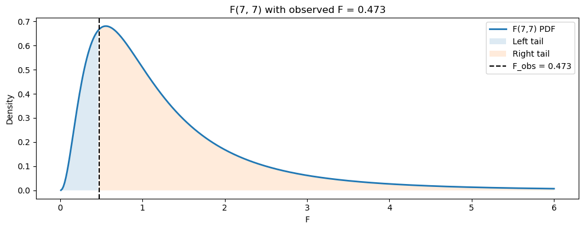

# F 검정 꼬리 영역 시각화

## 개요

F 분포의 꼬리 영역을 시각화하는 것은 분산 동일성에 대한 F 검정이 어떻게 판정에 이르는지 이해하는 데 필수적이다. 관측된 F 통계량을 밀도 곡선 위에 표시하면 음영으로 칠한 꼬리 면적이 $p$값에 대응한다. 이 페이지는 단측과 양측 대립가설에 대해 그런 그림을 만드는 법을 시연하여 F 분포를 이용한 가설검정의 기하학적 직관을 세운다.

---

## 1. F 분포와 꼬리 면적

정규 모집단에서 나온 크기 $n_1$, $n_2$인 독립 표본 둘에 대해 F 통계량

$$
F_{\text{obs}} = \frac{S_1^2}{S_2^2}
$$

은 $H_0: \sigma_1^2 = \sigma_2^2$ 아래에서 $F(d_1, d_2)$ 분포를 따른다. 여기서 $d_1 = n_1 - 1$, $d_2 = n_2 - 1$이다.

$p$값은 대립가설에 따라 달라진다.

- **오른쪽 꼬리** ($H_1: \sigma_1^2 > \sigma_2^2$): $p = P(F \ge F_{\text{obs}})$.
- **왼쪽 꼬리** ($H_1: \sigma_1^2 < \sigma_2^2$): $p = P(F \le F_{\text{obs}})$.
- **양측** ($H_1: \sigma_1^2 \neq \sigma_2^2$): $p = 2\min\!\bigl(P(F \le F_{\text{obs}}),\; P(F \ge F_{\text{obs}})\bigr)$.

다음 코드는 두 표본에서 F 통계량을 계산하고 $F(d_1, d_2)$ 밀도와 양쪽 꼬리 영역을 그린다.

<div class="exbox" markdown>

**보기 1.** <span class="diff easy" title="쉬움"></span> 관측된 F를 그림에 얹기. 두 표본 $\{12,15,14,10,13,14,12,11\}$ 과 $\{22,25,20,18,24,23,19,21\}$ 로 $F_{\text{obs}}$ 를 만들고, $F(7,7)$ 밀도 위에 $F_{\text{obs}}$ 의 왼쪽과 오른쪽을 각각 칠한다.

**(1)** 그렇게 칠한 두 영역의 넓이를 각각 구하고 **그 합**이 얼마인지 말하시오. 이 그림을 그대로 "양측 $p$ 값"으로 읽을 수 있는가?

**(2)** 같은 $F_{\text{obs}}$ 에 대해 **등꼬리 양측검정의 기각역**을 제대로 보이려면 어디를 칠해야 하는가. $d_1 = d_2 = 7$ 에서 그 두 경계를 구하고, 칠한 넓이가 양측 $p$ 값과 같음을 확인하시오.

</div>

??? success "풀이"

    **(1) 두 넓이의 합은 정확히 1 이다.** 칠한 두 영역이 $\{F \le F_{\text{obs}}\}$ 와 $\{F \ge F_{\text{obs}}\}$ 인데, 이 둘은 $F_{\text{obs}}$ 한 점에서만 겹치고 그 점은 연속분포에서 확률 0 이다. 그러므로

    $$
    \underbrace{P(F \le F_{\text{obs}})}_{\text{왼쪽}} + \underbrace{P(F \ge F_{\text{obs}})}_{\text{오른쪽}} = 1
    $$

    이다. **$F_{\text{obs}}$ 를 어디에 두든 합은 1 이다.** 칠해진 넓이가 자료에 전혀 반응하지 않는다는 뜻이고, 따라서 **이 그림을 그대로 양측 $p$ 값으로 읽을 수 없다.** 그림이 말해 주는 것은 넓이가 아니라 **$F_{\text{obs}}$ 가 밀도의 어디에 앉았는가** 하나다.

    두 넓이는 각각 단측 $p$ 값이다. 왼쪽이 $H_1: \sigma_1^2 < \sigma_2^2$ 의 $p$ 값, 오른쪽이 $H_1: \sigma_1^2 > \sigma_2^2$ 의 $p$ 값이며, 둘 중 **큰 쪽은 쓸 일이 없다**(언제나 $1/2$ 를 넘으므로 어떤 수준에서도 기각하지 못한다).

    **그려서 수를 읽는다.**

    ```python
    import numpy as np
    import matplotlib.pyplot as plt
    from scipy.stats import f

    plt.rcParams["font.sans-serif"] = ["NanumGothic", "Apple SD Gothic Neo", "Malgun Gothic"]
    plt.rcParams["font.family"] = "sans-serif"
    plt.rcParams["axes.unicode_minus"] = False

    sample1 = [12, 15, 14, 10, 13, 14, 12, 11]
    sample2 = [22, 25, 20, 18, 24, 23, 19, 21]

    # 두 집단의 분산비가 F 분포의 어디에 떨어지는지 그림으로 본다.
    x1 = np.asarray(sample1, dtype=float)
    x2 = np.asarray(sample2, dtype=float)
    df1, df2 = x1.size - 1, x2.size - 1

    F_obs = x1.var(ddof=1) / x2.var(ddof=1)

    xs = np.linspace(0.01, max(6, F_obs + 2), 400)
    pdf = f(df1, df2).pdf(xs)

    fig, ax = plt.subplots(figsize=(10, 4))
    ax.plot(xs, pdf, linewidth=2, label="F({},{}) PDF".format(df1, df2))

    # 왼쪽 꼬리를 칠한다. 분산비가 1 보다 작은 쪽의 이탈에 해당한다.
    mask_left = xs <= F_obs
    ax.fill_between(xs[mask_left], pdf[mask_left], 0, alpha=0.15, label="Left tail")

    # 오른쪽 꼬리. 양측검정이므로 두 꼬리를 모두 본다.
    mask_right = xs >= F_obs
    ax.fill_between(xs[mask_right], pdf[mask_right], 0, alpha=0.15, label="Right tail")

    ax.axvline(F_obs, linestyle="--", color="black", label=f"F_obs = {F_obs:.3f}")
    ax.set_xlabel("F")
    ax.set_ylabel("Density")
    ax.set_title(f"F({df1}, {df2}) with observed F = {F_obs:.3f}")
    ax.legend()
    plt.tight_layout()
    plt.show()

    # 칠해진 두 영역의 넓이를 실제로 재 본다.
    dist = f(df1, df2)
    area_left, area_right = dist.cdf(F_obs), dist.sf(F_obs)
    print(f"F_obs = {F_obs:.6f}   (d1 = {df1}, d2 = {df2})")
    print(f"왼쪽 영역 넓이 = {area_left:.6f}")
    print(f"오른쪽 영역 넓이 = {area_right:.6f}")
    print(f"두 넓이의 합   = {area_left + area_right:.12f}")
    print(f"양측 p 값      = {2 * min(area_left, area_right):.6f}")
    ```

    출력:

    ```text
    F_obs = 0.473214   (d1 = 7, d2 = 7)
    왼쪽 영역 넓이 = 0.172386
    오른쪽 영역 넓이 = 0.827614
    두 넓이의 합   = 1.000000000000
    양측 p 값      = 0.344772
    ```

    

    **예측대로 합이 $1.000000000000$ 이다.** 그런데 양측 $p$ 값은 $0.344772$ 다. 그림에 칠해진 어느 영역도, 두 영역을 합한 것도 이 수가 아니다. **$0.3448$ 은 그림 어디에도 없다.**

    **(2) 등꼬리 양측검정이 칠해야 할 곳.** 양측 $p$ 값 $2\min(\cdot,\cdot)$ 이 재는 것은 "꼬리확률이 $F_{\text{obs}}$ 의 작은 쪽 꼬리만큼 극단적인 모든 값"의 확률이다. 아래쪽 경계가 $F_{\text{obs}}$ 이면 위쪽 경계 $c$ 는 **오른쪽 꼬리확률이 왼쪽과 같아지는 자리**다.

    $$
    P(F \ge c) = P(F \le F_{\text{obs}}) \iff c = F_F^{-1}\bigl(1 - F_F(F_{\text{obs}})\bigr)
    $$

    $d_1 = d_2$ 이면 $1/F \sim F(d_2,d_1) = F(d_1,d_2)$ 라는 역수 성질에서 이 $c$ 가 깔끔하게 나온다.

    $$
    P(F \ge 1/F_{\text{obs}}) = P(1/F \le F_{\text{obs}}) = P(F \le F_{\text{obs}})
    $$

    곧 $c = 1/F_{\text{obs}} = 1/0.473214 = 2.113208$ 이다. 따라서 칠해야 할 곳은

    $$
    \{F \le 0.4732\} \cup \{F \ge 2.1132\}
    $$

    이고 그 넓이는 $0.172386 \times 2 = 0.344772$, 바로 양측 $p$ 값이다.

    ```python
    import matplotlib
    matplotlib.use("Agg")
    import matplotlib.pyplot as plt
    import numpy as np
    from scipy.stats import f

    plt.rcParams["font.sans-serif"] = ["NanumGothic", "Apple SD Gothic Neo", "Malgun Gothic"]
    plt.rcParams["font.family"] = "sans-serif"
    plt.rcParams["axes.unicode_minus"] = False

    INK, BLUE, BLUEL = "#37474F", "#1565C0", "#DCEBFB"
    ORANGE, ORANGEL, RED = "#E65100", "#FFE0B2", "#D32F2F"

    d1 = d2 = 7
    dist = f(d1, d2)
    F_obs = 0.47321428571428575
    mirror = 1 / F_obs

    xs = np.linspace(0.001, 6, 1200)
    pdf = dist.pdf(xs)

    fig, (ax, az) = plt.subplots(1, 2, figsize=(12, 3.6), sharey=True)

    for a in (ax, az):
        a.plot(xs, pdf, color=INK, lw=1.8, zorder=4)
        a.axvline(F_obs, color=RED, ls="--", lw=1.6, zorder=5)
        a.set_xlabel("$F$")
        a.set_xlim(0, 6)
        a.set_ylim(0, 0.82)
        a.spines[["top", "right"]].set_visible(False)

    # 왼쪽: 쪽의 그림이 칠한 그대로. 두 영역이 축 전체를 덮는다.
    m = xs <= F_obs
    ax.fill_between(xs[m], pdf[m], 0, color=BLUE, alpha=0.55, zorder=2)
    m = xs >= F_obs
    ax.fill_between(xs[m], pdf[m], 0, color=ORANGE, alpha=0.35, zorder=2)
    ax.set_ylabel("밀도")
    ax.set_title("그림이 칠한 그대로:  0.1724 + 0.8276 = 1", fontsize=11, color=INK)
    ax.text(0.20, 0.42, "0.1724", color=BLUE, fontsize=10, ha="center", fontweight="bold")
    ax.text(1.9, 0.30, "0.8276", color=ORANGE, fontsize=10, ha="center", fontweight="bold")
    ax.annotate("$F_{\\mathrm{obs}} = 0.4732$", xy=(F_obs, 0.70), xytext=(1.5, 0.74),
                color=RED, fontsize=10,
                arrowprops=dict(arrowstyle="->", color=RED, lw=1.2))

    # 오른쪽: 등꼬리 양측 기각역. 두 꼬리가 각각 0.1724 다.
    m = xs <= F_obs
    az.fill_between(xs[m], pdf[m], 0, color=BLUE, alpha=0.55, zorder=2)
    m = xs >= mirror
    az.fill_between(xs[m], pdf[m], 0, color=BLUE, alpha=0.55, zorder=2)
    az.axvline(mirror, color=RED, ls="--", lw=1.6, zorder=5)
    az.set_title("등꼬리 양측:  0.1724 + 0.1724 = 0.3448 = $p$", fontsize=11, color=INK)
    az.text(0.20, 0.42, "0.1724", color=BLUE, fontsize=10, ha="center", fontweight="bold")
    az.text(3.1, 0.14, "0.1724", color=BLUE, fontsize=10, ha="center", fontweight="bold")
    az.annotate("$1/F_{\\mathrm{obs}} = 2.1132$", xy=(mirror, 0.33), xytext=(2.6, 0.55),
                color=RED, fontsize=10,
                arrowprops=dict(arrowstyle="->", color=RED, lw=1.2))

    plt.tight_layout()
    plt.show()

    print(f"위쪽 경계  1/F_obs            = {mirror:.6f}")
    print(f"일반 공식  ppf(1 - cdf(F_obs)) = {dist.ppf(1 - dist.cdf(F_obs)):.6f}")
    print(f"칠한 넓이  cdf(F_obs) + sf(1/F_obs) = {dist.cdf(F_obs) + dist.sf(mirror):.6f}")
    print(f"양측 p 값                         = {2 * min(dist.cdf(F_obs), dist.sf(F_obs)):.6f}")
    ```

    출력:

    ```text
    위쪽 경계  1/F_obs            = 2.113208
    일반 공식  ppf(1 - cdf(F_obs)) = 2.113208
    칠한 넓이  cdf(F_obs) + sf(1/F_obs) = 0.344772
    양측 p 값                         = 0.344772
    ```

    

    역수로 구한 $2.113208$ 과 일반 공식 $F_F^{-1}(1 - F_F(F_{\text{obs}}))$ 가 소수 여섯째 자리까지 같다. 칠한 넓이도 $0.344772$ 로 양측 $p$ 값과 정확히 맞는다.

    **두 그림을 나란히 놓으면 차이가 분명하다.** 왼쪽은 축 전체가 칠해져 있어 넓이가 언제나 1 이고, 오른쪽은 가운데가 비어 있다. **비어 있는 가운데가 채택역**이고 그 넓이가 $1 - 0.3448 = 0.6552$ 다. 꼬리 그림을 그릴 때 흔히 저지르는 실수가 왼쪽처럼 $F_{\text{obs}}$ 를 기준으로 양쪽을 다 칠해 놓고 "양측이니까 두 꼬리"라고 적는 것이다. **양측의 두 꼬리는 $F_{\text{obs}}$ 와 그 거울상에서 바깥으로 뻗는 두 조각이지, $F_{\text{obs}}$ 에서 좌우로 갈라진 두 반쪽이 아니다.**

    $d_1 \ne d_2$ 이면 거울상이 $1/F_{\text{obs}}$ 가 아니다. 그때는 역수 요령이 통하지 않으므로 일반 공식 `ppf(1 - cdf(F_obs))` 를 써야 한다.

$p$값을 명시적으로 계산하려면

<div class="exbox" markdown>

**보기 2.** <span class="diff easy" title="쉬움"></span> 양측 p-값 계산. 보기 1 의 $F_{\text{obs}} = 0.4732$ 에 대해 왼쪽·오른쪽·양측 $p$ 값을 모두 찍는다.

**(1)** 세 수 가운데 **독립인 것은 몇 개인가.** $p_{\text{two}}$ 를 $p_{\text{left}}$ 하나의 식으로 적으시오.

**(2)** $F_{\text{obs}}$ 를 움직이며 세 수를 표로 만들고, $p_{\text{two}} = 1$ 이 되는 $F_{\text{obs}}$ 가 어디인지 구하시오. 표가 $F_{\text{obs}} \mapsto 1/F_{\text{obs}}$ 에 대해 어떤 꼴을 보이는가.

</div>

??? success "풀이"

    **(1) 독립인 것은 하나뿐이다.** 보기 1 에서 본 대로 두 꼬리확률의 합이 1 이므로

    $$
    p_{\text{right}} = 1 - p_{\text{left}}
    $$

    이고, 양측 $p$ 값도 $p_{\text{left}}$ 만의 함수다. $u = p_{\text{left}}$ 라 쓰면

    $$
    p_{\text{two}} = 2\min(u,\, 1-u) =
    \begin{cases}
    2u, & u \le \tfrac12 \\[2pt]
    2(1-u), & u > \tfrac12
    \end{cases}
    \;=\; 1 - \lvert 2u - 1 \rvert
    $$

    이다. **세 수는 전부 $p_{\text{left}}$ 하나로 정해진다.** 셋을 나란히 찍는 것은 읽는 사람의 편의일 뿐 새 정보가 아니다.

    $1 - \lvert 2u-1 \rvert$ 꼴에서 바로 읽히는 것이 셋 있다.

    - $p_{\text{two}} \le 1$ 이고 등호는 $u = 1/2$ 일 때뿐이다.
    - $p_{\text{two}}$ 는 $u = 1/2$ 에서 꼭짓점을 이루는 **삼각형 꼴**이라 $u$ 와 $1-u$ 에서 같은 값을 준다.
    - 따라서 **두 꼬리 넓이를 그냥 더하면 안 된다.** 더하면 언제나 $1$ 이다(보기 1).

    **(2) 표로 확인한다.** 아래 코드는 보기 1 의 `x1`, `x2`, `df1`, `df2`, `F_obs` 를 그대로 이어받는다.

    ```python
    # 두 꼬리 중 작은 쪽을 두 배 해 양측 p-값을 만든다. F 분포가 대칭이
    # 아니라서 두 꼬리 넓이를 그냥 더하면 안 된다.
    p_left = f(df1, df2).cdf(F_obs)
    p_right = f(df1, df2).sf(F_obs)
    p_two = 2 * min(p_left, p_right)

    print(f"Sample variances: {x1.var(ddof=1):.4f}, {x2.var(ddof=1):.4f}")
    print(f"F_obs = {F_obs:.4f}")
    print(f"Left-tail  p-value: {p_left:.4f}")
    print(f"Right-tail p-value: {p_right:.4f}")
    print(f"Two-sided  p-value: {p_two:.4f}")

    # (1) 의 두 항등식을 확인한다.
    print(f"두 꼬리의 합 = {p_left + p_right:.12f}")
    print(f"1 - |2*p_left - 1| = {1 - abs(2 * p_left - 1):.4f}")

    # F_obs 를 움직이며 세 수가 어떻게 가는지 본다.
    dist = f(df1, df2)
    print(f"\n{'F_obs':>8}{'p_left':>10}{'p_right':>10}{'합':>8}{'p_two':>9}")
    for Fo in (0.2, 0.4732, 0.8, 1.0, 1.25, 2.1132, 5.0):
        L, R = dist.cdf(Fo), dist.sf(Fo)
        print(f"{Fo:>8.4f}{L:>10.4f}{R:>10.4f}{L + R:>8.4f}{2 * min(L, R):>9.4f}")
    print(f"\nF(7,7) 의 중앙값 = {dist.median():.6f}   (이 자리에서 p_two 가 1 이 된다)")
    ```

    출력:

    ```text
    Sample variances: 2.8393, 6.0000
    F_obs = 0.4732
    Left-tail  p-value: 0.1724
    Right-tail p-value: 0.8276
    Two-sided  p-value: 0.3448
    두 꼬리의 합 = 1.000000000000
    1 - |2*p_left - 1| = 0.3448

       F_obs    p_left   p_right       합    p_two
      0.2000    0.0249    0.9751  1.0000   0.0499
      0.4732    0.1724    0.8276  1.0000   0.3448
      0.8000    0.3880    0.6120  1.0000   0.7760
      1.0000    0.5000    0.5000  1.0000   1.0000
      1.2500    0.6120    0.3880  1.0000   0.7760
      2.1132    0.8276    0.1724  1.0000   0.3448
      5.0000    0.9751    0.0249  1.0000   0.0499

    F(7,7) 의 중앙값 = 1.000000   (이 자리에서 p_two 가 1 이 된다)
    ```

    **(1)의 두 항등식이 맞는다.** 합이 $1.000000000000$ 이고 $1 - \lvert 2p_{\text{left}} - 1\rvert = 0.3448$ 이 `2 * min(...)` 과 같다.

    **$p_{\text{two}} = 1$ 이 되는 자리는 $F_{\text{obs}} = 1$ 이다.** $p_{\text{two}} = 1$ 은 $p_{\text{left}} = 1/2$ 를 뜻하고, 그것은 $F_{\text{obs}}$ 가 귀무분포의 **중앙값**이라는 말이다. 출력의 마지막 줄이 $F(7,7)$ 의 중앙값을 $1.000000$ 으로 준다. $d_1 = d_2$ 일 때만 그렇다 — 역수 성질 $1/F \sim F(d,d)$ 에서 $P(F\le 1) = P(F \ge 1) = 1/2$ 이기 때문이다. $d_1 \ne d_2$ 이면 중앙값이 1 이 아니고, $F_{\text{obs}} = 1$ 이어도 $p_{\text{two}} < 1$ 이 된다.

    **표가 $F_{\text{obs}} \mapsto 1/F_{\text{obs}}$ 에 대해 뒤집힌 꼴을 보인다.** $0.2$ 와 $5.0$, $0.4732$ 와 $2.1132$, $0.8$ 과 $1.25$ 가 각각 서로 역수인 짝인데, 짝마다 $p_{\text{left}}$ 와 $p_{\text{right}}$ 가 **맞바뀌고** $p_{\text{two}}$ 는 **그대로**다($0.0499$, $0.3448$, $0.7760$). 역수 성질이 만드는 대칭이며, 로그 척도로 옮기면 $\log F$ 의 분포가 0 을 중심으로 정확히 대칭이라는 말과 같다. 그래서 **어느 표본분산을 분자에 두든 양측 $p$ 값이 바뀌지 않는다**(15.3절 [이표본 F 검정](f_test_two_variances.md) 연습문제 12).

    맨 윗줄과 맨 아랫줄의 $p_{\text{two}} = 0.0499$ 도 읽어 둘 만하다. $F(7,7)$ 의 $2.5\%$ 와 $97.5\%$ 분위수가 $0.2002$ 와 $4.9949$ 이므로 $0.2$ 와 $5.0$ 은 둘 다 기각역에 **간신히 들어가 있고**, 그래서 $p$ 가 $0.05$ 바로 아래다. **집단당 8 개로는 분산비가 5 배는 되어야 기각한다.**

---

## 2. 해석

- $F_{\text{obs}}$까지의 왼쪽 꼬리 면적은 $H_0$ 아래에서 관측된 것만큼 작거나 더 작은 분산비를 얻을 확률이다.
- $F_{\text{obs}}$부터의 오른쪽 꼬리 면적은 그만큼 크거나 더 큰 비를 얻을 확률이다.
- 양측검정에서는 더 작은 쪽 꼬리 면적을 두 배 한다. $F_{\text{obs}}$가 1에 가까우면($d_2$가 클 때 $H_0$ 아래의 기댓값) 양쪽 꼬리가 모두 커서 $p$값이 1에 가까워진다.
- F 분포는 특히 자유도가 작을 때 오른쪽으로 치우쳐 있다. 이 비대칭 때문에 주어진 $F_{\text{obs}}$에 대해 왼쪽과 오른쪽 꼬리 $p$값이 일반적으로 같지 않다.

여기서 두 꼬리 확률이 $0.172$와 $0.828$로 합이 정확히 1이다(연속분포이므로 당연하다). 양측 $p$값 $0.345$는 작은 쪽을 두 배 한 값이다.

---

## 연습문제

<div class="drillbox" markdown>

**연습문제 1.** <span class="diff easy" title="쉬움"></span> 위 코드의 표본에 대해 $F_{\text{obs}}$를 손으로 계산하고 코드 출력과 대조하라. 자유도를 서술하라.

</div>

??? success "풀이"

    표본 1: $\{12, 15, 14, 10, 13, 14, 12, 11\}$, $n_1 = 8$, $\bar{x}_1 = 12.625$.

    $$
    S_1^2 = \frac{1}{7}\sum(x_i - 12.625)^2
    $$

    $$
    = \frac{1}{7}(0.390625 + 5.640625 + 1.890625 + 6.890625 + 0.140625 + 1.890625 + 0.390625 + 2.640625) = \frac{19.875}{7} = 2.8393.
    $$

    표본 2: $\{22, 25, 20, 18, 24, 23, 19, 21\}$, $n_2 = 8$, $\bar{x}_2 = 21.5$.

    $$
    S_2^2 = \frac{1}{7}(0.25 + 12.25 + 2.25 + 12.25 + 6.25 + 2.25 + 6.25 + 0.25) = \frac{42}{7} = 6.0.
    $$

    $$
    F_{\text{obs}} = \frac{2.8393}{6.0} = 0.4732, \quad d_1 = 7, \; d_2 = 7.
    $$

    코드 출력과 정확히 일치한다.

    **자유도가 왜 $n-1$인가.** 각 표본분산이 자기 집단의 평균을 추정하는 데 자유도 하나를 썼기 때문이다. $S_i^2$의 분자 $\sum (x_{ij} - \bar{x}_i)^2$은 제약 $\sum_j (x_{ij} - \bar{x}_i) = 0$을 만족하므로 자유로운 성분이 $n_i - 1$개이다. $\square$

<div class="drillbox" markdown>

**연습문제 2.** <span class="diff med" title="중간"></span> 단측검정 $H_1: \sigma_1^2 > \sigma_2^2$에 맞게 오른쪽 꼬리만 음영으로 칠하도록 코드를 수정하라. 오른쪽 꼬리 $p$값은 얼마인가?

</div>

??? success "풀이"

    ```python
    import numpy as np
    import matplotlib.pyplot as plt
    from scipy.stats import f

    x1 = np.array([12, 15, 14, 10, 13, 14, 12, 11], dtype=float)
    x2 = np.array([22, 25, 20, 18, 24, 23, 19, 21], dtype=float)
    df1, df2 = 7, 7
    F_obs = x1.var(ddof=1) / x2.var(ddof=1)

    xs = np.linspace(0.01, 6, 400)
    pdf = f(df1, df2).pdf(xs)

    fig, ax = plt.subplots(figsize=(8, 4))
    ax.plot(xs, pdf, lw=2)
    mask = xs >= F_obs
    ax.fill_between(xs[mask], pdf[mask], 0, alpha=0.3, color="red",
                    label="Right tail")
    ax.axvline(F_obs, ls="--", color="black")
    ax.set_title(f"Right-tail test: p = {f(df1,df2).sf(F_obs):.4f}")
    ax.legend()
    plt.tight_layout()
    plt.show()
    ```

    

    $F_{\text{obs}} = 0.4732 < 1$이므로 오른쪽 꼬리 면적이 매우 크다. $p = 0.8276$으로 $\sigma_1^2 > \sigma_2^2$의 증거가 전혀 없다.

    **당연한 결과이다.** 표본분산이 $2.84 < 6.00$으로 오히려 집단 1이 작으므로, "집단 1의 분산이 더 크다"는 대립가설의 방향과 자료가 정반대이다.

    !!! warning "$p > 0.5$는 대립가설의 방향이 틀렸다는 신호이다"
        단측검정에서 $p$값이 $0.5$를 크게 넘으면, 자료가 대립가설과 **반대 방향**을 가리키고 있다는 뜻이다. 이때 "$H_0$을 기각하지 못한다"고만 보고하면 정보를 잃는다.

        올바른 서술은 "자료는 $\sigma_1^2 > \sigma_2^2$을 지지하지 않으며, 오히려 반대 방향($\sigma_1^2 < \sigma_2^2$, 왼쪽 꼬리 $p = 0.172$)을 시사한다"이다.

        다만 **자료를 보고 대립가설의 방향을 바꾸어서는 안 된다.** 그렇게 하면 실제 유의수준이 $2\alpha$가 된다. 방향을 미리 확신할 수 없다면 처음부터 양측검정을 계획해야 한다. $\square$

<div class="drillbox" markdown>

**연습문제 3.** <span class="diff med" title="중간"></span> $F(d_1, d_2)$ 밀도가 1을 중심으로 대칭이 아닌 이유를 설명하라. 이 비대칭이 양측 $p$값 계산에 어떤 영향을 주는가?

</div>

??? success "풀이"

    F 분포는 척도가 조정된 두 카이제곱 변수의 비로 정의되며, 둘 다 음이 아니고 오른쪽으로 치우쳐 있다. 밀도의 정의역이 $(0, \infty)$이고 $d_1 > 2$에 대해 최빈값이

    $$
    \frac{d_1-2}{d_1} \cdot \frac{d_2}{d_2+2} < 1
    $$

    이다. 이 고유한 오른쪽 치우침 때문에 일반적으로 $P(F > c) \neq P(F < 1/c)$이다.

    양측 $p$값에서는 정규분포처럼 대칭인 분포에서 하듯 한쪽 꼬리 면적을 단순히 두 배 할 수 없다. 대신 $p = 2\min(P(F \le F_{\text{obs}}), P(F \ge F_{\text{obs}}))$를 쓴다. 작은 쪽 꼬리를 골라 두 배 하는 것이다. 이렇게 하면 검정이 타당해지지만, 기각역이 $F$ 척도에서 1을 중심으로 대칭이 아니게 된다.

    **로그 척도에서는 대칭이 회복된다.** $d_1 = d_2 = d$일 때 역수 성질 $1/F \sim F(d,d)$에 의해 $\ln F$의 분포가 0을 중심으로 **정확히 대칭**이다. 본문 보기에서 $d_1 = d_2 = 7$이므로

    $$
    P(F \le 0.4732) = P(F \ge 1/0.4732) = P(F \ge 2.1132) = 0.1724
    $$

    가 성립한다. 로그 척도의 대칭성이 이 관계를 만든다.

    $d_1 \neq d_2$이면 이 대칭은 깨진다. 두 임계값이 더는 서로 역수가 아니다. **그러나 $\min$을 두 배 하는 규칙의 크기는 그대로 정확히 $\alpha$다.** 자유도와 무관하다.

    까닭은 대칭이 아니라 확률적분변환이다. $H_0$ 아래에서 $P = F_{d_1,d_2}(F_{\text{obs}})$는 자유도가 무엇이든 $U(0,1)$을 따른다. $2\min(P, 1-P)$는 $U(0,1)$을 반으로 접어 두 배한 것이므로 다시 $U(0,1)$이고, 따라서

    $$
    P\bigl(2\min(P,\,1-P) < \alpha\bigr) = \alpha
    $$

    가 정확히 성립한다. $(4,30)$, $(30,4)$, $(3,60)$, $(2,5)$, $(14,19)$에서 $40$만 회씩 확인하면 모두 $0.0497$에서 $0.0506$ 사이로, 몬테카를로 표준오차 $0.00034$의 두 배 안에 들어온다.

    자유도가 달라서 달라지는 것은 **임계값이 놓이는 자리**이고, 기각역의 **크기**가 아니다. $\square$

<div class="drillbox" markdown>

**연습문제 4.** <span class="diff med" title="중간"></span> $(d_1, d_2) \in \{(5,5), (10,10), (30,30)\}$에 대한 $F(d_1, d_2)$ 밀도를 세 개의 부분그림으로 그려라. 자유도가 커지면서 모양이 어떻게 변하는지 논하라.

</div>

??? success "풀이"

    ```python
    import numpy as np
    import matplotlib.pyplot as plt
    from scipy.stats import f

    fig, axes = plt.subplots(1, 3, figsize=(12, 3))
    for ax, (d1, d2) in zip(axes, [(5, 5), (10, 10), (30, 30)]):
        xs = np.linspace(0.01, 4, 300)
        ax.plot(xs, f(d1, d2).pdf(xs), lw=2)
        ax.axvline(1, ls=":", color="gray")
        ax.set_title(f"F({d1}, {d2})")
        ax.set_xlabel("F")
    plt.tight_layout()
    plt.show()

    for d1, d2 in [(5, 5), (10, 10), (30, 30)]:
        mode = (d1 - 2) / d1 * d2 / (d2 + 2)
        mean = d2 / (d2 - 2)
        print(f"F({d1},{d2}): mode={mode:.4f}, mean={mean:.4f}")
    ```

    출력:

    ```text
    F(5,5): mode=0.4286, mean=1.6667
    F(10,10): mode=0.6667, mean=1.2500
    F(30,30): mode=0.8750, mean=1.0714
    ```

    

    자유도가 커질수록 최빈값이 $0.43 \to 0.67 \to 0.88$로 1에 가까워지고 분포가 1을 중심으로 좁아진다. $d_1 = d_2 \to \infty$이면 $F \to 1$에 축퇴한다.

    | $(d_1,d_2)$ | 최빈값 | 평균 | 왜도 |
    |---|---|---|---|
    | $(5,5)$ | 0.429 | 1.667 | 정의되지 않음 |
    | $(10,10)$ | 0.667 | 1.250 | 3.615 |
    | $(30,30)$ | 0.875 | 1.071 | 1.268 |

    자유도가 커지면 F 밀도가 1 주위로 더 집중되고(기댓값이 $d_2/(d_2-2) \to 1$) 더 대칭이 된다. $d_1, d_2$가 크면 $\ln F$가 근사적으로 정규이고 분포가 1 근처를 중심으로 하는 정규분포와 비슷해진다.

    !!! note "$F(5,5)$의 왜도는 존재하지 않는다"
        F 분포의 왜도 공식은 $d_2 > 6$을 요구한다. $d_2 \leq 6$이면 3차 적률이 존재하지 않는다.

        마찬가지로 평균은 $d_2 > 2$, 분산은 $d_2 > 4$가 필요하다. **분모 자유도가 작으면 F 분포의 적률이 차례로 사라진다.**

        실무적 함의: 두 표본이 각각 $n \leq 7$이면($d_2 \leq 6$) F 통계량의 왜도조차 정의되지 않을 만큼 분포가 극단적이다. 이런 자료에서 F 검정의 $p$값은 형식적으로는 계산되지만, 검정통계량이 매우 불안정하므로 결과를 신뢰하기 어렵다. $\square$

<div class="drillbox" markdown>

**연습문제 5.** <span class="diff med" title="중간"></span> $F \sim F(d_1, d_2)$이면 $1/F \sim F(d_2, d_1)$임을 증명하라. 이를 이용해 $F(d_1, d_2)$ 아래에서 $F_{\text{obs}}$의 왼쪽 꼬리 $p$값이 $F(d_2, d_1)$ 아래에서 $1/F_{\text{obs}}$의 오른쪽 꼬리 $p$값과 같음을 보여라.

</div>

??? success "풀이"

    정의에 의해 $F = (U/d_1)/(V/d_2)$이고 $U \sim \chi^2(d_1)$, $V \sim \chi^2(d_2)$가 독립이다. 그러면

    $$
    \frac{1}{F} = \frac{V/d_2}{U/d_1} \sim F(d_2, d_1)
    $$

    자유도를 뒤바꾼 F 분포의 정의 그대로이다.

    이제 $P(F \le F_{\text{obs}}) = P(1/F \ge 1/F_{\text{obs}})$이다. $1/F \sim F(d_2, d_1)$이므로 이는 오른쪽 꼬리확률 $P(F(d_2, d_1) \ge 1/F_{\text{obs}})$이며, 정확히 $1/F_{\text{obs}}$에서 평가한 $F(d_2, d_1)$의 생존함수이다.

    **수치 확인.**

    ```python
    from scipy.stats import f

    F_obs, d1, d2 = 0.4732, 7, 7
    print(f"left tail  of F({d1},{d2}) at {F_obs}:      "
          f"{f(d1, d2).cdf(F_obs):.6f}")
    print(f"right tail of F({d2},{d1}) at {1/F_obs:.4f}: "
          f"{f(d2, d1).sf(1 / F_obs):.6f}")
    ```

    출력:

    ```
    left tail  of F(7,7) at 0.4732:      0.172376
    right tail of F(7,7) at 2.1133: 0.172376
    ```

    왼쪽 꼬리와 오른쪽 꼬리가 소수 여섯째 자리까지 $0.172376$으로 같다.

    두 값이 소수 여섯째 자리까지 같다.

    **실무적 의미.** 이 성질 덕분에 F 분포표에 상단 분위수만 실어도 충분하다. 하단 임계값이 필요하면 자유도를 뒤바꾼 상단 임계값의 역수를 취하면 된다.

    또한 이는 "어느 집단을 분자에 둘지"가 검정 결과에 영향을 주지 않는다는 것을 보장한다. 양측검정에서는 $\min$을 취하므로 두 배열이 정확히 같은 $p$값을 낸다(15.3절 [이표본 F 검정](f_test_two_variances.md) 연습문제 12 참조). $\square$

<div class="drillbox" markdown>

**연습문제 6.** <span class="diff med" title="중간"></span> 보기 1 의 그림을 그대로 **판정 규칙**으로 삼는 사람이 있다. "칠한 두 영역 가운데 **작은 쪽**의 넓이가 $\alpha$ 보다 작으면 $H_0$ 을 기각한다."

**(1)** 이 규칙의 실제 제1종 오류율을 구하시오(연습문제 3 의 확률적분변환 논증을 쓰라).

**(2)** $\alpha = 0.05$, $d_1 = d_2 = 7$ 에서 이 규칙과 올바른 등꼬리 양측검정이 **다른 판정을 내리는** $F_{\text{obs}}$ 의 범위를 구하고, $H_0$ 아래에서 $F_{\text{obs}}$ 가 그 범위에 떨어질 확률이 (1) 에서 부푼 양과 같음을 확인하시오.

**(3)** 이 오독이 연습문제 2 의 경고 상자가 금지한 것과 같은 잘못임을 설명하시오.

</div>

??? success "풀이"

    **(1) 실제 수준은 정확히 $2\alpha$ 다.** 작은 쪽 영역의 넓이가 $\min(p_{\text{left}}, p_{\text{right}})$ 이고 양측 $p$ 값이 그것의 두 배이므로

    $$
    \min(p_{\text{left}},\, p_{\text{right}}) < \alpha \iff p_{\text{two}} < 2\alpha
    $$

    이다. 연습문제 3 에서 본 대로 $H_0$ 아래에서 $P = F_{d_1,d_2}(F_{\text{obs}}) \sim U(0,1)$ 이고 $p_{\text{two}} = 2\min(P, 1-P)$ 도 $U(0,1)$ 이다. 따라서 $\alpha \le 1/2$ 인 동안

    $$
    P\bigl(\min(p_{\text{left}},\, p_{\text{right}}) < \alpha\bigr) = P(p_{\text{two}} < 2\alpha) = 2\alpha
    $$

    다. $\alpha = 0.05$ 로 쓰면 실제 수준이 $0.10$ 이다. **자유도와 무관하게 언제나 정확히 두 배**이므로 $\alpha$ 를 어떻게 골라도 이 규칙이 옳아지는 자리는 없다. 고치는 법은 하나다. 조각마다 $\alpha/2 = 0.025$ 를 쓰는 것, 곧 등꼬리다.

    **(2) 두 규칙이 갈리는 구간.** 오독 규칙은 $p_{\text{two}} < 0.10$ 에서, 올바른 검정은 $p_{\text{two}} < 0.05$ 에서 기각한다. 그러므로 판정이 갈리는 것은

    $$
    0.05 \le p_{\text{two}} < 0.10 \iff 0.025 \le \min(p_{\text{left}},\, p_{\text{right}}) < 0.05
    $$

    일 때다. $F(7,7)$ 의 분위수는 $F_F^{-1}(0.025) = 0.200204$, $F_F^{-1}(0.05) = 0.264058$, $F_F^{-1}(0.95) = 3.787044$, $F_F^{-1}(0.975) = 4.994909$ 이고(역수 성질 때문에 $1/0.264058 = 3.787044$, $1/0.200204 = 4.994909$ 다), 따라서 갈리는 범위는

    $$
    F_{\text{obs}} \in (0.200204,\; 0.264058] \;\cup\; [3.787044,\; 4.994909)
    $$

    두 조각이다. 그 확률은 $(0.05 - 0.025) \times 2 = 0.05$ 이고, 이것이 (1) 의 $0.10 - 0.05 = 0.05$ 와 정확히 같다. **부푼 수준은 전부 이 두 띠에서 나온다.** 보기 2 의 표에서 $F_{\text{obs}} = 0.2$ 가 $p_{\text{two}} = 0.0499$ 로 간신히 기각된 것을 떠올리면, 이 띠는 바로 그 경계 밖의 얇은 구간이다.

    **(3) 자료를 보고 꼬리를 고른 것이다.** $\min(p_{\text{left}}, p_{\text{right}})$ 은 "자료가 가리키는 쪽"의 단측 $p$ 값이다. 곧 이 규칙은 그림을 보고 **대립가설의 방향을 고른 뒤** 그 방향의 단측검정을 하는 것과 같고, 연습문제 2 의 경고 상자가 "실제 유의수준이 $2\alpha$ 가 된다"며 금지한 바로 그 절차다. 벌금의 크기까지 같은 $2\alpha$ 인 것이 우연이 아니다.

    보기 1 이 "이 그림을 그대로 양측 $p$ 값으로 읽을 수 없다"고 한 까닭이 둘인 셈이다. 두 넓이의 합이 언제나 1 이라는 것(보기 1)과, **작은 쪽을 골라 읽는 순간 수준이 두 배가 된다**는 것. 어느 조각을 읽을지를 자료가 정하게 하면 그 자유의 값을 치러야 한다. $\square$

<div class="drillbox" markdown>

**연습문제 7.** <span class="diff hard" title="어려움"></span> $d_1 = d_2 = d$ 인 $F(d,d)$ 의 밀도를 $f$ 라 하자.

**(1)** 연습문제 5 의 역수 성질에서 모든 $y > 0$ 에 대해 $f(1/y) = y^2 f(y)$ 임을 보이시오.

**(2)** 보기 1 (2) 의 등꼬리 $5\%$ 기각역 경계는 $d = 7$ 에서 $0.200204$ 와 $4.994909$ 다. 두 경계에서 밀도값의 비를 (1) 로 구하시오. 두 조각은 넓이가 같은데 **경계의 밀도도 같은가?**

**(3)** $T = \ln F$ 의 밀도 $g$ 를 구해 $g(-t) = g(t)$ 임을 보이고, 등꼬리 기각역이 $T$ 척도에서 $\{\lvert T \rvert \ge c\}$ 꼴임을 확인하며 그 $c$ 를 구하시오. (1) 의 인자 $y^2$ 이 이 대칭을 만드는 바로 그 인자임을 설명하시오.

</div>

??? success "풀이"

    **(1)** 연습문제 5 에서 $d_1 = d_2 = d$ 이면 $Y = 1/F$ 도 $F(d,d)$ 를 따른다. 변수변환으로

    $$
    f_Y(y) = f\!\left(\frac1y\right)\left\lvert \frac{d}{dy}\frac1y \right\rvert = \frac{1}{y^2} f\!\left(\frac1y\right)
    $$

    인데 $f_Y = f$ 이므로 $f(y) = f(1/y)/y^2$, 곧 $f(1/y) = y^2 f(y)$ 다. $\square$

    **(2) 넓이는 같고 밀도는 25 배 다르다.** 두 경계가 서로 역수다($1/4.994909 = 0.200204$). $y = 4.994909$ 를 (1) 에 넣으면

    $$
    f(0.200204) = (4.994909)^2\, f(4.994909) = 24.9491\, f(4.994909)
    $$

    실제 값이 $f(0.200204) = 0.325894$, $f(4.994909) = 0.013062$ 로 비가 $24.9491$ 이고 $(4.994909)^2$ 과 맞는다. 그러므로 등꼬리 기각역은 **"경계의 밀도가 같은" 영역이 아니다.** 경계의 밀도를 같게 맞추는 것은 가능도비 꼴의 기각역이고, 그것은 $F$ 척도에서 **가장 짧은** 채택역을 준다. $F(7,7)$ 에서 그 영역을 실제로 풀면

    $$
    \{F \le 0.054486\} \cup \{F \ge 3.803850\}
    $$

    이고 두 경계의 밀도가 모두 $0.031161$, 채택역의 길이가 $3.7494$ 로 등꼬리의 $4.7947$ 보다 짧다. 그런데 꼬리확률이 $0.000527$ 과 $0.049473$ 으로 쏠려 있어, 아래쪽 기각 한계가 $0.0545$ 다. $S_1^2$ 이 $S_2^2$ 의 **18 분의 1 보다 작아야** "분산이 더 작다"를 기각하는 검정인 셈이다. 길이를 조금 줄인 대가로 한쪽 방향의 검정력을 거의 전부 버렸다.

    **(3) 로그 척도에서 대칭이다.** $T = \ln F$ 의 밀도는 $g(t) = f(e^t)\,e^t$ 다. (1) 에 $y = e^t$ 를 넣으면 $f(e^{-t}) = e^{2t} f(e^t)$ 이므로

    $$
    g(-t) = f(e^{-t})\,e^{-t} = e^{2t} f(e^t)\, e^{-t} = e^{t} f(e^t) = g(t)
    $$

    닫힌 꼴로도 보인다. $F(d,d)$ 의 밀도가 $f(x) = x^{d/2-1}(1+x)^{-d}/B(d/2,d/2)$ 이므로

    $$
    g(t) = \frac{e^{td/2}}{B(d/2,d/2)\,(1+e^t)^{d}} = \frac{1}{B(d/2,d/2)}\left(2\cosh\frac{t}{2}\right)^{-d}
    $$

    $\cosh$ 가 짝함수라 대칭이 눈에 보이고, $\lvert t \rvert$ 에 대해 감소하므로 $t = 0$ 에서 봉우리가 하나다.

    경계는 $\ln 4.994909 = 1.608419$, $\ln 0.200204 = -1.608419$ 이므로 등꼬리 기각역이 $\{\lvert T \rvert \ge c\}$, $c = 1.608419$ 다. 두 경계의 밀도는 $g(\pm 1.608419) = 0.065245$ 로 **같다.** 대칭이고 봉우리가 하나인 밀도에서 "경계의 밀도가 같다"는 것은 그 영역이 **가장 짧다**는 뜻이므로, $F$ 척도에서 최단이 아니던 등꼬리 기각역이 $\ln F$ 척도에서는 최단이다.

    **(1) 의 $y^2$ 이 전부를 설명한다.** 변수변환이 만드는 야코비안이 $e^t$ 이고, $f(e^{-t})$ 와 $f(e^t)$ 의 차이가 정확히 $e^{2t}$ 라서 둘이 상쇄된다. 연습문제 3 이 "로그 척도에서 대칭이 회복된다"고 한 것의 출처가 이 상쇄다.

    그래서 쪽의 그림에서 왼쪽 조각이 폭 $0.2$ 에 눌려 있고 오른쪽 조각이 무한히 뻗는 것은 분포가 "비대칭"이라서가 아니라 **축을 잘못 골랐기** 때문이다. 같은 꼬리를 $\ln F$ 축에 그리면 두 조각이 $\pm 1.6084$ 에서 시작하는 거울상이 되고, 등꼬리 규칙이 그 척도에서 최단 기각역이라는 사실까지 그림에서 읽힌다. $\square$

<div class="drillbox" markdown>

**연습문제 8.** <span class="diff hard" title="어려움"></span> 이 쪽의 정리하며가 "정규성이 깨지면 이 곡선 자체가 틀린 기준분포다"라고 적었다. 그 말을 수로 재자.

$n_1 = n_2 = 8$ 로 두 표본을 **같은 분포**에서 뽑으면 $H_0: \sigma_1^2 = \sigma_2^2$ 이 정확히 참이다. 정규·지수·$t_5$·균등 네 모집단에서 $F_{\text{obs}} = S_1^2/S_2^2$ 의 참 분포를 모의로 만들어, (a) 참 $2.5\%$ 와 $97.5\%$ 분위수를 구하고 (b) $F(7,7)$ 이 그은 선 $0.2002$ 와 $4.9949$ 바깥으로 나가는 실제 확률을 **두 꼬리 따로** 구하라(반복 $40{,}000$ 회, 씨앗 고정).

틀어진 쪽이 **한쪽 꼬리인가, 두 꼬리인가.** 왜도가 $2$ 인 지수분포에서도 그런가?

</div>

??? success "풀이"

    ```python
    import numpy as np
    from scipy.stats import f

    rng = np.random.default_rng(0)
    n, R = 8, 40000
    dist = f(n - 1, n - 1)
    lo, hi = dist.ppf(0.025), dist.ppf(0.975)     # 쪽의 그림이 그은 두 선

    def draw(name, size):
        if name == "Normal":      return rng.normal(0, 1, size)
        if name == "Exponential": return rng.exponential(1, size)
        if name == "t(5)":        return rng.standard_t(5, size)
        if name == "Uniform":     return rng.uniform(0, 1, size)

    print(f"F(7,7) 이 그은 선 = {lo:.4f}, {hi:.4f}")
    print(f"\n{'pop':>12}{'q.025':>9}{'q.975':>10}{'left':>8}{'right':>8}{'size':>8}")
    for name in ("Normal", "Exponential", "t(5)", "Uniform"):
        # 두 표본을 같은 분포에서 뽑으므로 H0 가 정확히 참이다.
        s1 = draw(name, (R, n)).var(axis=1, ddof=1)
        s2 = draw(name, (R, n)).var(axis=1, ddof=1)
        F = s1 / s2
        q_lo, q_hi = np.quantile(F, [0.025, 0.975])
        left, right = np.mean(F < lo), np.mean(F > hi)
        print(f"{name:>12}{q_lo:>9.4f}{q_hi:>10.4f}{left:>8.4f}{right:>8.4f}{left + right:>8.4f}")
    ```

    출력:

    ```text
    F(7,7) 이 그은 선 = 0.2002, 4.9949

             pop    q.025     q.975    left   right    size
          Normal   0.2007    4.9926  0.0249  0.0250  0.0499
     Exponential   0.0773   12.6284  0.1059  0.1071  0.2130
            t(5)   0.1318    7.4769  0.0574  0.0565  0.1139
         Uniform   0.2992    3.3550  0.0068  0.0072  0.0140
    ```

    **정규에서만 곡선이 맞는다.** 참 분위수 $0.2007$ 과 $4.9926$ 이 $F(7,7)$ 의 $0.2002$ 와 $4.9949$ 에 모의오차 안에서 겹치고, 크기도 $0.0499$ 다.

    **지수에서는 선이 참 분포의 한참 안쪽에 있다.** 참 $2.5\%$ 가 $0.0773$, 참 $97.5\%$ 가 $12.6284$ 다. 그림이 "$2.5\%$ 자리"라고 믿고 그은 $0.2002$ 는 실제로 $10.6\%$ 자리이고, $4.9949$ 는 $100 - 10.7 = 89.3\%$ 자리다. 그래서 명목 $5\%$ 검정이 $21.3\%$ 로 기각한다. $t_5$ 도 같은 방향으로 $11.4\%$ 다.

    **균등에서는 반대다.** 참 분위수가 $0.2992$ 와 $3.3550$ 으로 **안쪽**에 있어 그림의 선이 참 분포의 거의 바깥이다. 크기가 $0.0140$ 으로 명목값의 삼분의 일도 안 된다. 기각을 못 하는 것이므로 "보수적이라 안전하다"가 아니라 검정력을 버린 것이다.

    **두 꼬리가 똑같이 틀어진다.** 지수에서 왼쪽 $0.1059$, 오른쪽 $0.1071$ 로 차이가 모의오차($\pm 0.0015$) 안이다. 왜도가 $2$ 인 치우친 모집단인데도 한쪽 꼬리만 살찌지 않는다. 까닭은 $S_1^2/S_2^2$ 이 **두 표본에 대칭**인 통계량이라는 데 있다. 두 표본이 같은 분포를 따르므로 $F_{\text{obs}}$ 와 $1/F_{\text{obs}}$ 가 같은 분포를 가지고, 따라서 $\ln F_{\text{obs}}$ 의 참 분포는 치우친 모집단에서도 $0$ 을 중심으로 대칭이다. **치우침이 바꾸는 것은 중심이 아니라 폭이고, 폭은 첨도가 정한다.**

    15.3절 [비정규성에 대한 민감도](sensitivity.md)의 극한값과 방향이 같다. 첨도 $\beta_2 = 9$ 인 지수·$t_5$ 는 $0.3271$ 로, $\beta_2 = 1.8$ 인 균등은 $0.0019$ 로 간다. $n = 8$ 의 $0.2130$ 과 $0.0140$ 은 아직 가는 길의 중간이다.

    고치려면 **곡선을 바꿔야** 한다. $F(7,7)$ 위에 무엇을 칠하든, 지수자료에서 그 그림이 "$p = 0.05$"라고 읽어 주는 선은 실제로는 $p = 0.213$ 인 선이다. 축은 맞고 눈금이 틀렸다. $\square$

<div class="drillbox" markdown>

**연습문제 9.** <span class="diff hard" title="어려움"></span> 15.3절 [비정규성에 대한 민감도](sensitivity.md) 보기 1 이 얻은 극한 제1종 오류율

$$
\text{극한 오류율} = 2\left[1 - \Phi\!\left(1.96\sqrt{\frac{2}{\beta_2-1}}\right)\right]
$$

은 첨도 $\beta_2$ 만의 함수이고 $\beta_2$ 에 대해 증가한다. 그런데 첨도는 4차 적률이라 자료에서 재기가 어렵다. 왜도만 알 때 무엇을 말할 수 있는가.

**(1)** 2장 [왜도와 첨도](../../ch02/shape/skewness_kurtosis.md)의 하한 $\beta_2 \ge 1 + \gamma_1^2$ 을 써서 극한 오류율의 **하한**을 $\gamma_1$ 만의 식으로 적으시오.

**(2)** 그 하한이 명목값 $0.05$ 를 넘으려면 $\lvert \gamma_1 \rvert$ 가 얼마를 넘어야 하는가. 극한 오류율이 $0.20$ 이상임을 보장하는 $\lvert \gamma_1 \rvert$ 은?

**(3)** 지수분포($\gamma_1 = 2$)와 대수정규 $\text{LN}(0,1)$($\gamma_1 = 6.1849$)에 하한을 넣어 참 극한값과 비교하시오. 왜도가 $0$ 인 모집단은 안전한가?

</div>

??? success "풀이"

    **(1)** $\beta_2 \mapsto 1.96\sqrt{2/(\beta_2-1)}$ 이 감소함수이고 $\Phi$ 가 증가함수이므로 극한 오류율은 $\beta_2$ 에 대해 증가한다. 따라서 $\beta_2$ 의 하한을 넣으면 오류율의 하한이 된다. $\beta_2 - 1 \ge \gamma_1^2$ 을 넣으면

    $$
    \text{극한 오류율} \;\ge\; 2\left[1 - \Phi\!\left(\frac{1.96\sqrt{2}}{\lvert \gamma_1 \rvert}\right)\right] = 2\left[1 - \Phi\!\left(\frac{2.7719}{\lvert \gamma_1 \rvert}\right)\right]
    $$

    **첨도를 전혀 모른 채 왜도만으로 얻는 하한**이다. $\square$

    **(2) 문턱은 $\sqrt2$ 다.** 하한이 $0.05$ 를 넘는 것은

    $$
    \frac{2.7719}{\lvert \gamma_1 \rvert} < 1.96 \iff \lvert \gamma_1 \rvert > \sqrt{2} = 1.4142
    $$

    일 때다. 등호에서 $\beta_2 \ge 1 + 2 = 3$ 이 되어 정규분포와 같은 $0.0500$ 이 나오는 것이 검산이다. $0.20$ 이상을 보장하려면 $1 - \Phi(x) \ge 0.10$, 곧 $x \le z_{0.90} = 1.28155$ 가 필요하므로

    $$
    \lvert \gamma_1 \rvert \ge \frac{2.7719}{1.28155} = 2.1629
    $$

    다. 왜도가 $2.1629$ 를 넘으면 **첨도를 재지 않고도** 명목 $5\%$ F 검정의 극한 오류율이 $20\%$ 이상임이 확정된다.

    **(3) 하한은 느슨하지만 방향은 맞다.**

    | 모집단 | $\gamma_1$ | 하한 $1+\gamma_1^2$ | 하한이 주는 오류율 | 참 $\beta_2$ | 참 극한 오류율 |
    |:---|---:|---:|---:|---:|---:|
    | 지수 | 2.0000 | 5.00 | 0.1658 | 9.00 | 0.3271 |
    | $\text{LN}(0,1)$ | 6.1849 | 39.25 | 0.6540 | 113.94 | 0.7942 |

    지수에서 $0.1658 \le 0.3271$, 대수정규에서 $0.6540 \le 0.7942$ 로 부등식이 성립한다. 15.5절 [로버스트 검정 개관](../robust_tests/robust_tests.md)이 적은 대수정규의 $49\%$ 는 유한 $n$ 의 값이고, 극한은 그보다 더 올라간다.

    **왜도가 $0$ 이면 하한은 아무 말도 하지 않는다.** $\gamma_1 = 0$ 에서 부등식은 $\beta_2 \ge 1$ 로 퇴화하고, 하한이 주는 오류율도 $2[1-\Phi(\infty)] = 0$ 이다. 실제로 $t_5$ 는 $\gamma_1 = 0$ 인데 극한 오류율이 $0.3271$ 로 지수와 **같다**(연습문제 8 에서 $n=8$ 에 $0.1139$ 를 본 그 분포다).

    **왜도는 유죄만 증명한다.** 히스토그램이 한쪽으로 심하게 늘어져 있으면 그것만으로 이 쪽의 꼬리 그림을 믿을 수 없다는 판정이 끝난다. 반대로 히스토그램이 좌우 대칭이라는 사실은 **어떤 안전도 주지 않는다.** 곡선을 믿어도 되는지는 결국 4차 적률을 봐야 한다. $\square$

<div class="drillbox" markdown>

**연습문제 10.** <span class="diff hard" title="어려움"></span> 연습문제 8 이 보인 고장은 **눈금**의 고장이었다. $\ln F$ 의 참 표준편차가 $\sqrt{(\beta_2-1)(1/n_1+1/n_2)}$ 인데 F 검정은 그것을 정규 가정의 $\sqrt{2(1/n_1+1/n_2)}$ 로 믿는다(15.3절). 그렇다면 첨도를 자료에서 추정해 끼워 넣은

$$
W = \frac{\ln(S_1^2/S_2^2)}{\sqrt{\dfrac{\hat\beta_{2,1}-1}{n_1} + \dfrac{\hat\beta_{2,2}-1}{n_2}}}, \qquad \hat\beta_2 = \frac{m_4}{m_2^2}, \quad m_k = \frac1n\sum_i (x_i - \bar x)^k
$$

를 쓰고 기준분포를 $N(0,1)$ 로 바꾸면 눈금이 고쳐질 것이다. $n \in \{8, 20, 50, 200\}$ 과 정규·지수·$t_5$·균등에서 F 검정과 $W$ 검정의 실제 크기를 재고 표본첨도의 평균도 함께 찍어, **(1)** 둘 중 어느 것이 $n$ 과 함께 $0.05$ 로 가는지, **(2)** $W$ 가 작은 표본에서 왜 그렇게 나쁜지 답하라(반복 $20{,}000$ 회).

</div>

??? success "풀이"

    ```python
    import numpy as np
    from scipy.stats import f

    rng = np.random.default_rng(0)
    R = 20000

    def draw(name, size):
        if name == "Normal":      return rng.normal(0, 1, size)
        if name == "Exponential": return rng.exponential(1, size)
        if name == "t(5)":        return rng.standard_t(5, size)
        if name == "Uniform":     return rng.uniform(0, 1, size)

    def moments(x):
        d = x - x.mean(axis=1, keepdims=True)
        m2 = (d ** 2).mean(axis=1)
        return m2, (d ** 4).mean(axis=1) / m2 ** 2      # 2차적률과 표본첨도

    print(f"{'pop':>12}{'n':>6}{'F test':>9}{'W test':>9}{'mean b2':>10}")
    for name in ("Normal", "Exponential", "t(5)", "Uniform"):
        for n in (8, 20, 50, 200):
            m2a, b2a = moments(draw(name, (R, n)))
            m2b, b2b = moments(draw(name, (R, n)))
            # (i) 쪽의 F 검정: F(n-1, n-1) 곡선으로 등꼬리 양측 5%
            F_obs = m2a / m2b                            # n/(n-1) 이 약분된다
            dist = f(n - 1, n - 1)
            rej_F = np.mean((F_obs < dist.ppf(0.025)) | (F_obs > dist.ppf(0.975)))
            # (ii) 첨도를 자료에서 추정해 표준화한 통계량: 기준분포가 N(0,1) 이다
            W = np.log(F_obs) / np.sqrt((b2a - 1) / n + (b2b - 1) / n)
            rej_W = np.mean(np.abs(W) > 1.96)
            print(f"{name:>12}{n:>6}{rej_F:>9.4f}{rej_W:>9.4f}{b2a.mean():>10.3f}")
    ```

    출력:

    ```text
             pop     n   F test   W test   mean b2
          Normal     8   0.0511   0.1812     2.324
          Normal    20   0.0498   0.0969     2.713
          Normal    50   0.0522   0.0707     2.884
          Normal   200   0.0508   0.0553     2.973
     Exponential     8   0.2111   0.3310     2.804
     Exponential    20   0.2623   0.1934     4.433
     Exponential    50   0.2930   0.1233     6.092
     Exponential   200   0.3190   0.0727     7.893
            t(5)     8   0.1197   0.2480     2.580
            t(5)    20   0.1567   0.1440     3.596
            t(5)    50   0.1961   0.0993     4.674
            t(5)   200   0.2378   0.0673     6.065
         Uniform     8   0.0150   0.1221     1.997
         Uniform    20   0.0047   0.0610     1.923
         Uniform    50   0.0029   0.0520     1.852
         Uniform   200   0.0019   0.0491     1.813
    ```

    **(1) $W$ 만 $0.05$ 로 간다. F 검정은 $n$ 을 키우면 오히려 더 나빠진다.** 지수에서 F 검정의 크기가 $0.2111 \to 0.2623 \to 0.2930 \to 0.3190$ 으로 **올라가** 15.3절의 극한값 $0.3271$ 에 다가간다. 균등에서는 $0.0150 \to 0.0047 \to 0.0029 \to 0.0019$ 로 내려가 극한값 $0.0019$ 에 닿는다. $t_5$ 는 $0.2378$ 까지 올라가는 중이다. 표본을 키우는 것이 **고장을 완성시킨다.**

    $W$ 는 반대로 모든 모집단에서 $0.05$ 쪽으로 내려온다. 지수 $0.3310 \to 0.0727$, $t_5$ $0.2480 \to 0.0673$, 균등 $0.1221 \to 0.0491$, 정규 $0.1812 \to 0.0553$. 둘의 차이는 하나다. **$W$ 는 분모에 첨도를 추정해 넣었고 F 검정은 그 자리에 정규 가정의 $2$ 를 박아 두었다.** 박아 둔 상수는 $n$ 이 커져도 참값으로 가지 않으므로 F 검정은 일관성이 없고, 추정량은 참값으로 가므로 $W$ 는 일관성이 있다.

    **(2) 범인은 마지막 열이다.** $n = 8$ 에서 표본첨도의 평균이 지수 $2.804$(참값 $9$), $t_5$ $2.580$(참값 $9$), 정규 $2.324$(참값 $3$), 균등 $1.997$(참값 $1.8$) 이다. 4차 적률은 꼬리에서 오는데 여덟 개의 표본이 꼬리를 담지 못하므로 $\hat\beta_2$ 가 **크게 작아진다**([표본분산의 표준오차](../../ch05/applications/se_s2.md) 쪽에서 본 현상이다). $\hat\beta_2$ 가 작으면 $W$ 의 분모가 작아지고 $\lvert W \rvert$ 가 부풀어 과대기각한다.

    그 대가가 작지 않다. **정규자료에서 $n = 8$ 일 때 $W$ 의 크기가 $0.1812$ 로, F 검정의 $0.0511$ 보다 세 배 넘게 나쁘다.** 정규성이 맞을 때 F 검정은 정확한 검정인데, 첨도를 추정하느라 그 정확성을 잃은 것이다. 지수에서 $n = 200$ 이 되어도 $0.0727$ 로 아직 $0.05$ 가 아니다 — $\hat\beta_2$ 의 평균이 $7.893$ 으로 참값 $9$ 에 못 미친다. 첨도 추정량의 정밀도는 8차 적률에 달려 있어 수렴이 느리다.

    **그래서 실무는 세 번째 길로 간다.** 첨도를 직접 추정해 눈금을 고치는 대신, 편차의 절댓값을 자료 삼아 **평균 비교**로 바꾸거나(르벤·브라운–포사이드, 15.5절 [로버스트 검정 개관](../robust_tests/robust_tests.md)), 귀무분포를 재표집으로 **다시 뽑는다**(15.6절 [붓스트랩 분산 검정](../advanced_methods/bootstrap_variance.md)). 어느 쪽이든 생각은 같다. **꼬리 그림을 어느 곡선 위에 그릴지를 가정이 아니라 자료가 정하게 하는 것이다.** $\square$

---

## 정리하며

$p$ 값을 **그림으로** 보면 판정의 근거가 분명해진다.

- **밀도 아래 칠해진 넓이가 $p$ 값이다.** 관측된 $F$ 를 곡선 위에 표시하고 그 오른쪽을 칠하면 된다.
- **단측과 양측의 차이가 그림에서 보인다.** 양측이면 양쪽 꼬리를 칠하며, $F$ 분포가 비대칭이라 두 꼬리의 모양이 다르다.
- **자유도를 바꿔 가며 그려 보면 감이 생긴다.** 분모 자유도가 작을 때 분포가 얼마나 오른쪽으로 늘어지는지가 눈에 들어온다.
- **임계값과 $p$ 값이 같은 것의 두 표현임**도 확인된다. 기각역의 경계가 곧 $p=\alpha$ 인 지점이다.
- **그림은 이해를 돕지만 타당성을 보장하지 않는다.** 정규성이 깨지면 이 곡선 자체가 틀린 기준분포다.

다음 절 **로버스트 대안**으로 넘어간다.
