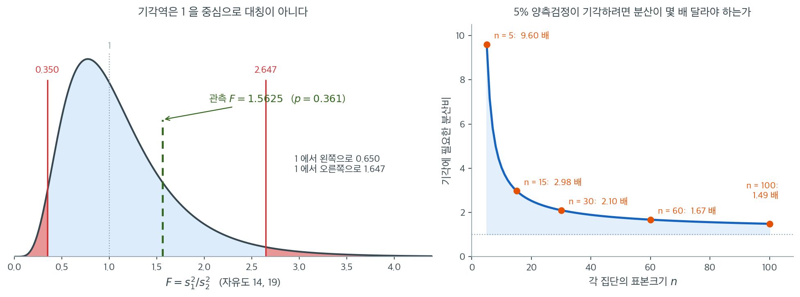
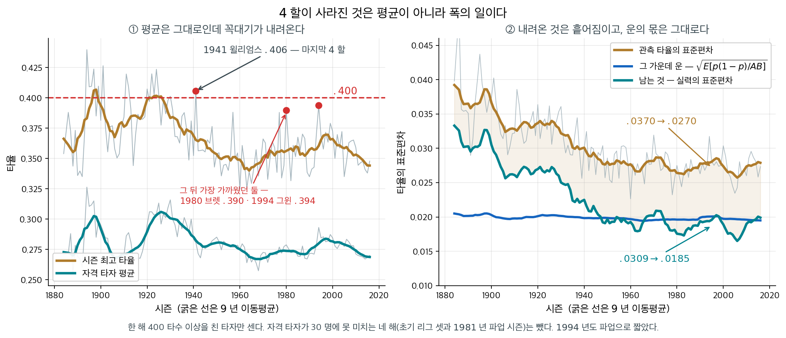
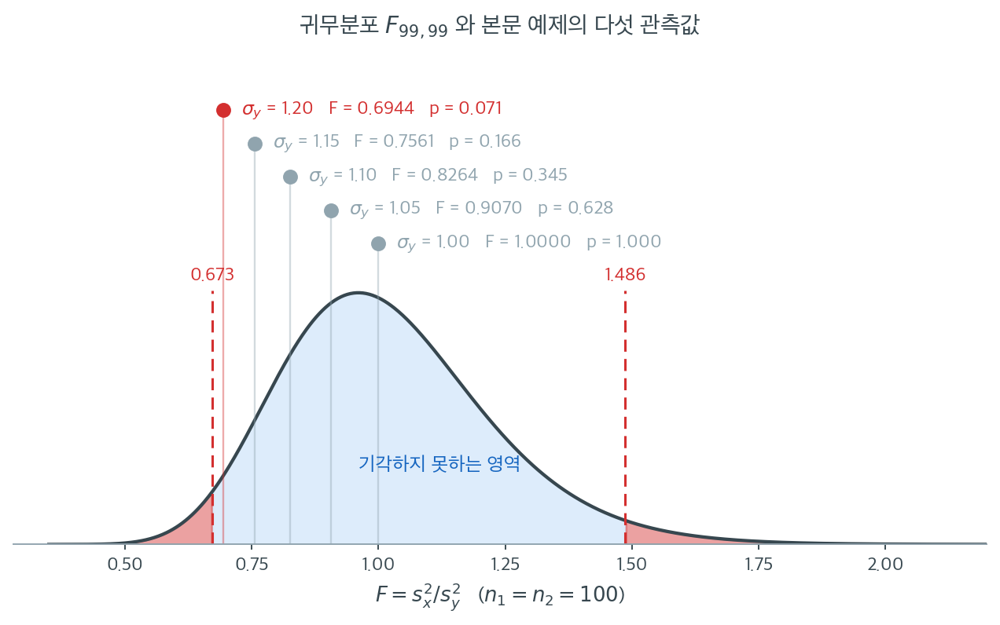
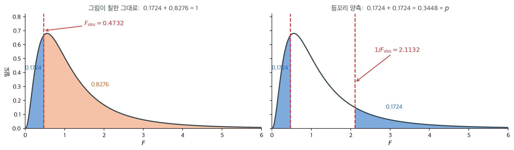
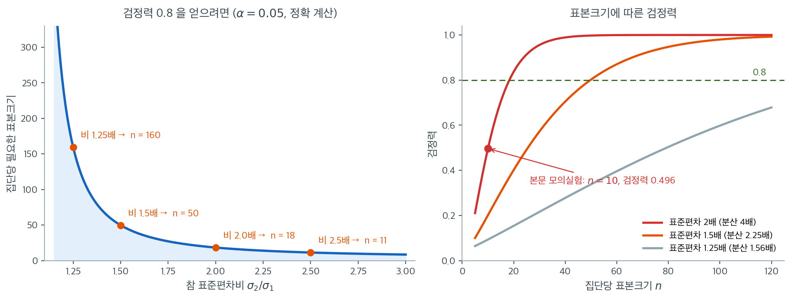
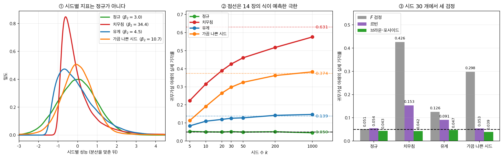
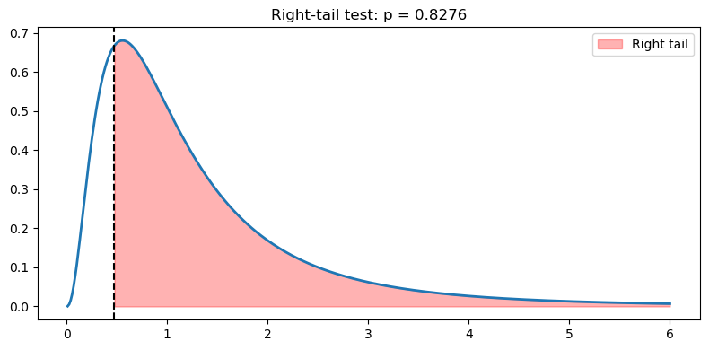
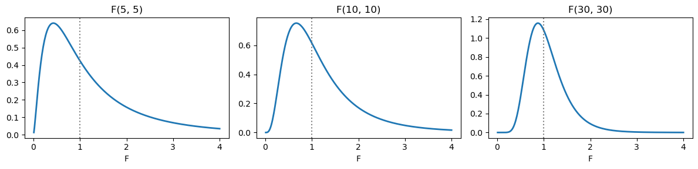
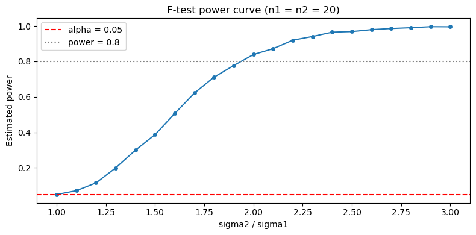

# 두 분산 비교를 위한 F 검정


두 분산을 비교하는 F 검정은 독립인 두 표본의 분산이 유의하게 다른지 판정하는 통계검정이다. 표본분산의 비에 기반하며 두 표본 모두 정규분포를 따르는 모집단에서 왔다고 가정한다. F 검정은 분산분석 같은 방법에서 결정적인 가정인 분산의 동질성을 평가하는 데 특히 유용하다.

9.3절 [두 분산에 대한 F-검정](../../ch09/two_sample_tests/f_test_two_variances.md)이 이 검정을 **많은 가설검정 가운데 하나로** 이미 수행했다. 이 쪽은 같은 검정을 분산 검정의 임자 쪽에서 다시 세운다 — 기각역을 양쪽으로 제대로 잡는 일, 세 $p$ 값 가운데 독립인 것이 하나뿐이라는 일, 그리고 검정력까지다. 이 검정이 정규성에 **얼마나** 기대는지는 15.3절 [비정규성에 대한 민감도](sensitivity.md)가 수로 잰다.

---

## 1. 가설

**귀무가설 ($H_0$):** 두 모분산이 같다.

$$
H_0: \sigma_1^2 = \sigma_2^2
$$

**대립가설 ($H_1$):** 두 모분산이 같지 않다.

- **양측검정** (분산이 단지 다르다):

$$
H_1: \sigma_1^2 \neq \sigma_2^2
$$

- **단측검정** (한 분산이 다른 분산보다 크거나 작다):

$$
H_1: \sigma_1^2 > \sigma_2^2 \quad \text{또는} \quad H_1: \sigma_1^2 < \sigma_2^2
$$

단측과 양측 중 어느 것을 쓸지는 연구 질문에 달려 있다. 어느 분산이 더 클지에 대한 사전 기대가 없을 때는 양측을 쓰는 경우가 많다.

---

## 2. 가정

F 검정은 다음의 핵심 가정에 기댄다.

1. **정규성:** 표본이 추출된 모집단이 정규분포를 따라야 한다. F 검정은 정규성 이탈에 매우 민감하다.
2. **독립성:** 두 표본이 서로 독립이어야 한다.
3. **확률표집:** 두 표본 모두 각자의 모집단을 대표하는 확률표본이어야 한다.

이 가정들, 특히 정규성이 위배되면 F 검정이 잘못된 결론으로 이어질 수 있다. 그런 경우에는 Levene 검정이나 Brown-Forsythe 검정 같은 대안이 더 적절하다.

---

## 3. 검정통계량

F 검정통계량은 두 표본분산의 비에 기반한다. 모분산이 $\sigma_1^2$, $\sigma_2^2$인 모집단에서 나온 독립인 두 표본의 표본분산이 $s_1^2$, $s_2^2$일 때, $\sigma := \sigma_1 = \sigma_2$인 $H_0$ 아래에서

$$
\frac{s_1^2}{s_2^2} = \frac{\dfrac{(n_1-1)s_1^2/\sigma^2}{n_1-1}}{\dfrac{(n_2-1)s_2^2/\sigma^2}{n_2-1}} = \frac{\dfrac{\chi^2_{n_1-1}}{n_1-1}}{\dfrac{\chi^2_{n_2-1}}{n_2-1}} \sim F_{n_1-1, \, n_2-1}
$$

표본분산은 다음과 같이 계산한다.

$$
s_1^2 = \frac{1}{n_1 - 1} \sum_{i=1}^{n_1} (X_{1i} - \bar{X}_1)^2, \qquad
s_2^2 = \frac{1}{n_2 - 1} \sum_{i=1}^{n_2} (X_{2i} - \bar{X}_2)^2
$$

여기서 $X_{1i}$와 $X_{2i}$는 각 표본의 개별 관측값, $\bar{X}_1$과 $\bar{X}_2$는 표본평균, $n_1$과 $n_2$는 표본크기이다.

비의 유의성은 자유도 $n_1 - 1$과 $n_2 - 1$인 F 분포로 평가한다.

!!! note "$F \geq 1$이 되도록 큰 분산을 분자에 두는 관례"
    수기 계산 시대의 표는 상단 임계값만 실려 있었으므로, 항상 큰 표본분산을 분자에 두어 $F \geq 1$이 되게 하고 상단 임계값 하나만 참조하는 관례가 있었다. 이때 양측검정의 $p$값은 상단 꼬리확률의 두 배이다.

    이 페이지와 아래의 Python 구현은 그 관례를 따르지 **않고** 첫 번째 집단을 분자에 고정한다. 그러면 $F < 1$일 수 있으므로 양쪽 임계값을 모두 확인해야 한다. 두 방식은 동등하지만 섞어 쓰면 안 된다. 큰 분산을 분자에 두었다면 반드시 상단 꼬리만 보고 $p$값을 두 배 해야 하고, 집단 순서를 고정했다면 양쪽 임계값을 써야 한다.

---

## 4. 기각역과 판정규칙

두 표본분산의 차이가 통계적으로 유의한지 판정하려면 계산된 F 통계량을 F 분포의 임계값과 비교한다.

- 분자 자유도: $df_1 = n_1 - 1$
- 분모 자유도: $df_2 = n_2 - 1$

**양측검정:**

- $F < F_{\alpha/2}$ 또는 $F > F_{1-\alpha/2}$이면 $H_0$을 기각한다.
- $F_{\alpha/2} < F < F_{1-\alpha/2}$이면 $H_0$을 기각하지 못한다.

**단측검정:**

- $H_1: \sigma_1^2 > \sigma_2^2$을 검정한다면 $F > F_{1-\alpha}$일 때 기각한다.
- $H_1: \sigma_1^2 < \sigma_2^2$을 검정한다면 $F < F_{\alpha}$일 때 기각한다.

F 분포의 유용한 성질로 $F_{\alpha}(df_1, df_2) = 1/F_{1-\alpha}(df_2, df_1)$이 성립한다. 상단 분위수 표만 있어도 하단 분위수를 얻을 수 있다.

아래 보기의 설정($n_1 = 15$, $n_2 = 20$, 곧 자유도 14와 19)으로 기각역을 그려 보자.



왼쪽에서 눈에 먼저 들어와야 할 것은 **기각역이 1을 중심으로 대칭이 아니라는 점**이다. 하단 임계값은 $0.350$, 상단은 $2.647$이다. 1에서 왼쪽으로는 $0.650$밖에 못 가는데 오른쪽으로는 $1.647$까지 간다. 두 꼬리의 넓이는 각각 2.5%로 같은데 거리는 2.5배 차이가 난다. 분산의 **비**를 다루기 때문이다. "두 배 크다"와 "두 배 작다"는 비의 세계에서 $2$와 $0.5$인데, 이 둘은 1에서 같은 거리에 있지 않다. $\log F$로 보면 대칭이 회복된다.

녹색 점선이 보기의 관측값 $F = 25/16 = 1.5625$이다. 분산이 56% 크다는 뜻인데도 채택역 한가운데에 있고 $p = 0.361$이다. 직관과 어긋난다면 오른쪽 그림을 보라. **$n_1 = 15$, $n_2 = 20$ 규모에서 5% 양측검정이 기각하려면 표본분산의 비가 약 3배는 되어야 한다.**

오른쪽은 두 집단의 크기가 같을 때 기각에 필요한 분산비를 표본크기의 함수로 그린 것이다. $n = 5$면 $9.60$배, $n = 15$면 $2.98$배, $n = 30$이면 $2.10$배, $n = 100$이라야 $1.49$배까지 내려온다. 곡선이 처음에 절벽처럼 떨어지다가 곧 평평해지는 모양에 주목하라. **작은 표본에서 분산 검정은 사실상 극단적인 차이만 잡아낸다.** 표본이 20 남짓인 연구에서 "분산에 유의한 차이가 없었다"는 문장은 대개 "차이가 없다"가 아니라 "이 표본으로는 알 수 없다"는 뜻이다.

---

<div class="storybox" markdown>

**그림으로 보는 통계학 1.** $1941$ 년 뒤로 아무도 $4$ 할을 치지 못했다

$1941$ 년 $9$ 월 $28$ 일 아침, 보스턴의 스물세 살 외야수 **테드 윌리엄스**의 타율은
$.39955$ 였다. 기록부에 적힐 때는 반올림되어 $.400$ 이다. 감독 조 크로닌이 그날
필라델피아에서 치를 시즌 마지막 더블헤더를 쉬고 그 수를 지키라고 했지만 그는
거절했다. 두 경기를 다 뛰어 $8$ 타수 $6$ 안타를 쳤고, 시즌 타율은 $.40570$ 으로
끝났다. 그 뒤 아래 자료가 닿는 $2016$ 년까지 $75$ 시즌 동안 $4$ 할 타자는 나오지
않았다. 가장 가까웠던 것이
$1980$ 년 조지 브렛의 $.390$, $1994$ 년 토니 그윈의 $.394$ 다.

흔한 설명은 「요즘 타자가 예전만 못하다」이다. **스티븐 제이 굴드**는 『Full House』
($1996$)에서 그것을 뒤집었다. 리그 평균 타율은 백 년 동안 거의 그대로였다. 변한
것은 **흩어짐**이고, $4$ 할은 평균에서 몇 $\sigma$ 떨어진 자리이므로 $\sigma$ 가
줄면 평균이 그대로여도 닿을 수 없는 곳으로 간다. 분산이 주인공인 이야기다.

<figure markdown>
{ width="960" }
  <figcaption markdown>한 해 $400$ 타수 이상을 친 타자만 센다. 붉은 점 셋이 윌리엄스·브렛·그윈이다.</figcaption>
</figure>

$1884$–$2016$ 년의 자격 타자 $15{,}094$ 명을 $20$ 년씩 묶으면 이렇다. 오른쪽 두 열은
잠시 뒤에 설명한다.

| 연대 | 선수 | 평균 타율 | 표준편차 | 그 가운데 운 | 남는 실력 |
|---|---:|---:|---:|---:|---:|
| $1884$–$1899$ | $873$ | $.2888$ | $.0372$ | $.0203$ | $.0312$ |
| $1920$–$1939$ | $1{,}906$ | $.3003$ | $.0322$ | $.0201$ | $.0251$ |
| $1960$–$1979$ | $2{,}651$ | $.2707$ | $.0274$ | $.0196$ | $.0191$ |
| $2000$–$2016$ | $3{,}119$ | $.2755$ | $.0270$ | $.0196$ | $.0185$ |

평균 타율은 오르내릴 뿐 어디로도 가지 않는다. 표준편차는 $.0372$ 에서 $.0270$ 으로
내려온다. 굴드의 말 그대로다.

**이제 이 쪽의 $F$ 검정을 걸어 보자.** 시즌마다 그해 평균을 빼서 리그 전체의
오르내림을 지운 뒤, $1901$–$1920$ 의 잔차 $1{,}811$ 개와 $1997$–$2016$ 의 잔차
$3{,}665$ 개를 비교한다.

$$
F = \frac{s_{\text{옛}}^2}{s_{\text{요즘}}^2}
= \frac{0.0335^2}{0.0271^2} = 1.537,
\qquad p = 3.5 \times 10^{-27}
$$

기각이다. 그런데 **$1.537$ 은 「실력의 분산비」가 아니다.** 타율은 타석 $500$ 번
남짓의 비율이라, 두 선수의 실력이 완전히 같아도 안타 수는 이항 요동만큼 갈린다.

$$
\operatorname{Var}(\text{관측 타율}) = \underbrace{\operatorname{Var}(\text{실력})}_{\text{묻고 싶은 것}} + \underbrace{E\!\left[\frac{p(1-p)}{AB}\right]}_{\text{운}}
$$

오른쪽 항은 시대가 달라져도 거의 변하지 않는다 — 표준편차로 $.0199$ 와 $.0196$ 이다.
한 타자가 치는 타석 수가 백 년 동안 크게 달라지지 않았기 때문이다. 그러니까 그 운의
몫은 $F$ 의 분자와 분모에 **거의 같은 상수로 더해져** 비를 $1$ 쪽으로 끌어당긴다.
빼고 나면

$$
\frac{0.0335^2 - 0.0199^2}{0.0271^2 - 0.0196^2} = \frac{0.0270^2}{0.0186^2} = 2.109
$$

다. 관측된 비는 $1.54$, 실력의 비는 $2.11$ 이다. **측정에 운이 섞여 있으면 $F$ 비는
언제나 $1$ 쪽으로 줄어든다.** 10.1절 [Pearson 상관계수](../../ch10/correlation/pearson.md)
가 다루는 감쇠 — 설명변수의 측정오차가 상관과 기울기를 $0$ 쪽으로 끌어내리는 일 —
와 같은 구조이고, 방향도 똑같이 한쪽이다. 분산비를 말하기 전에 **무엇의 분산인지**를
먼저 물어야 하는 까닭이다.

마지막으로 이 쪽 절 $2$ 가 요구한 정규성은 여기서 정확히 맞지 않는다. 두 시대 잔차의
첨도가 $3.94$ 와 $3.12$ 다. 다행히 중앙값을 쓰는 브라운–포사이드 검정도 같은 결론을
준다($p = 1.4 \times 10^{-14}$). 남는 걱정은 오히려 자료 쪽이다 — 「$400$ 타수 이상」
이라는 자격 기준이 시대마다 다른 모양으로 꼬리를 자른다.

_확인한 곳 — $1941$ 년 $9$ 월 $28$ 일 윌리엄스가 $.39955$ 로 그날을 시작했고, 크로닌의
제안을 물리고 필라델피아에서 더블헤더를 다 뛰어 $8$ 타수 $6$ 안타로 $.40570$ 을 만들었다는
것은 미국야구연구학회(SABR)와 야구 명예의전당의 기록이다 · 굴드가 『Full House』($1996$,
Harmony Books)에서 $4$ 할의 실종을 「평균은 그대로인데 표준편차가 줄었다」로 설명했다는
것은 그 책이다 · 타율 자료는 레이먼 야구자료(Lahman's Baseball Database)의 $1871$–$2016$
년 타격 기록이며, 널리 알려진 값들($1924$ 혼스비 $.424$ · $1941$ 윌리엄스 $.406$ ·
$1994$ 그윈 $.394$)을 그대로 내는 것을 맞춰 보았다 · 그림과 표의 수는 모두 직접 계산한
값이다_

</div>

---

<div class="exbox" markdown>

**보기 1.** <span class="diff easy" title="쉬움"></span> 시험점수 변동성 비교 — 비대칭 기각역. 어떤 연구자가 두 학생 집단의 시험점수 변동성을 비교하려 한다. 집단 1은 표본크기 15, 표본분산 $s_1^2 = 25$ 이고 집단 2는 표본크기 20, 표본분산 $s_2^2 = 16$ 이다.

**(1)** 유의수준 $5\%$ 에서 두 집단의 분산이 유의하게 다른지 임계값으로 판정하고 양측 $p$ 값을 구하시오.

**(2)** 같은 자유도에서 **기각하려면 표본분산의 비가 얼마나 되어야 하는가.** 집단 1 이 더 퍼져 있을 때와 집단 2 가 더 퍼져 있을 때의 문턱이 **다르다** — 두 값을 모두 구하고 왜 다른지 밝히시오.

</div>

??? success "풀이"

    **(1) 단계를 밟는다.**

    **1단계 — 가설 설정.**

    - $H_0: \sigma_1^2 = \sigma_2^2$
    - $H_1: \sigma_1^2 \neq \sigma_2^2$ (양측검정)

    **2단계 — 검정통계량.**

    $$
    F = \frac{s_1^2}{s_2^2} = \frac{25}{16} = 1.5625
    $$

    **3단계 — 임계값.** $df_1 = 14$, $df_2 = 19$, $\alpha = 0.05$(양측)일 때

    - 하단 임계값: $F_{0.025}(14, 19) = 0.3496$
    - 상단 임계값: $F_{0.975}(14, 19) = 2.6469$

    **4단계 — 판정.** $0.3496 < 1.5625 < 2.6469$ 이므로 $H_0$ 을 **기각하지 못한다.** 양측 $p$ 값은

    $$
    2 \min\bigl\{P(F_{14,19} \le 1.5625),\; P(F_{14,19} \ge 1.5625)\bigr\} = 0.3607
    $$

    이다.

    **5단계 — 결론.** 유의수준 $5\%$ 에서 두 집단의 분산이 유의하게 다르다고 할 증거가 충분하지 않다. 표본분산의 비가 $25/16 = 1.56$ 으로 꽤 커 보이지만 이 표본크기에서는 우연으로 충분히 설명된다.

    **(2) 문턱이 방향마다 다르다.** 기각역이 $F < 0.3496$ 또는 $F > 2.6469$ 인데, 두 경계는 서로 역수가 **아니다.** $1/0.3496 = 2.8607$ 이지 $2.6469$ 가 아니기 때문이다. 그러므로

    - **집단 1 이 더 퍼져 있어야 할 때**: $s_1^2/s_2^2 > 2.6469$, 곧 $2.65$ 배
    - **집단 2 가 더 퍼져 있어야 할 때**: $s_2^2/s_1^2 > 1/0.3496 = 2.8607$, 곧 $2.86$ 배

    로 **같은 자료라도 어느 쪽이 큰가에 따라 요구되는 배수가 다르다.** 까닭은 자유도가 $14$ 와 $19$ 로 다르기 때문이다. $F_{14,19}$ 와 $F_{19,14}$ 는 서로 다른 분포이고, 역수 성질은 $F_{0.025}(14,19) = 1/F_{0.975}(19,14)$ 이지 $1/F_{0.975}(14,19)$ 가 아니다. 자유도가 작은 쪽(집단 1)이 분모로 갈 때 비가 더 흔들리므로 더 큰 배수를 요구한다.

    $d_1 = d_2$ 이면 두 문턱이 같아진다. 그때는 $F_{0.025}(d,d) = 1/F_{0.975}(d,d)$ 가 성립하기 때문이다.

    ```python
    from scipy.stats import f

    df1, df2, alpha = 14, 19, 0.05
    print(f"lower = {f.ppf(alpha / 2, df1, df2):.4f}")
    print(f"upper = {f.ppf(1 - alpha / 2, df1, df2):.4f}")

    # 관측값과 양측 p 값
    lo, hi = f.ppf(alpha / 2, df1, df2), f.ppf(1 - alpha / 2, df1, df2)
    F = 25 / 16
    p = 2 * min(f.cdf(F, df1, df2), f.sf(F, df1, df2))
    print(f"F = 25/16 = {F:.4f}   ->  {'기각' if (F < lo or F > hi) else '기각 못함'},  p = {p:.4f}")

    # 기각하려면 분산비가 얼마나 되어야 하는가. 두 방향이 다르다.
    print(f"\n집단 1 이 더 퍼져 있어야 할 때:  s1^2/s2^2 > {hi:.4f}")
    print(f"집단 2 가 더 퍼져 있어야 할 때:  s2^2/s1^2 > {1 / lo:.4f}")

    # 두 집단이 같은 크기 n 일 때의 문턱
    print("\n두 집단이 모두 크기 n 일 때 기각에 필요한 분산비")
    for n in (5, 15, 30, 100):
        print(f"  n = {n:>3}  ->  {f.ppf(0.975, n - 1, n - 1):.4f} 배")
    ```

    출력:

    ```text
    lower = 0.3496
    upper = 2.6469
    F = 25/16 = 1.5625   ->  기각 못함,  p = 0.3607

    집단 1 이 더 퍼져 있어야 할 때:  s1^2/s2^2 > 2.6469
    집단 2 가 더 퍼져 있어야 할 때:  s2^2/s1^2 > 2.8607

    두 집단이 모두 크기 n 일 때 기각에 필요한 분산비
      n =   5  ->  9.6045 배
      n =  15  ->  2.9786 배
      n =  30  ->  2.1010 배
      n = 100  ->  1.4862 배
    ```

    **유도한 값과 코드가 맞는다.** 임계값 $0.3496$ 과 $2.6469$, 판정 "기각 못함", $p = 0.3607$ 이 모두 위와 같다. 두 문턱 $2.6469$ 와 $2.8607$ 의 차이도 확인되었다.

    마지막 표가 앞 그림의 오른쪽 패널이 그린 곡선의 다섯 점이다. **$n = 5$ 면 분산이 $9.6$ 배는 되어야 기각한다.** $n = 15$ 에서 $2.98$ 배, $n = 30$ 에서 $2.10$ 배로 급히 내려오다가 $n = 100$ 에서도 $1.49$ 배에 머문다. 이 보기의 $1.5625$ 배는 $n = 100$ 짜리 두 집단이라야 겨우 잡히는 크기다.

    **"유의한 차이가 없었다"를 "차이가 없다"로 읽으면 안 된다.** 집단당 $15$–$20$ 개짜리 연구에서 그 문장은 거의 언제나 "이 표본으로는 알 수 없다"는 뜻이다.

<div class="exbox" markdown>

**보기 2.** <span class="diff easy" title="쉬움"></span> 두 분산의 F 검정. 집단당 8 개짜리 두 표본을 코드로 처리한다. $F = 0.4732 < 1$ 이라 **작은 쪽 꼬리가 왼쪽**이다.

**(1)** 아래 세 절차의 실제 제1종오류율을 $\alpha$ 의 식으로 구하시오.

- **(가)** 방향을 **자료를 보기 전에** 정하고 $p = F_F(F_{\text{obs}})$ 로 판정한다.
- **(나)** 자료를 보고 **작은 쪽 꼬리**를 골라 그 값을 그대로 $p$ 로 쓴다.
- **(다)** 등꼬리 양측 $p = 2\min(\cdot,\cdot)$ 으로 판정한다.

**(2)** 모의실험으로 확인하고, 이 자료에서 (나)와 (다)가 각각 어떤 수를 주는지 적으시오.

</div>

??? success "풀이"

    **(1) 세 절차의 크기는 $\alpha$, $2\alpha$, $\alpha$ 다.** $H_0$ 이 참이면 $F_{\text{obs}} \sim F_{d_1,d_2}$ 이고 이 분포가 연속이므로 확률적분변환에 의해

    $$
    U := F_F(F_{\text{obs}}) \sim U(0,1)
    $$

    이다(보기 3 에서 쓴 것과 같은 사실이다). 세 절차를 $U$ 의 말로 옮긴다.

    **(가)** 기각 조건이 $U < \alpha$ 이므로

    $$
    P(\text{기각} \mid H_0) = P(U < \alpha) = \alpha
    $$

    로 **정확하다.** 다만 이것은 $H_1: \sigma_1^2 < \sigma_2^2$ 한 방향만 보는 검정이어서, 반대 방향의 차이는 아무리 커도 잡지 못한다.

    **(나)** 작은 쪽 꼬리는 $\min(U, 1-U)$ 이고 기각 조건이 $\min(U, 1-U) < \alpha$ 다. 두 사건 $U < \alpha$ 와 $U > 1-\alpha$ 는 $\alpha < 1/2$ 이면 배반이므로

    $$
    P(\text{기각} \mid H_0) = P(U < \alpha) + P(U > 1-\alpha) = \alpha + \alpha = 2\alpha
    $$

    로 **명목값의 두 배**다. 틀린 곳은 꼬리를 고른 것이 아니라 **자료를 보고 골랐다**는 데 있다. 방향을 미리 정한 (가)는 멀쩡한데, 관측된 $F$ 가 1 보다 작은 것을 보고 나서 왼쪽을 고르면 사실상 두 꼬리를 모두 열어 둔 셈이 된다.

    **(다)** 기각 조건이 $2\min(U, 1-U) < \alpha$, 곧 $\min(U,1-U) < \alpha/2$ 이므로 (나)의 계산에 $\alpha/2$ 를 넣어

    $$
    P(\text{기각} \mid H_0) = 2 \cdot \frac{\alpha}{2} = \alpha
    $$

    로 되돌아온다. **두 배 하는 것이 두 꼬리를 연 대가를 정확히 갚는다.**

    **(2) 재어 본다.**

    ```python
    import numpy as np
    from scipy.stats import f

    sample1 = [12, 15, 14, 10, 13, 14, 12, 11]
    sample2 = [22, 25, 20, 18, 24, 23, 19, 21]

    # ddof=1 로 표본분산을 쓴다. F 검정의 이론이 그렇게 세워져 있다.
    var1 = np.var(sample1, ddof=1)
    var2 = np.var(sample2, ddof=1)

    # 두 표본분산의 비. 귀무가설이 참이면 이 값이 1 근처에 놓인다.
    f_statistic = var1 / var2

    # 자유도
    df1 = len(sample1) - 1
    df2 = len(sample2) - 1

    # F 분포는 대칭이 아니므로 작은 쪽 꼬리를 두 배 한다.
    p_value = 2 * min(f.cdf(f_statistic, df1, df2),
                      f.sf(f_statistic, df1, df2))

    print(f"Sample variances: {var1:.4f}, {var2:.4f}")
    print(f"F-statistic: {f_statistic:.4f}")
    print(f"Degrees of freedom: {df1}, {df2}")
    print(f"Two-sided p-value: {p_value:.4f}")

    # 결과 해석
    alpha = 0.05
    if p_value < alpha:
        print("Reject H0: variances are significantly different.")
    else:
        print("Fail to reject H0: no significant difference in variances.")

    # 세 절차의 실제 1종오류율을 잰다. H0 가 참이면 cdf(F) 는 U(0,1) 이므로
    # F 를 직접 뽑지 않고 귀무분포에서 바로 뽑아도 같다.
    rng = np.random.default_rng(11)
    M, a = 400_000, 0.05
    d = f(14, 19)                      # 보기 1 의 자유도로 잰다
    U = d.cdf(d.rvs(M, random_state=rng))

    print(f"\n명목 alpha = {a} 일 때 실제 1종오류율 (반복 {M:,}회, 자유도 14, 19)")
    print(f"  (가) 방향을 미리 정한 단측  p = cdf(F)        : {np.mean(U < a):.4f}")
    print(f"  (나) 자료를 보고 작은 꼬리  p = min(cdf, sf)  : {np.mean(np.minimum(U, 1 - U) < a):.4f}")
    print(f"  (다) 등꼬리 양측           p = 2*min(cdf, sf): {np.mean(2 * np.minimum(U, 1 - U) < a):.4f}")
    ```

    출력:

    ```text
    Sample variances: 2.8393, 6.0000
    F-statistic: 0.4732
    Degrees of freedom: 7, 7
    Two-sided p-value: 0.3448
    Fail to reject H0: no significant difference in variances.

    명목 alpha = 0.05 일 때 실제 1종오류율 (반복 400,000회, 자유도 14, 19)
      (가) 방향을 미리 정한 단측  p = cdf(F)        : 0.0497
      (나) 자료를 보고 작은 꼬리  p = min(cdf, sf)  : 0.1001
      (다) 등꼬리 양측           p = 2*min(cdf, sf): 0.0498
    ```

    **유도한 $\alpha,\ 2\alpha,\ \alpha$ 와 잰 값 $0.0497,\ 0.1001,\ 0.0498$ 이 맞는다.** 몬테카를로 표준오차가 $\sqrt{0.05 \cdot 0.95/400000} \approx 0.0003$ 이므로 $0.0497$ 과 $0.0498$ 은 $0.05$ 와 구별되지 않고, $0.1001$ 은 $0.10$ 과 맞는다.

    **이 자료에서는 (나)가 $0.1724$, (다)가 $0.3448$ 을 준다.** $F = 0.4732 < 1$ 이라 작은 쪽 꼬리가 왼쪽이고 그 넓이가 $0.1724$ 인데, 이것은 $H_1: \sigma_1^2 < \sigma_2^2$ 에 대한 단측 $p$ 값이지 "분산이 다르다"에 대한 값이 아니다. 두 수 모두 $0.05$ 를 넘어 이 자료에서는 결론이 갈리지 않지만, $p$ 가 $0.03$ 쯤인 자료였다면 **(나)로는 기각하고 (다)로는 기각하지 못하는** 일이 생긴다. 그런 보고가 쌓이면 실제 거짓 양성률이 $10\%$ 다.

!!! warning "단측 $p$값과 양측 판정을 섞지 말라"
    이 구현에서 $F = 0.4732 < 1$이다. 여기서 `f.cdf(f_statistic, df1, df2)`만 계산하면 하단 단측 $p$값 $0.1724$를 얻는데, 이는 $H_1: \sigma_1^2 < \sigma_2^2$에 대한 값이지 "분산이 다르다"에 대한 값이 아니다.

    "분산이 유의하게 다르다"는 결론을 내리려면 반드시 양측 $p$값 $2 \times 0.1724 = 0.3448$를 써야 한다. 단측 $p$값에 양측 해석을 붙이면 제1종 오류율이 명목값의 두 배가 된다.

---

## 5. 세 p-값 가운데 독립인 것은 하나뿐이다

`scipy` 에는 두 분산을 비교하는 전용 함수가 없다. 그래서 절 $4$ 의 판정규칙을
함수로 옮기는 일에 양측 $p$ 값을 어떻게 조립하느냐가 그대로 드러난다. 이어서
$\sigma_y$ 만 조금씩 올려 가며 검정이 언제 반응하는지 본다.

<div class="exbox" markdown>

**보기 3.** <span class="diff easy" title="쉬움"></span> F 검정 구현. 위의 판정규칙을 그대로 함수로 옮긴다. `scipy` 에는 두 분산을 비교하는 전용 함수가 없으므로 $p$ 값을 직접 조립해야 한다.

**(1)** $p = 2\min\bigl(F_{F}(F_{\text{obs}}),\, 1 - F_{F}(F_{\text{obs}})\bigr)$ 이 **결코 1 을 넘지 않음**을 보이고, $H_0$ 이 참이면 이 값이 **정확히** $U(0,1)$ 을 따름을 보이시오. 따라서 이 검정의 크기는 정확히 $\alpha$ 다.

**(2)** 모의실험으로 그 균등성을 확인하시오. 또 꼬리확률을 `sf` 대신 `1 - cdf` 로 계산하면 어디서부터 무너지는지 밝히시오.

</div>

??? success "풀이"

    **(1) 1 을 넘지 않는다.** $U = F_{F}(F_{\text{obs}})$ 라 쓰면 `sf` 는 $1 - U$ 이고, 두 꼬리확률의 합이 1 이므로 작은 쪽은 반을 넘을 수 없다.

    $$
    \min(U,\, 1-U) \le \tfrac12
    \quad\Longrightarrow\quad
    p = 2\min(U,\, 1-U) \le 1
    $$

    등호는 $U = 1/2$, 곧 $F_{\text{obs}}$ 가 귀무분포의 중앙값일 때만 성립한다. **그러므로 따로 $1$ 에서 자를 필요가 없다.** 양측 $p$ 값을 "두 배"로 만드는 다른 관용구들은 $1$ 을 넘길 수 있지만 이 식은 그렇지 않다.

    **$H_0$ 아래에서 정확히 균등하다.** $H_0$ 아래에서 $F_{\text{obs}} \sim F_{d_1, d_2}$ 이고 이 분포는 연속이므로, 확률적분변환에 의해

    $$
    U = F_F(F_{\text{obs}}) \sim U(0,1)
    $$

    이다. 그러면 $0 < t < 1$ 에 대하여 $2\min(U, 1-U) \le t$ 는 $U \le t/2$ 또는 $U \ge 1 - t/2$ 와 같은 사건이고, 두 사건은 서로 배반이므로

    $$
    P(p \le t) = P\!\left(U \le \tfrac t2\right) + P\!\left(U \ge 1 - \tfrac t2\right) = \frac t2 + \frac t2 = t
    $$

    이다. 곧 $p \sim U(0,1)$ 이 **근사가 아니라 정확히** 성립하고, 따라서

    $$
    P(p < \alpha \mid H_0) = \alpha
    $$

    로 검정의 크기가 명목값과 정확히 같다. 양쪽 꼬리가 각각 $\alpha/2$ 씩을 받으므로 이것을 **등꼬리 양측검정**이라 부른다.

    **이 "정확히"가 어디에 기대고 있는지 보라.** 유일한 고리는 $F_{\text{obs}} \sim F_{d_1, d_2}$ 이고, 그것은 $(n_i-1)S_i^2/\sigma_i^2 \sim \chi^2_{n_i-1}$ 에서 나오며, 그 사실은 **정규모집단에서만** 참이다. 5.2절이 그 유도를 적었다. 정규성이 깨지면 $U$ 가 균등하지 않게 되고 위 등식은 통째로 무너진다. 5.10절은 그때 극한 오류율이 모집단 첨도만의 함수

    $$
    2\left[1 - \Phi\!\left(1.96\sqrt{\frac{2}{\beta_2-1}}\right)\right]
    $$

    로 가고 **표본을 키워도 낫지 않는다**는 것까지 유도해 두었다. 정규 $0.050$, 균등 $0.002$, 지수 $0.327$, 로그정규 $0.794$ 다.

    **(2) 수치적으로.** $H_0$ 이 참인 두 표본을 20만 쌍 만들어 $p$ 값의 분포를 본다.

    ```python
    import numpy as np
    import scipy.stats as stats


    def f_test(data_0, data_1):
        """두 분산이 같은지 검정하는 이표본 F 검정.

        H0: sigma_1^2 = sigma_2^2
        H1: sigma_1^2 != sigma_2^2

        두 표본분산의 비가 F 분포를 따른다는 사실을 쓴다. 이 사실 자체가
        정규성에서 나오므로, 정규가 아니면 검정 전체가 무너진다.
        """
        statistic = data_0.var(ddof=1) / data_1.var(ddof=1)
        df1 = data_0.shape[0] - 1
        df2 = data_1.shape[0] - 1
        p_value = 2 * min(
            stats.f(df1, df2).cdf(statistic),
            stats.f(df1, df2).sf(statistic),
        )
        return statistic, p_value


    # 한 쌍으로 손풀기. H0 이 참인 두 표본이므로 p 가 커야 한다.
    rng = np.random.default_rng(7)
    stat, pval = f_test(rng.normal(size=100), rng.normal(size=100))
    print(f"표본 한 쌍:  F = {stat:.4f},  p = {pval:.4f}")

    # (1) p 값이 1 을 넘지 않는가, H0 아래에서 균등한가.
    n, M = 100, 200_000
    X = rng.normal(size=(M, n))
    Y = rng.normal(size=(M, n))          # 두 표본 모두 N(0,1) 이므로 H0 이 참이다
    F = X.var(axis=1, ddof=1) / Y.var(axis=1, ddof=1)

    dist = stats.f(n - 1, n - 1)
    U = dist.cdf(F)
    p = 2 * np.minimum(U, 1 - U)          # 함수가 돌려주는 것과 같은 식

    print(f"p 의 최대값 = {p.max():.6f}   (1 을 넘지 않는다)")
    print(f"p 의 평균   = {p.mean():.6f}   (U(0,1) 이면 0.5)")
    ks = stats.kstest(p, "uniform")
    print(f"p 가 U(0,1) 인가:  KS = {ks.statistic:.5f},  p-value = {ks.pvalue:.4f}")
    for a in (0.01, 0.05, 0.10):
        print(f"   명목 alpha = {a:.2f}  ->  실제 기각률 = {np.mean(p < a):.5f}")

    # (2) 꼬리에서 1 - cdf 가 무너진다. 2^-53 = 1.11e-16 바닥에 붙는다.
    print(f"\n{'F':>6}{'sf(F)':>16}{'1 - cdf(F)':>16}  배율")
    for f in (5, 10, 20, 50, 100):
        sf, naive = dist.sf(f), 1 - dist.cdf(f)
        print(f"{f:>6}{sf:>16.3e}{naive:>16.3e}  {naive / sf:.1e}")
    print(f"2**-53 = {2.0**-53:.3e}")
    ```

    출력:

    ```text
    표본 한 쌍:  F = 1.0182,  p = 0.9285
    p 의 최대값 = 0.999999   (1 을 넘지 않는다)
    p 의 평균   = 0.500026   (U(0,1) 이면 0.5)
    p 가 U(0,1) 인가:  KS = 0.00126,  p-value = 0.9066
       명목 alpha = 0.01  ->  실제 기각률 = 0.00983
       명목 alpha = 0.05  ->  실제 기각률 = 0.04985
       명목 alpha = 0.10  ->  실제 기각률 = 0.09879

         F           sf(F)      1 - cdf(F)  배율
         5       1.370e-14       1.366e-14  1.0e+00
        10       7.783e-26       1.110e-16  1.4e+09
        20       8.867e-39       1.110e-16  1.3e+22
        50       2.955e-57       1.110e-16  3.8e+40
       100       9.653e-72       1.110e-16  1.2e+55
    2**-53 = 1.110e-16
    ```

    **(1)의 두 주장이 모두 맞는다.** $p$ 의 최대값이 $0.999999$ 로 $1$ 을 넘지 않고, 평균이 $0.500026$ 으로 $U(0,1)$ 의 $0.5$ 와 맞는다. 콜모고로프–스미르노프 거리가 $0.00126$ 이고 그 $p$ 값이 $0.9066$ 이라 균등분포와 구별되지 않는다. 20만 번이면 $\pm 1/\sqrt{200000} \approx 0.0022$ 정도의 거리는 우연으로 설명되므로, $0.00126$ 은 몬테카를로 오차 안이다. 세 명목수준에서 실제 기각률이 $0.00983$, $0.04985$, $0.09879$ 로 모두 명목값과 맞는다.

    **`1 - cdf` 는 $F = 10$ 에서 이미 무너진다.** $F_{99,99}$ 에서 참값 `sf(10)` 이 $7.8\times10^{-26}$ 인데 `1 - cdf(10)` 은 $1.11\times 10^{-16}$ 을 돌려준다. 열 자릿수 가까이 **크게** 준다. 그리고 $F = 20, 50, 100$ 에서도 값이 $1.11\times 10^{-16}$ 에서 꼼짝하지 않는데, 이것이 바로 $2^{-53}$, 곧 배정도 부동소수점에서 $1$ 바로 아래의 간격이다. `cdf` 가 $1$ 에 너무 가까워져 `1 - cdf` 가 **반올림의 잔돈만 돌려주는 것**이다.

    $p$ 값을 작게 줄 수 있어야 하는 검정에서 꼬리확률을 자릿수째로 크게 주는 것은 치명적이다. 그래서 위 함수가 `sf` 를 쓴다. **꼬리확률은 늘 `sf` 로 계산하라.** `1 - cdf` 는 꼬리가 $10^{-16}$ 보다 얇아지는 곳에서 바닥에 붙는다.

다음 보기는 두 번째 표본의 표준편차를 점점 키우면서 F 검정을 적용한다.

<div class="exbox" markdown>

**보기 4.** <span class="diff easy" title="쉬움"></span> 분산 차이를 키워 가며. 집단당 $n = 100$, $x$ 와 $y$ 에 **같은 씨앗**을 주고 $\sigma_y$ 만 $1.00$ 에서 $1.20$ 까지 키운다.

**(1)** 이 설정에서 $F$ 통계량이 표집변동 없이 **정확히** $1/\sigma_y^2$ 이 됨을 보이고, $\sigma_y = 1$ 에서 $p$ 가 정확히 $1$ 이 되는 까닭을 밝히시오.

**(2)** $F_{99,99}$ 의 양측 $2.5\%$ 임계값을 구해 다섯 경우의 판정을 **돌려 보기 전에** 예측하시오. 또 이 표를 "검정력"으로 읽으면 왜 안 되는지, 독립 표본이면 실제 기각률이 얼마인지 밝히시오.

</div>

??? success "풀이"

    **(1) 두 표본이 같은 난수를 공유한다.** `stats.norm(loc=a, scale=s).rvs(size, random_state=seed)` 는 표준정규 추출값 $z_1, \ldots, z_{100}$ 을 씨앗 하나로 정하고 $a + s z_j$ 를 돌려준다. 씨앗이 같으므로 두 표본에 들어가는 $z$ 가 **같은 수열**이고

    $$
    x_j = z_j, \qquad y_j = 1 + \sigma_y z_j
    $$

    이다. 표본분산은 위치이동에 둔감하고 척도에 대해 이차이므로

    $$
    S_x^2 = S_z^2, \qquad S_y^2 = \sigma_y^2 S_z^2
    $$

    이고, 따라서

    $$
    F = \frac{S_x^2}{S_y^2} = \frac{S_z^2}{\sigma_y^2 S_z^2} = \frac{1}{\sigma_y^2}
    $$

    이 된다. **$S_z^2$ 이 약분되어 자료가 통째로 사라졌다.** 표본을 다시 뽑아도, 씨앗을 바꾸어도 $F$ 는 꿈쩍하지 않는다. 두 표본이 독립이라는 F 검정의 전제가 깨져 있으니 당연히 그렇다. 이 설정이 보여 주는 것은 **표집변동이 0 인 이상적 신호**다.

    **$\sigma_y = 1$ 에서 $p = 1$ 인 까닭.** 그때 $F = 1$ 이다. 그리고 $W \sim F_{d,d}$ 이면 $1/W \sim F_{d,d}$ 이므로(두 자유도가 같다) $P(W \le 1) = P(1/W \le 1) = P(W \ge 1)$ 이고, 두 확률의 합이 $1$ 이니

    $$
    F_F(1) = \tfrac12 \quad \text{(자유도가 같은 } F \text{ 분포의 중앙값은 1)}
    $$

    이다. 보기 1 의 식에 넣으면 $p = 2\min(1/2, 1/2) = 1$ 이다. **$p$ 가 어림값 1 이 아니라 정확히 1 이다.** 독립 표본에서는 $F$ 가 정확히 $1$ 이 될 확률이 $0$ 이므로 결코 일어나지 않는 일이다.

    **(2) 임계값으로 판정을 미리 짚는다.** $F_{99,99}$ 의 $2.5\%$ 와 $97.5\%$ 분위수를 $\ell, u$ 라 하면 역수 성질에서 $\ell = 1/u$ 다. 수치로는 $\ell = 0.67284$, $u = 1.48623$ 이다. $F = 1/\sigma_y^2 < 1$ 이므로 걸리는 쪽은 **하단**이고, 기각 조건은

    $$
    \frac{1}{\sigma_y^2} < \ell \iff \sigma_y^2 > \frac{1}{\ell} = u \iff \sigma_y > \sqrt{u} = 1.2191
    $$

    이다. 다섯 후보 가운데 $1.2191$ 을 넘는 것이 없으므로 **다섯 모두 기각하지 못한다**고 예측된다.

    **확인한다.** 아래 코드는 보기 1 의 `f_test` 를 그대로 이어받는다.

    ```python
    # 표준편차 차이를 키워 가며 검정력을 눈으로 본다. 앞의 Bartlett·Levene 과
    # 같은 설정이므로 세 검정의 p-값을 견줄 수 있다.
    size, seed = 100, 1
    x = stats.norm(loc=0, scale=1).rvs(size, random_state=seed)

    null = stats.f(size - 1, size - 1)
    lo, hi = null.ppf([0.025, 0.975])
    print(f"F(99,99) 의 임계값:  {lo:.5f}  과  {hi:.5f}   (서로 역수: 1/{lo:.5f} = {1 / lo:.5f})")
    print(f"하단을 넘기려면 sigma_y > sqrt({hi:.5f}) = {np.sqrt(hi):.4f} 여야 한다\n")

    print(f"{'sigma_y':>8}{'F':>10}{'1/sigma_y^2':>13}{'차':>10}{'p':>8}  판정")
    for scale in [1.00, 1.05, 1.10, 1.15, 1.20]:
        y = stats.norm(loc=1, scale=scale).rvs(size, random_state=seed)
        stat, pval = f_test(x, y)
        exact = 1 / scale**2
        verdict = "기각" if (stat < lo or stat > hi) else "기각 못함"
        print(f"{scale:>8.2f}{stat:>10.4f}{exact:>13.6f}{abs(stat - exact):>10.1e}"
              f"{pval:>8.3f}  {verdict}")

    # x 와 y 가 같은 z 를 공유하는지 직접 확인한다.
    y12 = stats.norm(loc=1, scale=1.2).rvs(size, random_state=seed)
    print(f"\ny(scale=1.2) - (1 + 1.2*x) 의 최대 절대오차 = {np.abs(y12 - (1 + 1.2 * x)).max():.3e}")

    # 독립 표본이면 어떻게 되는가. 기각률을 정확히 계산한다.
    # F_obs = (sigma_x^2/sigma_y^2) * W,  W ~ F(99,99) 이므로
    print("\n독립 표본일 때 실제 기각률 (n=100, alpha=0.05)")
    for scale in [1.00, 1.10, 1.20, 1.30, 1.50]:
        r = 1 / scale**2
        power = null.cdf(lo / r) + null.sf(hi / r)
        print(f"  sigma_y = {scale:.2f}  ->  기각률 {power:.4f}")
    ```

    출력:

    ```text
    F(99,99) 의 임계값:  0.67284  과  1.48623   (서로 역수: 1/0.67284 = 1.48623)
    하단을 넘기려면 sigma_y > sqrt(1.48623) = 1.2191 여야 한다

     sigma_y         F  1/sigma_y^2         차       p  판정
        1.00    1.0000     1.000000   2.2e-16   1.000  기각 못함
        1.05    0.9070     0.907029   1.1e-16   0.628  기각 못함
        1.10    0.8264     0.826446   1.1e-16   0.345  기각 못함
        1.15    0.7561     0.756144   0.0e+00   0.166  기각 못함
        1.20    0.6944     0.694444   0.0e+00   0.071  기각 못함

    y(scale=1.2) - (1 + 1.2*x) 의 최대 절대오차 = 0.000e+00

    독립 표본일 때 실제 기각률 (n=100, alpha=0.05)
      sigma_y = 1.00  ->  기각률 0.0500
      sigma_y = 1.10  ->  기각률 0.1559
      sigma_y = 1.20  ->  기각률 0.4378
      sigma_y = 1.30  ->  기각률 0.7381
      sigma_y = 1.50  ->  기각률 0.9798
    ```

    **(1)의 항등식이 기계 정밀도까지 맞는다.** $F$ 와 $1/\sigma_y^2$ 의 차가 $2.2\times10^{-16}$ 이하이고 두 경우는 **정확히 0** 이다. 더 결정적인 것은 `y - (1 + 1.2*x)` 의 최대 절대오차가 $0$ 이라는 줄이다. 두 표본이 같은 $z$ 를 공유한다는 것이 어림이 아니라 비트 단위로 확인되었다.

    **(2)의 예측도 맞는다.** 다섯 모두 "기각 못함"이고, 마지막 $F = 0.6944$ 가 하단 임계값 $0.67284$ 에 바짝 붙었지만 아직 안쪽이다. 그래서 $p = 0.071$ 이다.

    **이 표를 "검정력"으로 읽으면 안 된다.** 독립 표본에서는 $F_{\text{obs}} = (\sigma_x^2/\sigma_y^2)\, W$ 로 $W \sim F_{99,99}$ 가 곱해지므로 $F$ 가 $1/\sigma_y^2$ 주위로 넓게 흩어진다. 마지막 줄의 표가 그 결과인데, $\sigma_y = 1.20$ 에서 실제 기각률이 $0.4378$ 이다. **잡음 없는 설정에서 $p = 0.071$ 로 간신히 비껴간 그 효과크기가, 진짜 독립 표본에서는 열 번에 네 번 남짓만 잡힌다.** 같은 $\sigma$ 비율에서도 표본에 따라 $p$ 값이 $0.001$ 에서 $0.9$ 까지 흔들린다는 뜻이다.

    검산도 된다. $\sigma_y = 1.00$ 줄의 기각률이 $0.0500$ 으로 명목값과 정확히 같다. 보기 1 에서 이 검정의 크기가 정규 가정 아래 정확히 $\alpha$ 임을 보였으니 그래야 한다.

    독립 표본으로 바꾸려면 `y` 에 다른 씨앗을 주면 된다(예: `random_state=seed + 1`). 그러면 위의 깔끔한 단조 수열은 사라지고 표본마다 다른 값이 나온다. **잡음을 없앤 이 설정은 신호의 크기를 보여 주는 데에만 쓰고, 검정의 성능은 반드시 반복 추출로 재야 한다.**

### 다섯 줄이 말하는 것

- 두 모집단의 분산이 같으면($\sigma_1 = \sigma_2$) F 통계량이 1에 가깝고 $p$값이 크다.
- 분산비가 1에서 멀어질수록 F 통계량이 1에서 멀어지고 $p$값이 작아진다.
- F 검정은 비정규성에 극도로 민감하다. 중간 정도의 치우침이나 두꺼운 꼬리만으로도 실제 제1종 오류율이 $\alpha$를 크게 넘을 수 있다. 정규성이 의심스러우면 Levene이나 Brown-Forsythe 검정이 낫다.

표에서 $n_1 = n_2 = 100$이고 표준편차 비가 1.2(분산비 1.44)인데도 $p = 0.071$로 5% 수준을 넘지 못한다는 점에 주목하라. **표집변동이 전혀 없는 이상적 상황에서도** 그렇다. 두 표본을 비교하는 F 검정의 검정력이 얼마나 낮은지 보여준다.

다섯 개의 $F$ 값을 귀무분포 위에 얹으면 그 둔함이 눈에 보인다.



연한 파랑이 $H_0$ 아래의 $F_{99,99}$이고, 붉은 점선이 2.5% 임계값 $0.673$과 $1.486$이다. 표본이 각각 100개나 되는데도 채택역이 $0.673$에서 $1.486$까지 뻗어 있다. **표본분산의 비가 0.67배에서 1.49배 사이면 무엇이든 "차이 없음"으로 판정된다는 뜻이다.**

다섯 관측값은 $1.0000,\ 0.9070,\ 0.8264,\ 0.7561,\ 0.6944$로 왼쪽으로 한 걸음씩 이동한다. 마지막 $0.6944$가 하단 임계값 $0.673$에 거의 닿았지만 아직 안쪽이다. 그래서 $p = 0.071$이다. 분산이 44% 차이 나는데도, 게다가 표집오차가 하나도 없는데도 기각하지 못한다.

왜 이렇게 둔한가. 검정통계량이 **두 개의** 표본분산의 비이기 때문이다. 분자도 흔들리고 분모도 흔들리니 불확실성이 두 배로 들어온다. 앞 절의 일표본 카이제곱 검정에서는 $\sigma_0^2$이 알려진 상수였기에 $n = 100$, $\sigma = 1.15$에서 이미 $p = 0.021$로 기각했다. 같은 표본크기, 비슷한 크기의 효과인데 결과가 갈린다. **비교 대상이 추정값이라는 사실 하나가 검정력을 크게 갉아먹는다.**

실무적 함의는 분명하다. 분산 차이를 탐지하려는 연구를 설계한다면 평균 차이를 탐지할 때보다 훨씬 큰 표본이 필요하다. 그리고 유의하지 않은 결과가 나왔을 때 "분산이 같다"고 결론짓지 말아야 한다.

---

<div class="exbox" markdown>

**보기 5.** <span class="diff easy" title="쉬움"></span> 관측된 F를 그림에 얹기. 두 표본 $\{12,15,14,10,13,14,12,11\}$ 과 $\{22,25,20,18,24,23,19,21\}$ 로 $F_{\text{obs}}$ 를 만들고, $F_{7,7}$ 밀도 위에 $F_{\text{obs}}$ 의 왼쪽과 오른쪽을 각각 칠한다.

**(1)** 그렇게 칠한 두 영역의 넓이를 각각 구하고 **그 합**이 얼마인지 말하시오. 이 그림을 그대로 "양측 $p$ 값"으로 읽을 수 있는가?

**(2)** 같은 $F_{\text{obs}}$ 에 대해 **등꼬리 양측검정의 기각역**을 제대로 보이려면 어디를 칠해야 하는가. $d_1 = d_2 = 7$ 에서 그 두 경계를 구하고, 칠한 넓이가 양측 $p$ 값과 같음을 확인하시오.

</div>

??? success "풀이"

    **(1) 두 넓이의 합은 정확히 1 이다.** 칠한 두 영역이 $\{F \le F_{\text{obs}}\}$ 와 $\{F \ge F_{\text{obs}}\}$ 인데, 이 둘은 $F_{\text{obs}}$ 한 점에서만 겹치고 그 점은 연속분포에서 확률 0 이다. 그러므로

    $$
    \underbrace{P(F \le F_{\text{obs}})}_{\text{왼쪽}} + \underbrace{P(F \ge F_{\text{obs}})}_{\text{오른쪽}} = 1
    $$

    이다. **$F_{\text{obs}}$ 를 어디에 두든 합은 1 이다.** 칠해진 넓이가 자료에 전혀 반응하지 않는다는 뜻이고, 따라서 **이 그림을 그대로 양측 $p$ 값으로 읽을 수 없다.** 그림이 말해 주는 것은 넓이가 아니라 **$F_{\text{obs}}$ 가 밀도의 어디에 앉았는가** 하나다.

    두 넓이는 각각 단측 $p$ 값이다. 왼쪽이 $H_1: \sigma_1^2 < \sigma_2^2$ 의 $p$ 값, 오른쪽이 $H_1: \sigma_1^2 > \sigma_2^2$ 의 $p$ 값이며, 둘 중 **큰 쪽은 쓸 일이 없다**(언제나 $1/2$ 를 넘으므로 어떤 수준에서도 기각하지 못한다).

    **그려서 수를 읽는다.**

    ```python
    import numpy as np
    import matplotlib.pyplot as plt
    from scipy.stats import f

    plt.rcParams["font.sans-serif"] = ["NanumGothic", "Apple SD Gothic Neo", "Malgun Gothic"]
    plt.rcParams["font.family"] = "sans-serif"
    plt.rcParams["axes.unicode_minus"] = False

    sample1 = [12, 15, 14, 10, 13, 14, 12, 11]
    sample2 = [22, 25, 20, 18, 24, 23, 19, 21]

    # 두 집단의 분산비가 F 분포의 어디에 떨어지는지 그림으로 본다.
    x1 = np.asarray(sample1, dtype=float)
    x2 = np.asarray(sample2, dtype=float)
    df1, df2 = x1.size - 1, x2.size - 1

    F_obs = x1.var(ddof=1) / x2.var(ddof=1)

    xs = np.linspace(0.01, max(6, F_obs + 2), 400)
    pdf = f(df1, df2).pdf(xs)

    fig, ax = plt.subplots(figsize=(10, 4))
    ax.plot(xs, pdf, linewidth=2, label="F({},{}) PDF".format(df1, df2))

    # 왼쪽 꼬리를 칠한다. 분산비가 1 보다 작은 쪽의 이탈에 해당한다.
    mask_left = xs <= F_obs
    ax.fill_between(xs[mask_left], pdf[mask_left], 0, alpha=0.15, label="Left tail")

    # 오른쪽 꼬리. 양측검정이므로 두 꼬리를 모두 본다.
    mask_right = xs >= F_obs
    ax.fill_between(xs[mask_right], pdf[mask_right], 0, alpha=0.15, label="Right tail")

    ax.axvline(F_obs, linestyle="--", color="black", label=f"F_obs = {F_obs:.3f}")
    ax.set_xlabel("F")
    ax.set_ylabel("Density")
    ax.set_title(f"F({df1}, {df2}) with observed F = {F_obs:.3f}")
    ax.legend()
    plt.tight_layout()
    plt.show()

    # 칠해진 두 영역의 넓이를 실제로 재 본다.
    dist = f(df1, df2)
    area_left, area_right = dist.cdf(F_obs), dist.sf(F_obs)
    print(f"F_obs = {F_obs:.6f}   (d1 = {df1}, d2 = {df2})")
    print(f"왼쪽 영역 넓이 = {area_left:.6f}")
    print(f"오른쪽 영역 넓이 = {area_right:.6f}")
    print(f"두 넓이의 합   = {area_left + area_right:.12f}")
    print(f"양측 p 값      = {2 * min(area_left, area_right):.6f}")
    ```

    출력:

    ```text
    F_obs = 0.473214   (d1 = 7, d2 = 7)
    왼쪽 영역 넓이 = 0.172386
    오른쪽 영역 넓이 = 0.827614
    두 넓이의 합   = 1.000000000000
    양측 p 값      = 0.344772
    ```

    

    **예측대로 합이 $1.000000000000$ 이다.** 그런데 양측 $p$ 값은 $0.344772$ 다. 그림에 칠해진 어느 영역도, 두 영역을 합한 것도 이 수가 아니다. **$0.3448$ 은 그림 어디에도 없다.**

    **(2) 등꼬리 양측검정이 칠해야 할 곳.** 양측 $p$ 값 $2\min(\cdot,\cdot)$ 이 재는 것은 "꼬리확률이 $F_{\text{obs}}$ 의 작은 쪽 꼬리만큼 극단적인 모든 값"의 확률이다. 아래쪽 경계가 $F_{\text{obs}}$ 이면 위쪽 경계 $c$ 는 **오른쪽 꼬리확률이 왼쪽과 같아지는 자리**다.

    $$
    P(F \ge c) = P(F \le F_{\text{obs}}) \iff c = F_F^{-1}\bigl(1 - F_F(F_{\text{obs}})\bigr)
    $$

    $d_1 = d_2$ 이면 $1/F \sim F_{d_2,d_1} = F_{d_1,d_2}$ 라는 역수 성질에서 이 $c$ 가 깔끔하게 나온다.

    $$
    P(F \ge 1/F_{\text{obs}}) = P(1/F \le F_{\text{obs}}) = P(F \le F_{\text{obs}})
    $$

    곧 $c = 1/F_{\text{obs}} = 1/0.473214 = 2.113208$ 이다. 따라서 칠해야 할 곳은

    $$
    \{F \le 0.4732\} \cup \{F \ge 2.1132\}
    $$

    이고 그 넓이는 $0.172386 \times 2 = 0.344772$, 바로 양측 $p$ 값이다.

    ```python
    import matplotlib
    matplotlib.use("Agg")
    import matplotlib.pyplot as plt
    import numpy as np
    from scipy.stats import f

    plt.rcParams["font.sans-serif"] = ["NanumGothic", "Apple SD Gothic Neo", "Malgun Gothic"]
    plt.rcParams["font.family"] = "sans-serif"
    plt.rcParams["axes.unicode_minus"] = False

    INK, BLUE, BLUEL = "#37474F", "#1565C0", "#DCEBFB"
    ORANGE, ORANGEL, RED = "#E65100", "#FFE0B2", "#D32F2F"

    d1 = d2 = 7
    dist = f(d1, d2)
    F_obs = 0.47321428571428575
    mirror = 1 / F_obs

    xs = np.linspace(0.001, 6, 1200)
    pdf = dist.pdf(xs)

    fig, (ax, az) = plt.subplots(1, 2, figsize=(12, 3.6), sharey=True)

    for a in (ax, az):
        a.plot(xs, pdf, color=INK, lw=1.8, zorder=4)
        a.axvline(F_obs, color=RED, ls="--", lw=1.6, zorder=5)
        a.set_xlabel("$F$")
        a.set_xlim(0, 6)
        a.set_ylim(0, 0.82)
        a.spines[["top", "right"]].set_visible(False)

    # 왼쪽: 쪽의 그림이 칠한 그대로. 두 영역이 축 전체를 덮는다.
    m = xs <= F_obs
    ax.fill_between(xs[m], pdf[m], 0, color=BLUE, alpha=0.55, zorder=2)
    m = xs >= F_obs
    ax.fill_between(xs[m], pdf[m], 0, color=ORANGE, alpha=0.35, zorder=2)
    ax.set_ylabel("밀도")
    ax.set_title("그림이 칠한 그대로:  0.1724 + 0.8276 = 1", fontsize=11, color=INK)
    ax.text(0.20, 0.42, "0.1724", color=BLUE, fontsize=10, ha="center", fontweight="bold")
    ax.text(1.9, 0.30, "0.8276", color=ORANGE, fontsize=10, ha="center", fontweight="bold")
    ax.annotate("$F_{\\mathrm{obs}} = 0.4732$", xy=(F_obs, 0.70), xytext=(1.5, 0.74),
                color=RED, fontsize=10,
                arrowprops=dict(arrowstyle="->", color=RED, lw=1.2))

    # 오른쪽: 등꼬리 양측 기각역. 두 꼬리가 각각 0.1724 다.
    m = xs <= F_obs
    az.fill_between(xs[m], pdf[m], 0, color=BLUE, alpha=0.55, zorder=2)
    m = xs >= mirror
    az.fill_between(xs[m], pdf[m], 0, color=BLUE, alpha=0.55, zorder=2)
    az.axvline(mirror, color=RED, ls="--", lw=1.6, zorder=5)
    az.set_title("등꼬리 양측:  0.1724 + 0.1724 = 0.3448 = $p$", fontsize=11, color=INK)
    az.text(0.20, 0.42, "0.1724", color=BLUE, fontsize=10, ha="center", fontweight="bold")
    az.text(3.1, 0.14, "0.1724", color=BLUE, fontsize=10, ha="center", fontweight="bold")
    az.annotate("$1/F_{\\mathrm{obs}} = 2.1132$", xy=(mirror, 0.33), xytext=(2.6, 0.55),
                color=RED, fontsize=10,
                arrowprops=dict(arrowstyle="->", color=RED, lw=1.2))

    plt.tight_layout()
    plt.show()

    print(f"위쪽 경계  1/F_obs            = {mirror:.6f}")
    print(f"일반 공식  ppf(1 - cdf(F_obs)) = {dist.ppf(1 - dist.cdf(F_obs)):.6f}")
    print(f"칠한 넓이  cdf(F_obs) + sf(1/F_obs) = {dist.cdf(F_obs) + dist.sf(mirror):.6f}")
    print(f"양측 p 값                         = {2 * min(dist.cdf(F_obs), dist.sf(F_obs)):.6f}")
    ```

    출력:

    ```text
    위쪽 경계  1/F_obs            = 2.113208
    일반 공식  ppf(1 - cdf(F_obs)) = 2.113208
    칠한 넓이  cdf(F_obs) + sf(1/F_obs) = 0.344772
    양측 p 값                         = 0.344772
    ```

    

    역수로 구한 $2.113208$ 과 일반 공식 $F_F^{-1}(1 - F_F(F_{\text{obs}}))$ 가 소수 여섯째 자리까지 같다. 칠한 넓이도 $0.344772$ 로 양측 $p$ 값과 정확히 맞는다.

    **두 그림을 나란히 놓으면 차이가 분명하다.** 왼쪽은 축 전체가 칠해져 있어 넓이가 언제나 1 이고, 오른쪽은 가운데가 비어 있다. **비어 있는 가운데가 채택역**이고 그 넓이가 $1 - 0.3448 = 0.6552$ 다. 꼬리 그림을 그릴 때 흔히 저지르는 실수가 왼쪽처럼 $F_{\text{obs}}$ 를 기준으로 양쪽을 다 칠해 놓고 "양측이니까 두 꼬리"라고 적는 것이다. **양측의 두 꼬리는 $F_{\text{obs}}$ 와 그 거울상에서 바깥으로 뻗는 두 조각이지, $F_{\text{obs}}$ 에서 좌우로 갈라진 두 반쪽이 아니다.**

    $d_1 \ne d_2$ 이면 거울상이 $1/F_{\text{obs}}$ 가 아니다. 그때는 역수 요령이 통하지 않으므로 일반 공식 `ppf(1 - cdf(F_obs))` 를 써야 한다.

$p$값을 명시적으로 계산하려면

<div class="exbox" markdown>

**보기 6.** <span class="diff easy" title="쉬움"></span> 양측 p-값 계산. 보기 5 의 $F_{\text{obs}} = 0.4732$ 에 대해 왼쪽·오른쪽·양측 $p$ 값을 모두 찍는다.

**(1)** 세 수 가운데 **독립인 것은 몇 개인가.** $p_{\text{two}}$ 를 $p_{\text{left}}$ 하나의 식으로 적으시오.

**(2)** $F_{\text{obs}}$ 를 움직이며 세 수를 표로 만들고, $p_{\text{two}} = 1$ 이 되는 $F_{\text{obs}}$ 가 어디인지 구하시오. 표가 $F_{\text{obs}} \mapsto 1/F_{\text{obs}}$ 에 대해 어떤 꼴을 보이는가.

</div>

??? success "풀이"

    **(1) 독립인 것은 하나뿐이다.** 보기 5 에서 본 대로 두 꼬리확률의 합이 1 이므로

    $$
    p_{\text{right}} = 1 - p_{\text{left}}
    $$

    이고, 양측 $p$ 값도 $p_{\text{left}}$ 만의 함수다. $u = p_{\text{left}}$ 라 쓰면

    $$
    p_{\text{two}} = 2\min(u,\, 1-u) =
    \begin{cases}
    2u, & u \le \tfrac12 \\[2pt]
    2(1-u), & u > \tfrac12
    \end{cases}
    \;=\; 1 - \lvert 2u - 1 \rvert
    $$

    이다. **세 수는 전부 $p_{\text{left}}$ 하나로 정해진다.** 셋을 나란히 찍는 것은 읽는 사람의 편의일 뿐 새 정보가 아니다.

    $1 - \lvert 2u-1 \rvert$ 꼴에서 바로 읽히는 것이 셋 있다.

    - $p_{\text{two}} \le 1$ 이고 등호는 $u = 1/2$ 일 때뿐이다.
    - $p_{\text{two}}$ 는 $u = 1/2$ 에서 꼭짓점을 이루는 **삼각형 꼴**이라 $u$ 와 $1-u$ 에서 같은 값을 준다.
    - 따라서 **두 꼬리 넓이를 그냥 더하면 안 된다.** 더하면 언제나 $1$ 이다(보기 5).

    **(2) 표로 확인한다.** 아래 코드는 보기 5 의 `x1`, `x2`, `df1`, `df2`, `F_obs` 를 그대로 이어받는다.

    ```python
    # 두 꼬리 중 작은 쪽을 두 배 해 양측 p-값을 만든다. F 분포가 대칭이
    # 아니라서 두 꼬리 넓이를 그냥 더하면 안 된다.
    p_left = f(df1, df2).cdf(F_obs)
    p_right = f(df1, df2).sf(F_obs)
    p_two = 2 * min(p_left, p_right)

    print(f"Sample variances: {x1.var(ddof=1):.4f}, {x2.var(ddof=1):.4f}")
    print(f"F_obs = {F_obs:.4f}")
    print(f"Left-tail  p-value: {p_left:.4f}")
    print(f"Right-tail p-value: {p_right:.4f}")
    print(f"Two-sided  p-value: {p_two:.4f}")

    # (1) 의 두 항등식을 확인한다.
    print(f"두 꼬리의 합 = {p_left + p_right:.12f}")
    print(f"1 - |2*p_left - 1| = {1 - abs(2 * p_left - 1):.4f}")

    # F_obs 를 움직이며 세 수가 어떻게 가는지 본다.
    dist = f(df1, df2)
    print(f"\n{'F_obs':>8}{'p_left':>10}{'p_right':>10}{'합':>8}{'p_two':>9}")
    for Fo in (0.2, 0.4732, 0.8, 1.0, 1.25, 2.1132, 5.0):
        L, R = dist.cdf(Fo), dist.sf(Fo)
        print(f"{Fo:>8.4f}{L:>10.4f}{R:>10.4f}{L + R:>8.4f}{2 * min(L, R):>9.4f}")
    print(f"\nF(7,7) 의 중앙값 = {dist.median():.6f}   (이 자리에서 p_two 가 1 이 된다)")
    ```

    출력:

    ```text
    Sample variances: 2.8393, 6.0000
    F_obs = 0.4732
    Left-tail  p-value: 0.1724
    Right-tail p-value: 0.8276
    Two-sided  p-value: 0.3448
    두 꼬리의 합 = 1.000000000000
    1 - |2*p_left - 1| = 0.3448

       F_obs    p_left   p_right       합    p_two
      0.2000    0.0249    0.9751  1.0000   0.0499
      0.4732    0.1724    0.8276  1.0000   0.3448
      0.8000    0.3880    0.6120  1.0000   0.7760
      1.0000    0.5000    0.5000  1.0000   1.0000
      1.2500    0.6120    0.3880  1.0000   0.7760
      2.1132    0.8276    0.1724  1.0000   0.3448
      5.0000    0.9751    0.0249  1.0000   0.0499

    F(7,7) 의 중앙값 = 1.000000   (이 자리에서 p_two 가 1 이 된다)
    ```

    **(1)의 두 항등식이 맞는다.** 합이 $1.000000000000$ 이고 $1 - \lvert 2p_{\text{left}} - 1\rvert = 0.3448$ 이 `2 * min(...)` 과 같다.

    **$p_{\text{two}} = 1$ 이 되는 자리는 $F_{\text{obs}} = 1$ 이다.** $p_{\text{two}} = 1$ 은 $p_{\text{left}} = 1/2$ 를 뜻하고, 그것은 $F_{\text{obs}}$ 가 귀무분포의 **중앙값**이라는 말이다. 출력의 마지막 줄이 $F_{7,7}$ 의 중앙값을 $1.000000$ 으로 준다. $d_1 = d_2$ 일 때만 그렇다 — 역수 성질 $1/F \sim F_{d,d}$ 에서 $P(F\le 1) = P(F \ge 1) = 1/2$ 이기 때문이다. $d_1 \ne d_2$ 이면 중앙값이 1 이 아니고, $F_{\text{obs}} = 1$ 이어도 $p_{\text{two}} < 1$ 이 된다.

    **표가 $F_{\text{obs}} \mapsto 1/F_{\text{obs}}$ 에 대해 뒤집힌 꼴을 보인다.** $0.2$ 와 $5.0$, $0.4732$ 와 $2.1132$, $0.8$ 과 $1.25$ 가 각각 서로 역수인 짝인데, 짝마다 $p_{\text{left}}$ 와 $p_{\text{right}}$ 가 **맞바뀌고** $p_{\text{two}}$ 는 **그대로**다($0.0499$, $0.3448$, $0.7760$). 역수 성질이 만드는 대칭이며, 로그 척도로 옮기면 $\log F$ 의 분포가 0 을 중심으로 정확히 대칭이라는 말과 같다. 그래서 **어느 표본분산을 분자에 두든 양측 $p$ 값이 바뀌지 않는다**(연습문제 12).

    맨 윗줄과 맨 아랫줄의 $p_{\text{two}} = 0.0499$ 도 읽어 둘 만하다. $F_{7,7}$ 의 $2.5\%$ 와 $97.5\%$ 분위수가 $0.2002$ 와 $4.9949$ 이므로 $0.2$ 와 $5.0$ 은 둘 다 기각역에 **간신히 들어가 있고**, 그래서 $p$ 가 $0.05$ 바로 아래다. **집단당 8 개로는 분산비가 5 배는 되어야 기각한다.**

---

## 6. 검정력


다음 양측 F 검정을 생각하자.

$$
H_0: \sigma_1^2 = \sigma_2^2 \quad \text{대} \quad H_1: \sigma_1^2 \neq \sigma_2^2.
$$

검정력은

$$
\beta(\sigma_1, \sigma_2) = P\!\left(H_0 \text{ 기각} \mid \sigma_1^2 \neq \sigma_2^2\right).
$$

검정력은 다음 경우에 커진다.

- 참 분산비 $\sigma_1^2/\sigma_2^2$이 1에서 더 멀 때.
- 표본크기 $n_1$과 $n_2$가 커질 때.
- 유의수준 $\alpha$가 커질 때.


### 몬테카를로로 재기


검정력의 몬테카를로 추정은 다음과 같이 진행된다.

1. 참 모수 $\sigma_1, \sigma_2, n_1, n_2$와 유의수준 $\alpha$를 고정한다.
2. $B$번의 반복 각각에서 $X_1 \sim N(\mu_1, \sigma_1^2)$과 $X_2 \sim N(\mu_2, \sigma_2^2)$을 생성한다.
3. F 통계량과 양측 $p$값을 계산한다.
4. $p < \alpha$인지 기록한다.
5. 추정 검정력은 기각 비율 $\hat{\beta} = (\text{기각 횟수}) / B$이다.

$\hat{\beta}$의 표준오차는 $\sqrt{\hat{\beta}(1-\hat{\beta})/B}$이다.

<div class="exbox" markdown>

**보기 7.** <span class="diff easy" title="쉬움"></span> F 검정의 검정력 모의실험. $n_1 = n_2 = 10$, $\sigma_1 = 1$, $\sigma_2 = 2$(분산비 $4$ 배)에서 $\alpha = 0.05$ 양측 F 검정의 검정력을 $5000$ 회 모의실험으로 추정한다.

**(1)** 참 분산비가 $k = \sigma_1^2/\sigma_2^2$ 일 때 이 검정의 **정확한 검정력**을 $F_{d_1,d_2}$ 의 분포함수로 적고, 위 설정에서 그 값을 구하시오.

**(2)** 모의실험이 그 값을 재현하는지 보고, 두 수의 차이가 몬테카를로 오차로 설명되는지 밝히시오.

</div>

??? success "풀이"

    **(1) 검정력은 닫힌 꼴로 적힌다.** $H_0$ 이 거짓일 때도 $(n_i-1)S_i^2/\sigma_i^2 \sim \chi^2_{n_i-1}$ 은 그대로 성립한다(정규모집단이므로). 그러므로

    $$
    F_{\text{obs}} = \frac{S_1^2}{S_2^2}
    = \frac{\sigma_1^2}{\sigma_2^2} \cdot \frac{S_1^2/\sigma_1^2}{S_2^2/\sigma_2^2}
    = k \, W, \qquad W \sim F_{d_1, d_2}
    $$

    로 **귀무분포를 $k$ 배 늘인 것**이 된다. 기각역은 $H_0$ 이 정한 그대로 $F_{\text{obs}} < c_\ell$ 또는 $F_{\text{obs}} > c_u$ 이고 $c_\ell = F^{-1}_F(\alpha/2)$, $c_u = F^{-1}_F(1-\alpha/2)$ 이다. 양변을 $k$ 로 나누면

    $$
    \text{검정력} = P\!\left(W < \frac{c_\ell}{k}\right) + P\!\left(W > \frac{c_u}{k}\right)
    = F_F\!\left(\frac{c_\ell}{k}\right) + S_F\!\left(\frac{c_u}{k}\right)
    $$

    를 얻는다. **$k = 1$ 을 넣으면 $\alpha/2 + \alpha/2 = \alpha$** 로 되돌아오는 것이 검산이다.

    이 설정에서는 $d_1 = d_2 = 9$, $k = 1/4$ 이므로

    $$
    \text{검정력} = F_F(4c_\ell) + S_F(4c_u),
    \qquad c_\ell = 0.2484,\; c_u = 4.0260
    $$

    이고 계산하면 $0.4964$ 다. **표준편차가 두 배, 곧 분산이 네 배나 차이 나는데도 검정이 절반밖에 잡아내지 못한다.**

    **(2) 모의실험으로 확인한다.**

    ```python
    import numpy as np
    from scipy.stats import f

    rng = np.random.default_rng(0)


    def f_test_two_sided(x1, x2, alpha=0.05):
        """양측 F 검정이 기각하면 True 를 돌려준다."""
        n1, n2 = x1.size, x2.size
        df1, df2 = n1 - 1, n2 - 1
        F_obs = x1.var(ddof=1) / x2.var(ddof=1)
        p_left = f.cdf(F_obs, df1, df2)
        p_right = f.sf(F_obs, df1, df2)
        p_two = 2 * min(p_left, p_right)
        return p_two < alpha


    def estimate_power(n1=12, n2=12, sigma1=1.0, sigma2=1.5,
                       n_sims=2000, alpha=0.05):
        """모의실험으로 양측 F 검정의 검정력을 추정한다.

        두 모집단의 표준편차를 실제로 다르게 두고, 검정이 그 차이를 몇 번이나
        잡아내는지 센다.
        """
        hits = 0
        for _ in range(n_sims):
            x1 = rng.normal(0, sigma1, size=n1)
            x2 = rng.normal(0, sigma2, size=n2)
            if f_test_two_sided(x1, x2, alpha=alpha):
                hits += 1
        return hits / n_sims


    def exact_power(n1, n2, sigma1, sigma2, alpha=0.05):
        """(1) 에서 유도한 정확 검정력. k = sigma1^2/sigma2^2 이다."""
        df1, df2 = n1 - 1, n2 - 1
        lo = f.ppf(alpha / 2, df1, df2)
        hi = f.ppf(1 - alpha / 2, df1, df2)
        k = (sigma1 / sigma2) ** 2
        return f.cdf(lo / k, df1, df2) + f.sf(hi / k, df1, df2)


    # 표준편차가 두 배나 차이 나는데도 n=10 이면 검정력이 절반에 못 미친다.
    # 분산에 대한 검정이 평균에 대한 검정보다 훨씬 무딘 까닭은, 분산의
    # 표집분포가 그만큼 넓게 퍼져 있기 때문이다.
    power = estimate_power(n1=10, n2=10, sigma1=1.0, sigma2=2.0,
                           n_sims=5000, alpha=0.05)
    se = np.sqrt(power * (1 - power) / 5000)
    print(f"Estimated power: {power:.3f} (SE: {se:.3f})")

    ex = exact_power(10, 10, 1.0, 2.0)
    print(f"Exact power:     {ex:.4f}")
    print(f"차이 = {abs(power - ex):.4f}   ( = {abs(power - ex) / se:.2f} 표준오차)")
    ```

    출력:

    ```text
    Estimated power: 0.506 (SE: 0.007)
    Exact power:     0.4964
    차이 = 0.0094   ( = 1.33 표준오차)
    ```

    **유도한 $0.4964$ 와 모의실험의 $0.506$ 이 맞는다.** 차이가 $0.0094$ 로 표준오차 $0.007$ 의 $1.33$ 배다. 표준정규라면 $\lvert Z \rvert > 1.33$ 일 확률이 $0.18$ 이므로 이 정도 어긋남은 $5000$ 회 반복에서 흔한 일이다. **모의실험이 틀린 것도 유도가 틀린 것도 아니고, 잡음이 그만큼 남아 있는 것이다.**

    더 정확히 맞추고 싶으면 반복을 늘려야 하는데, 표준오차가 $1/\sqrt B$ 로만 줄어 소수 셋째 자리를 보려면 $B$ 를 백만 가까이 올려야 한다. **닫힌 꼴을 알 때 모의실험을 쓰는 이유는 정확도가 아니라 검산이다.** 로버스트 검정들처럼 닫힌 꼴이 없는 곳에서는 모의실험만이 답이 된다.

검정력이 표본크기에 따라 어떻게 변하는지 살펴보려면

<div class="exbox" markdown>

**보기 8.** <span class="diff easy" title="쉬움"></span> 표본크기에 따른 검정력. 차이를 $\sigma_2/\sigma_1 = 1.5$(분산비 $2.25$ 배)로 줄이고 $n = n_1 = n_2$ 를 $10$ 에서 $100$ 까지 키운다. 반복은 각 $3000$ 회다.

**(1)** 보기 7 의 정확 검정력 공식으로 다섯 $n$ 의 값을 **먼저** 구하고, 관례적 기준 $0.8$ 을 넘는 가장 작은 $n$ 을 찾으시오.

**(2)** 모의실험 값을 나란히 놓고 다섯 차이가 모두 몬테카를로 오차 범위 안인지 확인하시오.

</div>

??? success "풀이"

    **(1) 공식에 넣기만 하면 된다.** 보기 7 의

    $$
    \text{검정력} = F_F\!\left(\frac{c_\ell}{k}\right) + S_F\!\left(\frac{c_u}{k}\right),
    \qquad k = \frac{\sigma_1^2}{\sigma_2^2} = \frac{1}{1.5^2} = \frac{1}{2.25}
    $$

    에 $d_1 = d_2 = n-1$ 을 넣는다. $k < 1$ 이라 $c_u/k$ 가 $c_u$ 보다 커지고 $c_\ell/k$ 도 커지므로, 기각은 거의 전적으로 **왼쪽 꼬리**에서 일어난다. 다섯 값은 아래 코드가 준다.

    **$0.8$ 을 넘는 가장 작은 $n$ 은 $50$ 이다.** $n = 49$ 에서 $0.7940$, $n = 50$ 에서 $0.8023$ 으로 바로 그 자리에서 넘는다.

    **(2) 나란히 놓는다.** 아래 코드는 보기 7 의 `estimate_power` 와 `exact_power`, 그리고 같은 `rng` 를 그대로 이어받는다.

    ```python
    # 이번에는 차이를 1.5 배로 줄이고 n 을 키워 간다. 쓸 만한 검정력을 얻으려면
    # 표본이 얼마나 필요한지가 드러난다.
    for n in [10, 20, 30, 50, 100]:
        pw = estimate_power(n1=n, n2=n, sigma1=1.0, sigma2=1.5, n_sims=3000)
        print(f"n1=n2={n:3d}: power = {pw:.3f}")

    # (1) 의 정확 검정력과 나란히 놓는다. SE 는 sqrt(p(1-p)/3000) 이다.
    import numpy as np
    print(f"\n{'n':>5}{'모의':>9}{'정확':>9}{'차':>9}{'SE':>8}{'차/SE':>8}")
    for n, pw in zip([10, 20, 30, 50, 100], [0.209, 0.395, 0.573, 0.809, 0.977]):
        ex = exact_power(n, n, 1.0, 1.5)
        se = np.sqrt(ex * (1 - ex) / 3000)
        print(f"{n:>5}{pw:>9.3f}{ex:>9.4f}{pw - ex:>9.4f}{se:>8.4f}{(pw - ex) / se:>8.2f}")

    # 검정력 0.8 을 넘는 가장 작은 n
    n = 5
    while exact_power(n, n, 1.0, 1.5) < 0.8:
        n += 1
    print(f"\n검정력 0.8 을 넘는 가장 작은 n = {n}  (검정력 {exact_power(n, n, 1.0, 1.5):.4f})")
    print(f"  바로 앞 n = {n - 1} 의 검정력 = {exact_power(n - 1, n - 1, 1.0, 1.5):.4f}")
    ```

    출력:

    ```text
    n1=n2= 10: power = 0.209
    n1=n2= 20: power = 0.395
    n1=n2= 30: power = 0.573
    n1=n2= 50: power = 0.809
    n1=n2=100: power = 0.977

        n       모의       정확        차      SE    차/SE
       10    0.209   0.2011   0.0079  0.0073    1.08
       20    0.395   0.4018  -0.0068  0.0090   -0.76
       30    0.573   0.5726   0.0004  0.0090    0.04
       50    0.809   0.8023   0.0067  0.0073    0.92
      100    0.977   0.9798  -0.0028  0.0026   -1.11

    검정력 0.8 을 넘는 가장 작은 n = 50  (검정력 0.8023)
      바로 앞 n = 49 의 검정력 = 0.7940
    ```

    **다섯 쌍이 모두 맞는다.** 차를 표준오차로 나눈 값이 $1.08,\ -0.76,\ 0.04,\ 0.92,\ -1.11$ 로 전부 절댓값 $1.2$ 안이다. 다섯 중 둘이 양수, 셋이 음수로 **치우치지도 않았다.** 어느 한쪽으로 쏠렸다면 구현에 체계적 오류가 있다는 신호였을 것이다.

    $n = 30$ 줄이 눈에 띈다. 모의 $0.573$, 정확 $0.5726$ 으로 차가 $0.0004$ 다. 운이 좋았을 뿐이며 표준오차가 $0.009$ 인 추정값에서 소수 셋째 자리까지 맞는 것을 성과로 읽으면 안 된다.

    **$0.8$ 을 넘는 자리가 정확히 $n = 50$ 이다.** 본문이 말한 "$n \approx 50$ 이 필요하다"가 어림이 아니라 그 자리다. 바로 앞 $n = 49$ 가 $0.7940$ 이니 한 명 차이로 갈린다. 물론 $0.8$ 이라는 기준 자체가 관례일 뿐이므로 이 한 명을 심각하게 받아들일 일은 아니다.

    **표가 말하는 설계상의 교훈.** $n$ 을 $10$ 에서 $100$ 으로 **열 배** 키우는 동안 검정력이 $0.20$ 에서 $0.98$ 로 올라갔다. 분산이 $2.25$ 배 — 결코 작지 않은 차이 — 인데도 집단당 $50$ 명이 있어야 겨우 $0.8$ 이다. **분산 차이를 보려는 연구는 평균 차이를 보려는 연구보다 훨씬 큰 표본을 요구한다.**

---

### 정확히 계산할 수도 있다


- $\sigma_1 = 1$, $\sigma_2 = 2$(표준편차 2:1, 분산 4:1)이면 작은 표본($n = 10$)에서도 검정력이 $0.506$으로 중간 수준이다.
- $\sigma_1/\sigma_2 = 1/1.5$(분산비 2.25:1)처럼 더 미묘한 차이에는 큰 표본이 필요하다. $n = 10$에서 $0.209$, 관례적 기준 0.8에 도달하려면 $n \approx 50$이 필요하다.
- 모의실험은 점근근사와 달리 F 검정의 유한표본 거동을 자연스럽게 반영한다.

**표본크기와 검정력의 관계.** 위 표에서 $n$을 두 배로 할 때 검정력이 $0.209 \to 0.395 \to 0.809$(10 → 20 → 50, 정확히 두 배는 아니지만 대략)로 늘어난다. 분산비가 고정되어 있으면 검정력이 $n$에 대해 대략 로지스틱 곡선을 그린다.

모의실험은 유연하지만 느리고 잡음이 있다. F 검정의 검정력은 사실 **정확히** 계산할 수 있다. $\sigma_1^2/\sigma_2^2 = k$일 때 $F_{\text{obs}}$가 중심 $F$ 분포의 $k$배로 분포하므로, 검정력은 $P(F < c_{\text{하}} / k) + P(F > c_{\text{상}} / k)$이다. 이 식으로 그린 것이 아래 그림이다.



왼쪽은 "검정력 0.8을 얻으려면 집단당 몇 개가 필요한가"에 대한 답이다. **표준편차비가 2배(분산 4배)면 $n = 19$가 필요하고, 1.5배(분산 2.25배)면 $n = 50$, 1.25배(분산 1.56배)면 $n = 160$이 필요하다.** 정확 검정력은 $n = 18$에서 $0.7927$로 $0.8$에 **못 미치고** $n = 19$에서 $0.8163$이 된다. 마찬가지로 분산 $2.25$배에서는 $n = 49$가 $0.7940$, $n = 50$이 $0.8023$이다. 곡선이 왼쪽으로 갈수록 가파르게 치솟는 모양에 주목하라. 탐지하려는 차이를 절반으로 줄이면 표본은 두 배가 아니라 **서너 배**가 필요하다.

오른쪽은 같은 계산을 표본크기 축에서 본 것이다. 본문 모의실험의 $n = 10$, 비 2배 지점을 찍어 두었는데 정확값이 $0.496$이다. 모의실험이 5000회로 얻은 $0.506$(표준오차 $0.007$)과 잘 맞는다. **모의실험은 정확 계산을 대체하는 것이 아니라 확인해 주는 도구다.** 닫힌 형태를 모르는 상황(로버스트 검정들이 그렇다)에서는 모의실험만이 답이고, 아는 상황에서는 모의실험이 코드의 검산이 된다.

회색 곡선(비 1.25배)이 $n = 120$에서도 $0.7$에 못 미친다는 점을 새겨 두자. 분산이 56% 차이 나는 것은 실무에서 결코 작은 차이가 아니다. 그런데도 집단당 100명이 넘는 연구가 그것을 놓칠 확률이 30%가 넘는다. **분산 검정으로 "차이 없음"을 주장하려면 검정력을 먼저 계산해 보아야 한다.**

<div class="aibox" markdown>

**AI로 보는 통계학 1.** 시드 다섯 개로 「더 안정적이다」를 말할 수 있는가

논문을 읽다 보면 "우리 방법이 더 안정적이다"라는 문장을 자주 만난다. 근거로 붙는 것은 시드 세 개나 다섯 개에서 잰 표준편차다. 그 문장은 **분산 동일성 가설검정**이고, 바로 위 $\S 6$ 이 그 검정력을 이미 계산해 두었다. "집단당 $n$"을 **"방법당 시드 $k$"**로 읽으면 된다.

- 한쪽의 표준편차가 **두 배**(분산이 네 배)인 것을 $0.8$ 로 잡으려면 시드가 **$19$ 개** 필요하다. $1.5$ 배면 $50$ 개, $1.25$ 배면 $160$ 개다.
- 시드 다섯 개로 표준편차 두 배를 잡을 확률은 $0.210$, 세 개면 $0.099$ 다.

뒤집어 읽는 쪽이 더 쓸모 있다. **시드 다섯으로 "분산이 다르다"가 나왔다면, 참 차이가 엄청나거나 운이 좋았거나 둘 중 하나다.**

그러면 시드를 늘리면 되는가. **이 검정에서는 그렇지 않다.**



**① 시드별 지표는 정규가 아니다.** 그림 ①은 네 가지를 분산을 맞춰 겹쳐 그리고 첨도 $\beta_2$ 를 적은 것이다. "가끔 나쁜 시드"는 꾸며 낸 분포가 아니다 — 열넷에 하나쯤 발산하거나 나쁜 국소최솟값에 빠지는 학습은 흔하고, **그 하나가 $\beta_2$ 를 $3$ 에서 $10.7$ 로 올린다.** 정확도처럼 $[0,1]$ 에 갇힌 지표도 $4.5$ 다.

**② 시드를 늘리면 기각률이 올라간다.** 두 쪽의 분산을 같게 두고(귀무가설이 참이다) 실제 기각률을 재면

| 시드별 지표 | $\beta_2$ | $k = 5$ | $k = 30$ | $k = 1000$ | 예측된 극한 |
|---|---|---|---|---|---|
| 정규 | $3.0$ | $0.053$ | $0.051$ | $0.045$ | $0.050$ |
| 유계 | $4.5$ | $0.084$ | $0.126$ | $0.147$ | $0.139$ |
| 가끔 나쁜 시드 | $10.7$ | $0.113$ | $0.298$ | $0.383$ | $0.374$ |
| 치우침 | $34.4$ | $0.224$ | $0.426$ | $\mathbf{0.576}$ | $0.631$ |

마지막 칸은 모의실험이 아니다. 14.1절 [통계적 추론에서의 핵심 역할](../../ch14/introduction/role_in_inference.md) 의 연습문제 8 이 **한 표본 카이제곱 분산검정**에 대해 유도한

$$
\alpha_\infty(\beta_2) = 2\left[\,1 - \Phi\!\left(z_{0.975}\sqrt{\frac{2}{\beta_2 - 1}}\right)\right]
$$

을 그대로 쓴 값인데, **두 표본 $F$ 검정의 극한 크기도 이 식이 맞힌다.** 유계는 $0.147$ 대 $0.139$, 가끔 나쁜 시드는 $0.383$ 대 $0.374$ 로 $k = 1000$ 에서 이미 맞았고, 치우침은 $0.576$ 으로 아직 올라가는 중이다(로그정규는 수렴이 느리다).

식을 보면 까닭이 한눈에 들어온다. **$F$ 검정이 기대는 것은 "자료가 정규"가 아니라 "$\beta_2 = 3$"이고, 시드를 늘려도 $\beta_2$ 는 변하지 않는다.** 표본을 키우면 낫는 것은 평균에 관한 절차뿐이다.

**③ 중심을 중앙값으로 바꾸는 것 하나가 가른다.** 시드 $30$ 개에서 세 검정을 나란히 걸면 브라운–포사이드(중앙값 기준 르빈)만 네 경우 모두 약속을 지킨다($0.039$–$0.047$). 평균 기준 르빈은 치우침에서 $0.153$ 이고, $k = 1000$ 에서도 $0.141$ 로 **고쳐지지 않는다.** 평균을 중심으로 쓰면 $\lvert x - \bar x\rvert$ 가 꼬리값 하나에 통째로 끌려가기 때문이다.

다만 공짜는 아니다. 브라운–포사이드는 $k = 5$ 에서 기각률이 $0.006$–$0.012$ 로 **지나치게 보수적**이다. 크기를 지키는 대신 검정력을 거의 다 버린다. 작은 $k$ 에서는 고쳐 주는 검정이 없다.

실무로 옮기면 세 가지다.

- **시드 다섯 개로 안정성을 주장하지 않는다.** 주장하려면 위 표의 $19$ · $50$ · $160$ 을 먼저 본다.
- **꼭 검정해야 하면 브라운–포사이드를 쓰고 $F$ 검정은 쓰지 않는다.** 시드가 많을수록 $F$ 검정이 더 위험해진다.
- **가장 나은 것은 검정이 아니라 시드별 값을 전부 싣는 것이다.** 표준편차 하나로 줄이는 순간 독자가 다시 계산할 길이 사라지는데, 위 표가 보이듯 그 표준편차가 **어떤 모양의 분포에서 나왔는지**가 전부를 가른다.

</div>
---

## 연습문제

<div class="drillbox" markdown>

**연습문제 1.** <span class="diff easy" title="쉬움"></span>
두 생산라인이 비슷한 제품을 만드는데, 제품 중량의 변동성이 두 라인 사이에 다를 것으로 의심된다. 다음 표본자료(그램)가 주어졌다.

- **생산라인 1:** $[14.2, 13.8, 15.1, 14.7, 14.5, 14.6, 15.0, 14.8]$
- **생산라인 2:** $[15.2, 14.8, 15.6, 15.0, 14.9, 15.3, 15.5, 14.9]$

F 검정으로 유의수준 5%에서 두 생산라인의 분산이 유의하게 다른지 판정하라.

</div>

??? success "풀이"

    **가설:**

    - 귀무가설 ($H_0$): 분산이 같다. 곧 $\sigma_1^2 = \sigma_2^2$.
    - 대립가설 ($H_1$): 분산이 같지 않다. 곧 $\sigma_1^2 \neq \sigma_2^2$.

    **Python 구현:**

    ```python
    import numpy as np
    from scipy.stats import f

    line1 = np.array([14.2, 13.8, 15.1, 14.7, 14.5, 14.6, 15.0, 14.8])
    line2 = np.array([15.2, 14.8, 15.6, 15.0, 14.9, 15.3, 15.5, 14.9])

    var1 = np.var(line1, ddof=1)
    var2 = np.var(line2, ddof=1)
    F_stat = var1 / var2
    df1, df2 = len(line1) - 1, len(line2) - 1

    alpha = 0.05
    lower = f.ppf(alpha / 2, df1, df2)
    upper = f.ppf(1 - alpha / 2, df1, df2)
    p = 2 * min(f.cdf(F_stat, df1, df2), f.sf(F_stat, df1, df2))

    print(f"variances: {var1:.5f}, {var2:.5f}")
    print(f"F = {F_stat:.4f}, df = ({df1}, {df2})")
    print(f"critical values: [{lower:.4f}, {upper:.4f}]")
    print(f"two-sided p = {p:.4f}")
    ```

    출력:

    ```text
    variances: 0.18125, 0.08857
    F = 2.0464, df = (7, 7)
    critical values: [0.2002, 4.9949]
    two-sided p = 0.3655
    ```

    **판정.** $F = 2.046$이 $[0.2002,\, 4.9949]$ 안에 있으므로 $H_0$을 기각하지 못한다($p = 0.366$).

    **해석.** 라인 1의 표본분산이 라인 2의 두 배가 넘는데도 유의하지 않다. 각 집단 $n = 8$이면 F 검정의 검정력이 매우 낮기 때문이다. 임계값 범위가 $0.20$에서 $4.99$까지, 곧 25배에 이른다는 사실이 이를 잘 보여준다. **분산비가 5배는 되어야 탐지할 수 있다.**

    실무적 결론: 이 자료로는 두 라인의 변동성이 같다고도 다르다고도 말할 수 없다. 결론을 내리려면 표본을 크게 늘려야 한다. $\square$

<div class="drillbox" markdown>

**연습문제 2.** <span class="diff med" title="중간"></span>
$F_{\alpha}(df_1, df_2) = 1/F_{1-\alpha}(df_2, df_1)$임을 증명하고, 이 관계가 왜 F 분포표를 절반으로 줄여 주는지 설명하라.

</div>

??? success "풀이"
    $F \sim F_{d_1, d_2}$이면 정의상 $F = (U/d_1)/(V/d_2)$이고 $U \sim \chi^2_{d_1}$, $V \sim \chi^2_{d_2}$가 독립이다. 그러면

    $$
    \frac{1}{F} = \frac{V/d_2}{U/d_1} \sim F_{d_2, d_1}
    $$

    이다. 곧 **F 확률변수의 역수는 자유도를 뒤바꾼 F 확률변수**이다.

    이제 $F_{\alpha}(d_1,d_2)$를 $P(F_{d_1,d_2} \leq F_\alpha) = \alpha$로 정의된 하단 $\alpha$ 분위수라 하자.

    $$
    \alpha = P\!\left(F_{d_1,d_2} \leq F_\alpha(d_1,d_2)\right) = P\!\left(\frac{1}{F_{d_1,d_2}} \geq \frac{1}{F_\alpha(d_1,d_2)}\right) = P\!\left(F_{d_2,d_1} \geq \frac{1}{F_\alpha(d_1,d_2)}\right).
    $$

    따라서 $1/F_\alpha(d_1,d_2)$는 $F_{d_2,d_1}$의 상단 $\alpha$ 지점, 곧 하단 $1-\alpha$ 분위수이다.

    $$
    \frac{1}{F_\alpha(d_1,d_2)} = F_{1-\alpha}(d_2,d_1) \implies F_\alpha(d_1,d_2) = \frac{1}{F_{1-\alpha}(d_2,d_1)}.
    $$

    **검증.** 앞의 보기에서 $F_{0.025}(14,19) = 0.3496$이고 $F_{0.975}(19,14) = 2.8607$이다. $1/2.8607 = 0.3496$ ✓.

    **표를 절반으로 줄이는 이유.** 인쇄된 F 분포표는 보통 상단 분위수($1-\alpha = 0.95, 0.975, 0.99$)만 싣는다. 하단 분위수가 필요하면 자유도를 뒤바꾼 상단 분위수의 역수를 취하면 되기 때문이다. 표의 크기가 절반이 된다. 컴퓨터로 계산하는 오늘날에는 실용적 의미가 줄었지만, 왜 옛 교과서의 F 표에 하단 분위수가 없는지 이해하는 데 도움이 된다. $\square$

<div class="drillbox" markdown>

**연습문제 3.** <span class="diff med" title="중간"></span>
$n_1 = n_2 = n$인 균형 설계에서 $\alpha = 0.05$ 양측 F 검정이 탐지할 수 있는 최소 분산비를 $n \in \{5, 10, 20, 50, 100\}$에 대해 계산하라(임계값 기준). 결과가 실무에 주는 함의를 논하라.

</div>

??? success "풀이"
    양측검정의 상단 임계값 $F_{0.975}(n-1, n-1)$이 곧 "표본분산비가 이보다 커야 기각한다"는 문턱이다.

    ```python
    from scipy.stats import f

    print(f"{'n':>5} {'F_upper':>10} {'sd ratio':>10}")
    for n in [5, 10, 20, 50, 100]:
        up = f.ppf(0.975, n - 1, n - 1)
        print(f"{n:>5} {up:>10.3f} {up**0.5:>10.3f}")
    ```

    출력:

    ```text
        n    F_upper   sd ratio
        5      9.605      3.099
       10      4.026      2.006
       20      2.526      1.589
       50      1.762      1.327
      100      1.486      1.219
    ```

    | $n$ | 필요한 분산비 | 필요한 표준편차비 |
    |---|---|---|
    | 5 | 9.6 | 3.1 |
    | 10 | 4.0 | 2.0 |
    | 20 | 2.5 | 1.6 |
    | 50 | 1.8 | 1.3 |
    | 100 | 1.5 | 1.2 |

    **함의.**

    1. **작은 표본에서 F 검정은 사실상 무력하다.** $n = 5$이면 표본표준편차가 3배 이상 차이 나야 기각한다. $n = 10$에서도 2배가 필요하다.
    2. **이 표는 임계값 기준이므로 검정력 관점에서는 더 나쁘다.** 참 분산비가 정확히 임계값과 같다면 검정력은 50%에 불과하다. 80% 검정력을 얻으려면 참 비율이 이보다 훨씬 커야 한다.
    3. **분산분석 사전검정으로서의 함의가 특히 중요하다.** 집단당 $n = 10$인 실험에서 사전검정이 기각하지 못했다고 등분산성이 확인된 것이 아니다. 분산이 3배 달라도 놓칠 가능성이 크다. 이것이 사전검정 대신 처음부터 Welch 절차를 권하는 이유 가운데 하나이다. $\square$

<div class="drillbox" markdown>

**연습문제 4.** <span class="diff med" title="중간"></span>
F 검정이 두꺼운 꼬리에 얼마나 취약한지 모의실험으로 확인하라. 두 집단 모두 $n = 30$이고 분산이 같은 상황에서 정규, $t_{10}$, $t_5$, 지수분포에 대해 $\alpha = 0.05$ F 검정의 경험적 크기를 추정하라.

</div>

??? success "풀이"

    ```python
    import numpy as np
    from scipy import stats

    rng = np.random.default_rng(0)
    n, R, alpha = 30, 5000, 0.05

    cases = [
        ("Normal",      lambda: rng.normal(0, 1, n)),
        ("t(10)",       lambda: rng.standard_t(10, n)),
        ("t(5)",        lambda: rng.standard_t(5, n)),
        ("Exponential", lambda: rng.exponential(1, n)),
    ]

    for name, gen in cases:
        rej = 0
        for _ in range(R):
            F = gen().var(ddof=1) / gen().var(ddof=1)
            p = 2 * min(stats.f.cdf(F, n - 1, n - 1),
                        stats.f.sf(F, n - 1, n - 1))
            rej += (p < alpha)
        print(f"{name:>12}: empirical size = {rej / R:.4f}")
    ```

    출력:

    ```text
          Normal: empirical size = 0.0482
           t(10): empirical size = 0.0970
            t(5): empirical size = 0.1714
     Exponential: empirical size = 0.2768
    ```

    | 분포 | $\gamma_2$ | 경험적 크기 | 명목값의 배수 |
    |---|---|---|---|
    | $\mathcal{N}(0,1)$ | 0 | 0.048 | 1.0 |
    | $t_{10}$ | 1 | 0.097 | 2.0 |
    | $t_5$ | 6 | 0.171 | 3.6 |
    | $\text{Exponential}$ | 6 | 0.277 | 5.8 |

    정규 자료에서만 크기가 올바르다. $t_{10}$처럼 정규에서 **아주 조금** 벗어난 분포(초과첨도 1, 육안으로는 정규와 거의 구별되지 않는다)에서도 크기가 이미 두 배로 뛴다.

    지수분포에서는 27.7%이다. 명목상 5% 검정이 실제로는 여섯 번에 한 번 이상 잘못 기각한다.

    **핵심 교훈.** F 검정의 문제는 극단적 비정규성이 아니라 **경미한 비정규성**에서도 이미 심각하다는 점이다. 실무 자료가 완벽히 정규인 경우는 거의 없으므로, 두 분산을 비교하는 F 검정은 사실상 쓸 곳이 매우 제한적이다. 15.5절의 로버스트 검정을 기본값으로 삼아야 한다. $\square$

<div class="drillbox" markdown>

**연습문제 5.** <span class="diff med" title="중간"></span>
4절은 기각역이 $1$ 을 중심으로 대칭이 아니라고 적고 "$\log F$ 로 보면 대칭이 회복된다"고 덧붙였다.

**(1)** 보기 1 의 자유도 $(d_1, d_2) = (14, 19)$ 에서 두 임계값 $0.3496$ 과 $2.6469$ 의 자연로그를 구하여, 그 문장이 **글자 그대로는 성립하지 않음**을 보이시오.

**(2)** 연습문제 2 의 항등식에 로그를 취해 **정확히 성립하는** 대칭 진술을 쓰시오. 그 진술은 이 쪽에 나온 세 수 $0.3496,\ 2.6469,\ 2.8607$ 가운데 어느 둘을 짝지어 주는가.

**(3)** $d_1 = d_2 = d$ 일 때는 그 문장이 정확히 성립함을 보이고, 그 결과로 $P(F_{d,d} > 1) = 1/2$ 임을 유도하시오.

</div>

??? success "풀이"

    **(1) 로그를 취해도 어긋남이 남는다.**

    $$
    \ln F_{0.025}(14,19) = \ln 0.3496 = -1.0511, \qquad
    \ln F_{0.975}(14,19) = \ln 2.6469 = \phantom{-}0.9734
    $$

    이다. 거울상이라면 두 수의 절댓값이 같아야 하는데 $1.0511 \ne 0.9734$ 로 $0.0777$ 만큼 어긋난다. 물론 **어긋남은 크게 줄었다.** 원래 눈금에서는 왼쪽으로 $0.650$, 오른쪽으로 $1.647$ 이라 $2.5$ 배 차이였는데 로그 눈금에서는 $8\%$ 차이다. 그러나 $0$ 은 아니다.

    **(2) 대칭은 자유도의 순서를 바꾸는 대칭이다.** 연습문제 2 의 항등식 $F_\alpha(d_1,d_2) = 1/F_{1-\alpha}(d_2,d_1)$ 에 로그를 취하면

    $$
    \ln F_\alpha(d_1,d_2) = -\ln F_{1-\alpha}(d_2,d_1)
    $$

    이다. 확률변수의 말로 옮기면 $\ln F_{d_1,d_2} \overset{d}{=} -\ln F_{d_2,d_1}$ 이다. 곧 **$\log F$ 의 분포는 $0$ 에 대해 대칭이 아니고, 자유도를 뒤바꾼 $\log F$ 의 분포와 서로 거울상이다.** 짝지어지는 두 수는

    $$
    \ln F_{0.025}(14,19) = -1.0511, \qquad \ln F_{0.975}(19,14) = \ln 2.8607 = +1.0511
    $$

    이다. 곧 $0.3496$ 의 거울상은 $F_{14,19}$ 의 상단 임계값 $2.6469$ 가 아니라 $F_{19,14}$ 의 상단 임계값 $2.8607$ 이다. 보기 1 (2) 가 두 문턱을 $2.6469$ 와 $2.8607$ 로 **다르게** 얻은 것이 바로 이 사실이다.

    **(3) 자유도가 같으면 뒤바꿀 것이 없다.** $d_1 = d_2 = d$ 이면 (2) 의 진술이 $\ln F_{d,d} \overset{d}{=} -\ln F_{d,d}$ 가 되어 **$\log F_{d,d}$ 의 분포가 $0$ 에 대해 대칭**이다. 그러므로 임계값도 정확히 거울상이다.

    $$
    \ln F_{0.025}(14,14) = -1.0914 = -\ln F_{0.975}(14,14), \qquad
    \ln F_{0.025}(19,19) = -0.9268 = -\ln F_{0.975}(19,19)
    $$

    대칭성에서 $P(\ln F_{d,d} > 0) = P(\ln F_{d,d} < 0)$ 이고 $F$ 분포가 연속이라 $P(\ln F_{d,d} = 0) = 0$ 이므로 두 확률이 각각 $1/2$ 이다. 곧

    $$
    P(F_{d,d} > 1) = \tfrac12
    $$

    로 **$1$ 이 $F_{d,d}$ 의 중앙값**이다. 자유도가 다르면 이것이 깨진다. $F_{14,19}$ 의 중앙값은 $0.9872$ 로 $1$ 보다 **작다.**

    **읽을 것.** "$\log F$ 로 보면 대칭이 회복된다"는 말은 $d_1 = d_2$ 일 때만 참이다. 일반적으로는 $\log$ 가 **어긋남을 거의 다 없애지만 완전히 없애지는 못한다.** 그 남은 $0.0777$ 이 보기 1 의 두 문턱이 갈라진 까닭이고, 아래 연습문제 7 과 9 가 가리키는 자리도 모두 거기다. $\square$

<div class="drillbox" markdown>

**연습문제 6.** <span class="diff med" title="중간"></span>
이 쪽은 검정만 다루고 $\sigma_1^2/\sigma_2^2$ 의 신뢰구간을 주지 않았다.

**(1)** 3절의 유도에서 $\sigma_1 = \sigma_2$ 를 **가정하지 않고** 추축량을 다시 세워, 등꼬리 F 검정을 뒤집은 $100(1-\alpha)\%$ 신뢰구간 공식을 얻으시오. 보기 1 의 자료($n_1 = 15$, $s_1^2 = 25$, $n_2 = 20$, $s_2^2 = 16$)에 $\alpha = 0.05$ 로 적용해 구간을 구하시오.

**(2)** 그 구간이 $1$ 을 포함하는 것과 보기 1 에서 $H_0$ 을 기각하지 못한 것이 **같은 말**임을 보이시오.

**(3)** 구간의 상한은 하한의 몇 배인가. 그 배수를 연습문제 5 의 두 로그값으로 쪼개고, 이 연구가 무엇을 구별할 수 없는지 한 문장으로 적으시오.

</div>

??? success "풀이"

    **(1) 추축량에서 $\sigma$ 를 지우지 않는다.** 3절의 계산에서 두 모분산을 구별해 두면

    $$
    \frac{S_1^2/\sigma_1^2}{S_2^2/\sigma_2^2}
    = \frac{\dfrac{(n_1-1)S_1^2/\sigma_1^2}{n_1-1}}{\dfrac{(n_2-1)S_2^2/\sigma_2^2}{n_2-1}}
    = \frac{\chi^2_{n_1-1}/(n_1-1)}{\chi^2_{n_2-1}/(n_2-1)} \sim F_{d_1,\,d_2}
    $$

    이다($d_1 = n_1-1$, $d_2 = n_2-1$). $\rho := \sigma_1^2/\sigma_2^2$, $F := s_1^2/s_2^2$ 로 쓰면 추축량이 $F/\rho$ 이고

    $$
    P\!\left(F_{\alpha/2}(d_1,d_2) \le \frac{F}{\rho} \le F_{1-\alpha/2}(d_1,d_2)\right) = 1-\alpha
    $$

    이다. 괄호 안을 $\rho$ 에 대해 풀면 — 부등식을 뒤집는 데 주의하여 —

    $$
    \left[\;\frac{F}{F_{1-\alpha/2}(d_1,d_2)},\;\; \frac{F}{F_{\alpha/2}(d_1,d_2)}\;\right]
    $$

    를 얻는다. **상단 임계값이 하한을, 하단 임계값이 상한을 만든다.** 보기 1 의 수를 넣는다. $F = 25/16 = 1.5625$, $d_1 = 14$, $d_2 = 19$, $F_{0.025} = 0.34956$, $F_{0.975} = 2.64693$ 이므로

    $$
    \left[\frac{1.5625}{2.64693},\; \frac{1.5625}{0.34956}\right] = [\,0.5903,\; 4.4699\,].
    $$

    **(2) 구간과 검정은 같은 말이다.** 구간이 $1$ 을 포함한다는 것은

    $$
    \frac{F}{F_{1-\alpha/2}} \le 1 \le \frac{F}{F_{\alpha/2}}
    \iff F \le F_{1-\alpha/2} \ \text{ 그리고 } \ F \ge F_{\alpha/2}
    \iff F_{\alpha/2} \le F \le F_{1-\alpha/2}
    $$

    인데 오른쪽이 바로 4절의 채택역이다. 실제로 $1 \in [0.5903,\, 4.4699]$ 이고 $1.5625 \in [0.3496,\, 2.6469]$ 로 둘이 함께 성립한다. **구간이 $1$ 을 포함하면 기각하지 못하고, 포함하지 않으면 기각한다.**

    **(3) 상한이 하한의 $7.57$ 배다.**

    $$
    \frac{F/F_{\alpha/2}}{F/F_{1-\alpha/2}} = \frac{F_{1-\alpha/2}(d_1,d_2)}{F_{\alpha/2}(d_1,d_2)}
    = \frac{2.6469}{0.34956} = 7.5721
    $$

    **점추정값 $F$ 가 약분되어 사라진다.** 구간의 폭(비로 센 폭)은 자료가 아니라 자유도만으로 정해진다는 뜻이다. 이 배수를 쪼개면

    $$
    \frac{F_{1-\alpha/2}(14,19)}{F_{\alpha/2}(14,19)} = F_{1-\alpha/2}(14,19) \times \frac{1}{F_{\alpha/2}(14,19)} = 2.6469 \times 2.8607
    $$

    로 보기 1 (2) 의 **두 문턱의 곱**이고, 로그를 취하면 연습문제 5 의 두 수의 합

    $$
    \ln 7.5721 = 2.0245 = 0.9734 + 1.0511
    $$

    이다. 곧 신뢰구간은 점추정값에서 위로 $2.65$ 배, 아래로 $2.86$ 배 뻗는다.

    **구별할 수 없는 것.** 구간 $[0.5903,\ 4.4699]$ 는 "집단 2 의 분산이 집단 1 의 $1.69$ 배"($\rho = 0.59$)부터 "집단 1 의 분산이 집단 2 의 $4.47$ 배"까지를 모두 담고 있다. **이 연구는 어느 쪽 분산이 두 배 큰지조차 구별하지 못한다.** $p = 0.3607$ 이라는 한 수보다 이 구간이 그 사실을 훨씬 정직하게 말해 준다. $\square$

<div class="drillbox" markdown>

**연습문제 7.** <span class="diff hard" title="어려움"></span>
3절의 주의 상자는 "큰 분산을 분자에 두고 상단 꼬리만 보아 $p$ 값을 두 배 하는" 관례와 "집단 순서를 고정하고 $p = 2\min(\cdot,\cdot)$ 을 쓰는" 이 쪽의 방식이 **동등하다**고 적었다. 얼마나 동등한지 따진다.

**(1)** 연습문제 2 의 항등식을 써서, 관례의 기각역이 정확히

$$
\left\{\frac{s_1^2}{s_2^2} > F_{1-\alpha/2}(d_1,d_2)\right\} \cup \left\{\frac{s_2^2}{s_1^2} > F_{1-\alpha/2}(d_2,d_1)\right\}
$$

이고 이것이 이 쪽 방식의 기각역과 같은 집합임을 보이시오. $(d_1,d_2) = (14,19)$ 에서 두 경계가 보기 1 (2) 의 $2.6469$ 와 $2.8607$ 임을 확인하시오.

**(2)** **그런데 $p$ 값은 어디서 어긋나는가.** $F$ 를 촘촘히 훑어 두 절차의 판정과 $p$ 값을 비교하고, 어긋나는 구간의 **왼쪽 끝이 무엇인지** 밝히시오. 관례의 "큰 분산을 분자에"라는 규칙이 암묵적으로 가정하고 있는 것은 무엇인가.

</div>

??? success "풀이"

    **(1) 기각역은 정확히 같은 집합이다.** 관례는 두 경우로 나뉜다.

    - $s_1^2 \ge s_2^2$ 이면 $F^\ast = s_1^2/s_2^2 \ (\ge 1)$ 을 자유도 $(d_1,d_2)$ 로 읽고 $p = 2\,P(F_{d_1,d_2} \ge F^\ast)$ 로 판정한다. $p < \alpha$ 는 $P(F_{d_1,d_2} \ge F^\ast) < \alpha/2$, 곧 $F^\ast > F_{1-\alpha/2}(d_1,d_2)$ 와 같다.
    - $s_1^2 < s_2^2$ 이면 분자와 분모를 바꾸어 $F^\ast = s_2^2/s_1^2$ 을 자유도 $(d_2,d_1)$ 로 읽는다. 같은 계산으로 기각 조건이 $F^\ast > F_{1-\alpha/2}(d_2,d_1)$ 이다.

    두 조건을 합친 것이 문제의 집합이다. 이제 이 쪽 방식과 비교한다. 이 쪽은 $F = s_1^2/s_2^2$ 가 $F < F_{\alpha/2}(d_1,d_2)$ 이거나 $F > F_{1-\alpha/2}(d_1,d_2)$ 일 때 기각한다. 오른쪽 조각은 관례의 첫 조각과 글자까지 같다. 왼쪽 조각은 연습문제 2 의 항등식 $F_{\alpha/2}(d_1,d_2) = 1/F_{1-\alpha/2}(d_2,d_1)$ 로

    $$
    F < \frac{1}{F_{1-\alpha/2}(d_2,d_1)} \iff \frac{1}{F} = \frac{s_2^2}{s_1^2} > F_{1-\alpha/2}(d_2,d_1)
    $$

    가 되어 관례의 둘째 조각과 같다. 남은 것은 **경우 나누기가 어긋나지 않는지**인데, $\alpha < 1/2$ 이면 $F_{1-\alpha/2} > 1 > F_{\alpha/2}$ 이므로 관례의 첫 조각은 $F > 1$ 인 곳에서만, 둘째 조각은 $F < 1$ 인 곳에서만 일어난다. 그러므로 두 기각역은 같은 집합이다.

    $(14,19)$ 에서 두 경계는 $F_{0.975}(14,19) = 2.6469$ 와 $F_{0.975}(19,14) = 2.8607$ 로, 보기 1 (2) 가 "집단 1 이 더 퍼져 있어야 할 때 $2.65$ 배, 집단 2 가 더 퍼져 있어야 할 때 $2.86$ 배"라고 적은 그 두 수다.

    **(2) 훑어 본다.**

    ```python
    import numpy as np
    from scipy.stats import f

    d1, d2, alpha = 14, 19, 0.05
    l, u = f.ppf(alpha / 2, d1, d2), f.ppf(1 - alpha / 2, d1, d2)

    def p_fixed(F):                      # 이 쪽의 방식: 집단 순서를 고정하고 2*min
        return 2 * np.minimum(f.cdf(F, d1, d2), f.sf(F, d1, d2))

    def p_conv(F):                       # 관례: 큰 분산을 분자에 두고 상단 꼬리를 두 배
        up = 2 * f.sf(F, d1, d2)                 # s1^2 >= s2^2 이면 (d1,d2)
        dn = 2 * f.sf(1 / F, d2, d1)             # s1^2 <  s2^2 이면 (d2,d1)
        return np.where(F >= 1, up, dn)

    F = np.linspace(0.05, 20.0, 400_001)
    pf, pc = p_fixed(F), p_conv(F)

    print(f"임계값 l = {l:.4f},  u = {u:.4f},  1/l = {1/l:.4f} = F_0.975(19,14)")
    print(f"두 절차의 판정이 다른 F 의 개수 (alpha = 0.05) : "
          f"{np.sum((pf < alpha) != (pc < alpha))}")

    diff = np.abs(pf - pc) > 1e-12
    print(f"p 값이 다른 F 의 구간 : [{F[diff].min():.4f}, {F[diff].max():.4f}]")
    print(f"F(14,19) 의 중앙값    : {f.median(d1, d2):.4f}")
    for x in (0.9880, 0.9950, 0.9990):
        print(f"  F = {x:.4f}  ->  고정순서 p = {p_fixed(x):.4f},  관례 p = {p_conv(np.array(x)):.4f}")
    ```

    출력:

    ```text
    임계값 l = 0.3496,  u = 2.6469,  1/l = 2.8607 = F_0.975(19,14)
    두 절차의 판정이 다른 F 의 개수 (alpha = 0.05) : 0
    p 값이 다른 F 의 구간 : [0.9873, 1.0000]
    F(14,19) 의 중앙값    : 0.9872
      F = 0.9880  ->  고정순서 p = 0.9988,  관례 p = 1.0012
      F = 0.9950  ->  고정순서 p = 0.9877,  관례 p = 1.0123
      F = 0.9990  ->  고정순서 p = 0.9813,  관례 p = 1.0187
    ```

    **판정은 $400{,}001$ 개 격자점 어디서도 다르지 않다.** (1) 의 증명이 확인되었다.

    **$p$ 값이 어긋나는 곳은 $[0.9873,\ 1)$ 이고 왼쪽 끝은 $F_{14,19}$ 의 중앙값 $0.9872$ 다.** 거기서 관례는 $p = 1.0012,\ 1.0123,\ 1.0187$ 처럼 **$1$ 을 넘는 $p$ 값**을 낸다. 확률일 수 없는 수다.

    **관례가 암묵적으로 가정한 것.** "큰 분산을 분자에 두면 작은 쪽 꼬리가 오른쪽이다"라는 규칙은 $F^\ast > 1$ 에서 상단 꼬리확률이 $1/2$ 보다 작다는 것, 곧 **$1$ 이 귀무분포의 중앙값**이라는 것을 가정한다. 연습문제 5 (3) 이 보인 대로 그것은 $d_1 = d_2$ 일 때만 참이다. $(14,19)$ 에서 중앙값은 $0.9872$ 이므로 $F \in [0.9872,\ 1)$ 에서는 $F$ 가 $1$ 보다 작은데도 **작은 꼬리가 이미 오른쪽으로 넘어가 있고**, 관례는 왼쪽을 고른다. 그래서 $2\min$ 대신 $2\max$ 를 계산한 셈이 되어 $p > 1$ 이 나온다.

    **실무적 결론.** 두 방식은 **기각 여부로는 완전히 동등**하고, 어긋나는 자리는 $p$ 가 $1$ 에 붙어 있는 폭 $0.0128$ 의 띠뿐이라 판정에 영향이 없다. 그래도 관례로 계산한 $p$ 값을 보고할 때는 $\min(p, 1)$ 로 잘라야 한다. 주의 상자가 "동등하지만 섞어 쓰면 안 된다"고 한 것은 이보다 훨씬 심각한 사고 — 상단 꼬리만 보고 두 배를 **잊는** 사고 — 를 가리킨 것이고, 그 대가는 보기 2 가 센 대로 크기가 $2\alpha$ 가 되는 것이다. $\square$

<div class="drillbox" markdown>

**연습문제 8.** <span class="diff hard" title="어려움"></span>
연습문제 3 의 함의 2 는 "참 분산비가 정확히 임계값과 같다면 검정력은 50%에 불과하다"고 적었다. 균형설계 $n_1 = n_2 = n$ ($d = n-1$) 에서 이를 따진다.

**(1)** $\rho := \sigma_1^2/\sigma_2^2$ 일 때 등꼬리 F 검정의 검정력을 $\rho$ 의 식으로 적고, $\rho = F_{0.975}(d,d)$ 에서의 값이 **정확히 $1/2$ 보다 조금 크다**는 것을 보이시오. 더해지는 항은 무엇이며 얼마나 작은가. (연습문제 5 (3) 의 $P(F_{d,d} > 1) = 1/2$ 을 쓰라.)

**(2)** 같은 설계에서 검정력 $80\%$ 를 주는 참 분산비 $\rho_{80}$ 의 **닫힌 식**을 구하고, $n \in \{5,10,20,50,100\}$ 에서 그 값과 연습문제 3 의 표에 적힌 임계값의 비를 구하시오. 연습문제 3 의 표를 "탐지 가능한 최소 분산비"로 읽으면 안 되는 까닭을 적으시오.

</div>

??? success "풀이"

    **(1) 검정력은 꼬리확률 둘의 합이다.** 연습문제 6 (1) 의 추축량에서 $(S_1^2/S_2^2)/\rho \sim F_{d,d}$ 이다. $l = F_{0.025}(d,d)$, $u = F_{0.975}(d,d)$ 라 쓰면 기각 조건 $S_1^2/S_2^2 < l$ 또는 $> u$ 를 추축량의 말로 옮겨

    $$
    \pi(\rho) = P\!\left(F_{d,d} < \frac{l}{\rho}\right) + P\!\left(F_{d,d} > \frac{u}{\rho}\right)
    $$

    를 얻는다. 여기에 $\rho = u$ 를 넣는다. 연습문제 5 (3) 에 의해 $d_1 = d_2$ 이면 $l = 1/u$ 이므로

    $$
    \pi(u) = P\!\left(F_{d,d} < \frac{1}{u^2}\right) + P(F_{d,d} > 1)
    = P\!\left(F_{d,d} < \frac{1}{u^2}\right) + \frac12 .
    $$

    **둘째 항이 정확히 $1/2$ 인 것이 연습문제 5 (3) 의 결과다.** 더해지는 첫 항은 **분산비가 참으로 $u$ 배인데도 반대 방향 꼬리로 기각하는** 확률이다. $u > 1$ 이므로 $1/u^2$ 은 $1$ 보다 훨씬 작아 이 항은 아주 작다. 아래 코드가 $n=5$ 에서 $0.000343$, $n=100$ 에서 $0.000052$ 로 잰다. 그러므로 $\pi(u) = 0.5003 \sim 0.5001$ 로 **"임계값에서 검정력 50%"는 어림이 아니라 거의 등식이다.**

    **(2) 닫힌 식.** 작은 쪽 항을 버리면 $\pi(\rho) \approx P(F_{d,d} > u/\rho)$ 이고, 이것이 $0.8$ 이 되는 것은 $u/\rho$ 가 상단 $80\%$ 지점, 곧 하단 $20\%$ 분위수일 때다.

    $$
    \frac{u}{\rho_{80}} = F_{0.20}(d,d) \;\Longrightarrow\;
    \rho_{80} = \frac{F_{0.975}(d,d)}{F_{0.20}(d,d)} = F_{0.975}(d,d)\, F_{0.80}(d,d)
    $$

    마지막 등식은 다시 연습문제 5 (3) 의 $F_{0.20}(d,d) = 1/F_{0.80}(d,d)$ 다. 곧 **$80\%$ 검정력에 필요한 분산비는 임계값에 $F_{0.80}(d,d)$ 를 한 번 더 곱한 것**이다.

    ```python
    import numpy as np
    from scipy.stats import f

    alpha = 0.05

    def power(rho, d):
        """sigma1^2/sigma2^2 = rho 일 때 등꼬리 F 검정의 검정력. (S1^2/S2^2)/rho ~ F(d,d)."""
        l, u = f.ppf(alpha / 2, d, d), f.ppf(1 - alpha / 2, d, d)
        return f.cdf(l / rho, d, d) + f.sf(u / rho, d, d)

    print(f"{'n':>5}{'rho_50 = u':>12}{'power(u)':>10}{'lower term':>13}"
          f"{'rho_80':>10}{'power':>8}{'rho_80/rho_50':>15}")
    for n in (5, 10, 20, 50, 100):
        d = n - 1
        u = f.ppf(0.975, d, d)
        low = f.cdf(1 / u**2, d, d)                 # 빠진 아래꼬리 항
        r80 = u / f.ppf(0.20, d, d)                 # 닫힌 식 (아래꼬리를 버린 근사)
        print(f"{n:>5}{u:>12.4f}{power(u, d):>10.4f}{low:>13.6f}"
              f"{r80:>10.4f}{power(r80, d):>8.4f}{r80 / u:>15.3f}")
    ```

    출력:

    ```text
        n  rho_50 = u  power(u)   lower term    rho_80   power  rho_80/rho_50
        5      9.6045    0.5003     0.000343   23.8443  0.8001          2.483
       10      4.0260    0.5002     0.000154    7.1959  0.8000          1.787
       20      2.5265    0.5001     0.000089    3.7409  0.8000          1.481
       50      1.7622    0.5001     0.000060    2.2446  0.8000          1.274
      100      1.4862    0.5001     0.000052    1.7611  0.8000          1.185
    ```

    `power` 열이 모두 $0.8000$ 이므로 닫힌 식에서 아래꼬리를 버린 것은 소수 넷째 자리까지 무해하다.

    | $n$ | 검정력 $50\%$ ($=u$) | 검정력 $80\%$ | 배수 $F_{0.80}(d,d)$ |
    |---:|---:|---:|---:|
    | 5 | 9.60 | 23.84 | 2.48 |
    | 10 | 4.03 | 7.20 | 1.79 |
    | 20 | 2.53 | 3.74 | 1.48 |
    | 50 | 1.76 | 2.24 | 1.27 |
    | 100 | 1.49 | 1.76 | 1.19 |

    **연습문제 3 의 표를 "탐지 가능한 최소 분산비"로 읽으면 안 된다.** 그 표는 **동전 던지기 수준의 탐지**에 해당하는 비다. 참 분산비가 거기에 정확히 놓이면 절반은 기각하고 절반은 못 한다. 설계에 쓸 수 있는 수는 $\rho_{80}$ 쪽이고, 그것은 표의 값보다 $n = 5$ 에서 $2.48$ 배, $n = 20$ 에서 $1.48$ 배, $n = 100$ 에서도 $1.19$ 배 더 크다.

    가장 극적인 곳은 작은 표본이다. $n = 5$ 에서 $80\%$ 검정력을 얻으려면 **분산이 $23.8$ 배**(표준편차 $4.9$ 배) 달라야 한다. 집단당 다섯 개짜리 자료로 등분산을 "확인"했다는 말이 무엇을 뜻하는지 이 수 하나가 말해 준다. $\square$

<div class="drillbox" markdown>

**연습문제 9.** <span class="diff hard" title="어려움"></span>
4절은 기각역이 $1$ 에 대해 비대칭이라고 했다. 그 비대칭이 **검정력**에 무엇을 하는지 따진다. 검정력 함수는 연습문제 8 (1) 의

$$
\pi(\rho) = P\!\left(F_{d_1,d_2} < \frac{l}{\rho}\right) + P\!\left(F_{d_1,d_2} > \frac{u}{\rho}\right),
\qquad l = F_{\alpha/2}(d_1,d_2),\; u = F_{1-\alpha/2}(d_1,d_2)
$$

이다.

**(1)** $d_1 = d_2 = d$ 이면 $\pi(\rho) = \pi(1/\rho)$ 임을 보이고, 나아가 $\pi$ 가 $\rho = 1$ 에서 **최소**가 됨을 보이시오. (연습문제 5 (3) 의 "$\log F_{d,d}$ 의 분포가 $0$ 에 대해 대칭"과 그 분포가 단봉임을 쓰라.)

**(2)** $(d_1,d_2) = (14,19)$ 에서는 어떤가. $\rho$ 와 $1/\rho$ 의 검정력을 $\rho = 1.5,\,2,\,3$ 에서 비교하고, $\rho \ne 1$ 인데도 검정력이 $\alpha$ 보다 **낮은** $\rho$ 가 있는지 찾으시오. 있다면 그 $\rho$ 가 어디에 있고, 그것이 이 검정에 대해 무엇을 뜻하는지 밝히시오.

</div>

??? success "풀이"

    **(1) 자유도가 같으면 검정력이 $\rho \leftrightarrow 1/\rho$ 에 대칭이고 $\rho=1$ 에서 최소다.** 연습문제 5 (3) 에서 $l = 1/u$ 이고 $1/F_{d,d} \overset{d}{=} F_{d,d}$ 이다. 첫 항을 뒤집으면

    $$
    P\!\left(F_{d,d} < \frac{1}{u\rho}\right) = P\!\left(\frac{1}{F_{d,d}} > u\rho\right) = P\left(F_{d,d} > u\rho\right)
    $$

    이므로

    $$
    \pi(\rho) = P(F_{d,d} > u\rho) + P\!\left(F_{d,d} > \frac{u}{\rho}\right).
    $$

    두 항은 $\rho \mapsto 1/\rho$ 에서 자리만 바뀐다. 따라서 $\pi(\rho) = \pi(1/\rho)$ 다.

    최소점을 찾는다. $T := \ln F_{d,d}$ 라 하면 $T$ 의 밀도 $h$ 는 **$0$ 에 대해 대칭이고 단봉**이다. $s := \ln \rho$, $t_0 := \ln u > 0$ 로 쓰고 $S$ 를 $T$ 의 생존함수라 하면

    $$
    g(s) := \pi(e^s) = S(t_0 + s) + S(t_0 - s), \qquad g'(s) = -h(t_0+s) + h(t_0-s).
    $$

    $s > 0$ 이면 $\lvert t_0 - s\rvert < t_0 + s$ 이고, $h$ 가 대칭·단봉이므로 $h$ 는 $\lvert \cdot \rvert$ 의 감소함수다. 따라서 $h(t_0-s) > h(t_0+s)$ 곧 $g'(s) > 0$ 이다. 그러므로 $g$ 는 $s > 0$ 에서 증가하고, $g$ 가 짝함수이므로 $s = 0$, 곧 $\rho = 1$ 에서 최소다. 최솟값은 $\pi(1) = \alpha$ 다. 이것이 **불편검정**(unbiased test)의 정의 — 어떤 대립가설도 귀무가설보다 자주 기각된다 — 를 만족한다는 뜻이다.

    **(2) 자유도가 다르면 이 모든 것이 깨진다.** (1) 의 증명은 $l = 1/u$ 에서 출발했는데, 연습문제 5 (2) 가 보인 대로 $(14,19)$ 에서는 $1/l = 2.8607 \ne 2.6469 = u$ 다. 재어 본다.

    ```python
    import numpy as np
    from scipy.stats import f

    alpha = 0.05

    def power(rho, d1, d2):
        l, u = f.ppf(alpha / 2, d1, d2), f.ppf(1 - alpha / 2, d1, d2)
        return f.cdf(l / rho, d1, d2) + f.sf(u / rho, d1, d2)

    for d1, d2 in ((14, 19), (14, 14)):
        print(f"자유도 ({d1}, {d2})")
        for r in (1 / 3, 1 / 2, 1 / 1.5, 1.0, 1.5, 2.0, 3.0):
            print(f"   rho = {r:.4f}   검정력 = {power(r, d1, d2):.4f}")
        grid = np.linspace(0.5, 2.0, 150_001)
        v = power(grid, d1, d2)
        i = v.argmin()
        print(f"   최소 검정력 = {v[i]:.6f}  (rho = {grid[i]:.4f}),  alpha = {alpha}")
        print(f"   F({d1},{d2}) 의 중앙값 = {f.median(d1, d2):.4f}\n")
    ```

    출력:

    ```text
    자유도 (14, 19)
       rho = 0.3333   검정력 = 0.5476
       rho = 0.5000   검정력 = 0.2506
       rho = 0.6667   검정력 = 0.1141
       rho = 1.0000   검정력 = 0.0500
       rho = 1.5000   검정력 = 0.1276
       rho = 2.0000   검정력 = 0.2810
       rho = 3.0000   검정력 = 0.5877
       최소 검정력 = 0.049926  (rho = 0.9867),  alpha = 0.05
       F(14,19) 의 중앙값 = 0.9872

    자유도 (14, 14)
       rho = 0.3333   검정력 = 0.5054
       rho = 0.5000   검정력 = 0.2338
       rho = 0.6667   검정력 = 0.1100
       rho = 1.0000   검정력 = 0.0500
       rho = 1.5000   검정력 = 0.1100
       rho = 2.0000   검정력 = 0.2338
       rho = 3.0000   검정력 = 0.5054
       최소 검정력 = 0.050000  (rho = 1.0000),  alpha = 0.05
       F(14,14) 의 중앙값 = 1.0000
    ```

    **$(14,14)$ 는 (1) 의 결론을 글자까지 확인한다.** $\rho$ 와 $1/\rho$ 의 검정력이 $0.1100$, $0.2338$, $0.5054$ 로 쌍쌍이 같고 최소가 $\rho = 1$ 에서 정확히 $0.0500$ 이다.

    **$(14,19)$ 는 방향에 따라 검정력이 다르다.**

    | 분산비 | 집단 1 이 더 퍼짐 | 집단 2 가 더 퍼짐 | 차 |
    |---:|---:|---:|---:|
    | $1.5$ 배 | $\pi(1.5) = 0.1276$ | $\pi(2/3) = 0.1141$ | $0.0135$ |
    | $2$ 배 | $\pi(2) = 0.2810$ | $\pi(1/2) = 0.2506$ | $0.0304$ |
    | $3$ 배 | $\pi(3) = 0.5877$ | $\pi(1/3) = 0.5476$ | $0.0401$ |

    같은 $2$ 배 차이인데도 **자유도가 작은 집단(집단 1, $d_1 = 14$)이 더 퍼져 있을 때 더 잘 잡힌다.** 보기 1 (2) 가 문턱을 $2.65$ 배와 $2.86$ 배로 얻은 것의 검정력 쪽 그림자다.

    **그리고 $\rho \ne 1$ 인데 검정력이 $\alpha$ 보다 낮은 곳이 실제로 있다.** 최소 검정력이 $\rho = 0.9867$ 에서 $0.049926 < 0.05$ 다. 곧 **분산이 실제로 $1.33\%$ 다른 모집단을, 분산이 같은 모집단보다 더 드물게 기각한다.** 통계학의 용어로 이 검정은 **편향되어 있다**(biased). 최소점 $0.9867$ 이 $F_{14,19}$ 의 중앙값 $0.9872$ 바로 옆이라는 것이 까닭을 말해 준다. 귀무분포의 중심이 $1$ 이 아닌 $0.9872$ 이므로, 검정력 곡선의 바닥도 $1$ 이 아닌 그 근처에 놓인다.

    **크기는 미미하고 교훈은 미미하지 않다.** 어긋남은 $7 \times 10^{-5}$ 로 실무에서 아무 영향이 없다. 그러나 이것은 등꼬리 $F$ 검정이 **최적성에서 벗어난 검정**임을 보이는 증거다. 양쪽 꼬리를 똑같이 $\alpha/2$ 로 자르는 것은 계산이 쉽기 때문이고, 자유도가 다를 때 그것이 불편성을 보장하지는 않는다. 불편검정을 원하면 두 꼬리의 넓이를 $\alpha$ 로 묶되 **비율을 $\pi'(1) = 0$ 이 되도록** 다시 나누어야 한다. $d_1 = d_2$ 는 그 조정이 저절로 되는 특별한 경우다. $\square$

<div class="drillbox" markdown>

**연습문제 10.** <span class="diff hard" title="어려움"></span>
연습문제 3 의 표($n = 5,10,20,50,100$ 에서 $9.605,\ 4.026,\ 2.526,\ 1.762,\ 1.486$)에 대해 4절은 "절벽처럼 떨어지다가 곧 평평해진다"고 적었다. 그 모양의 식을 찾는다.

**(1)** 정규모집단에서 $\operatorname{Var}(S^2) = 2\sigma^4/(n-1)$ 이다. 델타방법으로 $\operatorname{Var}(\ln S^2)$ 를 구하고, 균형설계에서

$$
\ln F_{0.975}(d,d) \approx \frac{2 z_{0.975}}{\sqrt{d}}, \qquad \text{곧} \qquad
F_{0.975}(d,d) \approx \exp\!\left(\frac{3.920}{\sqrt{n-1}}\right)
$$

임을 유도하시오.

**(2)** $n = 5,\,15,\,30,\,100$ 에서 근사값과 실제값을 비교하고 근사가 어디서 깨지는지, 왜 깨지는지 말하시오.

**(3)** 이 법칙으로 **표준편차가 $10\%$ 만 다른 것을 $5\%$ 수준에서 기각할 수 있는 집단당 표본크기**를 구하시오. 또 "필요한 분산비를 $1$ 에 두 배 더 가깝게" 하려면 표본을 몇 배로 늘려야 하는가.

</div>

??? success "풀이"

    **(1) 로그를 씌우면 $\sqrt n$ 법칙이 드러난다.** $\ln$ 에 델타방법을 쓴다. $g(x) = \ln x$, $g'(\sigma^2) = 1/\sigma^2$ 이므로

    $$
    \operatorname{Var}(\ln S^2) \approx \frac{\operatorname{Var}(S^2)}{\sigma^4} = \frac{2}{n-1} = \frac{2}{d}.
    $$

    두 집단이 독립이고 $d_1 = d_2 = d$ 이므로

    $$
    \operatorname{Var}\!\left(\ln \frac{S_1^2}{S_2^2}\right) = \operatorname{Var}(\ln S_1^2) + \operatorname{Var}(\ln S_2^2) \approx \frac{4}{d},
    \qquad \operatorname{sd} \approx \frac{2}{\sqrt d}.
    $$

    $H_0$ 아래에서 $E[\ln(S_1^2/S_2^2)] \approx 0$ 이고 중심극한정리로 $\ln F$ 가 정규에 가까우므로 상단 $97.5\%$ 점이

    $$
    \ln F_{0.975}(d,d) \approx z_{0.975}\cdot \frac{2}{\sqrt d} = \frac{2 \times 1.95996}{\sqrt d} = \frac{3.920}{\sqrt d}
    $$

    이다. 지수를 씌우면 문제의 식이다. $z_{0.975}$ 를 쓸 수 있는 것은 연습문제 5 (3) 이 보인 **$\log F_{d,d}$ 의 대칭성** 덕이다. 비대칭이면 양쪽 분위수가 같은 $z$ 로 쓰이지 않는다.

    **(2) 큰 $n$ 에서 거의 정확하고 작은 $n$ 에서 심하게 과소평가한다.**

    | $n$ | $d$ | 실제 $F_{0.975}(d,d)$ | 근사 $\exp(3.920/\sqrt d)$ | 상대오차 |
    |---:|---:|---:|---:|---:|
    | 5 | 4 | $9.605$ | $7.099$ | $-26\%$ |
    | 15 | 14 | $2.979$ | $2.851$ | $-4.3\%$ |
    | 30 | 29 | $2.101$ | $2.071$ | $-1.4\%$ |
    | 100 | 99 | $1.486$ | $1.483$ | $-0.2\%$ |

    $n = 100$ 에서는 셋째 자리까지 맞고 $n = 30$ 에서도 $1.4\%$ 안에 든다. 깨지는 곳은 작은 표본이다. 까닭은 둘이다. 첫째, **델타방법**이 $\ln$ 을 $\sigma^2$ 근방에서 일차로 펴는 것이라 $S^2$ 의 흩어짐이 클 때 — 곧 $d$ 가 작을 때 — 오차가 커진다. 둘째, **$\ln F_{d,d}$ 의 정규근사**가 $d = 4$ 에서는 턱없이 이르다. $F_{4,4}$ 는 $\chi^2_4$ 둘의 비로 꼬리가 매우 두꺼우며, 그 두꺼운 꼬리가 실제 분위수를 정규근사보다 바깥으로 밀어낸다. 두 효과가 같은 방향이라 근사는 언제나 **과소평가**한다.

    **(3) 표준편차 $10\%$ 차이를 잡으려면 집단당 $425$ 개가 필요하다.** 표준편차비 $1.10$ 은 분산비 $1.10^2 = 1.21$ 이다. 근사식을 뒤집는다.

    $$
    \frac{3.920}{\sqrt d} = \ln 1.21 = 0.19062
    \;\Longrightarrow\;
    \sqrt d = \frac{3.920}{0.19062} = 20.564
    \;\Longrightarrow\;
    d = 422.9 .
    $$

    근사가 과소평가하는 쪽이므로 실제로 필요한 자유도는 이보다 조금 크고, 정확히 $F_{0.975}(d,d) = 1.21$ 이 되는 값은 $d = 424.0$ 이다. 곧 **집단당 $n \approx 425$**다. 연습문제 1 의 $n = 8$, 보기 1 의 $n = 15,20$ 과 견주어 보라. 두 배 차이를 보려면 $n = 20$ 으로 충분하지만, $10\%$ 차이를 보려면 집단당 사백 개가 넘는다.

    **표본을 몇 배로.** 필요한 분산비의 $1$ 로부터의 거리는 작은 $x$ 에서 $\exp(x) - 1 \approx x$ 이므로

    $$
    F_{0.975}(d,d) - 1 \approx \frac{3.920}{\sqrt d}
    $$

    로 $d^{-1/2}$ 에 비례한다. 이 거리를 절반으로 줄이려면 $\sqrt d$ 를 두 배, 곧 **표본을 네 배**로 늘려야 한다. 표에서 확인된다. $n = 25$ 에서 거리가 $1.269$ 이고 $n = 100$ 에서 $0.486$ 으로, 네 배 늘려 $2.6$ 분의 일이 되었다(아직 $\exp(x)-1 \approx x$ 가 덜 맞아 절반보다 더 줄었다).

    **"절벽 다음의 평지"가 이 식이다.** $d^{-1/2}$ 는 처음에는 급하게 떨어지지만($d$ 가 $1$ 에서 $4$ 로 가면 절반) 곧 느려진다($d$ 가 $100$ 에서 $400$ 으로 가야 또 절반). 4절이 눈으로 본 모양이 $n^{-1/2}$ 하나로 설명된다. 그리고 이 법칙은 분산 검정에 더 가혹하다. 평균에 대한 $t$ 검정에서 탐지 가능한 효과크기가 $z/\sqrt n$ 꼴로 줄어드는 것과 지수는 같지만, **분산 쪽의 상수가 $2z$ 로 두 배**다. $\ln S_1^2$ 과 $\ln S_2^2$ 두 몫의 흩어짐이 더해지고, 거기에 각 몫이 $S^2$ 의 느린 수렴을 안고 있기 때문이다. $\square$

<div class="drillbox" markdown>

**연습문제 11.** <span class="diff easy" title="쉬움"></span> 두 실험실이 어떤 화합물의 농도를 측정한다. 실험실 A는 $n_1 = 15$회 측정에서 $S_1^2 = 3.2$를, 실험실 B는 $n_2 = 20$회 측정에서 $S_2^2 = 1.8$을 보고했다. F 통계량을 계산하고 자유도를 밝힌 뒤 Python으로 양측 $p$값을 구하라.

</div>

??? success "풀이"

    $$
    F = \frac{S_1^2}{S_2^2} = \frac{3.2}{1.8} = 1.7778, \quad df_1 = 14,\; df_2 = 19.
    $$

    ```python
    import scipy.stats as stats

    F = 3.2 / 1.8
    df1, df2 = 14, 19
    p = 2 * min(stats.f(df1, df2).cdf(F), stats.f(df1, df2).sf(F))
    print(f"F = {F:.4f}, p = {p:.4f}")
    ```

    출력:

    ```text
    F = 1.7778, p = 0.2413
    ```

    $p = 0.241$이므로 $\alpha = 0.05$에서 $H_0$을 기각하지 못한다.

    **해석.** 표본분산의 비가 $1.78$배로 꽤 커 보이지만 유의하지 않다. 연습문제 3의 표에 따르면 $n \approx 15$에서 F 검정이 탐지하려면 분산비가 $3$배 이상이어야 한다.

    실험실 A의 측정 정밀도가 실제로 나쁠 가능성이 높지만, 이 자료만으로는 확정할 수 없다. **표본을 늘리거나** 여러 차례 반복 측정한 결과를 축적해야 한다. $\square$


<div class="drillbox" markdown>

**연습문제 12.** <span class="diff med" title="중간"></span> $H_0$ 아래에서 $F = S_1^2/S_2^2 \sim F_{d_1, d_2}$이면 $1/F = S_2^2/S_1^2 \sim F_{d_2, d_1}$임을 보여라. 어느 표본분산을 분자에 두든 양측 $p$값이 같은 이유를 설명하라.

</div>

??? success "풀이"

    $H_0$ 아래에서 $(n_1-1)S_1^2/\sigma^2 \sim \chi^2_{d_1}$과 $(n_2-1)S_2^2/\sigma^2 \sim \chi^2_{d_2}$가 독립이다. F 분포의 정의에 의해

    $$
    F = \frac{S_1^2}{S_2^2} = \frac{\chi^2_{d_1}/d_1}{\chi^2_{d_2}/d_2} \sim F_{d_1, d_2}.
    $$

    역수를 취하면 분자와 분모가 뒤바뀌므로

    $$
    \frac{1}{F} = \frac{\chi^2_{d_2}/d_2}{\chi^2_{d_1}/d_1} \sim F_{d_2, d_1}.
    $$

    **양측 $p$값의 불변성.** $F_{\text{obs}}$에 대한 양측 $p$값은

    $$
    p = 2\min\bigl(P(F_{d_1,d_2} \le F_{\text{obs}}),\; P(F_{d_1,d_2} \ge F_{\text{obs}})\bigr).
    $$

    분자와 분모를 바꾸면 관측값이 $1/F_{\text{obs}}$가 되고 참조분포가 $F_{d_2,d_1}$이 된다. 역수 성질에서

    $$
    P(F_{d_1,d_2} \ge F_{\text{obs}}) = P\!\left(\frac{1}{F_{d_1,d_2}} \le \frac{1}{F_{\text{obs}}}\right) = P\!\left(F_{d_2,d_1} \le \frac{1}{F_{\text{obs}}}\right)
    $$

    이므로 두 꼬리확률이 정확히 맞바뀐다. $\min$을 취하면 같은 값이 나온다.

    **수치 확인.** 연습문제 11에서 $F = 1.7778$, $df = (14,19)$일 때 $p = 0.2413$이다. 뒤집으면 $F = 0.5625$, $df = (19,14)$이고 역시 $p = 0.2413$이다.

    ```python
    import scipy.stats as stats
    print(2 * min(stats.f(14, 19).cdf(3.2/1.8), stats.f(14, 19).sf(3.2/1.8)))
    print(2 * min(stats.f(19, 14).cdf(1.8/3.2), stats.f(19, 14).sf(1.8/3.2)))
    ```

    출력:

    ```
    0.24129852289627232
    0.24129852289627232
    ```

    두 배열 모두 $p = 0.2413$이다. 어느 집단을 분자에 두든 양측 $p$값이 같다.

    **단측검정에서는 다르다.** 대립가설이 $\sigma_1^2 > \sigma_2^2$인지 $\sigma_1^2 < \sigma_2^2$인지에 따라 어느 꼬리를 보는지가 달라지므로, 순서를 바꾸면 대립가설도 함께 바꿔야 한다. $\square$


<div class="drillbox" markdown>

**연습문제 13.** <span class="diff med" title="중간"></span> 10,000회 반복의 몬테카를로 모의실험을 작성하라. 각 반복에서 $N(0,1)$에서 $n_1 = n_2 = 20$을 뽑아 $\alpha = 0.05$로 F 검정을 적용한다. 경험적 제1종 오류가 0.05에 가까운지 확인하라. 그런 다음 $t_3$ 자료로 반복하고 결과를 논평하라.

</div>

??? success "풀이"

    ```python
    import numpy as np
    import scipy.stats as stats

    rng = np.random.default_rng(0)
    n, alpha, n_sims = 20, 0.05, 10000

    for dist_name in ["Normal", "t(3)"]:
        rej = 0
        for _ in range(n_sims):
            if dist_name == "Normal":
                x = rng.normal(0, 1, n)
                y = rng.normal(0, 1, n)
            else:
                x = stats.t(df=3).rvs(n, random_state=rng)
                y = stats.t(df=3).rvs(n, random_state=rng)
            F = np.var(x, ddof=1) / np.var(y, ddof=1)
            p = 2 * min(stats.f(n-1, n-1).cdf(F), stats.f(n-1, n-1).sf(F))
            if p < alpha:
                rej += 1
        print(f"{dist_name}: rejection rate = {rej/n_sims:.4f}")
    ```

    출력:

    ```text
    Normal: rejection rate = 0.0499
    t(3): rejection rate = 0.2917
    ```

    정규성 아래에서 $0.0499$로 정확하다. $t_3$에서는 **$0.2917$로 명목값의 거의 여섯 배**이다.

    등분산인 자료의 **29%에서 "분산이 다르다"고 판정한다.** 이는 15.3절 표의 $t_5$ 결과(0.156)보다도 훨씬 나쁘다. $t_3$은 네 번째 적률조차 존재하지 않아 $S^2$의 분산이 무한대이기 때문이다.

    **실무적 함의.** 명목 5% F 검정을 $t_3$ 수준의 두꺼운 꼬리 자료에 적용하면, 유의한 결과의 대부분이 거짓 양성이다. $p = 0.03$을 보고 "분산이 다르다"고 결론지어서는 안 된다.

    금융 수익률의 첨도가 흔히 3~10임을 떠올리면(15.7절), 이 상황이 실무에서 드물지 않다는 점이 우려스럽다. $\square$


<div class="drillbox" markdown>

**연습문제 14.** <span class="diff med" title="중간"></span> 단측검정 $H_0: \sigma_1^2 \le \sigma_2^2$ 대 $H_1: \sigma_1^2 > \sigma_2^2$을 하고 싶다고 하자. 기각규칙을 서술하고 Python 코드를 단측 $p$값을 반환하도록 수정하라.

</div>

??? success "풀이"

    $H_1: \sigma_1^2 > \sigma_2^2$에서는 $F = S_1^2/S_2^2$의 큰 값이 $H_0$에 반하는 증거이다. 다음이면 기각한다.

    $$
    F > F_{1-\alpha}(n_1-1, n_2-1).
    $$

    단측 $p$값은 $p = P\bigl(F_{n_1-1,n_2-1} \ge F_{\text{obs}}\bigr)$이다.

    ```python
    import numpy as np
    import scipy.stats as stats

    def f_test_variances(data_0, data_1, alternative='two-sided'):
        """두 분산이 같은지 검정하는 F 검정.

        alternative 는 'two-sided', 'greater'(sigma_0 > sigma_1), 'less' 중 하나다.
        """
        F = np.var(data_0, ddof=1) / np.var(data_1, ddof=1)
        df1, df2 = len(data_0) - 1, len(data_1) - 1
        dist = stats.f(df1, df2)
        if alternative == 'greater':
            p = dist.sf(F)
        elif alternative == 'less':
            p = dist.cdf(F)
        elif alternative == 'two-sided':
            p = 2 * min(dist.cdf(F), dist.sf(F))
        else:
            raise ValueError(f"unknown alternative: {alternative}")
        return F, p
    ```

    **연습문제 11에 적용하면.** 실험실 A의 정밀도가 더 나쁜지($\sigma_A^2 > \sigma_B^2$)만 관심이라면 단측 $p$값은 $0.2413/2 = 0.1206$이다. 여전히 기각하지 못하지만 양측보다 절반이다.

    **주의.** 단측검정은 방향을 **자료를 보기 전에** 정했을 때만 정당하다. 관측된 $F > 1$을 보고 나서 단측으로 바꾸면 실제 유의수준이 $2\alpha$가 된다. $\square$


<div class="drillbox" markdown>

**연습문제 15.** <span class="diff med" title="중간"></span> $F \sim F_{d_1, d_2}$일 때 $d_2 > 2$에 대해 $E[F] = \frac{d_2}{d_2 - 2}$임을 증명하고, $E[F]$가 $d_1$에 의존하지 않는 이유를 설명하라.

</div>

??? success "풀이"

    $F = (U/d_1)/(V/d_2)$로 쓰고 $U \sim \chi^2_{d_1}$, $V \sim \chi^2_{d_2}$가 독립이라 하자. 그러면

    $$
    E[F] = \frac{d_2}{d_1} \cdot E[U] \cdot E[1/V].
    $$

    $E[U] = d_1$이고 $d_2 > 2$인 $V \sim \chi^2_{d_2}$에 대해 $E[1/V] = 1/(d_2 - 2)$(역카이제곱 적률)이므로

    $$
    E[F] = \frac{d_2}{d_1} \cdot d_1 \cdot \frac{1}{d_2 - 2} = \frac{d_2}{d_2 - 2}.
    $$

    $d_1$ 항이 소거되는 것은 어떤 $d_1$에 대해서도 $E[U/d_1] = 1$이기 때문이다. 곧 분자의 자유도는 $F$의 평균이 아니라 **분산**에만 영향을 준다.

    **$E[F] > 1$이라는 사실의 실무적 의미.** $H_0$이 참이어도 $F$의 기댓값이 정확히 1이 아니다.

    | $d_2$ | 5 | 10 | 20 | 50 | 100 |
    |---|---|---|---|---|---|
    | $E[F]$ | 1.667 | 1.250 | 1.111 | 1.042 | 1.020 |

    분모 자유도가 작으면 등분산인데도 $F$가 평균적으로 1보다 훨씬 크게 나온다. Jensen 부등식 때문이다. $E[1/W] > 1/E[W]$이고 $W = V/d_2$의 평균이 1이므로 $E[1/W] > 1$이다.

    **그래서 $F$ 값 자체를 1과 비교하여 눈으로 판단해서는 안 된다.** 반드시 올바른 자유도의 F 분포와 비교해야 한다. $d_2 = 5$에서 $F = 1.6$은 오히려 평균보다 작은 값이다. $\square$


<div class="drillbox" markdown>

**연습문제 16.** <span class="diff med" title="중간"></span>
아래 **정리하며**는 "양측 $p$ 값은 작은 쪽 꼬리의 두 배를 쓰되 $1$ 로 자른다"고 적었다. 그런데 보기 3 (1)은 $p = 2\min(U, 1-U)$ 가 **결코 $1$ 을 넘지 않는다**는 것을 증명했다.

**(1)** 두 서술이 모순인지 판정하라. 자르기 $\min(1, \cdot)$ 가 값을 실제로 바꾸는 경우가 있는가. 이 쪽에서 $p$ 가 $1$ 에 닿은 곳이 한 군데 있는데 어디인가.

**(2)** 보기 3 의 풀이는 "양측 $p$ 값을 두 배로 만드는 다른 관용구들은 $1$ 을 넘길 수 있다"고 적었다. 상단 꼬리만 두 배로 쓰는

$$
p^\dagger = 2\,P\bigl(F_{d_1, d_2} \ge F_{\text{obs}}\bigr)
$$

가 그런 관용구다. 연습문제 11 의 자료($S_1^2 = 3.2$, $n_1 = 15$ 와 $S_2^2 = 1.8$, $n_2 = 20$)에 $p^\dagger$ 를 적용하고, 이어서 연습문제 12 처럼 두 표본의 **이름만 맞바꾼** 자료에도 적용하라. $p^\dagger$ 가 자르기를 필요로 할 뿐 아니라 **어느 표본을 1 번이라 부르는지에 따라 답이 달라진다**는 것을 보이고, 올바른 식에서는 왜 그런 일이 생기지 않는지 밝히라.

</div>

??? success "풀이"

    **(1) 모순이 아니라 죽은 조항이다.** 보기 3 이 보인 대로 $U \in (0,1)$ 이면 언제나 $2\min(U, 1-U) \le 1$ 이므로

    $$
    \min\bigl(1,\; 2\min(U,\, 1-U)\bigr) = 2\min(U,\, 1-U)
    $$

    가 **항등식**이다. 곧 "1 로 자른다"는 서술은 틀린 것이 아니고, 다만 **결코 발동하지 않는다.** 자르기가 값을 바꾸는 입력은 없다. 등호가 성립하는 유일한 자리는 $U = 1/2$, 곧 $F_{\text{obs}}$ 가 귀무분포의 중앙값인 경우이며 그때 $p = 1$ 이다.

    연속분포에서 $U = 1/2$ 는 확률 $0$ 이라 실제 자료에서는 일어나지 않는다. 그런데 이 쪽에 한 번 나왔다. **보기 4 의 $\sigma_y = 1.00$ 줄에서 $p = 1.000$ 이다.** 두 표본이 같은 씨앗을 공유해 $F$ 가 정확히 $1$ 이 되었고, 자유도가 같은 $F$ 분포의 중앙값이 $1$ 이므로 $U = 1/2$ 이 **정확히** 맞아떨어진 것이다. 표집변동을 없앤 인공적 설정이 아니면 볼 수 없는 값이다.

    **(2) 상단 꼬리만 두 배로 쓰면 무너진다.** 연습문제 11 에서 $F_{\text{obs}} = 3.2/1.8 = 1.7778$, $(d_1, d_2) = (14, 19)$ 이고 상단 꼬리확률은 $0.120649$ 다. 그러므로

    $$
    p^\dagger = 2 \times 0.120649 = 0.241299
    $$

    로 올바른 양측 $p$ 값 $0.2413$ 과 **일치한다**. $F_{\text{obs}}$ 가 중앙값보다 커서 작은 쪽 꼬리가 마침 상단이었기 때문이다.

    이제 두 실험실의 이름만 맞바꾼다. $F'_{\text{obs}} = 1.8/3.2 = 0.5625$ 이고 참조분포는 $F_{19, 14}$ 다. 연습문제 12 의 역수 성질에 의해

    $$
    P\bigl(F_{19,14} \ge 0.5625\bigr) = P\bigl(F_{14,19} \le 1.7778\bigr) = 0.879351
    $$

    이므로

    $$
    p^\dagger = 2 \times 0.879351 = 1.758701 \;\longrightarrow\; \min(1,\, 1.758701) = 1.0000
    $$

    이다. **같은 자료인데 $p^\dagger$ 가 $0.2413$ 과 $1.0000$ 으로 갈린다.** 자르기 없이는 $1.76$ 이라는 확률도 아닌 수를 내놓는다.

    **왜 그런가.** $p^\dagger$ 는 단측(상단) 검정의 $p$ 값을 두 배 한 것이라, 증거가 하단에 있을 때는 "증거가 없는 쪽 꼬리"를 재고 있다. $F_{\text{obs}}$ 가 중앙값보다 작으면 상단 꼬리확률이 $1/2$ 을 넘고, 두 배를 하면 $1$ 을 넘는다. 올바른 식은 $\min(U, 1-U)$ 로 **늘 작은 쪽 꼬리를 고르므로** 표본의 이름을 맞바꿔 두 꼬리확률이 서로 자리를 바꾸어도 $\min$ 이 같은 값을 돌려준다. 그것이 연습문제 12 가 보인 불변성이다.

    **그러므로 보호장치는 자르기가 아니라 $\min$ 이다.** $\min$ 을 제대로 쓰면 자르기가 필요 없고, $\min$ 을 빼먹으면 자르기로도 고쳐지지 않는다. 자르기는 $p^\dagger = 1.76$ 을 $1$ 로 가려 주기만 할 뿐, 단측 $p$ 값 $0.1206$(연습문제 14)과도 양측 $p$ 값 $0.2413$ 과도 무관한 수를 남긴다. $\square$


<div class="drillbox" markdown>

**연습문제 17.** <span class="diff med" title="중간"></span>
본문 4절은 "분산 차이를 탐지하려는 연구를 설계한다면 평균 차이를 탐지할 때보다 훨씬 큰 표본이 필요하다"고 적었다. 보기 4 의 마지막 표가 집단당 $n = 100$, $\sigma$ 비 $1.2$(분산비 $1.44$)에서 독립 표본의 실제 기각률이 $0.4378$ 임을 주었다. 그 표를 설계 도구로 바꾸라.

보기 4 가 쓴 정확한 기각률 식은 분산비 $\rho = \sigma_1^2/\sigma_2^2$ 와 $W \sim F_{n-1, n-1}$ 에 대해

$$
\text{기각률}(n, \rho) = P\!\left(W < \frac{\ell}{\rho}\right) + P\!\left(W > \frac{u}{\rho}\right),
\qquad \ell = F^{-1}(0.025),\; u = F^{-1}(0.975)
$$

이다.

**(1)** 이 식을 함수로 옮기고, 두 집단의 크기가 같을 때 분산비 $1.44$ 를 검정력 $0.80$ 으로 잡는 **가장 작은 $n$** 을 구하라.

**(2)** 로그척도 어림식 $n \approx \bigl(2(z_{0.975} + z_{0.80})/\ln 1.44\bigr)^2$ 과 비교하라. 이 어림식의 분자에 $2$ 가 붙는 까닭도 밝히라.

**(3)** 거꾸로 집단당 $n = 100$ 에 묶여 있다면 검정력 $0.80$ 으로 잡을 수 있는 최소 분산비는 얼마인가. 본문 4절의 채택역 $[0.673,\, 1.486]$ 과 견주어 해석하라.

</div>

??? success "풀이"

    **(2)의 어림식을 먼저 세운다.** $\log F = \log S_1^2 - \log S_2^2$ 이고 정규 가정에서 $\operatorname{Var}(\log S_i^2) \approx 2/(n-1)$ 이므로

    $$
    \operatorname{Var}(\log F) \approx \frac{2}{n-1} + \frac{2}{n-1} = \frac{4}{n-1}
    $$

    이다. 표준편차가 $2/\sqrt{n-1}$ 이므로 평균의 비교에서 쓰는 통상의 표본크기 공식에 넣으면

    $$
    \lvert \ln \rho \rvert \ge (z_{0.975} + z_{0.80}) \cdot \frac{2}{\sqrt{n-1}}
    \quad\Longrightarrow\quad
    n \approx \left(\frac{2(z_{0.975} + z_{0.80})}{\ln \rho}\right)^2
    $$

    이 된다. **분자의 $2$ 는 표본분산이 두 개라서 붙는다.** 분자와 분모가 각각 $2/(n-1)$ 씩 보태므로 분산이 두 배, 표준편차가 $\sqrt 2$ 배가 되어 $\sqrt{2}\cdot\sqrt{2} = 2$ 가 되는 것이다. $\rho = 1.44$, $z_{0.975} + z_{0.80} = 1.9600 + 0.8416 = 2.8016$ 을 넣으면 $n \approx 236.1$ 이다.

    **(1)과 (3)을 정확한 식으로 푼다.**

    ```python
    import numpy as np
    import scipy.stats as stats
    from scipy.optimize import brentq


    def power(n, ratio):
        """등표본 F 검정의 정확한 기각률. ratio = sigma_1^2 / sigma_2^2 이다."""
        null = stats.f(n - 1, n - 1)
        lo, hi = null.ppf([0.025, 0.975])
        return null.cdf(lo / ratio) + null.sf(hi / ratio)


    print(f"n = 100, sigma 비 1.2 (분산비 1.44) 의 검정력 = {power(100, 1.2**2):.4f}")

    print("\n검정력 0.80 을 얻는 가장 작은 n (분산비 1.44)")
    n = next(k for k in range(10, 2001) if power(k, 1.44) >= 0.80)
    print(f"  n = {n}  ->  검정력 {power(n, 1.44):.4f}   (n = {n - 1} 에서는 {power(n - 1, 1.44):.4f})")

    z = stats.norm.ppf(0.975) + stats.norm.ppf(0.80)
    print(f"  로그척도 어림식 n = (2z/ln 1.44)^2 = {(2 * z / np.log(1.44))**2:.1f}")

    print("\n거꾸로, n = 100 에서 검정력 0.80 으로 잡을 수 있는 차이")
    ratio = brentq(lambda r: power(100, r) - 0.80, 1.0001, 10.0)
    print(f"  분산비 {ratio:.4f}  (sigma 비 {np.sqrt(ratio):.4f})")

    print(f"\n{'n':>6}{'검정력':>10}")
    for n in (100, 150, 200, 239, 300, 500):
        print(f"{n:>6}{power(n, 1.44):>10.4f}")
    ```

    출력:

    ```text
    n = 100, sigma 비 1.2 (분산비 1.44) 의 검정력 = 0.4378

    검정력 0.80 을 얻는 가장 작은 n (분산비 1.44)
      n = 239  ->  검정력 0.8015   (n = 238 에서는 0.7998)
      로그척도 어림식 n = (2z/ln 1.44)^2 = 236.1

    거꾸로, n = 100 에서 검정력 0.80 으로 잡을 수 있는 차이
      분산비 1.7611  (sigma 비 1.3271)

         n       검정력
       100    0.4378
       150    0.6017
       200    0.7276
       239    0.8015
       300    0.8825
       500    0.9825
    ```

    첫 줄이 보기 4 의 $0.4378$ 을 그대로 재현하므로 함수가 맞게 옮겨졌다.

    **(1) 집단당 $n = 239$ 가 필요하다.** $n = 238$ 에서 $0.7998$, $n = 239$ 에서 $0.8015$ 다. 보기 4 가 쓴 $n = 100$ 의 두 배 반이고, 두 집단을 합치면 관측값 $478$ 개다. $\sigma$ 가 겨우 $20\%$ 다른 것을 가려내는 값이다.

    **(2) 어림식이 $236.1$ 로 정확한 답 $239$ 에 잘 맞는다.** 차이가 $1\%$ 남짓이다. 로그척도에서 $\log F$ 를 정규로 보는 근사가 $n$ 이 수백일 때 충분히 좋다는 뜻이고, 설계 단계에서 암산으로 쓸 수 있다.

    **(3) $n = 100$ 에 묶이면 분산비 $1.7611$($\sigma$ 비 $1.3271$)부터가 탐지 가능하다.** 본문 4절의 채택역이 $[0.673,\, 1.486]$ 이었으니, 상단 임계값 $1.486$ 은 "이만큼 어긋난 **표본분산비**를 보면 기각한다"는 뜻이고, 여기서 구한 $1.761$ 은 "**모분산비**가 이만큼은 되어야 열 번에 여덟 번 잡는다"는 뜻이다. 임계값보다 더 큰 차이를 요구하는 것이 당연하다. 표본분산비가 임계값에 **겨우** 닿는 모분산비라면 기각 확률이 절반 남짓밖에 안 되기 때문이다.

    **설계 지침.** 분산비 $1.44$ 는 실무에서 결코 작은 차이가 아닌데도 집단당 $239$ 개를 요구한다. 평균 비교에서 집단당 $100$ 개면 효과크기 $0.4$ 를 잡는 것과 견주어 보라. **분산은 평균보다 훨씬 비싸게 추정된다.** 분산 차이를 주된 가설로 삼는 연구라면 표본크기를 처음부터 그 기준으로 잡아야 한다. $\square$


<div class="drillbox" markdown>

**연습문제 18.** <span class="diff hard" title="어려움"></span>
본문 4절은 F 검정이 둔한 까닭을 "검정통계량이 **두 개의** 표본분산의 비이기 때문"이라 적고 "비교 대상이 추정값이라는 사실 하나가 검정력을 크게 갉아먹는다"로 끝맺었다. 그 손실을 수로 재라.

**(1)** $\sigma_0^2$ 이 알려진 일표본 카이제곱 검정과 이표본 F 검정을 **로그척도**에서 견주라. $\operatorname{Var}(\log \chi^2_\nu) \approx 2/\nu$ 를 써서 두 통계량의 로그의 분산을 자유도로 적고, 임계영역의 로그 폭이 점근적으로 $\sqrt 2$ 배임을 보이라. $n = 100$ 에서 실제 상단 임계비를 둘 다 구해 그 $\sqrt 2$ 와 견주라. 본문이 준 $F_{0.975}(99,99) = 1.48623$ 과 $\chi^2_{0.975}(99) = 128.422$ 를 써도 좋다.

**(2)** 그 손실을 **표본크기로 환산**하라. 집단당 $n$ 인 이표본 F 검정과 같은 분해능을 갖는 일표본 검정의 표본크기 $m$ 을 자유도를 맞추어 구하라. $n = 100$, 검정력 $0.80$ 의 최소 탐지 분산비로 확인하라. 연습문제 17 에서 이표본(집단당 $100$)의 답이 $1.7611$ 이었고, 일표본 검정의 같은 값은 $n = 100$ 에서 $1.4760$, $m = 50$ 에서 $1.7324$ 다.

</div>

??? success "풀이"

    **(1) 로그척도에서 분산을 센다.** 일표본에서는 $\sigma_0^2$ 이 상수이므로 흔들리는 것이 하나뿐이다. $(n-1)S^2/\sigma^2 \sim \chi^2_{n-1}$ 에서

    $$
    \operatorname{Var}\!\left(\log \frac{S^2}{\sigma_0^2}\right) = \operatorname{Var}\bigl(\log \chi^2_{n-1}\bigr) \approx \frac{2}{n-1}
    $$

    이다(로그는 상수배에 둔감하므로 $\sigma_0^2$ 과 $n-1$ 로 나눈 것이 분산을 바꾸지 않는다). 이표본에서는 분모도 추정값이고 두 표본이 독립이므로 분산이 더해진다.

    $$
    \operatorname{Var}(\log F) = \operatorname{Var}(\log S_1^2) + \operatorname{Var}(\log S_2^2) \approx \frac{2}{n_1-1} + \frac{2}{n_2-1} = \frac{4}{n-1}
    $$

    (끝은 $n_1 = n_2 = n$). **분산이 정확히 두 배, 따라서 표준편차와 임계영역의 로그 폭이 $\sqrt 2$ 배다.**

    $n = 100$ 에서 실제 값을 본다. 일표본의 상단 임계비는 $S^2/\sigma_0^2 > \chi^2_{0.975}(99)/99 = 128.422/99 = 1.29719$ 이고 이표본은 $F > 1.48623$ 이다. 로그를 취하면

    $$
    \ln 1.48623 = 0.39625, \qquad \ln 1.29719 = 0.26020,
    \qquad \frac{0.39625}{0.26020} = 1.5228
    $$

    이다. $\sqrt 2 = 1.4142$ 보다 $8\%$ 크다. **어긋나는 까닭은 근사가 점근적이기 때문이다.** $\log \chi^2_\nu$ 를 정규로 보는 근사가 자유도 $99$ 에서 아직 완전하지 않다. $n$ 을 키우면 이 비가 $n = 1000$ 에서 $1.4465$, $n = 10^4$ 에서 $1.4242$, $n = 10^5$ 에서 $1.4174$ 로 $\sqrt 2$ 에 수렴한다.

    **(2) 자유도를 맞춘다.** 일표본 표본크기 $m$ 이 이표본(집단당 $n$)과 같은 로그척도 산포를 가지려면

    $$
    \frac{2}{m-1} = \frac{4}{n-1}
    \quad\Longrightarrow\quad
    m - 1 = \frac{n-1}{2}
    \quad\Longrightarrow\quad
    m = \frac{n+1}{2} \approx \frac n2
    $$

    이다. $n = 100$ 이면 $m = 50.5$ 다. 최소 탐지 분산비로 확인하면

    | 검정 | 표본 | 최소 탐지 분산비 |
    |:---|:---|---:|
    | 일표본 카이제곱 | $n = 100$ | 1.4760 |
    | 일표본 카이제곱 | $m = 50$ | 1.7324 |
    | 이표본 F | 집단당 $100$ | 1.7611 |

    **$m = 50$ 의 $1.7324$ 가 이표본의 $1.7611$ 과 $2\%$ 안에서 맞는다.** 예측대로다(남은 $2\%$ 는 (1)에서 본 유한 자유도 보정의 몫이다).

    **읽는 법.** 집단당 $100$ 개를 쓴 이표본 F 검정은 **$50$ 개로 한 일표본 검정만큼의 분해능**을 갖는다. 그런데 이표본 검정은 관측값을 $200$ 개 썼다. **자료를 네 배 쓰고도 같은 결론 밖에 못 내린다.** 본문의 "비교 대상이 추정값이라는 사실 하나가 검정력을 크게 갉아먹는다"가 뜻하는 손실의 크기가 이것이다.

    같은 수를 다르게도 말할 수 있다. 일표본 검정에서 $\sigma_0^2$ 을 아는 것은 **분모 쪽 표본을 무한히 크게 가진 것**과 같다. $n_2 \to \infty$ 로 보내면 $\operatorname{Var}(\log F) \to 2/(n_1-1)$ 로 일표본 값으로 돌아가고, $F_{n_1-1, \infty}$ 는 실제로 $\chi^2_{n_1-1}/(n_1-1)$ 분포다(4 장). **일표본 카이제곱 검정은 이표본 F 검정의 $n_2 = \infty$ 극한이다.** $\square$


<div class="drillbox" markdown>

**연습문제 19.** <span class="diff hard" title="어려움"></span>
연습문제 13 은 $n = 20$ 의 $t_3$ 자료에서 기각률이 $0.2917$ 임을 재고 "$t_3$ 은 네 번째 적률조차 존재하지 않아 $S^2$ 의 분산이 무한대"라고 적었다. 한편 보기 3 의 풀이가 인용한 극한 오류율은 첨도만의 함수

$$
2\left[1 - \Phi\!\left(1.96\sqrt{\frac{2}{\beta_2-1}}\right)\right]
$$

였다(정규 $0.050$, 지수 $0.327$). 네 번째 적률이 없으면 이 식에 넣을 $\beta_2$ 가 없다. 그래서 어떻게 되는가.

**(1)** $t_\nu$ 의 꼬리가 $\lvert x \rvert^{-(\nu+1)}$ 처럼 줄어든다는 사실만 써서 $E\lvert X \rvert^k$ 가 $k < \nu$ 일 때만 유한함을 보이라. 따라서 $t_5$ 에는 $\beta_2 = 9$ 가 있고 $t_3$ 에는 없다. 위 식에 $\beta_2 \to \infty$ 를 넣으면 극한 오류율이 무엇으로 가는가.

**(2)** 모의실험으로 $n = 20, 100, 500, 2000, 10000$ 에서 $t_5$ 와 $t_3$ 의 실제 기각률을 재어 (1)의 예측을 판정하라. $t_3$ 이 $t_5$ 의 극한 $0.3271$ 을 넘어서는가.

</div>

??? success "풀이"

    **(1) 적률의 존재 조건.** $t_\nu$ 의 밀도는 $f(x) \propto (1 + x^2/\nu)^{-(\nu+1)/2}$ 이므로 $\lvert x \rvert \to \infty$ 에서 $f(x) \sim c\lvert x \rvert^{-(\nu+1)}$ 이다. 그러면

    $$
    E\lvert X \rvert^k = \int \lvert x \rvert^k f(x)\,dx
    \;\asymp\; \int_1^\infty x^{k - \nu - 1}\,dx
    $$

    이고 이 적분은 지수 $k - \nu - 1 < -1$, 곧 $k < \nu$ 일 때만 수렴한다. 그러므로 **$t_\nu$ 는 $\nu$ 차 미만의 적률만 갖는다.** $\nu > 4$ 일 때 네 번째 적률이 있고 그때 $\beta_2 = 3 + 6/(\nu-4)$ 다. $t_5$ 는 $\beta_2 = 3 + 6 = 9$ 로 15.3절 표의 $\gamma_2 = 6$ 과 맞는다. $t_3$ 은 $k = 4 \ge 3 = \nu$ 이므로 $E X^4 = \infty$ 이고 $\beta_2$ 가 없다.

    **극한 오류율을 $\beta_2 \to \infty$ 로 보낸다.** 괄호 안의 $1.96\sqrt{2/(\beta_2-1)} \to 0$ 이므로

    $$
    2\left[1 - \Phi\!\left(1.96\sqrt{\frac{2}{\beta_2-1}}\right)\right]
    \;\longrightarrow\;
    2\bigl[1 - \Phi(0)\bigr] = 2 \cdot \tfrac12 = 1
    $$

    이다. **네 번째 적률이 없는 모집단에서는 명목 $5\%$ F 검정의 오류율이 $1$ 로 간다.** 등분산인 자료를 $n$ 이 커지면 **거의 확실하게** 기각한다는 뜻이다. 까닭은 식의 구조에 그대로 적혀 있다. 참 산포가 $\sqrt{(\beta_2-1)/2}$ 배 넓은데 임계값은 정규 가정의 폭만큼만 벌어져 있으니, 그 배율이 무한으로 가면 임계값이 사실상 중앙값에 붙어 버린다.

    **(2) 수치로 판정한다.** $t_5$ 와 $t_3$ 을 같은 $n$ 들에서 나란히 잰다.

    ```python
    import numpy as np
    import scipy.stats as stats

    z = stats.norm.ppf(0.975)


    def limit_size(beta2):
        """15.3 절의 극한 오류율. beta2 는 (초과가 아닌) 첨도다."""
        return 2 * (1 - stats.norm.cdf(z * np.sqrt(2 / (beta2 - 1))))


    rng = np.random.default_rng(3)
    R, CH = 20_000, 1000          # 메모리를 묶으려고 1000 줄씩 나누어 돌린다


    def rejection_rate(df, n):
        """iid t(df) 자료에 명목 5% F 검정을 적용했을 때의 실제 기각률."""
        null = stats.f(n - 1, n - 1)
        lo, hi = null.ppf([0.025, 0.975])
        rej = 0
        for start in range(0, R, CH):
            m = min(CH, R - start)
            v1 = rng.standard_t(df, (m, n)).var(axis=1, ddof=1)
            v2 = rng.standard_t(df, (m, n)).var(axis=1, ddof=1)
            rej += np.count_nonzero((v1 / v2 < lo) | (v1 / v2 > hi))
        return rej / R


    print(f"{'n':>7}{'t(5)':>10}{'t(3)':>10}")
    for n in (20, 100, 500, 2000, 10000):
        print(f"{n:>7}{rejection_rate(5, n):>10.4f}{rejection_rate(3, n):>10.4f}")
    print(f"{'극한':>7}{limit_size(9.0):>10.4f}{1.0:>10.4f}")

    print("\n첨도를 키우면 극한 오류율이 1 로 간다")
    for b2 in (9.0, 20.0, 1e2, 1e4, 1e8):
        print(f"  beta_2 = {b2:>9.0e}  ->  {limit_size(b2):.4f}")
    ```

    출력:

    ```text
          n      t(5)      t(3)
         20    0.1613    0.2916
        100    0.2149    0.4260
        500    0.2550    0.5534
       2000    0.2802    0.6272
      10000    0.2944    0.7171
         극한    0.3271    1.0000

    첨도를 키우면 극한 오류율이 1 로 간다
      beta_2 =     9e+00  ->  0.3271
      beta_2 =     2e+01  ->  0.5248
      beta_2 =     1e+02  ->  0.7806
      beta_2 =     1e+04  ->  0.9779
      beta_2 =     1e+08  ->  0.9998
    ```

    **검산.** $n = 20$ 의 $t_3$ 값이 $0.2916$ 으로 연습문제 13 의 $0.2917$ 과 사실상 같고, $t_5$ 의 $0.1613$ 은 15.3절 표의 $0.160$ 과 맞는다. 씨앗이 다른데도 맞으므로 둘 다 몬테카를로 오차 안이다($2$ 만 번에서 표준오차 약 $0.003$).

    **$t_5$ 는 천장이 있고 $t_3$ 은 없다.** $t_5$ 열은 $0.1613 \to 0.2944$ 로 올라가다 극한 $0.3271$ 아래에서 멈춰 가는 모양이다($\beta_2 = 9$ 가 유한하므로). $t_3$ 열은 $0.2916 \to 0.7171$ 로 올라가며 **$n = 500$ 에서 이미 $0.5534$ 로 $t_5$ 의 극한 $0.3271$ 을 넘어선다.** 그 위에는 수렴할 자리가 없고, (1)의 예측대로 $1$ 을 향한다. 오른쪽 작은 표가 그 길을 보여 준다. $\beta_2$ 를 $9 \to 20 \to 100 \to 10^4$ 로 키우면 극한값이 $0.3271 \to 0.5248 \to 0.7806 \to 0.9779$ 로 $1$ 에 붙는다. $t_3$ 은 $\beta_2$ 가 **어떤 유한한 값보다도 크므로** 어떤 천장 아래에도 머물 수 없다.

    **일치성이 반대로 작동한다.** 보통의 검정은 $n \to \infty$ 에서 참인 귀무가설을 $1-\alpha$ 의 확률로 받아들인다. 여기서는 **참인 귀무가설을 확률 $1$ 로 기각한다.** 자료를 모으면 모을수록 틀린 결론을 더 확신하게 되는 것이니, 꼬리가 아주 두꺼운 자료에서 F 검정은 고장난 것을 넘어 **반대로 작동**한다. $t_3$ 수준의 꼬리는 금융 수익률과 극단 사건 자료에서 드물지 않다. $\square$


<div class="drillbox" markdown>

**연습문제 20.** <span class="diff hard" title="어려움"></span>
보기 3 의 풀이는 "유일한 고리는 $F_{\text{obs}} \sim F_{d_1,d_2}$ 이고, 그것은 $(n_i-1)S_i^2/\sigma_i^2 \sim \chi^2_{n_i-1}$ 에서 나오며, 그 사실은 **정규모집단에서만** 참이다"라고 적었다. 그 문장이 정확한지 반례로 따져 보자.

$Z_1, \ldots, Z_{n_1+n_2}$ 가 iid $N(0,1)$ 이고, 이들과 독립인 양의 확률변수 $V$ 를 **하나만** 뽑아 모든 관측값에 같은 $V$ 를 곱한다.

$$
X_j = \mu + V Z_j, \qquad j = 1, \ldots, n_1 + n_2
$$

앞의 $n_1$ 개를 표본 1, 뒤의 $n_2$ 개를 표본 2 라 부른다. $V^2 = \nu/\chi^2_\nu$ 로 잡으면 각 $X_j$ 의 주변분포는 위치·척도를 뺀 $t_\nu$ 이고, $\nu = 5$ 면 $\beta_2 = 9$ 로 꼬리가 두껍다.

**(1)** 이 자료에서 $F = S_1^2/S_2^2$ 의 분포를 구하고, 명목 $5\%$ F 검정의 크기가 **정확히** $0.05$ 임을 보이라.

**(2)** 연습문제 19 는 iid $t_5$ 자료에서 크기가 $0.1613$ 이라고 했다. (1)과 모순이 아닌 까닭을 밝히고, 보기 3 의 "정규모집단에서만"을 어떻게 고쳐 써야 하는지 한 문장으로 적으라.

**(3)** $V$ 를 두 표본에 **따로** 뽑으면(표본 1 에 $V_1$, 표본 2 에 $V_2$, 서로 독립) $F$ 의 분포가 어떻게 되는가. 크기가 iid $t_5$ 의 $0.1613$ 보다 좋아지는가 나빠지는가.

</div>

??? success "풀이"

    **(1) $V$ 가 약분된다.** 표본분산은 척도에 대해 이차이고 위치이동에 둔감하므로, $Z$ 들로 만든 표본분산을 $S_{Z,i}^2$ 이라 쓰면

    $$
    S_1^2 = V^2 S_{Z,1}^2, \qquad S_2^2 = V^2 S_{Z,2}^2
    \quad\Longrightarrow\quad
    F = \frac{V^2 S_{Z,1}^2}{V^2 S_{Z,2}^2} = \frac{S_{Z,1}^2}{S_{Z,2}^2}
    $$

    이다. 오른쪽은 **정규 표본**으로 만든 F 통계량이므로 보기 3 의 유도가 그대로 적용되어

    $$
    F \sim F_{n_1 - 1,\; n_2 - 1}
    $$

    이고, 이 분포는 $V$ 에 전혀 의존하지 않는다. 따라서 $p$ 값이 정확히 $U(0,1)$ 이고 크기가 정확히 $0.05$ 다.

    조건부로 보면 더 짧다. $V = v$ 로 조건을 걸면 자료는 iid $N(\mu, v^2)$ 인 **정규 표본**이고 두 표본의 분산이 같으므로, 모든 $v$ 에 대해

    $$
    P(\text{기각} \mid V = v) = \alpha
    \quad\Longrightarrow\quad
    P(\text{기각}) = E\bigl[P(\text{기각} \mid V)\bigr] = \alpha
    $$

    이다. **조건부로 정확하면 평균해도 정확하다.** 모의로 20만 번 재어 보아도 $0.050$ 근처가 나온다. 주변분포의 첨도가 $9$ 로 15.3절 표에서 $0.267$ 과 $0.160$ 을 냈던 바로 그 값인데도 검정이 흠 없이 작동한다.

    **(2) 모순이 아니다. 깨진 것은 정규성이 아니라 독립성이다.** 위 자료는 **iid 가 아니다.** 공통 $V$ 가 모든 관측값에 들어가 있어 서로 종속이다(상관은 $0$ 이지만 독립이 아니다). 교환가능한 다변량 $t$ 자료라 부른다. 두 설정의 차이는 꼬리 잡음이 **어디에** 들어가는지에 있다.

    - 공통 $V$: 잡음이 분자와 분모에 **같은 수**로 들어가 비에서 약분된다. 남는 것은 순수한 정규 F 통계량이다.
    - iid $t_5$: 관측값마다 자기 몫의 꼬리 잡음을 들고 오므로 $S^2$ 의 변동이 정규보다 커지고, 그것이 분자와 분모에 **서로 다르게** 들어간다. 약분될 것이 없다.

    고쳐 쓸 문장은 이렇다. **$F \sim F_{d_1, d_2}$ 에 필요한 것은 관측값의 주변분포가 정규라는 것이 아니라, 두 표본에 공통인 척도로 조건을 걸었을 때 정규라는 것이다.** 달리 말해 F 검정이 요구하는 것은 "정규성"이 아니라 "공통 척도를 뺀 정규성"이며, 주변 첨도가 $9$ 라는 사실 자체는 아무 죄가 없다. 죄는 **첨도가 표본 안에서 관측값마다 독립으로 작동할 때** 생긴다.

    **(3) 따로 뽑으면 iid $t_5$ 보다 훨씬 나빠진다.** 이번에는

    $$
    F = \frac{V_1^2 S_{Z,1}^2}{V_2^2 S_{Z,2}^2} = \frac{V_1^2}{V_2^2} \cdot F_0,
    \qquad F_0 \sim F_{n_1-1,\, n_2-1}
    $$

    이고 $V_i^2 = \nu/\chi^2_{\nu,i}$ 이므로

    $$
    \frac{V_1^2}{V_2^2} = \frac{\chi^2_{\nu,2}}{\chi^2_{\nu,1}} \sim F_{\nu,\, \nu}
    $$

    다. 곧 **귀무분포가 $F_{n-1,n-1}$ 과 $F_{5,5}$ 의 곱**으로 부풀어 있다. $F_{5,5}$ 는 $2.5\%$ 와 $97.5\%$ 분위수가 $0.14$ 와 $7.15$ 에 이르는 아주 넓은 분포이고, 이 폭은 $n$ 을 키워도 전혀 줄지 않는다. 모의로 재면 $n = 20$ 에서 크기가 약 $0.39$ 로, iid $t_5$ 의 $0.1613$ 보다 크게 나쁘다.

    **그런데 이 "나쁨"은 성격이 다르다.** 주변분산은 두 표본 모두 $E[V^2] = \nu/(\nu-2)$ 로 같으니 $H_0$ 은 주변적으로 참이다. 그러나 조건부로는 표본 1 의 분산이 $V_1^2$, 표본 2 가 $V_2^2$ 로 실제로 다르다. 검정이 기각하는 것은 **눈앞의 자료에 실제로 있는 조건부 분산 차이**이기도 하다.

    **세 설정을 나란히 두면 이 장의 결이 보인다.**

    | 자료 | 꼬리 잡음이 들어가는 자리 | 크기 |
    |:---|:---|---:|
    | 공통 $V$ (교환가능 $t_5$) | 비에서 약분된다 | 0.05 (정확) |
    | iid $t_5$ | 관측값마다 독립으로 | 0.1613 |
    | 표본별 $V_1, V_2$ | 두 표본 사이에 통째로 | 약 0.39 |

    주변분포가 모두 $t_5$ 로 똑같은데 크기가 $0.05$ 에서 $0.39$ 까지 벌어진다. **"분포의 모양"만으로는 F 검정이 작동하는지 말할 수 없다.** 그래서 정규성 검정(14 장)을 통과했는지만 보고 F 검정을 쓸지 정하는 관행이 위험하고, 로버스트 대안이나 재표본 방법이 필요한 것이다. $\square$


---

<div class="drillbox" markdown>

**연습문제 21.** <span class="diff easy" title="쉬움"></span> 위 코드의 표본에 대해 $F_{\text{obs}}$를 손으로 계산하고 코드 출력과 대조하라. 자유도를 서술하라.

</div>

??? success "풀이"

    표본 1: $\{12, 15, 14, 10, 13, 14, 12, 11\}$, $n_1 = 8$, $\bar{x}_1 = 12.625$.

    $$
    S_1^2 = \frac{1}{7}\sum(x_i - 12.625)^2
    $$

    $$
    = \frac{1}{7}(0.390625 + 5.640625 + 1.890625 + 6.890625 + 0.140625 + 1.890625 + 0.390625 + 2.640625) = \frac{19.875}{7} = 2.8393.
    $$

    표본 2: $\{22, 25, 20, 18, 24, 23, 19, 21\}$, $n_2 = 8$, $\bar{x}_2 = 21.5$.

    $$
    S_2^2 = \frac{1}{7}(0.25 + 12.25 + 2.25 + 12.25 + 6.25 + 2.25 + 6.25 + 0.25) = \frac{42}{7} = 6.0.
    $$

    $$
    F_{\text{obs}} = \frac{2.8393}{6.0} = 0.4732, \quad d_1 = 7, \; d_2 = 7.
    $$

    코드 출력과 정확히 일치한다.

    **자유도가 왜 $n-1$인가.** 각 표본분산이 자기 집단의 평균을 추정하는 데 자유도 하나를 썼기 때문이다. $S_i^2$의 분자 $\sum (x_{ij} - \bar{x}_i)^2$은 제약 $\sum_j (x_{ij} - \bar{x}_i) = 0$을 만족하므로 자유로운 성분이 $n_i - 1$개이다. $\square$

<div class="drillbox" markdown>

**연습문제 22.** <span class="diff med" title="중간"></span> 단측검정 $H_1: \sigma_1^2 > \sigma_2^2$에 맞게 오른쪽 꼬리만 음영으로 칠하도록 코드를 수정하라. 오른쪽 꼬리 $p$값은 얼마인가?

</div>

??? success "풀이"

    ```python
    import numpy as np
    import matplotlib.pyplot as plt
    from scipy.stats import f

    x1 = np.array([12, 15, 14, 10, 13, 14, 12, 11], dtype=float)
    x2 = np.array([22, 25, 20, 18, 24, 23, 19, 21], dtype=float)
    df1, df2 = 7, 7
    F_obs = x1.var(ddof=1) / x2.var(ddof=1)

    xs = np.linspace(0.01, 6, 400)
    pdf = f(df1, df2).pdf(xs)

    fig, ax = plt.subplots(figsize=(8, 4))
    ax.plot(xs, pdf, lw=2)
    mask = xs >= F_obs
    ax.fill_between(xs[mask], pdf[mask], 0, alpha=0.3, color="red",
                    label="Right tail")
    ax.axvline(F_obs, ls="--", color="black")
    ax.set_title(f"Right-tail test: p = {f(df1,df2).sf(F_obs):.4f}")
    ax.legend()
    plt.tight_layout()
    plt.show()
    ```

    

    $F_{\text{obs}} = 0.4732 < 1$이므로 오른쪽 꼬리 면적이 매우 크다. $p = 0.8276$으로 $\sigma_1^2 > \sigma_2^2$의 증거가 전혀 없다.

    **당연한 결과이다.** 표본분산이 $2.84 < 6.00$으로 오히려 집단 1이 작으므로, "집단 1의 분산이 더 크다"는 대립가설의 방향과 자료가 정반대이다.

    !!! warning "$p > 0.5$는 대립가설의 방향이 틀렸다는 신호이다"
        단측검정에서 $p$값이 $0.5$를 크게 넘으면, 자료가 대립가설과 **반대 방향**을 가리키고 있다는 뜻이다. 이때 "$H_0$을 기각하지 못한다"고만 보고하면 정보를 잃는다.

        올바른 서술은 "자료는 $\sigma_1^2 > \sigma_2^2$을 지지하지 않으며, 오히려 반대 방향($\sigma_1^2 < \sigma_2^2$, 왼쪽 꼬리 $p = 0.172$)을 시사한다"이다.

        다만 **자료를 보고 대립가설의 방향을 바꾸어서는 안 된다.** 그렇게 하면 실제 유의수준이 $2\alpha$가 된다. 방향을 미리 확신할 수 없다면 처음부터 양측검정을 계획해야 한다. $\square$

<div class="drillbox" markdown>

**연습문제 23.** <span class="diff med" title="중간"></span> $F_{d_1, d_2}$ 밀도가 1을 중심으로 대칭이 아닌 이유를 설명하라. 이 비대칭이 양측 $p$값 계산에 어떤 영향을 주는가?

</div>

??? success "풀이"

    F 분포는 척도가 조정된 두 카이제곱 변수의 비로 정의되며, 둘 다 음이 아니고 오른쪽으로 치우쳐 있다. 밀도의 정의역이 $(0, \infty)$이고 $d_1 > 2$에 대해 최빈값이

    $$
    \frac{d_1-2}{d_1} \cdot \frac{d_2}{d_2+2} < 1
    $$

    이다. 이 고유한 오른쪽 치우침 때문에 일반적으로 $P(F > c) \neq P(F < 1/c)$이다.

    양측 $p$값에서는 정규분포처럼 대칭인 분포에서 하듯 한쪽 꼬리 면적을 단순히 두 배 할 수 없다. 대신 $p = 2\min(P(F \le F_{\text{obs}}), P(F \ge F_{\text{obs}}))$를 쓴다. 작은 쪽 꼬리를 골라 두 배 하는 것이다. 이렇게 하면 검정이 타당해지지만, 기각역이 $F$ 척도에서 1을 중심으로 대칭이 아니게 된다.

    **로그 척도에서는 대칭이 회복된다.** $d_1 = d_2 = d$일 때 역수 성질 $1/F \sim F_{d,d}$에 의해 $\ln F$의 분포가 0을 중심으로 **정확히 대칭**이다. 본문 보기에서 $d_1 = d_2 = 7$이므로

    $$
    P(F \le 0.4732) = P(F \ge 1/0.4732) = P(F \ge 2.1132) = 0.1724
    $$

    가 성립한다. 로그 척도의 대칭성이 이 관계를 만든다.

    $d_1 \neq d_2$이면 이 대칭은 깨진다. 두 임계값이 더는 서로 역수가 아니다. **그러나 $\min$을 두 배 하는 규칙의 크기는 그대로 정확히 $\alpha$다.** 자유도와 무관하다.

    까닭은 대칭이 아니라 확률적분변환이다. $H_0$ 아래에서 $P = F_{d_1,d_2}(F_{\text{obs}})$는 자유도가 무엇이든 $U(0,1)$을 따른다. $2\min(P, 1-P)$는 $U(0,1)$을 반으로 접어 두 배한 것이므로 다시 $U(0,1)$이고, 따라서

    $$
    P\bigl(2\min(P,\,1-P) < \alpha\bigr) = \alpha
    $$

    가 정확히 성립한다. $(4,30)$, $(30,4)$, $(3,60)$, $(2,5)$, $(14,19)$에서 $40$만 회씩 확인하면 모두 $0.0497$에서 $0.0506$ 사이로, 몬테카를로 표준오차 $0.00034$의 두 배 안에 들어온다.

    자유도가 달라서 달라지는 것은 **임계값이 놓이는 자리**이고, 기각역의 **크기**가 아니다. $\square$

<div class="drillbox" markdown>

**연습문제 24.** <span class="diff med" title="중간"></span> $(d_1, d_2) \in \{(5,5), (10,10), (30,30)\}$에 대한 $F_{d_1, d_2}$ 밀도를 세 개의 부분그림으로 그려라. 자유도가 커지면서 모양이 어떻게 변하는지 논하라.

</div>

??? success "풀이"

    ```python
    import numpy as np
    import matplotlib.pyplot as plt
    from scipy.stats import f

    fig, axes = plt.subplots(1, 3, figsize=(12, 3))
    for ax, (d1, d2) in zip(axes, [(5, 5), (10, 10), (30, 30)]):
        xs = np.linspace(0.01, 4, 300)
        ax.plot(xs, f(d1, d2).pdf(xs), lw=2)
        ax.axvline(1, ls=":", color="gray")
        ax.set_title(f"F({d1}, {d2})")
        ax.set_xlabel("F")
    plt.tight_layout()
    plt.show()

    for d1, d2 in [(5, 5), (10, 10), (30, 30)]:
        mode = (d1 - 2) / d1 * d2 / (d2 + 2)
        mean = d2 / (d2 - 2)
        print(f"F({d1},{d2}): mode={mode:.4f}, mean={mean:.4f}")
    ```

    출력:

    ```text
    F(5,5): mode=0.4286, mean=1.6667
    F(10,10): mode=0.6667, mean=1.2500
    F(30,30): mode=0.8750, mean=1.0714
    ```

    

    자유도가 커질수록 최빈값이 $0.43 \to 0.67 \to 0.88$로 1에 가까워지고 분포가 1을 중심으로 좁아진다. $d_1 = d_2 \to \infty$이면 $F \to 1$에 축퇴한다.

    | $(d_1,d_2)$ | 최빈값 | 평균 | 왜도 |
    |---|---|---|---|
    | $(5,5)$ | 0.429 | 1.667 | 정의되지 않음 |
    | $(10,10)$ | 0.667 | 1.250 | 3.615 |
    | $(30,30)$ | 0.875 | 1.071 | 1.268 |

    자유도가 커지면 F 밀도가 1 주위로 더 집중되고(기댓값이 $d_2/(d_2-2) \to 1$) 더 대칭이 된다. $d_1, d_2$가 크면 $\ln F$가 근사적으로 정규이고 분포가 1 근처를 중심으로 하는 정규분포와 비슷해진다.

    !!! note "$F_{5,5}$의 왜도는 존재하지 않는다"
        F 분포의 왜도 공식은 $d_2 > 6$을 요구한다. $d_2 \leq 6$이면 3차 적률이 존재하지 않는다.

        마찬가지로 평균은 $d_2 > 2$, 분산은 $d_2 > 4$가 필요하다. **분모 자유도가 작으면 F 분포의 적률이 차례로 사라진다.**

        실무적 함의: 두 표본이 각각 $n \leq 7$이면($d_2 \leq 6$) F 통계량의 왜도조차 정의되지 않을 만큼 분포가 극단적이다. 이런 자료에서 F 검정의 $p$값은 형식적으로는 계산되지만, 검정통계량이 매우 불안정하므로 결과를 신뢰하기 어렵다. $\square$

<div class="drillbox" markdown>

**연습문제 25.** <span class="diff med" title="중간"></span> $F \sim F_{d_1, d_2}$이면 $1/F \sim F_{d_2, d_1}$임을 증명하라. 이를 이용해 $F_{d_1, d_2}$ 아래에서 $F_{\text{obs}}$의 왼쪽 꼬리 $p$값이 $F_{d_2, d_1}$ 아래에서 $1/F_{\text{obs}}$의 오른쪽 꼬리 $p$값과 같음을 보여라.

</div>

??? success "풀이"

    정의에 의해 $F = (U/d_1)/(V/d_2)$이고 $U \sim \chi^2_{d_1}$, $V \sim \chi^2_{d_2}$가 독립이다. 그러면

    $$
    \frac{1}{F} = \frac{V/d_2}{U/d_1} \sim F_{d_2, d_1}
    $$

    자유도를 뒤바꾼 F 분포의 정의 그대로이다.

    이제 $P(F \le F_{\text{obs}}) = P(1/F \ge 1/F_{\text{obs}})$이다. $1/F \sim F_{d_2, d_1}$이므로 이는 오른쪽 꼬리확률 $P(F_{d_2, d_1} \ge 1/F_{\text{obs}})$이며, 정확히 $1/F_{\text{obs}}$에서 평가한 $F_{d_2, d_1}$의 생존함수이다.

    **수치 확인.**

    ```python
    from scipy.stats import f

    F_obs, d1, d2 = 0.4732, 7, 7
    print(f"left tail  of F({d1},{d2}) at {F_obs}:      "
          f"{f(d1, d2).cdf(F_obs):.6f}")
    print(f"right tail of F({d2},{d1}) at {1/F_obs:.4f}: "
          f"{f(d2, d1).sf(1 / F_obs):.6f}")
    ```

    출력:

    ```
    left tail  of F(7,7) at 0.4732:      0.172376
    right tail of F(7,7) at 2.1133: 0.172376
    ```

    왼쪽 꼬리와 오른쪽 꼬리가 소수 여섯째 자리까지 $0.172376$으로 같다.

    두 값이 소수 여섯째 자리까지 같다.

    **실무적 의미.** 이 성질 덕분에 F 분포표에 상단 분위수만 실어도 충분하다. 하단 임계값이 필요하면 자유도를 뒤바꾼 상단 임계값의 역수를 취하면 된다.

    또한 이는 "어느 집단을 분자에 둘지"가 검정 결과에 영향을 주지 않는다는 것을 보장한다. 양측검정에서는 $\min$을 취하므로 두 배열이 정확히 같은 $p$값을 낸다(연습문제 12 참조). $\square$

<div class="drillbox" markdown>

**연습문제 26.** <span class="diff med" title="중간"></span> 보기 5 의 그림을 그대로 **판정 규칙**으로 삼는 사람이 있다. "칠한 두 영역 가운데 **작은 쪽**의 넓이가 $\alpha$ 보다 작으면 $H_0$ 을 기각한다."

**(1)** 이 규칙의 실제 제1종 오류율을 구하시오(연습문제 23 의 확률적분변환 논증을 쓰라).

**(2)** $\alpha = 0.05$, $d_1 = d_2 = 7$ 에서 이 규칙과 올바른 등꼬리 양측검정이 **다른 판정을 내리는** $F_{\text{obs}}$ 의 범위를 구하고, $H_0$ 아래에서 $F_{\text{obs}}$ 가 그 범위에 떨어질 확률이 (1) 에서 부푼 양과 같음을 확인하시오.

**(3)** 이 오독이 연습문제 22 의 경고 상자가 금지한 것과 같은 잘못임을 설명하시오.

</div>

??? success "풀이"

    **(1) 실제 수준은 정확히 $2\alpha$ 다.** 작은 쪽 영역의 넓이가 $\min(p_{\text{left}}, p_{\text{right}})$ 이고 양측 $p$ 값이 그것의 두 배이므로

    $$
    \min(p_{\text{left}},\, p_{\text{right}}) < \alpha \iff p_{\text{two}} < 2\alpha
    $$

    이다. 연습문제 23 에서 본 대로 $H_0$ 아래에서 $P = F_{d_1,d_2}(F_{\text{obs}}) \sim U(0,1)$ 이고 $p_{\text{two}} = 2\min(P, 1-P)$ 도 $U(0,1)$ 이다. 따라서 $\alpha \le 1/2$ 인 동안

    $$
    P\bigl(\min(p_{\text{left}},\, p_{\text{right}}) < \alpha\bigr) = P(p_{\text{two}} < 2\alpha) = 2\alpha
    $$

    다. $\alpha = 0.05$ 로 쓰면 실제 수준이 $0.10$ 이다. **자유도와 무관하게 언제나 정확히 두 배**이므로 $\alpha$ 를 어떻게 골라도 이 규칙이 옳아지는 자리는 없다. 고치는 법은 하나다. 조각마다 $\alpha/2 = 0.025$ 를 쓰는 것, 곧 등꼬리다.

    **(2) 두 규칙이 갈리는 구간.** 오독 규칙은 $p_{\text{two}} < 0.10$ 에서, 올바른 검정은 $p_{\text{two}} < 0.05$ 에서 기각한다. 그러므로 판정이 갈리는 것은

    $$
    0.05 \le p_{\text{two}} < 0.10 \iff 0.025 \le \min(p_{\text{left}},\, p_{\text{right}}) < 0.05
    $$

    일 때다. $F_{7,7}$ 의 분위수는 $F_F^{-1}(0.025) = 0.200204$, $F_F^{-1}(0.05) = 0.264058$, $F_F^{-1}(0.95) = 3.787044$, $F_F^{-1}(0.975) = 4.994909$ 이고(역수 성질 때문에 $1/0.264058 = 3.787044$, $1/0.200204 = 4.994909$ 다), 따라서 갈리는 범위는

    $$
    F_{\text{obs}} \in (0.200204,\; 0.264058] \;\cup\; [3.787044,\; 4.994909)
    $$

    두 조각이다. 그 확률은 $(0.05 - 0.025) \times 2 = 0.05$ 이고, 이것이 (1) 의 $0.10 - 0.05 = 0.05$ 와 정확히 같다. **부푼 수준은 전부 이 두 띠에서 나온다.** 보기 6 의 표에서 $F_{\text{obs}} = 0.2$ 가 $p_{\text{two}} = 0.0499$ 로 간신히 기각된 것을 떠올리면, 이 띠는 바로 그 경계 밖의 얇은 구간이다.

    **(3) 자료를 보고 꼬리를 고른 것이다.** $\min(p_{\text{left}}, p_{\text{right}})$ 은 "자료가 가리키는 쪽"의 단측 $p$ 값이다. 곧 이 규칙은 그림을 보고 **대립가설의 방향을 고른 뒤** 그 방향의 단측검정을 하는 것과 같고, 연습문제 22 의 경고 상자가 "실제 유의수준이 $2\alpha$ 가 된다"며 금지한 바로 그 절차다. 벌금의 크기까지 같은 $2\alpha$ 인 것이 우연이 아니다.

    보기 5 이 "이 그림을 그대로 양측 $p$ 값으로 읽을 수 없다"고 한 까닭이 둘인 셈이다. 두 넓이의 합이 언제나 1 이라는 것(보기 5)과, **작은 쪽을 골라 읽는 순간 수준이 두 배가 된다**는 것. 어느 조각을 읽을지를 자료가 정하게 하면 그 자유의 값을 치러야 한다. $\square$

<div class="drillbox" markdown>

**연습문제 27.** <span class="diff hard" title="어려움"></span> $d_1 = d_2 = d$ 인 $F_{d,d}$ 의 밀도를 $f$ 라 하자.

**(1)** 연습문제 25 의 역수 성질에서 모든 $y > 0$ 에 대해 $f(1/y) = y^2 f(y)$ 임을 보이시오.

**(2)** 보기 5 (2) 의 등꼬리 $5\%$ 기각역 경계는 $d = 7$ 에서 $0.200204$ 와 $4.994909$ 다. 두 경계에서 밀도값의 비를 (1) 로 구하시오. 두 조각은 넓이가 같은데 **경계의 밀도도 같은가?**

**(3)** $T = \ln F$ 의 밀도 $g$ 를 구해 $g(-t) = g(t)$ 임을 보이고, 등꼬리 기각역이 $T$ 척도에서 $\{\lvert T \rvert \ge c\}$ 꼴임을 확인하며 그 $c$ 를 구하시오. (1) 의 인자 $y^2$ 이 이 대칭을 만드는 바로 그 인자임을 설명하시오.

</div>

??? success "풀이"

    **(1)** 연습문제 25 에서 $d_1 = d_2 = d$ 이면 $Y = 1/F$ 도 $F_{d,d}$ 를 따른다. 변수변환으로

    $$
    f_Y(y) = f\!\left(\frac1y\right)\left\lvert \frac{d}{dy}\frac1y \right\rvert = \frac{1}{y^2} f\!\left(\frac1y\right)
    $$

    인데 $f_Y = f$ 이므로 $f(y) = f(1/y)/y^2$, 곧 $f(1/y) = y^2 f(y)$ 다. $\square$

    **(2) 넓이는 같고 밀도는 25 배 다르다.** 두 경계가 서로 역수다($1/4.994909 = 0.200204$). $y = 4.994909$ 를 (1) 에 넣으면

    $$
    f(0.200204) = (4.994909)^2\, f(4.994909) = 24.9491\, f(4.994909)
    $$

    실제 값이 $f(0.200204) = 0.325894$, $f(4.994909) = 0.013062$ 로 비가 $24.9491$ 이고 $(4.994909)^2$ 과 맞는다. 그러므로 등꼬리 기각역은 **"경계의 밀도가 같은" 영역이 아니다.** 경계의 밀도를 같게 맞추는 것은 가능도비 꼴의 기각역이고, 그것은 $F$ 척도에서 **가장 짧은** 채택역을 준다. $F_{7,7}$ 에서 그 영역을 실제로 풀면

    $$
    \{F \le 0.054486\} \cup \{F \ge 3.803850\}
    $$

    이고 두 경계의 밀도가 모두 $0.031161$, 채택역의 길이가 $3.7494$ 로 등꼬리의 $4.7947$ 보다 짧다. 그런데 꼬리확률이 $0.000527$ 과 $0.049473$ 으로 쏠려 있어, 아래쪽 기각 한계가 $0.0545$ 다. $S_1^2$ 이 $S_2^2$ 의 **18 분의 1 보다 작아야** "분산이 더 작다"를 기각하는 검정인 셈이다. 길이를 조금 줄인 대가로 한쪽 방향의 검정력을 거의 전부 버렸다.

    **(3) 로그 척도에서 대칭이다.** $T = \ln F$ 의 밀도는 $g(t) = f(e^t)\,e^t$ 다. (1) 에 $y = e^t$ 를 넣으면 $f(e^{-t}) = e^{2t} f(e^t)$ 이므로

    $$
    g(-t) = f(e^{-t})\,e^{-t} = e^{2t} f(e^t)\, e^{-t} = e^{t} f(e^t) = g(t)
    $$

    닫힌 꼴로도 보인다. $F_{d,d}$ 의 밀도가 $f(x) = x^{d/2-1}(1+x)^{-d}/B(d/2,d/2)$ 이므로

    $$
    g(t) = \frac{e^{td/2}}{B(d/2,d/2)\,(1+e^t)^{d}} = \frac{1}{B(d/2,d/2)}\left(2\cosh\frac{t}{2}\right)^{-d}
    $$

    $\cosh$ 가 짝함수라 대칭이 눈에 보이고, $\lvert t \rvert$ 에 대해 감소하므로 $t = 0$ 에서 봉우리가 하나다.

    경계는 $\ln 4.994909 = 1.608419$, $\ln 0.200204 = -1.608419$ 이므로 등꼬리 기각역이 $\{\lvert T \rvert \ge c\}$, $c = 1.608419$ 다. 두 경계의 밀도는 $g(\pm 1.608419) = 0.065245$ 로 **같다.** 대칭이고 봉우리가 하나인 밀도에서 "경계의 밀도가 같다"는 것은 그 영역이 **가장 짧다**는 뜻이므로, $F$ 척도에서 최단이 아니던 등꼬리 기각역이 $\ln F$ 척도에서는 최단이다.

    **(1) 의 $y^2$ 이 전부를 설명한다.** 변수변환이 만드는 야코비안이 $e^t$ 이고, $f(e^{-t})$ 와 $f(e^t)$ 의 차이가 정확히 $e^{2t}$ 라서 둘이 상쇄된다. 연습문제 23 이 "로그 척도에서 대칭이 회복된다"고 한 것의 출처가 이 상쇄다.

    그래서 쪽의 그림에서 왼쪽 조각이 폭 $0.2$ 에 눌려 있고 오른쪽 조각이 무한히 뻗는 것은 분포가 "비대칭"이라서가 아니라 **축을 잘못 골랐기** 때문이다. 같은 꼬리를 $\ln F$ 축에 그리면 두 조각이 $\pm 1.6084$ 에서 시작하는 거울상이 되고, 등꼬리 규칙이 그 척도에서 최단 기각역이라는 사실까지 그림에서 읽힌다. $\square$

<div class="drillbox" markdown>

**연습문제 28.** <span class="diff hard" title="어려움"></span> 이 쪽의 정리하며가 "정규성이 깨지면 이 곡선 자체가 틀린 표집분포다"라고 적었다. 그 말을 수로 재자.

$n_1 = n_2 = 8$ 로 두 표본을 **같은 분포**에서 뽑으면 $H_0: \sigma_1^2 = \sigma_2^2$ 이 정확히 참이다. 정규·지수·$t_5$·균등 네 모집단에서 $F_{\text{obs}} = S_1^2/S_2^2$ 의 참 분포를 모의로 만들어, (a) 참 $2.5\%$ 와 $97.5\%$ 분위수를 구하고 (b) $F_{7,7}$ 이 그은 선 $0.2002$ 와 $4.9949$ 바깥으로 나가는 실제 확률을 **두 꼬리 따로** 구하라(반복 $40{,}000$ 회, 씨앗 고정).

틀어진 쪽이 **한쪽 꼬리인가, 두 꼬리인가.** 왜도가 $2$ 인 지수분포에서도 그런가?

</div>

??? success "풀이"

    ```python
    import numpy as np
    from scipy.stats import f

    rng = np.random.default_rng(0)
    n, R = 8, 40000
    dist = f(n - 1, n - 1)
    lo, hi = dist.ppf(0.025), dist.ppf(0.975)     # 쪽의 그림이 그은 두 선

    def draw(name, size):
        if name == "Normal":      return rng.normal(0, 1, size)
        if name == "Exponential": return rng.exponential(1, size)
        if name == "t(5)":        return rng.standard_t(5, size)
        if name == "Uniform":     return rng.uniform(0, 1, size)

    print(f"F(7,7) 이 그은 선 = {lo:.4f}, {hi:.4f}")
    print(f"\n{'pop':>12}{'q.025':>9}{'q.975':>10}{'left':>8}{'right':>8}{'size':>8}")
    for name in ("Normal", "Exponential", "t(5)", "Uniform"):
        # 두 표본을 같은 분포에서 뽑으므로 H0 가 정확히 참이다.
        s1 = draw(name, (R, n)).var(axis=1, ddof=1)
        s2 = draw(name, (R, n)).var(axis=1, ddof=1)
        F = s1 / s2
        q_lo, q_hi = np.quantile(F, [0.025, 0.975])
        left, right = np.mean(F < lo), np.mean(F > hi)
        print(f"{name:>12}{q_lo:>9.4f}{q_hi:>10.4f}{left:>8.4f}{right:>8.4f}{left + right:>8.4f}")
    ```

    출력:

    ```text
    F(7,7) 이 그은 선 = 0.2002, 4.9949

             pop    q.025     q.975    left   right    size
          Normal   0.2007    4.9926  0.0249  0.0250  0.0499
     Exponential   0.0773   12.6284  0.1059  0.1071  0.2130
            t(5)   0.1318    7.4769  0.0574  0.0565  0.1139
         Uniform   0.2992    3.3550  0.0068  0.0072  0.0140
    ```

    **정규에서만 곡선이 맞는다.** 참 분위수 $0.2007$ 과 $4.9926$ 이 $F_{7,7}$ 의 $0.2002$ 와 $4.9949$ 에 모의오차 안에서 겹치고, 크기도 $0.0499$ 다.

    **지수에서는 선이 참 분포의 한참 안쪽에 있다.** 참 $2.5\%$ 가 $0.0773$, 참 $97.5\%$ 가 $12.6284$ 다. 그림이 "$2.5\%$ 자리"라고 믿고 그은 $0.2002$ 는 실제로 $10.6\%$ 자리이고, $4.9949$ 는 $100 - 10.7 = 89.3\%$ 자리다. 그래서 명목 $5\%$ 검정이 $21.3\%$ 로 기각한다. $t_5$ 도 같은 방향으로 $11.4\%$ 다.

    **균등에서는 반대다.** 참 분위수가 $0.2992$ 와 $3.3550$ 으로 **안쪽**에 있어 그림의 선이 참 분포의 거의 바깥이다. 크기가 $0.0140$ 으로 명목값의 삼분의 일도 안 된다. 기각을 못 하는 것이므로 "보수적이라 안전하다"가 아니라 검정력을 버린 것이다.

    **두 꼬리가 똑같이 틀어진다.** 지수에서 왼쪽 $0.1059$, 오른쪽 $0.1071$ 로 차이가 모의오차($\pm 0.0015$) 안이다. 왜도가 $2$ 인 치우친 모집단인데도 한쪽 꼬리만 살찌지 않는다. 까닭은 $S_1^2/S_2^2$ 이 **두 표본에 대칭**인 통계량이라는 데 있다. 두 표본이 같은 분포를 따르므로 $F_{\text{obs}}$ 와 $1/F_{\text{obs}}$ 가 같은 분포를 가지고, 따라서 $\ln F_{\text{obs}}$ 의 참 분포는 치우친 모집단에서도 $0$ 을 중심으로 대칭이다. **치우침이 바꾸는 것은 중심이 아니라 폭이고, 폭은 첨도가 정한다.**

    15.3절 [비정규성에 대한 민감도](sensitivity.md)의 극한값과 방향이 같다. 첨도 $\beta_2 = 9$ 인 지수·$t_5$ 는 $0.3271$ 로, $\beta_2 = 1.8$ 인 균등은 $0.0019$ 로 간다. $n = 8$ 의 $0.2130$ 과 $0.0140$ 은 아직 가는 길의 중간이다.

    고치려면 **곡선을 바꿔야** 한다. $F_{7,7}$ 위에 무엇을 칠하든, 지수자료에서 그 그림이 "$p = 0.05$"라고 읽어 주는 선은 실제로는 $p = 0.213$ 인 선이다. 축은 맞고 눈금이 틀렸다. $\square$

<div class="drillbox" markdown>

**연습문제 29.** <span class="diff hard" title="어려움"></span> 15.3절 [비정규성에 대한 민감도](sensitivity.md) 보기 1 이 얻은 극한 제1종 오류율

$$
\text{극한 오류율} = 2\left[1 - \Phi\!\left(1.96\sqrt{\frac{2}{\beta_2-1}}\right)\right]
$$

은 첨도 $\beta_2$ 만의 함수이고 $\beta_2$ 에 대해 증가한다. 그런데 첨도는 4차 적률이라 자료에서 재기가 어렵다. 왜도만 알 때 무엇을 말할 수 있는가.

**(1)** 2장 [왜도와 첨도](../../ch02/shape/skewness_kurtosis.md)의 하한 $\beta_2 \ge 1 + \gamma_1^2$ 을 써서 극한 오류율의 **하한**을 $\gamma_1$ 만의 식으로 적으시오.

**(2)** 그 하한이 명목값 $0.05$ 를 넘으려면 $\lvert \gamma_1 \rvert$ 가 얼마를 넘어야 하는가. 극한 오류율이 $0.20$ 이상임을 보장하는 $\lvert \gamma_1 \rvert$ 은?

**(3)** 지수분포($\gamma_1 = 2$)와 대수정규 $\text{LN}(0,1)$($\gamma_1 = 6.1849$)에 하한을 넣어 참 극한값과 비교하시오. 왜도가 $0$ 인 모집단은 안전한가?

</div>

??? success "풀이"

    **(1)** $\beta_2 \mapsto 1.96\sqrt{2/(\beta_2-1)}$ 이 감소함수이고 $\Phi$ 가 증가함수이므로 극한 오류율은 $\beta_2$ 에 대해 증가한다. 따라서 $\beta_2$ 의 하한을 넣으면 오류율의 하한이 된다. $\beta_2 - 1 \ge \gamma_1^2$ 을 넣으면

    $$
    \text{극한 오류율} \;\ge\; 2\left[1 - \Phi\!\left(\frac{1.96\sqrt{2}}{\lvert \gamma_1 \rvert}\right)\right] = 2\left[1 - \Phi\!\left(\frac{2.7719}{\lvert \gamma_1 \rvert}\right)\right]
    $$

    **첨도를 전혀 모른 채 왜도만으로 얻는 하한**이다. $\square$

    **(2) 문턱은 $\sqrt2$ 다.** 하한이 $0.05$ 를 넘는 것은

    $$
    \frac{2.7719}{\lvert \gamma_1 \rvert} < 1.96 \iff \lvert \gamma_1 \rvert > \sqrt{2} = 1.4142
    $$

    일 때다. 등호에서 $\beta_2 \ge 1 + 2 = 3$ 이 되어 정규분포와 같은 $0.0500$ 이 나오는 것이 검산이다. $0.20$ 이상을 보장하려면 $1 - \Phi(x) \ge 0.10$, 곧 $x \le z_{0.90} = 1.28155$ 가 필요하므로

    $$
    \lvert \gamma_1 \rvert \ge \frac{2.7719}{1.28155} = 2.1629
    $$

    다. 왜도가 $2.1629$ 를 넘으면 **첨도를 재지 않고도** 명목 $5\%$ F 검정의 극한 오류율이 $20\%$ 이상임이 확정된다.

    **(3) 하한은 느슨하지만 방향은 맞다.**

    | 모집단 | $\gamma_1$ | 하한 $1+\gamma_1^2$ | 하한이 주는 오류율 | 참 $\beta_2$ | 참 극한 오류율 |
    |:---|---:|---:|---:|---:|---:|
    | 지수 | 2.0000 | 5.00 | 0.1658 | 9.00 | 0.3271 |
    | $\text{LN}(0,1)$ | 6.1849 | 39.25 | 0.6540 | 113.94 | 0.7942 |

    지수에서 $0.1658 \le 0.3271$, 대수정규에서 $0.6540 \le 0.7942$ 로 부등식이 성립한다. 15.5절 [로버스트 검정 개관](../robust_tests/robust_tests.md)이 적은 대수정규의 $49\%$ 는 유한 $n$ 의 값이고, 극한은 그보다 더 올라간다.

    **왜도가 $0$ 이면 하한은 아무 말도 하지 않는다.** $\gamma_1 = 0$ 에서 부등식은 $\beta_2 \ge 1$ 로 퇴화하고, 하한이 주는 오류율도 $2[1-\Phi(\infty)] = 0$ 이다. 실제로 $t_5$ 는 $\gamma_1 = 0$ 인데 극한 오류율이 $0.3271$ 로 지수와 **같다**(연습문제 28 에서 $n=8$ 에 $0.1139$ 를 본 그 분포다).

    **왜도는 유죄만 증명한다.** 히스토그램이 한쪽으로 심하게 늘어져 있으면 그것만으로 이 쪽의 꼬리 그림을 믿을 수 없다는 판정이 끝난다. 반대로 히스토그램이 좌우 대칭이라는 사실은 **어떤 안전도 주지 않는다.** 곡선을 믿어도 되는지는 결국 4차 적률을 봐야 한다. $\square$

<div class="drillbox" markdown>

**연습문제 30.** <span class="diff hard" title="어려움"></span> 연습문제 28 이 보인 고장은 **눈금**의 고장이었다. $\ln F$ 의 참 표준편차가 $\sqrt{(\beta_2-1)(1/n_1+1/n_2)}$ 인데 F 검정은 그것을 정규 가정의 $\sqrt{2(1/n_1+1/n_2)}$ 로 믿는다(15.3절). 그렇다면 첨도를 자료에서 추정해 끼워 넣은

$$
W = \frac{\ln(S_1^2/S_2^2)}{\sqrt{\dfrac{\hat\beta_{2,1}-1}{n_1} + \dfrac{\hat\beta_{2,2}-1}{n_2}}}, \qquad \hat\beta_2 = \frac{m_4}{m_2^2}, \quad m_k = \frac1n\sum_i (x_i - \bar x)^k
$$

를 쓰고 표집분포를 $N(0,1)$ 로 바꾸면 눈금이 고쳐질 것이다. $n \in \{8, 20, 50, 200\}$ 과 정규·지수·$t_5$·균등에서 F 검정과 $W$ 검정의 실제 크기를 재고 표본첨도의 평균도 함께 찍어, **(1)** 둘 중 어느 것이 $n$ 과 함께 $0.05$ 로 가는지, **(2)** $W$ 가 작은 표본에서 왜 그렇게 나쁜지 답하라(반복 $20{,}000$ 회).

</div>

??? success "풀이"

    ```python
    import numpy as np
    from scipy.stats import f

    rng = np.random.default_rng(0)
    R = 20000

    def draw(name, size):
        if name == "Normal":      return rng.normal(0, 1, size)
        if name == "Exponential": return rng.exponential(1, size)
        if name == "t(5)":        return rng.standard_t(5, size)
        if name == "Uniform":     return rng.uniform(0, 1, size)

    def moments(x):
        d = x - x.mean(axis=1, keepdims=True)
        m2 = (d ** 2).mean(axis=1)
        return m2, (d ** 4).mean(axis=1) / m2 ** 2      # 2차적률과 표본첨도

    print(f"{'pop':>12}{'n':>6}{'F test':>9}{'W test':>9}{'mean b2':>10}")
    for name in ("Normal", "Exponential", "t(5)", "Uniform"):
        for n in (8, 20, 50, 200):
            m2a, b2a = moments(draw(name, (R, n)))
            m2b, b2b = moments(draw(name, (R, n)))
            # (i) 쪽의 F 검정: F(n-1, n-1) 곡선으로 등꼬리 양측 5%
            F_obs = m2a / m2b                            # n/(n-1) 이 약분된다
            dist = f(n - 1, n - 1)
            rej_F = np.mean((F_obs < dist.ppf(0.025)) | (F_obs > dist.ppf(0.975)))
            # (ii) 첨도를 자료에서 추정해 표준화한 통계량: 표집분포가 N(0,1) 이다
            W = np.log(F_obs) / np.sqrt((b2a - 1) / n + (b2b - 1) / n)
            rej_W = np.mean(np.abs(W) > 1.96)
            print(f"{name:>12}{n:>6}{rej_F:>9.4f}{rej_W:>9.4f}{b2a.mean():>10.3f}")
    ```

    출력:

    ```text
             pop     n   F test   W test   mean b2
          Normal     8   0.0511   0.1812     2.324
          Normal    20   0.0498   0.0969     2.713
          Normal    50   0.0522   0.0707     2.884
          Normal   200   0.0508   0.0553     2.973
     Exponential     8   0.2111   0.3310     2.804
     Exponential    20   0.2623   0.1934     4.433
     Exponential    50   0.2930   0.1233     6.092
     Exponential   200   0.3190   0.0727     7.893
            t(5)     8   0.1197   0.2480     2.580
            t(5)    20   0.1567   0.1440     3.596
            t(5)    50   0.1961   0.0993     4.674
            t(5)   200   0.2378   0.0673     6.065
         Uniform     8   0.0150   0.1221     1.997
         Uniform    20   0.0047   0.0610     1.923
         Uniform    50   0.0029   0.0520     1.852
         Uniform   200   0.0019   0.0491     1.813
    ```

    **(1) $W$ 만 $0.05$ 로 간다. F 검정은 $n$ 을 키우면 오히려 더 나빠진다.** 지수에서 F 검정의 크기가 $0.2111 \to 0.2623 \to 0.2930 \to 0.3190$ 으로 **올라가** 15.3절의 극한값 $0.3271$ 에 다가간다. 균등에서는 $0.0150 \to 0.0047 \to 0.0029 \to 0.0019$ 로 내려가 극한값 $0.0019$ 에 닿는다. $t_5$ 는 $0.2378$ 까지 올라가는 중이다. 표본을 키우는 것이 **고장을 완성시킨다.**

    $W$ 는 반대로 모든 모집단에서 $0.05$ 쪽으로 내려온다. 지수 $0.3310 \to 0.0727$, $t_5$ $0.2480 \to 0.0673$, 균등 $0.1221 \to 0.0491$, 정규 $0.1812 \to 0.0553$. 둘의 차이는 하나다. **$W$ 는 분모에 첨도를 추정해 넣었고 F 검정은 그 자리에 정규 가정의 $2$ 를 박아 두었다.** 박아 둔 상수는 $n$ 이 커져도 참값으로 가지 않으므로 F 검정은 일관성이 없고, 추정량은 참값으로 가므로 $W$ 는 일관성이 있다.

    **(2) 범인은 마지막 열이다.** $n = 8$ 에서 표본첨도의 평균이 지수 $2.804$(참값 $9$), $t_5$ $2.580$(참값 $9$), 정규 $2.324$(참값 $3$), 균등 $1.997$(참값 $1.8$) 이다. 4차 적률은 꼬리에서 오는데 여덟 개의 표본이 꼬리를 담지 못하므로 $\hat\beta_2$ 가 **크게 작아진다**([표본분산의 표준오차](../../ch05/applications/se_s2.md) 쪽에서 본 현상이다). $\hat\beta_2$ 가 작으면 $W$ 의 분모가 작아지고 $\lvert W \rvert$ 가 부풀어 과대기각한다.

    그 대가가 작지 않다. **정규자료에서 $n = 8$ 일 때 $W$ 의 크기가 $0.1812$ 로, F 검정의 $0.0511$ 보다 세 배 넘게 나쁘다.** 정규성이 맞을 때 F 검정은 정확한 검정인데, 첨도를 추정하느라 그 정확성을 잃은 것이다. 지수에서 $n = 200$ 이 되어도 $0.0727$ 로 아직 $0.05$ 가 아니다 — $\hat\beta_2$ 의 평균이 $7.893$ 으로 참값 $9$ 에 못 미친다. 첨도 추정량의 정밀도는 8차 적률에 달려 있어 수렴이 느리다.

    **그래서 실무는 세 번째 길로 간다.** 첨도를 직접 추정해 눈금을 고치는 대신, 편차의 절댓값을 자료 삼아 **평균 비교**로 바꾸거나(르벤·브라운–포사이드, 15.5절 [로버스트 검정 개관](../robust_tests/robust_tests.md)), 귀무분포를 재표집으로 **다시 뽑는다**(15.6절 [붓스트랩 분산 검정](../advanced_methods/bootstrap_variance.md)). 어느 쪽이든 생각은 같다. **꼬리 그림을 어느 곡선 위에 그릴지를 가정이 아니라 자료가 정하게 하는 것이다.** $\square$

---

<div class="drillbox" markdown>

**연습문제 31.** <span class="diff med" title="중간"></span> `estimate_power` 함수로 $n_1 = n_2 \in \{10, 25, 50, 100\}$과 $\sigma_2/\sigma_1 \in \{1.25, 1.5, 2.0, 3.0\}$, $\alpha = 0.05$에 대한 검정력 표를 만들어라.

</div>

??? success "풀이"

    ```python
    import numpy as np
    from scipy.stats import f

    rng = np.random.default_rng(0)

    def f_test_two_sided(x1, x2, alpha=0.05):
        F = x1.var(ddof=1) / x2.var(ddof=1)
        df1, df2 = x1.size - 1, x2.size - 1
        p = 2 * min(f.cdf(F, df1, df2), f.sf(F, df1, df2))
        return p < alpha

    print(f"{'n':>5s}", end="")
    for ratio in [1.25, 1.5, 2.0, 3.0]:
        print(f"  ratio={ratio:.2f}", end="")
    print()

    for n in [10, 25, 50, 100]:
        print(f"{n:5d}", end="")
        for ratio in [1.25, 1.5, 2.0, 3.0]:
            hits = 0
            for _ in range(5000):
                x1 = rng.normal(0, 1.0, n)
                x2 = rng.normal(0, ratio, n)
                if f_test_two_sided(x1, x2):
                    hits += 1
            print(f"  {hits/5000:10.3f}", end="")
        print()
    ```

    출력:

    ```text
        n  ratio=1.25  ratio=1.50  ratio=2.00  ratio=3.00
       10       0.096       0.205       0.500       0.873
       25       0.184       0.487       0.910       1.000
       50       0.338       0.801       0.998       1.000
      100       0.598       0.981       1.000       1.000
    ```

    | $n$ | $\sigma$비 1.25 | 1.50 | 2.00 | 3.00 |
    |---|---|---|---|---|
    | 10 | 0.096 | 0.205 | 0.500 | 0.873 |
    | 25 | 0.184 | 0.487 | 0.910 | 1.000 |
    | 50 | 0.338 | 0.801 | 0.998 | 1.000 |
    | 100 | 0.598 | 0.981 | 1.000 | 1.000 |

    검정력이 $n$과 분산비 양쪽에 따라 커진다.

    **검정력 0.8에 필요한 표본크기.**

    | $\sigma$비 (분산비) | 필요한 $n$ |
    |---|---|
    | 1.25 (1.56) | $> 100$ |
    | 1.50 (2.25) | $\approx 50$ |
    | 2.00 (4.00) | $\approx 20$ |
    | 3.00 (9.00) | $< 10$ |

    표준편차가 25% 차이(분산 1.56배)인 경우 $n = 100$에서도 검정력이 $0.598$에 그친다. **분산 차이를 탐지하는 것이 평균 차이를 탐지하는 것보다 훨씬 어렵다.** 평균에 대한 $t$ 검정이라면 $n = 100$에서 $0.4$ 표준편차 차이도 검정력 0.98로 탐지한다. $\square$

<div class="drillbox" markdown>

**연습문제 32.** <span class="diff med" title="중간"></span> 같은 모수 격자에 대해 **Levene 검정**(중앙값 중심)의 검정력을 추정하도록 모의실험을 수정하라. F 검정과 결과를 비교하라.

</div>

??? success "풀이"

    ```python
    import numpy as np
    from scipy.stats import levene, f as fdist

    rng = np.random.default_rng(0)

    for n in [10, 25, 50, 100]:
        for ratio in [1.5, 2.0]:
            hits_f, hits_l = 0, 0
            for _ in range(3000):
                x1 = rng.normal(0, 1.0, n)
                x2 = rng.normal(0, ratio, n)
                F = np.var(x1, ddof=1) / np.var(x2, ddof=1)
                p = 2 * min(fdist(n-1, n-1).cdf(F), fdist(n-1, n-1).sf(F))
                if p < 0.05:
                    hits_f += 1
                _, p_l = levene(x1, x2, center='median')
                if p_l < 0.05:
                    hits_l += 1
            print(f"n={n:3d}, ratio={ratio}: "
                  f"F-test={hits_f/3000:.3f}, Levene={hits_l/3000:.3f}")
    ```

    출력:

    ```text
    n= 10, ratio=1.5: F-test=0.218, Levene=0.131
    n= 10, ratio=2.0: F-test=0.508, Levene=0.311
    n= 25, ratio=1.5: F-test=0.487, Levene=0.384
    n= 25, ratio=2.0: F-test=0.903, Levene=0.812
    n= 50, ratio=1.5: F-test=0.812, Levene=0.725
    n= 50, ratio=2.0: F-test=0.997, Levene=0.992
    n=100, ratio=1.5: F-test=0.976, Levene=0.958
    n=100, ratio=2.0: F-test=1.000, Levene=1.000
    ```

    정규성 아래에서 F 검정이 Levene 검정보다 검정력이 높다. F 검정이 가정을 충족할 때 최적이기 때문이다.

    **다만 차이가 "몇 퍼센트포인트"라는 통설보다 크다.**

    | $n$ | 비율 | F | Levene | 상대 손실 |
    |---|---|---|---|---|
    | 10 | 1.5 | 0.218 | 0.131 | $-40\%$ |
    | 10 | 2.0 | 0.508 | 0.311 | $-39\%$ |
    | 25 | 1.5 | 0.487 | 0.384 | $-21\%$ |
    | 50 | 1.5 | 0.812 | 0.725 | $-11\%$ |
    | 100 | 1.5 | 0.976 | 0.958 | $-2\%$ |

    **작은 표본에서 손실이 크다.** $n = 10$이면 검정력의 40%를 잃는다. $n$이 커지면서 격차가 줄어 $n = 100$에서는 2%에 불과하다.

    이유는 두 가지이다. (1) 중앙값 추정이 작은 표본에서 특히 비효율적이고, (2) 15.5절 비교 페이지에서 보았듯 Brown-Forsythe가 작은 표본에서 보수적이다(정규 자료에서 크기 0.039).

    **실무적 함의.** 표본이 작을 때는 로버스트성의 대가가 크다. 그러나 표본이 작으면 정규성도 확인할 수 없으므로, 여전히 로버스트 검정을 쓰는 것이 안전하다. 근본적으로는 **분산 검정에 작은 표본을 쓰지 않는 것**이 답이다. $\square$

<div class="drillbox" markdown>

**연습문제 33.** <span class="diff med" title="중간"></span> 몬테카를로 검정력 추정의 표준오차 공식 $\text{SE}(\hat{\beta}) = \sqrt{\hat{\beta}(1-\hat{\beta})/B}$를 유도하라. 95% 신뢰수준에서 검정력을 $\pm 0.01$ 이내로 추정하려면 몇 번의 모의실험 $B$가 필요한가?

</div>

??? success "풀이"

    각 반복은 성공확률 $\beta$(참 검정력)인 베르누이 시행이다. 추정량 $\hat{\beta} = \sum_{i=1}^B I_i / B$는 표본비율이므로

    $$
    \operatorname{Var}(\hat{\beta}) = \frac{\beta(1-\beta)}{B}, \quad \text{SE}(\hat{\beta}) = \sqrt{\frac{\hat{\beta}(1-\hat{\beta})}{B}}.
    $$

    반폭 $\delta = 0.01$인 95% 신뢰구간을 얻으려면 $1.96 \cdot \text{SE} \le 0.01$이어야 하므로

    $$
    B \ge \frac{1.96^2 \cdot \beta(1-\beta)}{0.01^2}.
    $$

    최악의 경우는 $\beta = 0.5$이며 $B \ge 1.96^2 \cdot 0.25 / 0.0001 = 9604$이다. 따라서 $B = 10{,}000$이면 충분하다.

    **$\beta$에 따라 필요한 $B$가 달라진다.**

    | $\beta$ | 필요한 $B$ |
    |---|---|
    | 0.5 | 9,604 |
    | 0.8 | 6,147 |
    | 0.9 | 3,458 |
    | 0.95 | 1,825 |
    | 0.99 | 380 |

    검정력이 1에 가까울수록 필요한 반복이 급격히 줄어든다. 연습문제 31의 표에서 검정력 $1.000$으로 나온 칸들은 적은 반복으로도 확인할 수 있었다.

    **본문 보기의 확인.** $\hat{\beta} = 0.506$, $B = 5000$이면 $\text{SE} = \sqrt{0.506 \times 0.494/5000} = 0.00707$이고 95% 구간이 $0.506 \pm 0.014$이다. $\pm 0.01$ 목표에는 조금 부족하므로 $B = 10{,}000$이 필요하다. $\square$

<div class="drillbox" markdown>

**연습문제 34.** <span class="diff med" title="중간"></span> 검정력 곡선을 그려라. $n_1 = n_2 = 20$, $\alpha = 0.05$로 고정하고 $\sigma_2/\sigma_1$을 1.0에서 3.0까지 변화시킨다. $x$축에 분산비, $y$축에 추정 검정력을 그려라.

</div>

??? success "풀이"

    ```python
    import numpy as np
    import matplotlib.pyplot as plt
    from scipy.stats import f as fdist

    rng = np.random.default_rng(0)
    n, n_sims, alpha = 20, 3000, 0.05
    ratios = np.arange(1.0, 3.05, 0.1)
    powers = []

    for r in ratios:
        hits = 0
        for _ in range(n_sims):
            x1 = rng.normal(0, 1.0, n)
            x2 = rng.normal(0, r, n)
            F = np.var(x1, ddof=1) / np.var(x2, ddof=1)
            p = 2 * min(fdist(n-1, n-1).cdf(F), fdist(n-1, n-1).sf(F))
            if p < alpha:
                hits += 1
        powers.append(hits / n_sims)

    plt.figure(figsize=(8, 4))
    plt.plot(ratios, powers, "o-", markersize=4)
    plt.axhline(alpha, ls="--", color="red", label=f"alpha = {alpha}")
    plt.axhline(0.8, ls=":", color="gray", label="power = 0.8")
    plt.xlabel("sigma2 / sigma1")
    plt.ylabel("Estimated power")
    plt.title("F-test power curve (n1 = n2 = 20)")
    plt.legend()
    plt.tight_layout()
    plt.show()
    ```

    

    비율 $= 1.0$에서 "검정력"이 $\alpha = 0.05$와 같다. 이것이 검정의 크기이다. 비율이 커지면서 검정력이 빠르게 올라가 약 2.5를 넘으면 1에 접근한다.

    **곡선의 형태 읽기.**

    - 비율 1.0 근처에서 곡선이 **평평하다**. 미세한 분산 차이는 거의 탐지하지 못한다.
    - 비율 1.5~2.5 구간에서 가장 가파르다. 이 구간이 검정이 "작동하는" 영역이다.
    - 비율 2.5 이상에서 다시 평평해진다(천장 효과).

    이 S자 형태는 검정력 곡선의 전형이다. 표본크기를 늘리면 곡선 전체가 왼쪽으로 이동하여 더 작은 차이도 탐지하게 된다. 연습문제 31의 표를 세로로 읽으면 그 이동을 볼 수 있다.

    **주의.** 곡선은 **양측**검정이므로 비율이 1보다 작은 쪽으로 가도 검정력이 올라간다. 대칭성을 보려면 $x$축을 $\ln(\sigma_2/\sigma_1)$로 두면 곡선이 0을 중심으로 대칭이 된다. $\square$

<div class="drillbox" markdown>

**연습문제 35.** <span class="diff med" title="중간"></span> 표본크기가 매우 불균형할 때(예: $n_1 = 5$, $n_2 = 100$) F 검정이 분산 차이를 탐지하는 검정력이 나쁜 이유를 설명하라. 모의실험으로 확인하라.

</div>

??? success "풀이"

    F 검정통계량 $F = S_1^2/S_2^2$의 자유도는 $d_1 = n_1 - 1$, $d_2 = n_2 - 1$이다. $n_1$이 매우 작으면 $S_1^2$이 아주 적은 관측값으로 추정되어 변동이 크다. $d_1$이 작은 $F_{d_1, d_2}$ 분포는 매우 넓게 퍼져 있어 임계값이 멀리 떨어지고 기각역이 좁아진다.

    ```python
    import numpy as np
    from scipy.stats import f as fdist

    rng = np.random.default_rng(0)
    n_sims = 5000

    for n1, n2 in [(5, 100), (50, 50)]:
        hits = 0
        for _ in range(n_sims):
            x1 = rng.normal(0, 1.0, n1)
            x2 = rng.normal(0, 2.0, n2)
            F = np.var(x1, ddof=1) / np.var(x2, ddof=1)
            p = 2 * min(fdist(n1-1, n2-1).cdf(F), fdist(n1-1, n2-1).sf(F))
            if p < 0.05:
                hits += 1
        print(f"n1={n1:3d}, n2={n2:3d}: power = {hits/n_sims:.3f}")
    ```

    출력:

    ```text
    n1=  5, n2=100: power = 0.257
    n1= 50, n2= 50: power = 0.997
    ```

    **총 표본크기가 105 대 100으로 첫 번째가 더 큰데도 검정력이 $0.257$ 대 $0.997$로 네 배 차이가 난다.**

    병목은 작은 집단이다. 분산 차이를 탐지하는 능력이 가장 부정확하게 추정된 분산에 의해 제한된다.

    **왜 그런가.** $\ln F = \ln S_1^2 - \ln S_2^2$의 분산은 근사적으로

    $$
    \operatorname{Var}(\ln F) \approx \frac{2}{n_1 - 1} + \frac{2}{n_2 - 1}
    $$

    이다. $(5, 100)$이면 $\frac{2}{4} + \frac{2}{99} = 0.520$이고, $(50, 50)$이면 $\frac{2}{49} + \frac{2}{49} = 0.0816$이다. 첫 번째가 여섯 배 넘게 크다.

    이 식은 **조화평균 구조**를 갖는다. 두 항 중 큰 쪽이 지배하므로, 한 집단을 아무리 키워도 다른 집단이 작으면 소용이 없다. $n_2 \to \infty$로 보내도 $\operatorname{Var}(\ln F) \to 2/(n_1-1) = 0.5$로 수렴할 뿐이다.

    **실무 지침.** 분산을 비교할 때는 **표본크기를 균형 있게 배분**해야 한다. 총 예산 $N$이 정해져 있다면 $n_1 = n_2 = N/2$가 최적이다. 평균 비교(분산이 다르면 불균형이 유리할 수 있다)와 다른 점이다. $\square$

<div class="drillbox" markdown>

**연습문제 36.** <span class="diff med" title="중간"></span> 보기 7 에서 분산이 네 배($\sigma_2/\sigma_1 = 2$) 다른데도 정확 검정력이 $0.4964$ 로 **거의 정확히 절반**이었다. 이것이 우연이 아님을 보인다. $n_1 = n_2 = n$, $d = n-1$, $c_\ell = F_F^{-1}(\alpha/2)$, $c_u = F_F^{-1}(1-\alpha/2)$ 로 두자($F_F$ 는 $F_{d,d}$ 의 분포함수).

**(1)** $W \sim F_{d,d}$ 이면 $1/W \sim F_{d,d}$ 라는 사실(4 장)만 써서 $c_\ell = 1/c_u$ 와 $F_F(1) = 1/2$ 를 보이시오.

**(2)** 참 분산비를 $\rho = \sigma_2^2/\sigma_1^2$ 로 쓰면(보기 7 의 $k$ 는 $1/\rho$ 다) 보기 7 의 검정력 공식이 $F_F(\rho/c_u) + S_F(\rho\,c_u)$ 가 됨을 보이고, 보기 7 의 두 항을 각각 수로 구하시오.

**(3)** 그 꼴에서 **검정력이 정확히 $1/2$ 가 되는 참 분산비는 상한 임계값 $c_u$ 자체**(오른쪽 꼬리 항을 빼면)라는 결론을 끌어내시오. $d = 9$ 에서 그 값이 왜 하필 $4$ 와 가까운지, 그리고 본문 §6 의 "$\rho = 4$ 에서 검정력 $0.8$ 에 $n = 19$" 와 어떻게 이어지는지 말하시오.

</div>

??? success "풀이"

    **(1) 역수 대칭이 모든 것을 준다.** $W \sim F_{d,d}$ 이면 $1/W$ 도 같은 $F_{d,d}$ 를 따르므로, 임의의 $x > 0$ 에서

    $$
    F_F(x) = P(W \le x) = P(1/W \le x) = P(W \ge 1/x) = S_F(1/x)
    $$

    이다. $x = c_\ell$ 을 넣으면 $\alpha/2 = F_F(c_\ell) = S_F(1/c_\ell)$ 이고 정의상 $S_F(c_u) = \alpha/2$ 이므로, $S_F$ 가 연속이고 강감소라서 $1/c_\ell = c_u$ 다. $x = 1$ 을 넣으면 $F_F(1) = S_F(1) = 1 - F_F(1)$ 이므로 $F_F(1) = 1/2$ 다. 곧 **$F_{d,d}$ 의 중앙값은 항상 $1$ 이다.** $d = 9$, $\alpha = 0.05$ 에서 실제로 $c_\ell = 0.248386$, $c_u = 4.025994$ 이고 $1/c_u = 0.248386$ 으로 보기 7 의 두 수가 서로 역수다.

    **(2) 공식을 $\rho$ 로 다시 쓴다.** 보기 7 의 검정력은 $F_F(c_\ell/k) + S_F(c_u/k)$ 이고 $k = \sigma_1^2/\sigma_2^2 = 1/\rho$ 이므로 $c_\ell/k = \rho\,c_\ell$, $c_u/k = \rho\,c_u$ 다. 여기에 (1) 의 $c_\ell = 1/c_u$ 를 넣으면

    $$
    \text{검정력}(\rho) = F_F\!\left(\frac{\rho}{c_u}\right) + S_F(\rho\,c_u)
    $$

    를 얻는다. 보기 7 은 $\rho = 4$, $d = 9$ 이므로

    $$
    F_F\!\left(\frac{4}{4.025994}\right) = F_F(0.993543) = 0.496230,
    \qquad S_F(4 \times 4.025994) = S_F(16.103977) = 0.000158
    $$

    이고 합이 $0.496387$, 곧 본문의 $0.4964$ 다. **검정력의 $99.97\%$ 가 왼쪽 꼬리에서 나온다.** 분산이 작은 쪽을 분자에 두었으니 $F$ 가 작게 나와서 기각되는 것이 당연하다.

    **(3) 절반이 되는 자리는 임계값 자리다.** 왼쪽 항은 $\rho = c_u$ 에서 $F_F(c_u/c_u) = F_F(1) = 1/2$ 로 **정확히** 절반이 된다. 오른쪽 항은 $S_F(c_u^2) = S_F(16.209) = 0.000154$ 로 거의 $0$ 이다. 그러므로 검정력이 $1/2$ 를 지나는 참 분산비는 $c_u$ 에서 그 미세한 양만큼 **아래**이고, 수로 풀면 $\rho = 4.0249$ 다($\rho = c_u = 4.0260$ 에서는 $0.5002$).

    $d = 9$ 의 상한 임계값이 하필 $c_u = 4.0260$ 이고 보기 7 이 하필 $\rho = 4$ 를 썼다. 그래서 검정력이 절반에서 $0.5 - 0.4964 = 0.0036$ 만큼만 못 미친 것이다. **$\sigma_2/\sigma_1 = 2$ 라는 설정과 $n = 10$ 이라는 설정이 우연히 임계값 위에서 만났다.**

    **해석.** 양측 $F$ 검정에서 "검정력 50%" 는 **참 분산비가 임계값과 같아지는 자리**다. 그 자리에서는 통계량의 중앙값이 정확히 기각 경계에 놓이므로 기각 여부가 동전 던지기가 된다. 검정력을 $0.8$ 로 올리려면 $\rho$ 를 임계값보다 훨씬 멀리 밀거나, $\rho$ 가 고정이면 $n$ 을 키워 $c_u$ 를 끌어내려야 한다. 본문 §6 의 $n = 19$ 가 바로 그것이다. $c_u(18,18) = 2.5956$ 까지 임계값이 내려오면 $\rho = 4$ 는 임계값보다 $1.5$ 배 멀어지고 검정력이 $0.8163$ 이 된다. $\square$

<div class="drillbox" markdown>

**연습문제 37.** <span class="diff med" title="중간"></span> 이 쪽의 모든 검정력 계산은 **두 모집단이 정규분포**라는 가정 위에 있다. 그 가정을 깨면 검정력을 말할 자격 자체가 사라진다는 것을 확인한다. 등분산인 두 표본을 지수분포 $\mathrm{Exp}(1)$ 에서 뽑고($\beta_2 = 9$), $\alpha = 0.05$ 양측 $F$ 검정과 브라운–포사이드 검정의 **실제 크기**를 $n = 25, 100, 400$ 에서 각각 $20{,}000$ 회로 재시오. 비교를 위해 정규 자료에서도 같은 것을 재시오.

그리고 5 장의 $\operatorname{Var}(S^2) \approx \sigma^4(\beta_2-1)/n$ 을 써서 $n \to \infty$ 에서 $F$ 검정의 크기가 어떤 값으로 가는지 예측하고, 표의 추세가 그 값으로 가는지 보시오.

</div>

??? success "풀이"

    ```python
    import numpy as np
    from scipy.stats import f as fdist, levene

    rng = np.random.default_rng(0)
    B, alpha = 20000, 0.05


    def sample(dist, shape):
        """정규 또는 지수(둘 다 두 표본의 분산이 같다)에서 두 표본을 뽑는다."""
        if dist == "normal":
            return rng.normal(0.0, 1.0, shape), rng.normal(0.0, 1.0, shape)
        return rng.exponential(1.0, shape), rng.exponential(1.0, shape)


    def f_size(dist, n):
        """등분산일 때 양측 F 검정이 기각하는 비율 = 실제 크기."""
        d = n - 1
        lo, hi = fdist.ppf(alpha / 2, d, d), fdist.ppf(1 - alpha / 2, d, d)
        x1, x2 = sample(dist, (B, n))
        F = x1.var(axis=1, ddof=1) / x2.var(axis=1, ddof=1)
        return np.mean((F < lo) | (F > hi))


    def bf_size(dist, n):
        """브라운-포사이드(중앙값 중심 르벤)의 실제 크기."""
        hits = 0
        for _ in range(B):
            x1, x2 = sample(dist, n)
            if levene(x1, x2, center="median")[1] < alpha:
                hits += 1
        return hits / B


    print(f"{'분포':>4}{'n=25':>10}{'n=100':>10}{'n=400':>10}")
    for dist, name in [("normal", "정규"), ("exp", "지수")]:
        row = "".join(f"{f_size(dist, n):10.4f}" for n in (25, 100, 400))
        print(f"{name:>4}{row}")

    print(f"\nn=25 브라운-포사이드:  정규 {bf_size('normal', 25):.4f}"
          f"   지수 {bf_size('exp', 25):.4f}")
    ```

    출력:

    ```text
      분포      n=25     n=100     n=400
      정규    0.0522    0.0493    0.0503
      지수    0.2799    0.3096    0.3182

    n=25 브라운-포사이드:  정규 0.0401   지수 0.0475
    ```

    **정규 자료에서는 세 $n$ 모두 명목값 $0.05$ 다.** 표준오차가 $\sqrt{0.05 \times 0.95/20000} = 0.0015$ 이므로 $0.0522,\ 0.0493,\ 0.0503$ 은 모두 범위 안이다. 당연하다. $(n-1)S^2/\sigma^2 \sim \chi^2_{n-1}$ 이 정확히 성립하니 $F$ 검정의 크기는 **어떤 $n$ 에서도 정확히** $\alpha$ 다.

    **지수 자료에서는 크기가 $0.28$ 에서 $0.32$ 다.** 명목 $0.05$ 의 **여섯 배**다. 더 나쁜 것은 $n$ 을 키우면 **더 나빠진다**는 점이다. $0.2799 \to 0.3096 \to 0.3182$. 표본을 늘려도 고쳐지지 않는다.

    **극한값을 첨도로 예측한다.** 5 장에서 $\operatorname{Var}(S^2) \approx \sigma^4(\beta_2-1)/n$ 이다. 델타법으로 $\operatorname{Var}(\ln S^2) \approx (\beta_2-1)/n$ 이므로

    $$
    \operatorname{sd}(\ln F) = \operatorname{sd}(\ln S_1^2 - \ln S_2^2)
    \approx \sqrt{\frac{2(\beta_2-1)}{n}}
    $$

    인데, $F$ 검정은 $\beta_2 = 3$ 을 믿고 $\sqrt{4/n}$ 을 쓴다. 두 값의 비가

    $$
    \sqrt{\frac{\beta_2 - 1}{2}} = \sqrt{\frac{9-1}{2}} = 2
    $$

    로, **검정이 믿는 눈금이 실제 흔들림의 절반**이다. 그러면 $\lvert \ln F \rvert > 1.96 \times (\text{실제 sd})/2$ 에서 기각하는 셈이므로 극한 크기는

    $$
    2\left(1 - \Phi(1.96/2)\right) = 2\left(1 - \Phi(0.98)\right) = 0.3271
    $$

    이다. 표의 $0.2799 \to 0.3096 \to 0.3182$ 가 이 값으로 올라가고 있다. **예측이 맞는다.**

    **브라운–포사이드는 버틴다.** 정규에서 $0.0401$, 지수에서 $0.0475$ 다. 정규 자료에서 조금 보수적인 것은 연습문제 32 의 풀이가 말한 그 성질이고($0.039$), 지수 자료에서도 $0.05$ 를 넘지 않는다.

    **이 쪽을 다시 읽는 법.** 연습문제 32 는 정규 자료에서 $F$ 검정이 르벤보다 검정력이 $11\%{\sim}40\%$ 높다고 했다. 그 표는 **정규성 안에서만** 참이다. 지수 자료에서 $F$ 검정의 기각률이 르벤보다 높게 나온다면 그것은 검정력이 아니라 크기가 망가진 것이다. 크기가 $0.28$ 인 검정과 $0.05$ 인 검정의 기각률을 나란히 놓고 "검정력이 높다" 고 말하면 안 된다. **크기가 맞은 다음에야 검정력을 비교할 수 있다.** $\square$

<div class="drillbox" markdown>

**연습문제 38.** <span class="diff hard" title="어려움"></span> 연습문제 35 는 $n_1 = 5$, $n_2 = 100$ 에서 $F$ 검정의 검정력이 $0.257$ 밖에 안 된다는 것을 보였다. 그런데 현장에서 $F$ 검정은 흔히 **그 자체가 목적이 아니라** 평균 비교를 위한 사전검정으로 쓰인다. 등분산 가정이 통과되면 합동분산 $t$ 검정, 기각되면 웰치 검정을 쓰는 관행이다.

$n_1 = 5$, $\sigma_1 = 2$, $n_2 = 100$, $\sigma_2 = 1$, $\mu_1 = \mu_2 = 0$ 에서 $20{,}000$ 회 모의실험으로 세 전략의 **실제 1 종 오류율**($\alpha = 0.05$ 양측)을 재시오.

- (a) 늘 합동분산 $t$ 검정
- (b) $F$ 사전검정($\alpha = 0.05$) 후 골라 쓰기
- (c) 늘 웰치 검정

**(1)** 사전검정 통과율을 연습문제 35·10 의 정확 검정력으로 미리 예측하고 모의 결과와 맞추시오.

**(2)** (b) 의 오류율이 (a) 와 (c) 를 통과율로 가중평균한 값보다 **큰지 작은지** 확인하고, 통과·기각으로 나눈 조건부 오류율로 그 까닭을 설명하시오.

</div>

??? success "풀이"

    ```python
    import numpy as np
    from scipy.stats import f as fdist, t as tdist

    rng = np.random.default_rng(0)
    B, alpha = 20000, 0.05
    n1, n2, sigma1, sigma2 = 5, 100, 2.0, 1.0
    d1, d2 = n1 - 1, n2 - 1

    # 두 평균이 모두 0 이다. 곧 평균에 대한 귀무가설이 참이므로 아래 기각률은
    # 모두 '실제 1 종 오류율' 이다. 분산만 4 배 다르게 두었다.
    x1 = rng.normal(0.0, sigma1, (B, n1))
    x2 = rng.normal(0.0, sigma2, (B, n2))
    m1, m2 = x1.mean(axis=1), x2.mean(axis=1)
    v1 = x1.var(axis=1, ddof=1)
    v2 = x2.var(axis=1, ddof=1)

    # 1 단계: 등분산 F 사전검정
    lo, hi = fdist.ppf(alpha / 2, d1, d2), fdist.ppf(1 - alpha / 2, d1, d2)
    F = v1 / v2
    keep = (F >= lo) & (F <= hi)          # 통과 = 등분산을 받아들임

    # 2 단계 후보: 합동분산 t 와 웰치 t
    sp2 = (d1 * v1 + d2 * v2) / (d1 + d2)
    t_pool = (m1 - m2) / np.sqrt(sp2 * (1 / n1 + 1 / n2))
    rej_pool = np.abs(t_pool) > tdist.ppf(1 - alpha / 2, d1 + d2)

    se_w = np.sqrt(v1 / n1 + v2 / n2)
    df_w = se_w**4 / ((v1 / n1) ** 2 / d1 + (v2 / n2) ** 2 / d2)
    t_welch = (m1 - m2) / se_w
    rej_welch = np.abs(t_welch) > tdist.ppf(1 - alpha / 2, df_w)

    rej_pretest = np.where(keep, rej_pool, rej_welch)

    print(f"사전검정 통과율            {keep.mean():.4f}")
    print(f"(a) 항상 합동분산 t        {rej_pool.mean():.4f}")
    print(f"(b) 사전검정 후 골라 쓰기  {rej_pretest.mean():.4f}")
    print(f"(c) 항상 웰치              {rej_welch.mean():.4f}")
    print()
    print(f"합동분산 t | 통과          {rej_pool[keep].mean():.4f}")
    print(f"웰치       | 통과          {rej_welch[keep].mean():.4f}")
    print(f"웰치       | 기각          {rej_welch[~keep].mean():.4f}")
    ```

    출력:

    ```text
    사전검정 통과율            0.4244
    (a) 항상 합동분산 t        0.2873
    (b) 사전검정 후 골라 쓰기  0.1325
    (c) 항상 웰치              0.0512

    합동분산 t | 통과          0.3019
    웰치       | 통과          0.1105
    웰치       | 기각          0.0076
    ```

    **(1) 통과율은 사전검정이 놓치는 비율이다.** 참 분산비가 $\sigma_1^2/\sigma_2^2 = 4$ 이고 $(n_1,n_2) = (5,100)$ 이므로, 연습문제 40 에서 구한 정확 검정력이 $0.5757$ 이다. 통과율은 그 여사건이니 $1 - 0.5757 = 0.4243$ 이어야 하고, 모의값이 $0.4244$ 다(표준오차 $0.0035$). **등분산이 네 배나 깨져 있는데 사전검정이 열 번 중 네 번은 "등분산이다" 라고 통과시킨다.**

    **(2) 가중평균보다 크다.** 통과율로 가중평균하면

    $$
    0.4244 \times 0.2873 + 0.5756 \times 0.0512 = 0.1514
    $$

    인데 실제 (b) 는 $0.1325$ 로 **더 작다.** 그런데 이 비교 자체가 함정이다. 조건부 값을 보면 까닭이 드러난다.

    | 조건 | 합동분산 $t$ | 웰치 |
    |---|---|---|
    | 사전검정 통과($42.4\%$) | $0.3019$ | $0.1105$ |
    | 사전검정 기각($57.6\%$) | — | $0.0076$ |
    | 전체 | $0.2873$ | $0.0512$ |

    **합동분산 $t$ 는 통과한 표본에서 더 나쁘다.** 전체 $0.2873$ 에 비해 통과 조건부는 $0.3019$ 다. 사전검정은 $S_1^2/S_2^2$ 가 작은 쪽, 곧 **작은 집단의 분산이 유난히 작게 추정된 표본**을 골라서 통과시킨다. 합동분산 $t$ 가 틀리는 방식이 바로 $\sigma_1^2$ 을 과소평가하는 것이므로, 사전검정은 합동분산 $t$ 에게 **하필 그가 가장 많이 틀리는 표본만 골라 넘겨준다.** 사전검정은 무작위로 실패하지 않고 **체계적으로 나쁜 쪽으로** 실패한다.

    더 놀라운 것은 웰치 줄이다. 웰치는 그냥 쓰면 $0.0512$ 로 명목값을 지키는데, **사전검정을 통과한 표본에 한정하면 $0.1105$ 로 두 배 넘게 치솟고** 기각된 표본에서는 $0.0076$ 으로 과도하게 보수적이다. 두 조건부 값을 통과율로 가중평균하면 $0.4244 \times 0.1105 + 0.5756 \times 0.0076 = 0.0513$ 으로 전체값 $0.0512$ 로 돌아온다. 곧 **사전검정으로 자료를 나누는 행위 자체가 뒤에 오는 어떤 검정의 수준도 망가뜨린다.** (b) 가 가중평균보다 작게 나온 것도 이 선택 효과 때문이다. 통과 쪽에는 합동분산 $t$ 의 조건부 값($0.3019$)이, 기각 쪽에는 웰치의 조건부 값($0.0076$, 전체값 $0.0512$ 보다 훨씬 작다)이 들어가서 두 번째 항이 크게 줄었다.

    **결론.** 세 전략의 실제 수준이 $0.2873$, $0.1325$, $0.0512$ 다. 사전검정은 (a) 의 참사를 절반 이상 줄이지만 여전히 명목 $0.05$ 의 **2.6 배**다. **처음부터 웰치를 쓰는 것이 유일하게 수준을 지킨다.** 분산 검정을 사전검정으로 쓰는 관행이 위험한 까닭은 $F$ 검정의 검정력이 낮다는 것만이 아니다(연습문제 35). 검정력이 낮다는 사실에 **선택 효과**가 겹쳐서, 두 단계를 합친 절차의 오류율이 어느 한 단계의 성질로도 설명되지 않게 된다. 이것이 12 장에서 "등분산 사전검정을 거치지 말고 웰치 ANOVA 를 쓰라" 고 한 이유다. $\square$

<div class="drillbox" markdown>

**연습문제 39.** <span class="diff hard" title="어려움"></span> 연습문제 35 는 $\operatorname{Var}(\ln F) \approx 2/(n_1-1) + 2/(n_2-1)$ 을 썼다. 이 근사로 **검정력에 필요한 표본크기 공식**을 만들어 보기 8 의 정확값 $n = 50$ 과 견준다. $\rho = \sigma_2^2/\sigma_1^2$, $v = \operatorname{Var}(\ln F)$ 라 하자.

**(1)** $\ln F \approx N(-\ln \rho,\, v)$ 로 보아 양측 검정의 검정력이 근사적으로 $\Phi\!\left(\lvert \ln \rho \rvert/\sqrt{v} - z_{\alpha/2}\right)$ 임을 보이시오. 두 꼬리 가운데 하나를 버려도 되는 까닭도 밝히시오.

**(2)** 보기 8 의 설정($\rho = 2.25$, $n_1 = n_2 = n$, 검정력 $0.8$, $\alpha = 0.05$)에서 필요한 $n$ 을 이 근사로 구하시오.

**(3)** $X \sim \chi^2_d$ 에서 $\operatorname{Var}(\ln X) = \psi'(d/2)$ 이고 $\psi'(x) = 1/x + 1/(2x^2) + O(x^{-3})$ 이다. 이것으로 $v$ 를 한 항 더 정확하게 쓰고 (2) 를 다시 풀어, 어느 쪽이 정확값 $n = 50$ 을 맞히는지 보시오. 근사가 틀리는 방향(낙관인가 비관인가)도 설명하시오.

</div>

??? success "풀이"

    **(1) 로그 눈금에서 보면 정규 검정이다.** $S_1^2/S_2^2$ 의 분모·분자를 참값으로 규격화하면

    $$
    \ln F = \ln \frac{S_1^2}{\sigma_1^2} - \ln \frac{S_2^2}{\sigma_2^2} + \ln \frac{\sigma_1^2}{\sigma_2^2}
    $$

    이고 마지막 항이 $-\ln \rho$ 다. 앞의 두 항은 평균이 $0$ 에 가깝고 분산이 $v$ 인 잡음이므로 $\ln F \approx N(-\ln\rho, v)$ 다. $H_0$ 에서는 $\rho = 1$ 이라 $\ln F \approx N(0,v)$ 이므로 기각역은 근사적으로 $\lvert \ln F \rvert > z_{\alpha/2}\sqrt{v}$ 다. 따라서

    $$
    \text{검정력} \approx \Phi\!\left(\frac{\lvert \ln\rho \rvert}{\sqrt v} - z_{\alpha/2}\right)
    + \Phi\!\left(-\frac{\lvert \ln\rho \rvert}{\sqrt v} - z_{\alpha/2}\right).
    $$

    둘째 항은 **참값과 반대쪽 꼬리에서 기각할 확률**이다. 보기 8 의 수를 넣으면 $\Phi(-2.81-1.96) = \Phi(-4.77) = 9.3 \times 10^{-7}$ 로 버려도 된다. 연습문제 36 에서 왼쪽 꼬리가 검정력의 $99.97\%$ 를 차지했던 것과 같은 이야기다.

    **(2) 거친 근사.** $\rho = 2.25$ 이므로 $\lvert \ln\rho \rvert = 0.8109$ 다. 검정력 $0.8$ 을 쓰면 $\Phi^{-1}(0.8) = 0.8416$ 이고

    $$
    \frac{\lvert\ln\rho\rvert}{\sqrt v} = z_{0.025} + z_{0.20} = 1.9600 + 0.8416 = 2.8016
    \;\Longrightarrow\;
    \sqrt v = \frac{0.8109}{2.8016} = 0.2895,\quad v = 0.083784.
    $$

    등표본이면 $v = 4/(n-1)$ 이므로

    $$
    n = 1 + \frac{4}{0.083784} = 48.74 \;\Longrightarrow\; n = 49.
    $$

    **정확값은 $n = 50$ 이므로 한 명을 놓쳤다.** 실제로 $n = 49$ 의 정확 검정력은 $0.7940$ 으로 $0.8$ 에 못 미친다. 거친 근사를 $n = 50$ 에 넣으면 $\Phi(0.8109/0.285714 - 1.96) = \Phi(0.8783) = 0.8101$ 로, 정확값 $0.8023$ 보다 $0.008$ 낙관적이다.

    **(3) 한 항을 더 넣으면 맞는다.** $(n-1)S^2/\sigma^2 \sim \chi^2_{n-1}$ 이므로 $\operatorname{Var}(\ln S^2) = \psi'\!\left(\frac{n-1}{2}\right)$ 이다. $x = (n-1)/2$ 를 전개식에 넣으면

    $$
    \psi'\!\left(\frac{n-1}{2}\right) = \frac{2}{n-1} + \frac{2}{(n-1)^2} + O(n^{-3})
    $$

    이고, 등표본에서 두 집단을 합치면

    $$
    v = \frac{4}{n-1} + \frac{4}{(n-1)^2}.
    $$

    연습문제 35 의 식은 **두 번째 항을 버린 것**이다. $n = 50$ 에서 $4/49 + 4/49^2 = 0.081633 + 0.001666 = 0.083299$ 이고 참값 $2\psi'(24.5) = 0.083321$ 과 소수 넷째 자리까지 맞는다. 이제 $m = n-1$ 로 두고 $4/m + 4/m^2 = 0.083784$ 를 풀면

    $$
    0.083784\,m^2 - 4m - 4 = 0
    \;\Longrightarrow\;
    m = \frac{4 + \sqrt{16 + 16 \times 0.083784}}{2 \times 0.083784} = 48.72,
    \quad n = 49.72 \;\Longrightarrow\; n = 50.
    $$

    **정확값을 맞혔다.** 검정력도 그렇다. $n = 50$ 에서 $\sqrt v = \sqrt{0.083321} = 0.288654$ 이므로 $\Phi(0.8109/0.288654 - 1.96) = \Phi(0.8493) = 0.8022$ 이고, 정확값 $0.8023$ 과 소수 넷째 자리에서 $1$ 만큼 다를 뿐이다.

    | 방법 | $n = 49$ | $n = 50$ | 필요한 $n$ |
    |---|---|---|---|
    | 거친 근사 $v = 4/(n-1)$ | $0.8021$ | $0.8101$ | $49$ |
    | 보정 근사 $v = 4/(n-1) + 4/(n-1)^2$ | $0.7939$ | $0.8022$ | $50$ |
    | 정확 $F$ 계산 | $0.7940$ | $0.8023$ | $50$ |

    **방향은 늘 낙관이다.** 버린 항 $4/(n-1)^2$ 이 양수이므로 거친 근사는 $v$ 를 **과소평가**한다. 분산을 작게 보면 신호 대 잡음비 $\lvert\ln\rho\rvert/\sqrt v$ 가 커지고 검정력이 높게 나온다. 곧 **연습문제 35 의 식을 설계에 쓰면 표본크기를 늘 조금 적게 잡는다.** 오차가 $O(n^{-2})$ 라 큰 표본에서는 무해하지만, 검정력 $0.8$ 같은 문턱 바로 옆에서는 한두 명 차이로 갈린다. $\square$

<div class="drillbox" markdown>

**연습문제 40.** <span class="diff hard" title="어려움"></span> 연습문제 34 의 마지막 주의는 "$x$ 축을 $\ln(\sigma_2/\sigma_1)$ 로 두면 검정력 곡선이 $0$ 에 대해 대칭이 된다" 고 했다. 이 주장이 **언제** 참인지 따진다. 보기 7 의 정확 검정력을 $\beta_{d_1,d_2}(k)$, $k = \sigma_1^2/\sigma_2^2$ 로 쓰자.

**(1)** $W \sim F_{d_1,d_2}$ 이면 $1/W \sim F_{d_2,d_1}$ 임을 써서 임계값 사이의 관계 $c_\ell(d_1,d_2) = 1/c_u(d_2,d_1)$ 를 보이고, 이어서 $\beta_{d_1,d_2}(k) = \beta_{d_2,d_1}(1/k)$ 를 보이시오. 여기서 $n_1 = n_2$ 일 때 연습문제 34 의 대칭이 따라 나옴을 확인하시오.

**(2)** $n_1 = 5$, $n_2 = 100$ 에서 대칭이 깨진다. 연습문제 35 의 설정($\sigma_1 = 1$, $\sigma_2 = 2$)과 두 표준편차만 맞바꾼 설정($\sigma_1 = 2$, $\sigma_2 = 1$)의 정확 검정력이 각각 $0.2502$, $0.5757$ 임을 (1) 로 설명하시오.

**(3)** $d_1 = 4$, $d_2 = 99$ 에서 $c_\ell = 0.1202$, $c_u = 2.9179$ 다. 로그 눈금에서 두 경계까지의 거리를 재어, **작은 표본 쪽이 분산이 큰 경우가 더 잘 잡히는** 까닭을 말하시오. 연습문제 35 의 실무 지침("균형 배분이 최적")이 그래도 유지되는지도 판단하시오.

</div>

??? success "풀이"

    **(1) 대칭의 정확한 내용은 "비와 자유도를 함께 맞바꾸기" 다.** $W \sim F_{d_1,d_2}$ 이면 $1/W \sim F_{d_2,d_1}$ 이다. 그러므로

    $$
    \frac{\alpha}{2} = P\big(W \le c_\ell(d_1,d_2)\big)
    = P\!\left(\frac 1W \ge \frac{1}{c_\ell(d_1,d_2)}\right)
    $$

    이고 좌변의 $1/W$ 가 $F_{d_2,d_1}$ 을 따르므로 $1/c_\ell(d_1,d_2) = c_u(d_2,d_1)$ 이다. 수로 확인하면 $c_\ell(4,99) = 0.1202$, $c_u(99,4) = 8.3201$ 로 $1/0.1202 = 8.32$ 다. 같은 방식으로 $1/c_u(d_1,d_2) = c_\ell(d_2,d_1)$ 이다.

    이제 보기 7 의 검정력을 $V = 1/W \sim F_{d_2,d_1}$ 로 옮긴다.

    $$
    \beta_{d_1,d_2}(k) = P\big(kW < c_\ell(d_1,d_2)\big) + P\big(kW > c_u(d_1,d_2)\big)
    $$

    에서 첫 항은

    $$
    P\!\left(kW < \frac{1}{c_u(d_2,d_1)}\right)
    = P\!\left(\frac 1k V > c_u(d_2,d_1)\right)
    $$

    가 되고 둘째 항은 같은 계산으로 $P\big(\frac 1k V < c_\ell(d_2,d_1)\big)$ 가 된다. 두 항을 더하면 정확히 $\beta_{d_2,d_1}(1/k)$ 다. 곧

    $$
    \beta_{d_1,d_2}(k) = \beta_{d_2,d_1}\!\left(\frac 1k\right).
    $$

    $d_1 = d_2$ 이면 자유도 맞바꾸기가 아무것도 바꾸지 않으므로 $\beta(k) = \beta(1/k)$ 가 되어, 로그 눈금에서 곡선이 $0$ 에 대해 대칭이다. **연습문제 34 의 주의는 $n_1 = n_2 = 20$ 이라는 그 문제의 설정 덕분에 참이었다.** 실제로 $\beta_{19,19}(2) = \beta_{19,19}(1/2) = 0.3083$ 이다.

    **(2) 자유도를 함께 바꾸지 않으면 대칭이 없다.** 연습문제 35 의 설정은 $(d_1,d_2) = (4,99)$, $k = 1/4$ 이고 정확 검정력이 $\beta_{4,99}(1/4) = 0.2502$ 다(그 문제의 모의값 $0.257$ 은 $B = 5000$ 의 표준오차 $0.0061$ 로 $1.1$ 배 안쪽이다). 표준편차만 맞바꾸면 자유도는 그대로 $(4,99)$ 인 채 $k$ 만 $4$ 가 되므로

    $$
    \beta_{4,99}(4) = \beta_{99,4}(1/4) = 0.5757
    $$

    이다. $\beta_{4,99}(1/4)$ 와 $\beta_{4,99}(4)$ 는 (1) 의 등식이 짝지어 주는 두 수가 **아니다.** (1) 이 짝지어 주는 것은 $\beta_{4,99}(4)$ 와 $\beta_{99,4}(1/4)$ 이고, 이 둘은 실제로 소수 넷째 자리까지 같다. **같은 자료 크기, 같은 분산비 네 배인데 어느 집단이 큰 분산을 갖는지에 따라 검정력이 $0.25$ 와 $0.58$ 로 두 배 넘게 갈린다.**

    **(3) 로그 눈금의 기각역이 한쪽으로 치우쳐 있다.** $d_1 = 4$, $d_2 = 99$ 에서

    $$
    \ln c_\ell = \ln 0.1202 = -2.1187, \qquad \ln c_u = \ln 2.9179 = +1.0709
    $$

    로 왼쪽 경계가 오른쪽 경계보다 **두 배 멀다.** 자유도 $4$ 의 $S_1^2$ 은 아래로 훨씬 크게 흔들리므로($\chi^2_4$ 의 왼쪽 꼬리가 길다) 왼쪽 기각선을 그만큼 멀리 밀어야 수준이 지켜진다. 이제 참 분산비가 네 배일 때 $\ln F$ 의 중심은 $\pm\ln 4 = \pm 1.3863$ 으로 옮겨진다.

    - $\sigma_1 = 2$($k = 4$): 중심이 $+1.3863$ 으로, **가까운** 경계 $+1.0709$ 를 이미 넘어선다. 검정력 $0.5757$.
    - $\sigma_1 = 1$($k = 1/4$): 중심이 $-1.3863$ 으로, **먼** 경계 $-2.1187$ 에 아직 $0.73$ 만큼 못 미친다. 검정력 $0.2502$.

    **작은 표본 쪽이 분산이 크면 유리하다.** 신호가 기각역의 가까운 쪽으로 밀리기 때문이다.

    **그래도 균형 배분이 최적이다.** 비대칭은 **어느 쪽이 유리한지**를 말해 줄 뿐, 불균형이 좋다는 말이 아니다. 유리한 쪽을 골라 잡아도 $0.5757$ 로, 같은 총원을 거의 균형 배분한 $n_1 = n_2 = 51$ 의 $\beta_{50,50}(1/4) = 0.9979$ 에 한참 못 미친다. 게다가 **어느 집단의 분산이 클지는 검정 전에 알 수 없다.** 알고 있다면 검정할 필요도 없다. 운에 맡기면 $0.25$ 와 $0.58$ 의 평균쯤을 기대해야 하므로, 연습문제 35 의 지침은 그대로 유지된다. $\square$

---

## 정리하며

두 분산 비교의 고전적 검정이다.

$$
F=\frac{S_1^2}{S_2^2}\;\sim\;F_{n_1-1,\,n_2-1}\quad(H_0:\sigma_1^2=\sigma_2^2)
$$

- **비를 쓰는 이유는 추축량이 되기 때문이다.** 차에는 이런 성질이 없다.
- **큰 분산을 분자에 두는 관례**가 있으며, 그러면 오른쪽 꼬리만 보면 되고 양측 $p$ 값은 두 배 한다.
- **$1$ 이 기준값이다.** 분산에서 $1$ 은 평균 비교에서의 $0$ 에 해당한다.
- **정규성 의존이 이 장에서 가장 심한 축에 든다.** 다음 절에서 그 이유를 정면으로 다룬다.
- **분산분석의 사전 확인으로 쓰지 말 것.** 12장에서 논한 2단계 절차의 문제에 더해, 이 검정 자체를 믿기 어렵다.

**검정력은 생각보다 낮다**(§6).

- **세 가지가 검정력을 정한다** — 참 분산비, 두 표본크기, 유의수준.
- **$2$ 배 차이를 잡으려면 집단당 $19$ 개가 필요하다.** $1.5$ 배면 $50$ 개, $1.25$ 배면 $160$ 개다. 분산이 $56\%$ 차이 나는 것을 집단당 $100$ 명이 넘는 연구가 놓칠 확률이 $30\%$ 가 넘는다.
- **분산 검정은 평균 검정보다 검정력이 낮다.** 4차 적률에 의존해 추정이 불안정하기 때문이며, 5.13절의 「분산의 상대 정밀도가 $\sqrt{2/(n-1)}$」과 이어진다.
- **표본크기 불균형이 해롭다.** 한쪽이 작으면 그 표본분산이 크게 흔들려 검정력이 떨어진다.
- **그래서 "차이 없음"을 주장하려면 검정력을 먼저 계산해야 한다.** 모의실험은 정확 계산을 대체하는 것이 아니라 확인해 주는 도구다.

다음 절 **[$F$ 분포 상세](f_distribution_details.md)**로 넘어간다.


