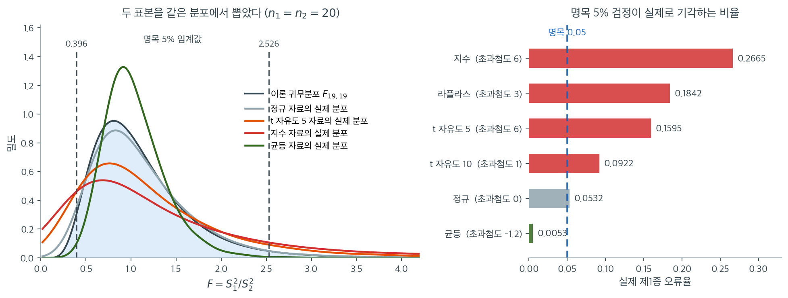

# 비정규성에 대한 민감도

두 분산을 비교하는 F 검정은 두 모집단이 모두 정규분포를 따른다고 가정한다. 흔히 쓰는 통계검정 가운데 F 검정은 분포 가정의 위반에 가장 민감한 축에 든다. 평균에 대한 $t$ 검정은 중심극한정리 덕분에 중간 정도의 비정규성에 상당히 로버스트하지만, 분산비 검정에는 그에 상응하는 보호장치가 없다. 이 절은 비정규성 아래에서 F 검정이 무너지는 이유를 설명하고 모의실험 증거를 요약한다.

---

## 1. F 검정이 민감한 이유

F 검정통계량 $F = S_1^2 / S_2^2$이 $F_{n_1-1, n_2-1}$ 분포를 따르는 것은 두 표본이 모두 정규 모집단에서 왔을 때뿐이다. $S^2$의 정확한 분포는 처음 두 적률만이 아니라 바탕 분포의 모든 적률에 의존한다. 특히 (첨도와 관련된) 4차 중심적률이 결정적인 역할을 한다.

4차 중심적률이 $\mu_4 = E[(X - \mu)^4]$인 모집단에 대해 표본분산의 분산은

$$
\operatorname{Var}(S^2) = \frac{1}{n}\left(\mu_4 - \frac{n-3}{n-1}\sigma^4\right)
$$

정규분포에서는 $\mu_4 = 3\sigma^4$이므로 이 식이 $2\sigma^4/(n-1)$로 간단해진다. 초과첨도 $\gamma_2 = \mu_4/\sigma^4 - 3 > 0$인 두꺼운 꼬리 분포에서는 $S^2$의 분산이 부풀려지고, 그 결과 $F$의 실제 분포가 명목 $F_{n_1-1, n_2-1}$ 분포보다 두꺼운 꼬리를 갖게 된다.

!!! warning "첨도 효과"
    F 검정은 주로 **첨도**(두껍거나 얇은 꼬리)에 민감하며 치우침에는 상대적으로 덜 민감하다. 자유도가 작은 $t$ 분포처럼 대칭이면서 꼬리가 두꺼운 분포가, 꼬리는 정규에 가까우면서 중간 정도로 치우친 분포보다 F 검정을 더 심하게 왜곡할 수 있다.

    다만 아래 모의실험에서 보듯 치우침도 첨도 위에 **추가로** 왜곡을 더한다. 같은 $\gamma_2 = 6$이라도 대칭인 $t_5$보다 치우친 지수분포에서 왜곡이 훨씬 크다.

---

## 2. 제1종 오류 팽창

모집단이 비정규이면 F 검정의 실제 제1종 오류율이 명목 유의수준 $\alpha$에서 크게 벗어날 수 있다. 왜곡의 방향과 크기는 첨도에 달려 있다.

- **두꺼운 꼬리 분포** ($\gamma_2 > 0$, 고첨): 실제 기각률이 $\alpha$를 넘는다. F 검정이 자유주의적이 되어 지나치게 자주 기각한다.
- **얇은 꼬리 분포** ($\gamma_2 < 0$, 저첨): 실제 기각률이 $\alpha$에 못 미친다. F 검정이 보수적이 되어 지나치게 드물게 기각한다.

다음 표는 $n_1 = n_2 = 20$, 명목 $\alpha = 0.05$에서 귀무가설 $H_0\colon \sigma_1^2 = \sigma_2^2$이 참일 때 F 검정의 모의실험 결과이다(반복 20,000회, 몬테카를로 오차 약 0.002).

| 분포 | 초과첨도 $\gamma_2$ | 왜도 | 실제 제1종 오류 |
|---|---|---|---|
| Uniform | $-1.2$ | 0 | **0.005** |
| Normal | 0 | 0 | 0.053 |
| $\chi^2_{20}$ | 0.6 | 0.63 | 0.073 |
| $t_{10}$ | 1 | 0 | 0.092 |
| $\text{Gamma}(4)$ | 1.5 | 1.0 | 0.111 |
| Laplace | 3 | 0 | 0.184 |
| $t_5$ | 6 | 0 | 0.160 |
| Exponential | 6 | 2.0 | **0.267** |

지수분포 자료에서 명목 5% 검정이 $H_0$ 아래에서 **26.7%의 확률로 기각한다.** 의도한 비율의 다섯 배가 넘는다.

반대 방향의 왜곡도 극적이다. 균등분포에서는 기각률이 $0.005$로 명목값의 10분의 1에 불과하다. 이 경우 검정이 사실상 아무것도 탐지하지 못한다.

표의 숫자가 어디서 오는지는 $F$ 통계량의 **실제 분포**를 그려 보면 바로 보인다. 아래 왼쪽 그림에서 두 표본은 언제나 같은 분포에서 뽑았으므로 $\sigma_1^2 = \sigma_2^2$이 정확히 성립한다. 검정은 $F$가 $F_{19,19}$(회색 곡선)를 따른다고 믿고 임계값 $0.396$과 $2.526$을 긋는다.



정규 자료(연회색)만이 회색 이론곡선과 겹친다. 지수분포 자료(빨강)의 실제 분포는 **훨씬 납작하고 넓게 퍼져** 있다. 봉우리가 낮아진 만큼 확률질량이 양쪽 꼬리로 흘러갔고, 그 꼬리가 임계선 바깥에 놓인다. 그래서 기각률이 $0.2665$까지 올라간다. $t_5$(주황)도 같은 방향으로 어긋나 $0.1595$다.

균등분포(초록)는 정반대다. 실제 분포가 기준분포보다 **좁다.** 꼬리가 임계선에 닿기도 전에 끝나 버리니 기각이 거의 일어나지 않는다. $0.0053$이라는 숫자가 그 결과다. 이것도 똑같이 심각한 고장이다. 크기가 명목값보다 작으면 "보수적이니 안전하다"고 말하기 쉽지만, 검정력을 그만큼 잃었다는 뜻이기도 하다.

오른쪽 막대를 초과첨도 순으로 정렬해 보면 규칙이 드러난다. 초과첨도 $-1.2$에서 $0.0053$, $0$에서 $0.0532$, $1$에서 $0.0922$, $3$에서 $0.1842$, $6$에서 $0.1595$와 $0.2665$. **첨도가 오류율을 거의 단조로 결정한다.**

같은 $\gamma_2 = 6$인 $t_5$와 지수분포가 $0.160$과 $0.267$로 갈리는 것을 치우침의 몫으로 읽기 쉽지만 그렇지 않다. **극한 오류율은 첨도만의 함수여서 두 분포가 같은 값 $0.3271$로 간다.** $n = 20$에서 갈라지는 것은 **수렴 속도**가 다르기 때문이다. 지수분포는 $n$을 키우면 $0.3245$까지 올라가 극한에 거의 닿는데, $t_5$는 $n = 2000$에서도 $0.2815$에 머문다. $t_5$는 8차 적률이 무한해서 이 근사의 바탕이 되는 중심극한 수렴이 극단적으로 느리다. 곧 치우침이 오류를 **더하는** 것이 아니라, $t_5$가 극한에 **늦게 닿는** 것이다.

여기서 기억할 것은 이 왜곡이 **표본을 키워도 사라지지 않는다**는 점이다. $n$이 커지면 $F$의 실제 분포도 $F_{19,19}$도 함께 1 근처로 좁아지지만, 둘의 **분산의 비**는 $(\gamma_2+2)/2$로 남는다(폭, 곧 표준편차의 비는 그 제곱근 $\sqrt{(\gamma_2+2)/2}$다). 카이제곱 검정에서 보았던 것과 같은 구조적 문제다.

### 꼬리가 두꺼우면 올라가고 얇으면 내려간다

<div class="exbox" markdown>

**보기 1.** <span class="diff easy" title="쉬움"></span> 모집단 모양에 따른 오류율. 여섯 모집단에서 $n_1 = n_2 = 20$ 인 두 표본을 **같은 분포**에서 뽑아($\sigma_1^2 = \sigma_2^2$ 이 정확히 참이다) 명목 $5\%$ F 검정의 실제 기각률을 $20{,}000$ 번씩 잰다.

**(1)** 5.3절이 유도한 극한 오류율 공식에 여섯 모집단의 첨도 $\beta_2$ 를 넣어 $n \to \infty$ 에서의 값을 구하시오. 첨도가 같은 두 모집단은 같은 극한값을 갖는가?

**(2)** $n = 20$ 의 모의실험 값이 그 극한값과 어긋난다. 식이 틀린 것인가, 아니면 $n = 20$ 이 작은 것인가. $n$ 을 키워 가며 판정하시오.

</div>

??? success "풀이"

    **(1) 극한 오류율은 첨도 하나로 정해진다.** 5.10절 [분산비의 표집분포(비정규)](../../ch05/applications/var_ratio_nonnormal.md)가 유도한 대로, $\log F$ 의 참 표준편차는 $\sqrt{(\beta_2-1)(1/n_1+1/n_2)}$ 인데 F 검정은 그것을 정규 가정의 $\sqrt{2(1/n_1+1/n_2)}$ 로 믿는다. 두 $\sqrt{1/n_1+1/n_2}$ 가 **약분되어 $n$ 이 사라지고**

    $$
    \text{실제 오류율} \;\longrightarrow\; 2\left[1 - \Phi\!\left(1.96\sqrt{\frac{2}{\beta_2-1}}\right)\right]
    $$

    만 남는다. 여기서 $\beta_2 = \gamma_2 + 3$ 은 (초과가 아닌) 첨도다. 여섯 모집단에 넣는다.

    | 모집단 | $\gamma_2$ | $\beta_2$ | $1.96\sqrt{2/(\beta_2-1)}$ | 극한 오류율 |
    |:---|---:|---:|---:|---:|
    | 균등 | $-1.2$ | 1.8 | 3.099 | 0.0019 |
    | 정규 | 0 | 3.0 | 1.960 | 0.0500 |
    | $t_{10}$ | 1 | 4.0 | 1.600 | 0.1095 |
    | 라플라스 | 3 | 6.0 | 1.240 | 0.2151 |
    | $t_5$ | 6 | 9.0 | 0.980 | 0.3271 |
    | 지수 | 6 | 9.0 | 0.980 | 0.3271 |

    **첨도가 같으면 극한값도 같다.** $t_5$ 와 지수는 왜도가 $0$ 과 $2$ 로 전혀 다른데도 $\beta_2$ 가 둘 다 $9$ 라 극한값이 $0.3271$ 로 같다. 이 식에는 왜도가 들어갈 자리가 아예 없기 때문이다. 정규에서 정확히 $0.05$ 가 나오는 것이 검산이다.

    **(2) 식도 맞고 $n = 20$ 이 작은 것이다.** 극한값은 $\log F$ 에 중심극한정리를 적용해 얻은 것이라 $n$ 이 충분히 커야 들어맞는다. $n = 20$ 에서는 아직 거기까지 가지 않았고, **$n$ 을 키우면 극한값 쪽으로 간다**(정규만 제자리에 머문다). 확인한다.

    ```python
    import numpy as np
    from scipy import stats

    # 두 표본을 늘 같은 분포에서 뽑으므로 분산은 참으로 같다. 그러니 아래
    # 비율은 모두 0.05 여야 옳다. 실제로는 정규에서 벗어날수록 크게 어긋난다.
    # 꼬리가 두꺼운 t(5)·지수에서는 부풀고, 꼬리가 얇은 균등에서는 오히려 줄어든다.
    rng = np.random.default_rng(1)
    n, R, alpha = 20, 20000, 0.05

    cases = [
        ("Normal",      lambda: rng.normal(0, 1, n)),
        ("t(10)",       lambda: rng.standard_t(10, n)),
        ("t(5)",        lambda: rng.standard_t(5, n)),
        ("Exponential", lambda: rng.exponential(1, n)),
        ("Uniform",     lambda: rng.uniform(0, 1, n)),
        ("Laplace",     lambda: rng.laplace(0, 1, n)),
    ]

    for name, gen in cases:
        rej = 0
        for _ in range(R):
            F = gen().var(ddof=1) / gen().var(ddof=1)
            p = 2 * min(stats.f.cdf(F, n - 1, n - 1),
                        stats.f.sf(F, n - 1, n - 1))
            rej += (p < alpha)
        print(f"{name:>12}: {rej / R:.4f}")
    ```

    출력:

    ```
          Normal: 0.0532
           t(10): 0.0922
            t(5): 0.1595
     Exponential: 0.2665
         Uniform: 0.0053
         Laplace: 0.1842
    ```

    위 표의 값이 재현된다. 정규 $0.053$은 명목값에 맞지만 지수분포는 $0.267$, 균등분포는 $0.005$로 크게 벗어난다.

    이제 $n$ 을 키워 극한값으로 가는지 본다. 벡터로 바꾸어 돌리되, $n = 2000$ 까지 가므로 반복은 $2000$ 회로 줄이고 **몬테카를로 오차를 함께 적는다.**

    ```python
    import numpy as np
    from scipy import stats

    z = stats.norm.ppf(0.975)


    def limit_size(beta2):
        """5.3 절의 극한 오류율. beta2 는 (초과가 아닌) 첨도다."""
        return 2 * (1 - stats.norm.cdf(z * np.sqrt(2 / (beta2 - 1))))


    rng = np.random.default_rng(7)
    R = 2000                       # 반복이 작으므로 몬테카를로 오차를 함께 적는다
    cases = [
        ("Normal",      3.0,  lambda s: rng.normal(0, 1, s)),
        ("t(10)",       4.0,  lambda s: rng.standard_t(10, s)),
        ("t(5)",        9.0,  lambda s: rng.standard_t(5, s)),
        ("Exponential", 9.0,  lambda s: rng.exponential(1, s)),
        ("Uniform",     1.8,  lambda s: rng.uniform(0, 1, s)),
        ("Laplace",     6.0,  lambda s: rng.laplace(0, 1, s)),
    ]

    print(f"{'n':>6}" + "".join(f"{nm:>13}" for nm, _, _ in cases))
    for n in (20, 100, 500, 2000):
        d = stats.f(n - 1, n - 1)
        lo, hi = d.ppf([0.025, 0.975])
        row = f"{n:>6}"
        for _, _, gen in cases:
            F = gen((R, n)).var(axis=1, ddof=1) / gen((R, n)).var(axis=1, ddof=1)
            row += f"{np.mean((F < lo) | (F > hi)):>13.4f}"
        print(row)
    print(f"{'극한':>6}" + "".join(f"{limit_size(b2):>13.4f}" for _, b2, _ in cases))

    print(f"\n반복 {R}회에서의 몬테카를로 표준오차")
    for p in (0.05, 0.002, 0.33):
        print(f"  참값이 {p:.3f} 근처면 SE = {np.sqrt(p * (1 - p) / R):.4f}")
    ```

    출력:

    ```text
         n       Normal        t(10)         t(5)  Exponential      Uniform      Laplace
        20       0.0455       0.0890       0.1675       0.2720       0.0100       0.1670
       100       0.0590       0.1055       0.2130       0.3115       0.0040       0.2055
       500       0.0520       0.1210       0.2550       0.3220       0.0030       0.2265
      2000       0.0415       0.1165       0.2815       0.3245       0.0020       0.2175
        극한       0.0500       0.1095       0.3271       0.3271       0.0019       0.2151

    반복 2000회에서의 몬테카를로 표준오차
      참값이 0.050 근처면 SE = 0.0049
      참값이 0.002 근처면 SE = 0.0010
      참값이 0.330 근처면 SE = 0.0105
    ```

    **다섯 모집단이 극한값으로 수렴한다.** 정규는 $n$ 과 무관하게 $0.05$ 둘레를 맴돌고($0.0415$–$0.0590$, 표준오차 $0.0049$ 이니 모두 $\pm 2$ SE 안이다), $t_{10}$ 은 $0.0890 \to 0.1165$ 로 극한 $0.1095$ 에, 라플라스는 $0.1670 \to 0.2175$ 로 $0.2151$ 에, 지수는 $0.2720 \to 0.3245$ 로 $0.3271$ 에, 균등은 $0.0100 \to 0.0020$ 으로 $0.0019$ 에 다가간다. **공식이 틀린 것이 아니라 $n = 20$ 이 극한과 멀 뿐이었다.**

    반복이 $2000$ 회뿐이라 각 칸의 흔들림이 작지 않다. $0.33$ 근처에서 표준오차가 $0.0105$ 이므로 지수 열의 $0.3245$ 와 극한 $0.3271$ 의 차이는 **읽을 수 없는 크기**다. 균등 열의 $0.0020$ 은 $2000$ 번 중 네 번 기각했다는 뜻이라 더 거칠다. 그래도 각 열이 $n$ 과 함께 한 방향으로 움직이는 것은 흔들림보다 훨씬 큰 변화라 분명하게 읽힌다.

    $t_5$ 만 더디다. $n = 2000$ 에서도 $0.2815$ 로 극한 $0.3271$ 에 못 미치며, 그 차 $0.046$ 은 표준오차 $0.010$ 의 네 배가 넘으므로 **잡음으로 설명되지 않는다.** 까닭은 $t_5$ 의 **적률이 간신히 존재하기** 때문이다. $t_\nu$ 는 $\nu$ 차 적률부터 발산하므로 $t_5$ 에는 $4$ 차 적률($\beta_2 = 9$)까지만 있고 그 위가 없다. $\operatorname{Var}(S^2)$ 의 델타근사를 정당화하는 중심극한정리가 네 제곱의 평균에 걸려 있는데, 그 항의 분산이 $8$ 차 적률을 요구하므로 **$t_5$ 에서는 애초에 무한대**다. 수렴은 하되 $1/\sqrt n$ 보다 훨씬 느리다. 같은 $\beta_2 = 9$ 인 지수는 모든 적률이 존재해 $n = 500$ 에서 이미 극한에 거의 닿는다.

    **이것이 이 절의 핵심이다.** 평균에 대한 $t$ 검정은 $n$ 을 키우면 중심극한정리가 비정규성을 씻어 주지만, **분산비 검정에는 그런 보호가 없다.** 임계값도 $1/\sqrt n$ 로 줄고 실제 산포도 $1/\sqrt n$ 로 줄어 둘의 비가 처음부터 끝까지 $\sqrt{(\beta_2-1)/2}$ 로 고정되기 때문이다. 표를 세로로 읽으면 $t_5$ 열이 $0.168 \to 0.282$ 로, 지수 열이 $0.272 \to 0.325$ 로 **올라간다.** 표본을 키우는 것이 해결책이 아니라 악화 요인이다.

---

## 3. 모의실험이 보여주는 패턴

광범위한 모의실험 연구(Box, 1953; Markowski and Markowski, 1990)와 위 결과가 함께 확인해 주는 패턴은 다음과 같다.

1. **중간 정도의 비정규성도 문제가 된다.** 초과첨도가 1~2 정도인 가벼운 이탈만으로도 제1종 오류율이 눈에 띄게 부풀려진다($\gamma_2 = 1$에서 이미 0.092로 명목값의 두 배).
2. **첨도가 지배적 요인이다.** 왜곡은 첨도에 따라 급격히 커진다. $\gamma_2$가 0.6, 1, 1.5, 3으로 커질 때 크기가 0.073, 0.092, 0.111, 0.184로 단조증가한다.
3. **치우침도 첨도 위에 왜곡을 더한다.** 같은 $\gamma_2 = 6$에서 대칭인 $t_5$가 0.160인 반면 치우친 지수분포는 0.267이다. 첨도가 주된 요인이라는 것은 맞지만, 치우침을 무해하다고 볼 수는 없다.
4. **표본크기를 키우면 오히려 나빠진다.** $t$ 검정과 달리 표본크기를 늘려도 F 검정의 비정규성 민감도가 줄지 않는다. 아래에서 보듯 오히려 **악화된다**.

### 표본크기의 효과

$n$을 키우면서 같은 실험을 반복하면(반복 10,000회)

| $n$ | Normal | $t_5$ | Exponential |
|---|---|---|---|
| 10 | 0.049 | 0.127 | 0.228 |
| 20 | 0.049 | 0.168 | 0.270 |
| 50 | 0.048 | 0.195 | 0.295 |
| 100 | 0.054 | 0.223 | 0.308 |
| 500 | 0.049 | 0.262 | 0.318 |

정규 자료에서는 어떤 $n$에서도 0.05가 유지된다. 그러나 $t_5$에서는 크기가 $n$과 함께 **커져서** $n = 500$에서 0.262에 이른다.

이유는 두 가지가 결합되어 있다. 첫째, $F$의 참 분산은 $\operatorname{Var}(S^2)$의 팽창 인자 $(\gamma_2+2)/2$만큼 명목값보다 크며 이 비율은 $n$에 의존하지 않는다. 둘째, $n$이 커지면 명목 $F$ 분포는 1 주위로 수축하지만 실제 분포는 그보다 느리게 수축한다. 그래서 상대적 불일치가 오히려 커진다.

**표본을 늘리는 것은 해결책이 아니라 문제를 키운다.** 이것이 F 검정에 관해 기억해야 할 가장 중요한 사실이다.

---

## 4. t 검정과의 비교

$t$ 검정과의 대비가 교훈적이다. 일표본 $t$ 검정은

$$
T = \frac{\bar{X} - \mu}{S / \sqrt{n}} \sim t_{n-1}
$$

중심극한정리가 $n$이 어느 정도만 되면 $\bar{X}$를 근사적으로 정규로 만들어 주므로 분자가 잘 작동한다. 분모 $S$는 대수의 법칙에 의해 $\sigma$로 수렴하므로 전체 통계량이 근사적으로 $t$ 분포를 유지한다.

F 검정에서는 분자와 분모가 모두 표본분산이다. 어느 쪽도 중간 표본크기에서 중심극한정리 같은 결과의 혜택을 받지 못한다. $S^2$의 분포는 모집단의 4차 적률로 결정되고, 비 $S_1^2/S_2^2$은 양쪽 모두에서 오는 왜곡을 물려받는다.


<div class="storybox" markdown>

**그림으로 보는 통계학 1.** 같은 이름을 가진 두 검정의 운명이 갈렸다

이 쪽이 하는 일 — 비정규 모집단에서 $F$ 의 실제 오류율을 재는 일 — 을 처음 한 사람은
**에곤 피어슨**이고 $1931$ 년이다(「비정규 변동에서의 분산분석」, 『Biometrika』 $23$ 권
$114$–$133$ 쪽). 계산기도 난수생성기도 없던 때라 그는 **난수표를 뽑아 손으로** 표본을
만들었다. 위 표의 $20{,}000$ 번이 그때는 한 사람의 몇 달이었다.

그런데 그가 내린 결론은 **안심**이었다. 정규성에서의 이탈이 극단적이지 않고 잔차에
배정된 자유도가 너무 작지 않으면 $F$ 는 타당하다는 것이다. $1947$ 년에 기어리가
같은 방향의 결과를 보탰다(「Testing for normality」, 『Biometrika』 $34$ 권 $209$ 쪽).

이 쪽은 반대로 말한다. $F$ 가 명목 $5\%$ 를 $0.005$ 에서 $0.111$ 까지 흔든다고 적었다.
모순이 아니다 — **$F$ 라 불리는 검정이 둘이기 때문이다.**

| | 분산분석의 $F$ | 이 쪽의 $F$ |
|---|---|---|
| 견주는 것 | 집단 **평균**들 | 두 **분산** |
| 분자 | 집단간 평균제곱 | $S_1^2$ |
| 분모 | 집단내 평균제곱 | $S_2^2$ |
| 비정규성 | 꽤 버틴다 | 무너진다 |

피어슨이 타당하다고 한 것은 왼쪽이다. $\S 4$ 가 그 차이의 까닭을 이미 적었다 —
왼쪽은 **분자가 평균**이라 중심극한정리의 보호를 받고, 오른쪽은 분자와 분모가 **둘 다
분산**이라 그 보호를 받지 못한다. 이름이 같은 것은 둘 다 두 평균제곱의 비라는 형식을
공유하기 때문일 뿐이다.

그래서 교과서에서 「$F$ 검정은 비정규성에 로버스트하다」와 「$F$ 검정은 비정규성에
가장 민감하다」를 나란히 만나게 된다. **둘 다 참이고, 가리키는 검정이 다르다.**
$1953$ 년에 박스가 분산 쪽을 따로 들여다보고 어디까지 갔는지는 15.4절
[비정규성 아래의 한계](../bartlett_test/limitations.md) 의 상자에 있다.

_확인한 곳 — 에곤 피어슨의 $1931$ 년 논문이 『Biometrika』 $23$ 권 $114$–$133$ 쪽의
「The analysis of variance in cases of non-normal variation」이라는 것, 두 분산을
비교하는 검정의 비정규성 민감도를 그가 처음 지적했다는 것, 그의 결론이 「이탈이
극단적이지 않고 잔차 자유도가 너무 작지 않으면 $F$ 가 타당하다」였다는 것, 그 조사가
난수표에 기반한 모의실험이었다는 것, 그리고 기어리의 $1947$ 년 「Testing for normality」가
『Biometrika』 $34$ 권 $209$ 쪽이라는 것을 확인했다. 위 표의 오류율은 이 쪽 $\S 2$ 에서
직접 계산한 값이다_

</div>

---

## 5. F 검정을 피해야 할 때

다음 경우에는 F 검정을 피해야 한다.

- 정규성 검정(Shapiro-Wilk, Anderson-Darling, Q-Q 그림 검토)이 어느 한 표본에서라도 정규성을 기각할 때
- 자료가 꼬리가 두꺼운 분포에서 온다고 알려져 있을 때(금융 수익률, 소득 자료, 생존시간)
- 자료에 이상점이 있을 때. 이상점은 표본분산과 첨도를 동시에 부풀린다
- 표본크기가 작아 정규성을 신뢰성 있게 평가할 수 없을 때

---

## 6. 권장 대안

정규성이 의심스러울 때 다음 검정들이 제1종 오류율을 더 잘 조절한다.

| 검정 | 로버스트성 | 정규성 아래 검정력 | 절 |
|---|---|---|---|
| Levene 검정 | 좋음 | F 검정보다 약간 낮음 | 15.5 |
| Brown-Forsythe 검정 | 매우 좋음 | Levene보다 약간 낮음 | 15.5 |
| Fligner-Killeen 검정 | 뛰어남 | Levene보다 낮음 | 15.5 |
| 붓스트랩 검정 | 좋음~뛰어남 | 구현에 따라 다름 | 15.6 |

!!! tip "실무 권고"
    형식적 검정과 시각적 검토로 정규성이 확인되지 않았다면 F 검정보다 Brown-Forsythe 검정을 선호하라. Brown-Forsythe 검정은 폭넓은 분포에서 명목 제1종 오류율을 유지하면서 자료가 실제로 정규일 때도 합리적인 검정력을 유지한다.

---

## 연습문제

<div class="drillbox" markdown>

**연습문제 1.** <span class="diff med" title="중간"></span>
본문 표에서 $t_5$($\gamma_2 = 6$, 대칭)의 크기가 0.160인 반면 지수분포($\gamma_2 = 6$, 왜도 2)는 0.267이다. 첨도가 같은데 왜 다른지 설명하라.

</div>

??? success "풀이"
    첨도가 같아도 F 검정의 크기가 다른 이유는 여러 층위가 있다.

    **1. 유한표본에서 표본첨도의 거동이 다르다.** $t_5$는 네 번째 적률이 존재하지만 여덟 번째 적률이 없으므로 표본첨도 $g_2$의 분산이 무한대이다. 대부분의 $t_5$ 표본은 실제로는 $\gamma_2 = 6$보다 훨씬 작은 표본첨도를 보이고, 드물게 매우 큰 값이 나온다. 곧 **전형적인 $t_5$ 표본은 이론적 첨도가 시사하는 것보다 정규에 가깝다.**

    지수분포는 모든 적률이 존재하므로 표본첨도가 안정적으로 6 근처에 모인다. 그래서 왜곡이 표본마다 일관되게 나타난다.

    **2. 치우침이 $\bar{X}$와 $S^2$의 상관을 만든다.** 15.2절 연습문제에서 보았듯 $\bar{X}$와 $S^2$의 독립성은 정규분포에만 특유하다. 오른쪽으로 치우친 분포에서는 두 통계량이 양의 상관을 가지며, 이 상관이 $S^2$의 표집분포를 더욱 오른쪽으로 치우치게 만든다.

    **3. 지수분포는 유계이다.** $X > 0$이라는 제약이 $S^2$의 분포에 추가적인 비대칭을 들여온다.

    **교훈.** "F 검정은 첨도에만 민감하다"는 서술은 1차 근사에 불과하다. 실무에서는 **왜도와 첨도를 모두 확인**해야 하며, 어느 하나라도 0에서 멀면 F 검정을 피해야 한다. $\square$

---

<div class="drillbox" markdown>

**연습문제 2.** <span class="diff med" title="중간"></span>
균등분포에서 F 검정의 크기가 0.005로 극단적으로 작다. 이것이 왜 "안전한" 것이 아닌지 설명하라.

</div>

??? success "풀이"
    보수적인 검정은 제1종 오류 측면에서는 안전해 보인다. 명목 5%보다 훨씬 적게 잘못 기각하기 때문이다. 그러나 두 가지 이유로 문제가 있다.

    **1. 검정력이 붕괴한다.** 제1종 오류와 제2종 오류는 맞바꿈 관계이다. 크기가 0.005라는 것은 검정이 실질적으로 $\alpha = 0.005$ 수준에서 작동한다는 뜻이고, 그만큼 참 분산 차이를 탐지할 능력이 떨어진다.

    구체적으로 균등분포 자료에서 참 분산비가 2배여도 명목 5% F 검정이 이를 탐지할 확률은 정규 자료의 경우보다 훨씬 낮다. 실제 존재하는 차이를 놓치게 된다.

    **2. 보고된 유의수준이 거짓이다.** "5% 수준에서 검정했다"고 보고하지만 실제 수준은 0.5%이다. 다른 연구와 비교하거나 메타분석에 포함할 때 오도한다. $p$값 자체도 의미가 왜곡된다.

    **3. 방향을 미리 알 수 없다.** 실무에서 자료의 첨도가 양인지 음인지 확신할 수 없다면, 검정이 자유주의적일지 보수적일지도 모른다. 크기가 통제되지 않는다는 사실 자체가 문제이며, 어느 방향인지는 부차적이다.

    올바른 대응은 어느 방향의 왜곡이든 피하는 것, 곧 크기가 안정적인 로버스트 검정을 쓰는 것이다. $\square$

---

<div class="drillbox" markdown>

**연습문제 3.** <span class="diff med" title="중간"></span>
표본크기를 키우면 F 검정의 크기 왜곡이 오히려 **커진다**는 본문의 관찰을 설명하라. 이것이 대부분의 통계적 직관과 어떻게 어긋나는가?

</div>

??? success "풀이"
    통상적인 직관은 "$n$을 키우면 점근이론이 잘 맞고 근사가 좋아진다"는 것이다. F 검정에서는 이 직관이 통하지 않는다.

    **왜 그런가.** $H_0$ 아래에서 $\ln F = \ln S_1^2 - \ln S_2^2$을 생각하자. 델타 방법에 의해 큰 $n$에서

    $$
    \operatorname{Var}(\ln S_i^2) \approx \frac{\operatorname{Var}(S_i^2)}{\sigma^4} \approx \frac{\gamma_2 + 2}{n},
    $$

    이므로

    $$
    \operatorname{Var}(\ln F) \approx \frac{2(\gamma_2 + 2)}{n}.
    $$

    한편 명목 $F_{n-1,n-1}$ 분포에서는 $\operatorname{Var}(\ln F) \approx 4/n$이다($\gamma_2 = 0$ 대입).

    두 값의 **비**는

    $$
    \frac{2(\gamma_2+2)/n}{4/n} = \frac{\gamma_2 + 2}{2}
    $$

    로 $n$에 전혀 의존하지 않는다. 곧 실제 산포와 명목 산포의 불일치가 $n$을 키워도 사라지지 않는다.

    **그런데 왜 크기가 *커지는가*?** 두 분포 모두 $n$이 커지면 좁아지지만 비율은 고정되어 있다. 그런데 $n$이 작을 때는 두 분포 모두 넓어서 꼬리가 두툼하고 서로 상당 부분 겹친다. $n$이 커지면 명목 분포가 급격히 좁아지는데 실제 분포는 그보다 $\sqrt{(\gamma_2+2)/2}$배 넓은 상태를 유지하므로, 명목 임계값 밖으로 나가는 질량의 **비율**이 커진다.

    구체적으로 $\ln F$가 근사적으로 정규라고 하면 실제 크기는

    $$
    2\Phi\!\left(-1.96\sqrt{\frac{2}{\gamma_2+2}}\right)
    $$

    로 수렴한다. $\gamma_2 = 6$이면 $2\Phi(-1.96 \times 0.5) = 2\Phi(-0.98) = 0.327$이다. 모의실험에서 $t_5$가 $n = 500$에서 0.262, 지수분포가 0.318로 이 극한값에 접근하고 있다.

    **핵심 교훈.** 이는 "일치성 없는 검정"의 사례이다. 자료를 아무리 모아도 절차가 옳아지지 않는다. 잘못된 기준분포를 쓰고 있다는 근본적 문제는 표본크기로 해결되지 않으며, 오히려 큰 표본에서 잘못된 결론을 더 확신 있게 내리게 만든다. $\square$

---

<div class="drillbox" markdown>

**연습문제 4.** <span class="diff hard" title="어려움"></span>
$\operatorname{Var}(S^2) = \frac{1}{n}\left(\mu_4 - \frac{n-3}{n-1}\sigma^4\right)$가 정규분포에서 $2\sigma^4/(n-1)$로 환원됨을 보여라.

</div>

??? success "풀이"
    정규분포에서 $\mu_4 = 3\sigma^4$이므로

    $$
    \operatorname{Var}(S^2) = \frac{1}{n}\left(3\sigma^4 - \frac{n-3}{n-1}\sigma^4\right) = \frac{\sigma^4}{n}\cdot\frac{3(n-1) - (n-3)}{n-1}.
    $$

    분자를 정리하면

    $$
    3(n-1) - (n-3) = 3n - 3 - n + 3 = 2n
    $$

    이므로

    $$
    \operatorname{Var}(S^2) = \frac{\sigma^4}{n}\cdot\frac{2n}{n-1} = \frac{2\sigma^4}{n-1}.
    $$

    **교차검증.** 정규성 아래에서 $(n-1)S^2/\sigma^2 \sim \chi^2_{n-1}$이고 $\operatorname{Var}(\chi^2_{n-1}) = 2(n-1)$이므로

    $$
    \frac{(n-1)^2}{\sigma^4}\operatorname{Var}(S^2) = 2(n-1) \implies \operatorname{Var}(S^2) = \frac{2\sigma^4}{n-1}.
    $$

    두 경로가 일치한다.

    일반 분포에서 $\mu_4 = \sigma^4(\gamma_2+3)$을 대입하면 큰 $n$에서

    $$
    \operatorname{Var}(S^2) \approx \frac{\sigma^4(\gamma_2 + 2)}{n}
    $$

    이 되어 15.1절의 결과를 회복한다. 팽창 인자가 $(\gamma_2+2)/2$이다. $\square$

---

<div class="drillbox" markdown>

**연습문제 5.** <span class="diff hard" title="어려움"></span>
보기 1 의 극한 오류율 식

$$
\alpha_\infty(\beta_2) = 2\left[1 - \Phi\!\left(1.96\sqrt{\frac{2}{\beta_2-1}}\right)\right]
$$

을 **거꾸로** 읽는다.

**(1)** 명목 $5\%$ 검정의 극한 오류율이 $0.10$(명목의 두 배), $0.20$, $0.50$ 이 되는 첨도 $\beta_2$ 를 각각 구하시오. 또 본문 표에 있으나 보기 1 의 표가 빠뜨린 두 모집단 $\chi^2_{20}$($\gamma_2 = 0.6$)과 $\text{Gamma}(4)$($\gamma_2 = 1.5$)의 극한 오류율을 구하여 표를 메우시오.

**(2)** $\alpha_\infty$ 가 $\beta_2$ 의 증가함수임을 보이고, 2 장의 하한 $\beta_2 \ge 1$ 아래에서 이 식이 낼 수 있는 값의 범위가 $(0, 1)$ 임을 보이시오. $\beta_2 = 1$ 인 분포는 어떤 분포이며 거기서 검정은 무엇을 하는가. (본문 1 절의 **정확한** $\operatorname{Var}(S^2)$ 식에 $\beta_2 = 1$ 을 넣어 보라.)

**(3)** 2 장의 하한 $\beta_2 \ge 1 + \gamma_1^2$ 을 쓰면 첨도를 재지 않고 **왜도만** 알아도 $\alpha_\infty$ 의 하한을 말할 수 있다. 본문 표의 지수분포($\gamma_1 = 2$)와 $\chi^2_{20}$($\gamma_1 = 0.63$)에 적용하시오. (1)의 "두 배" 가 왜도만으로 확정되는 문턱 $\lvert\gamma_1\rvert$ 은 얼마인가.

</div>

??? success "풀이"

    **(1) 역산식은 한 줄이다.** $\alpha_\infty = \alpha^{*}$ 로 놓으면 $1 - \Phi(c) = \alpha^{*}/2$, 곧 $c = z_{1-\alpha^{*}/2}$ 이다. $c = 1.96\sqrt{2/(\beta_2-1)}$ 을 $\beta_2$ 에 대해 풀면

    $$
    \beta_2 = 1 + 2\left(\frac{1.96}{z_{1-\alpha^{*}/2}}\right)^2
    $$

    이다. 세 목표값에 넣는다.

    | 목표 $\alpha^{*}$ | $z_{1-\alpha^{*}/2}$ | $(1.96/z)^2$ | $\beta_2$ | $\gamma_2$ |
    |:---|---:|---:|---:|---:|
    | $0.10$ | 1.6449 | 1.4199 | 3.8397 | 0.8397 |
    | $0.20$ | 1.2816 | 2.3389 | 5.6777 | 2.6777 |
    | $0.50$ | 0.6745 | 8.4440 | 17.8879 | 14.8879 |

    **초과첨도 $0.84$ 만으로 크기가 두 배가 된다.** 정규에서 이만큼 벗어나는 것은 자료를 보고 알아차리기 어려운 수준이다. 빠진 두 줄도 같은 식으로 메운다.

    | 모집단 | $\gamma_2$ | $\beta_2$ | $1.96\sqrt{2/(\beta_2-1)}$ | $\alpha_\infty$ | $n = 20$ 모의값 |
    |:---|---:|---:|---:|---:|---:|
    | $\chi^2_{20}$ | 0.6 | 3.6 | 1.7190 | 0.0856 | 0.073 |
    | $\text{Gamma}(4)$ | 1.5 | 4.5 | 1.4816 | 0.1384 | 0.111 |

    둘 다 $n = 20$ 값이 극한값보다 작다. 보기 1 에서 본 것과 같은 방향이다.

    **(2) 단조성과 범위.** $\beta_2$ 가 커지면 $2/(\beta_2-1)$ 이 줄고 따라서 $c = 1.96\sqrt{2/(\beta_2-1)}$ 도 줄며, $1 - \Phi$ 는 감소함수이므로 $\alpha_\infty$ 는 **커진다.** 합성이 증가함수다.

    양 끝을 본다. $\beta_2 \downarrow 1$ 이면 $c \to \infty$ 이므로 $\alpha_\infty \to 0$ 이고, $\beta_2 \to \infty$ 이면 $c \to 0$ 이므로

    $$
    \alpha_\infty \to 2\left[1 - \Phi(0)\right] = 2 \times 0.5 = 1
    $$

    이다. 곧 $\beta_2$ 를 고르면 $(0, 1)$ 안의 **어떤 값이든** 명목 $5\%$ 검정의 실제 크기로 만들 수 있다. "명목 수준" 이라는 말이 아무것도 보장하지 못한다는 뜻이다.

    $\beta_2 = 1$ 은 $\beta_2 - 1 = \operatorname{Var}\!\left[(X-\mu)^2\right]/\sigma^4 = 0$, 곧 $\lvert X - \mu \rvert \equiv \sigma$ 인 경우다. $X$ 가 $\mu \pm \sigma$ 두 값만 갖는 **대칭 두 점 분포**이며($\gamma_1 = 0$ 이라 하한 $\beta_2 \ge 1+\gamma_1^2$ 의 등호가 성립하는 자리다), 본문 1 절의 정확한 식에 넣으면

    $$
    \operatorname{Var}(S^2) = \frac{\sigma^4}{n}\left(1 - \frac{n-3}{n-1}\right) = \frac{2\sigma^4}{n(n-1)}
    $$

    이다. $\operatorname{SD}(\log F) \approx 2/\sqrt{n(n-1)} \sim 2/n$ 인데 임계값은 $1.96\sqrt{4/n} \sim 1/\sqrt n$ 로만 줄어든다. 통계량이 임계값보다 **한 차수 빠르게** $1$ 로 모이므로 검정은 끝내 **아무것도 기각하지 않는다.**

    **(3) 왜도만으로 하한이 나온다.** (2)에서 $\alpha_\infty$ 가 $\beta_2$ 의 증가함수임을 보였으므로 $\beta_2$ 의 하한이 곧 $\alpha_\infty$ 의 하한이다. $\beta_2 \ge 1 + \gamma_1^2$ 에서

    $$
    \alpha_\infty \ge 2\left[1 - \Phi\!\left(1.96\sqrt{\frac{2}{\gamma_1^2}}\right)\right] = 2\left[1 - \Phi\!\left(\frac{2.7718}{\lvert\gamma_1\rvert}\right)\right]
    $$

    이다. 지수분포는 $\gamma_1 = 2$ 이므로 $\beta_2 \ge 5$, 하한은 $2[1-\Phi(1.3859)] = 0.1658$ 이다. 첨도를 전혀 몰라도 **명목 $5\%$ 가 최소 세 배로 부푼다**는 것이 왜도 하나로 확정된다(실제 $\beta_2 = 9$ 라 참값은 $0.3271$ 이니 하한은 느슨하다).

    $\chi^2_{20}$ 은 $\gamma_1 = 0.63$ 이므로 $\beta_2 \ge 1.3969$, 하한은 $2[1-\Phi(4.400)] \approx 10^{-5}$ 로 **아무 말도 하지 못한다.** 실제 $\beta_2 = 3.6$ 에서 $0.0856$ 인데 하한은 $10^{-5}$ 다.

    문턱은 $1 + \gamma_1^2 \ge 3.8397$, 곧

    $$
    \lvert\gamma_1\rvert \ge \sqrt{2.8397} = 1.6851
    $$

    이다. **왜도가 $1.69$ 를 넘는 분포에서는 첨도가 무엇이든 크기가 두 배 이상 부푼다.** 거꾸로 왜도가 작다는 것은 아무 보증이 되지 못한다. 이 하한은 유죄만 증명하고 무죄는 증명하지 않는다. $\square$

---

<div class="drillbox" markdown>

**연습문제 6.** <span class="diff hard" title="어려움"></span>
보기 1 의 극한식은 $\operatorname{Var}(S^2) \approx (\beta_2-1)\sigma^4/n$ 이라는 **큰 $n$ 근사**를 쓴다. 본문 1 절에는 **정확한** 식이 있다. 정확한 식을 쓰면 $n = 20$ 의 어긋남이 얼마나 설명되는지 본다.

**(1)** 정확한 $\operatorname{Var}(S^2)$ 를 정규이론 값 $2\sigma^4/(n-1)$ 로 나눈 팽창인자를 $r(n, \beta_2)$ 라 하자. $r$ 을 구하고

$$
r(n, \beta_2) = \frac{\beta_2-1}{2} + \frac{3-\beta_2}{2n}
$$

로 정리하시오. $\beta_2 = 3$ 에서 $n$ 과 무관하게 $r = 1$ 인 것을 확인하시오.

**(2)** 극한식에 이 $r$ 을 반영하려면 $\beta_2$ 자리에 **유효 첨도** $\beta_2^{*} = 2r + 1$ 을 넣어야 한다. $\beta_2^{*}$ 를 $\beta_2$ 와 $n$ 으로 쓰고, $n = 20$ 에서 보기 1 의 여섯 모집단에 대해 구하시오. $\beta_2^{*}$ 는 참 첨도보다 $3$ 에 가까운가 먼가.

**(3)** $\alpha_\infty(\beta_2^{*})$ 를 계산해 보기 1 의 $n = 20$ 모의값과 견주고, 이 보정이 어긋남의 **몇 분의 몇**을 설명하는지 말하시오.

</div>

??? success "풀이"

    **(1) 정확한 팽창인자.** $\mu_4 = \beta_2\sigma^4$ 을 본문 1 절의 식에 넣으면 $\operatorname{Var}(S^2) = \dfrac{\sigma^4}{n}\left(\beta_2 - \dfrac{n-3}{n-1}\right)$ 이므로

    $$
    r(n,\beta_2) = \frac{\dfrac{\sigma^4}{n}\left(\beta_2 - \dfrac{n-3}{n-1}\right)}{\dfrac{2\sigma^4}{n-1}} = \frac{(n-1)\beta_2 - (n-3)}{2n}
    $$

    이다. 분자를 펼치면 $n\beta_2 - \beta_2 - n + 3$ 이므로

    $$
    r = \frac{n(\beta_2-1) + (3-\beta_2)}{2n} = \frac{\beta_2-1}{2} + \frac{3-\beta_2}{2n}
    $$

    이다. $n \to \infty$ 에서 첫 항만 남아 15.1절의 $(\gamma_2+2)/2 = (\beta_2-1)/2$ 가 되고, $\beta_2 = 3$ 에서는 둘째 항이 $0$, 첫 항이 $1$ 이므로 **모든 $n$ 에서 정확히 $r = 1$** 이다. 정규자료에서 $F$ 검정이 어느 표본크기에서나 정확한 것과 맞는다.

    **(2) 유효 첨도는 참 첨도를 $3$ 쪽으로 당긴다.**

    $$
    \beta_2^{*} = 2r + 1 = \beta_2 - \frac{\beta_2 - 3}{n}
    $$

    이다. $\beta_2 > 3$ 이면 둘째 항이 양수라 $\beta_2^{*} < \beta_2$, $\beta_2 < 3$ 이면 $\beta_2^{*} > \beta_2$ 이니 **어느 쪽이든 $3$ 쪽으로 당겨진다.** $n = 20$ 에서

    | 모집단 | $\beta_2$ | $(\beta_2-3)/20$ | $\beta_2^{*}$ |
    |:---|---:|---:|---:|
    | 균등 | 1.8 | $-0.06$ | 1.86 |
    | 정규 | 3.0 | 0 | 3.00 |
    | $t_{10}$ | 4.0 | 0.05 | 3.95 |
    | 라플라스 | 6.0 | 0.15 | 5.85 |
    | $t_5$ | 9.0 | 0.30 | 8.70 |
    | 지수 | 9.0 | 0.30 | 8.70 |

    당겨지는 양이 $1/n$ 짜리라 $n = 20$ 에서도 작다. 가장 큰 지수·$t_5$ 조차 $9 \to 8.7$ 이다.

    **(3) 방향은 맞지만 크기가 턱없이 모자란다.**

    | 모집단 | 극한 $\alpha_\infty(\beta_2)$ | 보정 $\alpha_\infty(\beta_2^{*})$ | $n=20$ 모의값 | 설명한 몫 |
    |:---|---:|---:|---:|---:|
    | 균등 | 0.0019 | 0.0028 | 0.0053 | $0.0009/0.0034 = 26\%$ |
    | 정규 | 0.0500 | 0.0500 | 0.0532 | — |
    | $t_{10}$ | 0.1095 | 0.1066 | 0.0922 | $0.0029/0.0173 = 17\%$ |
    | 라플라스 | 0.2151 | 0.2082 | 0.1842 | $0.0069/0.0309 = 22\%$ |
    | $t_5$ | 0.3271 | 0.3178 | 0.1595 | $0.0093/0.1676 = 6\%$ |
    | 지수 | 0.3271 | 0.3178 | 0.2665 | $0.0093/0.0606 = 15\%$ |

    **보정의 방향은 여섯 줄 모두 맞다.** 꼬리가 무거운 넷에서는 예측을 아래로(모의값 쪽으로) 내리고, 꼬리가 가벼운 균등에서는 위로 올린다. 모의값이 늘 극한값보다 $0.05$ 쪽에 있다는 보기 1 의 관찰과 부호가 일치한다.

    **그러나 크기가 모자란다.** 지수에서 설명해야 할 차가 $0.0606$ 인데 보정은 $0.0093$ 만 메워 $15\%$ 다. $t_5$ 에서는 $6\%$ 로 사실상 아무것도 설명하지 못한다. 까닭은 차수에 있다. 이 보정은 $r$ 의 $1/n$ 항에서 나온 $O(1/n)$ 짜리인데, $n = 20$ 의 어긋남은 $\log F$ 가 아직 정규가 아니라는 데서 오는 **훨씬 느린 양**이다(연습문제 9 에서 $n^{-1/2}$ 보다도 느릴 수 있음을 본다). 분산을 정확히 계산해도 **모양이 틀린 것은 고쳐지지 않는다.** $\square$

---

<div class="drillbox" markdown>

**연습문제 7.** <span class="diff hard" title="어려움"></span>
연습문제 5(1)의 역산식을 모의값에 적용하면 "$n = 20$ 의 $F$ 검정은 첨도가 얼마인 모집단처럼 행동하는가" 를 숫자로 잴 수 있다. 이를 **경험적 유효 첨도** $\hat\beta_2$ 라 하자.

**(1)** 보기 1 의 $n = 20$ 여섯 모의값($20{,}000$ 회)을 역산해 $\hat\beta_2$ 를 구하시오. 모의 표준오차를 전파해 $\pm 2$ SE 폭도 함께 적으시오.

**(2)** $\hat\beta_2$ 를 참 첨도 $\beta_2$ 와 연습문제 6 의 $\beta_2^{*}$ 와 한 표에 놓고, 여섯 줄에 공통된 방향을 한 문장으로 말하시오. 정규 줄은 어떤 검산 구실을 하는가.

**(3)** 두 값이 가장 크게 어긋나는 줄은 어디인가. 그 $\hat\beta_2$ 를 $t_\nu$ 의 첨도 $3 + 6/(\nu-4)$ 와 맞추어 "$n = 20$ 에서 $t_5$ 표본은 자유도 몇짜리 $t$ 처럼 행동하는가" 를 답하고, 본문 2 절의 설명과 이어 붙이시오.

</div>

??? success "풀이"

    **(1) 역산.** $\hat\beta_2 = 1 + 2(1.96/c)^2$, $c = z_{1-\hat\alpha/2}$ 이다. 모의 표준오차는 $\sqrt{\hat\alpha(1-\hat\alpha)/20000}$ 이고, 역산식이 단조증가이므로 $\hat\alpha \pm 2\,\text{SE}$ 를 그대로 통과시키면 된다.

    | 모집단 | $\hat\alpha$ | SE | $c$ | $\hat\beta_2$ | $\pm 2$ SE 폭 |
    |:---|---:|---:|---:|---:|:---|
    | 균등 | 0.0053 | 0.0005 | 2.7882 | 1.988 | 1.94 – 2.03 |
    | 정규 | 0.0532 | 0.0016 | 1.9333 | 3.056 | 3.00 – 3.11 |
    | $t_{10}$ | 0.0922 | 0.0020 | 1.6839 | 3.710 | 3.64 – 3.78 |
    | 라플라스 | 0.1842 | 0.0027 | 1.3279 | 5.357 | 5.25 – 5.47 |
    | $t_5$ | 0.1595 | 0.0026 | 1.4068 | 4.882 | 4.79 – 4.98 |
    | 지수 | 0.2665 | 0.0031 | 1.1112 | 7.223 | 7.06 – 7.39 |

    **(2) 모두 $3$ 쪽으로 당겨져 있다.**

    | 모집단 | 참 $\beta_2$ | $\beta_2^{*}$(연습문제 6) | $\hat\beta_2$ |
    |:---|---:|---:|---:|
    | 균등 | 1.8 | 1.86 | 1.988 |
    | 정규 | 3.0 | 3.00 | 3.056 |
    | $t_{10}$ | 4.0 | 3.95 | 3.710 |
    | 라플라스 | 6.0 | 5.85 | 5.357 |
    | $t_5$ | 9.0 | 8.70 | 4.882 |
    | 지수 | 9.0 | 8.70 | 7.223 |

    여섯 줄이 모두 $\beta_2 \to \beta_2^{*} \to \hat\beta_2$ 순으로 **$3$ 에 가까워진다.** 꼬리가 무거운 넷은 내려가고 가벼운 균등은 올라간다($1.8 < 1.86 < 1.988$). 한 문장으로 쓰면 **유한표본의 $F$ 검정은 극한식이 예고하는 것보다 늘 덜 망가져 있다.** 곧 $\alpha_\infty$ 는 무거운 꼬리에서 피해의 **상한**, 가벼운 꼬리에서 **하한** 구실을 한다.

    정규 줄은 검산이다. $\hat\beta_2 = 3.056$ 이고 $\pm 2$ SE 폭의 아래 끝이 정확히 $3.00$ 이므로 **모의오차 안에서 $3$ 과 구별되지 않는다.** 역산식과 모의실험이 서로 어긋나지 않았다는 뜻이다.

    **(3) $t_5$ 줄이 어긋난다.** $8.70$ 을 예측했는데 $4.882$ 다. 차 $3.8$ 은 $\pm 2$ SE 폭(약 $0.19$)의 스무 배라 잡음이 아니다. $\hat\beta_2$ 를 $t$ 족에 맞추면

    $$
    3 + \frac{6}{\nu - 4} = 4.882 \;\Longrightarrow\; \nu - 4 = \frac{6}{1.882} = 3.19 \;\Longrightarrow\; \nu = 7.19
    $$

    이다. **$n = 20$ 짜리 $t_5$ 표본은 $F$ 검정에게 $t_{7.2}$ 처럼 보인다.** 이론 첨도 $9$ 가 아니라 $4.9$ 짜리 분포로 행세하는 것이다.

    본문 2 절과 연습문제 1 이 그 까닭을 말해 둔 그대로다. $t_5$ 는 $4$ 차 적률까지만 있고 $8$ 차 적률이 무한하므로 표본첨도의 분산이 무한대다. 대부분의 표본은 이론값 $9$ 보다 **훨씬 정규에 가까운** 모습이고, 드물게 나오는 극단표본이 평균첨도를 혼자 떠받친다. 기각률은 "전형적인 표본" 이 결정하므로 $\hat\beta_2$ 가 $5$ 쯤에서 멈춘다. 같은 $\beta_2 = 9$ 인 지수는 모든 적률이 있어 $\hat\beta_2 = 7.22$ 로 $8.7$ 에 훨씬 가깝다. **$0.160$ 과 $0.267$ 의 갈림은 왜도의 몫이 아니라 적률의 존재 여부의 몫이다.** $\square$

---

<div class="drillbox" markdown>

**연습문제 8.** <span class="diff hard" title="어려움"></span>
본문 5 절은 "이상점은 표본분산과 첨도를 동시에 부풀린다" 고 적는다. 이것을 수로 잰다. 오염모형

$$
X \sim (1-\varepsilon)\,N(0, 1) + \varepsilon\,N(0, \tau^2)
$$

을 쓴다(평균은 둘 다 $0$ 이라 대칭이고 $\gamma_1 = 0$ 이다).

**(1)** $\sigma^2$ 과 $\mu_4$ 를 구해 $\beta_2(\varepsilon, \tau)$ 를 쓰고, $\varepsilon = 0.01$, $\tau = 5$ 에서 $\beta_2$ 와 $\alpha_\infty$ 를 구하시오. 이 오염이 모집단 표준편차를 몇 % 키우는가.

**(2)** 작은 $\varepsilon$ 에서 $\beta_2 \approx 3 + 3\varepsilon(\tau^2-1)^2$ 임을 보이고, 연습문제 5(1)의 문턱 $\beta_2 = 3.8397$ 을 넘기는 $\varepsilon$ 을 $\tau = 3, 5, 10$ 에서 구하시오. 몇 개 중 한 개인가.

**(3)** $\varepsilon$ 을 고정하고 $\tau \to \infty$ 로 보낼 때 $\beta_2$ 의 **천장**과 그때의 $\alpha_\infty$ 를 구하시오($\varepsilon = 0.01$). 그런데 $n = 20$ 의 모의실험에서는 (1)의 수가 그대로 나타나지 않는다. 두 표본 $40$ 개에 오염점이 하나도 없을 확률을 구해 그 까닭을 말하시오.

</div>

??? success "풀이"

    **(1) 척도혼합의 적률.** 성분별로 조건을 걸어 더한다. $N(0,s^2)$ 의 $2$ 차·$4$ 차 적률이 $s^2$, $3s^4$ 이므로

    $$
    \sigma^2 = (1-\varepsilon) + \varepsilon\tau^2, \qquad \mu_4 = 3\left[(1-\varepsilon) + \varepsilon\tau^4\right]
    $$

    이고 따라서

    $$
    \beta_2(\varepsilon,\tau) = \frac{3\left[(1-\varepsilon) + \varepsilon\tau^4\right]}{\left[(1-\varepsilon) + \varepsilon\tau^2\right]^2}
    $$

    이다. $\varepsilon = 0.01$, $\tau = 5$ 를 넣으면 $\sigma^2 = 0.99 + 0.25 = 1.24$, $\mu_4 = 3(0.99 + 6.25) = 21.72$ 이므로

    $$
    \beta_2 = \frac{21.72}{1.24^2} = \frac{21.72}{1.5376} = 14.126, \qquad \gamma_2 = 11.13
    $$

    이고 $\alpha_\infty = 2\left[1 - \Phi(1.96\sqrt{2/13.126})\right] = 2[1-\Phi(0.7651)] = 0.4442$ 다.

    한편 표준편차는 $\sqrt{1.24} = 1.1136$ 으로 깨끗한 모집단보다 **$11.4\%$ 만** 크다. **표준편차는 $11\%$ 움직였는데 명목 $5\%$ 검정의 크기는 $0.44$ 가 되었다.** 이것이 "이상점이 분산과 첨도를 동시에 부풀리는데 검정을 망치는 쪽은 첨도" 라는 말의 수치적 내용이다.

    **(2) 문턱은 터무니없이 낮다.** $\varepsilon$ 이 작을 때 $(1+a\varepsilon)^{-2} \approx 1 - 2a\varepsilon$ 을 쓰면

    $$
    \beta_2 \approx 3\left[1 + \varepsilon(\tau^4-1)\right]\left[1 - 2\varepsilon(\tau^2-1)\right] \approx 3\left[1 + \varepsilon(\tau^4 - 2\tau^2 + 1)\right] = 3 + 3\varepsilon(\tau^2-1)^2
    $$

    이다($\varepsilon^2$ 항을 버렸다). $\beta_2 = 3.8397$ 로 놓으면

    $$
    \varepsilon \approx \frac{0.8397}{3(\tau^2-1)^2} = \frac{0.2799}{(\tau^2-1)^2}
    $$

    이다. 세 값에 넣고 정확한 식으로도 풀어 비교한다.

    | $\tau$ | $(\tau^2-1)^2$ | 근사 $\varepsilon$ | 정확한 $\varepsilon$ | 몇 개 중 한 개 |
    |---:|---:|---:|---:|:---|
    | 3 | 64 | 0.00437 | 0.00473 | 약 $1/211$ |
    | 5 | 576 | 0.00049 | 0.00050 | 약 $1/2010$ |
    | 10 | 9801 | 0.0000286 | 0.0000287 | 약 $1/34800$ |

    **표준편차가 다섯 배인 관측이 $2000$ 개 중 하나만 섞여도 극한 크기가 두 배가 된다.** 그런 자료는 어떤 정규성 검정으로도 걸러지지 않는다($14$ 장). 근사식이 정확한 값과 $10\%$ 안에서 맞는 것도 확인된다.

    **(3) 천장은 $3/\varepsilon$ 이다.** $\tau \to \infty$ 에서는 분자·분모 모두 $\tau$ 의 최고차항만 남아

    $$
    \beta_2 \to \frac{3\varepsilon\tau^4}{(\varepsilon\tau^2)^2} = \frac{3}{\varepsilon}
    $$

    이다. $\varepsilon = 0.01$ 이면 천장이 $300$ 이고 $\alpha_\infty(300) = 2[1-\Phi(1.96\sqrt{2/299})] = 2[1-\Phi(0.1603)] = 0.8726$ 이다. **$1\%$ 오염으로 명목 $5\%$ 검정을 $87\%$ 까지 끌어올릴 수 있다.** $\varepsilon$ 을 줄이면서 $\tau$ 를 함께 키우면 $(0,1)$ 의 어떤 값이든 만들 수 있다(연습문제 5(2)의 범위가 오염만으로 다 채워진다).

    **$n = 20$ 에서는 다르다.** 오염점이 하나도 없을 확률이

    $$
    (1-\varepsilon)^{2n} = 0.99^{40} = 0.669
    $$

    이므로 **실험의 $67\%$ 는 순수 정규자료이고 거기서는 크기가 $0.05$ 다.** 나머지 $33\%$ 만 폭발한다. $\alpha_\infty = 0.4442$ 는 모든 표본이 제 몫의 오염점($\varepsilon n$ 개)을 안정적으로 품는 상황, 곧 $n \gg 1/\varepsilon = 100$ 을 묘사한다.

    결론이 묘하게 뒤집힌다. **오염된 자료에서는 표본을 키울수록 오염이 "제대로" 드러나 크기가 극한값으로 올라간다.** 본문 3 절의 "표본을 키우면 나빠진다" 가 이상점 맥락에서는 가장 선명하게 나타난다. $\square$

---

<div class="drillbox" markdown>

**연습문제 9.** <span class="diff hard" title="어려움"></span>
본문 3 절 "표본크기의 효과" 표와 극한값 $\alpha_\infty = 0.3271$ 을 함께 쓰면 **수렴 속도**를 자료에서 잴 수 있다. 반복은 $10{,}000$ 회다.

**(1)** 지수와 $t_5$ 두 열에서 $g(n) = 0.3271 - \hat\alpha(n)$ 을 적고, $n = 10$ 과 $n = 500$ 두 점을 이어 $\log g$ 대 $\log n$ 의 기울기를 구하시오.

**(2)** $t_5$ 가 $g(n) \propto n^{-1/2}$ 로 간다고 가정하고 $n = 10$ 의 값에서 $n = 500$ 의 값을 예측해 모의값과 견주시오. 모의 표준오차를 계산해 그 차이가 잡음으로 설명되는지 판정하시오.

**(3)** (1)의 기울기로 $t_5$ 가 극한값에 $0.01$ 까지 다가가는 $n$ 을 외삽하고, 기울기가 $-1/2$ 이었다면 얼마였을지와 견주시오. 이 결과는 "극한 오류율" 이라는 말에 어떤 유보를 붙이는가. 결론 자체는 바뀌는가.

</div>

??? success "풀이"

    **(1) 두 점 기울기.** 표에서 차를 적는다.

    | $n$ | 지수 $\hat\alpha$ | $g_{\exp}$ | $t_5$ $\hat\alpha$ | $g_{t_5}$ |
    |---:|---:|---:|---:|---:|
    | 10 | 0.228 | 0.0991 | 0.127 | 0.2001 |
    | 20 | 0.270 | 0.0571 | 0.168 | 0.1591 |
    | 50 | 0.295 | 0.0321 | 0.195 | 0.1321 |
    | 100 | 0.308 | 0.0191 | 0.223 | 0.1041 |
    | 500 | 0.318 | 0.0091 | 0.262 | 0.0651 |

    두 열 모두 $g$ 가 단조감소하므로 양쪽이 극한값으로 **가고 있다.** 기울기는

    $$
    \text{지수:} \quad \frac{\log(0.0091/0.0991)}{\log 50} = \frac{-2.3872}{3.9120} = -0.610,
    \qquad
    t_5\colon \quad \frac{\log(0.0651/0.2001)}{\log 50} = \frac{-1.1232}{3.9120} = -0.287
    $$

    이다(앞 네 점만 쓰면 $-0.703$ 과 $-0.273$ 으로 같은 그림이다). **지수는 $n^{-1/2}$ 보다 빠르거나 그만하고, $t_5$ 는 그 절반에 못 미친다.**

    지수 쪽 기울기는 정밀하지 않다. $n = 500$ 의 $g = 0.0091$ 이 아래의 모의 표준오차 $0.0047$ 의 두 배밖에 되지 않아 거의 바닥에 닿았기 때문이다. 그래도 $-0.5$ 와 어긋난다고 말할 근거는 없고, 이것이 모든 적률이 존재하는 분포에서 기대되는 베리–에센의 $n^{-1/2}$ 와 어울린다.

    **(2) $t_5$ 는 $n^{-1/2}$ 가 아니다.** $g \propto n^{-1/2}$ 라면 $n$ 이 $50$ 배가 될 때 $g$ 는 $\sqrt{50} = 7.071$ 배 작아져야 하므로

    $$
    \hat g_{t_5}(500) = \frac{0.2001}{7.071} = 0.0283
    $$

    을 예측한다. 실제는 $0.0651$ 로 **두 배 넘게 크다.** 반복 $10{,}000$ 회에서 $\hat\alpha \approx 0.26$ 근처의 모의 표준오차는

    $$
    \sqrt{\frac{0.26 \times 0.74}{10000}} = 0.0044
    $$

    이고 $0.32$ 근처에서는 $0.0047$ 이다. 차 $0.0651 - 0.0283 = 0.0368$ 은 그 **여덟 배가 넘으므로** 잡음으로 설명되지 않는다. $t_5$ 의 수렴은 $n^{-1/2}$ 보다 분명히 느리다. 본문 2 절이 적어 둔 대로 $8$ 차 적률이 무한해 속도를 보장하는 한계가 아예 없기 때문이다.

    **(3) 외삽.** $g(n) = g(500)\,(n/500)^{-0.287}$ 에서 $g = 0.01$ 을 풀면

    $$
    \frac{n}{500} = \left(\frac{0.0651}{0.01}\right)^{1/0.287} = \exp\!\left(\frac{1.8733}{0.287}\right) = e^{6.527} = 681
    $$

    이므로 $n \approx 3.4 \times 10^5$ 다. 기울기가 $-1/2$ 였다면 $n = 500 \times 6.51^2 = 2.1 \times 10^4$ 로 **열여섯 배 적다.**

    **유보는 이렇다.** $t_5$ 자료에서 $0.3271$ 은 어떤 현실의 표본크기에서도 **관측되지 않는 값**이다. $3$ 십만 개를 모아야 겨우 $0.317$ 쯤이 된다. 그러므로 "$t_5$ 에서 $F$ 검정의 크기는 $0.327$ 이다" 라고 말하면 틀리고, "$n$ 이 커지면 $0.327$ 을 향해 끝없이 올라간다" 가 맞는 서술이다.

    **그러나 결론은 한 글자도 바뀌지 않는다.** 유보가 붙는 것은 극한값에 **닿는 속도**뿐이고, 방향은 다섯 칸 모두 같다. $t_5$ 의 크기는 $n = 10$ 의 $0.127$ 에서 $n = 500$ 의 $0.262$ 로 **두 배 넘게 커졌다.** 표본을 늘리는 것이 어느 구간에서도 $0.05$ 쪽으로 되돌려 주지 않는다는 것, 그것이 이 절의 주장이다. $\square$

---

<div class="drillbox" markdown>

**연습문제 10.** <span class="diff hard" title="어려움"></span>
본문 4 절은 "$F$ 검정에서는 분자와 분모가 모두 표본분산" 이라 정규성 의존이 **두 겹**이라고 말한다. 그런데 15.2절의 한 표본 카이제곱 분산검정은 $S^2$ 를 **한 번만** 쓰는데도 극한 크기가 $\beta_2 = 9$ 에서 똑같이 $0.3271$ 이다. 두 서술을 맞춰 본다.

**(1)** 한 표본 카이제곱 검정에 같은 델타법을 적용해 그 검정의 극한 크기가 $F$ 검정과 **같은 함수** $\alpha_\infty(\beta_2)$ 임을 보이시오. "두 겹" 은 극한 크기를 두 배로 만드는가. 두 겹이 상쇄되는 이유를 로그 척도에서 한 줄로 쓰시오.

**(2)** 두 모집단의 첨도가 서로 다른 경우로 일반화하여, 팽창인자가 $(\beta_2^{(i)}-1)/2$ 의 **$1/n_i$ 가중평균**임을 보이시오. $n_1 = n_2 = 20$ 에서 한쪽이 정규($\beta_2 = 3$), 다른 쪽이 지수($\beta_2 = 9$)일 때의 극한 크기를 구하고 **양쪽이 모두 라플라스**($\beta_2 = 6$)인 경우와 견주시오.

**(3)** $(\beta_2^{(1)}, n_1) = (9, 10)$, $(\beta_2^{(2)}, n_2) = (3, 100)$ 인 경우와 두 쪽을 맞바꾼 경우의 극한 크기를 각각 구하시오. 끝으로, 비를 쓰는 대가가 **크기**가 아니라 어디에서 나타나는지 검정력 쪽에서 한 줄로 답하시오.

</div>

??? success "풀이"

    **(1) 두 검정의 극한 크기는 같은 함수다.** 한 표본 검정은 $T = (n-1)S^2/\sigma_0^2$ 를 $\chi^2_{n-1}$ 과 견준다. 로그 척도로 옮기면 명목분포가 믿는 산포는

    $$
    \operatorname{SD}_{\text{명목}}(\log S^2) = \sqrt{\frac{2}{n}}
    $$

    인데(정규성 아래 $\operatorname{Var}(S^2) = 2\sigma^4/(n-1)$ 에 델타법), 참 산포는 $\operatorname{Var}(\log S^2) \approx (\beta_2-1)/n$ 에서

    $$
    \operatorname{SD}_{\text{참}}(\log S^2) = \sqrt{\frac{\beta_2-1}{n}}
    $$

    이다. 비는 $\sqrt{(\beta_2-1)/2}$ 이고 $n$ 이 약분된다. 임계값이 참 산포 단위로 $\pm 1.96\sqrt{2/(\beta_2-1)}$ 만큼만 뻗으므로 극한 크기는 $\alpha_\infty(\beta_2)$ 로, **$F$ 검정과 같은 식**이다. 15.2절의 $\alpha_\infty(9) = 0.3271$ 이 그 확인이다.

    **그러므로 "두 겹" 은 극한 크기를 두 배로 만들지 않는다.** 로그 척도에서 보면 이유가 한 줄이다. $\log F = \log S_1^2 - \log S_2^2$ 에서 **참 분산도 두 배가 되지만 명목 분산도 똑같이 두 배가 되어** 둘의 비 $(\beta_2-1)/2$ 가 그대로 남는다. 비를 취하는 것이 왜곡의 배율을 바꾸지 않는다.

    수로도 확인된다. 15.2절 표의 $n = 100$ 칸이 지수 $0.3102$, $t_5$ $0.2123$ 이고 보기 1 의 $n = 100$ 칸이 지수 $0.3115$, $t_5$ $0.2130$ 이다. **네 자리 가운데 둘째 자리까지 같다.** 한 겹이든 두 겹이든 크기는 같다.

    **(2) 팽창인자는 가중평균이다.** 두 표본이 독립이므로

    $$
    \operatorname{Var}(\log F) \approx \frac{\beta_2^{(1)}-1}{n_1} + \frac{\beta_2^{(2)}-1}{n_2},
    \qquad
    \operatorname{Var}_{\text{명목}}(\log F) \approx 2\left(\frac{1}{n_1} + \frac{1}{n_2}\right)
    $$

    이고 둘의 비는

    $$
    r = \frac{\dfrac{\beta_2^{(1)}-1}{n_1} + \dfrac{\beta_2^{(2)}-1}{n_2}}{2\left(\dfrac{1}{n_1}+\dfrac{1}{n_2}\right)} = w_1\frac{\beta_2^{(1)}-1}{2} + w_2\frac{\beta_2^{(2)}-1}{2}, \qquad w_i = \frac{1/n_i}{1/n_1 + 1/n_2}
    $$

    이다. 극한 크기는 $2[1-\Phi(1.96/\sqrt r)]$ 다. $n_1 = n_2$ 면 $w_1 = w_2 = 1/2$ 이므로 $r = (\bar\beta_2 - 1)/2$, 곧 **두 첨도의 산술평균만 본다.**

    정규 하나와 지수 하나를 $n = 20$ 씩 쓰면 $\bar\beta_2 = (3+9)/2 = 6$ 이므로 $r = 2.5$ 이고

    $$
    \alpha_\infty = 2\left[1 - \Phi\!\left(\frac{1.96}{\sqrt{2.5}}\right)\right] = 2[1-\Phi(1.2397)] = 0.2151
    $$

    이다. 양쪽이 모두 라플라스($\beta_2 = 6$)인 경우도 $\bar\beta_2 = 6$ 이라 **똑같이 $0.2151$** 이다. **한쪽이 완벽한 정규라는 사실이 아무것도 구해 주지 못한다.** 라플라스 두 쪽만큼 망가진다.

    **(3) 작은 쪽이 비정규이면 더 치명적이다.** 가중치는 $1/n_i$ 에 비례하므로 **표본이 작은 쪽의 첨도가 더 무겁게 들어간다.**

    | $(\beta_2^{(1)}, n_1)$ | $(\beta_2^{(2)}, n_2)$ | $w_1 : w_2$ | $r$ | $\alpha_\infty$ |
    |:---|:---|:---|---:|---:|
    | 지수 $(9, 10)$ | 정규 $(3, 100)$ | $10 : 1$ | 3.727 | 0.3100 |
    | 정규 $(3, 10)$ | 지수 $(9, 100)$ | $10 : 1$ | 1.273 | 0.0823 |

    꼬리가 무거운 쪽을 $10$ 개만 뽑으면 크기가 $0.31$ 로 **양쪽 다 지수인 경우($0.3271$)와 거의 같다.** 반대로 그쪽을 $100$ 개 뽑아 두면 $0.082$ 로 꽤 내려온다. 자료 수집 단계에서 **의심스러운 쪽에 표본을 더 주어야 한다**는 실무 지침이 여기서 나온다.

    **비를 쓰는 대가는 검정력에서 나타난다.** $\operatorname{Var}(\log F) = 2\operatorname{Var}(\log S^2)$ 이므로 산포가 $\sqrt 2$ 배이고, 같은 분산비를 같은 검정력으로 잡아내려면 **표본크기가 두 배** 필요하다. 이 대가는 정규성이 완벽해도 그대로 치러야 하는 것이고 비정규성과는 무관하다. 정리하면 **"두 겹" 이 뜻하는 것은 크기 왜곡이 두 배라는 것이 아니라, (i) 어느 한 쪽만 비정규여도 전체가 망가지고 (ii) 같은 일을 하려면 자료가 두 배 든다는 것이다.** $\square$

---

## 정리하며

$F$ 검정이 **왜 그렇게 취약한지**가 이 절의 핵심이다.

- **$S^2$ 의 분포가 4차적률에 의존한다.** 평균의 분포는 처음 두 적률로 결정되지만 분산의 분포는 그렇지 않으며, **첨도가 직접 들어온다.**
- **$t$ 검정에 해당하는 보호장치가 없다.** 중심극한정리는 표본평균을 정규로 만들어 주지만 표본분산에는 그런 구실을 하지 않는다.
- **그 결과가 제1종 오류율의 폭증이다.** 꼬리가 조금만 두꺼워도 명목 $5\%$ 가 $20\%$ 를 넘는 일이 흔하다. **분산이 실제로 같은데도 기각한다.**
- **표본을 늘려도 나아지지 않는다.** 오히려 잘못된 분포를 더 정밀하게 따라가므로 문제가 유지된다.
- **결론은 명확하다.** 정규성을 확신할 수 없으면 $F$ 검정을 쓰지 않는다. 레빈 계열로 간다.

다음 절 **$F$ 검정의 정규성 민감도와 로버스트 대안**으로 넘어간다. 여기서 본 고장을 피하려 "먼저 정규성을 검정해 보자"는 흐름이 왜 듣지 않는지, 그리고 무엇을 대신 쓰는지를 다룬다.
