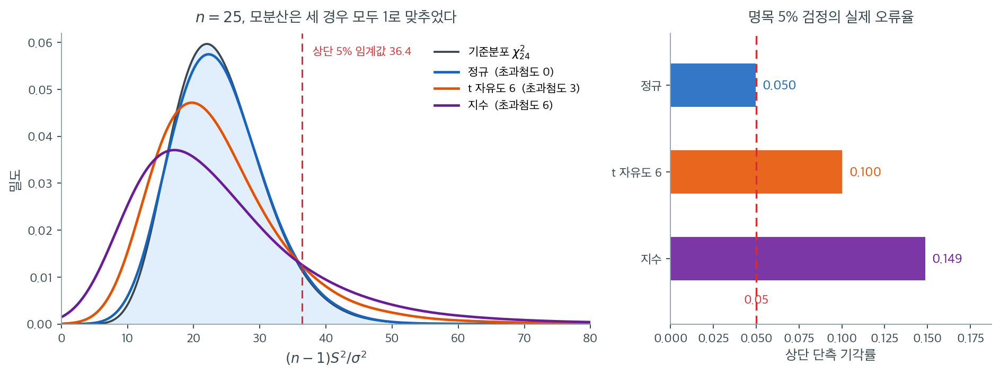

# 분산 검정의 공통 가정

<div class="leadbox" markdown>

**들어가는 이야기** — n 이 약분되어 사라진다

세 모집단에서 $n = 25$ 인 표본을 뽑아 $(n-1)S^2/\sigma^2$ 을 만든다. 모분산은 모두 $1$ 로 맞추었으니 귀무가설이 정확히 참이고, 검정은 임계값 $\chi^2_{0.95,24} = 36.4$ 를 긋는다. 그런데 명목 $5\%$ 단측 검정의 실제 기각률은 정규에서 $0.050$, $t_6$ 에서 $0.100$, 지수분포에서 $0.149$ 다. **$H_0$ 이 참인데 일곱 번에 한 번꼴로 기각한다.**

깨진 것은 모양이 아니라 **척도**다. $\operatorname{Var}(S^2) \approx \sigma^4(\gamma_2+2)/n$ 이므로 초과첨도가 $3$ 인 $t_6$ 에서는 참 분산이 정규 이론값의 $2.5$ 배, $6$ 인 지수분포에서는 $4$ 배다. 표집분포는 그 배수를 전혀 모른 채 자기 폭만큼만 벌려 놓고 선을 긋고, 실제 통계량은 그보다 넓게 흩어지니 선 밖으로 자주 나간다.

표본을 늘려도 낫지 않는다. 어긋남의 크기를 정하는 식에서 $n$ 이 **약분되어 사라지기** 때문이다. 지수모집단에서 $n \to \infty$ 의 실제 크기는 $0.327$ 로 굳는데, 이것은 $n$ 에 대한 극한이지 $n$ 이 작아서 생긴 값이 아니다. 「자료를 더 모으자」가 답이 되지 않는 드문 자리다.

그러면 「먼저 정규성을 검정해 보고 고르자」는 길은 통하는가. 통하지 않는다 — $n = 30$ 에서 샤피로–윌크가 $t_5$ 자료를 잡아낼 검정력이 $0.3$ 남짓이고, 그렇게 통과한 뒤 쓰는 카이제곱 검정의 실제 크기는 $20\%$ 를 넘는다. 어떤 가정이 깨져서 이렇게 되며, 가정은 그럼 무엇으로 다루어야 하는가. 이 쪽이 네 가정을 먼저 세우고 $\S 5$ 에서 답한다.

</div>

이 장에서 다루는 모든 분산 검정은 몇 가지 공통 가정 위에 서 있다. 각 검정을 개별적으로 살피기 전에 이 가정들을 함께 이해해 두는 것이 좋다. 어느 하나라도 위배되면 결과인 $p$값과 신뢰구간의 타당성이 훼손되기 때문이다. 결과의 심각성은 어떤 가정이 깨졌는지, 어떤 검정을 쓰는지에 달려 있다.

---

## 1. 독립성

가장 근본적인 요구조건은 각 표본 안의 관측값이 **독립**이라는 것이다. 형식적으로 표본 $X_1, X_2, \ldots, X_n$에 대해

$$
\operatorname{Cov}(X_i, X_j) = 0 \quad \text{(모든 } i \neq j \text{에 대해)}
$$

독립성이 필요한 이유는 표본분산 $S^2$의 표집분포가 제곱편차 $(X_i - \bar{X})^2$이 독립인(또는 거의 독립인) 확률변수처럼 행동한다는 가정 아래에서 유도되기 때문이다. 관측값이 상관되어 있으면 실효 표본크기가 $n$보다 작아지고, $(n-1)S^2/\sigma^2$의 분포가 더 이상 자유도 $n-1$인 카이제곱분포를 따르지 않는다.

**흔한 위반.** 시계열 자료, 군집 자료(교실 안의 학생들), 같은 대상에 대한 반복측정은 모두 종속성을 들여온다. 종속성이 있으면 표준 분산 검정은 $S^2$의 참된 불확실성을 과소평가하므로 제1종 오류율이 부풀려진다.

---

## 2. 정규성

카이제곱 검정, F 검정, Bartlett 검정은 모두 바탕 모집단이 정규분포를 따른다고 가정한다.

$$
X_i \sim N(\mu, \sigma^2)
$$

이 가정이 필요한 이유는 다음의 정확한 결과가

$$
\frac{(n-1)S^2}{\sigma^2} \sim \chi^2_{n-1}
$$

$X_1, \ldots, X_n$이 i.i.d. 정규일 때만 성립하기 때문이다. 카이제곱분포는 독립인 표준정규 제곱 $n-1$개의 합이 $\chi^2_{n-1}$을 따른다는 사실에서 나온다. 모집단이 정규가 아니면 $(n-1)S^2/\sigma^2$의 분포가 $\chi^2_{n-1}$과 달라지고 검정에 쓰인 임계값이 더 이상 옳지 않다.

**검정마다 민감도가 다르다.** 카이제곱 검정과 F 검정은 비정규성, 특히 두꺼운 꼬리와 치우침에 매우 민감하다. Bartlett 검정은 더욱 민감하다. 15.5절의 로버스트 검정(Levene, Brown-Forsythe, Fligner-Killeen)은 훨씬 약한 분포 가정 아래에서 작동하도록 설계되었다.

!!! warning "분산 검정에서는 평균 검정보다 정규성이 훨씬 중요하다"
    중심극한정리는 $n$이 어느 정도만 되어도 $\bar{X}$가 근사적으로 정규임을 보장하므로 $t$ 검정은 비정규성에 상당히 로버스트하다. 분산 검정에는 이에 상응하는 구원책이 없다. $S^2$의 분포는 정규로 훨씬 느리게 수렴하며, 모집단의 **4차 적률(첨도)**에 민감하기 때문에 중간 정도의 비정규성만으로도 카이제곱이나 F 검정이 왜곡된다.

무엇이 어긋나는지 직접 보자. $n = 25$인 표본을 세 모집단에서 6만 번씩 뽑아 $(n-1)S^2/\sigma^2$의 분포를 그렸다. 세 모집단의 **모분산은 모두 1로 맞추었다.** 곧 검정통계량의 정의에 들어가는 $\sigma^2$은 참값이고, 귀무가설이 정확히 참인 상황이다.



회색 곡선이 검정이 믿고 쓰는 $\chi^2_{24}$ 이고, 색 곡선 셋이 실제 표집분포다. 정규 자료(파랑)는 회색과 사실상 포개진다. 정확한 결과이므로 당연하다. $t_6$(주황)과 지수분포(보라)로 가면 **봉우리가 왼쪽으로 내려앉고 오른쪽 꼬리가 두꺼워진다.** 최빈값은 오히려 작아지는데 꼬리는 길어지는 이 모양이 핵심이다.

이것은 모양만의 문제가 아니라 **척도**의 문제다. 연습문제 1의 결과로 $\operatorname{Var}(S^2) \approx \sigma^4(\gamma_2+2)/n$이니, 초과첨도가 $\gamma_2 = 3$인 $t_6$에서는 참 분산이 정규 이론값의 $2.5$배, $\gamma_2 = 6$인 지수분포에서는 $4$배다. 표집분포는 이 배수를 전혀 모른 채 자기 폭만큼만 벌려 놓고 임계값 $\chi^2_{0.95,24} = 36.4$를 긋는다. 실제 통계량은 그보다 훨씬 넓게 흩어지므로 선 밖으로 자주 나간다.

오른쪽 막대가 그 결과다. 명목 5% 단측 검정의 실제 기각률은 정규에서 **0.050**, $t_6$에서 **0.100**, 지수분포에서 **0.149**이다. 지수 자료에서는 $H_0$이 참인데도 일곱 번에 한 번꼴로 기각한다.

$t$ 검정과 대비하면 차이가 선명하다. 비정규성은 $\bar{X}$의 **모양**만 바꾸고 $\operatorname{Var}(\bar{X}) = \sigma^2/n$은 건드리지 않으므로, $n$을 키우면 중심극한정리가 모양을 고쳐 준다. 반면 분산 검정에서 비정규성은 표집분포의 **척도 자체**를 틀리게 만든다. 척도가 틀린 자는 눈금을 더 촘촘히 읽는다고 맞아지지 않는다. **표본을 키워도 이 왜곡은 사라지지 않는다.**

---

## 3. 확률표집

관측값은 관심 모집단에서 확률표본으로 뽑혀야 한다. 각 관측값 $X_i$는 같은 분산 $\sigma^2$을 갖는 동일한 분포를 따라야 한다. 표집 기제가 체계적 편향을 들여오면(편의표집, 자발적 응답 등) 표본분산 $S^2$이 참 모분산의 의미 있는 추정량이 되지 못할 수 있다.

다표본 검정(F 검정, Bartlett 검정, 로버스트 검정들)에서는 $k$개의 표본이 서로 독립적으로 추출되어야 한다는 요구조건이 추가된다.

$$
X_{ij} \sim F_j(\mu_j, \sigma_j^2), \quad i = 1, \ldots, n_j, \quad j = 1, \ldots, k
$$

여기서 서로 다른 집단의 표본들은 상호 독립이다.


<div class="aibox" markdown>

**AI로 보는 통계학 1.** 가정을 검정하는 대신 모형을 골라 버린다

§2 는 각 집단이 **정규**여야 한다 했고 §3 은 집단마다 **같은 분산**을 요구했다.
이 둘을 변수 여러 개로 올리면 「집단마다 같은 **공분산행렬**」이 되고, 그것이
**선형판별분석**(LDA)이 세우는 가정이다. 집단마다 다른 공분산을 허용하면
**이차판별분석**(QDA)이 된다 — 두 분류기의 차이는 이 쪽이 다루는 가정 하나다.

그런데 기계학습 꾸러미는 그 가정을 **검정하지 않는다.** 공분산이 같은지 묻는 대신
LDA 와 QDA 를 둘 다 적합해 **교차검증에서 어느 쪽이 더 맞히는지**로 고른다. 검정이
답할 물음(같은가 다른가)을 선택이 답할 물음(어느 쪽이 나은가)으로 바꾼 것이다.
그 바꿈이 공짜인지 보자.

```python
import numpy as np
from sklearn.discriminant_analysis import (LinearDiscriminantAnalysis,
                                           QuadraticDiscriminantAnalysis)
from sklearn.model_selection import cross_val_score

def trial(rng, same, n):                       # 집단 둘, 집단마다 n 개, 평균차는 고정
    S1 = np.eye(2) if same else np.diag([4.0, 0.25])
    X = np.vstack([rng.multivariate_normal([0.0, 0.0], np.eye(2), n),
                   rng.multivariate_normal([1.6, 0.0], S1, n)])
    y = np.repeat([0, 1], n)
    return (cross_val_score(LinearDiscriminantAnalysis(), X, y, cv=5).mean(),
            cross_val_score(QuadraticDiscriminantAnalysis(), X, y, cv=5).mean())

print("  n   공분산   LDA     QDA     QDA-LDA")
for n in (15, 120):
    for same in (True, False):
        rng = np.random.default_rng(15)
        r = np.array([trial(rng, same, n) for _ in range(40)]).mean(axis=0)
        print(f"{n:4}   {'같음' if same else '다름'}   {r[0]:.4f}  {r[1]:.4f}  {r[1]-r[0]:+.4f}")
```

출력:

```
  n   공분산   LDA     QDA     QDA-LDA
  15   같음   0.7842  0.7675  -0.0167
  15   다름   0.7042  0.7467  +0.0425
 120   같음   0.7845  0.7814  -0.0031
 120   다름   0.7133  0.7543  +0.0409
```

**가정이 맞을 때 QDA 가 내는 대가가 표본크기에 달려 있다.** 집단마다 $15$ 개면
$1.7$ 퍼센트포인트를 잃지만 $120$ 개면 $0.3$ 퍼센트포인트로 줄어든다. 공분산을
집단마다 따로 추정하느라 모수를 더 쓴 값인데, 자료가 많아지면 그 값이 거의 사라진다.
반대로 **가정이 틀릴 때 얻는 이득은 $+0.04$ 쯤으로 표본크기와 거의 무관하다.**

그래서 가정 검정이 사라진 것이 아니라 **표본이 작을 때만 남는 문제**로 바뀌었다.
자료가 넉넉하면 둘 다 적합해 보는 쪽이 검정보다 빠르고 정확하다. 자료가 적으면
교차검증 점수 자체가 흔들려서 — 위 표의 $1.7$ 퍼센트포인트는 $40$ 번 되풀이한
평균이고 한 번의 차이는 그보다 훨씬 크다 — 고르는 일도 믿기 어려워진다. 이 쪽의
가정이 가장 아플 자리와 **같은 자리**다. 두 분류기의 결정경계가 어떻게 갈리는지는
19.5절 [선형판별분석과 이차판별분석](../../ch19/generative/lda_qda_classification.md)
에 있다.

</div>

---

## 4. 위반의 결과

아래 표는 각 가정 위반이 주요 분산 검정에 미치는 영향을 요약한다.

| 위반 | 카이제곱 / F 검정 | Bartlett 검정 | Levene / Brown-Forsythe |
|---|---|---|---|
| 종속성 | 제1종 오류 팽창 | 제1종 오류 팽창 | 제1종 오류 팽창 |
| 비정규성 (중간) | 중간 정도의 크기 왜곡 | 심각한 크기 왜곡 | 경미하거나 없음 |
| 비정규성 (두꺼운 꼬리) | 심각한 크기 왜곡 | 매우 심각한 왜곡 | 경미한 왜곡 |
| 비확률표집 | 편향된 추론 | 편향된 추론 | 편향된 추론 |

"크기 왜곡"이란 실제 제1종 오류율이 명목 유의수준 $\alpha$와 다름을 뜻한다. 명목 $\alpha = 0.05$인 검정이 $H_0$ 아래에서 15%의 확률로 기각한다면 심각한 크기 왜곡이 있는 것이다.

---

## 5. 가정은 검정으로 통과시키는 것이 아니다

가정을 다루는 길이 둘 있다. **검정해서 통과하면 쓰는 길**과 **애초에 그 가정에 덜 기대는 방법을 고르는 길**이다. 앞엣것이 자연스러워 보이지만 이 장에서는 뒤엣것이 맞다.

!!! warning "정규성을 검정해서 분산 검정을 고르지 말 것"
    **정규성 확인이 가장 필요한 자리에서 가장 무력하다.** $n = 30$ 에서 샤피로–윌크가 $t_5$ 자료를 잡아낼 검정력은 $0.3$ 남짓이다. 일곱 번 중 다섯 번은 「이상 없음」으로 통과시키는데, 그렇게 통과한 뒤 쓰는 카이제곱 검정의 실제 크기는 $20\%$ 를 넘는다. 거꾸로 $n = 5000$ 이면 무해한 미세한 이탈까지 기각해, 모수적 검정을 쓸 수 있는 자리에서 불필요하게 로버스트로 가게 만든다.

    게다가 **같은 자료를 두 번 쓴다.** 자료를 보고 절차를 고르면 결합된 절차의 제1종 오류율이 명목값에서 벗어난다 — 8.1절 [해석과 흔한 오해](../../ch08/foundations/interpretation.md) $\S 2$ 의 「갈림길의 정원」이고, 15.7절이 분산분석의 사전검정에서 같은 구조를 다룬다. 연습문제 4 가 이 둘을 수로 따진다.

그래서 셋을 이렇게 다룬다.

1. **독립성.** 이것만은 **설계를 보아야** 알 수 있고 자료로는 거의 알 수 없다. 시간에 걸쳐 또는 군집 안에서 모았다면 종속 자료를 위한 검정을 쓰거나 자유도를 조정한다. 셋 가운데 위반의 대가가 가장 크다.
2. **정규성.** Q-Q 그림을 그리고 왜도·첨도를 보되 **판정이 아니라 서술로** 쓴다. 곧 그 수로 검정을 자동 선택하지 않는다. 고르는 것은 미리 한다 — **사전검정 없이 처음부터 브라운–포사이드를 기본값으로** 쓰는 것이 15.1절 [왜 분산을 검정하는가](motivation.md)의 모의실험이 뒷받침하는 선택이다. 정규 자료에서도 크기가 $0.039$ 로 올바르고 검정력 손실은 작다.
3. **확률표집.** 자료 수집 과정을 평가한다. 비확률표집은 어떤 통계검정으로도 교정할 수 없으며, 결론이 적용되는 모집단이 무엇인지 판단해 적어야 한다.

??? example "빠른 진단 점검표"
    이 장의 분산 검정을 적용하기 전에 다음을 확인하라.

    - [ ] 각 집단 안의 관측값이 독립인가 — **설계를 보고** 답했는가
    - [ ] 자료 수집이 확률표집 또는 무작위 실험에 기반했는가
    - [ ] 쓸 검정을 **자료를 보기 전에** 정했는가
    - [ ] 카이제곱·$F$·바틀렛을 쓴다면, 정규성을 **검정에 통과해서**가 아니라 **그 측정이 어떤 양인지 알아서** 고른 것인가
    - [ ] 분산 자체가 관심 모수라면 붓스트랩(15.6절)을 생각해 보았는가

---

## 연습문제

<div class="drillbox" markdown>

**연습문제 1.** <span class="diff med" title="중간"></span>
$\operatorname{Var}(S^2) \approx \sigma^4(\gamma_2 + 2)/n$임을 이용하여, 정규성 아래에서 이 식이 $2\sigma^4/n$으로 환원됨을 보이고, 여러 분포에 대해 정규 대비 팽창 인자를 계산하라.

</div>

??? success "풀이"
    일반적인 결과는

    $$
    \operatorname{Var}(S^2) \approx \frac{\mu_4 - \sigma^4}{n}
    $$

    이며 $\mu_4 = \mathbb{E}[(X-\mu)^4]$은 4차 중심적률이다. 초과첨도의 정의 $\gamma_2 = \mu_4/\sigma^4 - 3$에서 $\mu_4 = \sigma^4(\gamma_2 + 3)$이므로

    $$
    \operatorname{Var}(S^2) \approx \frac{\sigma^4(\gamma_2 + 3) - \sigma^4}{n} = \frac{\sigma^4(\gamma_2 + 2)}{n}.
    $$

    정규분포는 $\gamma_2 = 0$이므로 $\operatorname{Var}(S^2) = 2\sigma^4/n$이다. 이는 $\chi^2_{n-1}$의 분산이 $2(n-1)$이라는 사실과 정확히 일치한다.

    $$
    \operatorname{Var}\!\left(\frac{(n-1)S^2}{\sigma^2}\right) = 2(n-1) \implies \operatorname{Var}(S^2) = \frac{2\sigma^4}{n-1}.
    $$

    팽창 인자는 $(\gamma_2 + 2)/2$이다.

    | 분포 | $\gamma_2$ | $\operatorname{Var}(S^2)$의 정규 대비 배수 |
    |---|---|---|
    | $\text{Uniform}$ | $-1.2$ | 0.40 |
    | $\mathcal{N}(\mu,\sigma^2)$ | 0 | 1.00 |
    | $t_{10}$ | 1.0 | 1.50 |
    | $t_6$ | 3.0 | 2.50 |
    | $\text{Lognormal}(0,0.5)$ | 5.90 | 3.95 |
    | $\text{Exponential}$ | 6.0 | 4.00 |

    지수분포 자료에서 $S^2$의 참 분산이 정규 이론이 예측하는 것의 **네 배**이다. 그런데 카이제곱 검정은 정규 이론값을 그대로 믿으므로, 관측되는 $S^2$이 그 표집분포가 예상하는 것보다 훨씬 넓게 흩어지고 검정이 지나치게 자주 기각한다.

    반대로 균등분포처럼 저첨인 자료에서는 팽창 인자가 $0.4 < 1$이므로 검정이 **보수적**이 된다. 두 방향 모두 크기 왜곡이지만 실무에서 위험한 쪽은 두꺼운 꼬리이다. $\square$

<div class="drillbox" markdown>

**연습문제 2.** <span class="diff med" title="중간"></span>
1차 자기회귀 과정 $X_t = \phi X_{t-1} + \varepsilon_t$($\varepsilon_t \sim \mathcal{N}(0,1)$)에서 $n = 50$인 자료를 생성하고, 참 주변분산 $\sigma^2 = 1/(1-\phi^2)$에 대한 카이제곱 분산 검정의 경험적 크기를 $\phi \in \{0, 0.3, 0.6, 0.8\}$에 대해 추정하라.

</div>

??? success "풀이"

    ```python
    import numpy as np
    from scipy import stats

    def ar1(phi, n, rng, burn=200):
        e = rng.normal(0, 1, n + burn)
        x = np.zeros(n + burn)
        for i in range(1, n + burn):
            x[i] = phi * x[i - 1] + e[i]
        return x[burn:]

    rng = np.random.default_rng(0)
    R, n = 4000, 50

    for phi in [0.0, 0.3, 0.6, 0.8]:
        sigma0_sq = 1 / (1 - phi**2)      # true marginal variance
        rej = 0
        for _ in range(R):
            x = ar1(phi, n, rng)
            chi2_stat = (n - 1) * x.var(ddof=1) / sigma0_sq
            p = 2 * min(stats.chi2.cdf(chi2_stat, n - 1),
                        1 - stats.chi2.cdf(chi2_stat, n - 1))
            rej += (p < 0.05)
        print(f"phi = {phi}: empirical size = {rej / R:.4f}")
    ```

    출력:

    ```text
    phi = 0.0: empirical size = 0.0535
    phi = 0.3: empirical size = 0.0717
    phi = 0.6: empirical size = 0.1705
    phi = 0.8: empirical size = 0.3817
    ```

    | $\phi$ | 경험적 크기 | 명목값의 배수 |
    |---|---|---|
    | 0.0 | 0.054 | 1.1 |
    | 0.3 | 0.072 | 1.4 |
    | 0.6 | 0.171 | 3.4 |
    | 0.8 | 0.382 | 7.6 |

    $\phi = 0$(독립)에서는 크기가 올바르다. 자기상관이 커질수록 급격히 악화되어 $\phi = 0.8$에서는 **38%의 확률로 잘못 기각한다**.

    **이유.** 자기상관이 있으면 $S^2$의 실효 자유도가 $n - 1 = 49$보다 훨씬 작다. AR(1) 과정에서 표본평균의 실효 표본크기는 대략

    $$
    n_{\text{eff}} \approx n \cdot \frac{1 - \phi}{1 + \phi}
    $$

    이며 $\phi = 0.8$이면 $50 \times (0.2/1.8) = 5.6$에 불과하다. 자유도 49인 카이제곱분포는 자유도 6짜리 분포보다 훨씬 좁으므로, 실제 $S^2$의 변동을 담아내지 못하고 꼬리 밖으로 자주 벗어난다.

    **중요한 대비.** 앞선 정규성 위반과 달리 **독립성 위반은 로버스트 검정으로 해결되지 않는다.** Levene이나 Brown-Forsythe도 관측값의 독립을 가정하므로 같은 문제를 겪는다. 종속 자료에는 블록 붓스트랩, HAC 표준오차, 또는 종속 구조를 명시적으로 모형화하는 접근이 필요하다. $\square$

<div class="drillbox" markdown>

**연습문제 3.** <span class="diff med" title="중간"></span>
"중심극한정리가 $t$ 검정을 구원하지만 분산 검정은 구원하지 못한다"는 경고 상자의 주장을 정량적으로 뒷받침하라. $\bar{X}$와 $S^2$의 표집분포가 정규로 수렴하는 속도를 비교하라.

</div>

??? success "풀이"
    두 통계량 모두 중심극한정리의 적용을 받으므로 결국은 정규로 수렴한다. 차이는 **속도**와 **어떤 적률에 의존하는가**에 있다.

    **$\bar{X}$의 경우.** Berry-Esseen 정리에 의해 정규근사의 오차는

    $$
    \sup_x \left| P\!\left(\frac{\bar{X}-\mu}{\sigma/\sqrt{n}} \leq x\right) - \Phi(x)\right| \leq \frac{C\rho}{\sigma^3\sqrt{n}}
    $$

    이며 $\rho = \mathbb{E}|X - \mu|^3$은 **3차** 절대적률이다.

    **$S^2$의 경우.** 같은 형태의 한계가 성립하지만 $S^2$의 표준화에는 $\operatorname{Var}(S^2) = \sigma^4(\gamma_2+2)/n$이 들어가고, 이 정규근사의 오차는 $S^2$의 3차 적률, 곧 원자료의 **6차** 적률에 의존한다.

    실무적 함의는 두 가지이다.

    1. **고차 적률이 필요하다.** $\bar{X}$의 근사에는 3차 적률만 있으면 되지만 $S^2$의 근사에는 6차 적률이 필요하다. 꼬리가 두꺼운 분포에서는 6차 적률이 존재하지 않거나($t_5$처럼) 매우 커서 수렴이 극도로 느리다.

    2. **가정 위반의 성격이 다르다.** $t$ 검정에서 비정규성은 $\bar{X}$의 분포 모양만 바꾸고 $\operatorname{Var}(\bar{X}) = \sigma^2/n$은 그대로이다. 반면 분산 검정에서 비정규성은 $\operatorname{Var}(S^2)$ **자체를 바꾼다**(연습문제 1의 팽창 인자). 곧 표집분포가 모양뿐 아니라 **척도**까지 틀리게 된다.

    두 번째가 결정적이다. 척도가 틀린 표집분포는 $n$을 키워도 고쳐지지 않는다. $n \to \infty$에서 $\chi^2_{n-1}/(n-1) \to 1$이지만 $S^2/\sigma^2$의 변동은 $\sqrt{(\gamma_2+2)/n}$ 규모로 줄어들 뿐 비율 $(\gamma_2+2)/2$는 그대로 남는다. **표본을 아무리 키워도 카이제곱 분산 검정은 비정규 자료에서 타당해지지 않는다.** $\square$

<div class="drillbox" markdown>

**연습문제 4.** <span class="diff med" title="중간"></span>
$\S 5$ 는 정규성을 **판정이 아니라 서술로** 쓰라고 했다. 자연스러워 보이는 다른 길 — 「정규성 검정으로 확인한 뒤 어느 분산 검정을 쓸지 결정한다」 — 이 왜 틀렸는지 두 가지로 설명하고, 대안을 제시하라.

</div>

??? success "풀이"
    **문제 1: 두 단계 절차의 크기 왜곡.** 같은 자료로 정규성을 검정한 뒤 그 결과에 따라 분산 검정을 고르면, 최종 검정의 선택이 자료에 의존하므로 결합된 절차의 실제 제1종 오류율이 명목값에서 벗어난다. 15.7절에서 다룰 분산분석 사전검정 문제와 같은 구조이다.

    **문제 2: 검정력의 방향이 반대다.** 14장에서 보았듯 정규성 검정은 작은 표본에서 검정력이 낮다. 그런데 분산 검정이 비정규성에 가장 취약한 것도 작은 표본이다. 곧 **정규성 확인이 가장 필요한 상황에서 가장 무력하다.**

    구체적으로 $n = 30$에서 Shapiro-Wilk가 $t_5$ 자료를 탐지할 검정력은 0.3 남짓이다. 70%의 경우 "정규성 이상 없음"으로 통과시키고 카이제곱 검정을 쓰게 되는데, 그 카이제곱 검정의 실제 크기는 20%가 넘는다.

    **문제 3: 큰 표본에서는 반대 오류.** $n = 5000$이면 정규성 검정이 무해한 미세한 이탈까지 기각하여, 검정력이 더 높은 모수적 검정을 쓸 수 있는 상황에서도 불필요하게 로버스트 검정으로 가게 된다.

    **대안.**

    1. **사전검정 없이 처음부터 Brown-Forsythe를 기본값으로 쓴다.** 15.1절 [왜 분산을 검정하는가](motivation.md) 절 $5$ 의 모의실험에서 보았듯 정규 자료에서도 크기가 0.039로 올바르고, 검정력 손실은 크지 않다. 잃는 것보다 얻는 것이 크다.
    2. **정규성 확인은 판정이 아니라 서술로 쓴다.** Q-Q 그림을 그리고 왜도·첨도를 보고하되, 그것으로 검정을 자동 선택하지 않는다.
    3. **분산 자체가 관심 모수라면** 붓스트랩(15.6절)으로 분포 가정 없이 추론한다.

    핵심은 **가정을 검정으로 통과시키려 하지 말고, 애초에 가정에 덜 의존하는 방법을 쓰는 것**이다. $\square$

<div class="drillbox" markdown>

**연습문제 5.** <span class="diff med" title="중간"></span>
2절은 카이제곱 검정과 F 검정이 둘 다 정규성에 민감하다고만 적었다. 그런데 F 검정은 $(n-1)S^2/\sigma^2 \sim \chi^2_{n-1}$을 분자와 분모에 **두 번** 쓴다. 그러면 F 검정의 크기 왜곡은 카이제곱 검정의 두 배인가, 아니면 분자와 분모의 왜곡이 상쇄되어 오히려 나은가. 연습문제 1의 결과에 델타법을 써서 얻는 $\operatorname{Var}(\log S^2) \approx (\gamma_2+2)/n$을 이용하여 $n \to \infty$에서 다음 세 값을 구하라.

**(1)** 지수모집단에서 $n_1 = n_2 = n$인 두 표본으로 $H_0: \sigma_1^2 = \sigma_2^2$를 검정하는 명목 5% 양측 F 검정의 실제 크기.

**(2)** 같은 지수모집단에서 한 표본으로 $H_0: \sigma^2 = \sigma_0^2$($\sigma_0^2$은 참값)을 검정하는 명목 5% 양측 카이제곱 검정의 실제 크기.

**(3)** 집단 1은 정규, 집단 2는 지수일 때 (1)의 값.

</div>

??? success "풀이"
    로그를 씌우고 본다. $\log$는 단조이므로 기각 여부가 바뀌지 않고, 척도모수였던 $\sigma^2$이 위치모수로 바뀌어 비교가 쉬워진다. 델타법에서 $\operatorname{Var}(\log S^2) \approx \operatorname{Var}(S^2)/\sigma^4 \approx (\gamma_2+2)/n$이고, $E[\log S^2] \to \log \sigma^2$이다.

    **(2) 한 표본.** 정규이론은 $\gamma_2 = 0$을 믿으므로 $\operatorname{Var}(\log S^2) \approx 2/n$으로 보고 기각역을 잡는다.

    $$
    \text{기각} \iff \left\lvert \log \frac{S^2}{\sigma_0^2} \right\rvert > 1.96\sqrt{\frac{2}{n}}
    $$

    참 표준편차는 $\sqrt{(\gamma_2+2)/n}$이므로, 기각역의 경계는 **참 표준편차 단위로는**

    $$
    1.96\sqrt{\frac{2}{n}} \Big/ \sqrt{\frac{\gamma_2+2}{n}} = 1.96\sqrt{\frac{2}{\gamma_2+2}}
    $$

    만큼만 뻗는다. $n$이 약분되어 사라진 것이 요점이다. 지수분포의 $\gamma_2 = 6$을 넣으면 $1.96 \times 0.5 = 0.98$이고 실제 크기는

    $$
    2\Phi(-0.98) = 0.327.
    $$

    **(1) 두 표본.** $\log F = \log S_1^2 - \log S_2^2$이고 두 표본이 독립이므로 분산이 더해진다.

    $$
    \operatorname{Var}(\log F) \approx \frac{2(\gamma_2+2)}{n}, \qquad \text{정규이론의 믿음} = \frac{4}{n}
    $$

    기각역은 $\lvert \log F \rvert > 1.96\sqrt{4/n}$이고, 이를 참 표준편차로 재면

    $$
    1.96\sqrt{\frac{4}{n}} \Big/ \sqrt{\frac{2(\gamma_2+2)}{n}} = 1.96\sqrt{\frac{2}{\gamma_2+2}}
    $$

    로 **(2)와 글자까지 같은 수**다. 따라서 실제 크기도 $0.327$로 같다.

    **(3) 한쪽만 비정규.** 두 집단의 초과첨도를 $\gamma_2^{(1)}, \gamma_2^{(2)}$라 하면

    $$
    \operatorname{Var}(\log F) \approx \frac{(\gamma_2^{(1)}+2) + (\gamma_2^{(2)}+2)}{n} = \frac{2 + 8}{n} = \frac{10}{n}
    $$

    이고 명목값은 $4/n$이므로 경계는 $1.96\sqrt{4/10} = 1.2396$, 실제 크기는 $2\Phi(-1.2396) = 0.215$다.

    | 상황 | 참 분산 / 명목 분산 | 참 단위 임계값 | 실제 크기 |
    |---|---|---|---|
    | 한 표본, 지수 | $8/2 = 4$ | 0.980 | 0.327 |
    | 두 표본, 둘 다 지수 | $16/4 = 4$ | 0.980 | 0.327 |
    | 두 표본, 정규 + 지수 | $10/4 = 2.5$ | 1.240 | 0.215 |
    | 두 표본, 둘 다 $t_6$ | $10/4 = 2.5$ | 1.240 | 0.215 |

    **"정규성 의존이 두 겹"은 두 배 나빠진다는 뜻이 아니다.** 왜곡 배율 $(\gamma_2+2)/2$가 분자와 분모에 똑같이 걸리므로, 크기를 정하는 것은 참 분산과 명목 분산의 **비**이고 그 비에서 배율이 약분되어 남는다. 상쇄도 없고 가중도 없이 **정확히 같은 만큼** 나빠진다.

    그러면 두 겹이 실제로 뜻하는 것은 무엇인가. 두 가지다. 첫째, 비를 잡아 모르는 $\sigma^2$을 지워도 정규성에서 도망갈 구멍은 생기지 않는다. 평균 쪽에서 두 표본 $t$ 검정이 중심극한정리의 보호를 받는 것과 대조적이다. 둘째, 왜곡이 두 모집단 첨도의 **평균**으로 정해지므로 **한쪽만 비정규여도** 망가진다. (3)에서 집단 1이 완벽한 정규인데도 크기가 0.215이고, 이는 두 집단이 모두 $t_6$일 때와 같은 값이다. $(2+8)/2 = 5 = (3+2)$이기 때문이다. $\square$

<div class="drillbox" markdown>

**연습문제 6.** <span class="diff med" title="중간"></span>
연습문제 1의 팽창 인자 $(\gamma_2+2)/2$를 계산하려면 4차 적률을 알아야 한다. 그런데 2장의 첨도 하한 $\beta_2 \ge 1 + \gamma_1^2$($\beta_2 = \gamma_2 + 3$은 첨도, $\gamma_1$은 왜도)을 쓰면 **왜도만으로** 팽창 인자의 하한을 말할 수 있다.

**(1)** 팽창 인자의 하한을 $\gamma_1$의 식으로 적어라.

**(2)** 그 하한이 1을 넘는 왜도의 경계를 구하고, 경계를 넘었다는 것이 분산검정에 무슨 뜻인지 말하라. 이 하한이 쓸모없어지는 경우는 언제인가.

**(3)** 연습문제 5의 결과와 합쳐, 왜도가 $\gamma_1 = 2$인 모집단에서는 첨도를 전혀 모르더라도 명목 5% 양측 분산검정의 실제 크기가 적어도 얼마인지 말하라. 지수분포($\gamma_1 = 2$)와 $\text{Lognormal}(0, 0.5)$($\gamma_1 = 1.750$)에서 하한과 실제 값을 견주어라.

</div>

??? success "풀이"
    **(1)** 팽창 인자를 $I$라 하면 $\gamma_2 = \beta_2 - 3$에서

    $$
    I = \frac{\gamma_2 + 2}{2} = \frac{\beta_2 - 1}{2} \ \ge \ \frac{\gamma_1^2}{2}.
    $$

    분자 $\beta_2 - 1$에는 뜻이 있다. $Z = (X-\mu)/\sigma$로 두면 $\operatorname{Var}(Z^2) = E[Z^4] - (E[Z^2])^2 = \beta_2 - 1$이므로 $I = \operatorname{Var}(Z^2)/2$다. 곧 **$S^2$의 흔들림은 표준화한 값을 제곱한 것의 흔들림**이다. 2장의 하한도 여기서 나온다. $\operatorname{Cov}(Z^2, Z) = E[Z^3] = \gamma_1$이고 $\operatorname{Var}(Z) = 1$이므로 코시–슈바르츠에서 $\gamma_1^2 \le \operatorname{Var}(Z^2) = \beta_2 - 1$이다.

    **(2)** $\gamma_1^2/2 > 1 \iff \lvert \gamma_1 \rvert > \sqrt{2} = 1.414$다. 왜도의 절댓값이 $\sqrt 2$를 넘으면 첨도를 몰라도 $\operatorname{Var}(S^2)$가 정규이론값보다 **반드시** 크다. 곧 카이제곱·F·Bartlett 검정은 자유로운(liberal) 쪽으로, 실제 크기가 명목값보다 **크게** 틀어지는 것이 확정된다. 보수적일 가능성은 남아 있지 않다.

    하한이 쓸모없어지는 경우는 **대칭분포**다. $\gamma_1 = 0$이면 하한이 $0$이라 아무 말도 하지 못한다. 연습문제 1의 표에서 대칭인 두 분포, 균등($I = 0.40$, 보수적)과 $t_6$($I = 2.50$, 자유로움)이 경계의 양쪽에 다 있는 것이 그 때문이다. **왜도는 비정규성의 한 방향만 본다.**

    **(3)** 연습문제 5에서 명목 5% 양측 검정의 실제 크기는 $2\Phi(-1.96/\sqrt{I})$이고 이것은 $I$의 증가함수다. 따라서 $I$의 하한이 크기의 하한을 준다.

    | 모집단 | $\gamma_1$ | 하한 $\gamma_1^2/2$ | 크기의 하한 | 실제 $I$ | 실제 크기 |
    |---|---|---|---|---|---|
    | 대칭 | 0 | 0 | — | — | — |
    | 경계 | $\sqrt 2 = 1.414$ | 1.00 | 0.050 | — | — |
    | $\text{Lognormal}(0,0.5)$ | 1.750 | 1.53 | 0.113 | 3.949 | 0.324 |
    | 지수 | 2.000 | 2.00 | 0.166 | 4.000 | 0.327 |

    $\gamma_1 = 2$이면 첨도를 모르더라도 실제 크기가 적어도 $2\Phi(-1.96/\sqrt{2}) = 2\Phi(-1.386) = 0.166$이다. 실제 지수분포에서는 $0.327$이니 하한은 느슨하지만, **명목 0.05의 세 배가 넘는다는 사실만은 왜도 하나로 확정된다.**

    경계 $\lvert \gamma_1 \rvert = \sqrt 2$에서 하한이 정확히 명목값 $0.05$를 준다는 것도 적어 둘 만하다. $I = 1$이면 $2\Phi(-1.96) = 0.05$이기 때문이다. 이 경계 위에서는 하한이 명목값 아래로 떨어져 아무 경고를 하지 못한다.

    5절은 "왜도·첨도를 보고하되 그것으로 검정을 자동 선택하지 말라"고 했다. 이 문제는 그 보고의 첫 줄에 수를 붙인다. **히스토그램에서 읽은 왜도가 1.5를 넘으면, 4차 적률을 추정해 보지 않아도 카이제곱·F·Bartlett은 이미 못 쓸 상태다.** $\square$

<div class="drillbox" markdown>

**연습문제 7.** <span class="diff hard" title="어려움"></span>
2절은 "표본을 키워도 이 왜곡은 사라지지 않는다"로 끝난다. 이 문장은 사실보다 약하다. 쪽 본문이 $n = 25$에서 측정한 명목 5% **단측** 검정의 실제 기각률은 $t_6$에서 0.100, 지수분포에서 0.149였다.

**(1)** $n \to \infty$에서 이 기각률의 극한을 $\gamma_2$의 식으로 적고 두 분포에서 값을 구하라. 본문의 $n = 25$ 값과 견주어 무엇이 틀렸는지 말하라.

**(2)** 정확한 유한 $n$ 공식 $\operatorname{Var}(S^2) = \dfrac{1}{n}\left(\mu_4 - \dfrac{n-3}{n-1}\sigma^4\right)$으로 $n = 25$, 지수분포에서 과분산 배율을 구하라. 그것으로 (1)과 본문 값의 차이가 설명되는가.

</div>

??? success "풀이"
    **(1) 극한.** 단측 검정은 $(n-1)S^2/\sigma^2 > \chi^2_{0.95, n-1}$일 때 기각한다. $n$이 크면 카이제곱 분위수가

    $$
    \chi^2_{0.95,\,n-1} \approx (n-1) + 1.645\sqrt{2(n-1)}
    $$

    이므로 기각 조건은 $S^2/\sigma^2 - 1 > 1.645\sqrt{2/(n-1)}$이다. 한편 $S^2/\sigma^2$의 참 표준편차는 $\sqrt{(\gamma_2+2)/n}$이므로, 임계값은 참 표준편차 단위로

    $$
    1.645\sqrt{\frac{2}{n-1}} \Big/ \sqrt{\frac{\gamma_2+2}{n}} \ \longrightarrow \ 1.645\sqrt{\frac{2}{\gamma_2+2}}
    $$

    만큼만 뻗는다. $S^2$에 중심극한정리를 쓰면 실제 크기의 극한은

    $$
    \lim_{n\to\infty} \alpha_{\text{실제}} = 1 - \Phi\!\left(1.645\sqrt{\frac{2}{\gamma_2+2}}\right).
    $$

    | 모집단 | $\gamma_2$ | 참 단위 임계값 | 극한 크기 | 본문의 $n=25$ 값 |
    |---|---|---|---|---|
    | 정규 | 0 | 1.645 | 0.050 | 0.050 |
    | $t_6$ | 3 | 1.0405 | 0.1491 | 0.100 |
    | 지수 | 6 | 0.8225 | 0.2054 | 0.149 |

    본문의 $n = 25$ 값이 둘 다 극한보다 **작다.** 그러므로 왜곡은 사라지지 않는 데 그치지 않고 $n$과 함께 **자란다.** 2절의 문장은 "표본을 키워도 사라지지 않는다"가 아니라 **"표본을 키우면 나빠진다"**로 고쳐 읽어야 한다. 5장 지수모집단 $S^2$ 쪽에서 명목 95% 분산 신뢰구간의 포함률이 $0.764 \to 0.716 \to 0.690 \to 0.673$으로 내려가는 것이 같은 단조성을 양측 구간에서 보여 준다.

    눈에 띄는 우연도 하나 있다. $t_6$의 극한 $0.1491$이 $n = 25$ 지수분포의 $0.149$와 같다. **$t_6$ 자료에서 표본을 키우면, 지금 지수분포가 $n = 25$에서 저지르는 만큼의 오류에 다다른다.**

    **(2) 유한 $n$ 배율.** 정확한 공식을 정규이론값 $2\sigma^4/(n-1)$으로 나누면

    $$
    r_n = \frac{\operatorname{Var}(S^2)}{2\sigma^4/(n-1)} = \frac{(n-1)\beta_2 - (n-3)}{2n}
    $$

    이고 $n \to \infty$에서 $(\beta_2-1)/2$로 간다. 지수분포($\beta_2 = 9$), $n = 25$에서

    $$
    r_{25} = \frac{24 \times 9 - 22}{50} = \frac{194}{50} = 3.88
    $$

    이며 극한값 $4$보다 약간 작다. 배율도 아래에서 올라가는 것은 맞다. 그러나 이것만으로는 차이가 설명되지 않는다. $r = 3.88$을 넣으면 크기가 $1 - \Phi(1.645/\sqrt{3.88}) = 1-\Phi(0.8351) = 0.202$로 예측되는데 실제는 0.149다.

    **남는 차이는 척도가 아니라 모양이다.** $n = 25$에서 $S^2$의 분포는 오른쪽으로 크게 치우쳐 있다. 지수모집단에서 $Y = (X-\mu)^2$의 왜도는 중심적률 $\mu_2 = 1, \mu_4 = 9, \mu_6 = 265$에서

    $$
    \frac{E[(Y - E Y)^3]}{\operatorname{Var}(Y)^{3/2}} = \frac{265 - 3\cdot 9 + 3 - 1}{8^{3/2}} = \frac{240}{22.63} = 10.61
    $$

    이므로 $S^2 \approx \bar Y$의 왜도는 대략 $10.61/\sqrt{n}$, 곧 $n = 25$에서 $2.1$이다(정규모집단이라면 $\sqrt{8/24} = 0.577$에 불과하다). 치우친 분포는 중앙값이 평균보다 작아 질량이 평균 왼쪽에 몰리고, 긴 꼬리는 훨씬 먼 곳에서야 효과를 낸다. 그래서 평균에서 $0.84$ 표준편차라는 **중간 거리**의 초과확률은 정규근사가 주는 값보다 작아진다. 이 치우침이 왜곡을 일부 가려 주는 완충이다.

    $n$이 커지면 완충이 $1/\sqrt n$로 걷히고 과분산 배율만 남는다. 그래서 크기는 $0.2054$로 올라간다. **작은 표본에서 분산검정이 그럭저럭 보이는 것은 두 오류가 반대 방향으로 겹쳐 서로를 가려 주기 때문이고, 표본을 키우면 가려 주던 쪽이 먼저 사라진다.** $\square$

<div class="drillbox" markdown>

**연습문제 8.** <span class="diff hard" title="어려움"></span>
연습문제 2의 풀이는 $\phi = 0.8$에서 경험적 크기가 0.382인 까닭을 실효 표본크기 $n(1-\phi)/(1+\phi) = 5.6$으로 설명했다. 그런데 그 공식은 $\bar X$의 것이고 $S^2$의 것이 아니다. 정상 가우스 과정에서

$$
\operatorname{Var}(S^2) \approx \frac{2\sigma^4}{n}\sum_{h=-\infty}^{\infty}\rho_h^2, \qquad E[S^2] = \frac{n}{n-1}\sigma^2\left[1 - \frac{1}{n}\left(1 + 2\sum_{h=1}^{n-1}\Big(1-\frac hn\Big)\rho_h\right)\right]
$$

이다. $\phi = 0.8$, $n = 50$에서 **(1)** $S^2$에 맞는 실효 표본크기와 **(2)** $E[S^2]/\sigma^2$을 구하고, **(3)** 두 효과를 따로 넣어 가며 양측 5% 검정의 좌우 꼬리 기각률을 정규근사로 계산하라. 자기상관이 있는 자료에서 이 검정은 어느 쪽으로 틀린 결론을 내리는가.

</div>

??? success "풀이"
    **(1) 산포.** AR(1)의 자기상관은 $\rho_h = \phi^{\lvert h \rvert}$이므로 제곱하면 공비가 $\phi^2$인 등비수열이 된다.

    $$
    \sum_{h=-\infty}^{\infty}\rho_h^2 = 1 + 2\sum_{h=1}^{\infty}\phi^{2h} = 1 + \frac{2\phi^2}{1-\phi^2} = \frac{1+\phi^2}{1-\phi^2} = \frac{1.64}{0.36} = 4.556
    $$

    따라서 $\operatorname{Var}(S^2) \approx (2/50)(4.556)\sigma^4 = 0.1822\sigma^4$, 표준편차 $0.4269\sigma^2$이다. 독립 정규라면 $2\sigma^4/(n-1) = 0.0408\sigma^4$, 표준편차 $0.2020\sigma^2$이다. 분산이 $4.46$배로 부풀었다. 이 값을 독립일 때의 식 $2\sigma^4/n_{\text{eff}}$에 맞추면

    $$
    n_{\text{eff}}^{(S^2)} = n\,\frac{1-\phi^2}{1+\phi^2} = 50 \times \frac{0.36}{1.64} = 11.0.
    $$

    **$S^2$의 실효 표본크기는 11이고 $\bar X$의 5.6이 아니다.** 제곱이 상관을 $\rho_h$에서 $\rho_h^2$로 줄이기 때문에 $S^2$ 쪽이 덜 손해를 본다. 쪽에서 빌려 쓴 5.6은 **다른 통계량의 수**다.

    **(2) 편향.** $\sum_{h=1}^{49}(1-h/50)\,0.8^h$는 $\sum \phi^h - (1/50)\sum h\phi^h = 4 - 20/50 = 3.60$이므로 괄호 안이 $1 + 2(3.60) = 8.20$이고

    $$
    \frac{E[S^2]}{\sigma^2} = \frac{50}{49}\left(1 - \frac{8.20}{50}\right) = 1.0204 \times 0.836 = 0.853.
    $$

    **$S^2$이 참 분산을 15% 아래로 추정한다.** 표본평균이 과정의 느린 흐름을 따라가 버리므로 편차가 작아지는 것이다. 연습문제 2의 풀이는 이 편향을 언급하지 않았다.

    **(3) 두 효과의 분리.** $S^2/\sigma^2$ 눈금에서 기각역의 경계는 $\chi^2_{0.025,49}/49 = 0.6440$과 $\chi^2_{0.975,49}/49 = 1.4331$이다. 평균과 표준편차를 바꿔 넣으며 정규근사로 두 꼬리를 센다.

    | 넣은 효과 | 평균 | 표준편차 | 왼쪽 | 오른쪽 | 합 |
    |---|---|---|---|---|---|
    | 없음 (독립 정규) | 1.000 | 0.2020 | 0.0390 | 0.0160 | 0.0550 |
    | 산포만 | 1.000 | 0.4269 | 0.2021 | 0.1551 | 0.3573 |
    | 편향만 | 0.853 | 0.2020 | 0.1504 | 0.0020 | 0.1524 |
    | 둘 다 | 0.853 | 0.4269 | 0.3121 | 0.0871 | 0.3992 |

    첫 줄이 0.0550인 것은 정규근사 자체의 오차다(참값 0.05). 그만큼의 여유를 감안하면 마지막 줄 0.3992는 연습문제 2의 모의실험 값 0.3817과 맞는다.

    읽을 것이 셋이다.

    1. **크기의 크기는 산포 팽창이 만든다.** 산포만 넣어도 0.357이고, 편향만으로는 0.152에 그친다.

    2. **그러나 어느 꼬리로 기각하는가는 편향이 정한다.** 편향이 없으면 좌우가 $0.20 / 0.16$으로 비슷한데, 편향을 넣으면 $0.31 / 0.09$로 왼쪽이 세 배 넘게 무거워진다. 기각의 78%가 왼쪽 꼬리다. 양의 자기상관이 있는 자료에서 분산검정은 **"분산이 작아졌다"고 잘못 말한다.** 시계열 공정자료에서 "변동이 줄었다"는 반가운 결론이 유난히 자주 나오는 까닭이 여기 있다. 종속성이 만드는 오류는 방향이 있다.

    3. **남의 실효 표본크기를 빌려 쓰면 안 된다.** $\bar X$의 5.6을 $S^2$에 쓰면 산포를 과대평가한다. 자유도 5.6짜리 카이제곱으로 임계값을 다시 그었다면 이번에는 지나치게 보수적인 검정이 된다. 실효 표본크기는 통계량마다 다르고, $S^2$의 것은 $\rho_h^2$의 합으로 정해진다. $\square$

<div class="drillbox" markdown>

**연습문제 9.** <span class="diff hard" title="어려움"></span>
4절의 표는 Levene과 Brown-Forsythe를 한 칸에 묶었다. 두 검정의 차이는 편차를 재는 중심뿐인데(평균 대 중앙값), 그 차이만으로 표의 칸이 갈라지는지 확인하라. 집단 2개, $n = 20$, 명목 5%에서 네 가지를 4만 번 모의로 재라. (ⅰ) 정규 자료의 크기, (ⅱ) 정규 자료에서 $\sigma_2/\sigma_1 = 2$일 때의 검정력, (ⅲ) $\text{Lognormal}(0, 0.8)$ 자료의 크기, (ⅳ) 같은 로그정규에서 척도를 2배로 벌렸을 때의 검정력.

(ⅳ)의 두 검정력을 그대로 견주면 안 되는 까닭을 말하고, 각 검정의 경험적 95% 분위수를 임계값으로 바꾼 **크기보정 검정력**도 함께 재라.

</div>

??? success "풀이"

    ```python
    import numpy as np
    from scipy import stats

    # === 르벤(평균 중심) 과 브라운-포사이드(중앙값 중심) 를 한 함수로 ===
    def levene_F(x, center):
        c = x.mean(axis=2, keepdims=True) if center == "mean" else np.median(x, axis=2, keepdims=True)
        z = np.abs(x - c)
        R, k, n = x.shape
        zb, za = z.mean(axis=2), z.mean(axis=(1, 2))[:, None]
        between = n * ((zb - za) ** 2).sum(axis=1)
        within = ((z - zb[:, :, None]) ** 2).sum(axis=(1, 2))
        return (k * n - k) / (k - 1) * between / within

    rng = np.random.default_rng(0)
    R, k, n = 40000, 2, 20
    crit = stats.f.ppf(0.95, k - 1, k * (n - 1))

    def draw(kind, ratio):
        x = (rng.normal(0, 1, size=(R, k, n)) if kind == "N"
             else rng.lognormal(0, 0.8, size=(R, k, n)))
        x[:, 1, :] *= ratio
        return x

    F = {}
    for kind in ("N", "LN"):
        for ratio, tag in ((1.0, "size"), (2.0, "power")):
            x = draw(kind, ratio)
            for ct in ("mean", "median"):
                F[kind, tag, ct] = levene_F(x, ct)

    print(f"{'situation':<26}{'Levene(mean)':>14}{'BF(median)':>13}")
    for kind, label in (("N", "normal"), ("LN", "lognormal")):
        for tag in ("size", "power"):
            row = [np.mean(F[kind, tag, ct] > crit) for ct in ("mean", "median")]
            print(f"{label + ': ' + tag:<26}" + "".join(f"{v:>14.4f}" for v in row))

    # 크기보정 검정력: 각 방법의 경험적 95% 분위수를 임계값으로 쓴다
    row = [np.mean(F["LN", "power", ct] > np.quantile(F["LN", "size", ct], 0.95))
           for ct in ("mean", "median")]
    print(f"{'lognormal: power (adj)':<26}" + "".join(f"{v:>14.4f}" for v in row))
    ```

    출력:

    ```text
    situation                   Levene(mean)   BF(median)
    normal: size                      0.0554        0.0400
    normal: power                     0.7563        0.7017
    lognormal: size                   0.1568        0.0416
    lognormal: power                  0.5211        0.3112
    lognormal: power (adj)            0.2900        0.3420
    ```

    **정규 자료에서는 중앙값이 손해다.** 크기 0.0554 대 0.0400으로 Brown-Forsythe가 보수적이고(15.1절 [왜 분산을 검정하는가](motivation.md) 절 $5$ 의 0.039와 같은 자리다), 검정력은 0.7563 대 0.7017로 **0.055를 내준다.** 중심을 중앙값으로 바꾸면 $z_{ij} = \lvert x_{ij} - \text{중앙값}_j \rvert$에 중심 추정의 잡음이 더 섞여 들어오기 때문이다. 정규분포에서 중앙값의 분산이 평균의 $\pi/2 = 1.571$배라는 사실이 여기서 비용으로 나타난다. 이것이 로버스트 검정이 **포기하는** 것이다.

    **치우친 자료에서는 평균이 재앙이다.** 로그정규에서 Levene의 크기가 0.1568로 명목의 세 배가 넘는데 Brown-Forsythe는 0.0416으로 제자리다. 4절 표의 "비정규성(중간): 경미하거나 없음"은 **Brown-Forsythe에만 맞는 말이고 Levene(평균)에는 틀리다.** 표의 그 칸은 둘로 쪼개야 한다. 치우친 자료에서 $\bar x_j$는 긴 꼬리에 끌려가므로 $\lvert x_{ij} - \bar x_j \rvert$가 중심에서의 거리를 재지 못하는데, 중앙값은 끌려가지 않는다.

    **(ⅳ)를 그대로 견주면 안 되는 까닭.** 로그정규에서 Levene의 검정력 0.5211이 Brown-Forsythe의 0.3112보다 커 보이지만, Levene은 그 상황에서 크기가 0.1568이다. **크기가 다른 두 검정의 검정력은 견줄 수 없다.** 1종 오류를 세 배 더 쓰면서 얻은 검정력이다. 각 검정의 귀무분포에서 경험적 95% 분위수를 임계값으로 다시 잡아 크기를 0.05로 맞추면 0.2900 대 0.3420으로 **순서가 뒤집힌다.**

    맞바꿈의 결론을 수로 적으면 이렇다. 중앙값 중심은 정규 자료에서 검정력 $0.055$를 내주고, 치우친 자료에서 크기 왜곡 $0.115$($0.157 \to 0.042$)과 공정한 비교에서의 검정력 $0.052$를 얻는다. **정규 자료에서 잃는 것이 치우친 자료에서 얻는 것보다 작다.** 5절의 권고와 연습문제 4의 "처음부터 Brown-Forsythe를 기본값으로"가 이 다섯 줄이다. $\square$

<div class="drillbox" markdown>

**연습문제 10.** <span class="diff hard" title="어려움"></span>
연습문제 4는 두 단계 절차의 "실제 제1종 오류율이 명목값에서 벗어난다"고 했다. 그 주장을 정확한 상황에서 검증하자. 정규모집단에서 $H_0: \mu_1 = \mu_2$를 다음 두 단계로 검정한다. 먼저 $F$ 검정으로 등분산을 명목 5% 양측 검정하고, 받아들이면 합동분산 $t$ 검정, 기각하면 Welch 검정을 쓴다.

**(1)** 두 모분산이 **정확히 같을 때**, 합동 $t$ 분지의 조건부 기각률이 정확히 명목값이라는 것을 보여라(4장 F 분포의 감마–베타 분해를 쓰라).

**(2)** 그렇다면 "두 단계의 오류율을 합쳐 놓는다"는 설명은 어디가 부정확한가. 실제 손해는 어디서 나오는가. $n_1 = 5$, $n_2 = 20$, $\sigma_1^2/\sigma_2^2 = 4$에서 사전검정의 검정력과 합동 $t$ 검정의 실제 크기를 계산해 답하라.

</div>

??? success "풀이"
    **(1) 등분산이 정확히 성립하면 합동 분지는 정확하다.** 공통 분산을 $\sigma^2$이라 하고

    $$
    U = \frac{(n_1-1)S_1^2}{\sigma^2} \sim \chi^2_{n_1-1}, \qquad V = \frac{(n_2-1)S_2^2}{\sigma^2} \sim \chi^2_{n_2-1}
    $$

    로 두면 둘은 독립이고 **척도가 같다.** 사전검정 통계량은

    $$
    F = \frac{S_1^2}{S_2^2} = \frac{n_2-1}{n_1-1}\cdot\frac{U}{V}
    $$

    이므로 $U/V$의 함수, 곧 $W = U/(U+V)$의 함수다. 척도가 같은 독립 감마의 감마–베타 분해에 의해 $W \sim \text{Beta}$이고 $W$는 $U+V$와 **독립**이다. 한편 합동분산은

    $$
    S_p^2 = \frac{(n_1-1)S_1^2 + (n_2-1)S_2^2}{n_1+n_2-2} = \frac{\sigma^2(U+V)}{n_1+n_2-2}
    $$

    이므로 $F \perp S_p^2$다. 또 정규모집단에서 표본평균과 표본분산이 독립이므로 $(S_1^2, S_2^2) \perp \bar X_1 - \bar X_2$이고, 따라서 사전검정 통계량 $F$는 합동 $t$ 통계량

    $$
    T_p = \frac{\bar X_1 - \bar X_2}{S_p\sqrt{1/n_1 + 1/n_2}}
    $$

    와 독립이다. 사전검정의 채택 사건 $A$는 $F$의 함수이므로

    $$
    P(\lvert T_p \rvert > t_{0.975,\,n_1+n_2-2} \mid A) = P(\lvert T_p \rvert > t_{0.975,\,n_1+n_2-2}) = 0.05
    $$

    이 **정확히** 성립한다. $n_1 = 5, n_2 = 20$에서 모의로 확인하면 무조건 기각률 0.0499, 채택 조건부 기각률 0.0500으로 소수 넷째 자리까지 같다. **자료로 고른 검정인데도 조건부 크기가 흔들리지 않는다.**

    **(2) 설명의 부정확한 곳.** 그러므로 "두 단계라서 오류율이 합쳐진다"가 문제의 본질이 아니다. 등분산이 정확히 성립하는 지점에서 새는 곳은 다른 쪽이다. 같은 모의에서 두 단계 절차 전체의 크기는 0.0540인데, 분해하면

    $$
    0.0540 = \underbrace{0.950 \times 0.0500}_{\text{합동 분지}} + \underbrace{0.050 \times 0.130}_{\text{Welch 분지}}
    $$

    이다. Welch는 사전검정이 기각한 5%의 표본 — 분산이 유난히 달라 **보이는** 표본 — 에만 쓰이고, 그 표본에서는 Welch–Satterthwaite 자유도가 작게 계산되어 근사가 깨져 조건부 크기가 0.13까지 오른다. 새는 양은 작고, 새는 자리는 선택된 소수의 표본이다.

    **진짜 손해는 귀무가 아닌 쪽에 있다.** 분산이 실제로 다른데 사전검정이 잡아내지 못하는 자리다. $\sigma_1^2/\sigma_2^2 = 4$이면 $F/4 \sim F_{4,19}$이고 임계값이 $F_{0.025,4,19} = 0.1166$, $F_{0.975,4,19} = 3.5587$이므로 검정력은

    $$
    P\!\left(F_{4,19} < \frac{0.1166}{4}\right) + P\!\left(F_{4,19} > \frac{3.5587}{4}\right) = 0.491.
    $$

    **분산이 네 배 차이인데 절반은 놓친다.** 놓친 표본에 쓰이는 합동 $t$ 검정의 크기는 어림할 수 있다. 참값은 $\operatorname{Var}(\bar X_1 - \bar X_2) = 4/5 + 1/20 = 0.85\sigma_2^2$인데 합동 절차가 쓰는 것은 $S_p^2(1/5+1/20)$이고

    $$
    E[S_p^2] = \frac{4 \times 4 + 19 \times 1}{23}\sigma_2^2 = 1.522\sigma_2^2 \ \Longrightarrow \ 1.522 \times 0.25 = 0.380\sigma_2^2
    $$

    이다. 표준오차가 참값의 $\sqrt{0.380/0.85} = 0.669$배이니 통계량이 $1/0.669 = 1.495$배로 불고, 실제 크기는 대략

    $$
    2\left[1 - \Phi\!\left(t_{0.975,23} \times 0.669\right)\right] = 2[1-\Phi(1.384)] = 0.166
    $$

    이다. 모의값은 0.185다. 그런데 사전검정이 **채택한** 표본만 보면 0.219로 더 나쁘다. 채택은 $S_1^2/S_2^2$이 작게 나온 표본에서 일어나고, 그 표본에서 $S_p^2$은 더욱 작아져 합동 검정이 가장 자유로워지는 바로 그 표본들이다. **사전검정은 합동 검정이 가장 크게 틀리는 표본을 골라서 넘겨준다.** 두 단계 절차의 전체 크기는 0.115이고, 처음부터 Welch를 쓰면 0.056이다.

    | 절차 | 등분산일 때 크기 | 분산비 4일 때 크기 |
    |---|---|---|
    | 합동 $t$ 만 | 0.050 | 0.185 |
    | 사전검정 후 선택 | 0.054 | 0.115 |
    | 처음부터 Welch | 0.056 | 0.056 |

    연습문제 4의 결론 — 사전검정하지 말고 처음부터 Welch나 Brown-Forsythe를 쓰라 — 은 그대로 선다. 다만 이유를 고쳐야 한다. **"두 단계라서 오류율이 합쳐지기 때문"이 아니라, "사전검정이 필요한 작은 표본에서 검정력이 없고, 통과시킨 표본이 하필 뒤이은 검정이 가장 위험한 표본이기 때문"이다.** 이것은 연습문제 4의 "검정력의 방향이 반대다"를 분산검정 쪽에서 되읽은 것이기도 하다. $\square$

---

## 정리하며

이 장의 모든 검정이 기대는 **공통 가정**들이다.

- **독립성이 가장 근본적이다.** 어떤 검정으로 바꿔도 구제되지 않으며, 5.12절의 유효표본크기 문제가 그대로 나타난다.
- **정규성의 요구 수준이 검정마다 다르다.** 카이제곱·$F$·바틀렛은 강하게 의존하고, 레빈 계열은 훨씬 관대하다. **이 차이가 검정 선택의 핵심이다.**
- **확률표집이 전제다.** 편의표본에서는 어떤 계산도 모집단에 대한 진술이 되지 못한다.
- **이상치가 특히 해롭다.** 분산은 편차를 제곱하므로 극단값 하나가 자릿수를 바꿀 수 있다(5.13절의 $\{70,\dots,78\}\to780$ 예).
- **가정 확인이 검정보다 먼저다.** 14장의 진단 도구가 여기서 쓰인다.

다음 절부터 **[카이제곱 검정](../chi_square_test/chi_square_variance.md)**을 자세히 다룬다.
