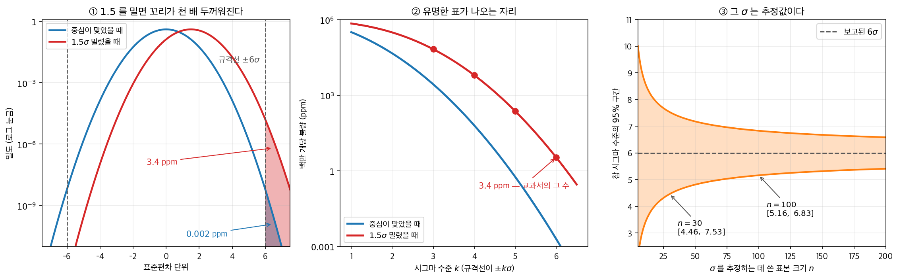
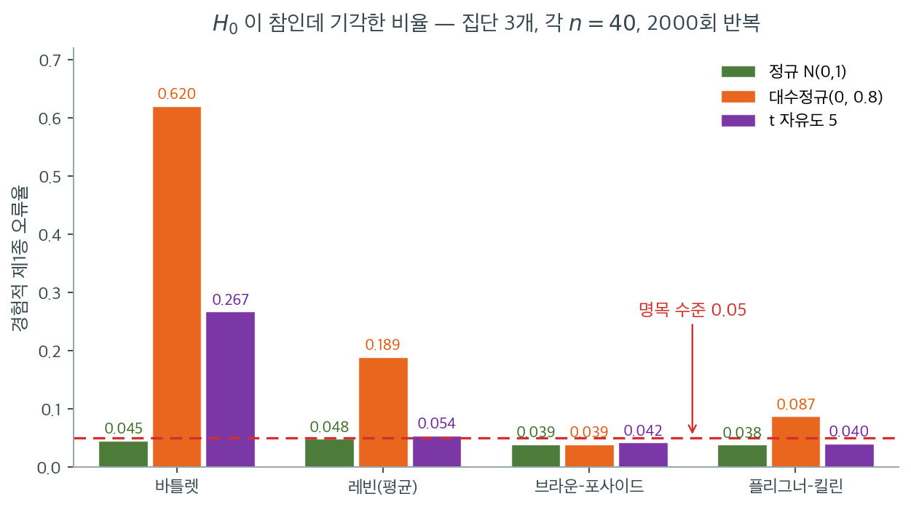

# 분산 검정 개관


## 1. 동기

집단이나 모집단 사이에서 관찰된 분산의 차이가 통계적으로 유의한지 평가하기 위해 여러 통계검정이 개발되었다. 이 검정들은 한 표본 이상의 변동성이 다른 표본에 비해 크거나 작거나 같은지를 평가한다. 각 검정은 자료에 대한 고유한 가정(정규성, 독립성 등)을 가지며 서로 다른 유형의 분석에 적합하다.

<div class="storybox" markdown>

**그림으로 보는 통계학 1.** $3.4$ 는 어디서 왔는가

분산이 **주인공**이 된 가장 큰 사례가 있다. $1986$ 년 모토로라의 기술자 **빌 스미스**가
회사 안에서 쓰기 시작한 말, **식스시그마**다. $1988$ 년 모토로라는 그 공로로 첫
맬컴 볼드리지 국가품질상을 받았고, $1995$ 년 제너럴 일렉트릭의 **잭 웰치**가 회사의
핵심 전략으로 삼으면서 전 세계로 퍼졌다. 경영서가 수백 권 나왔다.

그 전부가 한 문장 위에 서 있다. 「**식스시그마는 백만 개에 $3.4$ 개다.**」

그런데 규격선이 평균에서 $6\sigma$ 떨어져 있고 공정이 정규이며 중심이 맞아 있다면,
규격을 벗어날 확률은

$$
2\,\Phi(-6) = 1.97 \times 10^{-9} = 0.002\ \text{ppm}
$$

이다. 백만 개에 $3.4$ 개가 아니라 **십억 개에 두 개**다. $3.4$ 는 $1{,}700$ 배나
느슨하다. 틀린 수가 교과서에 실린 것인가.

<figure markdown>
{ width="960" }
  <figcaption markdown>왼쪽 두 칠한 영역의 넓이 비가 $1{,}722$ 배다. 미는 폭 $1.5$ 가 그 전부를 만든다.</figcaption>
</figure>

답은 왼쪽 칸에 있다. 모토로라는 **공정의 중심이 장기적으로 $1.5\sigma$ 쯤 밀린다**고
보았다. 기계가 닳고 온도가 바뀌고 재료가 달라진다. 평균이 $1.5$ 밀리면 먼 쪽 규격선까지
남는 거리는 $6 - 1.5 = 4.5$ 뿐이고,

$$
\Phi(-4.5) = 3.40 \times 10^{-6} = 3.4\ \text{ppm}
$$

이 나온다. **$3.4$ 는 $\Phi(-6)$ 이 아니라 $\Phi(-4.5)$ 다.**

가운데 칸이 널리 돌아다니는 그 표다. 두 줄이 나란히 있어야 읽을 수 있다.

| 시그마 수준 | 중심이 맞았을 때 | $1.5\sigma$ 밀렸을 때 |
|---:|---:|---:|
| $3\sigma$ | $2{,}700$ ppm | $66{,}811$ ppm |
| $4\sigma$ | $63$ ppm | $6{,}210$ ppm |
| $5\sigma$ | $0.6$ ppm | $233$ ppm |
| $6\sigma$ | $0.002$ ppm | $3.4$ ppm |

오른쪽 열이 경영서에 실린 수다. 그러니 「우리 공정은 $4\sigma$ 입니다」라는 말은
**불량이 백만 개에 $63$ 개라는 뜻이 아니라 $6{,}210$ 개라는 뜻**이고, 그 백 배 차이는
공정이 아니라 **밀리는 폭에 대한 가정** 하나에서 온다. $1.5$ 는 확률에서 유도한 수가
아니라 모토로라가 공장에서 관찰했다고 보고한 값이다.
[슈하트가 관리도의 한계선을 $3$ 으로 고른 것](../../ch09/one_sample_tests/z_test_proportion.md)과
같은 성격의 수이며, 그래서 줄곧 논란이 되어 왔다.

여기서 이 장이 시작된다. 오른쪽 칸을 보라. 저 모든 수의 분모에 $\sigma$ 가 있는데,
$\sigma$ 는 **재어서 얻는 값**이다. $n = 30$ 개로 추정해 「$6\sigma$ 공정」이라고
보고했다면, 참 시그마 수준의 $95\%$ 구간은 $[4.46,\ 7.53]$ 이다. ppm 으로 옮기면
$[0.0,\ 1{,}522]$ — 상한이 보고값의 **$450$ 배**다. $n = 100$ 이라야 $[5.16,\ 6.83]$ 으로
좁혀진다.

**분산의 추정값 하나에 사업 전체가 걸려 있는데, 그 추정값에 얼마나 큰 오차가 붙는지를
묻는 것이 이 장의 일이다.** 두 공정의 분산이 정말 다른지, 그 차이가 표본의 장난인지를
가리는 도구가 아래 $2$ 절부터 줄줄이 나온다.

_확인한 곳 — 빌 스미스가 $1986$ 년 모토로라에서 식스시그마를 시작한 것, 모토로라의 $1988$ 년 볼드리지상, GE 가 $1995$ 년에 채택한 것, $1.5\sigma$ 이동 가정. 표의 수는 모두 직접 계산한 값이다_

</div>

---

## 2. 분산 검정 개관

### 분산에 대한 카이제곱 검정

이 검정은 한 모집단의 분산이 지정된 값과 다른지 판정한다. 자료가 정규분포를 따른다고 가정하며 이 가정의 이탈에 매우 민감하다.

크기 $n$인 표본과 표본분산 $s^2$에 대한 검정통계량은

$$
\chi^2 = \frac{(n - 1) s^2}{\sigma_0^2}
$$

여기서 $\sigma_0^2$은 가설로 세운 모분산이다.

### F 검정

F 검정은 독립인 두 표본의 분산을 비교한다. 두 모분산이 같다는 귀무가설을 검정한다. 이 검정 역시 정규성 가정에 민감하며 두 표본이 독립일 것을 요구한다.

검정통계량은 두 표본분산의 비이다.

$$
F = \frac{s_1^2}{s_2^2}
$$

여기서 $s_1^2$과 $s_2^2$은 두 집단의 표본분산이다.

### Bartlett 검정

Bartlett 검정은 자료가 정규분포를 따른다는 가정 아래에서 여러 집단에 걸친 분산의 동일성을 평가한다. 정규성 위배에 매우 민감하여 정규성에서 조금만 벗어나도 오도하는 결과가 나올 수 있다. 이런 민감성에도 불구하고 정규성을 합리적으로 가정할 수 있을 때 자주 쓰인다.

검정통계량은

$$
T = \frac{(N - k) \ln(S_p^2) - \sum_{i=1}^k (n_i - 1) \ln(S_i^2)}{1 + \frac{1}{3(k - 1)} \left( \sum_{i=1}^k \frac{1}{n_i - 1} - \frac{1}{N - k} \right)}
$$

여기서 $N$은 전체 표본크기, $k$는 집단의 수, $S_p^2$은 합동분산, $S_i^2$은 각 집단의 표본분산이다.

### Levene 검정

Levene 검정은 분산의 동일성에 대한 F 검정의 로버스트 대안이다. 정규성 이탈에 덜 민감하므로 자료가 정규분포를 따르지 않을 때 더 적절하다. 각 관측값과 집단평균의 절대편차에 기반한다.

Levene 검정의 가설은

- $H_0$: 모분산이 모두 같다.
- $H_1$: 모분산이 모두 같지는 않다.

### Brown-Forsythe 검정

이 검정은 Levene 검정의 변형으로, 집단평균 대신 집단중앙값을 써서 이상점에 대한 민감성을 더 줄인다. 자료에 이상점이 있을 때 특히 유용하며 분산 동일성에 대해 더 로버스트한 측도를 제공한다.

### Fligner-Killeen 검정

Fligner-Killeen 검정은 순위에 기반한 비모수 검정이다. 매우 로버스트하며 자료가 정규성 가정을 충족하지 못할 때 적절하다. Brown-Forsythe 검정과 마찬가지로 이상점이 있거나 비정규인 자료에 효과적이다.

---

## 3. 올바른 검정 고르기

| 검정 | 표본 수 | 정규성 필요 | 이상점에 로버스트 | 용도 |
|------|---------|-------------------|-------------------|----------|
| 카이제곱 | 1 | 예 | 아니오 | 단일 모분산과 가설값 비교 |
| F 검정 | 2 | 예 | 아니오 | 독립인 두 집단의 분산 비교 |
| Bartlett | $\geq 2$ | 예 | 아니오 | 다집단 분산 동일성 (정규 자료) |
| Levene | $\geq 2$ | 아니오 | 중간 | 다집단 분산 동일성 (일반) |
| Brown-Forsythe | $\geq 2$ | 아니오 | 예 | 다집단 분산 동일성 (이상점 존재) |
| Fligner-Killeen | $\geq 2$ | 아니오 | 예 | 비모수 다집단 분산 동일성 |

표의 "정규성 필요" 열이 실제로 무엇을 뜻하는지는 숫자로 보아야 와닿는다. 세 집단을 **똑같은 분포**에서 각각 $n = 40$씩 뽑았다. 모분산이 정의상 완전히 같으므로 $H_0$이 참이고, 올바른 검정이라면 2000회 중 5%만 기각해야 한다.



정규 자료(초록)에서는 네 검정이 모두 붉은 선 근처다. 0.045, 0.048, 0.039, 0.038 — 약속을 지킨다. 여기까지만 보면 어느 검정을 써도 상관없어 보인다.

자료를 대수정규로 바꾸면(주황) 그림이 무너진다. **바틀렛이 0.620이다.** $H_0$이 참인데 열 번 중 여섯 번 기각한다. 명목 5%의 12배이고, 이 정도면 검정이 아니라 동전던지기보다 못한 장치다. 레빈(평균)도 0.189로 네 배 가까이 부풀었다. 치우친 자료에서 집단평균이 중심을 제대로 잡지 못하기 때문이다. $t_5$ 자료(보라)에서도 바틀렛은 0.267이다.

그런데 브라운–포사이드 막대 세 개를 보라. **0.039, 0.039, 0.042.** 분포를 바꿔도 거의 움직이지 않는다. 편차를 잴 때 평균 대신 중앙값을 쓴 것 하나가 이 차이를 만든다. 중앙값은 꼬리에 끌려가지 않으므로, 분포의 모양이 바뀌어도 "중심에서 얼마나 떨어져 있는가"라는 측도가 안정적으로 유지된다.

**이 그림이 15장 전체의 요약이다.** 고전적 검정은 정규성이라는 조건부 계약이고, 조건이 깨지면 계약 자체가 무효가 된다. 표본을 키워도 고쳐지지 않는다는 점이 결정적인데, 그 이유는 다음 절 **공통 가정**에서 다룬다.

---

## 연습문제

<div class="drillbox" markdown>

**연습문제 1.** <span class="diff easy" title="쉬움"></span>
크기가 각각 $n_1 = 10$, $n_2 = 12$, $n_3 = 15$이고 표본분산이 $s_1^2 = 4.2$, $s_2^2 = 9.8$, $s_3^2 = 6.1$인 세 집단이 있다. Bartlett 통계량을 손으로 계산하고 $\alpha = 0.05$에서 판정하라.

</div>

??? success "풀이"

    $N = 10 + 12 + 15 = 37$, $k = 3$이다.

    **1단계: 합동분산.**

    $$
    S_p^2 = \frac{\sum (n_i - 1) S_i^2}{N - k} = \frac{9(4.2) + 11(9.8) + 14(6.1)}{34} = \frac{37.8 + 107.8 + 85.4}{34} = \frac{231.0}{34} = 6.7941.
    $$

    **2단계: 분자.**

    $$
    (N-k)\ln(S_p^2) - \sum (n_i-1)\ln(S_i^2) = 34 \ln(6.7941) - [9\ln 4.2 + 11 \ln 9.8 + 14 \ln 6.1].
    $$

    $\ln 6.7941 = 1.9160$, $\ln 4.2 = 1.4351$, $\ln 9.8 = 2.2824$, $\ln 6.1 = 1.8083$이므로

    $$
    34(1.9160) - [9(1.4351) + 11(2.2824) + 14(1.8083)] = 65.144 - [12.916 + 25.106 + 25.316] = 65.144 - 63.338 = 1.8078.
    $$

    **3단계: 보정인자.**

    $$
    C = 1 + \frac{1}{3(k-1)}\left(\sum \frac{1}{n_i - 1} - \frac{1}{N-k}\right) = 1 + \frac{1}{6}\left(\frac{1}{9} + \frac{1}{11} + \frac{1}{14} - \frac{1}{34}\right) = 1 + \frac{1}{6}(0.2443) = 1.0407.
    $$

    **4단계: 검정통계량과 판정.**

    $$
    T = \frac{1.8078}{1.0407} = 1.7373.
    $$

    $H_0$ 아래에서 $T \sim \chi^2_2$이고 임계값은 $\chi^2_{0.95,2} = 5.991$이다. $1.7373 < 5.991$이므로 **기각하지 못한다**. $p$값은 $P(\chi^2_2 \geq 1.7373) = 0.4195$이다.

    ```python
    import numpy as np
    from scipy import stats

    n = [10, 12, 15]
    s2 = [4.2, 9.8, 6.1]
    N, k = sum(n), len(n)

    Sp2 = sum((ni - 1) * si for ni, si in zip(n, s2)) / (N - k)
    num = (N - k) * np.log(Sp2) - sum((ni - 1) * np.log(si)
                                      for ni, si in zip(n, s2))
    C = 1 + (1 / (3 * (k - 1))) * (sum(1 / (ni - 1) for ni in n) - 1 / (N - k))
    T = num / C
    print(f"Sp2 = {Sp2:.4f}, C = {C:.4f}, T = {T:.4f}, "
          f"p = {1 - stats.chi2.cdf(T, k - 1):.4f}")
    ```

    출력:

    ```
    Sp2 = 6.7941, C = 1.0407, T = 1.7373, p = 0.4195
    ```

    손으로 계산한 $S_p^2 = 6.794$, $C = 1.041$, $T = 1.737$, $p = 0.420$이 그대로 나온다.

    표본분산의 최대·최소 비가 $9.8/4.2 = 2.33$으로 꽤 큰데도 기각하지 못했다는 점이 흥미롭다. 표본이 작으면 표본분산의 변동이 크기 때문이다. $\square$

<div class="drillbox" markdown>

**연습문제 2.** <span class="diff med" title="중간"></span>
Bartlett 검정이 여러 집단에 대한 **가능도비 검정**임을 보이고, 왜 $\ln S_i^2$의 형태로 나타나는지 설명하라.

</div>

??? success "풀이"
    $k$개 집단이 각각 $\mathcal{N}(\mu_i, \sigma_i^2)$을 따른다고 하자. 정규 가능도의 로그를 최대화하면 각 집단의 분산 최대가능도추정량은 $\hat{\sigma}_i^2 = \frac{1}{n_i}\sum (x_{ij} - \bar{x}_i)^2$이고, 최대화된 로그가능도는 상수를 제외하고

    $$
    \ell_{\max} = -\frac{1}{2}\sum_i n_i \ln \hat{\sigma}_i^2 - \frac{N}{2}.
    $$

    귀무가설 $\sigma_1^2 = \cdots = \sigma_k^2 = \sigma^2$ 아래에서는 공통 분산의 추정량이 합동분산 $\hat{\sigma}^2$이고

    $$
    \ell_0 = -\frac{N}{2}\ln \hat{\sigma}^2 - \frac{N}{2}.
    $$

    따라서 가능도비 통계량은

    $$
    -2\ln \Lambda = 2(\ell_{\max} - \ell_0) = N \ln \hat{\sigma}^2 - \sum_i n_i \ln \hat{\sigma}_i^2.
    $$

    Bartlett 통계량의 분자가 정확히 이 형태이다(자유도를 $n_i$ 대신 $n_i - 1$로 바꾼 불편 버전을 쓴다는 차이만 있다).

    **왜 로그인가.** 정규 로그가능도가 $\sigma^2$에 $\ln \sigma^2$의 형태로 의존하기 때문이다. 분산 자체가 아니라 그 로그가 자연스러운 모수화이다. 이는 실무적으로도 뜻이 있다. 분산의 **비**가 차이보다 의미 있는 비교 대상이며, 로그가 비를 차이로 바꾼다.

    **보정인자 $C$의 역할.** $-2\ln\Lambda$는 점근적으로만 $\chi^2_{k-1}$을 따른다. Bartlett은 유한표본에서 $\chi^2$ 근사가 훨씬 정확해지도록 통계량을 $C$로 나누는 보정을 고안했다. 이 아이디어는 오늘날 "Bartlett 보정"이라는 이름으로 가능도비 검정 일반에 쓰인다. $\square$

<div class="drillbox" markdown>

**연습문제 3.** <span class="diff med" title="중간"></span>
표에서 카이제곱, F, Bartlett 검정만이 "정규성 필요: 예"로 표시되어 있다. 이 세 검정이 비정규성에 특별히 취약한 공통 이유를 설명하라.

</div>

??? success "풀이"
    세 검정 모두 **정규성 아래에서 표본분산의 표집분포**에 직접 의존한다.

    $X_i \sim \mathcal{N}(\mu, \sigma^2)$이면

    $$
    \frac{(n-1)S^2}{\sigma^2} \sim \chi^2_{n-1}
    $$

    가 정확히 성립하고, 여기서 카이제곱 검정이 나온다. 독립인 두 카이제곱의 비에서 F 검정이 나오고, Bartlett은 이를 $k$개 집단으로 확장한 것이다.

    문제는 이 관계가 **정규성에 특유하다**는 점이다. 일반적으로 $S^2$의 점근분산은

    $$
    \operatorname{Var}(S^2) \approx \frac{\mu_4 - \sigma^4}{n} = \frac{\sigma^4(\gamma_2 + 2)}{n}
    $$

    이며 $\gamma_2$는 초과첨도이다. 정규분포는 $\gamma_2 = 0$이므로 $\operatorname{Var}(S^2) = 2\sigma^4/n$이 되고 이것이 $\chi^2_{n-1}$ 근사의 근거이다.

    자료의 꼬리가 두꺼우면($\gamma_2 > 0$) $S^2$의 실제 분산이 정규 이론이 예측하는 것보다 **훨씬 크다**. 예컨대 $\gamma_2 = 6$인 $t_5$ 자료에서는 4배가 된다. 그러면 검정이 정규 기준분포보다 큰 통계량 값을 자주 만들어 내고 **제1종 오류율이 폭증한다**.

    반면 Levene 계열 검정은 절대편차라는 **1차 척도 측도**에 분산분석을 적용한다. 절대편차의 분포는 4차 적률에 그만큼 민감하지 않으므로 훨씬 안정적이다. Fligner-Killeen은 한 발 더 나아가 순위만 쓰므로 원분포의 모양에 아예 의존하지 않는다. $\square$

<div class="drillbox" markdown>

**연습문제 4.** <span class="diff med" title="중간"></span>
$\text{Lognormal}(0, 0.8)$에서 크기 40인 세 표본을 뽑아(모분산이 **정확히 같다**) Bartlett, Levene, Brown-Forsythe, Fligner-Killeen 검정을 모두 수행하라. 결과를 비교하고 해석하라.

</div>

??? success "풀이"

    ```python
    import numpy as np
    from scipy import stats

    rng = np.random.default_rng(7)
    g = [rng.lognormal(0, 0.8, 40) for _ in range(3)]

    print("sample variances:", [round(x.var(ddof=1), 3) for x in g])
    print(f"Bartlett:        p = {stats.bartlett(*g)[1]:.4f}")
    print(f"Levene (mean):   p = {stats.levene(*g, center='mean')[1]:.4f}")
    print(f"Brown-Forsythe:  p = {stats.levene(*g, center='median')[1]:.4f}")
    print(f"Fligner-Killeen: p = {stats.fligner(*g)[1]:.4f}")
    ```

    출력:

    ```text
    sample variances: [0.341, 1.019, 0.931]
    Bartlett:        p = 0.0021
    Levene (mean):   p = 0.0488
    Brown-Forsythe:  p = 0.1912
    Fligner-Killeen: p = 0.0845
    ```

    세 표본을 **동일한 분포**에서 뽑았으므로 $H_0$이 참이다. 그런데 Bartlett은 $p = 0.002$로 강하게 기각하고 Levene(평균)도 아슬아슬하게 기각한다. 둘 다 제1종 오류이다. Brown-Forsythe와 Fligner-Killeen은 올바르게 기각하지 않는다.

    한 표본의 결과가 우연일 수 있으므로 2,000회 반복으로 경험적 크기를 추정하면(각 집단 $n = 40$, 세 집단, $\alpha = 0.05$)

    | 자료 분포 | Bartlett | Levene(평균) | Brown-Forsythe | Fligner-Killeen |
    |---|---|---|---|---|
    | $\mathcal{N}(0,1)$ | 0.045 | 0.048 | 0.039 | 0.038 |
    | $\text{Lognormal}(0, 0.8)$ | **0.620** | 0.189 | 0.039 | 0.087 |
    | $t_5$ | **0.267** | 0.054 | 0.042 | 0.040 |

    결과가 충격적이다. 대수정규 자료에서 **Bartlett 검정은 62%의 확률로 잘못 기각한다.** 명목 5%의 12배가 넘는다. $t_5$ 자료에서도 26.7%이다.

    Levene(평균)은 대수정규에서 18.9%로 역시 문제가 있다. 치우친 자료에서 평균이 좋은 중심 측도가 아니기 때문이다.

    **Brown-Forsythe는 세 분포 모두에서 0.039~0.042로 안정적이다.** 이것이 이 장에서 반복될 결론이며, 정규성이 의심스러울 때 Brown-Forsythe를 기본값으로 권하는 이유이다.

    (Fligner-Killeen이 정규 자료에서 0.038로 다소 보수적이고 대수정규에서 0.087로 약간 자유주의적인 점도 눈여겨보라. 완벽한 검정은 없다.) $\square$

<div class="drillbox" markdown>

**연습문제 5.** <span class="diff med" title="중간"></span>
2절의 Bartlett 통계량 $T$가 **항상 0 이상**이고, 모든 집단의 표본분산이 같을 때만 0이 됨을 보여라. 가중치 $w_i = (n_i - 1)/(N - k)$를 두고 $S_p^2$이 $S_i^2$들의 가중평균임을 이용하라.

이것이 왜 Bartlett 검정을 $\chi^2_{k-1}$의 **오른쪽 꼬리만** 쓰는 검정으로 만드는지 설명하고, 연습문제 1의 자료에서 분자 1.8078을 산술평균과 기하평균의 비로 다시 적어 확인하라.

</div>

??? success "풀이"
    **1단계: 분자를 가중평균의 로그로 적는다.**

    $w_i = (n_i - 1)/(N - k)$로 두면 $w_i > 0$이고 $\sum_i w_i = 1$이며, 합동분산은

    $$
    S_p^2 = \frac{\sum_i (n_i - 1) S_i^2}{N - k} = \sum_i w_i S_i^2
    $$

    즉 $S_i^2$들의 **가중 산술평균**이다. 그러면 Bartlett 통계량의 분자는

    $$
    (N-k)\ln S_p^2 - \sum_i (n_i - 1)\ln S_i^2
    = (N-k)\left[\ln\left(\sum_i w_i S_i^2\right) - \sum_i w_i \ln S_i^2\right].
    $$

    **2단계: Jensen 부등식.**

    $\ln$은 오목함수이므로 $\ln\left(\sum w_i a_i\right) \geq \sum w_i \ln a_i$이고, $\ln$이 **엄격히** 오목하므로 등호는 $a_1 = \cdots = a_k$일 때만 성립한다. $a_i = S_i^2$을 넣으면 대괄호 안이 0 이상이고, 0이 되는 것은 $S_1^2 = \cdots = S_k^2$일 때뿐이다. 괄호 안의 양은 가중 산술평균과 가중 기하평균의 비의 로그

    $$
    \ln \frac{\sum_i w_i S_i^2}{\prod_i (S_i^2)^{w_i}}
    $$

    이므로, 분자는 "AM/GM 비가 1에서 얼마나 떨어져 있는가"를 재는 양이다.

    **3단계: 보정인자는 양수다.**

    $k \geq 2$이면 $N - k = \sum_i (n_i - 1) > n_1 - 1$이므로

    $$
    \sum_i \frac{1}{n_i - 1} \geq \frac{1}{n_1 - 1} > \frac{1}{N - k}
    $$

    이고 괄호 안이 양수이므로 $C > 1 > 0$이다. 따라서 $T = (\text{분자})/C \geq 0$이고, $T = 0$인 것은 모든 표본분산이 같을 때뿐이다.

    **4단계: 왜 한쪽꼬리인가.**

    $T$는 $H_0$가 말하는 "모두 같다"에서 벗어난 **거리**이고, 어느 방향으로 벗어나든 커진다. $T$가 작다는 것은 표본분산들이 서로 가깝다는 뜻이므로 $H_0$에 **유리한** 증거다. 그러므로 기각역은 $T > \chi^2_{1-\alpha, k-1}$ 한쪽뿐이고, 연습문제 1에서 임계값을 $\chi^2_{0.95,2} = 5.991$ 하나만 쓴 것이 이 때문이다. 왼쪽 꼬리를 기각역에 넣으면 "분산들이 너무 비슷하다"는 이유로 등분산을 기각하는 꼴이 된다.

    **5단계: 연습문제 1의 수치로 확인.**

    $N - k = 34$, $w = (9/34,\, 11/34,\, 14/34) = (0.2647,\, 0.3235,\, 0.4118)$이다. 가중 산술평균은 $S_p^2 = 6.7941$이고 가중 기하평균은

    $$
    \prod_i (S_i^2)^{w_i} = \exp\!\big(0.2647 \ln 4.2 + 0.3235 \ln 9.8 + 0.4118 \ln 6.1\big) = e^{1.86288} = 6.4423
    $$

    이다. 따라서 분자는

    $$
    34 \ln \frac{6.7941}{6.4423} = 34 \ln 1.0546 = 34 (0.053175) = 1.8079
    $$

    로 연습문제 1의 1.8078과 (반올림 오차만큼) 같다.

    AM/GM 비가 1.0546, 즉 5.5%밖에 벌어지지 않았다는 것이 그 자료에서 기각하지 못한 이유를 한눈에 보여 준다. 최대·최소 비가 2.33이어도 **로그 눈금의 가중평균**에서 보면 세 분산은 거의 모여 있다. $\square$

<div class="drillbox" markdown>

**연습문제 6.** <span class="diff med" title="중간"></span>
3절의 표에서 Bartlett 검정의 경험적 크기는 정규 0.045, $t_5$ 0.267, $\text{Lognormal}(0, 0.8)$ 0.620이었다. 연습문제 3은 이 부풀음의 원인이 초과첨도라고 했다. 세 분포의 첨도 $\beta_2 = \mu_4/\sigma^4$를 구하고, $\operatorname{Var}(S^2)$이 정규이론 값의 몇 배인지 각각 적어라.

$\text{Lognormal}(0, \sigma)$에 대해서는 $\beta_2 = e^{4\sigma^2} + 2e^{3\sigma^2} + 3e^{2\sigma^2} - 3$, $\gamma_1 = (e^{\sigma^2} + 2)\sqrt{e^{\sigma^2} - 1}$을 쓰고, 얻은 값이 2장의 하한 $\beta_2 \geq 1 + \gamma_1^2$을 만족하는지 확인하라. 끝으로, 자유도가 $t_4$나 $t_3$였다면 이 설명 자체가 왜 무너지는지 말하라.

</div>

??? success "풀이"
    **1단계: 정규.** $\mu_4 = 3\sigma^4$이므로 $\beta_2 = 3$, 초과첨도 $\gamma_2 = \beta_2 - 3 = 0$이다.

    **2단계: $t_\nu$.** $\nu > 4$에 대해 $\beta_2 = 3 + 6/(\nu - 4)$이므로 $\nu = 5$에서

    $$
    \beta_2 = 3 + \frac{6}{1} = 9, \qquad \gamma_2 = 6.
    $$

    **3단계: 대수정규.** $\sigma = 0.8$이므로 $\sigma^2 = 0.64$이고

    $$
    e^{0.64} = 1.8965, \quad e^{1.28} = 3.5966, \quad e^{1.92} = 6.8210, \quad e^{2.56} = 12.9358
    $$

    이다. 따라서

    $$
    \beta_2 = 12.9358 + 2(6.8210) + 3(3.5966) - 3 = 12.9358 + 13.6420 + 10.7898 - 3 = 34.3677
    $$

    이고 $\gamma_2 = 31.3677$이다.

    **4단계: 2장의 하한 확인.** 왜도는

    $$
    \gamma_1 = (1.8965 + 2)\sqrt{1.8965 - 1} = 3.8965 \times 0.9469 = 3.6893
    $$

    이므로 $1 + \gamma_1^2 = 1 + 13.611 = 14.611$이고, $\beta_2 = 34.368 \geq 14.611$로 하한을 넉넉히 만족한다. 치우침만으로도 첨도가 14를 넘어야 한다는 점, 즉 **치우친 분포는 첨도가 작을 수 없다**는 점이 요점이다.

    **5단계: $\operatorname{Var}(S^2)$의 배율.** 연습문제 3의 $\operatorname{Var}(S^2) \approx \sigma^4(\gamma_2 + 2)/n$을 정규이론 값 $2\sigma^4/n$으로 나누면 배율은 $(\gamma_2 + 2)/2$다.

    | 자료 분포 | $\beta_2$ | $\gamma_2$ | $\operatorname{Var}(S^2)$ 배율 | Bartlett 경험적 크기 |
    |---|---|---|---|---|
    | $\mathcal{N}(0,1)$ | 3 | 0 | 1.00 | 0.045 |
    | $t_5$ | 9 | 6 | 4.00 | 0.267 |
    | $\text{Lognormal}(0,0.8)$ | 34.37 | 31.37 | 16.68 | **0.620** |

    세 줄의 순서가 정확히 일치한다. 배율이 1이면 크기가 약속을 지키고, 4배면 0.267, 16.7배면 0.620이다. 대수정규가 $t_5$보다 훨씬 더 나쁜 이유가 "치우쳐서"라는 막연한 말이 아니라 **첨도가 네 배 더 크기 때문**이라는 수가 된다.

    **6단계: $\nu \leq 4$라면.** $t_\nu$는 $\nu \leq 4$에서 $\mu_4 = \infty$이므로 $\beta_2$가 존재하지 않고, 따라서 $\operatorname{Var}(S^2)$ 자체가 무한이다. 그러면 "첨도가 몇 배라서 크기가 얼마"라는 설명이 성립하지 않을 뿐 아니라, $S^2$의 표집분포가 중심극한정리의 적용 범위를 벗어난다. 즉 4차 적률의 유한성은 이 장의 모든 로버스트성 논의가 서 있는 최소 조건이다. $\square$

<div class="drillbox" markdown>

**연습문제 7.** <span class="diff hard" title="어려움"></span>
분산에 대한 카이제곱 검정은 $\chi^2 = (n-1)s^2/\sigma_0^2$을 $\chi^2_{n-1}$의 분위수와 비교한다. 4차 적률이 유한한 임의의 모집단에서 $H_0: \sigma^2 = \sigma_0^2$이 **참**일 때, 유의수준 $\alpha$의 양쪽꼬리 검정의 실제 기각확률이

$$
\lim_{n \to \infty} P(\text{기각}) = 2\left[1 - \Phi\!\left(z_{\alpha/2}\sqrt{\frac{2}{\gamma_2 + 2}}\right)\right]
$$

로 감을 보여라. $\chi^2_{n-1}$의 분위수가 $(n-1) + z\sqrt{2(n-1)} + o(\sqrt{n})$임은 써도 된다.

$\alpha = 0.05$에서 정규, $t_5$, $\text{Lognormal}(0,0.8)$(연습문제 6의 $\gamma_2$), $\text{Uniform}$($\gamma_2 = -1.2$)에 대해 이 값을 구하라. 이것이 3절의 "표본을 키워도 고쳐지지 않는다"를 어떻게 한 줄로 설명하는지, 그리고 평균에 대한 $t$ 검정과 어떻게 대조되는지 말하라.

</div>

??? success "풀이"
    **1단계: 표본분산의 중심극한정리.** 4차 적률이 유한하면 $S^2$에 대해

    $$
    \sqrt{n}\,\frac{S^2 - \sigma^2}{\sigma^2} \;\xrightarrow{\ d\ }\; \mathcal{N}(0,\, \gamma_2 + 2)
    $$

    이 성립한다. $n\operatorname{Var}(S^2)/\sigma^4 \to \gamma_2 + 2$(연습문제 3)가 그 분산이다.

    **2단계: 기각역을 그 눈금으로 옮긴다.** $H_0$가 참이므로 $\sigma^2 = \sigma_0^2$이다. 위쪽 기각은

    $$
    \frac{(n-1)S^2}{\sigma_0^2} > (n-1) + z_{\alpha/2}\sqrt{2(n-1)} + o(\sqrt n)
    $$

    이고, 양변에서 $n-1$을 빼고 $\sqrt{n-1}$로 나누면

    $$
    \sqrt{n-1}\,\frac{S^2 - \sigma_0^2}{\sigma_0^2} > z_{\alpha/2}\sqrt{2} + o(1).
    $$

    좌변은 1단계에 의해 $\mathcal{N}(0, \gamma_2+2)$로 수렴하므로, 표준화하면

    $$
    P(\text{위쪽 기각}) \to 1 - \Phi\!\left(\frac{z_{\alpha/2}\sqrt 2}{\sqrt{\gamma_2+2}}\right) = 1 - \Phi\!\left(z_{\alpha/2}\sqrt{\frac{2}{\gamma_2+2}}\right).
    $$

    아래쪽 기각도 대칭적으로 같은 값을 주고 두 사건은 점근적으로 배타적이므로 합하면 주장한 식이 된다.

    **3단계: 수치.** $z_{0.025} = 1.9600$이고 $c = \sqrt{2/(\gamma_2+2)}$라 두면

    | 자료 분포 | $\gamma_2$ | $c$ | $z_{0.025}\,c$ | 실제 크기의 극한 |
    |---|---|---|---|---|
    | $\mathcal{N}$ | 0 | 1.0000 | 1.9600 | 0.0500 |
    | $\text{Uniform}$ | $-1.2$ | 1.5811 | 3.0990 | 0.0019 |
    | $t_5$ | 6 | 0.5000 | 0.9800 | 0.3271 |
    | $\text{Lognormal}(0,0.8)$ | 31.3677 | 0.2448 | 0.4798 | 0.6313 |

    정규에서만 0.05가 나온다. 균등처럼 꼬리가 가벼우면 0.0019로 **지나치게 보수적**이고($\gamma_2 < 0$), 꼬리가 무거우면 0.327, 0.631로 폭증한다.

    **4단계: "표본을 키워도 고쳐지지 않는다".** 극한값이 $\alpha$가 아니라 $\gamma_2$의 함수다. $n$은 식에 아예 등장하지 않으므로, 표본을 열 배 백 배로 키워도 기각확률은 0.631 근처에 그대로 머문다. 비정규성은 $n$이 커지면서 **씻겨 나가는 잡음이 아니라 극한 자체를 바꾸는 편향**이다.

    **5단계: $t$ 검정과의 대조.** 평균에 대한 $t$ 검정은 $\sqrt n (\bar X - \mu_0)/S \xrightarrow{d} \mathcal{N}(0,1)$이 **분포 모양과 무관하게** 성립하므로 실제 크기가 $\alpha$로 수렴한다. 중심극한정리가 1차 적률의 추론은 지켜 주지만 2차 적률의 추론은 지켜 주지 않는다. $\bar X$의 극한분산 $\sigma^2$은 $S^2$으로 **일치추정**되어 눈금이 자동으로 맞춰지는데, $S^2$의 극한분산 $\sigma^4(\gamma_2+2)$에서 카이제곱 검정은 $\gamma_2 = 0$을 **못박아** 두기 때문이다.

    (3절의 Bartlett 값 0.267, 0.620은 $k = 3$, $n = 40$의 유한표본 값이므로 위 극한값 0.327, 0.631과 정확히 같을 이유는 없다. 그러나 두 자리가 거의 겹치고 순서도 같다는 것이, 부풀음을 지배하는 양이 집단 수나 표본크기가 아니라 $\gamma_2$임을 말해 준다.) $\square$

<div class="drillbox" markdown>

**연습문제 8.** <span class="diff hard" title="어려움"></span>
실무에서 흔한 관행이 있다. 두 집단의 평균을 비교할 때 먼저 F 검정으로 등분산을 확인하고, 기각되면 Welch 검정을, 기각되지 않으면 합동분산 $t$ 검정을 쓴다. 이 **두 단계 절차**의 제1종 오류율을 모의실험으로 재어라.

정규자료로 $n_1 = 6$($\sigma_1 = 2$), $n_2 = 24$($\sigma_2 = 1$), 두 집단의 평균은 모두 0으로 두고 20,000회 반복하라. 모든 검정은 $\alpha = 0.05$ 양쪽꼬리다. (i) 항상 합동분산 $t$, (ii) 항상 Welch, (iii) F로 고르기 세 전략의 크기를 비교하고, (iv) "F가 등분산이라고 말한 표본만" 모았을 때 합동분산 $t$의 크기가 그 무조건 크기보다 **더 나쁜** 이유를 설명하라.

</div>

??? success "풀이"

    ```python
    import numpy as np
    from scipy import stats

    rng = np.random.default_rng(15)
    R, n1, n2 = 20000, 6, 24
    a = rng.normal(0, 2.0, (R, n1))      # 작은 집단이 분산이 크다
    b = rng.normal(0, 1.0, (R, n2))      # 평균은 두 집단 모두 0

    m1, m2 = a.mean(1), b.mean(1)
    v1, v2 = a.var(1, ddof=1), b.var(1, ddof=1)

    # 1단계: 두 분산의 F 검정 (양쪽꼬리)
    F = v1 / v2
    pF = 2 * np.minimum(stats.f.cdf(F, n1 - 1, n2 - 1),
                        stats.f.sf(F, n1 - 1, n2 - 1))

    # 2단계 후보 A: 합동분산 t 검정
    sp2 = ((n1 - 1) * v1 + (n2 - 1) * v2) / (n1 + n2 - 2)
    p_student = 2 * stats.t.sf(np.abs(m1 - m2) / np.sqrt(sp2 * (1/n1 + 1/n2)),
                               n1 + n2 - 2)

    # 2단계 후보 B: 웰치 t 검정
    se = np.sqrt(v1 / n1 + v2 / n2)
    df = se**4 / (v1**2 / (n1**2 * (n1 - 1)) + v2**2 / (n2**2 * (n2 - 1)))
    p_welch = 2 * stats.t.sf(np.abs(m1 - m2) / se, df)

    # 두 단계 절차: F 가 기각하면 웰치, 아니면 합동분산 t
    p_both = np.where(pF < 0.05, p_welch, p_student)
    acc = pF >= 0.05                     # F 가 '등분산'이라고 말한 표본

    print(f"F 가 등분산을 기각한 비율 = {np.mean(~acc):.4f}")
    print(f"항상 합동분산 t : 크기 = {np.mean(p_student < 0.05):.4f}")
    print(f"항상 웰치       : 크기 = {np.mean(p_welch < 0.05):.4f}")
    print(f"F 로 고르기     : 크기 = {np.mean(p_both < 0.05):.4f}")
    print(f"  '같다'고 한 표본에서 합동분산 t = {np.mean(p_student[acc] < 0.05):.4f}")
    print(f"  '다르다'고 한 표본에서 웰치     = {np.mean(p_welch[~acc] < 0.05):.4f}")
    print(f"  v1 의 평균: 전체 {v1.mean():.4f} / '같다'고 한 표본 {v1[acc].mean():.4f}"
          f"  (참값 4)")
    ```

    출력:

    ```text
    F 가 등분산을 기각한 비율 = 0.5648
    항상 합동분산 t : 크기 = 0.1852
    항상 웰치       : 크기 = 0.0533
    F 로 고르기     : 크기 = 0.1008
      '같다'고 한 표본에서 합동분산 t = 0.2161
      '다르다'고 한 표본에서 웰치     = 0.0120
      v1 의 평균: 전체 4.0010 / '같다'고 한 표본 2.0811  (참값 4)
    ```

    **(i) 항상 합동분산 $t$: 0.1852.** 분산비가 4인데 큰 분산이 작은 집단에 붙어 있다. 합동분산은 자유도로 가중하므로 $n_2 = 24$ 쪽의 작은 분산에 끌려가고, 그 결과 $\bar X_1 - \bar X_2$의 표준오차를 **과소추정**한다. 명목 5%가 18.5%가 된다.

    **(ii) 항상 Welch: 0.0533.** 자유도가 작아 약간 넘치지만 사실상 약속을 지킨다.

    **(iii) F로 고르기: 0.1008.** 정확히 명목값의 두 배다. F 검정이 이 설정에서 진짜 차이(분산비 4)를 56.5%만 잡아낸다. 남은 43.5%에서는 합동분산 $t$가 쓰이고 그쪽의 오류율이 그대로 섞여 들어온다. 전체 크기는 두 팔의 혼합

    $$
    0.5648 \times 0.0120 + 0.4352 \times 0.2161 = 0.0068 + 0.0940 = 0.1008
    $$

    로 맞아떨어진다. 두 팔이 각각 0.0120과 0.2161이라는 점을 보라. 어느 팔도 0.05가 아니다. 한쪽은 지나치게 보수적이고 다른 쪽은 네 배 넘게 자유주의적인데, 그것을 섞어서 0.10을 얻은 것이다.

    **(iv) 선택이 거꾸로 작동한다: 0.2161 > 0.1852.** 여기가 이 문제의 핵심이다. F 검정이 "분산이 같다"고 말하는 표본은 $v_1/v_2$가 **우연히 작게 나온** 표본이다. 실제로 그 표본들에서 $v_1$의 평균이 2.081로, 참값 4의 절반이다(전체 평균은 4.001로 정확하다). 그런데 합동분산 $t$가 틀리는 원인이 바로 그 $v_1$의 과소추정이다. 따라서 사전검정은 합동분산 $t$를 **쓰면 안 되는 표본을 정확히 골라서** 그것에 합동분산 $t$를 적용한다. 조건부 크기 21.6%가 무조건 크기 18.5%보다 높은 것이 그 증거다. 반대쪽 팔에서 Welch가 0.0120으로 보수적인 것도 같은 선택 효과의 거울상이다. $v_1$이 크게 관측된 표본만 모였으므로 Welch의 표준오차가 과대추정된다.

    **결론.** 사전검정은 두 단계의 오류를 더해 주는 것이 아니라, 두 번째 단계가 가장 취약한 자리로 표본을 **몰아 준다.** 그래서 "F로 확인한 다음 고르기"보다 처음부터 Welch를 쓰는 쪽이 낫다. 15장의 분산 검정들은 ANOVA 전처리 관문으로 쓸 것이 아니라, 분산 자체가 관심사일 때 쓰는 도구로 보아야 한다. $\square$

<div class="drillbox" markdown>

**연습문제 9.** <span class="diff hard" title="어려움"></span>
3절은 Brown-Forsythe가 세 분포에서 0.039~0.042로 안정적이라고 했다. 공짜일 수는 없다. 중앙값으로 바꾸어 얻은 안정성의 **값**을 수로 재어라.

Levene 검정을 "$\lvert x - \text{중심} \rvert$에 일원분산분석 F를 적용한 것"이라는 정의 그대로 직접 구현하고($\text{중심}$이 평균이면 Levene, 중앙값이면 Brown-Forsythe), $k = 3$, $n = 40$, 20,000회 반복으로 두 가지를 재어라. (a) 정규자료에서 $\sigma = (1, 1, 1.4)$일 때의 검정력, (b) $\text{Lognormal}(0, 0.8)$ 등분산일 때의 크기. Bartlett도 함께 재어 세 검정을 비교하고, 포기한 것과 얻은 것을 수로 적어라.

</div>

??? success "풀이"

    ```python
    import numpy as np
    from scipy import stats

    k, n = 3, 40
    N = k * n
    f_crit = stats.f.ppf(0.95, k - 1, N - k)
    c_crit = stats.chi2.ppf(0.95, k - 1)

    def levene_reject(x, center):
        """|x - 중심|에 일원분산분석 F 를 적용한다 (center='mean' 이면 르벤)."""
        c = x.mean(axis=2, keepdims=True) if center == "mean" \
            else np.median(x, axis=2, keepdims=True)
        z = np.abs(x - c)
        gi = z.mean(axis=2, keepdims=True)
        g = z.mean(axis=(1, 2), keepdims=True)
        ssb = n * ((gi - g) ** 2).sum(axis=(1, 2))
        ssw = ((z - gi) ** 2).sum(axis=(1, 2))
        return (ssb / (k - 1)) / (ssw / (N - k)) > f_crit

    def bartlett_reject(x):
        v = x.var(axis=2, ddof=1)
        num = (N - k) * np.log(v.mean(axis=1)) - (n - 1) * np.log(v).sum(axis=1)
        C = 1 + (1 / (3 * (k - 1))) * (k / (n - 1) - 1 / (N - k))
        return num / C > c_crit

    rng = np.random.default_rng(1)
    R = 20000
    # 상황 A: 정규, 분산이 정말 다르다 -> 검정력을 잰다
    xa = rng.normal(0, 1, (R, k, n)) * np.array([1.0, 1.0, 1.4]).reshape(1, k, 1)
    # 상황 B: 대수정규, 분산이 모두 같다 -> 크기를 잰다
    xb = rng.lognormal(0, 0.8, (R, k, n))

    for x, label in [(xa, "검정력 (정규, sigma=1,1,1.4)"),
                     (xb, "크기   (대수정규, 등분산)   ")]:
        print(f"{label}  Levene = {levene_reject(x, 'mean').mean():.4f}   "
              f"Brown-Forsythe = {levene_reject(x, 'median').mean():.4f}   "
              f"Bartlett = {bartlett_reject(x).mean():.4f}")
    ```

    출력:

    ```text
    검정력 (정규, sigma=1,1,1.4)  Levene = 0.5228   Brown-Forsythe = 0.4854   Bartlett = 0.5816
    크기   (대수정규, 등분산)     Levene = 0.1995   Brown-Forsythe = 0.0413   Bartlett = 0.6337
    ```

    구현이 맞는지는 둘째 줄이 보증한다. 크기 쪽의 0.1995 / 0.0413 / 0.6337이 3절 표의 0.189 / 0.039 / 0.620과 (반복 수와 씨앗만 다르므로) 같은 값이다.

    **맞바꿈을 수로.**

    | 검정 | 정규에서 검정력 | 대수정규에서 크기 |
    |---|---|---|
    | Bartlett | 0.5816 | 0.6337 |
    | Levene(평균) | 0.5228 | 0.1995 |
    | Brown-Forsythe | 0.4854 | **0.0413** |

    - Bartlett $\to$ Levene: 검정력 0.0588(상대 10.1%)을 내주고 크기를 0.634에서 0.200으로 내린다.
    - Levene $\to$ Brown-Forsythe: 검정력 **0.0374**(상대 7.2%)를 더 내주고 크기를 0.200에서 **0.041**로 내린다.

    **해석.** 중앙값으로 바꾸는 값은 정규자료에서 검정력 7%p 남짓이다. 그 대가로 치우친 자료에서 크기가 명목값으로 돌아온다. 교환비가 극단적으로 유리하다. 크기가 0.20이면 기각을 해도 그것이 참된 차이인지 분포 모양 탓인지 **구별할 수 없으므로** 검정력 0.52라는 숫자 자체가 의미를 잃는다. 반면 크기가 0.041로 맞아 있으면 검정력 0.49는 그대로 믿을 수 있다.

    이것이 "크기를 먼저, 검정력은 그다음"이라는 순서의 실제 내용이다. 크기가 망가진 검정의 높은 검정력은 **싸게 산 기각**일 뿐이며, Bartlett의 0.5816이 Brown-Forsythe의 0.4854보다 좋다고 말할 수 없는 이유다. $\square$

<div class="drillbox" markdown>

**연습문제 10.** <span class="diff hard" title="어려움"></span>
연습문제 7의 극한식을 끝까지 밀어 보자. 2장의 하한 $\beta_2 \geq 1 + \gamma_1^2$에서 모든 분포에 대해 $\gamma_2 \geq -2$임이 따라온다.

(a) 극한 크기가 $\gamma_2$의 **증가함수**임을 보이고, $\gamma_2$가 $[-2, \infty)$를 훑을 때 그 값의 범위를 구하라. 명목 5%라는 표시가 분포 가정 없이 무엇을 약속하는가?

(b) 명목 5% 검정의 실제 극한 크기를 정확히 0.10으로, 그리고 0.25로 만드는 $\gamma_2$를 각각 구하라.

(c) 하한 $\gamma_2 = -2$가 실제로 달성되는 분포를 하나 들고, 그 분포에서 **유한한 $n$에 대해서도** 위쪽 기각확률이 0이 됨을 직접 보여라.

</div>

??? success "풀이"
    **(a) 단조성과 범위.** $c(\gamma_2) = \sqrt{2/(\gamma_2+2)}$는 $\gamma_2$에 대해 감소하므로 $z_{\alpha/2}c$도 감소하고, $\Phi$가 증가하므로 극한 크기

    $$
    g(\gamma_2) = 2\left[1 - \Phi\!\left(z_{\alpha/2}\,c(\gamma_2)\right)\right]
    $$

    는 $\gamma_2$의 증가함수다. 양 끝을 보면

    $$
    \gamma_2 \to -2^{+}: \ c \to \infty \Rightarrow g \to 2[1 - \Phi(\infty)] = 0,
    $$

    $$
    \gamma_2 \to \infty: \ c \to 0 \Rightarrow g \to 2[1 - \Phi(0)] = 2 \times 0.5 = 1.
    $$

    따라서 $g$는 $(0, 1)$ 전체를 훑는다. 즉 명목 5%라고 적힌 분산 검정의 **실제** 크기는 분포에 따라 0과 1 사이 어디든 될 수 있다. 정규성(또는 적어도 $\gamma_2$에 대한 가정) 없이는 "5%"라는 표시가 **아무것도 약속하지 않는다**. 2절이 카이제곱 검정을 두고 "이 가정의 이탈에 매우 민감하다"고 한 문장의 정량적 내용이 이것이다.

    **(b) 역산.** $g(\gamma_2) = p$를 풀면 $z_{\alpha/2}c = z_{p/2}$, 즉

    $$
    \gamma_2 = \frac{2}{c^2} - 2 = 2\left(\frac{z_{\alpha/2}}{z_{p/2}}\right)^{2} - 2.
    $$

    $\alpha = 0.05$에서 $z_{0.025} = 1.9600$이다.

    - $p = 0.10$: $z_{0.05} = 1.6449$, $c = 1.6449/1.9600 = 0.8392$, $\gamma_2 = 2/0.8392^2 - 2 = 0.8397$.
    - $p = 0.25$: $z_{0.125} = 1.1503$, $c = 0.5869$, $\gamma_2 = 2/0.5869^2 - 2 = 3.8059$.

    **초과첨도가 0.84면 크기가 두 배가 된다.** 0.84는 $n$이 웬만큼 크지 않으면 어떤 정규성 검정으로도 잡아내기 어려운 미세한 이탈이다($t_{11}$의 초과첨도가 $6/7 = 0.857$로 거의 이 값이다). 크기를 다섯 배인 0.25로 부풀리는 데도 3.81이면 되는데, 이는 $t_6$($\gamma_2 = 3$)과 $t_5$($\gamma_2 = 6$) 사이, 즉 자유도 5.6짜리 $t$에 해당한다. 14장의 정규성 검정으로 "정규성을 기각하지 못했다"는 것이 분산 검정을 안심하고 써도 된다는 뜻이 되지 못하는 까닭이다.

    **(c) 하한의 달성.** $\beta_2 = 1 + \gamma_1^2$의 등호는 $X$가 값을 **두 개**만 가질 때 성립한다. 대칭인 두 점 분포

    $$
    P(X = \mu + \sigma) = P(X = \mu - \sigma) = \tfrac12
    $$

    를 잡으면 $\gamma_1 = 0$이고 $(X-\mu)^4 = \sigma^4$이 항상 성립하므로 $\mu_4 = \sigma^4$, 즉 $\beta_2 = 1$, $\gamma_2 = -2$다.

    이제 $Y_i = (X_i - \mu)/\sigma = \pm 1$로 두면 $Y_i^2 = 1$이므로

    $$
    \sum_i (Y_i - \bar Y)^2 = \sum_i Y_i^2 - n \bar Y^2 = n(1 - \bar Y^2),
    $$

    따라서 $(n-1)S^2/\sigma^2 = n(1 - \bar Y^2) \leq n$이다. **검정통계량이 위로 막혀 있다.** 그러므로 위쪽 기각 $n(1-\bar Y^2) > \chi^2_{1-\alpha/2,\,n-1}$은

    $$
    \chi^2_{1-\alpha/2,\,n-1} \geq n
    $$

    이면 아예 일어날 수 없다. $\alpha = 0.05$에서는 이 부등식이 $n \geq 2$의 모든 $n$에서 성립한다. $n = 2$에서 $5.024 \geq 2$, $n = 10$에서 $19.023 \geq 10$, $n = 40$에서 $58.120 \geq 40$이고, 일반적으로 $\chi^2_{0.975,n-1} \approx (n-1) + 1.96\sqrt{2(n-1)} > n$이 $1.96\sqrt{2(n-1)} > 1$에서 따라온다. 즉 위쪽 기각확률은 극한값이 아니라 **모든 $n$에서 정확히 0**이다.

    아래쪽은 $n\bar Y^2 > n - \chi^2_{\alpha/2,\,n-1}$를 요구한다. $\chi^2_{\alpha/2,n-1} \approx (n-1) - z_{\alpha/2}\sqrt{2(n-1)}$이므로 우변은 $1 + z_{\alpha/2}\sqrt{2(n-1)}$, 즉 $\sqrt n$의 속도로 커진다. 반면 $\sqrt n \bar Y \xrightarrow{d} \mathcal{N}(0,1)$이므로 좌변 $(\sqrt n \bar Y)^2$은 $\chi^2_1$로 수렴한다. 따라서 이 확률도 0으로 간다. 두 꼬리를 합쳐 (a)의 $g(-2) = 0$과 맞는다.

    **해석.** 하한에서 카이제곱 검정의 실제 크기는 위쪽으로는 모든 $n$에서 정확히 0이고 전체로도 0으로 간다. 약속한 5%를 한 푼도 쓰지 않는 검정은 그만큼 검정력도 버리므로, $\sigma^2$이 $\sigma_0^2$에서 조금 벗어난 대립가설을 거의 잡아내지 못한다. 반대로 $\gamma_2$가 크면 같은 공식이 거의 항상 기각하는 장치가 된다. 식 $\chi^2 = (n-1)s^2/\sigma_0^2$은 하나도 바뀌지 않았는데 **분포의 네 번째 적률 하나가** 그것을 "절대 기각 안 함"과 "거의 항상 기각함" 사이 어디로든 옮겨 놓는다. 이 장이 로버스트 검정을 기본값으로 권하는 이유가 여기에 있다. $\square$

---

## 정리하며

분산 검정을 **한 지도로** 정리한다.

| 검정 | 표본 수 | 정규성 민감도 |
|---|---|---|
| 카이제곱 | 1 | **매우 높음** |
| $F$ | 2 | **매우 높음** |
| 바틀렛 | $k$ | 높음 |
| 레빈 · 브라운–포사이드 | $k$ | **낮음** |
| 플리그너–킬린 | $k$ | 낮음 |

- **크게 두 갈래다.** 정규성을 정면으로 가정하는 고전적 검정(카이제곱·$F$·바틀렛)과 순위나 절대편차에 기대는 로버스트 검정(레빈 계열).
- **고전적 검정은 정규일 때 최강이다.** 대신 그 조건이 깨지면 **제1종 오류율이 크게 부풀어 오른다.**
- **실무의 기본값은 레빈(브라운–포사이드)이다.** 정규성 확인의 부담을 덜어 주기 때문이다.
- **표본 수가 선택의 첫 갈림길**이고, 정규성 확신 여부가 두 번째다.

다음 절 **공통 가정**으로 넘어간다.
