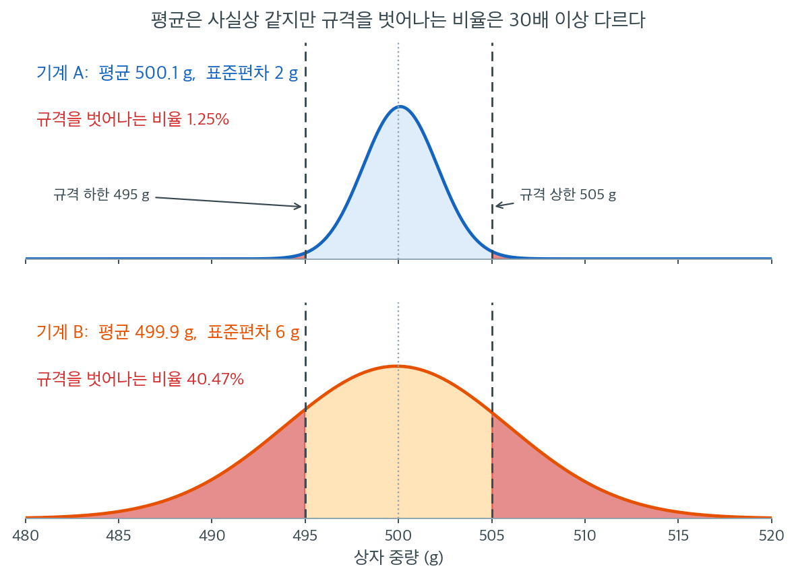

# 왜 분산을 검정하는가

앞의 장들에서 가설검정과 신뢰구간은 모평균과 모비율에 초점을 맞추었다. 그러나 실무의 여러 질문은 위치가 아니라 **산포**를 중심에 둔다. 변동성이 흔들리는 제조공정은 평균이 목표에 맞아 있어도 불량품을 만들어 낸다. 두 투자전략을 비교하는 포트폴리오 관리자는 기대수익만큼이나 변동성에 관심을 둔다. 이 절은 분산에 대한 형식적 검정이 왜 필수적인지 설명하고 그런 검정이 등장하는 상황들을 미리 살펴본다.

---

## 1. 위험과 품질의 측도로서의 분산

모분산 $\sigma^2$는 개별 관측값이 모평균 $\mu$에서 얼마나 멀리 떨어지는 경향이 있는지를 수량화한다. $\sigma^2$이 크면 결과를 예측하기 어렵고, $\sigma^2$이 작으면 결과가 $\mu$ 주위에 촘촘히 모인다.

품질관리에서 시리얼 상자를 채우는 기계는 목표 중량 $\mu = 500$그램의 상자를 만들어야 한다. 평균이 정확히 목표에 있더라도 변동성이 과도하면 어떤 상자는 과충전되고(제품 낭비) 어떤 상자는 부족하게 채워진다(고객 불만). 여기서 중요한 질문은 "평균이 500 g인가?"가 아니라 "분산이 규격 한계 $\sigma_0^2$ 안에 있는가?"이다.



두 충전기를 같은 축 위에 올렸다. 기계 A는 평균 500.1 g에 표준편차 2 g, 기계 B는 평균 499.9 g에 표준편차 6 g이다. **평균만 보면 두 기계는 구별되지 않는다.** 0.2 g 차이는 어떤 표본크기에서도 실질적 의미가 없고, 평균에 대한 $t$ 검정은 "두 기계가 같다"는 답을 낼 것이다.

그런데 고객이 받는 것은 평균이 아니라 개별 상자다. 규격을 $500 \pm 5$ g으로 두면 붉게 칠한 영역이 불량이다. 기계 A는 **1.25%**, 기계 B는 **40.47%**이다. 32배 차이다. 같은 평균, 같은 목표, 같은 공정인데 한쪽은 100상자에 하나가 불량이고 다른 쪽은 다섯에 둘이 불량이다.

이 그림이 분산 검정의 존재 이유다. 규격 이탈 비율은 $\mu$가 아니라 $\sigma$가 지배한다. 정규 가정 아래에서 규격 $\mu_0 \pm L$의 이탈 확률은 대략 $2\Phi(-L/\sigma)$이고, $\sigma$가 분모에 들어가 있으니 $\sigma$가 세 배가 되면 확률은 세 배가 아니라 **자릿수 단위로** 뛴다. 평균을 아무리 정밀하게 맞춰도 이 곡선의 폭은 좁아지지 않는다.

그래서 물어야 할 질문이 "$\sigma_A^2 = \sigma_B^2$인가"로 바뀐다. 이 질문에 답하는 형식적 도구가 15.3절의 $F$ 검정이고, "우리 공정의 $\sigma^2$이 규격 $\sigma_0^2$ 안에 있는가"에 답하는 도구가 15.2절의 카이제곱 검정이다.

금융에서 자산 수익률의 분산은 위험의 표준적인 대리변수이다. 기대수익이 같은 두 포트폴리오라도 변동성이 크게 다를 수 있다. 다음의 형식적 검정은

$$
H_0\colon \sigma_1^2 = \sigma_2^2 \quad \text{대} \quad H_1\colon \sigma_1^2 \neq \sigma_2^2
$$

"이 두 전략의 위험이 같은가?"라는 질문에 증거에 기반한 답을 준다.

---

## 2. 선행 확인 절차로서의 분산 검정

널리 쓰이는 여러 통계 절차가 집단 간 모분산이 같다고 가정한다. 합동분산을 쓰는 이표본 $t$ 검정과 일원분산분석은 모두 **등분산성**을 요구한다. 곧

$$
\sigma_1^2 = \sigma_2^2 = \cdots = \sigma_k^2
$$

이 가정이 위배되었는데도 분석자가 그대로 진행하면 그 결과인 $p$값과 신뢰구간이 심각하게 왜곡될 수 있다. 분산 검정은 이런 절차를 적용하기 전의 진단 확인 역할을 한다. Levene 검정과 Brown-Forsythe 검정이 분산분석의 등분산성 사전검정으로 가장 흔히 쓰인다.

---

## 3. 분산 자체가 관심 모수일 때

연구 질문이 분산을 성가신 모수로 취급하지 않고 직접 겨냥하는 경우도 있다.

- **측정 정밀도.** 어떤 실험실이 자사 분석법의 표준편차가 최대 2 mg/dL이라고 주장한다. $H_0\colon \sigma^2 \le 4$를 $H_1\colon \sigma^2 > 4$에 대해 검정하면 그 주장을 평가할 수 있다.
- **공정 안정성.** 제조업체가 기계를 재보정한 뒤 제품 치수의 분산이 바뀌었는지 감시한다. $\sigma_{\text{before}}^2$과 $\sigma_{\text{after}}^2$의 전후 비교가 그 효과를 수량화한다.
- **변동성 비교.** 분석가가 위기 기간의 시장 변동성이 안정 기간의 변동성을 넘어서는지 검정한다.

각 상황에서 표본분산 $S^2$이 $\sigma^2$의 자연스러운 점추정량이고, $S^2$의 표집분포가 형식적 추론의 근거를 제공한다.

---

## 4. 분산 검정 개관

이 장에서 다루는 검정들은 몇 가지 범주로 나뉜다.

| 검정 | 표본 수 | 가정 | 절 |
|---|---|---|---|
| 카이제곱 검정 | 일표본 | 정규성 | 15.2 |
| F 검정 | 이표본 | 정규성 | 15.3 |
| Bartlett 검정 | $k \ge 2$ 표본 | 정규성 | 15.4 |
| Levene 검정 | $k \ge 2$ 표본 | 완화됨 | 15.5 |
| Brown-Forsythe 검정 | $k \ge 2$ 표본 | 완화됨 | 15.5 |
| Fligner-Killeen 검정 | $k \ge 2$ 표본 | 최소 | 15.5 |

카이제곱 검정과 F 검정은 정규성 아래에서 정확하지만 비정규성에 민감하다. Bartlett 검정은 F 검정을 여러 집단으로 확장하되 같은 민감성을 물려받는다. 15.5절의 로버스트 검정들은 정규성 요구를 완화하는 대신 실제로 정규성이 성립할 때 검정력이 약간 낮아진다.

---

## 5. 올바른 검정 고르기

분산 검정의 선택은 세 요인에 달려 있다.

1. **집단의 수.** 일표본 문제에는 카이제곱 검정을 쓴다. 이표본 문제에는 F 검정을 쓴다. 다표본 문제에는 Bartlett, Levene 또는 관련 절차가 필요하다.
2. **분포 가정.** 자료가 근사적으로 정규이면 카이제곱, F, Bartlett 검정이 적절하고 검정력이 가장 높다. 자료가 치우쳤거나 꼬리가 두꺼우면 Levene이나 Brown-Forsythe 같은 로버스트 검정을 선호해야 한다.
3. **검정의 목적.** 분산 검정이 분산분석 전의 예비 확인이라면 검정력과 로버스트성의 균형이 좋은 Levene 검정이 표준적 권고이다. 분산 자체가 과학적 관심량이라면 정규성 아래에서 정확한 추론을 주는 카이제곱이나 F 검정이 낫다.

!!! tip "실무 지침"
    정규성이 의심스러울 때는 Brown-Forsythe 검정을 기본값으로 삼으라. 편차를 잴 때 평균 대신 중앙값을 쓰므로 치우침과 이상점에 로버스트하면서도 정규성 아래에서 합리적인 검정력을 유지한다.

---

## 6. 교과과정 전체와의 연결

분산 검정은 앞의 여러 장에서 나온 흐름들을 하나로 엮는다.

- **표집분포**(5장): 정규성 아래에서 $(n-1)S^2/\sigma^2$의 표집분포로 카이제곱분포가 나오고, 독립인 두 카이제곱 변수의 비로 F 분포가 나온다.
- **가설검정**(9장): 귀무가설과 대립가설, 유의수준, $p$값의 논리가 그대로 이어진다.
- **분산분석**(11장): 분산분석의 등분산 가정이 15.4절과 15.5절에서 다루는 사전검정의 동기가 된다.
- **회귀 진단**(13장): 회귀 잔차의 이분산은 15.7절에서 다루는 Breusch-Pagan 검정 같은 분산 검정으로 탐지한다.

---

## 연습문제

<div class="drillbox" markdown>

**연습문제 1.** <span class="diff easy" title="쉬움"></span>
어떤 시리얼 충전기가 목표 중량 500 g으로 상자를 채운다. 품질관리 담당자가 두 기계를 비교한 결과 표본평균이 각각 500.1 g과 499.9 g으로 사실상 같았지만, 표본표준편차는 각각 2.0 g과 6.0 g이었다. 왜 평균에 대한 검정만으로는 불충분한지 설명하고, 두 기계의 실질적 차이를 서술하라.

</div>

??? success "풀이"
    평균에 대한 $t$ 검정은 두 기계가 구별되지 않는다고 결론지을 것이다. 두 표본평균 모두 목표치 500 g에 매우 가깝기 때문이다. 그러나 이는 잘못된 안심이다.

    상자 중량이 근사적으로 정규라고 가정하면, 규격을 $500 \pm 5$ g이라 할 때 규격을 벗어날 확률은

    - **기계 A** ($\sigma = 2$): $P(|Z| > 5/2) = P(|Z| > 2.5) = 0.0124$, 곧 약 **1.2%**.
    - **기계 B** ($\sigma = 6$): $P(|Z| > 5/6) = P(|Z| > 0.833) = 0.4047$, 곧 약 **40%**.

    기계 B는 상자의 5분의 2가 규격을 벗어난다. 평균이 완벽하게 목표에 맞아 있는데도 그렇다.

    핵심은 **평균이 위치를, 분산이 신뢰성을 통제한다**는 것이다. 품질관리에서 고객이 경험하는 것은 개별 상자이지 평균이 아니므로, 분산이야말로 결정적인 모수이다. 형식적 검정으로는 $H_0: \sigma_A^2 = \sigma_B^2$에 대한 F 검정이 적절하다. $\square$

---

<div class="drillbox" markdown>

**연습문제 2.** <span class="diff easy" title="쉬움"></span>
어떤 실험실이 자사 혈당 분석법의 표준편차가 최대 2 mg/dL이라고 주장한다. 독립인 측정 $n = 25$회에서 $s = 2.6$ mg/dL을 얻었다. $H_0: \sigma^2 \le 4$를 $H_1: \sigma^2 > 4$에 대해 $\alpha = 0.05$에서 검정하라.

</div>

??? success "풀이"

    검정통계량은

    $$
    \chi^2 = \frac{(n-1)s^2}{\sigma_0^2} = \frac{24 \times 2.6^2}{4} = \frac{24 \times 6.76}{4} = 40.56.
    $$

    귀무가설 아래에서 $\chi^2 \sim \chi^2_{24}$이다. 상단 단측 검정이므로 임계값은 $\chi^2_{0.95, 24} = 36.415$이다.

    $40.56 > 36.415$이므로 $H_0$을 기각한다. $p$값은

    $$
    p = P(\chi^2_{24} \geq 40.56) = 0.0186.
    $$

    ```python
    from scipy import stats

    n, s, sigma0 = 25, 2.6, 2.0
    chi2_stat = (n - 1) * s**2 / sigma0**2
    p = 1 - stats.chi2.cdf(chi2_stat, n - 1)
    crit = stats.chi2.ppf(0.95, n - 1)
    print(f"chi2 = {chi2_stat:.4f}, critical = {crit:.4f}, p = {p:.4f}")
    ```

    출력:

    ```
    chi2 = 40.5600, critical = 36.4150, p = 0.0186
    ```

    손 계산과 일치한다. 관측된 $\chi^2 = 40.56$이 임계값 $36.415$를 넘는다.

    **결론:** 5% 수준에서 실험실의 주장을 기각할 증거가 있다. 참 표준편차가 2 mg/dL을 넘는 것으로 보인다.

    다만 $p = 0.019$가 압도적이지는 않고 $n = 25$가 작다는 점을 유념하라. 카이제곱 분산 검정은 정규성에 매우 민감하므로, 결론을 확정하기 전에 측정값의 정규성을 확인해야 한다. $\square$

---

<div class="drillbox" markdown>

**연습문제 3.** <span class="diff easy" title="쉬움"></span>
어떤 분석가가 위기 기간(60거래일)의 일별 수익률 표준편차 $s_1 = 2.1\%$와 안정 기간(60거래일)의 $s_2 = 1.3\%$를 비교한다. F 검정으로 변동성이 달라졌는지 검정하고, 이 상황에서 F 검정을 쓰는 것의 위험을 논하라.

</div>

??? success "풀이"

    검정통계량은

    $$
    F = \frac{s_1^2}{s_2^2} = \frac{0.021^2}{0.013^2} = \frac{0.000441}{0.000169} = 2.6095.
    $$

    귀무가설 아래에서 $F \sim F_{59, 59}$이다. 위기 기간의 변동성이 더 크다는 단측 대립가설에 대해

    $$
    p = P(F_{59,59} \geq 2.6095) = 1.58 \times 10^{-4}.
    $$

    ```python
    from scipy import stats

    s1, s2, n1, n2 = 0.021, 0.013, 60, 60
    F = (s1 / s2)**2
    p = 1 - stats.f.cdf(F, n1 - 1, n2 - 1)
    print(f"F = {F:.4f}, p = {p:.6f}")
    ```

    출력:

    ```
    F = 2.6095, p = 0.000158
    ```

    $p = 0.000158$로, 위에서 적은 $1.58 \times 10^{-4}$과 같다.

    명목상으로는 변동성 증가의 매우 강한 증거이다.

    !!! warning "그러나 이 $p$값을 믿어서는 안 된다"
        금융 수익률에 F 검정을 적용하는 것은 이 장에서 다루는 **가장 위험한 오용** 가운데 하나이다. 세 가지 문제가 겹친다.

        1. **두꺼운 꼬리.** F 검정은 정규성에 극도로 민감하다. 일별 수익률의 초과첨도는 흔히 3에서 10 사이인데, 이런 자료에서 F 검정의 실제 제1종 오류율은 명목 5%가 아니라 20~30%에 이를 수 있다(15.3절 참조).
        2. **독립성 위배.** 수익률 자체는 거의 무상관이지만 **제곱 수익률은 강하게 자기상관**되어 있다(변동성 군집). F 검정은 $n_1 = n_2 = 60$개의 독립 관측을 가정하지만 실효 표본크기는 훨씬 작다.
        3. **기간을 자료를 보고 골랐다.** "위기 기간"을 변동성이 높았다는 이유로 사후적으로 정의했다면 검정이 순환논법이 된다.

        **대안:** GARCH 모형으로 변동성 동학을 직접 추정하거나, 블록 붓스트랩으로 자기상관을 반영한 귀무분포를 만들거나, 최소한 Brown-Forsythe 같은 로버스트 검정을 쓴다. $\square$

---

<div class="drillbox" markdown>

**연습문제 4.** <span class="diff med" title="중간"></span>
분산분석을 수행하기 전에 등분산성을 확인하는 관행에는 논리적 문제가 있다. 그 문제를 설명하고, 실무에서 어떻게 대응하는 것이 나은지 논하라.

</div>

??? success "풀이"
    **문제: 같은 자료로 두 번 결정한다.**

    "Levene 검정이 기각하지 않으면 표준 분산분석, 기각하면 Welch 분산분석"이라는 절차를 쓰면 최종 검정의 선택이 자료에 의존하게 된다. 그 결과 두 단계를 합친 절차의 실제 제1종 오류율이 명목 $\alpha$에서 벗어난다.

    두 번째 문제는 **검정력의 비대칭**이다.

    - 집단이 작으면 Levene 검정의 검정력이 낮아, 등분산성이 실제로 크게 위배되어도 기각하지 못하고 부적절한 표준 분산분석으로 진행하게 된다.
    - 집단이 크면 Levene 검정의 검정력이 지나치게 높아, 실질적으로 무해한 작은 분산 차이도 기각하여 불필요하게 Welch 분산분석으로 가게 된다.

    곧 사전검정이 가장 필요한 상황(작은 표본)에서 가장 도움이 안 되고, 필요 없는 상황(큰 표본)에서 가장 민감하다.

    **더 나은 실무.**

    1. **사전검정 없이 처음부터 Welch 분산분석을 쓴다.** 등분산일 때 검정력 손실이 미미하고(보통 몇 퍼센트) 등분산이 아닐 때는 크게 낫다. 여러 모의실험 연구가 이를 지지한다.
    2. 분산의 동질성 자체가 과학적 관심사일 때만 형식적 분산 검정을 하고, 그 결과를 분석 방법의 선택이 아니라 **보고할 결과**로 취급한다.
    3. 집단별 표준편차와 상자그림을 항상 함께 보고하여 독자가 스스로 판단할 수 있게 한다. $\square$

---

<div class="drillbox" markdown>

**연습문제 5.** <span class="diff med" title="중간"></span>
1절은 정규 가정 아래에서 규격 $\mu_0 \pm L$ 의 이탈 확률을 $2\Phi(-L/\sigma)$ 로 적었다. 규격이 $500 \pm 5$ g 이므로 $L = 5$ 이고, 기계 A는 $\sigma_A = 2$ 로 이탈률 $0.0124$, 기계 B는 $\sigma_B = 6$ 으로 이탈률 $0.4047$ 이었다.

**(1)** 기계 B의 평균은 그대로 두고 이탈률만 기계 A와 같은 $0.0124$ 로 낮추려면 $\sigma_B$ 를 얼마로 줄여야 하는가. 분산으로는 몇 배를 줄여야 하는가.

**(2)** 공정은 손댈 수 없고 규격만 다시 쓸 수 있다고 하자. $\sigma_B = 6$ 을 그대로 두고 이탈률을 $0.0124$ 로 만드는 규격 폭 $L$ 은 얼마인가.

**(3)** 중량이 $N(\mu, \sigma_B^2)$ 이고 규격이 $[495, 505]$ 로 고정되어 있을 때 이탈률은

$$
p(\mu) = \Phi\!\left(\frac{495-\mu}{\sigma_B}\right) + 1 - \Phi\!\left(\frac{505-\mu}{\sigma_B}\right)
$$

이다. 이것을 미분하여, **평균을 어디로 옮겨도 이탈률을 $0.4047$ 아래로 내릴 수 없음**을 보여라.

</div>

??? success "풀이"
    **(1)** 목표 이탈률을 $\sigma$ 의 식으로 적으면

    $$
    2\Phi\!\left(-\frac{5}{\sigma}\right) = 0.0124
    \quad\Longleftrightarrow\quad
    \Phi\!\left(-\frac{5}{\sigma}\right) = 0.0062
    \quad\Longleftrightarrow\quad
    \frac{5}{\sigma} = 2.5
    $$

    이므로 $\sigma = 2$ g 이다. 곧 기계 B는 기계 A의 표준편차까지 내려와야 한다. 표준편차로는 $6 \to 2$ 로 세 배 줄이는 것이지만 분산으로는

    $$
    \frac{\sigma_B^2}{\sigma_A^2} = \frac{36}{4} = 9
    $$

    이므로 **분산을 9배 줄여야** 한다. 공정 개선 비용은 보통 분산 척도로 매겨지므로 이 9배가 실제 부담이다.

    **(2)** 같은 조건을 $L$ 에 대해 풀면 $L/\sigma_B = 2.5$, 곧

    $$
    L = 2.5 \times 6 = 15
    $$

    이다. 규격을 $500 \pm 15$ g 으로 **세 배 느슨하게** 다시 써야 한다. 이는 공정을 고치는 대신 불량의 정의를 바꾸는 것이므로 품질이 좋아진 것이 아니다. 같은 $2.5$ 라는 수가 (1)과 (2)에 모두 나타나는 것은 이탈률이 $L$ 과 $\sigma$ 의 **비**에만 달려 있기 때문이다.

    **(3)** $\sigma = \sigma_B$ 로 줄여 쓰고 미분한다. $\frac{d}{d\mu}\Phi\!\left(\frac{495-\mu}{\sigma}\right) = -\frac{1}{\sigma}\varphi\!\left(\frac{495-\mu}{\sigma}\right)$ 이고 $\frac{d}{d\mu}\left[1-\Phi\!\left(\frac{505-\mu}{\sigma}\right)\right] = \frac{1}{\sigma}\varphi\!\left(\frac{505-\mu}{\sigma}\right)$ 이므로

    $$
    p'(\mu) = \frac{1}{\sigma}\left[\varphi\!\left(\frac{505-\mu}{\sigma}\right) - \varphi\!\left(\frac{495-\mu}{\sigma}\right)\right].
    $$

    $a = (505-\mu)/\sigma$, $b = (495-\mu)/\sigma$ 로 두면 언제나 $a - b = 10/\sigma > 0$ 이다. $\varphi$ 는 $0$ 에 대칭이고 $\lvert \cdot \rvert$ 에 대해 감소하므로 $\varphi(a) = \varphi(b)$ 는 $a = -b$ 일 때만 성립하고, 이는 $\mu = 500$ 을 뜻한다. 또

    - $\mu > 500$ 이면 $a < 5/\sigma$ 이고 $b < -5/\sigma$ 라 $\lvert b \rvert > \lvert a \rvert$ 이므로 $\varphi(a) > \varphi(b)$, 곧 $p'(\mu) > 0$.
    - $\mu < 500$ 이면 같은 방식으로 $p'(\mu) < 0$.

    그러므로 $\mu = 500$ 이 **유일한 최소점**이고 그 값이

    $$
    p(500) = 2\Phi\!\left(-\frac{5}{6}\right) = 0.4047
    $$

    이다. 기계 B는 이미 최적의 평균에 놓여 있으므로 평균 조정으로 얻을 것이 하나도 없다.

    **해석.** $\sigma$ 가 세 배인데 이탈률은 $0.4047/0.0124 = 32.6$ 배다. $\Phi$ 의 꼬리가 지수적으로 얇아서 $L/\sigma$ 가 조금만 줄어도 확률이 자릿수로 뛰기 때문이다. 그리고 (3)이 보인 것은 본문의 "평균을 아무리 정밀하게 맞춰도 이 곡선의 폭은 좁아지지 않는다"는 말의 정확한 형태다. 평균은 이미 다 썼고 남은 손잡이는 $\sigma$ 하나뿐이다. 그래서 물어야 할 질문이 $\mu$ 가 아니라 $\sigma^2$ 에 대한 것이 된다. $\square$

---

<div class="drillbox" markdown>

**연습문제 6.** <span class="diff med" title="중간"></span>
이 쪽은 분산 검정의 용도를 두 번 서로 다르게 말한다. 2절은 "Levene 검정과 Brown-Forsythe 검정이 분산분석의 등분산성 사전검정으로 가장 흔히 쓰인다"고 적었고, '정리하며'는 "사전 검정으로 쓰는 관행은 권하지 않는다"고 적었다.

**(1)** 두 문장이 실제로 모순인지 판정하라. 모순이 아니라면 각 문장이 무엇에 대한 주장인지 구분해서 적어라.

**(2)** 연습문제 4의 권고를 끝까지 받아들여 사전검정 없이 처음부터 Welch 분산분석을 쓴다고 하자. 그러면 15.4절과 15.5절의 다표본 분산 검정은 쓸 자리가 없어지는가? 이 쪽의 3절에서 Welch 분산분석이 대신 답해 줄 수 없는 질문 두 개를 찾아 들고, 왜 대신할 수 없는지 한 줄로 적어라.

**(3)** 4절 표의 '가정' 열은 Bartlett 검정이 '정규성', Levene 검정이 '완화됨'이라고 적었다. 로버스트 검정이 있는데도 Bartlett 검정을 이 장에 남겨 두는 까닭은 무엇인가. 4절 마지막 문단에서 근거를 찾아라.

</div>

??? success "풀이"
    **(1) 모순이 아니다. 하나는 기술적 주장이고 다른 하나는 규범적 주장이다.**

    2절의 문장은 "실무에서 무엇이 가장 많이 쓰이는가"에 대한 **사실 서술**이다. 실제로 많은 교과서와 통계 패키지가 분산분석 앞에 Levene 검정을 붙여 놓았다. '정리하며'의 문장은 "그 관행이 옳은가"에 대한 **권고**다. 연습문제 4가 그 근거를 적었다. 두 단계를 합친 절차의 제1종 오류율이 명목 $\alpha$ 를 지키지 못하고, 사전검정의 검정력이 정작 필요한 작은 표본에서 가장 낮다.

    곧 "널리 쓰인다"와 "권할 만하다"는 서로 다른 주장이고, 이 쪽은 둘을 모두 정직하게 적어 둔 것이다. 널리 쓰인다는 사실을 알아야 남의 분석을 읽을 수 있고, 권하지 않는다는 판단을 알아야 자기 분석을 설계할 수 있다.

    **(2) 없어지지 않는다. Welch 분산분석은 평균에 대한 검정이기 때문이다.**

    3절이 든 세 상황 가운데 둘을 들면 다음과 같다.

    - **측정 정밀도.** "이 실험실의 분석법 표준편차가 2 mg/dL 이하인가", 곧 $H_0\colon \sigma^2 \le 4$. 가설 자체가 $\sigma^2$ 에 대한 것이므로 평균을 비교하는 어떤 절차도 이 질문에 답하지 않는다.
    - **공정 안정성.** "재보정 뒤 치수의 분산이 바뀌었는가", 곧 $\sigma_{\text{before}}^2$ 과 $\sigma_{\text{after}}^2$ 의 비교. 평균은 재보정 전후로 같게 맞춰 두는 것이 보통이므로 평균 비교는 아무것도 탐지하지 못한다.

    (세 번째인 "위기 기간과 안정 기간의 변동성 비교"도 같은 성격이고, 연습문제 3이 그 예다.)

    사전검정을 버리는 것은 **분산 검정을 다른 검정의 수단으로 쓰지 않겠다**는 뜻일 뿐이다. 분산이 그 자체로 관심 모수인 질문은 그대로 남아 있고, 15.4절과 15.5절의 검정들은 그 질문에 답하는 도구다. 연습문제 4의 권고 2번이 이것을 "분산의 동질성 자체가 과학적 관심사일 때만 형식적 분산 검정을 하라"로 적었다.

    **(3) 로버스트성이 공짜가 아니기 때문이다.**

    4절 마지막 문단이 근거다. "15.5절의 로버스트 검정들은 정규성 요구를 완화하는 대신 실제로 정규성이 성립할 때 검정력이 약간 낮아진다." 5절의 2번도 같은 말을 한다. 자료가 근사적으로 정규이면 카이제곱·F·Bartlett 검정이 "적절하고 검정력이 가장 높다."

    그러므로 Bartlett 검정은 버릴 도구가 아니라 **쓸 조건이 분명한 도구**다. 14장의 정규성 검정이나 Q-Q 그림으로 정규성을 지지할 근거가 있고 분산의 동질성이 관심량이라면 Bartlett 검정이 가장 예민하다. 정규성이 의심스러우면 5절의 실무 지침대로 Brown-Forsythe 검정으로 옮긴다. 선택의 축은 "낡았는가 새것인가"가 아니라 **"정규성을 믿을 근거가 있는가"**다. $\square$

---

<div class="drillbox" markdown>

**연습문제 7.** <span class="diff med" title="중간"></span>
6절은 "정규성 아래에서 $(n-1)S^2/\sigma^2$ 의 표집분포로 카이제곱분포가 나오고, 독립인 두 카이제곱 변수의 비로 F 분포가 나온다"고 적었다. '정리하며'는 "평균 검정과 달리 분산 검정은 중심극한정리의 보호를 받지 못한다"고 적었다. 이 두 문장을 하나의 계산으로 잇는다.

**(1)** 위 인용의 두 사실이 각각 정규성을 어디서 쓰는지 적고, F 검정이 카이제곱 검정보다 정규성에 더 취약한 이유를 설명하라.

**(2)** 5.6절은 첨도 $\beta_2 = \mu_4/\sigma^4$ 를 가진 임의의 모집단에서

$$
\operatorname{Var}(S^2) = \frac{\sigma^4}{n}\left(\beta_2 - \frac{n-3}{n-1}\right)
$$

임을 보였다. 카이제곱 모형은 $(n-1)S^2/\sigma^2 \sim \chi^2_{n-1}$ 을 믿으므로 $\operatorname{Var}(S^2) = 2\sigma^4/(n-1)$ 이라고 본다. 두 값의 비를 구하고 $n \to \infty$ 의 극한을 적어라. 또 $n = 25$, $\beta_2 = 9$ (지수 모집단)에서 그 비의 값을 계산하라.

**(3)** 2장은 첨도의 하한 $\beta_2 \ge 1 + \gamma_1^2$ 을 보였다. 치우침 계수가 $\gamma_1 = 2$ 인 모집단에서 **첨도를 전혀 모른다고 해도** (2)의 극한 비에 대해 말할 수 있는 하한은 얼마인가. 또 그 비가 1보다 작아지는 첨도의 범위는 무엇이고, 그때 카이제곱 검정은 어느 쪽으로 틀리는가.

</div>

??? success "풀이"
    **(1) 정규성이 쓰이는 자리와 '두 겹'의 뜻.**

    - $(n-1)S^2/\sigma^2 \sim \chi^2_{n-1}$ 은 **정규 모집단에서만** 성립한다. $S^2$ 의 분포 전체가 정규성에서 나오는 것이며, 표본평균의 경우처럼 $n$ 이 커지면 모양이 저절로 맞아 주는 성질이 아니다.
    - F 분포는 **독립인 두 카이제곱 변수의 비**로 정의되므로, $S_1^2/S_2^2 \sim F_{n_1-1,\,n_2-1}$ 을 쓰려면 위의 사실을 분자에 한 번, 분모에 한 번, 모두 **두 번** 가정해야 한다.

    그래서 F 검정은 같은 가정 위배에 두 번 노출된다. 게다가 두 위배가 서로를 지워 주지도 않는다. 두 모집단이 같은 모양이면 첨도가 같으므로 분자와 분모의 왜곡이 **같은 방향으로** 쌓인다.

    **(2) 비는 첨도가 정하고 극한은 $(\beta_2-1)/2$ 다.**

    $$
    \frac{\operatorname{Var}(S^2)}{2\sigma^4/(n-1)}
    = \frac{\sigma^4}{n}\left(\beta_2 - \frac{n-3}{n-1}\right)\cdot\frac{n-1}{2\sigma^4}
    = \frac{n-1}{2n}\left(\beta_2 - \frac{n-3}{n-1}\right).
    $$

    $n \to \infty$ 에서 $\frac{n-1}{2n} \to \frac12$ 이고 $\frac{n-3}{n-1} \to 1$ 이므로

    $$
    \frac{\operatorname{Var}(S^2)}{2\sigma^4/(n-1)} \;\longrightarrow\; \frac{\beta_2 - 1}{2}.
    $$

    정규 모집단은 $\beta_2 = 3$ 이라 비가 $(3-1)/2 = 1$ 로 꼭 맞는다. $n = 25$, $\beta_2 = 9$ 에서는

    $$
    \frac{24}{50}\left(9 - \frac{22}{24}\right) = 0.48 \times 8.0833 = 3.88
    $$

    이고 극한값 $(9-1)/2 = 4$ 에 이미 가깝다. **$\sigma^2$ 이 식에서 사라지고 첨도만 남은 것**이 핵심이다. 척도가 아니라 꼬리가 $S^2$ 의 흔들림을 정한다.

    이것이 '정리하며'의 문장을 수로 옮긴 것이다. $\bar X$ 에서는 중심극한정리가 **1차 적률**에 선물을 주어 $n$ 이 커지면 모양이 맞아 간다. $S^2$ 은 2차 적률이고 그 흔들림이 **4차 적률**에 달려 있어서 그 선물을 받지 못한다. 위의 비는 $n$ 이 커져도 1로 가지 않고 $(\beta_2-1)/2$ 에 머무른다. **수렴이 느린 것이 아니라 틀린 값으로 수렴한다.**

    **(3) 치우침만으로 하한이 나온다.**

    극한 비가 $(\beta_2-1)/2$ 이고 $\beta_2 \ge 1 + \gamma_1^2$ 이므로

    $$
    \frac{\beta_2-1}{2} \;\ge\; \frac{\gamma_1^2}{2}.
    $$

    $\gamma_1 = 2$ 이면 하한이 $4/2 = 2$ 다. 곧 **첨도를 재 보지 않아도** 참 분산이 카이제곱 모형이 믿는 값의 두 배 이상임을 알 수 있다. (지수 모집단은 $\gamma_1 = 2$, $\beta_2 = 9$ 라 실제로는 하한 2가 아니라 4다.) 더 일반적으로 $\lvert \gamma_1 \rvert > \sqrt{2}$ 인 모집단은 예외 없이 비가 1보다 크다. **치우침이 있으면 그것만으로 카이제곱 모형이 위험한 쪽으로 틀린다.**

    비가 1보다 작아지는 것은 $\beta_2 < 3$ 일 때다. 이때 참 산포가 카이제곱 모형이 믿는 것보다 **작으므로** 기각이 명목보다 드물게 일어나고, 검정은 지나치게 **보수적**이 된다. 하한 $\beta_2 = 1$ 은 $\pm a$ 두 점에 반반씩 있는 대칭 분포에서 달성되고 그때 비는 $0$ 이다.

    **해석.** 어느 쪽으로 틀리는지는 $\beta_2$ 가 3보다 큰지 작은지 하나로 갈린다. 꼬리가 무거우면 오류율이 올라가 위험하고, 가벼우면 검정력을 버린다. **카이제곱 검정은 정규성을 가정하는 것이 아니라 첨도가 정확히 3임을 가정한다.** $\square$

---

<div class="drillbox" markdown>

**연습문제 8.** <span class="diff hard" title="어려움"></span>
연습문제 2는 $n = 25$, 명목 $\alpha = 0.05$ 의 단측 카이제곱 분산 검정으로 $p = 0.0186$ 을 얻고도 "카이제곱 분산 검정은 정규성에 매우 민감하다"는 경고로 끝났다. 그 민감도를 수로 재라.

$H_0\colon \sigma^2 = \sigma_0^2$ 이 **참인** 네 모집단(정규, 균등, $t(5)$, 지수)에서 크기 $n$ 의 표본을 40,000 개 뽑아, $(n-1)S^2/\sigma_0^2 > \chi^2_{0.95,\,n-1}$ 로 기각하는 비율을 $n = 25$ 와 $n = 100$ 에서 재라. 네 모집단의 첨도는 차례로 $\beta_2 = 3,\ 1.8,\ 9,\ 9$ 다.

**(1)** $n$ 이 크면 실제 오류율이

$$
1 - \Phi\!\left(z_{0.95}\sqrt{\frac{2}{\beta_2-1}}\right)
$$

로 간다는 것을 연습문제 7(2)의 결과를 써서 보여라.

**(2)** 모의실험으로 표를 얻고, 꼬리가 두꺼운 두 모집단에서 $n$ 을 키울 때 오류율이 어느 방향으로 가는지 적어라. 균등 모집단의 오류율이 명목보다 **낮은** 까닭도 적어라.

**(3)** $t(5)$ 와 지수는 첨도가 똑같이 9 인데 $n = 25$ 에서 오류율이 서로 다르다. 왜 그런가.

</div>

??? success "풀이"
    **(1) 임계값은 $1/\sqrt{n}$ 로 줄고 실제 산포도 $1/\sqrt{n}$ 로 줄어서 $n$ 이 약분된다.**

    기각역을 $S^2/\sigma_0^2$ 척도로 다시 쓰면

    $$
    \frac{S^2}{\sigma_0^2} > \frac{\chi^2_{0.95,\,n-1}}{n-1}.
    $$

    카이제곱분포의 평균은 $n-1$, 분산은 $2(n-1)$ 이므로 $n$ 이 크면 $\chi^2_{0.95,\,n-1} \approx (n-1) + z_{0.95}\sqrt{2(n-1)}$ 이고, 따라서 오른쪽은

    $$
    1 + z_{0.95}\sqrt{\frac{2}{n-1}}
    $$

    이다. 한편 $H_0$ 아래에서 $E[S^2/\sigma_0^2] = 1$ 이고, 연습문제 7(2)에서 참 표준편차는 $n$ 이 크면

    $$
    \operatorname{SD}\!\left(\frac{S^2}{\sigma_0^2}\right) \approx \sqrt{\frac{\beta_2-1}{n}}
    $$

    이다. $S^2$ 은 평균의 꼴이므로 $n$ 이 크면 근사적으로 정규이고, 그러므로

    $$
    P(\text{기각}) \approx 1 - \Phi\!\left(\frac{z_{0.95}\sqrt{2/(n-1)}}{\sqrt{(\beta_2-1)/n}}\right)
    \;\longrightarrow\; 1 - \Phi\!\left(z_{0.95}\sqrt{\frac{2}{\beta_2-1}}\right).
    $$

    분자와 분모에서 $\sqrt{n}$ 이 함께 사라졌다. 극한값은 $n$ 과 무관하고 **첨도 하나로 정해진다.**

    **(2) 모의실험.**

    ```python
    import numpy as np
    from scipy import stats

    rng = np.random.default_rng(0)
    R, alpha = 40000, 0.05

    # (이름, 첨도 beta_2, 참 분산, 표본 생성기)
    pops = [
        ("정규", 3.0, 1.0,    lambda s: rng.standard_normal(s)),
        ("균등", 1.8, 1 / 12, lambda s: rng.uniform(size=s)),
        ("t(5)", 9.0, 5 / 3,  lambda s: rng.standard_t(5, size=s)),
        ("지수", 9.0, 1.0,    lambda s: rng.exponential(size=s)),
    ]

    print("모집단  beta2    n=25   n=100    극한값")
    for name, b2, var, gen in pops:
        rates = []
        for n in (25, 100):
            crit = stats.chi2.ppf(1 - alpha, n - 1)
            s2 = gen((R, n)).var(axis=1, ddof=1)
            rates.append(np.mean((n - 1) * s2 / var > crit))
        limit = 1 - stats.norm.cdf(stats.norm.ppf(1 - alpha) * np.sqrt(2 / (b2 - 1)))
        print(f"{name:5s} {b2:6.1f} {rates[0]:7.4f} {rates[1]:7.4f} {limit:9.4f}")
    ```

    출력:

    ```text
    모집단  beta2    n=25   n=100    극한값
    정규       3.0  0.0500  0.0493    0.0500
    균등       1.8  0.0037  0.0046    0.0047
    t(5)     9.0  0.1078  0.1313    0.2054
    지수       9.0  0.1488  0.1771    0.2054
    ```

    **정규 줄만 명목 0.05 에 붙어 있다.** 지수 모집단은 $n = 25$ 에서 이미 $0.1488$ 로 명목의 세 배이고, $n = 100$ 에서 $0.1771$ 로 **더 올라가** 극한 $0.2054$ 로 향한다. $t(5)$ 도 $0.1078 \to 0.1313$ 으로 같은 방향이다. 자료를 네 배 모으면 명목 5% 검정의 실제 오류율이 더 나빠진다. 연습문제 7이 보인 대로 문제는 근사의 **수렴**이 아니라 모형의 **전제**이므로, 표본크기로는 고쳐지지 않고 오히려 $F$ 분포·카이제곱분포가 넓어서 왜곡을 가려 주던 완충만 걷힌다.

    균등 모집단은 반대 방향의 같은 고장이다. $\beta_2 = 1.8 < 3$ 이라 $S^2$ 의 참 산포가 카이제곱 모형이 믿는 것의 $\sqrt{(1.8-1)/2} = 0.632$ 배뿐이다. 기각역까지 닿는 일이 거의 없어 오류율이 $0.0037$ 로 내려앉는다. 안전해 보이지만 검정력을 통째로 버린 것이다.

    **(3) 첨도는 극한값만 정한다. 유한 $n$ 에서는 치우침이 들어간다.**

    (1)의 극한식에는 $\beta_2$ 만 나오므로 $t(5)$ 와 지수는 **같은 극한값** $0.2054$ 로 간다. 표의 마지막 열이 실제로 같다. 그러나 그 극한은 $S^2$ 의 정규근사에 기댄 것이고, $n = 25$ 에서 $S^2$ 의 분포는 아직 정규가 아니다. 그 어긋남을 지배하는 것이 치우침이다.

    - 지수 모집단: $\gamma_1 = 2$. $S^2$ 의 표집분포 자체가 오른쪽으로 길게 늘어나 상단 기각역에 더 자주 들어간다.
    - $t(5)$: 대칭이라 $\gamma_1 = 0$. 비대칭이 보태는 몫이 없으므로 $0.1078$ 로 덜 나쁘다.

    그래서 $n = 25$ 에서 지수가 $0.1488$, $t(5)$ 가 $0.1078$ 로 벌어지고, $n$ 이 커지면 둘이 같은 값으로 모여 간다($0.1771$ 대 $0.1313$ 으로 아직 멀지만 방향은 같다). **첨도는 어디로 가는지를 정하고 치우침은 얼마나 빨리 가는지를 정한다.** $\square$

---

<div class="drillbox" markdown>

**연습문제 9.** <span class="diff hard" title="어려움"></span>
연습문제 3은 $F = 2.6095$, $p = 1.58 \times 10^{-4}$ 를 얻고도 "이 $p$값을 믿어서는 안 된다"고 경고했다. 그 경고를 수로 바꾼다.

5.9절은 첨도 $\beta_2$ 인 두 모집단에서 델타법으로

$$
\operatorname{Var}\!\left(\log \frac{S_1^2}{S_2^2}\right) \approx (\beta_2-1)\left(\frac{1}{n_1}+\frac{1}{n_2}\right)
$$

이고 $n$ 이 크면 $\log F$ 가 근사적으로 정규임을 보였다. $n_1 = n_2 = 60$ 이다.

**(1)** 정규 가정($\beta_2 = 3$)으로 $\log F$ 를 표준화하여 단측 $p$값을 구하고, 연습문제 3이 $F$ 분포에서 얻은 $1.58 \times 10^{-4}$ 과 비교하라.

**(2)** 연습문제 3은 일별 수익률의 초과첨도가 흔히 3에서 10 사이라고 했다. 그 양 끝, 곧 $\beta_2 = 6$ 과 $\beta_2 = 13$ 에서 같은 단측 $p$값을 구하라.

**(3)** 단측 5% 에서 유의성이 사라지는 첨도의 문턱 $\beta_2$ 를 구하고 초과첨도로도 적어라.

필요한 값: $\log 2.6095 = 0.9591$, $\Phi(3.7148) = 0.999898$, $\Phi(2.3494) = 0.990598$, $\Phi(1.5165) = 0.935304$, $z_{0.95} = 1.6449$.

</div>

??? success "풀이"
    세 문항 모두 같은 틀이다. $H_0\colon \sigma_1^2 = \sigma_2^2$ 아래에서 $E[\log F] \approx 0$ 이므로

    $$
    z = \frac{\log F}{\sqrt{(\beta_2-1)\left(\frac{1}{60}+\frac{1}{60}\right)}}
    = \frac{0.9591}{\sqrt{(\beta_2-1)/30}}, \qquad p = 1 - \Phi(z).
    $$

    **(1) 정규 가정: $\beta_2 = 3$.**

    $$
    \operatorname{Var}(\log F) \approx \frac{3-1}{30} = 0.06667,
    \qquad \operatorname{SD} = 0.2582,
    $$

    $$
    z = \frac{0.9591}{0.2582} = 3.7148,
    \qquad p = 1 - 0.999898 = 1.02 \times 10^{-4}.
    $$

    연습문제 3의 $F_{59,59}$ 분포에서 얻은 $1.58 \times 10^{-4}$ 과 같은 자릿수다. **정규 가정을 그대로 둔 채로는 델타법 근사와 정확한 $F$ 계산이 사실상 같은 답을 준다.** 그러므로 뒤에 나올 차이는 근사의 탓이 아니라 첨도의 탓이다.

    **(2) 초과첨도 3과 10.**

    초과첨도 $\gamma_2 = \beta_2 - 3$ 이므로 $\gamma_2 = 3$ 은 $\beta_2 = 6$, $\gamma_2 = 10$ 은 $\beta_2 = 13$ 이다.

    $\beta_2 = 6$:

    $$
    \operatorname{Var}(\log F) \approx \frac{5}{30} = 0.16667, \quad \operatorname{SD} = 0.4082,
    \quad z = \frac{0.9591}{0.4082} = 2.3494,
    $$

    $$
    p = 1 - 0.990598 = 0.0094.
    $$

    $\beta_2 = 13$:

    $$
    \operatorname{Var}(\log F) \approx \frac{12}{30} = 0.4, \quad \operatorname{SD} = 0.6325,
    \quad z = \frac{0.9591}{0.6325} = 1.5165,
    $$

    $$
    p = 1 - 0.935304 = 0.0647.
    $$

    정리하면 다음과 같다.

    | 가정 | $\beta_2$ | $\operatorname{SD}(\log F)$ | $z$ | 단측 $p$ | 5%에서 |
    |---|---|---|---|---|---|
    | 정규 | 3 | 0.2582 | 3.7148 | $1.02 \times 10^{-4}$ | 유의 |
    | 초과첨도 3 | 6 | 0.4082 | 2.3494 | 0.0094 | 유의 |
    | 초과첨도 10 | 13 | 0.6325 | 1.5165 | 0.0647 | **유의하지 않다** |

    **(3) 문턱.** $p = 0.05$ 가 되는 것은 $z = z_{0.95} = 1.6449$ 일 때이므로

    $$
    \operatorname{SD}(\log F) = \frac{0.9591}{1.6449} = 0.5831,
    \qquad \frac{\beta_2-1}{30} = 0.5831^2 = 0.3400,
    $$

    $$
    \beta_2 = 1 + 30 \times 0.3400 = 11.20.
    $$

    초과첨도로는 $\gamma_2 = 11.20 - 3 = 8.20$ 이다. 수익률의 초과첨도가 $8.2$ 를 넘으면 같은 자료가 단측 5% 에서 유의하지 않게 된다.

    **해석.** 자료는 한 글자도 바뀌지 않았다. $s_1 = 2.1\%$, $s_2 = 1.3\%$, $n_1 = n_2 = 60$ 그대로다. 바뀐 것은 4차 적률에 대한 가정 하나뿐인데 $p$값이 $1.02 \times 10^{-4}$ 에서 $0.0647$ 로 **630배** 커졌고 결론의 부호가 뒤집혔다. 분모의 $\sqrt{\beta_2-1}$ 이 모든 것을 정하기 때문이며, 그래서 연습문제 3의 경고가 수사가 아니다. 실무에서는 표본첨도를 먼저 재어 $\beta_2$ 가 3에서 얼마나 먼지 보고, 멀면 $F$ 검정의 $p$값을 보고하지 말아야 한다. $\square$

---

<div class="drillbox" markdown>

**연습문제 10.** <span class="diff hard" title="어려움"></span>
연습문제 4는 등분산 사전검정 뒤에 분산분석을 고르는 2단계 절차가 "두 단계를 합친 절차의 실제 제1종 오류율이 명목 $\alpha$ 에서 벗어난다"고만 말했다. 얼마나, 그리고 어느 방향으로 벗어나는지 재라.

$k = 3$, $n = (20, 6, 6)$, 세 모평균이 모두 같은 정규 모집단에서 40,000 회 모의하여 세 절차의 기각률을 비교하라. 명목 수준은 모두 $0.05$ 다.

- **표준**: 언제나 표준 일원분산분석
- **웰치**: 언제나 Welch 분산분석
- **2단계**: 평균 중심 Levene 검정을 $\alpha = 0.05$ 로 먼저 하고, 기각하지 않으면 표준, 기각하면 웰치

집단 표준편차가 $(1,1,1)$ 인 경우와 $(1,1,2)$ 인 경우를 모두 보라.

**(1)** 세 절차와 Levene 검정의 기각률을 적어라.

**(2)** 이분산인 경우, Levene 기각률을 가중값으로 삼은 혼합

$$
0.5650 \times (\text{표준의 기각률}) + 0.4350 \times (\text{웰치의 기각률})
$$

을 계산하고 모의로 얻은 2단계 기각률과 비교하라. 어긋난다면 그 까닭을 밝히고, 어긋남을 메우는 올바른 분해를 적어라.

**(3)** 등분산인 경우 Levene 검정 자신의 기각률이 $0.05$ 가 아니다. 그것이 2단계 절차에 보태는 문제를 적어라.

</div>

??? success "풀이"
    **(1) 모의실험.** `scipy` 에 Welch 분산분석이 없으므로 직접 짠다. Levene 검정은 $z_{ij} = \lvert x_{ij} - \bar x_i \rvert$ 에 대한 일원분산분석이므로 같은 함수를 다시 쓴다.

    ```python
    import numpy as np
    from scipy import stats

    rng = np.random.default_rng(0)
    R, alpha = 40000, 0.05
    ns = np.array([20, 6, 6])
    k, N = len(ns), ns.sum()


    def oneway_p(groups):
        """집단별 자료 (R, n_i) 에 대한 표준 일원분산분석의 p값."""
        m = np.stack([g.mean(axis=1) for g in groups], axis=1)
        gm = sum(n * m[:, i] for i, n in enumerate(ns)) / N
        ssb = sum(n * (m[:, i] - gm) ** 2 for i, n in enumerate(ns))
        ssw = sum(((g - m[:, i:i + 1]) ** 2).sum(axis=1) for i, g in enumerate(groups))
        return stats.f.sf((ssb / (k - 1)) / (ssw / (N - k)), k - 1, N - k)


    def welch_p(groups):
        """Welch 분산분석의 p값."""
        m = np.stack([g.mean(axis=1) for g in groups], axis=1)
        v = np.stack([g.var(axis=1, ddof=1) for g in groups], axis=1)
        w = ns / v
        W = w.sum(axis=1)
        mt = (w * m).sum(axis=1) / W
        A = (w * (m - mt[:, None]) ** 2).sum(axis=1) / (k - 1)
        lam = (((1 - w / W[:, None]) ** 2) / (ns - 1)).sum(axis=1)
        B = 1 + 2 * (k - 2) / (k * k - 1) * lam
        return stats.f.sf(A / B, k - 1, (k * k - 1) / (3 * lam))


    def levene_p(groups):
        """평균 중심 Levene 검정 = |x - 집단평균| 에 대한 일원분산분석."""
        return oneway_p([np.abs(g - g.mean(axis=1, keepdims=True)) for g in groups])


    print(f"n = (20, 6, 6), 세 모평균이 같음, 명목 {alpha}, {R}회")
    print("표준편차     르벤기각   표준   웰치   2단계 | 표준|비기각 웰치|기각")
    for sds in ([1.0, 1.0, 1.0], [1.0, 1.0, 2.0]):
        groups = [sd * rng.standard_normal((R, n)) for sd, n in zip(sds, ns)]
        p_a, p_w, p_l = oneway_p(groups), welch_p(groups), levene_p(groups)
        keep = p_l > alpha                      # 사전검정이 등분산을 기각하지 않음
        p_two = np.where(keep, p_a, p_w)
        print(f"({sds[0]:.0f}, {sds[1]:.0f}, {sds[2]:.0f})      "
              f"{np.mean(~keep):7.4f} {np.mean(p_a < alpha):6.4f} "
              f"{np.mean(p_w < alpha):6.4f} {np.mean(p_two < alpha):6.4f} |"
              f"{np.mean(p_a[keep] < alpha):9.4f} {np.mean(p_w[~keep] < alpha):9.4f}")
    ```

    출력:

    ```text
    n = (20, 6, 6), 세 모평균이 같음, 명목 0.05, 40000회
    표준편차     르벤기각   표준   웰치   2단계 | 표준|비기각 웰치|기각
    (1, 1, 1)       0.0629 0.0482 0.0526 0.0519 |   0.0478    0.1125
    (1, 1, 2)       0.4350 0.1347 0.0566 0.1048 |   0.1586    0.0351
    ```

    읽어 낼 것은 이렇다.

    | 표준편차 | 르벤 기각률 | 표준 | 웰치 | 2단계 |
    |---|---|---|---|---|
    | $(1,1,1)$ | 0.0629 | 0.0482 | 0.0526 | 0.0519 |
    | $(1,1,2)$ | 0.4350 | **0.1347** | 0.0566 | **0.1048** |

    등분산이면 세 절차가 모두 명목 근처다. 이분산이면 표준 분산분석의 오류율이 $0.1347$ 로 명목의 2.7배인데, **2단계 절차도 $0.1048$ 로 명목의 2.1배다.** 명목 초과분 $0.0847$ 가운데 $0.0299$ 만 줄어들었으니 사전검정이 문제의 3분의 1 정도만 고쳐 준 것이다. 반면 처음부터 웰치를 쓰면 $0.0566$ 으로 명목을 거의 지킨다. 연습문제 4의 권고 1번이 모의실험으로 확인된다.

    **(2) 혼합 공식은 독립을 가정하므로 맞지 않는다.**

    주변 기각률로 계산하면

    $$
    0.5650 \times 0.1347 + 0.4350 \times 0.0566 = 0.0761 + 0.0246 = 0.1007
    $$

    인데 모의로 얻은 값은 $0.1048$ 이다. $0.0041$ 어긋난다. 까닭은 **사전검정의 결과와 본검정의 통계량이 독립이 아니라는 것**이다. 둘 다 같은 자료의 같은 집단분산 $S_i^2$ 을 쓴다. 그러므로 올바른 분해는 조건부 기각률을 쓴 것이고, 출력의 마지막 두 열이 그 값이다.

    $$
    0.5650 \times 0.1586 + 0.4350 \times 0.0351 = 0.0896 + 0.0153 = 0.1049 \approx 0.1048.
    $$

    여기서 조건부 값이 주변 값과 어긋나는 방향이 이 절차의 진짜 고장을 보여 준다. 표준 분산분석의 기각률은 전체에서 $0.1347$ 인데 **Levene 이 기각하지 못한 표본에서는 $0.1586$ 으로 더 높다.** 참 표준편차가 2인 작은 집단($n = 6$)의 $S_3^2$ 이 우연히 작게 나온 표본일수록 Levene 이 등분산을 기각하지 못하고, 그런 표본에서는 합동분산 $\mathrm{MS}_W$ 도 작아져 $F$ 통계량이 커진다. 곧 **사전검정은 표준 분산분석이 가장 위험한 표본만 골라서 통과시킨다.** 대칭적으로, 웰치의 기각률은 전체에서 $0.0566$ 인데 Levene 이 기각한 표본에서는 $0.0351$ 로 내려간다. 걸러 낼 필요가 가장 적은 쪽으로 웰치를 보낸 것이다.

    **(3) 사전검정 자체가 명목을 지키지 못한다.**

    등분산인데도 Levene 검정의 기각률이 $0.0629$ 다. 평균 중심 Levene 검정은 $\lvert x - \bar x \rvert$ 의 분포가 정규에서 멀고(접힌 정규) 집단이 작을수록 분산분석 근사가 거칠어서 약간 자유로운(liberal) 쪽으로 틀린다. 그 결과

    - 등분산일 때도 $6.3\%$ 의 표본에서 괜한 이유로 웰치로 넘어가고,
    - 2단계 절차의 수준을 계산하려면 사전검정의 참 수준부터 몰라야 할 수를 하나 더 들여야 한다.

    오류가 두 겹으로 쌓인다는 것이 요점이다. 1단계의 수준도 $0.05$ 가 아니고, 2단계의 선택이 1단계의 결과와 엮여 있으므로 합친 절차의 수준은 **설계로 보장할 수 없고 모의실험으로만 알 수 있다.** 이것이 연습문제 4가 말한 "같은 자료로 두 번 결정한다"의 비용이다. 반면 "언제나 웰치"는 조건부도 주변도 없는 단일 절차이므로 수준이 설계로 정해진다. 등분산인 경우에 웰치가 $0.0526$, 표준이 $0.0482$ 로 거의 차이가 없다는 것도 같은 표에서 읽을 수 있다. 사전검정으로 지키려던 검정력은 애초에 지킬 것이 거의 없었다. $\square$

---

## 정리하며

여러 실무 문제는 **위치가 아니라 산포**를 묻는다.

- **품질관리가 전형적이다.** 평균이 목표에 맞아도 분산이 크면 불량이 생긴다. 물어야 할 것은 "평균이 500g 인가"가 아니라 **"분산이 규격 안에 있는가"** 다.
- **금융에서는 변동성 자체가 위험이다.** 기대수익만큼이나 $\sigma$ 가 중요하며, 7장에서 보았듯 $\sigma$ 는 $\mu$ 보다 훨씬 정밀하게 추정된다.
- **등분산 가정 확인에도 쓰인다.** 합동 $t$ 검정과 분산분석의 전제이며, 11장에서 다룬 문제다.
- **다만 사전 검정으로 쓰는 관행은 권하지 않는다.** 2단계 절차가 전체 오류율을 왜곡하므로 웰치를 기본으로 쓰는 편이 낫다.
- **정규성 민감도가 이 장 전체를 관통하는 주제다.** 평균 검정과 달리 분산 검정은 중심극한정리의 보호를 받지 못한다.

다음 절 **분산 검정 개관**으로 넘어간다.
