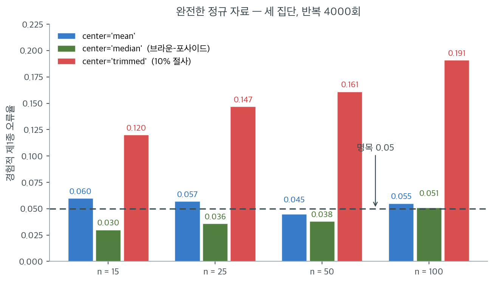
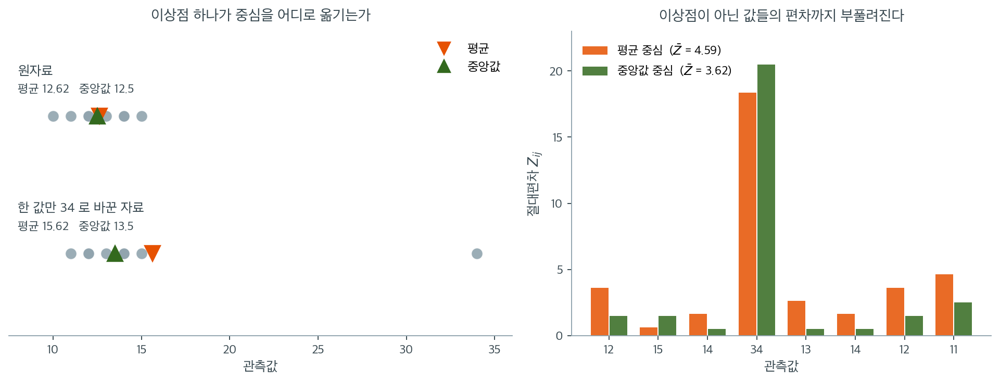

# Brown-Forsythe 검정

집단이 셋이고 둘째 집단의 관측값이 $5, 30, 18, 22, 15$ 다. 중앙값 $18$ 에서의 절대편차를 평균하면 $6.40$ 으로 다른 두 집단의 $1.20$, $1.00$ 보다 크니 산포가 다르다는 신호가 분명한데, **같은 자료에서 Bartlett 이 보는 신호는 $3.9061$ 이고 Brown-Forsythe 가 보는 신호는 $1.8563$ 이다.** 중심을 평균에서 중앙값으로 바꾸는 한 줄짜리 변경이 신호를 로그 눈금에서 절반으로 줄인다. 그 손실을 받아들이고도 이 변경이 권고되는 까닭이 이 쪽의 물음이다.

Levene 검정은 각 관측값을 집단평균으로부터의 절대편차로 바꾼 뒤 그 편차에 분산분석을 수행한다. Brown과 Forsythe(1974)는 단 하나이지만 영향력 있는 변경을 제안했다. 절대편차의 중심으로 집단평균 대신 집단 **중앙값**을 쓰는 것이다. 중앙값은 평균과 달리 극단값에 끌려가지 않으므로, 이 수정이 치우친 분포와 이상점에 대한 로버스트성을 크게 높인다.

---

## 1. Levene 검정으로부터의 수정

Levene의 원래 검정에서 변환된 관측값은

$$
Z_{ij}^{(\text{Levene})} = |X_{ij} - \bar{X}_i|
$$

Brown-Forsythe 검정에서는

$$
Z_{ij}^{(\text{BF})} = |X_{ij} - \tilde{X}_i|
$$

여기서 $\tilde{X}_i$는 집단 $i$의 중앙값이다. 검정통계량은 $Z_{ij}^{(\text{BF})}$ 값에 대해 계산한 표준 일원분산분석 $F$ 통계량이다.

$$
W^* = \frac{(N - k) \sum_{i=1}^{k} n_i (\bar{Z}_i^* - \bar{Z}^*)^2}{(k - 1) \sum_{i=1}^{k} \sum_{j=1}^{n_i} (Z_{ij}^* - \bar{Z}_i^*)^2}
$$

여기서 $Z_{ij}^* = Z_{ij}^{(\text{BF})}$이고 $\bar{Z}_i^*$는 집단 $i$의 변환값 평균, $\bar{Z}^*$는 전체평균이다.

$H_0\colon \sigma_1^2 = \cdots = \sigma_k^2$ 아래에서 $W^*$는 근사적으로 $F_{k-1, N-k}$를 따른다.


<div class="aibox" markdown>

**AI로 보는 통계학 1.** 분산 검정이 아니라 변환한 자료에 돌린 위치 검정이다

위 식을 다시 보자. $W^*$ 는 **변환값 $Z_{ij}^*$ 에 대한 표준 일원배치 $F$ 통계량**이라고
적혀 있다. 새 분포도, 새 표가 필요하지 않다 — 중앙값에서의 절대편차를 만들고 나면
그 뒤는 **평균을 견주는 보통의 분산분석**이다. 분산에 대한 물음을 평균에 대한 물음으로
바꾸는 변환 한 줄이 이 검정의 전부다.

그래서 이 검정은 **아무 분산분석 도구로도** 돌아간다. 전용 함수와 범용 $F$ 함수와
기계학습 꾸러미의 특징 선택 점수가 같은 수를 내는지 보자.

```python
import numpy as np
from scipy import stats
from sklearn.feature_selection import f_classif

rng = np.random.default_rng(15)
n, k = 25, 3
y = np.repeat(np.arange(k), n)
X = np.concatenate([rng.normal(0, s, n) for s in (1.0, 1.0, 2.0)])   # 셋째 집단만 분산이 넷 배

med = np.array([np.median(X[y == i]) for i in range(k)])
Z = np.abs(X - med[y])                                   # 브라운-포사이드의 변환

W_bf, p_bf = stats.levene(*(X[y == i] for i in range(k)), center="median")
F_anova, p_anova = stats.f_oneway(*(Z[y == i] for i in range(k)))
F_sk, p_sk = f_classif(Z[:, None], y)

print(f"levene(center='median')      W* = {W_bf:.6f}  p = {p_bf:.3e}")
print(f"f_oneway(변환값 Z)            F  = {F_anova:.6f}  p = {p_anova:.3e}")
print(f"f_classif(변환값 Z)           F  = {F_sk[0]:.6f}  p = {p_sk[0]:.3e}")
print()
# 변환값의 치우침 — F 가 가정하는 정규와 얼마나 다른가
print(f"원자료의 왜도 {stats.skew(X):+.4f}     변환값 Z 의 왜도 {stats.skew(Z):+.4f}")
```

출력:

```
levene(center='median')      W* = 9.630470  p = 1.967e-04
f_oneway(변환값 Z)            F  = 9.630470  p = 1.967e-04
f_classif(변환값 Z)           F  = 9.630470  p = 1.967e-04

원자료의 왜도 -0.2602     변환값 Z 의 왜도 +0.8621
```

셋이 소수 여섯 자리까지 같다. 특징 선택 점수에 절대편차를 넣으면 그것이 분산
동일성 검정이 된다 — 바꾼 것은 **들어가는 자료**뿐이다. 같은 $F$ 가 특징을 고르는
자리에서는 어떻게 쓰이는지는 15.3절
[F 분포와 자유도](../f_test/f_distribution_details.md) 에 있다.

마지막 줄이 이 검정의 값과 한계를 함께 말한다. **변환값의 왜도가 $+0.8621$ 이다.**
원자료는 정규라서 왜도가 $-0.26$ 인데, 절댓값을 취하면 $0$ 에서 잘려 오른쪽으로
치우친다. 그런데 뒤에 돌리는 $F$ 는 **정규**를 가정한다. 곧 이 검정은 정규성 가정을
자료에서 걷어 내는 대신 **변환값 쪽으로 옮겨 놓은 것**이고, 그래서 정확검정이 아니라
근사검정이다. $\S 4$ 가 그 근사가 실제로 얼마나 맞는지 수로 재어 둔 자리다.

</div>

---

## 2. 중앙값이 로버스트성을 높이는 이유

평균 $\bar{X}_i$는 이상점에 민감하다. 극단값 하나가 평균을 크게 이동시키고, 그러면 그 집단의 **모든** 관측값의 절대편차가 부풀려진다. 이 왜곡이 검정통계량으로 전파되어 거짓 기각을 일으킬 수 있다.

중앙값 $\tilde{X}_i$의 붕괴점(breakdown point)은 50%이다. 관측값의 절반까지 오염되어야 중앙값이 임의로 영향받는다는 뜻이다. 자료가 치우쳐 있을 때 중앙값은 평균보다 자료의 다수 쪽에 가까이 놓이므로, 다수 관측값의 산포를 더 충실히 반영하는 편차를 만들어 낸다.

!!! danger "SciPy의 `center='trimmed'`는 쓰지 말라"
    일부 Levene 검정 구현은 중심으로 평균, 중앙값, 10% 절사평균의 세 가지를 제공한다. 중앙값 판이 Brown-Forsythe 검정이다. 절사평균이 검정력(평균 쪽)과 로버스트성(중앙값 쪽) 사이의 절충이라고 소개되는 경우가 많다.

    그러나 **SciPy의 `stats.levene(..., center='trimmed')`는 제1종 오류율이 심각하게 부풀려진다.** 완전한 정규 자료에서 측정한 경험적 크기는 다음과 같다(세 집단, 반복 4,000회, 명목 $\alpha = 0.05$).

    | $n$ | `mean` | `median` | `trimmed` (10%) |
    |---|---|---|---|
    | 15 | 0.060 | 0.030 | **0.120** |
    | 25 | 0.057 | 0.036 | **0.147** |
    | 50 | 0.045 | 0.038 | **0.161** |
    | 100 | 0.055 | 0.051 | **0.191** |

    정규 자료인데도 절사판의 크기가 명목값의 2.4~3.8배이고 $n$이 커질수록 나빠진다. SciPy가 편차를 계산하기 전에 자료를 잘라내므로 가장 큰 편차들이 제거되어 F 통계량의 분모(집단내 제곱합)가 과도하게 줄어드는데, $F$ 표집분포는 이 선택 효과를 보정하지 않기 때문이다.

    **범용 기본값으로는 중앙값(`center='median'`)을 쓰라.**



표를 그림으로 옮기면 세 막대의 운명이 갈리는 것이 한눈에 들어온다. 파랑(평균)은 네 표본크기에서 $0.045 \sim 0.060$으로 명목선 주위를 맴돈다. 초록(중앙값)은 $0.030 \sim 0.051$로 명목선 **아래**에 머문다. 약간 보수적이라는 뜻이고, 그 대가로 검정력을 조금 내주지만 거짓 양성을 만들지는 않는다.

빨강(절사평균)은 완전히 다른 궤적을 그린다. $n = 15$에서 이미 $0.120$이고, 표본이 커질수록 $0.147 \to 0.161 \to 0.191$로 **올라간다.** 이것이 결정적인 단서다. 보통의 근사 오차라면 $n$이 커질수록 줄어들어야 한다. 커진다는 것은 오차가 아니라 **구조적 편향**이 있다는 뜻이다.

원인은 SciPy가 편차를 계산하기 **전에** 자료의 양 끝 10%를 잘라 버리는 데 있다. 잘려 나가는 것은 집단 중심에서 가장 먼 관측값들, 곧 가장 큰 절대편차를 만들었을 값들이다. 그러면 $F$ 통계량의 분모인 집단내 제곱합이 실제보다 작아지고, 분모가 작아지면 통계량이 커진다. 표집분포 $F_{k-1, N-k}$는 이 선택 효과를 전혀 모르므로 임계값이 너무 낮게 잡힌다. 표본이 클수록 잘려 나가는 관측값의 절대 개수가 늘어 편향이 더 심해진다.

**실무 규칙은 단순하다.** 이 자료가 완전한 정규분포였다는 점을 기억하라. 가장 유리한 조건에서도 명목값의 세 배로 기각하는 검정이라면, 조건이 나빠지는 실제 자료에서 쓸 이유가 없다. `stats.levene`의 기본값인 `center='median'`을 그대로 두는 것이 가장 안전하다.

---

## 3. 가설과 판정규칙

$$
H_0\colon \sigma_1^2 = \sigma_2^2 = \cdots = \sigma_k^2
$$

$$
H_1\colon \sigma_i^2 \neq \sigma_j^2 \text{ (적어도 한 쌍의)} i \neq j
$$

유의수준 $\alpha$에서 $W^* > F_{1-\alpha,\, k-1,\, N-k}$이면 $H_0$을 기각한다.

<div class="exbox" markdown>

**보기 1.** <span class="diff easy" title="쉬움"></span> 세 집단의 Brown-Forsythe 검정. 세 집단을 생각하자.

| 집단 1 | 집단 2 | 집단 3 |
|---|---|---|
| 8, 10, 12, 9, 11 | 5, 30, 18, 22, 15 | 14, 16, 15, 17, 14 |

</div>

??? success "풀이"
    **1단계.** 집단중앙값을 계산한다.

    - $\tilde{X}_1 = 10$, $\tilde{X}_2 = 18$, $\tilde{X}_3 = 15$

    **2단계.** 중앙값으로부터의 절대편차를 계산한다.

    | 집단 1 | 집단 2 | 집단 3 |
    |---|---|---|
    | 2, 0, 2, 1, 1 | 13, 12, 0, 4, 3 | 1, 1, 0, 2, 1 |

    **3단계.** 편차의 집단평균을 계산한다.

    - $\bar{Z}_1^* = 1.20$, $\bar{Z}_2^* = 6.40$, $\bar{Z}_3^* = 1.00$

    **4단계.** 전체평균은 $\bar{Z}^* = (1.20 + 6.40 + 1.00)/3 = 2.867$이다.

    **5단계.** 이 편차들에 분산분석 공식을 적용해 $W^*$를 계산하고 $F_{0.95,\, 2,\, 12} = 3.885$와 비교한다.

<div class="exbox" markdown>

**보기 2.** <span class="diff easy" title="쉬움"></span> Brown-Forsythe 검정과 세 방법 비교. 보기 1 의 세 집단에 중앙값 중심·평균 중심·Bartlett 을 모두 적용한다.

**(1)** 세 집단의 평균과 중앙값을 구해 **두 중심이 갈리는 집단이 하나뿐**임을 확인하고, 그로부터 두 Levene 판본의 $W$ 가 왜 소수 셋째 자리에서만 다를지 예측하시오. 모든 집단에서 두 중심이 같다면 두 $W$ 가 **정확히** 같아야 함도 보이시오.

**(2)** Bartlett 통계량을 **정의대로 손으로 조립**해 SciPy 와 맞추고, 그 $p$ 값이 로버스트 검정의 $p$ 값보다 백 배 작은 까닭을 두 통계량이 보는 **신호와 잡음**에서 찾으시오.

</div>

??? success "풀이"

    **(1) 두 중심이 갈리는 집단을 찾는다.** 손으로 더해 보면 된다.

    | 집단 | 자료 | 평균 | 중앙값 |
    |:---|:---|---:|---:|
    | 1 | $8, 10, 12, 9, 11$ | $50/5 = 10.0$ | $10$ |
    | 2 | $5, 30, 18, 22, 15$ | $90/5 = 18.0$ | $18$ |
    | 3 | $14, 16, 15, 17, 14$ | $76/5 = 15.2$ | $15$ |

    **집단 1 과 2 에서는 평균과 중앙값이 완전히 같고, 집단 3 에서만 $0.2$ 어긋난다.** 집단 1 은 $\{8,9,10,11,12\}$ 로 대칭이고, 집단 2 는 $5$ 와 $30$ 이 중앙값 $18$ 양쪽에서 $-13$ 과 $+12$ 로 거의 맞물려 상쇄된다. 집단 3 만 $14$ 가 두 번 나와 평균이 중앙값보다 조금 위로 올라간다.

    **그러므로 두 판본의 $Z$ 는 열다섯 개 가운데 다섯 개만, 그것도 $0.2$ 씩만 다르다.** 집단 1·2 의 열 개는 글자 그대로 같은 수다. 분자도 분모도 거의 같은 값으로 조립되니 $W$ 가 소수 셋째 자리에서만 갈릴 것이다.

    **모든 집단에서 두 중심이 같다면 정확히 같다.** 이것은 어림이 아니라 항등식이다. $\bar X_i = \tilde X_i$ 가 모든 $i$ 에서 성립하면

    $$
    Z_{ij}^{(\text{Levene})} = \lvert X_{ij} - \bar X_i\rvert = \lvert X_{ij} - \tilde X_i\rvert = Z_{ij}^{(\text{BF})}
    $$

    로 **입력 자료 자체가 같아진다.** 두 검정은 그 뒤로 똑같은 일원분산분석을 하므로 $W = W^*$ 다. 두 판본의 차이는 통계량의 꼴에 있지 않고 오직 **중심의 추정값에** 있다는 뜻이다.

    **(2) Bartlett 통계량의 꼴.** 합동분산을 $s_p^2 = \sum_i \nu_i s_i^2 / \sum_i \nu_i$ ($\nu_i = n_i - 1$) 이라 쓰면

    $$
    T = \frac{\bigl(\sum_i \nu_i\bigr)\ln s_p^2 - \sum_i \nu_i \ln s_i^2}{C},
    \qquad
    C = 1 + \frac{1}{3(k-1)}\left[\sum_i \frac{1}{\nu_i} - \frac{1}{\sum_i \nu_i}\right]
    $$

    이고 $H_0$ 아래에서 $T \;\dot\sim\; \chi^2_{k-1}$ 이다. 여기서 $\nu_i = 4$, $\sum \nu_i = 12$, $k = 3$ 이므로

    $$
    C = 1 + \frac{1}{6}\left[\frac34 - \frac1{12}\right] = 1 + \frac{1}{6}\cdot\frac23 = \frac{10}{9} = 1.111111
    $$

    이다. **$T$ 가 로그분산의 산포를 재고 있다는 것이 요점이다.** 산술평균의 로그와 로그의 가중평균의 차이이므로 산술–기하 평균 부등식에 의해 분자가 늘 음이 아니고, 분산들이 흩어질수록 커진다.

    **확인한다.**

    ```python
    import numpy as np
    from scipy import stats

    # 2번 집단만 유난히 퍼져 있다. 5 와 30 처럼 멀리 떨어진 값이 섞여 있어
    # 평균 중심 방법이 흔들리기 좋은 자료다.
    group1 = [8, 10, 12, 9, 11]
    group2 = [5, 30, 18, 22, 15]
    group3 = [14, 16, 15, 17, 14]

    print("variances:", [round(np.var(g, ddof=1), 2)
                         for g in (group1, group2, group3)])

    # (1) 어느 집단에서 평균과 중앙값이 갈리는가.
    print(f"\n{'집단':>5}{'평균':>9}{'중앙값':>9}{'차':>8}")
    for i, g in enumerate((group1, group2, group3), start=1):
        a = np.array(g, dtype=float)
        print(f"{i:>5}{a.mean():>9.2f}{np.median(a):>9.2f}{a.mean() - np.median(a):>8.2f}")

    # Brown-Forsythe 는 각 값에서 제 집단의 중앙값을 뺀 절대편차에 분산분석을
    # 돌린다. 중심을 평균이 아니라 중앙값으로 잡는 것이 전부인데, 그 한 가지
    # 차이로 치우친 자료와 이상치에 훨씬 잘 버틴다.
    stat, p_value = stats.levene(group1, group2, group3, center='median')
    print(f"\nBrown-Forsythe W*:      {stat:.4f}, p = {p_value:.4f}")

    # 원래 Levene 은 평균을 중심으로 쓴다. 이상치에 끌려간다.
    s_m, p_m = stats.levene(group1, group2, group3, center='mean')
    print(f"Levene (mean-centered): {s_m:.4f}, p = {p_m:.4f}")

    # Bartlett 은 정규성을 전제하므로 이런 자료에서 가장 많이 어긋난다.
    s_b, p_b = stats.bartlett(group1, group2, group3)
    print(f"Bartlett:               {s_b:.4f}, p = {p_b:.6f}")

    # 집단 3 의 다섯째 값만 14 -> 13 으로 바꾸면 세 집단 모두 평균 = 중앙값이 된다.
    group3b = [14, 16, 15, 17, 13]
    print(f"\n집단 3 을 {group3b} 로 바꾸면 "
          f"평균 {np.mean(group3b):.1f} = 중앙값 {np.median(group3b):.1f}")
    a = stats.levene(group1, group2, group3b, center='median')[0]
    b = stats.levene(group1, group2, group3b, center='mean')[0]
    print(f"  W*(중앙값) = {a:.12f}")
    print(f"  W (평균)   = {b:.12f}   차 = {abs(a - b):.2e}")

    # (2) Bartlett 통계량을 정의대로 조립한다.
    groups = [np.array(g, dtype=float) for g in (group1, group2, group3)]
    nu = np.array([len(g) - 1 for g in groups])
    s2 = np.array([g.var(ddof=1) for g in groups])
    N, k = sum(len(g) for g in groups), len(groups)
    sp2 = (nu * s2).sum() / nu.sum()
    num = nu.sum() * np.log(sp2) - (nu * np.log(s2)).sum()
    C = 1 + ((1 / nu).sum() - 1 / nu.sum()) / (3 * (k - 1))
    print(f"\n합동분산 s_p^2 = {sp2:.6f}")
    print(f"분자 = {nu.sum()} * ln(s_p^2) - sum nu_i ln(s_i^2) = {num:.6f}")
    print(f"보정계수 C = {C:.6f}")
    print(f"T = {num:.6f} / {C:.6f} = {num / C:.6f}   (scipy {s_b:.6f}, 차 {abs(num / C - s_b):.1e})")
    print(f"p = chi2(2).sf(T) = {stats.chi2(k - 1).sf(num / C):.6e}")

    # 두 검정이 보는 '신호'의 척도가 다르다.
    Z = [np.abs(g - np.median(g)) for g in groups]
    zbar = np.array([z.mean() for z in Z])
    print(f"\n표본분산        {np.round(s2, 2)}   최대/최소 = {s2.max() / s2.min():.2f}")
    print(f"Zbar (중앙값)   {np.round(zbar, 2)}   최대/최소 = {zbar.max() / zbar.min():.2f}")
    print(f"  로그 폭:  ln(분산비) = {np.log(s2.max() / s2.min()):.4f},  "
          f"ln(Zbar 비) = {np.log(zbar.max() / zbar.min()):.4f}")
    print(f"  sqrt(분산비) = {np.sqrt(s2.max() / s2.min()):.4f}  (Zbar 비 {zbar.max() / zbar.min():.4f} 과 견주라)")
    ss_w = sum(((z - z.mean()) ** 2).sum() for z in Z)
    print(f"\nBF 의 분모 SS_within(Z) = {ss_w:.3f}  "
          f"(집단별 {[round(((z - z.mean()) ** 2).sum(), 2) for z in Z]})")
    n_i = np.array([len(z) for z in Z])
    grand = np.concatenate(Z).mean()
    ss_b = (n_i * (zbar - grand) ** 2).sum()
    print(f"BF 의 분자 SS_between(Z) = {ss_b:.4f}  ->  W* = 12*{ss_b:.4f}/(2*{ss_w:.1f}) = {12 * ss_b / (2 * ss_w):.4f}")
    print(f"집단 2 가 분모에서 차지하는 몫 = {((Z[1] - Z[1].mean()) ** 2).sum() / ss_w:.4f}")
    print(f"F(0.95; 2, 12) = {stats.f(2, 12).ppf(0.95):.4f}")
    ```

    출력:

    ```text
    variances: [2.5, 84.5, 1.7]

       집단       평균      중앙값       차
        1    10.00    10.00    0.00
        2    18.00    18.00    0.00
        3    15.20    15.00    0.20

    Brown-Forsythe W*:      4.0754, p = 0.0446
    Levene (mean-centered): 4.0610, p = 0.0450
    Bartlett:               15.3946, p = 0.000454

    집단 3 을 [14, 16, 15, 17, 13] 로 바꾸면 평균 15.0 = 중앙값 15.0
      W*(중앙값) = 3.896253602305
      W (평균)   = 3.896253602305   차 = 0.00e+00

    합동분산 s_p^2 = 29.566667
    분자 = 12 * ln(s_p^2) - sum nu_i ln(s_i^2) = 17.105089
    보정계수 C = 1.111111
    T = 17.105089 / 1.111111 = 15.394580   (scipy 15.394580, 차 0.0e+00)
    p = chi2(2).sf(T) = 4.540560e-04

    표본분산        [ 2.5 84.5  1.7]   최대/최소 = 49.71
    Zbar (중앙값)   [1.2 6.4 1. ]   최대/최소 = 6.40
      로그 폭:  ln(분산비) = 3.9061,  ln(Zbar 비) = 1.8563
      sqrt(분산비) = 7.0502  (Zbar 비 6.4000 과 견주라)

    BF 의 분모 SS_within(Z) = 138.000  (집단별 [2.8, 133.2, 2.0])
    BF 의 분자 SS_between(Z) = 93.7333  ->  W* = 12*93.7333/(2*138.0) = 4.0754
    집단 2 가 분모에서 차지하는 몫 = 0.9652
    F(0.95; 2, 12) = 3.8853
    ```

    **(1)의 두 주장이 모두 맞는다.** 집단 3 만 $0.2$ 어긋나고, 그 결과 $W^* = 4.0754$ 와 $W = 4.0610$ 이 소수 셋째 자리에서 갈린다($p$ 는 $0.0446$ 대 $0.0450$). 그리고 집단 3 의 다섯째 값만 $14$ 에서 $13$ 으로 바꾸어 세 집단 모두 평균과 중앙값을 맞추면 두 통계량이 $3.896253602305$ 로 **소수 열두째 자리까지 같다.** 차가 `0.00e+00` 이니 같은 자료에 같은 계산을 한 것이다.

    **손으로 조립한 Bartlett 이 SciPy 와 정확히 맞는다.** $s_p^2 = 29.566667$, 분자 $17.105089$, $C = 10/9$, $T = 15.394580$ 이고 차가 `0.0e+00` 이다. $p = 4.54\times10^{-4}$ 도 재현된다.

    **왜 Bartlett 의 $p$ 가 백 배 작은가.** 두 가지가 겹친다.

    *첫째, 신호의 척도가 다르다.* Bartlett 이 보는 양은 로그분산의 산포이고, 최대·최소 분산비가 $49.71$ 이므로 $\ln 49.71 = 3.906$ 만큼 벌어져 있다. Brown-Forsythe 가 보는 양은 $\bar Z_i$ 의 산포인데, $\bar Z$ 는 $\sigma$ 에 비례하는 양이므로 같은 상황이 **제곱근 척도**로 눌려 $\ln 6.40 = 1.856$ 밖에 안 된다. **로그 눈금에서 신호가 절반으로 줄어든다.** 참고로 $\sqrt{49.71} = 7.05$ 인데 관측된 $\bar Z$ 비는 $6.40$ 이다. 둘이 완전히 같지 않은 것은 $E[\bar Z] = \sigma\sqrt{2/\pi}$ 라는 비례가 **정규모집단에서만** 성립하기 때문이고, 집단 2 는 $5$ 와 $30$ 이 끌어당기는 정규와 거리가 먼 자료다.

    *둘째, 분모가 스스로를 무디게 한다.* Brown-Forsythe 의 분모 $\mathrm{SS}_{\text{within}}(Z) = 138.0$ 가운데 **$133.2$, 곧 $96.5\%$ 가 집단 2 혼자서 낸다.** 집단 2 의 중앙값 편차가 $(13, 12, 0, 4, 3)$ 으로 그 자체가 크게 흩어져 있기 때문이다. **분산이 크다고 말하려는 집단이 바로 그 주장을 가릴 잡음까지 공급한다.** Bartlett 의 표집분포 $\chi^2_2$ 에는 이런 자료에서 추정한 분모가 없다. 정규성을 가정하는 대가로 분모의 흔들림을 이론으로 대체해 버린 것이다.

    그래서 $W^* = 4.0754$ 가 임계값 $F_{0.95;\,2,\,12} = 3.8853$ 을 간신히 넘고, Bartlett 은 $\chi^2_{0.95,2} = 5.99$ 를 두 배 반 넘게 넘는다. **같은 자료가 한쪽에서는 "겨우 유의", 다른 쪽에서는 "압도적 유의"가 된다.**

    믿을 수 있는가는 다른 문제다. 집단 2 의 표본분산 $84.5$ 는 $5$ 와 $30$ 두 값이 만든 것이고, 그런 자료에 정규성을 가정한 $\chi^2$ 표집분포를 들이대는 것이 Bartlett 이 하는 일이다. **$p = 0.00045$ 라는 자릿수는 정규성이 참일 때만 그 자릿수다.** 15.4절이 측정한 대로 Bartlett 은 꼬리가 무거운 자료에서 등분산인데도 기각하며, 로그정규에서 크기 $0.677$ 이 관측된 적이 있다. 이 자료가 그만큼 나쁜지는 $n_i = 5$ 로 판정할 길이 없다.

!!! note "이 보기에서는 중앙값과 평균의 차이가 없다"
    집단 2의 중앙값과 평균이 모두 **18**로 우연히 일치한다($\{5,15,18,22,30\}$의 평균 = $90/5$ = 18). 그래서 Brown-Forsythe($4.0754$)와 Levene($4.0610$)의 결과가 사실상 같다. 이 자료는 중앙값 중심화의 이점을 보여주지 못한다. 이점이 실제로 드러나는 상황은 연습문제 2에서 다룬다.

    한편 **Bartlett은 $p = 0.00045$로 로버스트 검정들의 $p = 0.045$보다 100배 작다.** 집단 2의 표본분산이 $84.5$로 다른 집단의 $2.5$, $1.7$보다 30~50배나 크기 때문이다. 이렇게 이탈이 극단적일 때는 Bartlett의 높은 검정력이 드러난다. 다만 그 검정력은 정규성 가정에 기대고 있으며, 여기서 집단 2는 이상점 하나가 지배하고 있어 정규성이 의심스럽다.

---

## 4. 성능 특성

Brown-Forsythe 검정은 모의실험으로 광범위하게 연구되었다.

- **제1종 오류 조절.** 치우쳤거나 꼬리가 두꺼운 모집단을 포함해 넓은 범위의 분포에서 실제 기각률이 명목 $\alpha$에 가깝게 유지된다.
- **정규성 아래 검정력.** 자료가 정말로 정규일 때 Bartlett 검정이나 원래의 Levene 검정보다 검정력이 약간 낮다. 15.4절 [Bartlett 검정](../bartlett_test/bartlett_test.md) 연습문제 3의 모의실험에서 손실은 대체로 10~25%였다.
- **비정규성 아래 검정력.** 자료가 비정규여도 분산 차이를 탐지하는 검정력이 잘 유지된다. 분포 모양이 일으키는 거짓 경보에 검정력을 낭비하지 않기 때문이다.

---

## 5. Brown-Forsythe 검정을 쓸 때

Brown-Forsythe 검정은 대부분의 실무 상황에서 분산의 동질성을 검정하는 권장 기본값이다.

- **분산분석 전의 사전검정**으로서 모집단 모양과 무관하게 신뢰할 만한 분산 진단을 제공한다.
- **분포를 모를 때** 이 장의 검정 가운데 로버스트성과 검정력의 균형이 가장 좋다.
- **자료에 이상점이 있을 때** 중앙값 기반 편차가 거짓 기각을 막는다.

다른 검정이 더 나은 유일한 경우는 정규성이 확인되었고 최대 검정력이 필요할 때이다. 그 경우에는 Bartlett 검정이 가장 강력한 선택이다.

---

## 6. 왜 중앙값인가

원래의 Levene 검정은 중심화에 집단 **평균**을 쓴다($z_{ij} = |x_{ij} - \bar{x}_i|$). Brown과 Forsythe(1974)는 평균을 중앙값으로 바꾸면 다음과 같은 검정이 됨을 보였다.

- 치우쳤거나 꼬리가 두꺼운 분포에서 올바른 제1종 오류율을 유지한다.
- 정규성 아래에서 Levene 검정에 견줄 만한 검정력을 갖는다.
- 중앙값이 위치의 로버스트 추정량이므로 이상점의 영향을 덜 받는다.

세 번째 항목이 왜 중요한지는 기계적으로 따라가 보면 분명하다. 아래 보기의 첫 집단 `g1 = [12, 15, 14, 10, 13, 14, 12, 11]`에서 값 하나만 $10 \to 34$로 바꾸어 보자.



왼쪽에서 두 중심의 반응이 갈린다. 평균은 $12.62$에서 $15.62$로 **3만큼** 끌려가 원자료 여덟 개 중 여섯 개보다 오른쪽에 자리 잡는다. 더 이상 이 자료의 중심이 아니다. 중앙값은 $12.5$에서 $13.5$로 한 칸 움직였을 뿐이다. 중앙값이 옮겨 가려면 순서상 이웃한 값까지만 가면 되기 때문이며, 이것이 붕괴점 50%의 실제 모습이다.

오른쪽이 그 결과다. 이상점 하나 때문에 중심이 3만큼 밀리면, **이상점이 아닌 나머지 일곱 값의 절대편차까지 전부 달라진다.** 값 13의 편차는 중앙값 기준 $0.5$인데 평균 기준으로는 $2.62$다. 값 11은 $2.5$ 대 $4.62$다. 오염된 관측값은 하나인데 오염된 편차는 여덟 개가 되는 셈이다.

이 전파가 검정 결과를 바꾼다. 세 집단에 대해 실제로 돌려 보면 오염 전에는 평균 중심 $p = 0.3444$, 중앙값 중심 $p = 0.3489$로 사실상 같다. 오염 후에는 평균 중심이 $p = 0.1593$으로 절반 이하로 떨어지는데 중앙값 중심은 $p = 0.5276$으로 오히려 올라간다. **평균 중심 판은 "집단 1의 산포가 크다"는 쪽으로 끌려가고, 중앙값 중심 판은 흔들리지 않는다.**

한 가지 덧붙일 것이 있다. 중앙값 중심에서 이상점 **자신의** 편차는 $20.5$로 평균 중심의 $18.38$보다 오히려 크다. 브라운–포사이드가 이상점을 무시하는 것이 아니라, 이상점의 영향을 **그 한 점에 가두어** 나머지 관측값이 오염되지 않게 한다는 뜻이다.

---

SciPy에서는 함수 호출 한 번으로 끝난다.

<div class="exbox" markdown>

**보기 3.** <span class="diff easy" title="쉬움"></span> 중앙값 중심과 평균 중심. 집단당 $n = 8$, 세 집단의 위치는 크게 다르고 퍼짐은 비슷한 자료다.

**(1)** $g_3$ 가 $g_1$ 의 **평행이동**임을 확인하고, 그로부터 $W$ 가 네 수 $\bar z_1, \bar z_2, S_1, S_2$ 로만 적히는 닫힌 꼴임을 유도하시오. 여기서 $S_i = \sum_j (z_{ij} - \bar z_i)^2$ 이다.

**(2)** 두 판본에서 **분자가 정확히 같고 분모만 다름**을 보이고 그 까닭을 밝히시오. 두 $W$ 의 비를 분모만으로 예측하고 확인하시오.

</div>

??? success "풀이"

    **(1) $g_3 = g_1 + 20$ 이다.** 여덟 쌍을 하나씩 빼 보면 전부 $20$ 이다. 평행이동은 중심(평균이든 중앙값이든)도 같이 $20$ 만큼 옮기므로 **절대편차가 글자 그대로 같아진다.**

    $$
    z_{3j} = \lvert (x_{1j}+20) - (c_1 + 20)\rvert = \lvert x_{1j} - c_1\rvert = z_{1j}
    $$

    그러므로 $\bar z_3 = \bar z_1$, $S_3 = S_1$ 이고, **세 집단 문제가 두 집단의 정보로 줄어든다.**

    **닫힌 꼴.** $\bar z_1 = \bar z_3 = a$, $\bar z_2 = b$, $n_i = 8$, $N = 24$, $k = 3$ 이라 쓰자. 전체평균이 $\bar z = (2a+b)/3$ 이므로 세 집단의 편차가

    $$
    a - \bar z = \frac{a-b}{3}\;(\text{두 번}), \qquad b - \bar z = \frac{2(b-a)}{3}
    $$

    이고 집단간 제곱합은

    $$
    \mathrm{SS}_{\text{between}} = 8\left[2\cdot\frac{(a-b)^2}{9} + \frac{4(a-b)^2}{9}\right] = 8(a-b)^2\cdot\frac69 = \frac{16}{3}(a-b)^2
    $$

    이다. 집단내 제곱합은 $S_1 + S_2 + S_3 = 2S_1 + S_2$ 이므로

    $$
    W = \frac{(N-k)\,\mathrm{SS}_{\text{between}}}{(k-1)\,\mathrm{SS}_{\text{within}}}
    = \frac{21 \cdot \frac{16}{3}(a-b)^2}{2\,(2S_1+S_2)}
    = \frac{56\,(a-b)^2}{2S_1 + S_2}
    $$

    를 얻는다. **네 수만 알면 $W$ 가 정해진다.**

    **(2) 분자가 왜 같은가.** 분자는 $a$ 와 $b$ 로만 만들어지므로, 두 중심에서 $a$ 와 $b$ 가 같으면 분자도 같다. 두 가지 우연이 겹쳐 그렇게 된다.

    *$b$ 가 같은 까닭.* $g_2$ 를 정렬하면 $18, 19, \ldots, 25$ 로 연속한 여덟 정수라 **평균과 중앙값이 둘 다 $21.5$** 다. 중심이 같으니 $z_{2j}$ 자체가 같고 $b$ 도 $S_2$ 도 같다.

    *$a$ 가 같은 까닭.* 이쪽은 더 섬세하다. $g_1$ 의 중앙값은 $12.5$, 평균은 $12.625$ 로 **다르다.** 그런데 $g(c) = \sum_j \lvert x_{1j} - c\rvert$ 는 볼록·조각선형이고 $n$ 이 짝수이므로 최소점이 한 점이 아니라 구간 $[x_{(4)}, x_{(5)}] = [12, 13]$ 이다(2.4절 [평균, 중앙값, 최빈값](../../ch02/center/mean_median_mode.md) 정리 2, 그리고 이 쪽 연습문제 16 이 조각선형성으로 다시 유도한다). **평균 $12.625$ 가 그 구간 안에 든다.** 그러므로

    $$
    \sum_j \lvert x_{1j} - 12.5\rvert = \sum_j \lvert x_{1j} - 12.625\rvert = 11
    $$

    이고 $a = 11/8 = 1.375$ 가 두 중심에서 같다. 개별 $z_{1j}$ 는 다른데 **합이 같다.**

    **그러므로 차이는 분모에만 남는다.** $S_1$ 은 $z_{1j}$ 의 산포이므로 개별 값이 바뀌면 달라진다. 두 $W$ 의 비는

    $$
    \frac{W_{\text{평균}}}{W_{\text{중앙값}}} = \frac{2S_1^{(\text{중앙값})} + S_2}{2S_1^{(\text{평균})} + S_2}
    $$

    로 **분모만의 비**가 된다.

    **확인한다.**

    ```python
    import numpy as np
    from scipy.stats import levene

    # 세 집단의 평균은 크게 다르지만 퍼짐은 거의 같다.
    g1 = np.array([12, 15, 14, 10, 13, 14, 12, 11], dtype=float)
    g2 = np.array([22, 25, 20, 18, 24, 23, 19, 21], dtype=float)
    g3 = np.array([32, 35, 34, 30, 33, 34, 32, 31], dtype=float)

    print("variances:", [round(np.var(g, ddof=1), 4) for g in (g1, g2, g3)])

    # scipy 에는 brown_forsythe 라는 함수가 따로 없다. levene 에
    # center='median' 을 주는 것이 곧 Brown-Forsythe 이고, 이것이 기본값이다.
    W, p = levene(g1, g2, g3, center='median')
    print(f"Brown-Forsythe W = {W:.6f}, p-value = {p:.6f}")

    W_mean, p_mean = levene(g1, g2, g3, center='mean')
    print(f"Levene (mean)  W = {W_mean:.6f}, p-value = {p_mean:.6f}")

    # (1) g3 가 g1 의 평행이동인가.
    print(f"\ng3 - g1 = {g3 - g1}   ->  g3 = g1 + {int((g3 - g1)[0])} 인가: "
          f"{np.all(g3 - g1 == 20)}")

    # (1)(2) 닫힌 꼴 W = 56 (zbar1 - zbar2)^2 / (2 S1 + S2) 를 두 중심에서 조립한다.
    print(f"\n{'중심':>7}{'zbar1':>9}{'zbar2':>9}{'S1':>9}{'S2':>9}"
          f"{'분자 56(dz)^2':>15}{'분모 2S1+S2':>13}{'W':>11}")
    for name, c in [("median", np.median), ("mean", np.mean)]:
        z1, z2, z3 = (np.abs(g - c(g)) for g in (g1, g2, g3))
        assert np.array_equal(z1, z3)          # g3 = g1 + 20 이므로 편차가 같다
        a, b = z1.mean(), z2.mean()
        S1 = ((z1 - a) ** 2).sum()
        S2 = ((z2 - b) ** 2).sum()
        num, den = 56 * (a - b) ** 2, 2 * S1 + S2
        print(f"{name:>7}{a:>9.4f}{b:>9.4f}{S1:>9.4f}{S2:>9.4f}"
              f"{num:>15.5f}{den:>13.4f}{num / den:>11.6f}")

    # 왜 zbar1 이 두 중심에서 같은가. 중앙값이 sum|y-c| 를 최소화하는 구간을 본다.
    s = np.sort(g1)
    print(f"\ng1 정렬 = {s}")
    print(f"  중앙값 = {np.median(g1):.3f},  평균 = {g1.mean():.3f}")
    print(f"  최소화 구간 [x_(4), x_(5)] = [{s[3]:.0f}, {s[4]:.0f}] 에 평균이 드는가: "
          f"{s[3] <= g1.mean() <= s[4]}")
    for c in (s[3], np.median(g1), g1.mean(), s[4]):
        print(f"    c = {c:7.3f}  ->  sum|g1 - c| = {np.abs(g1 - c).sum():.6f}")
    print(f"\ng2 의 평균 {g2.mean():.3f} = 중앙값 {np.median(g2):.3f} 인가: "
          f"{g2.mean() == np.median(g2)}")

    # (2) 분자가 같으니 두 W 의 비는 분모의 비와 같아야 한다.
    print(f"\nW(mean)/W(median) = {W_mean / W:.6f}")
    print(f"분모의 비 19.75/19.50 = {19.75 / 19.50:.6f}")
    ```

    출력:

    ```text
    variances: [2.8393, 6.0, 2.8393]
    Brown-Forsythe W = 1.107595, p-value = 0.348894
    Levene (mean)  W = 1.121795, p-value = 0.344444

    g3 - g1 = [20. 20. 20. 20. 20. 20. 20. 20.]   ->  g3 = g1 + 20 인가: True

         중심    zbar1    zbar2       S1       S2    분자 56(dz)^2    분모 2S1+S2          W
     median   1.3750   2.0000   4.8750  10.0000       21.87500      19.7500   1.107595
       mean   1.3750   2.0000   4.7500  10.0000       21.87500      19.5000   1.121795

    g1 정렬 = [10. 11. 12. 12. 13. 14. 14. 15.]
      중앙값 = 12.500,  평균 = 12.625
      최소화 구간 [x_(4), x_(5)] = [12, 13] 에 평균이 드는가: True
        c =  12.000  ->  sum|g1 - c| = 11.000000
        c =  12.500  ->  sum|g1 - c| = 11.000000
        c =  12.625  ->  sum|g1 - c| = 11.000000
        c =  13.000  ->  sum|g1 - c| = 11.000000

    g2 의 평균 21.500 = 중앙값 21.500 인가: True

    W(mean)/W(median) = 1.012821
    분모의 비 19.75/19.50 = 1.012821
    ```

    **닫힌 꼴이 SciPy 와 소수 여섯째 자리까지 맞는다.** 네 수 $(a, b, S_1, S_2)$ 만으로 조립한 $W$ 가 중앙값 쪽 $1.107595$, 평균 쪽 $1.121795$ 로 `levene` 의 값과 같다. 손으로 따라가면

    $$
    W_{\text{중앙값}} = \frac{56\,(1.375 - 2.0)^2}{2(4.875)+10} = \frac{21.875}{19.75} = 1.107595
    $$

    이다. `assert np.array_equal(z1, z3)` 가 통과한 것이 $g_3 = g_1 + 20$ 의 결과를 확인해 준다.

    **(2)의 예측이 모두 맞는다.** 분자가 두 중심에서 $21.87500$ 으로 **완전히 같고**, $S_2 = 10.0000$ 도 같다. 달라진 것은 $S_1$ 하나, $4.8750$ 대 $4.7500$ 뿐이다. 그래서 분모가 $19.75$ 대 $19.50$ 이 되고 $W$ 의 비가 $1.012821$, 분모의 비 $19.75/19.50 = 1.012821$ 과 소수 여섯째 자리까지 같다.

    **$\sum_j \lvert g_1 - c\rvert$ 가 네 점에서 모두 정확히 $11$ 이라는 줄이 (2)의 핵심이다.** $c = 12,\ 12.5,\ 12.625,\ 13$ 어디서 재도 같다. 짝수 표본에서 최소점이 구간이라는 사실이 눈에 보이는 꼴이며, 평균이 그 구간 안에 들어 있었다는 우연 덕분에 분자가 보존되었다. **평균이 $[12, 13]$ 밖으로 나가면 $a$ 가 커지고 분자까지 달라진다.**

    **$S_1$ 쪽이 중앙값에서 더 크다는 것도 눈여겨볼 만하다.** $4.875 > 4.750$ 이다. 중앙값은 $z$ 의 **합**을 최소화하지만 $z$ 의 **산포**는 최소화하지 않으며, 여기서는 오히려 키웠다. 그 결과 중앙값 판의 $W$ 가 더 작고 $p$ 값이 더 크다($0.348894$ 대 $0.344444$). 로버스트성의 대가인 검정력 손실이 이 자료에서는 $p$ 값 소수 셋째 자리만큼이다.

---

## 7. W 가 크면 분산이 모두 같지는 않다

- $W$ 통계량이 크면($p$값이 작으면) $H_0$을 기각하고 집단분산이 모두 같지는 않다고 결론짓는다.
- 이 세 집단은 주로 위치가 다르고 산포는 비슷하므로 $W$가 작고 $p$가 크게 나온다. 등분산을 기각하지 못한다.
- 자료의 정규성이 불확실할 때 등분산성 검정의 권장 기본값이 Brown-Forsythe 검정이다.

표본분산이 $2.84$, $6.00$, $2.84$로 최대·최소 비가 $2.1$인데도 유의하지 않다. 각 집단 $n = 8$로는 검정력이 매우 낮기 때문이다.

---

## 연습문제

<div class="drillbox" markdown>

**연습문제 1.** <span class="diff med" title="중간"></span>
Brown-Forsythe 검정의 크기가 여러 분포에서 안정적인지 모의실험으로 확인하고, 평균 중심 Levene과 비교하라.

</div>

??? success "풀이"

    ```python
    import numpy as np
    from scipy import stats

    rng = np.random.default_rng(4)
    R, n = 5000, 25

    cases = [
        ("Normal",         lambda: rng.normal(0, 1, n)),
        ("Lognormal(0,1)", lambda: rng.lognormal(0, 1, n)),
        ("t(3)",           lambda: rng.standard_t(3, n)),
    ]

    for name, gen in cases:
        c_mean = c_med = 0
        for _ in range(R):
            g = [gen() for _ in range(3)]
            c_mean += stats.levene(*g, center='mean')[1] < 0.05
            c_med += stats.levene(*g, center='median')[1] < 0.05
        print(f"{name:>16}: mean-centered {c_mean/R:.4f}, "
              f"median-centered {c_med/R:.4f}")
    ```

    출력:

    ```text
              Normal: mean-centered 0.0592, median-centered 0.0418
      Lognormal(0,1): mean-centered 0.2658, median-centered 0.0376
                t(3): mean-centered 0.0622, median-centered 0.0402
    ```

    | 분포 | Levene (평균) | Brown-Forsythe (중앙값) |
    |---|---|---|
    | $\mathcal{N}(0,1)$ | 0.059 | 0.042 |
    | $\text{Lognormal}(0,1)$ | **0.266** | 0.038 |
    | $t_3$ | 0.067 | 0.045 |

    **강하게 치우친 대수정규 자료에서 차이가 극적이다.** 평균 중심 Levene의 크기가 $0.266$으로 명목값의 다섯 배가 넘는 반면 Brown-Forsythe는 $0.038$로 안정적이다.

    이유는 명확하다. $\text{Lognormal}(0,1)$은 왜도가 $6.185$로 극단적이라 평균이 분포의 중심을 대표하지 못한다. 표본마다 평균의 위치가 크게 흔들리고, 그 흔들림이 절대편차 전체에 전파된다.

    $t_3$처럼 대칭이지만 꼬리가 두꺼운 분포에서는 두 방식의 차이가 작다($0.067$ 대 $0.045$). **평균 중심화의 문제는 첨도가 아니라 치우침에서 온다**는 점을 확인해 준다.

    Brown-Forsythe가 세 분포 모두에서 $0.038$~$0.045$로 명목값보다 약간 보수적이라는 점도 눈여겨볼 만하다. 완벽하지는 않지만 왜곡의 크기가 실무적으로 무시할 수준이다. $\square$

<div class="drillbox" markdown>

**연습문제 2.** <span class="diff med" title="중간"></span>
중앙값 중심화가 실제로 유리한 자료를 구성하라. 이상점 하나가 집단평균을 끌어당기는 상황에서 두 검정의 결과를 비교하라.

</div>

??? success "풀이"
    본문 보기에서는 집단 2의 평균과 중앙값이 우연히 같아 차이가 드러나지 않았다. 이상점을 한쪽으로 더 밀어 보자.

    ```python
    import numpy as np
    from scipy import stats

    # 2집단에는 극단값이 하나 있어 평균이 나머지 무리에서 멀리 끌려간다
    g1 = [10, 11, 12, 13, 14, 11, 12]
    g2 = [10, 11, 12, 13, 14, 11, 60]   # 60 is the outlier
    g3 = [10, 11, 12, 13, 14, 11, 12]

    for g in (g1, g2, g3):
        print(f"mean = {np.mean(g):7.3f}, median = {np.median(g):5.1f}, "
              f"var = {np.var(g, ddof=1):8.2f}")

    print(f"\nLevene (mean):   p = {stats.levene(g1, g2, g3, center='mean')[1]:.4f}")
    print(f"Brown-Forsythe:  p = {stats.levene(g1, g2, g3, center='median')[1]:.4f}")
    print(f"Bartlett:        p = {stats.bartlett(g1, g2, g3)[1]:.4g}")
    ```

    출력:

    ```text
    mean =  11.857, median =  12.0, var =     1.81
    mean =  18.714, median =  12.0, var =   333.24
    mean =  11.857, median =  12.0, var =     1.81

    Levene (mean):   p = 0.0224
    Brown-Forsythe:  p = 0.3723
    Bartlett:        p = 2.018e-09
    ```

    집단 2의 평균은 이상점 60에 끌려 $18.71$까지 올라가지만 중앙값은 $12$로 다른 두 집단과 같다.

    - **평균 중심 Levene:** 집단 2의 모든 관측값이 부풀려진 평균 $18.71$에서 멀어지므로 편차가 전반적으로 커진다. 이상점 하나가 **일곱 개 편차 모두**를 오염시킨다. 그 결과 $p = 0.022$로 기각한다.
    - **Brown-Forsythe:** 중앙값 $12$가 이상점의 영향을 받지 않으므로 정상 관측값 여섯 개의 편차는 다른 집단과 동일하고, 이상점 하나만 큰 편차 $48$을 낸다. 편차 하나만 다르므로 $p = 0.372$로 **기각하지 못한다**.
    - **Bartlett:** $p = 2 \times 10^{-9}$로 압도적으로 기각한다. 제곱편차를 쓰므로 $48^2 = 2304$가 통계량을 지배한다.

    **여기서 어느 쪽이 옳은가?** 답은 이상점 60을 어떻게 보느냐에 달려 있다.

    - 60이 **자료 입력 오류**라면 집단 2의 참 산포는 다른 집단과 같으므로 Brown-Forsythe가 옳다.
    - 60이 **진짜 관측값**이라면 집단 2는 실제로 산포가 훨씬 크므로 Bartlett이 옳다.

    통계 절차만으로는 이 질문에 답할 수 없다. 이것이 Brown-Forsythe의 로버스트성이 갖는 **대가**이다. 이상점의 오염 효과를 막아 주는 대신, 이상점이 실제 산포 증가를 나타낼 때 그것을 놓칠 수 있다.

    이 예에서 중앙값 중심화의 이점이 뚜렷하게 드러나는 것은 **오염의 범위**이다. 평균 중심화는 이상점 하나의 영향을 집단 전체로 퍼뜨리고, 중앙값 중심화는 이상점 자신에게 가둔다. 이 차이가 결정적으로 중요해지는 것은 연습문제 1의 대수정규 상황처럼 **모든 집단이 치우쳐 있어 모든 평균이 함께 흔들릴 때**이다. 그때 평균 중심화는 거짓 기각을 대량으로 만들어 낸다. $\square$

<div class="drillbox" markdown>

**연습문제 3.** <span class="diff med" title="중간"></span>
중앙값의 붕괴점이 50%임을 설명하고, 평균의 붕괴점과 비교하라. 이것이 Brown-Forsythe 검정의 로버스트성과 어떻게 연결되는가?

</div>

??? success "풀이"
    **붕괴점의 정의.** 추정량의 붕괴점은 그 추정량을 임의로 크게(또는 작게) 만들기 위해 오염시켜야 하는 관측값의 최소 비율이다.

    **평균의 붕괴점은 $1/n \to 0$이다.** $n$개 관측값 중 **단 하나**를 $\infty$로 보내면 평균도 $\infty$가 된다.

    $$
    \bar{X} = \frac{1}{n}\left(\sum_{i=1}^{n-1} X_i + X_n\right) \to \infty \quad (X_n \to \infty).
    $$

    **중앙값의 붕괴점은 50%이다.** $n$이 홀수일 때 중앙값은 $\lceil n/2 \rceil$번째 순서통계량이다. 관측값의 절반 미만을 $\infty$로 보내면 그 값들은 정렬 후 위쪽에 모이고 중앙 위치는 여전히 오염되지 않은 관측값이 차지한다. 절반 이상을 오염시켜야 중앙 위치가 오염된 값으로 넘어간다.

    | 추정량 | 붕괴점 |
    |---|---|
    | 평균 | $1/n$ |
    | 10% 절사평균 | 0.10 |
    | 중앙값 | 0.50 |

    **Brown-Forsythe와의 연결.** Levene 계열 검정의 첫 단계는 각 집단의 중심을 추정하는 것이다. 이 중심 추정이 오염되면 그 집단의 **모든** 절대편차가 오염되고, 검정통계량 전체가 왜곡된다.

    평균을 쓰면 붕괴점이 $1/n$이므로 집단당 이상점 하나로 검정이 무너질 수 있다. 중앙값을 쓰면 집단의 절반이 오염되어야 하므로 사실상 안전하다.

    **미묘한 점.** 여기서 중요한 것은 중심 추정의 로버스트성이지 검정 전체의 로버스트성이 아니다. 분산 자체를 재는 데는 여전히 절대편차의 **평균**을 쓰므로, 이상점이 자기 몫의 큰 편차로 통계량에 기여하는 것은 막지 못한다. 그것이 옳은 동작이다. 이상점은 실제로 그 집단의 산포가 크다는 정보이기 때문이다. Brown-Forsythe가 막는 것은 이상점 하나가 **다른 관측값들의 편차까지** 오염시키는 것이다. $\square$

<div class="drillbox" markdown>

**연습문제 4.** <span class="diff med" title="중간"></span>
Brown-Forsythe 검정이 항상 최선인 것은 아니다. 이 검정보다 다른 검정을 써야 하는 두 가지 구체적 상황을 제시하고 이유를 설명하라.

</div>

??? success "풀이"

    **상황 1: 정규성이 이론적으로 보장되고 검정력이 결정적일 때 → Bartlett.**

    보정된 계측기의 반복측정처럼 오차가 정규임이 물리적으로 근거 있는 경우, 그리고 표본이 작아 검정력이 아쉬운 경우이다. 15.4절 [Bartlett 검정](../bartlett_test/bartlett_test.md) 연습문제 3에서 보았듯 정규 자료에서 Bartlett의 검정력이 Brown-Forsythe보다 12~25% 높다.

    다만 "정규성이 보장된다"는 판단은 자료가 아니라 **자료 생성 과정에 대한 지식**에서 나와야 한다. 정규성 검정을 통과했다는 이유만으로는 부족하다(14장에서 보았듯 작은 표본의 정규성 검정은 검정력이 낮다).

    **상황 2: 극단적으로 꼬리가 두껍거나 이산성이 강할 때 → Fligner-Killeen.**

    Brown-Forsythe도 결국 절대편차의 **평균**에 대한 F 검정이므로, 편차의 분포가 극단적으로 두꺼운 꼬리를 가지면 그 평균이 불안정해진다. Fligner-Killeen 검정은 편차를 순위로 바꾸므로 원분포의 모양에 아예 의존하지 않는다.

    이산 자료나 반올림이 심한 자료, 그리고 오염 비율이 높은 자료에서 Fligner-Killeen이 더 안전하다.

    **상황 3(보너스): 집단 수가 2이고 분산비 자체에 관심이 있을 때 → 붓스트랩 신뢰구간.**

    검정보다 추정이 목적이라면 $\sigma_1^2/\sigma_2^2$의 붓스트랩 신뢰구간(15.6절)이 훨씬 정보량이 많다. "분산이 다른가"라는 이분법적 질문보다 "얼마나 다른가"가 실무적으로 중요한 경우가 많다. $\square$

<div class="drillbox" markdown>

**연습문제 5.** <span class="diff hard" title="어려움"></span>
보기 2 는 Bartlett 이 보는 신호가 $\ln(s_{\max}^2/s_{\min}^2) = \ln 49.71 = 3.9061$ 이고 Brown-Forsythe 가 보는 신호가 $\ln(\bar Z_{\max}^*/\bar Z_{\min}^*) = \ln 6.40 = 1.8563$ 이라며 "로그 눈금에서 신호가 절반으로 줄어든다"고 했다. 그 절반을 항등식으로 세우고, 남는 어긋남을 재라.

**(1)** 집단 $i$ 의 관측을 $X_{ij} = \mu_i + \sigma_i U_{ij}$ 로 쓰자. $U_{ij}$ 는 모든 집단에서 **같은 모양**의 분포를 따르고 $n_i = n$ 은 모두 같다고 한다. $Z_{ij}^{(\text{BF})} = \lvert X_{ij} - \tilde X_i\rvert$ 가 $\sigma_i$ 에 정확히 비례함을 보이고, 이로부터 $E[\bar Z_i^*] = c_n \sigma_i$ 이며 $c_n$ 이 집단 번호에 의존하지 않음을 쓰라. 그 결과

$$
\ln \frac{E[\bar Z_i^*]}{E[\bar Z_j^*]} = \frac{1}{2}\ln\frac{\sigma_i^2}{\sigma_j^2}
$$

을 얻는다. **비례상수 $c_n$ 이 약분되므로 이 절반 관계에는 정규성이 필요하지 않다**는 점을 분명히 하라.

**(2)** 모집단 중앙값을 중심으로 쓸 때의 상수 $c = E\lvert X - \tilde\mu\rvert / \sigma$ 를 정규분포·균등분포·지수분포에서 각각 손으로 구하고 크기 순으로 늘어놓으라.

**(3)** 본문은 $\sqrt{49.71} = 7.05$ 와 관측값 $6.40$ 이 어긋나는 까닭을 "$E[\bar Z] = \sigma\sqrt{2/\pi}$ 가 정규모집단에서만 성립하기 때문"이라고 설명했다. (1)에 비추어 이 설명을 고쳐 쓰고, 어긋남 $\ln 7.05 - \ln 6.40 = 0.0968$ 이 $n_i = 5$ 에서 어느 만큼인지 $\operatorname{sd}(\ln s_i) \approx 1/\sqrt{2(n-1)}$ 로 판정하라.

</div>

??? success "풀이"

    **(1) 척도 동변성이 전부다.** 중앙값은 아핀변환과 교환되므로 $\tilde X_i = \mu_i + \sigma_i \tilde U_i$ 이고

    $$
    X_{ij} - \tilde X_i = \sigma_i\bigl(U_{ij} - \tilde U_i\bigr), \qquad Z_{ij}^{(\text{BF})} = \sigma_i \lvert U_{ij} - \tilde U_i\rvert =: \sigma_i W_{ij}
    $$

    이다. **$W_{ij}$ 는 $\mu_i$ 도 $\sigma_i$ 도 모르는 양이다.** 따라서 $\bar Z_i^* = \sigma_i \bar W_i$ 이고

    $$
    E[\bar Z_i^*] = \sigma_i \, E[\bar W_i] = c_n \sigma_i, \qquad c_n := E\Bigl[\tfrac1n \textstyle\sum_j \lvert U_j - \tilde U\rvert\Bigr]
    $$

    를 얻는다. $c_n$ 은 $U$ 의 **모양**과 $n$ 에만 달려 있고, 모든 집단이 같은 모양·같은 $n$ 이므로 집단 번호가 들어갈 자리가 없다. 비를 취하면 $c_n$ 이 약분되어

    $$
    \frac{E[\bar Z_i^*]}{E[\bar Z_j^*]} = \frac{\sigma_i}{\sigma_j}, \qquad \ln\frac{E[\bar Z_i^*]}{E[\bar Z_j^*]} = \ln\frac{\sigma_i}{\sigma_j} = \frac12\ln\frac{\sigma_i^2}{\sigma_j^2}
    $$

    가 된다. Bartlett 이 재는 양은 $\ln(\sigma_i^2/\sigma_j^2)$ 자체이므로 **로그 눈금에서 Brown-Forsythe 의 신호는 정확히 절반이다.** 그리고 이 절반은 $c_n$ 의 값과 무관하게 성립하므로 $U$ 가 정규일 필요가 없다. 필요한 전제는 "모든 집단이 같은 모양"뿐이다.

    **(2) 세 분포의 $c$.**

    *정규.* $\tilde\mu = \mu$ 이고 $Z = (X-\mu)/\sigma \sim N(0,1)$ 에 대해

    $$
    E\lvert Z\rvert = 2\int_0^\infty z\,\frac{1}{\sqrt{2\pi}}e^{-z^2/2}\,dz = \frac{2}{\sqrt{2\pi}} = \sqrt{\frac{2}{\pi}} = 0.797885
    $$

    *균등.* 척도는 자유이므로 $X \sim U(-1,1)$ 로 잡는다. $\tilde\mu = 0$, $E\lvert X\rvert = \int_0^1 x\,dx = 1/2$, $\sigma = 1/\sqrt3$ 이므로 $c = (1/2)\sqrt3 = \sqrt3/2 = 0.866025$ 다.

    *지수.* $X \sim \text{Exp}(1)$ 은 $\sigma = 1$, $\tilde\mu = m = \ln 2$ 다. 두 토막으로 나누면

    $$
    \int_0^m (m-x)e^{-x}dx = m - 1 + e^{-m}, \qquad \int_m^\infty (x-m)e^{-x}dx = e^{-m}
    $$

    이므로 $E\lvert X - m\rvert = m - 1 + 2e^{-m} = \ln 2 - 1 + 1 = \ln 2$ 이고 $c = \ln 2 = 0.693147$ 이다.

    | 분포 | $c = E\lvert X - \tilde\mu\rvert/\sigma$ |
    |:---|---:|
    | 균등 | $\sqrt3/2 = 0.8660$ |
    | 정규 | $\sqrt{2/\pi} = 0.7979$ |
    | 지수 | $\ln 2 = 0.6931$ |

    **꼬리가 길어질수록 $c$ 가 작아진다.** $\sigma$ 는 편차의 제곱을 재므로 꼬리에 끌려 부풀지만 평균절대편차는 그만큼 부풀지 않는다. 같은 $\sigma$ 라도 긴 꼬리 분포에서 $\bar Z^*$ 가 더 작게 나온다는 뜻이다. 참고로 중심을 평균으로 바꾸면 지수분포의 상수가 $2/e = 0.7358$ 로 **커진다.** $E\lvert X - a\rvert$ 를 최소로 만드는 $a$ 가 중앙값이라는 사실의 수치적 확인이다.

    **(3) 본문 설명을 고쳐 쓴다.** $\sqrt{2/\pi}$ 라는 **상수 자체**는 정규모집단에서만 맞다. 그러나 보기 2 가 비교한 것은 상수가 아니라 **비**이고, (1)에서 보았듯 비에서는 $c_n$ 이 약분된다. 그러므로 $\bar Z_2^*/\bar Z_3^* \approx \sigma_2/\sigma_3$ 라는 관계는 정규성을 요구하지 않는다. 요구하는 것은 두 집단의 **모양이 서로 같다**는 것뿐이다.

    남은 어긋남이 얼마나 큰지 재 보자. $7.05$ 는 $\sigma_2/\sigma_3$ 가 아니라 $s_2/s_3$ 이고, $6.40$ 은 $E[\bar Z^*]$ 의 비가 아니라 $\bar Z^*$ 의 비다. 둘 다 $n_i = 5$ 에서 뽑은 추정값이다. 정규근사로

    $$
    \operatorname{sd}(\ln s_i) \approx \frac{1}{\sqrt{2(n-1)}} = \frac{1}{\sqrt 8} = 0.3536
    $$

    이므로 $\ln(s_2/s_3)$ 하나만 해도 표준오차가 $\sqrt2 \times 0.3536 = 0.50$ 이다. **관측된 어긋남 $0.0968$ 은 그 표준오차의 5 분의 1 에도 못 미친다.** 두 추정값이 이만큼 맞아떨어진 것은 오히려 운이 좋은 편이고, 이 어긋남을 "집단 2 가 정규가 아니라는 증거"로 읽을 근거는 없다. $n_i = 5$ 로는 그런 판정을 할 수 없다는 것이 보기 2 의 마지막 단락이 이미 말한 바이기도 하다.

    **그렇다면 절반의 손실은 무엇을 사는 값인가.** Bartlett 의 $T$ 는 큰 표본에서 $\frac{\beta_2 - 1}{2}\,\chi^2_{k-1}$ 로 가므로 $\chi^2_{k-1}$ 표가 맞는 것은 $\beta_2 = 3$ 일 때뿐이다. 지수분포($\beta_2 = 9$)에서는 그 배수가 $(9-1)/2 = 4$ 이고, 이것이 5 장이 적어 둔 "네 배"다. Brown-Forsythe 는 로그 눈금의 신호 절반을 내주는 대신 **$\beta_2$ 를 알 필요가 없는 쪽**을 산다. 4 절이 말한 "정규성 아래 검정력 10~25% 손실"은 그 보험료의 다른 표현이다. $\square$

<div class="drillbox" markdown>

**연습문제 6.** <span class="diff hard" title="어려움"></span>
2 절의 경험적 크기 표(세 집단, 반복 $R = 4{,}000$, 명목 $\alpha = 0.05$)를 증거로 다루라.

**(1)** 표의 각 칸은 이항비율의 추정값이다. `trimmed` 열의 $n = 15$ 칸 $0.120$ 과 $n = 100$ 칸 $0.191$ 에 몬테카를로 표준오차를 붙이고, 둘의 차 $0.071$ 이 모의오차로 설명될 수 있는지 판정하라.

**(2)** 세 열 각각에서 명목값과의 어긋남 $\lvert \hat\alpha - 0.05\rvert$ 를 네 표본크기에 대해 적고, $n$ 이 커질 때의 **방향**을 비교하라. 본문은 "보통의 근사 오차라면 $n$ 이 커질수록 줄어들어야 한다"고 했다. 이 문장을 "$F_{k-1,\,N-k}$ 가 그 통계량의 **극한 귀무분포**인가"라는 물음으로 바꿔 쓰고 세 열에 대해 답하라.

**(3)** 그래도 절사 중심을 쓰고 싶은 사람이 $n = 100$ 에서 명목 $0.05$ 를 되찾으려면 무엇을 해야 하는가. 그렇게 해도 남는 두 가지 문제를 적으라.

</div>

??? success "풀이"

    **(1) 몬테카를로 표준오차.** 각 칸은 $R = 4{,}000$ 회의 베르누이 시행에서 나온 비율이므로 $\widehat{\operatorname{se}} = \sqrt{\hat p(1-\hat p)/R}$ 이다.

    $$
    \widehat{\operatorname{se}}(0.120) = \sqrt{\frac{0.120 \times 0.880}{4000}} = \sqrt{2.640\times10^{-5}} = 0.0051
    $$

    $$
    \widehat{\operatorname{se}}(0.191) = \sqrt{\frac{0.191 \times 0.809}{4000}} = \sqrt{3.863\times10^{-5}} = 0.0062
    $$

    두 칸은 서로 다른 모의에서 나왔으므로 독립이라 보면 차의 표준오차는 $\sqrt{0.0051^2 + 0.0062^2} = 0.0081$ 이고

    $$
    z = \frac{0.191 - 0.120}{0.0081} = 8.8
    $$

    이다. **$0.071$ 의 상승은 모의오차의 약 아홉 배다.** $n = 100$ 칸의 95% 구간 $0.191 \pm 1.96 \times 0.0062 = [0.179,\, 0.203]$ 은 $0.120$ 도 $0.05$ 도 담지 않는다. 가장 작은 칸 $0.120$ 조차 명목값과 $(0.120-0.05)/0.0051 = 13.6$ 표준오차 떨어져 있다. 표의 숫자는 흔들림이 아니다.

    **(2) 어긋남의 방향.**

    | $n$ | `mean` | `median` | `trimmed` |
    |---:|---:|---:|---:|
    | 15 | $0.010$ | $0.020$ | $0.070$ |
    | 25 | $0.007$ | $0.014$ | $0.097$ |
    | 50 | $0.005$ | $0.012$ | $0.111$ |
    | 100 | $0.005$ | $0.001$ | $0.141$ |

    `mean` 과 `median` 의 어긋남은 **단조로 줄어든다.** $n = 100$ 에서 각 칸의 모의 표준오차가 $0.0035$ 정도이므로 $0.005$ 와 $0.001$ 은 둘 다 모의오차 안이다. `trimmed` 의 어긋남은 $0.070 \to 0.097 \to 0.111 \to 0.141$ 로 **단조로 늘어난다.**

    **물음을 바꾼다.** 유의수준이 $n \to \infty$ 에서 $\alpha$ 로 가는 것은 "$F_{k-1,\,N-k}$ 가 그 통계량의 극한 귀무분포다"와 같은 말이다. 그러므로 표가 묻고 있는 것은 근사의 **정확도**가 아니라 귀무분포의 **정체**다.

    - `mean`, `median`: 크기가 $0.05$ 로 수렴한다. $F_{k-1,\,N-k}$ 가 실제로 Levene 통계량과 $W^*$ 의 극한 귀무분포라는 뜻이고, 작은 $n$ 에서의 $0.010$, $0.020$ 은 사라져 가는 유한표본 보정오차다.
    - `trimmed`: 크기가 $0.19$ 쪽으로 간다. $F_{k-1,\,N-k}$ 는 SciPy 절사판 통계량의 극한 귀무분포가 **아니다.** 통계량의 조립 방식(편차를 재기 전에 양 끝을 잘라 분모를 깎는 것)과 귀무분포의 자유도가 서로 다른 자료를 가리키고 있다.

    **그래서 "표본을 더 모으면 나아진다"가 통하지 않는다.** 근사 오차는 $n$ 으로 갚을 수 있지만 틀린 극한은 갚을 수 없다. $n$ 이 커질수록 잘려 나가는 관측의 절대 개수가 늘어 편향이 **진해진다**는 것이 본문의 설명이고, 표의 단조증가가 그 서명이다.

    **(3) 되찾는 길과 남는 문제.** $F$ 표를 버리고 임계값을 $(k,\, n_i,\, \text{절사비율})$ 마다 모의나 순열로 직접 재야 한다. $n = 100$, $k = 3$ 에서 명목 $0.05$ 를 주는 임계값은 SciPy 가 쓰는 $F_{1-\alpha,\,k-1,\,N-k}$ 표값보다 훨씬 위에 있다. 그렇게 보정해도 두 가지가 남는다.

    - **보정이 분포에 묶인다.** 임계값을 정규자료에서 맞췄다면 그것은 정규자료용 임계값이다. 모양을 모르는 자료에서 쓸 수 있다는 것이 로버스트 검정을 쓰는 이유였는데, 그 이유가 사라진다.
    - **검정력이 남지 않는다.** 잘려 나가는 관측은 중심에서 가장 먼 값들, 곧 **산포에 관한 정보를 가장 많이 담은 값들**이다. 임계값을 올려 크기를 맞추면 신호를 버린 상태에서 문턱만 높아진 검정이 된다.

    덧붙여 실무적 의미가 하나 더 있다. 5 절은 $W^*$ 를 분산분석 전의 사전검정으로 권하는데, 절사판을 그 자리에 쓰면 **완전한 정규·등분산 자료에서 100 번 중 19 번 "이분산"이라고 보고한다.** 사전검정의 오류가 뒤따르는 분석의 선택으로 번지는 문제는 연습문제 10 에서 수로 본다. $\square$

<div class="drillbox" markdown>

**연습문제 7.** <span class="diff hard" title="어려움"></span>
보기 2 는 $\mathrm{SS}_{\text{within}}(Z) = 138.0$ 가운데 집단 2 가 $133.2$, 곧 $96.5\%$ 를 혼자 낸다고 보고했다. 이 몫을 자료를 보지 않고 예측하라.

**(1)** 연습문제 5 (1)의 척도족 설정에서 $\mathrm{SS}_{\text{within},\,i}(Z) = \sigma_i^2 \sum_j (W_{ij} - \bar W_i)^2$ 임을 보이고, 이로부터

$$
\frac{E[\mathrm{SS}_{\text{within},\,i}]}{\sum_l E[\mathrm{SS}_{\text{within},\,l}]} = \frac{\sigma_i^2}{\sum_l \sigma_l^2}
$$

를 얻으라. 이 몫이 **분포의 모양에도, $n$ 에도, 어떤 상수에도 의존하지 않는다**는 점을 쓰라.

**(2)** $\sigma_i^2$ 를 표본값 $s_i^2 = 2.5,\ 84.5,\ 1.7$ 로 바꿔 세 몫을 예측하고 관측된 $2.8/138$, $133.2/138$, $2.0/138$ 과 견주라.

**(3)** 집단 2 의 분산만 끝없이 키울 때 $W^*$ 의 분자와 분모가 각각 어떤 비율로 자라는지 보고, $W^*$ 가 발산할지 어떨지를 어림으로 판정하라. Bartlett 의 $T$ 는 같은 극단에서 어떻게 되는가.

</div>

??? success "풀이"

    **(1) 분모도 척도 동변이다.** 연습문제 5 (1)에서 $Z_{ij} = \sigma_i W_{ij}$ 였으므로 $\bar Z_i^* = \sigma_i \bar W_i$ 이고

    $$
    \mathrm{SS}_{\text{within},\,i}(Z) = \sum_j (Z_{ij} - \bar Z_i^*)^2 = \sigma_i^2 \sum_j (W_{ij} - \bar W_i)^2
    $$

    이다. 기댓값을 취하면 $E[\mathrm{SS}_{\text{within},\,i}] = \kappa_n \sigma_i^2$ 이고 여기서 $\kappa_n := E\bigl[\sum_j (W_j - \bar W)^2\bigr]$ 는 모양과 $n$ 에만 달려 있다. 모든 집단이 같은 모양·같은 $n$ 이므로 $\kappa_n$ 은 공통이고, 합으로 나누면

    $$
    \frac{E[\mathrm{SS}_{\text{within},\,i}]}{\sum_l E[\mathrm{SS}_{\text{within},\,l}]} = \frac{\kappa_n \sigma_i^2}{\kappa_n \sum_l \sigma_l^2} = \frac{\sigma_i^2}{\sum_l \sigma_l^2}
    $$

    로 **$\kappa_n$ 이 통째로 약분된다.** 모양도 $n$ 도 모른 채 몫을 예측할 수 있다는 뜻이다.

    **(2) 예측과 관측.** $\sum_l s_l^2 = 2.5 + 84.5 + 1.7 = 88.7$ 이므로

    | 집단 | 예측 $s_i^2/\sum s_l^2$ | 관측 $\mathrm{SS}_{\text{within},i}/138$ |
    |:---|---:|---:|
    | 1 | $2.5/88.7 = 0.0282$ | $2.8/138 = 0.0203$ |
    | 2 | $84.5/88.7 = 0.9527$ | $133.2/138 = 0.9652$ |
    | 3 | $1.7/88.7 = 0.0192$ | $2.0/138 = 0.0145$ |

    지배하는 몫을 **$95.3\%$ 로 맞혔고 관측값은 $96.5\%$ 였다.** $n_i = 5$ 로 추정한 $s_i^2$ 를 $\sigma_i^2$ 대신 넣었으니 1 퍼센트포인트 차이는 기대할 수 있는 최선에 가깝다. 보기 2 가 "집단 2 가 분모의 $96.5\%$ 를 낸다"고 한 것은 이 자료의 우연이 아니라 **분산비 $49.7:1$ 이 강제하는 결과**였다.

    **(3) 분자와 분모가 같은 속도로 자란다.** 집단 2 의 척도를 $\sigma_2 = \lambda$ 로 키우자. 분모는 (1)에서 $\lambda^2$ 에 비례하는 항이 지배한다. 분자 쪽도 $\bar Z_2^* = \lambda \bar W_2$ 이고 전체평균이 $\bar Z^* \approx \lambda \bar W_2 / k$ 이므로

    $$
    \mathrm{SS}_{\text{between}}(Z) = \sum_i n_i (\bar Z_i^* - \bar Z^*)^2 \;\sim\; \lambda^2 \times (\text{상수})
    $$

    로 역시 $\lambda^2$ 에 비례한다. **분자와 분모가 같은 $\lambda^2$ 으로 자라므로 비는 유한한 값으로 수렴한다.** $W^*$ 는 발산하지 않는다. 본문의 "분산이 크다고 말하려는 집단이 그 주장을 가릴 잡음까지 공급한다"는 문장이 어림의 수준을 넘어 **$W^*$ 에 천장이 있다**는 말로 바뀐다.

    Bartlett 은 다르다. 보기 2 의 꼴에서 $s_p^2 \sim \lambda^2 \nu_2/\sum\nu_l$ 이므로 분자는

    $$
    \Bigl(\sum_l \nu_l\Bigr)\ln s_p^2 - \sum_l \nu_l \ln s_l^2 \sim (12 - 4)\ln \lambda^2 = 8\ln\lambda^2 \to \infty
    $$

    로 로그 속도로나마 **발산한다.** 제곱편차를 쓰는 대가로 정규성에 묶이지만, 극단적인 분산비를 끝까지 따라갈 수는 있다. 그 천장의 정확한 값은 연습문제 8 에서 계산한다. $\square$

<div class="drillbox" markdown>

**연습문제 8.** <span class="diff hard" title="어려움"></span>
연습문제 7 (3)의 어림을 식으로 확정하라. $k$ 집단, 모든 $n_i = n$ 이 같고 **$n$ 은 홀수**, 집단 $m$ 만 $\sigma_m = \lambda \to \infty$ 이고 나머지 척도는 고정이라 하자. $z_j := \lvert U_{mj} - \tilde U_m\rvert$, $S_1 := \sum_j z_j$, $S_2 := \sum_j z_j^2$ 로 쓴다.

**(1)** $\lambda \to \infty$ 에서

$$
W^* \longrightarrow (n-1)\,\frac{S_1^2}{n S_2 - S_1^2}
$$

임을 보이라. 이 극한이 **$k$ 에 의존하지 않음**도 확인하라.

**(2)** $n$ 이 홀수이면 $z_j$ 가운데 적어도 하나가 $0$ 이다. 이를 코시–슈바르츠에 넣어 $W^* \le (n-1)^2$ 를 보이고, 등호에 다가가는 자료의 모양을 적으라.

**(3)** 보기 1 의 설계 $k = 3$, $n = 5$ 에서 $W^*$ 의 상한과 그에 대응하는 $p$ 값의 하한을 구하고, 보기 2 의 Bartlett $p = 4.54\times10^{-4}$ 와 견주라. $n$ 이 짝수이면 (2)의 논법이 어디서 무너지는가?

</div>

??? success "풀이"

    **(1) 극한을 조립한다.** 집단 $m$ 의 변환값은 $Z_{mj} = \lambda z_j$ 이고 다른 집단의 $Z$ 는 $\lambda$ 와 무관하게 유계다. $a := \bar z = S_1/n$ 이라 쓰면 $\lambda \to \infty$ 에서

    $$
    \bar Z_m^* = \lambda a, \qquad \bar Z_i^* = O(1)\ (i \ne m), \qquad \bar Z^* = \frac{1}{k}\sum_i \bar Z_i^* \to \frac{\lambda a}{k}
    $$

    이다. 그러므로 $\bar Z_m^* - \bar Z^* \to \lambda a (k-1)/k$ 이고 $i \ne m$ 에서는 $\bar Z_i^* - \bar Z^* \to -\lambda a/k$ 이다. 따라서

    $$
    \mathrm{SS}_{\text{between}} \to n\lambda^2 a^2\Bigl[\Bigl(\frac{k-1}{k}\Bigr)^2 + (k-1)\frac{1}{k^2}\Bigr] = n\lambda^2 a^2 \frac{(k-1)}{k^2}\bigl[(k-1) + 1\bigr] = n\lambda^2 a^2\frac{k-1}{k}
    $$

    이고, 분모는 집단 $m$ 의 몫만 남아

    $$
    \mathrm{SS}_{\text{within}} \to \lambda^2 \sum_j (z_j - a)^2 =: \lambda^2 q
    $$

    이다. $N - k = k(n-1)$ 을 넣으면 $\lambda^2$ 이 약분되면서

    $$
    W^* \to \frac{k(n-1)}{k-1}\cdot\frac{n a^2 (k-1)/k}{q} = \frac{n(n-1)a^2}{q}
    $$

    가 된다. **$k$ 가 깨끗이 사라졌다.** 분자의 $(k-1)/k$ 와 $F$ 통계량의 $(N-k)/(k-1) = k(n-1)/(k-1)$ 가 서로를 상쇄하기 때문이다. 집단이 세 개든 열 개든 천장은 같다는 뜻이다. 끝으로 $a = S_1/n$, $q = S_2 - S_1^2/n$ 를 대입하면

    $$
    \frac{n(n-1)a^2}{q} = \frac{n(n-1)\,S_1^2/n^2}{(nS_2 - S_1^2)/n} = (n-1)\frac{S_1^2}{nS_2 - S_1^2}
    $$

    이다.

    **(2) 강제된 영이 천장을 만든다.** $n$ 이 홀수이면 표본중앙값은 관측값 하나와 같으므로 그 관측의 $z_j$ 는 정확히 $0$ 이다. 남은 $n-1$ 개에 코시–슈바르츠를 쓰면

    $$
    S_1^2 = \Bigl(\sum_{z_j > 0} z_j\Bigr)^2 \le (n-1)\sum_{z_j>0} z_j^2 = (n-1)S_2
    $$

    이다. $r := S_1^2/S_2 \in (0,\, n-1]$ 로 놓으면 극한은

    $$
    W^*_{\infty} = (n-1)\frac{S_1^2}{nS_2 - S_1^2} = \frac{(n-1)r}{n - r}
    $$

    이다. $r \le n-1$ 이므로 분모는 $n - r \ge 1 > 0$ 이고, $\dfrac{d}{dr}\dfrac{(n-1)r}{n-r} = \dfrac{n(n-1)}{(n-r)^2} > 0$ 이므로 이 함수는 $r$ 에 대해 증가한다. 따라서 $r = n-1$ 에서 최대이고

    $$
    W^*_{\infty} \le \frac{(n-1)(n-1)}{n - (n-1)} = (n-1)^2
    $$

    이다. 등호는 코시–슈바르츠의 등호 조건, 곧 **$0$ 이 아닌 $n-1$ 개의 $z_j$ 가 모두 같을 때** 다가간다. $n = 5$ 라면 자료가 $(\,\tilde x - t,\ \tilde x - t,\ \tilde x,\ \tilde x + t,\ \tilde x + t\,)$ 꼴, 곧 중앙값 양쪽에 같은 거리로 두 개씩 놓인 모양이다.

    **(3) 보기 1 의 설계에서.** $n = 5$ 이므로 $W^* \le (5-1)^2 = 16$ 이고, 표집분포가 $F_{2,12}$ 이므로 $p$ 값의 하한은

    $$
    p \ge P(F_{2,12} > 16) = 4.115 \times 10^{-4}
    $$

    이다. **집단 2 의 분산을 무한히 키우더라도, 그리고 자료가 가장 유리한 모양이더라도, Brown-Forsythe 의 $p$ 는 $4.1\times10^{-4}$ 밑으로 내려갈 수 없다.** 그런데 보기 2 의 Bartlett 은 분산비가 고작 $49.7:1$ 인 자료에서 이미 $p = 4.54\times10^{-4}$ 를 냈고, 연습문제 7 (3)에서 보았듯 $\lambda \to \infty$ 에서 끝없이 더 작아진다. 보기 2 의 "한쪽은 겨우 유의, 다른 쪽은 압도적 유의"는 그 자료의 우연이 아니라 $n_i = 5$ 라는 설계가 강제한 것이다. **$n_i = 5$ 에서 $W^*$ 는 구조적으로 "겨우 유의" 이상이 될 수 없다.**

    **짝수 $n$ 에서는 (2)가 무너진다.** 표본중앙값이 가운데 두 순서통계량의 평균이므로 어떤 $z_j$ 도 $0$ 이 되도록 강제되지 않는다. 그러면 코시–슈바르츠는 $S_1^2 \le n S_2$ 밖에 주지 못해 분모 $nS_2 - S_1^2$ 가 $0$ 까지 내려갈 수 있다. 실제로 $n = 6$ 에서 자료를 $\tilde x - t$ 세 개와 $\tilde x + t$ 세 개로 잡으면 $z_j$ 가 모두 $t$ 로 같아져 $q = 0$, 곧 $W^* \to \infty$ 다. **천장은 Brown-Forsythe 의 성질이 아니라 "홀수 표본은 중앙값에 편차 $0$ 을 하나 바친다"는 사실의 성질이다.** 그리고 $(n-1)^2$ 은 $n = 5$ 에서 $16$, $n = 11$ 에서 $100$, $n = 21$ 에서 $400$ 으로 빨리 커지므로, 이 천장이 실제로 문제가 되는 것은 아주 작은 집단에서만이다. $\square$

<div class="drillbox" markdown>

**연습문제 9.** <span class="diff hard" title="어려움"></span>
연습문제 8 의 극한식과 천장을 모의실험으로 확인하고, 한 집단의 분산만 키울 때 Brown-Forsythe 의 검정력이 어디서 멈추는지 Bartlett 과 나란히 재라. $k = 3$, $\sigma = (1,\, 1,\, \lambda)$, $\lambda = 1,\, 2,\, 5,\, 10,\, 100,\, 10^6$ 이고 $n = 5$ 와 $n = 20$ 을 함께 본다. 1 절의 $W^*$ 공식을 직접 짜고 `stats.levene` 과 한 번 맞춰 본 뒤 쓰라. 4 절이 말한 "정규성 아래 검정력 10~25% 손실"과 결과를 견주라.

</div>

??? success "풀이"

    ```python
    import numpy as np
    from scipy import stats

    rng = np.random.default_rng(15)
    R = 50000

    def bf_W(X):
        """1절의 W* 공식을 (R, k, n) 배열에 그대로 적용한다."""
        Z = np.abs(X - np.median(X, axis=2, keepdims=True))
        R_, k, n = Z.shape
        N = k * n
        zi = Z.mean(axis=2)
        gz = Z.reshape(R_, -1).mean(axis=1)
        ssb = (n * (zi - gz[:, None]) ** 2).sum(axis=1)
        ssw = ((Z - zi[:, :, None]) ** 2).sum(axis=(1, 2))
        return (N - k) * ssb / ((k - 1) * ssw)

    def bart_T(X):
        R_, k, n = X.shape
        nu = n - 1
        s2 = X.var(axis=2, ddof=1)
        sp2 = (nu * s2).sum(axis=1) / (k * nu)
        num = k * nu * np.log(sp2) - (nu * np.log(s2)).sum(axis=1)
        C = 1 + (k / nu - 1 / (k * nu)) / (3 * (k - 1))
        return num / C

    # 손으로 쓴 식이 scipy 와 같은지 먼저 확인한다.
    chk = rng.normal(0, 1, (1, 3, 5))
    print(f"대조: 직접 계산 W* = {bf_W(chk)[0]:.10f}, "
          f"scipy = {stats.levene(*chk[0], center='median')[0]:.10f}")

    for n in (5, 20):
        k, N = 3, 3 * n
        fcrit = stats.f(k - 1, N - k).ppf(0.95)
        print(f"\nn = {n} (집단마다), k = 3, 임계값 F(0.95; 2, {N-k}) = {fcrit:.4f}")
        print(f"{'lambda':>10}{'BF 검정력':>12}{'Bartlett':>11}")
        for lam in (1.0, 2.0, 5.0, 10.0, 100.0, 1e6):
            U = rng.normal(0, 1, (R, k, n))
            X = U.copy()
            X[:, 2] *= lam
            pw = (bf_W(X) > fcrit).mean()
            pb = (stats.chi2(k - 1).sf(bart_T(X)) < 0.05).mean()
            print(f"{lam:>10.0f}{pw:>12.4f}{pb:>11.4f}")
        # lambda -> infinity 의 극한: W* -> (n-1) S1^2 / (n S2 - S1^2)
        z = np.abs(U[:, 2] - np.median(U[:, 2], axis=1, keepdims=True))
        S1, S2 = z.sum(1), (z ** 2).sum(1)
        lim = (n - 1) * S1 ** 2 / (n * S2 - S1 ** 2)
        print(f"  lambda = 1e6 의 W* 가 극한식과 같은가(최대차 < 1e-3): "
              f"{bool(np.abs(bf_W(X) - lim).max() < 1e-3)}")
        print(f"  극한 분포:  중앙값 {np.median(lim):.4f},  최대 {lim.max():.4f},  "
              f"이론 상한 (n-1)^2 = {(n-1)**2}")
        print(f"  극한 기각률 = {(lim > fcrit).mean():.4f}   "
              f"p 의 하한 = F.sf({(n-1)**2}) = {stats.f(k-1, N-k).sf((n-1)**2):.3e}")
    ```

    출력:

    ```text
    대조: 직접 계산 W* = 1.8145340425, scipy = 1.8145340425

    n = 5 (집단마다), k = 3, 임계값 F(0.95; 2, 12) = 3.8853
        lambda      BF 검정력   Bartlett
             1      0.0043     0.0468
             2      0.0414     0.2412
             5      0.3246     0.8705
            10      0.5506     0.9873
           100      0.7358     1.0000
       1000000      0.7548     1.0000
      lambda = 1e6 의 W* 가 극한식과 같은가(최대차 < 1e-3): True
      극한 분포:  중앙값 5.4866,  최대 15.9901,  이론 상한 (n-1)^2 = 16
      극한 기각률 = 0.7549   p 의 하한 = F.sf(16) = 4.115e-04

    n = 20 (집단마다), k = 3, 임계값 F(0.95; 2, 57) = 3.1588
        lambda      BF 검정력   Bartlett
             1      0.0361     0.0498
             2      0.7744     0.8802
             5      0.9999     1.0000
            10      1.0000     1.0000
           100      1.0000     1.0000
       1000000      1.0000     1.0000
      lambda = 1e6 의 W* 가 극한식과 같은가(최대차 < 1e-3): True
      극한 분포:  중앙값 31.8081,  최대 172.5341,  이론 상한 (n-1)^2 = 361
      극한 기각률 = 1.0000   p 의 하한 = F.sf(361) = 4.301e-33
    ```

    **먼저 식이 맞는지 확인되었다.** 직접 조립한 $W^*$ 가 `stats.levene(..., center='median')` 과 소수 열째 자리까지 같고, $\lambda = 10^6$ 의 $W^*$ 는 연습문제 8 의 극한식 $(n-1)S_1^2/(nS_2 - S_1^2)$ 과 $10^{-3}$ 안에서 일치한다. 극한분포의 표본최대값이 $n = 5$ 에서 $15.9901$ 로 **이론 상한 $16$ 에 바싹 붙었고** $n = 20$ 에서는 $172.5$ 로 상한 $361$ 의 절반쯤에 그친다. 등호에 다가가려면 $n-1$ 개의 편차가 모두 같아야 하는데, $n$ 이 클수록 그런 표본이 드물기 때문이다.

    **$n = 5$ 의 검정력은 천장에 부딪힌다.** $\lambda$ 를 $100$ 에서 $10^6$ 으로 만 배 키워도 검정력이 $0.7358$ 에서 $0.7548$ 로밖에 움직이지 않고, 극한의 기각률 $0.7549$ 와 사실상 같다. **분산비가 무한한 집단이 섞여 있어도 네 번 중 한 번은 잡아내지 못한다.** $W^*_\infty$ 의 중앙값이 $5.4866$ 으로 임계값 $3.8853$ 을 넘기는 하지만 분포의 아래쪽 꼬리가 임계값 밑에 걸쳐 있는 탓이다. 같은 자리에서 Bartlett 은 $\lambda = 100$ 부터 $1.0000$ 이다.

    **$n = 5$, $\lambda = 1$ 의 크기 $0.0043$ 도 눈여겨볼 값이다.** 명목 $0.05$ 의 10 분의 1 도 되지 않는다. 집단마다 편차 하나가 강제로 $0$ 이 되어(연습문제 8 (2)) 다섯 개 중 네 개만 정보를 갖는 상황에서 $F_{2,12}$ 를 쓰는 대가다. 2 절의 표에서 `median` 열이 명목선 **아래**에 머물던 보수성의 극단판이고, 검정력이 낮은 1 차 원인이기도 하다.

    **$n = 20$ 이면 이야기가 달라진다.** 천장이 $(n-1)^2 = 361$ 로 올라가 $p$ 의 하한이 $4.3\times10^{-33}$ 이 되므로 실무에서 천장을 만날 일이 없다. $\lambda = 5$ 부터 검정력이 $0.9999$ 이고 Bartlett 과 구별되지 않는다. $\lambda = 2$ 에서 $0.7744$ 대 $0.8802$, 곧 손실이 $12\%$ 로 **4 절이 말한 "10~25%" 구간 안에 들어온다.**

    **그래서 4 절의 수치는 조건부로 읽어야 한다.** "10~25% 손실"은 **분산 차이가 중간 정도이고 집단이 충분히 클 때**의 값이다. $n_i = 5$ 처럼 작은 집단에서 분산비가 극단으로 갈 때의 손실은 백분율이 아니라 벽이다. 검정력이 $0.755$ 에서 멈추고 $p$ 가 $4.1\times10^{-4}$ 에서 멈춘다. **작은 표본에서 극단적인 이분산을 증명해야 한다면 Brown-Forsythe 는 쓸 도구가 아니다.** $\square$

<div class="drillbox" markdown>

**연습문제 10.** <span class="diff hard" title="어려움"></span>
5 절은 Brown-Forsythe 를 "분산분석 전의 사전검정"으로 권한다. 그 권고를 오류율로 검사하라.

두 정규모집단에서 $\mu_1 = \mu_2$(영가설 참), $n = (6,\, 24)$ 로 뽑고 세 절차의 제1종 오류율을 재라. **(가)** 늘 합동분산 $t$ 검정, **(나)** 늘 Welch $t$ 검정, **(다)** Brown-Forsythe 를 $\alpha = 0.05$ 로 먼저 돌려 기각하면 Welch, 기각하지 못하면 합동 $t$. $(\sigma_1, \sigma_2) = (1,1),\ (3,1),\ (1,3)$ 에서 재고, $(3,1)$ 의 결과를 사전검정의 기각 여부로 **조건부 분해**하라. 분해가 말해 주는 것은 무엇인가?

</div>

??? success "풀이"

    ```python
    import numpy as np
    from scipy import stats

    rng = np.random.default_rng(1974)
    R, n1, n2 = 200000, 6, 24

    def bf_p(A, B):
        """두 집단 Brown-Forsythe. 1절의 W* 를 k = 2 에 쓴 것이다."""
        za = np.abs(A - np.median(A, axis=1, keepdims=True))
        zb = np.abs(B - np.median(B, axis=1, keepdims=True))
        N = n1 + n2
        ma, mb = za.mean(1), zb.mean(1)
        g = (n1 * ma + n2 * mb) / N
        ssb = n1 * (ma - g) ** 2 + n2 * (mb - g) ** 2
        ssw = ((za - ma[:, None]) ** 2).sum(1) + ((zb - mb[:, None]) ** 2).sum(1)
        return stats.f(1, N - 2).sf((N - 2) * ssb / ssw)

    def t_p(A, B, pooled):
        m1, m2 = A.mean(1), B.mean(1)
        v1, v2 = A.var(1, ddof=1), B.var(1, ddof=1)
        if pooled:
            sp2 = ((n1 - 1) * v1 + (n2 - 1) * v2) / (n1 + n2 - 2)
            t = (m1 - m2) / np.sqrt(sp2 * (1 / n1 + 1 / n2))
            df = np.full_like(t, n1 + n2 - 2.0)
        else:
            se2 = v1 / n1 + v2 / n2
            t = (m1 - m2) / np.sqrt(se2)
            df = se2 ** 2 / ((v1 / n1) ** 2 / (n1 - 1) + (v2 / n2) ** 2 / (n2 - 1))
        return 2 * stats.t(df).sf(np.abs(t))

    # 손으로 쓴 식이 scipy 와 같은지 확인한다.
    A0, B0 = rng.normal(0, 3, (1, n1)), rng.normal(0, 1, (1, n2))
    print(f"대조:  BF    {bf_p(A0, B0)[0]:.8f} vs scipy "
          f"{stats.levene(A0[0], B0[0], center='median')[1]:.8f}")
    print(f"       합동 t {t_p(A0, B0, True)[0]:.8f} vs scipy "
          f"{stats.ttest_ind(A0[0], B0[0], equal_var=True)[1]:.8f}")
    print(f"       Welch  {t_p(A0, B0, False)[0]:.8f} vs scipy "
          f"{stats.ttest_ind(A0[0], B0[0], equal_var=False)[1]:.8f}")

    print(f"\n정규모집단, mu1 = mu2 (H0 참), n = ({n1}, {n2}), 반복 {R}, 명목 0.05")
    print(f"{'(s1, s2)':>10}{'pooled-t':>10}{'Welch':>9}{'pretest':>9}{'BF rej':>9}")
    store = {}
    for s1, s2 in [(1.0, 1.0), (3.0, 1.0), (1.0, 3.0)]:
        A = rng.normal(0, s1, (R, n1))
        B = rng.normal(0, s2, (R, n2))
        pp, pw, pb = t_p(A, B, True), t_p(A, B, False), bf_p(A, B)
        two = np.where(pb < 0.05, pw, pp)
        print(f"{f'({s1:.0f}, {s2:.0f})':>10}{(pp < 0.05).mean():>10.4f}"
              f"{(pw < 0.05).mean():>9.4f}{(two < 0.05).mean():>9.4f}{(pb < 0.05).mean():>9.4f}")
        store[(s1, s2)] = (pp, pw, pb)

    pp, pw, pb = store[(3.0, 1.0)]
    m = pb < 0.05
    print(f"\n(s1, s2) = (3, 1) 의 분해")
    print(f"  P(BF 기각)       = {m.mean():.4f},  그 안의 Welch 오류율  "
          f"= {(pw[m] < 0.05).mean():.4f}")
    print(f"  P(BF 기각 못 함) = {(~m).mean():.4f},  그 안의 합동 t 오류율 "
          f"= {(pp[~m] < 0.05).mean():.4f}")
    print(f"  무조건 합동 t 의 오류율 = {(pp < 0.05).mean():.4f}"
          f"   <- 선택된 부분집합에서 더 나쁘다")
    print(f"  합  {m.mean():.4f} * {(pw[m] < 0.05).mean():.4f} + {(~m).mean():.4f} * "
          f"{(pp[~m] < 0.05).mean():.4f} = {m.mean() * (pw[m] < 0.05).mean() + (~m).mean() * (pp[~m] < 0.05).mean():.4f}")
    ```

    출력:

    ```text
    대조:  BF    0.35210812 vs scipy 0.35210812
           합동 t 0.30096786 vs scipy 0.30096786
           Welch  0.51176712 vs scipy 0.51176712

    정규모집단, mu1 = mu2 (H0 참), n = (6, 24), 반복 200000, 명목 0.05
      (s1, s2)  pooled-t    Welch  pretest   BF rej
        (1, 1)    0.0499   0.0545   0.0530   0.0395
        (3, 1)    0.2641   0.0526   0.1039   0.7515
        (1, 3)    0.0016   0.0486   0.0306   0.5486

    (s1, s2) = (3, 1) 의 분해
      P(BF 기각)       = 0.7515,  그 안의 Welch 오류율  = 0.0233
      P(BF 기각 못 함) = 0.2485,  그 안의 합동 t 오류율 = 0.3477
      무조건 합동 t 의 오류율 = 0.2641   <- 선택된 부분집합에서 더 나쁘다
      합  0.7515 * 0.0233 + 0.2485 * 0.3477 = 0.1039
    ```

    **늘 Welch 를 쓰는 쪽만 세 상황 모두에서 명목값을 지킨다.** $0.0545$, $0.0526$, $0.0486$ 이고, 등분산일 때 치르는 값은 $0.0545$ 대 $0.0499$, 곧 반올림 수준이다.

    **사전검정은 지키지 못한다.** $(\sigma_1,\sigma_2) = (3,1)$ 에서 오류율이 $0.1039$ 로 **명목값의 두 배가 넘는다.** 반대쪽 $(1,3)$ 에서는 $0.0306$ 으로 명목값 아래로 내려간다. 큰 분산이 작은 집단에 붙으면 너무 많이 기각하고 큰 집단에 붙으면 너무 적게 기각하므로, **보정으로 메울 수 있는 한 방향의 치우침이 아니다.**

    **조건부 분해가 범인을 지목한다.** $(3,1)$ 에서 Brown-Forsythe 는 $75.15\%$ 를 제대로 기각했고, 그 안에서 뒤이은 Welch 의 오류율은 $0.0233$ 으로 오히려 보수적이다. 문제는 남은 $24.85\%$ 다. 거기서 합동 $t$ 를 쓰면 오류율이 $0.3477$ 인데, 이것은 사전검정 없이 늘 합동 $t$ 를 쓸 때의 $0.2641$ 보다 **더 나쁘다.**

    왜 더 나쁜가. 사전검정이 기각하지 못하는 표본은 **$s_1$ 이 우연히 작게 나온 표본들**이다. 그런데 합동분산은

    $$
    s_p^2 = \frac{5 s_1^2 + 23 s_2^2}{28}
    $$

    이라 애초에 큰 집단 쪽 $s_2^2$ 가 지배하는데, 여기에 작게 나온 $s_1^2$ 까지 들어오면 $s_p^2$ 가 더 작아진다. 분자 $\bar X_1 - \bar X_2$ 의 참 표준편차 $\sqrt{9/6 + 1/24} = 1.2416$ 은 그대로이므로 $\lvert t \rvert$ 가 부풀고 기각이 늘어난다. **사전검정은 합동 $t$ 가 가장 크게 틀리는 표본만 골라서 합동 $t$ 에 넘긴다.** 선택과 2 단계 통계량이 독립이 아니므로, 2 단계의 오류율은 선택을 무시한 오류율로 어림할 수 없다. 조건부 오류율 $0.3477$ 이 무조건 오류율 $0.2641$ 보다 큰 것이 바로 그 비독립의 서명이다. 분해식 $0.7515 \times 0.0233 + 0.2485 \times 0.3477 = 0.1039$ 가 전체 오류율을 정확히 재현한다.

    **결론은 5 절의 권고를 두 갈래로 읽어야 한다는 것이다.** 분산 자체가 연구의 관심이라면 Brown-Forsythe 는 이 장에서 가장 믿을 만한 도구다. 그러나 **평균 비교가 목적이라면 그 답을 다음 검정의 선택에 쓰지 말아야 한다.** 조건을 붙여 고른 검정은 조건을 붙이지 않은 표집분포를 쓸 자격이 없다. 처음부터 Welch 를 쓰면 등분산일 때 거의 아무것도 잃지 않고 이분산일 때 명목 수준을 지킨다. 5 장의 웰치 정리가 말한 결론과 같은 자리다. $\square$

---

<div class="drillbox" markdown>

**연습문제 11.** <span class="diff easy" title="쉬움"></span> 두 집단 $\mathbf{x}_1 = (2, 4, 6)$과 $\mathbf{x}_2 = (1, 5, 9, 13)$에 대해 Brown-Forsythe 검정통계량 $W$를 손으로 계산하라. 집단중앙값, 절대편차, 편차의 집단평균, $F$ 비의 각 단계를 보여라.

</div>

??? success "풀이"

    집단중앙값: $\tilde{x}_1 = 4$, $\tilde{x}_2 = 7$.

    중앙값으로부터의 절대편차:

    - 집단 1: $z_{11} = |2-4| = 2$, $z_{12} = |4-4| = 0$, $z_{13} = |6-4| = 2$
    - 집단 2: $z_{21} = |1-7| = 6$, $z_{22} = |5-7| = 2$, $z_{23} = |9-7| = 2$, $z_{24} = |13-7| = 6$

    집단평균: $\bar{z}_1 = (2+0+2)/3 = 4/3$, $\bar{z}_2 = (6+2+2+6)/4 = 4$.

    전체평균: $\bar{z} = (2+0+2+6+2+2+6)/7 = 20/7 = 2.8571$.

    집단간 제곱합:

    $$
    \text{SS}_B = 3\left(\tfrac{4}{3} - \tfrac{20}{7}\right)^2 + 4\left(4 - \tfrac{20}{7}\right)^2 = 3(1.5238)^2 + 4(1.1429)^2
    $$

    $$
    = 3(2.3220) + 4(1.3061) = 6.9660 + 5.2245 = 12.1905
    $$

    집단내 제곱합:

    $$
    \text{SS}_W = (2-\tfrac{4}{3})^2 + (0-\tfrac{4}{3})^2 + (2-\tfrac{4}{3})^2 + (6-4)^2 + (2-4)^2 + (2-4)^2 + (6-4)^2
    $$

    $$
    = 0.4444 + 1.7778 + 0.4444 + 4 + 4 + 4 + 4 = 18.6667
    $$

    $$
    W = \frac{12.1905 / 1}{18.6667 / 5} = \frac{12.1905}{3.7333} = 3.2653
    $$

    ```python
    import numpy as np
    from scipy.stats import levene, f

    x1 = np.array([2, 4, 6.])
    x2 = np.array([1, 5, 9, 13.])
    print(levene(x1, x2, center='median'))
    print(f"F critical (1, 5) at alpha=0.05: {f.ppf(0.95, 1, 5):.4f}")
    ```

    출력:

    ```text
    LeveneResult(statistic=3.2653061224489797, pvalue=0.13057297707695592)
    F critical (1, 5) at alpha=0.05: 6.6079
    ```

    $F_{1, 5}$의 $\alpha = 0.05$ 임계값이 $6.61$이므로 $3.27 < 6.61$이 되어 $H_0$을 기각하지 못한다($p = 0.131$).

    표본분산이 $4$ 대 $26.67$로 6.7배나 차이 나는데도 그렇다. $n_1 = 3$, $n_2 = 4$라는 극단적으로 작은 표본에서는 어떤 검정도 무력하다. $\square$

---

<div class="drillbox" markdown>

**연습문제 12.** <span class="diff easy" title="쉬움"></span> $N(0, 1)$, $N(0, 1.5)$, $N(0, 2)$, $N(0, 3)$(표준편차 기준)에서 각각 $n = 25$인 네 집단을 생성하여 Brown-Forsythe 검정을 적용하라. $W$와 $p$값을 보고하라. 그런 다음 각 집단을 $n = 100$으로 늘려 반복하라. 표본크기가 검정력에 어떤 영향을 주는가?

</div>

??? success "풀이"

    ```python
    import numpy as np
    from scipy.stats import levene

    rng = np.random.default_rng(42)

    for n in [25, 100]:
        g1 = rng.normal(0, 1.0, n)
        g2 = rng.normal(0, 1.5, n)
        g3 = rng.normal(0, 2.0, n)
        g4 = rng.normal(0, 3.0, n)
        W, p = levene(g1, g2, g3, g4, center='median')
        print(f"n={n:3d}: W={W:.4f}, p={p:.6g}")
    ```

    출력:

    ```text
    n= 25: W=8.3766, p=5.29567e-05
    n=100: W=29.2350, p=4.28901e-17
    ```

    $n = 25$에서 이미 $p = 5.3 \times 10^{-5}$로 강하게 기각한다. $n = 100$에서는 $p = 4.3 \times 10^{-17}$이다.

    표준편차 비가 $3:1$, 곧 분산비가 $9:1$로 매우 크기 때문이다. 15.4절 [분산의 동일성에 대한 Bartlett 검정](../bartlett_test/bartlett_test.md) 연습문제 22에서 세 집단 총 30개로 4배 차이를 겨우 탐지했음을 떠올리면, 여기 네 집단 총 100개로 9배 차이를 탐지하는 것은 쉬운 편이다.

    **표본크기의 효과.** $W$가 $8.38$에서 $29.24$로 3.5배 커졌다. 표본크기가 네 배가 되면 검정통계량이 대략 네 배가 되어야 하는데(집단간 제곱합이 $n$에 비례), 3.5배는 그에 부합한다. 각 $S_i^2$의 표집변동이 줄어 참 분산 차이가 더 뚜렷해진다.

    **주의.** 이 보기는 단일 실행이므로 검정력이 아니라 하나의 표본에서의 결과이다. 검정력을 논하려면 여러 번 반복하여 기각 비율을 세어야 한다. $\square$

---

<div class="drillbox" markdown>

**연습문제 13.** <span class="diff med" title="중간"></span> 모의실험 연구를 수행하라. 표준 대수정규분포에서 크기 30인 세 집단을 생성한다(모두 등분산). Bartlett 검정과 Brown-Forsythe 검정을 $\alpha = 0.05$에서 3,000회 반복 적용하여 거짓 양성률을 비교하라.

</div>

??? success "풀이"

    ```python
    import numpy as np
    from scipy.stats import bartlett, levene

    rng = np.random.default_rng(42)
    rej_bart, rej_bf = 0, 0
    n_sims = 3000

    for _ in range(n_sims):
        g1 = rng.lognormal(0, 1, 30)
        g2 = rng.lognormal(0, 1, 30)
        g3 = rng.lognormal(0, 1, 30)
        _, p_b = bartlett(g1, g2, g3)
        _, p_bf = levene(g1, g2, g3, center='median')
        if p_b < 0.05:
            rej_bart += 1
        if p_bf < 0.05:
            rej_bf += 1

    print(f"Bartlett false-positive rate:       {rej_bart/n_sims:.4f}")
    print(f"Brown-Forsythe false-positive rate: {rej_bf/n_sims:.4f}")
    ```

    출력:

    ```text
    Bartlett false-positive rate:       0.7303
    Brown-Forsythe false-positive rate: 0.0307
    ```

    **Bartlett의 거짓 양성률이 $0.730$이다.** 명목값의 **15배**로, 등분산인 자료의 4분의 3에서 잘못 기각한다.

    $\text{Lognormal}(0,1)$의 초과첨도가 $110.9$로 극단적이기 때문이다. 15.4절 [Bartlett 검정](../bartlett_test/bartlett_test.md) 연습문제 12에서 $n = 20$일 때 $0.675$였는데, $n = 30$으로 키우니 오히려 $0.730$으로 **악화**되었다. 15.3절에서 확인한 "표본을 키우면 나빠진다"는 성질이 여기서도 나타난다.

    Brown-Forsythe는 $0.031$로 명목값보다 약간 보수적이지만 완전히 통제된다. **로버스트 중심화의 효과가 24배 차이로 나타난다.** $\square$

---

<div class="drillbox" markdown>

**연습문제 14.** <span class="diff med" title="중간"></span> Brown-Forsythe 검정이 위치 이동에 불변임을 증명하라. 곧 집단 $i$의 모든 관측값에 상수 $c_i$를 더해도 검정통계량 $W$가 변하지 않음을 보여라.

</div>

??? success "풀이"

    집단 $i$의 모든 $j$에 대해 $x_{ij}' = x_{ij} + c_i$라 하자. 집단중앙값도 같은 양만큼 이동한다. $\tilde{x}_i' = \tilde{x}_i + c_i$. 변환값은

    $$
    z_{ij}' = |x_{ij}' - \tilde{x}_i'| = |(x_{ij} + c_i) - (\tilde{x}_i + c_i)| = |x_{ij} - \tilde{x}_i| = z_{ij}
    $$

    모든 $z_{ij}$ 값이 변하지 않으므로 검정통계량 $W$도 동일하다. 이는 Brown-Forsythe 검정이 집단평균이 아니라 각 집단 내부의 산포에만 의존함을 확인해 준다.

    **왜 이것이 중요한 성질인가.** 분산 검정이 위치에 의존한다면, 집단평균이 크게 다른 자료에서 분산 차이와 평균 차이를 구별할 수 없게 된다. 본문 보기에서 세 집단의 평균이 $12.6$, $21.5$, $32.6$으로 크게 다른데도 $W$가 오직 산포만 반영한다.

    **척도에는 불변이 아니다.** 모든 집단에 같은 상수 $c$를 **곱하면** 모든 $z_{ij}$가 $c$배가 되지만, $W$는 분자와 분모 모두 $c^2$배가 되므로 여전히 불변이다. 그러나 집단마다 **다른** 상수를 곱하면 분산비가 바뀌므로 $W$가 달라진다. 이는 당연하며, 그것이 바로 이 검정이 탐지하려는 것이다. $\square$

---

<div class="drillbox" markdown>

**연습문제 15.** <span class="diff med" title="중간"></span> Brown-Forsythe 검정은 중심화에 중앙값을 쓴다. 대안으로 **절사평균**(예: 10% 절사)을 쓸 수 있다. $z_{ij} = |x_{ij} - \bar{x}_{i,\text{trim}}|$을 계산하고 $z$ 값에 일원분산분석 $F$ 검정을 수행하는 판을 구현하라. $t_3$ 분포 자료에서 중앙값 기반 판과 거짓 양성률을 비교하라.

</div>

??? success "풀이"

    ```python
    import numpy as np
    from scipy.stats import levene, trim_mean, f_oneway

    rng = np.random.default_rng(0)
    rej_med, rej_trim = 0, 0
    n_sims = 3000

    for _ in range(n_sims):
        g1 = rng.standard_t(3, 30)
        g2 = rng.standard_t(3, 30)
        g3 = rng.standard_t(3, 30)

        # 중앙값 중심 — Brown-Forsythe
        _, p_med = levene(g1, g2, g3, center='median')
        if p_med < 0.05:
            rej_med += 1

        # 절사평균 중심. 편차는 잘라 내지 않은 전체 표본에서 잰다
        # from the trimmed mean (data are NOT discarded)
        z_groups = [np.abs(g - trim_mean(g, 0.1)) for g in (g1, g2, g3)]
        _, p_trim = f_oneway(*z_groups)
        if p_trim < 0.05:
            rej_trim += 1

    print(f"Median centering FPR:       {rej_med/n_sims:.4f}")
    print(f"Trimmed mean centering FPR: {rej_trim/n_sims:.4f}")
    ```

    출력:

    ```text
    Median centering FPR:       0.0383
    Trimmed mean centering FPR: 0.0447
    ```

    $t_3$ 분포에서 두 방법 모두 거짓 양성률을 0.05 근처로 조절한다. 절사평균 판이 $0.045$로 명목값에 조금 더 가깝다.

    대칭이면서 꼬리가 중간 정도인 자료에서는 절사평균이 중앙값보다 효율적인 위치 추정량이므로 대립가설 아래 검정력이 조금 높을 수 있다. 다만 극단적인 치우침에는 중앙값이 더 로버스트하다.

    !!! danger "이 구현과 SciPy의 `center='trimmed'`는 다르다"
        위 코드는 절사평균을 **중심으로만** 쓰고 편차는 **모든 관측값**에 대해 계산한다. 자료를 버리지 않는다.

        반면 **SciPy의 `stats.levene(..., center='trimmed')`는 자료 자체를 잘라낸다.** 각 집단에서 양 끝 10%를 제거한 뒤 남은 관측값으로만 검정을 수행한다. 15.5절 [Brown-Forsythe 검정](./brown_forsythe.md)에서 측정했듯 그 결과 **정규 자료에서도 크기가 0.12~0.19까지 부풀려진다**.

        | 방법 | 자료 처리 | 정규 자료 크기 |
        |---|---|---|
        | `center='median'` | 전부 사용 | 0.04 |
        | 위 코드(절사평균 중심) | 전부 사용 | 0.05 |
        | `center='trimmed'` | 양 끝 10% 제거 | **0.15** |

        가장 큰 편차들을 제거하면 F 통계량의 분모(집단내 제곱합)가 과도하게 줄어드는데, $F$ 표집분포가 이 선택 효과를 보정하지 않기 때문이다.

        절사평균 중심화를 쓰고 싶다면 위 코드처럼 **직접 구현**해야 한다. $\square$

---

<div class="drillbox" markdown>

**연습문제 16.** <span class="diff med" title="중간"></span> 6절은 이상점 하나가 "오염된 편차 여덟 개"를 만든다고 했다. 그 전파를 부등식으로 못 박자.

**(1)** 임의의 표본 $x_{i1}, \ldots, x_{in_i}$ 에 대해

$$
\frac{1}{n_i}\sum_j \lvert x_{ij} - \bar x_i\rvert \;\ge\; \frac{1}{n_i}\sum_j \lvert x_{ij} - \tilde x_i\rvert,
\qquad\text{곧}\qquad
\bar z_i^{(\text{평균})} \ge \bar z_i^{(\text{중앙값})}
$$

가 **언제나** 성립함을 보이고 등호 조건을 적으시오. 보기 3 의 $g_1$ 이 그 조건의 어디에 해당하는가?

**(2)** 6절에서 $g_1$ 의 값 하나를 $10 \to 34$ 로 바꾼 오염 자료에 대해 두 중심의 $\bar z_1$ 을 손으로 구하시오. $\bar z_2$ 와 $\bar z_3$ 은 두 중심에서 같음도 확인하시오.

**(3)** (2)의 세 $\bar z_i$ 로 집단간 제곱합을 두 중심에서 계산해 비를 구하시오. 6절이 보고한 $p = 0.1593$ 대 $0.5276$ 의 갈림이 그 비만으로는 설명되지 않는 까닭을 말하시오.

</div>

??? success "풀이"

    **(1) 중앙값이 절대편차의 합을 최소화한다.** $g(c) = \sum_j \lvert x_{ij} - c\rvert$ 는 볼록·조각선형이고, 자료점이 아닌 $c$ 에서

    $$
    g'(c) = \#\{j : x_{ij} < c\} - \#\{j : x_{ij} > c\}
    $$

    이다. 왼쪽 끝에서는 $-n_i$ 로 음수이고 $c$ 가 자료점을 하나씩 지날 때마다 $2$ 씩 커지므로, 아래쪽 점이 절반에 이르는 순간 기울기가 음에서 양으로 바뀐다. 그 전환점이 중앙값이다. $n_i = 2m-1$ 이 홀수면 최소점이 $x_{(m)}$ 한 점, $n_i = 2m$ 이 짝수면 **구간** $[x_{(m)}, x_{(m+1)}]$ 전체다. 그러므로 어떤 $c$ 를 넣어도 $g(c) \ge g(\tilde x_i)$ 이고, 특히 $c = \bar x_i$ 에서 주장한 부등식을 얻는다. 양변을 $n_i$ 로 나누면 편차평균의 부등식이다.

    **등호 조건은 "평균이 최소점 집합에 든다"는 것뿐이다.** 곧 홀수일 때는 $\bar x_i = x_{(m)}$ 이어야 하고, 짝수일 때는 $x_{(m)} \le \bar x_i \le x_{(m+1)}$ 이면 된다. 보기 3 의 $g_1$ 은 짝수 쪽 등호다. 평균 $12.625$ 가 최소화 구간 $[12, 13]$ 안에 들어 $g$ 가 두 중심에서 똑같이 $11$ 이었고, 그것이 보기 3(2)에서 분자가 보존된 까닭이었다. **$g_2$ 는 더 강한 등호다.** 평균과 중앙값이 둘 다 $21.5$ 라 중심 자체가 같다.

    **(2) 오염 자료에서는 부등식이 진짜 부등식이 된다.** 오염된 첫 집단을 $g_1^{\dagger} = (12, 15, 14, 34, 13, 14, 12, 11)$ 이라 쓰자. 정렬하면

    $$
    11,\; 12,\; 12,\; 13,\; 14,\; 14,\; 15,\; 34
    $$

    이고 합이 $125$ 이므로 중앙값은 $(13+14)/2 = 13.5$, 평균은 $125/8 = 15.625$ 다. 평균이 최소화 구간 $[13, 14]$ **밖**이므로 (1)의 등호 조건이 깨진다. 두 합을 재면

    $$
    \sum_j \lvert x_{1j}^{\dagger} - 13.5\rvert = 1.5+1.5+0.5+20.5+0.5+0.5+1.5+2.5 = 29,
    $$

    $$
    \sum_j \lvert x_{1j}^{\dagger} - 15.625\rvert = 3.625+0.625+1.625+18.375+2.625+1.625+3.625+4.625 = 36.75
    $$

    이다. 여덟 항을 더하지 않고 기울기로도 확인된다. $g$ 는 $[13,14]$ 에서 $29$ 로 평평하고, $(14,15)$ 에서는 아래쪽 여섯 개·위쪽 두 개이므로 기울기가 $4$, $(15,34)$ 에서는 아래쪽 일곱 개·위쪽 하나이므로 기울기가 $6$ 이다. 따라서 $g(15) = 29 + 4 \cdot 1 = 33$, $g(15.625) = 33 + 6 \cdot 0.625 = 36.75$. 그러므로

    $$
    \bar z_1^{(\text{중앙값})} = \frac{29}{8} = 3.625, \qquad \bar z_1^{(\text{평균})} = \frac{36.75}{8} = 4.59375
    $$

    로 평균 중심이 $0.96875$ 만큼 크다. **나머지 두 집단은 꼼짝하지 않는다.** $g_2$ 는 평균 = 중앙값 = $21.5$ 라 $\bar z_2 = 2$ 가 두 중심에서 같고, $g_3$ 은 오염되지 않은 $g_1$ 의 평행이동이므로 중심이 $32.5$ 든 $32.625$ 든 합이 $11$ 로 같아 $\bar z_3 = 1.375$ 가 같다.

    **(3) 분자는 2.16 배가 된다.** 전체 편차평균이 중앙값 쪽은 $(3.625+2+1.375)/3 = 7/3 = 2.333333$, 평균 쪽은 $(4.59375+2+1.375)/3 = 2.65625$ 이므로

    $$
    \mathrm{SS}_{\text{between}}^{(\text{중앙값})} = 8\left[\left(\tfrac{31}{24}\right)^2 + \left(\tfrac{1}{3}\right)^2 + \left(\tfrac{23}{24}\right)^2\right] = 21.58333,
    $$

    $$
    \mathrm{SS}_{\text{between}}^{(\text{평균})} = 8\left[(1.9375)^2 + (0.65625)^2 + (1.28125)^2\right] = 46.60938
    $$

    이고 비는 $46.60938/21.58333 = 2.159$ 다. 그런데 두 $W$ 의 비는 그보다 크다. 실제로 $W_{\text{중앙값}} = 0.659273$, $W_{\text{평균}} = 2.007338$ 로 비가 $3.045$ 다.

    **모자란 $1.41$ 배는 분모에서 온다.** 집단내 제곱합이 중앙값 쪽 $343.75$, 평균 쪽 $243.80$ 로 **중앙값 쪽이 더 크고**, 그 비 $343.75/243.80 = 1.410$ 을 곱하면 $2.159 \times 1.410 = 3.045$ 로 정확히 맞는다. 차이는 거의 전부 집단 1 에서 나온다($328.875$ 대 $229.055$). 중앙값 중심에서 이상점 자신의 편차가 $20.5$ 인데 그 집단의 편차평균이 $3.625$ 뿐이라 $(20.5-3.625)^2 = 284.8$ 이라는 거대한 항이 **분모로** 들어가는 것이다.

    **이것이 6절의 "이상점의 영향을 그 한 점에 가두어"를 수로 옮긴 모습이다.** 평균 중심은 오염을 분자로 보내 신호처럼 보이게 하고, 중앙값 중심은 오염을 분모로 보내 잡음처럼 보이게 한다. 분산 검정에서 이상점은 신호가 아니라 잡음으로 처리되는 쪽이 안전하다.

---

<div class="drillbox" markdown>

**연습문제 17.** <span class="diff med" title="중간"></span> 보기 3(2)에서 두 중심의 분자가 정확히 같았던 것은 $g_1$ 의 평균 $12.625$ 가 최소화 구간 $[12, 13]$ 안에 들었기 때문이다. 그 우연을 깨뜨려 보자. $g_1$ 의 값 $10$ 을 $4$ 로 바꾸어 $g_1^{\ast} = (12, 15, 14, 4, 13, 14, 12, 11)$ 로 두고, $g_2$ 는 그대로, $g_3^{\ast} = g_1^{\ast} + 20$ 으로 둔다.

**(1)** $g_1^{\ast}$ 의 중앙값과 평균을 구해 평균이 최소화 구간 밖임을 보이고, 조각선형성만으로 $g(\bar x_1^{\ast}) - g(\tilde x_1^{\ast})$ 를 **여덟 항을 더하지 않고** 구하시오.

**(2)** 보기 3(1)의 닫힌 꼴 $W = 56(a-b)^2/(2S_1+S_2)$ 가 이 자료에도 그대로 쓰이는 까닭을 밝히고, 두 중심에서 **분자**를 계산해 비를 적으시오. 보기 3(2)의 "두 $W$ 의 비는 분모만의 비"라는 규칙은 어떻게 되는가?

</div>

??? success "풀이"

    **(1) 평균이 구간을 벗어난다.** $g_1^{\ast}$ 을 정렬하면 $4, 11, 12, 12, 13, 14, 14, 15$ 이고 합이 $95$ 이므로 중앙값은 $x_{(4)}$ 와 $x_{(5)}$ 의 평균 $(12+13)/2 = 12.5$, 평균은 $95/8 = 11.875$ 다. 최소화 구간은 보기 3 과 똑같이 $[x_{(4)}, x_{(5)}] = [12, 13]$ 인데 $11.875 < 12$ 이므로 평균이 그 **밖**이다.

    기울기로 차이를 읽는다. $g$ 는 $[12, 13]$ 에서 평평하고 그 값은

    $$
    g(12.5) = 8.5+1.5+0.5+0.5+0.5+1.5+1.5+2.5 = 17
    $$

    이다. 구간 $(11, 12)$ 에서는 아래쪽이 $\{4, 11\}$ 두 개, 위쪽이 여섯 개이므로 기울기가 $2 - 6 = -4$ 다. 평균은 그 구간 안에 있고 $12$ 에서 $0.125$ 왼쪽이므로

    $$
    g(11.875) = g(12) + 4 \times 0.125 = 17 + 0.5 = 17.5
    $$

    이다. 차이가 $0.5$ 로 **양수**이며, 이것이 연습문제 16(1) 부등식의 엄격한 쪽이다.

    **(2) 닫힌 꼴은 그대로 유효하다.** 보기 3(1)의 유도에 들어간 것은 $g_3$ 가 $g_1$ 의 평행이동이라는 사실과 $n_i = 8$, $k = 3$, $N = 24$ 라는 크기뿐이고 $g_1$ 의 구체적인 값은 쓰이지 않았다. $g_3^{\ast} = g_1^{\ast} + 20$ 이므로 $z_{3j}^{\ast} = z_{1j}^{\ast}$ 가 다시 성립하고 $W = 56(a-b)^2/(2S_1+S_2)$ 를 쓸 수 있다.

    편차평균은 (1)에서 이미 구했다.

    $$
    a_{\text{중앙값}} = \frac{17}{8} = 2.125, \qquad a_{\text{평균}} = \frac{17.5}{8} = 2.1875, \qquad b = 2
    $$

    $g_2$ 는 건드리지 않았으므로 $b = 2$, $S_2 = 10$ 이 두 중심에서 같다. 분자는

    $$
    56(2.125-2)^2 = 56 \times 0.015625 = 0.875, \qquad
    56(2.1875-2)^2 = 56 \times 0.03515625 = 1.96875
    $$

    로 비가 $2.25 = 1.5^2$ 다. **보기 3 에서 완전히 같았던 분자가 이제 두 배 넘게 벌어진다.** $a - b$ 가 $0.125$ 에서 $0.1875$ 로 $1.5$ 배가 되었고 분자는 그 제곱이기 때문이다.

    **규칙이 깨진다.** 분모를 재면 $S_1$ 이 중앙값 쪽 $49.875$, 평균 쪽 $44.59375$ 이므로 $2S_1 + S_2$ 가 $109.75$ 대 $99.1875$ 이고

    $$
    W_{\text{중앙값}} = \frac{0.875}{109.75} = 0.007973, \qquad
    W_{\text{평균}} = \frac{1.96875}{99.1875} = 0.019849
    $$

    로 비가 $2.4896$ 이다. 이것은 분모의 비 $109.75/99.1875 = 1.1065$ 가 아니라 **분자의 비와 분모의 비를 곱한 값**이다($2.25 \times 1.1065 = 2.4896$). 보기 3(2)의 "분모만의 비"는 분자가 우연히 보존되었을 때만 성립하는 특수한 결론이었고, 평균이 최소화 구간을 벗어나는 순간 일반 공식으로 돌아간다.

    **덧붙여 두 $W$ 가 모두 턱없이 작다는 점도 눈여겨볼 만하다.** $p$ 값이 $0.9921$ 과 $0.9804$ 다. 값 $4$ 하나가 $z$ 의 산포를 키워 분모를 다섯 배 넘게 부풀렸기 때문이다($S_1$ 이 $4.875 \to 49.875$). 연습문제 16 에서 본 "오염은 분모로 간다"가 여기서는 검정력을 거의 0 으로 만드는 쪽으로 나타난다.

---

<div class="drillbox" markdown>

**연습문제 18.** <span class="diff hard" title="어려움"></span> 연습문제 13 에서 Bartlett 의 거짓 양성률이 $n = 20$ 의 $0.675$ 에서 $n = 30$ 의 $0.730$ 으로 **커졌다.** 보통의 근사 오차라면 $n$ 이 커질 때 줄어들어야 한다. 그 역행을 수로 설명하자. Box(1953)에 따르면 4차 적률이 유한한 모집단에서 Bartlett 통계량 $M$ 은

$$
M \;\xrightarrow{d}\; \left(1 + \frac{\gamma_2}{2}\right)\chi^2_{k-1}, \qquad \gamma_2 = \beta_2 - 3
$$

을 따른다($\gamma_2 = 0$ 이면 정규 이론의 $\chi^2_{k-1}$ 로 돌아온다).

**(1)** $X = e^Z$, $Z \sim N(0,1)$ 의 적률 $E[X^m] = e^{m^2/2}$ 에서 출발해 $\beta_2 = e^4 + 2e^3 + 3e^2 - 3$ 임을 보이고 값을 구하시오. 연습문제 13 이 적은 초과첨도 $110.9$ 와 맞는가?

**(2)** 5장 [S²의 표준오차](../../ch05/applications/se_s2.md) 정리 1 로 $n = 30$ 에서 $\operatorname{Var}(S^2)/\sigma^4$ 를 구해 같은 $n$ 의 정규 이론값과 비를 적으시오.

**(3)** $k = 3$, $\alpha = 0.05$ 에서 Bartlett 의 **극한** 거짓 양성률을 계산하시오. $P(\chi^2_2 > x) = e^{-x/2}$ 와 $\chi^2_{0.95, 2} = 5.9915$ 를 쓰라. 그 값이 $0.675 \to 0.730$ 의 행렬을 어떻게 설명하는가?

**(4)** 브라운–포사이드는 왜 같은 운명을 피하는가? 이 쪽의 $W$ 가 무엇의 표집분포에 기대고 있는지로 답하시오.

</div>

??? success "풀이"

    **(1) 적률 네 개로 끝난다.** $E[X^m] = e^{m^2/2}$ 이므로 $\mu = E[X] = e^{1/2}$, $E[X^2] = e^2$, $E[X^3] = e^{9/2}$, $E[X^4] = e^8$ 이고

    $$
    \sigma^2 = e^2 - e = e(e-1) = 4.670774, \qquad \sigma^4 = e^2(e-1)^2 = 21.816132
    $$

    이다. 중심적률을 원적률로 펼치면

    $$
    \mu_4 = E[X^4] - 4\mu E[X^3] + 6\mu^2 E[X^2] - 3\mu^4
    = e^8 - 4e^{1/2}e^{9/2} + 6e \cdot e^2 - 3e^2
    = e^8 - 4e^5 + 6e^3 - 3e^2
    $$

    이다. 수로는 $2980.958 - 593.653 + 120.513 - 22.167 = 2485.651$ 이다. 이제 나누기만 남았는데, $\mu_4 = e^2(e^6 - 4e^3 + 6e - 3)$ 이고 $\sigma^4 = e^2(e-1)^2$ 이므로 $e^2$ 이 지워지고

    $$
    (e^2 - 2e + 1)(e^4 + 2e^3 + 3e^2 - 3) = e^6 - 4e^3 + 6e - 3
    $$

    을 곱셈으로 확인하면 ($e^5$ 항과 $e^4$ 항과 $e^2$ 항이 모두 지워진다)

    $$
    \beta_2 = e^4 + 2e^3 + 3e^2 - 3 = 54.5982 + 40.1711 + 22.1672 - 3 = 113.9364
    $$

    를 얻는다. 초과첨도는 $\gamma_2 = \beta_2 - 3 = 110.9364$ 로 연습문제 13 의 $110.9$ 와 맞는다. 2장의 하한 $\beta_2 \ge 1 + \gamma_1^2$ 과 견주면 이 분포의 치우침 $\gamma_1 = 6.185$ 가 요구하는 최소 첨도는 $39.3$ 인데, 실제 첨도는 그보다도 세 배 가까이 크다.

    **(2) $S^2$ 자체가 쉰 배 더 흔들린다.** 5.6절 [S²의 표준오차](../../ch05/applications/se_s2.md) 정리 1 로

    $$
    \frac{\operatorname{Var}(S^2)}{\sigma^4} = \frac{1}{n}\left(\beta_2 - \frac{n-3}{n-1}\right)
    = \frac{1}{30}\left(113.9364 - \frac{27}{29}\right) = \frac{113.0054}{30} = 3.76685
    $$

    이고, 같은 $n$ 의 정규 이론값은 $2/(n-1) = 2/29 = 0.068966$ 이다. 비가 $54.62$, 표준오차로는 $\sqrt{54.62} = 7.39$ 배다. Bartlett 은 이 $S^2$ 들을 정규 이론의 눈금으로 읽으므로 분산의 차이를 과대평가할 수밖에 없다.

    **(3) 극한값이 $0.948$ 이다.** 척도인자가

    $$
    c = 1 + \frac{\gamma_2}{2} = 1 + 55.4682 = 56.4682
    $$

    이므로 극한에서 $M \approx c\,\chi^2_2$ 이고

    $$
    P(M > 5.9915) \to P\!\left(\chi^2_2 > \frac{5.9915}{56.4682}\right) = P(\chi^2_2 > 0.106103) = e^{-0.053052} = 0.9483
    $$

    이다. **Bartlett 의 표집분포가 표본이 커져도 옳아지지 않는다.** 눈금이 $56$ 배 어긋나 있고 그 어긋남은 $n$ 과 무관한 상수다. 그러므로 $0.675 \to 0.730$ 은 오차가 커지는 것이 아니라 유한표본 기각률이 **망가진 극한값 $0.948$ 을 향해 올라가는** 모습이다. 대수정규에서는 $S^2$ 의 분포 자체가 극단적으로 치우쳐 수렴이 느리므로 $n = 30$ 에서 아직 $0.730$ 에 머물러 있을 뿐이다. 15.3절의 "표본을 키우면 나빠진다"가 이 식의 한 줄 요약이다.

    **(4) $W$ 는 평균의 표집분포에만 기댄다.** 카이제곱 검정과 $F$ 검정과 Bartlett 은 $(n-1)S^2/\sigma^2 \sim \chi^2_{n-1}$ 을 쓰는데(5장 표본분산 정리 2), 이 분포는 정규성에서만 나오고 분산비는 그것을 분자와 분모에 **두 번** 쓴다(5장 분산비 정리 1). 반면 브라운–포사이드의 $W$ 는 $z_{ij} = \lvert x_{ij} - \tilde x_i\rvert$ 의 **집단평균들을 비교하는** 일원분산분석 $F$ 다. 평균의 표집분포는 중심극한정리가 지켜 주므로 $z$ 의 분포 모양이 어떻든 $n$ 이 커질수록 $F$ 근사가 좋아진다. 곧 정규성 의존이 "분포 전체의 모양"에서 "평균의 근사정규성"으로 내려앉는다.

    대가가 없지는 않다. $z$ 의 분포는 한쪽으로 치우쳐 있어 소표본에서 $F$ 근사가 약간 보수적이고, 연습문제 13 의 $0.031$ 이 그 자취다. 그러나 이 오차는 $n$ 과 함께 **줄어드는** 오차이고, Bartlett 의 $0.948$ 은 $n$ 과 함께 **다가가는** 재앙이다.

---

<div class="drillbox" markdown>

**연습문제 19.** <span class="diff hard" title="어려움"></span> 보기 3 은 중앙값 중심이 치르는 검정력의 대가가 "$p$ 값 소수 셋째 자리만큼"이라고 했지만 그것은 한 표본에서의 이야기였다. 그 맞바꿈을 모의실험으로 재자. $k = 3$, $n = 20$, 명목 $\alpha = 0.05$, 반복 20,000 회로 네 자리에서 평균 중심과 중앙값 중심의 기각률을 구하라.

| 자료 | 척도 | 재는 것 |
|---|---|---|
| 정규 | $(1, 1, 1)$ | 크기 |
| 정규 | $(1, 1, 2)$ | 검정력 |
| 대수정규 | $(1, 1, 1)$ | 크기 |
| 대수정규 | $(1, 1, 2)$ | 기각률 |

`scipy.stats.levene` 을 20,000 번 부르면 느리므로 $W$ 를 **벡터화해 직접** 계산하고, 한 표본에서 scipy 와 같은 $p$ 값을 주는지 먼저 확인하라. 정규성 아래 잃는 검정력과 치우침 아래 막는 거짓 양성을 수로 비교하고, 넷째 줄을 검정력 비교로 읽으면 안 되는 까닭을 밝히시오.

</div>

??? success "풀이"

    ```python
    import numpy as np
    from scipy.stats import f, levene


    def levene_p(groups, center):
        """groups: (k, B, n) 배열. 모의실험 B 회분의 p 값을 한꺼번에 돌려준다."""
        c = (np.median(groups, axis=2, keepdims=True) if center == "median"
             else groups.mean(axis=2, keepdims=True))
        z = np.abs(groups - c)                        # (k, B, n)  절대편차
        k, B, n = z.shape
        zbar = z.mean(axis=2)                         # (k, B)  집단별 편차평균
        ztot = z.mean(axis=(0, 2))                    # (B,)    전체 편차평균
        ssb = n * ((zbar - ztot) ** 2).sum(axis=0)
        ssw = ((z - zbar[:, :, None]) ** 2).sum(axis=(0, 2))
        N = k * n
        W = (ssb / (k - 1)) / (ssw / (N - k))
        return f.sf(W, k - 1, N - k)


    rng = np.random.default_rng(2024)
    n, B = 20, 20000

    # 벡터화한 구현이 scipy 와 같은 값을 주는지 한 표본에서 먼저 확인한다.
    chk = rng.normal(0, 1, (3, 1, n))
    for c in ("median", "mean"):
        print(f"{c:>6}: 벡터화 p = {levene_p(chk, c)[0]:.8f}, "
              f"scipy p = {levene(*[g[0] for g in chk], center=c)[1]:.8f}")

    specs = [("N  (1,1,1)", "normal", (1, 1, 1)),
             ("N  (1,1,2)", "normal", (1, 1, 2)),
             ("LN (1,1,1)", "lognorm", (1, 1, 1)),
             ("LN (1,1,2)", "lognorm", (1, 1, 2))]
    print("\n        자료  평균 중심  중앙값 중심     차이")
    for name, kind, scales in specs:
        if kind == "normal":
            G = np.stack([rng.normal(0, s, (B, n)) for s in scales])
        else:
            G = np.stack([s * rng.lognormal(0, 1, (B, n)) for s in scales])
        r_mean = (levene_p(G, "mean") < 0.05).mean()
        r_med = (levene_p(G, "median") < 0.05).mean()
        print(f"{name:>12}{r_mean:>11.4f}{r_med:>13.4f}{r_mean - r_med:>9.4f}")
    ```

    출력:

    ```text
    median: 벡터화 p = 0.19510913, scipy p = 0.19510913
      mean: 벡터화 p = 0.17895690, scipy p = 0.17895690

            자료  평균 중심  중앙값 중심     차이
      N  (1,1,1)     0.0570       0.0386   0.0184
      N  (1,1,2)     0.8197       0.7698   0.0500
      LN (1,1,1)     0.2576       0.0391   0.2185
      LN (1,1,2)     0.5558       0.2437   0.3122
    ```

    **구현이 맞다.** 손으로 조립한 $W$ 의 $p$ 값이 `levene` 과 소수 여덟째 자리까지 같다. 한 번 부르는 비용은 같은데 20,000 회를 통째로 돌리므로 네 자리를 모두 재는 데 1 초가 걸리지 않는다.

    **정규성 아래 대가는 검정력 $0.0500$ 이다.** $\sigma = (1,1,2)$ 에서 평균 중심 $0.8197$, 중앙값 중심 $0.7698$ 이다. 상대적으로는 $6.1\%$ 손실이다. 다만 공짜 비교가 아니다. 등분산 정규에서 두 검정의 크기가 $0.0570$ 대 $0.0386$ 으로 평균 중심이 명목값을 조금 넘고 중앙값 중심은 그 아래이므로, 검정력 차이의 일부는 **더 무른 문턱**에서 온 것이다(15.5절 표의 $n = 25$ 줄 $0.057$ 대 $0.036$ 과 같은 그림이다).

    **치우침 아래 이득은 거짓 양성 $0.2185$ 다.** 등분산 대수정규에서 평균 중심은 $0.2576$ 으로 명목값의 **다섯 배**를 기각하는데 중앙값 중심은 $0.0391$ 로 통제된다. 맞바꿈을 한 줄로 적으면 이렇다. **가장 유리한 조건에서 검정력 $0.05$ 를 내주고, 조건이 나빠지면 거짓 양성 $0.22$ 를 막는다.** 분산 검정을 쓰는 상황에서 자료가 정규라는 보장이 없다면 이 거래는 명백히 유리하다.

    **넷째 줄은 검정력 비교가 아니다.** 척도가 $(1,1,2)$ 인 대수정규에서 평균 중심의 $0.5558$ 에는 셋째 줄에서 본 크기 $0.2576$ 이 이미 섞여 있다. 크기가 다른 두 검정의 기각률을 나란히 놓고 "평균 중심이 더 셈" 이라고 말할 수 없다. 검정력을 겨루려면 먼저 두 검정의 크기를 같게 맞춰야 하며, 그렇게 맞추고 나면 평균 중심의 이점은 사라진다. 셋째 줄이 넷째 줄의 해석을 막는 셈이다.

---

<div class="drillbox" markdown>

**연습문제 20.** <span class="diff hard" title="어려움"></span> 등분산을 먼저 검정해 보고 그 결과에 따라 합동분산 $t$ 검정과 Welch $t$ 검정 중 하나를 고르는 관행이 널리 쓰인다. 이 쪽의 브라운–포사이드를 그 사전검정으로 쓰면 두 단계 절차가 명목 수준을 지키는가?

$n_1 = 10$, $n_2 = 30$, 두 집단 모두 참 평균이 0 인 정규, $\sigma_1/\sigma_2 \in \{1, 2, 4\}$ 에서 평균이 같다는 영가설에 대한 세 절차의 **크기**를 반복 20,000 회로 재라.

- **(가)** 늘 합동분산 $t$ 검정
- **(나)** 늘 Welch $t$ 검정
- **(다)** 브라운–포사이드의 $p \ge 0.05$ 면 합동분산 $t$, 아니면 Welch

세 통계량을 모두 벡터화해 구현하고 한 표본에서 scipy 와 맞춰 보라. 두 단계 절차가 가장 나쁜 자리는 $\sigma_1/\sigma_2$ 가 얼마일 때이며 왜 그런가? 사전검정의 기각률을 함께 출력해 답의 근거로 쓰라.

</div>

??? success "풀이"

    ```python
    import numpy as np
    from scipy.stats import f, t as tdist, levene, ttest_ind


    def bf_p(x1, x2):
        """두 집단 Brown-Forsythe 검정의 p 값. x 는 (B, n) 배열."""
        z1 = np.abs(x1 - np.median(x1, axis=1, keepdims=True))
        z2 = np.abs(x2 - np.median(x2, axis=1, keepdims=True))
        n1, n2 = z1.shape[1], z2.shape[1]
        N = n1 + n2
        m1, m2 = z1.mean(axis=1), z2.mean(axis=1)
        g = (n1 * m1 + n2 * m2) / N
        ssb = n1 * (m1 - g) ** 2 + n2 * (m2 - g) ** 2
        ssw = ((z1 - m1[:, None]) ** 2).sum(axis=1) + ((z2 - m2[:, None]) ** 2).sum(axis=1)
        return f.sf(ssb / (ssw / (N - 2)), 1, N - 2)


    def t_p(x1, x2, welch):
        """두 표본 t 검정의 양쪽 p 값. welch=False 면 합동분산 판."""
        n1, n2 = x1.shape[1], x2.shape[1]
        d = x1.mean(axis=1) - x2.mean(axis=1)
        v1, v2 = x1.var(axis=1, ddof=1), x2.var(axis=1, ddof=1)
        if welch:
            se2 = v1 / n1 + v2 / n2
            df = se2 ** 2 / ((v1 / n1) ** 2 / (n1 - 1) + (v2 / n2) ** 2 / (n2 - 1))
        else:
            sp2 = ((n1 - 1) * v1 + (n2 - 1) * v2) / (n1 + n2 - 2)
            se2 = sp2 * (1 / n1 + 1 / n2)
            df = np.full_like(d, n1 + n2 - 2)
        return 2 * tdist.sf(np.abs(d) / np.sqrt(se2), df)


    rng = np.random.default_rng(7)
    n1, n2, B = 10, 30, 20000

    # 세 구현을 한 표본에서 scipy 와 맞춰 본다.
    a, b = rng.normal(0, 2, (1, n1)), rng.normal(0, 1, (1, n2))
    print(f"BF     : {bf_p(a, b)[0]:.6f} vs scipy {levene(a[0], b[0], center='median')[1]:.6f}")
    print(f"합동 t : {t_p(a, b, False)[0]:.6f} vs scipy {ttest_ind(a[0], b[0]).pvalue:.6f}")
    print(f"Welch t: {t_p(a, b, True)[0]:.6f} vs scipy "
          f"{ttest_ind(a[0], b[0], equal_var=False).pvalue:.6f}")

    print("\n sd1/sd2    합동 t    Welch    두 단계   사전검정 기각률")
    for s1 in (1.0, 2.0, 4.0):
        x1 = rng.normal(0, s1, (B, n1))      # 작은 집단에 큰 분산을 준다
        x2 = rng.normal(0, 1.0, (B, n2))     # 두 집단의 참 평균은 모두 0
        p_pre = bf_p(x1, x2)
        p_pool, p_welch = t_p(x1, x2, False), t_p(x1, x2, True)
        p_two = np.where(p_pre >= 0.05, p_pool, p_welch)   # 사전검정으로 고른 판
        print(f"{s1:>8.0f}{(p_pool < 0.05).mean():>10.4f}{(p_welch < 0.05).mean():>9.4f}"
              f"{(p_two < 0.05).mean():>11.4f}{(p_pre < 0.05).mean():>15.4f}")
    ```

    출력:

    ```text
    BF     : 0.237160 vs scipy 0.237160
    합동 t : 0.881941 vs scipy 0.881941
    Welch t: 0.906886 vs scipy 0.906886

     sd1/sd2    합동 t    Welch    두 단계   사전검정 기각률
           1    0.0498   0.0518     0.0520         0.0412
           2    0.1530   0.0531     0.0901         0.5978
           4    0.2374   0.0517     0.0546         0.9839
    ```

    **Welch 는 세 자리에서 모두 명목값을 지킨다.** $0.0518$, $0.0531$, $0.0517$ 이다. 합동분산 $t$ 는 분산비가 커질수록 무너져 $0.0498 \to 0.1530 \to 0.2374$ 가 된다. 작은 집단에 큰 분산을 주었으므로 합동분산이 참 표준오차를 과소평가하는 쪽이다.

    **가장 나쁜 자리는 $\sigma_1/\sigma_2 = 2$ 다.** 두 단계 절차의 크기가 $0.0901$ 로 명목값의 **1.8 배**다. 양 끝에서는 오히려 괜찮다. $\sigma_1/\sigma_2 = 1$ 에서는 어느 쪽을 골라도 타당하므로 $0.0520$ 이고, $= 4$ 에서는 사전검정이 $98.4\%$ 기각해 거의 늘 Welch 로 가므로 $0.0546$ 이다.

    **까닭은 마지막 열에 있다.** 사전검정 기각률이 $0.0412 \to 0.5978 \to 0.9839$ 다. $\sigma_1/\sigma_2 = 2$ 는 **사전검정이 동전 던지기에 가까운** 자리다. $n_1 = 10$ 이라는 작은 표본에서 분산비 4 배를 $60\%$ 밖에 못 잡으므로, 등분산이 실제로 깨진 자료의 $40\%$ 가 "등분산을 기각하지 못했다"는 이유로 합동분산 $t$ 로 흘러간다. 그 $40\%$ 가 $0.1530$ 짜리 검정을 받으니 전체 크기가

    $$
    0.40 \times 0.153 + 0.60 \times 0.053 \approx 0.093
    $$

    쯤으로 올라간다. 관측값 $0.0901$ 과 맞는다(사전검정과 $t$ 검정이 **같은 자료**를 쓰므로 독립이 아니어서 정확히 맞지는 않는다).

    **결론은 사전검정을 빼는 것이다.** 사전검정의 제2종 오류가 그대로 본검정의 제1종 오류로 바뀌고, 두 단계의 오류율이 합쳐지는데 명목 수준은 한 단계 몫만 계산되어 있다. 더구나 등분산이 참일 때 Welch 를 쓰는 비용이 $0.0518$ 대 $0.0498$, 사실상 없다. 5장 [X̄₁ - X̄₂의 표집분포 (이분산과 불균형)](../../ch05/applications/diff_means_welch.md) 정리 1 과 12장 Welch 분산분석이 내린 결론이 여기서 수로 확인된다. **분산을 검정하는 것은 분산 자체가 관심사일 때 할 일이고, 평균 비교의 전처리로 할 일이 아니다.**
---

## 정리하며

브라운–포사이드는 **중심을 중앙값으로** 바꾼 것뿐이다.

$$
Z_{ij}=|X_{ij}-\tilde X_i| \quad(\tilde X_i \text{ 는 집단 중앙값})
$$

- **한 글자 차이가 큰 개선을 낳는다.** 중앙값은 극단값에 끌려가지 않으므로, 치우친 분포와 이상치에 대한 저항이 크게 는다.
- **치우친 자료에서 특히 중요하다.** 평균 중심이면 긴 꼬리 쪽 관측의 편차가 과대평가되어 거짓 양성이 늘어난다.
- **`scipy.stats.levene` 의 기본값이 이것이다.** `center='median'` 이 기본이므로, 아무 인자 없이 호출하면 실제로는 브라운–포사이드다. **이름과 실제가 다르다는 점을 기억할 일이다.**
- **정규 자료에서의 손해는 작다.** 검정력을 조금 잃지만 그 대가가 저렴하다.
- **실무의 기본 선택**으로 널리 권장된다.

다음 절 **[Fligner-Killeen](fligner_killeen.md)**으로 넘어간다.
