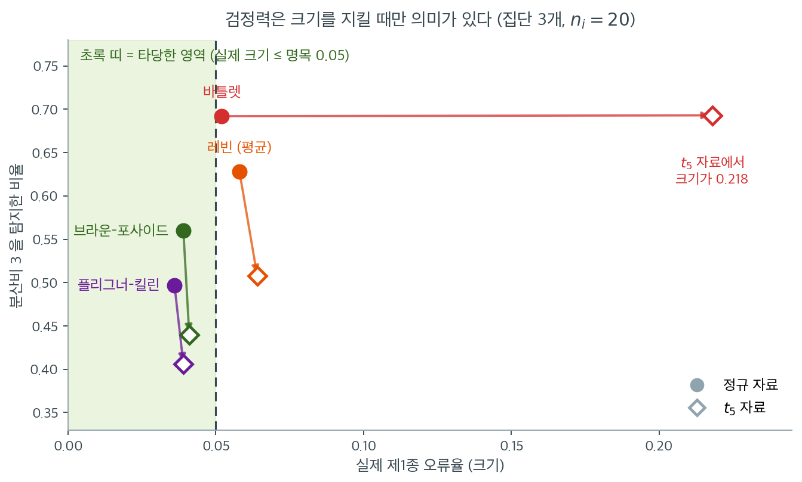
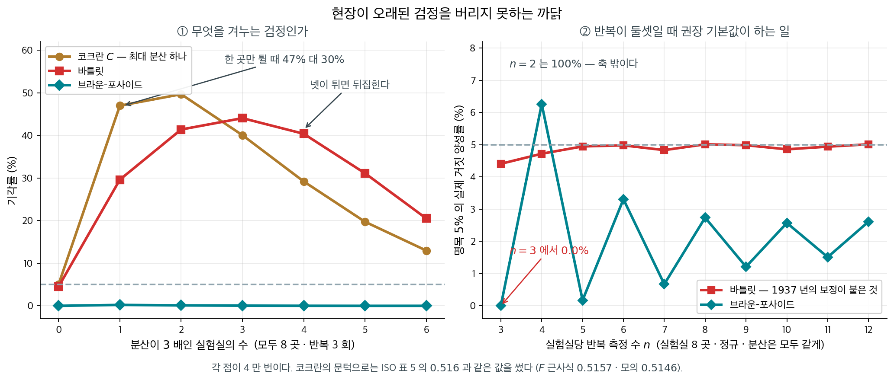

# 로버스트 방법의 비교

앞의 절들은 정규성에 의존하는 Bartlett 검정부터 순위 기반 Fligner-Killeen 검정까지 분산의 동질성에 대한 여러 검정을 소개했다. 각 검정은 통계적 검정력과 비정규성에 대한 로버스트성 사이에서 서로 다른 절충을 한다. 이 절은 실무자가 자료에 맞는 검정을 고를 수 있도록 통합 비교를 제공한다.

---

## 1. 모든 분산 검정 요약

| 검정 | 중심 | 변환 | 기준분포 | 정규성 필요 | 집단 수 |
|---|---|---|---|---|---|
| 카이제곱 | 해당 없음 | $(n-1)S^2/\sigma_0^2$ | $\chi^2_{n-1}$ | 예 | 1 |
| F 검정 | 해당 없음 | $S_1^2/S_2^2$ | $F_{n_1-1, n_2-1}$ | 예 | 2 |
| Bartlett | 해당 없음 | 로그분산비 | $\chi^2_{k-1}$ | 예 | $k \ge 2$ |
| Levene | 평균 | $\lvert X_{ij} - \bar{X}_i\rvert$ | $F_{k-1, N-k}$ | 아니오 | $k \ge 2$ |
| Brown-Forsythe | 중앙값 | $\lvert X_{ij} - \tilde{X}_i\rvert$ | $F_{k-1, N-k}$ | 아니오 | $k \ge 2$ |
| Fligner-Killeen | 중앙값 | 순위의 정규점수 | $\chi^2_{k-1}$ | 아니오 | $k \ge 2$ |

---

## 2. 제1종 오류 조절

진단 검정에서 가장 중요한 기준은 표방한 유의수준을 유지하는지 여부이다. 다음 표는 $k = 3$개 집단, $n_i = 20$, 명목 $\alpha = 0.05$에서 모의실험으로 얻은 실제 제1종 오류율이다(반복 10,000회, 몬테카를로 오차 약 0.002).

| 분포 | Bartlett | Levene | Brown-Forsythe | Fligner-Killeen |
|---|---|---|---|---|
| Normal | 0.052 | 0.058 | 0.039 | 0.036 |
| $t_{10}$ | 0.109 | 0.057 | 0.040 | 0.037 |
| $t_5$ | 0.218 | 0.064 | 0.041 | 0.039 |
| $\chi^2_4$ | 0.228 | 0.123 | 0.041 | 0.055 |
| 오염 정규 (90% $\mathcal{N}(0,1)$ + 10% $\mathcal{N}(0,9)$) | 0.338 | 0.061 | 0.035 | 0.038 |
| Exponential | **0.390** | **0.192** | 0.048 | 0.087 |
| 로그정규 $(0,1)$ | **0.683** | **0.254** | 0.039 | **0.102** |

패턴이 명확하다.

- **Bartlett 검정**은 어떤 비정규성에서든 심각한 팽창을 보인다. 지수분포에서 0.390으로 명목값의 여덟 배에 이른다.
- **Levene 검정**(평균 기반)은 대칭인 두꺼운 꼬리에는 잘 견디지만($t_5$에서 0.064) **치우침에 약하다**. 지수분포에서 0.192, $\chi^2_4$에서 0.123이다.
- **Brown-Forsythe**는 모든 분포에서 명목값 근처를 유지한다(0.035~0.048). 이 표에서 **유일하게 모든 행에서 통제되는 검정**이다.
- **Fligner-Killeen**은 대부분 잘 통제되지만 강하게 치우친 분포에서는 다소 자유주의적이다($\chi^2_4$에서 0.055, 지수분포에서 0.087). 그리고 **치우침이 극단으로 가면 이 검정도 무너진다.** 왜도가 6.2인 로그정규에서 0.102로 명목값의 두 배를 넘는다. 순위로 바꾸는 것만으로는 부족하다는 뜻이며, 이 극단 사례는 [대수정규에서의 비교](robust_tests_comparison.md)에서 따로 더 본다.

마지막 줄이 특히 눈에 띈다. **브라운–포사이드만 로그정규에서도 0.039로 버틴다.** 첨도가 110.9이고 왜도가 6.2인 분포에서 네 검정 가운데 셋이 무너지는데 중앙값 중심화 하나가 그것을 막는다. 중앙값은 꼬리가 아무리 길어져도 끌려가지 않기 때문이다.

!!! note "Levene의 취약점은 첨도가 아니라 치우침이다"
    표를 세로로 읽으면 Levene 열이 $t_5$(첨도 6, 대칭)에서는 0.064로 무난하지만 지수분포(첨도 6, 왜도 2)에서는 0.192로 급증한다. **같은 첨도인데 결과가 세 배 다르다.**

    이는 15.5절 [Brown-Forsythe 검정](brown_forsythe.md) 연습문제 1의 결론과 일치한다. 평균 중심화가 무너지는 것은 평균이 분포의 중심을 대표하지 못할 때, 곧 치우침이 있을 때이다.

---

## 3. 정규성 아래의 검정력 비교

자료가 정말로 정규일 때는 모든 검정이 타당하므로, 관심사는 검정력(참으로 다른 분산을 탐지할 확률)이다. $k = 3$개 집단, $n_i = 20$, 참 분산비 $\sigma_{\max}^2/\sigma_{\min}^2 = 3$일 때(표준편차 $1, 1, \sqrt{3}$)

| 검정 | 검정력 |
|---|---|
| Bartlett | 0.692 |
| Levene (평균) | 0.628 |
| Brown-Forsythe (중앙값) | 0.560 |
| Fligner-Killeen | 0.497 |

정규성 아래에서 Bartlett이 가장 강력하고 Levene, Brown-Forsythe, Fligner-Killeen 순이다. 최고와 최저의 차이는 약 20퍼센트포인트로 작지 않다.

**그러나 크기 차이를 함께 보아야 한다.** 위 크기 표에서 정규 자료의 실제 크기는 Bartlett 0.052, Levene 0.058, Brown-Forsythe 0.039, Fligner-Killeen 0.036이었다. Brown-Forsythe와 Fligner-Killeen이 보수적이므로 검정력 손실의 일부는 그 보수성 때문이지 검정 자체의 열등함 때문이 아니다. 크기를 0.05로 맞추어 보정하면 격차가 줄어든다.

---

## 4. 비정규성 아래의 검정력 비교

같은 분산비 3, 같은 표본크기에서 자료를 $t_5$(두꺼운 꼬리)에서 뽑으면

| 검정 | 실제 제1종 오류 | 기각률 ($H_1$) |
|---|---|---|
| Bartlett | 0.218 | 0.693 |
| Levene (평균) | 0.064 | 0.508 |
| Brown-Forsythe (중앙값) | 0.041 | 0.440 |
| Fligner-Killeen | 0.039 | 0.406 |

Bartlett의 겉보기 높은 기각률은 오도적이다. 제1종 오류율이 이미 22%로 부풀려져 있기 때문이다. $H_0$ 아래에서 지나치게 자주 기각하는 검정은 $H_1$ 아래에서도 자주 기각하지만 잘못된 이유에서 그렇다.

앞의 세 표를 한 그림에 겹치면 이 논점이 분명해진다. 가로축이 **실제 크기**, 세로축이 **분산비 3을 탐지한 비율**이다. 원이 정규 자료, 속 빈 마름모가 $t_5$ 자료이고, 화살표는 자료를 정규에서 $t_5$로 바꿀 때 각 검정이 어디로 이동하는지를 보여 준다.



**검정은 초록 띠 안에 있어야 한다.** 실제 크기가 명목 0.05를 넘으면 그 검정이 보고하는 $p$값은 약속한 의미를 잃는다. 세로축 값이 아무리 높아도 소용없다. 크기를 지키지 못하는 검정의 "검정력"은 정의되지 않은 양이기 때문이다.

정규 자료(원)에서는 네 검정이 모두 띠 근처에 있고, 세로로 $0.497$에서 $0.692$까지 늘어선다. 바틀렛이 가장 높고 플리그너–킬린이 가장 낮다. 이것이 로버스트성의 정직한 가격표다. 다만 브라운–포사이드와 플리그너–킬린은 크기가 $0.039$, $0.036$으로 명목값보다 작으므로, 낮은 검정력의 일부는 실력 부족이 아니라 보수성 때문이다.

$t_5$로 바꾸면(마름모) 그림이 갈라진다. 바틀렛의 화살표는 **거의 수평으로 오른쪽으로 날아간다.** 검정력은 $0.692 \to 0.693$으로 그대로인데 크기가 $0.052 \to 0.218$로 네 배가 되었다. 검정이 더 예민해진 것이 아니라 **기준선이 무너진 것**이다. 바틀렛은 자료가 두꺼운 꼬리를 가졌다는 사실을 "분산이 다르다"는 증거로 오독하고 있다.

나머지 세 화살표는 거의 수직으로 아래를 향한다. 크기는 띠 안에 머물고 검정력만 조금 떨어진다. 레빈 $0.628 \to 0.508$, 브라운–포사이드 $0.560 \to 0.440$, 플리그너–킬린 $0.497 \to 0.406$. **자료가 어려워지면 탐지력이 떨어지는 것이 정상이다.** 크기를 지키면서 검정력을 잃는 쪽이, 크기를 잃고 검정력을 지키는 쪽보다 언제나 낫다.

이 그림 한 장이 로버스트 검정을 고르는 이유를 요약한다. 검정을 고른다는 것은 세로축에서 최고점을 찾는 일이 아니라, **초록 띠 안에 머무는 것들 중에서** 가장 높은 것을 찾는 일이다.

특히 눈여겨볼 점은 **Bartlett의 기각률이 정규 자료(0.692)와 $t_5$ 자료(0.693)에서 거의 같다**는 것이다. 두꺼운 꼬리가 검정력을 떨어뜨리는 효과와 크기를 부풀리는 효과가 우연히 상쇄되었을 뿐이며, 이 값에서 "검정력이 유지된다"고 읽어서는 안 된다.

로버스트 검정들은 정규 자료에 비해 기각률이 뚜렷하게 떨어졌다(Brown-Forsythe 0.560 → 0.440). 두꺼운 꼬리가 분산 추정을 어렵게 만든 만큼 정직하게 검정력이 낮아진 것이다.

---

## 5. 로버스트성 순위

로버스트성이 낮은 것부터 높은 것 순으로

1. **Bartlett 검정** — 정규성이 필요하며 두꺼운 꼬리와 치우침에 심각하게 영향받는다
2. **Levene 검정**(평균) — 중간 정도로 로버스트하지만 집단평균을 통해 치우침과 이상점의 영향을 받는다
3. **Brown-Forsythe 검정**(중앙값) — 매우 로버스트하며 중앙값 중심이 이상점과 치우침에 저항한다
4. **Fligner-Killeen 검정**(순위의 정규점수) — 가장 로버스트하며 거의 분포무관하다

다만 위 크기 표에서 보았듯 강하게 치우친 자료에서는 Fligner-Killeen보다 Brown-Forsythe의 크기가 더 잘 통제되었다. "가장 로버스트"라는 순위가 모든 상황에서 최선의 크기 조절을 뜻하지는 않는다.

---

## 6. 판정 흐름

검정의 선택은 다음 논리로 안내할 수 있다.

1. **자료의 정규성이 확인되었는가?** (Shapiro-Wilk $p > 0.10$, Q-Q 그림 선형)
    - 예: 최대 검정력을 위해 **Bartlett 검정**을 쓴다.
    - 아니오 또는 불확실: 2단계로 간다.

2. **자료가 가볍게 비정규인가?** (약간의 치우침, 두꺼운 꼬리 없음, 이상점 없음)
    - 예: 좋은 검정력과 적당한 로버스트성을 갖는 **Levene 검정**(평균 기반)을 쓴다.
    - 아니오: 3단계로 간다.

3. **자료가 중간 정도로 비정규인가?** (치우침, 중간 정도의 이상점)
    - 예: **Brown-Forsythe 검정**(중앙값 기반)을 쓴다.
    - 아니오: 4단계로 간다.

4. **자료가 심하게 비정규인가?** (두꺼운 꼬리, 강한 치우침, 많은 이상점)
    - 예: **Fligner-Killeen 검정**을 쓴다.

!!! tip "기본 권고"
    확신이 없을 때는 **Brown-Forsythe 검정**이 가장 안전한 기본값이다. 여러 분포에 걸쳐 제1종 오류를 잘 조절하며, 자료가 우연히 정규일 때 Bartlett 검정 대비 잃는 검정력이 크지 않다. 대부분의 통계 소프트웨어에서 `levene(..., center='median')`으로 구현되어 있다.

    위 흐름도의 1~2단계를 자료로 판정하는 절차 자체가 15.1절 [분산 검정의 공통 가정](../introduction/common_assumptions.md) 연습문제 4에서 논한 두 단계 문제를 안고 있다는 점도 유념하라. 실무에서는 분석 전에 Brown-Forsythe를 쓰기로 정해 두는 편이 낫다.

---

<div class="storybox" markdown>

**그림으로 보는 통계학 1.** 국제표준이 아직 쓰는 $1941$ 년의 비

절 $6$ 의 흐름도는 자료를 **받아 든** 사람의 자리에서 그린 것이다. 자료를 **만드는**
쪽의 표준은 다른 길로 간다.

같은 시료를 실험실 $p$ 곳에 보내 각자 $n$ 번씩 재게 하고 그 측정방법의 반복성과
재현성을 매기는 실험이 있다. 국제표준 ISO 5725-2 가 그 절차를 조목조목 정해 두었는데,
「어느 실험실의 흩어짐이 유난히 큰가」를 가리는 자리에 서 있는 것은 바틀릿도 르빈도
아니고 **코크란의 $C$** 다. $1941$ 년에 나온 비 하나다.

$$
C = \frac{\max_i s_i^2}{\sum_{i=1}^{p} s_i^2}
$$

$5\%$ 임계값을 넘으면 **주의값**(straggler)이라 부르고 별 하나를, $1\%$ 를 넘으면
**이상값**(outlier)이라 부르고 별 둘을 붙인다. 이상값이면 그 실험실을 빼고 남은
것으로 **다시** 검정한다. 평균 쪽에서는 그럽스 검정이 같은 일을 맡는다.

왜 더 나은 검정들을 두고 이것인가. 까닭이 둘이고 둘 다 그림에 있다.

<figure markdown>
{ width="960" }
  <figcaption markdown>왼쪽의 문턱은 ISO 표 $5$ 가 싣는 $0.516$ 을 그대로 썼다($p = 8$, $n = 3$).</figcaption>
</figure>

**첫째, 겨누는 대안이 다르다.** 표준이 찾는 것은 「분산들이 서로 다르다」가 아니라
「**한 실험실이 엉망이다**」이다. 왼쪽 칸 — 여덟 곳 가운데 한 곳의 표준편차가 세 배일 때
$C$ 의 검정력은 $47\%$, 바틀릿은 $30\%$ 다. 그런데 넷이 함께 튀면 $29\%$ 대 $40\%$ 로
뒤집힌다. 최대 분산 하나만 보는 통계량이라 여럿이 함께 튀면 분모도 같이 커져서 서로를
**가려 주기** 때문이다. 표준도 그것을 알고 적어 두었다 — 두세 실험실이 함께 큰 표준편차를
낼 때에는 결론을 조심해서 살펴야 하며, 하나씩 빼며 되풀이하는 방식은 「여러 분산
이상값을 한꺼번에 검정하도록 **설계된 방법이 없는 탓에**」 도구로 제안한 것뿐이라고.

**둘째, 반복이 둘이나 셋이다.** 오른쪽 칸이 바로 위 「기본 권고」에 붙어야 할 단서다.
브라운–포사이드는 집단 중앙값에서 잰 편차를 쓰는데, $n$ 이 홀수이면 그 편차 가운데
하나가 반드시 $0$ 이고 짝수이면 둘이 같아진다. 그 구조적 $0$ 이 분모를 조인다. 분산을
모두 같게 둔 정규자료에서 명목 $5\%$ 의 실제 거짓 양성률이

| 반복 $n$ | $2$ | $3$ | $4$ | $5$ | $8$ | $12$ |
|---|---:|---:|---:|---:|---:|---:|
| 브라운–포사이드 | $100\%$ | $0.0\%$ | $6.3\%$ | $0.2\%$ | $2.7\%$ | $2.6\%$ |
| 바틀릿 | $3.1\%$ | $4.4\%$ | $4.7\%$ | $4.9\%$ | $5.0\%$ | $5.0\%$ |

이다. $n = 2$ 에서 $100\%$ 인 것은 집단 안의 두 편차가 **언제나 같아** 분모가 $0$ 이 되기
때문이다 — 검정이 늘 기각한다. $n = 3$ 은 거꾸로 한 번도 기각하지 못한다. 홀짝의
들쭉날쭉이 $n = 12$ 까지 남는다. 같은 자리에서 바틀릿은 $n = 3$ 부터 명목을 지키는데,
15.4절 [분산의 동일성에 대한 Bartlett 검정](../bartlett_test/bartlett_test.md)의 상자가
말한 그 나눗수 덕분이다.

그러니 「망설여지면 브라운–포사이드」는 **반복이 넉넉할 때의** 권고다. 반복이 둘이나
셋인 자리에서는 그 검정을 쓸 수 없고, 표준이 $1941$ 년의 비를 버리지 못한 것도 게으름이
아니라 그 자리에 맞는 것을 고른 결과다.

물론 $C$ 도 공짜가 아니다. 바틀릿과 똑같이 정규성 위에 서 있고, 모든 실험실의 반복수가
같아야 하며(표준도 「엄격히는 그렇다」고 적는다), 하나씩 빼며 되풀이하는 절차 자체가
다중검정이다. 표준의 말이 정확하다 — 되풀이 적용은 「정규성 가정이 충분히 지켜지지 않을
때 **지나친 기각**을 부를 수 있다」.

_확인한 곳 — ISO 5725-2:2019 의 $8.3.3.1$(통계량이 $5\%$ 임계값 이하면 받아들이고,
$5\%$ 와 $1\%$ 사이면 straggler, $1\%$ 를 넘으면 statistical outlier라 부르며 별 하나와
둘로 표시한다) · $8.3.4.3$(모든 표준편차가 같은 $n$ 에서 나와야 엄격히 적용된다) ·
$8.3.4.4$(최대값만 보는 단측 검정이며, 더 정밀한 실험실을 버리는 것은 불합리하므로
이것으로 충분하다고 본다) · $8.3.4.6$(이상값이면 빼고 되풀이하되, 정규성이 충분히
지켜지지 않으면 지나친 기각을 부를 수 있고, 여러 분산 이상값을 함께 검정하도록 설계된
방법이 없어 제안한 도구일 뿐이며, 두세 실험실이 함께 큰 표준편차를 낼 때는 조심하라) ·
표 $5$ 의 $p = 8$, $n = 3$ 임계값 $1\%$ $0.615$ 와 $5\%$ $0.516$ · 코크란의 원 논문은
W. G. Cochran, 「The distribution of the largest of a set of estimated variances as a
fraction of their total」, 『Annals of Eugenics』 $11$($1941$), $47$–$52$ 쪽이다 ·
그림과 표의 수는 모두 직접 계산한 값이다_

</div>

---

## 7. 소프트웨어 구현

네 검정 모두 Python의 SciPy에서 쓸 수 있다.

<div class="exbox" markdown>

**보기 1.** <span class="diff easy" title="쉬움"></span> 네 검정을 한자리에서. 집단당 $n = 8$ 인 세 집단에 네 검정을 모두 돌린다. 집단 2 의 표본분산이 집단 3 의 $19$ 배다.

**(1)** 네 통계량의 **기준분포와 자유도**를 각각 적고, 통계량 값만 보고 "어느 검정이 더 강하게 기각하는가"를 판단하면 안 되는 까닭을 밝히시오. 특히 Fligner-Killeen 의 $9.563$ 이 Brown-Forsythe 의 $6.609$ 보다 큰데도 $p$ 값은 더 **큰** 까닭을 설명하시오.

**(2)** 네 $p$ 값을 기준분포에서 손으로 다시 재어 SciPy 와 맞추고, **같은 통계량 값을 두 기준분포에 넣으면** $p$ 가 얼마나 달라지는지 보이시오.

</div>

??? success "풀이"

    **(1) 기준분포가 두 가지다.** $k = 3$, $N = 24$ 이므로

    | 검정 | 통계량 | 기준분포 | 자유도 |
    |:---|:---|:---|:---|
    | Bartlett | $T$ (로그분산의 산포) | $\chi^2$ | $k-1 = 2$ |
    | Levene (평균) | $W$ ($Z$ 에 대한 분산분석 $F$) | $F$ | $(2,\ 21)$ |
    | Brown-Forsythe | $W^*$ (같은 꼴, 중앙값 중심) | $F$ | $(2,\ 21)$ |
    | Fligner-Killeen | $X^2$ (정규점수의 산포) | $\chi^2$ | $k-1 = 2$ |

    **두 기준은 눈금이 다르다.** $F$ 통계량은 제곱합을 자유도로 **나눈** 비이고 $\chi^2$ 통계량은 나누지 않은 합이다. $d_2 \to \infty$ 에서 $F_{d_1, d_2} \approx \chi^2_{d_1}/d_1$ 이므로, $F$ 눈금의 값 $v$ 는 $\chi^2$ 눈금의 $d_1 v = 2v$ 에 대응한다. 곧 **$F$ 쪽 숫자는 애초에 절반쯤 작게 나오도록 되어 있다.**

    그러므로 네 숫자를 한 줄에 늘어놓고 크기를 견주는 것은 길이를 센티미터와 인치로 섞어 재는 것과 같다. 비교할 수 있는 것은 $p$ 값뿐이다. Fligner-Killeen 의 $9.563$ 이 Brown-Forsythe 의 $6.609$ 보다 큰 것은 **$\chi^2$ 눈금으로 재어서** 그렇고, $6.609$ 를 같은 눈금으로 옮기면 $13$ 쯤이 되어 오히려 더 크다. 그래서 $p$ 값은 FK 쪽이 더 크다.

    **(2) 확인한다.**

    ```python
    import numpy as np
    from scipy import stats

    # 2번 집단만 퍼짐이 크다. 네 검정이 이것을 어떻게 보는지 견준다.
    g1 = [10, 12, 14, 11, 13, 15, 12, 10]
    g2 = [20, 28, 22, 35, 25, 18, 30, 22]
    g3 = [15, 16, 14, 17, 15, 16, 13, 14]

    # Bartlett — 정규모집단에서 검정력이 가장 높고, 벗어나면 가장 취약하다.
    stat_b, p_b = stats.bartlett(g1, g2, g3)

    # Levene(평균 중심) — 원래 형태. 어느 정도 로버스트하다.
    stat_l, p_l = stats.levene(g1, g2, g3, center='mean')

    # Brown-Forsythe(중앙값 중심) — 실무에서 가장 두루 권하는 선택이다.
    stat_bf, p_bf = stats.levene(g1, g2, g3, center='median')

    # Fligner-Killeen — 순위만 쓰므로 꼬리의 두께에는 가장 덜 흔들리지만,
    # 치우침에서는 위 표대로 Brown-Forsythe 에 진다. 검정력도 조금 낮다.
    stat_fk, p_fk = stats.fligner(g1, g2, g3)

    print(f"Bartlett:        stat={stat_b:.3f}, p={p_b:.4f}")
    print(f"Levene (mean):   stat={stat_l:.3f}, p={p_l:.4f}")
    print(f"Brown-Forsythe:  stat={stat_bf:.3f}, p={p_bf:.4f}")
    print(f"Fligner-Killeen: stat={stat_fk:.3f}, p={p_fk:.4f}")

    # ---- (1) 기준분포를 밝히고 p 값을 손으로 다시 잰다 ----
    k, N = 3, len(g1) + len(g2) + len(g3)
    chi2 = stats.chi2(k - 1)
    Fd = stats.f(k - 1, N - k)
    print(f"\nk = {k}, N = {N}  ->  기준분포는 chi2({k - 1}) 또는 F({k - 1}, {N - k})")
    rows = [("Bartlett", stat_b, p_b, "chi2", chi2),
            ("Levene (mean)", stat_l, p_l, "F", Fd),
            ("Brown-Forsythe", stat_bf, p_bf, "F", Fd),
            ("Fligner-Killeen", stat_fk, p_fk, "chi2", chi2)]
    print(f"{'검정':>18}{'통계량':>10}{'기준':>7}{'손으로 sf':>12}{'scipy p':>11}{'차':>10}")
    for name, s, p, lab, dist in rows:
        print(f"{name:>18}{s:>10.4f}{lab:>7}{dist.sf(s):>12.6f}{p:>11.6f}{abs(dist.sf(s) - p):>10.1e}")

    # 통계량 값만 보면 순서가 뒤집힌다.
    print(f"\n통계량 순서: FK {stat_fk:.3f} > Levene {stat_l:.3f} > BF {stat_bf:.3f}")
    print(f"p 값 순서:   Levene {p_l:.4f} < BF {p_bf:.4f} < FK {p_fk:.4f}")

    # ---- (2) 같은 값을 두 기준에 넣어 본다 ----
    print(f"\n95% 분위수:  chi2(2) = {chi2.ppf(0.95):.4f},   F(2,21) = {Fd.ppf(0.95):.4f}")
    print(f"{'통계량 값':>10}{'chi2(2) 에서 p':>18}{'F(2,21) 에서 p':>18}{'배율':>9}")
    for v in (6.609, 8.202, 9.563, 15.539):
        a, b = chi2.sf(v), Fd.sf(v)
        print(f"{v:>10.3f}{a:>18.6f}{b:>18.6f}{b / a:>9.1f}")
    print(f"\nBF 의 6.609 를 소박하게 chi2 로 옮기면 2*6.609 = {2 * 6.609:.3f}, "
          f"그 p = {chi2.sf(2 * 6.609):.6f}")
    print(f"  실제 F(2,21) 의 p = {p_bf:.6f} 에 맞는 chi2(2) 값은 "
          f"{chi2.isf(p_bf):.3f}  (분모 자유도 21 이 작아서 생기는 차이)")
    print(f"\n표본분산: {[round(float(np.var(g, ddof=1)), 2) for g in (g1, g2, g3)]}"
          f"   최대/최소 = {np.var(g2, ddof=1) / np.var(g3, ddof=1):.1f}")
    ```

    출력:

    ```text
    Bartlett:        stat=15.539, p=0.0004
    Levene (mean):   stat=8.202, p=0.0023
    Brown-Forsythe:  stat=6.609, p=0.0059
    Fligner-Killeen: stat=9.563, p=0.0084

    k = 3, N = 24  ->  기준분포는 chi2(2) 또는 F(2, 21)
                    검정       통계량     기준      손으로 sf    scipy p         차
              Bartlett   15.5390   chi2    0.000422   0.000422   0.0e+00
         Levene (mean)    8.2022      F    0.002331   0.002331   0.0e+00
        Brown-Forsythe    6.6085      F    0.005940   0.005940   0.0e+00
       Fligner-Killeen    9.5631   chi2    0.008383   0.008383   0.0e+00

    통계량 순서: FK 9.563 > Levene 8.202 > BF 6.609
    p 값 순서:   Levene 0.0023 < BF 0.0059 < FK 0.0084

    95% 분위수:  chi2(2) = 5.9915,   F(2,21) = 3.4668
         통계량 값      chi2(2) 에서 p      F(2,21) 에서 p       배율
         6.609          0.036718          0.005938      0.2
         8.202          0.016556          0.002332      0.1
         9.563          0.008383          0.001115      0.1
        15.539          0.000422          0.000072      0.2

    BF 의 6.609 를 소박하게 chi2 로 옮기면 2*6.609 = 13.218, 그 p = 0.001348
      실제 F(2,21) 의 p = 0.005940 에 맞는 chi2(2) 값은 10.252  (분모 자유도 21 이 작아서 생기는 차이)

    표본분산: [3.27, 32.29, 1.71]   최대/최소 = 18.8
    ```

    **네 $p$ 값이 손 계산과 정확히 같다.** 차가 넷 모두 `0.0e+00` 이다. 어느 통계량이 어느 기준분포로 가는지 바르게 짝지었다는 뜻이고, 자유도도 $(2, 21)$ 과 $2$ 로 확인되었다.

    **(1)의 뒤집힘이 두 줄에 그대로 있다.** 통계량은 FK $9.563$ > Levene $8.202$ > BF $6.609$ 인데 $p$ 값은 Levene $0.0023$ < BF $0.0059$ < FK $0.0084$ 다. **순서가 완전히 뒤바뀐다.** 통계량 값으로 "FK 가 가장 강하게 기각했다"고 읽으면 사실과 반대로 읽는 것이다.

    **같은 값을 두 기준에 넣으면 $p$ 가 다섯에서 열 배 다르다.** $6.609$ 는 $\chi^2_2$ 에서 $0.0367$, $F_{2,21}$ 에서 $0.0059$ 다. $95\%$ 분위수를 보면 까닭이 분명하다. $\chi^2_2$ 는 $5.9915$ 인데 $F_{2,21}$ 은 $3.4668$ 로 절반 남짓이다. **같은 "$0.05$ 문턱"이 두 눈금에서 거의 두 배 차이 나는 자리에 있다.**

    마지막 두 줄이 눈금 변환을 끝까지 따라간다. $F$ 의 $6.609$ 를 소박하게 $\chi^2$ 로 옮기면 $2 \times 6.609 = 13.218$ 이고 그 $p$ 는 $0.001348$ 이다. 그런데 실제 $p$ 는 $0.005940$ 이고, 그 $p$ 를 주는 $\chi^2_2$ 값은 $10.252$ 다. 곧 $F_{2,21}$ 은 $\chi^2_2$ 의 **$v$ 와 $2v$ 사이**에 놓인다. $F_{d_1,d_2} \approx \chi^2_{d_1}/d_1$ 이 $d_2 \to \infty$ 의 근사일 뿐이고 여기서는 $d_2 = 21$ 이 작아 분모의 흔들림이 꼬리를 두껍게 만들기 때문이다. **$F$ 기준이 $\chi^2$ 기준보다 보수적인 쪽으로 보정하는 양이 이 $13.218 \to 10.252$ 의 간격이다.**

    실무로 옮기면 규칙 하나다. **보고할 것은 통계량이 아니라 $p$ 값이며, 통계량을 적을 때는 기준분포와 자유도를 반드시 함께 적는다.** "$W = 6.61$" 만으로는 아무 뜻이 없고 "$W^* = 6.61$, $F_{2,21}$, $p = 0.0059$" 여야 한다.

네 검정 모두 강하게 기각한다. 표본분산이 $3.27$, $32.29$, $1.71$로 집단 2가 집단 3의 19배이기 때문이다. 이탈이 뚜렷하면 검정 선택이 결론을 바꾸지 않는다. **선택이 중요해지는 것은 경계선상의 사례에서다.**

---

## 연습문제

<div class="drillbox" markdown>

**연습문제 1.** <span class="diff med" title="중간"></span>
크기 표에서 Levene 검정이 $t_5$(0.064)보다 지수분포(0.192)에서 훨씬 나쁘다. 두 분포의 초과첨도가 모두 6인데도 그렇다. 이 차이의 원인을 설명하라.

</div>

??? success "풀이"
    두 분포의 차이는 **왜도**이다. $t_5$는 대칭($\gamma_1 = 0$)이고 지수분포는 강하게 오른쪽으로 치우쳐 있다($\gamma_1 = 2$).

    Levene 검정의 첫 단계는 각 집단의 **평균**을 추정하는 것이다. 평균 $\bar{X}_i$가 참 중심 $\mu_i$에서 벗어나면 그 집단의 모든 절대편차가 오염된다.

    **대칭 분포에서.** $\bar{X}_i$의 오차는 양쪽으로 대칭이고, $|X_{ij} - \bar{X}_i|$의 평균에 미치는 영향이 1차 항에서 상쇄된다. 그래서 $t_5$처럼 꼬리가 두꺼워도 크기 왜곡이 크지 않다.

    **치우친 분포에서.** 지수분포의 표본평균은 그 자체가 오른쪽으로 치우쳐 있다. 게다가 15.2절 [분산에 대한 카이제곱 검정](../chi_square_test/chi_square_variance.md) 연습문제 25에서 보았듯 **$\bar{X}$와 $S^2$이 양의 상관을 갖는다.** 큰 $\bar{X}_i$가 나온 집단은 편차도 함께 크게 나온다. 이 상관이 집단마다 독립적으로 작용하므로 $\bar{Z}_i$들이 실제보다 더 흩어지고, 분산분석 F 통계량이 부풀려진다.

    Brown-Forsythe가 중앙값을 쓰면 이 연결이 끊어진다. 중앙값은 치우친 분포에서도 안정적이며 $S^2$과의 상관이 훨씬 약하다. 표에서 Brown-Forsythe가 지수분포에서 0.048로 완벽히 통제되는 이유이다. $\square$

<div class="drillbox" markdown>

**연습문제 2.** <span class="diff med" title="중간"></span>
Bartlett 검정의 기각률이 정규 자료(0.692)와 $t_5$ 자료(0.693)에서 거의 같다. 이것이 왜 "검정력이 유지된다"는 뜻이 아닌지 설명하고, 공정한 비교 방법을 제시하라.

</div>

??? success "풀이"
    **두 효과가 상쇄되었다.**

    1. **크기 팽창(위로 미는 힘).** $t_5$ 자료에서 Bartlett의 크기가 0.052에서 0.218로 뛴다. 이 팽창은 $H_1$ 아래에서도 그대로 작용하여 기각률을 올린다.
    2. **정보의 손실(아래로 미는 힘).** 두꺼운 꼬리는 $S_i^2$의 변동을 네 배로 키우므로 참 분산 차이를 탐지하기가 실제로 더 어려워진다. 이 효과는 기각률을 내린다.

    두 힘이 우연히 비슷한 크기여서 0.692와 0.693이 나왔을 뿐이다. 로버스트 검정들에서는 크기가 통제되어 있으므로 두 번째 효과만 나타나고, 정직하게 기각률이 떨어진다(Brown-Forsythe 0.560 → 0.440).

    **공정한 비교: 크기 보정 검정력.**

    1. 모의실험으로 $H_0$ 아래에서 각 검정통계량의 분포를 얻는다.
    2. 그 분포의 95백분위수를 **경험적 임계값**으로 삼는다. 이렇게 하면 모든 검정의 실제 크기가 정확히 0.05가 된다.
    3. 이 임계값으로 $H_1$ 아래의 기각률을 다시 계산한다.

    ```python
    import numpy as np
    from scipy import stats

    rng = np.random.default_rng(31)
    n, k, R = 20, 3, 5000
    gen = lambda s: s * rng.standard_t(5, n)

    # 1-2단계: 귀무분포를 모의실험으로 얻어 경험적 기각값을 만든다
    null_b = np.array([stats.bartlett(*[gen(1) for _ in range(k)])[0]
                       for _ in range(R)])
    crit_b = np.quantile(null_b, 0.95)

    # 3단계: 크기를 맞춘 검정력. 검정마다 실제 오류율이 달라, 그것을 0.05 로
    # 맞춰 놓고 견주어야 검정력 비교가 공정해진다
    alt_b = np.array([stats.bartlett(*[gen(s) for s in (1, 1, 3**0.5)])[0]
                      for _ in range(R)])
    print(f"Bartlett empirical critical value: {crit_b:.4f} "
          f"(nominal chi2_2 0.95 = {stats.chi2.ppf(0.95, 2):.4f})")
    print(f"Size-adjusted power: {(alt_b > crit_b).mean():.4f}")
    ```

    출력:

    ```text
    Bartlett empirical critical value: 12.4652 (nominal chi2_2 0.95 = 5.9915)
    Size-adjusted power: 0.3674
    ```

    경험적 임계값이 $12.47$로 명목값 $5.991$의 두 배가 넘는다. 이 올바른 임계값을 쓰면 Bartlett의 크기 보정 검정력은 **0.367**로, 명목 기각률 $0.693$의 절반 남짓이다.

    같은 절차를 Brown-Forsythe에 적용하면 경험적 임계값 $2.82$(명목 $F_{0.95,2,57} = 3.159$보다 **작다**, 이 검정이 보수적이므로)이고 크기 보정 검정력은 **0.491**이다.

    | 검정 | 명목 기각률 | 크기 보정 검정력 |
    |---|---|---|
    | Bartlett | 0.693 | 0.367 |
    | Brown-Forsythe | 0.440 | **0.491** |

    결과가 완전히 뒤집힌다. **$t_5$ 자료에서는 크기를 맞추고 나면 Brown-Forsythe가 Bartlett보다 오히려 강력하다.** 명목값만 보면 Bartlett이 0.693 대 0.440으로 압도하는 것처럼 보이지만, 그 우위는 전적으로 부풀려진 크기에서 온 착시였다.

    이는 "Bartlett은 정규성 아래에서 가장 강력하다"는 서술의 정확한 범위를 보여준다. **정규성 아래에서만** 그렇다. 비정규 자료에서는 로버스트 검정이 크기와 검정력 양쪽에서 우월할 수 있다.

    **원칙.** 검정력은 크기를 고정한 뒤에만 비교할 수 있다. 크기가 다른 두 검정의 기각률을 나란히 놓는 것은 서로 다른 유의수준의 검정을 비교하는 것과 같다. $\square$

<div class="drillbox" markdown>

**연습문제 3.** <span class="diff med" title="중간"></span>
판정 흐름도의 1단계는 "정규성이 확인되었는가"를 자료로 판정한다. 이 절차의 문제점을 지적하고, 흐름도를 어떻게 고치면 좋을지 제안하라.

</div>

??? success "풀이"
    **문제 1: 두 단계 절차의 크기 왜곡.** 같은 자료로 정규성을 검정한 뒤 분산 검정을 고르면 최종 절차의 실제 유의수준이 명목값에서 벗어난다. 두 결정이 같은 자료에 의존하기 때문이다.

    **문제 2: 검정력의 방향이 반대다.** 정규성 검정은 작은 표본에서 검정력이 낮다(14장). 그런데 분산 검정이 비정규성에 가장 취약한 것도 작은 표본이다. 곧 **확인이 가장 필요한 상황에서 확인이 가장 무력하다.**

    구체적으로 $n = 20$인 $t_5$ 자료에서 Shapiro-Wilk의 검정력은 약 0.2에 불과하다. 80%의 경우 "정규성 이상 없음"으로 통과시켜 Bartlett을 쓰게 되는데, 그 Bartlett의 실제 크기는 0.218이다.

    **문제 3: 흐름도 2~4단계가 주관적이다.** "가볍게", "중간 정도로", "심하게" 비정규를 자료로 구별하는 객관적 기준이 없다. 분석자가 원하는 결과에 맞춰 조정할 여지가 생긴다.

    **개선안.**

    ```text
    1. 자료 생성 과정에서 정규성이 이론적으로 보장되는가?
       (측정 오차 모형, 물리적 근거 등 — 자료가 아니라 지식에 근거)
       - 예: Bartlett 검정
       - 아니오: 2단계

    2. 기본값으로 Brown-Forsythe 검정을 쓴다.

    3. 진단(보고용, 검정 선택용이 아님):
       - 집단별 표준편차와 상자그림을 항상 보고한다
       - Q-Q 그림으로 이탈의 유형을 서술한다
       - 오염이 심하다고 판단되면 Fligner-Killeen 결과도 함께 보고한다
    ```

    핵심 변화는 **검정 선택을 자료가 아니라 사전 지식에 근거시키는 것**이다. 자료로부터 방법을 고르는 순간 추론의 타당성이 훼손된다. $\square$

<div class="drillbox" markdown>

**연습문제 4.** <span class="diff med" title="중간"></span>
본문 소프트웨어 보기에서 네 검정이 모두 강하게 기각했다. 이렇게 결론이 일치하는 경우와 갈리는 경우 각각에서 실무자가 어떻게 행동해야 하는지 논하라.

</div>

??? success "풀이"
    **결론이 일치할 때.** 보기에서 $p$값이 $0.0004$에서 $0.0084$까지 20배 차이 나지만 모두 0.01보다 작다. 실무적 결론은 동일하다. 집단 2의 표본분산이 집단 3의 19배로 신호가 압도적이기 때문이다.

    이 경우 **어느 검정을 보고하든 무방하다.** 다만 사전에 정한 하나를 보고하고, 부록에 나머지를 함께 실어 결과의 강건함을 보이는 것이 좋다.

    **결론이 갈릴 때.** 이때가 진짜 문제이다. 15.5절 Levene 페이지의 보기에서 Levene $p = 0.026$과 Brown-Forsythe $p = 0.066$이 5% 문턱을 사이에 두고 갈렸다.

    이런 상황의 원칙은 다음과 같다.

    1. **사전에 정한 검정을 보고한다.** 자료를 본 뒤 문턱을 넘은 검정을 고르는 것은 $p$값 조작이며 가장 나쁜 대응이다.

    2. **왜 갈리는지 진단한다.** 검정들의 차이는 무작위가 아니다. Bartlett만 유의하면 비정규성을 의심한다. Levene만 유의하면 치우침이나 이상점이 평균을 끌어당겼는지 본다. 로버스트 검정들이 유의한데 Bartlett이 아니면 드문 경우이며 자료를 다시 살펴야 한다.

    3. **모든 결과를 보고한다.** "Brown-Forsythe $p = 0.066$(사전 지정), 참고로 Bartlett $p = 0.002$, Levene $p = 0.026$. 자료에 이상점이 있어 Brown-Forsythe를 우선한다"처럼 쓴다.

    4. **이분법을 피한다.** 경계선상의 $p$값은 "증거가 약하다"는 뜻이지 "효과가 없다"거나 "있다"는 뜻이 아니다. 집단별 표준편차와 그 신뢰구간을 함께 보고하면 독자가 스스로 판단할 수 있다.

    5. **후속 분석은 가정에 의존하지 않는 쪽으로.** 등분산 여부가 애매하다면 표준 분산분석 대신 Welch 분산분석을 쓴다. 그러면 애초에 이 판정이 필요 없어진다. $\square$

<div class="drillbox" markdown>

**연습문제 5.** <span class="diff med" title="중간"></span>
크기 표는 반복 10,000회이고 몬테카를로 오차가 약 0.002라고 밝혀 두었다. 그리고 본문은 그 표의 Brown-Forsythe 열을 "모든 분포에서 명목값 근처를 유지한다(0.035~0.048)"고 읽었다.

**(1)** 참 크기가 $p = 0.05$일 때 반복 $R = 10{,}000$에서 추정값의 표준오차를 구하고, 정규 자료 줄의 네 값 $0.052$, $0.058$, $0.039$, $0.036$ 가운데 $0.05$와 **구별되는** 것이 어느 것인지 판정하라.

**(2)** Brown-Forsythe 열의 일곱 값이 $0.05$를 중심으로 **흔들리는** 것인지 **한쪽으로 치우쳐 있는** 것인지 판정하라. 그 판정이 검정력 표를 읽는 방식을 어떻게 바꾸는가?

</div>

??? success "풀이"
    **(1) 표준오차.** 각 칸은 $R$회의 베르누이 시행에서 얻은 비율이므로

    $$
    \operatorname{se}(\hat p) = \sqrt{\frac{p(1-p)}{R}} = \sqrt{\frac{0.05 \times 0.95}{10{,}000}} = \sqrt{4.75 \times 10^{-6}} = 0.002179
    $$

    이다. 본문의 "약 0.002"가 이 값이다. $z = (\hat p - 0.05)/0.002179$로 네 값을 재면

    | 검정 | 정규 자료 크기 | $z$ | 양쪽 $p$ | 판정 |
    |:---|---:|---:|---:|:---|
    | Bartlett | 0.052 | $+0.92$ | 0.359 | $0.05$와 구별되지 않는다 |
    | Levene (평균) | 0.058 | $+3.67$ | 0.0002 | 유의하게 **크다** |
    | Brown-Forsythe | 0.039 | $-5.05$ | $<10^{-6}$ | 유의하게 **작다** |
    | Fligner-Killeen | 0.036 | $-6.42$ | $1.3\times10^{-10}$ | 유의하게 **작다** |

    **정규 자료에서조차 명목값에 맞는 검정은 Bartlett 하나다.** 표준오차가 $0.00218$이므로 $0.05$에서 $0.0044$만 떨어져도 두 배를 넘고, 이 표의 세 자리 숫자에서 **셋째 자리의 $4$ 이상 차이는 실재하는 차이**다. 크기 표를 "거의 다 비슷하다"로 읽으면 안 된다.

    **(2) 치우쳐 있다.** Brown-Forsythe 열의 일곱 값은 $0.039,\ 0.040,\ 0.041,\ 0.041,\ 0.035,\ 0.048,\ 0.039$로 **일곱 개가 모두 $0.05$ 아래**다. 참 크기가 정확히 $0.05$라면 각 줄은 서로 다른 분포에서 독립으로 돌린 모의실험이므로 $0.05$ 아래로 떨어질 확률이 각각 근사적으로 $1/2$이고

    $$
    P(\text{일곱 개 모두 아래}) = \left(\frac{1}{2}\right)^7 = \frac{1}{128} = 0.0078
    $$

    이다. 게다가 일곱 중 여섯이 표준오차의 두 배보다 더 아래에 있다(지수분포의 $0.048$만 $z = -0.92$로 구별되지 않는다). 곧 Brown-Forsythe의 참 크기는 $0.05$가 아니라 **$0.040$ 쯤**이며, 본문의 "명목값 근처"는 "명목값보다 **체계적으로 낮은** 자리"로 고쳐 읽어야 한다. 한 칸씩 보면 우연으로 보이지만 **열 전체의 방향이 한쪽인 것**이 유의하다.

    **검정력 표를 읽는 방식이 달라진다.** Brown-Forsythe의 검정력 $0.560$이 Bartlett의 $0.692$보다 낮은 것은 두 가지가 섞인 결과다. 하나는 정보의 차이이고, 다른 하나는 **문턱을 명목값보다 안쪽에 두고 있다는 사실**이다. 뒤쪽은 검정의 실력이 아니라 기준분포 근사의 부정확함이므로, 검정력을 견주기 전에 제거해야 한다. 본문이 "크기를 0.05로 맞추어 보정하면 격차가 줄어든다"고 적어 둔 것이 바로 이 제거 작업이며, 연습문제 2가 $t_5$ 자료에서 모의실험으로 두 검정을 보정했고 연습문제 9가 네 검정 모두를 보정한다.

    보수성이 공짜가 아니라는 점도 함께 보아야 한다. 크기 $0.040$은 약속한 $0.05$ 가운데 $0.010$을 **쓰지 않고 버린 것**이고, 버린 만큼의 검정력은 돌아오지 않는다. 크기를 못 지키는 것보다는 훨씬 낫지만 최적은 아니다. $\square$

<div class="drillbox" markdown>

**연습문제 6.** <span class="diff hard" title="어려움"></span>
크기 표의 Bartlett 열 여섯 값이 **첨도 하나로 예측된다**는 것을 보인다. 집단 크기가 모두 $n$으로 같다고 하고 $\nu = n - 1$, $L_i = \ln S_i^2$라 쓴다.

**(1)** Bartlett 통계량의 분자가

$$
(N-k)\ln S_p^2 - \sum_{i=1}^{k}(n_i-1)\ln S_i^2 \approx \frac{\nu}{2}\sum_{i=1}^{k}\left(L_i - \bar L\right)^2
$$

임을 보이고, 보정계수 $C$가 $n \to \infty$에서 $1$로 감을 확인하라.

**(2)** $\operatorname{Var}(\ln S^2) \approx (\beta_2 - 1)/n$을 써서 $T \xrightarrow{d} r\,\chi^2_{k-1}$, $r = (\beta_2-1)/2$임을 보이라. 그리고 $k = 3$에서 명목 $5\%$ Bartlett 검정의 극한 크기를 **닫힌 꼴로** 적으라.

**(3)** 크기 표의 여섯 분포에 대해 그 예측값을 구해 표의 Bartlett 열과 견주어라. 예측이 어긋나는 방향이 한쪽인 까닭을 말하고, **$r$이 같은데 표의 값이 다른 두 줄**을 찾아 설명하라.

</div>

??? success "풀이"
    **(1) 로그 눈금에서 보면 분자는 산포의 제곱합이다.** $n_i = n$이므로 $N - k = k\nu$이고 $S_p^2 = \frac{1}{k}\sum_i S_i^2$이다. $d_i = L_i - \bar L$로 두면 $\sum_i d_i = 0$이고 $S_i^2 = e^{\bar L + d_i}$이므로

    $$
    S_p^2 = \frac{1}{k}\sum_i e^{\bar L + d_i} = e^{\bar L}\cdot\frac{1}{k}\sum_i e^{d_i} = e^{\bar L}\left(1 + \frac{1}{2k}\sum_i d_i^2 + O(d^3)\right)
    $$

    이다($\sum d_i = 0$이라 1차항이 사라진다). 양변에 로그를 취하면 $\ln S_p^2 = \bar L + \frac{1}{2k}\sum_i d_i^2 + O(d^3)$이고, 따라서

    $$
    k\nu\ln S_p^2 - \nu\sum_i L_i = k\nu\bar L + \frac{\nu}{2}\sum_i d_i^2 - \nu k \bar L = \frac{\nu}{2}\sum_i d_i^2
    $$

    이다. 보정계수는 $C = 1 + \frac{1}{3(k-1)}\left(\frac{k}{\nu} - \frac{1}{k\nu}\right)$이므로 $\nu \to \infty$에서 $C \to 1$이다. 곧 Bartlett 통계량은 **$\ln S_i^2$들의 표본산포**를 재는 양이다.

    **(2) 눈금이 $r$배 틀어진다.** 정규모집단이면 $\beta_2 = 3$이므로 $\operatorname{Var}(L_i) \approx (3-1)/n \approx 2/\nu$이고

    $$
    T \approx \frac{\nu}{2}\sum_i d_i^2 = \sum_i \left(\frac{d_i}{\sqrt{2/\nu}}\right)^2 \xrightarrow{d} \chi^2_{k-1}
    $$

    이다($L_i$가 근사적으로 독립인 정규이고 $\bar L$로 중심화하면서 자유도 하나를 잃는다). 일반적으로는 $\operatorname{Var}(L_i) \approx (\beta_2-1)/n = r\cdot(2/\nu)$이므로 모든 $d_i$가 $\sqrt r$배로 커지고

    $$
    T \xrightarrow{d} r\,\chi^2_{k-1}, \qquad r = \frac{\beta_2 - 1}{2}
    $$

    이다. 이 $r$는 5.6절 [표본분산의 표준오차](../../ch05/applications/se_s2.md) 정리 1의 배율과 같은 양이다. $k = 3$이면 $\chi^2_2$가 지수분포이므로 생존함수가 닫힌 꼴이고, 극한 크기는

    $$
    P\!\left(r\,\chi^2_2 > \chi^2_{0.95,2}\right) = P\!\left(\chi^2_2 > \frac{5.99146}{r}\right) = \exp\!\left(-\frac{2.99573}{r}\right)
    $$

    이다. $r = 1$을 넣으면 정확히 $0.05$가 나온다.

    **(3) 여섯 줄을 모두 예측한다.**

    | 분포 | $\beta_2$ | $r = (\beta_2-1)/2$ | 극한 크기 | 크기 표($n = 20$) |
    |:---|---:|---:|---:|---:|
    | $t_{10}$ | 4.00 | 1.50 | 0.136 | 0.109 |
    | $t_5$ | 9.00 | 4.00 | 0.473 | 0.218 |
    | $\chi^2_4$ | 6.00 | 2.50 | 0.302 | 0.228 |
    | 오염 정규 | 8.33 | 3.67 | 0.442 | 0.338 |
    | Exponential | 9.00 | 4.00 | 0.473 | 0.390 |
    | 로그정규 $(0,1)$ | 113.94 | 56.47 | 0.948 | 0.683 |

    ($t_d$의 첨도는 $3 + 6/(d-4)$, $\chi^2_d$는 $3 + 12/d$, 오염 정규는 $\sigma^2 = 0.9 + 0.1\times 9 = 1.8$과 $\mu_4 = 0.9\times 3 + 0.1\times 3\times 81 = 27$에서 $\beta_2 = 27/1.8^2 = 8.33$, 로그정규는 $\beta_2 = e^4 + 2e^3 + 3e^2 - 3 = 113.94$다.)

    **예측은 여섯 줄 모두에서 표보다 크다.** 어긋남의 방향이 한쪽인 것은 두 가지가 같은 쪽으로 작용하기 때문이다. 첫째, $n = 20$의 유한표본 기각값이 점근값보다 넓어서 기각역이 좁다. 둘째, 델타근사 $\operatorname{Var}(\ln S^2) \approx (\beta_2-1)/n$은 $n$이 $\beta_2$보다 훨씬 커야 쓸 만한데 $n = 20$에서는 어느 줄도 그렇지 않다. 로그정규가 $0.948$ 대 $0.683$으로 가장 크게 어긋나는 것이 그 증거다. $n/\beta_2 = 20/113.9 = 0.18$이라 점근식이 뜻을 갖기에는 표본이 수천 개 필요하다(5.10절 [비정규 모집단의 분산비](../../ch05/applications/var_ratio_nonnormal.md)에 같은 진단이 있다).

    **$r$이 같은데 값이 다른 두 줄은 $t_5$와 Exponential이다.** 둘 다 $\beta_2 = 9$, $r = 4$라서 극한은 $0.473$으로 **같아야** 하는데 $n = 20$에서는 $0.218$과 $0.390$으로 두 배 가까이 다르다. 첨도가 같아도 **첨도가 어디서 오는가**가 다르기 때문이다. 지수분포의 4차 적률은 비교적 흔하게 나오는 중간 크기 관측값들이 만들지만, $t_5$의 4차 적률은 드물게 나오는 극단값 하나가 만든다. $20$개짜리 표본의 대부분은 그 극단값을 한 번도 보지 못하므로 $\ln S_i^2$의 실제 변동이 점근값에 크게 못 미친다. 표본을 키우면 두 줄 모두 $0.473$으로 올라가는데 지수가 훨씬 빠르다($n = 500$에서 지수는 $0.47$로 거의 도달하지만 $t_5$는 아직 $0.36$이다).

    **그래도 예측은 순서를 맞춘다.** $t_5$와 Exponential의 한 쌍을 빼면 $r$의 순서와 표의 순서가 정확히 같다. 모의실험 없이 **$\beta_2$ 하나만으로** 크기 표의 Bartlett 열을 미리 쓸 수 있다는 뜻이고, 거꾸로 말하면 Bartlett 검정이 무너지는 까닭에 "비정규성"이라는 두루뭉술한 이름을 붙일 필요가 없다. 범인은 4차 적률 하나다. $\square$

<div class="drillbox" markdown>

**연습문제 7.** <span class="diff hard" title="어려움"></span>
요약 표의 첫 두 줄(카이제곱, $F$)은 "정규성 필요"가 **예**다. 이 "예"가 표본을 키워도 "아니오"로 바뀌지 않음을 보인다.

**(1)** $\operatorname{Var}(S^2) \approx (\beta_2-1)\sigma^4/n$을 써서, $H_0: \sigma^2 = \sigma_0^2$에 대한 명목 양쪽 $5\%$ 카이제곱 분산검정의 **극한 크기**가 $2\left[1 - \Phi(1.96/\sqrt r)\right]$, $r = (\beta_2-1)/2$임을 보이고 $t_{10}$, $\chi^2_4$, Exponential, 로그정규에서 그 값을 구하라.

**(2)** 중심극한정리는 $S^2$에도 적용된다. 그런데도 (1)의 극한이 $0.05$가 아닌 이유를 평균에 대한 $t$ 검정과 **구조를 견주어** 한 문장으로 답하라.

**(3)** 분산비는 정규성 가정을 분자와 분모에 **두 겹**으로 쓴다. 그렇다면 "두 겹이니 분자와 분모가 같이 부풀어 비에서 상쇄되지 않겠는가"라는 기대가 생길 수 있다. $n_1 = n_2 = n$인 $F$ 검정의 극한 크기를 같은 방식으로 구해 이 기대를 반박하라.

</div>

??? success "풀이"
    **(1) 기각역은 틀린 자에 눈금이 새겨져 있다.** $W = (n-1)S^2/\sigma_0^2$이고 기각역은 $W < \chi^2_{0.025,\,n-1}$ 또는 $W > \chi^2_{0.975,\,n-1}$이다. $\chi^2_{n-1}$의 평균이 $n-1$, 표준편차가 $\sqrt{2(n-1)}$이므로 큰 $n$에서 $\chi^2_{p,\,n-1} \approx (n-1) + z_p\sqrt{2(n-1)}$이고, 이를 $S^2$ 눈금으로 옮기면 기각 경계가

    $$
    \sigma_0^2\left(1 \pm 1.96\sqrt{\frac{2}{n-1}}\right)
    $$

    이다. 한편 $H_0$ 아래 $S^2$의 **참** 표준편차는 $\sigma_0^2\sqrt{(\beta_2-1)/n} = \sigma_0^2\sqrt{2r/n}$이다. 경계까지의 거리를 참 표준편차로 재면

    $$
    \frac{1.96\,\sigma_0^2\sqrt{2/(n-1)}}{\sigma_0^2\sqrt{2r/n}} = \frac{1.96}{\sqrt r}\sqrt{\frac{n}{n-1}} \longrightarrow \frac{1.96}{\sqrt r}
    $$

    이고, $S^2$은 $(X_i-\mu)^2$의 평균과 $O(1/n)$만큼만 다르므로 중심극한정리에 의해 근사적으로 정규다. 따라서 극한 크기는 $2\left[1-\Phi(1.96/\sqrt r)\right]$이다.

    | 분포 | $\beta_2$ | $r$ | $1.96/\sqrt r$ | 극한 크기 |
    |:---|---:|---:|---:|---:|
    | Normal | 3.00 | 1.00 | 1.960 | 0.050 |
    | $t_{10}$ | 4.00 | 1.50 | 1.600 | 0.110 |
    | $\chi^2_4$ | 6.00 | 2.50 | 1.240 | 0.215 |
    | Exponential | 9.00 | 4.00 | 0.980 | 0.327 |
    | 로그정규 $(0,1)$ | 113.94 | 56.47 | 0.261 | 0.794 |

    **$n \to \infty$에서도 $0.05$로 가지 않는다.** 정규에서만 $r = 1$이 되어 $0.05$가 나온다. 요약 표의 "예"는 작은 표본의 사정이 아니라 **영구적인 성질**이다.

    **(2) 무너진 것은 중심극한정리가 아니라 표준화다.** $t$ 통계량 $(\bar X - \mu_0)/(S/\sqrt n)$은 분모가 분자의 표준편차를 **자료로 추정**하고 그 추정이 일치추정이므로, 모집단이 무엇이든 비가 $N(0,1)$로 간다. 반면 카이제곱 분산검정은 $S^2$의 표준편차를 추정하지 않고 $\sigma_0^2\sqrt{2/(n-1)}$로 **못 박아 둔다.** 그 식은 $\beta_2 = 3$을 가정한 것이고 참값은 $\beta_2$에 달려 있으니, 성가신 모수를 추정하는 대신 **3이라고 믿어 버린 것**이 어긋남의 전부다.

    고치는 길도 여기서 바로 보인다. $\hat\beta_2$를 넣어 표준화하거나 $S^2$의 분포를 붓스트랩으로 자료에서 얻으면 점근적으로 타당한 분산검정이 된다. 로버스트 검정들이 하는 일도 결국 같다. 기준분포를 모집단 모양에 덜 의존하게 만드는 것이다.

    **(3) 로그 눈금에서 두 어긋남은 상쇄되지 않고 더해진다.** $\ln(S_1^2/S_2^2) = \ln S_1^2 - \ln S_2^2$이고 두 항이 독립이므로

    $$
    \operatorname{Var}\left(\ln\frac{S_1^2}{S_2^2}\right) \approx \frac{\beta_2-1}{n} + \frac{\beta_2-1}{n} = \frac{4r}{n}
    $$

    이다. $F$ 모형이 믿는 값은 $r = 1$을 넣은 $4/n$이므로 분산의 비가 $r$, 표준편차의 비가 $\sqrt r$이고, 극한 크기는 (1)과 **똑같이** $2\left[1-\Phi(1.96/\sqrt r)\right]$다. 지수모집단에서 $0.327$이라는 값이 5.10절 [비정규 모집단의 분산비](../../ch05/applications/var_ratio_nonnormal.md)의 수치와 일치한다.

    기대가 틀린 까닭은 **차에서 상쇄되는 것은 치우침(bias)이고 지금 어긋나는 것은 산포**이기 때문이다. 분자와 분모가 각각 "더 흔들리는" 것이므로 둘을 뺀 양은 덜 흔들리지 않고 더 흔들린다. "두 겹"이라는 말의 뜻은 "배율이 두 배가 된다"가 아니라 **"고장 날 자리가 둘이고 어느 쪽도 다른 쪽을 고쳐 주지 않는다"**는 것이다. $t$ 검정에서 분모가 분자를 고쳐 주는 것과 정확히 반대다.

    세 조각을 합치면 이 장의 전제가 설명된다. **평균은 중심극한정리가 지켜 주지만 분산은 아무도 지켜 주지 않는다.** 분산을 재는 검정이 유난히 약한 까닭이 이 한 줄에 있다. $\square$

<div class="drillbox" markdown>

**연습문제 8.** <span class="diff hard" title="어려움"></span>
판정 흐름도의 1단계를 그대로 절차로 굳힌다. 집단마다 $n = 20$이고, Shapiro-Wilk로 정규성을 검정해 $p > 0.10$이면 Bartlett, 아니면 Brown-Forsythe를 쓴다. 두 단계가 독립이라고 일단 가정한다.

**(1)** 자료가 정규일 때와 $t_5$일 때 이 **결합 절차**의 실제 크기를 구하라. 연습문제 3에서 $n = 20$짜리 $t_5$ 자료에 대한 Shapiro-Wilk의 검정력이 약 $0.2$라고 했고, 정규 자료에서 $p > 0.10$을 통과할 확률은 $0.90$이다.

**(2)** 이 절차가 $t_5$에서도 크기 $0.05$를 지키려면 1단계 검정의 검정력이 얼마여야 하는지 구하라. 그 값이 실현 가능한가?

**(3)** 로그정규 자료에서는 이 절차가 뜻밖에 잘 작동한다. 왜 그런지 설명하고, 결합 절차가 가장 위험해지는 분포가 어느 영역에 있는지 말하라.

**(4)** 독립 가정을 빼면 (1)의 값이 어느 쪽으로 움직이는가? 그래도 결론이 유지되는 까닭을 밝히라.

</div>

??? success "풀이"
    **(1) 두 크기의 가중평균이다.** 절차가 Bartlett으로 갈 확률을 $1-q$($q$는 1단계의 기각확률)라 하면 결합 크기는 $(1-q)\alpha_{\text{Bart}} + q\,\alpha_{\text{BF}}$다. 크기 표에서 $\alpha_{\text{Bart}}$는 정규 $0.052$, $t_5$ $0.218$이고 $\alpha_{\text{BF}}$는 $0.039$, $0.041$이다.

    - 정규 자료: Shapiro-Wilk는 타당한 검정이므로 $q = 0.10$. 결합 크기 $= 0.90\times0.052 + 0.10\times0.039 = 0.0468 + 0.0039 = 0.0507$.
    - $t_5$ 자료: $q = 0.2$. 결합 크기 $= 0.80\times0.218 + 0.20\times0.041 = 0.1744 + 0.0082 = 0.1826$.

    | 절차 | 정규 자료 | $t_5$ 자료 |
    |:---|---:|---:|
    | 늘 Bartlett | 0.052 | 0.218 |
    | 사전검정 뒤 선택(흐름도) | 0.051 | **0.183** |
    | 늘 Brown-Forsythe | 0.039 | 0.041 |

    **사전검정이 메운 몫이 거의 없다.** $0.218$을 $0.05$까지 $0.168$ 내려야 하는데 $0.035$만 내렸다. 메워야 할 간격의 $21\%$다. 그러면서 절차가 복잡해지고, 무엇보다 **최종 수준이 미지의 모집단에 달려 있게** 되었다.

    **(2) 필요한 검정력은 $0.95$다.** $0.05 = (1-q)(0.218) + q(0.041)$을 풀면

    $$
    q = \frac{0.218 - 0.05}{0.218 - 0.041} = \frac{0.168}{0.177} = 0.9492
    $$

    다. $n = 20$짜리 표본에서 $t_5$를 $95\%$ 확률로 비정규라고 판정하는 정규성 검정은 없다. $t_5$는 정규와 눈으로 거의 구별되지 않는 대칭 분포이고, $20$개로는 꼬리의 두께를 잴 정보 자체가 없다. 연습문제 3의 $0.2$ 대신 $0.26$을 넣어도 결합 크기는 $0.74\times0.218 + 0.26\times0.041 = 0.172$로 거의 그대로다. 곧 **이 절차는 1단계 검정을 무엇으로 바꾸어도 구제되지 않는다.** 필요한 것은 더 좋은 정규성 검정이 아니라 절차의 폐기다.

    **(3) 양 끝은 안전하고 가운데가 위험하다.** 로그정규 $(0,1)$은 왜도가 $6.2$라서 $n = 20$에서도 Shapiro-Wilk가 거의 늘 잡아낸다(유의수준 $0.10$에서 검정력 $0.96$ 쯤). 그러면 절차는 거의 항상 Brown-Forsythe로 넘어가고 결합 크기는 $0.039$ 근처가 된다. 반대쪽 끝에서 자료가 정말 정규이면 절차는 거의 항상 Bartlett으로 가는데 그쪽도 타당하다.

    위험한 곳은 가운데, 곧 **정규성 검정이 잡아내기에는 너무 정규에 가깝고 Bartlett이 견디기에는 너무 비정규인** 영역이다. $t_5$가 정확히 그 자리에 있다(Shapiro-Wilk 검정력 $0.2$, Bartlett 크기 $0.218$). 크기 표의 $t_{10}$ 줄도 같은 영역이다(Bartlett $0.109$). 이것이 연습문제 3의 "확인이 가장 필요한 상황에서 확인이 가장 무력하다"를 수로 옮긴 결과이며, **사전검정의 성능이 좋아지는 방향과 사전검정이 필요해지는 방향이 반대**라는 사실에서 나온다.

    **(4) 실제 크기는 $0.183$보다 작지만 결론은 그대로다.** 두 통계량이 같은 자료에서 나오고 **같은 것에 반응한다.** 극단값이 섞인 표본은 Shapiro-Wilk도 기각하고 Bartlett도 (거짓으로) 기각한다. 따라서 $P(\text{Bartlett 기각} \mid \text{SW 통과}) < 0.218$이고 결합 크기는 $0.183$보다 작다. 사전검정이 최악의 표본 일부를 걸러 주기는 한다는 뜻이다.

    그런데도 (2)의 결론은 유지된다. 걸러 내는 정도가 $q$를 $0.95$로 끌어올리는 것과 같은 효과를 낼 수는 없고, 무엇보다 **결합 절차의 크기가 미지의 모집단 분포에 따라 $0.039$와 $0.2$ 사이를 오간다.** 수준이 분포에 의존하는 검정은 수준을 가진 검정이 아니다.

    끝으로 거래의 양쪽을 재 보자. 흐름도를 쓰는 대가로 얻는 것은 정규 자료에서의 기각률 $0.90\times0.692 + 0.10\times0.560 = 0.679$이고, 늘 Brown-Forsythe를 쓸 때의 $0.560$보다 $0.119$ 높다. 그런데 연습문제 9에서 보듯 크기를 맞추고 재면 Bartlett의 진짜 이점은 $0.079$뿐이다. **$0.08$을 얻으려고 $t_5$에서 크기를 네 배로 잃는 거래**이며, 판정 흐름도 아래의 "실무에서는 분석 전에 Brown-Forsythe를 쓰기로 정해 두는 편이 낫다"가 이 계산의 요약이다. $\square$

<div class="drillbox" markdown>

**연습문제 9.** <span class="diff hard" title="어려움"></span>
본문은 "크기를 $0.05$로 맞추어 보정하면 격차가 줄어든다"고만 말하고 끝냈고, 연습문제 2는 $t_5$ 자료에서 모의실험으로 두 검정만 보정했다. 나머지를 모의실험 없이 메운다.

검정 하나가 (실제 크기 $\alpha$, 기각률 $\pi$) 짝을 줄 때

$$
\pi = \Phi\left(\delta - z_{1-\alpha}\right), \qquad z_p = \Phi^{-1}(p)
$$

를 만족하는 $\delta$를 그 검정의 **판별력**이라 부르자. 검정통계량을 적절히 단조변환하면 $H_0$에서 $N(0,1)$, $H_1$에서 $N(\delta,1)$이 된다고 보는 모형이고, $\delta$는 문턱을 어디에 두었는지와 무관한 양이다. 문턱을 옮겨 크기를 정확히 $0.05$로 만들면 검정력이 $\Phi(\delta - z_{0.95})$가 된다.

**(1)** 연습문제 2가 모의실험으로 얻은 크기보정 검정력(Bartlett $0.367$, Brown-Forsythe $0.491$)을 이 근사가 재현하는지 확인하라.

**(2)** 크기 표와 두 검정력 표를 써서 정규 자료와 $t_5$ 자료에서 네 검정의 $\delta$와 크기보정 검정력을 모두 구하라.

**(3)** 세 가지를 읽어라. 정규 자료에서 **평균 중심과 중앙값 중심의 진짜 차이**는 얼마인가. 로버스트성의 진짜 가격은 얼마인가. $t_5$ 자료에서 네 검정의 순위는 어떻게 되는가.

</div>

??? success "풀이"
    **식을 뒤집는다.** $\pi = \Phi(\delta - z_{1-\alpha})$에서 $\Phi^{-1}(\pi) = \delta - z_{1-\alpha}$이므로

    $$
    \delta = \Phi^{-1}(\pi) + z_{1-\alpha}, \qquad \pi_{\text{보정}} = \Phi\left(\delta - z_{0.95}\right)
    $$

    다. 크기가 명목값보다 크면 $z_{1-\alpha}$가 작아져 $\delta$가 작게 나오고, 보수적이면 $\delta$가 크게 나온다. 곧 **부풀린 크기로 번 기각률은 $\delta$에 반영되지 않는다.**

    ```python
    import numpy as np
    from scipy import stats

    # 크기와 기각률 한 쌍에서 크기와 무관한 "판별력" delta 를 읽어 낸다.
    #   기각률 = P(Z > z_{1-크기} - delta)  <=>  delta = Phi^{-1}(기각률) + z_{1-크기}
    def delta_of(size, power):
        return stats.norm.ppf(power) + stats.norm.ppf(1 - size)

    # 그 delta 를 가진 검정을 크기 정확히 alpha 에 놓았을 때의 검정력
    def adjusted(size, power, alpha=0.05):
        return stats.norm.cdf(delta_of(size, power) - stats.norm.ppf(1 - alpha))

    # ---- (1) 연습문제 2 의 모의실험 결과로 근사를 검증한다 ----
    print("[검증] 연습문제 2 는 t5 자료에서 경험적 기각값으로 크기를 0.05 에 맞추었다")
    print(f"{'검정':>16}{'크기':>8}{'기각률':>8}{'근사':>8}{'모의':>8}{'차':>8}")
    for name, s, p, sim in [("Bartlett", 0.218, 0.693, 0.367),
                            ("Brown-Forsythe", 0.041, 0.440, 0.491)]:
        a = adjusted(s, p)
        print(f"{name:>16}{s:>8.3f}{p:>8.3f}{a:>8.4f}{sim:>8.4f}{a - sim:>8.4f}")

    # ---- (2) 네 검정, 두 자료에 모두 적용한다 ----
    normal = [("Bartlett", 0.052, 0.692), ("Levene (mean)", 0.058, 0.628),
              ("Brown-Forsythe", 0.039, 0.560), ("Fligner-Killeen", 0.036, 0.497)]
    t5 = [("Bartlett", 0.218, 0.693), ("Levene (mean)", 0.064, 0.508),
          ("Brown-Forsythe", 0.041, 0.440), ("Fligner-Killeen", 0.039, 0.406)]

    for lab, rows in [("정규", normal), ("t5", t5)]:
        print(f"\n[{lab} 자료]")
        print(f"{'검정':>16}{'크기':>8}{'기각률':>8}{'delta':>9}{'크기보정':>10}")
        adj = []
        for name, s, p in rows:
            a = adjusted(s, p)
            adj.append(a)
            print(f"{name:>16}{s:>8.3f}{p:>8.3f}{delta_of(s, p):>9.4f}{a:>10.4f}")
        raw = [p for _, _, p in rows]
        print(f"{'최대-최소':>16}{'':>8}{max(raw) - min(raw):>8.3f}{'':>9}{max(adj) - min(adj):>10.4f}")

    # ---- (3) 평균 중심 대 중앙값 중심의 순수한 값 ----
    for lab, rows in [("정규", normal), ("t5", t5)]:
        d = dict((n, (s, p)) for n, s, p in rows)
        gl, gb = adjusted(*d["Levene (mean)"]), adjusted(*d["Brown-Forsythe"])
        print(f"\n{lab} 자료: 평균중심 {gl:.4f} vs 중앙값중심 {gb:.4f}  -> 중앙값으로 바꾼 값 {gb - gl:+.4f}")
        print(f"{lab} 자료: 바틀렛 {adjusted(*d['Bartlett']):.4f} - 중앙값중심 {gb:.4f} "
              f"-> 바틀렛을 고른 값 {adjusted(*d['Bartlett']) - gb:+.4f}")
    ```

    출력:

    ```text
    [검증] 연습문제 2 는 t5 자료에서 경험적 기각값으로 크기를 0.05 에 맞추었다
                  검정      크기     기각률      근사      모의       차
            Bartlett   0.218   0.693  0.3589  0.3670 -0.0081
      Brown-Forsythe   0.041   0.440  0.4774  0.4910 -0.0136

    [정규 자료]
                  검정      크기     기각률    delta      크기보정
            Bartlett   0.052   0.692   2.1273    0.6853
       Levene (mean)   0.058   0.628   1.8983    0.6001
      Brown-Forsythe   0.039   0.560   1.9134    0.6059
     Fligner-Killeen   0.036   0.497   1.7916    0.5583
               최대-최소           0.195             0.1269

    [t5 자료]
                  검정      크기     기각률    delta      크기보정
            Bartlett   0.218   0.693   1.2833    0.3589
       Levene (mean)   0.064   0.508   1.5421    0.4591
      Brown-Forsythe   0.041   0.440   1.5882    0.4774
     Fligner-Killeen   0.039   0.406   1.5246    0.4521
               최대-최소           0.287             0.1186

    정규 자료: 평균중심 0.6001 vs 중앙값중심 0.6059  -> 중앙값으로 바꾼 값 +0.0058
    정규 자료: 바틀렛 0.6853 - 중앙값중심 0.6059 -> 바틀렛을 고른 값 +0.0794

    t5 자료: 평균중심 0.4591 vs 중앙값중심 0.4774  -> 중앙값으로 바꾼 값 +0.0183
    t5 자료: 바틀렛 0.3589 - 중앙값중심 0.4774 -> 바틀렛을 고른 값 -0.1186
    ```

    **(1) 근사가 모의실험을 맞춘다.** Bartlett은 $0.3589$ 대 $0.3670$으로 차가 $-0.008$이고, Brown-Forsythe는 $0.4774$ 대 $0.4910$으로 $-0.014$다. 연습문제 2의 모의실험이 $R = 5{,}000$이므로 몬테카를로 표준오차가 $\sqrt{0.4\times0.6/5000} = 0.0069$이고, 첫 줄은 오차 범위 안, 둘째 줄은 두 배쯤 벗어난다. 근사가 조금 보수적인 쪽으로 치우쳐 있지만 **결론을 바꿀 크기가 아니다.** 등분산 정규 모형이라는 거친 가정으로 모의실험 수천 회를 대신할 수 있다는 뜻이다.

    **(2)~(3) 세 가지를 읽는다.**

    **첫째, 정규 자료에서 평균을 중앙값으로 바꾸는 값은 사실상 $0$이다.** 날 숫자로는 Levene $0.628$, Brown-Forsythe $0.560$으로 평균 중심이 $0.068$ 앞섰다. 크기를 맞추면 $0.6001$ 대 $0.6059$로 **중앙값 쪽이 오히려 $0.006$ 높다.** 그 $0.068$은 거의 전부 문턱 위치(Levene $0.058$, Brown-Forsythe $0.039$)에서 온 것이었다. 흔히 "중앙값으로 바꾸면 정규에서 검정력을 잃는다"고 말하지만, $n = 20$, $k = 3$에서 잃는 양은 **측정되지 않는다.** 치우친 자료에서 크기가 $0.192$에서 $0.048$로 좋아지는 것이 공짜라는 말이다.

    **둘째, 로버스트성의 진짜 가격은 $0.08$이다.** Bartlett $0.6853$에서 Brown-Forsythe $0.6059$로 $0.079$ 내려가고, 순위로 한 걸음 더 가면 Fligner-Killeen $0.5583$으로 다시 $0.048$ 내려간다. 본문은 "최고와 최저의 차이는 약 20퍼센트포인트"라 했는데, 날 숫자의 폭 $0.195$가 보정 뒤에는 $0.127$이다. **가격표의 삼분의 일이 착시였다.**

    **셋째, $t_5$ 자료에서 Bartlett은 꼴찌다.** 보정 검정력이 Brown-Forsythe $0.477$ > Levene $0.459$ > Fligner-Killeen $0.452$ > Bartlett $0.359$다. 날 숫자에서 1위($0.693$)였던 검정이 크기를 맞추자 최하위가 된다. $\delta$를 보면 까닭이 한눈에 들어온다. 정규에서 $t_5$로 갈 때 Levene·Brown-Forsythe·Fligner-Killeen의 $\delta$는 $1.898 \to 1.542$, $1.913 \to 1.588$, $1.792 \to 1.525$로 $0.3$ 남짓 내려가는데 Bartlett은 $2.127 \to 1.283$으로 $0.84$가 무너진다. **두꺼운 꼬리는 네 검정의 분해능을 비슷하게 깎지만, Bartlett은 거기에 더해 기준분포를 잃는다.**

    **정리하면 이렇다.** 로버스트성의 값은 정규 자료에서 $0.079$를 내고 $t_5$ 자료에서 $0.119$를 되사 오는 거래다($0.4774 - 0.3589$). 자료가 정규라는 확신이 없다면 사지 않을 이유가 없다. $\square$

<div class="drillbox" markdown>

**연습문제 10.** <span class="diff hard" title="어려움"></span>
본문은 크기–검정력 그림을 설명하면서 "크기를 지키지 못하는 검정의 '검정력'은 정의되지 않은 양"이라고 썼다. 이 문장을 수로 따져 본다. 자료는 $t_5$이고 Bartlett은 (크기 $0.218$, 기각률 $0.693$), Brown-Forsythe는 (크기 $0.041$, 기각률 $0.440$)이다.

**(1)** Brown-Forsythe와 동전만 써서 **크기가 정확히 $0.218$인** 검정을 만들어라. 그 검정력을 구해 Bartlett의 $0.693$과 견주어라.

**(2)** (1)의 결과로 본문의 문장을 정확하게 고쳐 쓰라. $0.693$은 무의미한 수인가?

**(3)** (1)에서 만든 검정은 "크기 $0.218$에서의 Brown-Forsythe"가 **아니다.** 그 차이를 밝히고, 연습문제 9의 $\delta$로 크기 $0.218$짜리 **진짜** Brown-Forsythe 검정의 검정력을 구하라. 두 검정의 크기–검정력 곡선이 교차하는가?

</div>

??? success "풀이"
    **(1) 동전으로 크기를 올린다.** 무작위화 검정 $R$을 이렇게 둔다. Brown-Forsythe를 명목 $5\%$로 돌려 기각하면 기각하고, 기각하지 않으면 자료를 더 보지 않고 확률 $\gamma$로 기각한다. $H_0$ 아래 Brown-Forsythe의 기각확률이 $0.041$이므로

    $$
    0.041 + \gamma\,(1 - 0.041) = 0.218 \implies \gamma = \frac{0.177}{0.959} = 0.18457
    $$

    이고, $H_1$ 아래 기각확률은

    $$
    0.440 + 0.18457\times(1 - 0.440) = 0.440 + 0.1034 = 0.5434
    $$

    다. 비교 대상이 하나 더 있다. **자료를 아예 보지 않고 확률 $0.218$로 기각하는 검정**은 크기와 검정력이 모두 $0.218$이다. 세 점을 늘어놓으면 크기 $0.218$에서

    $$
    0.218\ (\text{동전})\ <\ 0.543\ (\text{BF} + \text{동전})\ <\ 0.693\ (\text{Bartlett})
    $$

    이다.

    **(2) "정의되지 않았다"가 아니라 "비교할 수 없다"다.** $0.693$은 무의미한 수가 아니다. **크기 $0.218$짜리 검정으로서는 정직한 검정력**이고, 같은 크기의 동전($0.218$)이나 Brown-Forsythe에 동전을 섞은 것($0.543$)보다 분명히 높다. Bartlett은 $t_5$ 자료에서도 분산의 차이에 대한 정보를 쓰고 있다.

    본문 문장의 정확한 형태는 연습문제 2의 마지막 줄이 이미 적어 둔 것이다. **크기가 다른 두 검정의 기각률을 나란히 놓고 비교할 수 없다.** 그리고 실무에서 $0.693$을 쓸 수 없는 까닭은 값이 없어서가 아니라 **우리가 사려는 물건이 크기 $0.05$짜리 검정**이라서다. $0.218$짜리 매물의 성능표는 쓸 데가 없다. 본문의 문장은 이 뜻을 세게 말한 수사이고, 글자 그대로 받으면 (1)의 세 점이 반례가 된다.

    **(3) 무작위화는 크기를 올리는 가장 게으른 방법이다.** $R$은 기각하지 않은 표본 가운데 **자료를 더 보지 않고** 아무것이나 골라 기각한다. 반면 진짜 Brown-Forsythe 검정은 문턱을 내려서 크기를 $0.218$로 만들며, 그때 새로 들어오는 기각은 무작위가 아니라 **통계량이 큰 쪽부터**다. 같은 크기를 쓰면서 쓸모 있는 표본을 고르므로 당연히 더 강하다.

    연습문제 9의 $\delta_{\text{BF}} = 1.5882$와 $z_{1-0.218} = z_{0.782} = 0.7790$을 쓰면

    $$
    \Phi(1.5882 - 0.7790) = \Phi(0.8092) = 0.7908
    $$

    이다. $0.791 > 0.693$이므로 **크기 $0.218$에서도 Brown-Forsythe가 Bartlett보다 강하다.** 그리고 $\delta_{\text{Bartlett}} = 1.2833 < \delta_{\text{BF}} = 1.5882$이므로 이 모형에서 Brown-Forsythe의 곡선은 **모든 크기에서** Bartlett 위에 있다. 두 곡선은 교차하지 않는다.

    무작위화로 얻은 $0.543$은 Brown-Forsythe 곡선 위의 점이 아니라 두 점 $(0.041,\ 0.440)$과 $(1,\ 1)$을 이은 **현** 위의 점이다. 크기–검정력 곡선이 오목하므로 현은 늘 곡선 아래에 있고, $0.543 < 0.791$이 그 간격이다. 곧 (1)의 $0.543 < 0.693$에서 "Bartlett이 Brown-Forsythe보다 낫다"는 결론을 끌어내면 **현을 곡선으로 착각한 것**이다.

    한 줄로 줄이면 이렇다. $t_5$ 자료에서 Bartlett이 가진 것은 검정력이 아니라 **낮은 문턱**뿐이다. 문턱은 누구나 내릴 수 있으므로 그것은 성능이 아니고, 크기–검정력 그림에서 바틀렛의 화살표가 거의 수평으로 오른쪽으로 날아가는 것이 바로 그 그림이다. $\square$

---

## 정리하며

분산 검정을 **하나의 표**로 정리한다.

| 검정 | 정규 자료 검정력 | 비정규 자료 타당성 |
|---|---|---|
| 바틀렛 | **최고** | **최악** |
| $F$(2집단) | 높음 | 나쁨 |
| 레빈(평균) | 중간 | 보통 |
| 브라운–포사이드(중앙값) | 중간 | **좋음** |
| 플리그너–킬린 | 다소 낮음 | **최고** |

- **검정력과 로버스트성이 정확히 맞바꿈 관계다.** 표의 두 열이 거의 반대로 정렬되어 있다.
- **제1종 오류 조절이 먼저다.** 검정력이 높아도 명목 수준을 못 지키면 쓸 수 없다. **"기각률이 $20\%$ 인 $5\%$ 검정"은 검정이 아니다.**
- **실무 권고.** 기본은 브라운–포사이드, 분포가 매우 의심스러우면 플리그너–킬린, 정규성이 확립되었고 검정력이 절실하면 바틀렛.
- **어느 검정이든 결과로 후속 방법을 고르는 2단계 절차는 피한다.** 웰치나 로버스트 방법을 처음부터 쓰는 편이 낫다.

다음 절 **대수정규에서의 비교**로 넘어간다. 위 크기 표의 마지막 줄 하나를 확대해, 치우침이 극단으로 가면 로버스트하다고 알려진 방법들도 어디에서 한계에 부딪히는지 본다.
