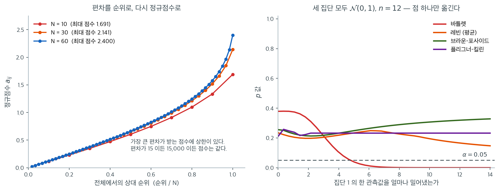
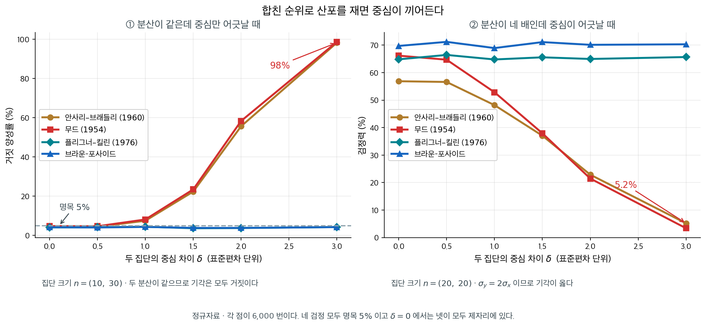
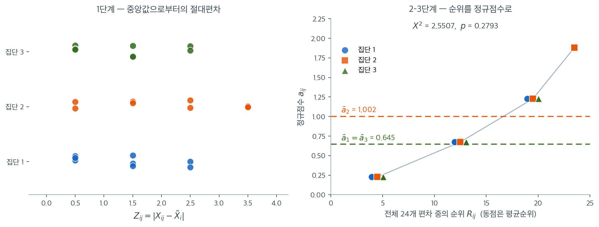

# Fligner-Killeen 검정

Fligner-Killeen 검정(1976)은 이 장에서 다루는 분산 동질성 검정 가운데 **꼬리의 두께에 가장 덜 흔들린다.** Levene 검정이 쓰는 원래의 절대편차를 그 편차들의 **순위**로 바꾸고, 다시 순위를 **정규점수**로 변환한다. 전 과정을 순위와 정규점수로만 처리하므로 검정이 거의 분포무관해지고, 꼬리가 아무리 두꺼워도 명목 제1종 오류율을 지킨다 — $t_5$ 에서 $0.034$, 오염 정규에서 $0.0414$ 다.

**다만 치우침은 다른 이야기다.** 아래 연습문제 9 가 재는 대로 지수에서 크기가 $0.0743$, 로그정규에서 $0.1002$ 로 올라가고, 같은 자료에서 중앙값 중심화를 쓰는 브라운–포사이드는 $0.0478$, $0.0427$ 로 멀쩡하다. **표본을 키워도 낫지 않는다**(로그정규에서 $n$ 을 $10 \to 160$ 으로 키우면 $0.0994 \to 0.1616$ 으로 **오른다**). 그러므로 「가장 로버스트」라는 꼬리표는 **대칭인 두꺼운 꼬리에 한해서** 붙는다.

---

## 1. 절차

검정은 다섯 단계로 진행된다.

**1단계.** 집단중앙값으로부터의 절대편차를 계산한다.

$$
Z_{ij} = |X_{ij} - \tilde{X}_i|
$$

여기서 $\tilde{X}_i$는 집단 $i$의 중앙값이다. Brown-Forsythe 검정에서 쓴 것과 같은 변환이다.

**2단계.** $N$개의 절대편차 $Z_{ij}$를 작은 것부터 큰 것까지 순위를 매긴다. $R_{ij}$를 전체 $N$개 값 중 $Z_{ij}$의 순위라 하자. 동점은 평균순위로 처리한다.

**3단계.** 역정규(분위수) 변환으로 순위를 정규점수로 바꾼다.

$$
a_{ij} = \Phi^{-1}\!\left(\frac{1 + R_{ij}/(N+1)}{2}\right)
$$

여기서 $\Phi^{-1}$은 표준정규 CDF의 역함수이다. 인자 $(1 + R_{ij}/(N+1))/2$는 순위를 $(0.5, 1)$ 구간의 값으로 보내고, 역정규가 이를 양의 점수로 보낸다. 편차가 클수록 큰 정규점수를 받는다.

**4단계.** 정규점수의 집단평균을 계산한다.

$$
\bar{a}_i = \frac{1}{n_i}\sum_{j=1}^{n_i} a_{ij}, \qquad \bar{a} = \frac{1}{N}\sum_{i=1}^{k}\sum_{j=1}^{n_i} a_{ij}
$$

**5단계.** 검정통계량을 계산한다.

$$
\chi^2_{\text{FK}} = \frac{\sum_{i=1}^{k} n_i (\bar{a}_i - \bar{a})^2}{\frac{1}{N-1}\sum_{i=1}^{k}\sum_{j=1}^{n_i}(a_{ij} - \bar{a})^2}
$$

$H_0\colon \sigma_1^2 = \cdots = \sigma_k^2$ 아래에서 $\chi^2_{\text{FK}}$는 근사적으로 자유도 $k - 1$인 카이제곱분포를 따른다.

---

## 2. 가설과 판정규칙

$$
H_0\colon \sigma_1^2 = \sigma_2^2 = \cdots = \sigma_k^2
$$

$$
H_1\colon \sigma_i^2 \neq \sigma_j^2 \text{ (적어도 한 쌍의)} i \neq j
$$

유의수준 $\alpha$에서 $\chi^2_{\text{FK}} > \chi^2_{1-\alpha,\, k-1}$이면 $H_0$을 기각한다.

---

## 3. 정규점수가 로버스트성을 주는 이유

순위를 쓰면 편차의 실제 크기가 미치는 영향이 사라진다. 극단적으로 큰 편차는 높은 순위를 받지만 극단적으로 큰 점수를 받지는 않는다. 정규점수 함수가 위쪽 꼬리를 압축하기 때문이다.

구체적으로 $N = 10$일 때 가장 큰 편차가 받는 점수는 $\Phi^{-1}((1 + 10/11)/2) = \Phi^{-1}(0.9545) = 1.691$로 유계이다. 원래 편차가 15이든 15,000이든 점수는 같다.

이 이중의 보호 장치(중앙값 기반 편차 + 순위 기반 점수) 덕분에 검정이 다음에 로버스트해진다.

- **이상점:** 극단 관측값 하나는 순위 하나만 바꾸므로 전체 검정에 미치는 영향이 최소이다.
- **두꺼운 꼬리:** $t_3$나 코시 같은 분포는 이따금 큰 편차를 만들지만 정규점수 변환이 그 영향을 제한한다.
- **치우침:** 중앙값 중심과 순위 변환이 함께 비대칭을 중화한다.

!!! note "Levene, Brown-Forsythe와의 비교"
    Levene 검정은 평균으로부터의 절대편차를 직접 쓴다. Brown-Forsythe는 중앙값을 써서 로버스트성을 높인다. Fligner-Killeen은 편차를 순위로, 다시 정규점수로 바꾸어 세 번째 보호층을 더한다. 각 단계는 정규성 아래에서 약간의 검정력을 내주고 비정규성 아래의 로버스트성을 얻는 교환이다.



왼쪽이 3단계의 변환 $a_{ij} = \Phi^{-1}\!\left((1 + R_{ij}/(N+1))/2\right)$를 그린 것이다. 가로축은 전체에서의 상대 순위이고 세로축이 점수다. 가장 중요한 것은 **곡선이 오른쪽 끝에서 끝난다**는 사실이다. $N = 10$이면 최대 점수가 $1.691$, $N = 30$이면 $2.141$, $N = 60$이면 $2.400$이다. 편차가 15이든 15,000이든 그 값은 여전히 "가장 큰 하나"일 뿐이므로 같은 점수를 받는다. 원자료의 크기 정보가 순위 문턱에서 걸러진다.

오른쪽은 그 효과를 실제 검정에서 본 것이다. 세 집단을 모두 $\mathcal{N}(0,1)$에서 $n = 12$씩 뽑아 놓고(참으로 $H_0$이 옳다) **집단 1의 관측값 딱 하나만** 오른쪽으로 밀어낸다. 가로축이 얼마나 밀었는지다.

바틀렛(빨강)이 무너지는 속도를 보라. 아무것도 건드리지 않았을 때 $p = 0.379$였는데, 그 점 하나를 5만큼 밀자 $p = 0.039$로 기각선을 넘고, 8만큼 밀면 $p = 0.001$, 14만큼 밀면 $p < 0.0001$이다. **36개 관측값 가운데 단 하나 때문에 "분산이 다르다"고 확신하게 된다.** 편차를 제곱하는 통계량이 이상점에 이차적으로 반응하기 때문이다.

브라운–포사이드(초록)와 플리그너–킬린(보라)은 사실상 평평하다. 14만큼 밀어낸 뒤에도 각각 $p = 0.328$, $p = 0.232$로 기각 근처에도 가지 않는다. 레빈(주황, 평균 중심)은 중간이다. 절대편차라 제곱보다는 낫지만 중심으로 쓰는 평균 자체가 이상점에 끌려가므로 $p$가 $0.234$에서 $0.147$까지 서서히 내려간다. **중앙값 중심화와 순위 변환이 각각 한 겹씩 막아 주고 있음이 이 네 곡선의 간격에 그대로 나타난다.**

---

<div class="storybox" markdown>

**그림으로 보는 통계학 1.** 순위로 산포를 재려던 스물두 해

순위로 분산을 재자는 생각은 $1976$ 년에 처음 나온 것이 아니다. 앞선 이름이 줄지어
있다 — **무드**($1954$), **안사리–브래들리**($1960$), 같은 해의 **시겔–튜키**,
**클로츠**($1962$). 넷이 쓰는 수법은 하나다. 두 표본을 **합쳐서** 크기순으로 세운 뒤,
**가운데에서 얼마나 떨어졌는지**로 점수를 준다. 끝으로 갈수록 큰 점수를 주든(무드·
클로츠) 가운데로 갈수록 큰 점수를 주든(안사리–브래들리·시겔–튜키) 방향만 다를 뿐
축은 같다. 퍼진 쪽이 양 끝을 더 많이 차지할 테니 점수합이 한쪽으로 쏠릴 것이라는
착상이다.

착상은 옳지만 기준점이 하나 숨어 있다. **그 「가운데」는 합친 자료의 가운데다.** 두
분포의 중심이 어긋나면 한 표본이 통째로 한쪽 끝으로 밀려가고, 그 순간 점수는 산포가
아니라 위치를 읽는다. 고장은 두 방향으로 난다.

<figure markdown>
{ width="960" }
  <figcaption markdown>$\delta = 0$ 에서는 넷이 모두 제자리에 있다. 갈리는 것은 중심이 어긋나기 시작한 뒤다.</figcaption>
</figure>

**왼쪽 — 분산이 같은데도 기각한다.** 두 집단의 분산을 똑같이 두고 중심만 $\delta$ 만큼
벌린다. 크기가 다르면($n = 10$ 과 $30$) 작은 쪽이 한 끝으로 쏠리는 효과가 상쇄되지
않는다. $\delta = 2$ 에서 거짓 양성률이 $56\%$, $\delta = 3$ 에서 $98\%$ 다. 분산에는
아무 차이도 없는데 백 번에 아흔여덟 번 「다르다」고 말한다.

**오른쪽 — 분산이 네 배인데도 못 잡는다.** 이번에는 $\sigma_y = 2\sigma_x$ 로 두고
크기를 같게 한다($n = 20$ 씩). $\delta = 0$ 에서 안사리–브래들리의 검정력은 $57\%$
인데, 중심을 $3\sigma$ 벌리면 $5.2\%$ 로 주저앉는다. 까닭은 끝까지 밀어 보면 분명해진다.
두 표본이 **완전히 갈리면** 합친 순위가 $1, \ldots, 2n$ 이고 점수는 가운데를 축으로
접혀 있으므로, 왼쪽 절반을 받은 집단과 오른쪽 절반을 받은 집단이 **똑같은 점수 묶음**을
갖는다. $n = 20$ 씩인 두 표본을 아예 겹치지 않게 놓고 `scipy.stats.ansari` 를 돌리면
통계량이 $210$, 귀무 기댓값 $n(N+2)/4 = 210$ 과 **소수점까지 같은 수**가 나오고
$p = 1.000$ 이다. 분산이 몇 배 차이든 상관없다. 검정이 눈을 감는 것이다.

$1976$ 년 플리그너와 킬린이 한 일을 이 그림에 비추어 보면 분명해진다. 그들은 점수를
새로 만들지 않았다. **기준을 옮겼다.** 합친 자료의 가운데가 아니라 **각 집단의
중앙값**에서 잰 $\lvert X_{ij} - \tilde X_i \rvert$ 에 순위를 매긴다. 절 $1$ 의 $1$ 단계가
그것이고, 그 한 걸음이 위 그림의 평평한 두 곡선을 만든다. 논문 제목이 「Distribution-Free
Two-Sample Tests for Scale」이고, 거기 실린 것은 새 점수가 아니라 안사리–브래들리·무드·
클로츠 **각각의 대응물**이었다.

오래된 검정들이 틀린 것은 아니다. 그들의 귀무가설이 애초에 「두 분포가 같다」였고,
중심이 같다는 것은 그 안에 들어 있었다. 문제는 그 조건이 함수 설명에서 잘 보이지
않는다는 데 있다. `scipy.stats.mood` 의 설명은 자료가 $f(x)$ 와 $f(x/s)/s$ 에서 왔다고
가정한다고 적어 두었는데, 그 한 줄이 곧 **두 분포의 중심이 같아야 한다**는 말이다
— $x \mapsto x/s$ 가 움직이지 않는 점은 $0$ 하나뿐이기 때문이다. `scipy.stats.ansari`
쪽 설명에는 그런 줄조차 없다. **분산을 묻기 전에 중심을 맞추었는지부터 보아야 한다.**

_확인한 곳 — 플리그너와 킬린의 「Distribution-Free Two-Sample Tests for Scale」은
『Journal of the American Statistical Association』 $71$ 권 $353$ 호($1976$)이고, 거기
실린 통계량이 안사리–브래들리·무드·클로츠의 대응물이라는 것도 그 논문의 소개다 ·
무드의 $1954$ 년 「On the Asymptotic Efficiency of Certain Nonparametric Two-Sample
Tests」와 클로츠의 $1962$ 년 「Nonparametric Tests for Scale」은 『Annals of Mathematical
Statistics』, 안사리와 브래들리의 $1960$ 년 「Rank-sum tests for dispersions」는 같은
학술지 $31$ 권 $1174$–$1189$ 쪽, 시겔과 튜키의 $1960$ 년 「A nonparametric sum of ranks
procedure for relative spread in unpaired samples」는 『JASA』 $55$ 권이다 ·
`scipy.stats.mood` 와 `scipy.stats.ansari` 의 설명 문자열은 이 책이 쓰는 판본에서 직접
읽었다 · 그림의 수는 모두 직접 계산한 값이다_

</div>

---

<div class="exbox" markdown>

**보기 1.** <span class="diff easy" title="쉬움"></span> 두 집단의 Fligner-Killeen 검정. 두 집단을 생각하자.

| 집단 1 | 집단 2 |
|---|---|
| 10, 12, 11, 13, 10 | 8, 25, 15, 30, 12 |

</div>

??? success "풀이"
    **1단계.** 중앙값: $\tilde{X}_1 = 11$, $\tilde{X}_2 = 15$.

    **2단계.** 중앙값으로부터의 절대편차:

    | 집단 1 | 집단 2 |
    |---|---|
    | 1, 1, 0, 2, 1 | 7, 10, 0, 15, 3 |

    **3단계.** 열 개의 편차 $\{0, 0, 1, 1, 1, 2, 3, 7, 10, 15\}$에 순위를 매긴다. 동점은 평균순위를 쓰므로 $\{1.5, 1.5, 4, 4, 4, 6, 7, 8, 9, 10\}$이다.

    **4단계.** $a = \Phi^{-1}((1 + R/11)/2)$로 순위를 정규점수로 바꾼다.

    | 편차 | 0 | 0 | 1 | 1 | 1 | 2 | 3 | 7 | 10 | 15 |
    |---|---|---|---|---|---|---|---|---|---|---|
    | 순위 | 1.5 | 1.5 | 4 | 4 | 4 | 6 | 7 | 8 | 9 | 10 |
    | 점수 | 0.172 | 0.172 | 0.473 | 0.473 | 0.473 | 0.748 | 0.909 | 1.097 | 1.335 | 1.691 |

    **5단계.** 집단별 정규점수 평균은 $\bar{a}_1 = 0.4676$, $\bar{a}_2 = 1.0406$이고 전체평균은 $\bar{a} = 0.7541$이다. 분모의 분산 추정값은 $V = 0.2524$이므로

    $$
    \chi^2_{\text{FK}} = \frac{5(0.4676 - 0.7541)^2 + 5(1.0406 - 0.7541)^2}{0.2524} = \frac{0.8206}{0.2524} = 3.252.
    $$

    $\chi^2_{0.95, 1} = 3.841$과 비교하면 $3.252 < 3.841$이므로 기각하지 못한다($p = 0.0714$).

<div class="exbox" markdown>

**보기 2.** <span class="diff easy" title="쉬움"></span> Fligner-Killeen 검정. 보기 1 의 두 집단에 세 검정을 나란히 돌린다. 집단 2 의 표본분산이 집단 1 의 $50$ 배다.

**(1)** 동점이 없을 때 정규점수의 **다중집합이 자료와 무관하게 $N$ 하나로 정해짐**을 보이고, 그로부터 분모 $V^2$ 와 전체평균 $\bar a$ 가 상수임을 결론하시오. 이어서 $n_1 = n_2 = 5$ 인 이 설계에서 FK 의 $p$ 값이 **아무리 자료가 극단적이어도 내려갈 수 없는 바닥**을 구하시오.

**(2)** 집단 2 의 값 $30$ 을 $300,\ 3000,\ 300000$ 으로 키우며 세 검정의 반응을 보시오. 브라운–포사이드의 $W$ 가 가는 극한값을 손으로 구하고 확인하시오.

</div>

??? success "풀이"

    **(1) 점수는 자료를 보지 않는다.** 3단계의 점수함수는 순위만 받는다.

    $$
    a_{ij} = \Phi^{-1}\!\left(\frac12 + \frac{R_{ij}}{2(N+1)}\right)
    $$

    동점이 없으면 $N$ 개의 순위 $R_{ij}$ 는 $1, 2, \ldots, N$ 의 **순열**이므로, 모든 점수를 모은 다중집합은

    $$
    \left\{\Phi^{-1}\!\left(\tfrac12 + \tfrac{r}{2(N+1)}\right) : r = 1, \ldots, N\right\}
    $$

    로 $N$ 하나에 의해 정해진다. **자료가 정하는 것은 "어느 점수가 어느 집단에 가는가"뿐이다.** 따라서 전체평균

    $$
    \bar a = \frac1N\sum_{r=1}^{N} \Phi^{-1}\!\left(\tfrac12 + \tfrac{r}{2(N+1)}\right),
    \qquad
    V^2 = \frac{1}{N-1}\sum_{r=1}^{N}\bigl(a_{(r)} - \bar a\bigr)^2
    $$

    도 **상수**다. 모집단이 정규든 코시든 로그정규든 같은 수다. 이것이 플리그너–킬린이 거의 분포무관한 까닭의 핵심이며, 브라운–포사이드와 결정적으로 갈리는 지점이다. 브라운–포사이드의 분모는 $Z$ 의 실제 크기에서 계산되므로 자료에 따라 얼마든지 커질 수 있다.

    점수에는 **상한**도 따라온다. 가장 큰 순위 $r = N$ 이 받는 점수가

    $$
    a_{\max} = \Phi^{-1}\!\left(\frac12 + \frac{N}{2(N+1)}\right)
    $$

    이고 $N = 10$ 에서 $\Phi^{-1}(0.9545) = 1.6906$ 이다. 편차가 $15$ 든 $15{,}000$ 든 **같은 수를 받는다.**

    **$p$ 값의 바닥.** $\bar a$ 와 $V^2$ 가 상수이고 집단 크기도 정해져 있으므로

    $$
    \chi^2_{\text{FK}} = \frac{\sum_i n_i(\bar a_i - \bar a)^2}{V^2}
    $$

    에서 자유로운 것은 **쪼개기뿐**이다. $N = 10$ 을 $5{+}5$ 로 나누는 방법이 $\binom{10}{5} = 252$ 가지이고, 그 가운데 통계량을 가장 크게 하는 것은 한 집단이 작은 점수 다섯 개를, 다른 집단이 큰 점수 다섯 개를 몰아 받는 쪼개기다. 그때의 값이 FK 가 이 설계에서 **낼 수 있는 최대값**이고, 그 $p$ 값이 **낼 수 있는 최소값**이다. 아래에서 $252$ 가지를 모두 세어 확인한다.

    **(2) 돌린다.**

    ```python
    import itertools

    import numpy as np
    from scipy import stats

    # 2번 집단의 퍼짐이 훨씬 크다.
    group1 = [10, 12, 11, 13, 10]
    group2 = [8, 25, 15, 30, 12]

    print("variances:", round(np.var(group1, ddof=1), 2),
          round(np.var(group2, ddof=1), 2))

    # Fligner-Killeen 은 값을 순위로 바꾼 뒤 정규점수를 매겨 계산한다.
    # 원래 값의 크기가 아예 셈에 들어가지 않으므로 이상치가 통계량을
    # 끌고 갈 수 없다. 꼬리의 두께에 세 검정 중 가장 덜 흔들리는 까닭이다
    # (치우침은 다른 이야기다 — 연습문제 9 를 볼 것).
    stat, p_value = stats.fligner(group1, group2)
    print(f"Fligner-Killeen: {stat:.4f}, p = {p_value:.4f}")

    # 다른 두 검정과 견준다.
    s_bf, p_bf = stats.levene(group1, group2, center='median')
    s_b, p_b = stats.bartlett(group1, group2)
    print(f"Brown-Forsythe:  {s_bf:.4f}, p = {p_bf:.4f}")
    print(f"Bartlett:        {s_b:.4f}, p = {p_b:.4f}")

    # (1) 점수의 상한과 p 값의 바닥. 동점이 없을 때 점수는 N 만으로 정해진다.
    N = 10
    r = np.arange(1, N + 1)
    a = stats.norm.ppf(0.5 + r / (2 * (N + 1)))
    print(f"\nN = {N}, 동점 없을 때의 점수 = {np.round(a, 4)}")
    print(f"  최대 점수 = Phi^-1(0.5 + {N}/{2 * (N + 1)}) = {a[-1]:.4f}  (상한)")
    abar, V2 = a.mean(), a.var(ddof=1)
    print(f"  abar = {abar:.6f},  V^2 = {V2:.6f}   (자료가 아니라 N 이 정한다)")

    best, split = -1.0, None
    for idx in itertools.combinations(range(N), 5):
        A = a[list(idx)]
        B = a[[i for i in range(N) if i not in idx]]
        X2 = (5 * (A.mean() - abar) ** 2 + 5 * (B.mean() - abar) ** 2) / V2
        if X2 > best:
            best, split = X2, idx
    print(f"  252 가지 쪼개기 가운데 최대 X^2 = {best:.6f} (순위 {[i + 1 for i in split]} 가 한 집단)")
    print(f"  그때의 p = {stats.chi2(1).sf(best):.6f}   <- n=(5,5) 에서 FK 의 p 값 바닥")
    print(f"  chi2(0.95, 1) = {stats.chi2(1).ppf(0.95):.4f}")

    # (2) 집단 2 의 30 을 키워 간다. 중앙값 15 는 그대로이므로 순위도 그대로다.
    print(f"\n{'30 대신':>10}{'var(g2)':>16}{'FK stat':>11}{'FK p':>10}"
          f"{'BF W':>10}{'BF p':>9}{'Bartlett p':>13}")
    for big in (30, 300, 3000, 300000):
        g2 = [8, 25, 15, big, 12]
        fk = stats.fligner(group1, g2)
        bf = stats.levene(group1, g2, center='median')
        ba = stats.bartlett(group1, g2)
        print(f"{big:>10}{np.var(g2, ddof=1):>16.1f}{fk.statistic:>11.6f}{fk.pvalue:>10.6f}"
              f"{bf.statistic:>10.4f}{bf.pvalue:>9.4f}{ba.pvalue:>13.3e}")

    # 순위가 정말 바뀌지 않는가.
    for big in (30, 300000):
        Z = np.concatenate([np.abs(np.array(g, dtype=float) - np.median(g))
                            for g in (group1, [8, 25, 15, big, 12])])
        print(f"  big={big:>7}  편차의 순위 = {stats.rankdata(Z)}")
    ```

    출력:

    ```text
    variances: 1.7 84.5
    Fligner-Killeen: 3.2515, p = 0.0714
    Brown-Forsythe:  5.1429, p = 0.0531
    Bartlett:        9.1010, p = 0.0026

    N = 10, 동점 없을 때의 점수 = [0.1142 0.2299 0.3488 0.4728 0.6046 0.7479 0.9085 1.0968 1.3352 1.6906]
      최대 점수 = Phi^-1(0.5 + 10/22) = 1.6906  (상한)
      abar = 0.754912,  V^2 = 0.256235   (자료가 아니라 N 이 정한다)
      252 가지 쪼개기 가운데 최대 X^2 = 6.271519 (순위 [1, 2, 3, 4, 5] 가 한 집단)
      그때의 p = 0.012269   <- n=(5,5) 에서 FK 의 p 값 바닥
      chi2(0.95, 1) = 3.8415

         30 대신         var(g2)    FK stat      FK p      BF W     BF p   Bartlett p
            30            84.5   3.251534  0.071357    5.1429   0.0531    2.555e-03
           300         16284.5   3.251534  0.071357    1.1469   0.3154    1.441e-07
          3000       1782084.5   3.251534  0.071357    1.0135   0.3436    2.732e-11
        300000   17998200084.5   3.251534  0.071357    1.0001   0.3466    1.590e-18
      big=     30  편차의 순위 = [ 4.   4.   1.5  6.   4.   8.   9.   1.5 10.   7. ]
      big= 300000  편차의 순위 = [ 4.   4.   1.5  6.   4.   8.   9.   1.5 10.   7. ]
    ```

    **(1)의 바닥이 $p = 0.0123$ 이다.** $252$ 가지를 모두 세어 보니 최대 $\chi^2_{\text{FK}} = 6.2715$ 이고 그 쪼개기가 순위 $1$–$5$ 를 한 집단에 몰아 준 경우다. 예상한 대로다. **$n = (5,5)$ 에서 FK 는 자료가 어떻든 $p < 0.0123$ 을 줄 수 없다.** $\chi^2_{0.95,1} = 3.8415$ 보다는 크므로 기각 자체는 가능하지만, 자료가 "완벽하게 갈린" 극단에서도 $p$ 가 $0.012$ 에 머문다. 순위 기반 검정의 검정력이 왜 낮은지가 이 한 숫자에 다 들어 있다. 실제 이 자료는 $3.2515$ 로 최대값의 절반을 조금 넘겼을 뿐이다.

    (유보 하나. 이 자료에는 동점이 있다. 두 집단 모두 $n_i = 5$ 로 홀수라 중앙값이 관측값과 겹쳐 편차 $0$ 이 둘 생기고, 순위가 $1.5, 1.5$ 로 평균순위가 된다. 그래서 실제 $V^2$ 는 $0.2524$ 로 동점 없을 때의 $0.256235$ 와 조금 다르다. 바닥 $0.0123$ 은 **동점이 없는 경우**의 값이다.)

    **(2) FK 는 한 자리도 움직이지 않는다.** 집단 2 의 표본분산이 $84.5$ 에서 $1.8\times10^{10}$ 으로 **여덟 자릿수** 커지는데 FK 통계량은 $3.251534$, $p$ 는 $0.071357$ 로 소수 여섯째 자리까지 똑같다. 마지막 두 줄이 그 까닭이다. 중앙값은 $15$ 로 그대로이므로 편차는 $(7, 10, 0, \text{거대}, 3)$ 이 되고, "거대"가 여전히 가장 큰 하나이므로 **순위 벡터가 글자 하나 바뀌지 않는다.** 순위가 같으면 점수가 같고, 점수가 같으면 통계량이 같다. (1)에서 점수가 $N$ 만의 함수라고 한 것이 바로 이 모습이다.

    **바틀렛은 자릿수째로 무너진다.** $p$ 가 $2.6\times10^{-3} \to 1.4\times10^{-7} \to 2.7\times10^{-11} \to 1.6\times10^{-18}$ 이다. 관측값 **하나**를 키운 것인데 "분산이 다르다"는 확신이 $10^{15}$ 배 세진다. 제곱편차를 쓰므로 그 한 점이 통계량을 지배한다.

    **브라운–포사이드는 오히려 거꾸로 간다.** $W$ 가 $5.1429$ 에서 $1.1469 \to 1.0135 \to 1.0001$ 로 **$1$ 로 수렴하고** $p$ 가 $0.0531$ 에서 $0.3466$ 으로 올라간다. 손으로 유도할 수 있다. 큰 값을 $M$, 그 편차를 $D = M - 15$ 라 쓰면 $Z_2 = (7, 10, 0, D, 3)$ 이고 $Z_1 = (1,1,0,2,1)$ 이다. $D \to \infty$ 에서

    $$
    \bar Z_2 = 4 + \frac D5, \qquad
    S_2 = \sum_j (Z_{2j} - \bar Z_2)^2 \to 4\left(\frac D5\right)^2 + \left(\frac{4D}{5}\right)^2 = \frac{20D^2}{25} = 0.8 D^2
    $$

    이고, $\bar Z_1 = 1$, $S_1 = 2$ 는 상수다. 전체평균이 $\bar Z = 2.5 + D/10$ 이므로 두 집단의 편차가 각각 $\mp(1.5 + D/10)$ 이고

    $$
    \mathrm{SS}_{\text{between}} = 5\left(\frac{D}{10}\right)^2 \cdot 2 \to 0.1 D^2
    $$

    이다. $N = 10$, $k = 2$ 를 넣으면

    $$
    W = \frac{8\,\mathrm{SS}_{\text{between}}}{\mathrm{SS}_{\text{within}}} \longrightarrow \frac{8 \times 0.1 D^2}{2 + 0.8 D^2} \longrightarrow \frac{0.8}{0.8} = 1
    $$

    **분자와 분모가 둘 다 $D^2$ 으로 커지면서 비가 $1$ 로 고정된다.** $M = 300000$ 에서 $W = 1.0001$ 이니 유도한 극한과 맞는다. 중앙값 중심화가 이상점의 오염을 그 한 점에 가두지만, 그 한 점이 **분모에도 들어가** 신호를 함께 지워 버린다는 뜻이다.

    **세 검정이 세 방향으로 간다.** 같은 조작에 바틀렛은 폭발하고, 브라운–포사이드는 무디어지고, 플리그너–킬린은 꿈쩍하지 않는다. "로버스트"가 한 가지 뜻이 아님을 보여 주는 표다. FK 의 무감각은 순위에서 오므로 **설계된** 것이고, BF 의 무감각은 분모가 커진 결과라 **우연한** 것이다.

세 검정의 $p$값이 로버스트성의 순서와 정확히 반대이다. Bartlett($0.0026$) < Brown-Forsythe($0.0531$) < Fligner-Killeen($0.0714$). 로버스트할수록 이 자료에서 보수적이다.

표본분산의 비가 $84.5/1.7 = 50$배인데도 로버스트 검정들이 기각하지 못한다는 점에 주목하라. 집단 2의 산포가 대부분 극단값 두 개(8과 30)에서 오는데, 순위·중앙값 기반 검정은 그것을 "관측값 두 개가 멀다"로만 셀 뿐 "50배 멀다"로 세지 않기 때문이다. 각 집단 $n = 5$로는 관측값 두 개의 정보가 유의성에 도달하지 못한다.

---

## 4. 강점과 한계

**강점:**

- 고전적 방법 가운데 **꼬리의 두께**에 가장 덜 흔들린다
- 넓은 범위의 분포에서 제1종 오류율을 잘 조절한다(치우침이 극단이면 예외다 — 아래 한계)
- 꼬리가 두껍거나 오염된 자료에 특히 효과적이다
- 카이제곱 표집분포를 쓰므로 단순하고 표가 잘 정비되어 있다

**한계:**

- 자료가 정규이거나 거의 정규일 때 Levene이나 Brown-Forsythe보다 검정력이 낮다
- 다른 검정보다 계산이 복잡하다(현대 소프트웨어에서는 무시할 수준)
- 기초 통계 소프트웨어에서 Levene 검정만큼 널리 구현되어 있지는 않다

Fligner-Killeen 검정은 오염이 심하다고 의심되거나 자료의 정규성을 전혀 신뢰할 수 없을 때 선호되는 선택이다. 분포가 가볍게 비정규인 일상적 분석에서는 Brown-Forsythe 검정이 검정력과 로버스트성의 절충이 더 낫다.

---

<div class="exbox" markdown>

**보기 3.** <span class="diff easy" title="쉬움"></span> 세 집단에 적용하기. 집단당 $n = 8$, 위치는 멀찍이 떨어져 있고 퍼짐은 비슷한 자료다.

**(1)** $g_3 = g_1 + 20$ 임을 확인하고, 24 개 편차가 **네 값만** 가지며 그래서 점수도 네 개뿐임을 보이시오. 그로부터 $X^2$ 의 닫힌 꼴을 $\bar a_1, \bar a_2, \hat V$ 로 적으시오. 평균순위 $12.5$ 가 받는 점수가 **정확히 $\Phi^{-1}(0.75)$** 인 까닭도 밝히시오.

**(2)** 손으로 조립해 SciPy 와 맞추고, $\chi^2_{0.95,2}$ 를 넘으려면 $\lvert\bar a_1 - \bar a_2\rvert$ 가 **몇 배** 더 벌어져야 하는지 구하시오.

</div>

??? success "풀이"

    **(1) $g_3$ 는 $g_1$ 을 $20$ 만큼 옮긴 것이다.** 중앙값도 $12.5$ 에서 $32.5$ 로 함께 옮겨 가므로

    $$
    z_{3j} = \lvert (x_{1j}+20) - (\tilde x_1 + 20)\rvert = z_{1j}
    $$

    로 **편차가 글자 그대로 같다.** 따라서 $\bar a_3 = \bar a_1$ 이고, 세 집단 문제가 두 수 $\bar a_1$ 과 $\bar a_2$ 로 줄어든다.

    **편차값이 네 개뿐인 까닭.** 세 집단 모두 연속한 정수 근처에 모여 있고 $n_i = 8$ 이 짝수라 중앙값이 두 가운데 값의 중점, 곧 $\ast.5$ 꼴이 된다. 그래서 모든 편차가 $0.5,\ 1.5,\ 2.5,\ 3.5$ 네 값 위에만 놓인다. 집단별 구성은

    | 집단 | $0.5$ | $1.5$ | $2.5$ | $3.5$ |
    |:---|---:|---:|---:|---:|
    | 1 과 3 | 3 | 3 | 2 | 0 |
    | 2 | 2 | 2 | 2 | 2 |

    이고 합치면 $8, 8, 6, 2$ 다. **동점이 대량으로 생기므로 평균순위를 쓴다.** $0.5$ 가 순위 $1$–$8$ 을 차지하니 평균순위가 $4.5$, $1.5$ 가 $9$–$16$ 이니 $12.5$, $2.5$ 가 $17$–$22$ 이니 $19.5$, $3.5$ 가 $23$–$24$ 이니 $23.5$ 다. 점수도 따라서 네 개뿐이다.

    **평균순위 $12.5$ 가 사분위점을 맞히는 까닭.** $N = 24$ 이므로 점수함수의 인자가

    $$
    \frac12 + \frac{R}{2(N+1)} = \frac12 + \frac{R}{50}
    $$

    이고 $R = 12.5$ 를 넣으면 $0.5 + 0.25 = 0.75$ 가 **정확히** 된다. 그래서 그 점수는 표준정규의 상위 사분위점 $\Phi^{-1}(0.75) = 0.674490$ 이다. $N = 24$ 와 $R = 12.5$ 가 맞아떨어진 우연이지만, 손으로 검산할 고정점이 하나 생긴 셈이다.

    **닫힌 꼴.** $\bar a_1 = \bar a_3 = A$, $\bar a_2 = B$, $n_i = 8$, $N = 24$, $k = 3$ 이라 쓰자. 전체평균이 $\bar a = (2A+B)/3$ 이므로

    $$
    A - \bar a = \frac{A-B}{3}\ (\text{두 번}), \qquad B - \bar a = \frac{2(B-A)}{3}
    $$

    이고

    $$
    \sum_i n_i(\bar a_i - \bar a)^2 = 8(A-B)^2\left[\frac{2}{9} + \frac49\right] = \frac{16}{3}(A-B)^2
    $$

    이다. 그러므로

    $$
    X^2 = \frac{16\,(A-B)^2}{3\hat V}
    $$

    로 **세 수만 알면 끝난다.** 여기서 $\hat V$ 는 24 개 점수 전체의 표본분산($\mathrm{ddof}=1$)이다.

    **(2) 확인한다.**

    ```python
    import numpy as np
    from scipy import stats
    from scipy.stats import fligner

    # 평균은 다르지만 퍼짐은 비슷한 세 집단. 기각되지 않아야 한다.
    g1 = np.array([12, 15, 14, 10, 13, 14, 12, 11], dtype=float)
    g2 = np.array([22, 25, 20, 18, 24, 23, 19, 21], dtype=float)
    g3 = np.array([32, 35, 34, 30, 33, 34, 32, 31], dtype=float)

    X2, p = fligner(g1, g2, g3, center='median')
    print(f"Fligner-Killeen X2 = {X2:.6f}, p-value = {p:.6f}")

    # (1) 1단계: 중앙값 편차. g3 = g1 + 20 이므로 Z3 = Z1 이어야 한다.
    Z = [np.abs(g - np.median(g)) for g in (g1, g2, g3)]
    print(f"\n중앙값 = {[np.median(g) for g in (g1, g2, g3)]}")
    for i, z in enumerate(Z, start=1):
        print(f"  Z{i} 정렬 = {np.sort(z)}")
    print(f"  Z3 == Z1 인가: {np.array_equal(Z[0], Z[2])}")

    # 2단계: 동점이 대량으로 생긴다. 서로 다른 편차값이 넷뿐이다.
    allZ = np.concatenate(Z)
    N = len(allZ)
    vals, cnts = np.unique(allZ, return_counts=True)
    R = stats.rankdata(allZ)
    print(f"\nN = {N},  서로 다른 편차값 = {vals}  (개수 {cnts})")
    print(f"{'편차':>7}{'개수':>6}{'차지하는 순위':>16}{'평균순위':>10}{'점수':>10}")
    lo = 0
    for v, c in zip(vals, cnts):
        avg = lo + (c + 1) / 2
        sc = stats.norm.ppf(0.5 + avg / (2 * (N + 1)))
        print(f"{v:>7.1f}{c:>6}{f'{lo + 1}-{lo + c}':>16}{avg:>10.1f}{sc:>10.4f}")
        lo += c
    print(f"  검산: 평균순위 12.5 -> 0.5 + 12.5/50 = {0.5 + 12.5 / 50:.2f},  "
          f"Phi^-1(0.75) = {stats.norm.ppf(0.75):.6f}")

    # 3단계: 집단별 점수 평균과 닫힌 꼴
    a = stats.norm.ppf(0.5 + R / (2 * (N + 1)))
    abar_i = np.array([a[0:8].mean(), a[8:16].mean(), a[16:24].mean()])
    abar, Vhat = a.mean(), a.var(ddof=1)
    print(f"\nabar_i = {np.round(abar_i, 6)}   (1 과 3 이 같은가: {abar_i[0] == abar_i[2]})")
    print(f"abar = {abar:.6f},  Vhat = {Vhat:.6f}")
    A, B = abar_i[0], abar_i[1]
    closed = 16 * (A - B) ** 2 / (3 * Vhat)
    print(f"닫힌 꼴 16(A-B)^2/(3 Vhat) = 16*({A - B:.6f})^2/(3*{Vhat:.6f}) = {closed:.6f}")
    print(f"  scipy = {X2:.6f},  차 = {abs(closed - X2):.2e}")

    # (2) 기각하려면 A 와 B 가 얼마나 벌어져야 하는가
    crit = stats.chi2(2).ppf(0.95)
    need = np.sqrt(3 * Vhat * crit / 16)
    print(f"\nchi2(0.95, 2) = {crit:.4f}  ->  |A - B| > sqrt(3 Vhat * {crit:.4f} / 16) = {need:.6f}")
    print(f"  실제 |A - B| = {abs(A - B):.6f}  ->  {need / abs(A - B):.3f} 배 더 벌어져야 한다")

    # 집단 2 만 가진 3.5 두 점이 A-B 에 얼마나 기여하는가
    print(f"\n집단 2 만 가진 편차 3.5 의 점수 = {stats.norm.ppf(0.5 + 23.5 / 50):.4f} (두 개)")
    print(f"  그 두 점이 B 에 보태는 몫 = 2*{stats.norm.ppf(0.5 + 23.5 / 50):.4f}/8 = "
          f"{2 * stats.norm.ppf(0.5 + 23.5 / 50) / 8:.4f}")
    print(f"  B = {B:.4f} 이므로 그 몫은 B 의 {2 * stats.norm.ppf(0.5 + 23.5 / 50) / 8 / B:.1%}")
    print(f"표본분산: {[round(float(np.var(g, ddof=1)), 4) for g in (g1, g2, g3)]}")
    ```

    출력:

    ```text
    Fligner-Killeen X2 = 2.550715, p-value = 0.279331

    중앙값 = [12.5, 21.5, 32.5]
      Z1 정렬 = [0.5 0.5 0.5 1.5 1.5 1.5 2.5 2.5]
      Z2 정렬 = [0.5 0.5 1.5 1.5 2.5 2.5 3.5 3.5]
      Z3 정렬 = [0.5 0.5 0.5 1.5 1.5 1.5 2.5 2.5]
      Z3 == Z1 인가: True

    N = 24,  서로 다른 편차값 = [0.5 1.5 2.5 3.5]  (개수 [8 8 6 2])
         편차    개수         차지하는 순위      평균순위        점수
        0.5     8             1-8       4.5    0.2275
        1.5     8            9-16      12.5    0.6745
        2.5     6           17-22      19.5    1.2265
        3.5     2           23-24      23.5    1.8808
      검산: 평균순위 12.5 -> 0.5 + 12.5/50 = 0.75,  Phi^-1(0.75) = 0.674490

    abar_i = [0.644895 1.002339 0.644895]   (1 과 3 이 같은가: True)
    abar = 0.764043,  Vhat = 0.267149
    닫힌 꼴 16(A-B)^2/(3 Vhat) = 16*(-0.357444)^2/(3*0.267149) = 2.550715
      scipy = 2.550715,  차 = 4.44e-16

    chi2(0.95, 2) = 5.9915  ->  |A - B| > sqrt(3 Vhat * 5.9915 / 16) = 0.547827
      실제 |A - B| = 0.357444  ->  1.533 배 더 벌어져야 한다

    집단 2 만 가진 편차 3.5 의 점수 = 1.8808 (두 개)
      그 두 점이 B 에 보태는 몫 = 2*1.8808/8 = 0.4702
      B = 1.0023 이므로 그 몫은 B 의 46.9%
    표본분산: [2.8393, 6.0, 2.8393]
    ```

    **(1)의 모든 주장이 맞는다.** $Z_3$ 과 $Z_1$ 이 같고($\texttt{True}$), 편차값이 $0.5, 1.5, 2.5, 3.5$ 네 개이고 개수가 $8, 8, 6, 2$ 다. 평균순위 $4.5, 12.5, 19.5, 23.5$ 와 점수 $0.2275, 0.6745, 1.2265, 1.8808$ 도 그대로다. $R = 12.5$ 의 점수가 $\Phi^{-1}(0.75) = 0.674490$ 임이 검산 줄에서 확인된다.

    **닫힌 꼴이 SciPy 와 기계 정밀도까지 같다.** 차가 $4.44\times10^{-16}$ 이다. 손으로 따라가면

    $$
    X^2 = \frac{16 \times (0.357444)^2}{3 \times 0.267149} = \frac{2.044225}{0.801447} = 2.550715
    $$

    이다. **세 집단, 24 개 관측값, 동점 열여덟 쌍짜리 계산이 결국 세 수로 접힌다.**

    **(2) $1.53$ 배 더 벌어져야 한다.** 닫힌 꼴을 뒤집으면 기각 조건이

    $$
    \lvert A - B\rvert > \sqrt{\frac{3\hat V \chi^2_{0.95,2}}{16}} = \sqrt{\frac{3 \times 0.267149 \times 5.9915}{16}} = 0.5478
    $$

    인데 실제는 $0.3574$ 다. 지금 간격의 $1.53$ 배가 필요하다. 표본분산이 $2.84,\ 6.00,\ 2.84$ 로 두 배 넘게 차이 나는데도 그 정도가 모자란다.

    **왜 모자라는지는 마지막 덩어리가 말해 준다.** 집단 2 를 다른 두 집단과 구별해 주는 것은 **오직 편차 $3.5$ 두 점**이다. 그 둘이 받는 점수 $1.8808$ 은 $N = 24$ 에서 가능한 최대 점수이고, 그 두 점이 $B = 1.0023$ 의 **$46.9\%$ 를 혼자 떠받친다.** 곧 집단 2 가 "더 퍼져 있다"는 증거 전체가 관측값 두 개에 걸려 있다. 나머지 여섯 개는 다른 집단과 같은 점수를 받는다.

    순위 검정에서 이것은 구조적인 제약이다. 점수에 상한 $1.8808$ 이 있으므로, **편차 $3.5$ 를 $35$ 로 바꾸어도 그 두 점의 점수는 한 자리도 변하지 않는다.** 분산 차이를 더 크게 만들어도 $X^2$ 가 커지지 않는다는 뜻이고, 플리그너–킬린이 작은 표본에서 검정력을 잃는 까닭이 바로 여기다. 더 많은 관측값이 상위 순위를 차지해야 비로소 $A$ 와 $B$ 가 벌어진다.

이 한 줄의 출력이 어떻게 나왔는지 세 단계를 그대로 그려 보자.



왼쪽이 1단계의 결과다. 세 집단의 중앙값은 각각 $12.5$, $21.5$, $32.5$로 크게 다르지만, 중앙값을 빼고 나면 편차가 $0.5,\ 1.5,\ 2.5,\ 3.5$ 네 값 위에만 놓인다. **위치 정보가 완전히 사라졌다.** 집단 1과 집단 3은 편차의 구성까지 $(0.5, 0.5, 0.5, 1.5, 1.5, 1.5, 2.5, 2.5)$로 완전히 같고, 집단 2만 $(0.5, 0.5, 1.5, 1.5, 2.5, 2.5, 3.5, 3.5)$로 한 칸씩 더 퍼져 있다. 오른쪽 끝의 $3.5$ 두 점이 오직 집단 2의 것이라는 데 주목하라.

오른쪽이 2–3단계다. 24개 편차 전체에 순위를 매기는데 서로 다른 값이 네 개뿐이라 동점이 대량으로 생기고, 동점은 평균순위를 받는다. 그래서 순위가 $4.5,\ 12.5,\ 19.5,\ 23.5$ 네 개로 압축되고 정규점수도 $0.228,\ 0.674,\ 1.226,\ 1.881$ 네 개뿐이다. 세 모양의 표지가 같은 자리에 겹쳐 있는 것이 그 때문이다.

집단별 점수 평균은 $\bar{a}_1 = \bar{a}_3 = 0.645$, $\bar{a}_2 = 1.002$이다. 집단 2가 확실히 높지만 집단 안의 변동에 비하면 크지 않아 $X^2 = 2.5507$이고 $\chi^2_2$ 기준으로 $p = 0.2793$이다. 기각하지 못한다. 세 집단의 표본분산이 $2.84,\ 6.00,\ 2.84$로 두 배 넘게 차이 나는데도 그렇다. 집단당 관측값이 여덟 개뿐이면 어떤 분산 검정도 이 정도 차이는 잡지 못한다.

**이 그림이 보여 주는 핵심은 원자료의 눈금이 두 번 지워진다는 것이다.** 중앙값을 빼면서 위치가 지워지고, 순위를 매기면서 크기가 지워진다. 남는 것은 "어느 집단의 편차가 상대적으로 큰 순위를 차지하는가"라는 순서 정보뿐이며, 이 정보는 자료를 어떤 단조함수로 바꾸어도 변하지 않는다. 플리그너–킬린이 분포 모양에 둔감한 이유가 여기에 있다.

---

## 5. 해석

- $X^2$ 통계량이 크면($p$값이 작으면) $H_0$을 기각하고 집단 간 분산이 다르다고 결론짓는다.
- 위 세 집단은 산포가 비슷하고 위치만 다르므로 검정통계량이 작고 $p$값이 크다.
- 2단계의 정규점수 변환이 검정을 이상점과 분포 모양에 둔감하게 만든다. 그래서 Fligner-Killeen 검정은 비정규성 아래에서 뛰어난 제1종 오류 조절을 보인다.

---

## 6. 다른 검정과의 비교

| 검정 | 중심화 | 표집분포 | 로버스트성 |
|---|---|---|---|
| Bartlett | 해당 없음 (로그분산 사용) | $\chi^2$ | 비정규성에 민감 |
| Levene (평균) | 집단평균 | $F$ | 중간 |
| Brown-Forsythe | 집단중앙값 | $F$ | 좋음 |
| Fligner-Killeen | 집단중앙값 + 정규점수 | $\chi^2$ | 뛰어남 |

Fligner-Killeen 검정이 꼬리에는 가장 덜 흔들리지만 엄격한 정규성 아래에서는 Bartlett보다 검정력이 약간 낮을 수 있다. 분포를 모르는 범용 상황에서는 훌륭한 선택이며, **다만 치우침이 극단으로 의심되면 브라운–포사이드가 낫다.**

---

## 연습문제

<div class="drillbox" markdown>

**연습문제 1.** <span class="diff med" title="중간"></span>
정규점수 변환 $a = \Phi^{-1}((1 + R/(N+1))/2)$이 왜 양수만 만들어 내며, 왜 위쪽 꼬리를 압축하는지 설명하라. $N = 100$일 때 가장 큰 점수를 계산하라.

</div>

??? success "풀이"
    **양수인 이유.** $R$이 $1$부터 $N$까지의 순위이므로 $R/(N+1) \in (0, 1)$이다. 따라서

    $$
    \frac{1 + R/(N+1)}{2} \in \left(\frac{1}{2}, 1\right)
    $$

    이고 $\Phi^{-1}$이 $(1/2, 1)$을 $(0, \infty)$로 보내므로 모든 점수가 양수이다.

    이는 의도된 설계이다. 우리가 다루는 것은 **절대편차**이므로 크기만 문제가 되고 부호는 없다. 순위가 클수록(편차가 클수록) 점수가 커진다.

    변환이 정규분포의 **오른쪽 절반**을 쓰는 절반정규(half-normal) 점수라는 점도 이해에 도움이 된다. 정규성 아래에서 $|X - \mu|/\sigma$가 절반정규를 따르므로 이 점수화가 자연스럽다.

    **위쪽 꼬리 압축.** 점수는 $\Phi^{-1}$의 값이므로 최대 순위 $R = N$에서

    $$
    a_{\max} = \Phi^{-1}\!\left(\frac{1 + N/(N+1)}{2}\right).
    $$

    $N = 10$이면 $\Phi^{-1}(0.9545) = 1.691$, $N = 100$이면

    $$
    \Phi^{-1}\!\left(\frac{1 + 100/101}{2}\right) = \Phi^{-1}(0.99505) = 2.579.
    $$

    ```python
    from scipy import stats

    for N in [10, 50, 100, 1000, 10000]:
        a_max = stats.norm.ppf((1 + N / (N + 1)) / 2)
        print(f"N = {N:>6}: max score = {a_max:.4f}")
    ```

    출력:

    ```text
    N =     10: max score = 1.6906
    N =     50: max score = 2.3338
    N =    100: max score = 2.5793
    N =   1000: max score = 3.2908
    N =  10000: max score = 3.8906
    ```

    최대 점수가 $N$에 따라 $\sqrt{2\ln N}$ 규모로 아주 느리게만 커진다. **원자료의 편차가 얼마나 크든 점수는 이 상한을 넘지 못한다.** 이것이 이상점의 영향을 원천적으로 차단하는 메커니즘이다.

    반면 Bartlett 검정에서는 이상점 하나가 $S_i^2$을 통해 무제한으로 통계량을 키울 수 있다. 유계와 무계의 차이가 로버스트성의 본질이다. $\square$

<div class="drillbox" markdown>

**연습문제 2.** <span class="diff med" title="중간"></span>
세 검정(Bartlett, Brown-Forsythe, Fligner-Killeen)의 크기와 검정력을 오염된 자료에서 비교하는 모의실험을 수행하라.

</div>

??? success "풀이"

    ```python
    import numpy as np
    from scipy import stats

    rng = np.random.default_rng(9)
    n, R, alpha = 30, 5000, 0.05

    def contaminated(scale):
        """오염 정규분포. 90%는 N(0, scale^2), 10%는 표준편차가 다섯 배인 쪽에서 나온다."""
        u = rng.random(n)
        return np.where(u < 0.9, rng.normal(0, scale, n),
                        rng.normal(0, 5 * scale, n))

    for label, scales in [("H0 (size)", (1, 1, 1)),
                          ("H1 (power)", (1, 1, 2))]:
        cb = cbf = cfk = 0
        for _ in range(R):
            g = [contaminated(s) for s in scales]
            cb += stats.bartlett(*g)[1] < alpha
            cbf += stats.levene(*g, center='median')[1] < alpha
            cfk += stats.fligner(*g)[1] < alpha
        print(f"{label:>12}: Bartlett {cb/R:.4f}, "
              f"BF {cbf/R:.4f}, FK {cfk/R:.4f}")
    ```

    출력:

    ```text
       H0 (size): Bartlett 0.6602, BF 0.0372, FK 0.0414
      H1 (power): Bartlett 0.8730, BF 0.5490, FK 0.7170
    ```

    오염 정규분포는 90%가 $\mathcal{N}(0, s^2)$, 10%가 $\mathcal{N}(0, 25s^2)$인 혼합이다. 초과첨도가 크지만 **모든 집단의 오염 구조가 같으므로** 첫 줄에서는 $H_0$이 참이다.

    | | Bartlett | Brown-Forsythe | Fligner-Killeen |
    |---|---|---|---|
    | 크기 ($H_0$) | **0.660** | 0.037 | 0.041 |
    | 기각률 ($H_1$) | 0.873 | 0.549 | 0.717 |

    - **크기($H_0$).** Bartlett의 실제 크기가 **0.660**이다. 등분산인 자료의 3분의 2에서 기각한다. 명목값의 13배로, 15.4절 표의 오염 정규 결과(0.335)보다도 훨씬 나쁘다(거기서는 오염 배수가 3이었고 여기서는 5이다). Brown-Forsythe(0.037)와 Fligner-Killeen(0.041)은 명목값 근처를 유지한다.
    - **기각률($H_1$).** 세 검정 모두 올라간다. Bartlett이 0.873으로 가장 높지만, **크기가 0.660인 검정의 기각률 0.873은 검정력이 아니다.** 이미 등분산에서도 0.660을 기각하던 검정이 0.873으로 오른 것은 실질적 개선이 거의 없다.

    - **로버스트 검정끼리의 비교가 의미 있다.** Fligner-Killeen(0.717)이 Brown-Forsythe(0.549)보다 뚜렷하게 강력하다. 두 검정 모두 크기가 0.04 근처로 통제되어 있으므로 이 비교는 공정하다. **오염이 심한 자료에서는 Fligner-Killeen이 Brown-Forsythe보다 낫다**는, 이 장의 일반적 권고와 반대되는 결과이다. 순위 변환이 오염된 관측값의 영향을 제한하면서도 산포 차이 신호는 보존하기 때문이다.

    **핵심.** 크기가 통제되지 않은 검정의 검정력을 비교하는 것은 무의미하다. Bartlett의 기각률이 가장 높더라도 그것이 더 좋은 검정임을 뜻하지 않는다. 공정한 비교를 하려면 크기가 비슷한 검정끼리 비교하거나, 모의실험으로 각 검정의 임계값을 실제 크기가 0.05가 되도록 조정한 뒤 검정력을 비교해야 한다(크기 보정 검정력). $\square$

<div class="drillbox" markdown>

**연습문제 3.** <span class="diff med" title="중간"></span>
본문 보기에서 표본분산 비가 50배인데도 Fligner-Killeen이 기각하지 못했다. 이것이 이 검정의 결함인지, 아니면 올바른 동작인지 논하라.

</div>

??? success "풀이"
    집단 2는 $\{8, 12, 15, 25, 30\}$이다. 중앙값 15로부터의 편차는 $\{7, 3, 0, 10, 15\}$이다.

    **Fligner-Killeen이 보는 것.** 전체 10개 편차 중 집단 2가 상위 순위 $\{6, 7, 8, 9, 10\}$ 가운데 $\{7, 8, 9, 10\}$의 네 개를 차지한다(순위 6은 집단 1의 편차 2). 곧 집단 2가 큰 편차를 더 많이 갖고 있다는 **순위 정보**만 본다.

    **왜 그것으로 부족한가.** $n_1 = n_2 = 5$일 때, 집단 2가 상위 순위를 독점하는 극단적 배열이 등분산 아래에서도 우연히 나올 확률이 무시할 수 없다. 순위 정보만으로는 $\binom{10}{5} = 252$가지 배열밖에 구별하지 못하므로, 가장 극단적인 배열이라도 $p$값이 $1/252 = 0.004$보다 작아질 수 없다. 여기서는 완전한 분리가 아니므로 $p = 0.071$이 나온다.

    **결함인가 올바른 동작인가.** 둘 다 아니고 **의도된 교환**이다.

    - 순위만 쓰기로 한 순간 크기 정보를 버렸다. 그 대가로 분포 모양에 무관한 타당성을 얻었다.
    - 크기 정보가 진짜라면(집단 2가 정말 50배 산포가 크다면) Fligner-Killeen은 그것을 놓친다. 검정력의 손실이다.
    - 크기 정보가 이상점 때문이라면(집단 2가 사실은 같은 산포인데 극단값 두 개가 있는 것이라면) Bartlett의 $p = 0.0026$이 거짓 경보이다.

    **실무적 결론.** $n = 5$로는 어떤 검정으로도 이 질문에 답할 수 없다. 표본이 이렇게 작을 때는 형식적 검정보다 자료를 직접 보고 판단하는 편이 낫다. 집단 2의 8과 30이 타당한 관측값인지 확인하는 것이 어떤 $p$값보다 유용하다. $\square$

<div class="drillbox" markdown>

**연습문제 4.** <span class="diff med" title="중간"></span>
Fligner-Killeen 검정통계량의 분모가 $\frac{1}{N-1}\sum_{ij}(a_{ij} - \bar{a})^2$인 이유를 설명하라. 왜 집단내 변동이 아니라 전체 변동을 쓰는가?

</div>

??? success "풀이"
    Levene과 Brown-Forsythe는 분산분석의 F 통계량 형태이므로 분모에 **집단내** 평균제곱을 쓴다. Fligner-Killeen은 카이제곱 형태이므로 **전체** 분산을 쓴다. 이 차이에는 이유가 있다.

    **순위 변환이 주변분포를 고정한다.** 자료가 무엇이든 $N$개 편차의 순위는 항상 $\{1, 2, \ldots, N\}$의 순열이다. 따라서 정규점수의 전체 집합 $\{a_{(1)}, \ldots, a_{(N)}\}$도 **자료와 무관하게 고정**되어 있다. 바뀌는 것은 어느 점수가 어느 집단에 배정되는가뿐이다.

    이는 순열검정의 구조이다. $H_0$ 아래에서 모든 배정이 동등하게 가능하다면, $\bar{a}_i$의 분산은 유한모집단 표집 이론으로 정확히 계산된다.

    $$
    \operatorname{Var}(\bar{a}_i) = \frac{V}{n_i}\cdot\frac{N - n_i}{N - 1}, \qquad V = \frac{1}{N-1}\sum_{ij}(a_{ij} - \bar{a})^2.
    $$

    여기서 $V$가 **고정된 점수 집합의 분산**이며, 이것이 분모에 등장하는 값이다. 자료에서 추정하는 양이 아니라 알려진 상수에 가깝다.

    **왜 이것이 유리한가.** 분산분석의 F 통계량은 분자와 분모가 모두 확률변수이므로 그 비가 F 분포를 따른다. Fligner-Killeen은 분모가 사실상 상수이므로 분자만 확률적이고, 분자가 근사적으로 정규인 $\bar{a}_i$들의 제곱합이므로 곧바로 카이제곱이 된다. 자유도를 추정할 필요도, F 분포를 참조할 필요도 없다.

    **부수 효과.** 이 구조 덕분에 $N$이 작아도 카이제곱 근사가 비교적 정확하다. 분모의 변동에서 오는 오차가 없기 때문이다. 다만 $\bar{a}_i$의 정규근사는 여전히 필요하므로 $n_i$가 아주 작으면 정확한 순열 $p$값을 쓰는 편이 낫다. $\square$

<div class="drillbox" markdown>

**연습문제 5.** <span class="diff med" title="중간"></span>
보기 2 는 동점이 없을 때 $N = 10$ 의 두 상수가 $\bar a = 0.754912$, $V = 0.256235$ 임을 셈했다(보기 2 에서 $V^2$ 으로 적은 수다). $N \to \infty$ 에서 이 두 상수가 가는 값을 적분으로 구하고, 그것이 어떤 확률변수의 평균과 분산인지 밝히시오. $N = 10$ 의 값은 각각 극한값의 몇 퍼센트인가? 한쪽이 유난히 느리게 수렴하는 까닭을 **수로** 짚으시오. 마지막으로 $\bar a$ 가 극한값에서 5 퍼센트나 떨어져 있다는 사실이 검정통계량에는 아무 영향이 없는 까닭을 말하시오.

</div>

??? success "풀이"
    **적분으로 바꾼다.** 동점이 없으면 순위가 $1, \ldots, N$ 의 순열이므로

    $$
    \bar a_N = \frac1N\sum_{r=1}^{N} \Phi^{-1}\!\left(\frac12 + \frac{r}{2(N+1)}\right)
    $$

    이고 이것은 $u \mapsto \Phi^{-1}((1+u)/2)$ 의 $[0,1]$ 위 리만합이다. $p = (1+u)/2$ 로 바꾸고 다시 $p = \Phi(z)$ 로 바꾸면

    $$
    \int_0^1 \Phi^{-1}\!\left(\frac{1+u}{2}\right)du = 2\int_{1/2}^{1}\Phi^{-1}(p)\,dp = 2\int_0^\infty z\,\phi(z)\,dz = 2\phi(0) = \sqrt{\frac{2}{\pi}} = 0.797885
    $$

    이다. 같은 바꿈을 제곱에 쓰면 2차 적률의 극한이

    $$
    2\int_0^\infty z^2\phi(z)\,dz = 2\cdot\frac12 = 1
    $$

    이므로

    $$
    V \longrightarrow 1 - \frac{2}{\pi} = 0.363380.
    $$

    $Z \sim \mathcal{N}(0,1)$ 일 때 $E\lvert Z\rvert = \sqrt{2/\pi}$, $\operatorname{Var}\lvert Z\rvert = 1 - 2/\pi$ 이다. 즉 점수집합은 **절반정규분포의 분위수들**이고 두 상수는 그 분포의 평균과 분산이다. 연습문제 1 에서 "절반정규 점수" 라 한 말이 여기서 수로 확인된다.

    **몇 퍼센트인가.** $0.754912/0.797885 = 94.6\%$, $0.256235/0.363380 = 70.5\%$. 평균은 거의 다 왔는데 분산은 30 퍼센트가 모자라다.

    **왜 분산만 느린가.** 2차 적률의 피적분함수 $[\Phi^{-1}(p)]^2$ 는 $p \to 1$ 에서 발산한다. 리만합은 그 꼬리 전부를 **마지막 칸 하나**로 대신한다. $N = 10$ 에서 마지막 칸은 $u \in (0.9, 1)$, 곧 $z > z_{0.95} = 1.6449$ 에 해당하고 참값이

    $$
    2\int_{c}^{\infty} z^2\phi(z)\,dz = 2\bigl[c\,\phi(c) + 1 - \Phi(c)\bigr] = 2(1.6449 \times 0.10314 + 0.05) = 0.439286
    $$

    인데 리만합이 내놓는 값은 $a_{\max}^2/N = 1.6906^2/10 = 0.285820$ 뿐이다. 부족분이 $0.153466$ 이고, 2차 적률 전체의 부족분 $1 - 0.800504 = 0.199496$ 의 **77 퍼센트**가 이 한 칸에서 나온다. 1차 적률의 피적분함수 $\Phi^{-1}(p)$ 는 훨씬 천천히 커지므로 같은 절단이 값을 거의 깎지 않는다.

    **$\bar a$ 는 왜 중요하지 않은가.** 통계량이

    $$
    \chi^2_{\text{FK}} = \frac{\sum_i n_i(\bar a_i - \bar a)^2}{V}
    $$

    처럼 **중심화된** 이차형식이다. 모든 점수에 같은 상수를 더하면 $\bar a_i$ 와 $\bar a$ 가 함께 움직여 분자가 변하지 않는다. 점수의 **위치**는 통계량에 들어오지 않고 **퍼짐**만 들어온다. 그래서 $\bar a$ 가 극한값에서 5 퍼센트 떨어져 있어도 아무 일도 일어나지 않는다.

    반대로 $V$ 는 통계량에 그대로 들어온다. 다만 $V$ 가 작아진 만큼 분자의 점수차도 같은 압축을 받으므로 검정의 교정은 깨지지 않는다(연습문제 8). 잃는 것은 타당성이 아니라 **검정력**이다. $V$ 가 $\operatorname{Var}\lvert Z\rvert$ 의 70.5 퍼센트라는 수는 "꼬리를 잘라 로버스트성을 얻었다" 는 말과 **같은 수**다. $\square$

<div class="drillbox" markdown>

**연습문제 6.** <span class="diff hard" title="어려움"></span>
$p$ 값의 바닥에 대해 이 쪽은 서로 다른 두 수를 말했다. 보기 2 는 $252$ 가지 쪼개기를 세어 $0.0123$ 이라 했고, 연습문제 3 은 순열 논증으로 "$1/252 = 0.004$ 보다 작아질 수 없다" 고 했다. 두 수를 화해시키시오.

**(1)** 임의의 $k$ 와 $n_i$ 에 대해 $\chi^2_{\text{FK}} \le N - 1$ 임을 보이고 등호 조건을 적으시오. $N = 10$, $k = 2$ 에서 그로부터 나오는 $p$ 값의 **대수적 바닥**을 구하시오.

**(2)** 보기 2 가 찾은 최대값 $\chi^2_{\text{FK}} = 6.2715$ 를 주는 쪼개기가 $252$ 가지 가운데 **몇 개**인지 세어, 정확한 순열 $p$ 값의 바닥을 고치시오.

**(3)** 세 수를 크기순으로 늘어놓고, 카이제곱 근사가 이 꼬리에서 보수적인지 과감한지 판정하고 그 까닭을 적으시오.

</div>

??? success "풀이"
    **(1) 분산분해가 상한을 준다.** 점수에 대한 분산분석 분해가

    $$
    \sum_{i}\sum_{j}(a_{ij} - \bar a)^2 = \sum_i n_i(\bar a_i - \bar a)^2 + \sum_i\sum_j (a_{ij} - \bar a_i)^2
    $$

    이고 왼쪽은 정의상 $(N-1)V$ 다. 오른쪽 둘째 항이 음이 아니므로

    $$
    \sum_i n_i(\bar a_i - \bar a)^2 \le (N-1)V,
    \qquad\text{즉}\qquad
    \chi^2_{\text{FK}} \le N - 1.
    $$

    등호는 집단내 변동이 하나도 없을 때, 곧 **한 집단 안의 점수가 모두 같을 때**만 성립한다. 점수가 같다는 것은 순위가 같다는 것이니 동점이 집단 경계와 정확히 맞아떨어져야 한다.

    $N = 10$, $k = 2$ 이면 $\chi^2_{\text{FK}} \le 9$ 이고

    $$
    p \ge P(\chi^2_1 > 9) = 0.0027.
    $$

    자료가 무엇이든, 집단 크기를 어떻게 잡든 $N = 10$ 에서 FK 는 $p < 0.0027$ 을 줄 수 없다. 설계가 아니라 **대수**가 정하는 바닥이다. (연습문제 7 에서 보듯 $n = (5,5)$ 에서는 $9$ 에도 이르지 못하고 실제 최대가 $6$ 이다.)

    **(2) 최대를 주는 쪼개기는 둘이다.** 통계량은 두 집단의 이름을 바꾸어도 값이 같다. 순위 $1$–$5$ 를 집단 1 이 받는 쪼개기와 집단 2 가 받는 쪼개기가 똑같이 $6.2715$ 를 주므로 최대값을 주는 쪼개기는 하나가 아니라 **두 개**다. 순열 $p$ 값이

    $$
    p_{\text{perm}} = \frac{\#\{\text{통계량} \ge \text{관측값}\}}{252}
    $$

    이므로 그 최소값은 $1/252$ 가 아니라

    $$
    \frac{2}{252} = 0.00794
    $$

    다. 연습문제 3 의 $1/252$ 는 느슨한 하한이었다. 가장 극단의 자료조차 자기 자신과 자기의 거울상, 둘을 꼬리에 가지고 있다.

    **(3) 세 수와 판정.**

    $$
    0.0027 \;(\text{대수적 바닥}) \;<\; 0.00794 \;(\text{정확 순열 바닥}) \;<\; 0.0123 \;(\text{카이제곱 근사의 바닥})
    $$

    가장 극단의 쪼개기에서 카이제곱은 $p = 0.0123$ 을, 정확 순열은 $p = 0.00794$ 를 준다. 근사가 참값보다 큰 $p$ 를 주므로 이 꼬리에서 카이제곱 근사는 **보수적**이다.

    까닭은 (1)에 있다. 쪼개기 분포는 $9$ 에서 **끊기는** 유계분포인데 카이제곱은 꼬리가 무한히 뻗는다. 관측값이 도달 가능한 최대값일 때 순열분포에는 그보다 큰 값이 하나도 없는데도 카이제곱은 그 오른쪽에 $1.2\%$ 의 확률을 남겨 둔다. **유계인 통계량을 무계인 분포로 재는 값**이 이 차이다.

    세 바닥은 세 가지 다른 것을 뜻한다. $0.0027$ 은 대수가, $0.00794$ 는 순열 셈이, $0.0123$ 은 근사가 정한 것이다. 보기 2 의 "$n = (5,5)$ 에서 FK 는 $p < 0.0123$ 을 줄 수 없다" 는 **카이제곱 귀무분포를 쓰는 한** 맞는 말이고, 정확 순열 $p$ 값으로 바꾸면 $0.00794$ 까지 내려갈 수 있다. $\square$

<div class="drillbox" markdown>

**연습문제 7.** <span class="diff hard" title="어려움"></span>
보기 2 의 바닥 $p = 0.0123$ 은 순위 $1$–$5$ 를 한 집단이 독차지하는 쪼개기에서 나왔다. 그런데 그 쪼개기는 **어떤 자료로도 만들 수 없다.**

**(1)** 두 집단 크기가 모두 홀수이면 각 집단에 편차 $0$ 이 하나씩 반드시 생기고, 따라서 가장 작은 두 순위가 두 집단에 갈라짐을 보이시오. 그로부터 순위 $1$–$5$ 독차지가 불가능함을 결론하시오.

**(2)** 그 구조적 제약 아래에서 실제로 도달 가능한 최대 통계량을 두 순위꼴에 대해 $252$ 가지를 세어 구하시오. 하나는 동점이 영 편차 둘뿐인 **일반꼴** $\{1.5, 1.5, 3, 4, \ldots, 10\}$ 이고, 다른 하나는 보기 1 의 실제 순위꼴 $\{1.5, 1.5, 4, 4, 4, 6, 7, 8, 9, 10\}$ 이다. 보기 1 의 자료가 자기 순위꼴의 최대값에 얼마나 가까운가?

**(3)** 동점꼴까지 모두 뒤져 $n = (5,5)$ 에서 FK 가 낼 수 있는 진짜 최대값을 구하고, 그것을 주는 자료가 어떤 모습인지 말하시오. 그래서 보기 2 의 $0.0123$ 은 무엇에 대한 바닥인가?

</div>

??? success "풀이"
    **(1) 홀수는 영 편차를 낳는다.** $n_i$ 가 홀수면 표본중앙값 $\tilde X_i$ 는 정렬된 관측값의 가운데 **하나**이므로 관측값과 같다. 그 관측값의 편차가 $Z = \lvert \tilde X_i - \tilde X_i \rvert = 0$ 이다. 두 집단이 모두 홀수 크기이면 영 편차가 집단마다 하나씩, 모두 둘 생긴다.

    편차는 음이 될 수 없으므로 이 두 영이 전체에서 가장 작은 값이고, 동점이라 평균순위 $1.5$ 를 함께 받는다. 그 둘은 **서로 다른 집단**에 있다. 따라서 어느 집단도 "가장 작은 다섯 순위"를 모두 가질 수 없다. 보기 2 의 바닥을 준 쪼개기는 자료의 세계에 존재하지 않는다.

    **(2), (3) 세어 본다.**

    ```python
    import itertools

    import numpy as np
    from scipy import stats

    N, n = 10, 5
    splits = list(itertools.combinations(range(N), n))


    def best(ranks, zeros):
        """주어진 순위꼴에서 252 가지 쪼개기의 최대 통계량.

        zeros 는 영 편차가 모여 있는 맨 아래 덩어리의 크기다.
        두 집단 크기가 모두 홀수이면 그 덩어리가 두 집단에 갈라져야 한다.
        """
        a = stats.norm.ppf(0.5 + np.asarray(ranks, dtype=float) / (2 * (N + 1)))
        abar, V2 = a.mean(), a.var(ddof=1)
        free, constr = -1.0, -1.0
        for idx in splits:
            s = set(idx)
            rest = [i for i in range(N) if i not in s]
            X2 = (n * (a[list(idx)].mean() - abar) ** 2
                  + n * (a[rest].mean() - abar) ** 2) / V2
            free = max(free, X2)
            if 1 <= len(s & set(range(zeros))) <= zeros - 1:
                constr = max(constr, X2)
        return V2, free, constr


    generic = [1.5, 1.5, 3, 4, 5, 6, 7, 8, 9, 10]          # 동점은 영 편차 둘뿐
    ex1 = [1.5, 1.5, 4, 4, 4, 6, 7, 8, 9, 10]              # 보기 1 의 실제 순위꼴
    for tag, ranks in [("일반꼴", generic), ("보기 1 꼴", ex1)]:
        V2, free, constr = best(ranks, zeros=2)
        print(f"{tag:>9}  V^2 = {V2:.6f}  제약 없는 최대 {free:.4f} (p = {stats.chi2(1).sf(free):.4f})"
              f"  제약 아래 최대 {constr:.4f} (p = {stats.chi2(1).sf(constr):.4f})")

    g1, g2 = [10, 12, 11, 13, 10], [8, 25, 15, 30, 12]
    fk = stats.fligner(g1, g2)
    print(f"보기 1 의 실제 자료: {fk.statistic:.4f} (p = {fk.pvalue:.4f})")

    # 동점꼴까지 모두 뒤져 n = (5,5) 에서 FK 가 낼 수 있는 진짜 최대값을 구한다.
    top = (-1.0, None)
    for mask in range(1 << (N - 1)):
        sizes = np.diff([0] + [i + 1 for i in range(N - 1) if mask >> i & 1] + [N])
        if len(sizes) == 1:          # 전부 동점이면 점수가 모두 같아 통계량이 없다
            continue
        R, start = [], 0
        for s in sizes:
            R += [start + (s + 1) / 2] * s
            start += s
        _, _, constr = best(R, zeros=sizes[0])
        if constr > top[0]:
            top = (constr, tuple(int(v) for v in sizes))
    print(f"모든 동점꼴 가운데 최대 {top[0]:.4f} (p = {stats.chi2(1).sf(top[0]):.4f}), 덩어리 크기 {top[1]}")
    deg = stats.fligner([5, 5, 5, 5, 5], [0, 0, 5, 10, 10])
    print(f"  그 자료의 보기 (5,5,5,5,5) 대 (0,0,5,10,10): {deg.statistic:.4f} (p = {deg.pvalue:.4f})")
    ```

    출력:

    ```text
          일반꼴  V^2 = 0.255566  제약 없는 최대 6.2897 (p = 0.0121)  제약 아래 최대 3.1940 (p = 0.0739)
       보기 1 꼴  V^2 = 0.252412  제약 없는 최대 6.3930 (p = 0.0115)  제약 아래 최대 3.2515 (p = 0.0714)
    보기 1 의 실제 자료: 3.2515 (p = 0.0714)
    모든 동점꼴 가운데 최대 6.0000 (p = 0.0143), 덩어리 크기 (6, 4)
      그 자료의 보기 (5,5,5,5,5) 대 (0,0,5,10,10): 6.0000 (p = 0.0143)
    ```

    **제약이 통계량을 반으로 자른다.** 일반꼴에서 제약 없는 최대는 $6.2897$ ($p = 0.0121$, 보기 2 의 $6.2715$ 와 같은 자리의 수)인데, 영 편차 둘이 갈라져야 한다는 제약을 걸면 최대가 $3.1940$ ($p = 0.0739$) 으로 떨어진다. 작은 점수를 모아야 하는 집단이 가장 작은 두 점수 가운데 하나를 상대에게 내주어야 하니 분리가 절반밖에 되지 않는다.

    **보기 1 은 이미 자기 꼴의 최대값이다.** 보기 1 의 순위꼴에서 제약 아래 최대가 $3.2515$ 이고, 이것이 보기 1 의 **실제 통계량과 똑같다.** 곧 그 자료는 편차의 순위를 두 집단으로 가장 멀리 떼어 놓은 배열이고, $p = 0.0714$ 가 그 순위꼴에서 FK 가 낼 수 있는 **가장 작은 $p$** 다. 집단 2 의 값을 아무리 옮겨도, 편차의 순위꼴이 그대로라면 $0.0714$ 아래로 내려갈 길이 없다. 연습문제 3 이 "$n = 5$ 로는 어떤 검정으로도 답할 수 없다" 고 한 말이 FK 에 대해서는 이렇게 정확해진다.

    **동점을 쥐어짜면 어디까지 가는가.** $2^9$ 가지 동점꼴을 모두 훑으면 제약 아래 최대가 $6.0000$ ($p = 0.0143$) 이고, 그 꼴은 아래 덩어리에 여섯 개, 위 덩어리에 네 개가 몰린 **두 값짜리** 자료다. 보기로 집단 1 이 $(5,5,5,5,5)$ 로 완전히 상수이고 집단 2 가 $(0,0,5,10,10)$ 이면 편차가 $(0,0,0,0,0)$ 과 $(5,5,0,5,5)$ 가 되어 정확히 그 꼴이 된다. 연습문제 6 의 대수적 상한 $9$ 에 이르려면 두 덩어리가 $5{+}5$ 로 갈려야 하는데, 그러면 한 집단이 영 편차를 못 가지므로 (1)에 걸려 불가능하다.

    **그래서 $0.0123$ 은 무엇의 바닥인가.** 자료의 바닥이 아니라 **점수 배정의 바닥**이다. 보기 2 는 $252$ 가지 배정을 자유롭게 고를 수 있다고 보고 최소값을 셈했지만, 홀수 크기의 자료는 그 가운데 일부만 만들어 낸다. 편차에 (강제된 영 둘 말고) 동점이 없는 자료라면 $n = (5,5)$ 에서 FK 는 $p \approx 0.071$ 아래로 못 가므로 **5 퍼센트 수준에서 결코 기각하지 못한다.** 기각이 가능해지는 것은 한 집단이 거의 상수인 퇴화한 자료뿐이다. $\square$

<div class="drillbox" markdown>

**연습문제 8.** <span class="diff hard" title="어려움"></span>
연습문제 4 는 유한모집단 표집 이론으로 $\operatorname{Var}(\bar a_i) = \dfrac{V}{n_i}\cdot\dfrac{N - n_i}{N - 1}$ 이라 적었다. 이 식을 검산하시오.

**(1)** $k = 2$, $n_1 = n_2 = N/2$ 일 때 $\chi^2_{\text{FK}} = N(\bar a_1 - \bar a)^2/V$ 임을 보이시오.

**(2)** 같은 설계에서 연습문제 4 의 분산으로 표준화한 $(\bar a_1 - \bar a)^2/\operatorname{Var}(\bar a_1)$ 을 구하고 (1)과 비교하시오. 두 값의 비는 얼마인가?

**(3)** 복원 없는 단순무작위추출의 분산 공식에서 출발해 $V$(분모가 $N-1$ 인 분산)로 쓴 올바른 꼴을 유도하시오. $N = 10$, $n_i = 5$, $V = 0.256235$ 에서 두 공식의 수를 적고, $252$ 가지 쪼개기로 직접 셈한 정확한 값 $\operatorname{Var}(\bar a_1) = 0.0256235$ 와 맞춰 보시오.

**(4)** 올바른 공식 아래에서 FK 통계량이 **정확히** 표준화된 이차형식임을 결론하시오. 만약 연습문제 4 의 식이 맞았다면 보기 2 의 바닥 $p = 0.0123$ 이 어떻게 달라졌겠는가? 그 값을 연습문제 6 의 정확 순열 바닥과 견주시오.

</div>

??? success "풀이"
    **(1) 크기가 같으면 하나의 제곱으로 모인다.** $n_1 = n_2 = n = N/2$ 이면 전체평균이 두 집단평균의 산술평균이므로 $\bar a = (\bar a_1 + \bar a_2)/2$ 이고, $d = \bar a_1 - \bar a$ 라 쓰면 $\bar a_2 - \bar a = -d$ 다. 따라서

    $$
    \chi^2_{\text{FK}} = \frac{n d^2 + n d^2}{V} = \frac{2nd^2}{V} = \frac{N d^2}{V}.
    $$

    **(2) 연습문제 4 의 식은 $N-1$ 을 준다.** $n_i = N/2$ 를 넣으면

    $$
    \operatorname{Var}(\bar a_1) = \frac{V}{N/2}\cdot\frac{N - N/2}{N-1} = \frac{V}{N-1}
    $$

    이므로

    $$
    \frac{(\bar a_1 - \bar a)^2}{\operatorname{Var}(\bar a_1)} = \frac{(N-1)d^2}{V} = \frac{N-1}{N}\,\chi^2_{\text{FK}}.
    $$

    두 값의 비가 $N : (N-1)$ 이다. $N = 10$ 이면 FK 통계량이 "제대로 표준화된" 이차형식보다 $10/9 = 1.111$ 배 크다. 연습문제 4 의 식을 믿는다면 FK 는 $11$ 퍼센트 부풀려진 통계량을 카이제곱에 견주는 셈이 되고, 그 자체로 과감한 검정이 된다.

    **(3) 관례가 섞였다.** 크기 $N$ 의 유한모집단에서 복원 없이 $n$ 개를 뽑을 때

    $$
    \operatorname{Var}(\bar y) = \frac{\sigma_N^2}{n}\cdot\frac{N-n}{N-1},
    \qquad
    \sigma_N^2 = \frac1N\sum_{j=1}^{N}(y_j - \bar y)^2
    $$

    이다. 여기서 $\sigma_N^2$ 의 분모는 $N$ 이다. FK 의 $V$ 는 분모가 $N-1$ 이므로 $\sigma_N^2 = \frac{N-1}{N}V$ 를 넣어야 하고

    $$
    \operatorname{Var}(\bar a_i) = \frac{N-1}{N}\cdot\frac{V}{n_i}\cdot\frac{N - n_i}{N-1} = \frac{V}{n_i}\cdot\frac{N - n_i}{N}.
    $$

    곧 올바른 유한모집단 수정항은 $(N - n_i)/N$ 이고, 연습문제 4 의 $(N-n_i)/(N-1)$ 은 분모 $N$ 짜리 분산에 쓰는 수정항을 분모 $N-1$ 짜리 분산에 붙인 것이다.

    수로 확인한다. 올바른 식은

    $$
    \frac{0.256235}{5}\cdot\frac{10-5}{10} = 0.0256235,
    $$

    연습문제 4 의 식은

    $$
    \frac{0.256235}{5}\cdot\frac{10-5}{9} = 0.0284706
    $$

    이다. $252$ 가지 쪼개기가 모두 같은 확률을 가진다고 보고 $\bar a_1$ 의 분산을 직접 셈하면 $0.0256235$ 가 나온다. 소수 일곱째 자리까지 올바른 식과 같다. 연습문제 4 의 식은 $10/9$ 배 크다.

    **(4) FK 의 정규화는 정확히 맞는 수다.** $n_i = N/2$ 에서 올바른 분산이 $\operatorname{Var}(\bar a_1) = \frac{V}{N/2}\cdot\frac12 = \frac{V}{N}$ 이므로

    $$
    \frac{(\bar a_1 - \bar a)^2}{\operatorname{Var}(\bar a_1)} = \frac{N d^2}{V} = \chi^2_{\text{FK}}
    $$

    이고, (1)의 통계량과 **글자까지 같다.** 분모의 $1/(N-1)$ 은 "표본분산이니까" 붙은 것이 아니라 순열분포의 분산이 요구하는 수다. 그래서 FK 는 보정 없이 그대로 카이제곱에 견줄 수 있다.

    만약 연습문제 4 의 식이 맞았다면 바닥의 통계량이 $6.2715 \times 9/10 = 5.6444$ 가 되어

    $$
    p = P(\chi^2_1 > 5.6444) = 0.0175
    $$

    였을 것이다. 연습문제 6 에서 구한 정확 순열 바닥 $0.00794$ 와 견주면 $0.0175$ 는 $0.0123$ 보다 더 멀다. 정확한 답 쪽으로 가까이 데려다 주는 것이 $N$ 관례이고, 이것이 (3)의 유도를 자료로 다시 한 번 지지한다. $\square$

<div class="drillbox" markdown>

**연습문제 9.** <span class="diff hard" title="어려움"></span>
본문은 FK 가 "거의 분포무관" 하여 "꼬리가 두껍거나 강하게 치우친 분포에서도 명목 제1종 오류율을 유지한다" 고 했다. 3 절은 치우침에 대해서도 "중앙값 중심과 순위 변환이 함께 비대칭을 중화한다" 고 적었다. 이 주장을 수로 검증하시오.

$k = 3$, 세 집단이 **모두 같은 분포**(참으로 $H_0$ 이 옳다)에서 $n = 10$ 씩 나오는 자료를 정규·$t_5$·지수·로그정규 네 경우에 대해 $20{,}000$ 회 모의하여, FK·브라운–포사이드·바틀렛의 실제 크기를 $\alpha = 0.05$ 에서 재시오. 이어서 로그정규에서 $n$ 을 $10, 40, 160$ 으로 키우며 같은 수를 재시오.

세 검정의 순위가 본문의 로버스트성 서열과 맞는지 판정하고, 본문의 두 문장 가운데 **고쳐야 할 부분**을 지적하시오.

</div>

??? success "풀이"

    ```python
    import numpy as np
    from scipy import stats

    k, R, alpha = 3, 20000, 0.05


    def sizes(x):
        """x: (R, k, n). 세 검정의 실제 기각률. 모든 집단이 같은 분포이므로 H0 이 참이다."""
        R_, k_, n_ = x.shape
        N = k_ * n_
        Z = np.abs(x - np.median(x, axis=2, keepdims=True))          # 1단계
        # --- Fligner-Killeen: 순위 -> 정규점수 -> 집단평균 -> 카이제곱
        rank = stats.rankdata(Z.reshape(R_, N), axis=1)              # 2단계
        a = stats.norm.ppf(0.5 + rank / (2 * (N + 1)))               # 3단계
        abar_i = a.reshape(R_, k_, n_).mean(axis=2)                  # 4단계
        fk = n_ * ((abar_i - a.mean(axis=1, keepdims=True)) ** 2).sum(axis=1) \
            / a.var(axis=1, ddof=1)                                  # 5단계
        # --- Brown-Forsythe: 같은 Z 에 분산분석 F
        zi = Z.mean(axis=2, keepdims=True)
        ssb = (n_ * (zi - Z.mean(axis=(1, 2))[:, None, None]) ** 2).sum(axis=(1, 2))
        ssw = ((Z - zi) ** 2).sum(axis=(1, 2))
        bf = (ssb / (k_ - 1)) / (ssw / (N - k_))
        # --- Bartlett
        s2 = x.var(axis=2, ddof=1)
        num = (N - k_) * np.log(s2.mean(axis=1)) - (n_ - 1) * np.log(s2).sum(axis=1)
        ba = num / (1 + (k_ / (n_ - 1) - 1 / (N - k_)) / (3 * (k_ - 1)))
        cc, cf = stats.chi2(k_ - 1).ppf(1 - alpha), stats.f(k_ - 1, N - k_).ppf(1 - alpha)
        return np.mean(fk > cc), np.mean(bf > cf), np.mean(ba > cc)


    rng = np.random.default_rng(0)
    draw = {"정규": lambda sz: rng.normal(0, 1, sz),
            "t(5)": lambda sz: rng.standard_t(5, sz),
            "지수": lambda sz: rng.exponential(1, sz),
            "로그정규": lambda sz: rng.lognormal(0, 1, sz)}

    print(f"{'분포':<8}{'FK':>9}{'BF':>9}{'Bartlett':>10}   (k=3, n=10)")
    for label, f in draw.items():
        fk, bf, ba = sizes(f((R, k, 10)))
        print(f"{label:<8}{fk:>9.4f}{bf:>9.4f}{ba:>10.4f}")

    print(f"\n{'n':>5}{'FK':>9}{'BF':>9}{'Bartlett':>10}   (로그정규)")
    for n in (10, 40, 160):
        fk, bf, ba = sizes(rng.lognormal(0, 1, (R, k, n)))
        print(f"{n:>5}{fk:>9.4f}{bf:>9.4f}{ba:>10.4f}")
    ```

    출력:

    ```text
    분포             FK       BF  Bartlett   (k=3, n=10)
    정규         0.0312   0.0325    0.0486
    t(5)       0.0336   0.0326    0.1671
    지수         0.0743   0.0478    0.3285
    로그정규       0.1002   0.0427    0.5853

        n       FK       BF  Bartlett   (로그정규)
       10   0.0994   0.0416    0.5820
       40   0.1281   0.0397    0.7422
      160   0.1616   0.0442    0.8312
    ```

    **대칭 쪽은 본문대로다.** 정규에서 세 검정의 크기가 $0.031$, $0.033$, $0.049$ 이고, 꼬리가 두꺼운 $t_5$ 로 가면 바틀렛만 $0.167$ 로 무너지고 FK($0.034$)와 브라운–포사이드($0.033$)는 그대로다. 연습문제 2 의 오염 정규에서 FK 가 $0.0414$ 였던 것도 같은 결이다. 오염 정규도, $t_5$ 도 **대칭분포**다.

    **치우친 쪽에서 FK 가 깨진다.** 지수에서 FK 의 크기가 $0.0743$, 로그정규에서 $0.1002$ 다. 명목값의 한 배 반에서 두 배다. 같은 자료에서 브라운–포사이드는 $0.0478$, $0.0427$ 로 멀쩡하다. **이 장에서 "가장 로버스트" 하다고 한 검정이 치우침에서는 둘째 검정보다 나쁘다.**

    **$n$ 을 키워도 낫지 않는다.** 로그정규에서 $n = 10 \to 40 \to 160$ 으로 가며 FK 의 크기가 $0.0994 \to 0.1281 \to 0.1616$ 으로 **올라간다.** 작은 표본의 흠이 아니라는 뜻이다. 표본이 커지며 작은 표본의 보수성(연습문제 6 의 이산성)이 걷히자 치우침에서 오는 편향이 드러난다. 같은 자리에서 브라운–포사이드는 $0.0416 \to 0.0397 \to 0.0442$ 로 명목값을 지킨다.

    크기 $0.1616$ 이 얼마나 큰지는 이렇게 읽는다. $\chi^2_2$ 에 대해 $P(\rho\chi^2_2 > 5.9915) = e^{-5.9915/(2\rho)}$ 이므로 기각률 $0.1616$ 은 $\rho = 5.9915/(-2\ln 0.1616) = 1.64$, 곧 FK 통계량이 귀무가설 아래에서 $\chi^2_2$ 가 아니라 $1.64\,\chi^2_2$ 처럼 행동한다는 뜻이다. $\operatorname{Var}(\bar a_i)$ 가 순열 셈이 말하는 값보다 $64$ 퍼센트 크다.

    **본문 중 고칠 곳.** 머리글의 "꼬리가 두껍거나 강하게 치우친 분포에서도 명목 제1종 오류율을 유지한다" 에서 **"강하게 치우친"** 은 빼야 하고, 3 절의 "치우침: 중앙값 중심과 순위 변환이 함께 비대칭을 중화한다" 는 **거꾸로** 다. 중앙값 중심화가 비대칭을 막아 주는 것은 맞지만(브라운–포사이드가 그 증거다) 순위·정규점수 변환이 그 보호를 깨뜨린다. 로버스트성 서열 "바틀렛 < 레빈 < 브라운–포사이드 < FK" 는 **이상점과 두꺼운 꼬리**에 대한 서열이고, **치우침**에 대해서는 FK 와 브라운–포사이드의 자리가 바뀐다.

    왜 그런지는 연습문제 4 의 순열 논증이 요구하는 조건을 다시 보면 된다(연습문제 10 에서 유도한다). "로버스트" 는 한 가지 뜻이 아니다. 어떤 비정규성에 대해 로버스트한지 반드시 물어야 한다. $\square$

<div class="drillbox" markdown>

**연습문제 10.** <span class="diff hard" title="어려움"></span>
연습문제 9 에서 FK 는 치우친 분포에서 깨지는데 브라운–포사이드는 멀쩡했다. 두 검정은 **같은** $Z_{ij} = \lvert X_{ij} - \tilde X_i\rvert$ 에서 출발하므로 차이는 $Z$ 를 쓰는 방식에 있다.

$\tilde X_i = m + e_i$ 라 쓰자. $m$ 은 모중앙값이고 $e_i = O_p(n_i^{-1/2})$ 는 중앙값의 추정오차다. 집단 $i$ 의 요약통계량이 $\theta(e_i)$ 꼴이라 보고, $\theta(e) = E\bigl[\psi(\lvert X - m - e\rvert)\bigr]$ 로 둔다. 브라운–포사이드는 $\psi(z) = z$ 이고, FK 는 $\psi(z) = \Phi^{-1}\bigl((1 + G(z))/2\bigr)$ 이다($G$ 는 $\lvert X - m\rvert$ 의 분포함수이고, $R_{ij}/(N+1)$ 이 $G(Z_{ij})$ 로 간다).

**(1)** $f$ 를 $X$ 의 밀도라 할 때 $\theta'(0) = -\displaystyle\int_0^\infty \psi'(z)\bigl[f(m+z) - f(m-z)\bigr]dz$ 임을 보이시오.

**(2)** $\psi(z) = z$ 이면 $\theta'(0) = 0$ 이 **모든** 분포에서 성립함을 보이시오. 중앙값의 정의가 어디서 쓰이는가? 중심으로 평균을 쓰는 원래의 레빈 검정에 대해서는 같은 셈이 무엇을 말하는가?

**(3)** $f$ 가 $m$ 에 대해 대칭이면 $\psi$ 가 무엇이든 $\theta'(0) = 0$ 임을 보이시오.

**(4)** (1)–(3)으로 연습문제 9 의 표 전체를 설명하시오. $e_i = O_p(n^{-1/2})$ 로 $0$ 에 가는데도 $n$ 을 키워 고쳐지지 않는 까닭을 반드시 짚으시오.

</div>

??? success "풀이"
    **(1) 미분한다.** $\theta(e) = \int \psi(\lvert x - m - e\rvert)f(x)\,dx$ 에서 피적분함수를 $e$ 로 미분하면, $x \neq m + e$ 에서

    $$
    \frac{\partial}{\partial e}\psi(\lvert x - m - e\rvert) = -\psi'(\lvert x - m - e\rvert)\operatorname{sgn}(x - m - e)
    $$

    이다. $e = 0$ 에서

    $$
    \theta'(0) = -\int \psi'(\lvert x-m\rvert)\operatorname{sgn}(x-m)f(x)\,dx
    = -\left[\int_m^\infty \psi'(x-m)f(x)dx - \int_{-\infty}^m \psi'(m-x)f(x)dx\right]
    $$

    이고, 앞 적분에 $z = x - m$, 뒤 적분에 $z = m - x$ 를 넣어 합치면

    $$
    \theta'(0) = -\int_0^\infty \psi'(z)\bigl[f(m+z) - f(m-z)\bigr]dz.
    $$

    대괄호 안은 중앙값에서 양쪽으로 같은 거리에 있는 두 점의 밀도 차이다. **비대칭을 재는 양**이 그대로 들어와 있다.

    **(2) $\psi(z) = z$ 는 보호받는다.** $\psi' \equiv 1$ 이므로

    $$
    \theta'(0) = -\int_0^\infty \bigl[f(m+z) - f(m-z)\bigr]dz = -\bigl[P(X > m) - P(X < m)\bigr] = -\left(\frac12 - \frac12\right) = 0.
    $$

    치우쳤든 아니든 **모든** 분포에서 $0$ 이다. 쓰인 것은 오직 $m$ 이 중앙값이라는 사실, 곧 양쪽 꼬리의 확률이 똑같이 $1/2$ 라는 것뿐이다. 중앙값 중심화와 $\psi(z) = z$ 가 **짝을 이룰 때만** 이 소거가 일어난다.

    중심으로 평균 $\mu$ 를 쓰면 같은 셈이

    $$
    \theta'(0) = -\bigl[P(X > \mu) - P(X < \mu)\bigr] \neq 0 \quad(\text{치우친 분포})
    $$

    을 준다. 원래의 레빈 검정은 치우침에서 보호를 받지 못한다는 예측이고, 브라운–포사이드가 중앙값으로 바꾼 진짜 이유가 바로 이 한 줄이다. 본문 그림에서 레빈이 "중간" 이었던 것과도 맞는다.

    **(3) 대칭이면 누구나 보호받는다.** $f(m+z) = f(m-z)$ 이면 대괄호가 모든 $z$ 에서 $0$ 이므로 $\psi$ 가 무엇이든 $\theta'(0) = 0$ 이다. FK 의 $\psi$ 는 유계이고 비선형이지만 대칭분포에서는 상관이 없다.

    **(4) 표를 읽는다.** FK 의 $\psi$ 는 $\Phi^{-1}((1+G(z))/2)$ 로 비선형이다. $\psi'$ 가 $z$ 에 따라 크게 달라지므로 (2)의 소거가 일어나지 않고, 치우친 $f$ 에서는 일반적으로

    $$
    c(F) := \theta'(0) \neq 0
    $$

    이다. 그러면 집단평균이

    $$
    \bar a_i \approx \text{상수} + \underbrace{\frac1n\sum_j(\text{개별 요동})}_{\text{표준편차}\;\asymp\; n^{-1/2}} + \underbrace{c(F)\,e_i}_{\asymp\; n^{-1/2}}
    $$

    처럼 **같은 차수의 두 항**을 갖는다. $e_i$ 가 $0$ 으로 가는 것은 맞지만 $\bar a_i$ 의 정상적인 요동도 똑같이 $n^{-1/2}$ 로 작아지므로, 둘의 비는 $n$ 이 커져도 줄지 않는다. 결국

    $$
    \operatorname{Var}(\bar a_i) \longrightarrow \frac{V + c(F)^2\,n\operatorname{Var}(e_i)}{n} = \frac{\rho V}{n}, \qquad \rho > 1
    $$

    이고 통계량은 $\chi^2_{k-1}$ 이 아니라 $\rho\,\chi^2_{k-1}$ 로 간다. 크기가 $\alpha$ 보다 큰 **상수**로 수렴한다. 연습문제 9 에서 로그정규의 크기가 $0.0994 \to 0.1281 \to 0.1616$ 으로 올라가 $\rho \approx 1.64$ 에 자리잡은 것이 이 극한이다.

    - 정규, $t_5$: 대칭이므로 (3)에 의해 $c = 0$, $\rho = 1$. 크기가 명목값 근처($0.031$, $0.034$)이고 $n$ 이 커지면 정확히 $0.05$ 로 간다.
    - 지수, 로그정규: 치우쳤고 FK 의 $\psi$ 가 비선형이므로 $c \neq 0$. 크기가 $0.074$, $0.100$ 이고 $n$ 과 함께 커진다. 치우침이 심한 로그정규가 더 나쁘다.
    - 브라운–포사이드: (2)에 의해 모든 분포에서 $c = 0$ 이므로 네 줄 모두 $0.04$ 대다. $Z$ 를 **그대로** 쓴 것이 보호의 원천이다.
    - 바틀렛: 애초에 $Z$ 를 쓰지 않고 $S_i^2$ 를 쓰므로 이 분석 밖이고, 첨도에 직접 끌려가 $0.049 \to 0.167 \to 0.329 \to 0.585$ 가 된다.

    **한 줄로.** 연습문제 4 의 순열 논증은 집단을 섞어도 $Z$ 들의 분포가 같을 것을 요구하는데, 집단마다 자기 중앙값으로 중심화하는 1 단계가 그 교환가능성을 깨뜨린다. 그 깨짐의 1차 항이 $\int_0^\infty \psi'(z)[f(m+z)-f(m-z)]dz$ 이고, $\psi(z) = z$ 만이 이 항을 모든 분포에서 지운다. **FK 가 2–5 단계에서 얻은 분포무관성은 1 단계에서 치우침으로 다시 새어 나간다.** $\square$

---

<div class="drillbox" markdown>

**연습문제 11.** <span class="diff easy" title="쉬움"></span> 두 집단 $\mathbf{x}_1 = (3, 7, 5)$와 $\mathbf{x}_2 = (1, 10, 6, 4)$에 대해 Fligner-Killeen 검정통계량을 손으로 계산하라. 집단중앙값으로부터의 편차, 순위, 정규분위수 점수, 최종 $X^2$을 보여라.

</div>

??? success "풀이"

    집단중앙값: $\tilde{x}_1 = 5$, $\tilde{x}_2 = 5$.

    절대편차: 집단 1은 $|3-5|=2$, $|7-5|=2$, $|5-5|=0$. 집단 2는 $|1-5|=4$, $|10-5|=5$, $|6-5|=1$, $|4-5|=1$.

    합친 편차를 정렬하면 $0, 1, 1, 2, 2, 4, 5$이고 (동점은 평균순위로) 순위는 $R = 1, 2.5, 2.5, 4.5, 4.5, 6, 7$이다.

    정규분위수 점수 $a = \Phi^{-1}((1 + R/8)/2)$:

    | $R$ | 1 | 2.5 | 4.5 | 6 | 7 |
    |---|---|---|---|---|---|
    | $(1+R/8)/2$ | 0.5625 | 0.6563 | 0.7813 | 0.8750 | 0.9375 |
    | $a$ | 0.1573 | 0.4023 | 0.7764 | 1.1503 | 1.5341 |

    집단 1 점수: $0.7764, 0.7764, 0.1573$, 평균 $\bar{a}_1 = 0.5701$.
    집단 2 점수: $1.1503, 1.5341, 0.4023, 0.4023$, 평균 $\bar{a}_2 = 0.8722$.
    전체평균: $\bar{a} = (3 \times 0.5701 + 4 \times 0.8722)/7 = 0.7427$.

    점수 전체의 분산은 $\hat{V} = \frac{1}{6}\sum (a - \bar{a})^2 = 0.2282$이므로

    $$
    X^2 = \frac{3(0.5701 - 0.7427)^2 + 4(0.8722 - 0.7427)^2}{0.2282} = \frac{0.0894 + 0.0671}{0.2282} = 0.686.
    $$

    ```python
    import numpy as np
    from scipy import stats

    x1 = np.array([3, 7, 5.])
    x2 = np.array([1, 10, 6, 4.])
    print(stats.fligner(x1, x2, center='median'))
    ```

    출력:

    ```text
    FlignerResult(statistic=0.6859648006823972, pvalue=0.40754030224732085)
    ```

    $k-1 = 1$ 자유도에서 $X^2 = 0.686$이고 $\chi^2_{0.95,1} = 3.841$이므로 등분산을 기각하지 못한다($p = 0.408$).

    표본분산이 $4$ 대 $14$로 3.5배 차이인데도 그렇다. $N = 7$에서 순위는 $\binom{7}{3} = 35$가지 배열밖에 구별하지 못하므로, 가장 극단적인 배열이라도 $p$값이 $1/35 = 0.029$보다 작아질 수 없다. $\square$

---

<div class="drillbox" markdown>

**연습문제 12.** <span class="diff easy" title="쉬움"></span> 표준 코시분포(극단적으로 두꺼운 꼬리)에서 크기 40인 세 집단을 생성하라. Bartlett 검정, Brown-Forsythe 검정, Fligner-Killeen 검정을 $\alpha = 0.05$에서 2,000회 반복 적용하여 각각의 거짓 양성률을 보고하라. 어느 검정이 제1종 오류를 가장 잘 조절하는가?

</div>

??? success "풀이"

    ```python
    import numpy as np
    from scipy.stats import bartlett, levene, fligner

    rng = np.random.default_rng(42)
    rej = {"bartlett": 0, "brown_forsythe": 0, "fligner": 0}
    n_sims = 2000

    for _ in range(n_sims):
        g1 = rng.standard_cauchy(40)
        g2 = rng.standard_cauchy(40)
        g3 = rng.standard_cauchy(40)

        _, p_b = bartlett(g1, g2, g3)
        _, p_bf = levene(g1, g2, g3, center='median')
        _, p_fk = fligner(g1, g2, g3, center='median')

        if p_b < 0.05: rej["bartlett"] += 1
        if p_bf < 0.05: rej["brown_forsythe"] += 1
        if p_fk < 0.05: rej["fligner"] += 1

    for name, count in rej.items():
        print(f"{name:20s} FPR = {count/n_sims:.4f}")
    ```

    출력:

    ```text
    bartlett             FPR = 0.9530
    brown_forsythe       FPR = 0.0215
    fligner              FPR = 0.0435
    ```

    | 검정 | 거짓 양성률 |
    |---|---|
    | Bartlett | **0.953** |
    | Brown-Forsythe | 0.022 |
    | Fligner-Killeen | **0.044** |

    **Bartlett 검정의 거짓 양성률이 $0.953$이다.** 사실상 항상 기각한다. 명목값의 19배로, 이 책 전체에서 관찰한 가장 극단적인 크기 붕괴이다.

    **Fligner-Killeen이 $0.044$로 명목값에 가장 가깝다.** Brown-Forsythe도 통제되지만 $0.022$로 명목값의 절반, 곧 지나치게 보수적이다. 편차의 평균이 코시의 극단값에 여전히 영향을 받아 집단내 변동이 부풀려지고, F 통계량의 분모가 커져 검정이 둔감해진 것이다. 순위 변환은 이 영향을 원천 차단한다.

    !!! note "코시분포에는 분산이 없다"
        엄밀히 말하면 코시분포는 **평균도 분산도 존재하지 않는다**. 그러므로 "$\sigma_1^2 = \sigma_2^2$"라는 귀무가설 자체가 정의되지 않는다.

        이 실험에서 실제로 검정하는 것은 **세 집단이 같은 분포에서 왔는가**이다. 순위 기반 검정(Fligner-Killeen)은 애초에 적률을 쓰지 않으므로 이 상황에서도 의미 있는 검정이 되지만, 적률에 기반한 Bartlett은 존재하지 않는 양을 추정하려 하므로 완전히 무너진다.

        이것이 로버스트성의 본질적 차이이다. Bartlett은 "적률이 존재하되 정규가 아닌" 상황에서 나빠지고, "적률이 존재하지 않는" 상황에서는 아예 무의미해진다. $\square$

---

<div class="drillbox" markdown>

**연습문제 13.** <span class="diff med" title="중간"></span> 원래의 순위 대신 정규분위수 점수 변환 $a = \Phi^{-1}((1 + R/(N+1))/2)$을 쓰는 이유를 설명하라. 원래의 순위를 그대로 쓰면 어떻게 되는가?

</div>

??? success "풀이"

    정규분위수 점수는 두 가지 목적을 갖는다.

    1. **척도의 정규화.** 원래의 순위는 균등분포를 따르지 정규분포가 아니다. $\Phi^{-1}$ 변환이 이를 근사적으로 표준정규 값으로 바꾸므로, 검정통계량에 표준 카이제곱 점근이론이 더 정확하게 적용된다.

    2. **극단값 압축.** 원래의 순위는 모든 관측값에 같은 간격을 준다. 극단적 이상점(순위 $N$)과 순위 $N-1$ 사이의 "거리"가 다른 인접 쌍과 같다. 정규점수는 꼬리를 압축한다. 최대 점수와 두 번째 점수의 차이가 내부 인접 점수들보다는 크지만, 실제 자료값이 보일 수 있는 극단성만큼 크지는 않다. 순서 정보를 보존하면서 이상점에 대한 저항을 제공한다.

    **원래의 순위를 쓰면.** 검정은 여전히 비모수적이고 타당하겠지만 카이제곱 근사가 부정확해지고 정규 대립가설에 대한 검정력이 낮아진다.

    **더 근본적인 문제.** 15.5절 [로버스트 검정](./robust_tests.md) 연습문제 1에서 보았듯, 분모 $\hat V$ 없이 원래 순위를 쓴 $H = \sum_i n_i(\bar R_i - \bar R)^2$ 형태는 **척도가 $N^2$에 비례하여 커지므로 카이제곱분포를 아예 따르지 못한다.** 정규점수 변환은 이 척도 문제도 함께 해결한다(최대 점수가 $\sqrt{2\ln N}$ 규모로만 커진다).

    정규점수 판은 바탕 분포가 정규일 때 순위 기반 검정 가운데 점근적으로 최적이다. $\square$

---

<div class="drillbox" markdown>

**연습문제 14.** <span class="diff med" title="중간"></span> 모의생성한 세 주식 포트폴리오의 월별 수익률 변동성을 Fligner-Killeen 검정으로 비교하라. 각각 60개월 수익률을 생성한다. 포트폴리오 A는 $\mathcal{N}(0.01, 0.04^2)$, B는 $\mathcal{N}(0.01, 0.06^2)$, C는 $\mathcal{N}(0.01, 0.08^2)$이다. 검정 결과를 보고하고 실무적 유의성을 논하라.

</div>

??? success "풀이"

    ```python
    import numpy as np
    from scipy.stats import fligner

    rng = np.random.default_rng(42)
    port_a = rng.normal(0.01, 0.04, 60)
    port_b = rng.normal(0.01, 0.06, 60)
    port_c = rng.normal(0.01, 0.08, 60)

    X2, p = fligner(port_a, port_b, port_c, center='median')
    print(f"Fligner-Killeen: X2 = {X2:.4f}, p = {p:.6g}")
    print(f"Sample SDs: A={port_a.std(ddof=1):.4f}, "
          f"B={port_b.std(ddof=1):.4f}, C={port_c.std(ddof=1):.4f}")
    ```

    출력:

    ```text
    Fligner-Killeen: X2 = 33.2275, p = 6.09168e-08
    Sample SDs: A=0.0314, B=0.0462, C=0.0816
    ```

    $p = 6.1 \times 10^{-8}$로 등분산을 압도적으로 기각한다.

    참 표준편차 4%, 6%, 8%는 의미 있게 다른 위험 수준을 나타낸다. 포트폴리오당 월별 관측값 60개면 이 차이를 탐지하기에 충분하다.

    실무에서 투자자가 변동성 차이에 관심을 갖는 것은 그것이 위험조정수익률에 영향을 주기 때문이다. 통계적으로 유의한 Fligner-Killeen 결과는 이 포트폴리오들이 실제로 다른 수준의 위험을 지닌다는 것을 확인해 주며, 차별화된 자산배분 전략을 뒷받침한다.

    !!! warning "표본 표준편차의 변동에 주의하라"
        표본 표준편차가 $0.0314$, $0.0462$, $0.0816$으로 참값 $0.04$, $0.06$, $0.08$에서 꽤 벗어나 있다. 특히 포트폴리오 A는 $0.0314$로 참값보다 **21% 작다**. $n = 60$에서 표준편차의 상대 표준오차가 $1/\sqrt{2 \times 60} = 9.1\%$이므로 2.3 표준오차 아래이다. 드물지만 있을 수 있는 편차이다.

        실무적 함의: 60개월 수익률로 추정한 변동성에도 상당한 불확실성이 있다. 15.2절 [모분산의 신뢰구간](../chi_square_test/ci_variance.md) 연습문제 1에서 보았듯 $n = 100$에서도 표준편차의 95% 신뢰구간 폭이 1.32배이다. 변동성 추정값을 소수점 두 자리까지 신뢰해서는 안 된다.

        그리고 이 보기는 정규분포에서 생성했지만, 실제 월별 수익률은 꼬리가 두껍다(15.7절). 실제 자료라면 Fligner-Killeen을 쓰는 것이 더욱 정당하다. $\square$

---

<div class="drillbox" markdown>

**연습문제 15.** <span class="diff hard" title="어려움"></span> Fligner-Killeen 검정통계량의 점근 귀무분포를 유도하라. 구체적으로 $H_0$ 아래에서 집단 크기가 모두 $n$이고 집단이 $k$개일 때, $n \to \infty$이면 검정통계량이 $\chi^2_{k-1}$로 수렴함을 보여라.

</div>

??? success "풀이"

    $H_0$ 아래에서 모든 관측값이 같은 분포에서 오므로 편차 $z_{ij} = |x_{ij} - \tilde{x}_i|$가 집단에 걸쳐 동일하게 분포한다. 따라서 정규분위수 점수 $a_{ij}$도 집단에 걸쳐 동일하게 분포한다.

    $\bar{a}_{i\cdot}$을 집단 $i$의 평균 점수, $\bar{a}_{\cdot\cdot}$을 전체평균이라 하자. $H_0$ 아래에서 큰 $n$에 대해 $\bar{a}_{i\cdot}$들은 근사적으로 독립이며

    $$
    E[\bar{a}_{i\cdot}] = \mu_a, \qquad \operatorname{Var}(\bar{a}_{i\cdot}) = \frac{\sigma_a^2}{n}
    $$

    여기서 $\mu_a$와 $\sigma_a^2$은 점수분포의 평균과 분산이다. 검정통계량은

    $$
    X^2 = \frac{n}{\hat{\sigma}_a^2} \sum_{i=1}^{k} (\bar{a}_{i\cdot} - \bar{a}_{\cdot\cdot})^2
    $$

    다변량 중심극한정리에 의해 벡터 $\sqrt{n}(\bar{a}_{1\cdot} - \mu_a, \ldots, \bar{a}_{k\cdot} - \mu_a)$가 $\mathcal{N}(\mathbf{0}, \sigma_a^2 I_k)$로 수렴한다. $\bar{a}_{\cdot\cdot}$을 중심으로 중심화하면 이차형식이 상수벡터에 직교하는 $(k-1)$차원 부분공간으로의 사영을 포함하게 되어

    $$
    X^2 \xrightarrow{d} \chi^2_{k-1}
    $$

    다변량 정규벡터의 이차형식에서 계수 $k-1$인 멱등행렬을 쓰면 $\chi^2_{k-1}$ 분포를 갖는다는 표준 결과에서 따라 나온다.

    **한 가지 미묘한 점: 점수분포가 자료에 의존하지 않는다.** 순위가 항상 $\{1, \ldots, N\}$의 순열이므로 점수 집합 $\{a_{(1)}, \ldots, a_{(N)}\}$은 **자료와 무관하게 고정**되어 있다. 바뀌는 것은 어느 점수가 어느 집단에 배정되는가뿐이다.

    이 때문에 $\hat{\sigma}_a^2$이 사실상 알려진 상수이며, 분모의 변동에서 오는 오차가 없다. F 분포를 참조하는 Levene 계열과 달리 자유도를 추정할 필요가 없는 이유이다.

    **유한표본 정확성.** 이 구조 덕분에 $N$이 작아도 근사가 비교적 정확하지만, $\bar{a}_{i\cdot}$의 정규근사는 여전히 필요하다. $n_i$가 아주 작으면(연습문제 11의 $n_1 = 3$처럼) 정확한 순열 $p$값을 쓰는 편이 낫다. $\square$

---

<div class="drillbox" markdown>

**연습문제 16.** <span class="diff hard" title="어려움"></span> 보기 3 의 닫힌 꼴은 $X^2$ 의 분모가 **점수 전체의 표본분산** $\hat V$($\mathrm{ddof}=1$)라는 정의에 기대고 있다. 이 정의가 통계량에 상한을 하나 걸어 놓는다.

**(1)** 집단의 개수와 크기가 무엇이든

$$
X^2 \le N - 1
$$

임을 보이고, 등호가 성립하는 필요충분조건을 **점수의 집단내 변동**으로 말하시오.

**(2)** $N = 7$, $n_1 = 3$, $n_2 = 4$ 에서 등호를 **정확히** 달성하는 자료를 하나 만들고, 편차·평균순위·점수를 적어 $X^2$ 과 카이제곱 $p$ 값을 끝까지 계산하시오.

**(3)** 연습문제 11 의 풀이는 $N = 7$ 에서 정확 순열 $p$ 값이 $1/35$ 보다 작아질 수 없다고 했다. (2) 의 카이제곱 $p$ 값과 견주어 어느 쪽이 작은지 보고, 그것이 연습문제 15 의 마지막 권고를 어떻게 뒷받침하는지 쓰시오.

</div>

??? success "풀이"

    **(1) 제곱합 분해가 곧 상한이다.** 점수의 집단간·집단내·전체 제곱합을

    $$
    SS_B = \sum_{i=1}^k n_i(\bar a_{i\cdot} - \bar a_{\cdot\cdot})^2, \qquad SS_W = \sum_{i,j}(a_{ij} - \bar a_{i\cdot})^2, \qquad SS_T = \sum_{i,j}(a_{ij} - \bar a_{\cdot\cdot})^2
    $$

    라 쓰면 12 장의 일원분산분석 분해 $SS_T = SS_B + SS_W$ 가 그대로 성립한다(점수는 그냥 $N$ 개의 수일 뿐이므로 자료가 무엇이든 상관없다). 한편 $\hat V$ 의 정의가 $\hat V = SS_T/(N-1)$ 이므로

    $$
    X^2 = \frac{SS_B}{\hat V} = (N-1)\,\frac{SS_B}{SS_T} = (N-1)\,\frac{SS_B}{SS_B + SS_W} \le N-1
    $$

    이고, 등호는 $SS_W = 0$ 일 때, 곧 **각 집단 안에서 점수가 모두 같을 때**만 성립한다. 보기 3 에서는 $X^2 = 2.5507$ 로 상한 $23$ 의 $11\%$ 에 지나지 않았다.

    **(2) 상한을 맞히는 자료.** 집단 안의 점수를 상수로 만들려면 집단 안의 편차가 모두 동점이어야 한다. $n = 3$ 에서는 중앙값이 자료점이라 편차 하나가 반드시 $0$ 이므로, 집단 1 은 아예 상수로 둔다.

    $$
    \mathbf{x}_1 = (0, 0, 0), \qquad \mathbf{x}_2 = (-1, -1, 1, 1)
    $$

    중앙값은 $\tilde x_1 = 0$, $\tilde x_2 = 0$ 이고 절대편차는 $(0,0,0)$ 과 $(1,1,1,1)$ 이다. 합친 편차 $0,0,0,1,1,1,1$ 에서 $0$ 세 개가 순위 $1$–$3$ 을 차지해 평균순위 $2$, $1$ 네 개가 $4$–$7$ 을 차지해 평균순위 $5.5$ 다. 점수함수의 분모가 $2(N+1) = 16$ 이므로

    $$
    a_{\text{low}} = \Phi^{-1}\!\left(\tfrac12 + \tfrac{2}{16}\right) = \Phi^{-1}(0.625) = 0.318639, \qquad a_{\text{high}} = \Phi^{-1}\!\left(\tfrac12 + \tfrac{5.5}{16}\right) = \Phi^{-1}(0.84375) = 1.009990
    $$

    이다. 집단 1 의 점수는 셋 다 $0.318639$, 집단 2 의 점수는 넷 다 $1.009990$ 이라 $SS_W = 0$ 이다. 전체평균은

    $$
    \bar a_{\cdot\cdot} = \frac{3(0.318639) + 4(1.009990)}{7} = \frac{0.955918 + 4.039961}{7} = \frac{4.995879}{7} = 0.713697
    $$

    이고

    $$
    SS_B = 3(-0.395058)^2 + 4(0.296293)^2 = 0.468212 + 0.351158 = 0.819370
    $$

    이다. $SS_T = SS_B + 0 = 0.819370$ 이므로 $\hat V = 0.819370/6 = 0.136562$ 이고

    $$
    X^2 = \frac{0.819370}{0.136562} = 6.000000 = N - 1
    $$

    이다. 자유도 $k - 1 = 1$ 에서 $p = 1 - F_{\chi^2_1}(6) = 0.014306$ 이다.

    **(3) 카이제곱 $p$ 값이 정확 $p$ 값의 절반이다.** 점수 집합은 $\{0.318639 \text{ 세 개},\ 1.009990 \text{ 네 개}\}$ 이고, 이것을 크기 $3$ 과 $4$ 로 나누는 방법이 $\binom{7}{3} = 35$ 가지다. 그 가운데 집단 1 이 낮은 점수 셋을 모두 받는 배열은 **단 하나**, 곧 실제로 관측된 배열뿐이다. 따라서 정확 순열 $p$ 값은

    $$
    p_{\text{perm}} = \frac{1}{35} = 0.028571
    $$

    인데 카이제곱 기준은 $p = 0.014306$ 을 준다. **정확값의 절반이다.** 가장 극단적인 배열에서조차 그렇다. $\alpha = 0.02$ 로 검정하면 카이제곱판은 기각하지만 어떤 순열검정도 기각할 수 없다.

    왜 이런 일이 생기는지는 (1) 이 말해 준다. $X^2$ 은 $N-1 = 6$ 에 **갇혀 있는데** 귀무분포 $\chi^2_1$ 은 갇혀 있지 않다. 통계량이 도달할 수 있는 최댓값에 귀무분포가 여전히 $1.4\%$ 의 확률질량을 남겨 두는 것은, 유한표본에서 두 분포의 모양이 어긋나 있다는 뜻이다. $n_i$ 가 작으면 정확 순열 $p$ 값을 쓰라는 연습문제 15 의 권고가 바로 이 간격을 두고 한 말이다. $\square$

---

<div class="drillbox" markdown>

**연습문제 17.** <span class="diff hard" title="어려움"></span> 연습문제 15 의 풀이는 "순위가 항상 $\{1, \ldots, N\}$ 의 순열이므로 점수 집합은 자료와 무관하게 고정되어 있고, 그래서 $\hat\sigma_a^2$ 이 사실상 알려진 상수"라고 적었다. 이 주장은 **이 쪽의 보기 3 에서 이미 깨진다.**

**(1)** 동점이 없을 때의 점수 집합 $a_R = \Phi^{-1}\!\left(\tfrac12 + \tfrac{R}{50}\right)$, $R = 1, \ldots, 24$ 로 계산한 $\hat V_0$ 와 보기 3 이 실제로 쓴 $\hat V = 0.267149$ 를 비교하시오. 최대 점수와 평균도 함께 비교하시오.

**(2)** 동점이 $\hat V$ 를 **줄이는** 쪽으로 움직이는 까닭을 점수함수 $R \mapsto \Phi^{-1}\!\left(\tfrac12 + \tfrac{R}{2(N+1)}\right)$ 의 볼록성으로 설명하시오.

**(3)** 분모를 "알려진 상수" $\hat V_0$ 로 바꿔 끼우면 보기 3 의 $X^2$ 과 $p$ 가 어떻게 되는지 구하고, 그 오류가 보수적인지 비보수적인지 판정하시오.

**(4)** 세 집단이 모두 $(-1, -1, -1, -1, 1, 1, 1, 1)$ 인 자료에서 $\hat V$ 가 얼마가 되고 통계량이 어떻게 되는지 말하시오.

</div>

??? success "풀이"

    **(1) 두 값이 다르다.** 동점이 없다면 순위가 $1, 2, \ldots, 24$ 이므로 점수는 $\Phi^{-1}(0.52), \ldots, \Phi^{-1}(0.98)$ 의 $24$ 개 값이고

    $$
    \hat V_0 = 0.299406, \qquad \max_R a_R = \Phi^{-1}(0.98) = 2.053749, \qquad \bar a = 0.774273
    $$

    이다. 그런데 보기 3 이 실제로 쓴 값은

    $$
    \hat V = 0.267149, \qquad \max a = \Phi^{-1}(0.97) = 1.880794, \qquad \bar a = 0.764043
    $$

    이다. 세 수가 모두 다르다. 동점이 분모를 $\hat V/\hat V_0 = 0.892263$, 곧 $10.8\%$ 깎았다. 보기 3 의 점수는 **네 개뿐**이었으므로 "점수 집합이 $\{a_{(1)}, \ldots, a_{(24)}\}$ 로 고정"이라는 말 자체가 성립하지 않는다.

    **(2) 볼록성 때문이다.** $u \mapsto \Phi^{-1}(\tfrac12 + u)$ 는 $u > 0$ 에서 볼록이므로 점수함수 $a(R)$ 도 $R$ 에 대해 볼록이다. 동점 묶음은 개별 순위 $R_1 < \cdots < R_m$ 이 받을 점수들을 **평균순위 하나에서의 점수** $a(\bar R)$ 로 바꾸는데, 옌센 부등식으로

    $$
    a(\bar R) \le \frac{1}{m}\sum_{j=1}^m a(R_j)
    $$

    다. 두 가지가 동시에 일어난다. 첫째, 묶음 **안**의 변동이 완전히 사라진다. 둘째, 그 묶음의 점수가 원래 평균보다 **아래로** 내려가고, 볼록성이 강한 꼬리에서 가장 많이 내려간다. 실제로 최대 점수가 $2.053749$ 에서 $1.880794$ 로 깎였고 전체평균도 $0.774273$ 에서 $0.764043$ 으로 내려갔다. 위쪽 끝이 잘려 들어오니 점수 전체의 퍼짐이 줄고 $\hat V$ 도 줄어든다.

    **(3) 보수적인 쪽으로 틀린다.** 분자는 그대로 $16(0.357444)^2 = 2.044260$ 이므로

    $$
    X^2_{\text{naive}} = \frac{2.044260}{3 \times 0.299406} = 2.275909, \qquad p = 1 - F_{\chi^2_2}(2.275909) = 0.320474
    $$

    가 된다. 참값 $X^2 = 2.550715$, $p = 0.279331$ 보다 통계량이 작고 $p$ 값이 크다. $\hat V_0 > \hat V$ 라 분모를 부풀린 셈이니 **기각을 덜 하는 방향**, 곧 검정력을 잃는 방향으로 틀린다. 그래서 SciPy 가 표값이 아니라 **실현된 점수에서** $\hat V$ 를 다시 계산하는 것이 옳다.

    **(4) $\hat V = 0$ 이 될 수도 있다.** 각 집단은 네 개가 $-1$, 네 개가 $1$ 이므로 중앙값이 $0$ 이고 절대편차가 여덟 개 모두 $1$ 이다. 세 집단을 합치면 $24$ 개 편차가 **전부 $1$ 로 동점**이라 모든 순위가 평균순위 $12.5$ 이고 점수도 $24$ 개가 모두 $\Phi^{-1}(0.75) = 0.674490$ 이다. 따라서

    $$
    SS_T = 0 \ \Rightarrow\ \hat V = 0, \qquad SS_B = 0 \ \Rightarrow\ X^2 = \frac{0}{0}
    $$

    로 통계량이 정의되지 않는다(SciPy 는 `nan` 을 돌려준다). 세 집단의 표본분산이 모두 정확히 같으니 기각하지 않는 것이 맞는 답이지만, 통계량이 **알려진 상수로 나누어지는 양**이 아니라는 점은 분명하다.

    **결론.** 연습문제 15 의 주장은 **바탕분포가 연속이어서 동점 확률이 $0$ 일 때만** 옳다. 그 가정 아래에서는 점근 논증이 깔끔해지고 $\hat V$ 를 상수로 취급해도 된다. 그러나 보기 3 처럼 자료가 정수 눈금에 놓이면 동점은 예외가 아니라 규칙이 되고, $\hat V$ 는 **자료의 눈금에 의존하는 통계량**이 된다. 점근이론의 편의가 유한표본의 사실과 어긋나는 자리다. $\square$

---

<div class="drillbox" markdown>

**연습문제 18.** <span class="diff hard" title="어려움"></span> 보기 3 풀이의 마지막 단락은 "편차 $3.5$ 를 $35$ 로 바꾸어도 그 두 점의 점수는 한 자리도 변하지 않는다"고 했다. 이 주장을 끝까지 밀어붙인다. 집단 2 의 중앙값 $21.5$ 를 고정한 채 퍼짐만 $c$ 배로 늘려 $g_2(c) = 21.5 + c\,(g_2 - 21.5)$ 를 만든다.

**(1)** $c$ 가 어떤 값을 넘으면 FK 통계량이 **완전히 멈추는지** 편차의 순서만 보고 미리 말하시오.

**(2)** $c = 1, 2, 3, 5, 6, 10, 100, 1000$ 에서 바틀렛과 FK 를 돌려, 바틀렛은 끝없이 커지는 반면 FK 는 천장에 붙는 것을 보이시오. FK 의 $p$ 값 바닥을 구하고, 연습문제 16 의 보편 상한 $N - 1 = 23$ 에 대한 비를 구하시오.

**(3)** 이 천장이 작은 표본만의 제약인지 확인하시오. 동점이 없고 집단 2 가 상위 $n$ 개 순위를 모두 차지하는 포화 배열에서 $n = 8, 20, 50, 200, 1000$ 의 천장과 $p$ 바닥을 구하고, $X^2/(N-1)$ 이 수렴하는 값을 읽어 그것을 $\lvert Z \rvert$ 의 적률로 확인하시오.

</div>

??? success "풀이"

    **(1) $c > 5$ 부터 멈춘다.** 집단 1 과 3 의 편차는 $0.5, 1.5, 2.5$ 로 최대가 $2.5$ 다. 집단 2 의 편차는 $0.5c, 1.5c, 2.5c, 3.5c$ 이므로 그 **최솟값** $0.5c$ 가 $2.5$ 를 넘는 순간, 곧 $c > 5$ 일 때 집단 2 의 여덟 점이 통째로 상위 순위 $17$–$24$ 를 차지한다. 그 뒤로는 $c$ 를 아무리 키워도 **순위 배열이 바뀌지 않으므로** 점수도, $\bar a_i$ 도, $\hat V$ 도, $X^2$ 도 글자 그대로 멈춘다. 정수로는 $c = 6$ 부터다. $c = 5$ 에서는 $0.5 \times 5 = 2.5$ 가 집단 1, 3 의 $2.5$ 와 동점이라 아직 포화가 아니다.

    ```python
    import numpy as np
    from scipy import stats

    # 보기 3 의 세 집단. 집단 2 의 중앙값은 그대로 두고 퍼짐만 c 배로 늘린다.
    g1 = np.array([12, 15, 14, 10, 13, 14, 12, 11], dtype=float)
    g2 = np.array([22, 25, 20, 18, 24, 23, 19, 21], dtype=float)
    g3 = g1 + 20
    m2 = np.median(g2)

    print(f"{'c':>6}{'min z2':>9}{'Bartlett X2':>14}{'Bartlett p':>13}{'FK X2':>10}{'FK p':>12}")
    for c in [1, 2, 3, 5, 6, 10, 100, 1000]:
        g2c = m2 + c * (g2 - m2)
        zmin = np.abs(g2c - np.median(g2c)).min()
        b, pb = stats.bartlett(g1, g2c, g3)
        f, pf = stats.fligner(g1, g2c, g3, center='median')
        print(f"{c:>6}{zmin:>9.1f}{b:>14.4f}{pb:>13.2e}{f:>10.4f}{pf:>12.2e}")

    # 포화값과 보편 상한 N-1 = 23 의 비
    sat = stats.fligner(g1, m2 + 1000 * (g2 - m2), g3, center='median')
    print(f"\n포화값 = {sat.statistic:.4f},  p 의 바닥 = {sat.pvalue:.6f}")
    print(f"보편 상한 N-1 = 23 에 대한 비 eta^2 = {sat.statistic / 23:.4f}")

    # 집단당 n 을 키우면 천장도 같이 올라간다 (동점 없는 포화 배열)
    print(f"\n{'n':>5}{'N':>5}{'X2 천장':>12}{'p 의 바닥':>14}{'X2/(N-1)':>12}")
    for n in [8, 20, 50, 200, 1000]:
        N = 3 * n
        a = stats.norm.ppf(0.5 + np.arange(1, N + 1) / (2 * (N + 1)))
        A, B, V = a[:2 * n].mean(), a[2 * n:].mean(), a.var(ddof=1)
        X2 = 2 * n * (A - B) ** 2 / (3 * V)
        print(f"{n:>5}{N:>5}{X2:>12.3f}{1 - stats.chi2(2).cdf(X2):>14.3e}{X2 / (N - 1):>12.4f}")
    ```

    출력:

    ```text
         c   min z2   Bartlett X2   Bartlett p     FK X2        FK p
         1      0.5        1.3070     5.20e-01    2.5507    2.79e-01
         2      1.0       10.5990     4.99e-03    9.3418    9.36e-03
         3      1.5       19.0551     7.28e-05   11.2343    3.64e-03
         5      2.5       31.2636     1.63e-07   15.0357    5.43e-04
         6      3.0       35.8425     1.65e-08   16.8329    2.21e-04
        10      5.0       48.9653     2.33e-11   16.8329    2.21e-04
       100     50.0      109.4045     1.75e-24   16.8329    2.21e-04
      1000    500.0      170.0259     1.20e-37   16.8329    2.21e-04

    포화값 = 16.8329,  p 의 바닥 = 0.000221
    보편 상한 N-1 = 23 에 대한 비 eta^2 = 0.7319

        n    N       X2 천장        p 의 바닥    X2/(N-1)
        8   24      16.298     2.891e-04      0.7086
       20   60      41.104     1.187e-09      0.6967
       50  150     102.566     0.000e+00      0.6884
      200  600     408.077     0.000e+00      0.6813
     1000 3000    2033.298     0.000e+00      0.6780
    ```

    **(2) 예측이 그대로 맞는다.** $c = 6$ 부터 FK 통계량이 $16.8329$ 에 붙어 $c = 1000$ 까지 소수 넷째 자리까지 똑같다. 그 사이 바틀렛은 $35.84 \to 170.03$ 으로 계속 자라고 $p$ 값은 $1.65 \times 10^{-8}$ 에서 $1.20 \times 10^{-37}$ 까지 내려간다. FK 의 $p$ 값은 $0.000221$ 에서 **더 내려가지 못한다.** 집단 2 의 퍼짐이 집단 1, 3 의 $1000$ 배든 $10^{10}$ 배든 FK 가 내놓을 수 있는 가장 강한 증거는 $p = 0.000221$ 이다.

    천장을 연습문제 16 의 상한으로 재면 $16.8329/23 = 0.7319$ 다. 상한에 닿지 못하는 몫 $1 - 0.7319 = 0.2681$ 은 집단 **안**에 남은 점수 변동이다. 집단 2 가 상위를 독차지해도 그 안에서 순위 $17$ 부터 $24$ 까지 서로 다른 점수를 받으므로 $SS_W > 0$ 이다.

    **(3) 천장은 $n$ 과 함께 올라간다.** 표의 둘째 덩어리를 보면 천장이 $n = 8$ 의 $16.298$ 에서 $n = 1000$ 의 $2033.298$ 까지 거의 **선형으로** 자라고, $p$ 바닥은 $2.9 \times 10^{-4}$ 에서 수치 $0$ 까지 떨어진다. 비 $X^2/(N-1)$ 은 $0.7086 \to 0.6780$ 으로 내려가 어떤 상수에 수렴한다.

    그 상수가 무엇인지는 점수의 극한으로 알 수 있다. 순위 $R$ 의 점수는 $\Phi^{-1}\!\left(\frac{1+R/(N+1)}{2}\right)$ 이고 $R/(N+1)$ 이 $(0,1)$ 에 고르게 퍼지므로, 점수의 경험분포는 $\lvert Z \rvert$ 의 분포로 수렴한다($Z \sim \mathcal{N}(0,1)$). 포화 배열은 그 분포를 하위 $2/3$ 와 상위 $1/3$ 로 자른 것이다. $q = \Phi^{-1}(5/6) = 0.967422$ 라 두면

    $$
    E\lvert Z \rvert = \sqrt{2/\pi} = 0.797885, \qquad \operatorname{Var}\lvert Z \rvert = 1 - \frac{2}{\pi} = 0.363380
    $$

    이고, $E[\lvert Z \rvert \mathbf{1}\{\lvert Z \rvert > q\}] = 2\phi(q)$ 이므로 상위 $1/3$ 의 평균이 $\mu_U = 6\phi(q) = 6(0.249851) = 1.499106$, 나머지에서 하위 $2/3$ 의 평균이 $\mu_L = \frac{3}{2}\left(0.797885 - \frac{1.499106}{3}\right) = 0.447274$ 다. 따라서

    $$
    \eta^2_\infty = \frac{\frac23(0.447274 - 0.797885)^2 + \frac13(1.499106 - 0.797885)^2}{0.363380} = \frac{0.245855}{0.363380} = 0.676579
    $$

    이고 표의 $0.6780$ 이 이 값으로 내려가는 중이다. 곧 천장은 $X^2_{\max} \approx 0.6766\,(N-1)$ 로 자란다.

    **해석.** 순위는 분산의 **크기**가 아니라 **순서**만 본다. 집단 2 가 상위 순위를 독차지한 뒤에 들어오는 정보는 전부 버려진다. 이것이 로버스트성의 값이다 — 꼬리의 관측값을 믿지 않는 대신, 꼬리에 실린 진짜 신호도 쓰지 못한다. 다행히 천장이 $N$ 과 함께 선형으로 올라가므로 $p$ 바닥은 표본이 커지면 지수적으로 사라진다. **검정력의 천장은 작은 표본만의 제약이다.** $\square$

---

<div class="drillbox" markdown>

**연습문제 19.** <span class="diff hard" title="어려움"></span> 이 쪽의 「정리하며」는 "정규 자료에서의 검정력 손실은 감수할 만하다. 대체로 몇 퍼센트 수준이다"라고 적었다. 그 수를 직접 재서 주장이 성립하는 범위를 좁히시오.

정확히 정규인 자료에서 **집단당 $n = 20$, $\sigma = (1, 1.5, 2)$** 와 **집단당 $n = 60$, $\sigma = (1, 1.2, 1.4)$** 두 설계를 각각 $15{,}000$ 회 모의하여 $\alpha = 0.05$ 에서 바틀렛·브라운–포사이드·플리그너–킬린의 검정력을 구하라. 바틀렛 대비 손실을 **백분율점과 상대 백분율로 모두** 보고하고, 두 설계를 견주어 "몇 퍼센트"라는 표현이 **무엇에 대한 몇 퍼센트**로 읽혀야 하는지 결론을 쓰시오. 그리고 그 손실을 연습문제 12 의 결과와 함께 놓고 평가하시오.

(정규 자료에서는 세 검정 모두 크기가 명목값을 지키므로 검정력을 곧바로 견주어도 된다.)

</div>

??? success "풀이"

    ```python
    import numpy as np
    from scipy.stats import bartlett, levene, fligner

    def power(n, sigmas, n_sims, seed, alpha=0.05):
        rng = np.random.default_rng(seed)
        rej = np.zeros(3)
        for _ in range(n_sims):
            g = [rng.normal(0.0, s, n) for s in sigmas]
            rej[0] += bartlett(*g)[1] < alpha
            rej[1] += levene(*g, center='median')[1] < alpha
            rej[2] += fligner(*g, center='median')[1] < alpha
        return rej / n_sims

    names = ("Bartlett", "Brown-Forsythe", "Fligner-Killeen")
    n_sims = 15000
    for n, sigmas in [(20, (1.0, 1.5, 2.0)), (60, (1.0, 1.2, 1.4))]:
        pw = power(n, sigmas, n_sims, seed=20250915)
        print(f"n = {n} 씩,  sigma = {sigmas},  {n_sims} 회,  alpha = 0.05")
        for nm, p in zip(names, pw):
            print(f"  {nm:16s} 검정력 = {p:.4f}")
        print(f"  Bartlett 대비 손실: BF {pw[0] - pw[1]:.4f} 점 (상대 {100 * (pw[0] - pw[1]) / pw[0]:.1f}%), "
              f"FK {pw[0] - pw[2]:.4f} 점 (상대 {100 * (pw[0] - pw[2]) / pw[0]:.1f}%)")
    print(f"\n검정력 0.5 근처에서 {n_sims} 회의 모의 표준오차 = {np.sqrt(0.25 / n_sims):.4f}")
    ```

    출력:

    ```text
    n = 20 씩,  sigma = (1.0, 1.5, 2.0),  15000 회,  alpha = 0.05
      Bartlett         검정력 = 0.7519
      Brown-Forsythe   검정력 = 0.5835
      Fligner-Killeen  검정력 = 0.5419
      Bartlett 대비 손실: BF 0.1684 점 (상대 22.4%), FK 0.2101 점 (상대 27.9%)
    n = 60 씩,  sigma = (1.0, 1.2, 1.4),  15000 회,  alpha = 0.05
      Bartlett         검정력 = 0.6223
      Brown-Forsythe   검정력 = 0.5268
      Fligner-Killeen  검정력 = 0.5053
      Bartlett 대비 손실: BF 0.0955 점 (상대 15.3%), FK 0.1170 점 (상대 18.8%)

    검정력 0.5 근처에서 15000 회의 모의 표준오차 = 0.0041
    ```

    **"몇 퍼센트"가 아니다.** $n = 20$ 설계에서 바틀렛은 $75.19\%$, 플리그너–킬린은 $54.19\%$ 를 기각한다. 손실이 $21.01$ **백분율점**이고 상대로는 $27.9\%$ 다. 모의 표준오차가 $0.0041$ 이므로 이 차이는 모의오차의 $50$ 배가 넘는다. 바틀렛이 잡아내는 분산 차이의 **네 번 중 한 번 넘게** 플리그너–킬린은 놓친다.

    **$n$ 이 커지면 줄어든다.** $n = 60$ 설계에서는 상대 손실이 $18.8\%$ 로 내려간다. 두 설계의 바틀렛 검정력이 $0.75$ 와 $0.62$ 로 비슷한 구간에 있는데도 손실이 줄었으니, 이것은 "대립가설이 약해져서"가 아니라 **표본이 커져서** 줄어든 것이다. 연습문제 18 에서 본 그대로다. 작은 표본에서 순위 검정이 쓰지 못하고 버리는 정보가 많다.

    **그래서 "몇 퍼센트"는 점근상대효율에 대한 말로 읽어야 한다.** 점근상대효율은 $n \to \infty$ 에서 같은 검정력을 내는 데 필요한 표본 크기의 비이고, 정규분포 아래 플리그너–킬린의 그 값은 바틀렛에 대해 $1$ 에 매우 가깝다. 그러나 **유한표본 검정력 손실은 다른 양이다.** $n = 20$ 에서는 둘이 $27.9\%$ 대 "몇 퍼센트"로 크게 어긋난다. 「정리하며」의 문장은 점근적으로는 맞고, 집단당 수십 개의 현실적 표본에서는 지나치게 낙관적이다.

    **그래도 보험료로는 싸다.** 연습문제 12 에서 코시 자료의 바틀렛 거짓양성률은 $0.953$ 이었다. 정규성이 깨지면 바틀렛의 "검정력"은 아예 의미를 잃는다. 비교하자면 이쪽 손실은 **정규성이 정확히 맞을 때만** 치르는 값이고, 그 대가로 분포 모양에 상관없이 $\alpha$ 를 지킨다. 고를 때의 기준은 "정규일 때 얼마나 잃는가"가 아니라 "정규가 아닐 때 얼마나 잃는가"다.

    **브라운–포사이드가 가운데 앉는다.** 두 설계에서 모두 $0.5835 > 0.5419$, $0.5268 > 0.5053$ 으로 플리그너–킬린보다 검정력이 높다. §4 의 표에서 로버스트성이 "좋음 → 뛰어남"으로 올라가는 순서와 정규 검정력이 내려가는 순서가 **정확히 반대**다. 그 표의 마지막 칸은 공짜가 아니라는 뜻이다. $\square$

---

<div class="drillbox" markdown>

**연습문제 20.** <span class="diff hard" title="어려움"></span> §4 의 표는 레빈 계열이 $F$ 를, 플리그너–킬린이 $\chi^2$ 를 표집분포로 쓴다고 적었다. 두 기준이 **같은 통계량을 재는 두 개의 자**에 지나지 않음을 보이고, 그 둘이 어긋나는 자리를 찾는다.

**(1)** 정규점수 $a_{ij}$ 에 일원분산분석을 돌려 얻는 $\eta^2 = SS_B/SS_T$ 와 $F$ 통계량에 대해

$$
X^2 = (N-1)\,\eta^2, \qquad F = \frac{N-k}{k-1}\cdot\frac{\eta^2}{1-\eta^2}
$$

임을 보이고, 따라서 $X^2$ 과 $F$ 가 서로 **증가하는 함수**임을 확인하시오. 곧 "정규점수에 브라운–포사이드를 돌리는 검정"과 플리그너–킬린은 증거의 순서를 똑같이 매긴다.

**(2)** 보기 3 의 $X^2 = 2.550715$, $N = 24$, $k = 3$ 에서 $\eta^2$ 과 $F$ 를 구하고, $\chi^2_2$ 와 $F_{2,21}$ 로 읽은 $p$ 값을 비교하시오. 어느 기준이 더 보수적인가?

**(3)** $\alpha = 0.05$ 의 임계값을 서로의 자로 옮겨 적으시오. (2) 와 방향이 반대로 나온다. 두 $p$ 값 곡선이 교차하는 자리를 밝히고 왜 그런지 설명하시오.

**(4)** (1) 의 항등식과 연습문제 16 의 상한을 합쳐, $N = 24$, $k = 3$ 에서 플리그너–킬린이 보고할 수 있는 **가장 작은 $p$ 값**을 구하고, $F$ 기준판에는 그런 바닥이 없는 까닭을 말하시오.

</div>

??? success "풀이"

    **(1) 둘 다 $\eta^2$ 의 단조변환이다.** $\hat V = SS_T/(N-1)$ 이라는 정의에서 곧바로

    $$
    X^2 = \frac{SS_B}{\hat V} = (N-1)\frac{SS_B}{SS_T} = (N-1)\,\eta^2
    $$

    이고, $SS_W = SS_T - SS_B$ 이므로

    $$
    F = \frac{SS_B/(k-1)}{SS_W/(N-k)} = \frac{N-k}{k-1}\cdot\frac{SS_B}{SS_T - SS_B} = \frac{N-k}{k-1}\cdot\frac{\eta^2}{1-\eta^2}
    $$

    다. $\eta^2 \mapsto \eta^2/(1-\eta^2)$ 가 $[0,1)$ 에서 순증가하므로 $X^2$ 과 $F$ 는 서로 증가하는 함수다. 뒤집으면 $\eta^2 = \frac{(k-1)F}{(k-1)F + (N-k)}$, 곧

    $$
    X^2 = (N-1)\,\frac{(k-1)F}{(k-1)F + (N-k)}
    $$

    이다. 같은 점수에서 계산한 두 통계량은 **같은 순서로 증거를 매긴다.** 어떤 자료에 대해 한쪽이 더 크면 다른 쪽도 더 크다. 두 검정이 다른 것은 통계량이 아니라 **표집분포뿐**이다.

    **(2) 여기서는 $F$ 쪽이 보수적이다.**

    $$
    \eta^2 = \frac{2.550715}{23} = 0.110901, \qquad F = \frac{21}{2}\cdot\frac{0.110901}{0.889099} = 10.5 \times 0.124734 = 1.309704
    $$

    이다(점수에 `scipy.stats.f_oneway` 를 돌려도 같은 $1.309704$ 가 나온다). 두 $p$ 값은

    $$
    p_{\chi^2} = P(\chi^2_2 > 2.550715) = 0.279331, \qquad p_F = P(F_{2,21} > 1.309704) = 0.291057
    $$

    로 $F$ 기준이 더 큰 $p$ 값, 곧 더 보수적인 답을 준다.

    **(3) 임계값에서는 방향이 뒤집힌다.** $\chi^2_{0.95,2} = 5.991465$ 를 $F$ 의 자로 옮기면 $\eta^2 = 5.991465/23 = 0.260498$ 이므로

    $$
    F_{\text{equiv}} = 10.5 \times \frac{0.260498}{0.739502} = 3.698753
    $$

    이고, 거꾸로 $F_{0.95,2,21} = 3.466800$ 을 $X^2$ 의 자로 옮기면 $\eta^2 = \frac{2(3.466800)}{2(3.466800)+21} = 0.248217$ 이므로 $X^2_{\text{equiv}} = 23 \times 0.248217 = 5.708996$ 이다. 곧 $\alpha = 0.05$ 에서는 **카이제곱 쪽이 더 깐깐하다.** $F$ 가 $3.4668$ 과 $3.6988$ 사이에 떨어진 자료는 $F$ 기준으로는 기각되고 카이제곱 기준으로는 기각되지 않는다. (2) 와 정반대다.

    두 $p$ 값 곡선은 $F = 2.131119$, 곧 $X^2 = 3.880554$, $p = 0.143664$ 에서 **교차한다.** 그보다 증거가 약한 쪽에서는 카이제곱이 더 작은 $p$ 를 주고, 강한 쪽에서는 $F$ 가 더 작은 $p$ 를 준다. 두 힘이 겨루기 때문이다.

    - **자의 압축.** (1) 의 변환은 $F = 1$ 에서 $(k-1)F = X^2$ 이 되고, $F < 1$ 에서는 $X^2 > (k-1)F$ 로 **늘리고** $F > 1$ 에서는 $X^2 < (k-1)F$ 로 **줄인다.** $F$ 가 커질수록 압축이 심해져 $X^2$ 은 $N-1 = 23$ 에 수렴한다.
    - **표집분포의 꼬리.** $N \to \infty$ 에서 $(k-1)F_{k-1,N-k} \Rightarrow \chi^2_{k-1}$ 이지만, 분모의 자유도가 $N - k = 21$ 밖에 안 되는 유한표본에서는 분모의 추정오차가 더해져 $F$ 분포의 위쪽 꼬리가 더 두껍다.

    증거가 약한 구간($F < 1$ 근처)에서는 두 힘이 같은 방향으로 작용해 $p_{\chi^2} < p_F$ 가 되고, 꼬리로 갈수록 압축이 압도해 $p_{\chi^2} > p_F$ 로 뒤집힌다. 그 뒤집히는 자리가 $p = 0.1437$ 이다. **하필 $\alpha = 0.05$ 가 뒤집힌 쪽에 있으므로, 실무에서 마주치는 영역에서는 카이제곱판이 늘 조금 보수적이다.**

    **(4) 카이제곱판에는 $p$ 값의 바닥이 있다.** 연습문제 16 에서 $X^2 \le N - 1 = 23$ 이므로 보고할 수 있는 가장 작은 $p$ 값은

    $$
    p_{\min} = P(\chi^2_2 > 23) = 1.013 \times 10^{-5}
    $$

    이다. 집단내 점수 변동이 정확히 $0$ 이 되는 극단에서조차 그 아래로는 못 간다(연습문제 18 의 설계에서는 집단내 변동이 남아 실제 바닥이 $0.000221$ 이었다). $F$ 기준판에는 그런 바닥이 없다. $\eta^2 \to 1$ 이면 $F = \frac{N-k}{k-1}\frac{\eta^2}{1-\eta^2} \to \infty$ 이고 $p_F \to 0$ 이기 때문이다.

    **해석.** §4 의 표에서 "표집분포" 칸은 장식이 아니다. 플리그너–킬린과 정규점수에 돌린 브라운–포사이드는 **증거를 똑같이 순서 매기면서 유의확률을 다르게 번역한다.** 그리고 유한한 $N$ 에서 $\chi^2$ 를 쓰는 것은 상한 $N-1$ 에 갇힌 통계량에 상한 없는 자를 대는 일이라, 꼬리로 갈수록 억지로 보수적이 된다. 다만 "보수적"은 어디까지나 **$F$ 기준에 견주어서** 그렇다. 연습문제 16 의 $N = 7$ 처럼 $N$ 이 아주 작으면 같은 카이제곱 기준이 **순열분포에 견주어** 비보수적이 되기도 한다. 어긋나는 방향이 비교 대상에 따라 달라지는 것이다. 어느 쪽이든 결론은 같다. **작은 표본에서는 귀무분포를 믿지 말고 순열분포를 쓰라.** $\square$
---

## 정리하며

플리그너–킬린은 **순위와 정규점수**만 쓴다.

- **다섯 단계다.** 중앙값으로부터의 절대편차 → 전체 순위 → 정규점수 변환 → 집단별 평균 → 카이제곱 통계량.
- **거의 분포무관하다.** 원래 값을 쓰지 않고 순위만 쓰므로, 꼬리가 아무리 두꺼워도 귀무분포가 크게 흔들리지 않는다.
- **두꺼운 꼬리에서 이 장에서 가장 잘 버틴다.** $t_5$·오염 정규에서 명목 수준을 그대로 지킨다. **치우침은 반대다** — 연습문제 9 가 재는 대로 로그정규에서 $0.1002$ 로 올라가고 브라운–포사이드($0.0427$)에 진다.
- **대가는 정규 자료에서의 검정력이다.** 순위로 바꾸며 정보를 일부 버리므로 바틀렛이나 레빈보다 약간 떨어진다.
- **선택 기준이 분명하다.** 분포를 전혀 신뢰할 수 없으면 이쪽이고, 대체로 온건하면 브라운–포사이드다.

다음 절 **[비교](comparison.md)**에서 전체를 정리한다.
