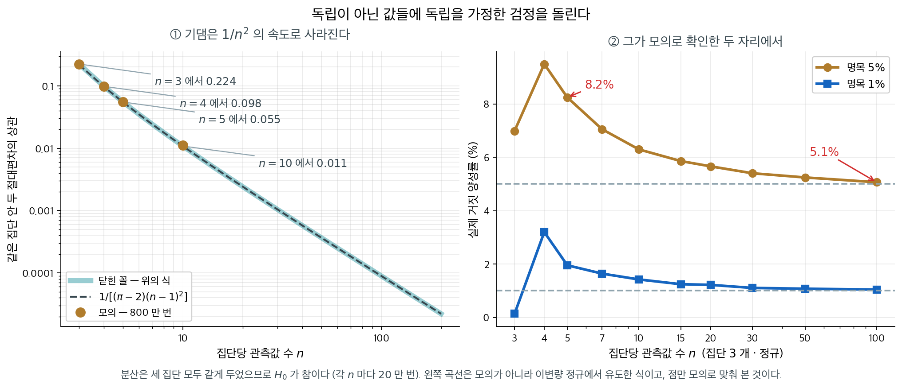
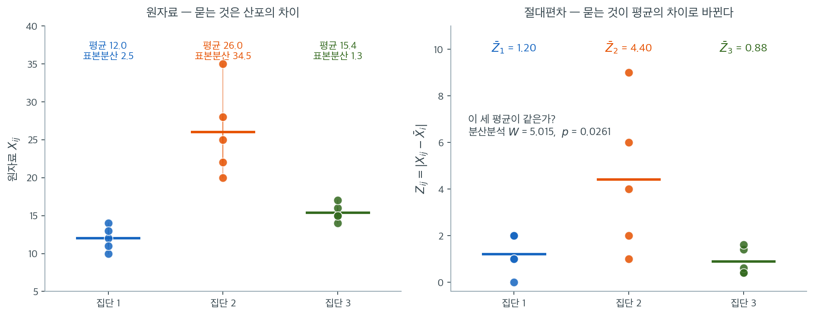
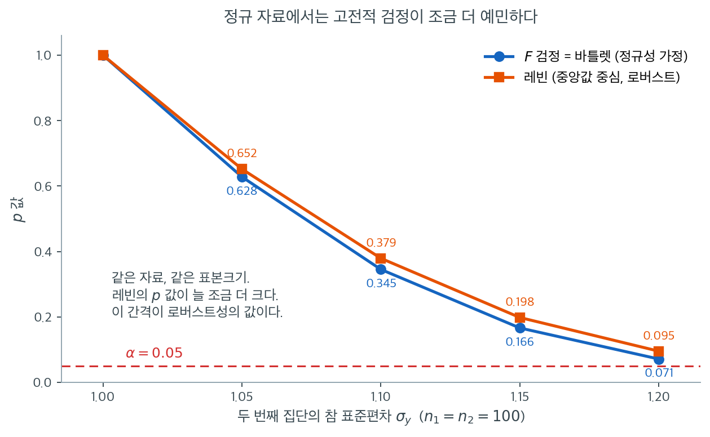

# Levene 검정

카이제곱 검정, F 검정, Bartlett 검정은 모두 정규성을 가정하며 자료가 비정규이면 무너진다. Levene(1960)은 우아하게 단순한 아이디어를 제안했다. 분산을 직접 검정하는 대신 자료를 집단평균으로부터의 절대편차로 변환한 뒤 변환된 값에 표준 일원분산분석을 적용하는 것이다. 이 변환은 분산 비교 문제를 평균 비교 문제로 바꾸며, 평균 비교는 바탕 분포의 모양에 훨씬 덜 민감하다.

---

## 1. 핵심 아이디어

어떤 집단의 분산이 크면 그 관측값들이 집단 중심에서 멀리 떨어지는 경향이 있다. 분산이 작으면 중심 가까이 모인다. Levene 검정은 이 직관을 다음 새 변수로 형식화한다.

$$
Z_{ij} = |X_{ij} - \bar{X}_i|
$$

여기서 $X_{ij}$는 집단 $i$의 $j$번째 관측값이고 $\bar{X}_i$는 집단 $i$의 평균이다. $Z_{ij}$는 각 관측값이 집단평균에서 얼마나 떨어져 있는지를 잰다. 분산이 큰 집단은 평균적으로 큰 $Z_{ij}$ 값을 만들어 낸다.

따라서 $H_0\colon \sigma_1^2 = \cdots = \sigma_k^2$을 검정하는 것은 $Z_{ij}$의 평균이 집단에 걸쳐 같은지를 검정하는 것과 같아진다.

---

## 2. 검정통계량

변환된 값 $Z_{ij}$에 표준 일원분산분석의 F 통계량을 적용한다.

$$
W = \frac{(N - k) \sum_{i=1}^{k} n_i (\bar{Z}_i - \bar{Z})^2}{(k - 1) \sum_{i=1}^{k} \sum_{j=1}^{n_i} (Z_{ij} - \bar{Z}_i)^2}
$$

여기서

- $\bar{Z}_i = \frac{1}{n_i} \sum_{j=1}^{n_i} Z_{ij}$는 집단 $i$의 변환값 평균
- $\bar{Z} = \frac{1}{N} \sum_{i=1}^{k} \sum_{j=1}^{n_i} Z_{ij}$는 모든 변환값의 전체평균
- $N = \sum_{i=1}^{k} n_i$는 전체 표본크기
- $k$는 집단의 수

$H_0$과 완만한 정칙조건 아래에서 $W$는 근사적으로 $F_{k-1, N-k}$를 따른다.

---

## 3. 가설

$$
H_0\colon \sigma_1^2 = \sigma_2^2 = \cdots = \sigma_k^2
$$

$$
H_1\colon \sigma_i^2 \neq \sigma_j^2 \text{ (적어도 한 쌍의)} i \neq j
$$

$W > F_{1-\alpha,\, k-1,\, N-k}$이면 $H_0$을 기각한다.

---

## 4. Levene 검정이 로버스트한 이유

로버스트성은 두 원천에서 나온다.

1. **절대편차는 제곱편차보다 이상점에 덜 민감하다.** 표본분산은 $(X_{ij} - \bar{X}_i)^2$을 쓰므로 극단 관측값에 이차 영향력을 준다. 절대편차 $|X_{ij} - \bar{X}_i|$는 일차 영향력만 준다.

2. **평균에 대한 분산분석 F 검정 자체가 로버스트하다.** 중심극한정리에 의해 $Z_{ij}$ 자체가 정규가 아니더라도 표본크기가 어느 정도면 집단평균 $\bar{Z}_i$가 근사적으로 정규가 된다. 평균에 대한 F 검정이 이 로버스트성을 물려받는다.

여기에 근본적인 차이가 하나 더 있다. 앞의 검정들이 **4차 적률**에 의존한 데 반해 Levene 검정은 $Z$의 **2차 적률**만 쓴다. 곧 원자료의 첨도가 아니라 원자료의 분산에 해당하는 정보만 필요하다. 이것이 로버스트성의 진짜 근원이다.

!!! note "원래의 Levene 검정과 수정판"
    Levene의 1960년 원안은 집단평균 $\bar{X}_i$를 중심으로 쓴다. Brown-Forsythe 수정(다음 절에서 다룬다)은 평균을 집단중앙값으로 바꾸어 치우침과 이상점에 대한 추가 로버스트성을 제공한다.

    저자들이 단서 없이 "Levene 검정"이라 할 때 Brown-Forsythe 판을 뜻하는 경우가 있으므로 쓰는 소프트웨어의 문서를 확인해야 한다. **SciPy의 `stats.levene`은 기본값이 `center='median'`, 곧 Brown-Forsythe이다.** 원래의 Levene 검정을 쓰려면 `center='mean'`을 명시해야 한다.

---

<div class="storybox" markdown>

**그림으로 보는 통계학 1.** 축하 논문집에 실린 열다섯 쪽

절 $2$ 의 $W$ 가 처음 적힌 곳은 학술지가 아니다. $1960$ 년 스탠퍼드대학교 출판부가
낸 **해럴드 호텔링 기념 논문집**의 $278$–$292$ 쪽, 「Robust tests for equality of
variances」라는 제목이 붙은 열다섯 쪽이 전부다. 쓴 사람은 **하워드 르빈**
($1914$–$2003$)으로 컬럼비아대학교에서 $1982$ 년까지 **수리통계학과 유전학**을 함께
가르쳤다. 집단유전학에서 그의 이름이 붙은 것은 이 검정이 아니라 「르빈 모형」($1953$,
생태적 지위가 둘 이상일 때 다형성이 유지되는 길을 처음 보인 모형)이고, 하디–바인베르크
평형의 정확검정을 처음 내놓은 것도 그다($1949$). 축하 논문집의 한 장으로 실린 글이
$2009$ 년에 이미 천 번 넘게 인용되었다.

그 열다섯 쪽이 한 일은 절 $1$–$2$ 에 적힌 그대로다. $Z_{ij} = |X_{ij} - \bar X_i|$ 를
만들고 **보통의 일원분산분석**을 돌린다. 그런데 돌리는 순간 곤란한 것이 둘 따라붙는다.

- $Z_{ij}$ 는 정규가 아니다. 반드시 $0$ 이상이고 오른쪽으로 치우쳐 있다.
- 한 집단 안의 $Z_{ij}$ 끼리 **독립이 아니다.** 같은 $\bar X_i$ 를 빼서 만들었다.

첫째는 절 $4$ 의 둘째 까닭이 받아 준다 — 분산분석이 보는 것은 $\bar Z_i$ 이고 그것은
중심극한정리의 보호 아래 있다. 둘째는 그렇지 않다. 독립이 아닌 값들에 독립을 가정한
$F$ 를 들이대는 일은 표본을 키운다고 지워지지 않는다. 그 기댐이 **애초에 작아야** 한다.

르빈이 건 것이 그 「작음」이다. 같은 집단 안의 두 편차는 상관이

$$
\operatorname{Corr}(X_j - \bar X_i,\ X_k - \bar X_i) = -\frac{1}{n-1} \equiv \rho
$$

인 이변량 정규이고, 절댓값을 씌운 뒤의 상관은 정규에서 닫힌 꼴로 적힌다.

$$
\operatorname{Corr}(Z_j, Z_k)
= \frac{\dfrac{2}{\pi}\left[\sqrt{1-\rho^2} + \rho\arcsin\rho - 1\right]}{1 - \dfrac{2}{\pi}}
$$

$\rho$ 가 작으면 대괄호 안이 $\rho^2/2$ 로 줄어드므로 이 값은 $\dfrac{1}{(\pi-2)(n-1)^2}$
이다. **$\rho$ 자신은 $1/n$ 으로 사라지는데 절댓값끼리의 상관은 $1/n^2$ 으로 사라진다.**
절댓값을 씌우는 일이 차수를 하나 더 먹는다. 부호도 바뀐다 — 편차끼리는 음의 상관인데
절댓값끼리는 양의 상관이다.

<figure markdown>
{ width="960" }
  <figcaption markdown>왼쪽 곡선은 모의실험이 아니라 이변량 정규에서 유도한 식이다. 점은 $800$ 만 번으로 맞춰 본 것이다.</figcaption>
</figure>

왼쪽 칸이 그 식이다. $n = 5$ 에서 $0.055$, $n = 10$ 에서 $0.011$, $n = 25$ 면
$0.0015$ 다. 르빈의 판단은 「이 정도 기댐이면 $F$ 분포가 크게 틀어지지 않는다」였고,
그는 $\alpha = 0.05$ 와 $0.01$ 근처에서 **모의실험으로** 그것을 확인했다고 적었다.
$1960$ 년의 모의실험이다.

오른쪽 칸이 그 확인을 오늘 되풀이한 것이다. 세 집단의 분산을 모두 같게 두었으니
기각한 것은 전부 거짓 양성이다.

| 집단당 $n$ | 명목 $5\%$ | 명목 $1\%$ |
|---:|---:|---:|
| $5$ | $8.2\%$ | $2.0\%$ |
| $10$ | $6.3\%$ | $1.4\%$ |
| $30$ | $5.4\%$ | $1.1\%$ |
| $100$ | $5.1\%$ | $1.0\%$ |

읽을 것이 둘이다. **그의 판단은 옳았다** — $n$ 이 서른이면 $5.4\%$, 백이면 $5.1\%$ 로
명목에 붙는다. 그리고 **「작다」가 「없다」는 아니다** — 어느 $n$ 에서도 $5\%$ 아래로
내려오지 않고, 바로 아래 보기 1 과 같은 크기(집단 셋에 집단당 다섯)에서는 $8.2\%$,
곧 명목의 $1.6$ 배다. 작은 표본에서 이 검정이 「분산이 같다」고 말해 주면 그 말은
믿을 만하지만, 「다르다」고 말해 주면 한 번 더 생각할 일이다.

_확인한 곳 — H. Levene, 「Robust tests for equality of variances」, 올킨 등이 엮은
「Contributions to Probability and Statistics: Essays in Honor of Harold Hotelling」
(스탠퍼드대학교 출판부, $1960$)의 $278$–$292$ 쪽 · 하워드 르빈의 생몰년과 컬럼비아대학교
수리통계학·유전학 교수 이력 · 그가 상관이 $1/n^2$ 차수임을 보였다는 것, $\alpha = 0.05$ 와
$0.01$ 근처에서 모의실험으로 확인했다는 것, $2009$ 년까지 천 번 넘게 인용되었다는 것은
Gastwirth·Gel·Miao, 「The Impact of Levene's Test of Equality of Variances on Statistical
Theory and Practice」, Statistical Science $24$(3), $2009$, $343$–$360$ 쪽에서 가져왔다.
그림과 표의 수는 모두 직접 계산한 값이다_

</div>

---

<div class="exbox" markdown>

**보기 1.** <span class="diff easy" title="쉬움"></span> 세 집단의 Levene 검정. 세 집단의 관측값이 다음과 같다.

| 집단 1 | 집단 2 | 집단 3 |
|---|---|---|
| 10, 12, 14, 11, 13 | 20, 28, 22, 35, 25 | 15, 16, 14, 17, 15 |

</div>

??? success "풀이"
    **1단계.** 집단평균을 계산한다.

    - $\bar{X}_1 = 12.0$, $\bar{X}_2 = 26.0$, $\bar{X}_3 = 15.4$

    **2단계.** 절대편차 $Z_{ij} = |X_{ij} - \bar{X}_i|$를 계산한다.

    | 집단 1 | 집단 2 | 집단 3 |
    |---|---|---|
    | 2, 0, 2, 1, 1 | 6, 2, 4, 9, 1 | 0.4, 0.6, 1.4, 1.6, 0.4 |

    **3단계.** 변환값의 평균을 계산한다.

    - $\bar{Z}_1 = 1.20$, $\bar{Z}_2 = 4.40$, $\bar{Z}_3 = 0.88$
    - $\bar{Z} = (1.20 + 4.40 + 0.88)/3 = 2.16$ (집단 크기가 같으므로 단순평균)

    **4단계.** $Z_{ij}$ 값에 분산분석 공식을 적용해 $W$ 통계량을 계산한다. $k = 3$개 집단, $N = 15$개 관측값이므로 $H_0$ 아래에서 $W$는 $F_{2, 12}$를 따른다.

    **5단계.** $W$를 임계값 $F_{0.95,\, 2,\, 12} = 3.885$와 비교한다. 집단 2의 편차가 다른 집단보다 훨씬 크므로 큰 $W$ 값이 나올 것이고 $H_0$을 기각할 가능성이 높다.

이 변환이 실제로 무엇을 하는지 그림으로 보자. 왼쪽이 원자료이고 오른쪽이 절대편차 $Z_{ij}$이다.



왼쪽 그림에서 세 집단은 **중심의 높이도 다르고 퍼짐도 다르다.** 집단 2는 평균이 26으로 가장 높고 점들이 20에서 35까지 흩어져 있다. 우리가 묻고 싶은 것은 높이가 아니라 퍼짐인데, 두 정보가 한 그림에 섞여 있어 곧바로 검정하기 어렵다. 표본분산 $2.5,\ 34.5,\ 1.3$을 비교하려면 카이제곱 계열의 분포이론이 필요하고, 그 이론은 정규성을 요구한다.

각 점에서 제 집단의 평균까지의 **거리**만 재면 오른쪽 그림이 된다. 이 순간 높이 정보가 사라진다. 세 집단의 중심이 모두 0으로 옮겨졌기 때문이다. 남은 것은 오직 "평균에서 얼마나 떨어져 있는가"뿐이고, 그 평균값이 $\bar{Z}_1 = 1.20$, $\bar{Z}_2 = 4.40$, $\bar{Z}_3 = 0.88$이다.

**이제 질문이 완전히 바뀌었다.** "세 집단의 분산이 같은가"가 "세 집단의 $Z$ 평균이 같은가"가 되었고, 뒤의 질문은 12장에서 배운 일원분산분석이 그대로 답한다. 실제로 계산하면 $W = 5.015$, $p = 0.0261$로 5% 수준에서 기각한다.

변환 하나로 왜 로버스트해지는지도 여기서 보인다. 원자료 쪽 질문은 편차를 **제곱**해서 다루므로 4차 적률(첨도)에 매여 있었다. 오른쪽 질문은 $Z$의 **평균**을 다루므로 1차 적률 문제다. 평균에는 중심극한정리라는 보호막이 있다. 분산 검정을 평균 검정으로 바꾼 것이 레빈의 아이디어 전부이며, 그 한 번의 치환이 정규성 가정을 떼어 낸다.

<div class="exbox" markdown>

**보기 2.** <span class="diff easy" title="쉬움"></span> Levene 검정 — 중심의 선택. 보기 1 의 세 집단에 평균 중심과 중앙값 중심을 둘 다 적용한다.

**(1)** 두 중심에 대해 $W$ 를 **정의대로 손으로 조립**하고, 두 값의 비를 $\dfrac{\mathrm{SS}_{\text{between}}\text{의 몫}}{\ }\times\dfrac{\ }{\mathrm{SS}_{\text{within}}\text{의 몫}}$ 으로 쪼개어 **분자와 분모 가운데 어느 쪽이 결론을 뒤집는지** 밝히시오.

**(2)** SciPy 와 맞추어 보고, 중앙값으로 바꿀 때 분모가 커지는 까닭을 집단 2 와 3 의 편차에서 읽으시오.

</div>

??? success "풀이"

    **(1) 손으로 조립한다.** 두 중심 모두 집단크기가 $n_i = 5$, $N = 15$, $k = 3$ 이므로

    $$
    W = \frac{(N-k)\,\mathrm{SS}_{\text{between}}}{(k-1)\,\mathrm{SS}_{\text{within}}} = \frac{12\,\mathrm{SS}_{\text{between}}}{2\,\mathrm{SS}_{\text{within}}}
    $$

    이고, 두 중심의 차이는 $Z_{ij}$ 가 무엇이냐에만 있다.

    **평균 중심.** 집단평균이 $12.0,\ 26.0,\ 15.4$ 이므로 절대편차와 그 집단평균이

    | 집단 | $Z_{ij}$ | $\bar Z_i$ |
    |:---|:---|---:|
    | 1 | $2,\,0,\,2,\,1,\,1$ | $1.20$ |
    | 2 | $6,\,2,\,4,\,9,\,1$ | $4.40$ |
    | 3 | $0.4,\,0.6,\,1.4,\,1.6,\,0.4$ | $0.88$ |

    이고 전체평균이 $\bar Z = 2.16$ 이다. 따라서

    $$
    \mathrm{SS}_{\text{between}} = 5\bigl[(1.20-2.16)^2+(4.40-2.16)^2+(0.88-2.16)^2\bigr] = 5(7.5776) = 37.888
    $$

    이고 집단내 제곱합은 $2.800 + 41.200 + 1.328 = 45.328$ 이다. 그러므로

    $$
    W_{\text{평균}} = \frac{12 \times 37.888}{2 \times 45.328} = \frac{454.656}{90.656} = 5.015178
    $$

    **중앙값 중심.** 집단중앙값이 $12,\ 25,\ 15$ 이므로

    | 집단 | $Z_{ij}$ | $\bar Z_i$ |
    |:---|:---|---:|
    | 1 | $2,\,0,\,2,\,1,\,1$ | $1.20$ |
    | 2 | $5,\,3,\,3,\,10,\,0$ | $4.20$ |
    | 3 | $0,\,1,\,1,\,2,\,0$ | $0.80$ |

    이고 $\bar Z = 6.2/3 = 2.066667$ 이다. 집단간은 $5(6.906667) = 34.533333$, 집단내는 $2.800 + 54.800 + 2.800 = 60.400$ 이므로

    $$
    W_{\text{중앙값}} = \frac{12 \times 34.533333}{2 \times 60.400} = \frac{414.4}{120.8} = 3.430464
    $$

    **비를 쪼갠다.** $W$ 는 비이므로 두 판본의 몫도 분자의 몫과 분모의 몫으로 깔끔히 갈라진다.

    $$
    \frac{W_{\text{평균}}}{W_{\text{중앙값}}}
    = \underbrace{\frac{37.888}{34.5333}}_{1.0971}\times\underbrace{\frac{60.400}{45.328}}_{1.3325}
    = 1.4620
    $$

    **분모 쪽이 세 배 넘게 세다.** 분자는 $9.7\%$ 만 움직이는데 분모는 $33.3\%$ 움직인다. 중심을 중앙값으로 바꾸어 $W$ 가 $5.02$ 에서 $3.43$ 으로 떨어지는 일의 대부분은 **집단내 변동이 커진 데서** 온다.

    분자가 줄어드는 쪽은 예상할 수 있었다. 중앙값은 $\sum_j \lvert y_{ij} - c\rvert$ 를 최소화하므로 $\bar Z_i$ 가 중앙값에서 가장 작고(2.4절 [평균, 중앙값, 최빈값](../../ch02/center/mean_median_mode.md) 정리 2 가 볼록성으로 유도해 두었다), 실제로 $4.40 \to 4.20$, $0.88 \to 0.80$ 으로 세 집단 모두 줄거나 그대로다. $\bar Z_i$ 들이 전체적으로 작아지면 그 흩어짐도 줄어들기 쉽다.

    **그러나 분모에는 그런 보증이 없다.** 중앙값이 최소화하는 것은 $Z$ 의 **합**이고, 분모는 $Z$ 의 **집단내 제곱합**이다. 최소화되는 양과 분모는 다른 양이므로 부등식이 넘어오지 않으며, 여기서는 오히려 커졌다. 이것이 "$W$ 는 비이므로 $\bar Z$ 의 부등식을 물려받지 않는다"는 말의 구체적인 모습이다.

    **(2) 확인한다.**

    ```python
    import numpy as np
    from scipy import stats

    # 2번 집단만 퍼짐이 크다.
    group1 = [10, 12, 14, 11, 13]
    group2 = [20, 28, 22, 35, 25]
    group3 = [15, 16, 14, 17, 15]
    groups = [np.array(g, dtype=float) for g in (group1, group2, group3)]


    def levene_by_hand(groups, center):
        """W 를 정의대로 조립하고 분자·분모를 따로 돌려준다."""
        Z = [np.abs(g - center(g)) for g in groups]
        n = np.array([len(z) for z in Z])
        zbar = np.array([z.mean() for z in Z])
        N, k = n.sum(), len(Z)
        grand = np.concatenate(Z).mean()
        ss_between = (n * (zbar - grand) ** 2).sum()
        ss_within = sum(((z - z.mean()) ** 2).sum() for z in Z)
        W = (N - k) * ss_between / ((k - 1) * ss_within)
        return W, zbar, grand, ss_between, ss_within


    res = {}
    for name, center in [("mean", np.mean), ("median", np.median)]:
        W, zbar, grand, sb, sw = levene_by_hand(groups, center)
        res[name] = (W, sb, sw)
        print(f"[{name:>6} 중심]")
        print(f"  Z 의 집단평균 = {np.round(zbar, 4)},  전체평균 = {grand:.6f}")
        print(f"  SS_between = {sb:.6f}   SS_within = {sw:.6f}")
        print(f"  W = 12 * {sb:.6f} / (2 * {sw:.6f}) = {W:.6f}")

    # Levene 의 원래 형태는 평균을 중심으로 쓴다. 각 값에서 제 집단의 평균을
    # 뺀 절대편차에 분산분석을 돌리는 것이다.
    stat, p_value = stats.levene(group1, group2, group3, center='mean')
    print(f"\nLevene's W statistic (mean-centered):   {stat:.4f}, p = {p_value:.4f}")

    # 중앙값을 중심으로 쓰면 Brown-Forsythe 가 되고, 이것이 scipy 의 기본값이다.
    # 이름이 levene 이라 평균 중심이 기본이라고 오해하기 쉽다.
    stat_m, p_m = stats.levene(group1, group2, group3, center='median')
    print(f"Brown-Forsythe (median-centered):       {stat_m:.4f}, p = {p_m:.4f}")

    alpha = 0.05
    if p_value < alpha:
        print("Levene (mean): reject H0 - variances differ.")
    else:
        print("Levene (mean): fail to reject H0.")

    # 손 계산과 scipy 가 맞는지, 그리고 비를 분자·분모로 쪼갠다.
    Wm, sbm, swm = res["mean"]
    Wd, sbd, swd = res["median"]
    print(f"\n손 계산과 scipy 의 차: 평균 {abs(Wm - stat):.2e},  중앙값 {abs(Wd - stat_m):.2e}")
    print(f"W(평균)/W(중앙값) = {Wm / Wd:.6f}")
    print(f"  분자 몫 SS_b(평균)/SS_b(중앙값) = {sbm / sbd:.6f}   (중앙값 쪽이 {100 * (1 - sbd / sbm):.1f}% 작다)")
    print(f"  분모 몫 SS_w(중앙값)/SS_w(평균) = {swd / swm:.6f}   (중앙값 쪽이 {100 * (swd / swm - 1):.1f}% 크다)")
    print(f"  두 몫의 곱 = {(sbm / sbd) * (swd / swm):.6f}")
    crit = stats.f(2, 12).ppf(0.95)
    print(f"\nF(0.95; 2, 12) = {crit:.4f}  ->  평균 {Wm:.4f} 는 넘고, 중앙값 {Wd:.4f} 는 못 넘는다")

    # 집단 2 와 3 의 편차를 중심별로 나란히 본다.
    print()
    for i in (1, 2):
        g = groups[i]
        zm, zd = np.abs(g - g.mean()), np.abs(g - np.median(g))
        print(f"집단 {i + 1}: 평균 {g.mean():.2f} / 중앙값 {np.median(g):.2f}")
        print(f"   |x - 평균|   = {np.sort(zm)}  평균 {zm.mean():.3f}  SS {((zm - zm.mean()) ** 2).sum():.3f}")
        print(f"   |x - 중앙값| = {np.sort(zd)}  평균 {zd.mean():.3f}  SS {((zd - zd.mean()) ** 2).sum():.3f}")
    ```

    출력:

    ```text
    [  mean 중심]
      Z 의 집단평균 = [1.2  4.4  0.88],  전체평균 = 2.160000
      SS_between = 37.888000   SS_within = 45.328000
      W = 12 * 37.888000 / (2 * 45.328000) = 5.015178
    [median 중심]
      Z 의 집단평균 = [1.2 4.2 0.8],  전체평균 = 2.066667
      SS_between = 34.533333   SS_within = 60.400000
      W = 12 * 34.533333 / (2 * 60.400000) = 3.430464

    Levene's W statistic (mean-centered):   5.0152, p = 0.0261
    Brown-Forsythe (median-centered):       3.4305, p = 0.0663
    Levene (mean): reject H0 - variances differ.

    손 계산과 scipy 의 차: 평균 0.00e+00,  중앙값 0.00e+00
    W(평균)/W(중앙값) = 1.461954
      분자 몫 SS_b(평균)/SS_b(중앙값) = 1.097143   (중앙값 쪽이 8.9% 작다)
      분모 몫 SS_w(중앙값)/SS_w(평균) = 1.332510   (중앙값 쪽이 33.3% 크다)
      두 몫의 곱 = 1.461954

    F(0.95; 2, 12) = 3.8853  ->  평균 5.0152 는 넘고, 중앙값 3.4305 는 못 넘는다

    집단 2: 평균 26.00 / 중앙값 25.00
       |x - 평균|   = [1. 2. 4. 6. 9.]  평균 4.400  SS 41.200
       |x - 중앙값| = [ 0.  3.  3.  5. 10.]  평균 4.200  SS 54.800
    집단 3: 평균 15.40 / 중앙값 15.00
       |x - 평균|   = [0.4 0.4 0.6 1.4 1.6]  평균 0.880  SS 1.328
       |x - 중앙값| = [0. 0. 1. 1. 2.]  평균 0.800  SS 2.800
    ```

    **손 계산과 SciPy 가 완전히 같다.** 차가 두 경우 모두 `0.00e+00` 이다. 그리고 두 몫의 곱 $1.097143 \times 1.332510 = 1.461954$ 가 $W$ 의 비와 소수 여섯째 자리까지 맞는다. 비를 분자와 분모로 쪼갠 계산이 맞다는 뜻이다.

    **분모가 커지는 까닭이 마지막 두 덩어리에 보인다.** 집단 2 에서 중심을 $26.0$ 에서 $25.0$ 으로 옮기면 편차가 $(1,2,4,6,9)$ 에서 $(0,3,3,5,10)$ 으로 바뀐다. 평균은 $4.40$ 에서 $4.20$ 으로 **줄었는데** 제곱합은 $41.2$ 에서 $54.8$ 로 $33\%$ 늘었다. 중앙값 $25$ 가 관측값 하나와 겹쳐 편차 $0$ 이 강제로 생기고, 동시에 가장 먼 $35$ 의 편차가 $9$ 에서 $10$ 으로 벌어지기 때문이다. **양 끝이 동시에 밀려 나가므로 평균은 줄고 산포는 커진다.** 집단 3 도 같다. 편차가 $(0.4,0.4,0.6,1.4,1.6)$ 에서 $(0,0,1,1,2)$ 로 바뀌며 평균은 $0.88 \to 0.80$, 제곱합은 $1.328 \to 2.800$ 으로 두 배가 된다.

    관측값 개수가 홀수이면 중앙값이 언제나 관측값 하나와 같으므로 $Z_{ij} = 0$ 이 반드시 하나 생긴다. $n_i = 5$ 처럼 작은 집단에서는 그 한 칸이 $Z$ 의 산포에 미치는 몫이 $1/5$ 이라 분모를 눈에 띄게 흔든다. **이 보기에서 결론이 갈리는 것은 집단 2 의 치우침만의 일이 아니라, 집단당 다섯 개라는 표본크기의 일이기도 하다.**

    임계값으로 읽으면 간명하다. $F_{0.95;\,2,\,12} = 3.8853$ 을 평균 판 $5.0152$ 는 넘고 중앙값 판 $3.4305$ 는 넘지 못한다. 두 값이 임계값을 사이에 두고 양쪽에 있으니 결론이 갈린다. 다만 **어느 쪽이 "옳은" 답인지를 이 자료가 말해 주지는 않는다.** 그 판단은 연습문제 3 이 다룬다.

!!! warning "중심의 선택이 결론을 바꾼다"
    같은 자료에서 평균 중심 Levene은 $p = 0.026$으로 기각하고 중앙값 중심 Brown-Forsythe는 $p = 0.066$으로 기각하지 못한다. 5% 문턱을 사이에 두고 결론이 갈린다.

    집단 2의 관측값 $\{20, 28, 22, 35, 25\}$에서 35가 이상점처럼 작용하기 때문이다. 평균 26.0은 이 값에 끌려가지만 중앙값 25는 거의 영향받지 않는다. 그 결과 평균 기준 편차가 더 크게 나온다.

    **어느 쪽을 보고할지는 자료를 보기 전에 정해야 한다.** 두 결과를 계산한 뒤 마음에 드는 쪽을 고르는 것은 $p$값 조작이다.

---

## 5. 강점과 한계

**강점:**

- 중간 정도의 정규성 이탈에 로버스트하다
- 계산이 간단하다(절대편차에 대한 분산분석일 뿐)
- 모든 주요 통계 소프트웨어에서 제공된다
- 대칭인 비정규 분포에서 잘 작동한다

**한계:**

- 여전히 집단평균을 쓰므로 이상점과 치우침에 민감하다. Brown-Forsythe 수정이 중앙값을 써서 이를 해결한다.
- $F$ 분포 근사는 점근적이다. 아주 작은 표본에서는 크기 왜곡이 나타날 수 있다.
- 자료가 정말로 정규일 때는 Bartlett 검정보다 검정력이 낮다.

---

## 6. 차이를 키워 가며 — 그리고 중심을 바꿔 가며

절 $2$ 의 $W$ 를 코드로 옮기되, 손으로 셀 수 없는 것을 묻는다. $\sigma_y$ 를 조금씩
키우면 $W$ 가 어떤 함수로 올라가는지, 그리고 중심을 평균에서 중앙값·절사평균으로
바꾸면 그 함수의 **모양이 바뀌는지 상수만 바뀌는지**를 가린다.

<div class="exbox" markdown>

**보기 3.** <span class="diff easy" title="쉬움"></span> 분산 차이를 키워 가며. 집단당 $n = 100$, $x$ 와 $y$ 에 **같은 씨앗**을 주고 $\sigma_y$ 만 $1.00$ 에서 $1.20$ 까지 키운다. 15.3절의 $F$ 검정·15.4절의 Bartlett 검정과 똑같은 설정이다.

**(1)** 이 설정에서 두 집단의 절대편차가 $Z^y_j = \sigma_y Z^x_j$ 로 **정확히** 비례함을 보이고, 이로부터 $W$ 의 닫힌 꼴을 구하시오. 그 식에서 자료가 어디로 모여 들어가는지 밝히시오.

**(2)** 수치로 확인하고, $\sigma_y = 1$ 에서 $W$ 가 정확히 $0$, $p$ 가 정확히 $1$ 이 되는 까닭을 (1)의 식으로 설명하시오.

</div>

??? success "풀이"

    **(1) 두 표본이 같은 난수를 공유한다.** `rvs(size, random_state=seed)` 는 씨앗 하나로 정해지는 표준정규 추출값 $z_1, \ldots, z_{100}$ 에 $a + s z_j$ 를 입힌다. 씨앗이 같으므로 두 표본에 들어가는 $z$ 가 **같은 수열**이고

    $$
    x_j = z_j, \qquad y_j = 1 + \sigma_y z_j
    $$

    이다. 중앙값은 증가하는 아핀변환에 대해 동변이므로 $\operatorname{med}(y) = 1 + \sigma_y \operatorname{med}(z)$ 이고, 따라서

    $$
    Z^y_j = \lvert y_j - \operatorname{med}(y)\rvert = \lvert \sigma_y (z_j - \operatorname{med}(z))\rvert = \sigma_y \lvert z_j - \operatorname{med}(z)\rvert = \sigma_y Z^x_j
    $$

    이다. **두 집단의 절대편차가 비례상수 $\sigma_y$ 로 완전히 묶여 있다.** 표집변동이 없다.

    **닫힌 꼴.** $Z = Z^x$, $\bar Z$ 를 그 평균, $S = \sum_j (Z_j - \bar Z)^2$ 이라 쓰자. 집단 1 의 편차는 $Z$, 집단 2 의 편차는 $\sigma_y Z$ 이므로 집단평균이 $\bar Z$ 와 $\sigma_y \bar Z$, 전체평균이 $\tfrac12(1+\sigma_y)\bar Z$ 다. 집단간 제곱합은

    $$
    \mathrm{SS}_{\text{between}} = n\left(\bar Z - \frac{1+\sigma_y}{2}\bar Z\right)^2 + n\left(\sigma_y \bar Z - \frac{1+\sigma_y}{2}\bar Z\right)^2 = \frac{n \bar Z^2 (\sigma_y-1)^2}{2}
    $$

    이고, 집단내 제곱합은 척도가 이차로 들어오므로

    $$
    \mathrm{SS}_{\text{within}} = S + \sigma_y^2 S = (1+\sigma_y^2)\,S
    $$

    이다. $N = 2n$, $k = 2$ 를 $W$ 의 정의에 넣으면

    $$
    W = \frac{(2n-2)\cdot \frac{n \bar Z^2(\sigma_y-1)^2}{2}}{1 \cdot (1+\sigma_y^2) S}
    = \underbrace{\frac{n(n-1)\bar Z^2}{S}}_{c}\cdot \frac{(\sigma_y-1)^2}{1+\sigma_y^2}
    $$

    를 얻는다. **자료는 상수 $c$ 하나로 접혀 들어가고, $\sigma_y$ 의 역할은 $(\sigma_y-1)^2/(1+\sigma_y^2)$ 라는 함수 하나로 분리된다.** $c$ 는 $x$ 표본의 절대편차만으로 정해지므로 $\sigma_y$ 를 바꾸어도 꿈쩍하지 않는다.

    **(2) $\sigma_y = 1$ 에서 왜 정확히 $0$ 과 $1$ 인가.** 위 식에 $\sigma_y = 1$ 을 넣으면 분자의 $(\sigma_y-1)^2$ 이 $0$ 이므로 $W = 0$ 이다. 어림값이 아니라 **항등적으로** $0$ 이다. 두 집단의 절대편차가 글자 그대로 같은 수열이어서 집단간 변동이 존재하지 않기 때문이다. 그리고 $F_{1, 198}$ 의 분포함수가 $0$ 에서 $0$ 이므로 양측이 아닌 상단꼬리 $p$ 값이 $P(F \ge 0) = 1$ 이 된다. 독립 표본에서는 $W = 0$ 이 될 확률이 $0$ 이니 결코 일어나지 않는 일이다.

    **확인한다.**

    ```python
    import numpy as np
    import scipy.stats as stats

    # 앞의 Bartlett·F 검정과 같은 설정이다. 세 검정의 p-값을 견줄 수 있다.
    size, seed = 100, 1
    x = stats.norm(loc=0, scale=1).rvs(size, random_state=seed)

    for scale in [1.00, 1.05, 1.10, 1.15, 1.20]:
        y = stats.norm(loc=1, scale=scale).rvs(size, random_state=seed)
        stat, pval = stats.levene(x, y)   # median-centred by default
        print(f"sigma_y={scale:.2f}  W={stat:.4f}  p={pval:.3f}")

    # (1) 의 비례관계와 닫힌 꼴을 확인한다. 기본값이 중앙값이므로 Z 도 중앙값 기준.
    Z = np.abs(x - np.median(x))
    n = size
    c = n * (n - 1) * Z.mean() ** 2 / ((Z - Z.mean()) ** 2).sum()
    print(f"\nc = n(n-1) Zbar^2 / SS(Z) = {c:.6f}")

    print(f"\n{'sigma_y':>8}{'|Zy - s*Zx|max':>17}{'scipy W':>12}{'닫힌 꼴':>12}{'차':>10}")
    for scale in [1.00, 1.05, 1.10, 1.15, 1.20]:
        y = stats.norm(loc=1, scale=scale).rvs(size, random_state=seed)
        Zy = np.abs(y - np.median(y))
        W_sp, _ = stats.levene(x, y, center="median")
        W_cf = c * (scale - 1) ** 2 / (1 + scale ** 2)
        print(f"{scale:>8.2f}{np.abs(Zy - scale * Z).max():>17.2e}"
              f"{W_sp:>12.6f}{W_cf:>12.6f}{abs(W_sp - W_cf):>10.1e}")
    ```

    출력:

    ```text
    sigma_y=1.00  W=0.0000  p=1.000
    sigma_y=1.05  W=0.2044  p=0.652
    sigma_y=1.10  W=0.7780  p=0.379
    sigma_y=1.15  W=1.6657  p=0.198
    sigma_y=1.20  W=2.8187  p=0.095

    c = n(n-1) Zbar^2 / SS(Z) = 171.940898

     sigma_y   |Zy - s*Zx|max     scipy W        닫힌 꼴         차
        1.00         2.22e-16    0.000000    0.000000   4.3e-30
        1.05         2.22e-16    0.204448    0.204448   4.7e-16
        1.10         4.44e-16    0.778013    0.778013   6.7e-16
        1.15         4.44e-16    1.665735    1.665735   5.1e-15
        1.20         4.44e-16    2.818703    2.818703   4.4e-16
    ```

    **비례관계가 비트 단위로 맞는다.** $\lvert Z^y_j - \sigma_y Z^x_j\rvert$ 의 최대값이 $4.4\times10^{-16}$ 로 배정도 반올림 한 칸 수준이다.

    **닫힌 꼴도 맞는다.** $c = 171.940898$ 하나와 함수 $(\sigma_y-1)^2/(1+\sigma_y^2)$ 만으로 네 개의 $W$ 가 전부 재현되고, SciPy 값과의 차가 $5\times10^{-15}$ 이하다. 손으로 $\sigma_y = 1.20$ 을 넣어 보면

    $$
    171.940898 \times \frac{0.04}{2.44} = 2.818703
    $$

    이다. **$W$ 를 키우는 것은 표본이 아니라 $\sigma_y$ 하나뿐**임이 식과 수치에서 함께 확인된다.

    한 가지 더. 15.3절의 $F$ 검정에서는 같은 설정의 $F$ 가 정확히 $1/\sigma_y^2$ 였다. 거기서도 자료가 약분되어 사라졌지만, **여기서는 $c$ 라는 자료의 흔적이 남는다.** $F$ 검정은 분자와 분모가 같은 $S_z^2$ 를 쓰므로 통째로 약분되는데, Levene 은 집단간 변동과 집단내 변동이 서로 다른 조합이라 완전히 약분되지 않기 때문이다.

`center` 인자가 중심화 방식을 조절한다.

<div class="exbox" markdown>

**보기 4.** <span class="diff easy" title="쉬움"></span> 두 판본의 차이. 보기 3 의 같은 자료에 세 중심(평균·중앙값·$10\%$ 절사평균)을 넣는다.

**(1)** 보기 3 의 유도가 **중심의 선택과 무관하게** 성립함을 보이고, 따라서 세 판본의 $W$ 의 비가 $\sigma_y$ 에 **의존하지 않는 상수**임을 결론하시오. 또 그 상수를 $Z$ 의 변동계수로 적으시오.

**(2)** 세 판본을 돌려 그 비가 정말 $\sigma_y$ 에 무관한지 확인하시오. 이 자료에서 평균 판과 중앙값 판이 거의 같은 까닭은 무엇인가. 그리고 이 설정으로는 **확인할 수 없는** 것이 무엇인가.

</div>

??? success "풀이"

    **(1) 세 중심 모두 아핀 동변이다.** 보기 3 의 유도에서 중앙값이라는 사실은 한 곳에만 쓰였다. $y_j = 1 + \sigma_y z_j$ 일 때 중심 $c(\cdot)$ 가

    $$
    c(y) = 1 + \sigma_y\, c(z)
    $$

    를 만족한다는 것이다. 평균은 선형이므로 성립하고, 중앙값은 증가하는 아핀변환에 동변이므로 성립하며, 절사평균은 순서를 보존하는 변환이 같은 관측값을 잘라 내므로 역시 성립한다. 그러므로 어느 중심을 쓰든

    $$
    Z^y_j = \sigma_y Z^x_j
    $$

    가 그대로 성립하고, 보기 3 의 계산이 글자 하나 바뀌지 않고 되풀이되어

    $$
    W_{\text{center}} = c_{\text{center}} \cdot \frac{(\sigma_y-1)^2}{1+\sigma_y^2},
    \qquad
    c_{\text{center}} = \frac{n(n-1)\bar Z^2}{\sum_j (Z_j-\bar Z)^2}
    $$

    를 얻는다. **$\sigma_y$ 에 딸린 함수는 세 판본에서 똑같고, 중심의 선택은 상수 $c$ 만 바꾼다.** 따라서

    $$
    \frac{W_{\text{A}}}{W_{\text{B}}} = \frac{c_{\text{A}}}{c_{\text{B}}}
    $$

    가 되어 **$\sigma_y$ 와 무관한 상수**다. 이것은 돌려 보기 전에 확인할 수 있는 예측이다.

    **$c$ 를 변동계수로 적으면.** $\sum_j (Z_j - \bar Z)^2 = (n-1)\operatorname{Var}(Z)$ 이므로 $(n-1)$ 이 약분되어

    $$
    c = \frac{n \bar Z^2}{\operatorname{Var}(Z)} = \frac{n}{\mathrm{CV}(Z)^2},
    \qquad \mathrm{CV}(Z) = \frac{\operatorname{SD}(Z)}{\bar Z}
    $$

    이다. **중심의 선택이 $W$ 에 미치는 영향은 오직 하나, 절대편차의 변동계수를 얼마나 줄이는가다.** $\mathrm{CV}(Z)$ 가 작아지면 $c$ 가 커지고 $W$ 도 비례해서 커진다.

    **(2) 돌려서 확인한다.**

    ```python
    import inspect

    import numpy as np
    import scipy.stats as stats

    # 기본값이 무엇인지 함수 서명에서 직접 확인한다.
    print("levene 의 center 기본값 =",
          inspect.signature(stats.levene).parameters["center"].default)

    size, seed = 100, 1
    x = stats.norm(loc=0, scale=1).rvs(size, random_state=seed)
    scales = [1.00, 1.05, 1.10, 1.15, 1.20]

    # 중앙값 중심 — Brown-Forsythe 이며 scipy 의 기본값이다.
    # 평균 중심 — Levene 의 원래 형태. center 를 명시해야 이쪽이 된다.
    W = {}
    for center in ("mean", "median", "trimmed"):
        kw = {"proportiontocut": 0.1} if center == "trimmed" else {}
        row = []
        for scale in scales:
            y = stats.norm(loc=1, scale=scale).rvs(size, random_state=seed)
            stat, pval = stats.levene(x, y, center=center, **kw)
            row.append((stat, pval))
        W[center] = row
        cells = "  ".join(f"{s:.4f}/{p:.3f}" for s, p in row)
        print(f"{center:>8}  {cells}")

    # (1) 의 결론: 세 판본의 비는 sigma_y 와 무관해야 한다.
    print("\nW 의 비 (sigma_y = 1.05, 1.10, 1.15, 1.20)")
    for a, b in [("mean", "median"), ("median", "trimmed")]:
        r = [W[a][i][0] / W[b][i][0] for i in range(1, 5)]
        print(f"  {a:>6} / {b:<8} " + "  ".join(f"{v:.8f}" for v in r)
              + f"   폭 = {max(r) - min(r):.1e}")

    # 이 표본에서 평균과 중앙값이 얼마나 가까운가
    print(f"\nx 의 평균 {x.mean():+.6f},  중앙값 {np.median(x):+.6f},  차 {x.mean() - np.median(x):+.6f}")
    print(f"x 의 표본왜도 = {stats.skew(x):+.4f}")

    # 절사평균은 표본을 먼저 자른다. 그래서 자유도까지 바뀐다.
    xt = stats.trimboth(np.sort(x), 0.1)
    print(f"\n절사 뒤 집단크기 = {len(xt)}  ->  분모 자유도 N-k = {2 * len(xt) - 2} (원래는 198)")

    # c = n / CV(Z)^2 이므로, 중심을 바꾸면 Z 의 변동계수가 바뀌어 W 가 움직인다.
    print(f"\n{'중심':>8}{'n':>5}{'Zbar':>9}{'sd(Z)':>9}{'CV(Z)':>9}{'c = n/CV^2':>13}")
    for lbl, xx, ctr in [("median", x, np.median(x)),
                         ("trimmed", stats.trimboth(np.sort(x), 0.1), None)]:
        if ctr is None:
            ctr = xx.mean()
        Z = np.abs(xx - ctr)
        cv = Z.std(ddof=1) / Z.mean()
        print(f"{lbl:>8}{len(xx):>5}{Z.mean():>9.4f}{Z.std(ddof=1):>9.4f}{cv:>9.4f}{len(xx) / cv ** 2:>13.4f}")
    ```

    출력:

    ```text
    levene 의 center 기본값 = median
        mean  0.0000/1.000  0.2045/0.652  0.7780/0.379  1.6658/0.198  2.8188/0.095
      median  0.0000/1.000  0.2044/0.652  0.7780/0.379  1.6657/0.198  2.8187/0.095
     trimmed  0.0000/1.000  0.2446/0.622  0.9309/0.336  1.9930/0.160  3.3724/0.068

    W 의 비 (sigma_y = 1.05, 1.10, 1.15, 1.20)
        mean / median   1.00004257  1.00004257  1.00004257  1.00004257   폭 = 8.4e-15
      median / trimmed  0.83580724  0.83580724  0.83580724  0.83580724   폭 = 3.7e-15

    x 의 평균 +0.060583,  중앙값 +0.064074,  차 -0.003491
    x 의 표본왜도 = -0.0045

    절사 뒤 집단크기 = 80  ->  분모 자유도 N-k = 158 (원래는 198)

          중심    n     Zbar    sd(Z)    CV(Z)   c = n/CV^2
      median  100   0.7051   0.5378   0.7626     171.9409
     trimmed   80   0.4914   0.3065   0.6236     205.7184
    ```

    **기본값은 `median` 이다.** 함수 서명이 그렇게 말한다. 그러므로 `levene(x, y)` 라고만 쓰면 **원래의 Levene 검정이 아니라 Brown-Forsythe 검정**이 돌아간다. 보기 3 의 출력이 중앙값 줄과 같은 것이 그 증거다.

    **(1)의 예측이 맞는다.** 네 개의 $\sigma_y$ 에서 비가 소수 여덟째 자리까지 같고, 폭이 $10^{-14}$ 수준이다. 평균 대 중앙값은 $1.00004257$, 중앙값 대 절사평균은 $0.83580724$ 로 고정되어 있다. 중심을 바꾸는 일이 $\sigma_y$ 축을 **휘게 하지 않고 통째로 상수배 하는 것뿐**임이 확인되었다.

    **평균 판과 중앙값 판이 거의 같은 까닭.** 이 표본의 평균이 $+0.060583$, 중앙값이 $+0.064074$ 로 차이가 $0.0035$ 에 지나지 않는다. 표본왜도도 $-0.0045$ 다. $N(0,1)$ 에서 뽑았으니 당연하고, **두 중심이 거의 같으면 두 $Z$ 도 거의 같아 $c$ 가 거의 같다.** 여기서 두 판본의 차이는 $W$ 의 소수 넷째 자리, $p$ 값으로는 세 자리 안쪽이다. 두 판본이 크게 갈리는 것은 치우친 자료에서다. 모분산이 **정확히 같은** 로그정규 세 집단에서 12.5절 [등분산성 확인](../../ch12/assumptions/homoscedasticity.md) 보기 2 가 제1종 오류율을 중앙값 판 $0.0340$ 대 평균 판 $0.2505$ 로 재었고, 이 쪽 연습문제 4 의 지수 자료에서는 제1종 오류율이 $0.187$ 대 $0.047$ 로 네 배 차이가 난다.

    **절사평균 판은 $W$ 를 $19.6\%$ 키운다.** $1/0.8358 = 1.1964$ 다. 까닭이 $\mathrm{CV}(Z)$ 표에 있다. 절사는 중심에서 가장 먼 관측값들을 먼저 잘라 내므로 $Z$ 의 산포를 평균보다 더 많이 깎는다. $\mathrm{CV}(Z)$ 가 $0.7626$ 에서 $0.6236$ 으로 줄고, $c = n/\mathrm{CV}^2$ 이 $171.94$ 에서 $205.72$ 로 커진다. 집단당 $n$ 이 $100$ 에서 $80$ 으로 줄어 $c$ 를 깎는 효과가 있는데도 변동계수 쪽이 이겼다. 분모 자유도도 $198$ 에서 $158$ 로 줄어든다. $\sigma_y = 1.20$ 에서 $p$ 가 $0.095$ 에서 $0.068$ 로 내려가는 것이 그 합이다.

    **이 설정으로는 확인할 수 없는 것.** 절사평균 판의 제1종 오류율이다. $\sigma_y = 1.00$ 줄을 보면 세 판본 모두 $W = 0$, $p = 1.000$ 이다. 보기 3 에서 본 대로 $(\sigma_y-1)^2$ 이 $0$ 이면 중심이 무엇이든 $W$ 가 항등적으로 $0$ 이기 때문이다. **같은 씨앗이 표집변동을 없앴으니 "귀무가설이 참일 때 얼마나 자주 기각하는가"를 이 표에서는 읽을 수 없다.** 그것은 독립 표본으로 반복 추출해야 재는 값이고, 아래의 경고 상자가 가리키는 15.5절 [Brown-Forsythe 검정](./brown_forsythe.md)의 모의실험이 그 일을 한다.

!!! danger "`center='trimmed'`는 권하지 않는다"
    SciPy는 10% 절사평균 중심화도 제공하지만, 15.5절 [Brown-Forsythe 검정](./brown_forsythe.md)에서 측정했듯 **완전한 정규 자료에서도 제1종 오류율이 0.12~0.19까지 부풀려진다.**

    SciPy가 편차를 계산하기 전에 자료를 잘라내므로 F 통계량의 분모가 과도하게 줄어들기 때문이다. 절사평균이 "평균과 중앙값의 절충"이라는 설명은 이론적으로는 맞지만 이 구현에는 해당되지 않는다.

앞의 F 검정·Bartlett 검정 페이지와 마찬가지로 `x`와 `y`가 같은 seed를 공유하여 표집변동이 제거되어 있다. 다만 Levene의 $p$값 $(1.000, 0.652, 0.379, 0.198, 0.095)$은 F 검정·Bartlett의 $(1.000, 0.628, 0.345, 0.166, 0.071)$과 **조금씩 크다**. 로버스트 검정이 정규 자료에서 잃는 검정력이 이 차이로 나타난다.



두 곡선이 거의 겹쳐 있다는 것이 첫 번째 메시지다. 자료가 정말로 정규일 때 레빈 검정은 $F$ 검정과 거의 같은 결론을 낸다. $\sigma_y = 1.10$에서 $0.345$ 대 $0.379$, $\sigma_y = 1.20$에서 $0.071$ 대 $0.095$이다. **차이가 있긴 하지만 판정을 뒤집을 만한 크기가 아니다.**

두 번째 메시지는 그 작은 간격의 방향이 언제나 같다는 것이다. 주황(레빈)이 늘 파랑(고전적 검정) 위에 있다. 로버스트 검정은 정규성이라는 정보를 쓰지 않기로 **선택한** 검정이므로, 그 정보가 실제로 참일 때는 약간 손해를 본다. 공짜 점심은 없다.

문제는 이 손해와 이득의 크기가 전혀 대칭이 아니라는 점이다. 정규일 때 잃는 것은 $p$값 소수 셋째 자리이지만, 정규가 아닐 때 $F$ 검정이 잃는 것은 검정의 타당성 자체다. 15.3절 [비정규성에 대한 민감도](../f_test/sensitivity.md)에서 지수 자료의 제1종 오류율이 $0.267$이었음을 떠올려 보라. **한쪽은 몇 퍼센트의 검정력이고 다른 쪽은 다섯 배의 거짓 양성이다.** 이 비대칭이 "정규성이 확실하지 않으면 로버스트 검정을 기본값으로"라는 권고의 근거다.

$\sigma_y = 1.00$에서 두 $p$값이 모두 정확히 $1.000$인 것은 같은 시드 때문에 두 표본이 사실상 동일한 자료여서 그렇다. 실제 자료에서는 여기서도 표집변동이 있다.

### 읽는 법

- $W$가 크면($p$값이 작으면) 집단들의 산포가 다르다는 뜻이다.
- Levene 검정은 분산분석이나 합동 $t$ 검정에 앞선 예비 확인으로 적절하다.
- 치우친 분포에서는 중앙값 중심 변형(Brown-Forsythe)이 평균 중심 판보다 제1종 오류율을 더 잘 조절한다.

---

---

---

## 연습문제

<div class="drillbox" markdown>

**연습문제 1.** <span class="diff easy" title="쉬움"></span>
세 집단의 학생에게 서로 다른 교수법을 적용했다. 학기 후 점수가 다음과 같이 기록되었다.

- **집단 1:** $[78, 82, 85, 90, 87]$
- **집단 2:** $[65, 70, 72, 68, 74]$
- **집단 3:** $[92, 88, 94, 89, 91]$

Levene 검정으로 세 집단의 점수 분산이 같은지 판정하라.

</div>

??? success "풀이"

    **가설:**

    - 귀무가설 ($H_0$): 세 집단의 분산이 같다.
    - 대립가설 ($H_1$): 적어도 한 집단의 분산이 다른 집단과 다르다.

    **Python 구현:**

    ```python
    import numpy as np
    from scipy.stats import levene, bartlett

    group1 = [78, 82, 85, 90, 87]
    group2 = [65, 70, 72, 68, 74]
    group3 = [92, 88, 94, 89, 91]

    print("variances:", [round(np.var(g, ddof=1), 2)
                         for g in (group1, group2, group3)])

    s_med, p_med = levene(group1, group2, group3)                  # median
    s_mean, p_mean = levene(group1, group2, group3, center='mean')
    s_b, p_b = bartlett(group1, group2, group3)

    print(f"Brown-Forsythe (default): W = {s_med:.4f}, p = {p_med:.4f}")
    print(f"Levene (mean-centered):   W = {s_mean:.4f}, p = {p_mean:.4f}")
    print(f"Bartlett:                 T = {s_b:.4f}, p = {p_b:.4f}")
    ```

    출력:

    ```text
    variances: [21.3, 12.2, 5.7]
    Brown-Forsythe (default): W = 0.7500, p = 0.4933
    Levene (mean-centered):   W = 0.9837, p = 0.4022
    Bartlett:                 T = 1.4745, p = 0.4784
    ```

    **판정.** 세 검정 모두 $p > 0.05$로 기각하지 못한다. 세 집단의 분산이 다르다고 볼 증거가 없다.

    **해석.** 표본분산이 $21.3$, $12.2$, $5.7$로 최대·최소 비가 $3.7$에 이르는데도 유의하지 않다. 각 집단 $n = 5$로는 검정력이 사실상 없기 때문이다. 15.4절 [분산의 동일성에 대한 Bartlett 검정](../bartlett_test/bartlett_test.md) 연습문제 22에서 보았듯 이 정도 표본으로는 네 배 이상의 분산 차이가 있어야 탐지한다.

    **결론을 어떻게 써야 하는가.** "분산이 같다"가 아니라 **"이 자료로는 분산 차이를 탐지할 수 없다"**가 옳은 서술이다. 후속 분산분석을 한다면 등분산 가정이 확인되었다고 보지 말고 Welch 분산분석을 쓰는 편이 안전하다. $\square$

<div class="drillbox" markdown>

**연습문제 2.** <span class="diff med" title="중간"></span>
두 모집단에서 표본을 뽑아 분석했다. Levene 검정은 높은 $p$값(등분산 $H_0$ 기각 실패)을 냈으나, 등분산을 가정한 $t$ 검정은 $p < 0.001$을 냈다. 이 두 결과를 어떻게 해석해야 하는가?

</div>

??? success "풀이"

    - Levene 검정은 두 모집단의 **분산이 같다**는 가정을 뒷받침한다.
    - $t$ 검정 결과는 두 모집단의 **평균**이 유의하게 다르다는 **강한 증거**를 제공한다.
    - 두 결과는 모순이 아니다. 두 모집단이 같은 분산을 가지면서 평균은 크게 다를 수 있다. Levene 검정이 $t$ 검정에 쓰인 등분산 가정을 뒷받침하므로, 관찰된 평균 차이가 진짜라는 결론이 오히려 강화된다.

    **분산과 평균은 서로 다른 모수이다.** 분포의 위치(평균)와 산포(분산)는 독립적으로 변할 수 있다. 예컨대 $\mathcal{N}(0, 4)$와 $\mathcal{N}(10, 4)$는 분산이 같고 평균이 크게 다르다. 검정 결과의 조합이 이 상황을 정확히 반영한다. $\square$

<div class="drillbox" markdown>

**연습문제 3.** <span class="diff med" title="중간"></span>
본문 보기에서 평균 중심 Levene($p = 0.026$)과 중앙값 중심 Brown-Forsythe($p = 0.066$)의 결론이 갈렸다. 어느 쪽을 신뢰해야 하는지 판단하고, 그 판단의 근거를 제시하라.

</div>

??? success "풀이"
    **자료를 먼저 살펴본다.** 집단 2는 $\{20, 22, 25, 28, 35\}$(정렬)이다. 평균은 26.0, 중앙값은 25이다. 값 35가 다음으로 큰 값 28보다 7만큼 떨어져 있어 오른쪽 꼬리가 길다.

    ```python
    import numpy as np
    from scipy import stats

    g2 = np.array([20, 28, 22, 35, 25])
    print(f"mean = {g2.mean()}, median = {np.median(g2)}")
    print(f"|x - mean| = {np.abs(g2 - g2.mean())}")
    print(f"|x - median| = {np.abs(g2 - np.median(g2))}")
    ```

    출력:

    ```text
    mean = 26.0, median = 25.0
    |x - mean| = [6. 2. 4. 9. 1.]
    |x - median| = [ 5.  3.  3. 10.  0.]
    ```

    두 편차 집합의 평균은 각각 $4.4$와 $4.2$로 크게 다르지 않다. 결론이 갈리는 것은 분자보다 **분모**(집단 안의 편차 변동) 차이 때문이다.

    **어느 쪽을 신뢰할 것인가.**

    - $n = 5$로 매우 작으므로 어느 검정이든 신뢰도가 낮다. $p = 0.026$과 $p = 0.066$의 차이를 실질적 차이로 읽어서는 안 된다.
    - 원리적으로는 **Brown-Forsythe가 더 안전한 기본값**이다. 집단 2에 치우침의 징후가 있으므로 평균이 좋은 중심 측도가 아니다.
    - 그러나 **가장 정직한 결론은 "경계선상이며 이 자료로는 판정할 수 없다"**이다.

    **실무 지침.** 이런 경우 두 $p$값을 모두 보고하고, 표본크기의 한계를 명시하며, 후속 분석에서는 등분산 가정에 의존하지 않는 절차(Welch)를 쓰는 것이 옳다. 문턱을 넘은 쪽만 골라 보고하는 것이 가장 나쁜 선택이다. $\square$

<div class="drillbox" markdown>

**연습문제 4.** <span class="diff med" title="중간"></span>
Levene 검정이 원자료의 4차 적률에 의존하지 않는다는 본문의 주장을 확인하라. 절대편차 $Z = |X - \mu|$의 분산이 원자료의 어떤 적률에 의존하는지 계산하라.

</div>

??? success "풀이"
    $X$가 평균 $\mu$, 분산 $\sigma^2$을 갖고 $Z = |X - \mu|$라 하자.

    $$
    \operatorname{Var}(Z) = E[Z^2] - (E[Z])^2 = E[(X-\mu)^2] - (E|X-\mu|)^2 = \sigma^2 - \left(E|X-\mu|\right)^2.
    $$

    $E[Z^2] = \sigma^2$이 되는 것이 핵심이다. 절댓값의 제곱이 그냥 제곱이므로 **2차 적률만 필요하다**.

    두 번째 항 $E|X-\mu|$는 평균절대편차(MAD)로, 분포의 모양에 의존하지만 어디까지나 **1차** 양이다. 정규분포에서는 $E|X-\mu| = \sigma\sqrt{2/\pi} = 0.7979\sigma$이므로

    $$
    \operatorname{Var}(Z) = \sigma^2 - \frac{2\sigma^2}{\pi} = \sigma^2\left(1 - \frac{2}{\pi}\right) = 0.3634\,\sigma^2.
    $$

    **비교.** Bartlett 검정과 F 검정은 $S^2$의 분산을 다루므로 $\operatorname{Var}(S^2) \approx \sigma^4(\gamma_2+2)/n$, 곧 **4차 적률**이 필요했다. Levene 검정은 $\bar{Z}$의 분산 $\operatorname{Var}(Z)/n$을 다루므로 **2차 적률**만 필요하다.

    이것이 결정적인 차이이다. 4차 적률은 꼬리가 조금만 두꺼워져도 폭발적으로 커지고 심하면 존재하지 않지만($t_5$의 8차 적률처럼), 2차 적률은 분산이 유한한 어떤 분포에서든 존재하고 안정적이다.

    **$Z$의 분포가 비정규라는 점은 문제가 되지 않는다.** $Z \geq 0$이고 오른쪽으로 치우쳐 있지만, 분산분석 F 검정이 필요로 하는 것은 $Z$ 자체의 정규성이 아니라 $\bar{Z}_i$의 근사적 정규성이며 이는 중심극한정리가 보장한다. 곧 Levene 검정은 정규성 가정을 **더 쉽게 충족되는 가정으로 바꾼** 것이다. $\square$

<div class="drillbox" markdown>

**연습문제 5.** <span class="diff med" title="중간"></span>
연습문제 4 는 $\operatorname{Var}(Z) = \sigma^2 - (E\lvert X-\mu\rvert)^2$ 을 얻었다. 그렇다면 르벤 검정은 분포의 모양과 **완전히** 무관한가?

**(1)** 분산이 모두 $\sigma^2$ 인 네 분포 — 균등, 정규, 라플라스, 지수 — 에서 $\operatorname{Var}(Z)/\sigma^2$ 을 구하라. 같은 네 분포에서 Bartlett 검정과 $F$ 검정이 쓰는 $\operatorname{Var}(S^2)$ 이 정규이론 값의 몇 배인지를 $(\gamma_2+2)/2$ 로 나란히 적고, 두 열이 네 분포에 걸쳐 각각 몇 배나 흔들리는지 비교하라.

**(2)** $\operatorname{Var}(Z)$ 이 분포에 따라 달라지는데도 §2 의 기준분포 $F_{k-1,\,N-k}$ 는 그 값을 몰라도 된다. $W$ 의 식에서 그 까닭을 밝히고, Bartlett 검정은 왜 같은 혜택을 받지 못하는지 쓰라.

</div>

??? success "풀이"

    **(1) 네 분포의 $E\lvert X-\mu\rvert$ 를 구한다.** 분산을 모두 $\sigma^2$ 으로 맞춘다.

    - **균등** $\mathrm{U}(\mu-\sqrt3\sigma,\ \mu+\sqrt3\sigma)$: 반폭이 $a = \sqrt3\sigma$ 이고 $E\lvert X-\mu\rvert = a/2 = 0.866025\sigma$.
    - **정규**: 연습문제 4 에서 $E\lvert X-\mu\rvert = \sqrt{2/\pi}\,\sigma = 0.797885\sigma$.
    - **라플라스** 척도 $b$: $\sigma^2 = 2b^2$ 이고 $E\lvert X-\mu\rvert = b = \sigma/\sqrt2 = 0.707107\sigma$.
    - **지수** 평균 $\sigma$ (곧 $\lambda = 1/\sigma$): 양쪽을 따로 적분하면 각각 $\sigma e^{-1}$ 이므로

    $$
    E\lvert X-\sigma\rvert = \int_0^\sigma (\sigma-x)\lambda e^{-\lambda x}\,dx + \int_\sigma^\infty (x-\sigma)\lambda e^{-\lambda x}\,dx = \frac{2\sigma}{e} = 0.735759\sigma
    $$

    $\operatorname{Var}(Z) = \sigma^2 - (E\lvert X-\mu\rvert)^2$ 에 넣고, 오른쪽에는 2 장의 초과첨도 $\gamma_2$ 와 5 장의 $\operatorname{Var}(S^2) \approx \sigma^4(\gamma_2+2)/n$ 을 적는다.

    | 분포 | $\gamma_2$ | $\operatorname{Var}(Z)/\sigma^2$ | $\operatorname{Var}(S^2)$ 의 배수 $(\gamma_2+2)/2$ |
    |:---|---:|---:|---:|
    | 균등 | $-1.2$ | $0.2500$ | $0.4$ |
    | 정규 | $0$ | $0.3634$ | $1.0$ |
    | 지수 | $6$ | $0.4587$ | $4.0$ |
    | 라플라스 | $3$ | $0.5000$ | $2.5$ |

    왼쪽 열은 $0.25$ 에서 $0.50$ 까지 **2 배** 흔들리고, 오른쪽 열은 $0.4$ 에서 $4.0$ 까지 **10 배** 흔들린다. 게다가 두 열은 네 분포의 순서조차 다르게 매긴다. 지수분포는 $\operatorname{Var}(Z)$ 로 보면 라플라스보다 얌전한데 $\operatorname{Var}(S^2)$ 로 보면 그 $1.6$ 배다. 4 차 적률과 2 차 적률이 서로 다른 것을 재고 있다는 뜻이다.

    **(2) $W$ 는 비이므로 $\operatorname{Var}(Z)$ 가 약분된다.** $\operatorname{Var}(Z) = v$ 라 쓰면 $H_0$ 아래에서 $k$ 개 집단의 $Z$ 가 같은 분포를 가지므로

    $$
    E\bigl[\mathrm{SS}_{\text{between}}\bigr] \propto (k-1)v, \qquad E\bigl[\mathrm{SS}_{\text{within}}\bigr] \propto (N-k)v
    $$

    이고 $W$ 의 분자와 분모에 $v$ 가 똑같이 들어간다. 기댓값에서만 그런 것이 아니다. $Z_{ij}$ 를 모두 $\lambda$ 배 하면 $\mathrm{SS}_{\text{between}}$ 과 $\mathrm{SS}_{\text{within}}$ 이 둘 다 $\lambda^2$ 배가 되므로 **$W$ 는 모든 표본에서 정확히 불변이다.** 그래서 $F_{k-1,\,N-k}$ 를 쓰는 데 필요한 것은 $v$ 의 값이 아니라 (i) 집단들의 $Z$ 분포가 공통이라는 것과 (ii) $\bar Z_i$ 가 근사적으로 정규라는 것뿐이다.

    **Bartlett 은 로그를 쓰기 때문에 약분될 자리가 없다.** 그 통계량은 $\sum_i (n_i-1)\ln(s_p^2/s_i^2)$ 꼴이고, 이것을 $\chi^2$ 에 맞추려면 $\operatorname{Var}(\ln S_i^2) \approx \operatorname{Var}(S^2)/\sigma^4 = (\gamma_2+2)/n_i$ 를 알아야 한다. 유도 과정은 거기에 정규이론 값, 곧 $\gamma_2 = 0$ 일 때의 값을 못 박아 넣는다. 로그가 척도를 이미 빼내 버렸으므로 비로 약분할 것이 남지 않고, 그래서 $(\gamma_2+2)/2$ 가 통계량의 배수로 그대로 살아남는다. 지수 자료에서 $4$ 배이고, 이것이 5 장이 지수분포($\beta_2 = 9$)에서 적어 둔 그 네 배다.

    **곧 르벤 검정도 분포 모양에서 완전히 자유롭지는 않다.** 다만 모양이 집단에 걸쳐 **공통**이면 그 의존성이 비에서 통째로 약분되고, 남는 것은 $\bar Z_i$ 의 정규근사가 얼마나 빨리 들어서느냐뿐이다(연습문제 6). 모양이 집단마다 다를 때 무슨 일이 벌어지는지는 연습문제 10 이 본다.

<div class="drillbox" markdown>

**연습문제 6.** <span class="diff med" title="중간"></span>
§2 는 $Z_{ij}$ 에 보통의 일원분산분석 $F$ 를 그대로 얹는다. 그 $F$ 가 정확한 $F$ 이려면 집단 안의 값들이 서로 독립이어야 하는데, 한 집단의 $Z_{ij}$ 들은 같은 $\bar X_i$ 를 함께 쓴다.

**(1)** 정규 자료에서 같은 집단의 두 편차 $X_{ij}-\bar X_i$ 와 $X_{il}-\bar X_i$ ($j \neq l$) 의 상관계수를 구하고 $n_i = 5$ 와 $n_i = 15$ 에서 값을 적으라.

**(2)** 절댓값은 짝함수이므로 결합정규의 절댓값은 원래 상관의 부호와 무관하게 **양의** 상관을 갖는다. 평균이 $0$ 인 결합정규 $(U, V)$ 의 상관이 $\rho$ 일 때 성립하는

$$
\operatorname{Cov}(\lvert U\rvert, \lvert V\rvert) = \frac{2}{\pi}\Bigl(\rho \arcsin\rho + \sqrt{1-\rho^2} - 1\Bigr)\sigma_U \sigma_V
$$

을 써서 $n_i = 5$ 에서 $\operatorname{Corr}(Z_{ij}, Z_{il})$ 을 구하라. 그리고 $H_0$ 아래에서 $E[\mathrm{MS}_{\text{between}}]/E[\mathrm{MS}_{\text{within}}]$ 을 계산해 실제 크기가 명목값 $0.05$ 보다 **클지 작을지** 판정하라.

</div>

??? success "풀이"

    **(1) 편차끼리는 음의 상관이다.** $X_{i1},\dots,X_{in}$ 이 독립이고 분산이 $\sigma^2$ 이므로

    $$
    \operatorname{Cov}(X_j - \bar X,\ X_l - \bar X) = 0 - \frac{\sigma^2}{n} - \frac{\sigma^2}{n} + \frac{\sigma^2}{n} = -\frac{\sigma^2}{n}
    $$

    이고 $\operatorname{Var}(X_j - \bar X) = \sigma^2(1 - 1/n)$ 이다. 따라서

    $$
    \operatorname{Corr}(X_j - \bar X,\ X_l - \bar X) = \frac{-1/n}{1 - 1/n} = -\frac{1}{n-1}
    $$

    $n = 5$ 에서 $-0.25$, $n = 15$ 에서 $-0.0714$ 이다. 편차의 합이 $0$ 으로 묶여 있으니 하나가 크면 나머지가 작아져야 하기 때문이다.

    **(2) 절댓값을 취하면 상관의 부호가 뒤집힌다.** $\rho = -0.25$ 를 공식에 넣으면 $\arcsin(-0.25) = -0.252680$ 이므로

    $$
    \rho\arcsin\rho + \sqrt{1-\rho^2} - 1 = 0.063170 + 0.968246 - 1 = 0.031416,\qquad \frac{2}{\pi}(0.031416) = 0.020000
    $$

    여기에 $\sigma_U\sigma_V = \sigma^2(1-1/5) = 0.8\sigma^2$ 을 곱하면 $\operatorname{Cov}(Z_{ij}, Z_{il}) = 0.016000\sigma^2$ 이다. 한편

    $$
    \operatorname{Var}(Z_{ij}) = \sigma_U^2\Bigl(1 - \frac{2}{\pi}\Bigr) = 0.8 \times 0.363380\,\sigma^2 = 0.290704\,\sigma^2
    $$

    이므로 $\varrho \equiv \operatorname{Corr}(Z_{ij}, Z_{il}) = 0.016000/0.290704 = 0.055039$ 이다. **음이 아니라 양이다.**

    **기대평균제곱의 비를 계산한다.** 한 집단 안의 $Z$ 들이 교환가능하고 상관이 $\varrho$ 이므로

    $$
    E[\mathrm{MS}_{\text{between}}] = n\operatorname{Var}(\bar Z_i) = \sigma_Z^2\bigl[1 + (n-1)\varrho\bigr], \qquad E[\mathrm{MS}_{\text{within}}] = \sigma_Z^2(1-\varrho)
    $$

    이고 $n = 5$, $\varrho = 0.055039$ 에서

    $$
    \frac{E[\mathrm{MS}_{\text{between}}]}{E[\mathrm{MS}_{\text{within}}]} = \frac{1 + 4(0.055039)}{1 - 0.055039} = \frac{1.220155}{0.944961} = 1.2912
    $$

    독립이면 이 비가 **정확히 1** 이어야 한다. $29\%$ 크다는 것은 $W$ 의 분포가 $F_{2,12}$ 보다 오른쪽으로 밀려 있다는 뜻이고, 따라서 **실제 크기가 명목값 $0.05$ 보다 크다.** 같은 계산을 $n = 15$ 와 $n = 30$ 에 하면 비가 $1.0674$, $1.0313$ 으로 줄어든다. 종속의 크기가 $-1/(n-1)$ 이므로 왜곡은 $n$ 과 함께 사라지지만 그 속도는 $1/n$ 이다.

    **근사는 두 겹이다.** 방금 본 종속이 첫째이고, $Z_{ij}$ 자체가 반정규로 비정규인 것이 둘째다. 둘째는 중심극한정리가 $\bar Z_i$ 를 정규로 끌어 주므로 §4 가 말한 대로 완화되지만, $n_i = 5$ 로는 아직 모자라다. §5 의 "$F$ 분포 근사는 점근적이다. 아주 작은 표본에서는 크기 왜곡이 나타날 수 있다"가 가리키는 것이 이 두 겹이고, 그 왜곡의 방향이 **위쪽**임을 여기서 처음 못 박았다. 연습문제 8 이 이 예측을 모의실험으로 잰다.

<div class="drillbox" markdown>

**연습문제 7.** <span class="diff hard" title="어려움"></span>
평균 중심 르벤 검정이 **불균형 설계**에서 겪는 문제를 짚는다. 자료는 정규라고 가정한다.

**(1)** $E[\bar Z_i]$ 를 $\sigma_i$ 와 $n_i$ 로 나타내고, $n_i = 5,\ 10,\ 20,\ 100$ 과 $n_i \to \infty$ 에서 $\sigma_i$ 의 계수를 적으라.

**(2)** 모분산이 **모두 같은데** $n_1 = 5$, $n_2 = 100$ 이라면 변환된 문제의 귀무가설 $E\bar Z_1 = E\bar Z_2$ 는 참인가? 어긋남의 크기를 $\bar Z_1$ 의 표준편차 단위로 재라(연습문제 6 에서 얻은 $\operatorname{Var}(\bar Z_1)$ 을 쓰라). 표본을 키우면 이 문제가 커지는가 작아지는가?

**(3)** $Z_{ij}$ 에 곱해 주면 (1) 의 계수가 집단에 무관해지는 보정인자를 찾고, 균형설계에서는 그 보정이 왜 필요 없는지 설명하라.

</div>

??? success "풀이"

    **(1) 편차의 분산에 $1 - 1/n_i$ 가 붙는다.** 연습문제 6 에서 $X_{ij} - \bar X_i \sim \mathcal{N}\bigl(0,\ \sigma_i^2(1 - 1/n_i)\bigr)$ 이므로 반정규의 평균을 쓰면

    $$
    E[\bar Z_i] = E\lvert X_{ij} - \bar X_i\rvert = \sigma_i\sqrt{\frac{2}{\pi}}\sqrt{1 - \frac{1}{n_i}} = \sigma_i\sqrt{\frac{2(n_i-1)}{\pi n_i}}
    $$

    | $n_i$ | $5$ | $10$ | $20$ | $100$ | $\infty$ |
    |:---|---:|---:|---:|---:|---:|
    | $E[\bar Z_i]/\sigma_i$ | $0.713650$ | $0.756940$ | $0.777682$ | $0.793885$ | $0.797885$ |

    **(2) 거짓이다.** $\sigma_1 = \sigma_2 = \sigma$ 인데도

    $$
    E\bar Z_1 = 0.713650\sigma, \qquad E\bar Z_2 = 0.793885\sigma, \qquad \frac{E\bar Z_1}{E\bar Z_2} = 0.898933
    $$

    으로 작은 집단 쪽이 $10.1\%$ 작다. 변환된 문제에서 보면 "집단 1 의 산포가 작다"는 **가짜 신호**가 처음부터 들어 있는 것이고, 분산분석 $F$ 의 분자는 그것을 그대로 읽는다.

    크기를 재어 본다. 연습문제 6 에서 $n = 5$ 일 때 $\operatorname{Var}(Z_{ij}) = 0.290704\sigma^2$, $\varrho = 0.055039$ 이므로

    $$
    \operatorname{Var}(\bar Z_1) = \frac{0.290704}{5}\bigl[1 + 4(0.055039)\bigr]\sigma^2 = 0.070941\sigma^2, \qquad \mathrm{sd}(\bar Z_1) = 0.266347\sigma
    $$

    이고 어긋남은 $0.793885\sigma - 0.713650\sigma = 0.080235\sigma$, 곧 $0.080235/0.266347 = 0.3012$ 표준편차다. 작지 않지만 압도적이지도 않다.

    **표본을 키우면 작아진다.** $\sqrt{1 - 1/n_i} \approx 1 - 1/(2n_i)$ 이므로 상대 편의는 $O(1/n_i)$ 인데 $\mathrm{sd}(\bar Z_i)$ 는 $O(n_i^{-1/2})$ 이다. 비는

    $$
    \frac{\sqrt{2/\pi}\big/(2n_i)}{\sqrt{(1-2/\pi)/n_i}} = \frac{0.6618}{\sqrt{n_i}}
    $$

    로 $n_i = 5$ 에서 $0.296$(종속을 넣어 정확히 계산한 위의 $0.3012$ 와 맞는다), $n_i = 100$ 에서 $0.066$ 이다. **해는 언제나 가장 작은 집단에서 온다.** 큰 집단을 더 키우는 것은 도움이 되지 않는다.

    **(3) 보정인자는 $\sqrt{n_i/(n_i-1)}$ 이다.** $Z_{ij}$ 를 그만큼 키우면 $E[\bar Z_i] = \sigma_i\sqrt{2/\pi}$ 로 $n_i$ 가 사라지고, 모분산이 같으면 변환된 귀무가설이 정규성 아래에서 **정확히** 참이 된다.

    균형설계에서는 이 인자가 모든 집단에 같은 상수다. 연습문제 5(2) 에서 보았듯 $W$ 는 $Z \mapsto \lambda Z$ 에 불변이므로 공통 상수는 통째로 약분되고, 보정은 아무 일도 하지 않는다. **문제는 자유도를 하나 잃었다는 사실 자체가 아니라, 집단마다 그 손실의 크기가 다르다는 것이다.**

    마지막으로 이 보정이 정규성에 기대고 있음을 짚어 둔다. $\sqrt{2/\pi}$ 가 정규에서 나왔고, 비정규 자료에서는 $E\lvert X - \bar X\rvert$ 와 $\sigma$ 의 비가 모양에 따라 달라지므로 같은 인자가 정확하지 않다. **검정이 로버스트하다고 해서 그 검정에 붙는 모든 보정까지 모양과 무관해지는 것은 아니다.**

<div class="drillbox" markdown>

**연습문제 8.** <span class="diff hard" title="어려움"></span>
보기 2 는 $n_i$ 가 홀수이면 중앙값이 관측값 하나와 겹쳐 $Z_{ij} = 0$ 이 강제로 하나 생기고, 그 한 칸이 분모를 부풀린다고 했다. 그 한 칸이 검정의 **실제 크기**까지 바꾸는지 모의실험으로 확인하라.

세 집단, 집단크기가 모두 같은 $n_i \in \{5, 6, 7, 8, 9, 10, 15, 30\}$, 표준정규 자료(곧 $H_0$ 이 참), 명목 $\alpha = 0.05$, 반복 20,000 회. 평균 중심과 중앙값 중심의 기각률, 그리고 중앙값 판의 $\mathrm{SS}_{\text{between}}$ 과 $\mathrm{SS}_{\text{within}}$ 이 평균 판의 몇 배인지를 함께 재어 다음에 답하라.

**(1)** 평균 판의 실제 크기는 명목값보다 큰가 작은가? 연습문제 6 의 예측과 맞는가?

**(2)** 중앙값 판의 크기는 $n_i$ 에 대해 단조인가? 그 모양을 보기 2 의 설명으로 해명하라.

</div>

??? success "풀이"

    ```python
    import numpy as np
    from scipy import stats

    rng = np.random.default_rng(20251004)
    R, k, alpha = 20000, 3, 0.05


    def parts(x, how):
        """(reps, k, n) 자료에 르벤 W 를 정의대로 조립하고 분자·분모도 돌려준다."""
        c = x.mean(axis=2, keepdims=True) if how == "mean" else np.median(x, axis=2, keepdims=True)
        Z = np.abs(x - c)
        n = x.shape[2]
        N = k * n
        zbar = Z.mean(axis=2)
        grand = Z.mean(axis=(1, 2))[:, None]
        ss_b = n * ((zbar - grand) ** 2).sum(axis=1)
        ss_w = ((Z - zbar[:, :, None]) ** 2).sum(axis=(1, 2))
        return (N - k) * ss_b / ((k - 1) * ss_w), ss_b, ss_w


    print(f"{'n_i':>4} {'size(mean)':>11} {'size(median)':>13} {'SSb ratio':>10} {'SSw ratio':>10}")
    for n in (5, 6, 7, 8, 9, 10, 15, 30):
        x = rng.standard_normal((R, k, n))
        crit = stats.f(k - 1, k * n - k).ppf(1 - alpha)
        Wm, sbm, swm = parts(x, "mean")
        Wd, sbd, swd = parts(x, "median")
        print(f"{n:>4} {(Wm > crit).mean():11.4f} {(Wd > crit).mean():13.4f}"
              f" {sbd.mean() / sbm.mean():10.3f} {swd.mean() / swm.mean():10.3f}")

    # 손으로 조립한 W 가 scipy 와 같은지 한 번 확인한다.
    chk = rng.standard_normal((5, k, 7))
    for how in ("mean", "median"):
        mine = parts(chk, how)[0]
        sp = np.array([stats.levene(*xi, center=how)[0] for xi in chk])
        print(f"scipy 와 일치({how}): {np.abs(mine - sp).max() < 1e-12}")
    ```

    출력:

    ```text
     n_i  size(mean)  size(median)  SSb ratio  SSw ratio
       5      0.0813        0.0045      0.872      1.747
       6      0.0750        0.0369      0.966      1.347
       7      0.0703        0.0114      0.914      1.475
       8      0.0657        0.0316      0.967      1.278
       9      0.0671        0.0174      0.936      1.346
      10      0.0616        0.0308      0.969      1.227
      15      0.0580        0.0288      0.966      1.192
      30      0.0552        0.0418      0.986      1.083
    scipy 와 일치(mean): True
    scipy 와 일치(median): True
    ```

    **(1) 평균 판은 명목값보다 크고, 위에서 내려온다.** $0.0813 \to 0.0750 \to \cdots \to 0.0552$ 로 $n_i = 30$ 에서도 아직 $0.05$ 위에 있다. 연습문제 6 은 $n = 5$ 에서 기대평균제곱의 비를 $1.2912$ 로, $n = 15$ 에서 $1.0674$, $n = 30$ 에서 $1.0313$ 으로 예측했다. 방향(위쪽)과 **$n$ 에 따라 줄어드는 모양**이 그대로 나타난다. $n_i = 15$ 의 $0.0580$ 은 15.5절 [Brown-Forsythe 검정](./brown_forsythe.md)의 크기 표가 같은 조건에서 적은 $0.060$ 과 몬테카를로 오차 안에서 맞는다.

    **(2) 중앙값 판은 단조가 아니다. 톱니다.**

    | $n_i$ | $5$ | $6$ | $7$ | $8$ | $9$ | $10$ |
    |:---|---:|---:|---:|---:|---:|---:|
    | 크기 | $0.0045$ | $0.0369$ | $0.0114$ | $0.0316$ | $0.0174$ | $0.0308$ |
    | $\mathrm{SS}_{\text{within}}$ 배수 | $1.747$ | $1.347$ | $1.475$ | $1.278$ | $1.346$ | $1.227$ |

    홀수에서 짝수로 갈 때마다 크기가 뛰고 다시 떨어진다. $\mathrm{SS}_{\text{within}}$ 배수가 같은 톱니를 그리는 것이 원인을 바로 가리킨다. **홀수 $n_i$ 에서는 중앙값이 관측값 하나와 반드시 같으므로 $Z_{ij} = 0$ 이 한 칸 강제로 생긴다.** 보기 2 에서 집단 2 의 제곱합이 $41.2$ 에서 $54.8$ 로 뛰었던 그 일이다. 분모가 커지면 $W$ 가 작아지고, $W$ 가 작아지면 기각이 줄어든다. 짝수 $n_i$ 에서는 중앙값이 가운데 두 값의 평균이라 어떤 $Z_{ij}$ 도 $0$ 으로 못 박히지 않으므로 그 손해가 없다. 강제된 한 칸이 차지하는 몫이 $1/n_i$ 이므로 톱니는 $n_i$ 와 함께 잦아들어 $n_i = 30$ 에서 $0.0418$ 이 된다.

    **두 가지를 챙겨 둘 만하다.** 첫째, $n_i = 5$ 에서 중앙값 판의 실제 크기 $0.0045$ 는 명목값의 **$1/11$** 이다. 보기 1 과 보기 2 에서 중앙값 판이 기각하지 못한 것은 집단 2 의 치우침만의 일이 아니라, 그 설계에서 그 검정이 거의 기각하지 않도록 되어 있다는 일이기도 하다. 연습문제 1 이 "$n = 5$ 로는 검정력이 사실상 없다"고 한 것의 절반은 이 극단적 보수성이다.

    둘째, **크기 왜곡이 $n$ 에 단조라고 믿어서는 안 된다.** 평균 판은 위에서, 중앙값 판은 아래에서, 서로 다른 이유로 명목값에 다가간다. 작은 표본에서 두 판본의 $p$ 값을 나란히 놓고 비교하는 일이 왜 위험한지도 여기서 보인다. 한쪽은 기각하도록 기울어져 있고 다른 쪽은 기각하지 않도록 기울어져 있다.

<div class="drillbox" markdown>

**연습문제 9.** <span class="diff hard" title="어려움"></span>
보기 1 의 자료에서 집단 2 만 그 평균 $26$ 을 중심으로 $c$ 배 늘인다. 곧 $X_{2j} \mapsto 26 + c(X_{2j} - 26)$ 으로 바꾸어 분산비를 얼마든지 키운다.

**(1)** $c \to \infty$ 에서 평균 중심 $W$ 의 극한을 §2 의 식으로 구하라. 집단 2 의 절대편차 $z_{2j} = \lvert X_{2j} - 26\rvert$ 의 평균 $\bar z_2 = 4.4$ 와 제곱합 $\mathrm{SS}_{w,2} = 41.2$ 만 쓰면 된다.

**(2)** 그 극한값과 거기서의 $p$ 값을 구하고, $c = 1, 2, 5, 10, 100$ 의 $W$ 와 나란히 놓아 수렴을 보라.

**(3)** 같은 자료에 Bartlett 검정을 쓰면 통계량이 $c$ 와 함께 어떤 속도로 커지는가? 두 검정의 차이가 르벤 검정에 대해 무엇을 말하는가?

</div>

??? success "풀이"

    **(1) 분자와 분모가 둘 다 $c^2$ 로 커진다.** 늘인 뒤 집단 2 의 절대편차는 $Z_{2j} = c\,z_{2j}$ 이고 다른 두 집단의 $Z$ 는 그대로다. $n_i = 5$, $N = 15$, $k = 3$ 이므로 $p \equiv n_2/N = 1/3$ 이라 두자. 전체평균은 $\bar Z = (c\,n_2\bar z_2 + A)/N$ 이고 $A$ 는 $c$ 와 무관한 상수다. $c^2$ 차수만 남기면

    $$
    \mathrm{SS}_{\text{between}} \to c^2 \bar z_2^2\Bigl[n_2(1-p)^2 + (N - n_2)p^2\Bigr] = c^2\bar z_2^2\,Np(1-p) = c^2\bar z_2^2\,n_2\Bigl(1 - \frac{n_2}{N}\Bigr)
    $$

    가운데 등호는 $Np(1-p)^2 + N(1-p)p^2 = Np(1-p)$ 라는 항등식이다. 분모는 $\mathrm{SS}_{\text{within}} \to c^2\,\mathrm{SS}_{w,2}$ 이다. 따라서 $c^2$ 이 약분되어

    $$
    W \to \frac{N-k}{k-1}\cdot\frac{n_2\bigl(1 - n_2/N\bigr)\bar z_2^2}{\mathrm{SS}_{w,2}}
    $$

    **유한한 극한이 있다.** 집단 하나의 분산을 무한대로 보내도 $W$ 는 발산하지 않는다.

    **(2) 수를 넣는다.** $\bar z_2^2 = 19.36$, $n_2(1 - 1/3) = 10/3$ 이므로

    $$
    W \to \frac{12}{2}\cdot\frac{(10/3)(19.36)}{41.2} = 6 \times \frac{64.533333}{41.2} = 6 \times 1.566343 = 9.398058
    $$

    이고 $p \to 1 - F_{2,12}(9.398058) = 0.003500$ 이다. 유한한 $c$ 에서는

    | $c$ | $1$ | $2$ | $5$ | $10$ | $100$ | $\infty$ |
    |:---|---:|---:|---:|---:|---:|---:|
    | $W$ | $5.015178$ | $7.138473$ | $8.497950$ | $8.950442$ | $9.353594$ | $9.398058$ |
    | $p$ | $0.026119$ | $0.009071$ | $0.005024$ | $0.004178$ | $0.003562$ | $0.003500$ |

    $c = 10$ 에서 이미 극한의 $95\%$ 에 닿는다. **이 자료에서는 분산비가 얼마든 $p$ 값이 $0.0035$ 아래로 내려가지 않는다.**

    **(3) Bartlett 은 $\ln c$ 로 발산한다.** 같은 자료에 Bartlett 을 돌리면 $c = 1, 10, 100$ 에서 통계량이 $10.5152$, $42.5559$, $75.7013$ 이다. $c$ 가 열 배가 될 때 통계량이 $32.04$, $33.15$ 씩 **덧셈으로** 늘어난다($c=1$ 은 아직 점근 구간이 아니라 조금 작다). 이유는 식에서 읽힌다. $\ln s_p^2$ 와 $\ln s_2^2$ 가 각각 $\ln c^2$ 을 품으므로 분자 $(N-k)\ln s_p^2 - \sum_i (n_i-1)\ln s_i^2$ 에서 $\ln c^2$ 의 계수가 $(N-k) - (n_2-1) = 12 - 4 = 8$ 이고, 보정인자가

    $$
    C = 1 + \frac{1}{3(k-1)}\Bigl(\sum_i \frac{1}{n_i - 1} - \frac{1}{N-k}\Bigr) = 1 + \frac{1}{6}\Bigl(\frac34 - \frac1{12}\Bigr) = \frac{10}{9}
    $$

    이므로 통계량은 $\dfrac{8}{10/9}\ln c^2 = 14.4\ln c$ 의 속도로 커진다. 실제로 $14.4 \ln 10 = 33.15$ 로 맞는다.

    **포화의 뜻.** 르벤의 $W$ 에서 집단 2 의 신호($\bar Z_2$)와 잡음($\mathrm{SS}_{w,2}$)이 둘 다 $c$ 에 비례해 커지므로 비가 어느 값에서 멈춘다. 집단당 다섯 개가 담을 수 있는 증거에 천장이 있는 것이고, 천장의 높이는 $\bar z_2^2/\mathrm{SS}_{w,2}$, 곧 그 집단 편차들의 **모양**에만 달렸다. 만약 집단 2 의 편차가 모두 같았다면 $\mathrm{SS}_{w,2} = 0$ 이라 천장이 없다.

    반면 Bartlett 은 느리게나마 끝없이 커지고($\ln c$), $F$ 검정이라면 $c^2$ 로 커진다. §5 의 "자료가 정말로 정규일 때는 Bartlett 검정보다 검정력이 낮다"가 극단에서 취하는 모습이 이 포화다. **르벤 검정은 분산비가 극단일 때 "매우 유의하다"를 말하지 못한다.** 바꾸어 말해, 정규성을 포기한 대가는 평균적인 검정력 몇 퍼센트가 아니라 $p$ 값의 자릿수다.

<div class="drillbox" markdown>

**연습문제 10.** <span class="diff hard" title="어려움"></span>
§1 은 $H_0\colon \sigma_1^2 = \cdots = \sigma_k^2$ 을 검정하는 것이 "$Z$ 의 평균이 집단에 걸쳐 같은가"를 검정하는 것과 **같아진다**고 했다. 두 물음이 정말 같은가?

**(1)** 분산이 모두 $1$ 인 정규분포와 라플라스분포에서 $E\lvert X - \mu\rvert$ 을 구해 두 값이 다름을 보라(연습문제 5 의 계산을 쓰면 된다). $k = 2$ 이고 $n_1 = n_2 = n$ 이면 $W$ 가 $Z$ 에 대한 합동 이표본 $t$ 통계량의 제곱이라는 사실을 써서 기각률을 $n$ 의 함수로 예측하라.

**(2)** 모의실험으로 정규 대 정규(둘 다 분산 $1$)와 정규 대 라플라스(둘 다 분산 $1$)의 기각률을 $n = 25, 100, 400, 1600$ 에서 재어 예측과 견주라. 명목 $\alpha = 0.05$, 반복 20,000 회, 평균 중심.

**(3)** 르벤 검정이 등분산 귀무가설에 대해 잃는 성질은 무엇인가? §4 의 로버스트성 주장은 그렇다면 무엇에 대한 주장이었는가?

</div>

??? success "풀이"

    **(1) 분산이 같아도 $E\lvert X-\mu\rvert$ 가 다르다.** 연습문제 5 의 표에서 $\sigma = 1$ 로 두면

    $$
    E\lvert X-\mu\rvert = \sqrt{2/\pi} = 0.797885 \ (\text{정규}), \qquad E\lvert X-\mu\rvert = \frac{1}{\sqrt2} = 0.707107 \ (\text{라플라스})
    $$

    이고 차는 $d = 0.090778 \neq 0$ 이다. $\operatorname{MAD}/\sigma$ 비가 분포의 **모양**에 달려 있기 때문이다.

    $k = 2$ 이고 집단크기가 같으면 일원분산분석 $F$ 는 합동 이표본 $t$ 의 제곱이므로 $W = t^2$, $t = (\bar Z_1 - \bar Z_2)/\sqrt{2S_p^2/n}$ 이다. $n$ 이 크면 분모가

    $$
    \mathrm{se} = \sqrt{\frac{\operatorname{Var}(Z_1) + \operatorname{Var}(Z_2)}{n}} = \sqrt{\frac{0.363380 + 0.5}{n}} = \sqrt{\frac{0.863380}{n}}
    $$

    로 가고($\operatorname{Var}(Z)$ 는 연습문제 5 의 표에서 읽었다. 중심을 집단평균으로 잡은 데서 오는 $1-1/n$ 은 큰 $n$ 에서 무시한다), $\bar Z_1 - \bar Z_2$ 는 중심극한정리로 평균 $d$, 표준편차 $\mathrm{se}$ 의 정규에 가까워진다. 따라서 기각률은

    $$
    \Phi\Bigl(-1.96 + \frac{d}{\mathrm{se}}\Bigr) + \Phi\Bigl(-1.96 - \frac{d}{\mathrm{se}}\Bigr)
    $$

    로 예측된다. $d/\mathrm{se}$ 가 $\sqrt{n}$ 에 비례하므로 이 값은 $n \to \infty$ 에서 $1$ 로 간다.

    **(2) 재어 본다.**

    ```python
    import numpy as np
    from scipy import stats

    rng = np.random.default_rng(7)
    R, alpha = 20000, 0.05
    d = np.sqrt(2 / np.pi) - 1 / np.sqrt(2)          # E|Z| 의 차: 정규 - 라플라스
    z_a = stats.norm.ppf(1 - alpha / 2)


    def levene_W(x, y):
        """두 집단, 평균 중심. x, y 는 (reps, n)."""
        n = x.shape[1]
        Z = np.abs(np.stack([x - x.mean(1, keepdims=True), y - y.mean(1, keepdims=True)], 1))
        zbar = Z.mean(axis=2)
        grand = Z.mean(axis=(1, 2))[:, None]
        ss_b = n * ((zbar - grand) ** 2).sum(axis=1)
        ss_w = ((Z - zbar[:, :, None]) ** 2).sum(axis=(1, 2))
        return (2 * n - 2) * ss_b / ss_w


    def rate(n, kind):
        hits, done = 0, 0
        while done < R:                               # 메모리를 아끼려 쪼개어 돈다
            m = min(2000, R - done)
            x = rng.standard_normal((m, n))
            y = (rng.standard_normal((m, n)) if kind == "normal"
                 else rng.laplace(0.0, 1 / np.sqrt(2), (m, n)))
            hits += int((levene_W(x, y) > stats.f(1, 2 * n - 2).ppf(1 - alpha)).sum())
            done += m
        return hits / R


    print(f"d = E|Z|(정규) - E|Z|(라플라스) = {np.sqrt(2/np.pi):.6f} - {1/np.sqrt(2):.6f} = {d:.6f}")
    print(f"{'n':>5} {'N vs N':>9} {'N vs Laplace':>14} {'predicted':>11}")
    for n in (25, 100, 400, 1600):
        se = np.sqrt((1 - 2 / np.pi) / n + 0.5 / n)   # Var(Z) 는 연습문제 5 의 표
        pred = stats.norm.sf(z_a - d / se) + stats.norm.cdf(-z_a - d / se)
        print(f"{n:>5} {rate(n, 'normal'):9.4f} {rate(n, 'laplace'):14.4f} {pred:11.4f}")
    ```

    출력:

    ```text
    d = E|Z|(정규) - E|Z|(라플라스) = 0.797885 - 0.707107 = 0.090778
        n    N vs N   N vs Laplace   predicted
       25    0.0537         0.0959      0.0778
      100    0.0512         0.1774      0.1645
      400    0.0498         0.4909      0.4976
     1600    0.0503         0.9698      0.9743
    ```

    정규 대 정규는 $0.0537,\ 0.0512,\ 0.0498,\ 0.0503$ 으로 명목값을 지킨다. 두 집단의 분포가 같으면 르벤 검정은 타당하다. 그러나 **정규 대 라플라스는 분산이 둘 다 정확히 $1$ 인데도** $0.0959 \to 0.1774 \to 0.4909 \to 0.9698$ 로 올라간다. 예측값 $0.0778,\ 0.1645,\ 0.4976,\ 0.9743$ 과 $n \ge 400$ 에서 소수 둘째 자리까지 맞는다. $n = 25$ 에서 측정이 예측보다 큰 것은 정규근사와 $S_p^2$ 를 모분산으로 바꾼 데서 오는 오차다.

    **(3) 잃는 것은 타당성, 곧 수준을 지키는 성질이다.** 분산이 정확히 같은 두 모집단에서 기각률이 $n$ 과 함께 $1$ 로 간다. 르벤 검정이 실제로 검정하는 귀무가설은 등분산이 아니라

    $$
    H_0'\colon E\lvert X_1 - \mu_1\rvert = \cdots = E\lvert X_k - \mu_k\rvert
    $$

    이고, $E\lvert X-\mu\rvert = c\sigma$ 의 $c$ 가 모양에 따라 달라지므로 $H_0$ 과 $H_0'$ 은 다른 가설이다. 게다가 이것은 **표본을 키우면 나아지는 문제가 아니라 더 나빠지는 문제다.** 15.4절에서 Bartlett 검정이 비정규 자료에서 $n$ 과 함께 악화되던 것($0.675 \to 0.813$)과 구조가 같고, 원인만 다르다. Bartlett 은 첨도 때문이고 르벤은 $E\lvert X-\mu\rvert/\sigma$ 비 때문이다.

    **§4 의 주장은 집단들의 모양이 공통일 때에 대한 주장이다.** 모양이 공통이면 $c$ 가 집단에 걸쳐 같으므로 $E\bar Z_i$ 가 모두 같다는 것과 $\sigma_i$ 가 모두 같다는 것이 동치가 되고, 그 $c$ 는 연습문제 5(2) 에서 본 대로 $W$ 의 비에서 약분된다. **르벤 검정이 떼어 낸 것은 "정규분포라는 가정"이지 "분포가 공통이라는 가정"이 아니다.** 같은 계측기로 같은 공정을 재어 얻은 집단들이라면 받아들일 만한 가정이지만, 한쪽만 꼬리가 두껍거나 한쪽만 절단된 자료라면 르벤의 기각은 "분산이 다르다"가 아니라 "산포의 어떤 측도가 다르다"로만 읽어야 한다. $\square$

<div class="drillbox" markdown>

**연습문제 11.** <span class="diff easy" title="쉬움"></span> 두 집단의 자료가 다음과 같다. 집단 A = $\{3, 7, 8, 5, 6\}$, 집단 B = $\{12, 14, 11, 19, 15\}$. 평균 중심화로 Levene 검정통계량 $W$를 손으로 계산하라.

</div>

??? success "풀이"

    집단평균: $\bar{X}_A = 5.8$, $\bar{X}_B = 14.2$.

    절대편차:

    - 집단 A: $|3-5.8|=2.8$, $|7-5.8|=1.2$, $|8-5.8|=2.2$, $|5-5.8|=0.8$, $|6-5.8|=0.2$.
    - 집단 B: $|12-14.2|=2.2$, $|14-14.2|=0.2$, $|11-14.2|=3.2$, $|19-14.2|=4.8$, $|15-14.2|=0.8$.

    편차의 집단평균: $\bar{Z}_A = 1.44$, $\bar{Z}_B = 2.24$, 전체 $\bar{Z} = 1.84$.

    집단간 제곱합: $5(1.44-1.84)^2 + 5(2.24-1.84)^2 = 5(0.16) + 5(0.16) = 1.6$.

    A의 집단내 제곱합: $(2.8-1.44)^2 + (1.2-1.44)^2 + (2.2-1.44)^2 + (0.8-1.44)^2 + (0.2-1.44)^2 = 1.8496 + 0.0576 + 0.5776 + 0.4096 + 1.5376 = 4.432$.

    B의 집단내 제곱합: $(2.2-2.24)^2 + (0.2-2.24)^2 + (3.2-2.24)^2 + (4.8-2.24)^2 + (0.8-2.24)^2 = 0.0016 + 4.1616 + 0.9216 + 6.5536 + 2.0736 = 13.712$.

    $$
    W = \frac{(10 - 2) \cdot 1.6}{(2 - 1) \cdot (4.432 + 13.712)} = \frac{12.8}{18.144} = 0.7055.
    $$

    ```python
    import numpy as np
    import scipy.stats as stats

    A = np.array([3, 7, 8, 5, 6])
    B = np.array([12, 14, 11, 19, 15])
    print(f"variances: {np.var(A, ddof=1):.2f}, {np.var(B, ddof=1):.2f}")
    mean_res = stats.levene(A, B, center='mean')
    med_res = stats.levene(A, B, center='median')
    print(f"Levene (mean):   W = {mean_res.statistic:.4f}, "
          f"p = {mean_res.pvalue:.4f}")
    print(f"Levene (median): W = {med_res.statistic:.4f}, "
          f"p = {med_res.pvalue:.4f}")
    ```

    출력:

    ```text
    variances: 3.70, 9.70
    Levene (mean):   W = 0.7055, p = 0.4253
    Levene (median): W = 0.6400, p = 0.4468
    ```

    손 계산과 SciPy가 정확히 일치한다. $F_{1, 8}$에서 $p = 0.425$로 크므로 등분산을 기각하지 못한다.

    **표본분산이 $3.70$ 대 $9.70$으로 2.6배 차이인데도 유의하지 않다.** 15.3절 [이표본 F 검정](../f_test/f_test_two_variances.md) 연습문제 3에 따르면 $n = 5$에서 F 검정이 탐지하려면 9.6배가 필요하고, 로버스트 검정은 그보다도 검정력이 낮다. $\square$

---


<div class="drillbox" markdown>

**연습문제 12.** <span class="diff easy" title="쉬움"></span> 어떤 연구자에게 표본크기 25, 30, 28, 22인 처치집단 넷이 있다. Levene 검정을 수행하여 $W = 3.12$, $p = 0.028$을 얻었다. 일원분산분석을 계획하고 있다. 이 결과를 두고 취할 수 있는 두 가지 행동 방향을 기술하고 각각의 절충을 설명하라.

</div>

??? success "풀이"

    **방안 1: Welch 분산분석을 쓴다.** $p = 0.028 < 0.05$가 이분산을 시사하므로, 등분산을 가정하는 표준 일원분산분석 대신 Welch 분산분석으로 바꾼다. 절충: 분산이 실제로 같을 때 Welch 분산분석의 검정력이 약간 낮지만(15.7절 모의실험에서 2~3퍼센트포인트), 이분산 아래에서 올바른 제1종 오류를 유지한다.

    **방안 2: 자료를 변환한다.** 분산안정화 변환(로그, 제곱근, Box-Cox)으로 분산을 균등하게 만든 뒤 표준 분산분석을 진행한다. 절충: 가설이 변환된 척도의 평균에 관한 것이 되어 해석이 어려워진다. 또 변환이 분산을 완전히 안정시키지 못할 수도 있고, 추론의 척도 자체가 바뀐다.

    세 번째 가능성은 집단 크기가 거의 같으면 표준 분산분석을 그대로 진행하는 것이다. 균형 설계에서 분산분석은 중간 정도의 이분산에 어느 정도 로버스트하기 때문이다. 여기서 크기가 25, 30, 28, 22로 상당히 균형적이므로 이 논거가 어느 정도 성립한다.

    !!! warning "그러나 진짜 문제는 이 결정 구조 자체이다"
        세 방안 모두 **Levene 검정 결과를 보고 나서** 방법을 고른다. 15.7절 [분산분석 사전검정](../applications/anova_pretest.md)에서 보았듯 이 두 단계 절차는 결합된 제1종 오류율을 왜곡한다.

        $p = 0.028$이라는 경계선상의 값이 특히 곤란하다. 조금만 달랐어도 반대 방향으로 갔을 것이다. 그리고 Levene 검정의 검정력이 낮으므로, 기각했다는 것이 "분산 차이가 크다"는 뜻도 아니다.

        **가장 나은 대응은 애초에 이 결정을 하지 않는 것이다.** 자료를 보기 전에 Welch 분산분석을 쓰기로 정해 두었다면 Levene 검정 결과와 무관하게 진행하면 된다. 등분산일 때 잃는 2~3퍼센트포인트가 이 결정 문제 전체를 없애는 대가로는 저렴하다.

        이미 Levene 검정을 수행한 뒤라면, 결과를 **보고할 사실**로 서술하되 방법 선택의 근거로 삼지 말고, 집단별 표준편차를 함께 제시하는 것이 정직한 보고이다. $\square$

---


<div class="drillbox" markdown>

**연습문제 13.** <span class="diff med" title="중간"></span> 절대편차 $|X_{ij} - \bar{X}_i|$에 분산분석을 적용하는 것이 왜 분산의 동일성을 검정하는 것인지 직관적으로 설명하라.

</div>

??? success "풀이"

    절대편차 $|X_{ij} - \bar{X}_i|$는 각 관측값이 집단 중심에서 얼마나 떨어져 있는지를 잰다. 어떤 집단의 분산이 크면 평균 절대편차도 크다. 따라서 Levene 검정은 분산 비교 문제를 평균 비교 문제로 바꾼다. 집단들의 평균 산포가 다른지를 묻는 것이다. 분산분석이 집단평균 비교를 위해 설계되었으므로 $Z_{ij}$에 적용하는 것은 자연스럽고 효과적이다.

    **정량적 근거.** 정규 자료에서

    $$
    E[|X - \mu|] = \sigma\sqrt{2/\pi} = 0.7979\,\sigma
    $$

    이므로 $\sigma$의 차이가 $E[Z]$의 차이로 그대로 번역된다. 분산비가 $\sigma_1^2/\sigma_2^2 = c$이면 평균 절대편차의 비는 $\sqrt{c}$이다.

    **왜 제곱편차가 아니라 절대편차인가.** 제곱편차 $(X_{ij}-\bar X_i)^2$에 분산분석을 적용해도 원리적으로는 같은 검정이 된다. 그러나 제곱편차는 원자료의 **4차 적률**에 의존하므로 첨도에 민감해지고, 결국 Bartlett 검정과 같은 취약성을 갖게 된다.

    절대편차는 15.5절 [Levene 검정](./levene.md) 연습문제 5에서 보았듯 $E[Z^2] = \sigma^2$이므로 **2차 적률만** 필요하다. 이것이 로버스트성의 근원이다. $\square$

---


<div class="drillbox" markdown>

**연습문제 14.** <span class="diff med" title="중간"></span> $\text{Exp}(1)$에서 뽑은 자료에 대해 Levene 검정(평균 중심)과 Brown-Forsythe(중앙값 중심)의 제1종 오류율을 비교하는 모의실험을 작성하라. $k = 3$개 집단, $n = 20$, $\alpha = 0.05$를 쓴다.

</div>

??? success "풀이"

    ```python
    import numpy as np
    import scipy.stats as stats

    rng = np.random.default_rng(0)
    n_sims, n, alpha = 5000, 20, 0.05
    rej_mean, rej_median = 0, 0

    for _ in range(n_sims):
        g1 = rng.exponential(1, n)
        g2 = rng.exponential(1, n)
        g3 = rng.exponential(1, n)
        _, p_mean = stats.levene(g1, g2, g3, center='mean')
        _, p_med = stats.levene(g1, g2, g3, center='median')
        if p_mean < alpha:
            rej_mean += 1
        if p_med < alpha:
            rej_median += 1

    print(f"Mean-centered:   {rej_mean/n_sims:.4f}")
    print(f"Median-centered: {rej_median/n_sims:.4f}")
    ```

    출력:

    ```text
    Mean-centered:   0.1866
    Median-centered: 0.0468
    ```

    평균 중심 판의 기각률이 $0.187$로 명목값의 **거의 네 배**이다. 중앙값 중심 판은 $0.047$로 정확하다.

    **원인.** 지수분포는 왜도가 2로 강하게 오른쪽으로 치우쳐 있다. 표본평균 $\bar{X}_i$가 분포의 중심을 잘 대표하지 못하고 표본마다 크게 흔들린다. 그 흔들림이 그 집단의 **모든** 절대편차에 전파되어 $\bar{Z}_i$들이 실제보다 흩어지고, F 통계량이 부풀려진다.

    중앙값은 치우친 분포에서도 안정적이므로 이 연쇄가 끊어진다.

    **주의: 이것은 첨도의 문제가 아니다.** 15.5절 비교 페이지의 표에서 확인했듯, 같은 첨도($\gamma_2 = 6$)를 갖는 대칭인 $t_5$에서는 평균 중심 Levene의 크기가 0.064로 무난하다. 문제는 오직 **치우침**에서 온다. $\square$

---


<div class="drillbox" markdown>

**연습문제 15.** <span class="diff med" title="중간"></span> 정규성 아래에서 크기가 같은 두 집단에 대해 Levene 검정(평균 중심)이 절대편차에 대한 이표본 $t$ 검정과 동등함을 증명하라.

</div>

??? success "풀이"

    $k = 2$인 일원분산분석에서 분자 자유도가 1인 F 통계량은 $F = t^2$을 만족한다. 여기서 $t$는 이표본 $t$ 통계량이다.

    Levene 검정통계량 $W$가 $Z_{ij} = |X_{ij} - \bar{X}_i|$에 대한 분산분석 F 통계량으로 정의되고, 두 집단 분산분석이 $t$ 검정으로 환원되므로

    $$
    W = t_Z^2,
    $$

    여기서 $t_Z$는 $\bar{Z}_A$와 $\bar{Z}_B$를 비교하는 합동 이표본 $t$ 통계량이다. $F_{1, 2n-2}$에서 얻은 $p$값은 $t_{2n-2}$의 양측 $p$값과 같다. 따라서 두 집단인 경우 Levene 검정은 집단평균으로부터의 절대편차에 대한 이표본 $t$ 검정과 정확히 같다.

    **수치 확인.** 연습문제 11에서 $W = 0.7055$이므로 $t_Z = \pm\sqrt{0.7055} = \pm 0.8399$이다.

    ```python
    import numpy as np
    from scipy import stats

    A = np.array([3, 7, 8, 5, 6]); B = np.array([12, 14, 11, 19, 15])
    ZA = np.abs(A - A.mean()); ZB = np.abs(B - B.mean())
    t, p = stats.ttest_ind(ZA, ZB)
    print(f"t = {t:.4f}, t^2 = {t**2:.4f}, p = {p:.4f}")
    ```

    출력:

    ```
    t = -0.8399, t^2 = 0.7055, p = 0.4253
    ```

    $t^2 = 0.7055$이고 $p = 0.4253$으로 Levene의 결과와 정확히 일치한다.

    **한 가지 유보.** 이 동등성은 $t$ 검정이 **합동분산**을 쓸 때만 성립한다. Welch $t$ 검정을 쓰면 자유도가 달라져 $p$값이 조금 다르다. 그리고 $Z_{ij}$의 집단내 분산이 실제로 다를 수 있으므로(집단분산이 다르면 $\operatorname{Var}(Z_i)$도 다르다), Welch 판을 쓰는 것이 이론적으로 더 정당할 수 있다. $\square$

---


<div class="drillbox" markdown>

**연습문제 16.** <span class="diff med" title="중간"></span> 보기 3 은 같은 씨앗 설정에서 닫힌 꼴

$$
W = c\,g(\sigma_y), \qquad g(\sigma) = \frac{(\sigma-1)^2}{1+\sigma^2}, \qquad c = \frac{n(n-1)\bar Z^2}{\sum_j (Z_j - \bar Z)^2} = 171.9409
$$

을 얻었다.

**(1)** $g(\sigma) = g(1/\sigma)$ 임을 식으로 확인하시오. 그리고 이 대칭성이 계산을 하기 전에 $W$ 의 정의에서 이미 따라 나와야 하는 까닭을 밝히시오. (두 집단의 절대편차가 $(a Z_j,\, b Z_j)$ 꼴일 때 $W$ 를 $a, b$ 로 적어 보라.)

**(2)** 보기 3 의 표에서 $\sigma_y = 1.20$ 이 $W = 2.8187$, $p = 0.095$ 를 주었다. 똑같은 $W$ 와 $p$ 를 주는 또 하나의 $\sigma_y$ 를 적으시오.

**(3)** $g'$ 을 구해 $g$ 가 $\sigma > 1$ 에서 증가함을 보이고, $\sup_{\sigma > 0} g = 1$ 임을 보이시오. 그러므로 이 설정에서는 $\sigma_y$ 를 아무리 키워도 $p$ 값이 어떤 양수 아래로 내려가지 않는다. 그 하한을 $F_{1, 198}$ 의 꼬리확률로 적고, 증거의 상한을 정하는 것이 무엇인지 말하시오.

</div>

??? success "풀이"

    **(1) 식으로.** 분자와 분모에 $\sigma^2$ 을 곱하면

    $$
    g(1/\sigma) = \frac{(1/\sigma - 1)^2}{1 + 1/\sigma^2} = \frac{(1-\sigma)^2/\sigma^2}{(\sigma^2+1)/\sigma^2} = \frac{(\sigma-1)^2}{1+\sigma^2} = g(\sigma)
    $$

    이다. 더 보기 좋은 꼴은 분자를 펼친 것이다.

    $$
    g(\sigma) = \frac{\sigma^2 - 2\sigma + 1}{\sigma^2+1} = 1 - \frac{2\sigma}{1+\sigma^2}
    $$

    $2\sigma/(1+\sigma^2)$ 은 $\sigma \mapsto 1/\sigma$ 에 불변이므로 대칭성이 한눈에 보인다.

    **구조적인 까닭.** 두 집단의 절대편차가 $(a Z_j,\, b Z_j)$, $a, b > 0$ 꼴이라고 하자. 보기 3 의 계산을 그대로 되풀이하면 집단간 제곱합이 $n\bar Z^2(a-b)^2/2$, 집단내 제곱합이 $(a^2+b^2)\sum_j (Z_j - \bar Z)^2$ 이므로

    $$
    W = c\,h(a,b), \qquad h(a,b) = \frac{(a-b)^2}{a^2+b^2}
    $$

    이다. $h$ 는 **대칭**이고 $(a,b)$ 에 대해 **0 차 동차**다. 이 두 성질은 $W$ 의 정의에서 바로 온다. 분자와 분모가 모두 자료에 대해 2 차이므로 자료 전체에 양수를 곱해도 $W$ 가 변하지 않고, 집단크기가 같으면 두 집단의 이름을 맞바꾸어도 $W$ 가 변하지 않는다. 척도가 $(1, \sigma)$ 인 자료에 $1/\sigma$ 를 곱하면 $(1/\sigma, 1)$ 이 되고, 두 집단의 이름을 맞바꾸면 $(1, 1/\sigma)$ 가 된다. 곧

    $$
    g(\sigma) = h(1,\sigma) = h(\sigma,1) = h(1, 1/\sigma) = g(1/\sigma)
    $$

    다. **$W$ 는 어느 쪽이 더 퍼졌는지를 모른다.** 양측검정이니 그래야 맞다.

    **(2)** $\sigma_y = 1/1.20 = 0.8333$ 이다. 실제로

    $$
    g(0.8333) = \frac{(-0.16667)^2}{1+0.69444} = \frac{0.027778}{1.694444} = 0.016393 = \frac{0.04}{2.44} = g(1.20)
    $$

    이므로 $W = 171.9409 \times 0.016393 = 2.818703$, $p = 0.094749$ 로 소수점 끝까지 같다. $\sigma_y$ 를 $20\%$ 키우는 것과 $16.7\%$ 줄이는 것이 이 검정에는 똑같은 사건이다.

    **(3) 도함수.** 몫의 미분으로

    $$
    g'(\sigma) = \frac{2(\sigma-1)(1+\sigma^2) - (\sigma-1)^2 \cdot 2\sigma}{(1+\sigma^2)^2}
    = \frac{2(\sigma-1)\{(1+\sigma^2) - \sigma(\sigma-1)\}}{(1+\sigma^2)^2}
    = \frac{2(\sigma^2-1)}{(1+\sigma^2)^2}
    $$

    이다. 따라서 $\sigma > 1$ 에서 $g' > 0$, $0 < \sigma < 1$ 에서 $g' < 0$ 이고 $g(1) = 0$ 이 최솟값이다. 그리고 $g = 1 - 2\sigma/(1+\sigma^2)$ 에서 산술–기하평균 부등식 $2\sigma \le 1+\sigma^2$ 가 말해 주듯 $0 < 2\sigma/(1+\sigma^2) \le 1$ 이므로

    $$
    0 \le g(\sigma) < 1 \quad (\sigma > 0), \qquad g(\sigma) \to 1 \ \ (\sigma \to \infty)
    $$

    이다. 상한 $1$ 에는 도달하지 못한다. 그러므로 이 설정에서는 언제나

    $$
    W < c = 171.9409, \qquad p = P(F_{1,198} \ge W) > P(F_{1,198} \ge 171.9409) = 1.10 \times 10^{-28}
    $$

    이다.

    **증거의 상한을 정하는 것.** $\sigma_y$ 를 키우면 집단간 제곱합은 $\sigma_y^2$ 로 커지지만 집단내 제곱합도 $(1+\sigma_y^2)$ 로 함께 커진다. **분자와 분모가 같은 속도로 커지므로 비가 포화한다.** 포화값은 보기 4 에서 본 $c = n/\mathrm{CV}(Z)^2$ 이고, 이것은 절대편차의 **모양**(변동계수)과 표본크기만으로 정해진다. 곧 이 설계에서 증거를 늘리는 길은 분산비를 키우는 것이 아니라 $n$ 을 키우는 것이다. $c$ 가 $n$ 에 비례하기 때문이다. $\square$

---


<div class="drillbox" markdown>

**연습문제 17.** <span class="diff hard" title="어려움"></span> 보기 4 는 $c = n/\mathrm{CV}(Z)^2$ 를 얻었고, 그 표본에서 $\mathrm{CV}(Z)^2 = 0.5816$, $c = 171.9409$ 였다. 이 상수의 모집단판을 구해 레빈 검정이 정규자료에서 치르는 값을 매긴다.

**(1)** $X \sim N(\mu, \sigma^2)$ 일 때 $Z = \lvert X - \mu \rvert$ 의 평균과 분산을 구해

$$
\mathrm{CV}(Z)^2 = \frac{\pi}{2} - 1 = 0.570796, \qquad c \approx 1.751938\, n
$$

임을 보이시오. $n = 100$ 에서의 값을 표본값 $171.9409$ 와 견주시오.

**(2)** 같은 씨앗 설정에서 레빈 검정이 $\alpha = 0.05$ 로 기각하기 시작하는 $\sigma_y$ 를 구하시오. $c = 171.9409$, $F_{0.95}(1,198) = 3.8889$ 를 쓴다. 보기 3 의 $p$ 값 표와 어긋나지 않는지 확인하시오.

**(3)** 15.3절은 $n = 100$ 인 두 집단에서 $F$ 검정이 분산비 $1.486$ 배, 곧 표준편차 비 $1.2191$ 배를 요구한다고 적었다. $n$ 이 클 때 두 검정의 문턱이 모두 $1 + a/\sqrt{n}$ 꼴임을 보여 두 상수 $a$ 를 구하고, 레빈 검정이 $F$ 검정과 같은 문턱에 이르려면 표본이 몇 배여야 하는지 구하시오.

</div>

??? success "풀이"

    **(1) 반정규분포의 두 적률.** 연습문제 13 에서 $E[Z] = \sigma\sqrt{2/\pi} = 0.797885\,\sigma$ 였다. 둘째 적률은 제곱하면 절댓값이 사라지므로 계산할 것이 없다.

    $$
    E[Z^2] = E[(X-\mu)^2] = \sigma^2
    $$

    따라서

    $$
    \operatorname{Var}(Z) = \sigma^2 - \frac{2}{\pi}\sigma^2 = \left(1 - \frac{2}{\pi}\right)\sigma^2 = 0.363380\,\sigma^2
    $$

    이고, $\sigma$ 가 약분되어

    $$
    \mathrm{CV}(Z)^2 = \frac{1 - 2/\pi}{2/\pi} = \frac{\pi}{2} - 1 = 0.570796
    $$

    가 된다. **척도에 무관한 순수한 모양 상수다.** 그러므로

    $$
    c \approx \frac{n}{\pi/2 - 1} = 1.751938\,n
    $$

    이고 $n = 100$ 에서 $175.19$ 다. 보기 4 가 자료에서 읽은 $171.94$ 와 $1.9\%$ 차이이며, 표본 변동계수 $\mathrm{CV}(Z)^2 = 0.5816$ 이 모집단값 $0.5708$ 보다 조금 큰 것이 그 차이의 전부다. 표본이 $100$ 개뿐임을 생각하면 잘 맞는다.

    **(2) 기각 문턱.** 연습문제 15 에서 $W = t_Z^2$ 였고 $F_{0.95}(1,198) = t_{0.975}(198)^2 = 1.9720^2 = 3.8889$ 다. 기각 조건은

    $$
    c\,g(\sigma_y) \ge 3.8889 \iff g(\sigma_y) \ge \frac{3.8889}{171.9409} = 0.0226174
    $$

    다. 연습문제 16 의 꼴 $g = 1 - 2\sigma/(1+\sigma^2)$ 을 쓰면 $2\sigma/(1+\sigma^2) \le 0.9773826$, 곧

    $$
    0.9773826\,\sigma^2 - 2\sigma + 0.9773826 \le 0
    $$

    이다. 근은

    $$
    \sigma = \frac{2 \pm \sqrt{4 - 4(0.9773826)^2}}{2 \times 0.9773826} = \frac{2 \pm 0.4229578}{1.9547652} = 1.23951 \ \ \text{또는} \ \ 0.80677
    $$

    이므로 $\sigma_y \ge 1.2395$ 이거나 $\sigma_y \le 0.8068$ 일 때 기각한다. **두 근의 곱이 정확히 $1$ 이다**($1/1.23951 = 0.80677$). 연습문제 16 의 상반대칭이 근에도 그대로 나타난 것이다.

    **보기 3 과의 정합성.** 표의 마지막 줄 $\sigma_y = 1.20$ 이 문턱 $1.2395$ 에 아직 못 미치므로 $p = 0.095 > 0.05$ 여야 하고, 실제로 그렇다. 표를 $\sigma_y = 1.25$ 까지 늘렸다면 그 줄에서 처음 기각한다.

    **(3) 두 문턱의 큰 $n$ 꼴.** 레빈 쪽은 $\sigma$ 가 $1$ 근처일 때 $g(\sigma) = (\sigma-1)^2/(1+\sigma^2) \approx (\sigma-1)^2/2$ 이므로, $c = n/(\pi/2-1)$ 과 $t_{0.975} \to z_{0.975} = 1.95996$ 을 넣어

    $$
    \frac{n}{\pi/2-1}\cdot\frac{(\sigma-1)^2}{2} = z_{0.975}^2
    \implies \sigma - 1 = \frac{z_{0.975}\sqrt{\pi-2}}{\sqrt n} = \frac{1.95996 \times 1.068453}{\sqrt n} = \frac{2.0941}{\sqrt n}
    $$

    을 얻는다. $F$ 검정 쪽은 15.3절이 $\ln F_{0.975}(d,d) \approx 2 z_{0.975}/\sqrt d$ 를 보였으므로 분산비 문턱이 $\exp(2z_{0.975}/\sqrt n)$, 표준편차 비 문턱이

    $$
    \exp\!\left(\frac{z_{0.975}}{\sqrt n}\right) \approx 1 + \frac{1.9600}{\sqrt n}
    $$

    이다. $n = 100$ 에서 $\exp(1.95996/\sqrt{99}) = 1.2177$ 로 정확한 값 $1.2191$ 과 거의 같다. 곧

    $$
    a_{\text{Levene}} = z_{0.975}\sqrt{\pi - 2} = 2.0941, \qquad a_F = z_{0.975} = 1.9600,
    \qquad \frac{a_{\text{Levene}}}{a_F} = \sqrt{\pi-2} = 1.06845
    $$

    다. 문턱이 $1/\sqrt n$ 으로 줄어들므로 $a_{\text{Levene}}/\sqrt{n_L} = a_F/\sqrt{n_F}$ 를 맞추려면

    $$
    n_L = (\pi - 2)\, n_F = 1.1416\, n_F
    $$

    이어야 한다. **로버스트성의 값은 $\pi - 2$ 다.** 정규자료에서 레빈 검정은 표본을 $14.2\%$ 더 쓰면 $F$ 검정을 따라잡는다(점근상대효율 $1/(\pi-2) = 0.8760$). 15.5절 비교표의 정규자료 검정력 Bartlett $0.692$ 대 Levene $0.628$ 도 같은 결의 차이다.

    그 대가로 얻는 것은 이 쪽 본문이 이미 적었다. 정규가 아닐 때 $F$ 검정은 **검정력이 아니라 타당성**을 잃는다. 지수자료에서 제1종 오류율이 $0.267$ 이었다. $14\%$ 의 표본과 다섯 배의 거짓 양성 가운데 무엇을 내놓겠느냐는 물음이다. $\square$

---


<div class="drillbox" markdown>

**연습문제 18.** <span class="diff hard" title="어려움"></span> 연습문제 12 의 경고 상자는 "사전검정을 보고 방법을 고르면 결합 제1종 오류율이 왜곡된다"고만 적었다. 그 왜곡을 수로 재라.

두 집단이 정규이고 **두 평균이 모두 $0$**(곧 $t$ 검정의 귀무가설이 참), $n_1 = 10$, $n_2 = 40$, $\sigma_2 = 1$ 이며 $\sigma_1$ 을 $1$ 에서 $4$ 까지 바꾼다. 세 절차의 실제 기각률을 $20{,}000$ 회 모의로 구하라.

- **(가)** 언제나 합동분산 $t$ 검정
- **(나)** 언제나 Welch $t$ 검정
- **(다)** 레빈 검정을 $\alpha = 0.05$ 로 먼저 하고, 통과하면 (가), 기각하면 (나)

사전검정을 통과한 표본만 모아 합동 $t$ 의 기각률(`pool|pass`)과, 사전검정이 기각한 표본만 모아 Welch 의 기각률(`Welch|rej`)도 함께 재라.

**(1)** (다)의 기각률이 가장 큰 $\sigma_1$ 과 그 값을 적고, 왜 양 끝이 아니라 가운데에서 가장 나쁜지 사전검정의 검정력으로 설명하시오.

**(2)** $\sigma_1 \ge 1.5$ 인 줄에서 `pool|pass` 가 (가)의 값보다 **더 크다**. 이것이 사전검정이라는 발상의 급소임을 설명하시오.

**(3)** $\sigma_1 = 1.00$ 줄에서 (다)가 (가)와 (나) **둘 다보다** 나쁜 까닭을 `Welch|rej` 로 설명하시오.

</div>

??? success "풀이"

    ```python
    import numpy as np
    import scipy.stats as stats

    rng = np.random.default_rng(0)
    n_sims, n1, n2, alpha = 20000, 10, 40, 0.05

    print(f"{'sigma_1':>8}{'pretest':>9}{'pooled':>8}{'Welch':>8}{'2-stage':>9}"
          f"{'pool|pass':>11}{'Welch|rej':>11}")
    for s1 in [1.0, 1.25, 1.5, 1.75, 2.0, 3.0, 4.0]:
        A = rng.normal(0.0, s1, (n_sims, n1))   # 작은 집단, 분산이 큰 쪽
        B = rng.normal(0.0, 1.0, (n_sims, n2))  # 큰 집단. 두 평균이 모두 0 이라 H0 가 참이다
        p_pre = stats.levene(A, B, axis=1).pvalue                     # 기본값 = 중앙값 중심
        p_pool = stats.ttest_ind(A, B, axis=1, equal_var=True).pvalue
        p_wel = stats.ttest_ind(A, B, axis=1, equal_var=False).pvalue
        rej_pre = p_pre < alpha
        # 사전검정이 기각하면 Welch, 통과하면 합동 t 를 쓴다
        p_two = np.where(rej_pre, p_wel, p_pool)
        print(f"{s1:>8.2f}{rej_pre.mean():>9.4f}{np.mean(p_pool < alpha):>8.4f}"
              f"{np.mean(p_wel < alpha):>8.4f}{np.mean(p_two < alpha):>9.4f}"
              f"{np.mean((p_pool < alpha)[~rej_pre]):>11.4f}"
              f"{np.mean((p_wel < alpha)[rej_pre]):>11.4f}")
    ```

    출력:

    ```text
     sigma_1  pretest  pooled   Welch  2-stage  pool|pass  Welch|rej
        1.00   0.0423  0.0520  0.0507   0.0537     0.0519     0.0934
        1.25   0.1072  0.0833  0.0502   0.0771     0.0838     0.0219
        1.50   0.2792  0.1218  0.0519   0.0965     0.1270     0.0177
        1.75   0.4714  0.1536  0.0502   0.0967     0.1648     0.0204
        2.00   0.6437  0.1855  0.0512   0.0913     0.2110     0.0250
        3.00   0.9458  0.2501  0.0522   0.0617     0.3610     0.0446
        4.00   0.9897  0.2921  0.0519   0.0539     0.4734     0.0495
    ```

    **(1) 가장 나쁜 곳은 $\sigma_1 = 1.75$, 값은 $0.0967$ 이다.** 명목 $0.05$ 의 거의 두 배이고, 바로 옆 $\sigma_1 = 1.50$ 의 $0.0965$ 와 사실상 같다. 반면 **(나) 언제나 Welch 는 모든 줄에서 $0.0502$–$0.0522$** 로 명목값을 지킨다.

    두 단계 절차의 기각률은 다음 분해를 따른다.

    $$
    \text{(다)} = P(\text{통과}) \times P(\text{합동 } t \text{ 기각} \mid \text{통과}) + P(\text{기각}) \times P(\text{Welch 기각} \mid \text{기각})
    $$

    $\sigma_1 = 1.5$ 줄을 넣어 보면 $0.7208 \times 0.1270 + 0.2792 \times 0.0177 = 0.0915 + 0.0049 = 0.0965$ 로 표의 값과 정확히 맞는다.

    **양 끝이 안전한 까닭이 이 식에 있다.** $\sigma_1 = 1$ 에서는 분산이 정말 같으므로 통과하는 쪽 경로($0.0519$)가 타당하다. $\sigma_1 = 4$ 에서는 사전검정의 검정력이 $0.9897$ 이라 거의 언제나 Welch 로 간다. 가운데에서는 둘 다 아니다. $\sigma_1 = 1.75$ 에서 사전검정의 검정력이 $0.4714$ 밖에 되지 않으므로, **분산이 세 배 넘게 다른데도 절반 이상의 표본이 합동 $t$ 로 넘어간다.** 레빈 검정의 낮은 검정력이 곧바로 결합 오류율의 팽창으로 번역된다.

    **(2) 사전검정은 자기가 보호해야 할 표본을 골라서 망친다.** $\sigma_1 = 2.0$ 줄을 보면 합동 $t$ 의 기각률이 모든 표본에서 $0.1855$ 인데, **사전검정을 통과한 표본에서만 보면 $0.2110$ 으로 더 높다.** $\sigma_1 = 3.0$ 에서는 $0.2501$ 대 $0.3610$, $\sigma_1 = 4.0$ 에서는 $0.2921$ 대 $0.4734$ 로 격차가 더 벌어진다.

    까닭은 선택이다. 분산이 실제로 다른데 레빈 검정이 통과시킨 표본은 **두 표본의 산포가 우연히 비슷하게 보인 표본**, 곧 작은 집단의 분산이 과소추정된 표본이다. 합동분산이 작아지면 $t$ 의 분모가 작아져 기각이 쉬워진다. **사전검정을 통과했다는 사실이 합동 $t$ 를 더 안전하게 만드는 것이 아니라 더 위험하게 만든다.** 사전검정이 쓸모 있으려면 "통과한 표본에서는 합동 $t$ 가 타당하다"가 성립해야 하는데, 표의 `pool|pass` 열이 그 전제를 정면으로 부정한다.

    **(3) 분산이 정확히 같을 때도 두 단계가 더 나쁘다.** $\sigma_1 = 1.00$ 줄에서 (가)가 $0.0520$, (나)가 $0.0507$ 인데 (다)는 $0.0537$ 이다. 두 고정 절차 어느 쪽보다도 나쁘다.

    범인은 `Welch|rej` $= 0.0934$ 다. 레빈 검정이 **거짓으로** 기각한 $4.23\%$ 의 표본에서 Welch 가 $9.3\%$ 로 기각한다. 명목값의 두 배에 가깝다. 레빈이 기각했다는 것은 두 집단의 절대편차가 많이 달라 보였다는 뜻이고, 그런 표본에서는 Welch 의 표준오차 $\sqrt{S_1^2/n_1 + S_2^2/n_2}$ 도 한쪽으로 치우쳐 추정되어 있다. $S_1^2$ 이 작게 나온 표본이 그 안에 섞여 있고, 거기서 분모가 작아져 기각이 늘어난다. **자료를 보고 검정을 고르는 순간 그 뒤의 $p$ 값은 더 이상 균등분포가 아니다.** 조건부로 보면 어느 쪽 경로도 명목 $0.05$ 를 지키지 못한다.

    요약하면 사전검정은 세 가지를 모두 잃는다. 등분산일 때도 손해($0.0537 > 0.0520$), 중간 정도의 이분산에서 큰 손해($0.0967$), 그리고 극단적 이분산에서만 겨우 이득이 없는 수준($0.0539$). **언제나 Welch 라는 한 줄짜리 규칙이 모든 줄에서 $0.05$ 를 지킨다.** 연습문제 12 의 결론과 15.7절의 권고가 이 표다. $\square$

---


<div class="drillbox" markdown>

**연습문제 19.** <span class="diff hard" title="어려움"></span> 연습문제 13 은 정규자료에서 $E[\lvert X - \mu\rvert] = \sigma\sqrt{2/\pi}$ 이므로 "$\sigma$ 의 차이가 $E[Z]$ 의 차이로 그대로 번역된다"고 적었다. 그 번역은 두 집단의 **모양이 같을 때만** 성립한다. 반례를 만들어 그 틈을 보인다. Laplace$(0,b)$ 의 밀도는 $f(x) = (1/2b)e^{-\lvert x \rvert / b}$ 다.

**(1)** Laplace$(0,b)$ 에서 $E[\lvert X \rvert] = b$, $\operatorname{Var}(X) = 2b^2$ 임을 보이시오.

**(2)** $N(0,1)$ 과 평균절대편차가 **정확히 같은** 라플라스분포를 찾고 그 분산비를 구하시오. 두 집단을 이 두 분포에서 뽑으면 $n \to \infty$ 에서 레빈 검정과 브라운–포사이드 검정의 기각률은 무엇으로 수렴하는가.

**(3)** 반대 방향의 반례를 만드시오. $N(0,1)$ 과 **분산이 정확히 같은** 균등분포를 잡고 평균절대편차의 비를 구하시오. 이때 기각률은 무엇으로 수렴하는가. $H_0: \sigma_1^2 = \sigma_2^2$ 가 참임에 주의하시오.

**(4)** 그러므로 레빈 검정이 실제로 검정하는 귀무가설을 적고, 그것이 등분산 검정이 되기 위해 필요한 추가 가정을 밝히시오.

</div>

??? success "풀이"

    **(1) 라플라스의 두 적률.** 밀도가 $0$ 에 대해 대칭이므로 $\lvert X \rvert$ 의 밀도는 $x > 0$ 에서 $2 \cdot (1/2b)e^{-x/b} = (1/b)e^{-x/b}$, 곧 $\lvert X \rvert \sim \text{Exp}(1/b)$ 다. 지수분포의 적률에서

    $$
    E[\lvert X \rvert] = b, \qquad E[X^2] = E[\lvert X\rvert^2] = 2b^2
    $$

    이고 $E[X] = 0$ 이므로 $\operatorname{Var}(X) = 2b^2$ 다.

    **(2) 평균절대편차를 맞춘 반례.** $N(0,1)$ 의 평균절대편차는 $\sqrt{2/\pi} = 0.797885$ 다. 그러므로

    $$
    b = \sqrt{2/\pi} = 0.797885
    $$

    로 잡으면 두 분포의 평균절대편차가 **정확히** 같다. 그런데 분산은

    $$
    \operatorname{Var}(X) = 2b^2 = \frac{4}{\pi} = 1.273240
    $$

    이다. **분산비가 $4/\pi = 1.2732$ 배, 표준편차 비가 $2/\sqrt{\pi} = 1.1284$ 배인데 레빈 검정이 쓰는 양은 한 치도 다르지 않다.**

    레빈 검정통계량은 $\bar Z_1 - \bar Z_2$ 가 $0$ 에서 얼마나 떨어졌는지를 재는 것이다(연습문제 15 의 $W = t_Z^2$). 두 $Z$ 의 모평균이 같으므로 $\bar Z_1 - \bar Z_2 = O_p(n^{-1/2})$ 이고 통계량이 발산하지 않는다. 따라서 기각률은 $n \to \infty$ 에서 **명목수준 $\alpha = 0.05$ 로 수렴한다.** 분산이 $27\%$ 다른 두 모집단을 두고 검정력이 $0$ 인 것이다. 중앙값 중심판도 두 분포의 중앙값이 $0$ 이고 $E[\lvert X - 0\rvert]$ 가 같으므로 사정이 똑같다.

    한 가지 유보. 두 집단의 $\operatorname{Var}(Z)$ 는 같지 않다. 정규는 $1 - 2/\pi = 0.3634$, 라플라스는 $2b^2 - b^2 = b^2 = 2/\pi = 0.6366$ 이다. 합동분산을 쓰는 $t_Z$ 는 베렌스–피셔 문제를 겪지만, 집단크기가 같으면 그 영향이 작아 기각률이 $\alpha$ 근처에 머문다.

    **(3) 분산을 맞춘 반례.** $U(-h, h)$ 의 분산은 $h^2/3$ 이므로 $h = \sqrt 3$ 으로 잡으면 분산이 정확히 $1$ 이다. 평균절대편차는

    $$
    E[\lvert X \rvert] = \frac{1}{2h}\int_{-h}^{h} \lvert x \rvert\,dx = \frac{h}{2} = \frac{\sqrt 3}{2} = 0.866025
    $$

    이고, 비는

    $$
    \frac{0.866025}{0.797885} = 1.085402
    $$

    다. 두 $Z$ 의 모평균이 $0.0681$ 만큼 다르므로 $\bar Z_1 - \bar Z_2$ 가 $0$ 이 아닌 상수로 수렴하고, $W$ 는 $n$ 에 비례해 발산한다. 곧 **기각률이 $1$ 로 수렴한다.** 두 모분산이 정확히 같은데도 그렇다. 등분산 귀무가설에 대해서는 이것이 제1종 오류율의 완전한 붕괴다.

    **(4) 레빈 검정의 진짜 귀무가설.**

    $$
    H_0^{\text{Levene}} : E[\lvert X_1 - \mu_1 \rvert] = \cdots = E[\lvert X_k - \mu_k \rvert]
    $$

    이다(브라운–포사이드는 $\mu_i$ 자리에 중앙값). **분산이 아니라 평균절대편차라는 다른 척도모수의 동일성을 검정한다.** 이 둘이 같은 말이 되는 것은 모든 집단이 모양이 같은 위치–척도족일 때, 곧

    $$
    X_i = \mu_i + \sigma_i U, \qquad U \ \text{는 모든 집단에 공통}
    $$

    일 때다. 그러면 $E[\lvert X_i - \mu_i\rvert] = \sigma_i E[\lvert U \rvert]$ 로 **같은** 환산상수를 공유하므로 $E[Z_i]$ 가 모두 같다는 것과 $\sigma_i$ 가 모두 같다는 것이 동치가 된다. 정규자료에서 그 상수가 $\sqrt{2/\pi}$ 다.

    **연습문제 13 의 문장이 어긋나는 자리가 바로 여기다.** 거기서 "절대편차는 $E[Z^2] = \sigma^2$ 이므로 2 차 적률만 필요하다"고 했지만, 레빈 검정이 실제로 평균을 내는 것은 $Z^2$ 이 아니라 $Z$ 다. 그리고 $E[Z]$ 와 $\sigma$ 를 잇는 상수 $\sqrt{2/\pi}$ 는 **모양에 딸린 수**다. 로버스트성은 정규성 가정을 버린 대가로 얻은 것이지만, 그 대가는 "분포무관"이 아니라 "**모양이 같다**는 더 약한 가정으로 갈아타기"였다. 집단마다 모양이 다를 수 있는 상황이라면 등분산 검정이라는 이름 자체를 조심해야 한다. $\square$

---


<div class="drillbox" markdown>

**연습문제 20.** <span class="diff hard" title="어려움"></span> 연습문제 19 의 두 반례를 수로 확인하라. 집단당 $n = 200$, 반복 $20{,}000$ 회, $\alpha = 0.05$ 로 세 설정

- **①** $N(0,1)$ 대 Laplace$(0, \sqrt{2/\pi})$ — 평균절대편차가 같고 분산이 다르다
- **②** $N(0,1)$ 대 $U(-\sqrt3, \sqrt3)$ — 분산이 같고 평균절대편차가 다르다
- **③** Laplace 대 Laplace — 둘 다 같다(대조군)

에서 분산비·평균절대편차비와 레빈(평균 중심)·브라운–포사이드(중앙값 중심)·$F$ 검정의 기각률을 구하라.

**(1)** ① 에서 분산이 실제로 $1.27$ 배 다른데도 두 로버스트 검정의 기각률이 $0.05$ 인 것을 확인하시오. 표의 MAD 비가 정확히 $1$ 이 아닌 $1.0030$ 인 까닭도 말하고, 그 $0.3\%$ 가 검정력에 기여하지 못하는 까닭을 밝히시오.

**(2)** ② 의 기각률은 검정력인가 크기인가. 어느 귀무가설을 기준으로 삼느냐에 따라 답이 달라짐을 설명하시오.

**(3)** ① 의 $F$ 검정 값을 그대로 "검정력"이라 부를 수 없는 까닭을 ③ 줄로 설명하시오. ② 의 $F$ 검정 값은 또 무엇이며 왜 명목값보다 작은가.

</div>

??? success "풀이"

    ```python
    import numpy as np
    import scipy.stats as stats

    rng = np.random.default_rng(0)
    n_sims, n, alpha = 20000, 200, 0.05
    b, h = np.sqrt(2 / np.pi), np.sqrt(3)   # Laplace 의 척도, Uniform 의 반폭

    shape = (n_sims, n)
    normal = lambda: rng.normal(0.0, 1.0, shape)
    laplace = lambda: rng.laplace(0.0, b, shape)
    uniform = lambda: rng.uniform(-h, h, shape)


    def f_test_p(A, B):
        """두 분산의 F 검정(양측). 15.3절."""
        F = A.var(1, ddof=1) / B.var(1, ddof=1)
        d = n - 1
        return 2 * np.minimum(stats.f.cdf(F, d, d), stats.f.sf(F, d, d))


    cases = [("N(0,1)   vs Laplace", normal, laplace),    # MAD 같음, 분산 다름
             ("N(0,1)   vs Uniform", normal, uniform),    # 분산 같음, MAD 다름
             ("Laplace  vs Laplace", laplace, laplace)]   # 둘 다 같음 (대조군)

    print(f"{'설정':>21}{'분산비':>9}{'MAD비':>8}{'Levene':>9}{'BF':>8}{'F':>8}")
    for lbl, genA, genB in cases:
        A, B = genA(), genB()
        vr = B.var(1, ddof=1).mean() / A.var(1, ddof=1).mean()
        mr = (np.abs(B - B.mean(1, keepdims=True)).mean()
              / np.abs(A - A.mean(1, keepdims=True)).mean())
        p_mean = stats.levene(A, B, axis=1, center="mean").pvalue
        p_med = stats.levene(A, B, axis=1, center="median").pvalue
        print(f"{lbl:>21}{vr:>9.4f}{mr:>8.4f}{np.mean(p_mean < alpha):>9.4f}"
              f"{np.mean(p_med < alpha):>8.4f}{np.mean(f_test_p(A, B) < alpha):>8.4f}")
    ```

    출력:

    ```text
                       설정      분산비    MAD비   Levene      BF       F
      N(0,1)   vs Laplace   1.2738  1.0030   0.0503  0.0495  0.4120
      N(0,1)   vs Uniform   1.0004  1.0845   0.2379  0.2308  0.0198
      Laplace  vs Laplace   0.9999  0.9991   0.0529  0.0510  0.2114
    ```

    **(1) 분산이 $1.2738$ 배인데 레빈 $0.0503$, 브라운–포사이드 $0.0495$ 다.** 명목 $0.05$ 와 구별할 수 없다($20{,}000$ 회의 몬테카를로 표준오차가 $0.0015$ 다). 집단당 $200$ 개, 모두 $400$ 개의 관측값으로도 **검정력이 전혀 없다.** 연습문제 19 (2)의 예측 그대로다.

    **MAD 비 $1.0030$ 의 정체.** 모집단의 평균절대편차는 두 분포에서 정확히 같지만, 표를 만들 때 쓴 것은 모평균 $\mu$ 가 아니라 표본평균 $\bar X$ 로 중심을 잡은 $\lvert X - \bar X\rvert$ 다. 정규의 경우 $X_j - \bar X \sim N(0, \sigma^2(1 - 1/n))$ 이므로

    $$
    E[\lvert X_j - \bar X \rvert] = \sigma\sqrt{\frac{2}{\pi}}\sqrt{1 - \frac1n} = 0.797885 \times 0.997497 = 0.795888
    $$

    로 모집단값보다 $0.25\%$ 작아지고, 라플라스에서는 이 줄어드는 양이 조금 달라 $0.3\%$ 의 비가 남는다. **그러나 이 차이는 $O(1/n)$ 이다.** 검정력은 $\sqrt n \times (\text{두 평균의 차})$ 가 결정하는데 $\sqrt n \cdot O(1/n) = O(n^{-1/2}) \to 0$ 이므로, $n$ 을 키워도 기각률은 $\alpha$ 에 머문다. 표본을 늘려도 이 반례는 깨지지 않는다.

    **(2) 같은 수가 검정력이면서 크기다.** ② 줄의 분산비가 $1.0004$ 로 두 모분산이 같으므로, **등분산 귀무가설 $H_0: \sigma_1^2 = \sigma_2^2$ 를 기준으로 보면 $0.2379$ 는 제1종 오류율이고 명목값의 다섯 배다.** 반면 연습문제 19 (4)에서 적은 레빈 자신의 귀무가설 $H_0^{\text{Levene}}: E[Z_1] = E[Z_2]$ 를 기준으로 보면 그것은 거짓이고($\text{MAD}$ 비 $1.0845$), $0.2379$ 는 **정당한 검정력**이다. 검정은 제 일을 정확히 하고 있다. **잘못은 그 일을 "등분산 검정"이라고 불러 온 이름에 있다.**

    **(3) $F$ 검정의 $0.4120$ 을 검정력이라 읽을 수 없는 까닭.** 대조군 ③ 을 보라. 분산이 **같은** 두 라플라스 표본에서 $F$ 검정이 $0.2114$ 로 기각한다. 명목값의 네 배다. 라플라스의 첨도가 $6$ 이므로 5 장의 $\operatorname{Var}(S^2) = \sigma^4(\beta_2-1)/n$ 에서 $\beta_2 - 1 = 5$ 가 정규의 $2$ 를 대신하고, $F$ 의 귀무분포가 $F_{199,199}$ 보다 훨씬 퍼진다. 그러므로 ① 의 $0.4120$ 은 **참된 분산 차이와 부푼 크기가 섞인 값**이고, 거기서 검정력만 떼어 내려면 크기를 $0.05$ 로 보정해야 한다. 같은 자리에서 로버스트 검정들은 ③ 에서 $0.0529$, $0.0510$ 으로 크기를 지킨다.

    **② 의 $0.0198$ 은 $F$ 검정의 크기다.** 두 모분산이 같으므로 기각하지 않는 것이 옳고, $F$ 검정은 이 줄에서 **세 검정 가운데 유일하게 옳은 답을 낸다.** 다만 명목값보다 작은 보수적인 크기다. 균등분포의 첨도가 $1.8$ 이어서 $\beta_2 - 1 = 0.8 < 2$ 이고, $S^2$ 의 변동이 정규보다 **작기** 때문이다. 두꺼운 꼬리가 $F$ 검정을 자유주의적으로 만드는 것과 정확히 반대 방향이다.

    **정리.** 로버스트 검정은 분산 검정이 아니라 척도 검정이다. 모양이 같다는 가정 아래에서만 둘이 같은 말이 된다. ① 은 로버스트 검정이 못 보는 차이를, ② 는 없는 차이를 보는 경우를, ③ 은 고전적 검정의 기준선이 무너지는 것을 보여 준다. **어느 검정도 무료로 "분산이 다른가"에 답해 주지 않는다.** $\square$


---

## 정리하며

레빈의 착상은 **문제를 바꾸는 것**이다.

$$
Z_{ij}=|X_{ij}-\bar X_i| \;\longrightarrow\; Z \text{ 에 일원배치 분산분석}
$$

- **분산 비교를 평균 비교로 환원한다.** 분산이 큰 집단은 중심에서 멀리 퍼지므로 절대편차의 **평균**이 크다. 그 평균들을 비교하면 된다.
- **평균 비교는 분포 모양에 훨씬 덜 민감하다.** 중심극한정리의 보호를 받기 때문이며, 이것이 로버스트성의 원천이다.
- **바틀렛과 정반대의 성격이다.** 정규성 아래 최적성은 포기하고 넓은 범위의 분포에서 타당성을 얻는다.
- **$F$ 분포를 기준으로 쓴다.** 변환 후에는 보통의 분산분석이므로 12장의 결과가 그대로 적용된다.
- **중심을 무엇으로 잡느냐가 남은 선택이다.** 다음 절의 브라운–포사이드가 그 답을 바꾼다.

다음 절 **[Brown-Forsythe](brown_forsythe.md)**로 넘어간다.
