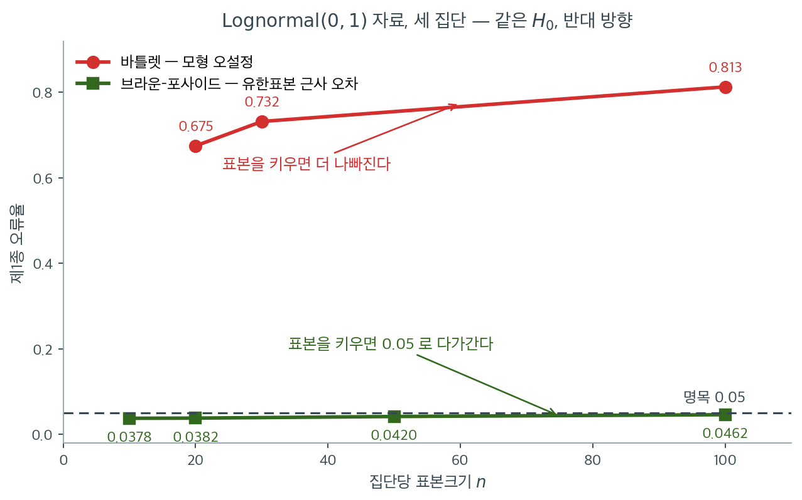
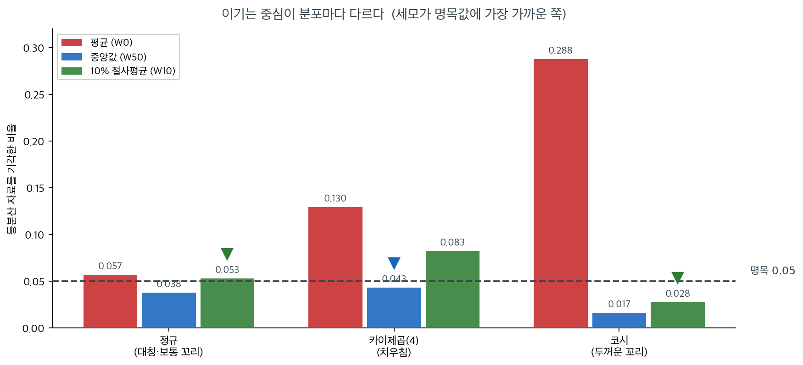
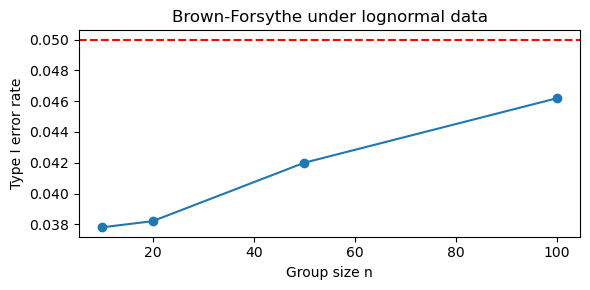

# Levene 검정 정규 대 치우친 분포 모의실험

## 개요

중앙값 중심 Levene 검정(Brown-Forsythe 변형)은 비정규성에 로버스트하다는 이유로 분산 동일성 검정에 자주 권장된다. 이 페이지는 정규 자료와 치우친(대수정규) 자료 모두에서 중앙값 중심 Levene 검정의 제1종 오류율을 몬테카를로 모의실험으로 조사한다. 목표는 서로 다른 분포 설정에 걸쳐 이 검정이 명목 크기 $\alpha = 0.05$를 유지하는지 확인하는 것이다.


!!! info "같은 설정을 세 쪽이 이어서 본다"
    이 쪽은 15.4절 [Bartlett 검정 비정규성 민감도](../bartlett_test/bartlett_sensitivity.md)
    ($n = 20$) 와 15.5절 [대수정규에서의 비교](./robust_tests_comparison.md) ($n = 30$) 가
    같은 자리에서 잰 것을 **집단크기를 $10$ 에서 $100$ 까지 움직이며** 다시 본다.
    앞의 두 쪽이 한 점에서 찍은 수라면 이 쪽은 그 점들을 잇는 곡선이고, 그래서
    **두 검정이 반대 방향으로 간다**는 것이 여기서만 보인다.

---

## 1. 모의실험 설계

모의실험은 다음과 같이 진행된다.

1. 정규분포 또는 대수정규분포에서 모수가 모두 같은 크기 $n$인 집단 $k = 3$개를 생성한다($H_0$이 성립한다).
2. 수준 $\alpha = 0.05$에서 중앙값 중심 Levene 검정을 적용한다.
3. $H_0$이 기각되었는지 기록한다.
4. $B$번 반복하여 경험적 제1종 오류율을 계산한다.

검정이 잘 보정되어 있다면 분포와 무관하게 기각률이 0.05에 가까워야 한다.

<div class="exbox" markdown>

**보기 1.** <span class="diff easy" title="쉬움"></span> 모집단 모양에 따른 제1종 오류율. 세 집단을 **같은 모집단**에서 뽑아($H_0$ 이 참이다) 중앙값 중심 Levene 검정을 $5000$ 번 돌린다. 집단당 $n = 20$, $\alpha = 0.05$ 다.

**(1)** 이론이 예측하는 기각률은 얼마인가. $B = 5000$ 번 반복의 **몬테카를로 표준오차**를 계산하고, "로버스트하다"는 주장이 이 표에서 어떤 모습으로 나타나야 하는지 미리 적으시오.

**(2)** 돌려서 확인하고, 두 수치의 차이가 몬테카를로 오차 안인지 **수로 판정**하시오. 명목값 $0.05$ 와의 거리도 같은 자로 재시오. 또 모집단을 다섯으로 늘려 Bartlett 과 나란히 두고, 두 검정의 **크기가 흔들리는 폭**을 견주시오.

</div>

??? success "풀이"

    **(1) 이론값은 명목값 그대로다.** 세 집단이 같은 모집단에서 나왔으니 $\sigma_1^2 = \sigma_2^2 = \sigma_3^2$ 이고 $H_0$ 이 참이다. 검정이 제대로 보정되어 있다면

    $$
    P(\text{기각} \mid H_0) = \alpha = 0.05
    $$

    여야 한다. 여기에 **모집단이 무엇인지는 들어오지 않는다.** 그것이 이 모의실험이 묻는 것이다.

    **몬테카를로 표준오차.** 기각 여부는 베르누이 시행이고 $B$ 번의 반복이 독립이므로 기각률 $\hat p$ 의 표준오차는

    $$
    \mathrm{SE}(\hat p) = \sqrt{\frac{p(1-p)}{B}},
    \qquad
    p = 0.05,\; B = 5000 \;\Longrightarrow\; \mathrm{SE} = \sqrt{\frac{0.05 \times 0.95}{5000}} = 0.00308
    $$

    이다. 그러므로 **$0.05$ 에서 $\pm 0.006$ 바깥의 값은 우연으로 설명되지 않는다.** 두 모집단의 기각률 차이를 재려면 두 분산을 더해야 하므로 그 표준오차는 $\sqrt2$ 배인 $0.0044$ 쯤이다.

    **"로버스트하다"가 무슨 모습이어야 하는가.** 두 가지를 구별해 두어야 한다.

    - **크기가 명목값과 같다** — 두 수치가 모두 $0.05 \pm 0.006$ 안에 있어야 한다.
    - **크기가 모집단에 의존하지 않는다** — 두 수치의 **차이**가 $0$ 과 구별되지 않아야 한다.

    둘은 다른 주장이고, 로버스트성이 뜻하는 것은 **뒤쪽**이다. 모집단을 완전히 바꾸었는데도 성능이 그대로라는 것이 로버스트성이며, 그 성능이 명목값과 정확히 같은지는 별개의 문제다.

    대조군이 왜 필요한지도 여기서 분명해진다. 분산 검정에는 **중심극한정리의 보호가 없다.** 5.10절은 정규성이 깨지면 $F$ 검정의 극한 오류율이 모집단 첨도 $\beta_2$ 만의 함수

    $$
    2\left[1-\Phi\!\left(1.96\sqrt{\frac{2}{\beta_2-1}}\right)\right]
    $$

    로 가고 **표본을 키워도 낫지 않는다**는 것까지 유도해 두었다(정규 $0.050$, 균등 $0.002$, 지수 $0.327$, 로그정규 $0.794$). 모집단이 바뀌면 크기가 바뀌는 것이 정규 이론 검정의 기본 성질이라는 뜻이다. 로버스트 검정의 표가 그 성질에서 벗어나는지를 보는 것이 이 보기의 전부다.

    **(2) 돌린다.**

    ```python
    import numpy as np
    from scipy import stats
    from scipy.stats import levene

    rng = np.random.default_rng(0)


    def simulate_once(n=20, dist="normal"):
        """주어진 분포에서 세 집단을 만들어 검정하고 p-값을 돌려준다.

        셋 다 같은 모수를 쓰므로 분산은 참으로 같다. 그러니 기각 비율이
        0.05 근처로 나와야 옳다.
        """
        if dist == "normal":
            g1 = rng.normal(0, 1.0, size=n)
            g2 = rng.normal(0, 1.0, size=n)
            g3 = rng.normal(0, 1.0, size=n)
        else:
            g1 = rng.lognormal(0, 1.0, size=n)
            g2 = rng.lognormal(0, 1.0, size=n)
            g3 = rng.lognormal(0, 1.0, size=n)
        _, p = levene(g1, g2, g3, center='median')
        return p


    # 정규와 로그정규에서 각각 돌려 본다. Bartlett 이라면 로그정규에서
    # 오류율이 크게 부풀지만, 중앙값 중심 방법은 0.05 근처를 지킨다.
    alpha = 0.05
    n_sims = 5000

    rate = {}
    for dist in ["normal", "lognormal"]:
        pvals = [simulate_once(20, dist) for _ in range(n_sims)]
        type1 = np.mean(np.array(pvals) < alpha)
        rate[dist] = type1
        print(f"Type I error (median-centered) under {dist}: {type1:.4f}")

    # (1) 의 두 자로 잰다. 명목값과의 거리, 그리고 두 수치 사이의 거리.
    print(f"\n몬테카를로 표준오차 (p = 0.05, B = {n_sims}): "
          f"{np.sqrt(0.05 * 0.95 / n_sims):.5f}")
    for dist in ["normal", "lognormal"]:
        p = rate[dist]
        se = np.sqrt(p * (1 - p) / n_sims)
        print(f"  {dist:>10}: {p:.4f}  SE {se:.5f}  "
              f"->  0.05 로부터 {(p - 0.05) / se:+.2f} SE")
    d = rate["lognormal"] - rate["normal"]
    se_d = np.sqrt(sum(rate[k] * (1 - rate[k]) / n_sims for k in rate))
    print(f"  두 수치의 차 {d:+.4f},  그 SE {se_d:.5f}  ->  {d / se_d:+.2f} SE")

    # 모집단을 다섯으로 늘려 Bartlett 과 나란히 둔다. 같은 자료, 같은 반복수.
    rng2 = np.random.default_rng(7)
    n = 20
    pops = [
        ("정규 N(0,1)", lambda m: rng2.normal(0, 1, (m, n)), 3.0),
        ("균등 U(0,1)", lambda m: rng2.uniform(0, 1, (m, n)), 1.8),
        ("지수 Exp(1)", lambda m: rng2.exponential(1, (m, n)), 9.0),
        ("t(5)", lambda m: rng2.standard_t(5, (m, n)), 9.0),
        ("로그정규 LN(0,1)", lambda m: rng2.lognormal(0, 1, (m, n)), 113.94),
    ]

    print(f"\n{'모집단':>18}{'beta2':>9}{'BF 크기':>10}{'Bartlett':>10}")
    bf, ba = [], []
    for name, draw, b2 in pops:
        A, B, C = draw(n_sims), draw(n_sims), draw(n_sims)
        r_bf = r_ba = 0
        for i in range(n_sims):
            g = (A[i], B[i], C[i])
            if stats.levene(*g, center="median")[1] < alpha:
                r_bf += 1
            if stats.bartlett(*g)[1] < alpha:
                r_ba += 1
        bf.append(r_bf / n_sims)
        ba.append(r_ba / n_sims)
        print(f"{name:>18}{b2:>9.1f}{r_bf / n_sims:>10.4f}{r_ba / n_sims:>10.4f}")
    print(f"{'폭 (최대 - 최소)':>27}{max(bf) - min(bf):>10.4f}{max(ba) - min(ba):>10.4f}")
    ```

    출력:

    ```text
    Type I error (median-centered) under normal: 0.0370
    Type I error (median-centered) under lognormal: 0.0374

    몬테카를로 표준오차 (p = 0.05, B = 5000): 0.00308
          normal: 0.0370  SE 0.00267  ->  0.05 로부터 -4.87 SE
       lognormal: 0.0374  SE 0.00268  ->  0.05 로부터 -4.70 SE
      두 수치의 차 +0.0004,  그 SE 0.00379  ->  +0.11 SE

                   모집단    beta2     BF 크기  Bartlett
             정규 N(0,1)      3.0    0.0370    0.0518
             균등 U(0,1)      1.8    0.0286    0.0032
             지수 Exp(1)      9.0    0.0458    0.3922
                  t(5)      9.0    0.0422    0.2280
          로그정규 LN(0,1)    113.9    0.0382    0.6866
                    폭 (최대 - 최소)    0.0172    0.6834
    ```

    **(1)에서 구별해 둔 두 주장이 서로 다른 답을 받는다.**

    **모집단 의존성은 없다.** 두 수치의 차가 $+0.0004$ 이고 그 표준오차가 $0.00379$ 이므로 $+0.11$ 표준오차다. 모집단을 $N(0,1)$ 에서 왜도 $6.185$ 의 로그정규로 통째로 갈아 끼웠는데 **크기가 전혀 움직이지 않았다.** 이것이 로버스트성의 정확한 모습이다.

    **그러나 크기가 명목값과 같지는 않다.** 두 수치가 $0.05$ 에서 각각 $-4.87$, $-4.70$ 표준오차 떨어져 있다. 몬테카를로 오차로 설명할 수 있는 거리가 아니므로 **이 보수성은 실재한다.** $0.037$ 은 $0.05$ 의 $74\%$ 다. 유한표본에서 중앙값을 추정하는 데 쓴 자유도가 $F_{2, 57}$ 이라는 기준분포에 반영되지 않아 생기는 것이며, 연습문제 2 에서 $n$ 을 키우면 $0.0378 \to 0.0462$ 로 명목선을 향해 올라가는 것이 그 증거다. **근사 오차이지 모형 오설정이 아니다.**

    **다섯 모집단 표가 그 대조를 완성한다.** 첨도가 $1.8$ 에서 $113.9$ 까지, 예순 배 넘게 벌어지는 다섯 모집단에서

    - 중앙값 중심 Levene 의 크기는 $0.0286$ 에서 $0.0458$ 사이, **폭 $0.017$**
    - Bartlett 의 크기는 $0.0032$ 에서 $0.6866$ 사이, **폭 $0.683$**

    이다. **폭의 비가 사십 배다.** Bartlett 은 정규에서 $0.0518$ 로 정확하지만 균등에서 $0.0032$ 로 지나치게 보수적이고 로그정규에서 $0.6866$ 으로 폭발한다. 등분산인 세 집단의 $69\%$ 에서 "분산이 다르다"고 답한다는 뜻이다. 15.4절이 같은 조건에서 $0.675$ 를 보고했고 이 쪽의 $0.6866$ 과 몬테카를로 오차 안에서 맞는다.

    표에 한 가지 유보가 있다. **지수와 $t_5$ 는 첨도가 둘 다 $\beta_2 = 9$ 인데 Bartlett 의 크기가 $0.3922$ 와 $0.2280$ 으로 다르다.** 첨도만으로 크기가 정해진다는 것은 $n \to \infty$ 의 이야기이고, $n = 20$ 에서는 아직 거기에 이르지 않았다. 특히 $t_5$ 는 4차 적률이 간신히 존재하는 정도여서 표본첨도가 표본마다 크게 흔들리고 수렴이 느리다. **이 표는 "$n = 20$ 에서 이렇다"는 측정이며 극한값이 아니다.**

---

## 2. 해석

- **정규** 자료에서 기각률이 $0.037$로 0.05에 가깝다. 다소 보수적이다.
- **대수정규** 자료에서도 $0.0374$로 사실상 동일하다. 중앙값 중심 Levene 검정의 로버스트성을 잘 보여준다.
- 같은 대수정규 상황에서 Bartlett 검정이 $0.675$의 기각률을 보이는 것과 극명하게 대비된다(15.4절 [Bartlett 검정 비정규성 민감도](../bartlett_test/bartlett_sensitivity.md)).
- 중앙값 중심 변형이 로버스트성을 얻는 것은 중앙값이 대수정규분포 오른쪽 꼬리의 극단값에 영향받지 않기 때문이다.

!!! note "두 수치가 거의 같다는 사실이 핵심이다"
    정규 $0.0370$과 대수정규 $0.0374$의 차이는 몬테카를로 오차($\sqrt{0.037 \times 0.963/5000} = 0.0027$) 안에 있다. 곧 **분포가 완전히 바뀌었는데도 검정의 크기가 전혀 변하지 않았다.**

    이것이 "로버스트"의 정확한 의미이다. 절대적으로 정확하다는 뜻이 아니라(둘 다 0.05가 아니라 0.037이다), **분포가 바뀌어도 성능이 변하지 않는다**는 뜻이다.

    $0.037$이라는 약간의 보수성은 15.5절 [로버스트 검정](./robust_tests.md) 연습문제 4에서 논한 자유도 문제에서 온다. 중앙값을 추정하는 데 쓴 자유도가 $F$ 기준분포에 반영되지 않기 때문이다.

두 검정의 성격 차이는 **표본크기를 키워 보면** 가장 선명하게 드러난다. 같은 대수정규 자료에서 표본을 늘렸을 때 두 검정이 어디로 가는지 보자.



초록(브라운–포사이드)은 $n = 10$의 $0.0378$에서 $n = 100$의 $0.0462$로 **명목선 0.05를 향해 올라간다.** 위에서 본 보수성이 표본과 함께 사라지는 것이다. 자유도 손실이나 $\bar{Z}_i$의 정규근사 오차는 모두 유한표본 현상이므로 $n$이 커지면 자연히 잦아든다.

빨강(바틀렛)은 정반대다. $n = 20$에서 $0.675$, $n = 30$에서 $0.732$, $n = 100$에서 $0.813$으로 **표본을 키울수록 나빠진다.** 자료를 100개씩 모아도 등분산인 세 집단의 81%에서 "분산이 다르다"고 답한다.

**이 방향의 차이가 두 오차의 성격을 가른다.** 브라운–포사이드가 가진 것은 *근사 오차*다. 기준분포가 옳고 유한표본에서만 살짝 어긋나므로 $n$이 그것을 고친다. 바틀렛이 가진 것은 *모형 오설정*이다. $\chi^2_{k-1}$이라는 기준분포 자체가 대수정규 자료에 대해 틀렸고, $n$을 키우면 틀린 기준분포가 더 좁아질 뿐이므로 불일치의 상대적 크기가 오히려 커진다.

실무에서 새겨야 할 교훈은 이렇다. **"표본이 크니 괜찮겠지"는 정규성 가정에 통하지 않는다.** 표본크기가 구해 주는 것은 근사 오차이지 잘못된 모형이 아니다.

<div class="storybox" markdown>

**그림으로 보는 통계학 1.** 중앙값이 기본값이 된 날

이 쪽이 돌린 것은 **중앙값 중심** 르빈 검정이다. 그런데 왜 중앙값인가. 르빈이
$1960$ 년에 적은 것은 **평균** 중심이었다(15.5절 [Levene 검정](levene.md) 의 상자).
중심을 바꿔 끼울 수 있다는 것은 식을 보면 바로 보이는데, 그러면 무엇으로 바꿔야
하는가는 식이 답하지 않는다. **재 보는 수밖에 없다.**

$1974$ 년에 **모턴 브라운**과 **앨런 포사이드**가 그 일을 했다. 『미국통계학회지』
$69$ 권 $364$–$367$ 쪽, 네 쪽짜리 글이다. 그들은 중심을 셋으로 바꾸어 놓고
몬테카를로로 크기를 쟀다 — 평균($W_0$), 중앙값($W_{50}$), $10\%$ 절사평균($W_{10}$).

그 비교가 내놓은 답은 **「중앙값이 이긴다」가 아니었다.** 이긴 중심이 분포마다
달랐다. 꼬리가 두꺼운 코시에서는 절사평균이, 치우친 $\chi^2_4$ 에서는 중앙값이
가장 나았고, 대칭이고 꼬리가 보통인 자료에서는 **평균이 검정력을 가장 많이** 냈다.
세 모양에 세 중심이었다.

<figure markdown>

  <figcaption markdown>$k = 3$, 집단당 $n = 20$, 반복 $20{,}000$, 명목 $0.05$. 몬테카를로 표준오차 $0.0015$.</figcaption>
</figure>

$1974$ 년의 비교를 다시 돌려 보았다. 대칭인 정규에서는 셋이 모두 명목값 언저리다
($0.057$, $0.053$, $0.038$). 치우침이 들어오면 갈린다 — $\chi^2_4$ 에서 평균 중심이
$0.130$ 으로 명목의 두 배 반인데 중앙값은 $0.043$ 이다. 코시로 가면 평균 중심이
$0.288$ 까지 간다. **무너지는 것은 언제나 평균 중심 하나**이고, 남은 둘은 어느 쪽도
크게 틀리지 않는다(다만 보수적이 된다 — 코시에서 $0.017$ 과 $0.028$ 이다).

그래서 오늘 `scipy.stats.levene` 의 기본값이 `center='median'` 이다. 이름은 르빈의
것이고 셈은 브라운–포사이드의 것인 검정이 **기본값 자리에 앉아 있다.** 셋 가운데
하나를 고른 것이고, 고른 까닭은 「치우친 자료가 실무에 더 흔하다」는 판단이다.
자료가 대칭이고 꼬리가 두껍다면 $1974$ 년의 표는 다른 칸을 가리킨다.

이 쪽이 하는 일이 그 네 쪽을 반 세기 뒤에 되짚는 것이다. **중심을 고르는 일에는
닫힌 꼴이 없고, 그래서 그때나 지금이나 재 보는 수밖에 없다.**

_확인한 곳 — 브라운과 포사이드의 「Robust tests for the equality of variances」가 『Journal of the American Statistical Association』 $69$ 권 $364$–$367$ 쪽($1974$)이라는 것, 그 글이 중심을 평균·중앙값·$10\%$ 절사평균으로 바꾼 $W_0$·$W_{50}$·$W_{10}$ 셋을 몬테카를로로 견주었다는 것, 그리고 그 결론이 코시에서는 절사평균이, $\chi^2_4$ 에서는 중앙값이 낫고 대칭이고 꼬리가 보통인 분포에서는 평균이 검정력을 가장 많이 낸다는 것이었음을 확인했다 · `scipy` $1.13.1$ 에서 `stats.levene` 의 `center` 기본값이 `median` 인 것은 직접 확인했다 · 그림과 표의 수는 모두 직접 계산한 값이다_

</div>

---

## 연습문제

<div class="drillbox" markdown>

**연습문제 1.** <span class="diff med" title="중간"></span> **평균 중심** Levene 검정의 제1종 오류도 계산하도록 모의실험을 확장하라. 대수정규 자료에서 두 중심화 방식을 비교하라.

</div>

??? success "풀이"

    ```python
    import numpy as np
    from scipy.stats import levene

    rng = np.random.default_rng(0)
    n_sims, n, alpha = 5000, 20, 0.05

    for center in ['mean', 'median']:
        rej = 0
        for _ in range(n_sims):
            g1 = rng.lognormal(0, 1, n)
            g2 = rng.lognormal(0, 1, n)
            g3 = rng.lognormal(0, 1, n)
            _, p = levene(g1, g2, g3, center=center)
            if p < alpha:
                rej += 1
        print(f"Levene ({center:6s}): Type I error = {rej/n_sims:.4f}")
    ```

    출력:

    ```text
    Levene (mean  ): Type I error = 0.2470
    Levene (median): Type I error = 0.0374
    ```

    평균 중심 판의 기각률이 $0.247$로 명목값의 **다섯 배**이다. 중앙값 중심 판은 $0.037$로 안정적이다. **6.6배 차이**이다.

    차이는 평균이 무거운 오른쪽 꼬리 쪽으로 끌려가는 데서 생긴다. $\text{Lognormal}(0,1)$의 왜도가 $6.185$로 극단적이므로 표본평균이 표본마다 크게 흔들리고, 그 흔들림이 그 집단의 **모든** 절대편차에 전파된다. 집단별 $\bar{Z}_i$가 실제보다 흩어져 F 통계량의 분자가 부풀려진다.

    중앙값은 붕괴점이 50%이므로 극단값에 흔들리지 않고, 이 연쇄가 끊어진다. $\square$

<div class="drillbox" markdown>

**연습문제 2.** <span class="diff med" title="중간"></span> 집단 크기를 $n \in \{10, 20, 50, 100\}$으로 바꿔가며 대수정규 자료에서 중앙값 중심 Levene 검정의 제1종 오류율을 그려라. 표본이 커지면 개선되는가?

</div>

??? success "풀이"

    ```python
    import numpy as np
    from scipy.stats import levene
    import matplotlib.pyplot as plt

    rng = np.random.default_rng(0)
    n_sims, alpha = 5000, 0.05
    sizes = [10, 20, 50, 100]
    rates = []

    for n in sizes:
        rej = 0
        for _ in range(n_sims):
            g1 = rng.lognormal(0, 1, n)
            g2 = rng.lognormal(0, 1, n)
            g3 = rng.lognormal(0, 1, n)
            _, p = levene(g1, g2, g3, center='median')
            if p < alpha:
                rej += 1
        rates.append(rej / n_sims)
        print(f"n={n:4d}: Type I error = {rej/n_sims:.4f}")

    plt.figure(figsize=(6, 3))
    plt.plot(sizes, rates, "o-")
    plt.axhline(0.05, ls="--", color="red")
    plt.xlabel("Group size n")
    plt.ylabel("Type I error rate")
    plt.title("Brown-Forsythe under lognormal data")
    plt.tight_layout()
    plt.show()
    ```

    출력:

    ```text
    n=  10: Type I error = 0.0378
    n=  20: Type I error = 0.0382
    n=  50: Type I error = 0.0420
    n= 100: Type I error = 0.0462
    ```

    

    | $n$ | 10 | 20 | 50 | 100 |
    |---|---|---|---|---|
    | 제1종 오류 | 0.038 | 0.038 | 0.042 | 0.046 |

    모든 표본크기에서 0.05 근처를 유지하며, **$n$이 커질수록 0.05에 더 가까워진다.**

    작은 $n$에서 다소 보수적인 것은 (1) 중앙값 추정에 쓴 자유도가 $F$ 기준분포에 반영되지 않고, (2) $\bar{Z}_i$의 정규근사가 아직 정확하지 않기 때문이다. $n$이 커지면서 두 효과가 모두 사라진다.

    **Bartlett과의 대비가 결정적이다.** 같은 자료에서 Bartlett은 $n$이 커질수록 **악화**되어 $0.675 \to 0.813$이었다(15.4절 [Bartlett 검정 비정규성 민감도](../bartlett_test/bartlett_sensitivity.md) 연습문제 2). Brown-Forsythe는 개선된다.

    이 방향의 차이가 두 검정의 근본적 성격을 드러낸다. Brown-Forsythe의 편차는 **유한표본 근사 오차**이므로 $n$과 함께 사라지지만, Bartlett의 편차는 **모형 오설정**이므로 $n$과 함께 커진다. $\square$

<div class="drillbox" markdown>

**연습문제 3.** <span class="diff med" title="중간"></span> $t_3$ 분포(대칭이지만 꼬리가 두꺼움) 자료로 모의실험을 반복하라. 중앙값 중심 Levene 검정이 평균 중심 판에 비해 어떻게 작동하는가?

</div>

??? success "풀이"

    ```python
    import numpy as np
    from scipy.stats import levene, t as tdist

    rng = np.random.default_rng(0)
    n_sims, n, alpha = 5000, 20, 0.05

    for center in ['mean', 'median']:
        rej = 0
        for _ in range(n_sims):
            g1 = tdist(df=3).rvs(n, random_state=rng)
            g2 = tdist(df=3).rvs(n, random_state=rng)
            g3 = tdist(df=3).rvs(n, random_state=rng)
            _, p = levene(g1, g2, g3, center=center)
            if p < alpha:
                rej += 1
        print(f"t(3), Levene ({center:6s}): {rej/n_sims:.4f}")
    ```

    출력:

    ```text
    t(3), Levene (mean  ): 0.0640
    t(3), Levene (median): 0.0340
    ```

    대칭인 두꺼운 꼬리($t_3$)에서 두 중심화가 모두 비교적 잘 작동한다. 평균과 중앙값이 모두 0이기 때문이다.

    | 자료 | Levene (평균) | Brown-Forsythe |
    |---|---|---|
    | $t_3$ (대칭, 두꺼운 꼬리) | 0.064 | 0.034 |
    | Lognormal (치우침) | **0.247** | 0.037 |

    **대비가 결정적이다.** 평균 중심 판은 $t_3$에서 $0.064$로 약간만 부풀려지지만 대수정규에서는 $0.247$로 폭발한다. 두 분포 모두 꼬리가 극도로 두꺼운데도 그렇다($t_3$은 초과첨도가 무한대이다).

    **곧 평균 중심화가 무너지는 것은 첨도 때문이 아니라 치우침 때문이다.** 이는 15.5절 [대수정규에서의 비교](robust_tests_comparison.md)에서 반복 확인한 결론이다.

    중앙값 중심 판이 $t_3$에서 $0.034$로 다소 보수적인 것은 극단값이 많은 자료에서 중앙값 중심 편차의 집단내 변동이 커져 F 통계량의 분모가 부풀려지기 때문이다. 로버스트성의 대가로 약간의 검정력을 내준다. $\square$

<div class="drillbox" markdown>

**연습문제 4.** <span class="diff med" title="중간"></span> 원자료가 비정규여도 Levene 검정통계량의 $F$ 분포 근사가 타당한 이유를 설명하라.

</div>

??? success "풀이"

    Levene 검정은 원래의 $X_{ij}$가 아니라 변환된 관측값 $Z_{ij} = |X_{ij} - c_i|$에 일원분산분석 F 검정을 적용한다. $X_{ij}$가 비정규여도 중심극한정리에 의해 $n$이 어느 정도면 집단평균 $\bar{Z}_{i\cdot}$이 근사적으로 정규이고, $Z_{ij}$로 계산한 F 통계량이 근사적으로 $F_{k-1, N-k}$ 분포를 따른다.

    나아가 절대편차 변환은 분산안정화 연산이다. 문제를 분산 비교(정확한 이론에 정규성이 필요하다)에서 평균 비교(중심극한정리 덕분에 로버스트하다)로 옮긴다. 분산분석 F 검정은 균형 설계와 적당한 표본크기에서 입력 자료의 중간 정도 비정규성에 로버스트한 것으로 알려져 있다.

    **더 근본적인 이유: 필요한 적률의 차수가 낮아진다.** 15.5절 [Levene 검정](./levene.md) 연습문제 4에서 보았듯

    $$
    \operatorname{Var}(Z) = E[Z^2] - (E[Z])^2 = \sigma^2 - (E|X-\mu|)^2
    $$

    이므로 **원자료의 2차 적률만** 필요하다. Bartlett과 F 검정이 4차 적률(첨도)을 요구하는 것과 대조된다.

    4차 적률은 꼬리가 조금만 두꺼워져도 폭발하거나 아예 존재하지 않지만($t_5$의 8차 적률처럼), 2차 적률은 분산이 유한한 어떤 분포에서든 존재하고 안정적이다.

    **한계도 명확하다.** 이 논거는 (1) $n$이 중심극한정리가 작동할 만큼 크고, (2) $c_i$의 추정이 안정적일 때만 성립한다. 연습문제 1에서 보았듯 평균을 $c_i$로 쓰고 자료가 강하게 치우쳐 있으면 (2)가 깨져 근사가 무너진다. $\square$

<div class="drillbox" markdown>

**연습문제 5.** <span class="diff med" title="중간"></span> 집단 $\sigma$ 모수가 $(1.0, 1.0, 1.5)$인 대수정규 자료(분산이 실제로 다르다)에서 중앙값 중심 Levene 검정의 **검정력**을 추정하는 모의실험을 설계하라. 같은 표준편차의 정규 자료에서의 검정력과 비교하라.

</div>

??? success "풀이"

    ```python
    import numpy as np
    from scipy.stats import levene

    rng = np.random.default_rng(0)
    n_sims, n, alpha = 5000, 30, 0.05

    for dist in ["normal", "lognormal"]:
        rej = 0
        for _ in range(n_sims):
            if dist == "normal":
                g1 = rng.normal(0, 1.0, n)
                g2 = rng.normal(0, 1.0, n)
                g3 = rng.normal(0, 1.5, n)
            else:
                g1 = rng.lognormal(0, 1.0, n)
                g2 = rng.lognormal(0, 1.0, n)
                g3 = rng.lognormal(0, 1.5, n)
            _, p = levene(g1, g2, g3, center='median')
            if p < alpha:
                rej += 1
        print(f"{dist:10s}: power = {rej/n_sims:.4f}")
    ```

    출력:

    ```text
    normal    : power = 0.5122
    lognormal : power = 0.2086
    ```

    !!! warning "두 검정력을 직접 비교할 수 없다"
        정규 $0.512$와 대수정규 $0.209$의 차이가 "대수정규에서 검정력이 낮다"를 뜻하는 것처럼 보이지만, **두 설정의 참 분산비가 완전히 다르다.**

        - **정규:** $\sigma = (1, 1, 1.5)$이므로 분산비가 $1 : 1 : 2.25$이다.
        - **대수정규:** $\sigma$는 **로그 척도의** 모수이다. 실제 분산은 $(e^{\sigma^2}-1)e^{\sigma^2}$이므로

        $$
        \sigma = 1.0 \Rightarrow \operatorname{Var} = (e-1)e = 4.671, \qquad
        \sigma = 1.5 \Rightarrow \operatorname{Var} = (e^{2.25}-1)e^{2.25} = 80.53.
        $$

        분산비가 $1 : 1 : 17.2$로 정규 설정의 **일곱 배 이상**이다.

        곧 대수정규 설정은 **훨씬 큰 분산 차이를 훨씬 낮은 검정력으로** 탐지하고 있다. 검정력 손실이 실제로는 표에 보이는 것보다 훨씬 크다.

    **왜 그렇게 어려운가.** 대수정규에서 $\sigma$가 커지면 분산만 커지는 것이 아니라 **분포 모양 자체가 바뀐다.** $\sigma = 1.5$이면 왜도가 $33.5$, 초과첨도가 약 $10{,}075$로 극단적이다. 중앙값 중심 편차의 분포가 심하게 치우쳐 있어 $\bar{Z}_i$의 정규근사가 나쁘고, F 검정의 검정력이 크게 떨어진다.

    **중요한 점은 검정력이 "정직하다"는 것이다.** 본문에서 확인했듯 제1종 오류율이 통제되어 있으므로, 기각이 일어났다면 그것은 진짜 분산 불균등의 탐지이다. Bartlett의 높은 기각률은 그런 보장이 없다.

    **실무 지침.** 강하게 치우친 자료에서 분산을 비교해야 한다면, 로그 변환 후 검정하는 편이 검정력에서 훨씬 유리하다. $\ln X \sim \mathcal{N}(0, \sigma^2)$이므로 로그 척도에서는 정규 자료가 되고 분산비가 $1 : 1 : 2.25$인 문제로 환원된다. $\square$

<div class="drillbox" markdown>

**연습문제 6.** <span class="diff med" title="중간"></span> 이 쪽은 $B = 5000$ 번의 반복으로 크기를 재고, 그 수들의 차이를 "실재한다/우연이다"로 판정했다. 그 판정의 **분해능**을 따져 보자. 모든 계산은 양쪽꼬리 유의수준 $5\%$ 를 쓴다.

**(1)** 보기 1 은 두 기각률의 차에 표준오차 $0.00379$ 를 썼고, 2 절의 note 는 같은 차이를 $\sqrt{0.037 \times 0.963/5000} = 0.0027$ 로 재었다. 어느 쪽이 **차이**에 맞는 자인가. 2 절의 결론이 그 때문에 바뀌는가.

**(2)** $p \approx 0.05$ 근처에서 $B = 5000$ 으로 검정력 $80\%$ 를 가지고 **구별해 낼 수 있는 가장 작은 크기 차이**를 구하시오.

**(3)** 보기 1 의 다섯 모집단 표에서 중앙값 중심 Levene 의 폭 $0.0172$(균등 $0.0286$, 지수 $0.0458$)는 몬테카를로 우연으로 설명되는가. 같은 표의 정규 $0.0370$ 과 $t_5$ $0.0422$ 의 차이는 어떤가.

**(4)** 크기 차이 $0.005$ 를 같은 기준으로 가려내려면 $B$ 가 얼마여야 하는가.

</div>

??? success "풀이"

    **(1) 차이에 맞는 자는 보기 1 의 $0.00379$ 다.** 독립인 두 비율의 차의 분산은 분산의 합이므로

    $$
    \mathrm{SE}(\hat p_1 - \hat p_2) = \sqrt{\frac{p_1(1-p_1)}{B} + \frac{p_2(1-p_2)}{B}}
    = \sqrt{\frac{0.0370 \times 0.9630 + 0.0374 \times 0.9626}{5000}} = 0.00379
    $$

    이다. 2 절의 $0.0027$ 은 **비율 하나**의 표준오차이고, 차이를 재는 자로 쓰면 $\sqrt2$ 배만큼 작다. 명목값 $0.05$ 와의 거리를 재는 데에는 $0.0027$ 이 맞지만 두 수치를 서로 견주는 데에는 틀리다.

    다만 **결론은 바뀌지 않는다.** 관측된 차이가 $0.0004$ 로 둘 중 어느 자로 재도 $0.15$ 표준오차 안이다. 틀린 자를 썼는데 답이 맞은 것은 차이가 애초에 너무 작았기 때문이고, 자가 $\sqrt2$ 배 작으면 **판정이 관대해지는 쪽이 아니라 엄격해지는 쪽**이라는 점도 운이 좋았다.

    **(2) 최소 검출 가능 차이.** 두 비율의 차를 양쪽꼬리 $5\%$ 로 검정하고 검정력 $80\%$ 를 요구하면 참 차이 $\delta$ 가

    $$
    \delta \ge (z_{0.975} + z_{0.80})\,\mathrm{SE} = (1.960 + 0.8416)\,\mathrm{SE} = 2.8016\,\mathrm{SE}
    $$

    를 만족해야 한다. $p_1 \approx p_2 \approx 0.05$, $B = 5000$ 이면

    $$
    \mathrm{SE} = \sqrt{\frac{2 \times 0.05 \times 0.95}{5000}} = 0.004359,
    \qquad
    \delta \ge 2.8016 \times 0.004359 = 0.0122
    $$

    이다. 실제 크기가 $0.037$ 근처라면 $\mathrm{SE} = 0.003775$ 로 조금 줄어 $\delta \ge 0.0106$ 이다. 곧 **$B = 5000$ 의 모의실험은 크기 차이 약 $0.011$ 보다 작은 것은 보지 못한다.**

    **(3) 폭은 실재하고, 표 안의 미세한 차이는 실재하지 않는다.**

    균등과 지수:

    $$
    \mathrm{SE} = \sqrt{\frac{0.0286 \times 0.9714 + 0.0458 \times 0.9542}{5000}} = 0.00378,
    \qquad
    z = \frac{0.0458 - 0.0286}{0.00378} = 4.55
    $$

    이므로 **우연이 아니다.** (2) 의 분해능 $0.011$ 보다 폭 $0.0172$ 가 크므로 이는 예상대로다.

    정규와 $t_5$:

    $$
    \mathrm{SE} = \sqrt{\frac{0.0370 \times 0.9630 + 0.0422 \times 0.9578}{5000}} = 0.00390,
    \qquad
    z = \frac{0.0422 - 0.0370}{0.00390} = 1.33
    $$

    이므로 **구별되지 않는다.** 표 안의 다섯 수를 서로 줄 세우는 일은 이 반복 수로는 할 수 없다.

    **(4) 필요한 반복 수.** $\delta = 0.005$ 를 $2.8016\,\mathrm{SE}$ 와 같게 두면

    $$
    B = 2p(1-p)\left(\frac{2.8016}{\delta}\right)^2
    = 2 \times 0.05 \times 0.95 \times \left(\frac{2.8016}{0.005}\right)^2 = 29{,}826
    $$

    이므로 약 **3 만 번**이다. 반복 수가 분해능의 제곱에 반비례하므로, 분해능을 절반으로 줄이려면 반복을 네 배로 늘려야 한다.

    **읽는 법.** 이 쪽이 내린 두 결론은 분해능 안에 넉넉히 들어 있다. 정규와 로그정규의 차이 $0.0004$ 는 $0.011$ 보다 훨씬 작아 "차이 없음"이 안전하고, 명목값과의 거리 $0.013$ 은 $-4.9$ 표준오차로 뚜렷하다. 그러나 **"폭 $0.017$"을 "거의 $0$"이라고 읽는 것은 과장이다.** $z = 4.55$ 로 실재하는 폭이며, 로버스트성은 "모집단에 전혀 의존하지 않음"이 아니라 "Bartlett 의 $0.683$ 에 비해 사십 분의 일"이라는 **상대적 주장**이다. $\square$

<div class="drillbox" markdown>

**연습문제 7.** <span class="diff hard" title="어려움"></span> 연습문제 3 은 중앙값 중심 판이 "로버스트성의 대가로 약간의 검정력을 내준다"고 적었다. 그 대가를 **정규 자료에서** 수로 재자. $k = 3$, $n = 30$, $\alpha = 0.05$, $B = 20000$ 이다. 귀무는 $\sigma = (1, 1, 1)$, 대립은 연습문제 5 의 정규 설정과 같은 $\sigma = (1, 1, 1.5)$ 다.

**(1)** 임계값을 $F_{2, 87}$ 의 $0.95$ 분위수로 두고 두 중심화(`mean`, `median`)의 **크기**와 **검정력**을 구하시오.

**(2)** 귀무 모의실험에서 얻은 통계량의 **경험적 $95\%$ 분위수**를 임계값으로 바꾸어 **크기를 맞춘 검정력**을 다시 구하시오. 두 경험 임계값이 이론값 $3.1013$ 의 어느 쪽에 놓이는지 보고, 그것이 (1) 의 크기와 어떻게 맞물리는지 적으시오.

**(3)** (1) 의 검정력 차이 가운데 얼마가 **정보의 손실**이고 얼마가 **크기 차이의 그림자**인가. "로버스트성의 대가"라는 말을 고쳐 쓰시오.

</div>

??? success "풀이"

    ```python
    import numpy as np
    from scipy import stats

    rng = np.random.default_rng(3)
    B, k, n, alpha = 20000, 3, 30, 0.05


    def draw(sig):
        """세 집단을 한꺼번에 B 판 만든다. 평균은 모두 0 이다."""
        return [rng.normal(0.0, s, (B, n)) for s in sig]


    g0 = draw([1.0, 1.0, 1.0])      # 귀무: 분산이 같다
    g1 = draw([1.0, 1.0, 1.5])      # 대립: 연습문제 5 의 정규 설정과 같다

    q = stats.f.ppf(1 - alpha, k - 1, k * n - k)
    print(f"F(2, 87) 의 0.95 분위수: {q:.4f}")
    print()
    print(f"{'중심화':>8}{'크기':>9}{'검정력':>9}{'경험임계값':>12}{'크기보정 검정력':>16}")
    for center in ["mean", "median"]:
        F0 = stats.levene(*g0, center=center, axis=1).statistic
        F1 = stats.levene(*g1, center=center, axis=1).statistic
        q_emp = np.quantile(F0, 1 - alpha)       # 귀무분포의 경험적 95% 분위수
        print(f"{center:>8}{np.mean(F0 > q):>9.4f}{np.mean(F1 > q):>9.4f}"
              f"{q_emp:>12.4f}{np.mean(F1 > q_emp):>16.4f}")
    ```

    출력:

    ```text
    F(2, 87) 의 0.95 분위수: 3.1013

         중심화       크기      검정력       경험임계값        크기보정 검정력
        mean   0.0541   0.5532      3.1865          0.5406
      median   0.0411   0.5077      2.8916          0.5409
    ```

    **(1) 명목 임계값으로 재면 검정력이 $0.0455$ 벌어진다.** 평균 중심 $0.5532$, 중앙값 중심 $0.5077$ 이다. 연습문제 5 의 정규 검정력 $0.512$ 와 같은 자리이며($n = 30$, $\sigma = (1,1,1.5)$) 몬테카를로 오차 안에서 맞는다.

    그런데 **크기도 같지 않다.** 평균 중심은 $0.0541$ 로 명목값보다 크고($\mathrm{SE} = \sqrt{0.05 \times 0.95/20000} = 0.00154$ 이므로 $+2.7$ 표준오차), 중앙값 중심은 $0.0411$ 로 작다($-5.8$ 표준오차). 크기가 다른 두 검정의 검정력을 나란히 놓는 것은 **공정한 비교가 아니다.** 기각을 더 쉽게 하는 검정이 검정력도 높은 것은 당연하다.

    **(2) 경험 임계값이 (1) 의 크기를 그대로 설명한다.**

    | 중심화 | 경험 $95\%$ 분위수 | 이론값 $F_{0.95}(2,87)$ | 크기 |
    |---|---|---|---|
    | `mean` | $3.1865$ | $3.1013$ | $0.0541 > 0.05$ |
    | `median` | $2.8916$ | $3.1013$ | $0.0411 < 0.05$ |

    평균 중심의 참 귀무분포는 $F_{2,87}$ 보다 **오른쪽으로 퍼져** 있어 이론 임계값이 너무 낮고, 그래서 크기가 부풀었다. 중앙값 중심은 반대로 참 귀무분포가 **더 좁아** 이론 임계값이 너무 높고, 그래서 보수적이다. 2 절이 말한 "자유도 손실"이 이 한 줄에 들어 있다. 중앙값을 추정하는 데 쓴 정보가 $F_{2, 87}$ 이라는 기준분포에 반영되지 않아 분포가 실제보다 좁은 것이다.

    각자의 경험 임계값으로 바꾸면 두 검정의 크기가 정확히 $0.05$ 로 맞춰지고, 그때의 검정력은

    $$
    0.5406 \;(\text{평균 중심}) \qquad\text{대}\qquad 0.5409 \;(\text{중앙값 중심})
    $$

    이다. 차이가 $0.0003$ 이다. 검정력 근처에서 비율의 표준오차는 $\sqrt{0.54 \times 0.46/20000} = 0.0035$ 이고 두 검정이 **같은 자료**를 쓰므로 차의 표준오차는 그보다도 작다. 어느 쪽으로 보아도 $0.0003$ 은 $0$ 과 구별되지 않는다.

    **(3) 대가는 검정력이 아니라 크기였다.** 명목 임계값에서 보인 차이 $0.0455$ 가 크기를 맞추자 $0.0003$ 으로 사라졌으므로, 그 차이의 **사실상 전부가 크기 차이의 그림자**였고 정보의 손실은 측정되지 않았다. 정규 자료에서 평균을 중앙값으로 바꾸어도 **절대편차에 담긴 분산 정보는 거의 그대로 남는다.**

    그러므로 연습문제 3 의 문장은 이렇게 고쳐 써야 한다. 중앙값 중심화가 내주는 것은 *검정력*이 아니라 *기준분포의 정확도*다. 그리고 연습문제 2 가 보인 대로 그 부정확은 $n$ 과 함께 사라지므로($0.0378 \to 0.0462$), **대가는 유한표본에만 있고 $n \to \infty$ 에서는 공짜다.** 반면 평균 중심화가 로그정규에서 겪는 $0.247$ 은 $n$ 으로 고쳐지지 않는다. 한쪽은 치를 값이 점점 작아지고 다른 쪽은 그렇지 않다. $\square$

<div class="drillbox" markdown>

**연습문제 8.** <span class="diff hard" title="어려움"></span> 실무에서 등분산 검정은 그 자체가 목적인 경우보다, 평균 비교에서 **합동 $t$ 와 웰치 $t$ 중 무엇을 쓸지 고르는 사전검정**으로 쓰이는 경우가 많다. 이 쪽이 중앙값 중심 Levene 의 크기를 보증했으니 그 관행도 안전할 것 같다. 확인하자.

두 집단이고 $n_1 = 10$, $n_2 = 40$, 두 평균은 모두 $0$ 이다(평균에 대한 $H_0$ 이 참이다). 작은 집단의 표준편차를 $\sigma_1 \in \{1.0, 1.5, 2.0, 2.5, 3.0\}$ 로 바꾸고 $\sigma_2 = 1$ 로 둔다. $B = 20000$, $\alpha = 0.05$ 로 세 절차의 제1종 오류율을 재라.

- **(가)** 늘 합동 $t$
- **(나)** 늘 웰치 $t$
- **(다)** 중앙값 중심 Levene 을 $\alpha = 0.05$ 로 먼저 돌려, 기각되면 웰치 $t$, 통과하면 합동 $t$

**(1)** 세 절차의 크기를 사전검정의 기각률과 함께 표로 만드시오.

**(2)** 절차 (다) 의 크기가 가장 나쁜 자리가 $\sigma_1$ 의 양 끝이 아니라 **중간**인 이유를 사전검정의 기각률로 설명하시오.

**(3)** $\sigma_1 = 2.0$ 에서 (다) 의 크기를 "기각률로 가중한 (가) 와 (나) 의 평균"으로 예측해 보고, 실제 값과 견주시오. 어긋나는 양이 무엇을 재는 것인가.

**(4)** (다) 가 (나) 보다 나은 칸이 하나라도 있는가.

</div>

??? success "풀이"

    ```python
    import numpy as np
    from scipy import stats

    rng = np.random.default_rng(3)
    B, n1, n2, alpha = 20000, 10, 40, 0.05

    print(f"몬테카를로 표준오차 (p = 0.05, B = {B}): {np.sqrt(0.05 * 0.95 / B):.5f}")
    print()
    print(f"{'sigma_1':>9}{'BF 기각률':>11}{'합동 t':>9}{'웰치 t':>9}{'사전검정':>10}")
    for s1 in [1.0, 1.5, 2.0, 2.5, 3.0]:
        X = rng.normal(0.0, s1, (B, n1))     # 작은 집단, 분산이 큰 쪽
        Y = rng.normal(0.0, 1.0, (B, n2))    # 큰 집단. 두 평균은 모두 0 이다 (H0 가 참)
        p_var = stats.levene(X, Y, center="median", axis=1).pvalue
        p_pool = stats.ttest_ind(X, Y, axis=1, equal_var=True).pvalue
        p_welch = stats.ttest_ind(X, Y, axis=1, equal_var=False).pvalue
        # 관행: 사전검정이 기각하면 웰치, 통과하면 합동 t 를 쓴다
        p_pre = np.where(p_var < alpha, p_welch, p_pool)
        print(f"{s1:>9.1f}{np.mean(p_var < alpha):>11.4f}{np.mean(p_pool < alpha):>9.4f}"
              f"{np.mean(p_welch < alpha):>9.4f}{np.mean(p_pre < alpha):>10.4f}")
    ```

    출력:

    ```text
    몬테카를로 표준오차 (p = 0.05, B = 20000): 0.00154

      sigma_1     BF 기각률     합동 t     웰치 t      사전검정
          1.0     0.0440   0.0498   0.0512    0.0529
          1.5     0.2787   0.1211   0.0500    0.0951
          2.0     0.6439   0.1881   0.0527    0.0938
          2.5     0.8575   0.2258   0.0514    0.0732
          3.0     0.9446   0.2594   0.0517    0.0606
    ```

    **(1) 표를 그대로 읽는다.**

    | $\sigma_1$ | 사전검정 기각률 | (가) 합동 $t$ | (나) 웰치 $t$ | (다) 사전검정 |
    |---|---|---|---|---|
    | $1.0$ | $0.0440$ | $0.0498$ | $0.0512$ | $0.0529$ |
    | $1.5$ | $0.2787$ | $0.1211$ | $0.0500$ | $0.0951$ |
    | $2.0$ | $0.6439$ | $0.1881$ | $0.0527$ | $0.0938$ |
    | $2.5$ | $0.8575$ | $0.2258$ | $0.0514$ | $0.0732$ |
    | $3.0$ | $0.9446$ | $0.2594$ | $0.0517$ | $0.0606$ |

    웰치는 다섯 칸 모두에서 $0.05$ 를 지킨다($\mathrm{SE} = 0.00154$ 이므로 $0.0500$–$0.0527$ 은 모두 $2$ 표준오차 안이다). 합동 $t$ 는 $\sigma_1$ 과 함께 무너져 $0.0498 \to 0.2594$ 가 된다. 작은 집단이 분산이 큰 쪽이라 합동분산 $S_p^2$ 이 작은 집단의 참 분산을 과소평가하고, 그래서 $t$ 통계량이 부풀기 때문이다.

    **사전검정 절차는 그 중간에 있지만 어느 칸에서도 $0.05$ 가 아니다.** 최악은 $\sigma_1 = 1.5$ 의 $0.0951$ 로 명목값의 **$1.9$ 배**다.

    **(2) 최악은 사전검정이 "반반"인 자리다.** 양 끝에서는 선택이 사실상 자료에 의존하지 않는다.

    - $\sigma_1 = 1.0$: 기각률 $0.044$ 이므로 $96\%$ 의 판에서 합동 $t$ 가 선택된다. 그런데 **그 칸에서는 등분산이 참이므로 합동 $t$ 가 옳다.** 크기가 $0.0529$ 로 거의 명목값이다.
    - $\sigma_1 = 3.0$: 기각률 $0.945$ 이므로 거의 늘 웰치가 선택된다. 크기 $0.0606$ 으로 웰치에 가깝다.
    - 중간($\sigma_1 = 1.5, 2.0$): 기각률이 $0.28$, $0.64$ 로 **선택이 자료에 달려 있다.** 분산이 실제로 다른데도 사전검정이 통과시킨 판에서 합동 $t$ 가 쓰이고, 거기서 오류율이 새어 나온다.

    더 나쁜 것은 통과한 판이 **무작위 표본이 아니라는** 점이다. 사전검정이 통과시키는 것은 두 표본분산이 우연히 비슷하게 나온 판이고, 그런 판에서는 $S_p^2$ 의 왜곡이 덜하다. 그래서 선택이 약간은 도움이 되지만 — (3) 에서 그 양을 재면 — $0.094$ 를 $0.05$ 로 데려오기에는 턱없이 작다.

    또 하나. 이 쪽이 밝힌 **중앙값 중심 판의 보수성이 여기서는 손해로 작동한다.** 등분산인 칸에서 기각률이 $0.0440$ 으로 명목값보다 낮다($-3.9$ 표준오차). 사전검정이 명목값보다 덜 기각한다는 것은 분산 차이를 **더 자주 놓친다**는 뜻이고, 놓칠 때마다 합동 $t$ 가 선택된다.

    **(3) 순진한 가중평균은 실제보다 높게 나온다.** $\sigma_1 = 2.0$ 에서 기각률 $0.6439$ 를 가중값으로 쓰면

    $$
    0.6439 \times 0.0527 + 0.3561 \times 0.1881 = 0.0339 + 0.0670 = 0.1009
    $$

    를 얻는다. 실제는 $0.0938$ 이므로 $0.0071$ 낮다. $\mathrm{SE}$ 가 $0.002$ 쯤이니 이 어긋남은 실재한다.

    이 차가 재는 것이 바로 **선택 효과**다. 가중평균 계산은 "사전검정이 통과한 판에서의 합동 $t$ 크기"를 **전체** 합동 $t$ 크기 $0.1881$ 로 대신 썼다. 실제로 통과한 판은 두 표본분산이 비슷하게 나온 판이므로 그 조건부 크기는 $0.1881$ 보다 낮다. 곧 **조건부 분포가 무조건 분포와 다르다**는 것이 사전검정 절차의 이론적 결함이며, 그 결함의 크기가 여기서는 $0.0071$ 로 측정된다. 부호가 다행히 유리한 쪽이지만, 그 덕을 보아도 크기는 여전히 명목값의 두 배 가까이다.

    **(4) 없다.** 다섯 칸 모두에서 웰치가 $0.05$ 를 지키고 사전검정 절차는 같거나 나쁘다. 가장 좋은 칸인 $\sigma_1 = 1.0$ 에서도 $0.0529$ 대 $0.0512$ 로 웰치가 낫거나 같다. **등분산이 참인 칸에서조차 사전검정으로 얻는 것이 없다.**

    이것이 5 장 웰치 정리 1 과 같은 결론이다. 등분산 가정이 **참일 때** 합동 $t$ 가 얻는 효율은 자유도 몇 개 수준으로 미미하고, 가정이 **거짓일 때** 잃는 것은 오류율 전체다. 더구나 그 가정을 자료로 확인하려 들면 두 단계의 오류가 합쳐져 명목 수준이 아예 깨진다. **처음부터 웰치를 쓰면 고를 일이 없다.**

    이 쪽의 결과와 모순이 아니라는 점을 분명히 해 두자. 중앙값 중심 Levene 은 **분산을 묻는 검정으로서** 크기를 지킨다. 무너지는 것은 그 검정을 **다른 검정을 고르는 스위치로 쓰는 절차**이고, 책임은 검정이 아니라 두 단계를 이어 붙인 설계에 있다. $\square$

<div class="drillbox" markdown>

**연습문제 9.** <span class="diff hard" title="어려움"></span> 연습문제 4 는 $Z = \lvert X - \mu \rvert$ 에 대해 $\operatorname{Var}(Z) = \sigma^2 - (E\lvert X - \mu\rvert)^2$ 를 유도하고, 원자료의 **2 차 적률만** 있으면 된다는 것을 Levene 검정이 로버스트한 근본 이유로 들었다. 그 값싼 가정에는 대가가 있다. $Z$ 에 분산분석을 돌리는 검정이 실제로 비교하는 것은 $\sigma_i$ 가 아니라

$$
\theta_i = E\lvert X_i - \mu_i \rvert
$$

이다. 라플라스 분포(밀도 $\frac{1}{2b}e^{-\lvert x \rvert / b}$, $\sigma^2 = 2b^2$, $E\lvert X \rvert = b$)를 재료로 쓴다.

**(1)** $N(0,1)$ 과 **분산이 똑같이 $1$ 인** 라플라스 분포에 대해 $\theta$ 와 $\operatorname{Var}(Z)$ 를 구하시오. 두 집단을 이 두 분포에서 뽑으면 $\sigma_1^2 = \sigma_2^2$ 인데도 Levene 이 어떻게 행동하는가.

**(2)** 두 집단이 각각 $n$ 개일 때 $\bar Z_1 - \bar Z_2$ 의 $z$ 통계량의 평균을 $n$ 의 함수로 쓰고, 기각 확률이 $1/2$ 를 넘는 가장 작은 $n$ 을 구하시오.

**(3)** 거꾸로 $\theta_1 = \theta_2$ 이지만 분산이 다른 짝을 만들어, Levene 이 **$n$ 을 아무리 키워도** 잡지 못하는 분산비를 구하시오.

**(4)** 보기 1 의 설계에서는 이 문제가 왜 드러나지 않는가. 이 쪽이 말하는 로버스트성이 어떤 가정 위에 서 있는지 적으시오.

</div>

??? success "풀이"

    **(1) 분산이 같아도 $\theta$ 는 다르다.** 정규분포에서 $E\lvert X \rvert = \sigma\sqrt{2/\pi}$ 이고, 라플라스에서 분산이 $1$ 이려면 $2b^2 = 1$, 곧 $b = 1/\sqrt2$ 다.

    | 분포 | $\sigma^2$ | $\theta = E\lvert X - \mu \rvert$ | $\operatorname{Var}(Z) = \sigma^2 - \theta^2$ |
    |---|---|---|---|
    | $N(0,1)$ | $1$ | $\sqrt{2/\pi} = 0.797885$ | $1 - 2/\pi = 0.363380$ |
    | 라플라스 $b = 1/\sqrt2$ | $1$ | $b = 0.707107$ | $1 - 0.5 = 0.500000$ |

    두 분산이 정확히 같은데 $\theta$ 는 $0.797885$ 와 $0.707107$ 로 다르다. 차이가 $\theta_1 - \theta_2 = 0.090778$ 이다.

    Levene 검정은 $Z$ 의 집단평균을 비교하는 일원분산분석 $F$ 검정이고, 이것은 $E Z_i = \theta_i$ 의 상등에 대한 **일치검정**이다. 즉 $\theta_1 \ne \theta_2$ 이면

    $$
    P(\text{기각}) \longrightarrow 1 \qquad (n \to \infty)
    $$

    이다. **분산이 같다는 귀무가설이 참인데도 Levene 은 확률 $1$ 로 기각한다.** 이 쪽이 재어 온 "크기"는 세 집단이 같은 모집단에서 나온 설정에서의 크기였고, 모양이 집단마다 다르면 그 보증이 사라진다.

    **(2) $n \approx 403$ 에서 반이 기각된다.** $k = 2$ 일 때 Levene 의 $F$ 는 $\bar Z_1 - \bar Z_2$ 의 두 표본 $z$ 통계량의 제곱이고, 그 분모의 극한은 $\operatorname{Var}(Z_i)$ 로 정해진다. $n_1 = n_2 = n$ 이므로

    $$
    E[z] \approx \frac{\theta_1 - \theta_2}{\sqrt{\dfrac{\operatorname{Var}(Z_1) + \operatorname{Var}(Z_2)}{n}}}
    = \frac{0.090778}{\sqrt{\dfrac{0.363380 + 0.500000}{n}}}
    = \frac{0.090778}{0.929183}\sqrt{n} = 0.097696\sqrt{n}
    $$

    이다. $z$ 가 근사적으로 평균 $0.097696\sqrt n$, 분산 $1$ 의 정규이므로 $\lvert z \rvert > 1.96$ 일 확률이 $1/2$ 를 넘는 것은 평균이 $1.96$ 에 이를 때다.

    $$
    0.097696\sqrt{n} = 1.96 \;\Longrightarrow\; \sqrt n = 20.062 \;\Longrightarrow\; n = 402.5
    $$

    이므로 **$n = 403$** 이다(검정력 $80\%$ 를 원하면 $\sqrt n = 2.8016/0.097696 = 28.68$, $n = 823$ 이다). 집단당 사백 개쯤이면, 분산이 완전히 같은 두 집단을 Levene 이 절반의 확률로 "분산이 다르다"고 판정한다.

    **(3) 분산비 $4/\pi = 1.2732$ 는 영구히 보이지 않는다.** 정규 $N(0, \sigma_N^2)$ 와 라플라스(척도 $b$)의 $\theta$ 를 같게 두면

    $$
    \sigma_N\sqrt{\frac{2}{\pi}} = b = \frac{\sigma_L}{\sqrt2}
    \;\Longrightarrow\;
    \frac{\sigma_L}{\sigma_N} = \sqrt2 \cdot \sqrt{\frac{2}{\pi}} = \sqrt{\frac{4}{\pi}} = 1.128379
    $$

    이다. 곧 표준편차가 $1$ 인 정규분포와 표준편차가 $1.128379$ 인 라플라스분포는 $\theta$ 가 둘 다 $0.797885$ 로 **정확히 같다.** 두 집단을 이 두 분포에서 뽑으면 분산비가

    $$
    \frac{\sigma_L^2}{\sigma_N^2} = \frac{4}{\pi} = 1.2732
    $$

    로 $27\%$ 나 다른데도 $E Z_1 = E Z_2$ 이므로 Levene 의 기각률은 $n \to \infty$ 에서 명목값 $\alpha$ 로 머문다. **표본을 늘리는 것이 전혀 도움이 되지 않는다.** 검정력이 $0$ 으로 꺼지는 것이 아니라 애초에 그 방향을 보지 못하는 것이다.

    (1) 과 (3) 을 합치면 Levene 의 귀무가설이 무엇인지 분명해진다. 그것은 $H_0 : \sigma_1 = \cdots = \sigma_k$ 가 아니라

    $$
    H_0^{*} : \theta_1 = \cdots = \theta_k
    $$

    다. 두 귀무가설은 같지 않고, (1) 은 $H_0$ 이 참인데 $H_0^{*}$ 가 거짓인 짝이며 (3) 은 그 반대인 짝이다.

    **(4) 모양이 같다는 가정이 둘을 붙여 준다.** 집단들이 **척도만 다른 같은 모양**의 분포, 곧 $X_i = \mu_i + \sigma_i W$ 꼴($W$ 는 공통의 표준화된 분포)이면

    $$
    \theta_i = \sigma_i \, E\lvert W \rvert = c\,\sigma_i, \qquad c = E\lvert W \rvert
    $$

    로 **같은 비례상수** $c$ 가 붙으므로

    $$
    \theta_1 = \cdots = \theta_k \iff \sigma_1 = \cdots = \sigma_k
    $$

    이고 $H_0^{*}$ 와 $H_0$ 이 일치한다. $c$ 는 정규에서 $0.7979$, 라플라스에서 $0.7071$ 로 분포마다 다르지만 **한 모의실험 안에서는 하나**이므로 상쇄된다.

    보기 1 과 연습문제 1–3 은 크기를 재는 모의실험이어서 세 집단이 아예 **같은 분포**였고, 연습문제 7 과 연습문제 5 의 정규 설정은 $\sigma = (1,1,1.5)$ 로 **척도만** 다르다. 그래서 이 문제가 드러날 자리가 없었다. 한 군데 예외가 있다. 연습문제 5 의 로그정규 설정에서 $\sigma$ 를 $1.0$ 에서 $1.5$ 로 바꾸는 것은 척도만 바꾸는 일이 아니라 **왜도와 첨도까지 바꾸는** 일이다(그 풀이의 경고가 지적한 그대로다). 그 설정에서 측정된 $0.2086$ 은 엄밀히 말해 "분산비 $1:1:17.2$ 에 대한 검정력"이 아니라 "$\theta$ 의 차이에 대한 검정력"이다.

    그러므로 이 쪽이 보인 로버스트성은 정확히 이렇게 읽어야 한다. **Levene 의 크기는 모집단의 모양에 로버스트하지만, 그 로버스트성은 "모든 집단이 같은 모양"이라는 가정 위에 있다.** 모양이 집단마다 다르면 크기가 흔들리는 것이 아니라 **겨누는 과녁 자체가 $\sigma$ 에서 $\theta$ 로 옮겨 간다.** 연습문제 4 가 말한 "2 차 적률만 필요하다"는 값싼 가정의 대가가 바로 이것이다. 4 차 적률을 요구하는 Bartlett 은 적어도 $\sigma$ 를 겨누기는 한다. $\square$

<div class="drillbox" markdown>

**연습문제 10.** <span class="diff hard" title="어려움"></span> 2 절의 그림은 Bartlett 의 제1종 오류율이 로그정규 자료에서 $n = 20$ 의 $0.675$, $n = 30$ 의 $0.732$, $n = 100$ 의 $0.813$ 으로 **올라간다**고 보고했다. 올라가다 어디서 멈추는가. 보기 1 의 풀이가 5.10절에서 가져온 두 집단 공식

$$
2\left[1-\Phi\!\left(1.96\sqrt{\frac{2}{\beta_2-1}}\right)\right]
$$

를 $k$ 집단으로 일반화하자. 집단 크기는 모두 $n$ 이고, 5 장이 유도한 $\operatorname{Var}(S^2) \approx \sigma^4(\beta_2-1)/n$ 를 쓴다.

**(1)** $S_i^2 = \sigma^2(1 + \varepsilon_i)$ 로 두고 Bartlett 의 통계량 $M = (N-k)\ln S_p^2 - \sum_i (n-1)\ln S_i^2$ 를 $\varepsilon_i$ 의 2 차까지 전개해

$$
M \approx \frac{n-1}{2}\sum_{i=1}^{k}(\varepsilon_i - \bar\varepsilon)^2
$$

임을 보이시오. 1 차 항이 왜 사라지는지 짚으시오.

**(2)** 이로부터 극한 크기가 $P\big(\chi^2_{k-1} > \frac{2}{\beta_2-1}\chi^2_{k-1,\,1-\alpha}\big)$ 임을 보이고, $\beta_2 = 3$ 과 $k = 2$ 에서 각각 무엇이 되는지 확인하시오.

**(3)** $k = 3$, $\alpha = 0.05$ 에서 보기 1 의 다섯 모집단에 대한 극한 크기를 구하고 $n = 20$ 측정값과 견주시오. 보기 1 의 풀이가 남긴 유보(지수와 $t_5$ 가 같은 $\beta_2$ 인데 크기가 다르다)와 2 절 그림의 상승이 이 표로 설명되는가.

</div>

??? success "풀이"

    **(1) 1 차 항은 항등적으로 상쇄된다.** 집단 크기가 모두 $n$ 이므로 $N = kn$, $N - k = k(n-1)$ 이고 합동분산은

    $$
    S_p^2 = \frac{1}{N-k}\sum_i (n-1)S_i^2 = \frac{1}{k}\sum_i S_i^2 = \sigma^2(1 + \bar\varepsilon),
    \qquad \bar\varepsilon = \frac1k\sum_i \varepsilon_i
    $$

    이다. $\sigma^2$ 의 로그가 $k(n-1)\ln\sigma^2 - (n-1)\cdot k \ln \sigma^2 = 0$ 으로 떨어지므로

    $$
    M = (n-1)\left[k\ln(1+\bar\varepsilon) - \sum_i \ln(1+\varepsilon_i)\right]
    $$

    만 남는다. $\ln(1+u) = u - \tfrac12 u^2 + O(u^3)$ 을 넣으면

    $$
    M = (n-1)\left[k\bar\varepsilon - \frac{k}{2}\bar\varepsilon^2 - \sum_i \varepsilon_i + \frac12\sum_i \varepsilon_i^2\right] + O(\varepsilon^3)
    $$

    인데 $k\bar\varepsilon = \sum_i \varepsilon_i$ 이므로 **1 차 항이 정확히 상쇄된다.** 남는 것은

    $$
    M \approx \frac{n-1}{2}\left[\sum_i \varepsilon_i^2 - k\bar\varepsilon^2\right] = \frac{n-1}{2}\sum_i (\varepsilon_i - \bar\varepsilon)^2
    $$

    이다. 1 차 항이 사라지는 것은 우연이 아니다. $M$ 은 $\varepsilon = 0$ (모든 표본분산이 같은 지점)에서 최솟값 $0$ 을 가지므로 그 점에서 기울기가 $0$ 이어야 한다. 그래서 $M$ 의 크기를 정하는 것은 1 차 변동이 아니라 **$\varepsilon_i$ 들의 산포**이고, 바로 이 때문에 $M$ 이 $\operatorname{Var}(S^2)$ 에, 곧 4 차 적률에 민감해진다. $\square$

    **(2) 극한 크기.** $\varepsilon_i = S_i^2/\sigma^2 - 1$ 이므로 $E\varepsilon_i \approx 0$ 이고

    $$
    v \equiv \operatorname{Var}(\varepsilon_i) = \frac{\operatorname{Var}(S_i^2)}{\sigma^4} \approx \frac{\beta_2-1}{n}
    $$

    이다. $\varepsilon_1, \dots, \varepsilon_k$ 가 독립이고 중심극한정리로 각각 근사 정규이므로 $\sum_i(\varepsilon_i - \bar\varepsilon)^2 / v \to \chi^2_{k-1}$ 이고

    $$
    M \approx \frac{n-1}{2}\, v\, \chi^2_{k-1} = \frac{(n-1)(\beta_2-1)}{2n}\chi^2_{k-1}
    \;\longrightarrow\; \frac{\beta_2-1}{2}\,\chi^2_{k-1}.
    $$

    Bartlett 의 보정인자 $c \to 1$ 이므로 기각 규칙은 $M > q$, $q = \chi^2_{k-1,\,1-\alpha}$ 이고

    $$
    P(\text{기각}) \longrightarrow P\!\left(\frac{\beta_2-1}{2}\chi^2_{k-1} > q\right)
    = P\!\left(\chi^2_{k-1} > \frac{2q}{\beta_2-1}\right).
    $$

    두 가지를 확인한다.

    - $\beta_2 = 3$ (정규): $2q/(\beta_2-1) = q$ 이므로 극한 크기가 정확히 $\alpha$ 다. Bartlett 이 정규 자료에서 타당하다는 사실이 다시 나온다.
    - $k = 2$: $q = \chi^2_{1,\,0.95} = 3.8415 = 1.96^2$ 이고 $\chi^2_1 = Z^2$ 이므로 조건이 $\lvert Z \rvert > 1.96\sqrt{2/(\beta_2-1)}$ 가 되어 확률이 $2[1 - \Phi(1.96\sqrt{2/(\beta_2-1)})]$ 다. **5.10절 공식이 $k = 2$ 의 특수한 경우로 나온다.** $\square$

    **(3) 다섯 모집단의 극한 크기.** $k = 3$, $\alpha = 0.05$ 이면 $q = \chi^2_{2,\,0.95} = 5.9915$ 이고 $\chi^2_2$ 의 꼬리확률은 $P(\chi^2_2 > t) = e^{-t/2}$ 로 손으로 계산된다.

    | 모집단 | $\beta_2$ | $2q/(\beta_2-1)$ | 극한 크기 $(k=3)$ | $n = 20$ 측정 | 5.10절 극한 $(k=2)$ |
    |---|---|---|---|---|---|
    | 정규 $N(0,1)$ | $3.0$ | $5.9915$ | $0.0500$ | $0.0518$ | $0.050$ |
    | 균등 $U(0,1)$ | $1.8$ | $14.9787$ | $0.0006$ | $0.0032$ | $0.002$ |
    | 지수 $\mathrm{Exp}(1)$ | $9.0$ | $1.4979$ | $0.4729$ | $0.3922$ | $0.327$ |
    | $t_5$ | $9.0$ | $1.4979$ | $0.4729$ | $0.2280$ | $0.327$ |
    | 로그정규 $LN(0,1)$ | $113.94$ | $0.1061$ | $0.9483$ | $0.6866$ | $0.794$ |

    **그림의 상승은 $0.9483$ 으로 간다.** 로그정규 열을 보면 $0.675 \to 0.732 \to 0.813$ 의 상승이 $1$ 이 아니라 $0.9483$ 을 향한다. 멈추는 자리가 $1$ 보다 작은 것은 $LN(0,1)$ 의 첨도 $\beta_2 = e^4 + 2e^3 + 3e^2 - 3 = 113.94$ 가 **유한하기** 때문이다. 표본을 무한히 키워도 등분산인 세 집단의 약 $5\%$ 는 통과한다. 첨도가 무한한 분포라면 $2q/(\beta_2-1) \to 0$ 이므로 극한 크기가 $1$ 이 된다.

    **지수와 $t_5$ 의 유보가 풀린다.** 두 분포의 극한 크기는 $0.4729$ 로 **같다** — 공식이 $\beta_2$ 만의 함수이니 당연하다. $n = 20$ 의 $0.3922$ 와 $0.2280$ 이 다른 것은 둘 다 극한에 이르지 못했기 때문이고, 실제로 **둘 다 $0.4729$ 아래**에 있다. $t_5$ 가 훨씬 멀리 있는 것은 $\beta_2 = 3 + 6/(5-4) = 9$ 가 간신히 존재하는 분포, 곧 4 차 적률이 겨우 유한한 분포여서 $\varepsilon_i$ 의 정규근사가 훨씬 느리기 때문이다. 보기 1 의 풀이가 "이 표는 $n = 20$ 에서의 측정이며 극한값이 아니다"라고 유보한 것이 이 계산으로 확인된다.

    **유한표본값은 모두 명목값 쪽으로 당겨져 있다.** 표를 한 줄로 요약하면 이렇다.

    $$
    \beta_2 > 3:\;\; 0.3922,\,0.2280,\,0.6866 \;<\; \text{극한},
    \qquad
    \beta_2 < 3:\;\; 0.0032 \;>\; \text{극한} = 0.0006
    $$

    곧 $n = 20$ 의 측정값은 극한값과 $0.05$ 사이에 놓인다. 유한표본에서는 $\chi^2_{k-1}$ 근사가 아직 부분적으로는 맞기 때문이며, **$n$ 을 키우는 일은 그 남은 보호막을 벗기는 일**이다.

    **$k$ 를 늘리는 것도 같은 방향으로 작동한다.** 마지막 두 열을 견주면 $\beta_2 > 3$ 쪽에서는 $k = 3$ 의 극한이 $k = 2$ 보다 크고($0.327 \to 0.473$, $0.794 \to 0.948$), $\beta_2 < 3$ 쪽에서는 더 작다($0.002 \to 0.0006$). 집단을 더 많이 모으는 것은 Bartlett 의 비정규성 문제를 **덜어 주지 않고 키운다.** 집단마다 독립인 $\varepsilon_i$ 가 하나씩 더해지고, 그 하나하나가 잘못 보정된 분산을 가지고 들어오기 때문이다.

    **2 절의 마지막 문장에 수가 붙었다.** "표본크기가 구해 주는 것은 근사 오차이지 잘못된 모형이 아니다"의 정확한 뜻은 이것이다. Bartlett 의 크기는 $n$ 과 함께 **낫지도 무한히 나빠지지도 않고**, $\beta_2$ 만으로 정해지는 한 점으로 수렴한다. 그 점이 $\alpha$ 인 것은 $\beta_2 = 3$ 일 때뿐이다. 반대로 중앙값 중심 Levene 은 기준분포가 옳으므로 극한이 $\alpha$ 이고, 연습문제 2 의 $0.0378 \to 0.0462$ 가 그 수렴이다. 두 검정이 어디로 가는지가 처음부터 달랐다. $\square$

---

## 정리하며

중앙값 중심 레빈의 **제1종 오류율을 직접 확인**했다.

- **정규 자료에서 명목 $5\%$ 를 지킨다.** 기본적인 타당성 확인이다.
- **로그정규 자료에서도 지킨다.** 이것이 핵심 결과이며, 같은 조건에서 바틀렛이 무너지는 것과 대조된다.
- **표본크기를 바꿔 가며 확인하는 것이 중요하다.** 소표본에서는 어떤 검정이든 근사가 불안할 수 있다.
- **집단 수와 불균형도 변수다.** $k$ 가 크거나 표본크기가 크게 다르면 오류율이 조금 흔들릴 수 있다.
- **"로버스트하다"를 수치로 보여 주는 절이다.** 주장과 증거를 나란히 두는 것이 이 책의 방식이다.

다음 절 **[붓스트랩 분산 검정](../advanced_methods/bootstrap_variance.md)**으로 넘어간다. 분포를 가정하는 대신 귀무가설 아래에서 자료를 다시 뽑아 귀무분포를 직접 만든다.
