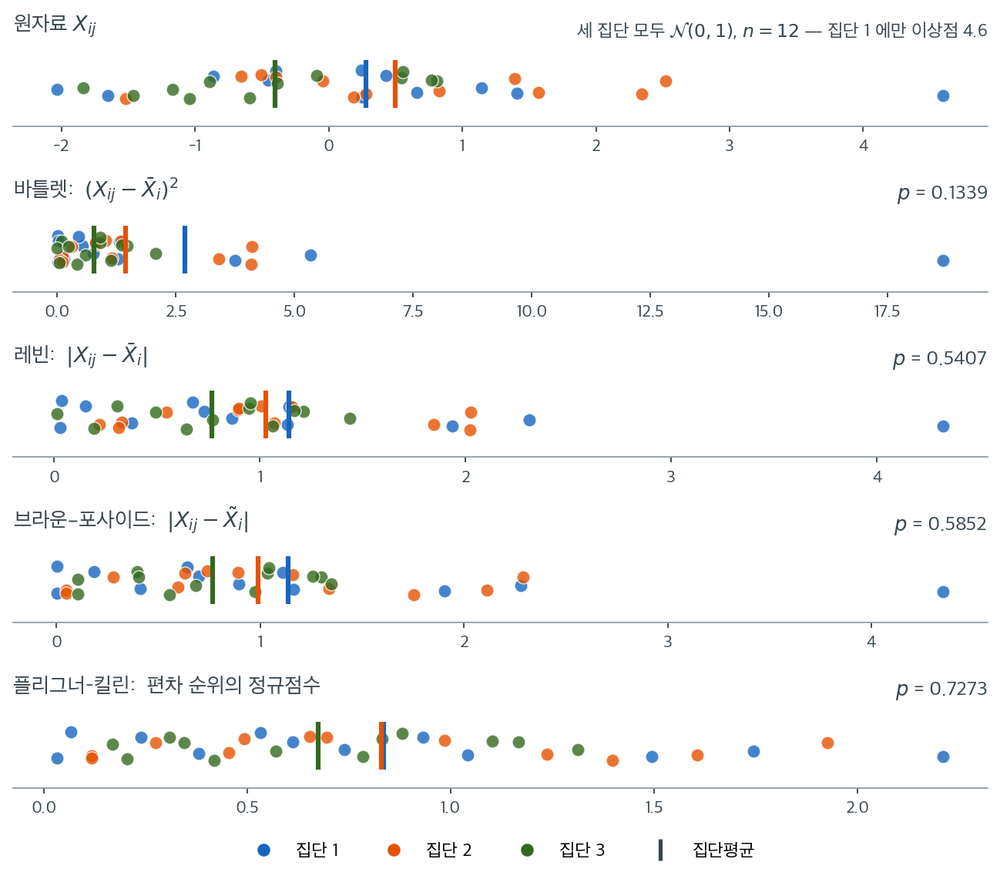
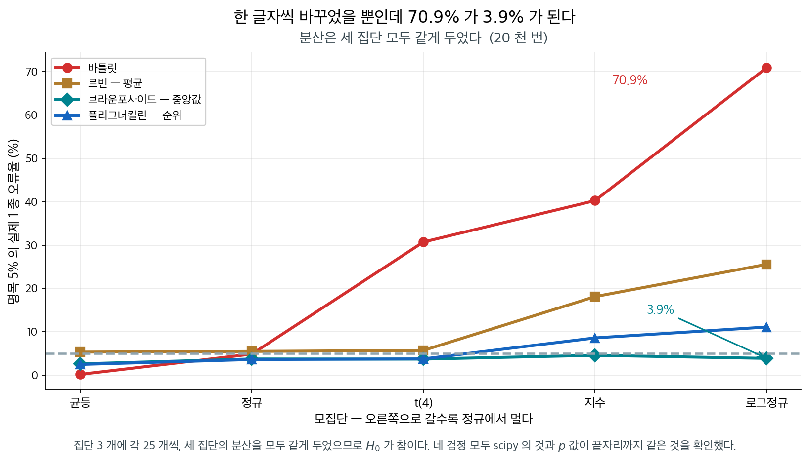

# 분산 동일성에 대한 로버스트 검정


## 1. 네 검정은 같은 자료를 어떻게 바꾸는가

<div class="leadbox" markdown>

**들어가는 이야기** — 이상점 하나가 p 를 다섯 배로

세 집단을 모두 $\mathcal{N}(0,1)$ 에서 $n = 12$ 씩 뽑아 등분산을 참으로 만들고, 집단 $1$ 에만 $4.6$ 이라는 이상점 하나를 심었다. 이 하나 때문에 집단 $1$ 의 표본분산이 $2.931$ 이 되어 $1.567$ 과 $0.837$ 에서 크게 벌어진다. 같은 $36$ 개 관측값에 네 검정을 돌리면 $p$ 값이 $0.1339$ 에서 $0.7273$ 까지 나온다.

**자료도 하나이고 귀무가설도 참인데 결론의 강도가 다섯 배 넘게 차이 난다.** 달라진 것은 관측값을 수로 요약하는 방식뿐이다. 편차를 제곱하는 바틀렛의 눈에서 그 이상점은 $18.7$ 로 튀어 축의 절반을 차지한다. 제곱을 벗겨 절댓값만 취하면 $4.6$ 으로 내려앉아 다른 관측값들과 같은 눈금에 들어오고, 그것을 다시 순위로 바꾸면 $2.2$ 가 되어 두 번째로 큰 값과 별로 다르지 않다.

그 자리바꿈이 로버스트성의 정체다. 절대편차로 바꾸는 순간 **$4$ 차 적률에 매여 있던 문제가 $1$ 차 적률 문제로 내려앉아** 중심극한정리의 보호 아래로 들어간다. 바틀렛은 그 자리바꿈을 하지 않는다. 로그분산을 곧바로 카이제곱에 대므로 넷 가운데 혼자 치솟는다.

그러면 어느 요약을 쓸지는 무엇으로 정하는가. 취향이 아니라 **이상점과 비정규성이 있을 때 어느 쪽이 거짓 양성을 덜 내는가**로 정해야 한다. 이 쪽이 네 변환을 한 자료 위에 나란히 놓아 무엇이 갈리는지 보이고, 아래 상자가 그 판정의 기준을 세운다.

_확인한 곳 — 이 쪽 「그래서 어느 쪽이 거짓 양성을 덜 내는가」 상자와 그 출처 줄. 통계량과 $p$ 값은 모두 직접 계산한 값이다_

</div>

분산의 동일성을 묻는 로버스트 검정들은 정규성 이탈에 매우 민감한 F 검정과 달리 비정규 자료에서도 쓸 수 있다. 평균 대신 중앙값을 쓰는 Brown-Forsythe 검정은 자료에 이상점이 있을 때 특히 효과적이다.

왜 $F$ 검정을 대신할 것이 필요한지는 [5.10절](../../ch05/applications/var_ratio_nonnormal.md)이 표집분포 쪽에서 진단해 두었다. 요지는 이렇다. $S_1^2/S_2^2$이 $F$ 분포를 따르는 것은 정규모집단에서뿐이고, 벗어나면 어긋남의 배율이 첨도로 정해지며 **표본을 키워도 줄지 않는다.** 명목 5% 검정이 지수모집단에서 27%, 로그정규에서 49%를 기각한다. 이 장은 그 진단을 받아 **무엇을 대신 쓸 것인가**에 답한다.

아래 검정들이 통하는 까닭도 거기서 나온다. 절대편차로 바꾸는 순간 4차 적률에 매여 있던 문제가 **1차 적률 문제로 내려앉아** 중심극한정리의 보호를 받게 된다.

네 검정은 모두 **같은 자료를 다른 양으로 바꾸어** 보통의 일원분산분석에 넣는다. 레빈과
브라운–포사이드는 절대편차 $Z_{ij} = \lvert X_{ij} - c_i \rvert$ 를 쓰는데 중심 $c_i$ 를
집단평균으로 잡으면 레빈, 집단중앙값으로 잡으면 브라운–포사이드다. 플리그너–킬린은 그
절대편차를 다시 순위로 바꾼다(아래 §2). 가설과 가정과 검정통계량의 정의와 유도는 각
전용 쪽에 있다 — [Levene 검정](levene.md), [Brown-Forsythe 검정](brown_forsythe.md),
[Fligner-Killeen 검정](fligner_killeen.md). 네 변환을 한 표로 모아 둔 것은
[로버스트 방법의 비교](comparison.md) §1 이다.

이 쪽이 하는 일은 그 넷을 **한 자료 위에 나란히 놓아** 무엇이 갈리는지 보이는 것이다.

네 검정의 차이는 결국 **같은 자료를 어떤 렌즈로 보는가**의 차이다. 세 집단을 모두 $\mathcal{N}(0,1)$에서 $n = 12$씩 뽑고(참으로 $H_0$이 옳다) 집단 1에만 $4.6$이라는 이상점을 하나 심었다. 같은 36개 관측값이 네 변환을 거치면 어떻게 보이는지 나란히 놓았다.



맨 위가 원자료다. 세 집단이 서로 뒤섞여 있고 오른쪽 끝에 파란 이상점 하나가 떨어져 있다. 이 하나 때문에 집단 1의 표본분산이 $2.931$이 되어 집단 2의 $1.567$, 집단 3의 $0.837$과 크게 벌어진다.

둘째 줄이 **바틀렛**의 시야다. 편차를 제곱하므로 이상점이 $18.7$이라는 값으로 튀어 오른다. 나머지 35개 관측값이 모두 $0$에서 $5$ 사이에 몰려 있는데 점 하나가 축의 절반을 차지한다. 이 한 점이 집단 1의 로그분산을 통째로 끌어올리고, $p = 0.1339$로 네 검정 중 가장 작은 값이 나온다.

셋째와 넷째 줄이 **레빈**과 **브라운–포사이드**다. 제곱을 벗기자 이상점의 값이 $4.6$으로 내려앉아 다른 관측값들과 같은 눈금 안에 들어온다. 제곱이 일차 영향력을 이차로 바꾸던 것이 여기서 멈춘다. 두 줄의 차이는 중심을 평균으로 잡느냐 중앙값으로 잡느냐뿐이며, 이상점이 하나뿐인 이 자료에서는 $p = 0.5407$과 $0.5852$로 큰 차이가 없다.

맨 아래가 **플리그너–킬린**이다. 편차를 순위로 바꾼 뒤 정규점수를 매기므로 이상점의 점수가 $2.2$, 곧 36개 중 가장 큰 값이긴 해도 두 번째로 큰 값과 별로 다르지 않다. 점들이 $0$에서 $2.2$ 사이에 고르게 퍼진 모양이 그 결과다. $p = 0.7273$으로 가장 관대하다.

**네 $p$값이 $0.134$에서 $0.727$까지 벌어졌다는 사실을 새겨 두라.** 자료는 하나이고 귀무가설도 참이다. 달라진 것은 관측값을 수로 요약하는 방식뿐인데 결론의 강도가 다섯 배 넘게 차이 난다. 어떤 변환을 쓸지는 취향이 아니라 **이상점과 비정규성이 있을 때 어느 쪽이 거짓 양성을 덜 내는가**로 결정해야 하며, 이 장의 나머지가 그 질문에 답한다.

### 보기와 풀이

**보기:** 어떤 연구자가 서로 다른 강사에게 배운 세 집단의 시험점수 분산이 다른지 검정하려 한다. 시험점수는 다음과 같다.

- 집단 1: $65, 70, 75, 80, 85$
- 집단 2: $60, 65, 70, 75, 90$
- 집단 3: $55, 60, 65, 70, 95$

Brown-Forsythe 검정으로 유의수준 5%에서 분산이 같은지 검정하라.

**1단계 — 가설 설정:**

- $H_0$: 세 집단의 시험점수 분산이 같다.
- $H_1$: 적어도 한 집단의 분산이 유의하게 다르다.

**2단계 — 집단중앙값으로부터의 절대편차 계산:**

- **집단 1** (중앙값 = 75): $|65-75|=10$, $|70-75|=5$, $|75-75|=0$, $|80-75|=5$, $|85-75|=10$
- **집단 2** (중앙값 = 70): $|60-70|=10$, $|65-70|=5$, $|70-70|=0$, $|75-70|=5$, $|90-70|=20$
- **집단 3** (중앙값 = 65): $|55-65|=10$, $|60-65|=5$, $|65-65|=0$, $|70-65|=5$, $|95-65|=30$

**3단계 — 절대편차의 집단평균 계산:**

- 집단 1: $(10 + 5 + 0 + 5 + 10) / 5 = 6$
- 집단 2: $(10 + 5 + 0 + 5 + 20) / 5 = 8$
- 집단 3: $(10 + 5 + 0 + 5 + 30) / 5 = 10$

**4단계 — 검정통계량 계산:**

$N = 15$, $k = 3$으로 $W$ 공식을 적용하고 자유도 $k - 1 = 2$, $N - k = 12$인 F 분포와 비교한다.

**5단계 — 판정:**

```python
import numpy as np
from scipy import stats

g1 = [65, 70, 75, 80, 85]
g2 = [60, 65, 70, 75, 90]
g3 = [55, 60, 65, 70, 95]

print("variances:", [round(np.var(g, ddof=1), 2) for g in (g1, g2, g3)])
# 결과는 이름있는 튜플이다. 그대로 출력하면 유효숫자가 너무 많으므로
# 통계량과 p값을 꺼내 자리수를 맞춰 찍는다.
bf = stats.levene(g1, g2, g3, center='median')
lv = stats.levene(g1, g2, g3, center='mean')
fk = stats.fligner(g1, g2, g3)
bt = stats.bartlett(g1, g2, g3)
print(f"Brown-Forsythe:  W = {bf.statistic:.4f}, p = {bf.pvalue:.4f}")
print(f"Levene (mean):   W = {lv.statistic:.4f}, p = {lv.pvalue:.4f}")
print(f"Fligner-Killeen: H = {fk.statistic:.4f}, p = {fk.pvalue:.4f}")
print(f"Bartlett:        T = {bt.statistic:.4f}, p = {bt.pvalue:.4f}")
print(f"F critical (2, 12): {stats.f.ppf(0.95, 2, 12):.4f}")
```

출력:

```text
variances: [62.5, 132.5, 242.5]
Brown-Forsythe:  W = 0.2824, p = 0.7589
Levene (mean):   W = 0.5451, p = 0.5935
Fligner-Killeen: H = 0.2408, p = 0.8866
Bartlett:        T = 1.5647, p = 0.4573
F critical (2, 12): 3.8853
```

**6단계 — 결론:**

$W = 0.2824 < 3.8853$이므로 $H_0$을 기각하지 못한다. 네 검정 모두 같은 결론이다.

!!! warning "표본분산이 4배 차이인데도 기각하지 못한다"
    세 집단의 표본분산은 $62.5$, $132.5$, $242.5$로 최대·최소 비가 **3.9배**이다. 그런데 어떤 검정도 기각하지 못한다($p$값이 $0.46$에서 $0.89$).

    각 집단 $n = 5$로는 검정력이 사실상 없기 때문이다. 15.4절 [분산의 동일성에 대한 Bartlett 검정](../bartlett_test/bartlett_test.md) 연습문제 22에서 보았듯 총 30개 관측값으로도 4배 차이를 겨우 탐지하는데, 여기는 15개뿐이다.

    또 하나 눈여겨볼 점은 편차 구조이다. 세 집단 모두 편차가 $\{0, 5, 5, 10, x\}$ 형태이고 $x$만 $10, 20, 30$으로 다르다. 곧 **집단당 관측값 하나만** 산포 차이의 정보를 담고 있다. 이 정도 증거로는 어떤 검정도 유의성에 도달할 수 없다.

    실무적 결론은 "분산이 같다"가 아니라 **"이 자료로는 판정할 수 없다"**이다.

---

<div class="storybox" markdown>

**그림으로 보는 통계학 1.** 그래서 어느 쪽이 거짓 양성을 덜 내는가

§1 이 네 렌즈를 나란히 놓고 이렇게 끝맺었다 — 어떤 변환을 쓸지는 취향이 아니라
**이상점과 비정규성이 있을 때 어느 쪽이 거짓 양성을 덜 내는가**로 정해야 한다고. 그
물음에 수로 답해 둔다.

세 집단의 분산을 **모두 같게** 두고(곧 $H_0$ 가 참이다) 모집단만 바꿔 가며, 명목 $5\%$
검정이 실제로 몇 번 기각하는지 센다.

<figure markdown>
  { width=940 }
  <figcaption markdown>$H_0$ 가 참이므로 네 곡선 모두 $5\%$ 에 붙어 있어야 한다. 네 검정의 $p$ 값이 `scipy` 의 `bartlett` · `levene` · `fligner` 와 끝자리까지 같은 것을 확인했다. 자료에서 직접 쟀다.</figcaption>
</figure>

**바틀릿은 로그정규에서 $70.9\%$ 를 기각한다.** 분산이 모두 같은데 열 번에 일곱 번
「다르다」고 말한다. 르빈은 $25.6\%$ 로 나아지고, 중심을 중앙값으로 바꾼 브라운포사이드는
**$3.9\%$** 로 약속을 지킨다. §1 의 렌즈 그림에서 $p$ 값이 $0.134$ 에서 $0.727$ 까지
벌어졌던 것이 **어느 쪽으로 기울어 있었는지**가 여기서 드러난다.

**왜 렌즈를 바꾸는 것만으로 이렇게 달라지는가.** §1 은 이상점 하나에 주는 가중치로
설명했다. 한 겹 더 들어가면 이렇다 — 이 검정들은 전부 **두 단계**로 되어 있고, 둘째
단계가 보통의 **일원분산분석**이다. 곧 산포를 묻던 문제가 **평균을 묻는 문제**로 바뀐다.

그 자리바꿈이 공짜가 아니다. 분산 검정이 비정규성에 그토록 약했던 까닭은 카이제곱과
$F$ 가 **$4$ 차 적률**에 매여 있기 때문이었고, 중심극한정리는 $1$ 차 적률에만 선물을
준다([$5$ 장](../../ch05/distributions/chi_square.md)·[$13$ 장](../../ch11/assumptions/checking_normality.md)이 같은 말을 두 번 했다).
편차로 바꾸어 **평균을 견주는 순간** 다시 그 보호 아래로 돌아온다. 어려운 문제를 푼 것이
아니라 **보호받는 자리로 옮겨 놓은** 것이다. 바틀릿만 그 자리바꿈을 하지 않고 로그분산을
직접 카이제곱에 대므로 혼자 치솟는다.

표를 읽을 때 조심할 것이 둘 있다.

**하나. 공짜는 아니다.** 로버스트 셋은 정규·균등에서 $2.5$–$3.8\%$ 로 약간 **보수적**이다.
안전한 쪽으로 틀리지만 그만큼 검정력을 내준다. 반대로 바틀릿은 균등에서 $0.2\%$ 까지
내려가 거의 기각하지 않는다 — 꼬리가 가벼우면 반대쪽으로 틀린다.

**둘. 순위가 언제나 더 안전하지는 않다.** 플리그너킬린은 대칭인 꼬리($t_4$)에서 $3.8\%$
로 좋은데, 치우친 쪽(로그정규)에서는 $11.1\%$ 로 브라운포사이드보다 못하다. §1 의 렌즈
그림에서 가장 「관대해」 보였던 것이 모든 어긋남에 강하다는 뜻은 아니다.

_확인한 곳 — 르빈($1960$)·브라운과 포사이드($1974$)·플리그너와 킬린($1976$)의 변환은 §1·§2 가 적은 그대로다 · 그림의 오류율은 집단 $3$ 개 · 각 $25$ 개 · $2$ 만 번으로 이 쪽이 직접 쟀고, 네 검정 모두 `scipy` 와 $p$ 값이 끝자리까지 일치하는 것을 확인했다_

</div>

## 2. Fligner-Killeen 검정

Fligner-Killeen 검정은 여러 집단의 분산을 비교하는 비모수 검정이다. Brown-Forsythe 검정처럼 집단중앙값으로부터의 절대편차를 산포의 측도로 쓴다. 그러나 원래의 편차를 그대로 쓰는 대신 **순위**로 변환하고, 다시 정규점수로 바꾸어 분석한다.

### 검정통계량

**1단계 — 절대편차 계산:**

집단 $i$의 각 관측값 $X_{ij}$에 대해 집단중앙값 $\tilde{X}_i$로부터의 절대편차를 계산한다.

$$
Z_{ij} = |X_{ij} - \tilde{X}_i|
$$

**2단계 — 절대편차의 순위 매기기:**

모든 집단의 절대편차 $Z_{ij}$를 합쳐서 순위를 매긴다(통합 순위).

$$
R_{ij} = \text{rank}(|X_{ij} - \tilde{X}_i|)
$$

여기서 $R_{ij}$는 결합된 자료에서 절대편차 $Z_{ij}$의 순위이다.

**3단계 — 정규점수로 변환:**

순위를 절반정규 점수로 바꾼다.

$$
a_{ij} = \Phi^{-1}\!\left(\frac{1 + R_{ij}/(N+1)}{2}\right)
$$

이 단계가 결정적이다. 순위를 그대로 쓰면 점수의 척도가 $N$에 의존하고, 아래 통계량이 카이제곱분포를 따르지 않는다.

**4단계 — 검정통계량 계산:**

$$
\chi^2_{\text{FK}} = \frac{\sum_{i=1}^k n_i \left( \bar{a}_i - \bar{a} \right)^2}{V} \sim \chi^2_{k-1}
$$

여기서

- $k$는 집단의 수,
- $n_i$는 집단 $i$의 관측값 수,
- $\bar{a}_i$는 집단 $i$의 정규점수 평균,

$$
\bar{a}_i = \frac{1}{n_i} \sum_{j=1}^{n_i} a_{ij}
$$

- $\bar{a}$는 전체 정규점수 평균,

$$
\bar{a} = \frac{1}{N} \sum_{i=1}^k \sum_{j=1}^{n_i} a_{ij}
$$

- $V$는 정규점수 전체의 분산이다.

$$
V = \frac{1}{N-1}\sum_{i=1}^k\sum_{j=1}^{n_i}(a_{ij} - \bar{a})^2
$$

$N = \sum_{i=1}^k n_i$는 전체 관측값의 수이다.

이 공식은 집단별 정규점수 평균 $\bar{a}_i$가 전체평균 $\bar{a}$에서 얼마나 벗어나는지를 집단 크기로 가중하여 재고, 점수 전체의 분산 $V$로 표준화한다.

!!! warning "분모 $V$를 빠뜨리면 안 된다"
    문헌에 따라 $H = \sum_i n_i(\bar{R}_i - \bar{R})^2$처럼 순위를 그대로 쓰고 분모를 생략한 형태가 소개되기도 하는데, 이는 **카이제곱분포를 따르지 않는다**. 순위의 척도가 $N$에 의존하므로 통계량의 크기가 표본크기에 따라 임의로 커진다.

    정확한 통계량에는 (1) 정규점수 변환과 (2) 분모 $V$가 모두 필요하다. 자세한 유도는 [Fligner-Killeen 검정](fligner_killeen.md) 페이지를 보라.

**5단계 — 분포 결정:**

검정통계량은 자유도 $k - 1$인 카이제곱분포를 점근적으로 따른다.

---

## 연습문제

<div class="drillbox" markdown>

**연습문제 1.** <span class="diff med" title="중간"></span>
$H = \sum_i n_i(\bar{R}_i - \bar{R})^2$ 형태의 통계량이 왜 카이제곱분포를 따를 수 없는지 차원 분석으로 설명하라.

</div>

??? success "풀이"
    **차원(척도) 분석.** 순위 $R_{ij}$는 $1$부터 $N$까지의 값을 가지므로 $\bar{R} = (N+1)/2$이고 순위의 분산은

    $$
    \operatorname{Var}(R) = \frac{N^2 - 1}{12}
    $$

    이다. 곧 순위의 척도가 $N$에 비례한다.

    $H_0$ 아래에서 $\bar{R}_i - \bar{R}$의 표준편차는 대략 $\sqrt{\operatorname{Var}(R)/n_i} \propto N/\sqrt{n_i}$이므로

    $$
    E[H] = \sum_i n_i \cdot \operatorname{Var}(\bar{R}_i) \approx (k-1)\cdot\frac{N^2-1}{12}.
    $$

    이 값이 $N^2$에 비례하여 커진다. 반면 $\chi^2_{k-1}$의 평균은 $k-1$로 **$N$과 무관한 상수**이다.

    구체적으로 $k = 3$, $n_i = 20$($N = 60$)이면 $E[H] \approx 2 \times 299.92 = 599.8$인데 $\chi^2_2$의 평균은 2이다. 300배 차이이다. $N$을 두 배로 하면 이 배수가 다시 네 배가 된다.

    **결론.** 분모 $V$가 정확히 이 척도 의존성을 제거한다. $V$가 점수 전체의 분산이므로 $\sum_i n_i(\bar{a}_i - \bar{a})^2 / V$는 무차원량이 되고, $H_0$ 아래에서 평균이 $k-1$이 되어 카이제곱분포와 맞는다.

    정규점수 변환도 같은 역할을 한다. 순위 $R$의 범위는 $[1, N]$으로 $N$에 의존하지만 정규점수 $a$의 범위는 $[0, \Phi^{-1}(N/(2N+2)+1/2)]$로 $\sqrt{2\ln N}$ 규모로만 커진다. 두 장치가 함께 통계량을 안정시킨다. $\square$

<div class="drillbox" markdown>

**연습문제 2.** <span class="diff med" title="중간"></span>
본문 보기에서 세 집단의 편차가 모두 $\{0, 5, 5, 10, x\}$ 형태이고 $x$만 다르다. 이 구조가 검정력에 어떤 영향을 주는지 설명하고, 같은 분산비를 유지하면서 검정력이 더 높아지도록 자료를 재구성하라.

</div>

??? success "풀이"
    **문제의 구조.** 각 집단에서 관측값 다섯 개 중 네 개의 편차가 $\{0, 5, 5, 10\}$으로 **완전히 동일**하다. 산포 차이의 정보를 담은 것은 각 집단의 다섯 번째 관측값 하나뿐이다.

    분산분석 F 통계량의 관점에서 보면

    - **분자**(집단간 변동): $\bar{Z}_i$가 $6, 8, 10$으로 차이가 있다. 신호가 있다.
    - **분모**(집단내 변동): 각 집단의 편차가 $0$에서 $30$까지 넓게 흩어져 있어 매우 크다. 잡음이 크다.

    집단 3의 편차 $\{0, 5, 5, 10, 30\}$은 그 자체의 표본분산이 $137.5$나 된다. 이 큰 집단내 변동이 F 통계량의 분모를 지배하여 $W = 0.28$로 눌러 버린다.

    **재구성 방법.** 같은 분산비를 유지하면서 검정력을 높이려면 **각 집단 안에서 편차가 고르게 분포하도록** 만들어야 한다. 곧 한 관측값에 산포를 몰아넣지 말고 모든 관측값에 퍼뜨린다.

    ```python
    import numpy as np
    from scipy import stats

    # 원자료: 퍼짐이 집단마다 관측값 하나에 몰려 있다
    orig = ([65, 70, 75, 80, 85], [60, 65, 70, 75, 90], [55, 60, 65, 70, 95])

    # 다시 짠 자료: 분산비는 같되 퍼짐이 고르게 나뉘어 있다
    # 표준편차의 비는 1 : sqrt(2.12) : sqrt(3.88) 로, 분산 62.5 : 132.5 : 242.5 에 해당한다
    base = np.array([-2, -1, 0, 1, 2])
    new = tuple((75 + base * s).tolist()
                for s in (np.sqrt(62.5 / 2.5), np.sqrt(132.5 / 2.5),
                          np.sqrt(242.5 / 2.5)))

    for label, groups in [("original", orig), ("restructured", new)]:
        v = [round(np.var(g, ddof=1), 1) for g in groups]
        p_bf = stats.levene(*groups, center='median')[1]
        print(f"{label:>14}: vars = {v}, Brown-Forsythe p = {p_bf:.4f}")
    ```

    출력:

    ```text
          original: vars = [62.5, 132.5, 242.5], Brown-Forsythe p = 0.7589
      restructured: vars = [62.5, 132.5, 242.5], Brown-Forsythe p = 0.3840
    ```

    재구성된 자료는 같은 표본분산 $62.5$, $132.5$, $242.5$를 갖지만 각 집단 안에서 편차가 $\{0, s, s, 2s, 2s\}$ 형태로 고르게 퍼져 있다. 집단내 변동이 작아지므로 F 통계량의 분모가 줄고 $W$가 $0.282$에서 $1.038$로 3.7배 커진다. $p$값도 $0.759$에서 $0.384$로 절반으로 줄었다.

    (여전히 기각하지는 못한다. $n_i = 5$라는 근본적 한계는 자료 구조를 바꿔도 극복되지 않는다.)

    **일반적 교훈.** 분산 검정의 검정력은 표본분산의 비만이 아니라 **그 분산이 어떻게 만들어졌는지**에도 의존한다. 이상점 하나가 만든 큰 분산은 탐지하기 어렵고, 전반적으로 넓게 퍼진 분산은 탐지하기 쉽다.

    이는 로버스트 검정의 설계 의도와도 통한다. 이상점 하나가 만든 분산 차이를 "실질적 산포 차이"로 볼지 "오염"으로 볼지는 통계가 아니라 자료의 맥락이 답할 문제이다. $\square$

<div class="drillbox" markdown>

**연습문제 3.** <span class="diff med" title="중간"></span>
Levene 계열 검정이 정규성을 요구하지 않는다고 하지만, 어떤 형태의 가정은 여전히 필요하다. 어떤 가정인지 밝히고 위반 시 무슨 일이 일어나는지 설명하라.

</div>

??? success "풀이"
    **여전히 필요한 가정은 세 가지이다.**

    **1. 독립성.** 이 가정은 로버스트 검정도 전혀 완화하지 못한다. 15.1절 [분산 검정의 공통 가정](../introduction/common_assumptions.md) 연습문제 2에서 보았듯 자기상관이 있으면 카이제곱 분산 검정의 크기가 $\phi = 0.8$에서 0.38까지 치솟았다. Levene 계열도 같은 문제를 겪는다. 절대편차의 평균에 대한 F 검정 역시 관측값의 독립을 가정하기 때문이다.

    **2. 변환값 $Z_{ij}$의 집단내 분포가 같을 것.** 이것이 미묘한 지점이다. 분산분석 F 검정은 집단들의 오차분산이 같다고 가정한다. 여기서 "오차"는 $Z_{ij}$의 집단내 변동, 곧 $\operatorname{Var}(Z_i)$이다.

    그런데 $\operatorname{Var}(Z_i) = \sigma_i^2(1 - 2/\pi)$(정규성 아래)이므로, $\sigma_i$가 다르면 $\operatorname{Var}(Z_i)$도 다르다. 곧 **$H_1$이 참일 때 F 검정 자체의 등분산 가정이 위배된다.**

    다행히 이는 $H_0$ 아래에서는 문제가 되지 않으므로 크기는 통제된다. 다만 $H_1$ 아래에서 검정력 계산이 정확하지 않고, 극단적으로 불균형한 설계에서는 왜곡이 생길 수 있다.

    **3. $\bar{Z}_i$의 근사적 정규성.** F 검정이 타당하려면 중심극한정리가 작동할 만큼 $n_i$가 커야 한다. $Z_{ij}$가 오른쪽으로 치우친 절반정규 형태이므로 $n_i$가 아주 작으면(5 이하) 근사가 나쁘다.

    본문 보기의 $n_i = 5$가 그 경계에 있다. 15.5절 비교 페이지의 크기 표에서 Brown-Forsythe가 $n_i = 20$에서 0.035~0.048로 다소 보수적이었던 것도 이 근사의 잔여 오차 때문이다.

    **요약.** 로버스트 검정은 **원자료의 정규성**을 요구하지 않을 뿐, 독립성과 변환 후의 정칙조건은 여전히 필요하다. "로버스트"가 "무조건 안전"을 뜻하지 않는다. $\square$

<div class="drillbox" markdown>

**연습문제 4.** <span class="diff med" title="중간"></span>
$Z_{ij} = |X_{ij} - \tilde{X}_i|$에서 중앙값 $\tilde{X}_i$가 자료에서 추정된 값인데도, 분산분석 F 검정의 자유도를 $N - k$로 그대로 쓴다. 이 자유도가 정확한지 논하라.

</div>

??? success "풀이"
    **엄밀히 말하면 정확하지 않다.**

    표준 일원분산분석에서 자유도 $N - k$는 $k$개의 집단평균을 추정했기 때문에 $N$에서 $k$를 뺀 것이다. Levene 검정에서는 여기에 더해 **각 집단의 중심 $c_i$를 추정하는 데 이미 자유도를 썼다**. 곧 자료를 두 번 쓰는 셈이다.

    구체적으로 Brown-Forsythe에서 $Z_{ij} = |X_{ij} - \tilde{X}_i|$를 계산할 때 중앙값 $\tilde{X}_i$를 표본에서 추정했으므로, $Z_{ij}$들은 완전히 독립이 아니다. 예컨대 $n_i$가 홀수이면 중앙값에 해당하는 관측값의 편차가 항상 정확히 0이 되어 자유로운 값이 아니다.

    **왜 그래도 쓰는가.**

    1. **점근적으로 무시할 만하다.** $n_i$가 크면 $\tilde{X}_i$가 참 중앙값으로 수렴하고, 추정에서 오는 종속성이 $O(1/n_i)$로 사라진다.

    2. **보정이 간단하지 않다.** 정확한 유한표본 분포는 원분포에 의존하므로 닫힌 형태의 자유도 보정이 존재하지 않는다.

    3. **실증적으로 잘 작동한다.** 15.5절 비교 페이지의 모의실험에서 $n_i = 20$일 때 Brown-Forsythe의 크기가 0.035~0.048로 명목값에 가까웠다. 약간 보수적인 방향의 잔여 오차가 있을 뿐이다.

    **그 잔여 오차의 방향.** 정규 자료에서 Brown-Forsythe의 크기가 0.039로 명목값보다 작았다는 사실이 이 자유도 문제의 흔적이다. $Z_{ij}$들이 중앙값 추정 때문에 실제보다 덜 자유롭고, 그만큼 집단내 제곱합이 F 통계량을 억누른다.

    **실무적 함의.** 이 정도 보수성은 실무에서 문제가 되지 않는다. 정확한 크기가 결정적이라면 순열검정을 쓰면 된다. 각 관측값을 집단에 무작위 재배정하여 $W$의 정확한 귀무분포를 얻을 수 있고, 그러면 자유도 문제가 원천적으로 사라진다. $\square$

<div class="drillbox" markdown>

**연습문제 5.** <span class="diff med" title="중간"></span>
본문 §1 의 네 렌즈 그림에서 집단 1 에 심은 이상점 하나가 렌즈마다 다른 크기로 보였다. 제곱 렌즈(바틀렛)에서 $18.7$, 절대편차 렌즈(레빈·브라운–포사이드)에서 $4.6$, 정규점수 렌즈(플리그너–킬린)에서 $2.2$ 였다. 자료는 $\mathcal{N}(0,1)$ 에서 뽑은 $N = 36$ 개다.

**(1)** §2 의 3단계 공식에 $N = 36$ 과 이 이상점의 순위를 넣어 $2.2$ 를 직접 재현하라. 그리고 이상점의 값을 $4.6$ 대신 $10^6$ 으로 바꾸어도 이 값이 전혀 변하지 않는 까닭을 밝히라.

**(2)** 세 렌즈가 이 이상점을 **보통 관측값 하나에 비해** 몇 배로 키우는지 계산하라. 비교 기준은 각 렌즈가 $\mathcal{N}(0,1)$ 의 전형적인 관측값에 매기는 값으로, 제곱 렌즈는 $E[Z^2] = 1$, 절대편차 렌즈는 $E\lvert Z\rvert = \sqrt{2/\pi}$, 정규점수 렌즈는 순위가 가운데인 관측값의 점수 $\Phi^{-1}(0.75)$ 로 잡으라.

**(3)** 세 배율의 순서와 본문의 네 $p$ 값 $0.1339,\ 0.5407,\ 0.5852,\ 0.7273$ 의 순서가 어떻게 맞물리는지 한 줄로 쓰라.

</div>

??? success "풀이"
    **(1) 이상점의 정규점수는 순위만으로 정해진다.** 이 관측값의 절대편차가 36 개 중 가장 크므로 $R = 36$ 이다. §2 의 3단계 공식에 넣으면

    $$
    a = \Phi^{-1}\!\left(\frac{1 + 36/37}{2}\right) = \Phi^{-1}(0.98649) = 2.2111
    $$

    이고, 본문의 $2.2$ 와 맞는다.

    이상점을 $10^6$ 으로 키워도 그것은 여전히 **36 개 중 가장 큰 하나**이므로 $R = 36$ 이 그대로이고 점수도 $2.2111$ 그대로다. 더 나아가 이 값은 $N = 36$ 에서의 **상한**이다. 어떤 자료가 와도 최대 점수는

    $$
    \Phi^{-1}\!\left(\frac{1 + N/(N+1)}{2}\right) = 2.2111
    $$

    을 넘을 수 없다. 순위 변환이 자료의 눈금을 통째로 버리기 때문이다.

    **(2) 배율은 세 렌즈에서 이렇게 갈린다.**

    | 렌즈 | 이상점의 값 | 전형적 관측값 | 배율 |
    |:---|---:|---:|---:|
    | 제곱 (바틀렛) | $18.7$ | $1$ | $18.7$ |
    | 절대편차 (레빈·BF) | $4.6$ | $0.7979$ | $5.77$ |
    | 정규점수 (FK) | $2.2111$ | $0.6745$ | $3.28$ |

    계산은 $4.6/\sqrt{2/\pi} = 4.6/0.7979 = 5.77$, $2.2111/\Phi^{-1}(0.75) = 2.2111/0.6745 = 3.28$ 이다. (제곱 렌즈의 $18.7$ 은 집단평균에서의 편차 $4.32$ 를 제곱한 값이다. $4.32^2 = 18.66$.)

    **(3) 배율이 큰 렌즈가 작은 $p$ 값을 낸다.** $18.7 \to 0.1339$(바틀렛), $5.77 \to 0.5407,\ 0.5852$(레빈·BF), $3.28 \to 0.7273$(FK)로 두 순서가 정확히 역방향으로 맞물린다.

    **해석.** 세 렌즈의 차이는 이상점 하나에 **유계인 가중치를 주는가**이다. 제곱 렌즈의 배율은 이상점 값과 함께 제곱으로 자라 상한이 없고, 절대편차 렌즈는 일차로 자라고, 정규점수 렌즈는 $2.2111/0.6745 = 3.28$ 에서 멈춘다. 로버스트성의 서열이 바로 이 상한의 서열이다. $\square$

<div class="drillbox" markdown>

**연습문제 6.** <span class="diff med" title="중간"></span>
정규모집단에서 $X \sim \mathcal{N}(\mu, \sigma^2)$, $Z = \lvert X - \mu \rvert$ 라 하자.

**(1)** $E[Z] = \sigma\sqrt{2/\pi}$ 와 $\operatorname{Var}(Z) = \sigma^2(1 - 2/\pi)$ 를 보이라.

**(2)** 레빈 검정의 분자가 비교하는 양이 $\sigma_i^2$ 가 아니라 $\sigma_i$ 에 비례함을 지적하고, 모분산비 $r$ 가 신호에서는 얼마로 나타나는지 쓰라. $r = 3$ 은 신호에서 몇 배인가. 또 $Z$ 의 변동계수 $\operatorname{SD}(Z)/E[Z]$ 가 $\sigma$ 와 무관한 상수임을 보이고 그 값을 구하라.

**(3)** 두 집단 $\sigma_1 = 1$, $\sigma_2 = \sqrt{3}$, $n_1 = n_2 = 20$ 에서 $\bar{Z}_2 - \bar{Z}_1$ 을 그 표준오차로 나눈 값을 구하고 양측 5% 검정력을 어림하라. 15.5절 비교 표의 값(레빈 $0.628$, 브라운–포사이드 $0.560$)과 견주라. 검정력 80% 에는 집단당 몇 개가 필요한가.

</div>

??? success "풀이"
    **(1) 절반정규분포의 적률이다.** $U = (X-\mu)/\sigma \sim \mathcal{N}(0,1)$ 로 두면 $Z = \sigma\lvert U \rvert$ 이고

    $$
    E\lvert U \rvert = 2\int_0^\infty u\,\frac{1}{\sqrt{2\pi}}e^{-u^2/2}\,du = \frac{2}{\sqrt{2\pi}}\left[-e^{-u^2/2}\right]_0^\infty = \sqrt{\frac{2}{\pi}} = 0.7979
    $$

    이다. 또 $E[\lvert U \rvert^2] = E[U^2] = 1$ 이므로

    $$
    \operatorname{Var}(\lvert U \rvert) = 1 - \frac{2}{\pi} = 0.3634.
    $$

    $\sigma$ 를 곱하고 제곱하여 $E[Z] = 0.7979\sigma$, $\operatorname{Var}(Z) = 0.3634\sigma^2$ 을 얻는다.

    **(2) 레빈 검정은 분산이 아니라 표준편차를 비교한다.** $W$ 의 분자는 $\bar{Z}_i$ 들의 흩어짐이고 $E[\bar{Z}_i] = \sigma_i\sqrt{2/\pi}$ 이므로, 신호는 $\sigma_i$ 에 **일차로** 비례한다. 따라서 모분산비 $r = \sigma_2^2/\sigma_1^2$ 는 신호에서

    $$
    \frac{E[\bar{Z}_2]}{E[\bar{Z}_1]} = \frac{\sigma_2}{\sigma_1} = \sqrt{r}
    $$

    로만 나타난다. $r = 3$ 은 신호에서 $\sqrt{3} = 1.732$ 배다. **분산의 3 배 차이가 검정이 실제로 보는 눈금에서는 1.73 배로 줄어든다.**

    잡음은 줄지 않는다. 변동계수는

    $$
    \frac{\operatorname{SD}(Z)}{E[Z]} = \frac{\sigma\sqrt{1 - 2/\pi}}{\sigma\sqrt{2/\pi}} = \sqrt{\frac{\pi}{2} - 1} = 0.7555
    $$

    로 $\sigma$ 가 지워진 상수다. 신호가 $1.73$ 배인데 관측값 하나의 상대적 요동이 $0.76$ 이니, 평균을 여러 개 모아야 겨우 구별된다.

    **(3) 수를 넣는다.** 신호는

    $$
    \Delta = \sqrt{2/\pi}\,(\sqrt{3} - 1) = 0.7979 \times 0.7321 = 0.5840
    $$

    이고, 두 집단의 $\operatorname{Var}(Z_i)$ 가 $0.3634$ 와 $0.3634 \times 3 = 1.0901$ 이므로

    $$
    \operatorname{SE} = \sqrt{\frac{0.3634 + 1.0901}{20}} = \sqrt{0.07268} = 0.2696 .
    $$

    따라서 $z = 0.5840/0.2696 = 2.167$ 이고 양측 5% 검정력은

    $$
    \Phi(2.167 - 1.96) = \Phi(0.207) = 0.582
    $$

    이다. 15.5절 표의 레빈 $0.628$ 과 브라운–포사이드 $0.560$ 사이에 정확히 들어온다(그 표는 집단이 세 개여서 자유도가 다르다).

    80% 검정력에는 $z = z_{0.80} + 1.96 = 0.8416 + 1.96 = 2.802$ 가 필요하므로

    $$
    n = 20 \times \left(\frac{2.802}{2.167}\right)^2 = 33.4 \;\Rightarrow\; n \ge 34 .
    $$

    **해석.** 분산 검정이 평균 검정보다 늘 둔한 까닭이 여기 있다. 절대편차로 바꾸면 비정규성에 대한 보호를 얻지만 **분산비의 제곱근만 신호로 남는다.** 본문 보기의 $n = 5$ 로는 $34$ 의 1/7 밖에 안 되니 기각하지 못한 것이 당연하다. $\square$

<div class="drillbox" markdown>

**연습문제 7.** <span class="diff hard" title="어려움"></span>
집단이 $k = 3$ 개이고 집단 크기가 모두 $n_i = 2$ 인 자료를 생각하자.

**(1)** 레빈과 브라운–포사이드에서 $Z_{i1} = Z_{i2}$ 가 되어 $W$ 의 분모가 **정확히 0** 이 됨을 보이라. 세 집단의 범위가 모두 같지는 않을 때 $W$ 와 $p$ 값은 무엇이 되는가. $H_0$ 이 참일 때 이 검정의 크기는 얼마인가.

**(2)** 플리그너–킬린은 같은 자료에서 폭발하지 않는다. §2 의 $\chi^2_{\text{FK}}$ 를 정규점수의 전체제곱합으로 다시 써서 어떤 자료에서도

$$
\chi^2_{\text{FK}} \le N - 1
$$

임을 보이고 등호가 성립하는 조건을 밝히라.

**(3)** (2) 로부터 $k = 3$, $N = 6$ 에서 플리그너–킬린의 크기가 **정확히 0** 임을 보이라. $k = 3$ 에서 이 검정이 5% 에서 기각할 수 있으려면 $N$ 이 적어도 얼마여야 하는가. 두 검정의 운명이 반대로 갈린 까닭을 각 검정의 **분모가 무엇인지**로 설명하라.

</div>

??? success "풀이"
    **(1) $n_i = 2$ 에서 집단내 변동이 사라진다.** 집단 $i$ 의 두 관측값을 $x, y$ 라 하면 평균과 중앙값이 모두 $(x+y)/2$ 다. 두 중심이 일치하므로 레빈과 브라운–포사이드가 같은 자료를 만들고, 절대편차는

    $$
    Z_{i1} = Z_{i2} = \left\lvert x - \frac{x+y}{2} \right\rvert = \frac{\lvert x - y \rvert}{2} = \frac{R_i}{2}
    $$

    로 **둘이 똑같다**($R_i$ 는 집단 $i$ 의 범위). 따라서 $\bar{Z}_i = R_i/2$ 이고

    $$
    \sum_{j=1}^{2}(Z_{ij} - \bar{Z}_i)^2 = 0 \quad (i = 1, 2, 3)
    $$

    이므로 $W$ 의 분모가 모든 집단에서 0 이고 합도 0 이다.

    세 범위가 모두 같지는 않으면 분자 $\sum_i 2(\bar{Z}_i - \bar{Z})^2 > 0$ 이므로

    $$
    W = \frac{\text{양수}}{0} = +\infty, \qquad p = 0
    $$

    이다. 자료가 무엇이든 기각하므로 $H_0$ 이 참일 때의 **크기가 1** 이다. (세 범위가 우연히 모두 같으면 $0/0$ 으로 정의되지 않는다. SciPy 는 앞 경우에 `inf`·`0.0`, 뒤 경우에 `nan` 을 돌려준다.) 분산을 전혀 보지 않고도 거의 확실하게 "분산이 다르다"고 선언하는 검정이다.

    **(2) FK 의 분모는 전체 산포여서 0 이 될 수 없다.** 정규점수의 제곱합을 쪼개면 분산분석의 항등식에 의해

    $$
    \underbrace{\sum_i \sum_j (a_{ij} - \bar{a})^2}_{SST} = \underbrace{\sum_i n_i(\bar{a}_i - \bar{a})^2}_{SSB} + \underbrace{\sum_i \sum_j (a_{ij} - \bar{a}_i)^2}_{SSW}
    $$

    이고, §2 의 $V = SST/(N-1)$ 이므로

    $$
    \chi^2_{\text{FK}} = \frac{SSB}{SST/(N-1)} = (N-1)\,\frac{SSB}{SST} .
    $$

    $SSB/SST \le 1$ 이므로 $\chi^2_{\text{FK}} \le N - 1$ 이고, 등호는 $SSW = 0$, 곧 **집단 안의 점수가 모두 같을 때** 성립한다.

    **(3) $N = 6$ 에서는 기각이 불가능하다.** $\chi^2_{\text{FK}} \le 5$ 인데 기각점은 $\chi^2_{2,\,0.95} = 5.9915$ 다. 통계량이 기각점에 닿을 수 없으므로 크기가 정확히 0 이다. 실제로 $n_i = 2$ 에서는 $SSW = 0$ 이므로 통계량이 자료와 무관하게 상한 $N - 1 = 5$ 에 붙박이고

    $$
    p = P(\chi^2_2 > 5) = e^{-5/2} = 0.0821
    $$

    로 **언제나 같은 $p$ 값**이 나온다. $k = 3$ 에서 기각이 가능해지려면 $N - 1 > 5.9915$, 곧 $N \ge 7$ 이어야 한다.

    **왜 반대로 갈리는가.** 분모의 정체가 다르다.

    - 레빈·브라운–포사이드의 분모는 **집단내 산포** $SSW$ 다. 이것은 0 이 될 수 있고, 0 이 되면 통계량이 발산한다 — 크기 1.
    - 플리그너–킬린의 분모는 **전체 산포** $V = SST/(N-1)$ 다. 이것은 집단간 차이만 있어도 양수이므로 발산하지 않는다. 대신 통계량에 $N-1$ 이라는 천장이 생긴다 — 작은 $N$ 에서 크기 0.

    §2 의 경고 상자가 말한 분모 $V$ 는 척도를 고정해 주는 장치이면서 동시에 작은 표본에서 검정을 무력화하는 천장이다. 두 극단이 함께 말해 주는 실무 규칙은 하나다. **$n_i \le 2$ 에서는 어떤 분산 동일성 검정도 쓰지 말라.** $\square$

<div class="drillbox" markdown>

**연습문제 8.** <span class="diff hard" title="어려움"></span>
"정리하며"의 마지막 항목은 "검정 결과로 후속 방법을 고르면 전체 오류율이 왜곡된다"고 적었다. 이를 수로 따진다. 15.7절 사전검정 쪽은 네 집단, $n = 15$, 명목 $\alpha = 0.05$, 평균이 모두 같은 상황에서 실제 1 종 오류율을 이렇게 보고했다.

| 참 표준편차 | 항상 표준 분산분석 | 항상 웰치 | 두 단계 (BF 사전검정) |
|:---|---:|---:|---:|
| $(5,5,5,10)$ | $0.063$ | $0.044$ | $0.057$ |
| $(2,4,6,10)$ | $0.074$ | $0.046$ | $0.047$ |

**(1)** 두 단계 절차의 크기를 사전검정의 기각확률 $\gamma$ 에 대한 혼합으로 쓰라. 조건부 크기를 각 열의 값으로 **근사**하여 두 행에서 $\gamma$ 를 각각 역산하라.

**(2)** 역산한 두 값이 말하는 것을 한 문장으로 쓰고, 왜 그것이 "사전검정이 가장 필요한 곳에서 가장 도움이 되지 않는다"는 진술이 되는지 설명하라.

**(3)** (1) 의 근사가 어느 방향으로 틀리는지 논하라. 곧 "사전검정이 기각하지 못했다"는 조건이 붙었을 때 표준 분산분석의 조건부 크기가 $0.063$ 보다 큰가 작은가, 그리고 그에 따라 역산한 $\gamma$ 가 과대평가인가 과소평가인가.

**(4)** 혼합식만 보고, **사전검정을 두는 것이 크기 면에서 항상 웰치보다 나을 수 있는가**를 판정하라.

</div>

??? success "풀이"
    **(1) 전체 크기는 두 경로의 혼합이다.** 사전검정이 기각할 확률을 $\gamma$ 라 하면

    $$
    \alpha_{\text{2단계}} = (1 - \gamma)\,\alpha_{\text{ANOVA} \mid \text{사전검정 기각 못함}} + \gamma\,\alpha_{\text{Welch} \mid \text{사전검정 기각}}
    $$

    이다. 조건부 크기를 무조건부 값 $0.063$(또는 $0.074$)과 $0.044$(또는 $0.046$)로 근사하면 첫 행에서

    $$
    0.057 = (1-\gamma)(0.063) + \gamma(0.044)
    \;\Rightarrow\;
    \gamma = \frac{0.063 - 0.057}{0.063 - 0.044} = \frac{0.006}{0.019} = 0.316
    $$

    이고, 둘째 행에서

    $$
    \gamma = \frac{0.074 - 0.047}{0.074 - 0.046} = \frac{0.027}{0.028} = 0.964
    $$

    이다.

    **(2) 사전검정의 검정력이 $0.32$ 와 $0.96$ 이다.** 표준편차가 $(5,5,5,10)$ 일 때 브라운–포사이드는 셋에 두 번 놓치고, $(2,4,6,10)$ 일 때는 거의 다 잡아낸다.

    그런데 **놓치는 쪽이 바로 판정이 필요한 쪽**이다. $(2,4,6,10)$ 처럼 표준편차가 5 배 벌어진 자료는 집단별 표준편차를 표로 적어 보기만 해도 눈에 띄므로 사전검정이 알려 줄 것이 없다. 반대로 한 집단만 두 배인 $(5,5,5,10)$ 은 눈으로 판정하기 어려운 흔한 위배인데, 거기서 사전검정은 세 번에 두 번 침묵하고 그때마다 부적절한 표준 분산분석으로 넘어간다. 그 결과 두 단계 절차의 크기가 $0.057$ 로 표준 분산분석의 $0.063$ 쪽에 붙는다. 이것이 연습문제 6 에서 본 **분산 검정의 낮은 검정력**이 그대로 옮겨 온 결과다.

    **(3) 근사는 사전검정을 실제보다 좋게 보이게 한다.** "사전검정이 기각하지 못했다"는 조건은 표본분산들이 서로 **비슷하게 나온** 표본만 골라낸다. 표준 분산분석의 크기 팽창은 실현된 표본분산의 불균형에서 오므로, 그렇게 골라낸 표본들에서의 조건부 크기 $a$ 는 무조건부 $0.063$ 보다 **작다**.

    $a < 0.063$ 을 넣으면

    $$
    \gamma = \frac{a - 0.057}{a - 0.044}
    $$

    이고, 이 식은 $a$ 가 작아질수록 작아진다. 예컨대 $a = 0.060$ 이면 $\gamma = 0.003/0.016 = 0.188$ 이다. 곧 **역산한 $0.316$ 은 과대평가**이고 참 검정력은 그보다 낮다. 조건부 편향은 사전검정 관행을 변호하는 쪽이 아니라 더 불리하게 만드는 쪽으로 작동한다.

    **(4) 나아질 수 없다.** 혼합식의 두 성분은 $a$(표준 분산분석의 조건부 크기)와 웰치의 크기 $\approx 0.045$ 다. 웰치는 분산 구조와 무관하게 $0.044 \sim 0.046$ 으로 안정적이고, 표준 분산분석의 크기는 등분산일 때의 $0.045$ 아래로 내려가지 않으므로($a \ge 0.045$), 혼합값은 언제나

    $$
    0.045 \lesssim \alpha_{\text{2단계}} \le \max(a,\ 0.045)
    $$

    사이에 놓인다. 곧 두 단계 절차는 **가장 잘해야 항상 웰치와 같고**($\gamma = 1$ 일 때), 그 밖에는 더 나쁘다. 사전검정이라는 단계가 크기 면에서 줄 수 있는 이득의 상한이 0 이다.

    **해석.** 이것이 5.7절 웰치 쪽과 이 장이 같은 결론에 이르는 지점이다. 등분산 여부를 **검정해서** 고르지 말고, 애초에 등분산을 가정하지 않는 절차를 쓰라. 브라운–포사이드는 자료를 **기술**하는 데 쓰고, 후속 검정의 선택은 자료가 아니라 설계 단계에서 정해 두어야 한다. $\square$

<div class="drillbox" markdown>

**연습문제 9.** <span class="diff hard" title="어려움"></span>
본문 §1 은 "절대편차로 바꾸는 순간 4차 적률에 매여 있던 문제가 1차 적률 문제로 내려앉아 중심극한정리의 보호를 받게 된다"고 적었다. 그런데 15.5절 비교 표에서 레빈의 크기는 지수분포에서 $0.192$ 였다. 이 문장을 정밀하게 고쳐 쓴다. $g(c) = E\lvert X - c \rvert$ 로 두자.

**(1)** $g'(c) = 2F(c) - 1$ 임을 보이고, 이 도함수가 0 이 되는 $c$ 가 무엇인지 쓰라.

**(2)** 중심을 표본에서 추정하므로 $\bar{Z}_i = n^{-1}\sum_j \lvert X_{ij} - \hat{c}_i \rvert$ 다. $\hat{c}_i = \bar{X}_i$ 일 때 1차 근사가

$$
\bar{Z}_i \approx \frac{1}{n}\sum_{j=1}^{n}\Big[\lvert X_{ij} - \mu \rvert + \big(2F(\mu) - 1\big)\big(X_{ij} - \mu\big)\Big]
$$

가 됨을 설명하라. 그리고 $W$ 의 분모가 추정하는 양은 $\operatorname{Var}(\lvert X - \mu \rvert)$ 인데 분자가 느끼는 양은 $\operatorname{Var}(W^\ast)$, $W^\ast = \lvert X - \mu \rvert + (2F(\mu)-1)(X - \mu)$ 임을 지적하라. 그 비 $f = \operatorname{Var}(W^\ast)/\operatorname{Var}(\lvert X - \mu \rvert)$ 가 $n$ 에 의존하지 않음을 밝히라.

**(3)** $X \sim \text{Exp}(1)$ 에서 $f$ 를 $e$ 의 닫힌 형태로 구하고, 레빈 검정의 극한 크기를 $P(\chi^2_2 > \chi^2_{2,\,0.95}/f)$ 로 계산하라($k = 3$). 브라운–포사이드는 왜 같은 운명을 피하는가.

</div>

??? success "풀이"
    **(1) 평균절대편차의 도함수는 분포함수로 적힌다.**

    $$
    g(c) = \int_{-\infty}^{c}(c - x)f(x)\,dx + \int_{c}^{\infty}(x - c)f(x)\,dx
    $$

    를 $c$ 로 미분하면 적분한계에서 오는 항은 피적분함수가 0 이어서 사라지고

    $$
    g'(c) = \int_{-\infty}^{c}f(x)\,dx - \int_{c}^{\infty}f(x)\,dx = F(c) - \big(1 - F(c)\big) = 2F(c) - 1
    $$

    이다. $g'(c) = 0$ 은 $F(c) = 1/2$, 곧 $c$ 가 **중앙값**일 때다. (평균절대편차를 최소화하는 중심이 중앙값이라는 사실의 한 줄 증명이기도 하다.)

    **(2) 중심의 추정오차가 1차 항으로 새어 들어온다.** $h_i(c) = n^{-1}\sum_j \lvert X_{ij} - c \rvert$ 로 두면 $\bar{Z}_i = h_i(\bar{X}_i)$ 이고, $\bar{X}_i = \mu + O_p(n^{-1/2})$ 이므로 테일러 전개로

    $$
    \bar{Z}_i \approx h_i(\mu) + h_i'(\mu)\,(\bar{X}_i - \mu)
    $$

    이다. 큰수의 법칙으로 $h_i'(\mu) \to g'(\mu) = 2F(\mu) - 1$ 이고 $\bar{X}_i - \mu = n^{-1}\sum_j (X_{ij}-\mu)$ 이므로, 두 항을 같은 표본평균으로 묶으면 문제의 식이 나온다. 곧

    $$
    \bar{Z}_i \approx \frac{1}{n}\sum_j W^\ast_{ij}, \qquad W^\ast = \lvert X - \mu \rvert + \big(2F(\mu)-1\big)(X - \mu)
    $$

    이고 따라서 $\operatorname{Var}(\bar{Z}_i) = \operatorname{Var}(W^\ast)/n$ 이다.

    그런데 $W$ 의 분모 $\sum_i\sum_j (Z_{ij} - \bar{Z}_i)^2/(N-k)$ 는 $Z$ **하나하나**의 집단내 분산을 재므로 $\operatorname{Var}(\lvert X - \mu \rvert)$ 로 수렴한다. 분모는 중심 추정의 효과를 보지 못하고 분자만 본다. 그러므로 $H_0$ 아래에서

    $$
    W \;\longrightarrow\; f \cdot \frac{\chi^2_{k-1}}{k-1}, \qquad f = \frac{\operatorname{Var}(W^\ast)}{\operatorname{Var}(\lvert X - \mu \rvert)}
    $$

    이다. $f$ 는 모집단 양들의 비일 뿐 $n$ 이 전혀 들어 있지 않다. **표본을 키워도 줄지 않는 어긋남**이며, 본문 §1 이 인용한 5.10절의 결론("어긋남의 배율이 첨도로 정해지며 표본을 키워도 줄지 않는다")과 성격이 같다. 대칭분포에서는 $F(\mu) = 1/2$ 이어서 $f = 1$ 이고, 어긋남은 **치우침에서만** 생긴다.

    **(3) 지수분포에서 계산한다.** $\mu = 1$, $F(1) = 1 - e^{-1}$ 이므로

    $$
    a \equiv 2F(1) - 1 = 1 - 2e^{-1} = 0.26424 .
    $$

    또 $\int_1^\infty (x-1)e^{-x}dx = e^{-1}$, $\int_0^1 (1-x)e^{-x}dx = e^{-1}$ 이므로

    $$
    E\lvert X - 1 \rvert = 2e^{-1} = 0.73576,
    \qquad
    \operatorname{Var}(\lvert X-1 \rvert) = 1 - 4e^{-2} = 0.45865 .
    $$

    공분산은 $\int_1^\infty (x-1)^2 e^{-x}dx = 2e^{-1}$ 과 $\int_0^1 (1-x)^2 e^{-x}dx = 1 - 2e^{-1}$ 에서

    $$
    \operatorname{Cov}\big(\lvert X-1 \rvert,\, X-1\big) = E\big[(X-1)\lvert X-1 \rvert\big] = 2e^{-1} - \big(1 - 2e^{-1}\big) = 4e^{-1} - 1 = 0.47152
    $$

    이다. $\operatorname{Var}(X-1) = 1$ 이므로

    $$
    \operatorname{Var}(W^\ast) = 0.45865 + a^2 + 2a(0.47152) = 0.45865 + 0.06982 + 0.24921 = 0.77768
    $$

    이고

    $$
    f = \frac{0.77768}{0.45865} = 1.6956 .
    $$

    극한 크기는 $\chi^2_{2,\,0.95} = 5.9915$ 를 $f$ 로 나눈 곳의 꼬리확률이다.

    $$
    P\!\left(\chi^2_2 > \frac{5.9915}{1.6956}\right) = P(\chi^2_2 > 3.5337) = e^{-3.5337/2} = 0.1709 .
    $$

    15.5절 표의 $0.192$($n_i = 20$)와 같은 자리이고, 연습문제 10 의 모의실험에서 $n_i = 200$ 일 때 $0.1754$ 로 이 극한값에 다가간다.

    **브라운–포사이드가 피하는 까닭.** $\hat{c}_i$ 가 중앙값이면 (1) 에서 $g'(\text{중앙값}) = 0$ 이므로 1차 항의 계수 $a$ 가 **정확히 0** 이다. 따라서 $W^\ast = \lvert X - m \rvert$ 이고 $f = 1$ 이어서 극한 크기가 명목값 $0.05$ 를 지킨다.

    **본문 문장의 정확한 형태.** 절대편차로 내려앉는 것만으로는 부족하다. **중심을 중앙값으로 잡아야** 중심 추정에서 오는 1차 항이 사라져 중심극한정리의 보호가 완성된다. 중앙값 중심화는 이상점에 끌리지 않기 위한 장치로 흔히 소개되지만, 더 근본적인 역할은 $g'$ 의 영점에 중심을 놓는 것이다. $\square$

<div class="drillbox" markdown>

**연습문제 10.** <span class="diff hard" title="어려움"></span>
연습문제 9 의 예측을 모의실험으로 확인하라. 세 집단 모두 $\text{Exp}(1)$ 에서 뽑으므로 $H_0$ 이 참이고, $k = 3$, 명목 $\alpha = 0.05$, $n_i = 20$ 과 $n_i = 200$ 에서 각각 20,000 회 반복한다. 확인할 예측은 셋이다.

- **바틀렛:** 로그분산의 산포로 만든 통계량이므로 분산 배율 $(\beta_2 - 1)/2$ 가 그대로 곱해진다. $\text{Exp}(1)$ 의 $\beta_2 = 9$ 이니 배율이 $4$ 이고 극한 크기는 $P(\chi^2_2 > \chi^2_{2,\,0.95}/4)$ 다.
- **레빈:** 연습문제 9 의 $f = 1.6956$ 에서 $0.1709$.
- **브라운–포사이드:** $0.05$.

세 검정을 직접 벡터화해 한 표본에서 SciPy 와 맞춰 본 뒤 돌리라. 표를 보고 **표본을 키울 때 세 열이 각각 어디로 가는지**, 그리고 **"로버스트"라는 말이 레빈에도 해당하는지**를 판정하라.

</div>

??? success "풀이"
    **예측값부터 적는다.** 바틀렛은

    $$
    P\!\left(\chi^2_2 > \frac{5.9915}{4}\right) = P(\chi^2_2 > 1.4979) = e^{-1.4979/2} = 0.4729,
    $$

    레빈은 $0.1709$, 브라운–포사이드는 $0.0500$ 이다. 세 수 모두 $n$ 이 들어 있지 않은 **극한값**이라는 점이 핵심이다.

    ```python
    import numpy as np
    from scipy import stats

    # === 세 검정을 한꺼번에 벡터화한다 (집단 크기가 모두 같은 경우) ===
    def pvals(X):
        """X 는 (반복수, k, n) 배열. 바틀렛·레빈·브라운-포사이드의 p 값을 돌려준다."""
        R, k, n = X.shape
        N = k * n
        v = X.var(axis=2, ddof=1)                       # 집단별 표본분산
        C = 1 + (k / (n - 1) - 1 / (N - k)) / (3 * (k - 1))
        T = ((N - k) * np.log(v.mean(axis=1)) - (n - 1) * np.log(v).sum(axis=1)) / C
        out = [stats.chi2.sf(T, k - 1)]
        for c in (X.mean(axis=2, keepdims=True), np.median(X, axis=2, keepdims=True)):
            Z = np.abs(X - c)                           # 절대편차
            zi = Z.mean(axis=2)
            zz = Z.mean(axis=(1, 2))
            ssb = n * ((zi - zz[:, None]) ** 2).sum(axis=1)
            ssw = ((Z - zi[:, :, None]) ** 2).sum(axis=(1, 2))
            W = (ssb / (k - 1)) / (ssw / (N - k))
            out.append(stats.f.sf(W, k - 1, N - k))
        return out

    rng = np.random.default_rng(0)

    # 검산: 한 표본에서 SciPy 와 맞는지 확인한다
    X = rng.exponential(1.0, size=(1, 3, 20))
    g = [X[0, i] for i in range(3)]
    mine = [p[0] for p in pvals(X)]
    theirs = [stats.bartlett(*g).pvalue,
              stats.levene(*g, center='mean').pvalue,
              stats.levene(*g, center='median').pvalue]
    print("검산  직접:", "  ".join(f"{p:.6f}" for p in mine))
    print("검산 SciPy:", "  ".join(f"{p:.6f}" for p in theirs))

    # 지수모집단, k = 3, H0 가 참(세 집단 모두 Exp(1))
    print(f"\n{'n':>5}{'Bartlett':>12}{'Levene':>10}{'BF':>10}")
    for n in (20, 200):
        X = rng.exponential(1.0, size=(20000, 3, n))
        s = [(p < 0.05).mean() for p in pvals(X)]
        print(f"{n:>5}{s[0]:>12.4f}{s[1]:>10.4f}{s[2]:>10.4f}")

    q = stats.chi2.ppf(0.95, 2)
    print(f"{'이론':>5}{stats.chi2.sf(q / 4, 2):>12.4f}"
          f"{stats.chi2.sf(q / 1.69555, 2):>10.4f}{0.05:>10.4f}")
    ```

    출력:

    ```text
    검산  직접: 0.002858  0.030469  0.190510
    검산 SciPy: 0.002858  0.030469  0.190510

        n    Bartlett    Levene        BF
       20      0.3825    0.1848    0.0457
      200      0.4608    0.1754    0.0517
       이론      0.4729    0.1709    0.0500
    ```

    **세 열이 가는 곳이 모두 다르다.**

    - **바틀렛:** $0.3825 \to 0.4608$ 로 **올라가며** 극한 $0.4729$ 에 다가간다. $n_i = 20$ 의 $0.3825$ 는 15.5절 표의 $0.390$ 과 맞는다. 표본을 키우는 것이 **해가 된다.** 첨도 배율 $(\beta_2-1)/2 = 4$ 가 $n$ 과 무관하게 남아 있고, $n$ 이 커지면서 카이제곱 근사가 정확해지는 만큼 통계량이 제 극한인 "4 배 부푼 카이제곱"에 더 충실해지기 때문이다.
    - **레빈:** $0.1848 \to 0.1754$ 로 거의 평평하고 연습문제 9 의 $0.1709$ 로 수렴한다. $n_i = 20$ 의 $0.1848$ 도 15.5절 표의 $0.192$ 와 맞는다. **표본을 열 배로 키워도 명목값으로 돌아오지 않는다.**
    - **브라운–포사이드:** $0.0457$, $0.0517$ 로 두 경우 모두 $0.05$ 근처다.

    **"로버스트"는 레빈에 해당하는 말이 아니다.** 적어도 치우친 분포에서는 그렇다. 레빈은 바틀렛의 $0.47$ 을 $0.17$ 로 줄였으니 개선이기는 하지만, 명목 5% 검정이 실제로 17% 를 기각하는 것은 **고쳐진 상태가 아니다.** 그리고 그 결함은 표본을 키워 지울 수 있는 유한표본 오차가 아니라 극한 자체의 성질이다.

    세 열의 차이를 한 줄로 요약하면 이렇다. 바틀렛은 4차 적률에 매여 있어 첨도에 무너지고, 레빈은 1차 적률로 내려왔지만 **중심을 평균으로 잡아** 치우침에 무너지며, 브라운–포사이드는 중심을 $g'$ 의 영점에 놓아 둘 다 피한다. 본문 §1 이 이상점과 치우침이 있을 때 브라운–포사이드를 앞세운 까닭이 이 표의 마지막 열이다. $\square$

---

## 정리하며

네 검정을 **한 자료 위에 나란히 놓아** 무엇이 갈리는지 보았다.

- **넷은 변환만 다르다.** 바틀렛은 편차를 제곱하고, 레빈과 브라운–포사이드는 절댓값을 취하고(중심을 평균으로 잡느냐 중앙값으로 잡느냐가 둘의 차이다), 플리그너–킬린은 그 절댓값을 순위로 바꾼다. 둘째 단계는 넷 다 보통의 분산분석이다.
- **그 자리바꿈이 로버스트성의 정체다.** 산포를 묻던 문제가 **평균을 묻는 문제**로 바뀌면서 4차 적률에서 1차 적률로 내려오고, 중심극한정리의 보호 아래로 들어간다. 바틀렛만 그 자리바꿈을 하지 않고 로그분산을 직접 카이제곱에 대므로 혼자 치솟는다.
- **같은 자료에서 $p$ 가 $0.134$ 에서 $0.727$ 까지 벌어졌다.** 귀무가설이 참인데도 그렇다. 변환의 선택은 취향이 아니다.
- **그렇다고 순위가 언제나 안전하지는 않다.** 치우침이 극단으로 가면 플리그너–킬린도 무너지고 중앙값 중심화만 남는다.
- **보기가 보여 준 또 하나는 검정력이다.** 표본분산이 네 배 차이인데도 집단당 $n = 5$ 에서는 어느 검정도 기각하지 못했다. 결론은 "분산이 같다"가 아니라 **"이 자료로는 판정할 수 없다"**다.

이어지는 세 쪽이 네 검정을 하나씩 제대로 다룬다 — [Levene 검정](levene.md), [Brown-Forsythe 검정](brown_forsythe.md), [Fligner-Killeen 검정](fligner_killeen.md). 그다음 [로버스트 방법의 비교](comparison.md)가 크기와 검정력을 표로 모은다.

다음 쪽 **[Levene 검정](levene.md)**으로 넘어간다. 여기서 한자리에 모은 생각을 가장 먼저 정식화한 것이 르빈$(1960)$ 이다 — 분산을 직접 검정하는 대신 자료를 **집단평균에서의 절대편차**로 바꾸고 그 값에 보통의 분산분석을 돌린다.
