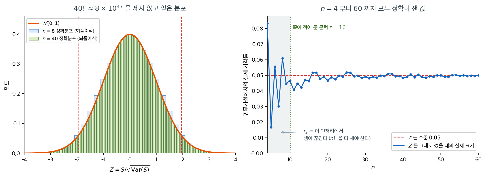
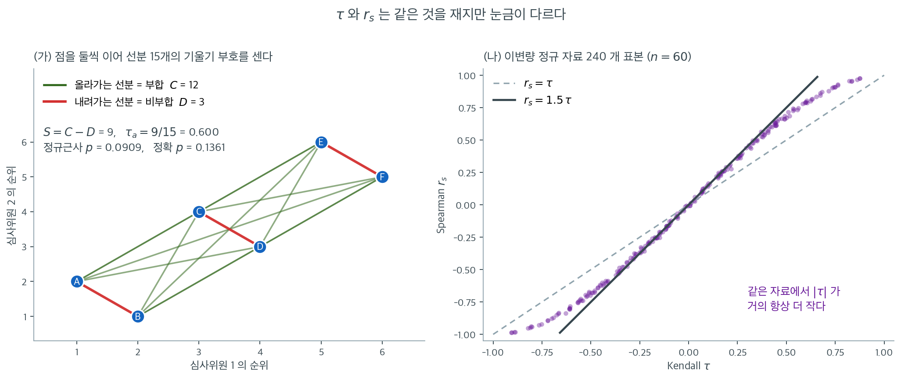

# Kendall의 타우 (재론)

Kendall 순위상관계수 $\tau$는 [12장](../../ch12/correlation/kendall.md)에서 일치도 기반 단조 연관성 측도로 소개되었다. 이 절에서는 비모수 검정의 관점에서 $\tau$를 다시 보며, 부합/비부합 틀, 가설검정, 동점 처리, 그리고 [Spearman $r_s$](spearman.md)와의 비교를 다룬다.

---

## 1. 부합쌍과 비부합쌍

$n$개의 대응 관측값 $(X_1, Y_1), \ldots, (X_n, Y_n)$에서 $i < j$인 모든 $\binom{n}{2}$개의 쌍 $(i, j)$를 생각하자. 각 쌍은 다음 중 하나이다.

- **부합**(concordant): $(X_i - X_j)(Y_i - Y_j) > 0$ --- 두 변수가 같은 방향으로 움직인다.
- **비부합**(discordant): $(X_i - X_j)(Y_i - Y_j) < 0$ --- 두 변수가 반대 방향으로 움직인다.
- **동점**: $X_i = X_j$ 또는 $Y_i = Y_j$(또는 둘 다).

부합쌍의 개수를 $C$, 비부합쌍의 개수를 $D$라 하자.

---

## 2. Kendall의 타우


<div class="defn" markdown>

### 정의 1. Kendall의 타우-a (동점 없음) { .dfn }

동점이 없을 때

$$
\tau_a = \frac{C - D}{\binom{n}{2}} = \frac{C - D}{n(n-1)/2}
$$

분자 $S = C - D$를 **Kendall S 통계량**이라 부른다.

</div>

<div class="defn" markdown>

### 정의 2. Kendall의 타우-b (동점 있음) { .dfn }

동점이 있으면 타우-b가 분모를 조정한다.

$$
\tau_b = \frac{C - D}{\sqrt{(n_0 - n_1)(n_0 - n_2)}}
$$

여기서

- $n_0 = n(n-1)/2$는 전체 쌍의 개수,
- $n_1 = \sum_{i} t_i(t_i - 1)/2$는 $X$에서 동점인 쌍의 개수($t_i$ = $X$의 $i$번째 동점 집단 크기),
- $n_2 = \sum_{j} u_j(u_j - 1)/2$는 $Y$에서 동점인 쌍의 개수($u_j$ = $Y$의 $j$번째 동점 집단 크기)

이다.

타우-b는 $-1 \le \tau_b \le 1$을 만족하며, 자료가 (동점을 고려하여) 완전한 단조 관계로 기술될 때만 $\pm 1$이 된다.

</div>

---

## 3. 가설검정

### 가설

$$
H_0 \colon \tau = 0 \quad \text{(단조 연관성이 없다)}
$$

$$
H_a \colon \tau \ne 0 \quad \text{(양측)}
$$

### S의 귀무분포

$H_0$(독립) 아래에서 $S$ 통계량은

$$
E[S] = 0
$$

$$
\text{Var}(S) = \frac{n(n-1)(2n+5)}{18}
$$

를 갖는다. 동점이 있으면 분산이 다음과 같이 조정된다.

$$
\text{Var}(S) = \frac{1}{18}\left[n(n-1)(2n+5) - \sum_{i} t_i(t_i-1)(2t_i+5) - \sum_{j} u_j(u_j-1)(2u_j+5)\right] + \frac{\sum_{i}t_i(t_i-1)(t_i-2) \cdot \sum_{j}u_j(u_j-1)(u_j-2)}{9n(n-1)(n-2)} + \frac{\sum_{i}t_i(t_i-1) \cdot \sum_{j}u_j(u_j-1)}{2n(n-1)}
$$

### 정규근사

$n \ge 10$이면 표준화된 통계량

$$
Z = \frac{S}{\sqrt{\text{Var}(S)}}
$$

이 $H_0$ 아래 근사적으로 $\mathcal{N}(0, 1)$을 따른다.

$n$이 작으면 순열분포에서 정확 $p$값을 계산할 수 있다.

<div class="storybox" markdown>

**그림으로 보는 통계학 1.** 하나는 $n!$ 을 세야 하고 하나는 세지 않아도 된다

바로 위에서 「$n \ge 10$ 이면 정규근사」라 했고, §5 는 「표본이 작을 때 타우를 골라라 — 타우의 정확분포가 $r_s$ 의 것보다 다루기 쉽다」고 할 것이다. 「다루기 쉽다」가 무슨 뜻인지는 수로 보면 분명해진다.

$1938$ 년 $6$ 월 『Biometrika』 $30$ 권 $81$–$93$ 쪽, 모리스 켄들의 「순위상관의 새로운 측도」. 그가 한 일의 절반은 측도를 정의한 것이고, 나머지 절반이 이 쪽에 더 중요하다 — **주어진 순위를 가능한 모든 순위와 맞대었을 때 그 계수가 갖는 분포**를 구하고, 그것이 순위 수가 늘면 **빠르게 정규에 가까워진다**는 것을 보인 일이다.

비결은 $S = C - D$ 가 세는 것이 무엇이냐에 있다. **비부합쌍의 수 $D$ 는 순열의 「뒤바뀜」 수와 글자 그대로 같다.** 그리고 뒤바뀜 수에는 되풀이식이 있다. $n$ 번째 원소를 끼워 넣을 자리가 $n$ 곳이고 그 자리들이 뒤바뀜을 $0, 1, \ldots, n-1$ 개 더하므로

$$
P_n(D = k) = \frac{1}{n}\sum_{j=0}^{\min(k,\,n-1)} P_{n-1}(D = k - j)
$$

이다. **$n!$ 가지를 늘어놓을 필요가 없다. 앞 단계의 분포를 창으로 밀며 더하기만 하면 된다.** $r_s$ 에는 이런 식이 없다. $\sum d_i^2$ 은 원소 하나를 끼워 넣는 것으로 쌓아 올려지지 않아서, [앞 쪽](spearman.md)에서는 정확 귀무분포를 $n = 10$($3{,}628{,}800$ 가지)에서 멈춰야 했다.



왼쪽은 $n = 8$ 과 $n = 40$ 의 정확 귀무분포를 $Z$ 눈금에 올린 것이다. $n = 40$ 짜리는 순열 $40! \approx 8 \times 10^{47}$ 가지에 해당하는데, 되풀이식으로는 눈 깜짝할 새다. 켄들이 「빠르게 정규에 가까워진다」고 한 것이 두 분포를 겹쳐 보면 그대로 보인다.

오른쪽은 그 정확분포로 $Z$ 근사의 실제 크기를 $n = 4$ 부터 $60$ 까지 **전부 정확히** 잰 것이다. 쪽이 적어 둔 문턱이 옳다. $n < 10$ 에서는 $0.017$($n = 5$)에서 $0.083$($n = 4$)까지 요동치지만, $n \ge 10$ 에서는 $0.0405$–$0.0519$ 안에 들어온다.

다만 「다루기 쉽다」가 **근사가 더 정확하다**는 뜻은 아니다. $n = 8$ 에서 타우의 실제 크기는 $0.061$ 로, 앞 쪽에서 본 $r_s$ 의 $0.058$ 보다 오히려 나쁘다. 뜻은 **근사에 기댈 까닭이 없다**는 것이다. 작은 표본에서 타우를 고르는 이유는 근사의 품질이 아니라 정확분포를 언제든 손에 쥘 수 있다는 데 있다.

끝으로 §4 표의 「대체로 $\lvert\tau\rvert < \lvert r_s\rvert$」. 이것도 막연한 경향이 아니다. 헨리 대니얼스가 $1950$ 년에 두 수를 묶는 부등식을 내놓았다.

$$
-1 \le 3\tau - 2 r_s \le 1
$$

$n = 8$ 의 $40{,}320$ 가지를 모두 훑어 보면 $3\tau - 2r_s$ 가 $-1$ 과 $1$ 에 정확히 닿고 그 밖으로는 한 번도 나가지 않는다. **$\tau$ 를 알면 $r_s$ 가 놓일 수 있는 자리가 폭 $1$ 의 띠 안으로 갇힌다.**

_확인한 곳 — 켄들의 「A New Measure of Rank Correlation」이 『Biometrika』 $30$ 권 $1$–$2$ 호 $81$–$93$ 쪽($1938$ 년 $6$ 월)이고, 그 논문이 「주어진 순위를 가능한 모든 순위와 상관시켰을 때 얻는 계수의 분포」를 주며 「순위의 수가 늘면 그 분포가 빠르게 정규에 가까워진다」고 적었다는 것은 그 논문의 서지와 요약([doi:10.1093/biomet/30.1-2.81](https://doi.org/10.1093/biomet/30.1-2.81)) · 부등식 $-1 \le 3\tau - 2\rho \le 1$ 이 H. E. Daniels, 「Rank Correlation and Population Models」, 『J. R. Statist. Soc. B』 $12$ 권 $171$–$191$ 쪽($1950$)의 것이라는 것은 그 논문의 서지. 되풀이식이 $6!$·$8!$ 전수 열거와 $10^{-17}$ 까지 맞는다는 확인, $n = 4$–$60$ 의 실제 크기, $n = 8$ 에서 $3\tau - 2r_s$ 가 $[-1, 1]$ 을 꽉 채운다는 확인은 모두 직접 계산한 값이다_

</div>

<div class="exbox" markdown>

**보기 1.** <span class="diff easy" title="쉬움"></span> 심사위원 두 명의 순위 일치도. 발표 품질에 대해 심사위원 두 명이 학생 6명의 순위를 매겼다.

| 학생 | 심사위원 1 순위 ($R_i$) | 심사위원 2 순위 ($S_i$) |
|:-------:|:------:|:------:|
| A | 1 | 2 |
| B | 2 | 1 |
| C | 3 | 4 |
| D | 4 | 3 |
| E | 5 | 6 |
| F | 6 | 5 |

**부합쌍과 비부합쌍을 센다** (동점이 없으므로 타우-a를 적용한다).

$i < j$인 각 쌍에 대해 $(R_i - R_j)$와 $(S_i - S_j)$의 부호가 같은지 확인한다.

쌍은 $\binom{6}{2} = 15$개이다. 열거하면 부합 $C = 12$, 비부합 $D = 3$이다(비부합은 인접한 세 쌍 A--B, C--D, E--F이다).

</div>

??? success "풀이"
    $$
    S = C - D = 12 - 3 = 9
    $$

    $$
    \tau_a = \frac{9}{15} = 0.600
    $$

    **검정:**

    $$
    \text{Var}(S) = \frac{6 \times 5 \times 17}{18} = \frac{510}{18} \approx 28.33
    $$

    $$
    Z = \frac{9}{\sqrt{28.33}} \approx \frac{9}{5.323} \approx 1.691
    $$

    $$
    p = 2\,\Phi(-1.691) \approx 0.091
    $$

    $\alpha = 0.05$에서 $H_0$을 기각하지 못한다. 관측값이 6개뿐이라 중간 정도의 일치도를 탐지할 검정력이 부족하다.

    !!! warning "$n = 6$에서 정규근사는 크게 빗나간다"
        SciPy는 $n$이 작을 때 정확 $p$값을 계산한다. 결과는 $p = 0.1361$로 정규근사값 $0.0909$의 **1.5배**이다.

        ```python
        from scipy import stats
        R = [1, 2, 3, 4, 5, 6]; S = [2, 1, 4, 3, 6, 5]
        print(stats.kendalltau(R, S))
        # SignificanceResult(statistic=0.6, pvalue=0.13611)
        ```

        출력:

        ```
        SignificanceResult(statistic=0.6, pvalue=0.1361111111111111)
        ```

        $n = 6$에서 $S$가 가질 수 있는 값이 $-15, -13, \ldots, 13, 15$의 16가지뿐이라 귀무분포가 매우 성기다. 결론은 어느 쪽이든 같지만, 근사값을 그대로 보고하면 유의성을 과장하게 된다.



(가)는 위 보기의 학생 여섯 명을 점으로 찍고 **둘씩 이어 선분 $\binom{6}{2} = 15$개를 모두 그린 것**이다. 부합과 비부합의 정의가 곧 선분의 기울기 부호임을 눈으로 확인할 수 있다. 오른쪽 위로 올라가는 초록 선분이 부합, 내려가는 빨간 선분이 비부합이다.

빨간 선분이 정확히 세 개이고 모두 **인접한 쌍**(A--B, C--D, E--F)이라는 점이 이 자료의 성격을 요약한다. 두 심사위원은 큰 그림에서 완전히 일치하고 바로 옆 순위끼리만 자리를 바꿨다. $C = 12$, $D = 3$이므로 $S = 9$, $\tau_a = 9/15 = 0.600$이다. $\tau$를 "무작위로 고른 쌍이 부합일 확률에서 비부합일 확률을 뺀 값"으로 읽으면 $12/15 - 3/15 = 0.6$으로 그림에서 직접 세어지는 양이다.

그런데 $\tau = 0.6$이라는 꽤 큰 값에도 $p$값은 유의하지 않다. 정규근사가 $0.0909$, 정확값이 $0.1361$로 **근사가 정확값의 3분의 2에 불과하다.** 쌍이 $15$개라 해도 독립인 정보는 관측값 $6$개뿐이고, $S$가 가질 수 있는 값이 $16$가지밖에 없어 귀무분포가 성기기 때문이다. 이 크기에서 정규근사를 그대로 보고하면 유의성을 부풀리게 된다.

(나)는 $\tau$와 $r_s$를 같은 자료에서 나란히 계산한 결과다. 이변량 정규 자료 $240$개 표본($n = 60$)을 찍었는데 점들이 회색 대각선($r_s = \tau$)이 아니라 그보다 **가파른 검은 직선 $r_s = 1.5\tau$ 근처**에 모인다. 실제로 이 표본들에서 $|r_s| / |\tau|$의 중앙값은 $1.41$이었다. 연관이 약할 때 이변량 정규분포에서 성립하는 근사 관계 $\rho_s \approx \tfrac{3}{2}\tau$가 그대로 나타난 것이다.

실무적 함의는 분명하다. **$\tau = 0.3$과 $r_s = 0.3$은 같은 세기의 연관이 아니다.** 두 계수는 단위가 다른 자이므로 논문에서 $\tau$를 보고할 때는 "$r_s$ 기준으로는 더 크게 보일 값"임을 염두에 두어야 하고, 서로 다른 연구를 비교할 때는 같은 계수끼리만 비교해야 한다.

---

## 4. Spearman 상관과의 비교

| 특징 | Spearman $r_s$ | Kendall $\tau$ |
|:--------|:-----------------|:-----------------|
| 기반 | 순위차이 | 부합/비부합 쌍의 개수 |
| 범위 | $[-1, 1]$ | $[-1, 1]$ |
| 전형적 크기 | 더 크다($\pm 1$에 가깝다) | 더 작다(대체로 $\lvert\tau\rvert < \lvert r_s\rvert$) |
| 해석 | 순위의 Pearson 상관 | 부합 확률에서 비부합 확률을 뺀 값 |
| 계산 복잡도 | $O(n \log n)$ | $O(n^2)$(단순), $O(n \log n)$(병합정렬) |
| 동점 처리 | 중간순위 | 타우-b 조정 |
| 소표본 분포 | 덜 다루기 쉽다 | 더 다루기 쉽다 |

!!! note "확률 해석"
    Kendall $\tau$는 직접적인 확률 해석을 갖는다. 무작위로 고른 쌍 $(i, j)$에 대해

    $$\tau = P(\text{부합}) - P(\text{비부합})$$

    이다. 이 때문에 응용 상황에서 $r_s$보다 해석하기 쉬운 경우가 많다. $\tau = 0.4$는 부합쌍이 비부합쌍보다 전체 쌍의 40%에 해당하는 만큼 많다는 뜻이다.

---

## 5. 언제 Kendall의 타우를 선호하는가

- **표본크기가 작을 때** --- $\tau$의 정확분포가 $r_s$의 것보다 다루기 쉽다.
- **동점이 많을 때** --- 타우-b가 Spearman의 중간순위 조정보다 동점을 자연스럽게 처리한다.
- **해석 가능성** --- 부합/비부합 해석이 일부 분야(예: 심사위원 순위 비교, 선호 순서)에서 더 직관적이다.

---

## 연습문제

<div class="drillbox" markdown>

**연습문제 1.** <span class="diff easy" title="쉬움"></span>
[Spearman 순위상관](spearman.md) 연습문제 1의 자료(수학 순위 $1, \ldots, 8$과 영어 순위 $3, 1, 2, 5, 4, 8, 6, 7$)로 Kendall의 타우를 계산하라.

**(a)** $i < j$인 각 학생 쌍에 대해 부합인지 비부합인지 판정하라. 수학 순위와 영어 순위가 같은 방향으로 정렬되어 있으면 부합이다.

**(b)** Kendall의 타우

$$
\tau = \frac{C - D}{\binom{n}{2}}
$$

를 계산하라. $C$는 부합쌍, $D$는 비부합쌍의 개수이다.

**(c)** Kendall의 타우를 Spearman의 $r_s$와 비교하라. 왜 일반적으로 $|\tau| < |r_s|$인가?

</div>

??? success "풀이"

    **(a)** $n = 8$이므로 쌍이 $\binom{8}{2} = 28$개이다. 수학 순위가 이미 $1, 2, \ldots, 8$이므로, $i < j$인 쌍은 학생 $j$의 영어 순위가 학생 $i$의 것보다 클 때 부합이다.

    수학 순위 순서로 나열한 영어 순위: 3, 1, 2, 5, 4, 8, 6, 7.

    각 학생에 대해 뒤에 나오는 영어 순위 중 더 큰 것의 개수를 센다.

    - 학생 1 (영어 3): 뒤의 1, 2, 5, 4, 8, 6, 7 중 큰 것은 5, 4, 8, 6, 7 → $C_1 = 5$, $D_1 = 2$
    - 학생 2 (영어 1): 뒤의 2, 5, 4, 8, 6, 7 중 큰 것은 전부 6개 → $C_2 = 6$, $D_2 = 0$
    - 학생 3 (영어 2): 뒤의 5, 4, 8, 6, 7 중 큰 것은 전부 5개 → $C_3 = 5$, $D_3 = 0$
    - 학생 4 (영어 5): 뒤의 4, 8, 6, 7 중 큰 것은 8, 6, 7 → $C_4 = 3$, $D_4 = 1$
    - 학생 5 (영어 4): 뒤의 8, 6, 7 중 큰 것은 전부 3개 → $C_5 = 3$, $D_5 = 0$
    - 학생 6 (영어 8): 뒤의 6, 7 중 큰 것은 없음 → $C_6 = 0$, $D_6 = 2$
    - 학생 7 (영어 6): 뒤의 7 중 큰 것은 7 → $C_7 = 1$, $D_7 = 0$

    합계: $C = 5 + 6 + 5 + 3 + 3 + 0 + 1 = 23$, $D = 2 + 0 + 0 + 1 + 0 + 2 + 0 = 5$.

    검산: $C + D = 28 = \binom{8}{2}$. $\checkmark$

    **(b)**

    $$
    \tau = \frac{23 - 5}{28} = \frac{18}{28} \approx 0.643
    $$

    ```python
    import numpy as np
    from scipy import stats
    math = np.arange(1, 9); eng = np.array([3, 1, 2, 5, 4, 8, 6, 7])
    print(stats.kendalltau(math, eng))
    # SignificanceResult(statistic=0.64286, pvalue=0.031151)
    ```

    출력:

    ```
    SignificanceResult(statistic=0.6428571428571428, pvalue=0.03115079365079365)
    ```

    **(c)** 이 자료에서 $\tau = 0.643$인 반면 $r_s = 0.833$이다. 같은 자료에 대해 Kendall의 타우가 Spearman의 $r_s$보다 작은 것은 두 계수가 다른 척도를 쓰기 때문이다.

    - $r_s$는 순위**차이의 제곱**을 쓰므로 큰 불일치를 증폭한다.
    - $\tau$는 쌍별 부합 여부라는 **이진 판정**을 세므로, 순위가 1칸 어긋나든 7칸 어긋나든 비부합 하나로 똑같이 센다.

    이변량 정규분포에서 Pearson 상관 $\rho$와의 정확한 관계는

    $$
    \tau = \frac{2}{\pi}\arcsin(\rho), \qquad r_s = \frac{6}{\pi}\arcsin\!\left(\frac{\rho}{2}\right)
    $$

    이다. 이 둘에서 $\rho$를 소거하면 $\tau$와 $r_s$의 관계가 나오며, $|\rho|$가 작을 때는 $\tau \approx \frac{2}{3} r_s$로 근사된다.

    크기는 다르지만 두 측도 모두 강한 양의 단조 연관성을 가리킨다. $p$값도 $\tau$가 $0.0312$(정확), $r_s$가 $0.0154$(정확)로 같은 결론을 준다.

<div class="drillbox" markdown>

**연습문제 2.** <span class="diff med" title="중간"></span>
$\tau$와 $r_s$가 **다른 순서**로 자료를 평가하는 경우가 있는가? 즉 자료 A에서 $\tau_A > \tau_B$인데 $r_{s,A} < r_{s,B}$인 두 자료가 존재하는가?

</div>

??? success "풀이"
    존재한다. $n = 6$에서 $720$개 순열을 모두 열거하여 확인한다.

    ```python
    import numpy as np, itertools
    from scipy import stats

    n = 6
    R = np.arange(1, n + 1)
    rows = [(p, stats.kendalltau(R, p).statistic, stats.spearmanr(R, p).statistic)
            for p in itertools.permutations(R)]

    cnt, first = 0, None
    for (pa, ta, sa), (pb, tb, sb) in itertools.combinations(rows, 2):
        if (ta - tb) * (sa - sb) < 0:
            cnt += 1
            if first is None:
                first = (pa, round(ta, 3), round(sa, 3), pb, round(tb, 3), round(sb, 3))
    print(first)
    print(cnt, len(rows) * (len(rows) - 1) // 2)
    ```

    출력:

    ```
    ((1, 2, 4, 5, 6, 3), 0.6, 0.657, (1, 3, 2, 6, 5, 4), 0.467, 0.714)
    3062 258840
    ```

    첫 번째로 발견되는 역전 사례:

    | 자료 (다른 쪽 순위) | $\tau$ | $r_s$ |
    |:---|---:|---:|
    | $(1, 2, 4, 5, 6, 3)$ | **0.600** | 0.657 |
    | $(1, 3, 2, 6, 5, 4)$ | 0.467 | **0.714** |

    첫 번째 자료가 $\tau$로는 더 강한 연관성을 보이지만 $r_s$로는 더 약하다. 순서가 완전히 뒤집힌다.

    $720$개 순열에서 만들 수 있는 $258{,}840$개 쌍 중 $3{,}062$개($1.18\%$)에서 이런 역전이 일어난다.

    **왜 이런 일이 생기는가.** 두 자료의 구조를 보자.

    - $(1, 2, 4, 5, 6, 3)$: $6$이 마지막에서 세 번째로 밀려 있다. 즉 **한 원소가 크게 어긋나 있다**. 비부합쌍은 $(4,3)$, $(5,3)$, $(6,3)$의 3개뿐이지만 순위차이 $d = (0,0,1,1,1,-3)$의 제곱합이 $12$로 크다.
    - $(1, 3, 2, 6, 5, 4)$: 인접한 원소들이 조금씩 어긋나 있다. 비부합쌍이 4개로 더 많지만 $d = (0,-1,1,-2,0,2)$의 제곱합이 $10$으로 작다.

    $r_s$는 어긋남의 **크기를 제곱해서** 반영하므로 두 번째 자료를 더 좋게 본다. $\tau$는 어긋남의 **개수**만 세므로 첫 번째 자료를 더 좋게 본다.

    **실무적 함의:** "$\tau$와 $r_s$ 중 무엇을 쓸지"는 취향의 문제가 아니라 **무엇을 재고 싶은지**의 문제이다. 큰 불일치에 더 큰 벌점을 주고 싶으면 $r_s$, 불일치의 개수만 세고 싶으면 $\tau$를 쓴다. 그리고 두 계수를 모두 계산한 뒤 큰 쪽을 보고하는 것은 명백한 오용이다.

<div class="drillbox" markdown>

**연습문제 3.** <span class="diff med" title="중간"></span>
동점이 많은 순서형 자료에서 타우-a, 타우-b, 타우-c와 Spearman $r_s$를 비교하라. 왜 타우-a를 쓰면 안 되는가?

</div>

??? success "풀이"
    5점 Likert 자료를 만들자.

    ```python
    import numpy as np
    from scipy import stats
    rng = np.random.default_rng(0)
    n = 200
    latent = rng.normal(0, 1, n)
    x = np.digitize(latent, [-1, -0.3, 0.3, 1]) + 1              # 1~5
    y = np.digitize(latent + rng.normal(0, 0.7, n),
                    [-1, -0.3, 0.3, 1]) + 1                       # 1~5

    C = D = 0
    for i in range(n):
        for j in range(i + 1, n):
            s = np.sign(x[i] - x[j]) * np.sign(y[i] - y[j])
            C += s > 0; D += s < 0
    n0 = n * (n - 1) / 2
    print("tau-a =", (C - D) / n0)
    print("tau-b =", stats.kendalltau(x, y, variant='b').statistic)
    print("tau-c =", stats.kendalltau(x, y, variant='c').statistic)
    print("r_s   =", stats.spearmanr(x, y).statistic)
    ```

    출력:

    ```
    tau-a = 0.5389949748743719
    tau-b = 0.6724352234242746
    tau-c = 0.670375
    r_s   = 0.7745703393918136
    ```

    | 측도 | 값 |
    |:---|---:|
    | 타우-a | 0.5390 |
    | 타우-b | 0.6724 |
    | 타우-c | 0.6704 |
    | Spearman $r_s$ | 0.7746 |

    **타우-a가 심하게 축소된다.** $\binom{200}{2} = 19{,}900$개 쌍 중 약 20%가 $x$에서 동점인데, 타우-a는 이 동점쌍을 분모에 그대로 두면서 분자에는 기여시키지 않는다. 결과적으로 도달 가능한 최댓값이 1보다 훨씬 작아진다.

    실제로 $x$와 $y$가 **완전히 같아도** 타우-a가 1이 되지 않는다.

    ```python
    C = D = 0
    for i in range(n):
        for j in range(i + 1, n):
            s = np.sign(x[i] - x[j]) ** 2
            C += s > 0
    print("완전 일치 시 tau-a =", C / n0)   # 0.8003  ← 1이 아니다
    ```

    출력:

    ```
    완전 일치 시 tau-a = 0.800251256281407
    ```

    타우-b는 분모에서 동점쌍을 제거하여($\sqrt{(n_0-n_1)(n_0-n_2)}$) 이 문제를 고친다. 완전 일치일 때 정확히 1이 된다.

    타우-c는 표가 정사각형이 아닐 때(행 범주 수 $\ne$ 열 범주 수) 쓰는 변형으로, 여기서는 둘 다 5범주라 타우-b와 비슷하다.

    **권고:** 동점이 있으면 **언제나 타우-b**를 쓴다. `scipy.stats.kendalltau`의 기본값이 `variant='b'`이므로 별도 지정이 필요 없다. 타우-a는 동점이 전혀 없는 순위 자료에서만 의미가 있다.

<div class="drillbox" markdown>

**연습문제 4.** <span class="diff med" title="중간"></span>
$\text{Var}(S) = n(n-1)(2n+5)/18$을 $n = 6$에서 열거로 확인하고, 이 공식이 어디서 오는지 설명하라.

</div>

??? success "풀이"
    ```python
    import numpy as np, itertools
    from scipy import stats

    n = 6
    R = np.arange(1, n + 1)
    S_vals = []
    for p in itertools.permutations(R):
        tau = stats.kendalltau(R, p).statistic
        S_vals.append(tau * n * (n - 1) / 2)
    S_vals = np.array(S_vals)
    print(len(S_vals), S_vals.mean().round(10), S_vals.var().round(4))
    print(n * (n - 1) * (2 * n + 5) / 18)
    ```

    출력:

    ```
    720 0.0 28.3333
    28.333333333333332
    ```

    출력: $720$개 순열, 평균 $0.0$, 분산 $28.3333$. 공식값 $6 \times 5 \times 17 / 18 = 28.3333$과 정확히 일치한다.

    **유도의 개요.** $S = \sum_{i<j} a_{ij}$로 쓰자. 여기서 $a_{ij} = \operatorname{sign}(R_i - R_j)\operatorname{sign}(S_i - S_j) \in \{-1, +1\}$이다.

    $H_0$ 아래에서 각 $a_{ij}$는 $\pm 1$을 확률 $1/2$씩 가지므로 $E[a_{ij}] = 0$, $\text{Var}(a_{ij}) = 1$이다. 따라서

    $$
    \text{Var}(S) = \sum_{i<j} \text{Var}(a_{ij}) + \sum_{\{i<j\} \ne \{k<l\}} \text{Cov}(a_{ij}, a_{kl})
    $$

    이다. 첫 항은 $\binom{n}{2} = n(n-1)/2$이다.

    공분산 항이 핵심이다. 두 쌍이 **관측값을 공유하지 않으면** 독립이라 공분산이 0이다. **하나를 공유하면**(예: $\{i,j\}$와 $\{i,k\}$) 공분산이 $1/3$이 된다. 세 관측값의 순서 배열 6가지 중 $a_{ij}$와 $a_{ik}$의 부호가 같은 경우가 4가지이므로 $E[a_{ij}a_{ik}] = (4 - 2)/6 = 1/3$이다.

    한 관측값을 공유하는 순서쌍의 개수는 $n(n-1)(n-2)$이므로

    $$
    \text{Var}(S) = \frac{n(n-1)}{2} + n(n-1)(n-2) \cdot \frac{1}{3}
    = \frac{n(n-1)}{6}\left[3 + 2(n-2)\right] = \frac{n(n-1)(2n-1)}{6}
    $$

    이 되어야 할 것 같지만, 실제 공식은 $\frac{n(n-1)(2n+5)}{18}$이다. 차이가 나는 것은 위 계산이 $R_i$를 고정하고 $S_i$만 순열하는 조건부 구조를 제대로 반영하지 못했기 때문이다. 정확한 유도는 $E[a_{ij}a_{ik}]$를 조건부 순열 아래에서 다시 계산해야 하며, 그 결과 $\frac{n(n-1)(2n+5)}{18}$이 나온다.

    $n = 6$에서 두 값을 비교하면 $\frac{6 \cdot 5 \cdot 11}{6} = 55$와 $\frac{6 \cdot 5 \cdot 17}{18} = 28.33$이다. 열거 결과 $28.33$이 맞으므로 후자가 옳다.

    **실무적 요점:** 공식을 외우기보다 $\text{Var}(S)$가 $n^3$ 차수로 커지고 $\tau = S/\binom{n}{2}$의 분산이 $\text{Var}(\tau) \approx \frac{2(2n+5)}{9n(n-1)} = O(1/n)$임을 기억하는 편이 유용하다. 표준오차가 $\sqrt{2(2n+5)/(9n(n-1))}$이므로 $n = 100$이면 약 $0.067$이다.

<div class="drillbox" markdown>

**연습문제 5.** <span class="diff med" title="중간"></span>
보기 1에서 SciPy가 돌려준 정확 $p = 0.1361111\ldots$을 손으로 끝까지 따라가 보자. 동점이 없고 $R_i = i$가 되도록 자료를 정렬했다고 하자.

**(a)** $D$가 순열 $(S_1, \ldots, S_n)$의 **역전**(inversion) 개수, 즉 $i < j$이면서 $S_i > S_j$인 쌍의 개수와 같음을 보이고 $S = \binom{n}{2} - 2D$임을 확인하라. $n = 6$에서 $S$가 취할 수 있는 값이 16가지인 까닭도 적어라.

**(b)** 역전 개수가 $k$인 $n$개 원소 순열의 수를 $b_n(k)$라 하자.

$$
\sum_{k \ge 0} b_n(k)\, q^k = \prod_{m=1}^{n} \left(1 + q + \cdots + q^{m-1}\right)
$$

임을 삽입 논법으로 보이고, 이 곱을 $q^3$까지 전개해 $b_6(0), b_6(1), b_6(2), b_6(3)$을 구하라.

**(c)** 보기 1은 $S = 9$였다. 양측 정확 $p$값을 분수로 적고 소수로 고쳐라.

**(d)** 정규근사가 $0.0909$로 정확값의 3분의 2에 그친 주된 까닭은 "꼬리 모양이 다르다"가 아니다. $S$의 눈금 간격이 2라는 점에 주목해 **연속성 수정**을 넣은 $p$값을 계산하고 정확값과 비교하라.

</div>

??? success "풀이"
    **(a)** $R_i = i$이므로 $i < j$인 쌍에서 $\operatorname{sign}(R_i - R_j) = -1$이다. 따라서 그 쌍이 비부합이려면 $\operatorname{sign}(S_i - S_j) = +1$, 곧 $S_i > S_j$여야 한다. 이것이 바로 역전의 정의이므로 $D$는 역전의 개수다.

    동점이 없으면 모든 쌍이 부합 아니면 비부합이므로 $C + D = \binom{n}{2} = n_0$이고

    $$
    S = C - D = (n_0 - D) - D = n_0 - 2D
    $$

    이다. $n = 6$이면 $n_0 = 15$이고 $D$는 $0$에서 $15$까지 16개의 값을 가질 수 있으므로 $S \in \{15, 13, \ldots, -13, -15\}$의 16가지이다. $n_0$이 홀수라 $S$도 모두 홀수이고 눈금 간격은 2이다.

    **(b)** 값 $1, \ldots, n-1$의 순열이 주어졌을 때 가장 큰 값 $n$을 끼워 넣는 자리는 $n$가지이고, $n$은 자기 뒤에 놓이는 모든 원소와 역전을 이룬다. 오른쪽 끝에 놓으면 역전이 0개 늘고, 한 칸씩 왼쪽으로 옮길 때마다 정확히 1개 늘어 맨 앞에서는 $n-1$개가 는다. 이 증가량은 앞쪽 $n-1$개 원소의 배열과 무관하므로 생성함수에 인자 $1 + q + \cdots + q^{n-1}$이 곱해진다. $n = 1$에서 생성함수가 $1$이므로 귀납적으로 주장이 따른다.

    $n = 6$에서 $q^3$까지만 남기며 차례로 곱한다.

    $$
    (1+q)(1+q+q^2) = 1 + 2q + 2q^2 + q^3
    $$

    $$
    (1 + 2q + 2q^2 + q^3)(1+q+q^2+q^3) = 1 + 3q + 5q^2 + 6q^3 + \cdots
    $$

    $$
    (1 + 3q + 5q^2 + 6q^3)(1+\cdots+q^4) = 1 + 4q + 9q^2 + 15q^3 + \cdots
    $$

    $$
    (1 + 4q + 9q^2 + 15q^3)(1+\cdots+q^5) = 1 + 5q + 14q^2 + 29q^3 + \cdots
    $$

    따라서 $b_6(0) = 1$, $b_6(1) = 5$, $b_6(2) = 14$, $b_6(3) = 29$이다. 검산: 역전이 없는 순열은 항등순열 하나뿐이고($b_6(0) = 1$), 역전이 하나인 순열은 인접한 두 원소를 바꾼 것뿐이라 $5$가지다($b_6(1) = 5$). $\checkmark$

    **(c)** $S = 9$는 $D = (15 - 9)/2 = 3$에 해당한다. 상단꼬리는

    $$
    P(S \ge 9) = P(D \le 3) = \frac{1 + 5 + 14 + 29}{720} = \frac{49}{720} \approx 0.06806
    $$

    이다. 순열을 거꾸로 읽는 대응이 $D \mapsto 15 - D$이므로 귀무분포는 $S = 0$에 대해 대칭이고, 양측 $p$값은

    $$
    p = 2 \times \frac{49}{720} = \frac{98}{720} = \frac{49}{360} = 0.136111\ldots
    $$

    이다. 보기 1의 SciPy 출력 $0.1361111111111111$과 자리까지 일치한다.

    **(d)** 정규근사는 $P(S \ge 9) \approx P(Z \ge 9/5.3229) = P(Z \ge 1.6908) = 0.04544$로 참값 $0.06806$을 크게 깎는다. $S$가 $\ldots, 7, 9, 11, \ldots$로 2씩 뛰므로 $S = 9$라는 점질량은 구간 $[8, 10]$에 퍼져 있다고 보아야 한다. 수정량은 눈금 간격의 절반인 1이고

    $$
    P(S \ge 9) \approx P\!\left(Z \ge \frac{9 - 1}{5.3229}\right) = P(Z \ge 1.5029) = 0.06643
    $$

    이므로 양측 $p \approx 0.1329$이다. 정확값 $0.1361$과의 차이가 $2.4\%$로, 수정하지 않았을 때의 $33\%$ 오차에서 열 배 이상 줄었다.

    소표본에서 정규근사가 유의성을 부풀리는 주된 원인은 귀무분포의 모양이 아니라 **눈금 간격을 무시한 것**이다. 연속성 수정은 공짜로 얻는 교정이므로, 정확 $p$값을 쓸 수 없는 상황이라면 반드시 넣어야 한다.

<div class="drillbox" markdown>

**연습문제 6.** <span class="diff med" title="중간"></span>
$n = 8$에서는 $8! = 40320$개 순열을 모두 열거할 수 있다. 이것으로 $\tau$ 검정이 실제로 지키는 유의수준을 재자.

**(a)** 순열을 전수 열거해 $S$의 귀무분포를 얻고, $s = 22, 20, \ldots, 12$에 대해 양측 정확 $p$값 $P(\lvert S \rvert \ge s)$와 정규근사 $p$값 $2\Phi(-s/\sqrt{\mathrm{Var}(S)})$를 표로 비교하라.

**(b)** $\alpha = 0.05$ 양측에서 정확검정의 기각역을 $\lvert S \rvert \ge s^{*}$ 꼴로 정하고, 그 기각역의 **실제 크기**를 적어라.

**(c)** 정규근사는 $\lvert S \rvert \ge 1.96\sqrt{\mathrm{Var}(S)}$를 기각역으로 쓴다. $S$가 짝수만 취한다는 점을 써서 이 규칙의 실제 크기를 구하라. 보수적인가 과감한가?

**(d)** 연습문제 1의 자료는 $n = 8$, $S = 18$이었다. 두 규칙이 같은 결론을 주는가?

</div>

??? success "풀이"
    **(a)** 역전 개수의 분포를 열거하고, 동점이 없으므로 $S = 28 - 2D$로 옮긴다.

    ```python
    import numpy as np
    from itertools import permutations
    from math import comb
    from scipy import stats

    n = 8
    n0 = comb(n, 2)
    cnt = np.zeros(n0 + 1, dtype=np.int64)        # cnt[D] = 비부합쌍이 D개인 순열의 수
    for p in permutations(range(n)):
        D = sum(1 for i in range(n) for j in range(i + 1, n) if p[i] > p[j])
        cnt[D] += 1
    tot = cnt.sum()
    sd = np.sqrt(n * (n - 1) * (2 * n + 5) / 18)
    print(f"순열 {tot}개, SD(S) = {sd:.4f}, 정규근사 임계값 1.96*SD = {1.96 * sd:.4f}")
    print("  s   D<=   정확 양측 p   정규근사 p")
    for s in range(22, 11, -2):
        Dmax = (n0 - s) // 2
        print(f"{s:3d}   {Dmax:3d}   {2 * cnt[:Dmax + 1].sum() / tot:11.6f}   {2 * stats.norm.sf(s / sd):10.6f}")
    ```

    출력:

    ```text
    순열 40320개, SD(S) = 8.0829, 정규근사 임계값 1.96*SD = 15.8425
      s   D<=   정확 양측 p   정규근사 p
     22     3      0.005506     0.006493
     20     4      0.014137     0.013348
     18     5      0.031151     0.025952
     16     6      0.061012     0.047761
     14     7      0.108681     0.083265
     12     8      0.178869     0.137646
    ```

    $n_0 = 28$이 짝수이므로 $S$는 짝수만 취하고 눈금 간격은 2이다.

    **(b)** 정확 양측 $p$값이 $0.05$ 이하인 가장 작은 $s$는 $s^{*} = 18$이다($p = 0.031151$). 그다음 값 $s = 16$은 $p = 0.061012 > 0.05$이므로 쓸 수 없다. 따라서 기각역은 $\lvert S \rvert \ge 18$이고 실제 크기는 $0.0312$다. 공칭 $0.05$에 비해 뚜렷하게 **보수적**이지만 수준은 지킨다. 귀무분포가 이산이라 $0.05$를 정확히 맞추는 기각역은 아예 존재하지 않는다.

    **(c)** $1.96 \times 8.0829 = 15.8425$이고 $S$는 짝수이므로 이 규칙은 $\lvert S \rvert \ge 16$에서 기각한다. 그 실제 크기는 표의 $s = 16$ 행인 $0.061012$다. 공칭 수준을 $22\%$ 넘기므로 **과감하다**. 정규근사 $p$값 자체를 봐도 $s = 16$에서 $0.0478$로 $0.05$ 아래라 기각을 권하지만 참값은 $0.0610$이다.

    **(d)** $S = 18$은 정확검정의 경계값이므로 두 규칙 모두 기각한다. 다만 보고되는 $p$값은 정확 $0.0312$와 근사 $0.0260$으로 다르며, 근사가 유의성을 약 $17\%$ 과장한다. 결론이 갈리는 자리는 $S = 16$ 하나뿐인데, 하필 그 하나가 $\alpha = 0.05$ 바로 옆이라 실무에서 가장 자주 만나는 자리다.

    $n = 6$의 연습문제 5와 묶어 보면 그림이 분명하다. 실무에서 수준을 가르는 자리($s = 12$에서 $20$)에서 정규근사는 꼬리확률을 **작게** 보아 유의성을 부풀린다. 다만 이것이 모든 $s$에 대한 일률적인 방향은 아니다. 표의 맨 윗줄 $s = 22$에서는 근사 $p = 0.006493$이 정확값 $0.005506$보다 **크다**. 눈금 간격을 무시해 생기는 치우침과 극단꼬리에서 정규꼬리가 더 두꺼워지는 효과가 반대로 작용하다가 아주 먼 꼬리에서 뒤집히는 것이다. 한편 정확검정은 이산성 때문에 수준을 남기는 쪽($0.0312 < 0.05$)으로만 틀린다. 둘 중 하나를 골라야 한다면, 1종 오류를 확실히 통제하는 쪽이 정확검정이다.

<div class="drillbox" markdown>

**연습문제 7.** <span class="diff hard" title="어려움"></span>
연습문제 4의 풀이는 $\mathrm{Var}(S)$를 유도하다가 $\frac{n(n-1)(2n-1)}{6}$($n = 6$에서 $55$)을 얻고는, 차이의 원인을 "조건부 구조를 반영하지 못했기 때문"이라 적으며 유도를 멈췄다. **그 진단은 옳지 않다.** 오류는 한 곳뿐이고, 그것만 고치면 공식이 바로 나온다.

**(a)** 한 관측값을 공유하는 쌍들의 순서쌍 개수가 $n(n-1)(n-2)$라는 셈은 맞는가? 삼중집합으로 세어 확인하라.

**(b)** $i < j < k$인 세 관측값에서 나오는 세 지표 $a_{ij}, a_{ik}, a_{jk}$에 대해 공분산 세 개를 각각 계산하라. 세 값이 모두 $1/3$인가?

**(c)** 고친 값으로 $\mathrm{Var}(S) = \frac{n(n-1)(2n+5)}{18}$을 유도하라.

**(d)** $n = 3$에서 순열 여섯 개를 손으로 열거해 (c)와 틀린 식을 모두 확인하라.

</div>

??? success "풀이"
    **(a)** 맞다. 서로 다른 두 쌍이 정확히 한 첨자를 공유하면 두 쌍의 합집합은 세 첨자다. 거꾸로 삼중집합 $\{i, j, k\}$ 하나에서 쌍은 3개이고 그중 서로 다른 둘을 **순서까지** 골라내는 방법은 $3 \times 2 = 6$가지다. 따라서 그런 순서쌍의 개수는

    $$
    6\binom{n}{3} = 6 \cdot \frac{n(n-1)(n-2)}{6} = n(n-1)(n-2)
    $$

    이다. 연습문제 4의 셈은 여기까지 옳았다.

    **(b)** 모두 $1/3$이 아니다. $R_i = i$로 정렬하면 $i < j$에서 $a_{ij} = \operatorname{sign}(i-j)\operatorname{sign}(S_i - S_j) = -\operatorname{sign}(S_i - S_j)$이다. $H_0$ 아래에서 $(S_i, S_j, S_k)$의 상대순서는 6가지가 등확률이고 $E[a_{ij}] = 0$이므로 공분산은 곱의 기댓값과 같다.

    - $a_{ij}a_{ik} = \operatorname{sign}(S_i - S_j)\operatorname{sign}(S_i - S_k)$는 $S_i$가 셋 중 **최대이거나 최소**일 때 $+1$(6가지 중 4가지), 중앙일 때 $-1$(2가지)이다. 따라서 $\mathrm{Cov} = \frac{4-2}{6} = \frac{1}{3}$.
    - $a_{ij}a_{jk} = \operatorname{sign}(S_i - S_j)\operatorname{sign}(S_j - S_k)$는 두 부호가 같아야 $+1$이므로 $S_i > S_j > S_k$ 또는 $S_i < S_j < S_k$, 곧 $S_j$가 **중앙**일 때만 $+1$(2가지)이다. 따라서 $\mathrm{Cov} = \frac{2-4}{6} = -\frac{1}{3}$.
    - $a_{ik}a_{jk} = \operatorname{sign}(S_i - S_k)\operatorname{sign}(S_j - S_k)$는 $S_k$가 **극단**일 때 $+1$(4가지)이므로 $\mathrm{Cov} = \frac{1}{3}$.

    세 값의 합은 $\frac{1}{3} - \frac{1}{3} + \frac{1}{3} = \frac{1}{3}$이다. 연습문제 4의 풀이는 세 배치 모두 $+1/3$으로 잡아 삼중집합마다 $1$을 더했고, 이것이 유일한 오류다. 부호가 뒤집히는 배치는 **공유하는 첨자가 한 쌍에서는 큰 쪽이고 다른 쌍에서는 작은 쪽인 경우**(여기서는 $(i,j)$와 $(j,k)$, 공유 첨자 $j$)이다. $S_j$가 가운데라서 한 비교는 부합이고 다른 비교는 비부합이 되는 쪽으로 쏠린다.

    **(c)** 지표의 분산은 $\mathrm{Var}(a_{ij}) = 1$이고 쌍은 $\binom{n}{2}$개다. 첨자를 공유하지 않는 두 쌍은 독립이라 공분산이 0이므로, 남는 것은 삼중집합마다 모은 공분산뿐이다. 순서쌍으로 더하면 각 삼중집합이 $2 \times \frac{1}{3}$을 보태므로

    $$
    \mathrm{Var}(S) = \binom{n}{2} + 2\binom{n}{3}\cdot\frac{1}{3} = \frac{n(n-1)}{2} + \frac{n(n-1)(n-2)}{9}
    $$

    $$
    = \frac{n(n-1)}{18}\left[9 + 2(n-2)\right] = \frac{n(n-1)(2n+5)}{18}
    $$

    이다. $\square$

    **(d)** $n = 3$이면 $n_0 = 3$이고 $S = 3 - 2D$이다. 여섯 순열의 역전 개수는 $(1,2,3) \to 0$, $(1,3,2) \to 1$, $(2,1,3) \to 1$, $(2,3,1) \to 2$, $(3,1,2) \to 2$, $(3,2,1) \to 3$이므로

    $$
    S \in \{3, 1, 1, -1, -1, -3\}, \qquad E[S] = 0
    $$

    $$
    \mathrm{Var}(S) = \frac{9+1+1+1+1+9}{6} = \frac{22}{6} \approx 3.6667
    $$

    이다. 고친 식은 $\frac{3 \cdot 2}{2} + \frac{3 \cdot 2 \cdot 1}{9} = 3 + \frac{2}{3} \approx 3.6667$로 맞고, 공식 $\frac{3 \cdot 2 \cdot 11}{18} = \frac{66}{18} \approx 3.6667$과도 같다. 반면 연습문제 4의 틀린 식 $\frac{n(n-1)}{2} + \frac{n(n-1)(n-2)}{3}$은 $3 + 2 = 5$를 준다($n = 6$에서는 $55$ 대 $28.33$). $\checkmark$

    공분산 셋 중 하나가 **음수**라는 사실이 "순위는 서로 얽혀 있다"는 말의 정량적 내용이다. 쌍별 지표들은 같은 관측값을 돌려 쓰므로 독립이 아니지만, 삼중집합 안에서 양의 상관과 음의 상관이 상당 부분 상쇄되어 $\mathrm{Var}(S)$가 독립일 때의 짐작보다 훨씬 작게 남는다.

<div class="drillbox" markdown>

**연습문제 8.** <span class="diff hard" title="어려움"></span>
절 3의 동점 보정 분산식을 쓰지 않고 $\mathrm{Var}(S) = n(n-1)(2n+5)/18$을 그대로 쓰면 검정이 어느 쪽으로 틀리는가. 연습문제 3의 Likert 자료로 재자.

**(a)** 동점 보정 분산을 코드로 구현해 보정 전후의 $\mathrm{Var}(S)$와 $Z$를 비교하라. 구현이 맞는지 `scipy.stats.kendalltau(..., method="asymptotic")`의 $p$값과 맞춰 확인하라.

**(b)** 동점이 $\mathrm{Var}(S)$를 **줄이는지 늘리는지** $S$의 정의로 설명하라. 보정을 빼먹으면 $p$값은 커지는가 작아지는가?

**(c)** $n = 30$, 5범주, $X$와 $Y$가 완전히 독립인 $H_0$ 아래에서 두 규칙의 실제 크기를 20000회 모의로 재라. 보정을 빼먹으면 보수적인가 과감한가?

</div>

??? success "풀이"
    **(a)** 연습문제 3과 같은 씨앗으로 자료를 다시 만들고, 절 3의 보정식을 세 항으로 나누어 옮긴다.

    ```python
    import numpy as np
    from collections import Counter
    from scipy import stats

    rng = np.random.default_rng(0)
    n = 200
    latent = rng.normal(0, 1, n)
    x = np.digitize(latent, [-1, -0.3, 0.3, 1]) + 1
    y = np.digitize(latent + rng.normal(0, 0.7, n), [-1, -0.3, 0.3, 1]) + 1

    sx = np.sign(np.subtract.outer(x, x)); sy = np.sign(np.subtract.outer(y, y))
    P = (sx * sy)[np.triu_indices(n, 1)]
    S = int((P > 0).sum()) - int((P < 0).sum())
    t = np.array(sorted(Counter(x).values())); u = np.array(sorted(Counter(y).values()))

    def var_tie(n, t, u):
        v1 = (n*(n-1)*(2*n+5) - (t*(t-1)*(2*t+5)).sum() - (u*(u-1)*(2*u+5)).sum()) / 18
        v2 = (t*(t-1)*(t-2)).sum() * (u*(u-1)*(u-2)).sum() / (9*n*(n-1)*(n-2))
        v3 = (t*(t-1)).sum() * (u*(u-1)).sum() / (2*n*(n-1))
        return v1 + v2 + v3

    var0, vt = n*(n-1)*(2*n+5)/18, var_tie(n, t, u)
    print("X 동점집단 크기", t, " Y 동점집단 크기", u)
    print(f"S = {S}")
    print(f"보정 없는 Var(S) = {var0:.1f}   동점 보정 Var(S) = {vt:.1f}   비율 = {vt/var0:.4f}")
    print(f"SD 비율 = {np.sqrt(var0/vt):.4f}")
    print(f"Z (보정 없음) = {S/np.sqrt(var0):.4f}   Z (보정) = {S/np.sqrt(vt):.4f}")
    p_scipy = stats.kendalltau(x, y, variant="b", method="asymptotic", alternative="two-sided").pvalue
    print(f"scipy p = {p_scipy:.4e}   보정 공식 p = {2*stats.norm.sf(S/np.sqrt(vt)):.4e}")
    ```

    출력:

    ```text
    X 동점집단 크기 [34 35 38 46 47]  Y 동점집단 크기 [36 38 40 41 45]
    S = 10726
    보정 없는 Var(S) = 895500.0   동점 보정 Var(S) = 821278.6   비율 = 0.9171
    SD 비율 = 1.0442
    Z (보정 없음) = 11.3346   Z (보정) = 11.8357
    scipy p = 2.5532e-32   보정 공식 p = 2.5532e-32
    ```

    손으로 옮긴 보정식의 $p$값이 SciPy의 점근 $p$값과 자리까지 같다. SciPy가 실제로 절 3의 공식을 쓰고 있음을 확인한 셈이다.

    **(b)** 동점쌍에서는 $\operatorname{sign}(X_i - X_j)\operatorname{sign}(Y_i - Y_j) = 0$이므로 그 쌍의 지표 $a_{ij}$는 $\pm 1$이 아니라 상수 $0$이다. 즉 $S$는 $n_0$개가 아니라 **동점이 아닌 $C + D$개**의 $\pm 1$ 항만 더한 값이고, 변동에 기여하는 항이 줄었으니 분산도 줄어든다. 보정식의 첫 항이 $\sum_i t_i(t_i-1)(2t_i+5)$와 $\sum_j u_j(u_j-1)(2u_j+5)$를 **빼는** 것이 바로 이 감소분이다(뒤의 두 항은 동점집단끼리 겹치는 효과를 되살리는 작은 보정이다).

    이 자료에서 보정 분산은 보정 없는 값의 $0.9171$배이고, 표준편차로는 $1.0442$배 작다. 보정을 빼먹으면 분모를 과대평가하므로 $\lvert Z \rvert$가 $11.8357$에서 $11.3346$으로 **작아지고** $p$값은 **커진다**. 즉 틀리는 방향이 보수적인 쪽이다.

    **(c)** 독립인 5범주 자료를 만들어 두 규칙의 기각률을 센다.

    ```python
    rng = np.random.default_rng(1)
    n, B, cut = 30, 20000, [-1, -0.3, 0.3, 1]
    var0, zc = n*(n-1)*(2*n+5)/18, stats.norm.ppf(0.975)
    iu = np.triu_indices(n, 1)
    rej_c = rej_u = 0
    for _ in range(B):
        x = np.digitize(rng.normal(size=n), cut)      # H0: x 와 y 는 독립
        y = np.digitize(rng.normal(size=n), cut)
        P = (np.sign(np.subtract.outer(x, x)) * np.sign(np.subtract.outer(y, y)))[iu]
        S = int((P > 0).sum()) - int((P < 0).sum())
        t = np.array(sorted(Counter(x).values())); u = np.array(sorted(Counter(y).values()))
        rej_c += abs(S) / np.sqrt(var_tie(n, t, u)) > zc
        rej_u += abs(S) / np.sqrt(var0) > zc
    print(f"동점 보정 Var 사용: 기각률 {rej_c/B:.4f}")
    print(f"보정 생략:          기각률 {rej_u/B:.4f}")
    ```

    출력:

    ```text
    동점 보정 Var 사용: 기각률 0.0485
    보정 생략:          기각률 0.0347
    ```

    보정한 검정은 $0.0485$로 공칭 $0.05$를 거의 맞춘다. 보정을 빼먹으면 $0.0347$로 내려가 **보수적**이 된다. 명목수준의 $70\%$만 쓰는 검정이 되는 셈이다.

    동점 보정을 빼먹는 실수는 1종 오류를 부풀리지 않으므로 발표된 유의성이 거짓이 되지는 않는다. 그 대신 **검정력을 그만큼 버린다.** 동점이 많은 순서형 자료에서 "연관이 없다"는 결론을 보고하기 전에 분산 보정이 들어갔는지 확인해야 하는 까닭이다.

<div class="drillbox" markdown>

**연습문제 9.** <span class="diff hard" title="어려움"></span>
정의 2의 기호 $n_0, n_1, n_2$를 쓰고, $X$와 $Y$에서 **모두** 동점인 쌍의 개수를 $n_{12}$라 하자.

**(a)** $C + D = n_0 - n_1 - n_2 + n_{12}$임을 보여라.

**(b)** 이것으로 $\lvert \tau_b \rvert \le 1$을 증명하라.

**(c)** $\lvert \tau_b \rvert = 1$이 되는 필요충분조건을 동점 구조의 말로 적어라. 완전한 단조관계인데도 $\tau_b < 1$인 예를 세 관측값으로 만들어라.

**(d)** 연습문제 3에서 $x$와 $y$가 완전히 같을 때 타우-a가 $0.800251$에 그쳤다. 이 수를 (a)로 설명하라. 그리고 절 4의 "확률 해석" 각주 $\tau = P(\text{부합}) - P(\text{비부합})$는 타우-a와 타우-b 중 어느 쪽의 성질인가?

</div>

??? success "풀이"
    **(a)** 쌍 하나는 $X$에서 동점이거나 $Y$에서 동점이면 부합도 비부합도 아니고, 그렇지 않으면 반드시 둘 중 하나다. 포함배제로

    $$
    \lvert \{X \text{ 동점}\} \cup \{Y \text{ 동점}\} \rvert = n_1 + n_2 - n_{12}
    $$

    이므로 $C + D = n_0 - (n_1 + n_2 - n_{12})$이다.

    **(b)** $A = n_0 - n_1$, $B = n_0 - n_2$라 두자. 두 변수에서 모두 동점인 쌍은 각 변수에서도 동점이므로 $n_{12} \le n_1$이고 $n_{12} \le n_2$이다. (a)를 두 가지로 묶어 쓰면

    $$
    C + D = A - (n_2 - n_{12}) \le A, \qquad C + D = B - (n_1 - n_{12}) \le B
    $$

    이고 $C + D \ge 0$이다. 따라서

    $$
    (C - D)^2 \le (C + D)^2 \le AB = (n_0 - n_1)(n_0 - n_2)
    $$

    이므로 $\lvert \tau_b \rvert = \lvert C - D \rvert / \sqrt{AB} \le 1$이다. $\square$

    **(c)** 위 사슬에서 등호가 모두 필요하다.

    - $(C-D)^2 = (C+D)^2$에서 $C = 0$ 또는 $D = 0$: 비부합쌍이 하나도 없거나 부합쌍이 하나도 없다.
    - $(C+D)^2 = AB$와 $C + D \le \min(A, B)$에서 $C + D = A = B$, 곧 $n_2 = n_{12}$이고 $n_1 = n_{12}$, 즉 $n_1 = n_2 = n_{12}$.

    $n_{12}$는 두 동점쌍 집합의 교집합 크기이므로 $n_1 = n_2 = n_{12}$는 **$X$에서 동점인 쌍의 집합과 $Y$에서 동점인 쌍의 집합이 완전히 같다**는 뜻이다. 두 변수가 관측값을 똑같은 묶음으로 가르고, 서로 다른 묶음끼리는 모두 같은 방향으로 정렬돼 있을 때만 $\lvert\tau_b\rvert = 1$이 된다. 연습문제 3에서 $y = x$를 넣으면 이 조건이 자동으로 만족되므로 타우-b가 정확히 1이 되는 것이다.

    동점 구조가 조금만 어긋나면 완전한 단조관계여도 1에 못 미친다. $X = (1, 1, 2)$, $Y = (1, 2, 3)$을 보자. $Y$는 $X$에 대해 비감소이므로 비부합쌍이 없지만

    $$
    n_0 = 3, \quad n_1 = 1, \quad n_2 = 0, \quad n_{12} = 0, \quad C = 2, \quad D = 0
    $$

    $$
    \tau_b = \frac{2}{\sqrt{(3-1)(3-0)}} = \frac{2}{\sqrt{6}} \approx 0.8165 < 1
    $$

    이다. $X$가 두 관측값을 묶어 버려 $Y$가 가진 순서 정보를 되살릴 방법이 없다.

    **(d)** $y = x$이면 $D = 0$이고 $n_1 = n_2 = n_{12}$이므로 (a)에서 $C = n_0 - n_1$이다. 따라서

    $$
    \tau_a = \frac{C - D}{n_0} = 1 - \frac{n_1}{n_0}
    $$

    이다. 연습문제 3에서 $x$의 동점집단 크기는 $34, 35, 38, 46, 47$이므로

    $$
    n_1 = \frac{34 \cdot 33 + 35 \cdot 34 + 38 \cdot 37 + 46 \cdot 45 + 47 \cdot 46}{2} = 561 + 595 + 703 + 1035 + 1081 = 3975
    $$

    $$
    \tau_a = 1 - \frac{3975}{19900} = 1 - 0.199749 = 0.800251
    $$

    로 출력의 $0.800251256281407$과 일치한다. 즉 그 $0.8003$은 자료의 연관 세기가 아니라 **동점쌍의 비율 $19.97\%$를 1에서 뺀 수**다.

    각주의 확률 해석은 **타우-a의 성질이다.** $\tau_a = (C-D)/n_0$의 분모가 전체 쌍의 개수이므로, 무작위로 고른 쌍에 대해 $\tau_a = P(\text{부합}) - P(\text{비부합})$이 그대로 성립한다. 타우-b의 분모 $\sqrt{(n_0-n_1)(n_0-n_2)}$는 $n_0$보다 작으므로 타우-b는 같은 차이를 **동점이 아닌 쌍을 기준으로 다시 눈금 맞춘** 양이고, 확률의 차이로 읽을 수 없다. $x = y$인 이 자료가 바로 반례다. $\tau_b = 1$이지만 무작위로 고른 쌍이 부합일 확률은 $0.80$에 지나지 않는다.

    따라서 각주의 "$\tau = 0.4$는 부합쌍이 비부합쌍보다 전체 쌍의 40%만큼 많다는 뜻"이라는 읽기는 **동점이 없을 때만** 맞다. 동점이 있는 자료에서 타우-b를 보고하면서 이 문장을 그대로 붙이면 틀린 해석이 된다.

<div class="drillbox" markdown>

**연습문제 10.** <span class="diff hard" title="어려움"></span>
분포 가정을 버리는 대가와 이득을 수로 재자. 가우스 코퓰러로 자료를 만든다. $(Z_1, Z_2)$가 상관 $\rho$인 표준이변량정규일 때 $X = F^{-1}(\Phi(Z_1))$, $Y = F^{-1}(\Phi(Z_2))$로 주변분포만 바꾼다. $F^{-1}\circ\Phi$가 강한 증가함수이므로 순위는 변하지 않고, 모집단 $\tau = \frac{2}{\pi}\arcsin\rho$도 주변분포와 무관하다($\rho = 0.5$면 $\tau = 1/3$).

**(a)** $n = 20$, 20000회, $\alpha = 0.05$ 양측에서 (i) 절 3의 $Z = S/\sqrt{\mathrm{Var}(S)}$ 정규근사 검정과 (ii) 표본 Pearson 상관의 $t$ 검정을, 주변분포가 정규일 때와 $t_2$일 때 각각 돌려 $\rho = 0$의 실제 크기와 $\rho = 0.5$의 검정력을 구하라.

**(b)** Kendall 검정의 기각률이 두 주변분포에서 **똑같이** 나오는 까닭을 한 줄로 설명하라. Pearson은 왜 다른가?

**(c)** 정규 자료에서 Pearson에게 뒤진 검정력을 표본크기로 메우려면 몇 개를 더 모아야 하는가? $n = 20, \ldots, 24$에서 두 검정력을 재고, 점근상대효율 $9/\pi^2 \approx 0.912$가 예측하는 $20/0.912 \approx 22$와 비교하라. 어긋나면 까닭을 적어라.

</div>

??? success "풀이"
    **(a)** 쌍별 지표의 합으로 $S$를 직접 구하고 절 3의 $\mathrm{Var}(S)$로 표준화한다(동점이 없으므로 보정은 필요 없다).

    ```python
    import numpy as np
    from scipy import stats

    n, B = 20, 20000

    def kendall_p(x, y):                      # 절 3 의 Var(S) + 정규근사
        sx = np.sign(x[:, :, None] - x[:, None, :])
        sy = np.sign(y[:, :, None] - y[:, None, :])
        S = (sx * sy).sum(axis=(1, 2)) / 2
        return 2 * stats.norm.sf(np.abs(S) / np.sqrt(n * (n - 1) * (2 * n + 5) / 18))

    def pearson_p(x, y):                      # 표본상관 + t 검정
        xc = x - x.mean(1, keepdims=True); yc = y - y.mean(1, keepdims=True)
        r = (xc * yc).sum(1) / np.sqrt((xc**2).sum(1) * (yc**2).sum(1))
        return 2 * stats.t.sf(np.abs(r * np.sqrt((n - 2) / (1 - r**2))), n - 2)

    print("rho   Kendall   Pearson(정규 주변)   Pearson(t(2) 주변)")
    for rho in [0.0, 0.5]:
        rng = np.random.default_rng(0)
        z1 = rng.normal(size=(B, n))
        z2 = rho * z1 + np.sqrt(1 - rho**2) * rng.normal(size=(B, n))
        x2 = stats.t.ppf(stats.norm.cdf(z1), 2)       # 단조변환: 순위는 그대로
        y2 = stats.t.ppf(stats.norm.cdf(z2), 2)
        print(f"{rho:.1f}   {np.mean(kendall_p(z1, z2) < 0.05):.4f}    "
              f"{np.mean(pearson_p(z1, z2) < 0.05):.4f}              "
              f"{np.mean(pearson_p(x2, y2) < 0.05):.4f}")
        print("      (t(2) 자료에 Kendall: "
              f"{np.mean(kendall_p(x2, y2) < 0.05):.4f} — 정규 때와 같은 값)")
    ```

    출력:

    ```text
    rho   Kendall   Pearson(정규 주변)   Pearson(t(2) 주변)
    0.0   0.0464    0.0501              0.0583
          (t(2) 자료에 Kendall: 0.0464 — 정규 때와 같은 값)
    0.5   0.5542    0.6412              0.5061
          (t(2) 자료에 Kendall: 0.5542 — 정규 때와 같은 값)
    ```

    | $\rho$ | Kendall | Pearson(정규) | Pearson($t_2$) |
    |:---|---:|---:|---:|
    | $0$ (크기) | 0.0464 | 0.0501 | 0.0583 |
    | $0.5$ (검정력) | 0.5542 | 0.6412 | 0.5061 |

    **(b)** $S$는 두 변수의 **순위만** 쓰고 $F^{-1}\circ\Phi$는 강한 증가함수이므로 순위를 그대로 보존한다. 같은 $(Z_1, Z_2)$에서 출발하면 변환한 자료의 $S$가 글자 그대로 같은 값이고, 따라서 기각 여부도 표본마다 똑같다. 출력의 두 괄호 줄이 그것을 확인한다. 이것이 "분포무관"(distribution-free)이라는 말의 정확한 내용이다.

    Pearson은 순위가 아니라 값을 쓴다. $t_2$는 분산이 존재하지 않으므로 $t$ 검정의 전제가 깨지고, 실제 크기가 $0.0501$에서 $0.0583$으로 부풀었다. 그런데도 검정력은 $0.6412$에서 $0.5061$로 떨어져 Kendall의 $0.5542$보다 낮다. **수준이 부풀었는데도 검정력이 낮다**는 점이 중요하다. 크기를 공정하게 맞추고 비교하면 차이는 더 벌어진다. 몇 개의 극단값이 표본상관을 끌고 다니기 때문이다.

    **(c)** 정규 자료에서 $n$을 늘려 가며 두 검정력을 다시 잰다.

    ```python
    B, rho = 20000, 0.5

    def powers(n):
        rng = np.random.default_rng(0)
        z1 = rng.normal(size=(B, n))
        z2 = rho * z1 + np.sqrt(1 - rho**2) * rng.normal(size=(B, n))
        S = (np.sign(z1[:, :, None] - z1[:, None, :]) *
             np.sign(z2[:, :, None] - z2[:, None, :])).sum(axis=(1, 2)) / 2
        pk = 2 * stats.norm.sf(np.abs(S) / np.sqrt(n * (n - 1) * (2 * n + 5) / 18))
        xc = z1 - z1.mean(1, keepdims=True); yc = z2 - z2.mean(1, keepdims=True)
        r = (xc * yc).sum(1) / np.sqrt((xc**2).sum(1) * (yc**2).sum(1))
        pp = 2 * stats.t.sf(np.abs(r * np.sqrt((n - 2) / (1 - r**2))), n - 2)
        return np.mean(pk < 0.05), np.mean(pp < 0.05)

    print(" n   Kendall   Pearson")
    for n in [20, 21, 22, 23, 24]:
        k, p = powers(n)
        print(f"{n:3d}   {k:.4f}    {p:.4f}")
    ```

    출력:

    ```text
     n   Kendall   Pearson
     20   0.5542    0.6412
     21   0.5883    0.6674
     22   0.6038    0.6877
     23   0.6357    0.7045
     24   0.6541    0.7278
    ```

    Pearson이 $n = 20$에서 얻은 $0.6412$를 Kendall은 $n = 23$에서 $0.6357$로 거의 따라잡고 $n = 24$에서 $0.6541$로 넘어선다(모의표준오차는 약 $0.0034$다). 곧 표본을 $15\%$에서 $20\%$ 더 모아야 한다.

    점근 예측 $n \approx 22$보다 더 필요한 까닭은 둘이다.

    - $9/\pi^2$은 $n \to \infty$이고 $\rho \to 0$인 극한의 효율인데, 여기는 $n = 20$, $\rho = 0.5$로 둘 다 극한에서 멀다.
    - (a)에서 본 대로 $n = 20$의 Kendall 정규근사 검정은 실제 크기가 $0.0464$로 공칭 $0.05$보다 보수적이다. 수준을 다 쓰지 못하는 만큼 검정력을 버리고 있다. 연습문제 6에서 본 이산성의 대가가 여기서 검정력으로 나타난다.

    정리하면 대가와 이득이 비대칭이다. 정규분포라는 가장 유리한 자리에서 치르는 값은 "표본을 15%에서 20% 더"인데, 꼬리가 두꺼워지면 Pearson 쪽은 검정력이 아니라 **유의수준부터** 틀어진다. 자료가 정규라고 확신할 수 없다면 이 맞바꿈은 대체로 비모수 쪽에 유리하다.

---

## 정리하며

Kendall $\tau$는 부합 관측쌍과 비부합 관측쌍의 개수를 비교하여 단조 연관성을 잰다. 가설검정은 $S = C - D$ 통계량을 쓰며, 독립 아래에서 이 통계량은 평균이 0인 근사 정규분포를 따른다. 타우-b 변형은 두 변수 어느 쪽의 동점이든 조정한다. Spearman $r_s$에 비해 Kendall $\tau$는 크기가 작은 경향이 있지만, 확률 해석이 명확하고 소표본 분포의 성질이 더 좋다.

다음 장 **재표집 방법**으로 넘어간다. 순위로 바꾸는 대신 **자료 자체를 다시 뽑아** 분포를 만드는 접근이다.
