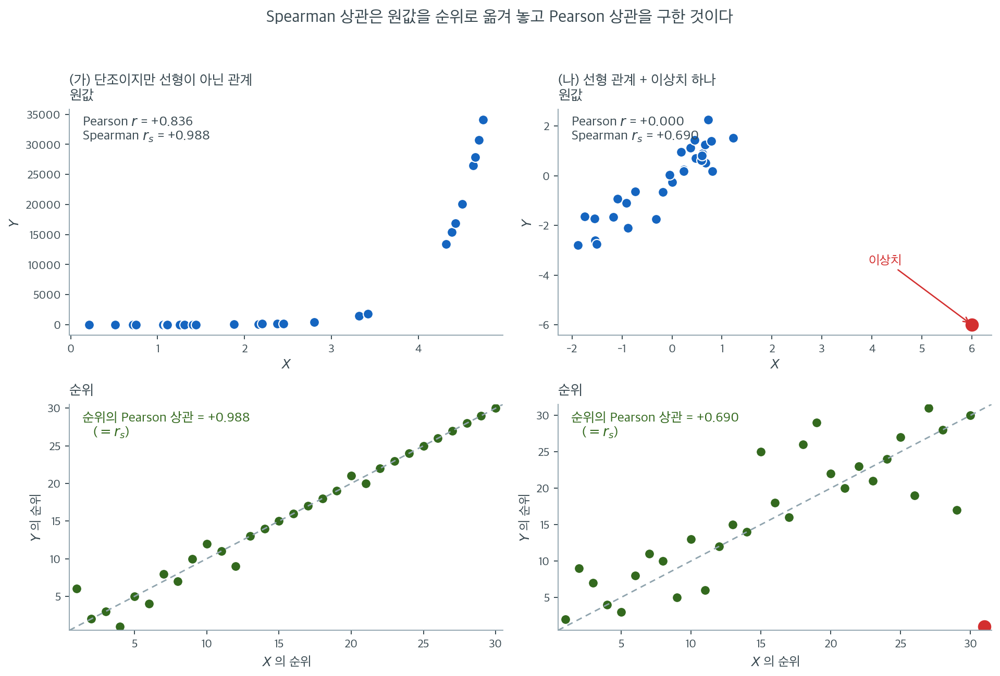

# Spearman 순위상관 (재론)

Spearman 순위상관계수 $r_s$는 [12장](../../ch12/correlation/spearman.md)에서 두 변수 사이의 단조 연관성 측도로 소개되었다. 이 절에서는 비모수 검정의 관점에서 $r_s$를 다시 보며, 가설검정, 동점 처리, 그리고 이 장 전체에서 전개한 순위 기반 틀과의 연결에 집중한다.

<div class="defn" markdown>

### 정의 1. Spearman 순위상관계수 { .dfn }

대응 관측값 $(X_1, Y_1), (X_2, Y_2), \ldots, (X_n, Y_n)$이 주어졌을 때, $R_i$를 $X_1, \ldots, X_n$ 안에서 $X_i$의 순위, $S_i$를 $Y_1, \ldots, Y_n$ 안에서 $Y_i$의 순위라 하자. Spearman 상관은 순위에 대해 계산한 Pearson 상관이다.

$$
r_s = \frac{\sum_{i=1}^{n}(R_i - \bar{R})(S_i - \bar{S})}{\sqrt{\sum_{i=1}^{n}(R_i - \bar{R})^2 \sum_{i=1}^{n}(S_i - \bar{S})^2}}
$$

동점이 없으면 이 식은 다음으로 단순해진다.

$$
r_s = 1 - \frac{6 \sum_{i=1}^{n} d_i^2}{n(n^2 - 1)}
$$

여기서 $d_i = R_i - S_i$는 대응 순위의 차이이다.

이 계수는 $-1 \le r_s \le 1$을 만족하며, $r_s = 1$은 완전한 단조증가 관계를, $r_s = -1$은 완전한 단조감소 관계를 뜻한다.

</div>

---

## 1. 가설검정

### 가설

$$
H_0 \colon \rho_s = 0 \quad \text{(단조 연관성이 없다)}
$$

$$
H_a \colon \rho_s \ne 0 \quad \text{(양측)}
$$

여기서 $\rho_s$는 모집단 Spearman 상관이다.

### 검정통계량

$n$이 크면(보통 $n \ge 10$) 통계량

$$
t = r_s \sqrt{\frac{n - 2}{1 - r_s^2}}
$$

가 $H_0$ 아래 근사적으로 자유도 $n - 2$인 $t$ 분포를 따른다.

$n$이 작으면 $r_s$의 순열분포에 기반한 정확 임계값을 표에서 얻을 수 있다.

### 정확 귀무분포

$H_0$(독립) 아래에서 순위의 모든 순열이 동등하게 가능하다. 가능한 순위 순열이 $n!$개이고 각각에 대해 $r_s$를 계산하면 정확 귀무분포를 얻는다. $n$이 작으면 실행 가능하고, 크면 $t$ 근사를 쓴다.

---

## 2. 동점 처리

동점이 있으면 단순화된 공식 $1 - 6\sum d_i^2 / [n(n^2-1)]$이 더 이상 정확하지 않다. 대신 중간순위에 완전한 Pearson 공식을 적용해야 한다.

$$
r_s = \frac{\sum_{i=1}^{n}(R_i - \bar{R})(S_i - \bar{S})}{\sqrt{\sum_{i=1}^{n}(R_i - \bar{R})^2 \sum_{i=1}^{n}(S_i - \bar{S})^2}}
$$

여기서 $R_i$와 $S_i$는 중간순위이다. 이 공식은 동점을 자연스럽게 처리하며 동점이 없을 때 단순화된 형태로 환원된다.

!!! warning "동점이 있을 때 축약 공식을 쓰지 말 것"
    공식 $r_s = 1 - 6\sum d_i^2 / [n(n^2-1)]$은 동점이 없다고 가정한다. 동점이 있으면 이 공식은 틀린 값을 준다. 동점이 있으면 언제나 순위에 대한 완전한 Pearson 공식을 쓴다.

<div class="exbox" markdown>

**보기 1.** <span class="diff easy" title="쉬움"></span> 동점은 축약 공식을 깨고, $\lvert r_s \rvert = 1$ 은 p-값을 깬다. 한 분석가가 직원 8명의 경력(년)과 고객만족도(1--10 척도)의 관계를 살펴본다.

| 직원 | 경력 ($X$) | 만족도 ($Y$) | $R_i$ | $S_i$ | $d_i$ |
|:--------:|:------:|:------:|:--:|:--:|:---:|
| 1 | 2 | 7 | 1 | 3 | $-2$ |
| 2 | 5 | 8 | 3 | 4.5 | $-1.5$ |
| 3 | 3 | 6 | 2 | 1.5 | $0.5$ |
| 4 | 8 | 9 | 5.5 | 6.5 | $-1$ |
| 5 | 10 | 10 | 7.5 | 8 | $-0.5$ |
| 6 | 8 | 8 | 5.5 | 4.5 | $1$ |
| 7 | 10 | 6 | 7.5 | 1.5 | $6$ |
| 8 | 6 | 9 | 4 | 6.5 | $-2.5$ |

동점이 많다. 경력에서는 $8$이 두 번, $10$이 두 번 나타나고, 만족도에서는 $6$, $8$, $9$가 각각 두 번씩 나타난다. 따라서 중간순위에 완전한 Pearson 공식을 적용한다.

**(1)** 중간순위의 제곱합 $\sum(R_i-\bar R)^2$, $\sum(S_i-\bar S)^2$, $\sum(R_i-\bar R)(S_i-\bar S)$ 를 구해 $r_s$ 를 손으로 계산하시오. 축약 공식이 $0.393$ 을 주는 까닭을 그 제곱합으로 설명하시오.

**(2)** `spearmanr` 의 p-값은 $t = r_s\sqrt{(n-2)/(1-r_s^2)}$ 를 쓴 근사다. 관계가 **완전 단조**인 자료를 넣으면 어떻게 되는가. 올바른 값은 무엇인가.

</div>

??? success "풀이"

    **(1) 제곱합을 센다.** 중간순위를 써도 순위의 합은 $n(n+1)/2 = 36$ 으로 변하지 않으므로

    $$
    \bar R = \bar S = \frac{n+1}{2} = 4.5
    $$

    다. 표의 순위로 제곱합을 세면

    $$
    \sum (R_i - 4.5)^2 = 41,
    \qquad
    \sum (S_i - 4.5)^2 = 40.5,
    \qquad
    \sum (R_i - 4.5)(S_i - 4.5) = 15.25
    $$

    이고

    $$
    r_s = \frac{15.25}{\sqrt{41 \times 40.5}} = \frac{15.25}{40.749233} = 0.374240
    $$

    이다.

    **축약 공식이 왜 틀리는지가 이 세 수로 바로 보인다.** $\bar R = \bar S$ 이므로

    $$
    \sum d_i^2 = \sum\bigl[(R_i - \bar R) - (S_i - \bar S)\bigr]^2
    = \sum (R_i-\bar R)^2 + \sum (S_i-\bar S)^2 - 2\sum (R_i-\bar R)(S_i-\bar S)
    $$

    이고, 따라서 **어떤 자료에서나**

    $$
    r_s = \frac{\sum (R_i-\bar R)^2 + \sum (S_i-\bar S)^2 - \sum d_i^2}{2\sqrt{\sum (R_i-\bar R)^2 \sum (S_i-\bar S)^2}}
    $$

    가 성립한다. 검산하면 $(41 + 40.5 - 51)/(2 \times 40.749233) = 0.374240$ 으로 맞는다.

    동점이 없으면 두 제곱합이 **모두** $n(n^2-1)/12 = 8 \times 63/12 = 42$ 가 되고, 이 식이

    $$
    r_s = \frac{42 + 42 - \sum d_i^2}{2 \times 42} = 1 - \frac{\sum d_i^2}{84} = 1 - \frac{6\sum d_i^2}{n(n^2-1)}
    $$

    로 줄어든다. **곧 축약 공식은 "두 제곱합이 모두 42 다" 라는 사실을 쓴다.** 이 자료는 동점 때문에 $41$ 과 $40.5$ 로 **줄었는데** 축약 공식은 여전히 $42$ 를 쓰므로

    $$
    1 - \frac{6 \times 51}{504} = 1 - \frac{306}{504} = 0.392857
    $$

    로 참값보다 $0.0186$ 크게 나온다. 동점이 많아질수록 제곱합이 더 줄고 어긋남이 커진다.

    **(2) `spearmanr` 의 p-값은 $t$ 근사다.** 확인해 보면

    $$
    t = 0.374240\sqrt{\frac{6}{1 - 0.374240^2}} = 0.374240 \times 2.641428 = 0.988532
    $$

    $$
    p = 2\,P(t_6 > 0.988532) = 0.361065
    $$

    로 `scipy` 가 준 $0.36106491$ 과 같다.

    **그런데 $r_s^2 = 1$ 이면 분모가 0 이다.** 완전 단조인 자료를 넣으면 다음이 나온다.

    | 자료 | `statistic` | `pvalue` | 올바른 값 |
    |---|---|---|---|
    | $n=8$, $y = x^3+1$ | $1.0$ | $0.0$ | $4.96 \times 10^{-5}$ |
    | $n=8$, $y = -2x$ | $-1.0$ | $0.0$ | $4.96 \times 10^{-5}$ |
    | $n=5$, $y = e^x$ | $0.9999999999999999$ | $1.40 \times 10^{-24}$ | $0.0167$ |

    **셋 다 무의미한 값이다.** 올바른 값은 열거로 바로 나온다. $H_0$ 아래에서 $S$ 가 $\{1, \dots, n\}$ 의 어느 순열이든 같은 확률이고, $\lvert r_s \rvert = 1$ 이 되는 순열은 **오름차순과 내림차순 둘**뿐이므로

    $$
    P\bigl(\lvert r_s \rvert = 1\bigr) = \frac{2}{n!}
    $$

    다. $n = 8$ 이면 $2/40320 = 4.96 \times 10^{-5}$, $n = 5$ 이면 $2/120 = 0.0167$ 이다.

    **$n = 5$ 의 경우가 특히 위험하다.** `scipy` 는 $1.4 \times 10^{-24}$ 를 주지만 참값은 $0.0167$ 로 **스물두 자릿수 차이**다. 다섯 점이 완전히 단조인 것은 우연히도 60분의 1 확률로 일어나는 일이며 "압도적 증거" 가 아니다. $n = 8$ 에서는 $0.0$ 을 돌려주는데, 확률 $0$ 인 사건이 아니므로 그것도 거짓이다.

    까닭은 분모 $1 - r_s^2$ 다. $r_s^2$ 가 정확히 $1$ 이면 $0$ 으로 나누어 $t = \infty$ 가 되고 p-값이 $0$ 으로 떨어진다. 부동소수 오차로 $r_s^2$ 가 $1$ 에서 $10^{-16}$ 만큼 모자라면 $t \approx 10^{8}$ 이 되어 p-값이 $10^{-24}$ 규모가 된다. **어느 쪽이든 표본이 작다는 사실이 반영되지 않는다.**

    **권고: $\lvert r_s \rvert$ 가 $1$ 에 가까우면 `spearmanr` 의 p-값을 쓰지 말라.** $n \leq 10$ 이면 $n! \leq 3{,}628{,}800$ 이므로 순열을 직접 열거하는 것이 가장 빠르고 정확하다.

    **수치적으로.**

    ```python
    import numpy as np
    from scipy import stats
    X = np.array([2, 5, 3, 8, 10, 8, 10, 6])
    Y = np.array([7, 8, 6, 9, 10, 8, 6, 9])
    print(stats.rankdata(X))   # [1.  3.  2.  5.5 7.5 5.5 7.5 4. ]
    print(stats.rankdata(Y))   # [3.  4.5 1.5 6.5 8.  4.5 1.5 6.5]
    print(stats.spearmanr(X, Y))
    # SignificanceResult(statistic=0.37424, pvalue=0.36106)
    ```

    출력:

    ```
    [1.  3.  2.  5.5 7.5 5.5 7.5 4. ]
    [3.  4.5 1.5 6.5 8.  4.5 1.5 6.5]
    SignificanceResult(statistic=0.37424017169809104, pvalue=0.36106491276336194)
    ```

    $$
    r_s = 0.374
    $$

    **검정:**

    $$
    t = 0.374\sqrt{\frac{6}{1 - 0.374^2}} = 0.374 \times 2.642 = 0.989
    $$

    자유도 $n - 2 = 6$에서 양측 $p = 0.361$이다. $\alpha = 0.05$에서 $H_0$을 기각하지 못한다.

    ```python
    R, S = stats.rankdata(X), stats.rankdata(Y)
    n = len(X)
    SS_R = ((R - R.mean()) ** 2).sum()
    SS_S = ((S - S.mean()) ** 2).sum()
    SS_RS = ((R - R.mean()) * (S - S.mean())).sum()
    d2 = ((R - S) ** 2).sum()
    print(f"R 의 평균 {R.mean()},  S 의 평균 {S.mean()}  ((n+1)/2 = {(n + 1) / 2})")
    print(f"SS_R = {SS_R},  SS_S = {SS_S},  SS_RS = {SS_RS},  sum d^2 = {d2}")
    print(f"동점이 없을 때의 제곱합 n(n^2-1)/12 = {n * (n * n - 1) / 12}")

    rs = SS_RS / np.sqrt(SS_R * SS_S)
    print(f"\n완전한 공식   r_s = {SS_RS}/sqrt({SS_R}*{SS_S}) = {rs:.6f}")
    print(f"항등식으로도  r_s = ({SS_R}+{SS_S}-{d2})/(2*{np.sqrt(SS_R * SS_S):.6f})"
          f" = {(SS_R + SS_S - d2) / (2 * np.sqrt(SS_R * SS_S)):.6f}")
    print(f"축약 공식     r_s = 1 - 6*{d2}/({n}*{n * n - 1}) = "
          f"{1 - 6 * d2 / (n * (n * n - 1)):.6f}   <- 틀린 값")

    t = rs * np.sqrt((n - 2) / (1 - rs ** 2))
    print(f"\nt = {t:.6f},  양측 p = {2 * stats.t.sf(abs(t), n - 2):.8f}")
    print(f"scipy 의 p-값                  = {stats.spearmanr(X, Y).pvalue:.8f}")
    ```

    출력:

    ```
    R 의 평균 4.5,  S 의 평균 4.5  ((n+1)/2 = 4.5)
    SS_R = 41.0,  SS_S = 40.5,  SS_RS = 15.25,  sum d^2 = 51.0
    동점이 없을 때의 제곱합 n(n^2-1)/12 = 42.0
    
    완전한 공식   r_s = 15.25/sqrt(41.0*40.5) = 0.374240
    항등식으로도  r_s = (41.0+40.5-51.0)/(2*40.749233) = 0.374240
    축약 공식     r_s = 1 - 6*51.0/(8*63) = 0.392857   <- 틀린 값
    
    t = 0.988532,  양측 p = 0.36106491
    scipy 의 p-값                  = 0.36106491
    ```

    ```python
    import itertools
    from math import factorial

    print("완전 단조인 자료에 spearmanr 을 넣으면")
    cases = [("n=8, y = x^3+1", np.arange(8), np.arange(8) ** 3 + 1),
             ("n=8, y = -2x   ", np.arange(8), -2.0 * np.arange(8)),
             ("n=5, y = e^x   ", np.arange(5), np.exp(np.arange(5)))]
    for label, x, y in cases:
        r = stats.spearmanr(x, y)
        print(f"  {label}: statistic = {r.statistic!r},  pvalue = {r.pvalue!r}")

    print("\n전수 열거로 구한 올바른 값")
    for m in (5, 8):
        base = np.arange(1, m + 1)
        rs_all = np.array([np.corrcoef(base, p)[0, 1]
                           for p in itertools.permutations(base)])
        hit = int((np.abs(rs_all) >= 1 - 1e-12).sum())
        print(f"  n = {m}: 순열 {len(rs_all)} 개 (= {m}!),"
              f"  |r_s| = 1 인 것 {hit} 개  ->  p = 2/{factorial(m)}"
              f" = {hit / len(rs_all):.8f}")
    ```

    출력:

    ```
    완전 단조인 자료에 spearmanr 을 넣으면
      n=8, y = x^3+1: statistic = 1.0,  pvalue = 0.0
      n=8, y = -2x   : statistic = -1.0,  pvalue = 0.0
      n=5, y = e^x   : statistic = 0.9999999999999999,  pvalue = 1.4042654220543672e-24
    
    전수 열거로 구한 올바른 값
      n = 5: 순열 120 개 (= 5!),  |r_s| = 1 인 것 2 개  ->  p = 2/120 = 0.01666667
      n = 8: 순열 40320 개 (= 8!),  |r_s| = 1 인 것 2 개  ->  p = 2/40320 = 0.00004960
    ```

    **손으로 센 $SS_R = 41$, $SS_S = 40.5$, $SS_{RS} = 15.25$, $\sum d^2 = 51$ 이 모두 맞고, 세 가지 계산이 $0.374240 / 0.374240 / 0.392857$ 로 (1) 의 표와 같다.** $t = 0.988532$ 에서 나온 p-값이 `scipy` 의 값과 소수 여덟째 자리까지 같으므로 **`spearmanr` 의 p-값이 $t$ 근사라는 것이 확인된다.**

    (2) 의 결함도 그대로 재현된다. $n = 8$ 에서 `pvalue = 0.0` 이고 $n = 5$ 에서 $1.4 \times 10^{-24}$ 인데, 열거가 주는 참값은 $4.96 \times 10^{-5}$ 와 $0.0167$ 이다. **$n = 5$ 의 자료에서 "$p < 10^{-23}$" 을 보고하는 것은 심각한 오류다** — 올바른 결론은 "$p = 0.017$ 로 $\alpha = 0.05$ 에서는 유의하지만 $\alpha = 0.01$ 에서는 아니다" 다.

!!! note "축약 공식을 쓰면 얼마나 틀리는가"
    이 자료에서 $\sum d_i^2 = 4 + 2.25 + 0.25 + 1 + 0.25 + 1 + 36 + 6.25 = 51$이다. 축약 공식을 잘못 적용하면

    $$
    1 - \frac{6 \times 51}{8 \times 63} = 1 - \frac{306}{504} = 0.393
    $$

    이 나와 올바른 값 $0.374$와 다르다. 동점이 8쌍 중 여러 곳에 있어 순위의 분산이 이론값 $(n^2-1)/12 = 5.25$보다 작아졌기 때문이다. 이 보기에서 차이는 $0.02$로 작지만, 동점이 많을수록 커진다.



정의 1이 "순위에 대해 계산한 Pearson 상관"이라고 말한 것이 어떤 그림인지 보자. 위 두 칸이 원값 산점도이고, 아래 두 칸은 같은 자료를 **순위로 바꿔 다시 그린 것**이다. 아래 칸에서 Pearson 상관을 구하면 그것이 곧 $r_s$이다.

(가)는 $Y$가 $X$의 지수함수인 자료다. 관계는 완벽하게 단조인데 곡선이 심하게 휘어 있어 Pearson $r = +0.836$에 그친다. 아래 순위 산점도를 보면 점들이 대각선 위에 거의 일직선으로 늘어서 $r_s = +0.988$이 된다. **순위변환이 단조 곡선을 직선으로 펴 놓은 것**이다. Pearson $r$이 "$1$에서 얼마나 모자란가"로 재는 것은 비선형성인데, 단조 관계를 찾는 것이 목적이었다면 그 결손은 답이 아니라 잡음이다.

(나)는 방향이 반대로 극적이다. 원자료는 기울기가 뚜렷한 선형 관계인데 오른쪽 아래에 이상치 하나($X = 6$, $Y = -6$)를 넣었다. 그러자 Pearson $r$이 **정확히 $0.000$으로 무너진다.** 점 하나가 $X$에서도 $Y$에서도 극단이라 곱 $(x_i - \bar x)(y_i - \bar y)$에 큰 음수를 기여해 나머지 $30$개의 양의 기여를 전부 상쇄해 버렸다. 아래 순위 산점도에서는 그 점이 오른쪽 아래 구석에 놓일 뿐이고, 순위 $31$과 순위 $1$이라는 위치가 그것이 행사할 수 있는 최대 영향이어서 $r_s = +0.690$이 유지된다.

두 칸을 합쳐 읽으면 $r_s$가 로버스트한 정확한 이유가 보인다. **순위 산점도는 언제나 $\{1, \ldots, n\} \times \{1, \ldots, n\}$ 격자 위에 놓이므로 어떤 점도 격자 바깥으로 나갈 수 없다.** 원값 산점도는 그런 상한이 없다. 다만 값을 되돌려 받을 수 없다는 대가도 함께 온다. (가)의 $r_s = 0.988$은 "거의 완벽한 단조"라고 말해 줄 뿐 $Y$가 $X$의 지수함수라는 사실은 말해 주지 않는다. 관계의 **형태**를 알고 싶다면 순위가 아니라 산점도를 봐야 한다.

---

## 3. Pearson r과의 비교

| 특징 | Pearson $r$ | Spearman $r_s$ |
|:--------|:-------------|:-----------------|
| 재는 것 | 선형 연관성 | 단조 연관성 |
| 민감한 대상 | 이상치, 비선형성 | 둘 다에 로버스트 |
| 가정 | 이변량 정규성(검정 시) | 없음(순위 기반) |
| Pearson 대비 ARE (이변량 정규) | 1.0 | $3/\pi \approx 0.955$ |
| 비선형 단조 추세 탐지 | 약함 | 잘함 |

---

## 4. 언제 Pearson 대신 Spearman을 쓰는가

- 관계가 단조이지만 선형이 아닐 때(예: 수확체감).
- 자료에 Pearson $r$을 부풀리거나 줄일 수 있는 이상치가 있을 때.
- 자료가 순서형일 때(예: 설문 평가, 순위).
- 이변량 정규성이 합리적인 가정이 아닐 때.

---

## 연습문제

<div class="drillbox" markdown>

**연습문제 1.** <span class="diff easy" title="쉬움"></span>
한 교사가 학생 8명을 수학 시험과 영어 시험 성적으로 각각 순위를 매겼다.

| 학생 | 수학 순위 | 영어 순위 |
|:---:|:---:|:---:|
| 1 | 1 | 3 |
| 2 | 2 | 1 |
| 3 | 3 | 2 |
| 4 | 4 | 5 |
| 5 | 5 | 4 |
| 6 | 6 | 8 |
| 7 | 7 | 6 |
| 8 | 8 | 7 |

**(a)** 순위차이 $d_i$와 $d_i^2$을 계산하라.

**(b)** Spearman 순위상관계수

$$
r_s = 1 - \frac{6 \sum d_i^2}{n(n^2 - 1)}
$$

을 계산하라.

**(c)** $t$ 근사

$$
t = r_s \sqrt{\frac{n-2}{1 - r_s^2}}
$$

로 $r_s$가 0과 유의하게 다른지 자유도 $n - 2$에서 검정하라.

</div>

??? success "풀이"

    **(a)**

    | 학생 | 수학 | 영어 | $d_i$ | $d_i^2$ |
    |:---:|:---:|:---:|:---:|:---:|
    | 1 | 1 | 3 | $-2$ | 4 |
    | 2 | 2 | 1 | 1 | 1 |
    | 3 | 3 | 2 | 1 | 1 |
    | 4 | 4 | 5 | $-1$ | 1 |
    | 5 | 5 | 4 | 1 | 1 |
    | 6 | 6 | 8 | $-2$ | 4 |
    | 7 | 7 | 6 | 1 | 1 |
    | 8 | 8 | 7 | 1 | 1 |

    $$
    \sum d_i^2 = 4 + 1 + 1 + 1 + 1 + 4 + 1 + 1 = 14
    $$

    **(b)**

    $$
    r_s = 1 - \frac{6 \times 14}{8(64 - 1)} = 1 - \frac{84}{504} = 1 - 0.1667 = 0.8333
    $$

    **(c)** $t$ 통계량은

    $$
    t = 0.8333 \sqrt{\frac{6}{1 - 0.6944}} = 0.8333 \sqrt{\frac{6}{0.3056}} = 0.8333 \sqrt{19.63} = 0.8333 \times 4.431 = 3.692
    $$

    자유도 6에서 $\alpha = 0.05$ 양측 임계값은 $t_{0.025, 6} = 2.447$이다.

    $|t| = 3.69 > 2.447$이므로 $H_0$을 기각한다. $p$값은 약 $0.0102$이다. 수학 성적과 영어 성적 사이에 통계적으로 유의한 양의 단조 연관성이 있다($r_s = 0.83$).

    ```python
    import numpy as np
    from scipy import stats
    math = np.arange(1, 9); eng = np.array([3, 1, 2, 5, 4, 8, 6, 7])
    print(stats.spearmanr(math, eng))
    # SignificanceResult(statistic=0.83333, pvalue=0.010176)
    ```

    출력:

    ```
    SignificanceResult(statistic=0.8333333333333335, pvalue=0.01017554012345675)
    ```

    SciPy의 `spearmanr`은 $t$ 근사를 쓰므로 $p = 0.010176$을 반환하며, 위에서 손으로 계산한 $0.010185$와 같다. 다만 이것은 정확 $p$값이 아니다. 연습문제 2에서 보듯 $n = 8$의 정확값은 $0.0154$이다.

<div class="drillbox" markdown>

**연습문제 2.** <span class="diff med" title="중간"></span>
$n = 8$에서 $r_s$의 정확 귀무분포를 열거로 구하고, $t$ 근사가 얼마나 정확한지 확인하라.

</div>

??? success "풀이"
    한쪽 변수의 순위를 $1, \ldots, 8$로 고정하고 다른 쪽의 $8! = 40{,}320$가지 순열을 모두 열거한다.

    ```python
    import numpy as np, itertools
    from scipy import stats

    n = 8
    R = np.arange(1, n + 1)
    denom = n * (n * n - 1) / 6
    rs_all = np.array([1 - ((R - np.array(p)) ** 2).sum() / denom
                       for p in itertools.permutations(R)])
    print(len(rs_all), rs_all.mean().round(6), rs_all.std().round(4))

    for obs in (0.8333, 0.6190, 0.4762, 0.3810):
        exact = 2 * (rs_all >= obs - 1e-9).mean()
        t = obs * np.sqrt((n - 2) / (1 - obs ** 2))
        approx = 2 * stats.t.sf(t, n - 2)
        print(round(obs, 4), round(exact, 5), round(approx, 5))
    ```

    출력:

    ```
    40320 0.0 0.378
    0.8333 0.01538 0.01018
    0.619 0.11498 0.10177
    0.4762 0.21617 0.23292
    0.381 0.32684 0.35175
    ```

    | 관측 $r_s$ | 정확 양측 $p$ | $t$ 근사 $p$ |
    |---:|---:|---:|
    | 0.8333 | 0.0154 | 0.0102 |
    | 0.6190 | 0.1150 | 0.1018 |
    | 0.4762 | 0.2162 | 0.2329 |
    | 0.3810 | 0.3268 | 0.3518 |

    귀무분포의 평균은 정확히 $0$이고 표준편차는 $1/\sqrt{n-1} = 0.3780$으로, 이론값과 소수점 넷째 자리까지 일치한다.

    $t$ 근사의 오차 방향이 $r_s$의 크기에 따라 **뒤집힌다**. 꼬리($r_s \ge 0.62$)에서는 $p$값을 과소평가하고(예: $0.0102$ 대 $0.0154$, 34% 작다) 중앙부($r_s \le 0.48$)에서는 과대평가한다.

    실무적으로 위험한 쪽은 꼬리이다. $r_s = 0.8333$에서 $t$ 근사가 $p = 0.0102$를 주어 $\alpha = 0.01$ 근처에서 기각하게 만들지만 정확값은 $0.0154$로 기각하지 못한다. **$n \le 15$ 정도에서는 정확 $p$값을 쓰는 편이 안전하다.** SciPy의 `spearmanr`은 $t$ 근사를 쓰므로, 정확값이 필요하면 `scipy.stats.permutation_test`를 쓴다.

<div class="drillbox" markdown>

**연습문제 3.** <span class="diff med" title="중간"></span>
Spearman $r_s$가 이상치에 로버스트하다고 하지만, 어떤 종류의 이상치에는 여전히 취약하다. Pearson $r$과 $r_s$가 이상치 하나에 어떻게 반응하는지 비교하라.

</div>

??? success "풀이"
    두 가지 이상치를 구별해야 한다.

    ```python
    import numpy as np
    from scipy import stats
    rng = np.random.default_rng(0)
    n = 30
    x = rng.normal(0, 1, n)
    y = x + rng.normal(0, 0.5, n)      # 강한 양의 상관

    print("원자료:", stats.pearsonr(x, y).statistic.round(3),
          stats.spearmanr(x, y).statistic.round(3))

    # (A) 두 변수 모두 극단이지만 추세를 따르는 점
    xa, ya = np.append(x, 10), np.append(y, 10)
    print("추세 따름:", stats.pearsonr(xa, ya).statistic.round(3),
          stats.spearmanr(xa, ya).statistic.round(3))

    # (B) 추세를 거스르는 지렛대점
    xb, yb = np.append(x, 10), np.append(y, -10)
    print("추세 거스름:", stats.pearsonr(xb, yb).statistic.round(3),
          stats.spearmanr(xb, yb).statistic.round(3))
    ```

    출력:

    ```
    원자료: 0.829 0.84
    추세 따름: 0.972 0.855
    추세 거스름: -0.701 0.668
    ```

    | 자료 | Pearson $r$ | Spearman $r_s$ |
    |:---|---:|---:|
    | 원자료 ($n = 30$) | 0.829 | 0.840 |
    | (A) 추세를 따르는 극단점 추가 | **0.972** | 0.855 |
    | (B) 추세를 거스르는 극단점 추가 | **$-0.701$** | 0.668 |

    **(A)** 추세를 따르는 극단점 하나가 Pearson $r$을 $0.829$에서 $0.972$로 밀어 올린다. 상관이 실제보다 훨씬 강해 보이게 만드는 것이다. $r_s$는 $0.840 \to 0.855$로 거의 움직이지 않는다.

    **(B)** 추세를 거스르는 점 하나가 Pearson $r$을 $+0.829$에서 $-0.701$로 뒤집는다. **부호까지 반대가 되어** 강한 음의 상관을 보고한다. $r_s$는 $0.668$로 줄기는 하지만 여전히 올바른 방향의 강한 연관성을 보고한다.

    **왜 $r_s$가 안전한가.** 순위변환이 $(10, -10)$이라는 점을 $(31, 1)$이라는 순위로 바꾼다. 여전히 반대 방향의 증거이지만 그 크기가 순위 하나만큼으로 제한된다. Pearson은 $10 \times (-10) = -100$이라는 거대한 음의 교차곱을 그대로 받으며, 이 하나가 나머지 30개의 기여를 압도한다.

    **그러나 $r_s$도 무적은 아니다.** $0.840 \to 0.668$은 21% 감소로 결코 작지 않다. 이상치가 여러 개이거나 $n$이 더 작으면 $r_s$도 크게 흔들린다. 로버스트성은 정도의 문제이지 절대적 보장이 아니다.

<div class="drillbox" markdown>

**연습문제 4.** <span class="diff med" title="중간"></span>
Spearman $r_s$와 Pearson $r$이 완전히 다른 결론을 주는 상황을 만들어라. 어느 쪽이 옳은가?

</div>

??? success "풀이"
    **상황 1: 완전한 단조 관계이지만 비선형.**

    ```python
    import numpy as np
    from scipy import stats
    x = np.arange(1, 21)
    y = np.exp(x / 2)          # 완전한 단조증가
    print(stats.pearsonr(x, y).statistic.round(4))    # 0.6991
    print(stats.spearmanr(x, y).statistic.round(4))   # 1.0000
    ```

    출력:

    ```
    0.6991
    1.0
    ```

    $y = e^{x/2}$는 $x$의 완전한 단조증가 함수이므로 $r_s = 1$이 **정확히** 맞다. Pearson $r = 0.70$은 "관계가 선형이 아니다"를 반영할 뿐이며, 이것을 "연관성이 약하다"로 읽으면 오독이다.

    **상황 2: 강한 관계이지만 단조가 아님.**

    ```python
    x = np.linspace(-3, 3, 41)
    y = x ** 2                 # 완벽한 결정론적 관계
    print(stats.pearsonr(x, y).statistic.round(4))    # -0.0000
    print(stats.spearmanr(x, y).statistic.round(4))   # -0.0146
    ```

    출력:

    ```
    -0.0
    -0.0146
    ```

    여기서는 **둘 다 사실상 0**이다($r = 0.0000$, $r_s = -0.0146$). $y$가 $x$로 완전히 결정되는데도 그렇다. 두 계수 모두 단조성을 전제하므로 U자 관계를 전혀 잡아내지 못한다.

    **어느 쪽이 옳은가?** 질문에 따라 다르다.

    | 질문 | 적절한 측도 |
    |:---|:---|
    | "$x$가 커지면 $y$도 커지는가?" | $r_s$ 또는 $\tau$ |
    | "$y$를 $x$의 선형함수로 얼마나 잘 예측하는가?" | $r$ |
    | "$x$와 $y$가 독립인가?" | 둘 다 부적절 --- 거리상관이나 상호정보량 |

    **가장 중요한 교훈:** 어떤 상관계수도 산점도를 대체하지 못한다. 상황 2에서 $r \approx r_s \approx 0$이라는 숫자만 보고 "관계 없음"이라 결론지으면 완벽한 포물선 관계를 놓친다. Anscombe의 사중주가 보여 준 것과 같은 교훈이다.

<div class="drillbox" markdown>

**연습문제 5.** <span class="diff med" title="중간"></span>
$n = 4$ 에서 $r_s$ 의 정확 귀무분포를 손으로 전수 열거하라. 순열이 $4! = 24$ 개뿐이므로 종이에서 끝까지 갈 수 있다. $X$ 의 순위를 $R = (1,2,3,4)$ 로 고정하고 $Y$ 의 순위 $S$ 를 모든 순열로 돌린다.

**(a)** $\sum d_i^2$ 의 도수분포표를 만들고, 그 표가 $\sum d_i^2 = 10$ 을 중심으로 대칭인 까닭을 순열 사이의 일대일 대응으로 설명하시오.

**(b)** $\alpha = 0.05$ 양측검정으로 $H_0 \colon \rho_s = 0$ 을 기각할 수 있는 $n = 4$ 자료가 **하나라도** 있는가. 단측검정이면 어떤가. 양측 $\alpha = 0.05$ 에서 기각이 가능해지는 가장 작은 $n$ 은 얼마인가.

**(c)** 자유도 2 의 $t$ 분포는 $P(T > t) = \tfrac{1}{2}\bigl(1 - t/\sqrt{2+t^2}\bigr)$ 를 만족한다. 이것을 써서 $n = 4$ 에서 $t$ 근사 양측 p-값이 $r_s \ge 0$ 일 때 **정확히** $1 - r_s$ 임을 보이고, $r_s = 0.8$ 과 $r_s = 1$ 에서 (a) 의 정확 p-값과 비교하시오.

</div>

??? success "풀이"

    **(a) 24 개를 모두 적는다.** $n = 4$ 이면 $n(n^2-1) = 60$ 이므로

    $$
    r_s = 1 - \frac{6\sum d_i^2}{60} = 1 - \frac{\sum d_i^2}{10}
    $$

    이다. $S$ 를 네 자리 숫자로 적고 $d_i = i - S_i$ 로 $\sum d_i^2$ 를 센다.

    | $\sum d_i^2$ | 순열 $S$ | 도수 | $r_s$ |
    |---:|:---|---:|---:|
    | 0 | 1234 | 1 | $+1.0$ |
    | 2 | 1243, 1324, 2134 | 3 | $+0.8$ |
    | 4 | 2143 | 1 | $+0.6$ |
    | 6 | 1342, 1423, 2314, 3124 | 4 | $+0.4$ |
    | 8 | 1432, 3214 | 2 | $+0.2$ |
    | 10 | 2413, 3142 | 2 | $0.0$ |
    | 12 | 2341, 4123 | 2 | $-0.2$ |
    | 14 | 2431, 3241, 4132, 4213 | 4 | $-0.4$ |
    | 16 | 3412 | 1 | $-0.6$ |
    | 18 | 3421, 4231, 4312 | 3 | $-0.8$ |
    | 20 | 4321 | 1 | $-1.0$ |

    도수의 합은 $1+3+1+4+2+2+2+4+1+3+1 = 24$ 로 맞는다. $\sum d_i^2$ 는 $0$ 부터 $20$ 까지 짝수만 취하고, $r_s$ 는 $0.2$ 간격의 격자 $\{-1, -0.8, \ldots, 1\}$ 위에만 놓인다.

    **대칭의 까닭.** 순열 $S$ 에 $S' = (n+1) - S = 5 - S$ 를 대응시키면 이것은 24 개 순열 사이의 일대일 대응이다. $r_s$ 는 순위의 Pearson 상관이고 $S \mapsto 5 - S$ 는 기울기가 음수인 일차변환이므로 $r_s(R, S') = -r_s(R, S)$ 다. 따라서

    $$
    1 - \frac{\sum d_i'^2}{10} = -\Bigl(1 - \frac{\sum d_i^2}{10}\Bigr)
    \quad\Longrightarrow\quad
    \sum d_i'^2 = 20 - \sum d_i^2
    $$

    가 되어 도수는 $\sum d_i^2$ 와 $20 - \sum d_i^2$ 에서 같아야 한다. 표에서 $(1,3,1,4,2)$ 와 $(2,4,1,3,1)$ 이 서로 뒤집힌 꼴로 나타나는 것이 그것이다. 예컨대 $1234 \mapsto 4321$, $1243 \mapsto 4312$ 다.

    **(b) 양측 $\alpha = 0.05$ 는 $n = 4$ 에서 도달 불가능하다.** 가장 센 증거는 $\lvert r_s \rvert = 1$ 이고 그 양측 p-값은

    $$
    P\bigl(\lvert r_s \rvert = 1\bigr) = \frac{2}{24} = \frac{1}{12} = 0.0833
    $$

    이다. **어떤 자료를 가져와도 p-값이 $0.0833$ 보다 작아질 수 없으므로** $\alpha = 0.05$ 양측에서는 기각역이 **공집합**이다. 검정의 크기가 $0$ 이고 검정력도 모든 대립가설에서 $0$ 이다.

    단측(예: $H_a \colon \rho_s > 0$)이면 $P(r_s = 1) = 1/24 = 0.0417 \le 0.05$ 이므로 기각역이 $\{r_s = 1\}$ 하나로 존재한다. 그 다음 값 $r_s = 0.8$ 까지 넣으면 $4/24 = 0.1667$ 로 수준을 넘긴다.

    양측에서 기각이 가능해지려면 $2/n! \le 0.05$, 곧 $n! \ge 40$ 이어야 하므로 $n = 5$ 가 최소다($5! = 120$, $2/120 = 0.0167$). 그때도 기각역은 $\lvert r_s \rvert = 1$ 뿐이다. 다음 격자값 $\lvert r_s \rvert = 0.9$ 를 넣으면 $10/120 = 0.0833$ 으로 다시 수준을 넘긴다.

    **(c) $t$ 근사는 $n = 4$ 에서 $1 - r_s$ 다.** $n = 4$ 이면 자유도가 $2$ 이고

    $$
    t = r_s\sqrt{\frac{2}{1 - r_s^2}},
    \qquad
    t^2 = \frac{2r_s^2}{1 - r_s^2},
    \qquad
    2 + t^2 = \frac{2}{1 - r_s^2}
    $$

    이므로

    $$
    \frac{t}{\sqrt{2 + t^2}}
    = r_s\sqrt{\frac{2}{1-r_s^2}} \cdot \sqrt{\frac{1-r_s^2}{2}} = r_s
    $$

    가 된다($r_s \ge 0$). 따라서 양측 p-값은

    $$
    p = 2P(T > t) = 1 - \frac{t}{\sqrt{2+t^2}} = 1 - r_s
    $$

    다. 격자값마다 비교하면 이렇다.

    | $r_s$ | $t$ 근사 $p = 1 - r_s$ | 정확 $p$ |
    |---:|---:|---:|
    | $0.4$ | $0.600$ | $18/24 = 0.750$ |
    | $0.6$ | $0.400$ | $10/24 = 0.417$ |
    | $0.8$ | $0.200$ | $8/24 = 0.333$ |
    | $1.0$ | $0.000$ | $2/24 = 0.083$ |

    $r_s = 0.8$ 에서 $t$ 근사는 $0.200$ 을 주지만 참값은 $0.333$ 으로 $1.7$ 배 차이가 나고, $r_s = 1$ 에서는 $0$ 을 준다. 보기 1 의 (2) 에서 본 $p = 0$ 현상이 여기서는 식 하나로 드러난다. **$p = 1 - r_s$ 는 표본크기가 $4$ 라는 사실을 전혀 담고 있지 않은 양이다** — 자료가 $4$ 쌍이면 아무리 깔끔해도 p-값은 $1/12$ 아래로 내려갈 수 없는데, 근사식은 $r_s$ 만 보고 $0$ 까지 내려간다.

<div class="drillbox" markdown>

**연습문제 6.** <span class="diff med" title="중간"></span>
2 절은 동점이 있으면 축약 공식을 쓰지 말라고 했고, 보기 1 의 제곱합은 $42$ 가 아니라 $41$ 과 $40.5$ 였다. 이 두 수가 어디서 오는지 공식으로 확정한다. 중간순위를 쓸 때 같은 값끼리 묶인 동점군의 크기를 $t_1, \ldots, t_G$ 라 하자(동점이 아닌 값은 $t_g = 1$ 이고 $\sum_g t_g = n$).

**(a)** 다음을 보이시오.

$$
\sum_{i=1}^{n}(R_i - \bar R)^2 = \frac{n^3 - n}{12} - \frac{1}{12}\sum_{g=1}^{G}\bigl(t_g^3 - t_g\bigr)
$$

**(b)** (a) 로 보기 1 의 $\sum(R_i-\bar R)^2 = 41$ 과 $\sum(S_i-\bar S)^2 = 40.5$ 를 확인하시오. 또 $X$ 의 여덟 값이 **모두 같고** $Y$ 에는 동점이 없을 때 참 $r_s$ 와 축약 공식의 값이 각각 무엇인지 구하시오.

**(c)** $A = \sum(R_i-\bar R)^2$, $B = \sum(S_i-\bar S)^2$, $C = (n^3-n)/12$ 라 하자. 두 변수의 동점 구조가 같아 $A = B$ 인 경우, 축약 공식이 늘 참값 이상임을 보이고 그것이 검정을 보수적으로 만드는지 과감하게 만드는지 답하시오. $A \ne B$ 이면 어긋남이 서로 반대로 당기는 두 항으로 갈라져 $A \le C$, $B \le C$ 만으로는 부호가 정해지지 않음도 보이시오.

</div>

??? success "풀이"

    **(a) 동점군 하나가 제곱합을 $(t^3-t)/12$ 만큼 깎는다.** 크기 $t$ 의 동점군이 순위 $a+1, a+2, \ldots, a+t$ 자리를 차지하면 그 $t$ 개는 모두 중간순위

    $$
    m = \frac{(a+1) + \cdots + (a+t)}{t} = a + \frac{t+1}{2}
    $$

    를 받는다. 중간순위는 그 자리 순위들의 **평균**이므로 순위의 총합 $n(n+1)/2$ 가 변하지 않고, 따라서 $\bar R = (n+1)/2$ 도 변하지 않는다. 바뀌는 것은 제곱합뿐이고, 그 군에서 줄어드는 양은

    $$
    \sum_{j=1}^{t}(a+j)^2 - t\,m^2 = \sum_{j=1}^{t}\Bigl(j - \frac{t+1}{2}\Bigr)^2 = \frac{t(t^2-1)}{12} = \frac{t^3-t}{12}
    $$

    이다(평균을 중심으로 한 편차제곱합이므로 $a$ 가 사라진다). 그러므로

    $$
    \sum_i R_i^2 = \frac{n(n+1)(2n+1)}{6} - \frac{1}{12}\sum_g (t_g^3 - t_g)
    $$

    이고, $\sum (R_i - \bar R)^2 = \sum R_i^2 - n\bar R^2$ 에

    $$
    \frac{n(n+1)(2n+1)}{6} - \frac{n(n+1)^2}{4}
    = \frac{n(n+1)\bigl[2(2n+1) - 3(n+1)\bigr]}{12}
    = \frac{n(n+1)(n-1)}{12} = \frac{n^3-n}{12}
    $$

    을 쓰면 주어진 식이 나온다. $\square$

    **(b) 41 과 40.5 를 확인한다.** $n = 8$ 이므로 동점이 없을 때의 값은 $(512-8)/12 = 42$ 다.

    $X$ 에는 $8$ 이 두 번, $10$ 이 두 번 나오므로 크기 $2$ 인 동점군이 둘이다. 깎이는 양은

    $$
    \frac{1}{12}\bigl[(2^3-2) + (2^3-2)\bigr] = \frac{6+6}{12} = 1
    \quad\Longrightarrow\quad
    \sum (R_i - \bar R)^2 = 42 - 1 = 41
    $$

    $Y$ 에는 $6, 8, 9$ 가 각각 두 번씩 나오므로 크기 $2$ 인 동점군이 셋이고

    $$
    \frac{3 \times 6}{12} = 1.5
    \quad\Longrightarrow\quad
    \sum (S_i - \bar S)^2 = 42 - 1.5 = 40.5
    $$

    로 보기 1 의 두 수가 그대로 나온다. 동점군의 **개수와 크기만** 알면 제곱합을 셀 필요가 없다.

    **극단으로 보내 보자.** $X$ 의 여덟 값이 모두 같으면 동점군은 크기 $8$ 하나이고 깎이는 양이 $(512-8)/12 = 42$ 라서 $\sum(R_i-\bar R)^2 = 0$ 이다. 모든 $R_i = 4.5$ 이므로 분자도 $0$ 이고 참 $r_s = 0/0$ 로 **정의되지 않는다**(`scipy` 는 `nan` 을 준다). $X$ 에 아무 정보가 없으니 올바른 결론이다. 그런데 축약 공식은 $d_i = 4.5 - S_i$ 에서

    $$
    \sum d_i^2 = \sum (S_i - 4.5)^2 = 42
    \quad\Longrightarrow\quad
    1 - \frac{6 \times 42}{504} = 1 - 0.5 = 0.5
    $$

    로 **상수인 변수와 $r_s = 0.5$ 의 상관이 있다고 보고한다.** 축약 공식이 쓰는 $42$ 는 자료에서 센 값이 아니라 "동점이 없다" 는 가정에서 온 상수이고, 그 가정이 깨지면 이렇게까지 어긋난다.

    **(c) 동점 구조가 같으면 축약 공식은 반드시 위로 치우친다.** $D = \sum d_i^2$ 라 쓰자. 보기 1 의 풀이에서 얻은 항등식에 $A = B$ 를 넣으면

    $$
    r_s^{\text{참}} = \frac{A + A - D}{2\sqrt{A \cdot A}} = 1 - \frac{D}{2A},
    \qquad
    r_s^{\text{축약}} = 1 - \frac{D}{2C}
    $$

    이고 (a) 에서 $A \le C$ 이므로

    $$
    r_s^{\text{축약}} - r_s^{\text{참}} = \frac{D}{2}\Bigl(\frac{1}{A} - \frac{1}{C}\Bigr) \ge 0
    $$

    이다. 등호는 동점이 없거나($A = C$) $D = 0$ 일 때만 성립한다. 곧 **축약 공식은 $r_s$ 를 언제나 위쪽으로 밀어 올린다.** 방향이 위쪽이므로 결과는 연관의 부호에 달려 있다.

    | 자료의 실제 연관 | 축약 공식의 효과 | 검정에 미치는 영향 |
    |:---|:---|:---|
    | 양($r_s > 0$) | $\lvert r_s \rvert$ 를 키운다 | p-값이 작아진다 — **과감**(제1종 오류 증가) |
    | 음($r_s < 0$) | $\lvert r_s \rvert$ 를 줄인다 | p-값이 커진다 — **보수적**(검정력 손실) |

    보기 1 이 앞의 칸이다. 참값 $0.374$ 가 $0.393$ 으로 부풀어 양측 p-값이 $0.361$ 에서 $0.336$ 으로 내려간다. 여기서는 결론이 바뀌지 않지만 임계값 근처라면 바뀐다.

    **일반적인 경우에 방향이 정해지지 않는 까닭.** $A \ne B$ 이면

    $$
    r_s^{\text{축약}} - r_s^{\text{참}}
    = \underbrace{\frac{D}{2}\Bigl(\frac{1}{\sqrt{AB}} - \frac{1}{C}\Bigr)}_{\ge\, 0}
    - \underbrace{\Bigl(\frac{A+B}{2\sqrt{AB}} - 1\Bigr)}_{\ge\, 0}
    $$

    로 두 항이 서로 반대로 당긴다. 앞 항은 $\sqrt{AB} \le C$ 때문에 음이 아니고, 뒤 항은 산술–기하평균 부등식 때문에 음이 아니며 $A$ 와 $B$ 가 어긋날수록 커진다. $M = \sqrt{AB}$ 라 쓰고 정리하면 축약 공식이 참값 이상이라는 것은

    $$
    \bigl(\sqrt A - \sqrt B\bigr)^2 \le D\,\frac{C - M}{C}
    $$

    와 동치다. 왼쪽은 $A = B$ 일 때 $0$ 이어서 (앞의 결론처럼) 부등식이 공짜로 성립하지만, $A \ne B$ 이면 $D$ 가 충분히 커야 한다는 **조건부**가 된다. $D \ge A + B - 2M = (\sqrt A - \sqrt B)^2$ 는 Cauchy–Schwarz 에서 늘 성립하므로 두 변이 서로 비슷한 크기로 맞서고, 따라서 $A \le C$, $B \le C$ 라는 사실만으로는 부호가 결정되지 않는다. **$A = B$ 일 때의 깔끔한 결론에 그 조건이 꼭 필요했던 까닭이 이것이다.**

    실무적 결론은 그대로다. 보기 1 처럼 $A \approx B$ 인 흔한 상황에서는 축약 공식이 $\lvert r_s \rvert$ 를 부풀려 양의 연관을 과대평가하고, 어긋남의 크기는 두 항의 경쟁으로 정해져 미리 가늠하기 어렵다. 2 절의 경고가 "보정해서 쓰라" 가 아니라 **"쓰지 말라"** 인 까닭이다.

<div class="drillbox" markdown>

**연습문제 7.** <span class="diff hard" title="어려움"></span>
보기 1 의 자료는 동점이 많아 연습문제 2 가 만든 동점 없는 정확분포를 쓸 수 없다. 그러나 순열검정은 여전히 **정확하게** 할 수 있다. $H_0$(독립) 아래에서 중간순위 벡터 $R$ 을 고정하고 중간순위 벡터 $S$ 를 모든 순열로 돌리면 되기 때문이다. $X = (2,5,3,8,10,8,10,6)$, $Y = (7,8,6,9,10,8,6,9)$ 에 대해 $8! = 40{,}320$ 개를 전수 열거하라.

**(a)** 정확 양측 p-값을 구하고 `spearmanr` 의 $t$ 근사 p-값 $0.361065$ 와 비교하시오.

**(b)** 이 순열분포는 $0$ 에 대해 **대칭이 아니다**. 중간순위로 그 까닭을 설명하고, 양측 p-값을 "$\lvert r_s \rvert \ge$ 관측값" 으로 정의할 때와 "한쪽 꼬리의 두 배" 로 정의할 때 값이 얼마나 달라지는지 보이시오.

**(c)** 이 자료에서 $r_s$ 가 가질 수 있는 최댓값은 $1$ 이 아니다. 열거로 확인하고 까닭을 Cauchy–Schwarz 로 설명하시오.

</div>

??? success "풀이"
    중심화한 중간순위를 $a_i = R_i - 4.5$, $b_i = S_i - 4.5$ 라 두면

    $$
    r_s = \frac{\sum_i a_i b_{\pi(i)}}{\sqrt{\sum_i a_i^2 \sum_i b_i^2}}
    = \frac{\sum_i a_i b_{\pi(i)}}{\sqrt{41 \times 40.5}}
    $$

    이고, **분모는 순열 $\pi$ 와 무관하게 고정**이므로 분자만 $40{,}320$ 번 세면 된다.

    ```python
    import itertools
    import numpy as np
    from scipy import stats

    X = np.array([2, 5, 3, 8, 10, 8, 10, 6])
    Y = np.array([7, 8, 6, 9, 10, 8, 6, 9])
    a = stats.rankdata(X, method="average") - 4.5     # 중심화한 중간순위
    b = stats.rankdata(Y, method="average") - 4.5
    norm = np.sqrt((a ** 2).sum() * (b ** 2).sum())
    rs_obs = (a * b).sum() / norm
    print(f"관측 r_s = {rs_obs:.6f}")

    perm = np.array(list(itertools.permutations(b)))   # 8! = 40320
    rs = perm @ a / norm
    print(f"순열 {len(rs)} 개,  평균이 0 인가: {abs(rs.mean()) < 1e-12},"
          f"  표준편차 {rs.std():.7f}  (1/sqrt(n-1) = {1 / np.sqrt(7):.7f})")

    p_up = (rs >= rs_obs - 1e-12).mean()
    p_dn = (rs <= -rs_obs + 1e-12).mean()
    print(f"P(r_s >= +{rs_obs:.4f}) = {p_up:.6f},   P(r_s <= -{rs_obs:.4f}) = {p_dn:.6f}")
    print(f"양측 p  (|r_s| 기준)      = {p_up + p_dn:.6f}")
    print(f"양측 p  (한쪽 꼬리 x 2)   = {2 * p_up:.6f}")
    print(f"scipy 의 t 근사 p-값      = {stats.spearmanr(X, Y, alternative='two-sided').pvalue:.6f}")
    print(f"\n이 자료에서 r_s 가 가질 수 있는 범위: "
          f"[{rs.min():.6f}, {rs.max():.6f}],  서로 다른 값 {len(np.unique(rs.round(12)))} 개")
    ```

    출력:

    ```text
    관측 r_s = 0.374240
    순열 40320 개,  평균이 0 인가: True,  표준편차 0.3779645  (1/sqrt(n-1) = 0.3779645)
    P(r_s >= +0.3742) = 0.178175,   P(r_s <= -0.3742) = 0.175000
    양측 p  (|r_s| 기준)      = 0.353175
    양측 p  (한쪽 꼬리 x 2)   = 0.356349
    scipy 의 t 근사 p-값      = 0.361065

    이 자료에서 r_s 가 가질 수 있는 범위: [-0.975478, 0.950938],  서로 다른 값 271 개
    ```

    **(a)** 정확 양측 p-값은 $0.353175$ 이고 $t$ 근사는 $0.361065$ 다. 차이가 $0.008$ 로 작고 결론($\alpha = 0.05$ 에서 기각하지 못함)도 같다. **중앙부에서는 $t$ 근사가 쓸 만하다** — 연습문제 2 에서 본 대로 어긋남이 큰 곳은 꼬리이고, 관측값 $0.374$ 는 귀무분포의 한가운데($0.374/0.378 = 0.99$ 표준편차)에 있다.

    동점이 있어도 순열분포의 표준편차가 $1/\sqrt{n-1} = 0.3779645$ 로 **동점 없는 경우와 똑같다**는 것도 눈여겨볼 만하다(연습문제 8 에서 증명한다). 동점은 분모 $\sqrt{41 \times 40.5}$ 를 줄이지만 분자의 산포도 같은 비율로 줄여서 서로 지워진다.

    **(b) 대칭이 깨지는 까닭.** $\sum_i a_i b_{\pi(i)}$ 의 순열분포가 $0$ 에 대해 대칭이려면 $a$ 나 $b$ 중 하나가 부호를 바꿔도 **같은 다중집합**이어야 한다($b \mapsto -b$ 가 순열로 실현되어야 한다). 그런데

    $$
    a = \{-3.5,\, -2.5,\, -1.5,\, -0.5,\, 1,\, 1,\, 3,\, 3\},
    \qquad
    -a = \{3.5,\, 2.5,\, 1.5,\, 0.5,\, -1,\, -1,\, -3,\, -3\}
    $$

    는 다른 다중집합이고, $b = \{-3, -3, -1.5, 0, 0, 2, 2, 3.5\}$ 도 $-b$ 와 다르다. 동점이 순위를 한쪽으로 몰아 놓았기 때문이다. 동점이 없으면 $a$ 가 $\{\pm 3.5, \pm 2.5, \pm 1.5, \pm 0.5\}$ 로 $0$ 에 대해 대칭이어서 분포도 대칭이 된다.

    그 결과 두 꼬리가 다르다. $P(r_s \ge +0.3742) = 0.178175$ 이고 $P(r_s \le -0.3742) = 0.175000$ 이다. 따라서

    | 양측 p-값의 정의 | 값 |
    |:---|---:|
    | $P(\lvert r_s \rvert \ge 0.3742)$ | $0.353175$ |
    | $2 \times P(r_s \ge 0.3742)$ | $0.356349$ |

    로 $0.003$ 만큼 다르다. 대칭이 깨진 분포에서는 두 정의가 일치하지 않으며, 둘 다 쓰이지만 **어느 것을 썼는지 밝혀야** 한다. 꼬리의 비대칭이 심하면 "두 배" 쪽이 $1$ 을 넘을 수도 있어 $\min(1, 2p_{\text{한쪽}})$ 로 자르는 관례가 있다.

    **(c) 동점이 있으면 $r_s = 1$ 이 불가능하다.** 열거가 준 최댓값은 $0.950938$ 이고 최솟값은 $-0.975478$ 이다. Cauchy–Schwarz 부등식

    $$
    \Bigl\lvert \sum_i a_i b_{\pi(i)} \Bigr\rvert \le \sqrt{\sum_i a_i^2}\,\sqrt{\sum_i b_i^2}
    $$

    에서 등호는 $b_{\pi}$ 가 $a$ 의 양의 상수배일 때에만 성립한다. $a$ 의 동점 구조(크기 2 가 둘)와 $b$ 의 동점 구조(크기 2 가 셋)가 다르므로 어떤 순열로도 두 벡터를 비례하게 만들 수 없고, 따라서 $\lvert r_s \rvert < 1$ 이다.

    **실무적 함의가 있다.** 동점이 있는 자료에서 $r_s = 0.95$ 는 "거의 완벽한 단조" 가 아니라 **그 자료에서 달성 가능한 최댓값**일 수 있다. $\lvert r_s \rvert$ 를 $1$ 과 견주어 읽는 습관이 동점 앞에서는 통하지 않는다.

<div class="drillbox" markdown>

**연습문제 8.** <span class="diff hard" title="어려움"></span>
연습문제 2 는 $n = 8$ 의 정확 귀무분포에서 $\operatorname{SD}(r_s) = 0.3780 = 1/\sqrt{n-1}$ 을 **수치로** 확인했고, 연습문제 7 은 동점이 있는 자료에서도 같은 값을 얻었다. 이것을 증명하고 쓸모를 찾는다.

**(a)** $H_0$(독립) 아래에서 $S$ 가 $\{1, \ldots, n\}$ 의 균등한 무작위 순열일 때

$$
E[r_s] = 0, \qquad \operatorname{Var}(r_s) = \frac{1}{n-1}
$$

임을 보이시오. 증명에 동점이 없다는 가정이 쓰이는지, 곧 중간순위에도 그대로 성립하는지 판정하시오.

**(b)** (a) 는 $z = \sqrt{n-1}\,r_s$ 를 쓴 또 하나의 p-값 $2\Phi(-\sqrt{n-1}\,\lvert r_s \rvert)$ 를 준다. $n = 8$, $r_s = 0.8333$ 과 $r_s = 0.7381$ 에서 이 값을 정확 p-값과 $t$ 근사와 나란히 놓고, 두 근사가 참값의 **어느 쪽으로** 틀리는지와 그 까닭을 적으시오.

</div>

??? success "풀이"

    **(a) 순열의 2 차 적률만 쓰면 된다.** $a_i = R_i - \bar R$, $b_i = S_i - \bar S$ 라 하고 $A = \sum a_i^2$, $B = \sum b_i^2$ 라 두자. $R$ 은 고정이고 $S$ 는 무작위 순열이므로

    $$
    r_s = \frac{1}{\sqrt{AB}} \sum_{i=1}^{n} a_i b_{\pi(i)}
    $$

    에서 $\pi$ 가 균등한 무작위 순열이다. 각 $\pi(i)$ 는 $\{1,\ldots,n\}$ 에 균등하므로

    $$
    E\bigl[b_{\pi(i)}\bigr] = \frac{1}{n}\sum_k b_k = 0,
    \qquad
    E\bigl[b_{\pi(i)}^2\bigr] = \frac{1}{n}\sum_k b_k^2 = \frac{B}{n}
    $$

    이고, $i \ne j$ 이면 $(\pi(i), \pi(j))$ 가 서로 다른 순서쌍에 균등하므로

    $$
    E\bigl[b_{\pi(i)} b_{\pi(j)}\bigr]
    = \frac{1}{n(n-1)}\sum_{k \ne l} b_k b_l
    = \frac{1}{n(n-1)}\Bigl[\Bigl(\sum_k b_k\Bigr)^2 - \sum_k b_k^2\Bigr]
    = -\frac{B}{n(n-1)}
    $$

    다. 첫 식에서 $E[r_s] = 0$ 이 바로 나온다. 2 차 적률은

    $$
    E\Bigl[\Bigl(\sum_i a_i b_{\pi(i)}\Bigr)^2\Bigr]
    = \sum_i a_i^2 \cdot \frac{B}{n} + \sum_{i \ne j} a_i a_j \cdot \Bigl(-\frac{B}{n(n-1)}\Bigr)
    $$

    이고, $\sum_i a_i = 0$ 에서 $\sum_{i \ne j} a_i a_j = 0 - \sum_i a_i^2 = -A$ 이므로

    $$
    E\Bigl[\Bigl(\sum_i a_i b_{\pi(i)}\Bigr)^2\Bigr]
    = \frac{AB}{n} + \frac{AB}{n(n-1)}
    = \frac{AB}{n}\cdot\frac{n}{n-1}
    = \frac{AB}{n-1}
    $$

    가 되어

    $$
    \operatorname{Var}(r_s) = \frac{1}{AB}\cdot\frac{AB}{n-1} = \frac{1}{n-1}
    $$

    이다. $\square$

    **동점은 전혀 쓰이지 않았다.** 증명이 필요로 한 것은 $\sum a_i = \sum b_i = 0$ 과 $A, B > 0$ 뿐이고, $a$ 와 $b$ 가 정수 순위인지 중간순위인지는 관계없다. 더구나 $A$ 와 $B$ 가 분모에서 **깔끔하게 지워지므로** 동점 때문에 $A$ 가 $42$ 에서 $41$ 로 줄어도 분산은 꼼짝하지 않는다. 연습문제 7 이 동점 자료에서 $0.3779645$ 를 얻은 것이 이것이다.

    **이것이 순위합 검정과 갈리는 자리다.** Mann–Whitney 나 Kruskal–Wallis 에서는 통계량의 척도가 자료가 아니라 공식으로 고정되어 있어서 동점이 생기면 분산식에 보정항 $\sum(t_g^3-t_g)$ 를 손으로 넣어야 하고, 빼먹으면 분산을 과대평가해 검정이 **보수적**이 된다. $r_s$ 는 분모 $\sqrt{AB}$ 를 자료에서 계산하기 때문에 같은 보정이 **자동으로** 들어간다. 연습문제 6 의 축약 공식이 위험한 이유도 여기서 다시 보인다 — 그것은 분모를 자료에서 세지 않고 $42$ 로 못 박는 짓이다.

    **(b) 두 근사가 참값을 양쪽에서 끼운다.** $n = 8$ 이면 $\sqrt{n-1} = \sqrt{7} = 2.645751$ 이다. $r_s = 0.8333$ 에서

    $$
    z = 2.645751 \times 0.8333 = 2.2047,
    \qquad
    p_z = 2\Phi(-2.2047) = 0.0275
    $$

    이고 $t$ 근사는 $0.0102$, 정확값은 $0.0154$ 다.

    | 관측 $r_s$ | 정확 $p$ | $t$ 근사 | 정규근사 $2\Phi(-\sqrt{7}\,r_s)$ |
    |---:|---:|---:|---:|
    | $0.8333$ | $0.01538$ | $0.01018$ | $0.02747$ |
    | $0.7381$ | $0.04583$ | $0.03655$ | $0.05084$ |

    **$t$ 근사는 작게, 정규근사는 크게 틀린다.** 방향이 반대인 까닭은 두 근사가 서로 다른 일을 하기 때문이다.

    - $t$ 근사는 $r_s$ 를 $r_s/\sqrt{1-r_s^2}$ 로 **부풀려** 넣는다. $r_s = 0.8333$ 이면 이 배율이 $1/\sqrt{1-r_s^2} = 1.809$ 이고 $r_s \to 1$ 에서는 발산한다. 보기 1 의 (2) 가 그 극단이다.
    - 정규근사는 척도는 정확히($1/\sqrt{n-1}$) 쓰지만 **꼬리의 모양**을 틀린다. $r_s$ 의 정확 귀무분포는 $[-1, 1]$ 에 갇혀 있고 초과첨도가 $-0.58$ 로 정규보다 꼬리가 얇아서, $2.2$ 표준편차 밖의 확률이 정규의 $0.0275$ 가 아니라 $0.0154$ 에 그친다.

    두 번째 줄이 각 근사의 대가를 보여 준다. $r_s = 0.7381$ 은 연습문제 9 가 찾은 $n = 8$ 정확검정의 $\alpha = 0.05$ 임계값이므로 정확 p-값 $0.0458$ 로 기각하는 것이 옳다. 그런데 정규근사는 $0.0508$ 을 주어 **기각을 놓친다.** 보수적으로 틀리는 쪽은 제1종 오류율을 넘기지 않는 대신 검정력을 잃는다. $t$ 근사는 여기서는 $0.0366$ 으로 올바른 결론에 닿지만, 더 꼬리 쪽인 첫 줄에서 $0.0102$ 를 주어 참값 $0.0154$ 를 넘겨 버리므로 $\alpha = 0.01$ 에서 거짓 기각을 만든다.

    **결론은 하나다.** 두 근사는 $r_s$ 의 이산적이고 유계인 귀무분포를 서로 다른 방식으로 놓치며, 어느 쪽도 $n = 8$ 에서 믿을 수 없다. $n \le 10$ 이면 $n!$ 열거가 몇 초 안에 끝나므로 근사를 고를 일이 아니다. (a) 의 $1/\sqrt{n-1}$ 은 p-값을 위한 식이 아니라 **$r_s$ 가 어느 척도의 양인지**를 알려 주는 식으로 쓰는 것이 옳다 — 예컨대 $n = 30$ 에서 $r_s = 0.3$ 은 $0.3\sqrt{29} = 1.6$ 표준편차에 지나지 않는다.

<div class="drillbox" markdown>

**연습문제 9.** <span class="diff hard" title="어려움"></span>
연습문제 2 는 $n = 8$ 에서 $t$ 근사가 꼬리의 p-값을 **과소평가**한다고 했다. 그렇다면 명목수준 $\alpha = 0.05$ 로 쓴 $t$ 검정이 실제로 내는 제1종 오류율은 얼마인가. $n = 5, 6, 7, 8, 9$ 에 대해 $n!$ 개 순열을 전수 열거하여

**(a)** $t$ 검정이 실제로 기각하는 가장 작은 $\lvert r_s \rvert$ 와 그 검정의 실제 크기를,

**(b)** 정확검정이 수준 $0.05$ 를 넘지 않고 쓸 수 있는 가장 큰 기각역과 그 크기를

구하라. **(c)** 두 결과를 나란히 놓고, $n \le 9$ 에서 어느 쪽을 써야 하는지와 "정확히 $0.05$" 가 불가능하다는 사실이 무엇을 뜻하는지 적으라.

</div>

??? success "풀이"
    $r_s = 1 - \sum d_i^2 / K$ 에서 $K = n(n^2-1)/6$ 이므로 $\lvert r_s \rvert = \lvert K - \sum d_i^2 \rvert / K$ 이고, 분자는 **정수**다. p-값의 경계에서 부동소수 오차에 휘둘리지 않도록 비교를 모두 이 정수로 한다.

    ```python
    import itertools
    import numpy as np
    from scipy import stats

    print(" n    t 검정 임계 |r_s|   실제 크기    정확검정 임계 |r_s|   정확검정 크기")
    for n in (5, 6, 7, 8, 9):
        K = n * (n * n - 1) // 6                 # r_s = 1 - d2/K, |r_s| = |K-d2|/K
        R = np.arange(1, n + 1)
        d2 = np.array([int(((R - np.array(p)) ** 2).sum())
                       for p in itertools.permutations(R)])
        a = np.abs(K - d2)                       # 정수로만 비교해 경계를 흔들지 않는다

        # (a) 명목 0.05 의 t 검정: |t| >= t_{0.025,n-2}  <=>  |r_s| >= r_crit
        tc = stats.t.isf(0.025, n - 2)
        r_crit = tc / np.sqrt((n - 2) + tc ** 2)
        rej = a >= K * r_crit - 1e-9
        size_t, a_t = rej.mean(), a[rej].min()

        # (b) 정확검정: 크기가 0.05 를 넘지 않는 가장 큰 기각역
        best_a, best_size = None, 0.0
        for c in np.unique(a)[::-1]:
            s = (a >= c).mean()
            if s > 0.05:
                break
            best_a, best_size = c, s
        print(f"{n:2d} {a_t / K:14.4f} {size_t:14.5f} {best_a / K:17.4f} {best_size:15.5f}")
    ```

    출력:

    ```text
     n    t 검정 임계 |r_s|   실제 크기    정확검정 임계 |r_s|   정확검정 크기
     5         0.9000        0.08333            1.0000         0.01667
     6         0.8286        0.05833            0.8857         0.03333
     7         0.7857        0.04802            0.7857         0.04802
     8         0.7143        0.05759            0.7381         0.04583
     9         0.6667        0.05889            0.7000         0.04325
    ```

    **(a) $t$ 검정은 거의 언제나 수준을 넘긴다.** 명목 $0.05$ 인데 실제 크기가 $n = 5$ 에서 $0.0833$($67\%$ 초과), $n = 8$ 에서 $0.0576$($15\%$ 초과), $n = 9$ 에서 $0.0589$($18\%$ 초과)다. 연습문제 2 가 "꼬리에서 p-값을 과소평가한다" 고 한 것의 직접적인 결과다. p-값을 작게 주면 기각역이 넓어지고, 기각역이 넓어지면 제1종 오류율이 올라간다.

    $n = 5$ 가 가장 심하다. $t$ 임계값이 $\lvert r_s \rvert \ge 0.9$ 인데 $n = 5$ 의 격자에서 $\lvert r_s \rvert = 0.9$ 는 $10/120$ 의 확률로 일어나므로 크기가 단숨에 $0.0833$ 이 된다. $n = 7$ 은 우연히 두 임계값이 $0.7857$ 로 겹쳐 두 검정이 같아진다 — **규칙이 아니라 격자와 임계값이 맞아떨어진 우연**이다.

    **(b) 정확검정은 반대쪽으로 치우친다.** 귀무분포가 이산이라서 꼬리확률이 뛰어넘는 값들밖에 없고, $0.05$ 를 넘지 않으려면 그 아래의 가장 가까운 값을 받아들여야 한다. 그 결과 실제 크기가 $n = 8$ 에서 $0.0458$, $n = 9$ 에서 $0.0433$, $n = 5$ 에서는 $0.0167$ 까지 내려간다. **쓰지 못하고 버리는 수준** $0.05 - 0.0167 = 0.0333$ 이 곧 검정력의 손실이다.

    **(c) 셋 중 무엇을 쓰는가.** 정리하면 이렇다.

    | $n$ | $t$ 검정의 실제 크기 | 정확검정의 실제 크기 |
    |---:|---:|---:|
    | 5 | $0.0833$ | $0.0167$ |
    | 6 | $0.0583$ | $0.0333$ |
    | 7 | $0.0480$ | $0.0480$ |
    | 8 | $0.0576$ | $0.0458$ |
    | 9 | $0.0589$ | $0.0433$ |

    **정확검정을 쓴다.** 두 검정 모두 명목 $0.05$ 를 정확히 맞추지 못하지만, 틀리는 방향이 다르다. 정확검정은 수준을 **넘지 않는다**는 보장을 지키면서 검정력을 조금 잃고, $t$ 검정은 보장을 깬다. 가설검정의 설계가 "제1종 오류율을 $\alpha$ 이하로 묶고 그 안에서 검정력을 최대화한다" 는 것이므로 수준을 넘기는 쪽은 선택지가 아니다. $n \le 9$ 에서 $n!$ 열거는 몇 초면 끝난다.

    **"정확히 $0.05$" 가 불가능하다는 사실.** $r_s$ 의 귀무분포가 유한한 격자 위의 이산분포이므로 꼬리확률도 $1/n!$ 의 배수뿐이고, $0.05$ 가 그 안에 들어 있을 이유가 없다. 이것은 근사의 실패가 아니라 **이산성의 본질**이다(9 장의 이항검정에서도 같은 일이 일어난다). 그래서 소표본 비모수 검정에서는 "$\alpha = 0.05$ 검정" 이라는 말보다 **달성된 수준을 함께 적는 것**이 정직하다 — 예컨대 "$n = 8$, 정확검정, 달성 수준 $0.0458$".

<div class="drillbox" markdown>

**연습문제 10.** <span class="diff hard" title="어려움"></span>
3 절의 표는 이변량 정규 아래에서 $r_s$ 의 Pearson 대비 ARE 를 $3/\pi \approx 0.955$ 로 적었다. 이것을 "표본을 $4.7\%$ 더 모으면 Pearson 을 따라잡는다" 로 읽어도 되는지 모의실험으로 확인한다. 두 검정 모두 $t = r\sqrt{(n-2)/(1-r^2)}$ 를 쓰고 $\alpha = 0.05$ 양측으로 하며, 난수는 `np.random.default_rng(0)` 으로 고정한다.

**(a)** $n = 200$, 반복 $40{,}000$ 으로 $H_0(\rho = 0)$ 에서 $r$ 과 $r_s$ 의 표준편차를 재고, $\rho = 0.1$ 에서 두 통계량의 기댓값을 재어 **기울기의 비** $E[r_s]/E[r]$ 를 구하라. 그 비가 어떤 수에 가까운가.

**(b)** $\rho = 0.2$ 에서 Pearson 검정의 $n = 100$ 검정력과 Spearman 검정의 $n = 100, 105, 110, 115$ 검정력을 재어, Spearman 이 Pearson 의 $n = 100$ 을 따라잡는 표본크기를 찾아라.

**(c)** (b) 가 $4.7\%$ 와 어긋난다. (a) 의 두 수(산포와 기울기)로 그 까닭을 설명하고 상관검정의 올바른 ARE 를 적어라. 그렇다면 $3/\pi$ 는 이 장의 어느 검정에 붙는 수인가.

</div>

??? success "풀이"

    ```python
    import numpy as np
    from scipy import stats

    rng = np.random.default_rng(0)
    REPS = 40000

    def sample(n, rho, reps):
        z = rng.standard_normal((reps, n, 2))
        x = z[:, :, 0]
        y = rho * x + np.sqrt(1 - rho ** 2) * z[:, :, 1]
        return x, y

    def pearson(x, y):
        xc = x - x.mean(1, keepdims=True)
        yc = y - y.mean(1, keepdims=True)
        return (xc * yc).sum(1) / np.sqrt((xc ** 2).sum(1) * (yc ** 2).sum(1))

    def spearman(x, y):
        n = x.shape[1]
        rx = x.argsort(1).argsort(1) + 1.0
        ry = y.argsort(1).argsort(1) + 1.0
        return 1 - 6 * ((rx - ry) ** 2).sum(1) / (n ** 3 - n)

    def power(r, n, alpha=0.05):
        t = r * np.sqrt((n - 2) / (1 - r ** 2))
        return (np.abs(t) >= stats.t.isf(alpha / 2, n - 2)).mean()

    # (a) H_0 에서의 산포와 rho 에 대한 기울기
    print(f"(a) n = 200, 반복 {REPS}")
    x, y = sample(200, 0.0, REPS)
    r0, s0 = pearson(x, y), spearman(x, y)
    print(f"  rho = 0.0:  SD(r) = {r0.std():.4f},  SD(r_s) = {s0.std():.4f}"
          f"   (1/sqrt(n-1) = {1 / np.sqrt(199):.4f})")
    x, y = sample(200, 0.1, REPS)
    r1, s1 = pearson(x, y), spearman(x, y)
    print(f"  rho = 0.1:  E[r]  = {r1.mean():.4f},  E[r_s]  = {s1.mean():.4f}"
          f"   (이론 rho_s = {6 / np.pi * np.arcsin(0.05):.4f})")
    print(f"  기울기의 비 E[r_s]/E[r] = {s1.mean() / r1.mean():.4f}"
          f"   (이론 3/pi = {3 / np.pi:.4f})")

    # (b) 같은 검정력을 내는 표본크기
    print(f"\n(b) 검정력 (rho = 0.2, alpha = 0.05 양측, 반복 {REPS})")
    x, y = sample(100, 0.2, REPS)
    print(f"  Pearson   n = 100:  {power(pearson(x, y), 100):.4f}")
    print(f"  Spearman  n = 100:  {power(spearman(x, y), 100):.4f}")
    for n in (105, 110, 115):
        x, y = sample(n, 0.2, REPS)
        print(f"  Spearman  n = {n}:  {power(spearman(x, y), n):.4f}")
    print(f"\n  4.7% 더 모으면 n = {round(100 * np.pi / 3)},"
          f"  9.7% 더 모으면 n = {round(100 * np.pi ** 2 / 9)}")
    ```

    출력:

    ```text
    (a) n = 200, 반복 40000
      rho = 0.0:  SD(r) = 0.0709,  SD(r_s) = 0.0710   (1/sqrt(n-1) = 0.0709)
      rho = 0.1:  E[r]  = 0.0999,  E[r_s]  = 0.0951   (이론 rho_s = 0.0955)
      기울기의 비 E[r_s]/E[r] = 0.9520   (이론 3/pi = 0.9549)

    (b) 검정력 (rho = 0.2, alpha = 0.05 양측, 반복 40000)
      Pearson   n = 100:  0.5187
      Spearman  n = 100:  0.4774
      Spearman  n = 105:  0.4955
      Spearman  n = 110:  0.5152
      Spearman  n = 115:  0.5334

      4.7% 더 모으면 n = 105,  9.7% 더 모으면 n = 110
    ```

    **(a) 산포는 같고 기울기만 줄어든다.** $H_0$ 에서 두 통계량의 표준편차가 $0.0709$ 와 $0.0710$ 으로 사실상 같다. 연습문제 8 이 $\operatorname{SD}(r_s) = 1/\sqrt{n-1} = 0.0709$ 를 증명했고, Pearson $r$ 도 정규 자료에서 같은 값을 갖는다. 곧 **두 검정의 잣대(눈금)는 같다.**

    다른 것은 신호의 크기다. $\rho = 0.1$ 에서 $E[r] = 0.0999 \approx \rho$ 인데 $E[r_s] = 0.0951$ 로 이론값 $\rho_s = \frac{6}{\pi}\arcsin(\rho/2) = 0.0955$ 에 맞는다. $\rho$ 가 작으면 $\arcsin u \approx u$ 이므로

    $$
    \rho_s = \frac{6}{\pi}\arcsin\frac{\rho}{2} \approx \frac{6}{\pi}\cdot\frac{\rho}{2} = \frac{3}{\pi}\rho
    $$

    이고, 측정한 비 $0.9520$ 이 $3/\pi = 0.9549$ 에 가깝다. **$3/\pi$ 는 기울기의 비다.**

    **(b) 따라잡는 지점은 $n = 105$ 가 아니라 $n = 110$ 이다.** Pearson 의 $n = 100$ 검정력 $0.5187$ 에 Spearman 은 $n = 100$ 에서 $0.4774$, $n = 105$ 에서 $0.4955$, $n = 110$ 에서 $0.5152$, $n = 115$ 에서 $0.5334$ 다. 반복 $40{,}000$ 에서 검정력의 표준오차는 $\sqrt{0.5 \times 0.5/40000} = 0.0025$ 이고 독립한 두 모의실험의 **차이**의 표준오차는 $0.0035$ 다. Pearson 과의 차이를 보면

    | Spearman 의 $n$ | 검정력 | Pearson $n=100$ 과의 차이 | 차이 / 표준오차 |
    |---:|---:|---:|---:|
    | 100 | $0.4774$ | $-0.0413$ | $-11.8$ |
    | 105 | $0.4955$ | $-0.0232$ | $-6.6$ |
    | 110 | $0.5152$ | $-0.0035$ | $-1.0$ |
    | 115 | $0.5334$ | $+0.0147$ | $+4.2$ |

    로 $n = 105$ 는 아직 뚜렷하게 모자라고($6.6$ 표준오차) $n = 110$ 에서 비로소 잡음 안으로 들어온다. $n = 110$ 과 $n = 115$ 의 기울기($0.00364$ 씩)로 보간하면 $0.5187$ 에 닿는 지점이 $n \approx 111$ 이다.

    **(c) ARE 는 기울기 비의 제곱이다.** 검정력은 표준화한 신호

    $$
    \frac{\text{신호}}{\text{산포}}
    = \frac{\rho}{1/\sqrt{n_P - 1}} \;\;\text{(Pearson)},
    \qquad
    \frac{(3/\pi)\rho}{1/\sqrt{n_S - 1}} \;\;\text{(Spearman)}
    $$

    로 결정된다. 둘을 같게 놓으면

    $$
    \sqrt{n_S}\cdot\frac{3}{\pi} = \sqrt{n_P}
    \quad\Longrightarrow\quad
    \frac{n_S}{n_P} = \Bigl(\frac{\pi}{3}\Bigr)^2 = \frac{\pi^2}{9} = 1.0966
    $$

    이다. 곧 필요한 표본은 $4.7\%$ 가 아니라 $\mathbf{9.7\%}$ 더 많고, $n_P = 100$ 에 대응하는 값은 $109.7$ 로 (b) 의 $111$ 과 맞는다. 상관검정의 올바른 ARE 는

    $$
    \text{ARE} = \frac{n_P}{n_S} = \frac{9}{\pi^2} = 0.9119
    $$

    다. **$3/\pi = 0.955$ 는 ARE 가 아니라 그 제곱근**(효능의 비, 곧 $\sqrt{n}$ 당 신호의 비)이며, $4.7\% = \pi/3 - 1$ 은 $0.955$ 를 표본크기의 비로 **잘못 읽었을 때** 나오는 수다. 제곱을 빠뜨리면 효율 손실이 절반으로 보인다.

    **그렇다면 $3/\pi$ 는 어디에 붙는 수인가.** 이 장의 **위치** 검정들이다. 정규분포 아래에서 Wilcoxon 부호순위 검정과 순위합 검정의 $t$ 검정 대비 ARE 가 정확히 $3/\pi = 0.955$ 이고, 그쪽에서는 "표본을 $4.7\%$ 더 모으면 같아진다" 가 맞는 말이다. 순위로 바꾸는 대가가 **위치 비교에서는 표본 $4.7\%$, 상관에서는 $9.7\%$** 라는 것을 기억해 두면 좋다($1/0.955 = 1.047$, $1/0.912 = 1.097$). 어느 쪽이든 두꺼운 꼬리나 단조 비선형이 있으면 그 대가는 금방 되돌려 받는다.

---

## 정리하며

Spearman $r_s$는 관측값의 순위에 적용한 Pearson 상관계수로, 단조 연관성의 비모수 측도를 제공한다. 가설검정은 대표본에서 $t$ 근사를, 소표본에서 정확 순열분포를 쓴다. 동점은 완전한 Pearson 공식에 중간순위를 넣어 처리한다. Spearman $r_s$는 이변량 정규성 아래 Pearson $r$ 대비 ARE $3/\pi \approx 0.955$를 달성하며, 비정규성이나 비선형성이 있으면 훨씬 더 유용할 수 있다.
