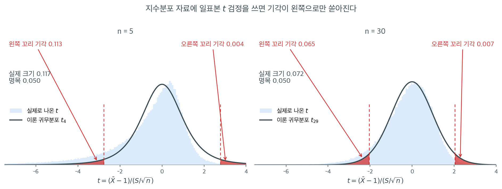

# 비모수 검정을 언제, 왜 쓰는가

$t$ 검정이나 분산분석 같은 모수적 검정은 강한 분포 가정 --- 대개 자료가 정규분포를 따른다는 가정 --- 에서 검정력을 얻는다. 그 가정이 성립하면 모수적 방법은 쓸 수 있는 도구 중 가장 효율적이다. 그러나 실제 자료는 이 가정을 자주 어긴다. 분포가 심하게 치우치거나, 이상치에 오염되어 있거나, 수치적 거리가 의미 없는 순서형 척도로 측정되었을 수 있다. 비모수 검정은 이 모든 상황에서 원칙 있는 대안을 제공한다.

이 절에서는 모수적 가정이 무너지는 조건을 살펴보고 두 검정 계열 사이의 맞교환을 분명히 하여 **분포무관**(비모수) 방법을 쓸 이유를 설명한다.

---

## 1. 모수적 가정이 깨질 때

### 정규성 위반

많은 모수적 절차는 모집단 분포가 정규이거나, 검정통계량의 표본분포가 근사적으로 정규라고 가정한다. 중심극한정리는 대표본에서 후자를 보장하지만, 소표본에서는 자료 자체의 정규성이 직접 문제가 된다. 흔한 위반은 다음과 같다.

- **두꺼운 꼬리 분포** --- 코시분포, 자유도가 작은 $t$ 분포, 오염 정규분포에서 나온 자료는 Gauss 모형이 예측하는 것보다 훨씬 자주 극단적인 관측값을 만든다.
- **치우친 분포** --- 소득자료, 생존시간, 많은 생물학적 측정값은 오른쪽으로 치우친 분포(로그정규, 지수, 와이불 등)를 따른다.
- **다봉 분포** --- 혼합 모집단은 봉우리를 여럿 만들며, 어떤 단일 모수족도 이를 담아내지 못한다.

표본크기가 작고($n < 30$ 정도) 모집단이 정규에서 크게 벗어나면 $t$ 검정의 제1종 오류율은 명목 $\alpha$에서 상당히 벗어날 수 있다.

!!! warning "지수분포에서 일표본 $t$ 검정의 실제 크기"
    $\text{Exp}(1)$에서 $n$개를 뽑아 $H_0: \mu = 1$을 유의수준 $0.05$로 검정한 결과(각 20{,}000회 모의실험):

    | $n$ | 실제 크기 | 왼쪽 꼬리 기각 | 오른쪽 꼬리 기각 |
    |---:|---:|---:|---:|
    | 5 | 0.121 | 0.117 | 0.004 |
    | 10 | 0.099 | 0.095 | 0.005 |
    | 30 | 0.071 | 0.064 | 0.007 |
    | 100 | 0.058 | 0.046 | 0.012 |

    문제는 크기가 부풀려진 것만이 아니다. 기각이 **한쪽 꼬리에 몰려 있다**. $n = 5$에서 기각의 97%가 왼쪽 꼬리에서 나온다. 오른쪽으로 치우친 자료에서는 $\bar{X}$와 $S$가 양의 상관을 가지므로, 작은 표본평균이 작은 표준오차와 짝지어져 $t$를 지나치게 음수로 만든다. 이 편향은 $n$이 커져도 매우 천천히 사라진다.



표의 숫자가 왜 그렇게 나오는지는 귀무분포를 직접 그려 보면 한눈에 들어온다. 옅은 파란 히스토그램은 $\text{Exp}(1)$에서 표본을 뽑아 실제로 계산한 $t$ 값 20만 개이고, 검은 곡선은 우리가 믿고 쓰는 이론 귀무분포 $t_{n-1}$이다. 두 꼬리의 빨간 영역이 유의수준 $0.05$의 기각역이다.

$n = 5$에서 **실제 분포는 왼쪽으로 길게 끌리고 오른쪽은 $t_4$보다도 짧다.** 그 결과 왼쪽 기각역으로 떨어지는 비율이 $0.113$, 오른쪽이 $0.004$가 되어 합이 $0.117$이다(그림은 20만 회, 위 표는 2만 회로 잰 값이라 소수점 셋째 자리에서 조금 다르다). 이것을 "$0.05$여야 할 크기가 $0.12$가 되었다"라고만 읽으면 절반만 본 것이다. **양측검정을 했는데 사실상 왼쪽 단측검정을 한 셈이 되었다**는 것이 진짜 문제다.

$n = 30$ 패널을 보면 개선이 얼마나 더딘지 알 수 있다. 히스토그램이 검은 곡선에 꽤 가까워졌지만 왼쪽 어깨가 여전히 두껍고, 왼쪽 $0.065$ 대 오른쪽 $0.007$로 **비대칭은 거의 그대로다.** 중심극한정리는 $t$ 통계량을 정규로 밀어 주지만 그 수렴 속도가 $1/\sqrt{n}$이고, 왜도가 만드는 편향항은 정확히 그 속도로만 사라지기 때문이다.

여기서 기억할 점은 이것이다. 이상치나 치우침이 검정을 망가뜨릴 때 그 망가짐에는 **방향이 있다.** 어느 쪽으로 틀리는지 모르는 잡음이 아니라 늘 같은 쪽으로 기우는 편향이므로, 표본을 몇 개 더 모으거나 여러 연구를 모아도 상쇄되지 않는다. 뒤에서 볼 부호검정과 Wilcoxon 검정에는 이런 비대칭이 없다. 귀무분포가 자료의 모양이 아니라 순위의 순열에서 나오기 때문이다.

### 순서형 자료와 순위 자료

어떤 측정 척도는 본질적으로 순서형이다. 1--10 척도의 통증 점수, 학점, Likert 척도 설문 응답 등이 그렇다. 범주 사이의 거리가 같다는 보장이 없으므로 평균 계산 같은 산술 연산은 순서형 자료에서 의미가 없다. 원값 대신 순위로 작동하는 비모수 검정은 이런 자료의 순서 구조를 존중한다.

### 이상치와 오염

극단적인 관측값 하나가 표본평균을 크게 옮기고 표본분산을 부풀려, 이 두 양에 의존하는 모든 검정의 결과를 왜곡한다. 순위 기반 검정은 각 관측값을 순위로 바꾸는 순간 어떤 한 자료점의 영향력이 순위 한 칸 이내로 제한되므로 본질적으로 이상치에 저항한다.

### 작은 표본크기

표본이 아주 작으면($n < 10$) 많은 모수적 검정이 기대는 정규근사가 믿을 수 없게 된다. 여러 비모수 검정은 검정통계량의 순열분포에서 직접 계산한 **정확** $p$값을 제공하므로 대표본 근사가 아예 필요 없다.

---

## 2. 무엇이 검정을 비모수로 만드는가

통계적 검정이 **비모수**(또는 **분포무관**)라 불리는 것은, 자료가 특정 모수족에서 나왔다는 가정에 그 타당성이 의존하지 않을 때이다. 더 정확히는, 귀무가설 $H_0$ 아래에서 검정통계량의 분포가 모든 연속분포에 대해 동일하다는 뜻이다.

!!! note "귀무가설 아래에서의 분포무관"
    "분포무관"은 검정통계량의 **귀무분포**를 두고 하는 말이지 자료 자체를 두고 하는 말이 아니다. 비모수 검정도 *어떤* 가정은 한다. 보통 관측값이 연속분포에서 독립적이고 동일하게 분포한다는 가정이다.

분포무관성을 얻는 가장 흔한 장치는 **순위변환**이다. 각 관측값 $X_i$를 합친 표본 안에서의 순위 $R_i$로 바꾼다. 귀무가설(예를 들어 두 집단이 같은 분포를 갖는다) 아래에서는 순위의 모든 순열이 동등하게 가능하므로, 모집단 모양을 몰라도 임의의 순위 기반 통계량의 귀무분포를 유도할 수 있다.

---

## 3. 비모수 검정의 장점

| 장점 | 설명 |
|:----------|:------------|
| 가정이 적다 | 정규성이나 등분산성 없이도 타당하다 |
| 이상치에 로버스트하다 | 순위변환이 극단값의 영향을 제한한다 |
| 순서형 자료에 적용 가능하다 | 관측값의 순서만 알 수 있어도 의미가 있다 |
| 소표본에서 정확 $p$값 | 순열 기반 귀무분포는 점근이론에 기대지 않는다 |
| 폭넓게 적용된다 | 중앙값, 분포, 확률적 순서에 대한 가설을 검정할 수 있다 |

---

## 4. 단점과 맞교환

비모수 방법에도 대가는 있다. 가장 큰 맞교환은 **검정력**이다. 모수적 가정이 만족될 때 비모수 검정이 같은 검정력에 도달하려면 대체로 더 큰 표본이 필요하다. 이 효율 손실은 **점근상대효율**(ARE)로 정량화되며, [검정력 비교](power_comparison.md) 절에서 자세히 다룬다.

| 한계 | 설명 |
|:-----------|:------------|
| 정규성 아래 낮은 검정력 | 순위를 매기며 크기 정보를 버리므로 효율을 다소 잃는다 |
| 신뢰구간이 덜 친숙하다 | 순위 기반 검정에서 신뢰구간을 만드는 일은 $t$ 기반 방법보다 덜 직관적이다 |
| 동점이 정확검정을 복잡하게 한다 | 관측값이 같은 값을 가지면 정확 순열분포에 보정이 필요하다 |
| 진단도구가 적다 | 잔차그림과 영향력 진단이 순위 기반 검정에서는 덜 발달했다 |

---

## 5. 의사결정 틀

모수적 검정과 비모수 검정 사이의 선택은 전부 아니면 전무의 문제가 아니다. 다음 지침이 도움이 된다.

1. **먼저 정규성을 확인한다.** [14장](../../ch14/index.md)의 그래프 방법(Q-Q 그림, 히스토그램)과 형식적 검정(Shapiro-Wilk, Anderson-Darling)으로 정규성 가정이 합리적인지 판단한다.
2. **표본크기를 고려한다.** 대표본($n > 30$)에서는 중심극한정리 덕에 모수적 검정이 정규성의 완만한 위반에 로버스트한 경우가 많다. 소표본에서는 비모수 검정이 더 안전한 추론을 준다.
3. **측정 척도를 평가한다.** 자료가 순서형이면 표본크기와 무관하게 순위 기반 검정이 자연스러운 선택이다.
4. **이상치의 영향을 따진다.** 실질적 근거로 제거할 수 없는 극단값이 있다면 비모수 검정이 그 왜곡으로부터 보호해 준다.
5. **검정력과 로버스트성의 균형을 잡는다.** 가정이 성립하면 모수적 검정이 더 강력하다. 성립하지 않으면 모수적 검정의 실제 제1종 오류율이 명목수준과 달라지므로, 비모수 검정이 훨씬 더 강력할 수 있다.

??? example "모수적 대신 비모수를 택할 때"
    **상황:** 한 연구자가 처리군 환자 12명과 대조군 10명에게서 통증 점수(1--10 Likert 척도)를 수집했다. 점수의 분포는 오른쪽으로 심하게 치우쳐 있고 1에서 바닥효과가 있다.

    - 자료가 **순서형**이므로 평균은 의미 있는 요약이 아니다.
    - 표본이 **작아서**($n_1 = 12$, $n_2 = 10$) 중심극한정리의 보장이 약하다.
    - 분포가 **치우쳐** 있어 정규성 가정을 어긴다.

    여기서는 Mann-Whitney $U$ 검정(동치로 Wilcoxon 순위합검정)이 적절한 선택이다. 이 검정은 분포 모양에 대해 아무것도 가정하지 않고, 한 집단이 다른 집단보다 체계적으로 높은 점수를 내는 경향이 있는지를 검정한다.

---

## 연습문제

<div class="drillbox" markdown>

**연습문제 1.** <span class="diff easy" title="쉬움"></span>
다음 두 집단을 보자.

$$
A = (5.1, 5.6, 4.9, 5.3, 5.8, 5.0, 5.4, 5.2, 5.7, 5.5), \quad
B = (6.2, 6.5, 6.0, 6.8, 6.3, 6.1, 6.6, 6.4, 6.7, 6.9)
$$

$B$의 마지막 값 $6.9$를 기록 오류로 $30.0$이라 적었다고 하자. 이표본 $t$ 검정과 Mann-Whitney 검정의 $p$값이 각각 어떻게 변하는지 계산하고 해석하라.

</div>

??? success "풀이"
    ```python
    import numpy as np
    from scipy import stats

    a = np.array([5.1, 5.6, 4.9, 5.3, 5.8, 5.0, 5.4, 5.2, 5.7, 5.5])
    b = np.array([6.2, 6.5, 6.0, 6.8, 6.3, 6.1, 6.6, 6.4, 6.7, 6.9])
    b_bad = b.copy(); b_bad[-1] = 30.0

    for name, y in [("원자료", b), ("오염", b_bad)]:
        print(name,
              "t p=%.6f" % stats.ttest_ind(a, y).pvalue,
              "MW p=%.6f" % stats.mannwhitneyu(a, y).pvalue)
    ```

    출력:

    ```
    원자료 t p=0.000000 MW p=0.000183
    오염 t p=0.166235 MW p=0.000183
    ```

    | | $t$ 검정 $p$ | Mann-Whitney $p$ |
    |:---|---:|---:|
    | 원자료 | $1.97 \times 10^{-7}$ | $0.000183$ |
    | 오염 후 | $0.166$ | $0.000183$ |

    이상치는 **차이를 더 크게 만드는 방향으로** 들어갔는데($B$의 평균이 $6.45$에서 $8.76$으로 상승) $t$ 검정의 $p$값은 $2 \times 10^{-7}$에서 $0.166$으로 올라 유의성을 완전히 잃었다. 분자($\bar{B} - \bar{A}$)는 커졌지만 $B$의 표본표준편차가 $0.30$에서 $7.4$로 25배 부풀어 분모가 훨씬 더 빨리 커졌기 때문이다.

    Mann-Whitney의 $p$값은 **소수점 이하 전부 그대로**이다. $30.0$은 여전히 20개 중 순위 20위일 뿐이고, $6.9$도 순위 20위였다. 통계량이 순위만 보므로 값이 얼마나 극단적인지는 아무 영향이 없다.

    이것이 순위 기반 검정의 로버스트성이 갖는 정확한 의미이다. 이상치가 통계량을 조금 덜 흔드는 것이 아니라, **순위를 바꾸지 않는 한 전혀 흔들지 않는다**.

---

<div class="drillbox" markdown>

**연습문제 2.** <span class="diff med" title="중간"></span>
$\text{Exp}(1)$ 모집단에서 $n = 5$인 표본을 뽑아 $H_0: \mu = 1$을 양측 $t$ 검정으로 검정한다고 하자. 위 표에 따르면 실제 크기는 $0.121$이고 기각의 대부분이 **왼쪽** 꼬리에서 나온다. 왜 오른쪽이 아니라 왼쪽 꼬리에 몰리는지 설명하라.

</div>

??? success "풀이"
    $t = (\bar{X} - 1)/(S/\sqrt{n})$의 분자와 분모가 **양의 상관**을 갖기 때문이다.

    오른쪽으로 치우친 분포에서 표본이 큰 값을 하나도 뽑지 못하면 $\bar{X}$가 작아지는데, **동시에** $S$도 작아진다. 작은 분자와 작은 분모가 만나면 비율이 크게 음수가 된다. 반대로 표본이 큰 값을 하나 뽑으면 $\bar{X}$가 커지지만 $S$는 더 크게 부풀어, 비율이 오히려 0 쪽으로 눌린다.

    지수분포 표본에서 $\bar{X}$와 $S$의 상관은 실제로 매우 높다.

    ```python
    import numpy as np
    rng = np.random.default_rng(0)
    x = rng.exponential(1, (20000, 5))
    print(np.corrcoef(x.mean(1), x.std(1, ddof=1))[0, 1])   # 약 0.77
    ```

    출력:

    ```
    0.7737361925907859
    ```

    이것이 왜도가 $t$ 통계량에 미치는 1차 효과이며, Edgeworth 전개에서 $-\gamma_1/(6\sqrt{n})$ 항으로 나타난다. $\gamma_1 = 2$이고 $n = 5$이면 이 항의 크기가 $0.15$로, 무시할 수 없다. 또한 $\sqrt{n}$에 반비례해 사라지므로 $n = 100$에서도 여전히 총 크기가 $0.058$이다.

    실무적 함의: 치우친 자료에 대한 $t$ 검정의 실패는 "크기가 조금 크다"가 아니라 **어느 방향으로 틀리는지가 정해져 있다**는 데 있다. 부호검정이나 Wilcoxon 검정에는 이런 비대칭이 없다.

---

<div class="drillbox" markdown>

**연습문제 3.** <span class="diff med" title="중간"></span>
연습문제 1에서 이상치를 $B$ 대신 $A$에 넣으면(즉 $A$의 마지막 값 $5.5$를 $30.0$으로) 어떻게 되는가? 두 검정을 다시 계산하고, 이 경우가 왜 더 위험한지 설명하라.

</div>

??? success "풀이"
    ```python
    a_bad = a.copy(); a_bad[-1] = 30.0
    print("t  p=%.4f" % stats.ttest_ind(a_bad, b).pvalue)     # 0.5914
    print("MW p=%.4f" % stats.mannwhitneyu(a_bad, b).pvalue)  # 0.0028
    ```

    출력:

    ```
    t  p=0.5914
    MW p=0.0028
    ```

    | | $t$ 검정 $p$ | Mann-Whitney $p$ |
    |:---|---:|---:|
    | 원자료 | $1.97 \times 10^{-7}$ | $0.000183$ |
    | $A$에 이상치 | $0.591$ | $0.00283$ |

    이 경우가 더 위험한 이유는 이상치가 **차이를 지워버리기** 때문이다. $\bar{A}$가 $5.35$에서 $7.8$로 뛰어 $\bar{B} = 6.45$를 넘어서므로 $t$ 통계량의 부호까지 뒤집힌다($t = +0.55$). 결론이 "$B$가 훨씬 크다"에서 "차이 없음"으로, 그것도 방향이 반대인 채로 바뀐다.

    Mann-Whitney에서는 $p$값이 $0.000183$에서 $0.00283$으로 15배 커졌지만 여전히 강하게 유의하다. 이상치가 $A$의 한 관측값을 최하위권에서 최상위(순위 20)로 옮겼으므로 $U$가 $0$에서 $10$으로 바뀐 것뿐이다. 관측값 20개 중 정확히 하나만 순위가 바뀔 수 있고, 그것이 순위 기반 통계량이 받을 수 있는 최대 피해이다.

    이것을 **붕괴점**(breakdown point)의 관점으로 말하면, 표본평균의 붕괴점은 $0$(관측값 하나면 무한대로 끌 수 있다)이고 순위합의 붕괴점은 그렇지 않다. 한 관측값이 순위합을 최대 $n$만큼만 움직인다.

---

<div class="drillbox" markdown>

**연습문제 4.** <span class="diff med" title="중간"></span>
비모수 검정이 이렇게 로버스트하다면 왜 항상 쓰지 않는가? 정규분포 자료에서 $t$ 검정과 Mann-Whitney 검정의 검정력을 비교하여 답하라.

</div>

??? success "풀이"
    두 정규 모집단이 $\mathcal{N}(0,1)$과 $\mathcal{N}(0.8, 1)$일 때(즉 모수적 가정이 완벽히 성립할 때) 유의수준 $0.05$에서의 검정력:

    ```python
    import numpy as np
    from scipy import stats
    rng = np.random.default_rng(7)

    for n in (10, 20, 30):
        x = rng.normal(0, 1, (3000, n))
        y = rng.normal(0.8, 1, (3000, n))
        pt = stats.ttest_ind(x, y, axis=1).pvalue
        pm = np.array([stats.mannwhitneyu(x[i], y[i]).pvalue for i in range(3000)])
        print(n, (pt < .05).mean(), (pm < .05).mean())
    ```

    출력:

    ```
    10 0.40066666666666667 0.36
    20 0.6903333333333334 0.661
    30 0.8553333333333333 0.8336666666666667
    ```

    | 집단당 $n$ | $t$ 검정 | Mann-Whitney |
    |---:|---:|---:|
    | 10 | 0.393 | 0.356 |
    | 20 | 0.694 | 0.665 |
    | 30 | 0.865 | 0.850 |

    손실이 있지만 **작다**. 이것이 정규분포에서 Mann-Whitney 검정의 점근상대효율

    $$
    \text{ARE} = \frac{3}{\pi} \approx 0.955
    $$

    가 뜻하는 바이다. 같은 검정력을 얻으려면 표본을 약 $1/0.955 = 1.047$배, 즉 **5% 정도만** 더 모으면 된다. $n = 20$이면 한 집단에 한 명씩만 더 있으면 되는 셈이다.

    반면 연습문제 1--3에서 보았듯 가정이 깨지면 $t$ 검정이 잃는 것은 5%가 아니라 결론 전체이다. 이 비대칭 --- 정상일 때 5% 손해, 비정상일 때 전면적 이득 --- 이 비모수 검정을 기본 선택지로 삼을 만하게 만드는 이유이다.

    다만 "항상 비모수를 쓰라"는 결론도 지나치다. 순위 기반 검정은 평균차나 회귀계수 같은 **해석 가능한 모수의 추정치와 신뢰구간**을 자연스럽게 주지 못하며, 검정하는 귀무가설도 "평균이 같다"가 아니라 "분포가 같다" 또는 "확률적으로 크지 않다"이다. 목표가 효과의 크기를 재는 것이라면 로버스트 추정이나 붓스트랩이 더 나은 답인 경우가 많다.

---

<div class="drillbox" markdown>

**연습문제 5.** <span class="diff med" title="중간"></span>
연습문제 1에서 두 집단은 완전히 분리되어 Mann-Whitney 통계량이 $U = 0$이었고, 보고된 $p$값은 $0.000183$이었다. 자료는 $n_1 = n_2 = 10$이고 동점이 없다.

(a) 귀무가설 아래에서 순위의 모든 배열이 동등하게 가능하다는 사실만 써서 **정확** 양측 $p$값을 손으로 구하라.

(b) $0.000183$은 어디서 나온 수인가? 정규근사 공식에 연속성 수정을 넣어 그 값을 재현하라.

(c) 두 값의 비를 구하고, 근사가 어느 방향으로 틀리는지 말하라.

</div>

??? success "풀이"
    **(a) 정확 $p$값.** 귀무가설 아래에서 $A$ 집단이 받는 순위의 집합은 $\{1, 2, \dots, 20\}$의 10원소 부분집합 가운데 하나이고, 모든 부분집합이 동등하게 가능하다. 그 개수는

    $$
    \binom{20}{10} = 184{,}756
    $$

    이다. $U_A = \#\{(i,j) : A_i > B_j\} = 0$이 되는 배열은 $A$가 순위 $1$부터 $10$까지를 모두 차지하는 **단 하나**뿐이다. 마찬가지로 $U_A = 100$이 되는 배열도 하나다. 따라서

    $$
    p_{\text{정확}} = \frac{2}{184{,}756} = 1.0825 \times 10^{-5}.
    $$

    **(b) 정규근사.** $N = n_1 + n_2 = 20$일 때

    $$
    E[U] = \frac{n_1 n_2}{2} = 50, \qquad
    \operatorname{Var}(U) = \frac{n_1 n_2 (N+1)}{12} = \frac{100 \cdot 21}{12} = 175,
    $$

    이므로 $\sigma_U = \sqrt{175} = 13.2288$이다. 연속성 수정을 넣으면

    $$
    z = \frac{0 - 50 + 0.5}{13.2288} = -3.7418, \qquad
    p = 2\Phi(-3.7418) = 0.00018267.
    $$

    소수 여섯째 자리까지 쪽의 $0.000183$과 같다. 즉 연습문제 1의 출력은 정확검정이 아니라 **점근근사**였다. SciPy의 `mannwhitneyu`는 `method="auto"`일 때 두 표본 중 작은 쪽이 8개 이하이고 동점이 없을 때만 정확검정을 쓰므로, $n_1 = n_2 = 10$에서는 말없이 점근근사로 넘어간다.

    **(c) 비와 방향.**

    $$
    \frac{0.00018267}{1.0825 \times 10^{-5}} = 16.9.
    $$

    맞는 값은 정확 $p$값이고, 근사는 **17배 보수적**이다. 까닭은 $U$의 귀무분포가 유한구간 $[0, 100]$에만 실려 있어 경계 근처에서 정규 꼬리보다 훨씬 빨리 죽기 때문이다. $z = -3.74$ 정도의 먼 꼬리에서는 중심 근처에서 잘 맞던 근사가 상대오차로는 한 자릿수씩 틀어진다.

    실무적 함의: 비모수 검정에서 $p$값의 **자릿수**를 보고할 일이 있으면 `method`를 명시해야 한다. 쪽의 결론("순위는 이상치에 흔들리지 않는다")은 둘 중 어느 값을 써도 똑같이 성립하지만, "$p = 0.000183$"과 "$p = 0.0000108$"은 다른 수다.

---

<div class="drillbox" markdown>

**연습문제 6.** <span class="diff med" title="중간"></span>
3절의 장점 표는 "소표본에서 정확 $p$값"을 비모수 검정의 장점으로 꼽았다. 그 정확성이 무엇을 대가로 치르는지 끝까지 세어 보자. $n_1 = n_2 = 4$이고 동점이 없다고 하자. $A$ 집단이 받은 순위의 합을 $W$라 한다.

(a) $W$가 취할 수 있는 값의 범위와 가능한 배열의 총수를 구하라.

(b) 두 집단이 완전히 분리된 경우($W = 10$)의 정확 양측 $p$값을 구하라.

(c) 유의수준 $\alpha = 0.05$로 검정할 때 이 검정의 **실제** 제1종 오류율은 얼마인가?

(d) $\alpha = 0.01$로 검정하고 싶다면 집단당 관측값이 최소 몇 개 필요한가?

</div>

??? success "풀이"
    **(a) 범위와 총수.** $W$는 $\{1, \dots, 8\}$에서 고른 네 순위의 합이므로 최소는 $1+2+3+4 = 10$, 최대는 $5+6+7+8 = 26$이다. 배열의 총수는 $\binom{8}{4} = 70$이고 귀무가설 아래에서 이 $70$가지가 모두 확률 $1/70$을 갖는다.

    $W$의 값별 배열 수를 전부 적으면(합이 $70$임을 확인하라)

    | $W$ | 10 | 11 | 12 | 13 | 14 | 15 | 16 | 17 | 18 | 19 | 20 | 21 | 22 | 23 | 24 | 25 | 26 |
    |---:|--:|--:|--:|--:|--:|--:|--:|--:|--:|--:|--:|--:|--:|--:|--:|--:|--:|
    | 배열 수 | 1 | 1 | 2 | 3 | 5 | 5 | 7 | 7 | 8 | 7 | 7 | 5 | 5 | 3 | 2 | 1 | 1 |

    분포는 $18$을 중심으로 대칭이다($E[W] = n_1(N+1)/2 = 4 \cdot 9/2 = 18$).

    **(b) 완전분리의 정확 $p$값.** $W = 10$은 한 배열에서만 나오므로 $P(W \le 10) = 1/70$이고

    $$
    p = 2 \cdot \frac{1}{70} = \frac{1}{35} = 0.02857.
    $$

    자료가 **상상할 수 있는 가장 극단적인 모양**인데도 $p$값이 $0.0286$에서 멈춘다.

    **(c) 실제 크기.** 양측 $p$값이 취할 수 있는 값은 $2/70 = 0.0286$, $4/70 = 0.0571$, $8/70 = 0.1143, \dots$뿐이다. 이 가운데 $0.05$보다 작은 것은 첫 값 하나이므로 기각역은 $\{W = 10\} \cup \{W = 26\}$이고

    $$
    \alpha_{\text{실제}} = \frac{2}{70} = 0.0286.
    $$

    명목 $5\%$ 가운데 $57\%$만 쓰는 셈이다. 정확검정은 **정확하지만 보수적**이다.

    **(d) $\alpha = 0.01$에 필요한 표본.** 달성 가능한 가장 작은 양측 $p$값은 $2/\binom{2n}{n}$이므로

    $$
    \frac{2}{\binom{2n}{n}} \le 0.01
    \iff \binom{2n}{n} \ge 200.
    $$

    $\binom{8}{4} = 70 < 200$, $\binom{10}{5} = 252 \ge 200$이므로 집단당 $5$개가 필요하고, 그때 가장 작은 양측 $p$값은 $2/252 = 0.00794$이다.

    여기서 얻을 교훈은 이것이다. $n_1 = n_2 = 4$에서 $\alpha = 0.01$로 순위합검정을 하면 **자료가 어떻게 나와도 기각할 수 없다** --- 검정력이 정확히 $0$이다. 비모수 검정이 소표본에서 주는 "정확성"은 분포 가정을 치르지 않는 대신 귀무분포의 **입자가 거칠다**는 형태로 값을 받아 간다. 정규근사를 쓰면 $p$값이 연속적으로 나와 이 한계가 눈에 보이지 않을 뿐, 실제로 없어지는 것은 아니다.

---

<div class="drillbox" markdown>

**연습문제 7.** <span class="diff hard" title="어려움"></span>
쪽의 마지막 보기는 Mann-Whitney 검정이 "한 집단이 다른 집단보다 체계적으로 높은 점수를 내는 경향이 있는지"를 검정한다고 적었다. 실무에서는 이것을 흔히 "중앙값이 같다"의 검정으로 바꿔 읽는다. 그 바꿔 읽기가 틀리는 자리를 직접 만들어 보자.

$X \sim \text{Unif}(0, 10)$이고, $Y$의 밀도는

$$
f_Y(y) = \begin{cases} 0.5, & 4 < y < 5, \\ 0.1, & 5 < y < 10, \\ 0, & \text{그 밖} \end{cases}
$$

이라 하자.

(a) $f_Y$가 밀도이고 $X$와 $Y$의 중앙값이 **둘 다 5**임을 보이라.

(b) $P(X < Y)$를 적분으로 구하라.

(c) 중앙값이 같은데도 Mann-Whitney 검정이 기각하는지를 $n = 30, 100, 400$에서 모의실험으로 재라. 두 집단의 표본중앙값도 함께 찍어, 두 수치가 $n$이 커질 때 서로 **반대 방향**으로 가는 것을 확인하라.

</div>

??? success "풀이"
    **(a) 밀도와 중앙값.** 전체 적분은 $0.5 \times 1 + 0.1 \times 5 = 0.5 + 0.5 = 1$이므로 밀도다. 또

    $$
    P(Y < 5) = \int_4^5 0.5 \, dy = 0.5
    $$

    이므로 $Y$의 중앙값은 $5$다. $X \sim \text{Unif}(0,10)$의 중앙값도 $5$다.

    **(b) 확률적 우위.** $0 \le y \le 10$에서 $P(X < y) = y/10$이므로

    $$
    \begin{aligned}
    P(X < Y) &= \int f_Y(y) \, \frac{y}{10} \, dy
    = 0.05 \int_4^5 y \, dy + 0.01 \int_5^{10} y \, dy \\
    &= 0.05 \cdot \frac{25 - 16}{2} + 0.01 \cdot \frac{100 - 25}{2}
    = 0.05 \cdot 4.5 + 0.01 \cdot 37.5 = 0.225 + 0.375 = 0.6.
    \end{aligned}
    $$

    중앙값은 같은데 $P(X < Y) = 0.6 \ne 1/2$이다.

    **(c) 모의실험.**

    ```python
    import numpy as np
    from scipy import stats

    rng = np.random.default_rng(16)
    R = 20000

    def draw_y(size):
        """밀도가 (4,5) 에서 0.5, (5,10) 에서 0.1 인 Y: 중앙값 5."""
        lo = rng.random(size) < 0.5
        return np.where(lo, rng.uniform(4, 5, size), rng.uniform(5, 10, size))

    print("  n   MW 기각률   X 표본중앙값   Y 표본중앙값")
    for n in (30, 100, 400):
        rej = 0
        mx = my = 0.0
        for _ in range(R):
            x = rng.uniform(0, 10, n)
            y = draw_y(n)
            rej += stats.mannwhitneyu(x, y, alternative="two-sided",
                                      method="asymptotic").pvalue < 0.05
            mx += np.median(x)
            my += np.median(y)
        print(f"{n:3d}   {rej/R:.4f}      {mx/R:.3f}          {my/R:.3f}")

    x = rng.uniform(0, 10, 2_000_000)
    y = draw_y(2_000_000)
    print(f"P(X < Y) 모의값  {np.mean(x < y):.4f}   (이론값 0.6)")
    ```

    출력:

    ```text
      n   MW 기각률   X 표본중앙값   Y 표본중앙값
     30   0.2705      5.001          5.286
    100   0.6841      5.000          5.159
    400   0.9978      5.001          5.081
    P(X < Y) 모의값  0.5997   (이론값 0.6)
    ```

    기각률은 $0.27 \to 0.68 \to 0.998$로 $1$에 다가가고, $Y$의 표본중앙값은 $5.286 \to 5.159 \to 5.081$로 참값 $5$에 다가간다. **표본이 커질수록 중앙값이 같다는 증거는 분명해지는데 Mann-Whitney의 기각은 확실해진다.**

    기각률이 자라는 속도는 손으로 확인할 수 있다. $n_1 = n_2 = n$일 때 $E[U] = n^2 P(X<Y) = 0.6n^2$인데 귀무가설 아래 기댓값은 $0.5n^2$이므로 이동량이 $0.1n^2$이고, $\sigma_U = \sqrt{n^2(2n+1)/12} \approx n^{3/2}/\sqrt{6}$이다. 따라서

    $$
    z \approx \frac{0.1 n^2}{n^{3/2}/\sqrt{6}} = 0.245\sqrt{n},
    $$

    곧 $n = 30, 100, 400$에서 $z \approx 1.34,\ 2.45,\ 4.90$이다. 검정력 $\Phi(z - 1.96)$은 각각 $0.268,\ 0.688,\ 0.998$로 모의실험값과 맞는다.

    **무엇이 잘못되었나.** Mann-Whitney의 귀무가설은 $P(X < Y) = 1/2$(확률적 우위)이지 중앙값이 같다는 것이 아니다. 여기서 $P(X<Y) = 0.6$이므로 귀무가설은 **거짓**이고 검정은 틀리지 않았다. 틀린 것은 결과를 "중앙값이 다르다"로 옮긴 해석이다. 두 진술이 같아지는 것은 **순수한 위치이동 모형** $G(t) = F(t - \Delta)$ 아래에서뿐이며, 그때는

    $$
    P(X < Y) = \tfrac12 \iff \Delta = 0 \iff \text{중앙값이 같다}
    $$

    가 모두 한 고리로 묶인다. 분포의 모양이 다르면 그 고리가 끊어진다. 분산만 다르고 대칭인 경우($\mathcal{N}(0,1)$ 대 $\mathcal{N}(0,4)$)에는 $P(X<Y) = 1/2$가 그대로 유지되므로, 고리를 끊는 것은 분산 차이가 아니라 **비대칭**이다.

---

<div class="drillbox" markdown>

**연습문제 8.** <span class="diff hard" title="어려움"></span>
연습문제 3의 풀이는 "한 관측값이 순위합을 최대 $n$만큼만 움직인다"라고 적었다. 이 말을 정확하게 만들고 끝까지 밀어 보자. 연습문제 1의 자료처럼 $n_1 = n_2 = 10$, 동점 없음, 처음에는 $A$의 모든 값이 $B$의 모든 값보다 작아 $U_A = \#\{(i,j) : A_i > B_j\} = 0$이라 하자.

(a) $A$의 관측값 **하나**를 아무 값으로 바꿀 때 $U_A$가 바뀔 수 있는 최대 폭을 구하고, 연습문제 3이 그 최대 폭을 달성했는지 확인하라.

(b) 적대자가 $A$의 관측값 $k$개를 마음대로 고칠 수 있다. 유의수준 $0.05$에서 유의성을 없애려면 $k$가 최소 얼마여야 하는가? 연습문제 1, 3과 같은 정규근사 $p$값으로 답하라.

(c) 같은 일을 $t$ 검정에 하려면 $k$가 얼마면 되는가? 두 답을 비교해 순위합의 "붕괴점"을 분수로 말하라.

</div>

??? success "풀이"
    **(a) 최대 폭은 $n_2 = 10$.** $U_A$는 **짝의 개수**다. 각 관측값 $A_i$는 정확히 $n_2 = 10$개의 짝 $(A_i, B_1), \dots, (A_i, B_{10})$에만 등장하고 다른 짝에는 전혀 들어가지 않는다. 그러므로 $A_i$의 값을 어떻게 바꾸어도 그 $10$개 짝의 판정만 달라지고,

    $$
    \lvert \Delta U_A \rvert \le n_2 = 10
    $$

    이다. 등호는 $A_i$를 모든 $B_j$보다 작은 값에서 모든 $B_j$보다 큰 값으로 옮길 때 달성된다.

    연습문제 3이 바로 그 경우다. $A$의 $5.5$를 $30.0$으로 바꾸자 $U_A$가 $0$에서 $10$으로 **정확히 최대 폭만큼** 움직였고, $p$값이 $0.000183$에서 $0.00283$으로 올랐다. 즉 그 풀이가 본 피해는 우연히 작았던 것이 아니라 **이론적 상한**이다.

    **(b) $k = 3$이 필요하다.** $A$의 값 $k$개를 모든 $B_j$보다 크게 올리면(그것이 $U_A$를 가장 크게 만드는 방법이다) 올린 $k$개가 각각 $B$의 $10$개를 모두 이기므로

    $$
    U_A = 10k.
    $$

    $\sigma_U = 13.2288$을 써서 연속성 수정을 넣은 양측 $p$값을 차례로 계산하면

    | $k$ | $U_A$ | $z$ | $p$ |
    |---:|---:|---:|---:|
    | 1 | 10 | $-2.986$ | $0.00283$ |
    | 2 | 20 | $-2.230$ | $0.0257$ |
    | 3 | 30 | $-1.474$ | $0.1405$ |

    $k = 2$까지는 여전히 유의하고($p = 0.0257 < 0.05$) $k = 3$에서 유의성이 사라진다. 경계를 직접 풀어도 같다. $p > 0.05$가 되려면 $\lvert z \rvert < 1.96$, 곧 $U_A > 50 - 0.5 - 1.96 \times 13.2288 = 23.57$이므로 $U_A \ge 24$가 필요하고 $10k \ge 24$에서 $k \ge 2.4$, 즉 $k = 3$이다. 정확검정으로 해도 결론은 같다($U_A = 20$에서 $p = 0.0232$, $U_A = 30$에서 $p = 0.1431$).

    **(c) $t$ 검정은 $k = 1$.** 연습문제 3에서 관측값 **하나**를 $5.5 \to 30.0$으로 바꾸자 $p$값이 $1.97 \times 10^{-7}$에서 $0.591$로 올라 유의성이 완전히 사라졌다. 심지어 $t$의 부호까지 뒤집혔다. 오염값을 $M \to \infty$로 더 세게 밀면 어떻게 되는지도 손으로 알 수 있다. $n_1 = n_2 = n$에서 $\bar{A} \approx M/n$, $S_A \approx M/\sqrt{n}$, 합동표준편차 $S_p \approx M/\sqrt{2n}$, 표준오차 $S_p\sqrt{2/n} \approx M/n$이므로

    $$
    t \to \frac{M/n}{M/n} = 1, \qquad p \to 2P(T_{18} > 1) = 0.331.
    $$

    분자와 분모가 똑같이 $M$에 비례해 자라므로 $t$는 $1$에서 멈춘다. 하지만 그 멈추는 자리가 이미 기각역 밖이다.

    정리하면 $A$ 집단 $10$개 가운데

    $$
    t \text{ 검정: } \frac{1}{10}, \qquad
    \text{순위합검정: } \frac{3}{10}
    $$

    을 오염시켜야 결론이 무너진다. 세 배 차이보다 중요한 것은 **까닭**이다. $U_A$에서 한 관측값의 지분은 통계량의 전체 폭 $100$ 가운데 $10$, 곧 $1/n_1$로 처음부터 고정되어 있다. 반면 $\bar{A}$에서 한 관측값의 지분에는 상한이 없다 --- 하나를 $10^6$으로 보내면 $\bar{A}$가 그대로 따라간다. 이것이 "표본평균의 붕괴점이 $0$"이라는 말의 뜻이고, $t$ 통계량이 $1$로 수렴하는 것은 분모도 같이 망가져서 생기는 위안 없는 안정이다.

    이것이 순위 기반 검정의 로버스트성이 어디서 오는지에 대한 정확한 답이다. "이상치가 덜 아프다"가 아니라 **각 관측값의 지분이 $1/n$으로 못 박혀 있다**는 것이다.

---

<div class="drillbox" markdown>

**연습문제 9.** <span class="diff hard" title="어려움"></span>
이 쪽은 두 번(1절 끝과 연습문제 2의 풀이) "부호검정이나 Wilcoxon 검정에는 이런 비대칭이 없다. 귀무분포가 자료의 모양이 아니라 순위의 순열에서 나오기 때문이다"라고 적었다. 이 문장은 두 검정 가운데 **하나에만** 맞다.

$\text{Exp}(1)$의 중앙값은 $m = \ln 2 = 0.6931$이다. $H_0 : m = \ln 2$를 양측 $0.05$로 검정할 때, 부호검정과 Wilcoxon 부호순위검정의 실제 크기와 좌우 꼬리 기각률을 $n = 10, 20, 50$에서 재라. 어느 쪽이 무너지는지, 왜 그런지, 그리고 왜 $n$이 커질수록 더 나빠지는지 밝혀라.

</div>

??? success "풀이"
    ```python
    import numpy as np
    from scipy import stats

    rng = np.random.default_rng(16)
    m0 = np.log(2.0)          # Exp(1) 의 참 중앙값
    R = 20000

    # 부호검정의 정확 양측 p 값 표: S ~ Bin(n, 1/2)
    def sign_ptab(n):
        return np.array([stats.binomtest(k, n, 0.5, alternative="two-sided").pvalue
                         for k in range(n + 1)])

    print("  n   검정          크기     왼쪽     오른쪽")
    for n in (10, 20, 50):
        ptab = sign_ptab(n)
        cs = [0, 0, 0]        # 전체, 왼쪽, 오른쪽
        cw = [0, 0, 0]
        for _ in range(R):
            d = rng.exponential(1.0, n) - m0
            s = int((d > 0).sum())
            if ptab[s] < 0.05:
                cs[0] += 1
                cs[1 if s < n / 2 else 2] += 1
            res = stats.wilcoxon(d, zero_method="wilcox", correction=False,
                                 alternative="two-sided", method="exact")
            wplus = np.sum(stats.rankdata(np.abs(d), method="average")[d > 0])
            if res.pvalue < 0.05:
                cw[0] += 1
                cw[1 if wplus < n * (n + 1) / 4 else 2] += 1
        print(f"{n:3d}   부호검정      {cs[0]/R:.4f}   {cs[1]/R:.4f}   {cs[2]/R:.4f}")
        print(f"      부호순위검정  {cw[0]/R:.4f}   {cw[1]/R:.4f}   {cw[2]/R:.4f}")
    ```

    출력:

    ```text
      n   검정          크기     왼쪽     오른쪽
     10   부호검정      0.0194   0.0101   0.0093
          부호순위검정  0.0653   0.0112   0.0541
     20   부호검정      0.0435   0.0227   0.0209
          부호순위검정  0.1006   0.0068   0.0938
     50   부호검정      0.0315   0.0159   0.0156
          부호순위검정  0.2116   0.0014   0.2102
    ```

    **부호검정은 멀쩡하다.** $S = \#\{X_i > m\}$은 중앙값의 **정의**에서 $P(X_i > m) = 1/2$이므로 분포의 모양과 무관하게 정확히 $\text{Bin}(n, 1/2)$을 따른다. 치우침이 끼어들 틈이 없다. 명목 $0.05$에 대한 기각역과 그 정확한 크기는

    | $n$ | 기각역 | 정확한 크기 | 모의값 |
    |---:|:---|---:|---:|
    | 10 | $S \le 1$ 또는 $S \ge 9$ | $0.0215$ | $0.0194$ |
    | 20 | $S \le 5$ 또는 $S \ge 15$ | $0.0414$ | $0.0435$ |
    | 50 | $S \le 17$ 또는 $S \ge 33$ | $0.0328$ | $0.0315$ |

    로 거의 맞는다(각 셀의 모의 표준오차가 $0.001$ 정도다). 크기가 $n$에 따라 들쭉날쭉한 것은 연습문제 6에서 본 입자성 때문이고, 어느 $n$에서도 명목 $0.05$를 **넘지 않는다**. 좌우 기각률도 거의 반반이다. 쪽의 문장은 부호검정에 대해서는 옳다.

    **부호순위검정은 무너진다.** 크기가 $0.0653, 0.1006, 0.2116$으로 명목수준의 $1.3$배, $2$배, $4.2$배이고, 기각이 **오른쪽 꼬리로 쏠린다**($n = 50$에서 $0.2116$ 가운데 $0.2102$). 까닭은 이 검정이 쓰는 가정에 있다. 순위를 $\lvert d_i \rvert = \lvert X_i - m \rvert$에 매기고 거기에 부호를 붙이는데, "부호와 순위가 독립이고 각 부호가 동등하게 $\pm$"라는 귀무분포는 **차이 $d_i$의 분포가 $0$에 대해 대칭일 때만** 성립한다. $\text{Exp}(1) - \ln 2$는 왼쪽으로는 $-0.693$까지밖에 못 가지만 오른쪽으로는 끝이 없다. 그러므로 $\lvert d_i \rvert$가 큰 관측값은 거의 언제나 양수이고, 큰 순위가 양의 부호에 몰려 $W^+$가 체계적으로 커진다.

    **왜 $n$이 커지면 더 나빠지는가.** 부호순위검정이 실제로 검정하는 중심은 중앙값이 아니라 **의사중앙값**, 곧 Walsh 평균 $(X_i + X_j)/2$의 중앙값이다. $X_1 + X_2 \sim \Gamma(2, 1)$의 중앙값이 $1.6783$이므로

    $$
    \theta_{\text{의사}} = \frac{1.6783}{2} = 0.8392 \ne \ln 2 = 0.6931.
    $$

    즉 이 상황에서 $H_0 : \theta_{\text{의사}} = \ln 2$는 **거짓**이다. 거짓인 가설을 검정하면 표본이 커질수록 기각률이 $1$로 가므로, 우리가 "크기"라고 부르며 재던 양이 실은 검정력이었던 것이다. 그래서 $n$과 함께 부푼다. 참값이 $0.8392 > 0.6931$이므로 쏠림이 오른쪽인 것도 맞아떨어진다.

    **교훈.** 분포무관성은 공짜가 아니라 **가정을 바꿔 치른 값**이다. 부호검정은 "중앙값이 $m$이다"만 쓰고, 부호순위검정은 거기에 "차이가 대칭이다"를 더 쓴다. 대칭성이 성립하면 부호순위검정이 더 강력하지만, 깨지면 1절의 $t$ 검정 표와 똑같은 방식으로 --- 한쪽 꼬리로 쏠린 채, $n$이 커져도 사라지지 않게 --- 무너진다.

---

<div class="drillbox" markdown>

**연습문제 10.** <span class="diff hard" title="어려움"></span>
연습문제 4는 정규분포에서 Mann-Whitney 검정이 $t$ 검정에 $5\%$ 정도만 뒤진다고 보인 뒤 "가정이 깨지면 $t$ 검정이 잃는 것은 5%가 아니라 결론 전체이다"라고 적었다. 그 "결론 전체"를 수로 재 보자.

집단당 $n = 20$, 위치이동 $\Delta = 0.8$, 양측 $0.05$로 (i) 표준정규, (ii) $10\%$가 $\mathcal{N}(0, 10^2)$에서 오는 오염 정규, (iii) 표준코시 세 모집단에서 두 검정의 검정력을 모의실험으로 비교하라. 특히 코시에서 $t$ 검정의 검정력이 유의수준과 거의 같아지는 까닭을 설명하라.

</div>

??? success "풀이"
    ```python
    import numpy as np
    from scipy import stats

    rng = np.random.default_rng(16)
    R, n, delta = 20000, 20, 0.8

    def normal(size):
        return rng.normal(0.0, 1.0, size)

    def contaminated(size):
        """90% 는 N(0,1), 10% 는 N(0,10^2) --- 쪽에서 말한 오염 정규분포."""
        core = rng.normal(0.0, 1.0, size)
        bad = rng.normal(0.0, 10.0, size)
        return np.where(rng.random(size) < 0.1, bad, core)

    def cauchy(size):
        return rng.standard_cauchy(size)

    for label, draw in (("정규     ", normal),
                        ("오염 정규", contaminated),
                        ("코시     ", cauchy)):
        x = draw((R, n))
        y = draw((R, n)) + delta
        pt = stats.ttest_ind(x, y, axis=1).pvalue
        pm = stats.mannwhitneyu(x, y, axis=1, alternative="two-sided",
                                method="asymptotic").pvalue
        print(f"{label}   t 검정 {(pt < 0.05).mean():.4f}"
              f"   Mann-Whitney {(pm < 0.05).mean():.4f}")
    ```

    출력:

    ```text
    정규        t 검정 0.6916   Mann-Whitney 0.6681
    오염 정규   t 검정 0.1979   Mann-Whitney 0.5071
    코시        t 검정 0.0576   Mann-Whitney 0.2609
    ```

    | 모집단 | $t$ 검정 | Mann-Whitney | 비 (MW/$t$) |
    |:---|---:|---:|---:|
    | 정규 | $0.6916$ | $0.6681$ | $0.97$ |
    | 오염 정규 | $0.1979$ | $0.5071$ | $2.56$ |
    | 코시 | $0.0576$ | $0.2609$ | $4.53$ |

    **정규.** $0.6681/0.6916 = 0.966$으로, 연습문제 4의 $n = 20$ 행($0.694$ 대 $0.665$)과 같은 수치이고 $\text{ARE} = 3/\pi = 0.955$가 예고한 손실과 맞는다.

    **오염 정규.** 오염은 $10\%$의 확률로 표준편차 $10$인 관측값을 끼워 넣는다. 이것은 $\bar{X}$를 크게 옮기지는 않지만 $S$를 대폭 부풀린다. $t$ 통계량의 분모가 커지므로 검정력이 $0.692$에서 $0.198$로 주저앉는다. 순위는 오염 관측값을 "맨 끝 순위 하나"로만 보기 때문에 Mann-Whitney는 $0.507$을 지킨다. **$2.6$배** 차이다.

    **코시.** $t$ 검정의 검정력 $0.0576$은 유의수준 $0.05$와 거의 같다 --- 사실상 **검정력이 없다**. 까닭은 코시분포의 다음 성질이다. $X_1, \dots, X_n$이 독립인 $\text{Cauchy}(0,1)$이면

    $$
    \bar{X}_n \sim \text{Cauchy}(0, 1)
    $$

    로, $n$개를 평균해도 **분포가 전혀 좁아지지 않는다.** 표본을 늘려도 신호 대 잡음비가 개선되지 않으므로 $t$ 검정은 $n \to \infty$에서도 위치이동을 거의 잡지 못한다(평균이 아예 존재하지 않으므로 대수의 법칙도 쓸 수 없다).

    Mann-Whitney는 사정이 전혀 다르다. 그 검정력은 $P(X < Y)$에만 달려 있고, $Y - X \sim \text{Cauchy}(0.8, 2)$이므로

    $$
    P(X < Y) = \frac12 + \frac{1}{\pi}\arctan\frac{0.8}{2} = 0.5 + 0.1211 = 0.6211
    $$

    로 $1/2$에서 뚜렷이 떨어져 있다. 따라서 $z \approx (0.6211 - 0.5)\,n^2/\sigma_U$가 $\sqrt{n}$으로 자라고 검정력은 $1$로 간다. $n = 20$에서 $\sigma_U = \sqrt{400 \cdot 41/12} = 36.97$이므로 $z = 48.4/36.97 = 1.309$, 검정력 $\Phi(1.309 - 1.96) = 0.258$로 모의실험값 $0.2609$와 맞는다.

    **정리.** 모수적 검정이 얻는 것은 가정이 맞을 때의 $5\%$이고, 잃는 것은 가정이 틀릴 때의 검정력 전부다. 5절의 다섯째 지침("검정력과 로버스트성의 균형을 잡는다")이 뜻하는 바는 이 비대칭이다. $5\%$를 아끼려고 $t$ 검정을 고르는 것은, 꼬리가 두꺼울 가능성에 검정력 전부를 거는 내기다.

---

## 정리하며

비모수 검정은 이상적인 조건에서의 완만한 검정력 손실을 폭넓은 적용성과 로버스트성으로 맞바꾼다. 자료가 순서형일 때, 표본이 작고 비정규일 때, 이상치가 모수적 추론의 타당성을 위협할 때 이 검정들은 없어서는 안 된다. 이 장의 나머지에서는 일표본, 대응표본, 이표본, 다집단 비교에 널리 쓰이는 비모수 절차를 차례로 전개한다.
