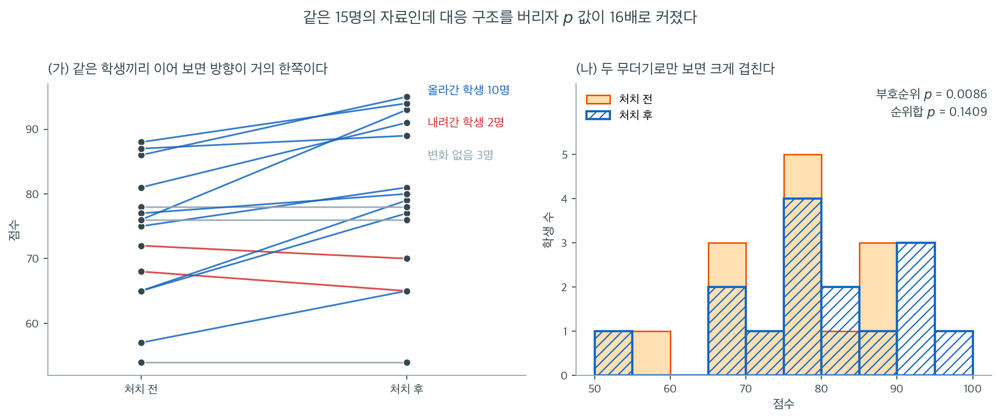
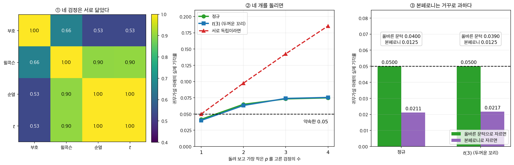

# 비모수 검정 모음

## 개요

이 페이지는 핵심 비모수 검정들을 하나의 참고 자료로 모아, 각 검정을 언제 쓰는지와
서로 어떻게 연결되는지를 정리한다. 비모수 방법은 분포 가정을 최소한으로만 한다 ---
대개 관측값이 독립이고 연속분포에서 나왔다는 것뿐이다. 정규성을 정당화할 수 없거나,
자료가 순서형이거나, 이상치가 우려될 때 없어서는 안 될 도구이다.

---

## 1. 비모수 검정의 분류

아래 표는 주요 검정을 실험설계에 따라 정리한 것이다.

| 설계 | 검정 | 사용하는 정보 |
|---|---|---|
| 일표본 / 대응 | 부호검정 | 차이의 부호 |
| 일표본 / 대응 | Wilcoxon 부호순위 | 차이의 부호순위 |
| 독립 이표본 | Wilcoxon 순위합 | 합친 표본의 순위 |
| 독립 이표본 | Mann--Whitney $U$ | 쌍별 비교 (순위합과 동치) |
| $k$개 독립표본 | Kruskal--Wallis $H$ | 합친 표본의 순위 |
| $k$개 독립표본 | Mood 중앙값검정 | 전체 중앙값 위/아래 도수 |
| 무작위성 | Wald--Wolfowitz 런 검정 | 이진 수열의 런 |

---

## 2. 가정을 덜어 낼 때마다 무엇을 잃는가

각 검정은 **일반성과 검정력 사이의 스펙트럼** 위에 놓인다. 가정을 하나 덜어 내면
쓰는 정보도 하나 줄어든다.

| 검정 | 가정 | 쓰는 정보 |
|:---|:---|:---|
| [부호검정](../one_sample_nonparametric/sign_test.md) | 독립·연속 | 부호만 |
| [Wilcoxon 부호순위](../one_sample_nonparametric/wilcoxon_signed_rank.md) | 차이가 대칭 | 부호 + 순위 |
| [순위합 / Mann-Whitney](../two_sample_nonparametric/mann_whitney.md) | 독립 두 표본 | 전체 순위 |
| [Kruskal-Wallis](../multi_group_nonparametric/kruskal_wallis.md) | 독립 $k$ 표본 | 집단별 순위합 |
| [Mood 중앙값검정](../multi_group_nonparametric/median_test.md) | 가장 약함 | 중앙값 위/아래 한 비트 |

각 통계량의 꼴과 귀무분포는 그 쪽들이 저마다 유도한다. 여기서 눈여겨볼 것은
**순서**다 — 아래로 내려갈수록 가정이 약해지고 쓰는 정보가 거칠어진다. 그 맞바꿈의
값을 수로 재는 것이 바로 앞 절 [모수적 검정과의 검정력 비교](power_comparison.md)이고,
**어느 자리에서 멈출지를 정하는 것**이 아래 $\S 3$ 이다.

---

## 3. 선택 지침

다음 흐름이 선택 과정을 요약한다.

1. **표본이 대응인가 독립인가?**
      - 대응 $\to$ 2단계로.
      - 독립 $\to$ 3단계로.
2. **대응: 차이의 분포가 대칭인가?**
      - 예 $\to$ Wilcoxon 부호순위 (더 강력).
      - 아니오 또는 모름 $\to$ 부호검정 (더 안전).
3. **독립: 집단이 몇 개인가?**
      - 두 집단 $\to$ Mann--Whitney $U$ 또는 Wilcoxon 순위합.
      - 셋 이상 $\to$ Kruskal--Wallis $H$ (또는 추가 로버스트성이 필요하면 Mood 중앙값검정).

<div class="exbox" markdown>

**보기 1.** <span class="diff easy" title="쉬움"></span> 꼬리가 무거우면 ARE 가 1 을 넘는다. 같은 대응자료 15쌍에 세 검정을 적용하면 p-값이 부호검정 $0.0209$, 부호순위검정 $0.0086$, 순위합검정 $0.1409$ 로 나온다.

**(1)** 셋 가운데 쓰면 안 되는 것은 무엇인가. 나머지 둘의 p-값 순서가 ARE $0.955$ 대 $0.637$ 로 **예측되는** 것인지 따져 보시오.

**(2)** 아래 "두꺼운 꼬리 분포에서는 ARE 가 1 을 넘는다" 를 수로 확인하시오. 대칭밀도 $f$, 분산 $\sigma^2$ 에서 윌콕슨 부호순위검정의 $t$ 검정 대비 ARE 는

$$
\text{ARE}(\text{윌콕슨}, t) = 12\,\sigma^2\left(\int_{-\infty}^{\infty} f(x)^2\,dx\right)^2
$$

이다. 정규·로지스틱·이중지수·균등에서 부호검정의 $4\sigma^2 f(0)^2$(연습문제 5)과 함께 계산하시오.

</div>

??? success "풀이"

    **(1) 순위합검정을 쓰면 안 되고, 나머지 둘의 순서는 ARE 가 보장하지 않는다.**

    자료는 같은 학생 15명을 처치 전후로 잰 **대응자료**다. `ranksums` 는 두 열을 서로 독립인 표본으로 보므로 짝 구조를 버린다. 그 $p = 0.1409$ 는 "보수적인 결과" 가 아니라 **잘못 적용한 검정의 값**이고, 다른 둘과 견줄 수 있는 수가 아니다.

    남은 둘의 순서는 조금 더 조심해야 한다. ARE 가 뜻하는 것은

    > **정규모집단에서**, 귀무가설로 수렴하는 **국소 대립가설** 열에 대해, **$n \to \infty$** 에서 같은 검정력을 얻는 데 필요한 표본크기의 비

    다. ARE $= 0.955$ 는 "윌콕슨이 $t$ 검정의 검정력에 맞추려면 관측값이 $1/0.955 = 1.047$ 배 필요하다" 는 뜻이고, $0.637$ 은 부호검정에 $1/0.637 = 1.571$ 배가 필요하다는 뜻이다. **세 조건이 모두 붙어 있다.**

    그러므로 ARE 는 **한 자료에서 어느 검정의 p-값이 작을지 보장하지 않는다.** 이 자료에서 부호순위검정이 이긴 것은 음의 차이 둘이 하필 가장 작은 쪽($-2$ 와 $-3$)이어서 $W^- = 11$ 로 작게 나왔기 때문이다. 같은 부호 구성에서 크기만 뒤바꾸면 부호검정의 p-값은 $0.0209$ 그대로인데 부호순위검정은 $0.1095$ 로 올라가 순서가 뒤집힌다([Wilcoxon 부호순위검정](../one_sample_nonparametric/wilcoxon_signed_rank.md) 보기 2 가 그 자료를 만든다).

    **(2) 분포를 바꾸면 ARE 가 1 을 넘는다.** 네 대칭분포에서 두 공식을 계산하면

    | 분포 | $\sigma^2$ | $f(0)$ | $\int f^2$ | 부호 ARE $= 4\sigma^2 f(0)^2$ | 윌콕슨 ARE $= 12\sigma^2(\int f^2)^2$ |
    |---|---|---|---|---|---|
    | 정규 $\mathcal N(0,1)$ | $1$ | $0.398942$ | $0.282095$ | $2/\pi = 0.636620$ | $3/\pi = 0.954930$ |
    | 로지스틱 | $\pi^2/3 = 3.289868$ | $1/4$ | $1/6$ | $\pi^2/12 = 0.822467$ | $\pi^2/9 = \mathbf{1.096623}$ |
    | 이중지수 | $2$ | $1/2$ | $1/4$ | $\mathbf{2.000000}$ | $\mathbf{1.500000}$ |
    | 균등 | $1/12$ | $1$ | $1$ | $1/3 = 0.333333$ | $1.000000$ |

    **정규분포는 $t$ 검정의 고향이므로 둘 다 1 아래다.** 그런데 꼬리를 무겁게 하면

    - **로지스틱**에서 윌콕슨 ARE 가 $\pi^2/9 = 1.0966$ 으로 **1 을 넘는다.** 정규보다 꼬리가 조금 두꺼운 것만으로도 순위검정이 $t$ 검정을 앞선다.
    - **이중지수**(라플라스)에서는 윌콕슨 $1.5$, 부호검정 $2.0$ 으로 **둘 다 1 을 넘고, 순서까지 뒤집힌다.** 부호검정이 윌콕슨보다 나아진다 — 이 분포에서 $f(0)$ 이 뾰족해 중앙값 근처의 정보가 가장 값지기 때문이다.
    - 반대로 **균등분포**에서는 꼬리가 아예 없어 부호검정이 $1/3$ 로 최악이 되고 윌콕슨은 정확히 $1$ 이다.

    이 네 줄이 비모수 검정을 쓰는 참된 이유를 말해 준다. **"정규성이 성립할 때 5% 손해" 는 최악의 경우이고, 꼬리가 조금만 무거워지면 손해가 이익으로 바뀐다.** 반면 $t$ 검정이 이기는 범위는 정규분포 주변으로 좁다.

    **수치적으로.**

    ```python
    import numpy as np
    from scipy import stats

    paired_data = np.array([
        [93, 76], [70, 72], [81, 75], [65, 68], [79, 65],
        [54, 54], [94, 88], [91, 81], [77, 65], [65, 57],
        [95, 86], [89, 87], [78, 78], [80, 77], [76, 76]
    ])

    post, pre = paired_data[:, 0], paired_data[:, 1]

    # 부호검정(정규근사)
    diffs = post - pre
    nonzero = diffs[diffs != 0]
    n_plus = (nonzero > 0).sum()
    n = len(nonzero)
    z_sign = (2 * n_plus - n) / np.sqrt(n)
    p_sign = 2 * stats.norm.cdf(-abs(z_sign))
    print(f"Sign test:          Z = {z_sign:.4f}, p = {p_sign:.4f}")
    # Sign test:          Z = 2.3094, p = 0.0209

    # Wilcoxon 부호순위검정
    stat_sr, p_sr = stats.wilcoxon(post, pre, alternative="two-sided",
                                    method="approx", zero_method="pratt")
    print(f"Signed-rank test:   W = {stat_sr}, p = {p_sr:.4f}")
    # Signed-rank test:   W = 11.0, p = 0.0086

    # Wilcoxon 순위합검정 — 이 대응자료에는 맞지 않는다. 견주어 보려고 싣는다
    stat_rs, p_rs = stats.ranksums(post, pre)
    print(f"Rank-sum test:      Z = {stat_rs:.4f}, p = {p_rs:.4f}")
    # Rank-sum test:      Z = 1.4725, p = 0.1409
    ```

    출력:

    ```
    Sign test:          Z = 2.3094, p = 0.0209
    Signed-rank test:   W = 11.0, p = 0.0086
    Rank-sum test:      Z = 1.4725, p = 0.1409
    ```

    | 검정 | $p$값 | 적절한가 |
    |:---|---:|:---|
    | Wilcoxon 부호순위 | $0.0086$ | 예 |
    | 부호검정 | $0.0209$ | 예 (더 보수적) |
    | Wilcoxon 순위합 | $0.1409$ | **아니오** |

    대응자료에 적절한 두 검정 중에서는 부호순위검정이 정보를 더 많이 쓰므로 $p$값이 작다.

    ```python
    from scipy import integrate

    cases = {
        "정규 N(0,1)": stats.norm(),
        "로지스틱": stats.logistic(),
        "이중지수": stats.laplace(),
        "균등 U(-.5,.5)": stats.uniform(loc=-0.5, scale=1),
    }
    print("분포              sigma^2      f(0)   int f^2   부호 ARE  윌콕슨 ARE")
    for name, dist in cases.items():
        var, f0 = dist.var(), dist.pdf(0)
        I, _ = integrate.quad(lambda x: dist.pdf(x) ** 2, -60, 60, limit=400)
        print(f"{name:<14} {var:>9.6f} {f0:>9.6f} {I:>9.6f}"
              f" {4 * var * f0 ** 2:>10.6f} {12 * var * I ** 2:>11.6f}")

    print(f"\n이론값: 2/pi = {2 / np.pi:.6f},  3/pi = {3 / np.pi:.6f},"
          f"  pi^2/12 = {np.pi ** 2 / 12:.6f},  pi^2/9 = {np.pi ** 2 / 9:.6f}")
    ```

    출력:

    ```
    분포              sigma^2      f(0)   int f^2   부호 ARE  윌콕슨 ARE
    정규 N(0,1)       1.000000  0.398942  0.282095   0.636620    0.954930
    로지스틱            3.289868  0.250000  0.166667   0.822467    1.096623
    이중지수            2.000000  0.500000  0.250000   2.000000    1.500000
    균등 U(-.5,.5)    0.083333  1.000000  1.000000   0.333333    1.000000
    
    이론값: 2/pi = 0.636620,  3/pi = 0.954930,  pi^2/12 = 0.822467,  pi^2/9 = 1.096623
    ```

    ```python
    rng = np.random.default_rng(0)
    B, m = 2000, 20
    delta = 0.5
    print(f"n = {m},  delta = {delta},  반복 {B} 회,  alpha = 0.05")
    print("분포        t 검정   윌콕슨   부호검정")
    for name, draw in (("정규", lambda: rng.normal(0, 1, m)),
                       ("이중지수", lambda: rng.laplace(0, 1, m))):
        p_t, p_w, p_s = [], [], []
        for _ in range(B):
            d = draw() + delta
            p_t.append(stats.ttest_1samp(d, 0).pvalue)
            p_w.append(stats.wilcoxon(d).pvalue)
            p_s.append(stats.binomtest(int((d > 0).sum()), m).pvalue)
        rate = lambda p: np.mean(np.array(p) < 0.05)
        print(f"{name:<9} {rate(p_t):>7.3f} {rate(p_w):>8.3f} {rate(p_s):>10.3f}")
    print(f"몬테카를로 오차 <= {np.sqrt(0.25 / B):.3f}")
    ```

    출력:

    ```
    n = 20,  delta = 0.5,  반복 2000 회,  alpha = 0.05
    분포        t 검정   윌콕슨   부호검정
    정규          0.566    0.552      0.392
    이중지수        0.348    0.406      0.385
    몬테카를로 오차 <= 0.011
    ```

    **네 분포의 ARE 가 이론값 $2/\pi$, $3/\pi$, $\pi^2/12$, $\pi^2/9$, 그리고 $2.0$, $1.5$, $1/3$, $1.0$ 과 소수 여섯째 자리까지 모두 맞는다.** 수치적분으로 구한 $\int f^2$ 가 로지스틱에서 $1/6$, 이중지수에서 $1/4$, 균등에서 $1$ 로 떨어지는 것도 확인된다.

    둘째 모의실험이 유한 $n$ 에서 그 역전을 보여 준다. **정규에서는 $t > $ 윌콕슨 $>$ 부호($0.566 / 0.552 / 0.392$)인데 이중지수에서는 $t$ 가 꼴찌로 내려간다($0.348$).** 다만 역전이 **절반만** 일어났다 — ARE 가 예측하는 "부호 $>$ 윌콕슨" 까지는 가지 않고 $0.385$ 대 $0.406$ 이다(몬테카를로 오차 $\pm 0.011$). 이상한 일이 아니다. **ARE 는 $\delta \to 0$, $n \to \infty$ 의 극한값이고 여기서는 $n = 20$, $\delta = 0.5$ 로 둘 다 극한과 멀기 때문이다.** 유한 $n$ 에서는 부호검정의 이산성 손실(기각역을 촘촘히 채울 수 없는 것)이 ARE 의 이득을 상당 부분 먹는다.

!!! danger "순위합검정의 $p$값은 비교 대상이 아니다"
    순위합검정의 $0.1409$가 가장 크다고 해서 "가장 보수적인 검정"이라고 읽으면
    안 된다. 이 검정은 **대응 구조를 버렸으므로 애초에 잘못 적용된 것**이다.
    학생 15명의 처치 전 점수와 후 점수는 독립이 아니다.

    대응자료를 독립표본으로 분석하면 개인차가 모두 잡음으로 들어가 검정력을 크게
    잃는다. 여기서는 그 손실이 $p$값 16배로 나타났다.



$p$값이 16배로 벌어진 이유는 같은 자료를 두 방식으로 그려 보면 바로 드러난다. 왼쪽 (가)는 학생 한 명을 선 하나로 이었고, 오른쪽 (나)는 그 선을 끊고 처치 전 15개와 처치 후 15개를 각각 한 무더기로 세었다.

(가)에서 눈에 들어오는 것은 **선의 방향이 거의 한쪽이라는 사실**이다. 올라간 학생이 10명, 내려간 학생이 2명, 변하지 않은 학생이 3명이다. 부호검정이든 부호순위검정이든 보는 것이 정확히 이 방향이고, $10$ 대 $2$는 우연으로 설명하기 어렵다. 차이의 평균은 $5.47$점이고 차이의 표준편차는 $6.12$점이라 신호 대 잡음비가 $5.47 / 6.12 \approx 0.89$로 꽤 크다.

(나)에서는 그 신호가 사라진다. 두 히스토그램이 $65$점부터 $95$점까지 거의 완전히 겹친다. 당연하다. 학생들의 **원래 실력 차이**가 $54$점부터 $95$점까지 $40$점 넘게 퍼져 있어서, 모두가 공유한 $5.5$점의 상승분을 완전히 덮어 버리기 때문이다. 순위합검정이 보는 것은 이 겹친 두 무더기뿐이므로 $p = 0.1409$가 나온다. 반면 부호순위검정은 학생 개개인을 자기 자신과 비교해 실력 차이를 애초에 소거하므로 $p = 0.0086$에 이른다.

대응설계의 가치가 여기에 있다. 대응은 "자료를 두 번 재는 번거로운 방법"이 아니라 **개인차라는 가장 큰 잡음원을 차이 계산 한 번으로 제거하는 장치**이다. 그 구조를 분석에서 버리면 설계로 벌어 둔 검정력을 고스란히 반납하게 된다. 이 자료에서는 그 값이 $p$값 16배였다.

---

## 4. 비모수가 무가정은 아니다

- **비모수 $\neq$ 무가정.** 모든 검정이 여전히 독립성을 요구한다. 부호순위검정은
  대칭성을 추가로 요구한다. Kruskal--Wallis는 집단 분포의 모양이 같지 않으면
  위치 이동만이 아니라 임의의 분포적 차이를 검정한다.
- **점근상대효율(ARE).** 정규성 아래에서 Wilcoxon 부호순위검정의 대응 $t$ 검정 대비
  ARE는 $3/\pi \approx 0.955$로 검정력 손실이 매우 작다. 두꺼운 꼬리 분포에서는
  ARE가 $1$을 넘는다.
- **다중비교.** Kruskal--Wallis가 $H_0$을 기각하면 사후 쌍별 검정(예: Dunn 검정)에
  Bonferroni나 Holm 보정을 적용하여 어느 집단이 다른지 밝힌다.

<div class="aibox" markdown>

**AI로 보는 통계학 1.** 넷을 다 돌려 보고 가장 작은 것을 고르면

이 쪽은 같은 물음에 쓸 수 있는 검정을 여럿 늘어놓는다. 그러면 유혹이 하나 생긴다 — **다 돌려 보고 가장 작은 $p$ 를 고르는 것.** 바로 위 「다중비교」 항목은 비교할 **집단**이 여럿일 때를 말하는데, 여기서 말하는 것은 다른 종류다. 집단은 하나이고 **검정이** 여럿이다.

일표본·대응 자료($n = 20$)에 네 검정을 걸었다 — 부호검정, 윌콕슨 부호순위검정, 대응 순열검정, 일표본 $t$ 검정. 귀무가설이 **참인** 자료로 $20{,}000$ 번 되풀이했다.



**① 넷은 서로 닮았다.**

| | 부호 | 윌콕슨 | 순열 | $t$ |
|---|---|---|---|---|
| 부호 | $1.00$ | $0.66$ | $0.53$ | $0.53$ |
| 윌콕슨 | | $1.00$ | $0.90$ | $0.90$ |
| 순열 | | | $1.00$ | $\mathbf{1.00}$ |

**순열검정과 $t$ 검정의 $p$ 값 상관이 $0.999$ 다.** 유도도 가정도 다른 두 검정이 $n = 20$ 의 정규자료에서는 사실상 같은 답을 낸다. 부호검정만 $0.53$ 으로 떨어져 있는데, 크기를 버리고 부호만 보기 때문이다. 「네 가지 검정」이라 적혀 있지만 실질은 **두 가지에 가깝다.**

**② 그래서 가장 작은 것을 고르면**

| 돌린 검정 수 | $1$ | $2$ | $3$ | $4$ |
|---|---|---|---|---|
| 실제 기각률 (정규) | $0.042$ | $0.065$ | $0.073$ | $\mathbf{0.075}$ |
| 실제 기각률 ($t_3$) | $0.040$ | $0.063$ | $0.074$ | $0.076$ |
| 서로 독립이라면 | $0.050$ | $0.098$ | $0.143$ | $0.186$ |

$0.05$ 가 $0.075$ 가 된다 — **일 점 오 배**다. 가볍지 않지만 독립이라 가정했을 때의 $0.186$ 과는 거리가 멀다. ①이 그 까닭이다. **닮은 검정을 여럿 돌리는 것은 그만큼 새 기회를 주지 않는다.** 꼬리가 두꺼운 $t_3$ 자료에서도 거의 같은 수가 나온다.

(검정 하나만 돌릴 때 $0.042$ 인 것은 부호검정이 이산이라 $n = 20$ 에서 $0.05$ 를 정확히 맞출 수 없기 때문이다.)

**③ 본페로니는 거꾸로 과하다.** $0.05/4 = 0.0125$ 에서 자르면 실제 크기가 $\mathbf{0.021}$ 로 명목의 절반도 되지 않는다. 닮은 검정에 독립을 전제한 보정을 씌웠으니 지나치게 잘린다. 올바른 문턱은 **최소 $p$ 의 귀무분포에서 바로 읽으면** 되고, 여기서는 $0.0400$ 이다. 순열로 그 분포를 만들 수 있다. $0.0125$ 와 $0.0400$ 은 세 배 넘게 차이 난다.

정리하면 셋이다.

- **검정은 자료를 보기 전에 고른다.** 네 검정은 서로 다른 가정을 쓰므로 자료에 맞는 것을 고르는 데는 근거가 필요한데, 그 근거를 **같은 자료에서** 가져오면 안 된다. 위 $\S 3$ 의 선택 지침이 그래서 있다.
- **그래도 여럿을 보고 싶다면 「무엇이 갈리는가」를 본다.** 넷이 같은 쪽을 가리키면 결론이 든든하다. 갈린다면 그 자체가 정보다 — ①에서 부호검정만 멀리 떨어져 있으니, **부호검정만 기각한다면 크기가 아니라 부호 쪽에 신호가 있다**는 뜻이다. 가장 작은 $p$ 를 고르는 것과 갈림을 읽는 것은 전혀 다른 일이다.
- **보정이 필요하면 본페로니 대신 최소 $p$ 의 순열분포를 쓴다.** 검정들이 닮을수록 본페로니의 손해가 커진다.

</div>

---

## 연습문제

<div class="drillbox" markdown>

**연습문제 1.** <span class="diff easy" title="쉬움"></span> 독립인 세 집단이 다음 자료를 냈다.

- 집단 A: $5, 8, 12, 15$
- 집단 B: $7, 11, 14, 18, 20$
- 집단 C: $3, 6, 9$

Kruskal--Wallis 검정과 Mood 중앙값검정을 파이썬으로 수행하고 $p$값을 비교하라.

</div>

??? success "풀이"

    ```python
    from scipy import stats

    a = [5, 8, 12, 15]
    b = [7, 11, 14, 18, 20]
    c = [3, 6, 9]

    print(stats.kruskal(a, b, c))
    # KruskalResult(statistic=4.0295, pvalue=0.13335)

    r = stats.median_test(a, b, c)
    print(r.statistic, r.pvalue, r.median)
    print(r.table)
    # 4.8  0.09072  10.0
    # [[2 4 0]
    #  [2 1 3]]
    ```

    출력:

    ```
    KruskalResult(statistic=4.029487179487184, pvalue=0.13335459246779172)
    4.8 0.0907179532894125 10.0
    [[2 4 0]
     [2 1 3]]
    ```

    | 검정 | 통계량 | $p$값 |
    |:---|---:|---:|
    | Kruskal--Wallis | $H = 4.029$ | $0.1334$ |
    | Mood 중앙값 | $\chi^2 = 4.800$ | $0.0907$ |

    **놀랍게도 Mood 중앙값검정의 $p$값이 더 작다.** "Kruskal--Wallis가 언제나 더
    강력하다"는 통념이 이 자료에서는 성립하지 않는다.

    이유는 이 자료의 구조에 있다. 전체 중앙값은 $10$이고, 집단 C는 값이 $3, 6, 9$로
    **전부 중앙값 아래**이다. Mood 검정에게 이는 매우 강한 신호이다($0$ 대 $3$).
    반면 Kruskal--Wallis는 집단 C의 순위가 $1, 2, 4$로 낮긴 하지만 집단 A의
    $3, 5, 8, 10$과 상당히 겹친다는 것도 함께 본다.

    더 근본적으로, 표본이 $4, 5, 3$으로 매우 작아 두 검정 모두 $\chi^2$ 근사가
    믿을 만하지 않다. 이 크기에서 $p$값의 순서를 두고 검정력을 논하는 것은
    무리이다.

    **교훈:** "검정 A가 검정 B보다 강력하다"는 진술은 언제나 **분포와 대립가설의
    종류에 대한 평균**을 두고 하는 말이다. 개별 자료에서는 어느 쪽이든 이길 수 있다.
    자료를 본 뒤 $p$값이 작은 검정을 고르면 실제 유의수준이 명목값을 크게 넘는다.
    $\square$

---

<div class="drillbox" markdown>

**연습문제 2.** <span class="diff med" title="중간"></span> 한 연구자가 대응 관측값 12개를 갖고 있는데 차이가 대칭인지 확신할 수
없다. 부호검정과 Wilcoxon 부호순위검정 중 무엇을 써야 하는가? 근거와 맞교환을 설명하라.

</div>

??? success "풀이"

    **부호검정**을 써야 한다. Wilcoxon 부호순위검정은 $H_0$ 아래에서 차이의 분포가
    중앙값을 중심으로 대칭임을 요구한다. 이 가정이 깨지면 $W^+$의 귀무분포가 틀리고
    제1종 오류가 부풀려질 수 있다.

    맞교환은 **검정력**이다. 부호검정은 차이의 부호만 쓰고 크기 정보를 버리므로,
    대칭성이 실제로 성립한다면 검정력이 낮다. 그러나 이 경우에는 연구자가 대칭성을
    확인할 수 없으므로 제1종 오류를 통제하는 안전성이 검정력보다 중요하다.

    표본이 더 크다면 차이의 히스토그램으로 대칭성을 평가한 뒤 부호순위검정으로
    바꿀 수 있다. 다만 $n = 12$로는 히스토그램으로 대칭성을 판정하기 어렵다.
    맥락 지식(예: "이 측정값은 바닥효과가 있어 차이가 오른쪽으로 치우친다")이
    있다면 그것이 더 믿을 만한 근거이다. $\square$

---

<div class="drillbox" markdown>

**연습문제 3.** <span class="diff med" title="중간"></span> Kruskal--Wallis가 단순한 중앙값 검정이 아닌 이유를 설명하라.
실제로 무엇을 검정하며, 어떤 추가 가정 아래에서 위치이동 검정이 되는가?

</div>

??? success "풀이"

    Kruskal--Wallis 검정의 귀무가설은 $H_0{:}\; F_1 = F_2 = \cdots = F_k$,
    즉 모든 집단이 같은 분포에서 왔다는 것이다. 이는 **분포의 동일성**에 대한
    검정이지 중앙값이 같은지에 대한 검정이 아니다. $H_0$을 기각한다는 것은
    집단들이 위치, 척도, 모양 또는 그 조합에서 다르다는 뜻일 수 있다.

    분포들이 위치만 다르다는 **위치이동 가정**($F_j(x) = F(x - \mu_j)$, $F$는 공통 모양)을
    추가하면 분포가 다를 수 있는 유일한 통로가 평균/중앙값이 되므로, 이 경우
    Kruskal--Wallis가 중앙값(또는 평균) 동일성 검정이 된다.

    위치이동 가정이 없으면 유의한 Kruskal--Wallis 결과가 중심이 아니라 산포의
    차이를 반영할 수 있고, 이를 중앙값 검정으로 해석하는 연구자를 오도한다.

    [Kruskal-Wallis](../multi_group_nonparametric/kruskal_wallis.md) 연습문제 1에서
    이를 정량적으로 확인했다. 중앙값이 모두 정확히 0이지만 왜도가 다른 세 집단에서
    $n = 100$일 때 기각률이 $0.614$까지 올라간다. $\square$

---

<div class="drillbox" markdown>

**연습문제 4.** <span class="diff med" title="중간"></span> Kruskal--Wallis 결과가 유의한 뒤 어느 쌍이 다른지 알고 싶다.
Dunn 검정을 기술하고 다중비교 보정이 왜 필요한지 설명하라.

</div>

??? success "풀이"

    **Dunn 검정**은 원래의 Kruskal--Wallis 합친 순위에서 얻은 평균순위를 이용해
    $\binom{k}{2}$개의 모든 집단 쌍을 비교한다. 평균순위가 $\bar{R}_i$, $\bar{R}_j$인
    집단 $i$와 $j$에 대해

    $$
    Z_{ij} = \frac{\bar{R}_i - \bar{R}_j}{\sqrt{\frac{N(N+1)}{12}\left(\frac{1}{n_i} + \frac{1}{n_j}\right)}}
    $$

    이며 $N$은 전체 표본크기이다. 각 $Z_{ij}$를 표준정규분포와 비교한다.

    **다중비교 보정**(Bonferroni, Holm, Benjamini--Hochberg 등)이 필요한 이유는
    $\binom{k}{2}$개의 검정을 수행하면 집단별 오류율이 부풀려지기 때문이다.
    $m$개의 쌍을 각각 유의수준 $\alpha$로 검정하면 검정들이 독립일 때 적어도 하나가
    거짓 기각될 확률이 $1 - (1 - \alpha)^m$까지 올라간다.

    | $k$ | $m = \binom{k}{2}$ | 보정 없는 FWER |
    |---:|---:|---:|
    | 3 | 3 | $0.143$ |
    | 5 | 10 | $0.401$ |
    | 8 | 28 | $0.762$ |

    $k = 8$이면 모든 집단이 동일해도 76%의 확률로 "유의한" 쌍을 하나 이상 찾게 된다.

    Bonferroni 보정은 각 쌍별 검정에 $\alpha/m$을 쓰므로 전체 집단별 오류율을
    $\alpha$ 이하로 보장한다. Holm 절차는 FWER을 똑같이 통제하면서 균일하게 더
    강력하므로 대체로 더 낫다.

    !!! note "Dunn 검정의 쌍은 독립이 아니다"
        위 표의 $1 - (1-\alpha)^m$은 검정들이 **독립일 때**의 값이다. Dunn 검정의
        쌍별 비교는 같은 순위를 공유하므로 서로 상관되어 있고, 실제 FWER은 이보다
        낮다. 그럼에도 보정 없이는 $\alpha$를 넘으므로 보정이 필요하다.
        Bonferroni는 독립 여부와 무관하게 유효하다는 것이 그 장점이다. $\square$

---

<div class="drillbox" markdown>

**연습문제 5.** <span class="diff hard" title="어려움"></span> 정규성 아래에서 부호검정의 일표본 $t$ 검정 대비 점근상대효율이
$2/\pi \approx 0.637$임을 보여라.

</div>

??? success "풀이"

    ARE는 두 검정의 **효능**(efficacy) 제곱의 비이다. 검정통계량 $T_n$의 효능은

    $$
    c = \lim_{n \to \infty} \frac{\frac{d}{d\delta}\operatorname{E}_\delta[T_n]\big|_{\delta=0}}{\sqrt{n \operatorname{Var}_0(T_n)}}
    $$

    으로 정의된다.

    **$t$ 검정.** $T_n = \bar{D}$이고 $\operatorname{E}_\delta[\bar D] = \delta$이므로
    미분값이 $1$이다. $\operatorname{Var}_0(\bar D) = \sigma^2/n$이므로

    $$
    c_t = \frac{1}{\sqrt{n \cdot \sigma^2/n}} = \frac{1}{\sigma}.
    $$

    **부호검정.** $T_n = \hat{p} = n_+/n$이라 하자. $D_i \sim \mathcal{N}(\delta, \sigma^2)$이면

    $$
    \operatorname{E}_\delta[\hat p] = P(D_i > 0) = \Phi\!\left(\frac{\delta}{\sigma}\right)
    $$

    이고, $\delta = 0$에서 미분하면

    $$
    \frac{d}{d\delta}\Phi\!\left(\frac{\delta}{\sigma}\right)\bigg|_{\delta=0}
    = \frac{1}{\sigma}\varphi(0) = \frac{1}{\sigma\sqrt{2\pi}} = f(0)
    $$

    이다($f$는 $D_i$의 밀도함수). $\operatorname{Var}_0(\hat p) = 1/(4n)$이므로

    $$
    c_{\text{sign}} = \frac{f(0)}{\sqrt{n \cdot 1/(4n)}} = 2 f(0) = \frac{2}{\sigma\sqrt{2\pi}}.
    $$

    **ARE.**

    $$
    \text{ARE}(\text{부호}, t) = \left(\frac{c_{\text{sign}}}{c_t}\right)^2
    = \left(\frac{2/(\sigma\sqrt{2\pi})}{1/\sigma}\right)^2
    = \frac{4}{2\pi} = \frac{2}{\pi} \approx 0.637. \quad \square
    $$

    일반적으로 밀도 $f$와 표준편차 $\sigma$를 갖는 대칭분포에서
    $\text{ARE}(\text{부호}, t) = 4\sigma^2 f(0)^2$이다. 이 공식이 유용한 것은
    다른 분포에서도 바로 계산할 수 있기 때문이다.

    | 분포 | $\sigma^2$ | $f(0)$ | ARE |
    |:---|:---:|:---:|---:|
    | Normal | $1$ | $1/\sqrt{2\pi} = 0.3989$ | $0.637$ |
    | Laplace ($\text{Var} = 1$) | $1$ | $1/\sqrt{2} = 0.7071$ | $2.000$ |
    | Uniform$(-\sqrt3, \sqrt3)$ | $1$ | $1/(2\sqrt3) = 0.2887$ | $0.333$ |

    라플라스에서 부호검정이 $t$ 검정보다 **두 배 효율적**임에 주목하라. 꼬리가
    두꺼울수록 $f(0)$이 커지고 부호검정이 유리해진다.

---

<div class="drillbox" markdown>

**연습문제 6.** <span class="diff hard" title="어려움"></span> [부호검정](../one_sample_nonparametric/sign_test.md)의 통계량 $Z_{\text{sign}} = (2n_+ - n)/\sqrt{n}$ 을 작은 $n$ 에서 정확분포와 맞대 보자. 차이가 $0$ 인 쌍은 없다고 하고 양측 $\alpha = 0.05$ 를 쓴다.

**(1)** 자료가 어떻게 나오든 부호검정이 $H_0$ 을 **결코 기각할 수 없는** 가장 큰 $n$ 을 구하라. 기각이 가능해지는 가장 작은 $n$ 에서 기각역과 그 검정의 정확한 유의수준을 적어라.

**(2)** 그 가장 작은 $n$ 에서 모든 차이가 양수로 나왔다고 하자. 정확 양측 p-값과 $Z_{\text{sign}}$ 의 정규근사 p-값을 구해 비교하라. 근사는 보수적인가 과감한가.

**(3)** 연속성 수정 $Z_c = (\lvert 2n_+ - n \rvert - 1)/\sqrt{n}$ 을 쓰면 (2) 가 어떻게 달라지는가. 또 $n = 5$ 에서 모든 차이가 양수인 자료를 수정 없는 근사와 수정한 근사로 각각 판정해 보고, 작은 $n$ 에서 수정을 빼면 무슨 일이 생기는지 한 줄로 말하라.

필요한 정규꼬리값: $\Phi(-2.449490) = 0.0071529$, $\Phi(-2.041241) = 0.0206134$, $\Phi(-2.236068) = 0.0126737$, $\Phi(-1.788854) = 0.0368192$.

</div>

??? success "풀이"

    **(1) 결코 기각할 수 없는 가장 큰 $n$ 은 $5$, 기각이 가능해지는 가장 작은 $n$ 은 $6$ 이다.**

    $H_0$ 아래에서 $n_+ \sim \text{Bin}(n, 1/2)$ 이다. 양측검정의 기각역은 양쪽 꼬리를 대칭으로 잡으므로, 가장 작은 기각역은 두 극단점 $\{0, n\}$ 뿐인 것이고 그 확률은

    $$
    P(n_+ = 0) + P(n_+ = n) = \frac{2}{2^n} = 2^{-(n-1)}.
    $$

    기각역이 하나라도 있으려면 이 값이 $0.05$ 이하여야 하므로

    $$
    2^{-(n-1)} \le 0.05 \iff 2^{\,n-1} \ge 20 \iff n - 1 \ge 5 \iff n \ge 6.
    $$

    $n = 5$ 에서는 $2/32 = 0.0625 > 0.05$ 라 **모든 차이가 한 방향이어도** 기각할 수 없다. $n = 6$ 에서 기각역은 $n_+ \in \{0, 6\}$ 이고 정확한 유의수준은 $2/64 = 0.03125$ 다. 명목 $0.05$ 를 쓴다고 했지만 실제로 쓰는 수준은 $0.031$ 이다 — 순위·부호 통계량이 이산이라 수준을 꽉 채울 수 없다.

    **(2) 정규근사가 정확 p-값의 절반도 안 되게 나온다 — 과감한 쪽으로 틀린다.**

    $n = 6$, $n_+ = 6$ 에서 정확 양측 p-값은

    $$
    2\,P(n_+ \ge 6) = 2 \cdot \frac{1}{64} = \frac{1}{32} = 0.03125.
    $$

    본문 공식은

    $$
    Z_{\text{sign}} = \frac{2 \cdot 6 - 6}{\sqrt{6}} = \frac{6}{2.449490} = 2.449490,
    \qquad p = 2\,\Phi(-2.449490) = 0.014306
    $$

    을 준다. 비는 $0.03125 / 0.014306 = 2.18$ 로, **근사 p-값이 정확 p-값의 절반에도 못 미친다.** p-값을 작게 말하는 것은 **과감(anti-conservative)** 한 오류다. 명목 $0.05$ 로 검정하면 실제 제1종 오류율이 명목값을 넘는다.

    **(3) 연속성 수정이 방향을 바로잡는다.**

    $n = 6$, $n_+ = 6$ 에서

    $$
    Z_c = \frac{6 - 1}{\sqrt{6}} = \frac{5}{2.449490} = 2.041241,
    \qquad p = 2\,\Phi(-2.041241) = 0.041227.
    $$

    이제 $0.041227 > 0.03125$ 로 **보수적인 쪽**으로 넘어갔고, 정확값과의 비가 $2.18$ 에서 $1.32$ 로 줄었다. 틀리는 방향이 안전한 쪽으로 바뀐 것이 더 중요하다.

    $n = 5$, $n_+ = 5$ 를 두 근사로 판정하면 갈림이 더 극적이다.

    | 방법 | 통계량 | p-값 | $\alpha = 0.05$ 판정 |
    |:---|---:|---:|:---|
    | 정확(이항) | --- | $2/32 = 0.062500$ | 기각 못 함 |
    | 수정 없는 근사 | $Z = 5/\sqrt5 = 2.236068$ | $0.025347$ | **기각** |
    | 연속성 수정 | $Z_c = 4/\sqrt5 = 1.788854$ | $0.073638$ | 기각 못 함 |

    (1) 에서 본 대로 $n = 5$ 에서는 **어떤 자료로도 기각이 불가능**하다. 그런데 수정 없는 정규근사는 $p = 0.0253$ 이라며 기각하라고 말한다. 연속성 수정은 $0.0736$ 으로 정확한 결론과 같은 쪽을 가리킨다.

    한 줄로: $n_+$ 는 격자점 위의 이산변수인데 정규곡선은 그 막대의 절반을 꼬리 쪽으로 더 세므로, 수정을 빼면 작은 $n$ 에서 p-값이 **조직적으로** 작아져 없는 유의성을 만들어낸다. $n$ 이 작을 때는 근사를 쓸 까닭이 아예 없다 — $2^n$ 을 전수 열거하는 이항 정확검정이 공짜로 끝난다.

    설계 쪽 교훈도 하나 있다. **대응 5 쌍으로 연구를 설계하면 부호검정으로는 어떤 결과가 나와도 유의할 수 없다.** 자료를 모으기 전에 세어 볼 일이다. $\square$

---

<div class="drillbox" markdown>

**연습문제 7.** <span class="diff hard" title="어려움"></span> [Kruskal-Wallis 검정](../multi_group_nonparametric/kruskal_wallis.md)의 $H$ 공식에는 동점 보정항이 없다. 다음 자료로 그 자리를 짚어 보자.

- 집단 A: $1, 2, 3$
- 집단 B: $3, 3, 5$
- 집단 C: $3, 6, 7$

**(1)** 중간순위를 매겨 $R_A, R_B, R_C$ 를 구하고 그 $H$ 공식으로 계산하라.

**(2)** 동점 보정판

$$
H' = \frac{H}{1 - \dfrac{\sum_i (t_i^3 - t_i)}{N^3 - N}}
$$

($t_i$ 는 $i$ 번째 동점 묶음의 크기)으로 $H'$ 를 구하고, $\chi^2_2$ 로 두 p-값을 비교하라. 자유도 $2$ 에서는 $P(\chi^2_2 > h) = e^{-h/2}$ 다.

**(3)** 보정을 빼먹으면 검정이 보수적이 되는가 과감해지는가. 일반적으로 증명하고, 동점이 없으면 보정항이 $1$ 이 됨을 확인하라. 또 이 자료에서 보정항이 **순위의 편차제곱합의 비**와 정확히 같음을 수로 보여라.

**(4)** 동점이 있으면 무동점 가정으로 만든 정확분포표를 쓸 수 없다. 그럼에도 정확검정을 하려면 무엇을 몇 가지 열거해야 하는가.

</div>

??? success "풀이"

    **(1) $H = 4.422222$.**

    합친 자료를 정렬하면 $1, 2, 3, 3, 3, 3, 5, 6, 7$ 로 $N = 9$ 다. 값 $3$ 이 네 개로 $3, 4, 5, 6$ 번 자리를 차지하므로 중간순위는 $(3+4+5+6)/4 = 4.5$ 다.

    | 값 | 1 | 2 | 3 | 3 | 3 | 3 | 5 | 6 | 7 |
    |:---|---:|---:|---:|---:|---:|---:|---:|---:|---:|
    | 순위 | $1$ | $2$ | $4.5$ | $4.5$ | $4.5$ | $4.5$ | $7$ | $8$ | $9$ |

    집단별로 모으면 $R_A = 1 + 2 + 4.5 = 7.5$, $R_B = 4.5 + 4.5 + 7 = 16$, $R_C = 4.5 + 8 + 9 = 21.5$ 이고 합이 $45 = N(N+1)/2$ 로 맞는다. 2절 공식에 넣으면

    $$
    H = \frac{12}{9 \cdot 10}\left(\frac{7.5^2 + 16^2 + 21.5^2}{3}\right) - 3 \cdot 10
    = \frac{2}{15} \cdot \frac{774.5}{3} - 30 = 34.422222 - 30 = 4.422222.
    $$

    **(2) $H' = 4.824242$ 로 올라가고 p-값이 $0.10$ 아래로 내려간다.**

    동점 묶음은 크기 $t_1 = 4$ 하나뿐이므로 $\sum (t_i^3 - t_i) = 64 - 4 = 60$ 이고 $N^3 - N = 729 - 9 = 720$ 이다. 보정항은

    $$
    1 - \frac{60}{720} = 1 - \frac{1}{12} = \frac{11}{12} = 0.916667,
    \qquad H' = 4.422222 \cdot \frac{12}{11} = 4.824242.
    $$

    | 통계량 | 값 | $p = e^{-h/2}$ |
    |:---|---:|---:|
    | $H$ (보정 없음) | $4.422222$ | $e^{-2.211111} = 0.109579$ |
    | $H'$ (동점 보정) | $4.824242$ | $e^{-2.412121} = 0.089625$ |

    보정 하나로 p-값이 $0.1096$ 에서 $0.0896$ 으로 내려가 $0.10$ 선을 가로지른다. `scipy.stats.kruskal` 은 보정판을 돌려주므로 $4.824242$ 를 내놓는다 — **2절 공식과 라이브러리가 어긋나는 자리가 바로 여기다.**

    **(3) 보정을 빼먹으면 보수적이 된다.**

    $t \ge 1$ 에서 $t^3 - t \ge 0$ 이고, 크기 $t_i \ge 2$ 인 묶음이 하나라도 있으면 $\sum (t_i^3 - t_i) > 0$ 이다. 따라서 분모가 $1$ 보다 **작고** $H' > H$ 다. $\chi^2$ 꼬리확률은 감소함수이므로 $H$ 를 쓰면 p-값이 커진다. 곧 **보정을 빼먹은 검정은 과소 기각하는 보수적인 검정**이다(제1종 오류가 부풀지는 않으니 안전한 쪽으로 틀리지만, 검정력을 공짜로 버린다). 모든 $t_i = 1$ 이면 $t_i^3 - t_i = 0$ 이라 보정항이 정확히 $1$ 이고 $H' = H$ 다.

    왜 그런지는 순위의 분산을 보면 드러난다. $H$ 의 분모에는 **동점이 없을 때의** 순위 분산이 박혀 있는데, 중간순위를 쓰면 순위가 가운데로 몰려 실제 분산이 그보다 작아진다. 이 자료에서 두 편차제곱합을 세어 보면

    $$
    \sum_{i=1}^{9}\left(r_i - 5\right)^2 = 16 + 9 + 4 \cdot 0.25 + 4 + 9 + 16 = 55,
    \qquad \frac{N(N^2-1)}{12} = \frac{9 \cdot 80}{12} = 60
    $$

    이고 $55/60 = 11/12$ 로 **보정항과 정확히 같다.** 보정은 "분산을 과대평가한 만큼 통계량을 되돌리는" 일을 한다.

    **(4) 중간순위 벡터를 고정하고 집단 배정을 열거한다.**

    동점이 있으면 순위 벡터가 $1, \dots, N$ 의 순열이 아니므로($4.5$ 가 네 번 나온다) 무동점 가정으로 만든 정확분포표나 `method="exact"` 를 쓸 수 없다. 그러나 귀무가설 "세 분포가 같다" 아래에서는 **관측된 중간순위 묶음을 그대로 두고 어느 셋이 A, 어느 셋이 B 인지만 뒤섞는 것**이 여전히 등확률이다. 그 가짓수는

    $$
    \binom{9}{3}\binom{6}{3}\binom{3}{3} = 84 \cdot 20 \cdot 1 = 1680
    $$

    이고, 이 $1680$ 개 배정마다 $H$ 를 계산해 관측값 이상인 비율을 세면 동점이 있어도 **정확한** p-값이 된다. 동점은 $\chi^2$ 근사를 망가뜨리는 것이지 순열검정을 막는 것이 아니다. $\square$

---

<div class="drillbox" markdown>

**연습문제 8.** <span class="diff hard" title="어려움"></span> 연습문제 1 의 자료(A: $5, 8, 12, 15$ / B: $7, 11, 14, 18, 20$ / C: $3, 6, 9$)에 연습문제 4 의 Dunn 검정을 끝까지 적용해 보자. 동점은 없다.

**(1)** 합친 순위로 $\bar R_A, \bar R_B, \bar R_C$ 를 구하고 세 쌍의 $Z_{ij}$ 와 보정하지 않은 양측 p-값을 구하라. 필요한 값은 $\Phi(-0.971605) = 0.1656235$, $\Phi(-1.059148) = 0.1447662$, $\Phi(-2.000160) = 0.0227415$ 다.

**(2)** Bonferroni 와 Holm 보정을 적용하라. 연습문제 1 에서 얻은 $H$ 의 p-값 $0.1334$ 와 견주어, 보정하지 않은 쌍별 p-값 하나가 $0.05$ 아래로 나온 것을 어떻게 읽어야 하는지 쓰라.

**(3)** Dunn 의 표준오차에 집단 내 순위의 표본분산이 아니라 상수 $\frac{N(N+1)}{12}$ 가 들어가는 까닭을 유도하라. ($H_0$ 아래에서 순위 배정이 무엇인지 생각하고, 유한모집단에서 비복원추출의 분산·공분산을 쓰라.)

</div>

??? success "풀이"

    **(1) 세 쌍 가운데 B--C 만 보정 없이 $0.05$ 아래다.**

    합친 자료를 정렬하면 $3_C, 5_A, 6_C, 7_B, 8_A, 9_C, 11_B, 12_A, 14_B, 15_A, 18_B, 20_B$ 로 순위가 차례대로 $1$ 부터 $12$ 다. 집단별로 모으면

    | 집단 | 순위 | $R_j$ | $n_j$ | $\bar R_j$ |
    |:---|:---|---:|---:|---:|
    | A | $2, 5, 8, 10$ | $25$ | $4$ | $6.250000$ |
    | B | $4, 7, 9, 11, 12$ | $43$ | $5$ | $8.600000$ |
    | C | $1, 3, 6$ | $10$ | $3$ | $3.333333$ |

    합이 $78 = 12 \cdot 13 / 2$ 로 맞는다. $N = 12$ 이므로 $\frac{N(N+1)}{12} = \frac{12 \cdot 13}{12} = 13$ 이다.

    | 쌍 | $\bar R_i - \bar R_j$ | $\frac1{n_i}+\frac1{n_j}$ | 표준오차 | $Z_{ij}$ | 양측 p |
    |:---|---:|---:|---:|---:|---:|
    | A--B | $-2.350000$ | $9/20 = 0.45$ | $\sqrt{5.85} = 2.418677$ | $-0.971605$ | $0.331247$ |
    | A--C | $2.916667$ | $7/12 = 0.583333$ | $\sqrt{7.583333} = 2.753785$ | $1.059148$ | $0.289532$ |
    | B--C | $5.266667$ | $8/15 = 0.533333$ | $\sqrt{6.933333} = 2.633122$ | $2.000160$ | $0.045483$ |

    **(2) 보정하면 아무것도 유의하지 않다.**

    Bonferroni 는 각 p-값에 $m = \binom{3}{2} = 3$ 을 곱한다.

    | 쌍 | 보정 없는 p | Bonferroni | Holm |
    |:---|---:|---:|---:|
    | B--C | $0.045483$ | $0.136449$ | $0.136449$ |
    | A--C | $0.289532$ | $0.868597$ | $0.579065$ |
    | A--B | $0.331247$ | $0.993741$ | $0.579065$ |

    Holm 은 p-값을 작은 것부터 세워 $3, 2, 1$ 을 차례로 곱하고 단조화한다. 가장 작은 $0.045483 \times 3 = 0.136449$ 이 이미 $0.05$ 를 넘으므로 Holm 은 **첫 단계에서 멈추고** 아무 쌍도 기각하지 않는다.

    **이것이 올바른 결론이다.** 보정 없는 $0.045483$ 은 "발견" 이 아니다. 세 쌍을 모두 들여다본 뒤 가장 작은 것을 집어 든 수이므로 집단별 오류율을 통제하지 않는다. 보정한 $0.1365$ 가 옴니버스 p-값 $0.1334$ 와 거의 같은 자리에 떨어지는 것은 우연이 아니다 — 둘 다 "이 자료에는 세 집단이 다르다고 말할 증거가 없다" 는 같은 말이다. 연습문제 1 의 Mood 중앙값검정 $0.0907$ 도 $0.05$ 아래가 아니다.

    $$
    0.0907 \;(\text{Mood}), \quad 0.1334 \;(H), \quad 0.1365 \;(\text{Dunn}+\text{Holm})
    $$

    세 수가 모두 같은 쪽을 가리킨다. 절차는 **옴니버스가 기각한 다음에** 사후검정으로 가는 것이고, 기각하지 않았으면 쌍별 비교의 보정 없는 p-값은 애초에 보고할 수가 아니다. 자료를 본 뒤 가장 작은 p-값을 골라 보고하는 것이 p-해킹의 교과서적 형태다(9 장).

    **(3) 귀무가설이 분산을 상수로 못 박기 때문이다.**

    $H_0{:}\; F_1 = \cdots = F_k$ 아래에서 합친 순위 벡터는 $1, 2, \dots, N$ 의 **무작위 순열**이고, 집단 배정은 그 중 크기 $n_j$ 의 부분집합을 비복원으로 뽑는 것과 같다. 그러므로 한 관측값의 순위는 자료와 무관하게 $\{1, \dots, N\}$ 위의 균등분포를 따르고

    $$
    \operatorname{E}[r] = \frac{N+1}{2}, \qquad
    \sigma_r^2 = \frac1N\sum_{r=1}^{N}\left(r - \frac{N+1}{2}\right)^2 = \frac{N^2-1}{12}
    $$

    이다. 크기 $n_i$ 의 비복원표본 합 $R_i$ 에 대해 유한모집단 공식이 주는 것은

    $$
    \operatorname{Var}(R_i) = n_i \sigma_r^2 \frac{N-n_i}{N-1}, \qquad
    \operatorname{Cov}(R_i, R_j) = -\,n_i n_j \frac{\sigma_r^2}{N-1}
    $$

    이고(서로 다른 집단은 같은 순위 집합을 나눠 가지므로 공분산이 음수다), 이를 $\bar R_i = R_i / n_i$ 로 옮기면

    $$
    \operatorname{Var}(\bar R_i - \bar R_j)
    = \frac{\sigma_r^2}{N-1}\left[\frac{N-n_i}{n_i} + \frac{N-n_j}{n_j} + 2\right]
    = \frac{\sigma_r^2}{N-1}\left[\frac{N}{n_i} + \frac{N}{n_j}\right]
    = \frac{N \sigma_r^2}{N-1}\left(\frac1{n_i}+\frac1{n_j}\right)
    $$

    가 된다. 마지막으로

    $$
    \frac{N\sigma_r^2}{N-1} = \frac{N(N^2-1)}{12(N-1)} = \frac{N(N+1)}{12}
    $$

    이므로 연습문제 4 의 분모가 그대로 나온다. 핵심은 **이 분산이 추정량이 아니라 귀무가설이 정해 준 상수**라는 것이다. 집단 내 표본분산을 쓰면 자료에 든 신호가 분모로 새어 들어가 검정이 무뎌지고, 무엇보다 귀무분포가 더는 표준정규가 아니게 된다. 동점이 있으면 $\sigma_r^2$ 이 이 상수보다 작아지므로 연습문제 7 의 보정이 그때 필요해진다. $\square$

---

<div class="drillbox" markdown>

**연습문제 9.** <span class="diff hard" title="어려움"></span> "정리하며" 에서 만--휘트니를 중앙값 비교로 읽으려면 두 분포의 모양이 같아야 한다고 했다. 그 조건이 없으면 무슨 일이 생기는지 반례로 만들어 보자.

$X \sim \text{Unif}(-1, 1)$ 이고, $Y$ 는 확률 $\tfrac12$ 로 $\text{Unif}(-1, 0)$, 확률 $\tfrac12$ 로 $\text{Unif}(0, 3)$ 에서 뽑는 혼합분포라 하자. $X_1, \dots, X_m$ 과 $Y_1, \dots, Y_n$ 은 독립이다.

**(1)** $X$ 와 $Y$ 의 중앙값이 둘 다 $0$ 임을 확인하라.

**(2)** $P(X < Y)$ 를 손으로 계산하라.

**(3)** [Mann-Whitney U 검정](../two_sample_nonparametric/mann_whitney.md)의 $U = \sum_i \sum_j \mathbf{1}[X_i > Y_j]$ 에 대해 $\operatorname{E}[U]$ 를 $mn$ 의 식으로 쓰라. $m = n = 20$ 과 $m = n = 100$ 에서 이 기댓값이 귀무평균 $mn/2$ 로부터 귀무표준편차 $\sqrt{mn(N+1)/12}$ 의 몇 배 떨어져 있는지 구하고($N = m+n$), $m = n \to \infty$ 에서 기각확률이 어디로 가는지 말하라.

**(4)** 같은 모형에 Mood 중앙값검정을 쓰면 어떻게 되는가. 1 절 분류표의 "사용하는 정보" 열이 여기서 어떻게 드러나는가.

**(5)** 순수 위치이동 모형 $G(y) = F(y - \Delta)$ 안에서는 이런 반례를 만들 수 없음을 보여라.

</div>

??? success "풀이"

    **(1) 두 중앙값이 모두 $0$ 이다.**

    $X$ 는 $0$ 에 대해 대칭이므로 중앙값이 $0$ 이다. $Y$ 는 혼합의 첫 성분이 전부 음수, 둘째 성분이 전부 양수이므로 $P(Y < 0) = \tfrac12$, 곧 중앙값이 $0$ 이다. **위치모수에 관한 한 두 분포는 구별되지 않는다.**

    **(2) $P(X < Y) = 7/12$.**

    $Y$ 의 밀도는 $(-1, 0)$ 에서 $\tfrac12 \cdot 1 = \tfrac12$, $(0, 3)$ 에서 $\tfrac12 \cdot \tfrac13 = \tfrac16$ 이다. $X$ 의 분포함수는 $F(x) = \frac{x+1}{2}$ ($-1 \le x \le 1$), $x > 1$ 에서 $1$ 이다. 조건을 $Y$ 에 걸면

    $$
    P(X < Y) = \int F(y)\,g(y)\,dy
    = \int_{-1}^{0}\frac{y+1}{2}\cdot\frac12\,dy
    + \int_{0}^{1}\frac{y+1}{2}\cdot\frac16\,dy
    + \int_{1}^{3} 1 \cdot \frac16\,dy.
    $$

    세 항을 차례로 계산하면

    $$
    \frac14\int_{-1}^{0}(y+1)\,dy = \frac14 \cdot \frac12 = \frac18, \qquad
    \frac1{12}\int_{0}^{1}(y+1)\,dy = \frac1{12} \cdot \frac32 = \frac18, \qquad
    \frac{2}{6} = \frac13
    $$

    이므로 $P(X<Y) = \frac18 + \frac18 + \frac13 = \frac14 + \frac13 = \frac{7}{12} \approx 0.583333$ 이다. **중앙값이 같은데 확률적 우위는 $\tfrac12$ 에서 벗어났다.**

    **(3) $\operatorname{E}[U] = \frac{5}{12}mn$ 이고 표준화 편차가 $\sqrt{n}$ 으로 발산한다.**

    두 분포가 연속이므로 동점이 없고 $P(X > Y) = 1 - \frac{7}{12} = \frac{5}{12}$ 다. $U$ 는 $mn$ 개 지시변수의 합이므로 기댓값의 선형성만으로

    $$
    \operatorname{E}[U] = \sum_{i=1}^{m}\sum_{j=1}^{n} P(X_i > Y_j) = mn \cdot \frac{5}{12}
    $$

    이다. 귀무평균은 $mn/2 = mn \cdot \frac{6}{12}$ 이므로 편차는 $-\frac{mn}{12}$ 다.

    | $m = n$ | $\operatorname{E}[U]$ | 귀무평균 | 편차 | 귀무 표준편차 | 비 |
    |---:|---:|---:|---:|---:|---:|
    | $20$ | $166.667$ | $200$ | $-33.333$ | $\sqrt{1366.667} = 36.968$ | $-0.902$ |
    | $100$ | $4166.667$ | $5000$ | $-833.333$ | $\sqrt{167500} = 409.268$ | $-2.036$ |

    일반적으로 $m = n$ 이면 편차는 $n^2/12$ 로 자라고 귀무표준편차는 $\sqrt{n^2(2n+1)/12} \approx n^{3/2}/\sqrt{6}$ 로만 자라므로

    $$
    \frac{\lvert \operatorname{E}[U] - mn/2 \rvert}{\sqrt{mn(N+1)/12}} \approx \frac{\sqrt{6}}{12}\sqrt{n} = 0.2041\sqrt{n} \;\longrightarrow\; \infty .
    $$

    따라서 **기각확률이 $1$ 로 간다.** $n = 100$ 에서 비 $2.036$ 은 양측 임계값 $1.96$ 을 겨우 넘은 자리라 검정력이 절반 남짓이지만, $n = 400$ 이면 비가 약 $4.08$ 로 검정력이 거의 $1$ 이다. **중앙값이 정확히 같은데도 표본만 키우면 반드시 기각하게 된다.**

    **(4) Mood 중앙값검정은 기각하지 않는다 — 두 검정의 귀무가설이 다르다.**

    두 집단을 같은 크기로 합친 모집단의 분포함수는 $\frac{F+G}{2}$ 이고 $0$ 에서 값이 $\frac{0.5 + 0.5}{2} = 0.5$ 이므로 **전체 중앙값도 $0$** 이다. 그리고 두 집단 모두 전체 중앙값보다 클 확률이 정확히 $\tfrac12$ 이므로, Mood 검정이 세는 $2 \times 2$ 표는 귀무가설과 완전히 들어맞는다. 기각확률은 명목수준 $\alpha$ 로 수렴한다.

    1 절 분류표의 "사용하는 정보" 열이 이 갈림을 그대로 설명한다.

    | 검정 | 사용하는 정보 | 실제 귀무가설 | 이 모형에서 |
    |:---|:---|:---|:---|
    | Mood 중앙값 | 전체 중앙값 위/아래 도수 | 중앙값이 같다 | 기각 안 함 (옳다) |
    | 만--휘트니 $U$ | 모든 쌍별 비교 | $P(X<Y) = \tfrac12$ | 기각 (옳다) |

    **둘 다 옳다.** 틀린 것은 만--휘트니의 기각을 "중앙값이 다르다" 로 번역한 쪽이다. 만--휘트니는 중앙값을 검정하지 않고 **확률적 우위**를 검정한다.

    **(5) 위치이동 모형 안에서는 불가능하다.**

    $G(y) = F(y - \Delta)$ 이면 $\operatorname{med}(Y) = \operatorname{med}(X) + \Delta$ 이므로

    $$
    \operatorname{med}(X) = \operatorname{med}(Y) \iff \Delta = 0 \iff F = G .
    $$

    $F = G$ 이고 연속이면 $(X, Y)$ 와 $(Y, X)$ 가 같은 분포를 가지므로 $P(X < Y) = P(Y < X)$ 이고, 동점이 확률 $0$ 이라 둘의 합이 $1$ 이다. 따라서 $P(X<Y) = \tfrac12$ 다. 곧 **위치이동 모형 안에서는 "중앙값이 같은데 확률적 우위가 치우친" 반례가 존재할 수 없다.**

    반례가 가능했던 까닭은 $Y$ 가 $X$ 를 평행이동한 것이 아니기 때문이다. $Y$ 의 밀도는 $(-1,0)$ 에서 $\tfrac12$ 로 $X$ 와 **똑같고**, 오른쪽 반만 $(0,1)$ 에서 $(0,3)$ 으로 늘어나 밀도가 $\tfrac16$ 으로 내려간다. 왼쪽은 건드리지 않았으니 중앙값은 꼼짝하지 않는다. $Y$ 의 오른쪽 꼬리가 $1$ 을 넘는 구간 $(1, 3)$ 에서는 $X$ 를 **확률 $1$ 로** 이기고, 그 구간에 $Y$ 질량의 $\tfrac13$ 이 놓여 있다. 그 $\tfrac13$ 이 중앙값을 전혀 움직이지 않으면서 쌍별 승률을 $\tfrac12$ 에서 $\tfrac7{12}$ 로 끌어올린 것이다. 중앙값은 꼬리를 보지 않고 쌍별 비교는 꼬리를 본다 — 2 장에서 중앙값의 강건성으로 불렀던 성질이 여기서는 두 검정을 갈라놓는 원인이 된다. $\square$

---

<div class="drillbox" markdown>

**연습문제 10.** <span class="diff hard" title="어려움"></span> 4 절은 정규성 아래에서 윌콕슨 부호순위검정의 ARE 가 $3/\pi \approx 0.955$ 라고 했다. 이 말을 표본크기로 옮기면 "$1/0.955 - 1 = 4.7\%$ 를 더 모으면 $t$ 검정과 같아진다" 다. 유한 $n$ 에서 정말 그런지 재 보자.

$n = 20$, $\delta = 0.44$, 양측 $\alpha = 0.05$ 로 둔다.

**(1)** 윌콕슨 검정은 $W^+$ 의 귀무분포를 **생성함수 $\prod_{k=1}^{n}(1 + x^k)$ 의 계수로 전수 열거해** 정확 기각역을 잡아라(그러면 출력이 판본과 무관하게 재현된다). $t$ 검정과 윌콕슨 검정에 **같은 난수**를 먹여 $t$ 검정 $n = 20$ 의 검정력과 윌콕슨 검정 $n = 20, 21, 22$ 의 검정력을 구하라.

**(2)** 분산이 $1$ 인 이중지수(라플라스, 척도 $1/\sqrt2$)에서 같은 것을 재라.

**(3)** 정규에서 $t_{20}$ 을 따라잡는 데 $n = 21$ 로는 모자라고 거의 $n = 22$ 가 필요한 것으로 나온다. ARE 가 틀린 것인가? 출력의 "정확수준" 줄을 근거로 설명하고, 그 효과를 수로 떼어내 보라.

</div>

??? success "풀이"

    ```python
    import numpy as np
    from scipy import stats

    rng = np.random.default_rng(0)
    B, delta = 40000, 0.44

    # === 윌콕슨 부호순위 귀무분포를 전수 열거한다 ===
    # 생성함수 prod_{k=1..n} (1 + x^k) 의 계수가 W+ 의 도수다
    def srank_pmf(n):
        c = np.array([1.0])
        for k in range(1, n + 1):
            new = np.zeros(len(c) + k)
            new[:len(c)] += c
            new[k:] += c
            c = new
        return c / c.sum()

    def srank_crit(n, alpha=0.05):
        cdf = np.cumsum(srank_pmf(n))
        c = int(np.max(np.flatnonzero(cdf <= alpha / 2)))
        return c, 2 * cdf[c]

    # === 두 검정을 벡터화한다 ===
    def reject_t(d, alpha=0.05):
        n = d.shape[1]
        t = d.mean(1) / (d.std(1, ddof=1) / np.sqrt(n))
        return np.abs(t) > stats.t.ppf(1 - alpha / 2, n - 1)

    def reject_w(d, c):
        n = d.shape[1]
        r = stats.rankdata(np.abs(d), method="average", axis=1)
        wp = (r * (d > 0)).sum(1)
        return (wp <= c) | (wp >= n * (n + 1) / 2 - c)

    crit = {n: srank_crit(n) for n in (20, 21, 22)}
    for n, (c, lv) in crit.items():
        print(f"윌콕슨 n={n}: 기각역 W+ <= {c} 또는 W+ >= {n*(n+1)//2 - c},"
              f" 정확수준 {lv:.4f}")
    print(f"반복 {B} 회,  delta = {delta},  alpha = 0.05")
    print()
    pad = lambda s, w: s + " " * (w - sum(2 if ord(ch) > 127 else 1 for ch in s))
    print(pad("분포", 12) + "".join(f"{h:>9}" for h in
                                    ("t(20)", "W(20)", "W(21)", "W(22)")))
    for name, draw in (("정규", lambda: rng.normal(0, 1, (B, 22))),
                       ("이중지수", lambda: rng.laplace(0, 1 / np.sqrt(2), (B, 22)))):
        z = draw() + delta
        row = [reject_t(z[:, :20]).mean()]
        row += [reject_w(z[:, :n], crit[n][0]).mean() for n in (20, 21, 22)]
        print(pad(name, 12) + "".join(f"{v:>9.4f}" for v in row))
    print()
    print(f"몬테카를로 오차 <= {np.sqrt(0.25 / B):.4f}")
    ```

    출력:

    ```text
    윌콕슨 n=20: 기각역 W+ <= 52 또는 W+ >= 158, 정확수준 0.0484
    윌콕슨 n=21: 기각역 W+ <= 58 또는 W+ >= 173, 정확수준 0.0460
    윌콕슨 n=22: 기각역 W+ <= 65 또는 W+ >= 188, 정확수준 0.0462
    반복 40000 회,  delta = 0.44,  alpha = 0.05

    분포            t(20)    W(20)    W(21)    W(22)
    정규           0.4652   0.4465   0.4544   0.4723
    이중지수       0.5034   0.5717   0.5862   0.6087

    몬테카를로 오차 <= 0.0025
    ```

    **(1) 정규에서 같은 $n$ 의 손해는 $0.0187$ 뿐이다.** $t(20) = 0.4652$, $W(20) = 0.4465$ 로 검정력 비가 $0.4465 / 0.4652 = 0.960$ 이다. ARE $3/\pi = 0.955$ 와 거의 같은 수가 **검정력의 비**로 나타난 것은 우연이지만(ARE 는 표본크기의 비다), 손해가 "작다" 는 결론은 맞다. $n$ 을 하나 늘리면 $W(21) = 0.4544$ 로 간격의 $42\%$ 를 메우고, 둘 늘리면 $W(22) = 0.4723$ 으로 $t_{20}$ 을 넘어선다. 곧 **이 설정에서 맞먹는 표본크기는 $21$ 과 $22$ 사이**다.

    **(2) 이중지수에서는 손해가 이익으로 뒤집힌다.** $t(20) = 0.5034$ 인데 윌콕슨은 **같은 $n = 20$ 의 같은 난수로** $0.5717$ 이다. $0.0683$ 앞선다. 꼬리를 두껍게 한 것만으로 "표본을 더 모아야 하는 쪽" 이 $t$ 검정으로 바뀐 셈이다. 4 절의 "두꺼운 꼬리 분포에서는 ARE 가 $1$ 을 넘는다" 가 유한 $n$ 에서도 그대로 보인다(보기 1 의 이론값은 $1.5$ 였다).

    **(3) ARE 는 틀리지 않았다. 빠진 것은 이산성 비용이다.**

    출력 첫 세 줄이 답을 쥐고 있다. $t$ 검정은 연속분포라 수준을 정확히 $0.05$ 로 맞출 수 있지만, 윌콕슨 정확검정은 $W^+$ 가 이산이라 수준을 꽉 채우지 못한다 — $n = 21$ 에서 쓸 수 있는 수준은 $0.0460$ 뿐이다. **두 검정이 서로 다른 수준으로 겨루고 있었다.**

    효과를 떼어내 보자. 검정력을 $\Phi(\lambda - z_{1-\alpha/2})$ 꼴로 보고 관측된 검정력에서 $\lambda$ 를 역산한다. $n = 21$ 은 수준 $0.0460$, 검정력 $0.4544$ 였으므로

    $$
    z_{0.0230} = 1.99539, \qquad
    \lambda = 1.99539 + \Phi^{-1}(0.4544) = 1.99539 - 0.11455 = 1.88084 .
    $$

    이 $\lambda$ 를 수준 $0.05$ 에 다시 넣으면

    $$
    \Phi(1.88084 - 1.95996) = \Phi(-0.07912) = 0.4685 .
    $$

    $t_{20}$ 의 $0.4652$ 와 몬테카를로 오차 $\pm 0.0025$ 안에서 맞는다. **수준을 공평하게 맞추면 $n = 21$ 이, 곧 $4.7\%$ 가 정확히 답이다.** 같은 셈을 $n = 20$ 에 하면 $0.4520$ 이 나와 여전히 $t_{20}$ 에 못 미치고, $n = 22$ 에는 $0.4857$ 이 나와 넘친다. 맞먹는 크기가 $21$ 임을 양쪽에서 조인다.

    남는 교훈은 둘이다. 첫째, **ARE 가 말하는 $4.7\%$ 는 두 검정이 같은 수준을 쓸 수 있는 점근상황의 수**이고, 작은 $n$ 에서 순위검정을 쓰면 그 위에 "수준을 다 못 쓰는 비용" 이 얹힌다. 여기서는 $0.05$ 대신 $0.046$ 을 쓴 대가가 검정력 $0.014$ 로, 관측값 한 개를 더 모으는 것($0.0179$)과 비슷한 크기였다. 둘째, 그렇게 불리한 조건에서도 **정규분포에서 순위검정이 치르는 값은 관측값 한두 개**다. 이중지수로 한 칸만 옮기면 그 한두 개를 되받고도 남는다.

---

## 정리하며

비모수 방법을 **한 지도로** 정리했다.

| 모수적 | 비모수 대안 |
|---|---|
| 일표본 $t$ | 부호검정, 윌콕슨 부호순위 |
| 대응 $t$ | 윌콕슨 부호순위 |
| 이표본 $t$ | 만–휘트니 $U$ |
| 일원배치 분산분석 | 크러스컬–월리스 |
| 피어슨 $r$ | 스피어만 $\rho$, 켄달 $\tau$ |

- **가정이 최소한이다.** 대개 독립성과 연속성뿐이며, 정규성을 요구하지 않는다.
- **순위로 바꾸는 것이 공통 수법이다.** 값 대신 순서만 쓰므로 이상치와 분포 모양에 강건하다.
- **"가정이 없다"는 말은 과장이다.** 만–휘트니는 두 분포의 **모양이 같다**고 가정해야 중앙값 비교로 읽을 수 있고, 대부분의 검정이 연속성을 요구한다.
- **검정력 손실은 작다.** 정규 자료에서도 점근효율이 $3/\pi\approx0.955$ 수준이며, **비정규 자료에서는 오히려 앞선다.**
- **순서형 자료에는 이쪽이 옳다.** 2장에서 본 대로 순서형에 평균을 쓰면 부호화가 답을 바꾼다.

다음 절부터 각 검정을 자세히 다룬다.
