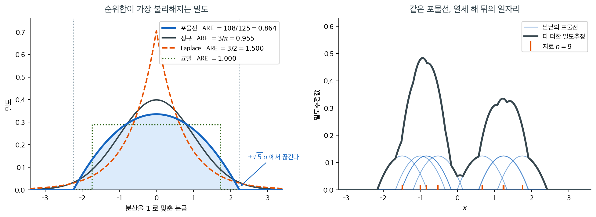
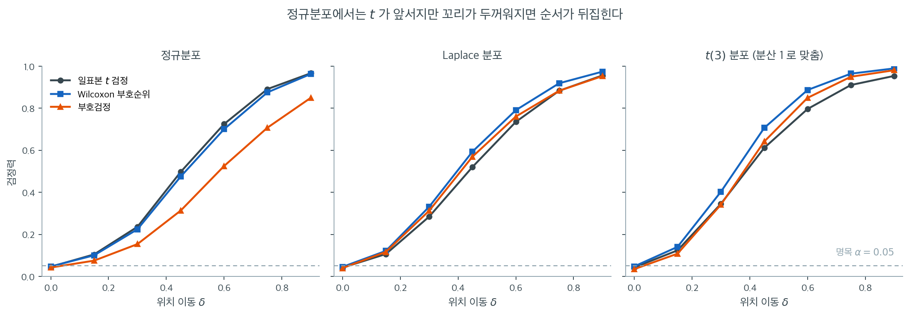

# 모수적 검정과의 검정력 비교

비모수 검정을 모수적 대응물 대신 택할 때면 언제나 자연스러운 질문이 따라온다. 검정력을 얼마나 잃는가? 모수적 가정이 마침 성립한다면 순위 기반 검정은 쓸모 있을 수도 있었던 정보(정확한 크기)를 버리므로 효율 손실을 예상해야 한다. 핵심은 그 손실이 놀랍도록 작다는 점, 그리고 가정이 깨지면 비모수 검정이 오히려 *더* 강력해질 수 있다는 점이다.

이 절에서는 **점근상대효율**(ARE, **Pitman 효율**이라고도 한다)로 이 비교를 형식화하고, 이 장에서 다루는 검정들에 대한 주요 결과를 정리한다.

---

## 1. 검정의 검정력

[9장](../../ch09/index.md)에서 보았듯 검정의 **검정력**은 특정 대립가설이 참일 때 귀무가설을 올바르게 기각할 확률이다.

$$
\text{검정력} = 1 - \beta = P(H_0 \text{ 기각} \mid H_a \text{ 참})
$$

검정력은 표본크기 $n$, 유의수준 $\alpha$, 효과크기 $\delta$, 그리고 검정통계량의 선택에 의존한다. 같은 문제에 적용된 두 검정은 검정력이 다를 수 있으며, 검정력함수를 비교하는 것이 상대적 성능을 평가하는 표준적인 방법이다.

---

## 2. 점근상대효율

검정 $A$에 대한 검정 $B$의 **점근상대효율**(ARE)은 귀무가설로 수렴하는 국소 대립가설 열에 대해 같은 검정력을 얻는 데 필요한 표본크기 비의 극한으로 정의된다.

$$
\text{ARE}(B, A) = \lim_{n \to \infty} \frac{n_A}{n_B}
$$

여기서 $n_A$는 검정 $A$가, $n_B$는 검정 $B$가 같은 유의수준에서 같은 검정력에 도달하는 데 필요한 표본크기이며, 효과크기는 $n^{-1/2}$의 속도로 0에 수렴한다.

ARE가 $0.95$라는 것은 검정 $B$가 검정 $A$의 검정력에 맞추려면 $n_B / 0.95 \approx 1.05\, n_A$개의 관측값이 필요하다는 뜻이다. ARE가 1보다 크면 검정 $B$가 검정 $A$보다 *더* 효율적이다.

!!! note "Pitman 효율"
    위에서 정의한 ARE를 흔히 **Pitman 효율**이라 부르는 것은, $n \to \infty$일 때 귀무가설로 접근하는 *인접 대립가설*을 기준으로 검정을 평가하기 때문이다. 이것이 비모수 검정과 모수적 검정을 비교하는 가장 널리 쓰이는 틀이다.

---

## 3. 주요 ARE 결과

다음 표는 모수적 모형(정규성)이 성립한다는 가정 아래, 가장 흔한 비모수 검정들의 모수적 대응물에 대한 ARE를 정리한 것이다.

| 비모수 검정 | 모수적 대응물 | ARE (정규성 아래) |
|:--------------------|:----------------------|:---------------------:|
| Wilcoxon 부호순위 | 일표본 $t$ 검정 | $3/\pi \approx 0.955$ |
| 부호검정 | 일표본 $t$ 검정 | $2/\pi \approx 0.637$ |
| Wilcoxon 순위합 (Mann-Whitney) | 이표본 $t$ 검정 | $3/\pi \approx 0.955$ |
| Kruskal-Wallis | 일원분산분석 $F$ 검정 | $3/\pi \approx 0.955$ |
| Friedman | 반복측정 분산분석 | $3/\pi \approx 0.955$ |
| Spearman $r_s$ | Pearson $r$ | $3/\pi \approx 0.955$ |

### 정규에서도 4.5% 만 잃는다

주목할 만한 결과는, 정규성 아래에서 Wilcoxon 계열 순위검정이 최적 모수적 검정에 비해 효율을 겨우 4.5% 정도만 잃는다는 것이다. 편차의 방향만 쓰고 크기는 완전히 무시하는 부호검정은 약 63.7%의 효율로 더 큰 대가를 치른다.

!!! tip "3/π 규칙"
    $3/\pi \approx 0.955$가 반복해서 나타나는 것은, 이 값이 Wilcoxon 점수(선형 순위 점수)를 쓰는 임의의 순위 기반 검정의 정규이론 검정 대비 ARE이기 때문이다. 이 보편성은 정규자료에 적용된 순위변환의 성질에서 나온다.

---

## 4. 비정규분포에서의 ARE

위의 ARE 값들은 정규성 --- 모수적 검정에 가장 유리한 최선의 시나리오 --- 을 가정한 것이다. 꼬리가 더 두꺼운 분포에서는 비교가 극적으로 뒤집힌다.

**두꺼운 꼬리 분포.** 이중지수(Laplace) 분포에서 나온 자료에 대해

$$
\text{ARE}(\text{Wilcoxon 부호순위}, \; t\text{ 검정}) = \frac{3}{2} = 1.5
$$

이다. 즉 Wilcoxon 검정은 같은 검정력을 얻는 데 $t$ 검정의 3분의 2만큼의 관측값만 있으면 된다. 꼬리가 더 두꺼워지면 이 이점은 더 커진다.

**오염 정규분포.** 혼합 $(1 - \varepsilon) \, \mathcal{N}(0,1) + \varepsilon \, \mathcal{N}(0, \sigma^2)$은 오염이 완만해도($\varepsilon = 0.05$, $\sigma = 3$) 순위검정의 ARE를 1보다 훨씬 위로 밀어 올릴 수 있다.

**여기까지는 주장이다.** 두 문단의 수가 어디서 나오는지, 그리고 그 수를 **유한한
표본에서 그대로 믿어도 되는지**는 아래 보기 1 이 잰다. 오염정규의 ARE 를 적분 없이
손으로 전개하는 것은 연습문제가 맡는다.

**하한.** 임의의 연속분포에 대해 다음이 성립한다는 근본적인 결과가 있다.

$$
\text{ARE}(\text{Wilcoxon 순위합}, \; t\text{ 검정}) \ge 0.864
$$

즉 Wilcoxon 검정은 참인 분포가 무엇이든 $t$ 검정에 비해 약 14%를 넘는 효율을 잃지 않는다. 반면 이에 대응하는 상한은 없다. 꼬리가 충분히 두꺼우면 ARE는 얼마든지 커질 수 있다.

!!! warning "ARE에는 상한이 없다"
    $t$ 검정 대비 순위검정의 최악의 효율 손실은 유계이고 작지만($\approx 14\%$), 비정규성 아래의 잠재적 이득은 무한하다. 이 비대칭은 분포 가정이 불확실할 때 비모수 방법을 강하게 지지한다.

<div class="exbox" markdown>

**보기 1.** <span class="diff med" title="중간"></span> ARE 는 극한이지 약속이 아니다. 분산을 $1$ 로 맞춘 네 분포 — 정규, 라플라스, 오염정규($\varepsilon = 0.05$, $\sigma = 3$), $t(3)$ — 에서 윌콕슨 부호순위검정과 $t$ 검정을 견준다.

**(1)** 네 분포의 ARE 를 호지스–레만 공식 $\text{ARE} = 12\,\sigma_F^2\left(\int f^2\right)^2$ 로 구하시오. $\S 3$ 의 $3/\pi$ 와 위의 $3/2$ 가 나오는가. **「오염이 완만해도 ARE 를 1 보다 훨씬 위로 민다」는 위 문단의 주장은 수로 얼마인가.**

**(2)** 각 분포에서 두 검정이 검정력 $0.80$ 에 닿는 표본크기 $n$ 을 구해 그 비 $n_t/n_W$ 를 재시오. ARE 와 맞는가. 어긋난다면 **어느 쪽으로** 어긋나며, 효과크기 $\delta$ 를 줄이면 어떻게 되는가.

</div>

??? success "풀이"

    **(1) 네 수는 적분 하나로 나온다.** ARE 가 분포에만 달려 있고 $n$ 과 척도에는
    달려 있지 않으므로, 분산을 $1$ 로 맞춰 두면 $\int f^2$ 하나만 구하면 된다.

    ```python
    import numpy as np
    from scipy import stats, integrate

    def pad(s, w):
        """한글은 고정폭 글꼴에서 두 칸을 차지한다. f-string 의 :<Ns 는 글자 수로
        세므로 한글이 섞인 열은 폭으로 직접 맞춰야 표가 어긋나지 않는다."""
        return s + " " * max(0, w - sum(2 if "가" <= c <= "힣" else 1 for c in s))

    def are_theory(f, var):
        """ARE(윌콕슨 부호순위, t) = 12 σ_F² (∫f²)² — 호지스–레만 공식."""
        i2, _ = integrate.quad(lambda x: f(x) ** 2, -np.inf, np.inf, limit=400)
        return 12 * var * i2 ** 2

    phi = stats.norm.pdf
    MODELS = {                                      # 전부 분산 1 로 맞춘 분포
        "정규":    (phi, 1.0),
        "라플라스": (lambda x: stats.laplace.pdf(x, scale=1 / np.sqrt(2)), 1.0),
        "오염정규": (lambda x: 0.95 * phi(x) + 0.05 * phi(x, scale=3), 1.4),
        "t(3)":   (lambda x: stats.t.pdf(x, 3), 3.0),
    }
    print("  분포       ARE")
    for name, (f, var) in MODELS.items():
        print(f"  {pad(name, 9)}{are_theory(f, var):.4f}")
    ```

    출력:

    ```
      분포       ARE
      정규     0.9549
      라플라스 1.5000
      오염정규 1.1960
      t(3)     1.8998
    ```

    **$\S 3$ 과 위 문단의 수가 그대로 나온다.** 정규의 $0.9549$ 가 $3/\pi$ 이고 라플라스의
    $1.5000$ 이 $3/2$ 다. 그리고 **「훨씬 위로」가 수로는 $1.196$ 이다** — 관측값 $100$ 개가
    드는 자리에서 윌콕슨은 $84$ 개로 같은 검정력을 낸다. 오염이 $5\%$ 뿐인데도 그렇다.
    $t(3)$ 은 $1.90$ 으로 거의 두 배다.

    **(2) 재어 보면 맞지 않는다 — 그리고 어긋나는 방향이 한쪽이다.**

    ```python
    def draw(name, rng, size):
        """분산 1 로 표준화한 표본."""
        if name == "정규":    return rng.normal(0, 1, size)
        if name == "라플라스": return rng.laplace(0, 1 / np.sqrt(2), size)
        if name == "오염정규":
            big = rng.random(size) < 0.05
            return np.where(big, rng.normal(0, 3, size), rng.normal(0, 1, size)) / np.sqrt(1.4)
        return rng.standard_t(3, size) / np.sqrt(3.0)          # t(3)

    def power(name, n, delta, R, seed):
        """같은 자료에 두 검정을 걸어 검정력을 함께 잰다."""
        rng = np.random.default_rng(seed)
        d = draw(name, rng, (R, n)) + delta
        t = d.mean(1) / (d.std(1, ddof=1) / np.sqrt(n))
        p_t = (np.abs(t) > stats.t.ppf(0.975, n - 1)).mean()
        # 윌콕슨 부호순위. 연속분포라 동점이 없어 순위가 1..n 의 치환이다
        r = np.argsort(np.argsort(np.abs(d), axis=1), axis=1) + 1
        Wp = (r * (d > 0)).sum(1)
        mu, sd = n * (n + 1) / 4, np.sqrt(n * (n + 1) * (2 * n + 1) / 24)
        p_w = (np.abs((Wp - mu) / sd) > 1.96).mean()
        return p_t, p_w

    def n_for(name, which, delta, R=40_000, seed=11, target=0.80):
        """검정력이 target 을 넘는 가장 작은 n."""
        lo, hi = 5, 300
        while lo < hi:
            mid = (lo + hi) // 2
            if power(name, mid, delta, R, seed)[which] >= target: hi = mid
            else: lo = mid + 1
        return lo

    DELTAS = (0.5, 0.35, 0.2)
    print("  분포      " + "".join(f"d={d:<10}" for d in DELTAS) + "ARE")
    for name, (f, var) in MODELS.items():
        cells = []
        for d in DELTAS:
            nt, nw = n_for(name, 0, d), n_for(name, 1, d)
            cells.append(f"{nt:>3d}/{nw:<3d}={nt / nw:.2f}")
        print(f"  {pad(name, 8)}" + "  ".join(cells) + f"  {are_theory(f, var):.3f}")
    ```

    출력:

    ```
      분포      d=0.5       d=0.35      d=0.2       ARE
      정규     34/35 =0.97   67/70 =0.96  197/207=0.95  0.955
      라플라스 34/27 =1.26   65/49 =1.33  198/139=1.42  1.500
      오염정규 33/29 =1.14   66/57 =1.16  198/168=1.18  1.196
      t(3)     29/21 =1.38   59/39 =1.51  184/108=1.70  1.900
    ```

    **정규만 처음부터 맞는다.** $0.97 \to 0.96 \to 0.95$ 로 $3/\pi = 0.955$ 에 이미 앉아
    있다. 나머지 셋은 **전부 ARE 보다 작고**, $\delta$ 를 줄일수록 **단조롭게 올라간다** —
    라플라스 $1.26 \to 1.33 \to 1.42$, 오염정규 $1.14 \to 1.16 \to 1.18$, $t(3)$
    $1.38 \to 1.51 \to 1.70$.

    **까닭은 ARE 의 정의에 있다.** ARE 는 $\delta \to 0$ 에서의 극한이다. 효과가 크면 두
    검정 모두 쉽게 유의해져 차이가 좁혀지고, 그래서 유한한 $\delta$ 에서는 비가 언제나
    극한보다 **$1$ 쪽으로 눌려 있다.** 정규에서 눌림이 보이지 않는 것은 극한값 자체가
    이미 $1$ 바로 아래라서다.

    **꼬리가 무거울수록 느리게 다가간다.** $t(3)$ 은 $\delta = 0.2$ 에서도 $1.70$ 으로
    극한 $1.90$ 의 $90\%$ 에 그친다. 라플라스는 $1.42$ 로 $95\%$ 다. 윌콕슨의 이득이
    꼬리의 **극단값**에서 나오는데, $\delta$ 가 크면 그 극단값이 없어도 판정이 갈리기
    때문이다.

    **읽는 법.** ARE 를 설계에 쓸 때는 **낙관적인 쪽**임을 기억해야 한다. $t(3)$ 에서
    「윌콕슨이 표본을 절반만 쓴다」($1/1.90 = 0.53$)는 말은 아주 작은 효과를 쫓을 때만
    참이고, 실제로 잡으려는 효과가 $\delta = 0.35$ 쯤이면 $1/1.51 = 0.66$ 으로 **3 분의
    2** 가 필요하다. 그래도 $t$ 검정보다 적다는 결론은 바뀌지 않는다 — 어긋나는 것은
    **크기**이지 방향이 아니다.

    **그리고 이 표는 되풀이했을 때의 이야기다.** 한 번의 자료에서 어느 검정의 $p$ 값이
    작을지는 ARE 가 보장하지 않는다.
    16.1절 [비모수 검정 모음](nonparametric_suite.md) 보기 1 이 그 반례를 든다 — 두꺼운 꼬리의 대응자료 $15$ 쌍에서 부호순위검정이
    $0.0086$, 부호검정이 $0.0209$ 로 ARE 가 예측하는 차례대로 나오지만, 거기서 순위합검정이
    $0.1409$ 로 꼴찌인 것은 효율이 아니라 **짝 구조를 버렸기** 때문이다.

---


<div class="storybox" markdown>

**그림으로 보는 통계학 1.** 최악의 분포를 찾아 두었더니 커널이 되었다

방금 적은 $0.864$ 는 어림수가 아니다. **$108/125$** 이다. 바닥이 분수로 똑 떨어진다는 것은, 누군가 그 바닥에 닿는 분포를 실제로 손에 쥐었다는 뜻이다.

손에 쥔 사람은 둘이었고, 둘이 처음 만난 곳은 전쟁터였다. $1944$ 년 여름 괌의 하먼 비행장 — 스물두 살의 조지프 호지스가 작전분석조에 들어가 제$20$ 공군에 배속되었는데, 거기에 에리히 레만이 있었다. 위키백과가 둘을 두고 쓴 말이 「**갓 싹트던 통계학자들**」이다. 전쟁이 끝나자 호지스는 갓 생긴 버클리의 통계학 과정으로 갔고, 둘은 그 뒤로 함께 논문을 쓴다 — 호지스–레만 추정량도 공저 교과서도 거기서 나왔다. 그 가운데 하나가 $1956$ 년 『Annals of Mathematical Statistics』 $27$ 권 $324$–$335$ 쪽의 열두 쪽이다.

초록의 셋째 문장이 이 쪽의 하한 그 자체다 — 「그 점근 피트먼 효율이 $t$ 검정에 견주어 **$0.864$ 아래로 결코 떨어지지 않음을 제 $1$ 절에서 보인다**.」 바로 다음 문장이 더 고맙다. 같은 결과가 **$F$ 검정에 견준 Kruskal-Wallis** 에도, **대칭분포 하나의 위치모수 검정**에도 그대로 간다는 것. 부등식 한 줄이 §3 표의 여러 줄을 한꺼번에 덮는다.

둘이 한 일은 부등식을 증명한 것이 아니라 **범인을 찾아낸 것**이었다. 위치이동 모형에서 순위합의 ARE 는

$$
\text{ARE}(W, t) = 12\,\sigma_F^2 \left( \int f^2 \right)^{2}
$$

이므로, 분산을 $1$ 로 묶어 놓고 $\int f^2$ 을 **가장 작게 만드는 밀도**를 찾으면 그것이 순위합에게 가장 모진 세상이다. 답은 $\pm\sqrt5\,\sigma$ 에서 뚝 끊기는 뒤집힌 포물선이었다.

$$
f(x) = \frac{3}{4\sqrt5}\left(1 - \frac{x^2}{5}\right), \qquad |x| \le \sqrt5
$$

여기서 $\int f^2 = 3\sqrt5/25$ 이고, $12 \cdot (3\sqrt5/25)^2 = 108/125 = 0.864$ 다.



왼쪽이 그 포물선(파랑)이다. 정규($3/\pi$)보다 납작하고, 균일분포($\text{ARE}$ 가 정확히 $1$)보다도 아래다. Laplace 처럼 뾰족하고 꼬리가 긴 쪽으로 갈수록 순위합이 유리해지니, **순위합을 괴롭히려면 꼬리를 걷어내고 봉우리를 깎아야 한다.**

반전은 열세 해 뒤에 온다. $1969$ 년 에파네치니코프가 러시아어 학술지에 전혀 다른 물음을 들고 왔다 — 흩어진 점에서 밀도를 매끄럽게 추정할 때 **어떤 커널이 오차를 가장 작게 하는가**. 제약이 같고($\int K = 1$, $\int x^2 K = 1$) 줄여야 할 것도 같으니($\int K^2$) 답도 같다. 오늘 `kernel="epanechnikov"` 라고 적을 때 불려 나오는 그 포물선은, **열세 해 전에 「순위합이 가장 싫어할 분포」라는 이름으로 이미 계산되어 있었다.** 오른쪽 그림이 그것을 아홉 장 겹쳐 쌓은 것이다.

다만 $0.864$ 는 **아무도 가 보지 않는 곳의 수**다. 꼬리가 칼로 자른 듯 끊긴 포물선 자료는 현실에 없고, 그 바닥도 $n \to \infty$ 에서만 성립한다. 호지스와 레만 자신이 같은 초록에 조심할 것을 적어 두었다 — **검정력은 표본크기의 볼록함수가 아닐 수 있고, 극한을 주고받는 순서를 언제나 바꿀 수 있는 것도 아니다.** $0.864$ 는 약속이 아니라 마음 놓아도 되는 한계선이다.

_확인한 곳 — 논문이 J. L. Hodges, Jr. 와 E. L. Lehmann 의 「The Efficiency of Some Nonparametric Competitors of the $t$-Test」이고 『Annals of Mathematical Statistics』 $27$ 권 $2$ 호 $324$–$335$ 쪽($1956$ 년 $6$ 월)이라는 것, 그리고 인용한 초록의 두 문장(「$0.864$ 아래로 결코 떨어지지 않는다」·「$F$ 검정에 견준 Kruskal-Wallis 와 대칭분포 하나의 위치모수 검정에도 성립한다」)과 마지막 경고(「검정력이 표본크기의 볼록함수가 아닐 수 있다」·「극한을 주고받는 것이 늘 가능하지는 않다」)는 [Project Euclid 의 그 쪽](https://projecteuclid.org/journals/annals-of-mathematical-statistics/volume-27/issue-2/The-Efficiency-of-Some-Nonparametric-Competitors-of-the-t-Test/10.1214/aoms/1177728261.full) 에서 읽었다 · 호지스($1922$–$2000$)가 $1944$ 년 여름 작전분석조에 들어가 「갓 싹트던 통계학자들」인 레만·조지 니컬슨과 함께 괌 하먼 비행장의 제$20$ 공군에서 복무했고, 뒤에 갓 생긴 버클리의 통계학 과정으로 가 거기서 평생을 보냈으며, 레만과 호지스–레만 추정량과 공저 교과서($1964$)를 남겼다는 것은 [Wikipedia 「Joseph Lawson Hodges Jr.」](https://en.wikipedia.org/wiki/Joseph_Lawson_Hodges_Jr.) · 이 포물선이 **호지스–레만이 순위합 대 $t$ 의 ARE 를 최악으로 만드는 밀도로 먼저 얻은 것**이고 에파네치니코프($1969$)가 밀도추정 맥락에서 따로 끌어내어 그 이름이 붙었으며 더 거슬러 바틀릿($1963$)에게 공이 있을 수도 있다는 것은 Schucany, 「Kernel Smoothers」, 『Statistical Science』 $19$ 권 $4$ 호($2004$) $669$ 쪽 · 에파네치니코프의 논문이 『Theory of Probability and Its Applications』 $14$ 권 $1$ 호 $153$–$158$ 쪽($1969$)이라는 것은 그 학술지 서지. 네 밀도의 $\int f^2$ 과 ARE, $108/125$, 오른쪽 그림은 모두 직접 계산한 값이다_

</div>

---

## 5. 유한표본 검정력

ARE는 $n \to \infty$일 때의 극한 거동을 기술한다. 유한표본에서 실제 검정력 비교는 구체적인 표본크기, 효과크기, 분포에 의존한다. 몬테카를로 모의실험이 가장 신뢰할 만한 유한표본 비교를 제공한다.



$n = 20$, $\alpha = 0.05$에서 위치 이동 $\delta$를 $0$부터 $0.9$까지 움직이며 세 검정의 기각률을 $3{,}000$회씩 잰 것이다. 세 분포의 분산을 모두 $1$로 맞추었으므로 가로축의 $\delta$는 세 패널에서 같은 뜻을 갖는다. 먼저 $\delta = 0$에서 세 검정 모두 $0.042$--$0.048$로 명목수준에 붙어 있음을 확인하라. **크기가 같아야 검정력 비교가 공정하다.**

왼쪽 패널(정규분포)에서 검은 $t$ 곡선과 파란 Wilcoxon 곡선은 눈으로 거의 구분되지 않는다. $\delta = 0.45$에서 $0.497$ 대 $0.475$, $\delta = 0.6$에서 $0.725$ 대 $0.700$이다. 이 $2$--$3$%포인트의 간격이 $\text{ARE} = 3/\pi = 0.955$가 실제로 어떤 모습인지를 보여 준다. 반면 주황색 부호검정은 확연히 아래로 처져 $\delta = 0.6$에서 $0.525$에 그치는데, 이것이 $\text{ARE} = 2/\pi = 0.637$의 모습이다.

가운데와 오른쪽 패널에서 **순서가 뒤집힌다.** Laplace 분포에서는 $\delta = 0.45$에 Wilcoxon $0.594$가 $t$의 $0.521$을 앞서고, 부호검정마저 $0.570$으로 $t$를 이긴다(Laplace에서 중앙값이 최대가능도추정량이므로 부호검정의 ARE는 $2$이다). $t_3$에서는 격차가 더 벌어져 $\delta = 0.6$에서 $t$가 $0.796$인데 Wilcoxon은 $0.887$, 부호검정은 $0.849$이다. **$t$ 검정이 꼴찌다.**

세 패널을 나란히 놓고 보면 이 장 전체의 논지가 그림 하나에 담긴다. 모수적 가정이 정확히 맞을 때 순위검정이 내주는 것은 곡선 사이의 종이 한 장 두께이고, 가정이 어긋나는 순간 그 종이 한 장이 반대 방향의 뚜렷한 격차로 바뀐다. **잃을 것은 유계이고 얻을 것은 그렇지 않다**는 비대칭이 순위검정을 기본값으로 삼을 근거이다.

모의실험 연구에서 나타나는 일반적인 양상은 다음과 같다.

- $n \ge 20$이고 효과크기가 중간 정도이면 유한표본 검정력 차이가 ARE 예측을 꽤 정확히 따라간다.
- 표본이 아주 작으면($n < 10$) 정규성 가정이 깨졌을 때 정확 비모수 검정(순열분포에 기반한)이 모수적 검정보다 *더 높은* 검정력을 가질 수 있다. ARE 비교가 대표본을 가정함에도 그렇다.
- 부호검정은 정규성 아래 ARE가 $2/\pi$로 낮지만, 밑에 깔린 분포가 심하게 비대칭이거나 변화의 방향만 신뢰성 있게 측정되는 상황에서는 여전히 경쟁력이 있다.

---

## 6. 실무 지침

ARE 분석에서 다음 의사결정 원칙이 나온다.

1. **정규성을 설계와 측정의 성질로 믿을 수 있다면** 모수적 검정이 낫지만, Wilcoxon 계열 대비 검정력 이점은 $4.5\%$ 정도에 불과하여 실무에서는 무시할 만한 경우가 많다. (**정규성 검정을 돌려 보고 고르는 것은 여기에 해당하지 않는다** — 그러면 같은 자료를 두 번 쓰게 된다.)
2. **그렇지 않다면** 비모수 검정이 보험이 된다. 정규성이 성립할 때 최대 $14\%$ 손실, 성립하지 않을 때 잠재적으로 큰 이득이다.
3. **비정규성이 알려져 있다면** 비모수 검정이 모수적 대응물보다 *더 강력한* 경우가 많다. 특히 두꺼운 꼬리나 오염된 분포에서 그렇다.
4. **부호검정**은 변화의 방향만 의미가 있거나 Wilcoxon 부호순위검정의 대칭성 가정이 의심스러운 상황에 아껴 두어야 한다.

---

## 연습문제

<div class="drillbox" markdown>

**연습문제 1.** <span class="diff med" title="중간"></span>
아래 각 상황에서 모수적 검정과 비모수 검정 중 무엇을 쓸지 밝히고, 구체적인 검정 이름을 대고, 선택의 근거를 설명하라.

**(a)** 두 집단(약물 대 위약)의 평균 혈압을 비교하려 한다. 두 집단 모두 $n = 50$이고, Q-Q 그림이 근사적 정규성을 시사한다.

**(b)** 두 매장에서 고객 만족도(1--5 Likert 척도) 관측값 8개씩을 얻었고, 매장 간 차이를 검정하려 한다.

**(c)** 12명의 피험자에게서 처치 전후 대응측정값을 얻었는데, 차이가 오른쪽으로 심하게 치우쳐 있고 극단적인 이상치가 하나 있다.

**(d)** 세 가지 교수법이 서로 다른 시험점수 분포를 내는지 검정하려 한다. 집단 크기는 8, 10, 7이고, 세 집단 중 두 집단에서 Shapiro-Wilk 검정이 정규성을 기각한다.

</div>

??? success "풀이"

    **(a)** **모수적: 이표본 $t$ 검정**(또는 Welch $t$ 검정). 집단당 $n = 50$이고 Q-Q 그림으로 근사적 정규성이 확인되었으므로 모수적 검정의 조건이 잘 만족된다. 이 조건에서는 $t$ 검정이 비모수 대안보다 검정력이 높다.

    **(b)** **비모수: Mann-Whitney U 검정**(Wilcoxon 순위합검정). Likert 척도 자료는 연속형이 아니라 순서형이므로 평균과 표준편차가 의미를 갖지 않는다. 작은 표본크기($n = 8$)와 자료의 이산성 때문에 비모수 방법이 더 적절하다.

    **(c)** **비모수: Wilcoxon 부호순위검정**(차이의 대칭성이 의심스럽다면 부호검정). 심한 치우침과 극단 이상치가 대응 $t$ 검정의 정규성 가정을 어긴다. 관측값이 12개뿐이므로 심하게 치우친 자료에 대해 중심극한정리가 믿을 만한 정규근사를 주지 못한다. 순위에 기반한 Wilcoxon 부호순위검정은 이상치에 저항한다.

    **(d)** **비모수: Kruskal-Wallis 검정**. 세 집단 중 둘에서 정규성이 기각되었으므로 일원분산분석 가정이 깨진다. 표본크기도 상대적으로 작아(7--10) 중심극한정리가 보완해 주기에 자료가 부족하다. Kruskal-Wallis 검정은 정규성을 요구하지 않으며 적절한 다집단 비교이다. 유의하다면 쌍별 비교를 위해 Dunn 검정으로 이어 간다.

<div class="drillbox" markdown>

**연습문제 2.** <span class="diff med" title="중간"></span>
$n = 20$, $\alpha = 0.05$에서 일표본 $t$ 검정, Wilcoxon 부호순위검정, 부호검정의 검정력을 세 분포(정규, Laplace, $t_3$)에 대해 모의실험으로 비교하고, ARE 이론이 예측한 순서와 맞는지 확인하라.

</div>

??? success "풀이"
    라플라스분포는 분산이 1이 되도록 척도를 $1/\sqrt{2}$로 맞춘다. 위치 이동은 세 경우 모두 $\delta = 0.4$이다.

    ```python
    import numpy as np
    from scipy import stats
    rng = np.random.default_rng(11)
    B, n = 4000, 20

    def powers(x):
        pt = stats.ttest_1samp(x, 0, axis=1).pvalue
        pw = np.array([stats.wilcoxon(x[i]).pvalue for i in range(B)])
        ps = np.array([stats.binomtest(int((x[i] > 0).sum()), n).pvalue
                       for i in range(B)])
        return (pt < .05).mean(), (pw < .05).mean(), (ps < .05).mean()

    print("normal ", powers(rng.normal(0.4, 1, (B, n))))
    print("laplace", powers(rng.laplace(0.4, 1/np.sqrt(2), (B, n))))
    print("t(3)   ", powers(rng.standard_t(3, (B, n)) + 0.4))
    ```

    출력:

    ```
    normal  (0.3905, 0.3755, 0.26475)
    laplace (0.446, 0.513, 0.47875)
    t(3)    (0.235, 0.2755, 0.22425)
    ```

    먼저 $\delta = 0$에서의 실제 크기(모두 명목 $0.05$ 근처):

    | 분포 | $t$ | Wilcoxon | 부호검정 |
    |:---|---:|---:|---:|
    | Normal | 0.051 | 0.049 | 0.042 |
    | Laplace | 0.044 | 0.050 | 0.042 |
    | $t_3$ | 0.042 | 0.048 | 0.043 |

    $\delta = 0.4$에서의 검정력:

    | 분포 | $t$ | Wilcoxon | 부호검정 |
    |:---|---:|---:|---:|
    | Normal | **0.382** | 0.370 | 0.264 |
    | Laplace | 0.422 | **0.497** | 0.478 |
    | $t_3$ | 0.230 | **0.271** | 0.224 |

    ARE 이론과 정확히 맞는다.

    - **정규분포**에서 $t$가 가장 강하지만 Wilcoxon과의 차이는 $0.382$ 대 $0.370$으로 3% 남짓이다. $\text{ARE} = 0.955$가 예측하는 수준이다. 부호검정은 $0.264$로 확연히 뒤처지며, 이는 $\text{ARE} = 2/\pi = 0.637$에 부합한다.
    - **Laplace**에서 순서가 뒤집혀 Wilcoxon($0.497$)이 $t$($0.422$)를 이긴다. $\text{ARE} = 1.5$가 예측한 그대로이다. 부호검정도 $0.478$로 $t$를 이기는데, 라플라스에서 부호검정의 ARE는 2이다(라플라스분포에서 중앙값은 최대가능도추정량이다).
    - **$t_3$**에서도 Wilcoxon이 이긴다. 여기서는 세 검정 모두 검정력이 낮은데, $t_3$의 분산이 3이라 표준화된 효과크기가 정규 경우의 $1/\sqrt{3}$에 불과하기 때문이다.

    유의할 점: 이 비교가 공정한 것은 세 검정의 **실제 크기가 모두 $0.05$에 가깝기** 때문이다. 크기가 부풀려진 검정의 높은 기각률은 검정력이 아니다. 검정력을 비교할 때는 언제나 크기부터 확인해야 한다.

<div class="drillbox" markdown>

**연습문제 3.** <span class="diff med" title="중간"></span>
정규성 아래에서 Wilcoxon 순위합검정을 쓰면 $t$ 검정 대비 표본을 얼마나 더 모아야 하는가? $\text{ARE} = 3/\pi$를 이용해 계산하고, 실무에서 이 수치가 의미하는 바를 논하라. 또 부호검정에 대해서도 같은 계산을 하라.

</div>

??? success "풀이"
    ARE의 정의에서 필요한 표본크기 배수는 $1/\text{ARE}$이다.

    $$
    \frac{1}{3/\pi} = \frac{\pi}{3} \approx 1.0472, \qquad
    \frac{1}{2/\pi} = \frac{\pi}{2} \approx 1.5708
    $$

    | 검정 | ARE | 필요 표본 배수 | $n_t = 30$일 때 필요한 $n$ |
    |:---|---:|---:|---:|
    | Wilcoxon 순위합 | $0.955$ | $1.047$ | $32$ (2명 추가) |
    | 부호검정 | $0.637$ | $1.571$ | $48$ (18명 추가) |

    **Wilcoxon.** 4.7% 증가는 실무적으로 거의 무의미하다. 집단당 30명 연구에서 2명을 더 모으는 비용은 대개 정규성 검정을 하고 그 결과에 결론을 걸어 두는 위험보다 훨씬 싸다. 게다가 이 4.7%는 정규성이 **정확히** 성립할 때의 값이고, 조금이라도 벗어나면 격차는 줄거나 뒤집힌다.

    **부호검정.** 57% 증가는 무시할 수 없다. 부호검정을 쓸 이유는 효율이 아니라 다음 둘 중 하나여야 한다.

    1. 변화의 **방향만** 신뢰성 있게 측정된다(예: "호전/악화"만 기록된 임상 자료).
    2. 차이의 분포가 **대칭이라고 볼 수 없다**. Wilcoxon 부호순위검정은 대칭성을 가정하지만 부호검정은 가정하지 않는다.

    두 번째 이유가 특히 중요하다. 대응차이가 비대칭이면 Wilcoxon 부호순위검정이 검정하는 것은 더 이상 "중앙값이 0"이 아니게 되어, 효율이 높아도 엉뚱한 가설을 검정하게 된다. 검정력이 낮더라도 옳은 가설을 검정하는 편이 낫다.

<div class="drillbox" markdown>

**연습문제 4.** <span class="diff med" title="중간"></span>
ARE는 검정력곡선의 **세로** 간격이 아니라 **가로** 배율이다. 이것을 §5의 수치로 확인한다.

여기서 다루는 세 검정의 국소검정력이 모두

$$
\pi(n, \delta) = \Phi\!\left(c \sqrt{n}\, \delta - z_{\alpha/2}\right)
$$

꼴이고 상수 $c > 0$(검정의 **효능**)만 검정마다 다르다고 하자.

**(a)** 이 꼴에서 $\text{ARE}(B, A) = (c_B / c_A)^2$ 이고, 따라서 $\pi_B(n, \delta) = \pi_A\!\left(n, \delta \sqrt{\text{ARE}(B,A)}\right)$ 임을 보여라. 곧 검정 $B$의 곡선은 검정 $A$의 곡선을 $\delta$축에서 $1/\sqrt{\text{ARE}}$배 늘린 것이다.

**(b)** §5의 정규분포 패널은 $t$ 검정의 기각률을 $\delta = 0.45$에서 $0.497$, $\delta = 0.6$에서 $0.725$로 보고한다. 이 구간에서 $t$ 곡선이 선형이라고 보고, (a)를 써서 $\delta = 0.6$에서 Wilcoxon 부호순위검정과 부호검정의 검정력을 예측하라. §5가 보고한 실제 값 $0.700$과 $0.525$와 비교하라.

</div>

??? success "풀이"
    **(a)** 수준 $\alpha$를 고정하고 두 검정이 같은 검정력에 도달하는 표본크기를 각각 $n_A$, $n_B$라 하면 $\Phi$가 강증가이므로

    $$
    c_A \sqrt{n_A}\, \delta = c_B \sqrt{n_B}\, \delta
    \quad \Longleftrightarrow \quad
    c_A^2 n_A = c_B^2 n_B
    $$

    이다. 따라서

    $$
    \text{ARE}(B, A) = \lim_{n \to \infty} \frac{n_A}{n_B} = \frac{c_B^2}{c_A^2}
    $$

    이고 $\sqrt{\text{ARE}(B,A)} = c_B / c_A$ 이다. 이것을 검정력에 넣으면

    $$
    \pi_B(n, \delta) = \Phi\!\left(c_B \sqrt n\, \delta - z_{\alpha/2}\right)
    = \Phi\!\left(c_A \sqrt n \cdot \frac{c_B}{c_A} \delta - z_{\alpha/2}\right)
    = \pi_A\!\left(n, \delta \sqrt{\text{ARE}}\right)
    $$

    를 얻는다. $\text{ARE} < 1$ 이면 $\delta \sqrt{\text{ARE}} < \delta$ 이므로 $B$의 곡선은 $A$의 곡선을 오른쪽으로 늘린 모양이 된다. $\square$

    **(b)** $\delta = 0.6$에 대응하는 "$t$ 검정에서의 유효 $\delta$"는 다음과 같다.

    | 검정 | ARE | $\sqrt{\text{ARE}}$ | $\delta$축 배율 $1/\sqrt{\text{ARE}}$ | 유효 $\delta = 0.6\sqrt{\text{ARE}}$ |
    |:---|---:|---:|---:|---:|
    | Wilcoxon 부호순위 | $3/\pi = 0.954930$ | $0.977205$ | $1.023327$ | $0.586323$ |
    | 부호검정 | $2/\pi = 0.636620$ | $0.797885$ | $1.253314$ | $0.478731$ |

    $t$ 곡선을 $[0.45, 0.6]$에서 선형으로 보면 기울기는 $(0.725 - 0.497)/0.15 = 1.52$이므로

    $$
    \widehat\pi_t(\delta) = 0.497 + 1.52\,(\delta - 0.45)
    $$

    이다. 여기에 유효 $\delta$를 넣는다.

    $$
    \widehat\pi_W(0.6) = 0.497 + 1.52 \times (0.586323 - 0.45) = 0.497 + 0.2072 = 0.7042
    $$

    $$
    \widehat\pi_{\text{sign}}(0.6) = 0.497 + 1.52 \times (0.478731 - 0.45) = 0.497 + 0.0437 = 0.5407
    $$

    | 검정 | 예측 | §5의 실제 값 | 차 |
    |:---|---:|---:|---:|
    | Wilcoxon 부호순위 | $0.7042$ | $0.700$ | $0.004$ |
    | 부호검정 | $0.5407$ | $0.525$ | $0.016$ |

    Wilcoxon은 $0.004$, 부호검정은 $0.016$ 안에서 맞는다. 모의실험 오차(기각률 $3{,}000$회의 표준오차가 약 $0.009$)와 선형보간의 거친 정도를 생각하면 매우 잘 맞는 셈이다.

    해석이 중요하다. **"효율 4.5% 손실"은 $\delta$축에서 겨우 2.3%의 늘림이다.** $1/\sqrt{3/\pi} = 1.0233$이기 때문이다. 효율은 표본크기 $n$의 비이지만 검정력은 $\sqrt n\, \delta$를 통해 들어오므로 제곱근이 한 번 들어가 차이가 절반으로 줄어 보인다. 그래서 §5의 왼쪽 패널에서 두 곡선이 "종이 한 장"으로 보이는 것이다. 반면 부호검정의 배율은 $1.2533$으로 다섯 배 넘게 크고, 그래서 눈에 확연히 보인다.

    덧붙여, 세로 간격은 곡선이 평평한 양 끝($\delta \to 0$에서는 둘 다 $\alpha$, $\delta \to \infty$에서는 둘 다 $1$)에서 $0$으로 줄어든다. **검정력곡선을 눈으로 비교할 때는 곡선이 가장 가파른 중간 구간을 보아야 한다.** $\delta = 0.45$--$0.6$을 고른 §5의 선택이 우연이 아니다.

<div class="drillbox" markdown>

**연습문제 5.** <span class="diff med" title="중간"></span>
§4는 $\text{ARE}(\text{Wilcoxon 순위합}, t) \ge 0.864$ 이고 위로는 유계가 아니라고 했다. 이 비대칭을 의사결정 문제로 바꾸어 수로 재라.

**(a)** 거꾸로 $t$ 검정의 Wilcoxon 대비 ARE, 곧 $\text{ARE}(t, \text{Wilcoxon})$의 하한은 얼마인가. 이중지수분포에서의 값도 구하라. "최악의 경우가 가장 덜 나쁜 검정"을 고르는 미니맥스 규칙은 어느 검정을 고르는가.

**(b)** 자료가 정규분포에서 올 확률이 $p$, 이중지수분포에서 올 확률이 $1 - p$ 라고 믿는다고 하자. 두 분포에서 $t$ 검정이 목표 검정력에 도달하는 데 필요한 표본크기가 모두 $n_0$라고 두자(그래야 두 분포를 같은 자에 올려놓을 수 있다). **기대 필요표본크기**가 작은 검정을 고르는 규칙을 세우고, 두 선택이 같아지는 $p$를 구하라.

**(c)** (b)에서 이중지수분포 대신 $\text{ARE} = 3$인 더 두꺼운 꼬리의 대안을 넣으면 임계 $p$가 어떻게 움직이는가.

</div>

??? success "풀이"
    **(a)** ARE는 정의에서 역수 관계를 만족한다.

    $$
    \text{ARE}(t, \text{Wilcoxon}) = \frac{1}{\text{ARE}(\text{Wilcoxon}, t)}
    $$

    $\text{ARE}(\text{Wilcoxon}, t)$가 위로 유계가 아니므로 $\text{ARE}(t, \text{Wilcoxon})$은 아래로 $0$까지 내려갈 수 있다. **하한은 $0$이고 달성되지 않는다.** 이중지수분포에서는 $1/1.5 = 0.6667$이고, 꼬리를 더 두껍게 하면 얼마든지 $0$에 가까워진다.

    | 검정 | 최악의 ARE | 최악에서 필요한 표본 배수 |
    |:---|---:|---:|
    | Wilcoxon (상대: $t$) | $0.864$ | $1/0.864 = 1.1574$ |
    | $t$ (상대: Wilcoxon) | $0$ (하한) | 유계가 아니다 |

    미니맥스 규칙은 **Wilcoxon을 고른다.** 최악의 경우에 15.7%를 더 모으면 되는 것과, 최악의 경우에 표본을 아무리 모아도 따라잡지 못하는 것 사이의 선택이다.

    **(b)** $t$ 검정은 어느 분포에서든 $n_0$이 필요하다. Wilcoxon은 $1/\text{ARE}$배가 필요하므로

    $$
    \frac{1}{3/\pi} = \frac{\pi}{3} = 1.047198, \qquad \frac{1}{3/2} = \frac{2}{3} = 0.666667
    $$

    이다. 기대 필요표본크기는

    $$
    E[n_W] = n_0 \left[ 1.047198\, p + 0.666667\,(1-p) \right], \qquad E[n_t] = n_0
    $$

    이고, $E[n_W] < E[n_t]$ 일 때 Wilcoxon을 고른다. 두 값이 같아지는 $p$는

    $$
    0.666667 + (1.047198 - 0.666667)\, p = 1
    \;\Longrightarrow\;
    p^\ast = \frac{0.333333}{0.380531} = 0.875969
    $$

    이다.

    | $p$ (정규일 확률) | $E[n_W]/n_0$ | 고를 검정 |
    |---:|---:|:---|
    | $0.50$ | $0.856932$ | Wilcoxon |
    | $0.80$ | $0.971092$ | Wilcoxon |
    | $0.876$ | $1.000012$ | 거의 무차별 |
    | $0.95$ | $1.028171$ | $t$ |
    | $1.00$ | $1.047198$ | $t$ |

    곧 **정규성을 87.6%보다 더 확신할 때만 $t$ 검정이 기대 표본크기에서 유리하다.** 정규성 검정 한 번으로 그만한 확신을 얻기는 어렵다. 중간 크기 표본에서 정규성 검정의 검정력이 낮아 "기각하지 못했다"가 "정규다"를 뜻하지 않기 때문이다([14장](../../ch14/index.md)).

    **(c)** $\text{ARE} = 3$이면 그 분포에서 Wilcoxon은 $1/3 = 0.333333$배만 필요하다. 같은 계산을 다시 하면

    $$
    0.333333 + (1.047198 - 0.333333)\, p = 1
    \;\Longrightarrow\;
    p^\ast = \frac{0.666667}{0.713865} = 0.933881
    $$

    로 임계값이 $0.876$에서 $0.934$로 올라간다. **대안의 꼬리가 두꺼울수록 $t$ 검정을 정당화하기 위해 필요한 확신의 문턱이 높아진다.** $\text{ARE} \to \infty$이면 $p^\ast \to 1$ 이므로, 꼬리가 아주 두꺼운 가능성을 아주 조금이라도 열어 두면 $t$ 검정은 기대 표본크기 기준으로 결코 이기지 못한다. §4의 경고 "잃을 것은 유계이고 얻을 것은 그렇지 않다"가 의사결정 문제로 번역된 모습이다.

<div class="drillbox" markdown>

**연습문제 6.** <span class="diff hard" title="어려움"></span>
§4는 오염 정규분포 $(1-\varepsilon)\,\mathcal N(0,1) + \varepsilon\,\mathcal N(0,\sigma^2)$이 "오염이 완만해도($\varepsilon = 0.05$, $\sigma = 3$) 순위검정의 ARE를 1보다 훨씬 위로 밀어 올릴 수 있다"고 했다. 이 문장을 수로 재라. 대칭밀도 $f$와 그 분산 $\sigma_F^2$에 대해

$$
\text{ARE}(\text{Wilcoxon 부호순위}, \; t) = 12\, \sigma_F^2 \left( \int_{-\infty}^{\infty} f(x)^2 \, dx \right)^2
$$

이다([비모수 검정 모음](./nonparametric_suite.md) 보기 1). $\varphi_s$를 $\mathcal N(0, s^2)$의 밀도라 하면 혼합밀도는 $f = (1-\varepsilon)\varphi_1 + \varepsilon \varphi_\sigma$ 이다.

**(a)** $\int \varphi_{s_1}(x)\varphi_{s_2}(x)\,dx = \dfrac{1}{\sqrt{2\pi(s_1^2 + s_2^2)}}$ 임을 보여라.

**(b)** $\varepsilon = 0.05$, $\sigma = 3$에서 $\sigma_F^2$, $\int f^2$, ARE를 구하라. 이 수치가 §4의 주장을 어느 정도로 받쳐 주는가.

**(c)** $\varepsilon = 0.05$를 고정하고 $\sigma = 1.5$와 $\sigma = 2$에서도 계산하라. §4의 문장에 숨어 있는 조건을 밝혀라.

**(d)** $\varepsilon > 0$을 고정하고 $\sigma \to \infty$로 보낼 때 ARE의 차수를 구하고, 그 까닭을 검정의 작동 방식으로 설명하라.

</div>

??? success "풀이"
    **(a)** 독립인 $Z_1 \sim \mathcal N(0, s_1^2)$, $Z_2 \sim \mathcal N(0, s_2^2)$를 두면 차의 밀도는 합성곱

    $$
    f_{Z_1 - Z_2}(t) = \int \varphi_{s_1}(x)\, \varphi_{s_2}(x - t)\, dx
    $$

    이다. $t = 0$을 넣으면 우변이 바로 구하려는 적분이다. 한편 $Z_1 - Z_2 \sim \mathcal N(0, s_1^2 + s_2^2)$ 이므로

    $$
    \int \varphi_{s_1}\varphi_{s_2} = f_{Z_1 - Z_2}(0) = \frac{1}{\sqrt{2\pi(s_1^2 + s_2^2)}}
    $$

    이다. $\square$

    특히 $s_1 = s_2 = s$ 이면 $\int \varphi_s^2 = 1/(2s\sqrt\pi)$ 이고, $s = 1$에서 $1/(2\sqrt\pi) = 0.282095$ 이다.

    **(b)** 혼합의 분산은 성분 분산의 혼합이다(두 성분의 평균이 모두 $0$이므로).

    $$
    \sigma_F^2 = (1-\varepsilon) \cdot 1 + \varepsilon \sigma^2 = 0.95 + 0.05 \times 9 = 1.40
    $$

    제곱적분은 세 항으로 펼쳐지고 각 항에 (a)를 쓴다.

    $$
    \int f^2 = (1-\varepsilon)^2 \int \varphi_1^2 + 2\varepsilon(1-\varepsilon)\int \varphi_1 \varphi_\sigma + \varepsilon^2 \int \varphi_\sigma^2
    $$

    | 항 | 계수 | 적분값 | 곱 |
    |:---|---:|---:|---:|
    | $\int \varphi_1^2$ | $0.9025$ | $1/(2\sqrt\pi) = 0.282095$ | $0.254591$ |
    | $\int \varphi_1 \varphi_3$ | $0.095$ | $1/\sqrt{2\pi \cdot 10} = 0.126157$ | $0.011985$ |
    | $\int \varphi_3^2$ | $0.0025$ | $1/(6\sqrt\pi) = 0.094032$ | $0.000235$ |
    | 합 | | | $\mathbf{0.266811}$ |

    $$
    \text{ARE} = 12 \times 1.40 \times (0.266811)^2 = 16.8 \times 0.071188 = 1.195956
    $$

    해석. $\text{ARE} = 1.196$이면 $t$ 검정은 같은 검정력을 내기 위해 Wilcoxon보다 19.6% 더 모아야 하고, 거꾸로 Wilcoxon은 $t$ 검정 표본의 $1/1.196 = 0.8362$, 곧 **83.6%만으로 충분하다.** 정규분포에서의 4.7% 손해가 20% 가까운 이득으로 뒤집혔으니 §4의 주장은 방향이 맞다. 다만 "훨씬"이라는 말은 조금 세다 --- 20%는 뚜렷하지만 극적이지는 않다. 같은 $\varepsilon = 0.05$에서 $\sigma = 5$로 올리면 $\text{ARE} = 1.8145$가 되어 그때는 "훨씬"이라 불러도 좋다.

    **(c)** 같은 계산을 되풀이한다. 바뀌는 것은 $\sigma_F^2$와 가운데 두 항뿐이다.

    | $\sigma$ | $\sigma_F^2$ | $\int f^2$ | ARE |
    |---:|---:|---:|---:|
    | $1$ | $1.000000$ | $0.282095$ | $0.954930 = 3/\pi$ |
    | $1.5$ | $1.062500$ | $0.276084$ | $0.971832$ |
    | $2$ | $1.150000$ | $0.271892$ | $1.020171$ |
    | $3$ | $1.400000$ | $0.266811$ | $1.195956$ |
    | $5$ | $2.200000$ | $0.262164$ | $1.814475$ |

    $\sigma = 1.5$에서는 $\text{ARE} = 0.9718 < 1$ 이다. **오염이 있어도 $t$ 검정이 아직 이긴다.** 경계는 $\sigma \approx 1.825$이고, $\sigma = 1$에서 정확히 $3/\pi$로 돌아가 오염이 없는 정규분포와 이어진다.

    숨어 있는 조건은 이것이다. $\varepsilon$이 작은 것("완만한 오염")만으로는 ARE가 1을 넘지 않는다. **오염 성분의 분산 $\sigma^2$가 충분히 커야 한다.** §4의 문장은 $\varepsilon = 0.05$를 강조하고 $\sigma = 3$을 괄호에 묻어 두었지만, 일을 하는 것은 $\sigma$ 쪽이다. $\varepsilon$은 "얼마나 자주"를, $\sigma$는 "얼마나 심하게"를 재는데, 꼬리의 무게를 결정하는 것은 뒤쪽이다.

    **(d)** $\sigma \to \infty$에서 두 인수는 서로 반대로 움직인다.

    $$
    \sigma_F^2 = (1-\varepsilon) + \varepsilon\sigma^2 \sim \varepsilon \sigma^2 \to \infty,
    \qquad
    \int f^2 \to \frac{(1-\varepsilon)^2}{2\sqrt\pi}
    $$

    두 번째는 $\int\varphi_1\varphi_\sigma = O(\sigma^{-1})$, $\int\varphi_\sigma^2 = O(\sigma^{-1})$ 이 모두 $0$으로 가기 때문이다. 따라서

    $$
    \text{ARE} \sim 12 \cdot \varepsilon\sigma^2 \cdot \frac{(1-\varepsilon)^4}{4\pi} = \frac{3\,\varepsilon\,(1-\varepsilon)^4}{\pi}\, \sigma^2 \to \infty
    $$

    이고 차수는 $\sigma^2$이다.

    까닭은 두 검정이 극단값을 쓰는 방식에 있다. $t$ 검정의 효능은 $1/\sigma_F$에 비례한다. 분산을 분모에 쓰므로 아무리 드문 큰 오염값이라도 $\sigma_F$를 부풀려 효능을 $\sigma^{-1}$로 깎는다. 반면 순위검정은 오염값을 "가장 큰 순위"로만 쓰며, 그 효능은 중심부의 밀도 집중도 $\int f^2$에만 달려 있어 $\sigma$가 커져도 $(1-\varepsilon)^2/(2\sqrt\pi)$로 **수렴한다.** 한쪽은 $0$으로 가고 다른 쪽은 양수로 남으니 비는 발산한다. §4의 "상한이 없다"가 바로 이 $\sigma^2$이다.

    끝으로 한 가지. 이 표에서 ARE가 가장 작은 곳은 $\sigma = 1$, 곧 **오염이 전혀 없는 정규분포**이고 그 값은 $3/\pi = 0.9549$ 이다. 그러므로 전역 하한 $0.864$를 주는 분포는 이 오염 정규 족 안에 없다. 하한을 달성하는 것은 더 특별한 모양의 밀도다.

<div class="drillbox" markdown>

**연습문제 7.** <span class="diff hard" title="어려움"></span>
연습문제 3은 부호검정에 $\pi/2 = 1.571$배의 표본이 필요하다고 했고, §5는 $\delta = 0$에서 부호검정의 실제 크기를 $0.042$로 보고한다. 이 두 수를 이어 붙이면 ARE 계산이 보지 못하는 구멍이 드러난다.

**(a)** $n = 20$, $\alpha = 0.05$ 양측 부호검정의 기각역과 **정확한** 크기를 이항분포로 손으로 구하라. §5의 $0.042$와 맞는가.

**(b)** 크기를 정확히 $0.05$로 맞추는 난수화 검정을 만들어라. 경계값에서 기각할 확률 $\gamma$를 구하라.

**(c)** 연습문제 3의 규칙대로 $n$을 $20$에서 $\lceil 20 \times \pi/2 \rceil = 32$로 늘렸을 때의 정확한 크기를 구하고 $n = 30$, $31$과 비교하라. 무엇이 잘못되는가.

**(d)** ARE 계산이 (a)--(c)의 현상을 설계상 보지 못하는 까닭을 밝혀라. Wilcoxon 부호순위검정에서는 같은 문제가 왜 훨씬 가벼운가.

</div>

??? success "풀이"
    **(a)** 차이가 $0$이 아니라고 보면 양의 차이 개수 $S$는 귀무가설 아래 $\text{Bin}(20, 1/2)$를 따른다. 기각역은 대칭이므로 $\{S \le k\} \cup \{S \ge 20-k\}$ 꼴이고, 크기는 $2P(S \le k)$ 이다.

    $$
    \sum_{i=0}^{5} \binom{20}{i} = 1 + 20 + 190 + 1140 + 4845 + 15504 = 21700
    $$

    $$
    2P(S \le 5) = \frac{2 \times 21700}{2^{20}} = \frac{43400}{1048576} = 0.041389
    $$

    한 칸 넓히면 $\binom{20}{6} = 38760$이 더해져

    $$
    2P(S \le 6) = \frac{2 \times (21700 + 38760)}{1048576} = \frac{120920}{1048576} = 0.115318 > 0.05
    $$

    이므로 $k = 6$은 쓸 수 없다. 기각역은 $\{S \le 5\} \cup \{S \ge 15\}$, **정확한 크기는 $0.041389$** 이다. §5가 보고한 $0.042$와 맞는다($3{,}000$회 모의실험의 표준오차는 약 $0.0037$).

    문제는 이 수가 $0.05$가 아니라는 점이다. 부호검정은 허용된 1종 오류 예산의 $0.041389/0.05 = 83\%$만 쓰고 있다. 쓰지 않은 17%는 그대로 검정력 손실이다.

    **(b)** 경계값 $S \in \{6, 14\}$에서 확률 $\gamma$로만 기각하게 하면 크기는

    $$
    2\left[ P(S \le 5) + \gamma\, P(S = 6) \right] = 0.05
    $$

    이다. $2^{20}$을 곱하면

    $$
    21700 + 38760\,\gamma = \frac{0.05 \times 2^{20}}{2} = 26214.4
    \;\Longrightarrow\;
    \gamma = \frac{4514.4}{38760} = 0.116471
    $$

    곧 $S$가 $6$ 또는 $14$로 나오면 따로 난수를 뽑아 **11.65%의 확률로만** 기각한다. 이렇게 하면 크기가 정확히 $0.05$가 되고 검정력도 그만큼 오른다. 실무에서 난수로 결론을 가르는 것을 꺼리면 같은 효과를 중간 p-값(mid-$p$)으로 얻는다.

    **(c)** 각 $n$에서 $2P(S \le k) \le 0.05$를 만족하는 가장 큰 $k$를 찾는다.

    | $n$ | 기각역 | 정확한 크기 | 한 칸 넓힌 크기 |
    |---:|:---|---:|---:|
    | $20$ | $S \le 5$ 또는 $S \ge 15$ | $0.041389$ | $0.115318$ |
    | $30$ | $S \le 9$ 또는 $S \ge 21$ | $0.042774$ | $0.098737$ |
    | $31$ | $S \le 9$ 또는 $S \ge 22$ | $0.029449$ | $0.070756$ |
    | $32$ | $S \le 9$ 또는 $S \ge 23$ | $0.020062$ | $0.050102$ |

    표본을 $30$에서 $32$로 **늘렸는데** 크기가 $0.042774$에서 $0.020062$로 절반 아래로 떨어진다. 수준이 반토막이면 검정력도 떨어질 수 있으므로, 연습문제 3의 "$n = 32$로 늘리면 $t$ 검정 $n = 20$을 따라잡는다"는 유한표본에서 보장이 아니다. 자료를 두 개 더 모은 대가로 검정이 더 보수적이 되는 역설이다.

    가장 억울한 자리는 $n = 32$, $k = 10$의 크기 $0.050102$다. $0.05$를 $0.0001$ 남짓 넘어서 탈락하는데, 그 아슬아슬한 탈락 하나가 수준을 $0.050102$에서 $0.020062$로 깎는다. 여기서 (b)의 난수화가 가장 값지다.

    **(d)** ARE는 세 가정 위에 놓인 극한값이다. (i) $n \to \infty$, (ii) 귀무가설로 수렴하는 국소대립가설, (iii) 두 검정이 **정확히** 수준 $\alpha$를 달성한다. 이산성에서 오는 수준 손실의 크기는 기각역 경계에 놓인 확률질량 $P(S = k)$ 정도이고, 이것은 $\text{Bin}(n, 1/2)$의 최대 질량 $\approx \sqrt{2/(\pi n)} = O(n^{-1/2})$로 $0$에 간다. 그러므로 극한에서는 (iii)이 저절로 성립해 ARE는 이 현상을 **설계상 볼 수 없다.** 유한 $n$에서 $\pi/2$배 규칙을 쓰려면 (b)처럼 수준을 맞추거나, 크기가 명목값에 가까운 $n$을 골라야 한다.

    Wilcoxon 부호순위검정에서 같은 문제가 가벼운 까닭은 격자가 훨씬 촘촘하기 때문이다. $n = 20$에서 $S$가 취할 수 있는 값은 $21$개뿐이지만 $W^+$는 $0$부터 $210$까지 $211$개다. 귀무분포가 열 배 잘게 나뉘므로 달성 가능한 수준이 $0.05$에 훨씬 가까이 붙고, 실제로 §5가 보고한 Wilcoxon의 크기는 $0.049$다. **이산성의 대가는 통계량이 자료를 거칠게 요약할수록 커진다.** 부호검정은 크기를 전부 버리고 부호만 남기므로 가장 거칠다.

<div class="drillbox" markdown>

**연습문제 8.** <span class="diff hard" title="어려움"></span>
연습문제 2의 코드는 $t_3$ 자료를 `rng.standard_t(3, (B, n)) + 0.4`로 만들었다. 그런데 §5의 그림은 "세 분포의 분산을 모두 $1$로 맞추었으므로 가로축의 $\delta$는 세 패널에서 같은 뜻을 갖는다"고 했고, $t_3$의 분산은 $3$이다. 두 자리의 $\delta = 0.4$는 같은 뜻이 아니다.

**(a)** 일표본 $t$ 검정, Wilcoxon 부호순위검정, 부호검정이 모두 **양의 척도변환에 대해 불변**임을 보여라. 곧 자료를 $c > 0$배 하면 세 p-값이 모두 그대로다.

**(b)** (a)에서 "분산 $3$, $\delta = 0.4$"의 검정력이 "분산 $1$, $\delta = 0.4/\sqrt3 = 0.2309$"의 검정력과 **정확히** 같아야 한다는 결론이 따른다. $B = 20{,}000$으로 세 경우를 모두 돌려 이 등식을 확인하고, 분산을 $1$로 맞춘 뒤 $\delta = 0.4$로 다시 재면 검정력이 어떻게 바뀌는지 보라. 연습문제 2의 $t_3$ 행이 세 분포 가운데 가장 낮았던 것은 무엇 때문이었는가.

</div>

??? success "풀이"
    **(a)** $c > 0$이고 $y_i = c x_i$ 라 하자.

    - $t$ 검정: $\bar y = c \bar x$, $s_y = c\, s_x$ 이므로 $t(y) = \dfrac{c\bar x}{c s_x/\sqrt n} = t(x)$. 자유도도 같으므로 p-값이 같다.
    - Wilcoxon 부호순위: $\operatorname{sgn}(y_i) = \operatorname{sgn}(x_i)$ 이고, $c > 0$이 순서를 보존하므로 $\lvert y_i \rvert$의 순위는 $\lvert x_i \rvert$의 순위와 같다. 따라서 $W^+$가 같다.
    - 부호검정: 양수의 개수 $\sum \mathbf 1\{y_i > 0\}$이 같다.

    세 경우 모두 통계량이 글자까지 같고, 귀무분포는 자료가 아니라 $n$만으로 정해지므로 p-값도 같다. $\square$

    **(b)** 같은 씨앗으로 $t_3$ 표본을 한 벌 뽑아 세 방식으로 써 본다. 경우 C의 표본은 경우 A의 표본을 $\sqrt3$으로 나눈 것이다. Wilcoxon 부호순위검정은 **정확검정**(`method="exact"`, 연속성 수정은 해당 없음), 부호검정은 이항분포를 쓴 **정확 양측검정**으로 하고, 셋 모두 양측이다.

    ```python
    import numpy as np
    from scipy import stats

    rng = np.random.default_rng(11)
    B, n = 20000, 20
    T = rng.standard_t(3, (B, n))          # 분산 3 인 t(3) 표본 한 벌을 돌려 쓴다

    def powers(x):
        pt = stats.ttest_1samp(x, 0, axis=1).pvalue
        pw = np.array([stats.wilcoxon(x[i], alternative="two-sided",
                                      zero_method="wilcox", correction=False,
                                      method="exact").pvalue
                       for i in range(B)])
        s = (x > 0).sum(axis=1)            # 부호검정 = 양측 이항검정 (p = 1/2)
        ps = np.minimum(1.0, 2 * stats.binom.cdf(np.minimum(s, n - s), n, 0.5))
        return [(p < 0.05).mean() for p in (pt, pw, ps)]

    cases = {
        "A  var=3  delta=0.4000": T + 0.4,
        "B  var=1  delta=0.4000": T / np.sqrt(3) + 0.4,
        "C  var=1  delta=0.2309": (T + 0.4) / np.sqrt(3),
    }
    for name, x in cases.items():
        pt, pw, ps = powers(x)
        print(f"{name}   t={pt:.4f}  Wilcoxon={pw:.4f}  sign={ps:.4f}")
    ```

    출력:

    ```text
    A  var=3  delta=0.4000   t=0.2308  Wilcoxon=0.2682  sign=0.2220
    B  var=1  delta=0.4000   t=0.5299  Wilcoxon=0.6187  sign=0.5422
    C  var=1  delta=0.2309   t=0.2308  Wilcoxon=0.2682  sign=0.2220
    ```

    **경우 A와 경우 C가 소수 넷째 자리까지 완전히 같다.** (a)의 결론이 그대로 확인된다. 세 검정은 자료가 $\sqrt3$으로 나뉘었다는 사실을 아예 감지하지 못한다. 경우 A는 연습문제 2의 $t_3$ 행 $(0.235, 0.2755, 0.22425)$와 모의실험 오차 안에서 일치한다(그쪽은 $B = 4{,}000$이다).

    분산을 $1$로 맞추고 $\delta$를 그대로 $0.4$로 두면(경우 B) 검정력이 뛴다.

    | 경우 | 분산 | $\delta$ | $t$ | Wilcoxon | 부호검정 |
    |:---|---:|---:|---:|---:|---:|
    | A | $3$ | $0.4000$ | $0.2308$ | $0.2682$ | $0.2220$ |
    | B | $1$ | $0.4000$ | $0.5299$ | **$0.6187$** | $0.5422$ |
    | C | $1$ | $0.2309$ | $0.2308$ | $0.2682$ | $0.2220$ |

    그러므로 연습문제 2의 $t_3$ 행이 세 분포 가운데 가장 낮았던 것은 **$t_3$에서 검정이 어려워서가 아니라 표준화된 효과크기가 $1/\sqrt3 = 0.577$배로 작았기 때문이다.** 연습문제 2의 풀이도 그렇게 적고 있는데, 척도를 맞추면 그 요인이 사라진다.

    척도를 맞춘 경우 B가 §5의 $t_3$ 패널과 같은 그림을 보여 준다. Wilcoxon $0.6187$이 $t$ $0.5299$를 $8.9$%포인트 앞서고, **부호검정 $0.5422$마저 $t$를 이겨 $t$ 검정이 꼴찌가 된다.** 척도를 맞추지 않은 경우 A에서는 순서는 같지만 격차가 $0.2682$ 대 $0.2308$로 작게 보여 그림의 메시지가 약해진다.

    교훈. 여러 분포에서 검정력을 견줄 때는 **반드시 척도를 맞추어야** 한다. 맞추지 않으면 비교하는 것이 검정의 성능이 아니라 효과크기다. §5가 "세 분포의 분산을 모두 $1$로 맞추었다"고 먼저 밝힌 것이 이 때문이다.

<div class="drillbox" markdown>

**연습문제 9.** <span class="diff hard" title="어려움"></span>
§4는 이중지수분포에서 $\text{ARE}(\text{Wilcoxon 부호순위}, t) = 1.5$라고 했다. 액면 그대로 읽으면 "Wilcoxon을 $n$명에 쓰면 $t$ 검정을 $1.5n$명에 쓴 것과 같다"가 된다. 이 약속이 유한표본에서 얼마나 지켜지는지 $n = 20, 50, 100$에서 재라.

분산 $1$인 이중지수분포, $\alpha = 0.05$, 양측, $B = 20{,}000$으로 한다. 세 $n$을 견주려면 $\sqrt n\, \delta$를 고정해야 한다 --- 연습문제 4를 보고 그 까닭을 한 줄로 적고, $\delta = 0.4\sqrt{20/n}$으로 두라.

각 $n$에서 $t$ 검정의 검정력을 $n$과 $1.5n$ 사이에서 선형보간하여 Wilcoxon의 검정력과 같아지는 표본크기를 찾고, 그것을 $n$으로 나눈 **유한표본 상대효율**이 $1.5$에 어떻게 접근하는지 보라.

</div>

??? success "풀이"
    $\sqrt n\, \delta$를 고정하는 까닭은 연습문제 4의 $\pi(n,\delta) = \Phi(c\sqrt n\, \delta - z_{\alpha/2})$ 때문이다. 이 양을 고정하면 각 검정의 극한 검정력이 $n$에 따라 변하지 않으므로, 남는 차이는 순수하게 **점근근사의 어긋남**이다. $\delta$를 고정한 채 $n$만 늘리면 세 검정의 검정력이 모두 $1$로 몰려 비교가 무의미해진다.

    $n = 100$에서 정확분포를 $20{,}000$번 쓰는 것은 비싸므로, 여기서는 Wilcoxon 부호순위검정을 **점근근사**(`method="approx"`)로, **연속성 수정 없이**(`correction=False`), 양측으로 돌린다. 세 $n$에 같은 방식을 쓰므로 $n$ 사이의 비교에는 영향이 없다.

    ```python
    import numpy as np
    from scipy import stats

    B = 20000
    b = 1 / np.sqrt(2)                      # Laplace 척도: 분산 1

    def power_wilcoxon(x):
        p = np.array([stats.wilcoxon(x[i], alternative="two-sided",
                                     zero_method="wilcox", correction=False,
                                     method="approx").pvalue
                      for i in range(x.shape[0])])
        return (p < 0.05).mean()

    def power_t(x):
        return (stats.ttest_1samp(x, 0, axis=1).pvalue < 0.05).mean()

    print("  n   delta    W(n)    t(n)   t(1.5n)    gap")
    for n in (20, 50, 100):
        delta = 0.4 * np.sqrt(20 / n)       # sqrt(n)*delta 를 1.789 로 고정
        r = np.random.default_rng(7)
        pw = power_wilcoxon(r.laplace(delta, b, (B, n)))
        pt_n = power_t(r.laplace(delta, b, (B, n)))
        pt_15 = power_t(r.laplace(delta, b, (B, int(1.5 * n))))
        print(f"{n:3d}  {delta:.4f}  {pw:.4f}  {pt_n:.4f}   {pt_15:.4f}  {pt_15 - pw:+.4f}")
    ```

    출력:

    ```text
      n   delta    W(n)    t(n)   t(1.5n)    gap
     20  0.4000  0.5063  0.4358   0.5815  +0.0752
     50  0.2530  0.5477  0.4365   0.5858  +0.0382
    100  0.1789  0.5635  0.4365   0.5931  +0.0296
    ```

    읽을 것이 네 가지다.

    첫째, $t$ 검정의 같은 $n$에서의 검정력이 $0.4358$, $0.4365$, $0.4365$로 거의 꼼짝하지 않는다. $\sqrt n\,\delta$를 고정했으므로 연습문제 4의 국소검정력 근사가 예측한 그대로이고, 그 근사가 $n = 20$에서도 이미 잘 듣는다는 뜻이다.

    둘째, Wilcoxon은 $0.5063 \to 0.5477 \to 0.5635$로 **올라간다.** 같은 $\sqrt n\,\delta$인데 올라가는 것은 Wilcoxon의 효능이 극한값에 아래에서 접근한다는 뜻이다. 어긋남은 Wilcoxon 쪽에 있다.

    셋째, $1.5$배 약속의 오차 $\pi_t(1.5n) - \pi_W(n)$이 $+0.0752 \to +0.0382 \to +0.0296$으로 줄어든다. $\text{ARE} = 1.5$가 옳다면 극한에서 $0$이어야 하므로 방향은 맞지만, $n = 100$에서도 $3$%포인트가 남는다.

    넷째, 유한표본 상대효율을 보간으로 계산한다. 예컨대 $n = 20$에서는 $\pi_t(20) = 0.4358$, $\pi_t(30) = 0.5815$ 사이에서 $\pi_W(20) = 0.5063$이 되는 표본크기를 찾는다.

    $$
    20 + 10 \times \frac{0.5063 - 0.4358}{0.5815 - 0.4358} = 20 + 10 \times 0.48387 = 24.84
    $$

    | $n$ | $\pi_W(n)$ | $\pi_t(n)$ | $\pi_t(1.5n)$ | 같은 검정력의 $t$ 표본크기 | 상대효율 |
    |---:|---:|---:|---:|---:|---:|
    | $20$ | $0.5063$ | $0.4358$ | $0.5815$ | $24.84$ | $1.242$ |
    | $50$ | $0.5477$ | $0.4365$ | $0.5858$ | $68.62$ | $1.372$ |
    | $100$ | $0.5635$ | $0.4365$ | $0.5931$ | $140.55$ | $1.405$ |

    $1.242 \to 1.372 \to 1.405$로 $1.5$를 향해 올라간다.

    결론. **$\text{ARE} = 1.5$는 $n = 20$에서 과대약속이다.** 실제 이득은 24% 남짓이고 $n = 100$에서도 40%다. 그래도 방향은 처음부터 옳다 --- $n = 20$에서 이미 Wilcoxon $0.5063$이 같은 $n$의 $t$ 검정 $0.4358$을 7%포인트 앞선다. 실무에서 쓸 교훈은 이렇다. **ARE는 "어느 검정이 이기는가"를 읽는 데 쓰고, "몇 명을 모아야 하는가"를 읽는 데는 쓰지 않는다.** 표본크기 계산은 ARE 대신 쓰려는 $n$에서 직접 모의실험으로 하는 것이 안전하며, 이것이 §5가 "몬테카를로 모의실험이 가장 신뢰할 만한 유한표본 비교를 제공한다"고 한 까닭이다.

<div class="drillbox" markdown>

**연습문제 10.** <span class="diff hard" title="어려움"></span>
§5의 모의실험은 모두 **순수 위치이동** 모형이었다. 분산을 $1$로 맞추고 $\delta$만 움직였고, 그래서 세 검정이 같은 귀무가설을 보고 있었기에 기각률을 나란히 놓고 "검정력"이라 부를 수 있었다. 위치이동 모형을 벗어나면 이 전제가 무너진다.

**(a)** $X \sim U(-1, 1)$ 이고 $Y$는 확률 $1/2$로 $U(-1, 0)$에서, 확률 $1/2$로 $U(0, 100)$에서 나온다고 하자. $Y$의 중앙값이 $0$임을 확인하고 $P(X < Y)$를 구하라.

**(b)** Mann-Whitney 검정은 $P(X < Y) \ne 1/2$ 이면 $n_1, n_2 \to \infty$에서 기각확률이 $1$로 간다. (a)가 "Mann-Whitney는 두 중앙값이 같다는 가설을 검정한다"는 흔한 설명의 반례가 되는 까닭을 말하라. 같은 자료에서 $t$ 검정은 무엇을 하는가.

**(c)** 반대로 $X \sim \mathcal N(0,1)$, $Y \sim \mathcal N(0,9)$는 중앙값이 같고 분산이 $9$배 다르다. $P(X < Y)$를 구하라. (a)와 (c)를 견주어 Mann-Whitney를 어긋나게 하는 것이 분산 차이인지 비대칭인지 가려라.

**(d)** 순수 위치이동 모형 $G(y) = F(y - \delta)$ 아래에서는 "$\delta = 0$", "두 중앙값이 같다", "$P(X<Y) = 1/2$"가 모두 동치임을 보여라. §3의 ARE 표가 뜻을 갖는 범위를 한 줄로 적어라.

</div>

??? success "풀이"
    **(a)** $Y$의 두 조각은 각각 전부 $0$ 아래와 전부 $0$ 위에 있고 질량이 $1/2$씩이므로 $F_Y(0) = 1/2$ 이다. $Y$는 연속이고 $F_Y$가 $(-1, 100)$에서 강증가하므로 중앙값은 $0$ 하나뿐이다. $X$의 중앙값도 $0$이다.

    $X$와 $Y$가 독립이므로 $P(X < Y) = E\!\left[F_X(Y)\right]$ 이고

    $$
    F_X(y) = \begin{cases} 0 & y \le -1 \\ (y+1)/2 & -1 < y < 1 \\ 1 & y \ge 1 \end{cases}
    $$

    이다. 조각별로 계산한다. $Y$가 음의 조각일 때($Y \sim U(-1,0)$, 확률 $1/2$)

    $$
    E\!\left[\frac{Y+1}{2}\right] = \int_{-1}^{0} \frac{y+1}{2}\, dy = \left[\frac{(y+1)^2}{4}\right]_{-1}^{0} = \frac14
    $$

    이고, 양의 조각일 때($Y \sim U(0,100)$, 확률 $1/2$)는 $y \ge 1$에서 $F_X = 1$ 임을 써서

    $$
    \frac{1}{100}\left[ \int_0^1 \frac{y+1}{2}\, dy + \int_1^{100} 1 \, dy \right]
    = \frac{1}{100}\left[ \frac34 + 99 \right] = 0.9975
    $$

    이다. 따라서

    $$
    P(X < Y) = \frac12 \times \frac14 + \frac12 \times 0.9975 = 0.125 + 0.49875 = 0.62375
    $$

    **(b)** 두 중앙값이 모두 $0$이므로 "중앙값이 같다"는 귀무가설은 **참**이다. 그런데 $P(X<Y) = 0.62375 \ne 1/2$ 이므로 Mann-Whitney의 기각확률은 $1$로 간다. 참인 가설을 거의 확실히 기각하는 셈이다. 그러므로 Mann-Whitney가 검정하는 것은 중앙값이 아니라 **확률적 우위** $P(X<Y) = 1/2$ 이다. 이 예에서 $Y$의 음의 조각은 $X$보다 거의 항상 작지만, 양의 조각은 $X$보다 거의 항상 크고 그 쏠림이 음의 조각의 쏠림보다 세다. 중앙값은 이 비대칭을 전혀 보지 못한다.

    $t$ 검정이 보는 것은 또 다르다.

    $$
    E[X] = 0, \qquad E[Y] = \frac12 \left(-\frac12\right) + \frac12 (50) = 24.75
    $$

    이므로 $t$ 검정의 기각확률도 $1$로 간다. 두 검정이 모두 기각하지만 **서로 다른 사실**을 말하고 있다. $t$는 "평균이 다르다", Mann-Whitney는 "무작위로 뽑은 $Y$가 $X$보다 클 확률이 $1/2$이 아니다"이고, 참인 쪽은 "중앙값이 같다"다. 세 진술이 모두 옳으며 서로 모순이 아니다. 그러므로 이런 대립가설에서 두 검정의 기각률을 나란히 놓고 "어느 쪽이 검정력이 높은가"를 묻는 것은 뜻이 없다. **어느 검정을 쓸지는 자료가 아니라 묻고 싶은 질문이 정한다.**

    조금 더 밀어붙일 수도 있다. $Y$를 "확률 $1/2$로 $U(-2,0)$, $1/3$로 $U(0,1)$, $1/6$로 $U(1,3)$"으로 바꾸면 $E[Y] = -\tfrac12 + \tfrac16 + \tfrac13 = 0$ 이고 중앙값도 $0$인데 같은 계산으로 $P(X<Y) = 23/48 = 0.479167 \ne 1/2$ 이다. 이번에는 **$t$ 검정은 끝까지 수준 $\alpha$에 머무르고 Mann-Whitney만 기각한다.** 평균과 중앙값이 모두 일치해도 확률적 우위는 깨질 수 있다.

    **(c)** $X - Y \sim \mathcal N(0, 1 + 9) = \mathcal N(0, 10)$ 이고 이것은 $0$에 대칭이므로

    $$
    P(X < Y) = P(X - Y < 0) = \frac12
    $$

    이다. 분산이 $9$배 다른데도 확률적 우위는 정확히 깨지지 않는다. Mann-Whitney 통계량의 중심이 귀무값에 맞으므로 기각확률이 $1$로 가지 않는다.

    (a)와 (c)를 견주면 답이 나온다. **Mann-Whitney를 어긋나게 하는 것은 분산 차이 자체가 아니라 비대칭이다.** 두 분포가 같은 중앙값을 두고 대칭이면 분산이 아무리 달라도 $P(X<Y) = 1/2$이 유지된다. (a)에서 일을 한 것은 $U(0,100)$이라는 긴 오른쪽 꼬리, 곧 비대칭이었다.

    다만 한 가지를 구별해야 한다. (c)에서도 $F \ne G$ 이므로 $U$의 참 분산은 귀무분산 공식 $n_1 n_2 (N+1)/12$와 다르다. 따라서 **기각확률이 $1$로 가지 않는다**는 것과 **수준이 정확히 $\alpha$다**는 것은 다른 말이다. $n_1 = n_2$ 이면 어긋남이 작지만, 크기가 많이 다르면 분산 불일치가 수준을 흔든다([15장](../../ch15/index.md)의 분산 비교가 왜 따로 필요한지와 같은 사정이다).

    **(d)** $G(y) = F(y-\delta)$ 이면 $Y \stackrel{d}{=} X + \delta$ 이다.

    - **중앙값.** $m_Y = m_X + \delta$ 이므로 $m_X = m_Y \iff \delta = 0$.
    - **확률적 우위.** $X_1, X_2$를 $F$에서 나온 독립 관측값이라 하면 $P(X<Y) = P(X_1 < X_2 + \delta) = P(X_1 - X_2 < \delta)$ 이다. $X_1 - X_2$는 $0$에 대칭이므로 $\delta = 0$에서 값이 정확히 $1/2$ 이고, $F$가 중앙값 근방에서 양의 밀도를 가지면 $\delta \mapsto P(X_1 - X_2 < \delta)$가 강증가이므로 $P(X<Y) = 1/2 \iff \delta = 0$.
    - **평균.** $E[X]$가 존재하면 $\mu_Y = \mu_X + \delta$ 이므로 $\mu_X = \mu_Y \iff \delta = 0$.

    셋이 모두 $\delta = 0$과 동치이므로 서로 동치다. $\square$

    그러므로 한 줄로 적으면 이렇다. **§3의 ARE 표는 한 분포족 안의 순수 위치이동 대립가설을 전제로 한 수이며, 분포의 모양 자체가 달라지는 대립가설에는 적용되지 않는다.** 모양이 달라지는 순간 두 검정은 서로 다른 모수를 겨누므로, 효율을 비교하기 전에 애초에 같은 가설을 검정하는지부터 확인해야 한다.

<div class="drillbox" markdown>

**연습문제 11.** <span class="diff hard" title="어려움"></span> 분포 가정을 버리는 **대가**를 수로 재 보자. 정규분포 아래에서
Wilcoxon 순위합(Mann--Whitney) 검정의 $t$ 검정 대비 점근상대효율은 $3/\pi \approx 0.9549$ 다.
효율이 표본크기의 역비라는 뜻이므로, 비모수 검정이 $t$ 검정과 같은 검정력에 이르려면
표본을 $1/(3/\pi) - 1 = 4.7\%$ 더 모으면 된다.

집단마다 $n$ 개를 뽑고 $Y$ 쪽에만 $\delta = 0.30$ 을 더한다. 세 분포에서 재시오.

- 정규 $N(0,1)$ (분산 1)
- Laplace, 척도 $1/\sqrt2$ (분산을 1 로 맞춘다)
- 표준 Cauchy (분산이 없다)

**(1)** 각 분포에서 $t$ 검정($n=100$), Mann--Whitney($n=100$), Mann--Whitney($n=105$) 의
양측 $\alpha = 0.05$ 기각률을 20,000 번 모의로 재시오. 이동 0 에서의 실제 유의수준도 함께 재라.

**(2)** 정규분포에서 Mann--Whitney($n=105$) 가 $t$ 검정($n=100$) 과 맞는가. 몬테카를로
표준오차를 적고 그 안에서 판단하시오.

**(3)** Cauchy 에서 $t$ 검정의 기각률이 명목수준 $0.05$ 보다도 **작은** 까닭을 설명하시오.
그리고 이 쪽의 비모수 검정을 쓸지 말지에 대해 세 분포가 함께 말하는 결론을 쓰시오.

</div>

??? success "풀이"

    **(1) 모의실험.**

    ```python
    import numpy as np
    from scipy import stats

    rng = np.random.default_rng(0)
    REP, DELTA = 20000, 0.30
    ARE = 3 / np.pi

    def draw(kind, shape):
        if kind == "정규":
            return rng.standard_normal(shape)                  # 분산 1
        if kind == "라플라스":
            return rng.laplace(0.0, 1 / np.sqrt(2.0), shape)   # 분산 1
        return rng.standard_cauchy(shape)                      # 분산 없음

    def rates(kind, n, shift):
        X = draw(kind, (REP, n))
        Y = draw(kind, (REP, n)) + shift
        pt = stats.ttest_ind(X, Y, axis=1, equal_var=True).pvalue
        pw = stats.mannwhitneyu(X, Y, axis=1, alternative="two-sided",
                                method="asymptotic").pvalue
        return (pt < 0.05).mean(), (pw < 0.05).mean()

    print(f"ARE = 3/pi = {ARE:.4f},  1/ARE = {1 / ARE:.4f}  ->  표본 {100 * (1 / ARE - 1):.1f}% 더")
    print(f"반복 {REP}, 몬테카를로 표준오차 <= {np.sqrt(0.25 / REP):.4f}")

    for kind in ("정규", "라플라스", "코시"):
        t0, w0 = rates(kind, 100, 0.0)        # 실제 유의수준
        t1, w1 = rates(kind, 100, DELTA)
        _, w2 = rates(kind, 105, DELTA)
        print(f"\n[{kind}]  수준(이동 0):  t {t0:.4f},  만-휘트니 {w0:.4f}")
        print(f"  이동 {DELTA}  t      n=100 : {t1:.4f}")
        print(f"  이동 {DELTA}  만-휘트니 n=100 : {w1:.4f}   (t 의 {w1 / t1:.3f} 배)")
        print(f"  이동 {DELTA}  만-휘트니 n=105 : {w2:.4f}   (t(n=100) 과의 차 {w2 - t1:+.4f})")
    ```

    출력:

    ```
    ARE = 3/pi = 0.9549,  1/ARE = 1.0472  ->  표본 4.7% 더
    반복 20000, 몬테카를로 표준오차 <= 0.0035

    [정규]  수준(이동 0):  t 0.0507,  만-휘트니 0.0498
      이동 0.3  t      n=100 : 0.5572
      이동 0.3  만-휘트니 n=100 : 0.5397   (t 의 0.969 배)
      이동 0.3  만-휘트니 n=105 : 0.5645   (t(n=100) 과의 차 +0.0074)

    [라플라스]  수준(이동 0):  t 0.0504,  만-휘트니 0.0507
      이동 0.3  t      n=100 : 0.5653
      이동 0.3  만-휘트니 n=100 : 0.7200   (t 의 1.274 배)
      이동 0.3  만-휘트니 n=105 : 0.7392   (t(n=100) 과의 차 +0.1739)

    [코시]  수준(이동 0):  t 0.0198,  만-휘트니 0.0478
      이동 0.3  t      n=100 : 0.0257
      이동 0.3  만-휘트니 n=100 : 0.2091   (t 의 8.120 배)
      이동 0.3  만-휘트니 n=105 : 0.2218   (t(n=100) 과의 차 +0.1961)
    ```

    **(2) 정규분포에서 4.7% 가 맞는다.** 기각률이 $\hat r$ 일 때 몬테카를로 표준오차는
    $\sqrt{\hat r(1-\hat r)/20000}$ 이고, $\hat r \approx 0.56$ 에서

    $$
    \sqrt{\frac{0.56 \times 0.44}{20000}} = 0.00351
    $$

    이다. 같은 $n = 100$ 에서 Mann--Whitney 는 $0.5397$ 로 $t$ 검정 $0.5572$ 보다
    $0.0175$ 낮다 — 표준오차의 다섯 배이므로 **실재하는 손실**이다. 표본을 $105$ 로 늘리면
    $0.5645$ 가 되어 $t$ 검정($n=100$)의 $0.5572$ 와의 차가 $+0.0074$, 두 비율 차의
    표준오차 $\sqrt{2} \times 0.0035 = 0.0050$ 의 $1.5$ 배다. 그런데 $105/100 = 1.050$ 은
    필요한 $1/\text{ARE} = 1.0472$ 를 $0.3\%$ **넘겨 쓴** 값이므로 조금 더 나오는 것이 오히려
    맞다. $\text{ARE} = 3/\pi$ 가 예측한 대로 **표본을 $4.7\%$ 더 모으면 정규분포에서도
    $t$ 검정을 따라잡는다.** 이동 0 에서 두 검정의 실제 유의수준이 $0.0507$, $0.0498$ 로 모두
    $0.05$ 라서 이 비교가 공정하다는 것도 확인된다.

    **(3) Cauchy 에서 $t$ 검정이 무너진다.** 이동 0 에서 $t$ 검정의 실제 유의수준이
    $0.0198$ 로 명목 $0.05$ 의 절반도 되지 않는다. Cauchy 는 분산이 없어 표본분산 $s^2$ 가
    $n$ 과 함께 안정되지 않고 **가장 큰 관측값 하나에 지배된다**. 그러면
    $t = (\bar X - \bar Y)/(s\sqrt{2/n})$ 의 분모가 간헐적으로 거대해져 통계량이 0 쪽으로
    눌리고, 그 결과 $t$ 분포 임계값과 견주는 검정이 지나치게 보수적이 된다. 한편 분자도
    도움이 안 된다 — Cauchy 표본평균은 **다시 척도 1 의 Cauchy** 라서 $n$ 을 키워도 전혀
    줄지 않으므로, 이동 $0.3$ 은 평균으로는 거의 보이지 않는다. 그래서 이동이 있을 때의
    기각률 $0.0257$ 이 자신의 유의수준 $0.0198$ 을 간신히 넘는 데 그친다. 같은 자료에서
    Mann--Whitney 는 순위만 쓰므로 꼬리의 크기에 아예 영향받지 않고, 유의수준도 $0.0478$ 로
    지키면서 기각률 $0.2091$ — **$t$ 검정의 8.1 배**를 낸다.

    세 분포가 함께 말하는 바를 한 줄로 적으면 이렇다.

    | 분포 | Mann--Whitney / $t$ (같은 $n$) | 읽는 법 |
    |---|---|---|
    | 정규 | 0.969 | $t$ 가 최적인 자리, 손실은 표본 $4.7\%$ |
    | Laplace | 1.274 | 꼬리가 조금 두꺼워지면 이미 비모수가 이긴다 |
    | Cauchy | 8.120 | $t$ 검정은 자기 유의수준조차 지키지 못한다 |

    **정규라는 가장 불리한 자리에서 비모수가 내는 대가가 표본 $4.7\%$ 다.** 그 대가로 사는
    것은 꼬리에 대한 면역이고, 그 보험이 필요해지는 순간의 이득은 $4.7\%$ 와 비교할 수 없는
    크기다. 정규성을 확신하지 못한다면 — 그리고 14장이 보여 준 대로 정규성 검정으로
    확신에 이르는 일은 드물다 — $4.7\%$ 는 싼 보험료다.

    다만 공짜가 아니라는 것도 분명히 해 두자. 연습문제 8 과 9 가 보여 준 대로, 순위검정이
    분포 가정을 버린 자리에는 **"무엇을 검정하는가" 라는 다른 숙제**가 남는다. 가정을 줄인
    검정은 가설도 함께 바꾸어 놓는다.


---

## 정리하며

점근상대효율은 비모수 검정과 모수적 검정을 비교하는 원칙 있는 틀을 제공한다. Wilcoxon 계열 순위 기반 검정은 정규성 아래에서 $3/\pi \approx 0.955$의 ARE를 달성한다. 모수적 방법에 가장 유리한 상황에서도 효율 손실이 5% 미만이라는 뜻이다. 비정규분포에서는 ARE가 1을 넘어 순위검정이 더 강력해진다. Wilcoxon 순위합검정의 최악 ARE는 $0.864$로 아래에서 유계이므로, 비모수 검정을 택하는 효율 비용은 언제나 완만하다. 이 결과들은 분포 가정이 의심스러울 때 순위 기반 방법을 쓸 강력한 정당화를 제공한다.

다음 쪽 **[비모수 검정 모음](nonparametric_suite.md)**으로 넘어가며 16.1절을 마무리한다. 이 장에서 다룰 검정들을 한자리에 모아, **어느 자리에 무엇을 쓰는지**를 먼저 보여 준다.
