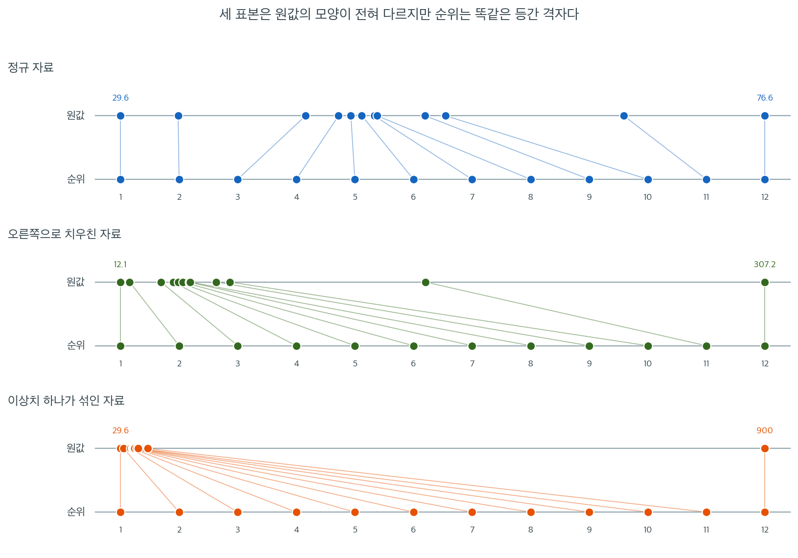
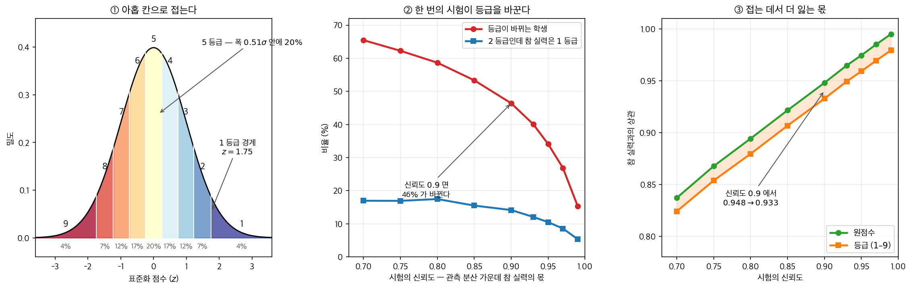
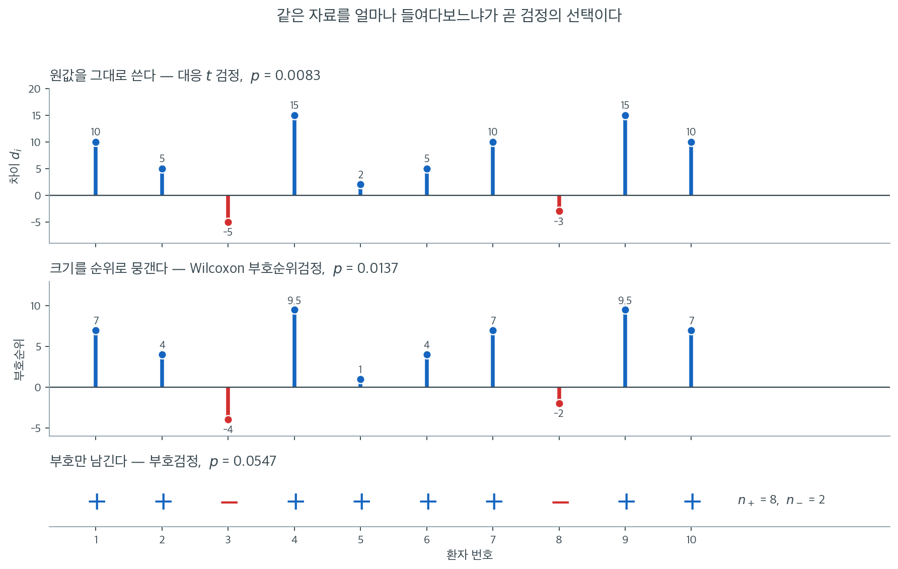

# 순위와 순위변환

대부분의 비모수 검정은 원자료를 **순위** --- 관측값을 작은 값부터 정렬했을 때 차지하는 위치 --- 로 바꾸어 분포무관 성질을 얻는다. 이 단순한 변환은 구체적인 수치를 버리면서 순서는 보존하는데, 위치 이동·확률적 우월·단조 연관성을 탐지하는 데 필요한 정보는 정확히 그 순서이다.

이 절에서는 순위변환을 형식적으로 정의하고, **중간순위**로 동점을 처리하는 방법을 설명하며, 순위통계량을 비모수 추론의 토대로 만드는 핵심 성질을 소개한다.

---

## 1. 순위의 정의

표본 $X_1, X_2, \ldots, X_n$이 주어졌을 때 관측값 $X_i$의 **순위**는 정렬된 표본에서 $X_i$가 차지하는 위치이다. 형식적으로 $X_{(1)} \le X_{(2)} \le \cdots \le X_{(n)}$을 순서통계량이라 하자. 모든 값이 서로 다르면 $X_i$의 순위는 다음을 만족하는 유일한 정수 $R_i$이다.

$$
X_i = X_{(R_i)}
$$

동치로,

$$
R_i = \sum_{j=1}^{n} \mathbf{1}(X_j \le X_i)
$$

여기서 $\mathbf{1}(\cdot)$은 지시함수이다.

??? example "작은 표본에 순위 매기기"
    표본 $X = (7.3, \; 2.1, \; 5.8, \; 9.0, \; 4.5)$를 보자. 정렬하면 순서통계량은 $(2.1, \; 4.5, \; 5.8, \; 7.3, \; 9.0)$이다. 순위는 다음과 같다.

    | $i$ | $X_i$ | $R_i$ |
    |:---:|:-----:|:-----:|
    | 1 | 7.3 | 4 |
    | 2 | 2.1 | 1 |
    | 3 | 5.8 | 3 |
    | 4 | 9.0 | 5 |
    | 5 | 4.5 | 2 |

---

## 2. 중간순위로 동점 처리하기

관측값 둘 이상이 같은 값을 가지면 각각에 서로 다른 정수 순위를 배정하는 일이 모호해진다. 표준적인 해법은 동점인 관측값 모두에 **중간순위**(**평균순위**라고도 한다), 즉 그 동점값들이 차지했을 순위들의 산술평균을 배정하는 것이다.

정렬된 표본에서 위치 $j, j+1, \ldots, j+k-1$의 관측값이 모두 같다면 각각은 다음 중간순위를 받는다.

$$
\bar{R} = \frac{1}{k} \sum_{l=0}^{k-1} (j + l) = j + \frac{k - 1}{2}
$$

??? example "동점이 있을 때의 중간순위"
    $X = (4, \; 7, \; 7, \; 7, \; 10)$을 보자. 정렬된 값들은 위치 1부터 5를 차지한다. 세 개의 7이 위치 2, 3, 4를 차지하므로 각각 중간순위 $(2 + 3 + 4)/3 = 3$을 받는다.

    | $i$ | $X_i$ | 순위 위치 | 중간순위 $R_i$ |
    |:---:|:-----:|:-----------------:|:-------------:|
    | 1 | 4 | 1 | 1 |
    | 2 | 7 | 2, 3, 4 | 3 |
    | 3 | 7 | 2, 3, 4 | 3 |
    | 4 | 7 | 2, 3, 4 | 3 |
    | 5 | 10 | 5 | 5 |

    중간순위의 합은 여전히 $1 + 3 + 3 + 3 + 5 = 15 = n(n+1)/2$임에 주목하라. 이 성질은 언제나 성립한다.

!!! warning "동점이 검정통계량에 미치는 영향"
    많은 비모수 검정통계량은 귀무분포를 유도할 때 동점이 없다고 가정한다. 동점이 있으면 **동점 보정계수**를 적용해야 한다. 예를 들어 Kruskal-Wallis 검정과 Wilcoxon 순위합검정은 동점 집단의 개수와 크기에 의존하는 보정항으로 나눈다. 동점을 무시하면 검정통계량의 분산이 부풀려져 검정이 보수적으로 된다.

---

## 3. 순위의 성질

순위를 분포무관 추론에 특히 유용하게 만드는 성질이 여럿 있다.

**순위의 합.** 크기 $n$인 임의의 표본에서 순위 $R_1, R_2, \ldots, R_n$은 $\{1, 2, \ldots, n\}$의 순열이므로(동점이 있어 중간순위를 써도 총합은 같다),

$$
\sum_{i=1}^{n} R_i = \frac{n(n+1)}{2}
$$

**평균순위.** 순위의 평균은 밑에 깔린 분포의 모양과 무관하게 언제나

$$
\bar{R} = \frac{n+1}{2}
$$

이다.

**순위의 분산.** 동점이 없을 때 순위의 분산은

$$
\text{Var}(R) = \frac{1}{n} \sum_{i=1}^{n} \left(i - \frac{n+1}{2}\right)^2 = \frac{n^2 - 1}{12}
$$

**분포무관 성질.** 모든 관측값이 같은 연속분포에서 나왔다는 귀무가설 아래에서는 순위의 모든 순열이 동등하게 가능하다. 따라서 순위에만 의존하는 임의의 통계량의 귀무분포를 모집단 분포를 몰라도 열거만으로 정확히 계산할 수 있다.

---

## 4. 실전에서의 순위변환

순위변환은 임의의 연속분포를 $\{1, 2, \ldots, n\}$ 위의 이산균등분포로 바꾼다. 여기에는 두 가지 중요한 귀결이 있다.

1. **이상치 저항성.** 극단적인 관측값은 그 값이 10이든 10{,}000이든 순위 $n$을 받는다. 순위변환은 모든 관측값의 영향력에 상한을 씌운다.
2. **척도 불변성.** 순위는 자료에 대한 임의의 단조증가 변환에 불변이다. 순위를 매기기 전에 로그변환이나 제곱근변환을 적용해도 순위는 바뀌지 않는다.



세 줄 모두 $n = 12$인 표본이고, 위쪽 축에는 원값이 실제 간격대로, 아래쪽 축에는 그 값들의 순위가 놓여 있다. 두 축을 잇는 선이 각 관측값이 어디로 가는지를 보여 준다.

첫째 줄은 정규 자료 $(29.6, 33.8, \ldots, 66.3, 76.6)$이다. 원값이 가운데 $46$--$48$ 근처에 뭉쳐 있어 위쪽 점들이 서로 붙어 있지만, 아래쪽에서는 $1$부터 $12$까지 **똑같은 간격으로 펼쳐진다.** 둘째 줄은 같은 순서를 유지한 채 지수함수를 씌워 만든 치우친 자료 $(12.1, 16.3, \ldots, 151.8, 307.2)$인데, 원값 배치는 완전히 달라졌지만 **아래쪽 줄은 첫째 줄과 한 점도 다르지 않다.** 이것이 척도 불변성이며, 순위검정에 로그변환을 먼저 적용해도 $p$값이 소수점 이하 전부 그대로인 이유이다.

셋째 줄이 로버스트성을 보여 준다. 첫째 줄의 마지막 값 $76.6$을 $900$으로 바꾼 것뿐인데 표본평균이 $49.17$에서 $117.78$로, 표준편차가 $12.62$에서 $246.51$로 **스무 배 가까이** 부풀었다. 위쪽 축에서는 나머지 11개가 왼쪽 끝에 짓눌려 구별이 되지 않는다. 그런데 아래쪽 순위 축은 첫째 줄과 **완전히 동일하다.** $900$이든 $9{,}000$이든 순위 12를 받을 뿐이기 때문이다.

이 그림이 말하는 바를 한 문장으로 옮기면 이렇다. 순위변환은 임의의 연속분포를 $\{1, 2, \ldots, n\}$ 위의 균등한 격자로 보내며, 그 격자 위에서 **관측값 하나가 행사할 수 있는 영향력의 상한은 순위 $n$칸**이다. 표본평균에는 그런 상한이 없다. 위쪽 축의 모양이 세 줄 모두 다르다는 것이 모수적 검정이 세 경우에 서로 다르게 반응한다는 뜻이고, 아래쪽 축이 세 줄 모두 같다는 것이 순위검정이 세 경우에 **똑같은 답을 낸다**는 뜻이다.

!!! tip "정규화 변환으로서의 순위"
    적당히 비정규인 자료에서는 관측값을 순위로(또는 **van der Waerden 변환**이라 불리는 정규점수 $\Phi^{-1}(R_i / (n+1))$로) 바꾸는 것이 실용적인 정규화 단계가 될 수 있다. 이렇게 순위변환된 자료를 표준적인 분산분석이나 회귀 방법으로 분석하면 로버스트성이 좋은 검정을 얻는다.

<div class="storybox" markdown>

**그림으로 보는 통계학 1.** 아홉 칸으로 접은 순위

$50$ 만 명이 해마다 받는 순위변환이 하나 있다. **수능 등급**이다.

성적표에는 [표준점수](../../ch05/distributions/normal.md)와 백분위, 그리고
**$1$ 부터 $9$ 까지의 등급**이 찍힌다. 등급은 위에서부터 $4\%$, $7\%$, $12\%$, $17\%$,
$20\%$, $17\%$, $12\%$, $7\%$, $4\%$ 로 끊는다. $5$ 등급을 가운데 두고 좌우대칭이다.

이것이 $4$ 절이 말한 순위변환의 **극단적인 판본**이다. $n$ 개의 순위를 $n$ 칸으로 펴는
대신 **아홉 칸으로 접는다.** 접으면 무엇이 남고 무엇이 사라지는가.

<figure markdown>
{ width="960" }
  <figcaption markdown>가운데 칸과 오른쪽 칸이 서로 다른 말을 한다. 둘 다 맞다.</figcaption>
</figure>

왼쪽 칸이 아홉 칸의 생김새다. 점수가 정규분포를 따른다고 보면 경계가 이렇게 놓인다.

| 등급 | 비율 | 누적 | $z$ 구간 | 폭 |
|---:|---:|---:|:---:|---:|
| $1$ | $4\%$ | $4\%$ | $[+1.751,\ \infty)$ | — |
| $2$ | $7\%$ | $11\%$ | $[+1.227,\ +1.751)$ | $0.524\sigma$ |
| $3$ | $12\%$ | $23\%$ | $[+0.739,\ +1.227)$ | $0.488\sigma$ |
| $4$ | $17\%$ | $40\%$ | $[+0.253,\ +0.739)$ | $0.485\sigma$ |
| $5$ | $20\%$ | $60\%$ | $[-0.253,\ +0.253)$ | $0.507\sigma$ |

아래쪽은 대칭이다. 눈여겨볼 것이 둘이다. 첫째, **가운데 다섯 칸의 폭이 거의 같다**
($0.485$–$0.524\sigma$). 비율은 $20\%$ 에서 $7\%$ 까지 세 배 가까이 다른데 폭은 같다 —
정규곡선의 높이가 달라서 그렇다. 둘째, **$1$ 등급과 $9$ 등급은 열려 있다.** $1$ 등급
안에서는 전국 수석과 $4\%$ 턱걸이가 같은 수를 받는다. 순위변환이 「영향력에 상한을
씌운다」고 한 것이 여기서는 **정보에 상한을 씌운다**가 된다.

가운데 칸이 더 불편한 쪽이다. 시험 점수를 「참 실력 $+$ 그날의 오차」로 보고, 관측 분산
가운데 참 실력의 몫을 **신뢰도**라 하자. 신뢰도가 $0.9$ — 표준화 시험으로는 높은
편이다 — 일 때, 참 실력대로라면 받았을 등급과 **실제로 받은 등급이 다른 학생이
$46\%$** 다. 둘에 한 명꼴이다. 관측 $2$ 등급인 학생의 $14\%$ 는 참 실력이 $1$ 등급이고,
신뢰도가 $0.8$ 로 떨어지면 그 비율이 $17.5\%$ 가 된다.

여기까지만 읽으면 등급제가 엉터리처럼 보인다. 오른쪽 칸이 그 판단을 막는다.
같은 신뢰도 $0.9$ 에서

- 원점수와 참 실력의 상관: $0.948$
- 등급($1$–$9$)과 참 실력의 상관: $0.933$

**아홉 칸으로 접느라 잃은 것은 $0.015$ 뿐이다.** 잡음이 아예 없다고 해도 등급의 상관은
$0.984$ 로, 접는 행위 자체의 손실은 작다. 신뢰도를 $0.7$ 에서 $0.99$ 까지 움직여 봐도
잃는 몫은 줄곧 $0.013$–$0.016$ 사이에 머문다.

두 칸이 모순되는 것이 아니다. **상관은 집단을 보고 오분류는 개인을 본다.** 경계 근처에서
한 칸 오르내리는 일은 상관을 거의 흔들지 못하지만, 그 한 칸에 걸린 사람에게는 전부다.
$9$ 등급제를 두고 「변별력」과 「한 문제에 등급이 갈린다」가 평행선을 달리는 까닭이
이 그림 안에 있다. 두 쪽 다 옳은 수를 들고 있다.

덧붙이면, 이 상자의 수는 **정규분포를 가정하고 계산한 값**이다. 실제 수능에서는
동점자가 경계에 몰려 $1$ 등급이 $4\%$ 를 넘기도 하고, 만점자가 많은 해에는 아예 등급이
비기도 한다. $2$ 절의 중간순위와 $5$ 절의 동점 보정계수가 다루는 바로 그 문제가,
$50$ 만 명 규모에서는 신문 기사가 된다.

_확인한 곳 — 등급별 비율 $4$–$7$–$12$–$17$–$20$–$17$–$12$–$7$–$4$ 와 그 누적 기준. 나머지 수는 모두 직접 계산하거나 모의실험한 값이다_

</div>

### 순위로 바꿀 때 무엇을 버리는가 — 세 층으로 보기

순위변환이 **무엇을 버리는지**는 같은 자료를 층마다 한 번씩 검정해 보면 수로 드러난다.



대응 자료에 쓸 수 있는 검정 셋을 한 장에 겹쳐 놓으면 공통 구조가 드러난다. 세 칸 모두 **같은 자료**이다. 환자 10명의 처치 전후 차이 $d = (10, 5, -5, 15, 2, 5, 10, -3, 15, 10)$을 세 가지 해상도로 바라본 것뿐이다.

맨 위는 원값 그대로이다. $-5$가 $-3$보다 두 배 가까이 크다는 것, $15$가 $2$의 일곱 배라는 것을 전부 쓴다. 대응 $t$ 검정이 이 층에서 작동하고 $p = 0.0083$을 준다. 가운데는 절대차이를 순위로 뭉갠 것이다. $15$와 $15$는 순위 $9.5$, $2$는 순위 $1$이 되어 **간격은 사라지고 순서만 남는다.** Wilcoxon 부호순위검정이 여기서 $p = 0.0137$을 준다. 맨 아래는 부호만 남긴 층이다. 열 개의 $+$와 $-$뿐이며 부호검정이 $p = 0.0547$을 준다.

$p$값이 $0.0083 \to 0.0137 \to 0.0547$로 **층을 내려갈 때마다 커진다**는 점을 눈여겨보라. 여기서는 두 음의 차이가 $-5$와 $-3$으로 작은 축에 속해, 순위를 버리는 순간 "반대 방향 증거가 있긴 하지만 미미하다"는 정보가 통째로 사라지기 때문이다. 다만 이것을 "위쪽 검정이 항상 낫다"로 읽으면 안 된다. 아래층으로 내려가는 것은 정보를 잃는 동시에 **가정을 덜어 내는** 일이다. $t$ 검정은 차이가 정규에 가깝기를, 부호순위검정은 대칭이기를 요구하지만 부호검정은 아무것도 요구하지 않는다.

그래서 검정을 고르는 일은 "가장 강력한 것 고르기"가 아니라 **자료의 어느 층까지를 믿을 수 있는가를 정하는 일**이다. Likert 척도라면 위 두 층은 애초에 존재하지 않고, 이상치가 의심스럽다면 맨 위 층을 믿을 수 없으며, 분포가 비대칭이면 가운데 층의 귀무분포가 틀어진다. 믿을 수 있는 가장 위층을 고르는 것이 옳은 순서이다.

---

## 5. 동점 보정계수

동점이 있으면 순위 기반 통계량의 정확 귀무분포가 달라진다. 대부분의 검정통계량은 보정계수를 넣는다. $g$를 서로 다른 동점 집단의 개수, $t_j$를 $j$번째 집단의 동점 관측값 개수라 하자. 흔히 쓰는 보정계수는

$$
C = 1 - \frac{\sum_{j=1}^{g} (t_j^3 - t_j)}{n^3 - n}
$$

이다. 보정된 검정통계량은 보정되지 않은 통계량을 $C$로 나누어 얻는다(동치로, 그 분산을 $C$로 나눈다). 동점이 없으면 모든 $j$에 대해 $t_j = 1$이므로 $C = 1$이고 보정이 필요 없다.

---

## 6. 흔히 쓰는 순위 기반 통계량

이 장 전체에서 다음 순위 기반 검정통계량이 등장한다.

| 통계량 | 정의 | 쓰이는 곳 |
|:----------|:-----------|:--------|
| Wilcoxon $W^+$ | 양의 차이들의 순위합 | 부호순위검정 |
| Wilcoxon $W$ | 한 집단의 순위합 | 순위합검정 |
| Mann-Whitney $U$ | 쌍별 승수 | 이표본 검정 |
| Kruskal-Wallis $H$ | 집단 간 순위 변동 | 다집단 검정 |
| Friedman $\chi^2_F$ | 블록 내 순위 변동 | 반복측정 |
| Spearman $r_s$ | 순위의 Pearson 상관 | 상관 |
| Kendall $\tau$ | 정규화된 일치도 계수 | 상관 |

이들 통계량은 모두 원자료가 아니라 순위 위에서 작동하므로, 위에서 설명한 분포무관 성질과 이상치 저항성을 물려받는다.

---

## 연습문제

<div class="drillbox" markdown>

**연습문제 1.** <span class="diff easy" title="쉬움"></span>
$X = (3, 5, 5, 5, 8, 8, 11, 11, 11, 11)$의 중간순위를 손으로 구하고, 합이 $n(n+1)/2$인지 확인하라. 이 표본의 동점 보정계수 $C$도 계산하라.

</div>

??? success "풀이"
    정렬된 위치는 1부터 10까지이다.

    | 값 | 차지하는 위치 | 중간순위 | 개수 $t_j$ |
    |:---:|:---:|:---:|:---:|
    | 3 | 1 | $1$ | 1 |
    | 5 | 2, 3, 4 | $(2+3+4)/3 = 3$ | 3 |
    | 8 | 5, 6 | $(5+6)/2 = 5.5$ | 2 |
    | 11 | 7, 8, 9, 10 | $(7+8+9+10)/4 = 8.5$ | 4 |

    순위 벡터는 $(1, 3, 3, 3, 5.5, 5.5, 8.5, 8.5, 8.5, 8.5)$이고 합은

    $$
    1 + 9 + 11 + 34 = 55 = \frac{10 \cdot 11}{2} \quad \checkmark
    $$

    보정계수는 $t = (1, 3, 2, 4)$이므로($t_j = 1$인 집단은 $t_j^3 - t_j = 0$이라 기여하지 않는다)

    $$
    C = 1 - \frac{(3^3 - 3) + (2^3 - 2) + (4^3 - 4)}{10^3 - 10}
      = 1 - \frac{24 + 6 + 60}{990} = 1 - \frac{90}{990} = \frac{10}{11} \approx 0.9091
    $$

    ```python
    import numpy as np
    from scipy import stats
    x = np.array([3, 5, 5, 5, 8, 8, 11, 11, 11, 11])
    r = stats.rankdata(x)
    print(r, r.sum())   # [1. 3. 3. 3. 5.5 5.5 8.5 8.5 8.5 8.5] 55.0
    ```

    출력:

    ```
    [1.  3.  3.  3.  5.5 5.5 8.5 8.5 8.5 8.5] 55.0
    ```

---

<div class="drillbox" markdown>

**연습문제 2.** <span class="diff easy" title="쉬움"></span>
$Y = (2.0, \; 7.5, \; 1.1, \; 9.9, \; 4.4)$에 대해 $\text{rank}(Y)$, $\text{rank}(\log Y)$, $\text{rank}(Y^3)$, $\text{rank}(-Y)$, $\text{rank}((Y-5)^2)$을 각각 구하라. 어느 것이 원래 순위와 같고 어느 것이 다른가? 그 이유는?

</div>

??? success "풀이"
    ```python
    y = np.array([2.0, 7.5, 1.1, 9.9, 4.4])
    for name, z in [("y", y), ("log y", np.log(y)), ("y^3", y**3),
                    ("-y", -y), ("(y-5)^2", (y - 5)**2)]:
        print(name, stats.rankdata(z))
    ```

    출력:

    ```
    y [2. 4. 1. 5. 3.]
    log y [2. 4. 1. 5. 3.]
    y^3 [2. 4. 1. 5. 3.]
    -y [4. 2. 5. 1. 3.]
    (y-5)^2 [3. 2. 4. 5. 1.]
    ```

    | 변환 | 순위 | 원래와 같은가 |
    |:---|:---|:---:|
    | $Y$ | $(2, 4, 1, 5, 3)$ | --- |
    | $\log Y$ | $(2, 4, 1, 5, 3)$ | 같다 |
    | $Y^3$ | $(2, 4, 1, 5, 3)$ | 같다 |
    | $-Y$ | $(4, 2, 5, 1, 3)$ | 정확히 뒤집힘 |
    | $(Y-5)^2$ | $(3, 2, 4, 5, 1)$ | 완전히 다름 |

    $\log$와 세제곱은 **단조증가** 함수이므로 $Y_i < Y_j \iff g(Y_i) < g(Y_j)$가 그대로 유지되어 순위가 보존된다. $-Y$는 단조**감소**이므로 순위가 $R \mapsto n + 1 - R$로 뒤집힌다. 검정통계량이 대칭적이면 이 뒤집기는 $p$값을 바꾸지 않는다.

    $(Y-5)^2$는 단조가 아니다. $5$ 아래와 위를 접어 버리므로 순서 정보가 파괴된다. $Y = 4.4$(원래 순위 3)가 새 순위 1이 되고, $Y = 2.0$(원래 순위 2)이 새 순위 3이 된다.

    실무적 함의: 순위 기반 검정에 **로그변환을 먼저 적용하는 것은 의미가 없다**. $p$값이 소수점 이하 전부 동일하게 나온다. 반대로 $t$ 검정에서는 로그변환이 결과를 크게 바꾼다. 이 불변성이 순위 검정의 장점이자 한계이다. 척도 선택에 흔들리지 않지만, 척도를 잘 골라 얻을 수 있었을 정보도 쓰지 못한다.

---

<div class="drillbox" markdown>

**연습문제 3.** <span class="diff easy" title="쉬움"></span>
연습문제 1의 자료를 세 집단 $A = (3, 5, 5, 8)$, $B = (5, 8, 11, 11)$, $C = (11, 11)$로 나누어 Kruskal-Wallis 검정을 수행하라. `scipy.stats.kruskal`이 동점 보정을 자동으로 하는지 확인하고, 보정을 하지 않으면 통계량이 어떻게 달라지는지 계산하라.

</div>

??? success "풀이"
    ```python
    a, b, c = [3, 5, 5, 8], [5, 8, 11, 11], [11, 11]
    print(stats.kruskal(a, b, c))
    # KruskalResult(statistic=5.235, pvalue=0.0730)
    ```

    출력:

    ```
    KruskalResult(statistic=5.2349999999999985, pvalue=0.07298509768315993)
    ```

    손으로 확인해 보자. 합친 자료의 중간순위는 연습문제 1과 같다. 집단별 순위합은

    - $A$: $1 + 3 + 3 + 5.5 = 12.5$ ($n_A = 4$)
    - $B$: $3 + 5.5 + 8.5 + 8.5 = 25.5$ ($n_B = 4$)
    - $C$: $8.5 + 8.5 = 17$ ($n_C = 2$)

    보정하지 않은 통계량은

    $$
    H' = \frac{12}{n(n+1)} \sum_i \frac{R_i^2}{n_i} - 3(n+1)
    = \frac{12}{110}\left(\frac{12.5^2}{4} + \frac{25.5^2}{4} + \frac{17^2}{2}\right) - 33
    $$

    ```python
    import numpy as np
    R = np.array([12.5, 25.5, 17.0]); ni = np.array([4, 4, 2]); n = 10
    H_raw = 12 / (n * (n + 1)) * np.sum(R**2 / ni) - 3 * (n + 1)
    print(H_raw, H_raw / (10 / 11))    # 4.759... 5.235...
    ```

    출력:

    ```
    4.759090909090908 5.2349999999999985
    ```

    보정 전 $H' = 4.759$, 보정 후 $H = H'/C = 4.759 \times 11/10 = 5.235$로 SciPy 결과와 일치한다. **SciPy는 동점 보정을 자동으로 한다.**

    $p$값에 미치는 영향은 $\chi^2_2$ 기준으로 $0.0925 \to 0.0730$이다. 이 표본에서는 동점 비율이 높아($10$개 중 $9$개가 동점) 보정이 $p$값을 20% 넘게 줄였다. 동점이 적으면 $C$가 $1$에 가까워 차이는 무시할 만하다.

    다만 여기서 더 중요한 경고가 있다. 집단 크기가 $4, 4, 2$로 매우 작고 자료가 심하게 이산적이어서 $\chi^2$ 근사 자체가 신뢰할 만하지 않다. 이런 경우에는 순열검정으로 정확 $p$값을 구하는 편이 낫다.

---

<div class="drillbox" markdown>

**연습문제 4.** <span class="diff med" title="중간"></span>
연습문제 1의 표본에서 중간순위의 (모)분산을 계산하고, 동점이 없을 때의 값 $(n^2-1)/12$와 비교하라. 두 값 사이의 관계에서 보정계수 $C$가 왜 그런 형태인지 설명하라.

</div>

??? success "풀이"
    ```python
    print(r.var())              # 7.5
    print((10**2 - 1) / 12)     # 8.25
    print(7.5 / 8.25)           # 0.9090909...
    ```

    출력:

    ```
    7.5
    8.25
    0.9090909090909091
    ```

    동점이 없을 때 $8.25$, 동점이 있을 때 $7.5$이고, 그 비가 정확히 $C = 10/11 = 0.9091$이다. 이것은 우연이 아니라 **항등식**이다.

    $$
    \frac{1}{n}\sum_i R_i^2 - \bar{R}^2 = \frac{n^2 - 1}{12} \cdot C
    $$

    직관은 이렇다. 동점 집단 하나를 중간순위로 뭉개면 그 집단 내부의 순위 변동이 완전히 사라진다. $t_j$개짜리 집단이 잃는 제곱합은 정확히 $t_j(t_j^2-1)/12$이고, 이를 전체 $n(n^2-1)/12$로 나누면

    $$
    \frac{\sum_j t_j(t_j^2-1)}{n(n^2-1)} = \frac{\sum_j (t_j^3 - t_j)}{n^3 - n}
    $$

    가 되어 $C$의 정의에 나오는 분수와 정확히 일치한다.

    이 때문에 동점을 무시한 검정이 **보수적**이 된다. Kruskal-Wallis 같은 통계량은 순위 분산으로 표준화하는데, 실제 분산($7.5$)보다 큰 값($8.25$)으로 나누면 통계량이 과소평가되어 기각을 덜 하게 된다. 통계량을 $C$로 나누는 것이 바로 이 과소평가를 되돌리는 조작이다.

---

<div class="drillbox" markdown>

**연습문제 5.** <span class="diff med" title="중간"></span>
4절은 "순위는 자료에 대한 임의의 단조증가 변환에 불변"이라고 했다. 연습문제 2의 $Y = (2.0, \; 7.5, \; 1.1, \; 9.9, \; 4.4)$에 측정기 상한 $5$를 씌운 절단변환 $g(y) = \min(y, 5)$를 적용하자. $g$에는 감소하는 구간이 없다.

(a) $\text{rank}(g(Y))$를 손으로 구해 $\text{rank}(Y)$와 비교하라.

(b) 이 반례에 비추어 4절의 문장을 어떻게 고쳐야 하는가?

(c) $g(Y)$의 동점 보정계수 $C$와 중간순위의 (모)분산을 구하고 $(n^2-1)/12$와 비교하라.

(d) 상한에 걸린 두 관측값의 실제 크기 순서는 알 수 없다. 두 가지 가능한 순서에서의 순위벡터를 각각 적고 그 둘을 평균하면 무엇이 되는가?

</div>

??? success "풀이"
    (a) $g(Y) = (2.0, \; 5, \; 1.1, \; 5, \; 4.4)$이다. 정렬하면 $1.1 < 2.0 < 4.4 < 5 = 5$이므로 두 개의 $5$가 위치 4, 5를 차지하고 각각 중간순위 $(4+5)/2 = 4.5$를 받는다.

    | $i$ | $Y_i$ | $g(Y_i)$ | $\text{rank}(Y)$ | $\text{rank}(g(Y))$ |
    |:---:|:-----:|:--------:|:----------------:|:-------------------:|
    | 1 | 2.0 | 2.0 | 2 | 2 |
    | 2 | 7.5 | 5 | 4 | 4.5 |
    | 3 | 1.1 | 1.1 | 1 | 1 |
    | 4 | 9.9 | 5 | 5 | 4.5 |
    | 5 | 4.4 | 4.4 | 3 | 3 |

    순위가 바뀌었다. 단조증가(비감소) 변환인데도 불변성이 깨졌다.

    (b) 필요한 조건은 **순증가**(strictly increasing)이다. 약한 의미의 단조증가는 서로 다른 두 값을 같은 값으로 보낼 수 있고, 그 순간 두 관측값은 구별이 사라져 중간순위로 뭉개진다. 연습문제 2의 $\log$와 세제곱은 순증가라서 순위가 보존되었던 것이다.

    (c) 동점 집단은 $t = (1, 1, 1, 2)$이므로

    $$
    C = 1 - \frac{2^3 - 2}{5^3 - 5} = 1 - \frac{6}{120} = 0.95
    $$

    순위벡터 $(2, 4.5, 1, 4.5, 3)$의 평균은 $15/5 = 3 = (n+1)/2$이고 분산은

    $$
    \frac{(-1)^2 + 1.5^2 + (-2)^2 + 1.5^2 + 0^2}{5} = \frac{9.5}{5} = 1.9
    $$

    동점이 없을 때의 값은 $(5^2-1)/12 = 2$이므로 비는 $1.9/2 = 0.95 = C$로, 연습문제 4의 항등식과 정확히 맞는다.

    (d) $7.5 < 9.9$가 유지된 순서라면 $(2, 4, 1, 5, 3)$, 뒤집힌 순서라면 $(2, 5, 1, 4, 3)$이다. 두 벡터의 평균은

    $$
    \frac{(2,4,1,5,3) + (2,5,1,4,3)}{2} = (2, \; 4.5, \; 1, \; 4.5, \; 3)
    $$

    으로 정확히 중간순위이다. 중간순위는 임의로 고른 타협값이 아니라 **알 수 없는 타이브레이킹 전부를 동등하게 보고 평균한 순위**이다. 그래서 순위합 $n(n+1)/2$가 보존된다.

    한 줄 해석: 척도불변성은 순서를 보존하는 변환에만 공짜로 주어진다. 절단은 순서 정보를 실제로 지우며, 그 대가가 $C = 0.95$만큼 줄어든 순위 분산 --- 곧 줄어든 검정력 --- 으로 나타난다.

---

<div class="drillbox" markdown>

**연습문제 6.** <span class="diff hard" title="어려움"></span>
연습문제 4는 중간순위의 분산이 $\frac{n^2-1}{12} C$라는 항등식을 한 표본에서 수치로 확인하고 직관만 제시했다. 이를 일반적으로 증명하자. 동점 집단 $j$가 정렬된 위치 $a_j + 1, \ldots, a_j + t_j$를 차지한다고 한다.

(a) 다음을 보여라.

$$
\sum_{i=1}^{n} R_i^2 = \sum_{i=1}^{n} i^2 - \frac{1}{12}\sum_{j=1}^{g} (t_j^3 - t_j)
$$

(b) (a)에서 $\frac{1}{n}\sum_i (R_i - \bar{R})^2 = \frac{n^2-1}{12} C$를 유도하라.

(c) $0 \le C \le 1$이고, $C = 1$은 동점이 전혀 없을 때뿐이며 $C = 0$은 모든 관측값이 같을 때뿐임을 보여라. $C = 0$인 자료에서 순위검정은 무엇을 할 수 있는가?

(d) $n = 10$일 때 $C < 1$을 만족하는 가장 큰 $C$와 $C > 0$을 만족하는 가장 작은 $C$를 구하라.

</div>

??? success "풀이"
    (a) 집단 $j$의 중간순위는 2절의 공식에 따라 $m_j = a_j + \frac{t_j+1}{2}$이고, 이것은 그 집단이 차지한 위치들의 산술평균이다. 평균으로부터의 제곱합 분해를 쓰면

    $$
    \sum_{l=1}^{t_j} (a_j + l)^2 = t_j m_j^2 + \sum_{l=1}^{t_j} (a_j + l - m_j)^2
    $$

    이고, 두 번째 항은 $a_j$가 상쇄되어 $\sum_{l=1}^{t_j}\left(l - \frac{t_j+1}{2}\right)^2$가 된다. 이는 3절의 순위 분산 공식을 크기 $t_j$인 표본에 적용한 것이므로 $t_j \cdot \frac{t_j^2-1}{12} = \frac{t_j^3 - t_j}{12}$이다. 집단 $j$에 속한 관측값은 모두 $R_i = m_j$를 받으니 이 집단의 순위 제곱합 기여는 $t_j m_j^2$이고, 따라서

    $$
    \sum_{l=1}^{t_j} (a_j + l)^2 - t_j m_j^2 = \frac{t_j^3 - t_j}{12}
    $$

    모든 집단에 대해 더하면 왼쪽의 첫 항들이 $\sum_{i=1}^n i^2$로 모이고 두 번째 항들이 $\sum_i R_i^2$로 모여 주장한 식이 된다. $\square$

    (b) 중간순위에서도 $\bar{R} = (n+1)/2$이다(3절). $\sum_{i=1}^n i^2 = \frac{n(n+1)(2n+1)}{6}$을 쓰면

    $$
    \frac{1}{n}\sum_i R_i^2 - \bar{R}^2
    = \frac{(n+1)(2n+1)}{6} - \frac{(n+1)^2}{4} - \frac{\sum_j (t_j^3 - t_j)}{12n}
    $$

    앞의 두 항은

    $$
    \frac{(n+1)\left[2(2n+1) - 3(n+1)\right]}{12} = \frac{(n+1)(n-1)}{12} = \frac{n^2-1}{12}
    $$

    이다. 한편 $C$의 정의에서

    $$
    \frac{n^2-1}{12} C = \frac{n^2-1}{12} - \frac{n^2-1}{12}\cdot\frac{\sum_j (t_j^3-t_j)}{n(n^2-1)}
    = \frac{n^2-1}{12} - \frac{\sum_j (t_j^3 - t_j)}{12n}
    $$

    두 식이 항별로 같다. $\square$

    (c) 각 항이 $t_j^3 - t_j \ge 0$이므로 $C \le 1$이고, 등호는 모든 $t_j = 1$, 곧 동점이 없을 때뿐이다. 다른 쪽은 $t_j \le n$에서 $t_j^3 \le n^2 t_j$이므로

    $$
    \sum_j t_j^3 \le n^2 \sum_j t_j = n^3
    \;\Longrightarrow\;
    \sum_j (t_j^3 - t_j) \le n^3 - n
    \;\Longrightarrow\; C \ge 0
    $$

    $t_j^3 = n^2 t_j$는 $t_j = n$일 때만이므로 등호는 집단이 하나뿐일 때, 곧 $n$개 관측값이 모두 같을 때뿐이다. 그때 모든 순위가 $(n+1)/2$로 같아 순위의 분산이 $0$이고, 순위만 보는 통계량은 자료의 어떤 재배열에도 똑같은 값을 낸다. 열거로 얻는 정확 $p$값은 $1$이 되고 검정은 아무것도 탐지할 수 없다.

    (d) $n = 10$이면 $n^3 - n = 990$이다. $C$를 최대화하는 것은 $\sum_j (t_j^3-t_j)$를 양수인 범위에서 최소화하는 것이고, 가장 작은 동점은 한 쌍($t = 2$)이라 기여가 $6$이다.

    $$
    C_{\max} = 1 - \frac{6}{990} = \frac{164}{165} \approx 0.99394
    $$

    반대로 $C$를 최소화하는 것은 $\sum_j (t_j^3 - t_j)$를 최대화하는 것이다. $(a+b)^3 \ge a^3 + b^3$이므로 두 집단을 합치면 그 합은 언제나 커진다. 곧 동점을 한곳에 모을수록 커지며, 전부 동점인 $t = (10)$은 $C = 0$이라 제외하므로 다음으로 모인 꼴은 $t = (9, 1)$이다.

    $$
    C_{\min}^{+} = 1 - \frac{9^3 - 9}{990} = 1 - \frac{720}{990} = \frac{3}{11} \approx 0.27273
    $$

    $C = 3/11$이면 순위 분산이 동점 없을 때의 $27\%$로 줄어든다. 자료가 사실상 "같은 값 아홉 개와 다른 값 하나"이면 순위는 가질 수 있는 변동의 대부분을 잃는다는 뜻이다. 연습문제 1의 표본이 $C = 10/11$이었던 것과 비교하면, 같은 $n = 10$에서도 동점이 어떻게 흩어져 있는지가 $C$를 $3/11$에서 $164/165$까지 벌려 놓는다.

---

<div class="drillbox" markdown>

**연습문제 7.** <span class="diff hard" title="어려움"></span>
3절의 분포무관 성질은 "순위의 모든 순열이 동등하게 가능하므로 귀무분포를 열거만으로 정확히 계산할 수 있다"고 했다. 두 집단의 크기가 $n_1 = n_2 = 4$인 경우에 이것을 끝까지 해 보자. 합친 표본의 순위는 $1, \ldots, 8$이고 첫째 집단의 순위합을 $W$라 한다.

(a) $W$의 최솟값과 최댓값을 적고, 3절의 평균순위 공식으로 $E[W]$를 구하라.

(b) 귀무가설 아래에서 $\binom{8}{4} = 70$가지 순위 배정이 모두 확률 $1/70$을 갖는다. $W = 10, 11, 12, 13$이 되는 경우의 수를 손으로 세어 $P(W \le w)$를 구하라.

(c) 이 설계에서 양쪽검정으로 얻을 수 있는 가장 작은 $p$값은 얼마인가? $\alpha = 0.05$와 $\alpha = 0.025$에서 각각 무슨 일이 생기는가?

(d) 열거를 코드로 확인하고, 한 집단의 값이 모두 다른 집단보다 작은 자료에 `mannwhitneyu(..., method="exact")`를 적용해 (c)를 검증하라.

</div>

??? success "풀이"
    (a) 가장 작은 네 순위를 받으면 $W_{\min} = 1+2+3+4 = 10$, 가장 큰 네 순위면 $W_{\max} = 5+6+7+8 = 26$이다. 합친 표본의 크기는 $N = 8$이고 평균순위는 $(N+1)/2 = 4.5$이므로

    $$
    E[W] = n_1 \cdot \frac{N+1}{2} = 4 \times 4.5 = 18
    $$

    또한 두 집단의 순위합을 더하면 언제나 $N(N+1)/2 = 36$이므로 $W$와 $36 - W$가 같은 분포를 따른다. 귀무분포는 $18$에 대해 대칭이다.

    (b) $\{1, \ldots, 8\}$에서 크기 4인 부분집합의 합을 센다.

    | $W$ | 부분집합 | 경우의 수 | 누적 | $P(W \le w)$ |
    |:---:|:---|:---:|:---:|:---:|
    | 10 | $\{1,2,3,4\}$ | 1 | 1 | $1/70 = 0.0143$ |
    | 11 | $\{1,2,3,5\}$ | 1 | 2 | $2/70 = 0.0286$ |
    | 12 | $\{1,2,3,6\}, \{1,2,4,5\}$ | 2 | 4 | $4/70 = 0.0571$ |
    | 13 | $\{1,2,3,7\}, \{1,2,4,6\}, \{1,3,4,5\}$ | 3 | 7 | $7/70 = 0.1000$ |

    (c) 가장 극단인 $W = 10$의 한쪽 꼬리 확률이 $1/70$이고 분포가 대칭이므로 양쪽 $p$값은

    $$
    p_{\min} = \frac{2}{70} = 0.02857
    $$

    $\alpha = 0.05$에서는 $W = 10$ 또는 $W = 26$, 곧 두 집단이 **완전히 분리된** 경우에만 기각한다($p = 0.0286 \le 0.05$). $W = 11$이면 양쪽 $p = 4/70 = 0.0571 > 0.05$로 기각하지 못한다. 반면 $\alpha = 0.025$에서는 $p_{\min} = 0.0286 > 0.025$이므로 **어떤 자료로도 기각할 수 없다.** 검정의 실제 크기가 $0$이다. 이는 근사나 계산의 문제가 아니라 설계의 문제다. 순열이 70가지뿐이어서 달성 가능한 유의수준이 $1/70 = 0.0143$의 배수로 띄엄띄엄 놓이고, 그 격자 안에 $0.025$보다 작은 양쪽 꼬리가 없다.

    (d) 전수 열거와 SciPy의 정확검정을 맞춰 본다.

    ```python
    import itertools
    from collections import Counter
    import numpy as np
    from scipy import stats

    sub = list(itertools.combinations(range(1, 9), 4))
    cnt = Counter(sum(s) for s in sub)
    print("4 개를 고르는 방법:", len(sub))
    for w in range(10, 15):
        tail = sum(cnt[v] for v in range(10, w + 1))
        print(f"W = {w}  경우 {cnt[w]}  누적 {tail}  P(W <= {w}) = {tail / 70:.4f}")

    g1 = np.array([1.0, 2.0, 3.0, 4.0])
    g2 = np.array([5.0, 6.0, 7.0, 8.0])
    res = stats.mannwhitneyu(g1, g2, alternative="two-sided", method="exact")
    print(f"U = {res.statistic:.1f}   양쪽 p = {res.pvalue:.4f}   2/70 = {2 / 70:.4f}")
    ```

    출력:

    ```text
    4 개를 고르는 방법: 70
    W = 10  경우 1  누적 1  P(W <= 10) = 0.0143
    W = 11  경우 1  누적 2  P(W <= 11) = 0.0286
    W = 12  경우 2  누적 4  P(W <= 12) = 0.0571
    W = 13  경우 3  누적 7  P(W <= 13) = 0.1000
    W = 14  경우 5  누적 12  P(W <= 14) = 0.1714
    U = 0.0   양쪽 p = 0.0286   2/70 = 0.0286
    ```

    손으로 센 값과 한 자리도 다르지 않다. 완전분리 자료가 주는 $p = 0.0286$이 이 설계에서 가능한 최솟값이며, `method="exact"`를 명시하지 않으면 SciPy 판본에 따라 점근근사로 갈라 타 다른 값이 나올 수 있다는 점도 함께 기억해 둘 만하다.

    한 줄 해석: 작은 표본의 순위검정에서 유의수준은 연속적으로 고를 수 없다. 정확검정이 보수적이라는 말은 계산이 틀렸다는 뜻이 아니라, 열거가 허락하는 격자 위에서만 기각할 수 있다는 뜻이다.

---

<div class="drillbox" markdown>

**연습문제 8.** <span class="diff hard" title="어려움"></span>
6절의 표는 Spearman $r_s$를 "순위의 Pearson 상관"으로 정의한다. 한편 교과서에 자주 실리는 계산식은 $d_i = R_i - S_i$로 두고

$$
r_s = 1 - \frac{6 \sum_i d_i^2}{n(n^2-1)}
$$

이다.

(a) 동점이 없을 때, 3절의 $\bar{R} = \bar{S} = (n+1)/2$와 $\text{Var}(R) = \text{Var}(S) = (n^2-1)/12$만 써서 이 공식을 유도하라.

(b) 유도의 어느 단계가 동점에서 깨지는가? 연습문제 6의 항등식을 써서 두 변수의 보정계수 $C_X, C_Y$가 들어간 올바른 식을 적어라.

(c) $X = (1,1,1,1,2)$, $Y = (2,2,2,2,1)$에서 $d^2$ 공식이 주는 값과 참값을 손으로 구하고, 코드로 확인하라.

</div>

??? success "풀이"
    (a) $\bar{R} = \bar{S}$이므로 $d_i = (R_i - \bar{R}) - (S_i - \bar{S})$이고, 제곱해서 평균하면

    $$
    \frac{1}{n}\sum_i d_i^2 = \sigma_R^2 + \sigma_S^2 - 2\,\text{Cov}(R, S)
    $$

    동점이 없으면 $\sigma_R^2 = \sigma_S^2 = \frac{n^2-1}{12}$이므로

    $$
    \text{Cov}(R, S) = \frac{n^2-1}{12} - \frac{1}{2n}\sum_i d_i^2
    $$

    이고 분모도 $\sigma_R \sigma_S = \frac{n^2-1}{12}$이라서

    $$
    r_s = \frac{\text{Cov}(R,S)}{\sigma_R \sigma_S}
    = 1 - \frac{\frac{1}{2n}\sum_i d_i^2}{\frac{n^2-1}{12}}
    = 1 - \frac{6\sum_i d_i^2}{n(n^2-1)}
    $$

    (b) 깨지는 단계는 "$\sigma_R^2 = \sigma_S^2 = \frac{n^2-1}{12}$"뿐이다. 연습문제 6에 따라 동점이 있으면 $\sigma_R^2 = \frac{n^2-1}{12}C_X$, $\sigma_S^2 = \frac{n^2-1}{12}C_Y$이다. 이를 그대로 넣으면 $b = \frac{n^2-1}{12}$로 두어

    $$
    r_s = \frac{b \cdot \frac{C_X + C_Y}{2} - \frac{1}{2n}\sum_i d_i^2}{b\sqrt{C_X C_Y}}
    $$

    $C_X = C_Y = 1$이면 (a)의 공식으로 돌아온다. $d^2$ 공식은 분자에서 두 분산의 **산술평균**, 분모에서 **기하평균**을 쓰는데 동점이 그 둘을 모두 $1$에서 끌어내리기 때문에 두 자리에서 동시에 틀린다.

    (c) $R = \text{rank}(X) = (2.5, 2.5, 2.5, 2.5, 5)$, $S = \text{rank}(Y) = (3.5, 3.5, 3.5, 3.5, 1)$이다. $d = (-1, -1, -1, -1, 4)$이므로 $\sum d_i^2 = 4 \cdot 1 + 16 = 20$이고

    $$
    1 - \frac{6 \cdot 20}{5 \cdot 24} = 1 - 1 = 0
    $$

    참값을 보자. 양쪽 모두 네 개짜리 동점 집단 하나씩이므로

    $$
    C_X = C_Y = 1 - \frac{4^3 - 4}{5^3 - 5} = 1 - \frac{60}{120} = 0.5
    $$

    이고 $b = (25-1)/12 = 2$이므로 $\sigma_R^2 = \sigma_S^2 = 2 \times 0.5 = 1$이다. 공분산은

    $$
    \text{Cov}(R, S) = \frac{1 + 1}{2} - \frac{20}{2 \cdot 5} = 1 - 2 = -1
    $$

    따라서 $r_s = -1/(1 \cdot 1) = -1$이다. 실제로 $S = 6 - R$이 성립하므로($2.5 \mapsto 3.5$, $5 \mapsto 1$) 두 순위벡터는 완전한 감소 일차관계이고 Pearson 상관이 정확히 $-1$인 것이 맞다.

    ```python
    def spearman_parts(xv, yv):
        n = len(xv)
        R, S = stats.rankdata(xv), stats.rankdata(yv)
        d2 = ((R - S) ** 2).sum()
        short = 1 - 6 * d2 / (n * (n ** 2 - 1))
        def tie_c(v):
            _, t = np.unique(v, return_counts=True)
            return 1 - (t ** 3 - t).sum() / (n ** 3 - n)
        CX, CY, b = tie_c(xv), tie_c(yv), (n ** 2 - 1) / 12
        fixed = (b * (CX + CY) / 2 - d2 / (2 * n)) / (b * np.sqrt(CX * CY))
        true = stats.spearmanr(xv, yv, alternative="two-sided").statistic
        return d2, CX, CY, short, fixed, true

    for xv, yv in [([1, 1, 1, 1, 2], [10, 20, 30, 40, 50]),
                   ([1, 1, 1, 1, 2], [2, 2, 2, 2, 1])]:
        d2, CX, CY, short, fixed, true = spearman_parts(xv, yv)
        print(f"X={xv} Y={yv}")
        print(f"  sum d^2 = {d2:.1f}   C_X = {CX:.4f}   C_Y = {CY:.4f}")
        print(f"  d^2 공식 = {short:.4f}   보정식 = {fixed:.4f}   spearmanr = {true:.4f}")
    ```

    출력:

    ```text
    X=[1, 1, 1, 1, 2] Y=[10, 20, 30, 40, 50]
      sum d^2 = 5.0   C_X = 0.5000   C_Y = 1.0000
      d^2 공식 = 0.7500   보정식 = 0.7071   spearmanr = 0.7071
    X=[1, 1, 1, 1, 2] Y=[2, 2, 2, 2, 1]
      sum d^2 = 20.0   C_X = 0.5000   C_Y = 0.5000
      d^2 공식 = 0.0000   보정식 = -1.0000   spearmanr = -1.0000
    ```

    (b)의 보정식이 두 경우 모두 `spearmanr`와 소수 넷째 자리까지 일치한다.

    한 줄 해석: 둘째 행이 이 문제의 핵심이다. $d^2$ 공식은 "연관이 전혀 없다"($r_s = 0$)고 말하지만 참값은 **완전한 음의 연관**이다. 동점이 있는 자료에 그 지름길을 쓰면 크기만 어긋나는 것이 아니라 결론이 뒤집힐 수 있다.

---

<div class="drillbox" markdown>

**연습문제 9.** <span class="diff hard" title="어려움"></span>
2절의 경고는 "동점을 무시하면 검정통계량의 분산이 부풀려져 검정이 보수적으로 된다"고 했다. 이 말을 수로 재어 보자. 귀무가설이 참인 상황 --- 세 집단이 같은 분포에서 나온다 --- 에서 집단마다 $m = 12$개를 뽑아 $\chi^2_2$의 $95\%$ 분위점으로 판정하는 Kruskal-Wallis 검정의 기각률을 20,000번 모의로 추정하라. 자료는 (i) $\{1,2,3,4\}$ 위의 균등이산분포와 (ii) 표준정규분포 두 경우로 하고, 보정한 $H$와 보정을 빼먹은 $H' = H \cdot C$를 함께 재며 평균 $C$도 적어라.

(a) 어느 쪽이 보수적인가? 모의실험의 잡음과 무관하게 그렇게 될 수밖에 없는 이유를 적어라.

(b) 보정한 검정도 명목 $0.05$에 정확히 맞지 않는다. 왜인가?

(c) 연속 자료에서 두 기각률이 완전히 같은 까닭은?

</div>

??? success "풀이"
    ```python
    rng = np.random.default_rng(0)
    B, m, crit = 20000, 12, stats.chi2.ppf(0.95, 2)

    def one_round(draw):
        rej_c = rej_u = 0
        Csum = 0.0
        for _ in range(B):
            g = draw()
            H = stats.kruskal(g[0], g[1], g[2]).statistic
            _, t = np.unique(g, return_counts=True)
            n = g.size
            C = 1 - (t ** 3 - t).sum() / (n ** 3 - n)
            Csum += C
            rej_c += H > crit
            rej_u += H * C > crit        # 보정을 빼먹은 통계량 H' = H * C
        return Csum / B, rej_c / B, rej_u / B

    Cd, cd, ud = one_round(lambda: rng.integers(1, 5, size=(3, m)))
    print(f"이산 {{1,2,3,4}}: 평균 C = {Cd:.4f}   보정 H 기각률 = {cd:.4f}   무보정 H' 기각률 = {ud:.4f}")
    Cc, cc, uc = one_round(lambda: rng.normal(size=(3, m)))
    print(f"연속 정규     : 평균 C = {Cc:.4f}   보정 H 기각률 = {cc:.4f}   무보정 H' 기각률 = {uc:.4f}")
    ```

    출력:

    ```text
    이산 {1,2,3,4}: 평균 C = 0.9223   보정 H 기각률 = 0.0465   무보정 H' 기각률 = 0.0352
    연속 정규     : 평균 C = 1.0000   보정 H 기각률 = 0.0471   무보정 H' 기각률 = 0.0471
    ```

    (a) 보정을 빼먹은 쪽이다. 명목 $0.05$ 검정이 실제로는 $0.0352$ 수준으로 돌아간다. 이것은 우연이 아니다. 연습문제 6에서 $C \le 1$이므로 언제나 $H' = CH \le H$이고, 따라서 기각사건 $\{H' > c\}$는 $\{H > c\}$에 포함된다. 표본마다 포함관계가 성립하니 기각률은 반드시 작거나 같다. 2절의 경고가 말한 그대로 **보수적**이며, 결코 과감해지는 쪽으로는 틀리지 않는다.

    (b) 두 가지가 겹친다. 첫째, $\chi^2_2$는 $H$의 귀무분포에 대한 점근근사일 뿐이고 $m = 12$는 유한하다. 연속 자료에서조차 $0.0471$이 나오는 것이 그 몫이다. 둘째, 이산 자료에서는 $H$의 귀무분포 자체가 유한개의 값만 갖는 이산분포라서 꼬리확률이 명목값에 정확히 맞춰질 수 없다. 20,000번의 표준오차는 $\sqrt{0.05 \times 0.95/20000} \approx 0.0015$이므로 $0.0465$와 $0.0471$의 차이는 잡음 범위에 가깝지만, $0.0352$와 $0.05$의 차이는 잡음으로 설명되지 않는다.

    (c) 연속분포에서 두 관측값이 같을 확률은 $0$이고, 부동소수 난수에서도 실제로 겹치지 않았다. 그래서 모든 $t_j = 1$이 되어 $\sum_j (t_j^3 - t_j) = 0$, 곧 $C = 1$이고 $H' = H$다. 출력의 평균 $C$가 정확히 $1.0000$인 것이 이 사실의 확인이다. 동점 보정은 동점이 있을 때만 할 일이 있다.

    한 줄 해석: 보정을 빼먹는 것은 "안전한 쪽"으로 틀리는 일이지만 공짜가 아니다. 이 설정에서 보정을 잊으면 유의수준의 $30\%$를 쓰지 않고 버리는 셈이고, 그만큼 검정력을 잃는다.

---

<div class="drillbox" markdown>

**연습문제 10.** <span class="diff hard" title="어려움"></span>
4절의 팁은 van der Waerden 변환, 곧 정규점수 $a_i = \Phi^{-1}\!\left(\frac{R_i}{n+1}\right)$를 소개한다.

(a) 동점이 없을 때 $\sum_i a_i = 0$임을 보여라.

(b) 순위변환은 관측값 하나가 행사할 수 있는 영향력에 상한을 씌운다(4절). 정규점수에서 그 상한은 무엇인가? 각 변환을 자신의 표준편차로 표준화한 뒤 가장 극단인 값을 비교하여, $n$이 커질 때 순위와 정규점수 가운데 극단 관측값에 더 큰 가중을 주는 쪽이 어디인지 밝혀라. 그런데도 정규점수를 쓰는 이유는 무엇인가?

(c) 동점이 있으면 정규점수를 두 가지로 매길 수 있다. (i) 중간순위를 그대로 $\Phi^{-1}$에 넣기, (ii) 그 동점 집단이 차지한 각 위치의 정규점수를 평균하기. $n = 4$에서 위쪽 두 관측값이 동점인 경우로 두 방식을 비교하고, (a)의 성질을 보존하는 쪽이 어느 것인지 밝혀라. 어긋나는 방향을 $\Phi^{-1}$의 모양으로 설명하라.

</div>

??? success "풀이"
    (a) 동점이 없으면 $R$은 $\{1, \ldots, n\}$의 순열이므로 더하는 순서를 바꾸어

    $$
    \sum_{i=1}^{n} a_i = \sum_{k=1}^{n} \Phi^{-1}\!\left(\frac{k}{n+1}\right)
    $$

    표준정규의 대칭성에서 $\Phi^{-1}(1-p) = -\Phi^{-1}(p)$이고, $k \mapsto n+1-k$는 $\frac{k}{n+1}$을 $1 - \frac{k}{n+1}$로 보낸다. 따라서 $k$번째 항과 $(n+1-k)$번째 항이 서로 상쇄된다. $n$이 홀수이면 가운데 항은 $k = (n+1)/2$에서 $\Phi^{-1}(1/2) = 0$이다. $\square$

    $n = 5$에서 확인하면 점수는 $(-0.9674, \; -0.4307, \; 0, \; 0.4307, \; 0.9674)$이고 합이 $0$, 분산이 $0.4486$이다.

    (b) 상한은 가장 큰 순위가 받는 값, 곧 $\lvert a_i \rvert \le \Phi^{-1}\!\left(\frac{n}{n+1}\right)$이다. 유한하므로 정규점수도 순위처럼 한 관측값의 영향력을 묶어 두지만, 그 상한이 $n$에 따라 커진다. 공정하게 비교하려면 각 변환을 자기 표준편차로 나눈다.

    순위는 3절에서 $\text{Var}(R) = (n^2-1)/12$이므로 가장 극단인 표준화값이

    $$
    \frac{n - \frac{n+1}{2}}{\sqrt{\frac{n^2-1}{12}}}
    = \sqrt{3}\,\sqrt{\frac{n-1}{n+1}} \; \longrightarrow \; \sqrt{3} \approx 1.732
    $$

    로 $\sqrt{3}$에서 막힌다. 정규점수의 분산은 $n \to \infty$에서 $1$로 가고 최댓값은 $\Phi^{-1}\!\left(1 - \frac{1}{n+1}\right) \sim \sqrt{2\log n} \to \infty$이므로 표준화해도 발산한다. 느리게 커지지만 막히지는 않는다. 이미 $n = 5$에서 정규점수는 $0.9674/\sqrt{0.4486} = 1.4444$, 순위는 $\sqrt{3}\sqrt{4/6} = 1.4142$로 정규점수가 더 극단적이고, 차이는 $n$이 커질수록 벌어진다($n = 100$에서 $2.426$ 대 $1.715$). 곧 **정규점수가 극단 순위에 더 큰 가중을 준다.**

    그래도 정규점수를 쓰는 까닭은 바로 그 가중 때문이다. 자료가 실제로 정규에 가까우면 순위를 정규분위점으로 되돌려 놓는 것이 버린 정보를 상당 부분 되찾아 주며, 정규분포 아래에서 정규점수 검정의 점근상대효율은 $t$ 검정과 같은 $1$이다. Wilcoxon 순위합의 $3/\pi \approx 0.955$보다 낫다. 대신 상한이 커지므로 4절이 말한 이상치 저항성은 순위보다 약하다. 쓰는 쪽은 저항성과 효율 사이에서 고르는 셈이다.

    (c) $n = 4$에서 동점이 없으면 점수는 $\Phi^{-1}(0.2), \Phi^{-1}(0.4), \Phi^{-1}(0.6), \Phi^{-1}(0.8)$, 곧 $(-0.8416, \; -0.2533, \; 0.2533, \; 0.8416)$이다. 위쪽 두 관측값이 동점이면 둘 다 중간순위 $3.5$를 받는다.

    | 방식 | 동점 집단의 점수 | 점수합 |
    |:---|:---:|:---:|
    | (i) 중간순위를 넣기 | $\Phi^{-1}(3.5/5) = \Phi^{-1}(0.7) = 0.5244$ | $-0.0462$ |
    | (ii) 점수를 평균하기 | $\frac{\Phi^{-1}(0.6) + \Phi^{-1}(0.8)}{2} = 0.5475$ | $0.0000$ |

    (a)의 성질을 보존하는 쪽은 (ii)이다. (ii)는 원래의 네 점수를 그대로 쓰되 두 개를 각자의 평균으로 바꾼 것이라 총합이 변하지 않는다. (i)은 총합을 $-0.0462$로 밀어 버린다.

    어긋나는 방향은 $\Phi^{-1}$의 곡률로 결정된다. $\Phi^{-1}$은 $p > 1/2$에서 볼록하므로 Jensen 부등식에 의해

    $$
    \frac{\Phi^{-1}(0.6) + \Phi^{-1}(0.8)}{2} \ge \Phi^{-1}\!\left(\frac{0.6 + 0.8}{2}\right) = \Phi^{-1}(0.7)
    $$

    곧 (i)은 오른쪽 꼬리의 동점 집단 점수를 **과소평가**한다. $p < 1/2$에서는 오목하므로 왼쪽 꼬리에서는 과대평가, 즉 역시 $0$ 쪽으로 당긴다. 어느 꼬리든 (i)은 점수를 중심으로 끌어당기며, 동점이 한쪽 꼬리에만 있으면 그 당김이 상쇄되지 않아 합이 $0$에서 벗어난다.

    한 줄 해석: 2절의 중간순위가 $\sum R_i = n(n+1)/2$를 보존한 것은 순위가 **선형** 눈금이었기 때문이다. 비선형함수 $\Phi^{-1}$을 거치면 "먼저 평균하고 변환하기"와 "먼저 변환하고 평균하기"가 갈린다. 동점에서 정규점수를 쓸 때 평균을 어느 단계에서 취하느냐가 바로 이 차이이고, 보존되어야 할 성질을 지키는 쪽은 뒤쪽이다.

---

## 정리하며

순위변환은 비모수 검정의 중심 장치이다. 관측값을 정렬된 표본에서의 위치로 대체함으로써 순위 기반 방법은 분포무관성, 이상치에 대한 로버스트성, 순서형 자료에 대한 적용성을 얻는다. 동점이 생기면 중간순위가 순위변환의 핵심 성질을 보존하고, 보정계수가 검정통계량의 명목 유의수준을 유지하게 한다. 이 토대 위에 세워지는 구체적인 순위 기반 절차들은 이어지는 절에서 전개한다.

다음 쪽 **[모수적 검정과의 검정력 비교](power_comparison.md)**로 넘어간다. 크기를 버렸으니 **얼마를 잃는가**를 물어야 하고, 답은 놀랍도록 작다 — 정규에서조차 점근상대효율이 $3/\pi = 0.955$ 다.
