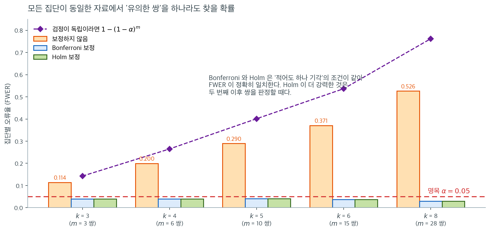

# 사후 Dunn 검정

[Kruskal-Wallis 검정](kruskal_wallis.md)이 귀무가설을 기각하면 적어도 한 집단이 나머지와 다르다는 것을 알게 되지만, *어느* 집단이 다른지는 알 수 없다. **Dunn 검정**은 바로 이 목적을 위해 설계된 사후 다중비교 절차이다. Kruskal-Wallis 분석에서 얻은 평균순위를 이용해 모든 집단 쌍을 비교하고, 다중검정에 대해 $p$값을 보정한다.

---

## 1. 동기

집단이 $k$개인 Kruskal-Wallis 결과가 유의하면 가능한 쌍별 비교가 $\binom{k}{2} = k(k-1)/2$개 있다. 각각을 보정 없이 유의수준 $\alpha$로 수행하면 집단별 오류율(FWER)이 부풀려진다. Dunn 검정은 쌍별 $p$값에 Bonferroni 보정(또는 다른 보정)을 적용하여 이 부풀림을 통제한다.



"FWER이 부풀려진다"가 구체적으로 얼마인지 재 보자. 위 그림은 **모든 집단이 실제로 동일한** 자료($k$개 집단, 집단당 $n = 12$, 모두 $\mathcal{N}(0,1)$)를 $4{,}000$번 만들어, 쌍별 비교에서 "유의한 쌍"을 하나라도 찾는 비율을 센 것이다. 진짜 차이는 하나도 없으므로 여기서 나오는 모든 기각은 거짓 양성이다.

보정하지 않은 주황 막대는 $k = 3$에서 벌써 $0.114$이고, $k = 5$에서 $0.290$, $k = 8$에서 $0.526$이다. **집단이 여덟이면 동전을 던지는 것과 비슷한 확률로 아무것도 아닌 쌍을 유의하다고 선언한다.** 보정을 넣은 파란·초록 막대는 모든 $k$에서 $0.05$ 아래에 머문다.

보라색 점선이 검정들이 **독립이라면** 나왔을 값 $1 - (1-\alpha)^m$이다. 실제 기각률이 그보다 일관되게 낮다는 점에 주목하라. $k = 8$에서 $0.762$ 대 $0.526$이다. Dunn 검정의 $\binom{k}{2}$개 비교는 같은 합친 순위에서 만들어지므로 서로 상관되어 있고, 그래서 독립 가정이 주는 값보다 덜 샌다. 그러나 **덜 샌다는 것이 안 샌다는 뜻은 아니다.** 어느 $k$에서도 명목수준을 크게 넘는다.

Bonferroni와 Holm의 막대 높이가 정확히 같다는 것도 우연이 아니다. "적어도 하나를 기각한다"는 사건은 두 절차 모두 $\min_j p_j \cdot m < \alpha$일 때 일어나므로 **FWER이 항상 일치한다.** Holm이 균일하게 더 강력하다는 말은 가장 작은 $p$값을 기각한 **다음** 단계부터, 즉 두 번째 이후의 쌍을 판정할 때 적용된다.

---

## 2. 검정통계량

각 집단 쌍 $(i, j)$에 대해 Dunn 검정은 평균순위를 비교한다. Kruskal-Wallis 검정에서 쓴 합친 순위로부터 집단 $i$와 $j$의 평균순위를 $\bar{R}_i$, $\bar{R}_j$라 하자. 검정통계량은

$$
z_{ij} = \frac{\bar{R}_i - \bar{R}_j}{\sigma_{ij}}
$$

이고 표준오차는

$$
\sigma_{ij} = \sqrt{\frac{N(N+1)}{12}\left(\frac{1}{n_i} + \frac{1}{n_j}\right)}
$$

이다. 여기서 $N = \sum_{i=1}^k n_i$는 전체 표본크기이고 $n_i, n_j$는 집단 크기이다.

### 동점 보정

합친 표본에 동점이 있으면 표준오차는

$$
\sigma_{ij} = \sqrt{\left[\frac{N(N+1)}{12} - \frac{\sum_{l=1}^{g}(t_l^3 - t_l)}{12(N-1)}\right]\left(\frac{1}{n_i} + \frac{1}{n_j}\right)}
$$

가 된다. 여기서 $g$는 동점 집단의 개수, $t_l$은 $l$번째 집단의 동점 관측값 개수이다.

---

## 3. p값과 다중검정 보정

각 쌍의 보정하지 않은 양측 $p$값은

$$
p_{ij} = 2\,\Phi(-|z_{ij}|)
$$

이다. FWER을 통제하기 위해 $p$값을 보정한다. 흔한 방법은 다음과 같다.

| 방법 | 보정 | 성질 |
|:-------|:-----------|:-----------|
| **Bonferroni** | $m = \binom{k}{2}$일 때 $p_{ij}^* = \min\!\bigl(m \cdot p_{ij}, \; 1\bigr)$ | 보수적, FWER 통제 |
| **Holm** (단계적 하강) | $p$값을 순위 매긴 뒤 $p_{(r)}^* = \min\!\bigl((m - r + 1) \cdot p_{(r)}, \; 1\bigr)$ | Bonferroni보다 덜 보수적, FWER 통제 |
| **Benjamini-Hochberg** | $p_{(r)}^* = \min\!\bigl(m \cdot p_{(r)} / r, \; 1\bigr)$ | FWER 대신 FDR 통제 |

!!! tip "Holm 대 Bonferroni"
    Holm 단계적 하강 절차는 유의수준 $\alpha$에서 FWER을 통제하면서도 Bonferroni 보정보다 균일하게 더 강력하다. Bonferroni 보정이 특별히 요구되는 경우가 아니라면 Holm을 쓰는 편이 낫다.

<div class="exbox" markdown>

**보기 1.** <span class="diff easy" title="쉬움"></span> 비료 자료의 Dunn 사후검정. [Kruskal-Wallis](kruskal_wallis.md) 절의 비료 보기를 이어 보자. Kruskal-Wallis 검정이 $H = 11.816$, $p = 0.0027$로 $H_0$을 기각했다. 세 집단은 다음과 같았다.

- 비료 A: $n_1 = 5$, $\bar{R}_A = 7.7$
- 비료 B: $n_2 = 5$, $\bar{R}_B = 13.0$
- 비료 C: $n_3 = 5$, $\bar{R}_C = 3.3$

$N = 15$이고 쌍별 비교는 $m = 3$개이다.

**표준오차** (간단히 하기 위해 동점이 없다고 가정):

</div>

??? success "풀이"
    $$
    \sigma_{ij} = \sqrt{\frac{15 \times 16}{12}\left(\frac{1}{5} + \frac{1}{5}\right)} = \sqrt{20 \times 0.4} = \sqrt{8} \approx 2.828
    $$

    **쌍별 비교:**

    | 쌍 | $\lvert\bar{R}_i - \bar{R}_j\rvert$ | $z_{ij}$ | $p_{ij}$ | $p_{ij}^*$ (Bonferroni) |
    |:-----|:----:|:----:|:------:|:------:|
    | A 대 B | 5.3 | 1.874 | 0.0610 | 0.183 |
    | A 대 C | 4.4 | 1.556 | 0.1198 | 0.359 |
    | B 대 C | 9.7 | 3.429 | 0.0006 | 0.0018 |

    **$\alpha = 0.05$에서의 해석:**

    - **B 대 C:** $p^* = 0.0018 < 0.05$. 비료 B와 C가 유의하게 다르다. 비료 B가 더 큰 식물을 낸다(평균순위가 높다).
    - **A 대 B:** $p^* = 0.183 > 0.05$. A와 B 사이에 유의한 차이가 없다.
    - **A 대 C:** $p^* = 0.359 > 0.05$. A와 C 사이에 유의한 차이가 없다.

    Kruskal-Wallis의 기각은 주로 비료 B와 비료 C의 큰 차이가 이끌어 낸 것이다.

    !!! note "이 자료에는 실제로 동점이 하나 있다"
        비료 A와 C가 모두 $10$을 포함하므로 크기 2인 동점 집단이 하나 있다. 동점 보정을 적용하면 표준오차가 $2.8284$에서 $2.8259$로 미세하게 줄어들고 보정된 $p$값은 $0.182$, $0.358$, $0.00179$가 된다. 결론은 바뀌지 않는다.

        동점 비율이 높으면 보정이 훨씬 중요해진다. `scikit-posthocs`의 `posthoc_dunn`은 동점 보정을 자동으로 적용한다.

---

## 4. 절차 요약

1. [Kruskal-Wallis 검정](kruskal_wallis.md)을 수행한다. $H_0$이 기각될 때에만 Dunn 검정으로 넘어간다.
2. 각 쌍 $(i, j)$에 대해 Kruskal-Wallis 분석의 평균순위를 써서 $z_{ij}$를 계산한다.
3. 표준정규분포에서 보정하지 않은 $p$값을 구한다.
4. 다중검정 보정(Bonferroni, Holm, Benjamini-Hochberg)을 적용한다.
5. 보정된 $p$값이 $\alpha$보다 작은 쌍을 유의하다고 선언한다.

<div class="storybox" markdown>

**그림으로 보는 통계학 1.** 본페로니 보정은 본페로니가 만들지 않았다

이 다섯 줄에는 사람 이름이 둘 들어 있다. 2 단계의 **Dunn** 과 4 단계의 **Bonferroni** 다.
그런데 둘 다 같은 사람이 한 일이다.

**올리브 진 던**(Olive Jean Dunn, 1915–2008)은 UCLA 에서 수학을 공부했다. 학사가 1936
년이고 석사가 **1951 년**이다. 그 사이 열다섯 해가 비어 있다. 박사는 1956 년, 마흔 살을
넘겨 받았다.

그가 1961 년에 『JASA』에 낸 논문의 제목이 「평균들 사이의 다중비교」다. 그 논문이 한 일은
이것이다 — 카를로 에밀리오 본페로니가 1936 년에 **확률에 관한 부등식**으로 적어 둔 것을
가져와, 여러 비교를 한꺼번에 할 때 쓸 수 있는 **절차**로 만들고 필요한 임계값을 표로
계산해 두었다. 지금 모두가 「본페로니 보정」이라 부르는 그 처방이다. 본페로니는 부등식을
썼고, 다중비교에 그것을 쓴 사람은 던이다.

1964 년에는 순위로 같은 일을 하는 절차를 냈다. 이 쪽의 검정이다. 그래서 위 다섯 줄은
**던의 검정에 던의 보정을 붙이는 절차**인데, 이름은 하나만 그의 것이다.

이름 이야기로 끝낼 것은 아니다. 「부등식」이라는 말에 실무적인 뜻이 있다. 부등식은 등식이
아니므로, 보정하고 나면 실제 오류율이 약속한 $0.05$ 가 아니라 **그보다 낮다.** 집단이
모두 같은 자료로 재 보면 이렇다.

| 집단 수 $k$ | 비교 수 | 보정 없음 | 본페로니 | 크러스컬–월리스를 통과한 뒤 |
|---|---|---|---|---|
| $3$ | $3$ | $0.123$ | $0.042$ | $0.040$ |
| $4$ | $6$ | $0.203$ | $0.040$ | $0.035$ |
| $6$ | $15$ | $0.376$ | $0.032$ | $0.026$ |
| $8$ | $28$ | $0.529$ | $0.033$ | $0.024$ |

<small>집단마다 $n = 12$, 모두 $\mathcal{N}(0,1)$, $8{,}000$ 번. 쌍 가운데 하나라도 유의하다고 선언한 비율이다.</small>

$1$ 절의 그림이 보인 것이 왼쪽 열이고, 보정이 그것을 $0.05$ 아래로 끌어내린다. 다만
**$0.05$ 에 맞추는 것이 아니라 그 아래로 내려간다.** $k$ 가 커질수록 더 내려간다 —
쌍들이 집단을 나누어 쓰므로 서로 상관되어 있고, 부등식은 그 상관을 모르기 때문이다.
$4$ 단계에서 그냥 넘어간 **홀름**은 같은 보장을 지키면서 이 손실을 조금 덜어 준다.
그리고 마지막 열이 보이듯 $1$ 단계의 관문을 거치면 한 번 더 보수적이 된다.

</div>

---

## 5. 쌍별 Mann-Whitney와의 비교

또 다른 사후 전략은 Bonferroni 보정을 적용한 쌍별 Mann-Whitney $U$ 검정이다. 핵심 차이는 Dunn 검정이 Kruskal-Wallis 분석의 *합친* 순위를 쓰는 반면, 쌍별 Mann-Whitney는 각 쌍에 대해 관측값의 순위를 다시 매긴다는 점이다. Dunn 검정이 더 흔히 쓰이는 것은 전체검정에 쓰인 전역 순위와 일관되기 때문이다.

---

## 연습문제

<div class="drillbox" markdown>

**연습문제 1.** <span class="diff med" title="중간"></span>
비료 보기에서 Bonferroni 보정 대신 Holm 보정과 Benjamini-Hochberg 보정을 적용하면 결과가 어떻게 달라지는가? 세 보정을 모두 계산하고 비교하라.

</div>

??? success "풀이"
    보정하지 않은 $p$값을 작은 것부터 정렬한다. $m = 3$이다.

    $$
    p_{(1)} = 0.000604 \ (\text{B 대 C}), \quad
    p_{(2)} = 0.0610 \ (\text{A 대 B}), \quad
    p_{(3)} = 0.1198 \ (\text{A 대 C})
    $$

    **Bonferroni:** 모두 $\times 3$.

    **Holm:** $r$번째 작은 값에 $(m - r + 1)$을 곱하고, 앞선 값보다 작아지지 않도록 누적 최댓값을 취한다.

    $$
    3 \times 0.000604 = 0.00181, \quad 2 \times 0.0610 = 0.1219, \quad 1 \times 0.1198 = 0.1198 \to \max(0.1219, 0.1198) = 0.1219
    $$

    **Benjamini-Hochberg:** $r$번째 값에 $m/r$을 곱하고, 뒤에서부터 누적 최솟값을 취한다.

    ```python
    import numpy as np
    from scipy import stats
    from statsmodels.stats.multitest import multipletests

    p = np.array([0.000604, 0.061, 0.1198])   # B-C, A-B, A-C
    for m in ("bonferroni", "holm", "fdr_bh"):
        print(m, multipletests(p, method=m)[1].round(5))
    ```

    출력:

    ```
    bonferroni [0.00181 0.183   0.3594 ]
    holm [0.00181 0.122   0.122  ]
    fdr_bh [0.00181 0.0915  0.1198 ]
    ```

    | 쌍 | 원 $p$ | Bonferroni | Holm | BH (FDR) |
    |:---|---:|---:|---:|---:|
    | B 대 C | $0.000604$ | $0.00181$ | $0.00181$ | $0.00181$ |
    | A 대 B | $0.0610$ | $0.183$ | $0.122$ | $0.0915$ |
    | A 대 C | $0.1198$ | $0.359$ | $0.122$ | $0.1198$ |

    **결론은 세 방법 모두 같다.** B 대 C만 유의하다.

    그러나 $p$값의 크기는 뚜렷이 다르다. A 대 C에서 Bonferroni는 $0.359$, Holm은 $0.122$, BH는 $0.120$이다. Bonferroni가 가장 보수적이고 BH가 가장 관대하다.

    **Holm이 Bonferroni를 지배하는 이유.** Holm은 가장 작은 $p$값에만 $m$을 곱하고, 그다음부터는 $m-1$, $m-2$로 줄여 간다. 이미 기각된 가설이 있으면 남은 비교에 대한 "예산"이 줄어들 필요가 없다는 논리이다. 어떤 상황에서도 Bonferroni보다 작거나 같은 보정값을 주므로 무조건 더 강력하다.

    **BH는 다른 것을 통제한다.** FWER(거짓 발견을 하나라도 낼 확률)이 아니라 FDR(발견 중 거짓의 기대 비율)을 통제한다. 비교가 수십 개 이상이고 탐색적 분석이라면 BH가 적절하지만, 확증적 연구에서는 FWER 통제가 표준이다.

<div class="drillbox" markdown>

**연습문제 2.** <span class="diff med" title="중간"></span>
Dunn 검정과 쌍별 Mann-Whitney 검정(Bonferroni 보정)의 결과를 비료 자료에서 비교하라. 왜 다른 값이 나오는가?

</div>

??? success "풀이"
    ```python
    import numpy as np, itertools
    from scipy import stats
    from statsmodels.stats.multitest import multipletests

    A = [12, 15, 14, 10, 13]; B = [20, 18, 22, 17, 19]; C = [8, 11, 9, 7, 10]
    groups = {"A": A, "B": B, "C": C}
    pairs = list(itertools.combinations(groups, 2))
    pv = [stats.mannwhitneyu(groups[i], groups[j], method='exact').pvalue
          for i, j in pairs]
    print(pairs)
    print(np.round(pv, 5))
    print(np.round(multipletests(pv, method='bonferroni')[1], 4))
    ```

    출력:

    ```
    [('A', 'B'), ('A', 'C'), ('B', 'C')]
    [0.00794 0.03175 0.00794]
    [0.0238 0.0952 0.0238]
    ```

    | 쌍 | 원 MWU $p$ | Dunn (Bonferroni) | 쌍별 MWU (Bonferroni) |
    |:---|---:|---:|---:|
    | A 대 B | $0.00794$ | $0.183$ | $0.0238$ |
    | A 대 C | $0.03175$ | $0.359$ | $0.0952$ |
    | B 대 C | $0.00794$ | $0.0018$ | $0.0238$ |

    **결론이 갈린다.** Dunn 검정은 B 대 C만 유의하다고 하지만, 쌍별 Mann-Whitney는 A 대 B와 B 대 C를 유의하다고 한다.

    차이의 원인은 두 가지이다.

    1. **순위를 다시 매기는가.** Mann-Whitney는 각 쌍에 대해 $10$개 관측값만 놓고 순위를 다시 매긴다. A와 B는 완전히 분리되어 있으므로($A$의 최댓값 $15 < B$의 최솟값 $17$) $U = 0$이 되어 가능한 최소 $p$값 $2/\binom{10}{5} = 2/252 = 0.0079$가 나온다. B와 C도 마찬가지로 완전 분리이다. Dunn 검정은 전역 순위를 쓰므로 A의 순위($4.5$--$10$)와 B의 순위($11$--$15$)가 겹치지 않는다는 사실이 평균순위 차이 $5.3$으로만 반영된다.

    2. **정확검정 대 정규근사.** Mann-Whitney는 $n = 5, 5$에서 정확 $p$값을 쓰지만 Dunn 검정은 정규근사를 쓴다. $N = 15$는 정규근사에 작다.

    **어느 쪽이 옳은가?** 정답은 없지만 주의할 점이 있다.

    - 쌍별 Mann-Whitney는 각 쌍에서 **다른 순위 체계**를 쓰므로 결과가 서로 모순될 수 있다(비이행성).
    - Dunn 검정은 전역 순위를 쓰므로 일관되지만, 관계없는 세 번째 집단이 두 집단의 비교에 영향을 준다. 여기서 집단 C의 존재가 A와 B의 순위 간격을 넓혀 놓았다.

    실무 권고: 전체검정과 사후검정의 논리적 일관성을 중시하면 Dunn을, 각 쌍의 정확한 비교를 중시하면 쌍별 Mann-Whitney를 쓴다. **둘 다 돌려 보고 유의한 쪽을 고르는 것은 명백한 오용이다.**

<div class="drillbox" markdown>

**연습문제 3.** <span class="diff med" title="중간"></span>
"전체검정이 유의할 때에만 사후검정을 하라"는 규칙이 정말로 FWER을 통제하는가? $k$가 커질수록 이 두 단계 절차의 실제 오류율이 어떻게 되는지 모의실험으로 확인하라.

</div>

??? success "풀이"
    귀무가설이 완전히 참인($k$개 집단이 모두 같은 분포) 상황에서, 어느 쌍이라도 유의하다고 선언할 확률을 센다.

    ```python
    import numpy as np, itertools
    from scipy import stats
    from statsmodels.stats.multitest import multipletests
    rng = np.random.default_rng(0)
    B, n = 1500, 15

    def dunn_p(groups):
        N = sum(len(g) for g in groups)
        r = stats.rankdata(np.concatenate(groups))
        idx, mr = 0, []
        for g in groups:
            mr.append(r[idx:idx + len(g)].mean()); idx += len(g)
        out = []
        for i, j in itertools.combinations(range(len(groups)), 2):
            sd = np.sqrt(N * (N + 1) / 12 * (1/len(groups[i]) + 1/len(groups[j])))
            out.append(2 * stats.norm.sf(abs(mr[i] - mr[j]) / sd))
        return np.array(out)

    for k in (3, 5, 8):
        gated = unrestricted = 0
        for _ in range(B):
            gs = [rng.normal(0, 1, n) for _ in range(k)]
            pw = multipletests(dunn_p(gs), method='holm')[1]
            any_sig = (pw < 0.05).any()
            unrestricted += any_sig
            gated += any_sig and (stats.kruskal(*gs).pvalue < 0.05)
        print(k, gated / B, unrestricted / B)
    ```

    출력:

    ```
    3 0.03333333333333333 0.034666666666666665
    5 0.034 0.04
    8 0.02266666666666667 0.03333333333333333
    ```

    | $k$ | 전체검정 통과 후 (게이트) | 게이트 없이 |
    |---:|---:|---:|
    | 3 | 0.033 | 0.035 |
    | 5 | 0.034 | 0.040 |
    | 8 | 0.023 | 0.033 |

    두 절차 모두 $\alpha = 0.05$ 아래로 FWER을 유지한다. Holm 보정만으로도 이미 통제되기 때문이다.

    **그렇다면 전체검정 게이트는 왜 필요한가?** 세 가지 이유가 있다.

    1. **보정을 하지 않는 경우를 막는다.** 실무에서 사후 비교의 다중성 보정을 잊는 일이 흔하다. 게이트가 최소한의 방어선이 된다.
    2. **보정된 검정을 더 보수적으로 만든다.** 위 표에서 게이트 있는 쪽이 언제나 더 낮고, $k = 8$에서는 $0.023$ 대 $0.033$으로 격차가 벌어진다.
    3. **논리적 일관성.** 전체검정이 기각하지 못했는데 어떤 쌍이 유의하다고 보고하면 독자가 혼란스럽다.

    **다만 게이트에도 대가가 있다.** 전체검정이 놓치는 상황 --- 예를 들어 $k = 8$ 중 두 집단만 크게 다른 경우 --- 에서 게이트가 참인 발견을 막을 수 있다. Kruskal-Wallis는 모든 집단의 차이를 평균하므로 국소적인 큰 차이를 희석하기 때문이다.

<div class="drillbox" markdown>

**연습문제 4.** <span class="diff hard" title="어려움"></span>
Dunn 검정의 표준오차 공식 $\sigma_{ij} = \sqrt{\frac{N(N+1)}{12}(\frac{1}{n_i} + \frac{1}{n_j})}$을 유도하라.

</div>

??? success "풀이"
    $H_0$ 아래에서 $1, \ldots, N$의 순위가 집단들에 무작위로 배정된다. 이는 크기 $N$인 유한모집단 $\{1, \ldots, N\}$에서 비복원추출하는 것과 같다.

    **유한모집단의 모수.** 순위 전체의 평균과 분산은

    $$
    \mu = \frac{N+1}{2}, \qquad \sigma^2 = \frac{N^2 - 1}{12}
    $$

    이다.

    **평균순위의 분산.** 크기 $n_i$인 비복원 표본평균의 분산은 유한모집단 보정을 포함하여

    $$
    \text{Var}(\bar{R}_i) = \frac{\sigma^2}{n_i} \cdot \frac{N - n_i}{N - 1}
    = \frac{N^2-1}{12 n_i} \cdot \frac{N-n_i}{N-1}
    = \frac{(N+1)(N - n_i)}{12 n_i}
    $$

    이다.

    **공분산.** 두 집단이 같은 순위 집합을 나누어 가지므로 음의 상관이 있다. 비복원추출에서

    $$
    \text{Cov}(\bar{R}_i, \bar{R}_j) = -\frac{\sigma^2}{N-1} = -\frac{N+1}{12}
    $$

    이다.

    **차이의 분산.**

    $$
    \text{Var}(\bar{R}_i - \bar{R}_j) = \text{Var}(\bar{R}_i) + \text{Var}(\bar{R}_j) - 2\,\text{Cov}(\bar{R}_i, \bar{R}_j)
    $$

    $$
    = \frac{(N+1)(N-n_i)}{12 n_i} + \frac{(N+1)(N-n_j)}{12 n_j} + \frac{2(N+1)}{12}
    $$

    $$
    = \frac{N+1}{12}\left[\frac{N-n_i}{n_i} + \frac{N-n_j}{n_j} + 2\right]
    = \frac{N+1}{12}\left[\frac{N}{n_i} + \frac{N}{n_j}\right]
    $$

    $$
    = \frac{N(N+1)}{12}\left(\frac{1}{n_i} + \frac{1}{n_j}\right) \quad \square
    $$

    ```python
    import numpy as np
    rng = np.random.default_rng(0)
    N, ni, nj = 15, 5, 5
    ranks = np.arange(1, N + 1)
    d = []
    for _ in range(200000):
        perm = rng.permutation(ranks)
        d.append(perm[:ni].mean() - perm[ni:ni + nj].mean())
    print(np.var(d), N * (N + 1) / 12 * (1 / ni + 1 / nj))   # 8.049, 8.0
    ```

    출력:

    ```
    8.049307944999 8.0
    ```

    모의실험 분산 $8.049$가 공식값 $8.0$과 일치한다.

    유도에서 공분산 항이 결정적이다. 이를 빠뜨리고 두 집단이 독립이라고 가정하면 분산이 $\frac{N+1}{12}(\frac{N-n_i}{n_i} + \frac{N-n_j}{n_j}) = 5.33$으로 나와 $33\%$ 과소평가된다. 그러면 $z$가 부풀려져 검정이 지나치게 많이 기각하게 된다.

<div class="drillbox" markdown>

**연습문제 5.** <span class="diff hard" title="어려움"></span>
2 절의 동점 보정 공식

$$
\sigma_{ij} = \sqrt{\left[\frac{N(N+1)}{12} - \frac{\sum_{l=1}^{g}(t_l^3 - t_l)}{12(N-1)}\right]\left(\frac{1}{n_i} + \frac{1}{n_j}\right)}
$$

을 세 방향으로 따져 보라.

**(a)** 합친 표본의 $N$개 관측값이 **모두 같은 값**이면 괄호 안이 정확히 $0$이 됨을 보이고, 그것이 올바른 답인 까닭을 설명하라.

**(b)** $k = 3$, $n_1 = n_2 = n_3 = 4$, $N = 12$이고 관측값이 두 값만 가지는 자료를 생각하자. 집단 1 은 큰 값 3 개와 작은 값 1 개, 집단 2 는 작은 값 4 개, 집단 3 은 큰 값 3 개와 작은 값 1 개이다. 세 집단의 평균순위를 구하고, 쌍 $(1,2)$에 대해 동점 보정을 한 $p$값과 하지 않은 $p$값을 모두 계산하라.

**(c)** 동점이 있는데도 보정을 빼먹으면 검정이 **보수적**이 되는가 **과감**해지는가? 임의의 동점 구조에 대해 답하고 까닭을 적어라.

</div>

??? success "풀이"
    **(a)** 모두 같은 값이면 동점 집단이 하나뿐이고 $g = 1$, $t_1 = N$이다. 그러면

    $$
    \frac{\sum_l (t_l^3 - t_l)}{12(N-1)} = \frac{N^3 - N}{12(N-1)} = \frac{N(N-1)(N+1)}{12(N-1)} = \frac{N(N+1)}{12}
    $$

    이므로 괄호 안은 $\frac{N(N+1)}{12} - \frac{N(N+1)}{12} = 0$, 곧 $\sigma_{ij} = 0$이다.

    이것이 옳은 답인 까닭은 이렇다. 관측값이 모두 같으면 중간순위를 매긴 결과 **모든** 관측값의 순위가 $\frac{N+1}{2}$이 되고, 따라서 어느 집단의 평균순위도 $\bar{R}_i = \frac{N+1}{2}$로 똑같다. 순위의 무작위 배정에 따른 변동이 전혀 없으므로 $\mathrm{Var}(\bar{R}_i - \bar{R}_j) = 0$이 맞다. $z_{ij} = 0/0$은 정의되지 않고, 실제로 이 자료에는 집단을 구별할 정보가 한 조각도 없다. 동점 보정항은 "순위에 남은 정보"를 정확히 깎아 내는 역할을 한다.

    **(b)** 작은 값 $6$개가 순위 $1, \ldots, 6$을 나누어 가지므로 중간순위는 모두 $3.5$이고, 큰 값 $6$개는 순위 $7, \ldots, 12$에 대해 중간순위 $9.5$를 받는다. 따라서

    $$
    \bar{R}_1 = \frac{3 \times 9.5 + 3.5}{4} = 8.0, \qquad
    \bar{R}_2 = 3.5, \qquad
    \bar{R}_3 = 8.0
    $$

    이다. 검산: $\sum_i n_i \bar{R}_i = 4(8.0 + 3.5 + 8.0) = 78 = \frac{N(N+1)}{2}$. 쌍 $(1,2)$의 평균순위 차이는 $4.5$이다.

    동점 집단은 크기 $6$인 것이 둘이므로 $\sum_l (t_l^3 - t_l) = 2(6^3 - 6) = 420$이고

    $$
    \frac{N(N+1)}{12} = 13, \qquad \frac{420}{12 \times 11} = 3.1818, \qquad 13 - 3.1818 = 9.8182
    $$

    이다. $\frac{1}{4} + \frac{1}{4} = 0.5$이므로

    $$
    \sigma_{12}^{\text{보정}} = \sqrt{9.8182 \times 0.5} = \sqrt{4.9091} = 2.2156, \qquad
    \sigma_{12}^{\text{미보정}} = \sqrt{13 \times 0.5} = \sqrt{6.5} = 2.5495
    $$

    이다. 두 $z$와 $p$는

    $$
    z^{\text{보정}} = \frac{4.5}{2.2156} = 2.0310 \ (p = 0.0423), \qquad
    z^{\text{미보정}} = \frac{4.5}{2.5495} = 1.7650 \ (p = 0.0776)
    $$

    이다. 보정하면 $p$값이 거의 절반으로 줄어 $\alpha = 0.05$를 넘나드는 자리가 바뀐다. (물론 $m = 3$의 Bonferroni 보정까지 하면 $0.127$ 대 $0.233$으로 둘 다 유의하지 않다. 여기서 볼 것은 두 $p$값의 **비**이다.)

    **(c)** $t_l \ge 1$이므로 $t_l^3 - t_l \ge 0$이고, 따라서 보정항은 언제나 $0$ 이상이다. 곧

    $$
    \sigma_{ij}^{\text{보정}} \le \sigma_{ij}^{\text{미보정}}
    $$

    이 항등적으로 성립한다. 보정을 빼먹으면 표준오차를 **과대평가**하고, $\lvert z_{ij} \rvert$를 **과소평가**하고, $p$값을 **과대평가**한다. 그 결과 검정은 **보수적**이 된다 --- 명목수준보다 덜 기각하고, 참인 차이를 놓친다.

    오차의 크기는 동점이 얼마나 심한지에 달려 있다. 비료 자료처럼 크기 $2$인 동점 하나뿐이면 $\sigma$가 $2.8284$에서 $2.8259$로 $0.09\%$만 줄어 결론이 바뀌지 않지만, (b)처럼 값이 두 종류뿐이면 $\sigma$의 비가 $2.2156/2.5495 = 0.869$로 $z$가 $15\%$ 눌린다. 리커트 척도나 이진 반응처럼 동점이 자료의 본질인 경우에 보정을 빼먹는 것은 작은 흠이 아니다. 이 손실의 크기는 연습문제 9 에서 수준으로 직접 재어 본다.

<div class="drillbox" markdown>

**연습문제 6.** <span class="diff hard" title="어려움"></span>
Dunn 검정은 합친 순위를 쓰므로 한 쌍의 판정이 **그 쌍에 들지 않은 집단**에 영향을 받는다. 이것을 수로 만들어 보자.

집단 A $= (10, 11, 12, 13, 14)$와 집단 B $= (20, 21, 22, 23, 24)$를 고정하고, 세 번째 집단 C 를 다음 세 가지로 바꾼다.

- C 아래: $(1, 2, 3, 4, 5)$
- C 사이: $(15, 16, 17, 18, 19)$
- C 위: $(30, 31, 32, 33, 34)$

**(a)** 세 경우에 대해 $\bar{R}_A$, $\bar{R}_B$와 A 대 B 의 $z_{AB}$, $p_{AB}$, Bonferroni 보정값($m = 3$)을 구하라. 동점은 없다.

**(b)** 같은 세 경우에서 A 와 B 의 쌍별 Mann-Whitney 정확 $p$값은 얼마인가? 두 검정의 거동이 왜 이렇게 다른가?

**(c)** $k = 3$, $n_i = 5$인 Dunn 검정이 낼 수 있는 $\lvert z \rvert$의 **최댓값**과 Bonferroni 보정 $p$값의 **최솟값**을 구하라. 이것이 실무에서 뜻하는 바를 한 줄로 적어라.

</div>

??? success "풀이"
    $N = 15$, $n_i = 5$이므로 세 경우 모두 표준오차는 같다.

    $$
    \sigma_{AB} = \sqrt{\frac{15 \times 16}{12}\left(\frac{1}{5} + \frac{1}{5}\right)} = \sqrt{8} = 2.8284
    $$

    **(a)** 합친 순위는 다음과 같이 갈린다.

    | C 의 자리 | A 의 순위 | B 의 순위 | $\bar{R}_A$ | $\bar{R}_B$ | $z_{AB}$ | $p_{AB}$ | Bonferroni |
    |:---|:---|:---|---:|---:|---:|---:|---:|
    | 아래 | 6--10 | 11--15 | $8$ | $13$ | $1.7678$ | $0.0771$ | $0.2313$ |
    | 사이 | 1--5 | 11--15 | $3$ | $13$ | $3.5355$ | $0.000407$ | $0.00122$ |
    | 위 | 1--5 | 6--10 | $3$ | $8$ | $1.7678$ | $0.0771$ | $0.2313$ |

    **A 와 B 의 관측값은 세 경우에 한 글자도 다르지 않은데 판정이 뒤집힌다.** C 가 두 집단 사이에 있으면 $\alpha = 0.05$에서 유의하고, 바깥에 있으면 유의하지 않다.

    까닭은 간단하다. A 와 B 자신의 자료는 "A 의 다섯 값이 모두 B 보다 작다"는 순서만 정한다. 두 집단이 합친 순위에서 **몇 칸 떨어지는지**는 가운데에 끼어든 관측값의 개수가 정한다. C 가 사이에 있으면 다섯 개의 순위가 A 와 B 를 밀어내 평균순위 차이가 $5$에서 $10$으로 두 배가 된다.

    **(b)** A 의 최댓값 $14$가 B 의 최솟값 $20$보다 작아 두 집단은 완전히 분리되어 있으므로 $U = 0$이고, 세 경우 모두

    $$
    p = \frac{2}{\binom{10}{5}} = \frac{2}{252} = 0.00794
    $$

    (Bonferroni 보정 $0.0238$)이다. Mann-Whitney 는 그 쌍의 $10$개 관측값만 놓고 순위를 다시 매기므로 **C 가 어디 있든 값이 같다.** 두 검정의 차이는 "국소성"이다. 쌍별 Mann-Whitney 는 쌍 안의 정보만 쓰고, Dunn 은 전역 순위를 쓰므로 쌍 밖의 자료가 들어온다.

    5 절과 연습문제 2 가 말한 맞바꿈이 여기서 수로 드러난다. Dunn 은 전체검정과 같은 순위를 써서 논리적 일관성을 얻는 대가로, **한 쌍의 결론이 그 쌍만의 성질이 아니게 되는 것**을 받아들인다. 관계없는 집단을 하나 더 측정해 넣었다는 이유로 A 대 B 의 유의성이 생기거나 사라질 수 있다.

    **(c)** $\bar{R}_B$의 최댓값은 가장 큰 다섯 순위를 받을 때 $\frac{11+\cdots+15}{5} = 13$이고 $\bar{R}_A$의 최솟값은 $\frac{1+\cdots+5}{5} = 3$이다. 그러므로 평균순위 차이는 최대 $10$이고

    $$
    \lvert z \rvert_{\max} = \frac{10}{2.8284} = 3.5355, \qquad
    p_{\min} = 2\Phi(-3.5355) = 0.000407, \qquad
    p^*_{\min} = 3 \times 0.000407 = 0.00122
    $$

    이다. 이 최댓값은 (a)의 "C 사이" 경우에서 이미 달성된다 --- 세 집단이 완전히 분리되어 있을 때이다.

    뜻: **$k = 3$, $n_i = 5$의 Dunn 검정은 자료가 아무리 깨끗하게 갈려도 $\alpha = 0.001$에서는 어떤 쌍도 유의하다고 선언할 수 없다.** 순위 검정의 $p$값에는 표본크기가 정하는 바닥이 있다. 작은 표본에서 엄격한 유의수준을 요구하면 검정은 설계상 기각 불가능해진다.

<div class="drillbox" markdown>

**연습문제 7.** <span class="diff hard" title="어려움"></span>
Dunn 검정은 $z_{ij}$를 표준정규분포에 견주지만, $k = 3$, $n_1 = n_2 = n_3 = 5$라면 귀무분포를 **전수 열거**할 수 있다. 순위 $1, \ldots, 15$를 세 집단에 나누는 방법은 $\frac{15!}{(5!)^3} = 756{,}756$가지뿐이다.

$D = \bar{R}_A - \bar{R}_B$의 정확한 귀무분포를 전수 열거로 구해서,

**(a)** $\mathrm{Var}(D)$가 연습문제 4 의 공식값 $8$과 같음을 확인하고,

**(b)** $\lvert D \rvert \ge 2, 4, 6, 8, 9.6, 10$에서 정확 양측 꼬리확률과 정규근사를 견주어라. 정규근사는 분포의 가운데와 바깥 끝에서 각각 어느 쪽으로 틀리는가? 왜 그런가?

**(c)** 보기 1 의 B 대 C 쌍은 평균순위 차이가 $9.7$이고 정규근사 $p$값이 $0.0006$이었다. 전수 열거는 그 자리에서 무엇이라 말하는가? 결론이 달라지는가?

</div>

??? success "풀이"
    ```python
    import itertools
    from collections import Counter

    import numpy as np
    from scipy import stats

    ranks = np.arange(1, 16)
    cnt = Counter()
    for A in itertools.combinations(range(15), 5):
        sA = ranks[list(A)].sum()
        rest = [i for i in range(15) if i not in A]
        for B in itertools.combinations(rest, 5):
            cnt[sA - ranks[list(B)].sum()] += 1

    tot = sum(cnt.values())
    keys = sorted(cnt)
    d = np.array(keys) / 5.0
    pr = np.array([cnt[k] for k in keys], dtype=float) / tot
    sd = np.sqrt(15 * 16 / 12 * (1 / 5 + 1 / 5))
    print(f"배분 가짓수 {tot}   분산: 전수열거 {(pr * d ** 2).sum():.4f} / 공식 {sd ** 2:.4f}")
    for c in (2.0, 4.0, 6.0, 8.0, 9.6, 10.0):
        ex = pr[np.abs(d) >= c - 1e-9].sum()
        nm = 2 * stats.norm.sf(c / sd)
        print(f"|D|>={c:4.1f}   전수열거 {ex:.3e}   정규근사 {nm:.3e}   비 {nm / ex:7.2f}")
    ```

    출력:

    ```text
    배분 가짓수 756756   분산: 전수열거 8.0000 / 공식 8.0000
    |D|>= 2.0   전수열거 5.153e-01   정규근사 4.795e-01   비    0.93
    |D|>= 4.0   전수열거 1.742e-01   정규근사 1.573e-01   비    0.90
    |D|>= 6.0   전수열거 3.323e-02   정규근사 3.389e-02   비    1.02
    |D|>= 8.0   전수열거 2.149e-03   정규근사 4.678e-03   비    2.18
    |D|>= 9.6   전수열거 2.114e-05   정규근사 6.885e-04   비   32.56
    |D|>=10.0   전수열거 2.643e-06   정규근사 4.070e-04   비  153.98
    ```

    **(a)** 전수 열거한 분산이 $8.0000$으로 연습문제 4 의 $\frac{N(N+1)}{12}(\frac{1}{n_i} + \frac{1}{n_j}) = \frac{15 \cdot 16}{12} \cdot 0.4 = 8$과 **정확히** 일치한다. 공식은 근사가 아니라 조합적으로 정확하다. 틀리는 것은 분산이 아니라 **분포의 모양**이다.

    **(b)** 가운데($\lvert D \rvert \le 4$)에서는 정규근사가 정확값보다 $7$--$10\%$ **작다**. 곧 약간 과감하다. $\lvert D \rvert \ge 6$부터 방향이 뒤집혀 정규근사가 커지고, 끝으로 갈수록 격차가 폭발한다. $\lvert D \rvert \ge 8$에서 $2.2$배, $\lvert D \rvert \ge 10$에서는 $154$배이다.

    까닭은 $D$가 **유계**라는 데 있다. 연습문제 6(c)에서 보았듯이 $\lvert D \rvert \le 10$이고, $D = \pm 10$은 $756{,}756$가지 중 단 두 가지($A$가 가장 작은 다섯 순위, $B$가 가장 큰 다섯 순위, 또는 그 반대)에서만 일어난다. 그래서 정확 꼬리확률이 $2/756{,}756 = 2.643 \times 10^{-6}$이다. 정규분포는 $\pm\infty$까지 뻗어 있어 이 벽을 모른다. 분산을 맞춰 놓으면 꼬리가 가벼운 유계 분포를 정규로 덮게 되니, 질량이 가운데에서는 조금 모자라고 바깥 끝에서는 크게 남는다.

    **(c)** 보기 1 의 자료는 동점이 하나 있어 평균순위가 $0.1$ 단위로 나오지만, 동점이 없을 때 $9.7$에 가장 가까운 격자점은 $9.6$이다(순위합이 정수이므로 $D$는 $0.2$의 배수이다). 거기서 정확 꼬리확률은 $2.114 \times 10^{-5}$인데 정규근사는 $6.885 \times 10^{-4}$로 **$33$배 크다.**

    결론은 바뀌지 않고 오히려 더 강해진다. Dunn 의 정규근사가 준 $p^* = 0.0018$은 참값보다 훨씬 큰 값이었고, 전수 열거로 하면 Bonferroni 보정 후에도 $3 \times 2.1 \times 10^{-5} = 6.3 \times 10^{-5}$이다. **작은 표본에서 Dunn 검정의 정규근사는 꼬리에서 보수적이다** --- 기각했다면 그 기각은 안전하고, 기각하지 못했다면 근사 탓일 수 있다. 연습문제 2 가 쌍별 Mann-Whitney 쪽이 더 쉽게 기각한 이유 중 "정확검정 대 정규근사" 항목이 바로 이 효과이다.

    (주의: 이 전수 열거는 집단 크기를 고정한 순열분포이므로 $D$의 분포가 $0$에 대해 대칭이고, 동점이 없다고 가정한다. 동점이 있으면 격자 자체가 달라진다.)

<div class="drillbox" markdown>

**연습문제 8.** <span class="diff hard" title="어려움"></span>
$k = 3$이고 집단 크기가 모두 같을 때, 세 Dunn 통계량에는 숨은 구속이 있다. 부호를 살려 $z_{ij} = (\bar{R}_i - \bar{R}_j)/\sigma_{ij}$로 쓰자.

**(a)** $n_1 = n_2 = n_3$이면 $z_{AC} = z_{AB} + z_{BC}$임을 보이고, 보기 1 의 비료 자료($\bar{R}_A = 7.7$, $\bar{R}_B = 13.0$, $\bar{R}_C = 3.3$)에서 확인하라. 자유로운 통계량은 몇 개인가?

**(b)** 집단 크기가 다르면 (a)가 깨진다. $N = 36$, $(n_A, n_B, n_C) = (3, 30, 3)$이고 $\bar{R}_A = 6.0$, $\bar{R}_B = 18.5$, $\bar{R}_C = 31.0$인 자료에서 세 $z$를 계산해 보여라.

**(c)** 그래도 집단 크기가 어떻든 다음이 성립함을 보여라. $\bar{R}_A < \bar{R}_B < \bar{R}_C$일 때

$$
z_{CA} \ge \min(z_{BA}, \; z_{CB})
$$

이다. 이로부터 Dunn 검정의 판정이 **이행적**임을 유도하고, 연습문제 2 가 말한 쌍별 Mann-Whitney 의 비이행성과 견주어라.

</div>

??? success "풀이"
    **(a)** $n_i \equiv n$이면 모든 쌍의 표준오차가 같다. 그 공통값을 $\sigma$라 하면

    $$
    z_{AB} + z_{BC} = \frac{\bar{R}_A - \bar{R}_B}{\sigma} + \frac{\bar{R}_B - \bar{R}_C}{\sigma}
    = \frac{\bar{R}_A - \bar{R}_C}{\sigma} = z_{AC}
    $$

    이다. $\bar{R}_B$가 그대로 지워지는 것이 전부다.

    비료 자료에서 $\sigma = 2.8284$이므로

    $$
    z_{AB} = \frac{7.7 - 13.0}{2.8284} = -1.8738, \quad
    z_{BC} = \frac{13.0 - 3.3}{2.8284} = 3.4295, \quad
    z_{AC} = \frac{7.7 - 3.3}{2.8284} = 1.5556
    $$

    이고 $-1.8738 + 3.4295 = 1.5556$ 이다. 절댓값 $1.874$, $3.429$, $1.556$은 보기 1 의 표와 같다.

    게다가 순위합이 $\sum_i n_i \bar{R}_i = \frac{N(N+1)}{2}$로 고정되어 있으므로 등크기일 때 $\bar{R}_A + \bar{R}_B + \bar{R}_C = \frac{3(N+1)}{2} = 24$라는 구속이 하나 더 있다($7.7 + 13.0 + 3.3 = 24$). 따라서 세 평균순위의 자유도는 $2$이고, 세 $z$ 가운데 **자유로운 것은 둘뿐**이다. 쌍별 비교를 세 개 보고하지만 정보는 두 개짜리다. 1 절에서 "$\binom{k}{2}$개 비교가 서로 상관되어 있어 독립 가정보다 덜 샌다"고 한 것의 가장 날카로운 형태가 이 선형 종속이다.

    **(b)** $\frac{N(N+1)}{12} = \frac{36 \times 37}{12} = 111$이다. 먼저 검산: $3(6.0) + 30(18.5) + 3(31.0) = 666 = \frac{36 \times 37}{2}$ 이므로 이 평균순위들은 실현 가능하다. 표준오차는 쌍마다 다르다.

    $$
    \sigma_{AB} = \sqrt{111\left(\tfrac{1}{3} + \tfrac{1}{30}\right)} = 6.3797, \quad
    \sigma_{BC} = 6.3797, \quad
    \sigma_{AC} = \sqrt{111\left(\tfrac{1}{3} + \tfrac{1}{3}\right)} = 8.6023
    $$

    따라서

    $$
    z_{BA} = \frac{12.5}{6.3797} = 1.9594, \quad
    z_{CB} = \frac{12.5}{6.3797} = 1.9594, \quad
    z_{CA} = \frac{25.0}{8.6023} = 2.9062
    $$

    이다. $z_{BA} + z_{CB} = 3.9187 \ne 2.9062$ 이므로 덧셈 법칙이 깨진다. 평균순위 차이는 그대로 더해지지만($12.5 + 12.5 = 25$) 분모가 $\sigma_{AB} + \sigma_{BC} = 12.7593$이 아니라 $8.6023$이기 때문이다.

    이 자료의 $p$값은 $p_{BA} = p_{CB} = 0.0501$, $p_{CA} = 0.00366$이다. Bonferroni 보정($m = 3$) 후에는 $0.150$, $0.150$, $0.011$이므로 **양 끝 비교만 유의하고 이웃한 두 비교는 유의하지 않다.** 가운데 집단이 크면($n_B = 30$) 그와의 비교는 표준오차가 작아 유리할 것 같지만, 정작 두 작은 집단끼리의 비교가 차이를 다 모아 가져간다.

    **(c)** $d_1 = \bar{R}_B - \bar{R}_A > 0$, $d_2 = \bar{R}_C - \bar{R}_B > 0$이라 하고 $K = \frac{N(N+1)}{12}$, $a = 1/n_A$, $b = 1/n_B$, $c = 1/n_C$라 쓰자. 먼저 표준오차의 **열가법성**을 본다. $b \ge 0$이므로

    $$
    (\sigma_{AB} + \sigma_{BC})^2 = K(a+b) + K(b+c) + 2\sigma_{AB}\sigma_{BC} \ge K(a+c) = \sigma_{AC}^2
    $$

    곧 $\sigma_{AC} \le \sigma_{AB} + \sigma_{BC}$ 이다. 그러므로

    $$
    z_{CA} = \frac{d_1 + d_2}{\sigma_{AC}} \ge \frac{d_1 + d_2}{\sigma_{AB} + \sigma_{BC}}
    = \frac{z_{BA}\sigma_{AB} + z_{CB}\sigma_{BC}}{\sigma_{AB} + \sigma_{BC}}
    \ge \min(z_{BA}, z_{CB})
    $$

    이다. 마지막 단계는 가중평균이 두 값의 최솟값 이상이라는 사실이다. $\square$

    동등하게 $p_{CA} \le \max(p_{BA}, p_{CB})$이다. Bonferroni 와 Holm 의 보정된 $p$값은 원 $p$값의 단조증가 함수이므로(Holm 은 정렬 후 누적 최댓값을 취하지만 순서를 뒤집지 않는다), $p_{BA}$와 $p_{CB}$가 모두 기각되면 그보다 크지 않은 $p_{CA}$도 반드시 기각된다. 곧

    > **A 와 B 가 유의하게 다르고 B 와 C 가 유의하게 다르고 평균순위가 $\bar{R}_A < \bar{R}_B < \bar{R}_C$로 늘어서면, A 와 C 도 반드시 유의하게 다르다.**

    이것이 Dunn 검정의 이행성이다. (b)에서 본 것처럼 역방향은 성립하지 않는다 --- 양 끝만 유의한 것은 얼마든지 가능하다.

    쌍별 Mann-Whitney 는 쌍마다 순위를 다시 매기므로 이런 보장이 없다. 연습문제 2 가 "결과가 서로 모순될 수 있다(비이행성)"고 한 것이 그 뜻이다. 전역 순위를 쓴다는 Dunn 의 설계는 그래서 단순한 편의가 아니다. **모든 비교가 하나의 순서 척도 위에 놓이므로 보고된 결론들이 서로 어긋나지 않는다.** 연습문제 6 에서 본 비국소성이 바로 이 일관성의 대가다.

<div class="drillbox" markdown>

**연습문제 9.** <span class="diff hard" title="어려움"></span>
연습문제 5(c)의 답 --- 동점 보정을 빼먹으면 검정이 보수적이 된다 --- 을 수준으로 직접 재어 보자.

$H_0$이 완전히 참인 상황($k = 3$, $n_i = 20$, 세 집단이 같은 분포)에서 관측값이 다음 네 가지일 때 $\alpha = 0.05$의 FWER 을 모의실험하라. (i) $\{0, 1\}$ 균등, (ii) $\{1,2,3\}$ 균등, (iii) $\{1, \ldots, 5\}$ 균등, (iv) 연속분포(동점 없음). 각 경우에 동점 보정을 한 Dunn 검정과 하지 않은 Dunn 검정을 모두 재고, $\sigma$의 비도 함께 적어라.

모의실험을 짤 때 1 절의 사실을 쓰면 편하다. "적어도 하나를 기각한다"는 사건은 Bonferroni 와 Holm 에서 똑같이 $m \cdot \min_j p_j < \alpha$이므로 최소 $p$값만 보면 된다.

</div>

??? success "풀이"
    ```python
    import numpy as np
    from scipy import stats

    rng = np.random.default_rng(0)
    k, n, R, alpha = 3, 20, 20000, 0.05
    N = n * k
    base = N * (N + 1) / 12


    def fwer(vals):
        """vals 가 None 이면 연속분포(동점 없음), 그렇지 않으면 그 값들에서 균등 추출."""
        if vals is None:
            X = rng.normal(size=(R, N))
            T = np.zeros(R)
        else:
            X = rng.choice(vals, size=(R, N))
            T = np.zeros(R)
            for v in vals:
                t = (X == v).sum(axis=1)
                T = T + (t ** 3 - t)
        mr = stats.rankdata(X, axis=1).reshape(R, k, n).mean(axis=2)
        br = base - T / (12 * (N - 1))                  # 동점 보정된 괄호항
        pc = np.ones(R)
        pu = np.ones(R)
        for i, j in ((0, 1), (0, 2), (1, 2)):
            gap = np.abs(mr[:, i] - mr[:, j])
            pc = np.minimum(pc, 2 * stats.norm.sf(gap / np.sqrt(br * 2 / n)))
            pu = np.minimum(pu, 2 * stats.norm.sf(gap / np.sqrt(base * 2 / n)))
        # Bonferroni = Holm: 적어도 하나를 기각하는 사건은 m * min p < alpha 와 같다
        return (pc < alpha / 3).mean(), (pu < alpha / 3).mean(), np.sqrt(br.mean() / base)


    print("값의 종류   sigma 비   FWER(보정)   FWER(보정 생략)")
    for vals in (np.array([0, 1]), np.array([1, 2, 3]), np.array([1, 2, 3, 4, 5]), None):
        c, u, ratio = fwer(vals)
        name = "연속" if vals is None else f"{len(vals)}개"
        print(f"{name:>7}    {ratio:.4f}     {c:.4f}        {u:.4f}")
    ```

    출력:

    ```text
    값의 종류   sigma 비   FWER(보정)   FWER(보정 생략)
         2개    0.8590     0.0427        0.0181
         3개    0.9371     0.0435        0.0285
         5개    0.9758     0.0427        0.0364
         연속    1.0000     0.0416        0.0416
    ```

    | 값의 종류 | $\sigma^{\text{보정}}/\sigma^{\text{미보정}}$ | FWER (보정) | FWER (생략) | 잃은 수준 |
    |:---|---:|---:|---:|---:|
    | 2 개 (이진) | $0.859$ | $0.0427$ | $0.0181$ | $58\%$ |
    | 3 개 | $0.937$ | $0.0435$ | $0.0285$ | $34\%$ |
    | 5 개 | $0.976$ | $0.0427$ | $0.0364$ | $15\%$ |
    | 연속 | $1.000$ | $0.0416$ | $0.0416$ | $0\%$ |

    **보정을 생략하면 검정은 쓰는 수준을 잃는다.** 이진 반응에서 명목 $\alpha = 0.05$로 돌린 검정이 실제로는 $0.018$ 수준으로 돈다. 수준이 낮다는 것은 안전하다는 말로 들리지만 공짜가 아니다. 쓰지 못한 $0.05 - 0.018$만큼의 기각 예산은 그대로 검정력 손실로 돌아간다. 같은 자료에서 참인 차이를 놓치게 된다.

    연속분포 행이 중요한 통제이다. 동점이 없으면 $\sum_l(t_l^3 - t_l) = 0$이므로 두 계산이 **완전히 같은 수**를 내고, 실제로 $0.0416$이 소수 넷째 자리까지 일치한다. 보정항은 동점이 있을 때만 작동한다.

    보정한 쪽의 FWER 도 $0.0427$--$0.0435$로 $0.05$에 미세하게 못 미친다. 두 가지가 겹친 결과다. 하나는 1 절에서 본 비교들의 상관 --- $\binom{3}{2} = 3$개 비교가 같은 합친 순위에서 나오므로(연습문제 8(a)의 선형 종속이 그 극단이다) Bonferroni 가 필요 이상으로 깎는다. 다른 하나는 이산성이다. 값이 두 종류면 평균순위 차이가 띄엄띄엄한 격자 위에만 놓이므로 달성 가능한 $p$값도 띄엄띄엄하고, 명목수준을 정확히 쓸 수 없다.

<div class="drillbox" markdown>

**연습문제 10.** <span class="diff hard" title="어려움"></span>
연습문제 3 은 마지막에 "전체검정 게이트가 참인 발견을 막을 수 있다"고만 말하고 넘어갔다. 그 대가를 수로 재어라.

$k$개 집단 가운데 **두 집단만** 다른 상황을 만든다. 집단 1 은 $\mathcal{N}(\delta, 1)$, 집단 2 는 $\mathcal{N}(-\delta, 1)$, 나머지 $k-2$개는 $\mathcal{N}(0,1)$이고 집단마다 $n = 12$이다. $k \in \{3, 5, 8\}$, $\delta \in \{0.6, 0.8, 1.0\}$에 대해 다음 세 확률을 모의실험하라.

- Kruskal-Wallis 전체검정이 $\alpha = 0.05$에서 기각할 확률
- Holm 보정한 Dunn 검정이 **참인 쌍** $(1,2)$를 유의하다고 선언할 확률 (게이트 없이)
- 위 사건과 전체검정 기각이 **함께** 일어날 확률 (게이트 후)

게이트가 잃게 하는 상대적 검정력 $1 - (\text{게이트 후})/(\text{게이트 없이})$가 $k$와 $\delta$에 따라 어떻게 움직이는지 설명하고, 연습문제 3 의 FWER 표와 함께 읽어 게이트의 맞바꿈을 한 문단으로 정리하라.

</div>

??? success "풀이"
    ```python
    import itertools

    import numpy as np
    from scipy import stats

    rng = np.random.default_rng(0)
    n, R, alpha = 12, 20000, 0.05


    def holm(P):
        """행마다 Holm 보정된 p값."""
        m = P.shape[1]
        order = np.argsort(P, axis=1, kind="stable")
        Ps = np.take_along_axis(P, order, axis=1)
        adj = np.maximum.accumulate(np.minimum(Ps * (m - np.arange(m)), 1.0), axis=1)
        out = np.empty_like(adj)
        np.put_along_axis(out, order, adj, axis=1)
        return out


    def sim(k, delta):
        N = n * k
        mu = np.zeros(k)
        mu[0], mu[1] = delta, -delta                      # 집단 1, 2 만 다르다
        X = rng.normal(mu[None, :, None], 1.0, size=(R, k, n))
        mr = stats.rankdata(X.reshape(R, N), axis=1).reshape(R, k, n).mean(axis=2)
        H = 12.0 / (N * (N + 1)) * (n * mr ** 2).sum(axis=1) - 3 * (N + 1)
        kw = stats.chi2.sf(H, k - 1) < alpha              # 전체검정 게이트
        pairs = list(itertools.combinations(range(k), 2))
        sd = np.sqrt(N * (N + 1) / 12 * (2 / n))
        P = np.column_stack([2 * stats.norm.sf(np.abs(mr[:, i] - mr[:, j]) / sd)
                             for i, j in pairs])
        hit = holm(P)[:, pairs.index((0, 1))] < alpha     # 참인 쌍을 찾았는가
        ug, ga = hit.mean(), (hit & kw).mean()
        print(f"k={k}  delta={delta:.1f}   KW {kw.mean():.4f}   "
              f"게이트 없이 {ug:.4f}   게이트 후 {ga:.4f}   손실 {1 - ga / ug:.4f}")


    for k in (3, 5, 8):
        for delta in (0.6, 0.8, 1.0):
            sim(k, delta)
    ```

    출력:

    ```text
    k=3  delta=0.6   KW 0.6774   게이트 없이 0.6301   게이트 후 0.6245   손실 0.0089
    k=3  delta=0.8   KW 0.9085   게이트 없이 0.8921   게이트 후 0.8884   손실 0.0042
    k=3  delta=1.0   KW 0.9875   게이트 없이 0.9842   게이트 후 0.9833   손실 0.0009
    k=5  delta=0.6   KW 0.5577   게이트 없이 0.4616   게이트 후 0.4401   손실 0.0466
    k=5  delta=0.8   KW 0.8338   게이트 없이 0.7925   게이트 후 0.7736   손실 0.0238
    k=5  delta=1.0   KW 0.9665   게이트 없이 0.9591   게이트 후 0.9531   손실 0.0063
    k=8  delta=0.6   KW 0.4458   게이트 없이 0.3308   게이트 후 0.2975   손실 0.1005
    k=8  delta=0.8   KW 0.7422   게이트 없이 0.6861   게이트 후 0.6451   손실 0.0597
    k=8  delta=1.0   KW 0.9244   게이트 없이 0.9186   게이트 후 0.8951   손실 0.0256
    ```

    | $\delta$ | $k=3$ 손실 | $k=5$ 손실 | $k=8$ 손실 |
    |---:|---:|---:|---:|
    | $0.6$ | $0.9\%$ | $4.7\%$ | $10.1\%$ |
    | $0.8$ | $0.4\%$ | $2.4\%$ | $6.0\%$ |
    | $1.0$ | $0.1\%$ | $0.6\%$ | $2.6\%$ |

    **$k$가 커지면 손실이 커지고, $\delta$가 커지면 줄어든다.** $k = 3$, $\delta = 1.0$에서는 게이트가 사실상 공짜이지만($0.1\%$), $k = 8$, $\delta = 0.6$에서는 Dunn 이 찾아낸 참인 쌍 열 건 가운데 한 건을 전체검정이 되돌린다.

    까닭은 두 겹이다. 첫째, Kruskal-Wallis 통계량 $H = \frac{12}{N(N+1)}\sum_i n_i \bar{R}_i^2 - 3(N+1)$은 **모든** 집단의 이탈을 더한다. 치우친 두 집단의 기여는 그대로인데 차이가 없는 $k - 2$개 집단이 잡음만 보태므로 신호가 묻힌다. 둘째, 자유도가 $k - 1$로 커져 기각점 $\chi^2_{k-1, 0.95}$가 올라간다. 그래서 $\delta = 0.6$에서 전체검정의 검정력이 $k = 3$의 $0.677$에서 $k = 8$의 $0.446$으로 떨어진다. 반면 Dunn 의 쌍 $(1,2)$ 비교는 다중성 보정($m$이 $3$에서 $28$로)만큼만 손해를 보므로 $0.630 \to 0.331$로 덜 떨어진다. $k = 8$, $\delta = 0.6$에서 전체검정의 검정력 $0.446$이 쌍 검정의 $0.331$보다 높은데도 손실이 $10\%$나 되는 것은 두 사건이 완전히 겹치지 않기 때문이다. 두 집단이 양 끝으로 갈라져 있으면 쌍별 $z$는 크게 나오는데 $H$는 애매하게 나오는 표본이 꽤 있다.

    **게이트의 맞바꿈.** 연습문제 3 에서 게이트는 $k = 8$일 때 FWER 을 $0.033$에서 $0.023$으로 낮추었다 --- 이미 Holm 만으로 $0.05$ 아래였으니 **얻은 것은 쓰지도 않은 안전 마진**이다. 여기서 치른 값은 같은 $k = 8$에서 참인 쌍을 찾는 검정력의 $10\%$($\delta = 0.6$)다. 공짜로 더 안전해지는 절차는 없다. 전체검정 게이트는 "보정을 잊는 실수를 막고 보고의 논리적 일관성을 지킨다"는 절차적 이유로 정당화되는 관행이지, 통계적으로 공짜인 보험이 아니다. 차이가 몇 집단에만 국소적으로 있을 것으로 예상되는 설계라면, 게이트 없이 처음부터 보정된 쌍별 비교를 미리 정해 두고 보고하는 쪽이 낫다.

---

## 정리하며

Dunn 검정은 Kruskal-Wallis 결과가 유의할 때 평균순위 차이에 기반한 $z$ 통계량으로 쌍별 비교를 수행한다. 다중검정 보정(Bonferroni, Holm, Benjamini-Hochberg)이 $\binom{k}{2}$개 비교 전체의 오류율을 통제한다. Kruskal-Wallis 검정과 같은 합친 순위를 쓰므로 전체검정과 사후분석 사이의 일관성이 보장된다.
