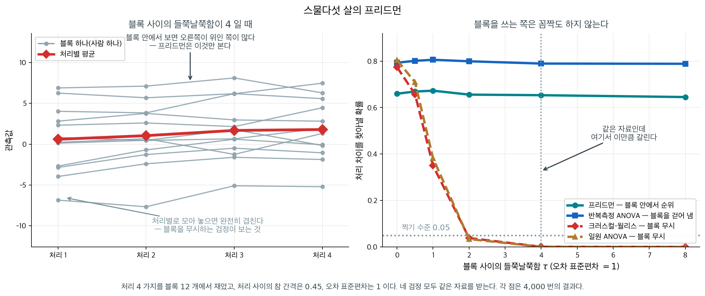

# Friedman 검정 (반복측정)

[Kruskal-Wallis 검정](kruskal_wallis.md)은 독립인 집단들을 비교한다. 같은 피험자를 여러 조건에서 측정하거나(반복측정) 자료가 짝지은 블록으로 수집되면 관측값이 집단 간에 더 이상 독립이 아니다. **Friedman 검정**은 반복측정 분산분석의 비모수 대응물로, 전체 표본이 아니라 *각 블록 안에서* 순위를 매겨 블록 구조를 반영한다.

---

## 1. 가정

1. $b$개의 블록(예: 피험자)과 $k$개의 처리(조건)가 있다.
2. 각 블록 안에서 $k$개의 관측값에 순위를 매길 수 있다.
3. 블록들이 서로 독립이다.
4. 각 블록 안에서 자료가 적어도 순서형이다.

<div class="storybox" markdown>

**그림으로 보는 통계학 1.** 스물다섯 살의 프리드먼

이 검정을 만든 사람은 **밀턴 프리드먼**이다. 1976 년에 노벨 경제학상을 받은 그 프리드먼이고,
이 논문을 쓸 때는 스물다섯 살이었으며 아직 경제학자가 아니었다.

> Friedman, M. (1937). "The Use of Ranks to Avoid the Assumption of Normality
> Implicit in the Analysis of Variance." *JASA* **32**, 675–701.

제목이 하는 일을 그대로 적고 있다. 분산분석에 깔린 **정규성 가정을 피하려고 순위를 쓴다**는
것이다. 그런데 이 검정의 진짜 힘은 거기에 있지 않다. 위 가정 $1$ 과 $2$ 에 있다 —
**블록 안에서만 순위를 매긴다**는 것이다.

얼마나 차이가 나는지 재 보았다. 처리 $4$ 가지를 블록 $12$ 개에서 측정하고, 처리 사이의 참
간격을 $0.45$, 오차 표준편차를 $1$ 로 고정한 채 **블록 사이의 들쭉날쭉함 $\tau$ 만** 키운다.
네 가지 검정에 똑같은 자료를 준다.

<figure markdown>
{ width="900" }
  <figcaption markdown>네 검정 모두 같은 자료를 받는다. 다른 것은 블록 구조를 쓰느냐뿐이다.</figcaption>
</figure>

| $\tau$ | 프리드먼 | 반복측정 ANOVA | 크러스컬–월리스 | 일원 ANOVA |
|---|---|---|---|---|
| $0$ | $0.660$ | $0.793$ | $0.774$ | $0.805$ |
| $1$ | $0.673$ | $0.806$ | $0.350$ | $0.382$ |
| $2$ | $0.656$ | $0.799$ | $0.038$ | $0.034$ |
| $4$ | $0.653$ | $0.789$ | $0.001$ | $0.001$ |
| $8$ | $0.645$ | $0.788$ | $0.000$ | $0.000$ |

블록을 쓰는 두 검정은 **꼼짝도 하지 않는다.** $\tau$ 가 $0$ 이든 $8$ 이든 상관이 없다.
블록 효과는 블록 안에서 모든 처리에 똑같이 실리므로, 순위를 블록 안에서 매기는 순간
**통째로 지워진다.**

블록을 무시하는 두 검정은 $\tau = 2$ 에서 이미 $0.05$ 아래로 떨어지고 $\tau = 4$ 에서는
$0.001$ 이다. 눈여겨볼 것은 이것이 단순히 검정력을 잃는 것과 다르다는 점이다. **찍기 수준보다
낮아진다.** 블록이 만든 들쭉날쭉함을 전부 오차로 세는 바람에 오차 추정이 부풀어 올라, 참
차이가 있는데도 아무것도 유의해지지 않는 것이다.

왼쪽 그림이 그 사정이다. 선 하나가 블록 하나이고, 선들이 통째로 위아래로 흩어져 있다. 처리별로
모아 놓고 보면 네 무리가 완전히 겹치지만, **선 하나하나를 따라가 보면** 오른쪽이 위인 쪽이
많다. 프리드먼이 보는 것이 그 기울기뿐이다.

첫 문단으로 돌아가면, 이 검정이 하는 일은 두 가지다. 정규성을 요구하지 않는 것과, 블록을
공짜로 걷어 내는 것. **둘째가 더 크다.** 프리드먼은 $1939$ 년에 정오표를 냈고 $1940$ 년에는
「$m$ 개의 순위 문제에 쓸 수 있는 여러 유의성 검정의 비교」를 썼으며, 2 차 대전 중에는 컬럼비아의 통계연구단에서 — [돌아온 비행기만 세었던](../../ch01/classical/survivorship_bias.md)
그 연구단이다 — 일했다.

_확인한 곳 — 「The Use of Ranks to Avoid the Assumption of Normality Implicit in the Analysis of Variance」가 『JASA』 $32$ 권 $200$ 호 $675$–$701$ 쪽($1937$ 년 $12$ 월)이라는 것, $1939$ 년 $3$ 월에 정오표를 내고 $1940$ 년 $3$ 월 『Annals of Mathematical Statistics』 $11$ 권 $86$–$92$ 쪽에 「$m$ 개의 순위 문제에 쓸 수 있는 여러 유의성 검정의 비교」를 실은 것. 표와 그림의 수는 모두 직접 모의실험한 값이다_

</div>

---

## 2. 가설

$$
H_0 \colon k \text{개 처리의 효과가 모두 같다(블록 안에서 분포가 동일하다)}
$$

$$
H_a \colon \text{적어도 한 처리가 나머지와 다르다}
$$

---

## 3. 절차

**1단계.** 각 블록 $j = 1, \ldots, b$에서 $k$개의 관측값에 1부터 $k$까지 순위를 매긴다. 블록 안의 동점에는 중간순위를 배정한다.

**2단계.** 각 처리 $i$의 순위합을 계산한다.

$$
R_i = \sum_{j=1}^{b} r_{ij}
$$

여기서 $r_{ij}$는 블록 $j$에서 처리 $i$의 순위이다.

**3단계.** Friedman 통계량을 계산한다.

$$
\chi^2_F = \frac{12}{bk(k+1)} \sum_{i=1}^{k} R_i^2 - 3b(k+1)
$$

동치로

$$
\chi^2_F = \frac{12}{bk(k+1)} \sum_{i=1}^{k} \left(R_i - \frac{b(k+1)}{2}\right)^2
$$

로 쓸 수 있으며, 이는 $\chi^2_F$가 처리 순위합이 $H_0$ 아래의 공통 기댓값에서 얼마나 벗어나는지를 재는 양임을 보여 준다.

---

## 4. 귀무분포

$H_0$ 아래에서 각 블록 안의 순위 $\{1, 2, \ldots, k\}$의 모든 순열이 동등하게 가능하다. $b$가 크면 Friedman 통계량은 근사적으로

$$
\chi^2_F \sim \chi^2_{k-1}
$$

로 분포한다. $b$와 $k$가 작으면 표나 소프트웨어로 정확 $p$값을 얻을 수 있다.

<div class="exbox" markdown>

**보기 1.** <span class="diff easy" title="쉬움"></span> $\chi^2_F$ 가 가질 수 있는 값은 45 개뿐이다. 진통제 네 가지를 환자 5명에게 시험한다. 각 환자가 각 약에 대해 통증 완화 정도를 1--100 척도로 평가한다.

| 환자 | 약 A | 약 B | 약 C | 약 D |
|:-------:|:------:|:------:|:------:|:------:|
| 1 | 30 | 45 | 60 | 50 |
| 2 | 25 | 40 | 55 | 35 |
| 3 | 35 | 50 | 65 | 45 |
| 4 | 20 | 30 | 50 | 40 |
| 5 | 40 | 55 | 70 | 60 |

**(1)** 위 절차를 밟아 $\chi^2_F$ 와 $p$ 값을 구하시오. 이 설계($b = 5$, $k = 4$)에서 $\chi^2_F$ 의 **최댓값**은 얼마이며 그때의 순위합은 무엇인가. 관측값은 도달 가능한 값들 가운데 어디에 있는가.

**(2)** $k = 2$ 이면 프리드먼 검정이 **부호검정의 정규근사**와 똑같아진다는 것을 보이시오.

</div>

??? success "풀이"

    **(1) 절차와 도달 가능한 값들.**

    **1단계.** 각 환자(블록) 안에서 순위를 매긴다.

    | 환자 | 약 A | 약 B | 약 C | 약 D |
    |:-------:|:------:|:------:|:------:|:------:|
    | 1 | 1 | 2 | 4 | 3 |
    | 2 | 1 | 3 | 4 | 2 |
    | 3 | 1 | 3 | 4 | 2 |
    | 4 | 1 | 2 | 4 | 3 |
    | 5 | 1 | 2 | 4 | 3 |

    **2단계.** 순위합: $R_A = 5$, $R_B = 12$, $R_C = 20$, $R_D = 13$.

    **검산:** $5 + 12 + 20 + 13 = 50 = 5 \times 4 \times (4+1)/2$. $\checkmark$

    **3단계.** $\chi^2_F$를 계산한다.

    $$
    \chi^2_F = \frac{12}{5 \times 4 \times 5}(5^2 + 12^2 + 20^2 + 13^2) - 3 \times 5 \times 5
    $$

    $$
    = \frac{12}{100}(25 + 144 + 400 + 169) - 75 = \frac{12 \times 738}{100} - 75 = 88.56 - 75 = 13.56
    $$

    **4단계.** $\chi^2_3$과 비교한다: $P(\chi^2_3 > 13.56) = 0.00357$.

    ```python
    import numpy as np
    from scipy import stats
    d = np.array([[30, 45, 60, 50], [25, 40, 55, 35], [35, 50, 65, 45],
                  [20, 30, 50, 40], [40, 55, 70, 60]])
    print(stats.friedmanchisquare(*d.T))
    # statistic=13.56, pvalue=0.0035696
    ```

    출력:

    ```
    FriedmanchisquareResult(statistic=13.560000000000002, pvalue=0.0035695719978437604)
    ```

    $\alpha = 0.05$에서 $H_0$을 기각한다. 약들의 통증 완화 효과가 다르다는 유의한 증거가 있다. 평균순위(약 A: 1.0, 약 B: 2.4, 약 C: 4.0, 약 D: 2.6)를 보면 약 C가 가장 큰 완화를, 약 A가 가장 작은 완화를 준다.

    **최댓값은 $15$ 다.** $\chi^2_F$ 가 가장 커지는 것은 다섯 블록이 **완전히 한목소리**를 낼 때, 곧 각 약이 모든 블록에서 같은 순위를 받을 때다. 그때 순위합은

    $$
    (R_1, R_2, R_3, R_4) = (5, 10, 15, 20)
    $$

    이고

    $$
    \chi^2_F = \frac{12}{100}(25 + 100 + 225 + 400) - 75 = \frac{12 \times 750}{100} - 75 = 90 - 75 = 15
    $$

    다. 관측값 $13.56$ 은 이보다 작다 — 약 B 와 약 D 의 순서가 블록 1, 4, 5 에서는 $(2, 3)$ 이지만 블록 2, 3 에서는 $(3, 2)$ 로 뒤바뀌었기 때문이다.

    **도달 가능한 값은 45 개뿐이다.** $(4!)^5 = 7{,}962{,}624$ 가지 배정에서 $\chi^2_F$ 가 실제로 갖는 값을 모두 모으면 마흔다섯 개이고, 큰 쪽부터 세면

    | $\chi^2_F$ | 배정 수 | 누적 | 정확 $p$ |
    |---|---|---|---|
    | 15.00 | 24 | 24 | 0.0000030 |
    | 14.04 | 360 | 384 | 0.0000482 |
    | **13.56** | 720 | **1104** | **0.0001386** |
    | 13.08 | 600 | 1704 | 0.0002140 |
    | 12.84 | 960 | 2664 | 0.0003346 |

    이다. **관측값은 도달 가능한 값 가운데 세 번째로 크다.** 정확 양측 p-값은

    $$
    p_{\text{정확}} = \frac{1104}{7{,}962{,}624} = \frac{23}{165{,}888} = 0.0001386
    $$

    이고, 아래 상자가 말하는 $\chi^2_3$ 근사의 $0.00357$ 은 그 $25.7$ 배다. 또 $15$ 를 주는 배정이 $24 = 4!$ 가지(네 약을 완전 순서에 어떻게 짝지을지)뿐이므로 **이 설계로 낼 수 있는 가장 작은 p-값은 $24/7962624 = 1/331776 = 3.0 \times 10^{-6}$ 이다.**

    **(2) $k = 2$ 이면 $\chi^2_F = Z^2$ 이다.** 각 블록에서 순위가 $\{1, 2\}$ 뿐이다. 처리 1 이 이기는 블록 수를 $m$ 이라 하면 그 블록에서 처리 1 이 순위 $2$ 를, 나머지 $b - m$ 블록에서 순위 $1$ 을 받으므로

    $$
    R_1 = 2m + (b - m) = b + m,
    \qquad
    R_2 = 3b - R_1 = 2b - m
    $$

    이다(검산: $R_1 + R_2 = 3b = bk(k+1)/2$). 이것을 통계량에 넣으면

    $$
    \chi^2_F = \frac{12}{6b}\bigl[(b+m)^2 + (2b-m)^2\bigr] - 9b
    = \frac{2}{b}\bigl(5b^2 - 2bm + 2m^2\bigr) - 9b
    $$

    $$
    = 10b - 4m + \frac{4m^2}{b} - 9b
    = \frac{b^2 - 4bm + 4m^2}{b}
    = \frac{(b - 2m)^2}{b}
    $$

    가 된다. 한편 부호검정의 표준화 통계량은 $n = b$, $n_+ = m$, $n_- = b - m$ 에서

    $$
    Z = \frac{n_+ - n_-}{\sqrt{n}} = \frac{2m - b}{\sqrt{b}}
    $$

    이므로 **$\chi^2_F = Z^2$ 이다.** $\square$ $\chi^2_1$ 이 표준정규의 제곱이므로 두 p-값이 같다.

    다만 "같다"의 뜻을 정확히 해야 한다. **$k = 2$ 의 프리드먼 검정은 부호검정의 *정규근사*와 같고, 정확 이항검정과는 다르다.** 프리드먼 검정은 $\chi^2_1$ 을 쓰므로 이산성을 반영하지 못한다. $b$ 가 작으면 `binomtest` 로 정확히 계산하는 편이 맞다.

    이 관계는 [크러스컬--월리스가 $k = 2$ 에서 만–휘트니가 되는 것](kruskal_wallis.md)과 정확히 짝을 이룬다. 독립 자료에서 $H = Z^2_{\text{순위합}}$ 이고, 블록 자료에서 $\chi^2_F = Z^2_{\text{부호}}$ 다. 두 다집단 검정이 각자의 이집단 검정을 품고 있다.

    **수치적으로.**

    ```python
    import itertools
    from collections import Counter
    from fractions import Fraction

    b, k = 5, 4
    perms = list(itertools.permutations(range(1, k + 1)))

    # 블록을 하나씩 더해 가며 순위합 벡터의 분포를 쌓는다.
    # 7962624 가지를 하나씩 돌지 않아도 같은 분포를 얻는다.
    dist = Counter({(0,) * k: 1})
    for _ in range(b):
        nxt = Counter()
        for state, c in dist.items():
            for perm in perms:
                nxt[tuple(s + q for s, q in zip(state, perm))] += c
        dist = nxt
    total = sum(dist.values())
    print(f"총 배정 수 {total}  (= 24^5 = {24 ** 5})")
    print(f"R = (5, 10, 15, 20) 인 배정 {dist[(5, 10, 15, 20)]} 가지")

    chis = Counter()
    for R, c in dist.items():
        chis[round(12 / (b * k * (k + 1)) * sum(x * x for x in R) - 3 * b * (k + 1), 6)] += c
    top = sorted(chis)[::-1]
    print(f"\nchi2_F 가 가질 수 있는 값 {len(chis)} 개,  최댓값 {top[0]}")
    print(" chi2_F   배정 수     누적      정확 p")
    for v in top[:5]:
        cum = sum(c for w, c in chis.items() if w >= v - 1e-9)
        print(f"{v:>7.2f} {chis[v]:>9} {cum:>9}  {cum / total:.7f}")

    obs = 13.56
    cum = sum(c for w, c in chis.items() if w >= obs - 1e-9)
    print(f"\n정확 p = {cum}/{total} = {Fraction(cum, total)} = {cum / total:.7f}")
    print(f"chi2_3 p = {stats.chi2.sf(obs, 3):.7f}"
          f"  ->  {stats.chi2.sf(obs, 3) / (cum / total):.1f} 배")
    print(f"도달 가능한 가장 작은 p = {chis[top[0]]}/{total}"
          f" = {Fraction(chis[top[0]], total)} = {chis[top[0]] / total:.2e}")
    print(f"열거한 chi2_F 의 평균 {sum(v * c for v, c in chis.items()) / total}"
          f"  (chi2_3 의 평균 {k - 1})")
    ```

    출력:

    ```
    총 배정 수 7962624  (= 24^5 = 7962624)
    R = (5, 10, 15, 20) 인 배정 1 가지
    
    chi2_F 가 가질 수 있는 값 45 개,  최댓값 15.0
     chi2_F   배정 수     누적      정확 p
      15.00        24        24  0.0000030
      14.04       360       384  0.0000482
      13.56       720      1104  0.0001386
      13.08       600      1704  0.0002140
      12.84       960      2664  0.0003346
    
    정확 p = 1104/7962624 = 23/165888 = 0.0001386
    chi2_3 p = 0.0035696  ->  25.7 배
    도달 가능한 가장 작은 p = 24/7962624 = 1/331776 = 3.01e-06
    열거한 chi2_F 의 평균 3.0  (chi2_3 의 평균 3)
    ```

    ```python
    import numpy as np

    rng = np.random.default_rng(0)
    print(" b   m    R1   R2   chi2_F    (b-2m)^2/b       Z        Z^2")
    for _ in range(4):
        b2 = 9
        x = rng.normal(0, 1, b2)
        y = rng.normal(0.3, 1, b2)
        m = int((x > y).sum())
        R1, R2 = b2 + m, 2 * b2 - m
        chi_F = 12 / (b2 * 2 * 3) * (R1 ** 2 + R2 ** 2) - 3 * b2 * 3
        z = (2 * m - b2) / np.sqrt(b2)
        print(f"{b2:>2} {m:>3} {R1:>5} {R2:>4} {chi_F:>9.6f} {(b2 - 2 * m) ** 2 / b2:>13.6f}"
              f" {z:>8.4f} {z ** 2:>10.6f}")
    ```

    출력:

    ```
     b   m    R1   R2   chi2_F    (b-2m)^2/b       Z        Z^2
     9   7    16   11  2.777778      2.777778   1.6667   2.777778
     9   5    14   13  0.111111      0.111111   0.3333   0.111111
     9   3    12   15  1.000000      1.000000  -1.0000   1.000000
     9   3    12   15  1.000000      1.000000  -1.0000   1.000000
    ```

    **열거한 $\chi^2_F$ 의 평균이 정확히 $3.0$ 으로 $\chi^2_3$ 의 평균과 같다** — 근사가 몸통에서는 제대로 맞춰져 있다는 뜻이다. 그런데도 관측값 자리에서 $25.7$ 배 어긋나는 것은 $\chi^2_F$ 의 **최댓값이 15 로 유한하고 값이 마흔다섯 개뿐**이기 때문이다. 손으로 구한 $(5,10,15,20)$ 과 $\chi^2_F = 15$, 세 번째로 큰 값이 $13.56$ 이라는 것, 정확 p-값 $23/165888$ 이 모두 맞는다.

    둘째 코드가 $k = 2$ 의 항등식을 확인한다. 네 번 모두 $\chi^2_F$, $(b-2m)^2/b$, $Z^2$ 가 소수 여섯째 자리까지 같다.

!!! warning "$b = 5$에서 $\chi^2$ 근사는 매우 보수적이다"
    $b = 5$, $k = 4$이면 가능한 블록 내 순위 배정이 $(4!)^5 = 24^5 = 7{,}962{,}624$가지이고, 모두 열거하여 정확 $p$값을 구할 수 있다. 결과는 $p = 0.000139$로 $\chi^2$ 근사값 $0.00357$의 **26분의 1**이다.

    ```python
    import numpy as np, itertools
    b, k = 5, 4
    perms = list(itertools.permutations(range(1, k + 1)))
    cnt = tot = 0
    for combo in itertools.product(perms, repeat=b):
        R = np.sum(np.array(combo), axis=0)
        chi = 12 / (b * k * (k + 1)) * np.sum(R ** 2) - 3 * b * (k + 1)
        tot += 1
        cnt += chi >= 13.56 - 1e-9
    print(cnt / tot, tot)      # 0.000139  7962624
    ```

    출력:

    ```
    0.000138647762345679 7962624
    ```

    이 자료에서 약 A가 다섯 블록 **전부**에서 최하위, 약 C가 전부에서 최상위였다. 이런 완벽한 일관성은 귀무가설 아래에서 극히 드물지만, $\chi^2$ 근사는 $b$가 작을 때 그 희소성을 제대로 반영하지 못한다.

    다만 근사가 언제나 보수적인 것은 아니다. 연습문제 1에서는 반대 방향으로 틀린다.

---

## 5. 사후비교

Friedman 검정이 유의하면 쌍별 비교로 어느 처리가 다른지 밝힐 수 있다. 가장 흔한 접근은 모든 평균순위 쌍을 비교하는 **Nemenyi 검정**이다.

$$
|\bar{R}_i - \bar{R}_j| > q_\alpha \sqrt{\frac{k(k+1)}{6b}}
$$

여기서 $q_\alpha$는 스튜던트화 범위 분포의 임계값이다. 대안으로 Bonferroni 보정을 적용한 쌍별 Wilcoxon 부호순위검정을 쓸 수도 있다.


1단계의 "각 블록 안에서 순위를 매긴다"가 왜 결정적인지 그림으로 보자. 왼쪽 (가)가 원점수이고 선 하나가 환자 한 명이다.

환자마다 **선 전체가 위아래로 통째로 평행이동**해 있다. 환자 5의 평균은 $56.25$인데 환자 4는 $35.00$이라 $21$점이나 차이가 난다. 이 기준선 차이 때문에 약별 점수 구간이 크게 겹친다. 예를 들어 환자 4가 약 C에서 받은 $50$점은 환자 5가 약 B에서 받은 $55$점보다 낮다. 관측값을 전부 한 줄로 세워 순위를 매기는 검정은 이 겹침을 그대로 뒤집어쓴다.

오른쪽 (나)가 블록 내 순위이다. 환자마다 자기 네 점수에만 $1$부터 $4$까지 매기므로 기준선이 **완전히 지워진다.** 그러자 다섯 환자가 한목소리를 낸다. 약 A는 다섯 번 모두 $1$위, 약 C는 다섯 번 모두 $4$위이다. 순위합은 $R_A = 5$, $R_B = 12$, $R_C = 20$, $R_D = 13$으로 최솟값 $5$와 최댓값 $20$이라는 양 극단에 놓인다.

숫자로 확인하면 차이가 분명하다. 이 자료를 독립표본으로 착각해 Kruskal-Wallis를 돌리면 $H = 12.24$, $p = 0.0066$이 나오는데, 블록 구조를 살린 Friedman 검정의 정확 $p$값은 $0.000139$로 **47배 작다.** 블록 내 순위 매기기가 하는 일은 반복측정 분산분석이 피험자 간 변동을 오차에서 빼내는 것과 정확히 같으며, 그 대가는 원점수의 크기 정보를 $1$--$k$의 순위로 압축하는 것뿐이다.

!!! tip "Kruskal-Wallis 검정과의 관계"
    Kruskal-Wallis 검정은 $N$개 관측값 전체에 전역적으로 순위를 매기는 반면, Friedman 검정은 *각 블록 안에서* 순위를 매긴다. 블록 내 순위 매기기는 블록 간 변동을 제거하며, 이는 반복측정 분산분석이 피험자 간 변동을 제거하는 것과 같다. 블록 구조가 존재할 때 Friedman 검정이 Kruskal-Wallis 검정보다 강력하다.

---

## 연습문제

<div class="drillbox" markdown>

**연습문제 1.** <span class="diff easy" title="쉬움"></span>
평가자 4명이 커피 세 브랜드를 1--10 척도로 평가했다.

| 평가자 | 브랜드 A | 브랜드 B | 브랜드 C |
|:---:|:---:|:---:|:---:|
| 1 | 7 | 5 | 8 |
| 2 | 6 | 8 | 7 |
| 3 | 5 | 4 | 9 |
| 4 | 8 | 6 | 7 |

**(a)** 각 평가자(블록) 안에서 브랜드에 1부터 3까지 순위를 매겨라.

**(b)** 모든 평가자에 걸쳐 각 브랜드의 순위합 $R_j$를 계산하라.

**(c)** Friedman 검정통계량

$$
\chi_F^2 = \frac{12}{bk(k+1)} \sum_{j=1}^{k} R_j^2 - 3b(k+1)
$$

을 계산하라. 여기서 $b = 4$(평가자), $k = 3$(브랜드)이다.

**(d)** $H_0$ 아래에서 $\chi_F^2 \sim \chi^2_{k-1}$이다. $\alpha = 0.05$에서 검정하라.

</div>

??? success "풀이"

    **(a)** 각 평가자 안에서 순위를 매기면(1 = 가장 낮음, 3 = 가장 높음)

    | 평가자 | 브랜드 A | 브랜드 B | 브랜드 C |
    |:---:|:---:|:---:|:---:|
    | 1 | 2 | 1 | 3 |
    | 2 | 1 | 3 | 2 |
    | 3 | 2 | 1 | 3 |
    | 4 | 3 | 1 | 2 |

    **(b)** 순위합:

    $$
    R_A = 2 + 1 + 2 + 3 = 8
    $$

    $$
    R_B = 1 + 3 + 1 + 1 = 6
    $$

    $$
    R_C = 3 + 2 + 3 + 2 = 10
    $$

    검산: $R_A + R_B + R_C = 24 = bk(k+1)/2 = 4 \times 3 \times 4/2 = 24$.

    **(c)**

    $$
    \chi_F^2 = \frac{12}{4 \times 3 \times 4}(8^2 + 6^2 + 10^2) - 3 \times 4 \times 4
    $$

    $$
    = \frac{12}{48}(64 + 36 + 100) - 48 = \frac{12 \times 200}{48} - 48 = 50 - 48 = 2.0
    $$

    **(d)** $H_0$ 아래에서 $\chi_F^2 \sim \chi^2_2$이고 $\alpha = 0.05$의 임계값은 $5.991$이다.

    $\chi_F^2 = 2.0 < 5.991$이므로 $H_0$을 기각하지 못한다. 세 커피 브랜드의 평가에 통계적으로 유의한 차이가 없다. $p$값은 $P(\chi^2_2 > 2.0) = 0.3679$이다. 평가자가 4명뿐이라 중간 정도의 차이를 탐지할 검정력이 제한적이다.

    **정확 $p$값과의 비교.** $(3!)^4 = 1296$가지 배정을 모두 열거하면 정확 $p = 0.4306$이다.

    ```python
    import numpy as np, itertools
    b, k = 4, 3
    perms = list(itertools.permutations(range(1, k + 1)))
    cnt = tot = 0
    for combo in itertools.product(perms, repeat=b):
        R = np.sum(np.array(combo), axis=0)
        chi = 12 / (b * k * (k + 1)) * np.sum(R ** 2) - 3 * b * (k + 1)
        tot += 1
        cnt += chi >= 2.0 - 1e-9
    print(cnt / tot, tot)      # 0.4306  1296
    ```

    출력:

    ```
    0.4305555555555556 1296
    ```

    여기서는 $\chi^2$ 근사($0.368$)가 정확값($0.431$)보다 **작다**. 즉 이 영역에서는 근사가 **비보수적**이다. 본문 보기에서 26배 보수적이었던 것과 방향이 반대이다.

    이유는 $\chi^2_F$의 귀무분포가 이산적이고 $b$가 작을 때 $\chi^2$ 곡선과 계단이 어긋나기 때문이다. 분포의 중앙부(작은 $\chi^2_F$)에서는 근사가 $p$를 과소평가하고, 극단 꼬리에서는 크게 과대평가한다.

    **권고:** $b < 10$이면 정확 $p$값이나 몬테카를로 순열 $p$값을 쓴다. $\chi^2$ 근사의 오차 방향을 미리 알 수 없기 때문이다.

<div class="drillbox" markdown>

**연습문제 2.** <span class="diff med" title="중간"></span>
같은 자료를 Friedman 검정과 Kruskal-Wallis 검정으로 각각 분석하면 어떻게 다른가? 본문의 진통제 자료로 확인하고, 왜 차이가 나는지 설명하라.

</div>

??? success "풀이"
    Kruskal-Wallis는 블록 구조를 무시하고 $20$개 관측값 전체에 순위를 매긴다.

    ```python
    import numpy as np
    from scipy import stats
    d = np.array([[30, 45, 60, 50], [25, 40, 55, 35], [35, 50, 65, 45],
                  [20, 30, 50, 40], [40, 55, 70, 60]])
    print(stats.friedmanchisquare(*d.T))      # 13.560, p=0.003570
    print(stats.kruskal(*d.T))                # 12.237, p=0.006615
    print(np.corrcoef(d.T)[0])                # 블록 간 상관
    ```

    출력:

    ```
    FriedmanchisquareResult(statistic=13.560000000000002, pvalue=0.0035695719978437604)
    KruskalResult(statistic=12.236750189825356, pvalue=0.006614630461599845)
    [1.         0.98639392 1.         0.82199494]
    ```

    | 검정 | 통계량 | $p$값 |
    |:---|---:|---:|
    | Friedman (블록 반영) | $13.56$ | $0.00357$ |
    | Kruskal-Wallis (블록 무시) | $12.24$ | $0.00661$ |

    Friedman이 $p$값을 1.9배 작게 준다. 즉 블록 구조를 반영하는 편이 더 강력하다.

    차이가 극적이지 않은 것은 이 자료에서 처리 효과가 환자 간 변동보다 크기 때문이다. 그래도 방향은 분명하다. 환자 4는 모든 약에 대해 낮게(20--50) 평가하고 환자 5는 높게(40--70) 평가한다. Kruskal-Wallis에서는 이 **개인차가 모두 잡음으로 들어간다**. 환자 5가 약 A에 준 $40$이 환자 4가 약 D에 준 $40$과 같은 순위를 받아 신호가 희석된다.

    Friedman은 각 환자 안에서만 순위를 매기므로 개인차가 통째로 제거된다. 실제로 이 자료에서 각 환자의 순위 패턴이 거의 동일하다(약 A가 언제나 1위, 약 C가 언제나 4위).

    이는 [대응 부호검정](../paired_sample_nonparametric/paired_sign.md) 연습문제 4에서 본 것과 같은 원리이다. 블록 간 변동이 처리 효과에 비해 클수록 격차가 벌어진다. 그 보기에서는 개인차가 압도적이어서 $p$값이 11배 차이 났다.

<div class="drillbox" markdown>

**연습문제 3.** <span class="diff med" title="중간"></span>
Friedman 검정은 각 블록 안에서 **순위만** 쓴다. 이것이 어떤 정보를 버리는가? 처리 효과의 **크기**가 블록마다 크게 다른 자료를 만들어 확인하라.

</div>

??? success "풀이"
    두 자료를 비교하자. 둘 다 각 블록에서 순위 패턴은 동일하지만 효과의 크기가 다르다.

    ```python
    import numpy as np
    from scipy import stats

    # 자료 1: 모든 블록에서 효과가 일정하다
    d1 = np.array([[10, 11, 12], [20, 21, 22], [30, 31, 32],
                   [40, 41, 42], [50, 51, 52], [60, 61, 62]])
    # 자료 2: 한 블록의 효과만 압도적으로 크다
    d2 = np.array([[10, 11, 12], [20, 21, 22], [30, 31, 32],
                   [40, 41, 42], [50, 51, 52], [60, 160, 260]])

    for name, d in (("d1", d1), ("d2", d2)):
        print(name, stats.friedmanchisquare(*d.T))
    ```

    출력:

    ```
    d1 FriedmanchisquareResult(statistic=12.0, pvalue=0.002478752176666357)
    d2 FriedmanchisquareResult(statistic=12.0, pvalue=0.002478752176666357)
    ```

    두 자료 모두 $\chi^2_F = 12.0$, $p = 0.002479$로 **완전히 같은 결과**가 나온다.

    각 블록에서 세 열의 순위가 언제나 $(1, 2, 3)$이므로 순위합이 $R = (6, 12, 18)$로 동일하기 때문이다. Friedman 검정은 $10 \to 11 \to 12$라는 미미한 차이와 $60 \to 160 \to 260$이라는 거대한 차이를 구별하지 못한다.

    이것은 장점이자 단점이다.

    - **장점:** 자료가 순서형이거나 척도가 블록마다 다를 때(예: 평가자마다 점수 사용 습관이 다를 때) 이 불변성이 정확히 필요한 성질이다.
    - **단점:** 효과크기를 재지 못한다. Friedman 검정이 유의하다는 것은 "순서가 일관되게 다르다"는 뜻이지 "차이가 실질적으로 크다"는 뜻이 아니다.

    **권고:** Friedman 검정 결과와 함께 반드시 **원자료의 요약**(블록별 프로파일 그림, 처리별 중앙값과 사분위범위)을 제시한다. $p$값만으로는 $10 \to 12$와 $60 \to 260$을 구별할 수 없다.

<div class="drillbox" markdown>

**연습문제 4.** <span class="diff med" title="중간"></span>
블록 안에 동점이 있으면 어떻게 하는가? 중간순위를 쓸 때 $\chi^2_F$의 귀무분포가 어떻게 달라지는지 설명하고, 보정된 통계량을 유도하라.

</div>

??? success "풀이"
    블록 $j$ 안에서 동점이 생기면 중간순위를 배정한다. 순위의 합은 여전히 $k(k+1)/2$로 유지되지만, **블록 내 순위의 분산이 줄어든다**.

    동점이 없으면 블록 내 순위의 (모)분산은 $(k^2-1)/12$이다. 블록 $j$에 크기 $t_{j1}, \ldots, t_{jg_j}$인 동점 집단이 있으면 분산이

    $$
    \frac{k^2 - 1}{12} - \frac{\sum_l (t_{jl}^3 - t_{jl})}{12k}
    $$

    로 감소한다. 이는 [순위와 순위변환](../foundations/ranks.md) 연습문제 4에서 본 항등식과 같은 구조이다.

    $\chi^2_F$는 순위합의 변동을 순위의 이론적 분산으로 표준화한 양이므로, 실제 분산이 줄었는데 이론값으로 나누면 통계량이 **과소평가**되어 검정이 보수적으로 된다. 보정된 통계량은

    $$
    \chi^2_{F,\text{corrected}} = \frac{\chi^2_F}{1 - \frac{\sum_{j=1}^{b}\sum_{l}(t_{jl}^3 - t_{jl})}{bk(k^2-1)}}
    $$

    이다.

    ```python
    import numpy as np
    from scipy import stats
    # 블록마다 동점이 하나씩 있는 자료
    d = np.array([[5, 5, 8], [6, 6, 9], [4, 4, 7], [3, 3, 6], [7, 7, 10]])
    print(stats.friedmanchisquare(*d.T))
    ```

    출력:

    ```
    FriedmanchisquareResult(statistic=10.0, pvalue=0.006737946999085468)
    ```

    이 자료에서 각 블록의 처음 두 열이 동점이라 순위가 $(1.5, 1.5, 3)$이다. $R = (7.5, 7.5, 15)$이고

    - 보정 없는 $\chi^2_F = \frac{12}{5 \cdot 3 \cdot 4}(7.5^2 + 7.5^2 + 15^2) - 3 \cdot 5 \cdot 4 = \frac{12}{60}(337.5) - 60 = 67.5 - 60 = 7.5$
    - 보정계수 $= 1 - \frac{5 \times (2^3-2)}{5 \times 3 \times (9-1)} = 1 - \frac{30}{120} = 0.75$
    - 보정된 $\chi^2_F = 7.5 / 0.75 = 10.0$

    SciPy의 `friedmanchisquare`는 이 보정을 자동으로 적용하여 $10.0$을 반환한다. $p$값은 $0.0067$로 보정 없는 $7.5$의 $p = 0.0235$보다 훨씬 작다.

    **동점이 많으면 보정이 결정적이다.** 이 예처럼 $k = 3$에서 블록마다 동점이 하나씩만 있어도 보정계수가 $0.75$로 떨어져 통계량이 33% 커진다. Likert 척도 자료에서는 흔한 상황이다.

<div class="drillbox" markdown>

**연습문제 5.** <span class="diff med" title="중간"></span>
3 절은 $\chi^2_F$ 를 두 꼴로 적었다. 그 둘째 꼴에서 이 통계량의 **천장**을 읽어낸다.

**(a)** 두 꼴이 같음을 보이시오.

**(b)** 동점이 없을 때

$$
\chi^2_F \le b(k-1)
$$

이고, 등호는 각 처리가 **모든 블록에서 같은 순위**를 받을 때만 성립함을 보이시오. 보기 1 의 $b = 5$, $k = 4$ 에서 이 상한이 손으로 구한 최댓값 $15$ 와 맞는지 확인하시오.

**(c)** 상한을 달성하는 블록 내 순위배정이 $k!$ 가지뿐임을 보이고, 이 설계가 낼 수 있는 가장 작은 정확 $p$ 값이

$$
p_{\min} = \frac{k!}{(k!)^b} = (k!)^{1-b}
$$

임을 보이시오. 보기 1 의 $1/331{,}776$ 과 맞는지 확인하고, $k = 2$ 에서 $\alpha = 0.05$ 로 기각할 수 있으려면 블록이 적어도 몇 개 필요한지 답하시오.

</div>

??? success "풀이"

    **(a) 두 꼴이 같다.** $\bar{R} = b(k+1)/2$ 라 쓰자. 순위합의 총합은 블록마다 $1 + \cdots + k$ 를 더한 것이므로

    $$
    \sum_{i=1}^{k} R_i = b \cdot \frac{k(k+1)}{2} = k \bar{R}
    $$

    이다. 그러므로

    $$
    \sum_{i=1}^{k} (R_i - \bar{R})^2 = \sum_i R_i^2 - 2\bar{R} \sum_i R_i + k \bar{R}^2 = \sum_i R_i^2 - 2k\bar{R}^2 + k\bar{R}^2 = \sum_i R_i^2 - k \bar{R}^2
    $$

    이고, 양변에 $\dfrac{12}{bk(k+1)}$ 을 곱하면 둘째 항이

    $$
    \frac{12}{bk(k+1)} \cdot k \cdot \frac{b^2(k+1)^2}{4} = 3b(k+1)
    $$

    이 되어 첫째 꼴이 나온다. $\square$

    **(b) 천장은 $b(k-1)$ 이다.** 중심화한 순위를 $d_{ij} = r_{ij} - \frac{k+1}{2}$ 라 하면 $R_i - \bar{R} = \sum_{j=1}^b d_{ij}$ 이다. 코시--슈바르츠 부등식에서 각 $i$ 마다

    $$
    \Bigl(\sum_{j=1}^{b} d_{ij}\Bigr)^2 \le b \sum_{j=1}^{b} d_{ij}^2
    $$

    이다. 한편 블록 $j$ 안에서 $d_{1j}, \ldots, d_{kj}$ 는 $1 - \frac{k+1}{2}, \ldots, k - \frac{k+1}{2}$ 의 재배열이므로

    $$
    \sum_{i=1}^{k} d_{ij}^2 = \sum_{r=1}^{k} \Bigl(r - \frac{k+1}{2}\Bigr)^2 = \frac{k(k^2-1)}{12}
    $$

    이고, 이것은 어떤 배정에서도 변하지 않는다. 두 식을 $i$ 에 대해 더하면

    $$
    \sum_{i=1}^{k} (R_i - \bar{R})^2 \le b \sum_{i=1}^{k} \sum_{j=1}^{b} d_{ij}^2 = b \cdot b \cdot \frac{k(k^2-1)}{12}
    $$

    이므로

    $$
    \chi^2_F \le \frac{12}{bk(k+1)} \cdot \frac{b^2 k(k^2-1)}{12} = \frac{b(k^2-1)}{k+1} = b(k-1)
    $$

    이다. 코시--슈바르츠의 등호 조건은 $d_{ij}$ 가 $j$ 에 대해 상수인 것, 곧 **처리 $i$ 가 모든 블록에서 같은 순위**를 받는 것이다. $\square$

    $b = 5$, $k = 4$ 이면 $b(k-1) = 5 \times 3 = 15$ 로 보기 1 에서 $(R_1, R_2, R_3, R_4) = (5, 10, 15, 20)$ 으로 구한 최댓값과 정확히 같다. 이 천장은 자료가 아니라 **설계**만으로 정해진다는 점이 중요하다. 블록을 늘리면($b \uparrow$) 천장이 올라가지만, 처리 수를 고정한 채 블록을 늘리는 것 말고는 유의성을 더 짜낼 길이 없다.

    **(c) 가장 작은 $p$ 값.** 등호를 주는 배정은 "처리 $\to$ 순위" 가 전단사인 것들이고, 그런 대응은 $k!$ 가지다(한 처리를 어느 순위에 고정할지 정하면 나머지가 따라온다). 귀무가설 아래에서 블록마다 $k!$ 가지 순열이 동등하게 가능하므로 전체 배정은 $(k!)^b$ 가지이고, 최댓값보다 크거나 같은 배정은 그 $k!$ 가지뿐이다. 따라서

    $$
    p_{\min} = \frac{k!}{(k!)^b} = (k!)^{1-b}
    $$

    이다. $b = 5$, $k = 4$ 이면 $(4!)^{-4} = 24^{-4} = 1/331{,}776 = 3.01 \times 10^{-6}$ 으로 보기 1 의 값과 맞는다. $b = 4$, $k = 3$ 이면 $(3!)^{-3} = 1/216 = 0.00463$ 이다.

    $k = 2$ 이면 $p_{\min} = 2^{1-b}$ 이므로

    $$
    2^{1-b} \le 0.05 \iff 2^{b-1} \ge 20 \iff b - 1 \ge 5 \iff b \ge 6
    $$

    이다. **블록이 다섯 개면 어떤 자료가 나와도 양측 $\alpha = 0.05$ 에서 기각할 수 없다.** 보기 1 (2) 에서 $k = 2$ 의 프리드먼 검정이 부호검정과 같아진다는 것을 보았으니, 이것은 "부호검정은 $n = 6$ 부터 양측 5% 에서 기각할 수 있다"는 익숙한 사실과 같은 말이다. 자료를 더 모으는 것 말고는 방법이 없다 — 작은 표본에서 유의성이 나오지 않는 것이 검정의 실패가 아니라 **표본이 담을 수 있는 증거의 한계**인 경우가 있다.

<div class="drillbox" markdown>

**연습문제 6.** <span class="diff med" title="중간"></span>
연습문제 1 은 $b = 4$, $k = 3$ 에서 관측값 $\chi^2_F = 2.0$ 의 정확 $p$ 값만 구했다. 이번에는 귀무분포를 통째로 열거한다.

**(a)** $(3!)^4 = 1296$ 가지 배정을 모두 돌려 $\chi^2_F$ 가 도달할 수 있는 값을 전부 구하고, 각 값에서 정확 $p$ 값과 $\chi^2_2$ 근사 $p$ 값을 나란히 적으시오. 근사가 보수적인 값은 몇 개인가.

**(b)** $\chi^2_2$ 임계값으로 기각하는 검정의 **실제** 유의수준을 $\alpha = 0.10$, $0.05$, $0.01$ 에서 정확히 구하시오.

**(c)** $\alpha = 0.10$ 과 $\alpha = 0.05$ 의 실제 수준이 같은 까닭을 말하시오. 또 $\alpha = 0.01$ 의 결과를 연습문제 5(c) 와 묶어 설명하시오.

</div>

??? success "풀이"

    ```python
    import itertools
    from collections import Counter
    from fractions import Fraction
    from scipy import stats

    b, k = 4, 3
    perms = list(itertools.permutations(range(1, k + 1)))

    chis = Counter()
    for combo in itertools.product(perms, repeat=b):
        R = [sum(col) for col in zip(*combo)]
        chi = 12 / (b * k * (k + 1)) * sum(x * x for x in R) - 3 * b * (k + 1)
        chis[round(chi, 6)] += 1
    total = sum(chis.values())

    print(f"도달 가능한 chi2_F 값 {len(chis)} 개   (총 배정 {total} = 6^4),  최댓값 {max(chis):.1f}")
    print(" chi2_F   배정 수     누적     정확 p    chi2_2 p")
    for v in sorted(chis)[::-1]:
        cum = sum(c for w, c in chis.items() if w >= v - 1e-9)
        print(f"{v:>7.2f} {chis[v]:>9} {cum:>9}   {cum / total:>8.5f}   {stats.chi2.sf(v, 2):>8.5f}")

    print("\n공칭 alpha   임계값    실제 수준")
    for a in (0.10, 0.05, 0.01):
        c = stats.chi2.ppf(1 - a, k - 1)
        cum = sum(cc for w, cc in chis.items() if w >= c)
        print(f"{a:>9.2f} {c:>9.3f} {cum / total:>12.4f}   (= {Fraction(cum, total)})")
    ```

    출력:

    ```
    도달 가능한 chi2_F 값 9 개   (총 배정 1296 = 6^4),  최댓값 8.0
     chi2_F   배정 수     누적     정확 p    chi2_2 p
       8.00         6         6    0.00463    0.01832
       6.50        48        54    0.04167    0.03877
       6.00        36        90    0.06944    0.04979
       4.50        72       162    0.12500    0.10540
       3.50       192       354    0.27315    0.17377
       2.00       204       558    0.43056    0.36788
       1.50       288       846    0.65278    0.47237
       0.50       360      1206    0.93056    0.77880
       0.00        90      1296    1.00000    1.00000

    공칭 alpha   임계값    실제 수준
         0.10     4.605       0.0694   (= 5/72)
         0.05     5.991       0.0694   (= 5/72)
         0.01     9.210       0.0000   (= 0)
    ```

    **(a)** 도달 가능한 값이 **아홉 개**뿐이다. 최댓값 $8.0$ 은 연습문제 5(b) 의 $b(k-1) = 4 \times 2 = 8$ 과 맞고, 그것을 주는 배정이 $6 = 3!$ 가지로 연습문제 5(c) 와 맞는다. 관측값 $2.0$ 의 정확 $p = 558/1296 = 0.43056$ 은 연습문제 1 의 값과 같다.

    근사가 보수적인($\chi^2_2$ 의 $p$ 가 정확 $p$ 보다 **큰**) 값은 **맨 위 $8.00$ 한 점뿐**이다($0.01832 > 0.00463$). 나머지 여덟 값에서는 모두 $\chi^2_2$ 의 $p$ 가 더 작아 **비보수적**이다. 본문 경고상자가 "$b$ 가 작으면 $\chi^2$ 근사가 매우 보수적"이라고 한 것은 극단 꼬리 한 점에 대한 이야기이고, 실제로 쓰게 되는 $p \approx 0.03 \sim 0.07$ 구간은 반대 방향으로 틀린다.

    **(b)** 실제 수준은 $\alpha = 0.10$ 에서 $0.0694$, $\alpha = 0.05$ 에서 $0.0694$, $\alpha = 0.01$ 에서 $0$ 이다. 공칭 5% 검정이 실제로는 **6.94%** 로 돌아간다 — 39% 초과다.

    **(c) 두 수준이 같은 까닭.** 도달 가능한 값 가운데 $[4.605,\ 5.991)$ 구간에 들어가는 것이 **하나도 없다**. 그 아래가 $4.50$, 그 위가 $6.00$ 이다. 그래서 임계값을 $4.605$ 에서 $5.991$ 로 올려도 기각역이 $\{\chi^2_F \ge 6.00\}$ 으로 똑같고, 수준도 $5/72$ 로 똑같다. 이산 귀무분포에서는 임계값을 조금 움직이는 것이 아무 일도 하지 않거나 계단 하나를 통째로 버리거나 둘 중 하나다.

    **$\alpha = 0.01$ 에서는 실제 수준이 $0$ 이다.** $\chi^2_2$ 임계값 $9.210$ 이 도달 가능한 최댓값 $8.00$ 보다 크기 때문에, 자료가 무엇이든 기각할 수 없다. 그런데 연습문제 5(c) 는 이 설계의 가장 작은 정확 $p$ 값이 $(3!)^{1-4} = 1/216 = 0.00463$ 이라고 말한다. 곧 **정확검정은 1% 수준에서 확률 $6/1296 = 0.00463$ 으로 기각할 수 있는데 $\chi^2$ 근사는 전혀 기각하지 못한다.** 같은 근사가 5% 에서는 지나치게 과감하고 1% 에서는 완전히 무력한 것이다. $b < 10$ 이면 정확 $p$ 값을 쓰라는 연습문제 1 의 권고가 이 표로 숫자가 된다.

<div class="drillbox" markdown>

**연습문제 7.** <span class="diff hard" title="어려움"></span>
보기 1 의 출력에는 "열거한 $\chi^2_F$ 의 평균 $3.0$ (${\chi^2_3}$ 의 평균 $3$)" 이라는 줄이 있다. 평균이 정확히 맞는데도 $p$ 값이 $25.7$ 배 어긋났다.

**(a)** 동점이 없을 때 $H_0$ 아래에서

$$
E[\chi^2_F] = k - 1
$$

이 **모든** $b \ge 1$, $k \ge 2$ 에서 정확히 성립함을 보이시오. 점근논법을 쓰지 말 것.

**(b)** $b = 1$ 이면 $\chi^2_F$ 가 확률 $1$ 로 상수 $k-1$ 임을 보이시오. 이때 $\chi^2_{k-1}$ 의 분산과 $\chi^2_F$ 의 분산을 비교하시오.

**(c)** (a), (b) 와 연습문제 5(b) 를 묶어, 평균이 정확히 맞는 것과 꼬리가 크게 어긋나는 것이 모순이 아닌 까닭을 설명하시오. $P(\chi^2_3 > 15) = 0.001817$ 을 보기 1 에서 구한 $P(\chi^2_F \ge 15) = 3.01 \times 10^{-6}$ 과 비교하시오.

</div>

??? success "풀이"

    **(a) 평균은 정확히 $k-1$ 이다.** $H_0$ 아래에서 블록 $j$ 안의 순위벡터는 $(1, \ldots, k)$ 의 무작위 순열이므로, 각 $r_{ij}$ 는 $\{1, \ldots, k\}$ 에 균등하다. 따라서

    $$
    E[r_{ij}] = \frac{k+1}{2},
    \qquad
    \operatorname{Var}(r_{ij}) = \frac{1}{k}\sum_{r=1}^{k}\Bigl(r - \frac{k+1}{2}\Bigr)^2 = \frac{k^2-1}{12}
    $$

    이다. 블록들이 독립이므로 $R_i = \sum_j r_{ij}$ 에서

    $$
    E[R_i] = \frac{b(k+1)}{2} = \bar{R},
    \qquad
    \operatorname{Var}(R_i) = \frac{b(k^2-1)}{12}
    $$

    이다(같은 블록 안의 순위들은 서로 종속이지만, 여기서는 **한 처리**의 순위만 블록에 걸쳐 더하므로 독립인 항들의 합이다). 연습문제 5(a) 의 둘째 꼴에 기댓값을 씌우면

    $$
    E\Bigl[\sum_{i=1}^{k} (R_i - \bar{R})^2\Bigr] = \sum_{i=1}^{k} \operatorname{Var}(R_i) = \frac{kb(k^2-1)}{12}
    $$

    이고, 따라서

    $$
    E[\chi^2_F] = \frac{12}{bk(k+1)} \cdot \frac{kb(k^2-1)}{12} = \frac{k^2-1}{k+1} = k-1
    $$

    이다. $b$ 가 어디에서도 남지 않았다 — 근사가 아니라 **항등식**이다. $\square$

    **(b) $b = 1$ 이면 상수다.** 블록이 하나면 $R_i = r_{i1}$ 이고 $(R_1, \ldots, R_k)$ 는 $(1, \ldots, k)$ 의 순열이다. 그러면 연습문제 5(b) 에서 쓴 대로

    $$
    \sum_{i=1}^{k} (R_i - \bar{R})^2 = \sum_{r=1}^{k}\Bigl(r - \frac{k+1}{2}\Bigr)^2 = \frac{k(k^2-1)}{12}
    $$

    이 배정과 무관하게 고정되므로

    $$
    \chi^2_F = \frac{12}{k(k+1)} \cdot \frac{k(k^2-1)}{12} = k-1
    $$

    이다. 곧 $\chi^2_F \equiv k-1$ 이고 $\operatorname{Var}(\chi^2_F) = 0$ 인데 $\operatorname{Var}(\chi^2_{k-1}) = 2(k-1)$ 이다. 연습문제 5(b) 의 천장 $b(k-1) = k-1$ 이 평균과 **같아져** 분포가 한 점으로 눌린 것이다. $b = 1$ 에서 $p$ 값은 언제나 $1$ 이다(모든 배정이 똑같이 극단이므로). 근사를 쓰면 $k = 4$ 에서 $P(\chi^2_3 > 3) = 0.392$ 라는 엉뚱한 값이 나온다.

    **(c) 평균은 몸통의 일, $p$ 값은 꼬리의 일.** (a) 는 첫 적률이 $b$ 와 무관하게 정확히 맞는다는 것이고, (b) 는 그런데도 분포 모양이 완전히 다를 수 있다는 극단 사례다. 적률 하나를 맞추는 것은 꼬리에 대해 아무것도 약속하지 않는다.

    결정적인 차이는 **받침(support)** 이다. 연습문제 5(b) 에서 $\chi^2_F \le b(k-1) = 15$ 인데 $\chi^2_3$ 은 위로 끝이 없다. 근사는 $(15, \infty)$ 구간에

    $$
    P(\chi^2_3 > 15) = 0.001817
    $$

    의 확률을 주는데, 정확분포는 그 끝점 하나에 $24/7{,}962{,}624 = 3.01 \times 10^{-6}$ 만 둔다. **$603$ 배** 차이다. 어긋남은 밖으로 나갈수록 커진다 — 관측값 $13.56$ 에서 $25.7$ 배, 천장 $15$ 에서 $603$ 배다. 평균 $3.0$ 이 맞는 것은 큰 확률을 가진 작은 값들이 그 균형을 맞춰 주기 때문이고, 그 균형은 $p$ 값을 계산할 때 쓰는 영역에서는 아무 도움이 되지 않는다.

<div class="drillbox" markdown>

**연습문제 8.** <span class="diff hard" title="어려움"></span>
연습문제 4 의 자료

$$
(5, 5, 8),\ (6, 6, 9),\ (4, 4, 7),\ (3, 3, 6),\ (7, 7, 10)
$$

에서 보정 전 $\chi^2_F = 7.5$, 보정 후 $10.0$ 이었고 $\chi^2_2$ 근사 $p$ 값이 $0.0067$ 이었다. 이번에는 **동점 패턴을 고정한 채** 정확 귀무분포를 손으로 열거한다.

**(a)** 각 블록의 순위벡터가 $(1.5, 1.5, 3)$ 의 재배열뿐임을 확인하고, 조건부로 동등하게 가능한 배정이 $3^5 = 243$ 가지임을 설명하시오. 왜 $(3!)^5 = 7776$ 이 아닌가.

**(b)** 처리 $i$ 가 최상위가 되는 블록 수를 $n_i$ 라 할 때 $R_i$ 와 $\chi^2_F$ 를 $n_i$ 로 쓰고, 관측된 배정이 도달 가능한 최댓값을 준다는 것을 보이시오. 정확 $p$ 값(위쪽 꼬리)을 분수로 구하시오.

**(c)** 정확 $p$ 값을 보정 전 $\chi^2_2$ 값 $0.0235$ 와 보정 후 $0.0067$ 과 비교하고, 연습문제 4 의 "보정이 결정적이다"를 어떻게 고쳐 써야 하는지 말하시오.

**(d)** 이 설계에서 낼 수 있는 가장 작은 정확 $p$ 값을 동점이 없을 때의 $(k!)^{1-b}$ 와 비교하시오.

</div>

??? success "풀이"

    **(a) 블록마다 세 가지뿐이다.** 각 블록에서 두 값이 같고 하나가 크다. 작은 두 값이 순위 $1, 2$ 를 나누어 중간순위 $1.5$ 를 받고 큰 값이 $3$ 을 받으므로, 순위벡터는 $(1.5, 1.5, 3)$ 의 재배열이고 **어느 처리가 최상위인가**만 남는다. 블록마다 세 가지이므로 $3^5 = 243$ 가지다.

    $H_0$ 아래에서 블록마다 $3! = 6$ 가지 라벨 순열이 동등하게 가능한 것은 맞다. 그러나 동점인 두 자리를 맞바꾸는 순열은 **같은 순위벡터**를 낳으므로, 여섯 순열이 세 개의 서로 다른 순위벡터로 둘씩 접힌다. 접힌 뒤에도 각 순위벡터의 확률은 $2/6 = 1/3$ 로 여전히 균등하므로, $243$ 가지가 동등하게 가능한 배정이 된다. $(3!)^5 = 7776$ 은 **동점이 없을 때** 쓸 수 있는 수이고, 지금은 그만큼의 서로 다른 결과가 존재하지 않는다. 관측된 동점 패턴에 **조건을 붙여** 열거하는 것이므로, 책 끝에 실린 무동점 프리드먼 표는 더 쓸 수 없다.

    **(b) 정확 $p = 1/81$.** 처리 $i$ 가 $n_i$ 개 블록에서 최상위($3$)이고 나머지 $5 - n_i$ 개에서 $1.5$ 이므로

    $$
    R_i = 3n_i + 1.5(5 - n_i) = 7.5 + 1.5 n_i,
    \qquad n_1 + n_2 + n_3 = 5
    $$

    이다(검산: $\sum R_i = 22.5 + 7.5 = 30 = bk(k+1)/2$). 이것을 보정 전 통계량에 넣으면 $\sum_i R_i^2 = 3(7.5)^2 + 2(7.5)(1.5)\sum n_i + (1.5)^2 \sum n_i^2 = 281.25 + 2.25 \sum n_i^2$ 이므로

    $$
    \chi^2_F = \frac{12}{5 \cdot 3 \cdot 4}\bigl(281.25 + 2.25 \textstyle\sum n_i^2\bigr) - 60 = 0.45 \sum_i n_i^2 - 3.75
    $$

    이다. $\chi^2_F$ 가 $\sum n_i^2$ 의 증가함수이므로, $\sum n_i = 5$ 라는 제약 아래 $\sum n_i^2$ 이 가장 커지는 $(5,0,0)$ 꼴에서 최대가 된다. 그때 $\sum n_i^2 = 25$ 이고

    $$
    \chi^2_F = 0.45 \times 25 - 3.75 = 7.5
    $$

    로 관측값과 같다. 다음으로 큰 꼴은 $(4,1,0)$ 으로 $\sum n_i^2 = 17$, $\chi^2_F = 3.9$ 이고 격차가 크다. $(5,0,0)$ 꼴은 어느 처리가 다 이기는지에 따라 $3$ 가지이므로

    $$
    p_{\text{정확}} = \frac{3}{243} = \frac{1}{81} = 0.01235
    $$

    이다. 동점 패턴이 모든 배정에서 똑같으므로 보정계수 $0.75$ 는 **상수**이고, 보정된 통계량도 같은 순서를 매긴다 — 정확 $p$ 값은 보정 여부와 무관하게 $1/81$ 이다.

    **(c) 참값은 두 근사 사이에 있다.**

    | 방법 | $p$ 값 | 참값과의 비 |
    |:---|---:|---:|
    | 보정 없는 $\chi^2_2$ ($7.5$) | $0.02352$ | $1.90$ 배 |
    | **조건부 정확** | $\mathbf{0.01235}$ | $1$ |
    | 보정한 $\chi^2_2$ ($10.0$) | $0.00674$ | $0.55$ 배 |

    보정하지 않으면 $p$ 값이 $1.9$ 배 커져 보수적이고, 보정하면 $0.55$ 배로 작아져 **비보수적**이다. 연습문제 4 의 결론은 **통계량의 척도에 대해서는** 옳다. 동점이 블록 내 순위의 분산을 줄였으므로 통계량을 $1/0.75$ 배 키워 $\chi^2$ 의 척도에 맞추는 것이 맞다. 그러나 그렇게 얻은 $p$ 값 $0.0067$ 은 참값의 절반을 조금 넘는 수준으로 **지나치게 작다.** 고쳐 쓰면 이렇다. "동점 보정은 통계량을 옳게 바로잡지만, $b$ 가 작고 동점이 많으면 보정한 통계량을 $\chi^2$ 에 넣어 얻은 $p$ 값은 믿을 수 없다. 동점 패턴에 조건을 붙여 열거하라."

    **(d) 동점이 가져간 해상도.** 이 설계의 가장 작은 정확 $p$ 값은 (b) 에서 본 $3/243 = 1/81 = 0.0123$ 이다. 동점이 없었다면 연습문제 5(c) 에서 $(3!)^{1-5} = 6^{-4} = 1/1296 = 0.00077$ 까지 갈 수 있었다. **$16$ 배**가 사라졌고, 그 결과 이 자료로는 $\alpha = 0.01$ 에서 기각하는 일이 **원리적으로 불가능**하다. 블록마다 동점이 하나씩 있다는 것만으로 열거공간이 $7776$ 에서 $243$ 으로 줄었기 때문이다. 분산 보정은 통계량의 척도를 돌려주지만, 잃어버린 해상도는 돌려주지 못한다.

<div class="drillbox" markdown>

**연습문제 9.** <span class="diff hard" title="어려움"></span>
보기 1 (2) 는 $k = 2$ 에서 $\chi^2_F = (b - 2m)^2/b = Z^2$ 임을 보이고, 이것이 부호검정의 **정규근사**와 같을 뿐 정확 이항검정과는 다르다고 했다. 그 차이를 수로 재자. 여기서 $m$ 은 처리 1 이 이기는 블록 수다.

**(a)** $k = 2$ 의 프리드먼 검정이 $\alpha = 0.05$ 에서 기각하는 조건을 $m$ 에 대한 조건으로 쓰시오.

**(b)** $b = 5, \ldots, 20$ 에서 이 검정의 **실제** 유의수준을 이항분포로 정확히 계산하시오. 연속성 수정을 넣은 $(\lvert b - 2m \rvert - 1)^2/b$ 를 쓴 검정과 정확 부호검정($p \le 0.05$ 일 때 기각)도 함께 재시오.

**(c)** $b = 8$ 행의 세 수를 손으로 검산하시오.

**(d)** $b = 5$ 행과 $b = 17$ 행이 각각 무엇을 말하는가. 앞의 것은 연습문제 5(c) 와 묶어 설명하시오.

</div>

??? success "풀이"

    **(a)** $\chi^2_1$ 의 $95\%$ 분위수가 $3.8415 = 1.96^2$ 이므로

    $$
    \chi^2_F = \frac{(b-2m)^2}{b} \ge 3.8415
    \iff
    \lvert b - 2m \rvert \ge 1.96\sqrt{b}
    $$

    이다. $m \sim \mathrm{Bin}(b, 1/2)$ 이고, $b - 2m$ 은 $b$ 와 **같은 홀짝**인 값만 가진다는 점이 뒤에서 결정적이다.

    **(b)**

    ```python
    import numpy as np
    from scipy import stats

    crit = stats.chi2.ppf(0.95, 1)          # 3.8415 = 1.96^2
    print(f"chi2_1 의 95% 분위수 {crit:.4f},  그 제곱근 {np.sqrt(crit):.4f}")
    print("  b   임계 |b-2m|   프리드먼   연속성수정   정확 부호검정")
    tot = np.zeros(3)
    for b in range(5, 21):
        m = np.arange(b + 1)
        pmf = stats.binom.pmf(m, b, 0.5)
        D = np.abs(b - 2 * m)                       # |n_+ - n_-|
        s_plain = pmf[D ** 2 / b >= crit - 1e-12].sum()
        s_corr = pmf[np.maximum(D - 1, 0) ** 2 / b >= crit - 1e-12].sum()
        p_sign = np.minimum([2 * min(stats.binom.cdf(x, b, 0.5),
                                     stats.binom.sf(x - 1, b, 0.5)) for x in m], 1.0)
        s_sign = pmf[p_sign <= 0.05 + 1e-12].sum()
        print(f"{b:>3} {np.sqrt(crit * b):>11.3f} {s_plain:>10.4f} {s_corr:>12.4f} {s_sign:>15.4f}")
        tot += [s_plain, s_corr, s_sign]
    print(f"평균{'':>13}{tot[0] / 16:>10.4f} {tot[1] / 16:>12.4f} {tot[2] / 16:>15.4f}")
    ```

    출력:

    ```
    chi2_1 의 95% 분위수 3.8415,  그 제곱근 1.9600
      b   임계 |b-2m|   프리드먼   연속성수정   정확 부호검정
      5       4.383     0.0625       0.0000          0.0000
      6       4.801     0.0313       0.0313          0.0313
      7       5.186     0.0156       0.0156          0.0156
      8       5.544     0.0703       0.0078          0.0078
      9       5.880     0.0391       0.0391          0.0391
     10       6.198     0.0215       0.0215          0.0215
     11       6.500     0.0654       0.0117          0.0117
     12       6.790     0.0386       0.0386          0.0386
     13       7.067     0.0225       0.0225          0.0225
     14       7.334     0.0574       0.0129          0.0129
     15       7.591     0.0352       0.0352          0.0352
     16       7.840     0.0768       0.0213          0.0213
     17       8.081     0.0490       0.0127          0.0490
     18       8.315     0.0309       0.0309          0.0309
     19       8.543     0.0636       0.0192          0.0192
     20       8.765     0.0414       0.0414          0.0414
    평균                 0.0451       0.0226          0.0249
    ```

    프리드먼 쪽은 $b$ 에 따라 $0.0156$ 에서 $0.0768$ 까지 춤추고, **$b = 5, 8, 11, 14, 16, 19$ 의 여섯 곳에서 공칭 $0.05$ 를 넘는다.** $b = 16$ 에서는 $0.0768$ 로 $54\%$ 초과다. 평균이 $0.0451$ 로 $0.05$ 근처인 것이 위안이 되지 않는다 — 우리는 평균이 아니라 손에 든 $b$ 로 검정한다. 연속성 수정은 이 범위에서 한 번도 $0.05$ 를 넘지 않지만 평균 $0.0226$ 으로 꽤 보수적이다.

    **(c) $b = 8$ 손계산.** 임계값은 $1.96\sqrt{8} = 5.544$ 다. $\lvert 8 - 2m \rvert$ 은 짝수만 가지므로 도달 가능한 값은 $0, 2, 4, 6, 8$ 이고, 기각 조건은 $\lvert 8 - 2m \rvert \ge 6$, 곧 $m \in \{0, 1, 7, 8\}$ 이다. $2^8 = 256$ 이므로

    $$
    \text{실제 수준} = \frac{2(\binom{8}{0} + \binom{8}{1})}{256} = \frac{2 \times 9}{256} = \frac{18}{256} = 0.0703
    $$

    이다. 정확 부호검정은 $m = 1$ 에서 양측 $p = 2 \times 9/256 = 0.0703 > 0.05$ 라 기각하지 못하고 $m \in \{0, 8\}$ 만 기각하므로 수준이 $2/256 = 0.0078$ 이다. 연속성 수정은 $(\lvert 8-2m \rvert - 1)^2/8 \ge 3.8415$, 곧 $\lvert 8 - 2m \rvert \ge 1 + \sqrt{30.73} = 6.54$ 이므로 $\lvert 8-2m \rvert = 8$ 만 남아 역시 $0.0078$ 이다. 표의 세 수와 모두 맞는다.

    **(d) $b = 5$: 없는 유의성을 만들어 낸다.** 연습문제 5(c) 에서 $k = 2$, $b = 5$ 의 가장 작은 정확 $p$ 값은 $2^{-4} = 0.0625 > 0.05$ 였다. 곧 **$5\%$ 수준의 타당한 검정이 존재하지 않는다.** 그런데 프리드먼의 $\chi^2_1$ 근사는 $m \in \{0, 5\}$ 에서 $\chi^2_F = 5 \ge 3.8415$ 라며 기각한다. 실제 수준은 정확히 그 $0.0625$ 다. 다섯 명이 모두 같은 방향으로 응답했을 때 "$p = 0.025$" 라고 적는 것은, 이산성이 허락하지 않는 정밀도를 근사에서 빌려 쓰는 것이다.

    **$b = 17$: 수정이 틀리는 곳.** 여기서는 보정 없는 프리드먼($0.0490$)이 정확 부호검정($0.0490$)과 정확히 같고, 연속성 수정만 $0.0127$ 로 떨어진다. 수정이 계단 하나를 통째로 버려 검정력을 깎은 것이다. 요컨대 **어느 손질도 한결같이 옳지 않다.** 수정을 넣으면 수준을 넘지 않는 대신 어떤 $b$ 에서 많이 손해 보고, 넣지 않으면 어떤 $b$ 에서 수준을 어긴다. $k = 2$ 라면 근사를 버리고 `binomtest` 로 정확히 가는 것이 언제나 옳다.

<div class="drillbox" markdown>

**연습문제 10.** <span class="diff hard" title="어려움"></span>
5 절 끝의 상자는 "블록 구조가 존재할 때 Friedman 검정이 Kruskal-Wallis 검정보다 강력하다"고 말한다. 이 문장을 반대 방향으로 밀어 본다. $b = 10$, $k = 3$, 처리효과 $(0,\ 0.5,\ 1.0)$, 오차 $N(0,1)$ 로 자료를 만들고 블록효과를 $N(0, \sigma_B^2)$ 로 더하면서 $\sigma_B$ 를 $0$ 에서 $4$ 까지 키운다. 두 검정을 각자의 $\chi^2_2$ 임계값으로 $\alpha = 0.05$ 에서 돌려 검정력을 재고, 처리효과를 모두 $0$ 으로 바꾸어 실제 유의수준도 재시오(20,000 회).

**(a)** 프리드먼의 검정력이 $\sigma_B$ 에 **전혀** 의존하지 않는 까닭을 말하시오. 모의실험 오차까지 똑같이 재현되게 코드를 짜려면 어떻게 해야 하는가.

**(b)** 두 검정력이 교차하는 $\sigma_B$ 를 찾고, $\sigma_B = 0$ 에서 Kruskal-Wallis 가 이기는 까닭을 말하시오. 블록화의 대가는 얼마인가.

**(c)** 유의수준 표를 보시오. Kruskal-Wallis 의 검정력 붕괴는 검정력의 문제인가 유의수준의 문제인가.

**(d)** 그래서 상자의 문장을 어떻게 고쳐 써야 하는가.

</div>

??? success "풀이"

    **(a) 블록 내 순위는 블록효과에 불변이다.** 블록 $j$ 의 $k$ 개 관측값에 **같은** 상수 $\sigma_B B_j$ 를 더하면 그 블록 안의 크기 순서가 변하지 않으므로 $r_{ij}$ 가 그대로이고, 따라서 $R_i$ 와 $\chi^2_F$ 도 **표본 하나하나까지** 그대로다. 분포가 같은 것이 아니라 실현값이 같다.

    그러므로 오차와 블록효과를 **먼저 한 번만** 뽑아 두고 $\sigma_B$ 만 곱해 더하면, 프리드먼의 기각 여부가 모든 행에서 글자 그대로 똑같아져 모의실험 오차까지 사라진다. 아래 코드가 `e` 와 `B` 를 바깥에서 한 번 뽑는 까닭이다. 행마다 난수를 새로 뽑으면 $\pm 0.003$ 쯤 흔들려 불변성이 흐려진다.

    ```python
    import numpy as np
    from scipy import stats

    reps, b, k = 20000, 10, 3
    N = b * k
    crit = stats.chi2.ppf(0.95, k - 1)

    def table(eff, label):
        rng = np.random.default_rng(0)
        e = rng.normal(0, 1, (reps, b, k)) + eff      # 처리효과 + 오차
        B = rng.normal(0, 1, (reps, b))               # 블록효과의 원재료
        print(label)
        print(" sigma_B   Friedman        KW")
        for s in (0.00, 0.25, 0.50, 0.75, 1.00, 2.00, 4.00):
            x = e + s * B[:, :, None]                 # 블록마다 통째로 평행이동
            # Friedman: 블록 안에서만 순위
            R = stats.rankdata(x, method="average", axis=2).sum(axis=1)
            chiF = 12 / (b * k * (k + 1)) * (R ** 2).sum(axis=1) - 3 * b * (k + 1)
            # Kruskal-Wallis: 30 개 전체에 순위
            T = stats.rankdata(x.reshape(reps, N), method="average",
                               axis=1).reshape(reps, b, k).sum(axis=1)
            H = 12 / (N * (N + 1)) * (T ** 2 / b).sum(axis=1) - 3 * (N + 1)
            print(f"{s:>8.2f} {(chiF >= crit).mean():>10.4f} {(H >= crit).mean():>9.4f}")

    table(np.array([0.0, 0.5, 1.0]), "검정력  (처리효과 0, 0.5, 1.0)")
    print()
    table(np.array([0.0, 0.0, 0.0]), "유의수준  (처리효과 모두 0)")
    ```

    출력:

    ```
    검정력  (처리효과 0, 0.5, 1.0)
     sigma_B   Friedman        KW
        0.00     0.3188    0.4202
        0.25     0.3188    0.3912
        0.50     0.3188    0.3152
        0.75     0.3188    0.2195
        1.00     0.3188    0.1351
        2.00     0.3188    0.0124
        4.00     0.3188    0.0002

    유의수준  (처리효과 모두 0)
     sigma_B   Friedman        KW
        0.00     0.0440    0.0440
        0.25     0.0440    0.0381
        0.50     0.0440    0.0257
        0.75     0.0440    0.0131
        1.00     0.0440    0.0061
        2.00     0.0440    0.0004
        4.00     0.0440    0.0000
    ```

    프리드먼 열이 일곱 행 모두 $0.3188$ 로 **글자 하나까지 같다.** (a) 의 불변성이 눈에 보이는 꼴이다.

    **(b) 교차점은 $\sigma_B \approx 0.5$ 다.** $\sigma_B = 0.50$ 에서 $0.3188$ 대 $0.3152$ 로 거의 같고, 그보다 작으면 Kruskal-Wallis 가, 크면 프리드먼이 이긴다. 곧 **블록 표준편차가 오차 표준편차의 절반쯤 되는 자리**가 손익분기점이다.

    $\sigma_B = 0$ 에서는 블록이라는 것이 이름뿐이고 $30$ 개 관측값이 모두 같은 분포에서 독립으로 나온다. 이때 Kruskal-Wallis 는 $30$ 개 전체의 순위를 쓰므로 한 관측값이 $1$ 에서 $30$ 까지의 해상도를 갖는데, 프리드먼은 블록 안의 $1, 2, 3$ 으로 정보를 눌러 버린다. 그 대가가 $0.3188/0.4202 = 0.759$, 곧 **검정력의 $24\%$** 다. 블록이 없는 곳에서 블록화하면 이만큼을 버린다 — 연습문제 3 에서 "크기 정보를 $1$--$k$ 로 압축한다"고 한 그 대가가 숫자로 나온 것이다.

    **(c) 거의 전부 유의수준의 문제다.** 둘째 표에서 Kruskal-Wallis 의 실제 수준이 $\sigma_B$ 가 커지면서 $0.0440 \to 0.0257 \to 0.0061 \to 0.0000$ 으로 주저앉는다. 블록효과가 크면 각 블록의 세 관측값이 전역 순위에서 좁은 띠로 뭉치고, 각 처리는 모든 띠에서 하나씩 받아 가므로 $T_1, T_2, T_3$ 이 서로 비슷해진다. Kruskal-Wallis 의 분산공식은 $30$ 개 순위가 무작위 순열이라고 가정하므로 **실제보다 큰 변동을 기대하고**, 그래서 $H$ 가 체계적으로 작게 나온다. $\sigma_B = 1$ 에서 수준이 $0.0061$ 이면 공칭 $5\%$ 짜리가 실제로는 $0.6\%$ 검정이고, 검정력이 $0.1351$ 로 낮은 것은 당연하다. 두 검정을 정직하게 비교하려면 순열로 실제 수준을 $0.05$ 에 맞춘 뒤 다시 재야 한다. 블록 구조를 무시한 Kruskal-Wallis 는 1 종 오류를 부풀리는 쪽이 아니라 **스스로 입을 막는** 쪽으로 틀린다.

    덧붙여 프리드먼의 수준이 $\sigma_B$ 와 무관하게 $0.0440 < 0.05$ 인 것은 연습문제 6 에서 본 이산성 때문이다. $b = 10$, $k = 3$ 에서는 그 보수성이 $0.006$ 정도로 작다.

    **(d) 고쳐 쓴 문장.** "블록 간 변동이 오차에 비해 클 때 프리드먼 검정이 Kruskal-Wallis 검정보다 강력하다. 블록 간 변동이 없으면 반대이고(이 설계에서 $0.32$ 대 $0.42$), 손익분기점은 블록 표준편차가 오차 표준편차의 절반쯤 되는 자리다. 프리드먼이 주는 진짜 보증은 검정력이 블록 간 변동에 **불변**이라는 것이다 — 블록효과가 얼마든 $0.3188$ 이다." 블록화는 더 센 검정이 아니라 **블록효과에 흔들리지 않는** 검정을 주는 장치다.

---

## 정리하며

Friedman 검정은 각 블록 안에서 관측값에 순위를 매김으로써 비모수 집단비교를 반복측정 및 확률화블록 설계로 확장한다. 검정통계량 $\chi^2_F$는 처리 순위합의 변동을 재며 귀무가설 아래에서 근사적으로 $\chi^2_{k-1}$ 분포를 따른다. 반복측정 분산분석의 비모수 대응물이며, 블록 안에서 자료에 의미 있게 순위를 매길 수 있으면 순서형이어도 적용할 수 있다. Nemenyi 검정 같은 사후절차가 구체적으로 어느 처리가 다른지 밝혀 준다.
