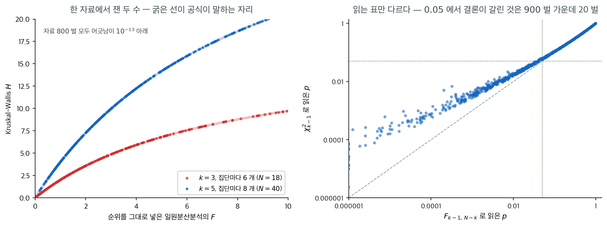
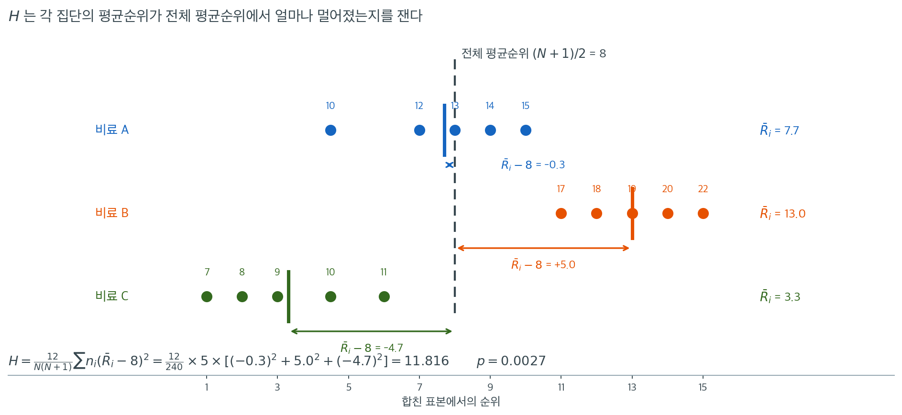

# Kruskal-Wallis 검정

독립인 세 집단 이상을 비교할 때 표준적인 모수적 접근은 일원분산분석이지만, 여기에는 정규성과 등분산성이 필요하다. **Kruskal-Wallis 검정**은 그 비모수 대응물로, 평균순위를 비교하여 집단들이 같은 분포를 갖는지 검정한다. [Wilcoxon 순위합검정](../two_sample_nonparametric/rank_sum.md)과 마찬가지로 합친 표본의 순위 위에서 작동하므로 이상치와 비정규성에 대한 로버스트성을 물려받는다.

집단이 둘뿐이면($k = 2$) Kruskal-Wallis 검정은 Wilcoxon 순위합(Mann-Whitney) 검정으로 환원된다.

---

## 1. 가정

1. $k$개의 표본이 서로 **독립**이다.
2. 관측값이 **연속**분포에서 추출된다.
3. 분포들의 **모양이 같다**(이 검정은 주로 위치 차이에 민감하다).

---

## 2. 가설

$$
H_0 \colon F_1 = F_2 = \cdots = F_k \quad \text{(모든 집단이 같은 분포를 갖는다)}
$$

$$
H_a \colon \text{적어도 한 집단이 나머지와 다르다}
$$

위치이동 모형 아래에서 이는 모든 집단의 중앙값이 같은지 검정하는 것과 동치이다.

---

## 3. 검정통계량

**1단계.** $N = \sum_{i=1}^{k} n_i$개의 관측값을 모두 합쳐 1부터 $N$까지 순위를 매기고, 동점에는 중간순위를 쓴다.

**2단계.** 각 집단 $i$의 순위합 $R_i$와 평균순위 $\bar{R}_i = R_i / n_i$를 계산한다.

**3단계.** Kruskal-Wallis $H$ 통계량은

$$
H = \frac{12}{N(N+1)} \sum_{i=1}^{k} \frac{R_i^2}{n_i} - 3(N+1)
$$

이다. 동치로

$$
H = \frac{12}{N(N+1)} \sum_{i=1}^{k} n_i \left(\bar{R}_i - \frac{N+1}{2}\right)^2
$$

로 쓸 수 있으며, 이는 $H$가 평균순위의 가중 집단간 변동을 재는 양임을 보여 준다.

<div class="storybox" markdown>

**그림으로 보는 통계학 1.** 먼저 와 있던 것을 굳혔을 뿐이라고 적었다

$1987$ 년에 『Current Contents』가 「이 주의 피인용 고전」으로 $1952$ 년의 그 논문을 골라 두 지은이에게 회고를 청했다. 돌아온 글의 서명란부터 눈에 띈다. 하나는 시카고 대학 통계학과, 다른 하나는 **미국 국무부 경제담당 차관**이다.

글의 내용은 더 뜻밖이다. 자랑이 없다.

「순위에 보통의 분산분석을 돌린다는 생각은 당시로서는 자연스러운 것이었고, **돌이켜 보면 일원배치의 경우를 아무도 자세히 발표하지 않았다는 쪽이 오히려 놀랍다**.」

그러고는 먼저 온 사람들을 하나하나 센다. 호텔링과 팝스트($1936$), **프리드먼**($1937$) — 월리스의 가까운 동료였고, 이 장의 [Friedman 검정](friedman.md)이 바로 그것이다 —, 윌콕슨($1945$), 만과 휘트니($1947$). 그리고 하나 더, **월리스 자신이 $1939$ 년에 낸 「순위자료의 상관비」**. 그래서 결론이 이렇다. 「우리의 $1952$ 년 논문은 **이미 공중에 떠 있던 것을 굳힌 것**이다.」 다음 줄은 더 솔직하다 — 「**기본 생각은 월리스의 것이었고, 크러스컬이 이론 계산을 얼마쯤 했으며, 곁가지는 둘이 함께 했다.**」

위에 적은 식이 그 말을 그대로 받쳐 준다. 순위의 전체 제곱합은 자료가 무엇이든 $\sum_{r=1}^{N}\left(r - \frac{N+1}{2}\right)^2 = \frac{N(N^2-1)}{12}$ 로 **고정되어 있다.** 그 상수를 공식에 되넣으면

$$
H = (N-1) \cdot \frac{\text{순위의 집단간 제곱합}}{\text{순위의 전체 제곱합}}
$$

이 된다. 곧 $H$ 는 **순위에 일원분산분석을 돌려 얻은 상관비 $\eta^2$ 에 $N-1$ 을 곱한 것**이다. 월리스가 열세 해 앞서 쓴 논문의 제목이 하필 「순위자료의 상관비」다.



왼쪽은 자료 $800$ 벌에서 $H$ 와 「순위를 그대로 넣은 일원분산분석의 $F$」를 함께 잰 것이다. 집단 수와 $N$ 을 고정하면 **점이 곡선 위에서 한 톨도 벗어나지 않는다**(어긋남이 $10^{-13}$ 아래). 분모가 상수라서 둘은 서로의 함수일 뿐이고, 남는 차이는 **어느 표를 보고 $p$ 를 읽느냐** 하나다. 오른쪽에서 $\chi^2_{k-1}$ 로 읽은 값과 $F_{k-1,N-k}$ 로 읽은 값이 거의 같은 줄에 눕는다. $900$ 벌 가운데 $0.05$ 를 두고 결론이 갈린 것은 $20$ 벌이다.

겸손에는 그럴 만한 사정도 있었다. 논문이 나오던 해에 크러스컬에게는 **박사학위가 없었다.** 월리스는 시카고에 갓 만들어진 통계위원회의 초대 위원장이었고, $1950$ 년 $3$ 월에 보낸 임용 제안서에는 학위 이야기가 한 줄도 없다. 아브라함 발트가 써 준 추천서는 이랬다 — 「대학원생 상위 $5$ 퍼센트에 든다. … **올해 안에 학위논문을 끝낼 수 있을지는 의심스럽다. 나이: $30$ 세**.」 발트가 옳았다. 완벽주의자였던 크러스컬이 최종본을 낸 것은 $1955$ 년, **자기 이름이 붙은 검정이 활자가 되고 세 해 뒤**였다.

_확인한 곳 — 논문이 『J. Amer. Statist. Assoc.』 $47$ 권 $583$–$621$ 쪽($1952$)이고 정오표가 $48$ 권 $907$–$911$ 쪽($1953$)이라는 것, 서명란의 두 소속(시카고 대학 통계학과 · 미 국무부 경제담당 차관), 인용한 네 대목(「돌이켜 보면 … 오히려 놀랍다」·「이미 공중에 떠 있던 것을 굳혔다」·「기본 생각은 월리스의 것이었고 …」), 앞선 글로 든 Hotelling-Pabst($1936$) · Friedman($1937$) · Wilcoxon($1945$) · Mann-Whitney($1947$) · Wallis 「The correlation ratio for ranked data」(JASA $34$:$533$–$8$, $1939$)의 목록은 두 사람이 $1987$ 년 $8$ 월 $6$ 일자로 쓴 [ISI 『Citation Classics』 의 그 쪽](https://garfield.library.upenn.edu/classics1987/A1987K083100001.pdf) 에서 읽었다 · 발트의 $1950$ 년 $2$ 월 $16$ 일자 추천서 문구, 월리스가 통계위원회의 초대 위원장이자 $1950$ 년 $3$ 월 $6$ 일 임용 제안서에 학위를 언급하지 않았다는 것, 크러스컬이 완벽주의자여서 $1955$ 년에야 학위논문 최종본을 내고 박사학위를 받았다는 것은 Fienberg · Stigler · Tanur, 「The William Kruskal Legacy: $1919$–$2005$」, 『Statistical Science』 $22$ 권 $2$ 호($2007$) $255$–$261$ 쪽. 그림의 수와 $H = (N-1)\eta^2$ 항등식 확인은 모두 직접 계산한 값이다_

</div>

---

## 4. 동점 보정

동점이 있으면 $H$를 다음 보정계수로 나눈다.

$$
H_{\text{corrected}} = \frac{H}{1 - \frac{\sum_{j=1}^{g}(t_j^3 - t_j)}{N^3 - N}}
$$

여기서 $g$는 동점 집단의 개수, $t_j$는 $j$번째 집단의 동점 관측값 개수이다. 동점이 없으면 보정계수는 1이다.

---

## 5. 귀무분포

$H_0$ 아래에서 표본이 크면 $H$는 근사적으로

$$
H \sim \chi^2_{k-1}
$$

로 분포한다. 이 근사는 각 $n_i \ge 5$일 때 신뢰할 만하다고 본다.

소표본에서는 가능한 모든 순위 배정을 열거하여 정확 $p$값을 얻을 수 있다.

<div class="exbox" markdown>

**보기 1.** <span class="diff easy" title="쉬움"></span> "$n_i \geq 5$ 면 믿을 만하다" 는 지침을 시험한다. 세 가지 비료를 식물 생장(키, cm)에 대해 시험한다. 각 비료에 식물 5개체를 무작위로 배정했다.

**비료 A** ($n_1 = 5$): 12, 15, 14, 10, 13

**비료 B** ($n_2 = 5$): 20, 18, 22, 17, 19

**비료 C** ($n_3 = 5$): 8, 11, 9, 7, 10

**(1)** 위 다섯 단계를 밟아 $H$ 와 동점 보정, $p$ 값을 손으로 구하시오.

**(2)** 이 자료는 $n_i = 5$ 로 위에 적은 지침의 경계에 딱 걸린다. $15$ 개 순위를 다섯씩 세 집단에 나누는 $756{,}756$ 가지를 **전수 열거**해 $\chi^2_2$ 근사가 정말 믿을 만한지 확인하시오.

</div>

??? success "풀이"

    **(1) 다섯 단계.**

    **1단계.** 합쳐서 순위를 매긴다($N = 15$).

    | 값 | 집단 | 순위 |
    |:-----:|:-----:|:----:|
    | 7 | C | 1 |
    | 8 | C | 2 |
    | 9 | C | 3 |
    | 10 | A | 4.5 |
    | 10 | C | 4.5 |
    | 11 | C | 6 |
    | 12 | A | 7 |
    | 13 | A | 8 |
    | 14 | A | 9 |
    | 15 | A | 10 |
    | 17 | B | 11 |
    | 18 | B | 12 |
    | 19 | B | 13 |
    | 20 | B | 14 |
    | 22 | B | 15 |

    값 $10$이 집단 A와 C에 하나씩 있어 동점이므로 둘 다 중간순위 $4.5$를 받는다.

    **2단계.** 순위합:

    - $R_A = 4.5 + 7 + 8 + 9 + 10 = 38.5$
    - $R_B = 11 + 12 + 13 + 14 + 15 = 65$
    - $R_C = 1 + 2 + 3 + 4.5 + 6 = 16.5$

    **검산:** $38.5 + 65 + 16.5 = 120 = 15 \times 16/2$. $\checkmark$

    **3단계.** $H$를 계산한다.

    $$
    H = \frac{12}{15 \times 16}\left(\frac{38.5^2}{5} + \frac{65^2}{5} + \frac{16.5^2}{5}\right) - 3(16)
    $$

    $$
    = \frac{12}{240}\left(296.45 + 845 + 54.45\right) - 48
    $$

    $$
    = 0.05 \times 1195.9 - 48 = 59.795 - 48 = 11.795
    $$

    **4단계.** 동점 보정을 적용한다. 크기 2인 동점 집단이 하나 있으므로

    $$
    H_{\text{corrected}} = \frac{11.795}{1 - \frac{2^3 - 2}{15^3 - 15}} = \frac{11.795}{1 - \frac{6}{3360}} = \frac{11.795}{0.998214} = 11.816
    $$

    **5단계.** $\chi^2_2$와 비교한다: $P(\chi^2_2 > 11.816) = 0.0027$.

    ```python
    from scipy import stats
    A = [12, 15, 14, 10, 13]; B = [20, 18, 22, 17, 19]; C = [8, 11, 9, 7, 10]
    print(stats.kruskal(A, B, C))
    # KruskalResult(statistic=11.8161, pvalue=0.0027175)
    ```

    출력:

    ```
    KruskalResult(statistic=11.816100178890885, pvalue=0.0027174805686494947)
    ```

    $\alpha = 0.05$에서 $H_0$을 기각한다. 적어도 한 비료가 유의하게 다른 생장을 낸다. 평균순위($\bar{R}_A = 7.7$, $\bar{R}_B = 13.0$, $\bar{R}_C = 3.3$)를 보면 비료 B가 가장 큰 식물을, 비료 C가 가장 작은 식물을 낸다.

    **(2) 지침은 수준에 대해서는 맞고, p-값의 숫자에 대해서는 틀린다.** $H_0$ 아래에서 열다섯 개 중간순위를 다섯씩 세 집단에 나누는 모든 방법이 같은 확률이고, 그런 방법은

    $$
    \binom{15}{5}\binom{10}{5} = 3003 \times 252 = 756{,}756
    $$

    가지다. 전부 열거해 $H$ 의 정확 귀무분포를 얻으면 두 가지가 드러난다.

    먼저 **분포의 몸통에서는 근사가 잘 맞는다.** 열거한 $H$ 의 평균이 $1.996$ 으로 $\chi^2_2$ 의 평균 $2$ 와 거의 같고, 명목수준별 실제 수준은

    | 명목 $\alpha$ | $\chi^2_2$ 임계값 | 실제 수준 | 실제/명목 |
    |---|---|---|---|
    | 0.10 | 4.6052 | 0.095508 | 0.955 |
    | 0.05 | 5.9915 | 0.042783 | 0.856 |
    | 0.01 | 9.2103 | 0.003235 | 0.323 |
    | 0.001 | 13.8155 | **0.000000** | 0.000 |

    다. $\alpha = 0.05$ 에서 실제 수준이 $0.043$ 이므로 **"$n_i \geq 5$ 면 쓸 만하다" 는 지침은 이 수준에서는 맞는다.** 보수적인 쪽으로 조금 빗나가는 정도다.

    $\alpha = 0.001$ 줄이 왜 $0$ 인지도 분명하다. $H$ 의 **최댓값이 $12.5$** 이기 때문이다 — 세 집단이 순위를 $\{1..5\}, \{6..10\}, \{11..15\}$ 로 완전히 나눠 가지는 배치가 가장 치우친 것이고 그때 $H = 12.5$ 다. $\chi^2_2$ 의 $0.1\%$ 임계값 $13.8155$ 는 **도달 불가능**하므로 이 설계로는 $p < 0.001$ 을 낼 수 없다.

    그런데 둘째, **관측값의 p-값 숫자는 전혀 맞지 않는다.** 관측된 $H = 11.795$ 이상인 배치는 $756{,}756$ 가지 가운데

    $$
    p_{\text{정확}} = \frac{24}{756{,}756} = \frac{2}{63{,}063} = 0.0000317
    $$

    로 **스물네 가지**뿐이다. $\chi^2$ 근사의 $0.002717$ 은 이것의 **86배**다. 관측값이 $H_{\max} = 12.5$ 의 턱밑에 있으니 그럴 수밖에 없다 — 이산적이고 유한한 꼬리를 꼬리가 무한한 연속분포로 재면 이렇게 된다.

    **결론은 둘로 갈라서 적어야 한다.** $\alpha = 0.05$ 로 판정하는 데는 $\chi^2$ 근사를 써도 된다(실제 수준 $0.043$). 그러나 **"$p = 0.0027$" 이라는 숫자를 보고하면 안 된다** — 참값은 $0.0000317$ 이고, 그 차이는 근사의 오차가 아니라 분포의 모양이 다르기 때문이다.

    ```python
    import itertools
    from collections import Counter
    from fractions import Fraction
    from math import comb

    import numpy as np

    allv = np.array(A + B + C)
    N = len(allv)
    r = stats.rankdata(allv)
    tie = sum(t ** 3 - t for t in Counter(allv.tolist()).values())
    corr = 1 - tie / (N ** 3 - N)
    R = [r[0:5].sum(), r[5:10].sum(), r[10:15].sum()]
    H_raw = 12 / (N * (N + 1)) * sum(x ** 2 / 5 for x in R) - 3 * (N + 1)
    print(f"순위 {r.tolist()}")
    print(f"R = {R},  보정 전 H = {H_raw:.6f},  보정계수 = {corr:.6f},"
          f"  H/C = {H_raw / corr:.6f}")

    # 15 개 순위를 5 개씩 세 집단에 나누는 모든 방법을 열거한다.
    sub2 = np.array(list(itertools.combinations(range(10), 5)))
    const = 12 / (N * (N + 1)) / 5
    total = r.sum()
    chunks = []
    for first in itertools.combinations(range(N), 5):
        s1 = r[list(first)].sum()
        rest = np.array([r[i] for i in range(N) if i not in first])
        s2 = rest[sub2].sum(axis=1)
        s3 = total - s1 - s2
        chunks.append(const * (s1 ** 2 + s2 ** 2 + s3 ** 2) - 3 * (N + 1))
    Hs = np.concatenate(chunks)
    print(f"\n열거한 가지 수 {len(Hs)}  (= {comb(15, 5)} x {comb(10, 5)})")
    print(f"열거한 H 의 평균 {Hs.mean():.6f}  (chi2_2 의 평균 2),  최댓값 {Hs.max()}")

    print("\n명목     임계값   실제 수준   실제/명목")
    for alpha in (0.10, 0.05, 0.01, 0.001):
        c = stats.chi2.isf(alpha, 2)
        size = float((Hs / corr >= c - 1e-9).mean())
        print(f"{alpha:>6}  {c:>8.4f}  {size:>10.6f}  {size / alpha:>9.3f}")

    hit = int((Hs >= H_raw - 1e-9).sum())
    print(f"\nH >= {H_raw:.3f} 인 배치 {hit} 개")
    print(f"정확     p = {hit}/{len(Hs)} = {Fraction(hit, len(Hs))} = {hit / len(Hs):.7f}")
    print(f"chi2_2   p = {stats.chi2.sf(H_raw / corr, 2):.7f}"
          f"   ->  {stats.chi2.sf(H_raw / corr, 2) / (hit / len(Hs)):.1f} 배")
    ```

    출력:

    ```
    순위 [7.0, 10.0, 9.0, 4.5, 8.0, 14.0, 12.0, 15.0, 11.0, 13.0, 2.0, 6.0, 3.0, 1.0, 4.5]
    R = [38.5, 65.0, 16.5],  보정 전 H = 11.795000,  보정계수 = 0.998214,  H/C = 11.816100
    
    열거한 가지 수 756756  (= 3003 x 252)
    열거한 H 의 평균 1.996429  (chi2_2 의 평균 2),  최댓값 12.5
    
    명목     임계값   실제 수준   실제/명목
       0.1    4.6052    0.095508      0.955
      0.05    5.9915    0.042783      0.856
      0.01    9.2103    0.003235      0.323
     0.001   13.8155    0.000000      0.000
    
    H >= 11.795 인 배치 24 개
    정확     p = 24/756756 = 2/63063 = 0.0000317
    chi2_2   p = 0.0027175   ->  85.7 배
    ```

    **손으로 계산한 $H = 11.795$, 보정계수 $0.998214$, $H/C = 11.816100$ 이 모두 맞는다.** 그리고 열거가 (2) 의 두 결론을 수로 확인한다 — 평균은 $1.996$ 으로 $\chi^2_2$ 와 거의 같고, $\alpha = 0.05$ 의 실제 수준은 $0.0428$ 로 쓸 만하지만, 관측값 자리의 p-값은 $86$ 배 어긋난다.

    $\chi^2_2$ 의 $0.1\%$ 임계값 $13.8155$ 가 $H$ 의 최댓값 $12.5$ 보다 크다는 것이 표의 마지막 줄을 설명한다. **이 설계로 $\alpha = 0.001$ 검정을 하면 어떤 자료가 와도 기각하지 못한다.**

!!! note "동점 보정의 크기"
    이 보기에서 동점 보정은 $H$를 $11.795$에서 $11.816$으로, $p$값을 $0.00275$에서 $0.00272$로 아주 조금 바꾼다. 동점 집단이 하나뿐이고 크기가 2라 보정계수가 $0.998$에 불과하기 때문이다.

    동점 비율이 높으면 이야기가 달라진다. Likert 척도처럼 값의 종류가 몇 개뿐인 자료에서는 보정계수가 $0.9$ 아래로 내려가 $H$를 10% 이상 키운다. `scipy.stats.kruskal`은 언제나 보정을 자동으로 적용한다.



$H$의 두 번째 표현식이 무엇을 재는지 이 자료로 확인해 두자. 가로축은 합친 표본에서의 순위 $1$부터 $15$까지이고, 세로로 세 집단이 나뉘어 있다. 점 위에 적힌 숫자는 원래의 키(cm)이다.

먼저 눈여겨볼 것은 **점들의 간격이 거의 일정하다**는 사실이다. 비료 B의 키가 $17, 18, 19, 20, 22$로 마지막 하나가 튀어도 순위는 $11, 12, 13, 14, 15$로 고르게 늘어선다. 원값의 불균등한 간격이 여기서 사라지고, 남는 것은 **어느 집단이 어느 구간을 차지하는가**뿐이다.

검은 점선이 전체 평균순위 $(N+1)/2 = 8$이다. $H_0$이 참이면 세 집단이 순위를 골고루 나눠 가지므로 각 집단의 평균순위가 모두 $8$ 근처여야 한다. 실제로는 $\bar{R}_A = 7.7$, $\bar{R}_B = 13.0$, $\bar{R}_C = 3.3$으로 벌어졌고, 편차가 $-0.3$, $+5.0$, $-4.7$이다. 색 화살표의 길이가 곧 편차이며, $H$는 이 길이들을 제곱해 더한 값에 상수를 곱한 것이다.

$$
H = \frac{12}{N(N+1)} \sum_i n_i \left(\bar{R}_i - \frac{N+1}{2}\right)^2
= \frac{12}{240} \times 5 \times \left[(-0.3)^2 + 5.0^2 + (-4.7)^2\right] = 11.816
$$

이렇게 보면 $H$가 일원분산분석의 $F$와 같은 생각을 다른 재료로 실행한 것임이 드러난다. $F$는 집단평균이 전체평균에서 얼마나 떨어졌는지를 원값의 척도로 재고, $H$는 같은 것을 **순위의 척도**로 잰다. 순위의 분산은 $H_0$ 아래에서 $N$만으로 정해지므로 표본분산을 추정할 필요가 없고, 그래서 $H$의 분모에는 오차제곱합 대신 상수 $N(N+1)/12$가 들어간다. 분포 가정이 사라지는 자리가 바로 여기다.

---

## 6. 사후비교

Kruskal-Wallis 결과가 유의하다는 것은 적어도 한 집단이 다르다는 뜻이지, 어느 쌍이 다른지는 알려 주지 않는다. 사후분석의 선택지는 다음과 같다.

- **[Dunn 검정](dunn.md)** --- 평균순위 차이에 기반한 쌍별 비교로, 다중검정에 대한 $p$값 보정(Bonferroni, Holm, Benjamini-Hochberg)을 적용한다.
- **쌍별 Mann-Whitney 검정** --- $\binom{k}{2}$개의 이표본 검정을 Bonferroni 보정과 함께 수행한다.

!!! warning "전체검정을 건너뛰지 말 것"
    사후 쌍별 비교는 Kruskal-Wallis 검정이 $H_0$을 기각한 뒤에만 수행해야 한다. 전체적인 차이를 먼저 확인하지 않고 쌍별 검정을 하면 집단별 오류율이 부풀려진다.

### 작은 N 에서 카이제곱 근사는 얼마나 믿을 만한가

<div class="exbox" markdown>

**보기 2.** <span class="diff easy" title="쉬움"></span> $N = 15$ 에서 $\chi^2$ 근사는 얼마나 믿을 만한가. 집단 셋이 각각 다섯 개씩이고 `kruskal` 이 $H = 9.4136$, $p = 0.0090$ 을 준다.

**(1)** 순위합을 구해 $H$ 를 손으로 계산하시오. 이 자료에 동점이 있는가. 있다면 보정을 넣어 `scipy` 의 값과 맞추시오.

**(2)** $N = 15$ 를 셋으로 나누는 방법은 $756{,}756$ 가지뿐이므로 귀무분포를 **전수 열거**할 수 있다. 정확 p-값을 구해 $\chi^2_2$ 근사와 견주시오.

</div>

??? success "풀이"

    **(1) 순위와 $H$.** 15개 값을 합쳐 늘어놓으면 $88$ 이 두 개($A$ 와 $C$ 에 각각 하나), $92$ 가 두 개($A$ 와 $C$ 에 각각 하나) 있다. **동점이 있으므로 중간순위를 준다.**

    | 값 | 68 | 70 | 72 | 75 | 76 | 78 | 81 | 85 | 87 | 88 | 88 | 90 | 92 | 92 | 95 |
    |---|---|---|---|---|---|---|---|---|---|---|---|---|---|---|---|
    | 순위 | 1 | 2 | 3 | 4 | 5 | 6 | 7 | 8 | 9 | 10.5 | 10.5 | 12 | 13.5 | 13.5 | 15 |
    | 집단 | B | B | B | B | A | A | B | A | C | A | C | C | A | C | C |

    $$
    R_A = 5 + 6 + 8 + 10.5 + 13.5 = 43,
    \quad
    R_B = 1 + 2 + 3 + 4 + 7 = 17,
    \quad
    R_C = 9 + 10.5 + 12 + 13.5 + 15 = 60
    $$

    검산: $43 + 17 + 60 = 120 = 15 \times 16/2$. $\checkmark$ 평균순위는 $8.6$, $3.4$, $12.0$ 이고 전체 평균순위 $8$ 을 사이에 둔다. $B$ 가 가장 아래, $C$ 가 가장 위다.

    $$
    H = \frac{12}{15 \times 16}\left(\frac{43^2}{5} + \frac{17^2}{5} + \frac{60^2}{5}\right) - 3 \times 16
      = 0.05 \times (369.8 + 57.8 + 720) - 48
      = 57.38 - 48
      = 9.38
    $$

    **`scipy` 는 $9.4136$ 을 준다.** 차이는 동점 보정이다. $t = 2$ 인 묶음이 둘이므로

    $$
    \sum_j (t_j^3 - t_j) = 6 + 6 = 12,
    \qquad
    C = 1 - \frac{12}{15^3 - 15} = 1 - \frac{12}{3360} = 0.996429
    $$

    $$
    H_{\text{보정}} = \frac{9.38}{0.996429} = 9.413620
    $$

    로 `scipy` 와 소수 여섯째 자리까지 같다. $\chi^2_2$ 근사 p-값은 $P(\chi^2_2 > 9.413620) = 0.009034$ 다.

    **(2) 전수 열거.** $H_0$ 아래에서 15개 중간순위를 다섯 개씩 세 집단에 나누는 모든 방법이 같은 확률이다. 그런 방법은

    $$
    \binom{15}{5}\binom{10}{5} = 3003 \times 252 = 756{,}756
    $$

    가지다. 각 배치의 $H$ 를 계산해 관측값 이상인 것을 세면 **1890 개**다.

    $$
    p_{\text{정확}} = \frac{1890}{756{,}756} = \frac{5}{2002} = 0.0024975
    $$

    **$\chi^2_2$ 근사의 $0.009034$ 가 정확값의 3.6배다.** 근사가 **보수적인** 쪽으로 틀렸다. 다섯 개씩 세 집단에서 $\chi^2$ 근사가 신뢰할 만하지 않다는 것이 이렇게 수로 드러난다. 다만 두 값 모두 $0.05$ 아래이므로 **결론은 바뀌지 않는다** — 오히려 정확검정이 더 강하게 기각한다.

    보정인자 $C$ 가 모든 배치에 같은 상수이므로 $H$ 와 $H/C$ 의 순서가 같고, 따라서 **동점 보정을 넣든 안 넣든 정확 p-값은 똑같다.** 보정은 $\chi^2$ 근사를 쓸 때만 뜻이 있다.

    **수치적으로.**

    ```python
    from scipy.stats import kruskal

    group_a = [85, 78, 92, 88, 76]
    group_b = [72, 68, 81, 75, 70]
    group_c = [90, 95, 88, 92, 87]

    # Kruskal-Wallis 는 일원배치 분산분석의 비모수 대응이다. 집단이 셋 이상일
    # 때 쓰며, Mann-Whitney U 를 여러 집단으로 넓힌 것이라고 보면 된다.
    stat, p_value = kruskal(group_a, group_b, group_c)

    print(f"H statistic: {stat:.4f}")   # 9.4136
    print(f"P-value: {p_value:.4f}")    # 0.0090

    alpha = 0.05
    if p_value < alpha:
        print("Reject H0: At least one group differs significantly.")
    else:
        print("Fail to reject H0.")
    ```

    출력:

    ```
    H statistic: 9.4136
    P-value: 0.0090
    Reject H0: At least one group differs significantly.
    ```

    ```python
    import itertools
    import math
    from collections import Counter

    import numpy as np
    from scipy import stats

    allv = np.array(group_a + group_b + group_c)
    N = len(allv)
    r = stats.rankdata(allv)
    R = [r[0:5].sum(), r[5:10].sum(), r[10:15].sum()]
    print(f"순위  {r.tolist()}")
    print(f"동점  {[(k, v) for k, v in sorted(Counter(allv.tolist()).items()) if v > 1]}")
    print(f"R = {R},  합 = {sum(R)}  (N(N+1)/2 = {N * (N + 1) / 2})")
    print(f"평균순위 = {[x / 5 for x in R]}   (전체 {(N + 1) / 2})")

    H = 12 / (N * (N + 1)) * sum(x ** 2 / 5 for x in R) - 3 * (N + 1)
    tie = sum(t ** 3 - t for t in Counter(allv.tolist()).values())
    C = 1 - tie / (N ** 3 - N)
    print(f"\n보정 없는 H = {H:.6f}")
    print(f"sum(t^3-t) = {tie},  C = 1 - {tie}/{N ** 3 - N} = {C:.6f}")
    print(f"H/C = {H / C:.6f}   (scipy {stat:.6f})")
    print(f"chi2_2 근사 p = {stats.chi2.sf(H / C, 2):.6f}   (scipy {p_value:.6f})")

    # 귀무분포를 전수 열거한다. C(15,5) * C(10,5) = 756756 가지.
    sub2 = np.array(list(itertools.combinations(range(10), 5)))
    const = 12 / (N * (N + 1)) / 5
    total_rank = r.sum()
    chunks = []
    for first in itertools.combinations(range(N), 5):
        s1 = r[list(first)].sum()
        rest = np.array([r[i] for i in range(N) if i not in first])
        s2 = rest[sub2].sum(axis=1)
        s3 = total_rank - s1 - s2
        chunks.append(const * (s1 ** 2 + s2 ** 2 + s3 ** 2) - 3 * (N + 1))
    Hs = np.concatenate(chunks)
    hit = int((Hs >= H - 1e-9).sum())
    print(f"\n열거한 가지 수 {len(Hs)}  (= {math.comb(15, 5)} x {math.comb(10, 5)})")
    print(f"열거한 H 의 평균 {Hs.mean():.6f}   (chi2_2 의 평균 = 2)")
    print(f"H >= {H:.2f} 인 것 {hit} 개  ->  정확 p = {hit}/{len(Hs)} = {hit / len(Hs):.7f}")
    print(f"chi2_2 근사 / 정확 = {stats.chi2.sf(H / C, 2) / (hit / len(Hs)):.2f} 배")
    ```

    출력:

    ```
    순위  [8.0, 6.0, 13.5, 10.5, 5.0, 3.0, 1.0, 7.0, 4.0, 2.0, 12.0, 15.0, 10.5, 13.5, 9.0]
    동점  [(88, 2), (92, 2)]
    R = [43.0, 17.0, 60.0],  합 = 120.0  (N(N+1)/2 = 120.0)
    평균순위 = [8.6, 3.4, 12.0]   (전체 8.0)

    보정 없는 H = 9.380000
    sum(t^3-t) = 12,  C = 1 - 12/3360 = 0.996429
    H/C = 9.413620   (scipy 9.413620)
    chi2_2 근사 p = 0.009034   (scipy 0.009034)

    열거한 가지 수 756756  (= 3003 x 252)
    열거한 H 의 평균 1.992857   (chi2_2 의 평균 = 2)
    H >= 9.38 인 것 1890 개  ->  정확 p = 1890/756756 = 0.0024975
    chi2_2 근사 / 정확 = 3.62 배
    ```

    **손계산 $H = 9.38$, $C = 0.996429$, $H/C = 9.413620$ 이 `scipy` 와 모두 맞는다.** 열거한 귀무분포의 평균이 $1.992857$ 로 $\chi^2_2$ 의 평균 $2$ 에 거의 같다 — 근사가 **중앙부에서는** 잘 맞는다는 뜻이다. 그런데도 꼬리에서 $3.62$ 배 어긋났다.

    이것이 $\chi^2$ 근사의 성격이다. **평균은 맞추지만 꼬리 모양을 못 맞춘다.** $H$ 가 가질 수 있는 값이 756756 가지 배치로 결정되는 이산 집합인데 $\chi^2_2$ 는 연속분포이고, 특히 $H$ 의 최댓값은 유한하다(한 집단이 순위 상위 다섯 개를 모두 차지하는 배치). 꼬리가 짧은 이산분포를 꼬리가 무한한 연속분포로 재면 이런 차이가 난다. **$n_i = 5$ 정도에서는 정확검정이나 순열검정을 쓰는 것이 옳다.**

---

### 위의 식으로는 scipy 의 H 가 나오지 않는다

<div class="exbox" markdown>

**보기 3.** <span class="diff easy" title="쉬움"></span> 위의 식으로는 `scipy` 의 $H$ 가 나오지 않는다. 집단 셋의 크기가 $16, 15, 17$ 이고 `kruskal` 이 $H = 7.6480$, $p = 0.0218$ 을 준다.

**(1)** 이 쪽 본문에 적힌 식 $H = \dfrac{12}{N(N+1)}\sum_j R_j^2/n_j - 3(N+1)$ 로 $H$ 를 손으로 계산하시오. `scipy` 의 값과 맞는가.

**(2)** 맞지 않다면 빠진 항을 찾아 메우고, 그 항이 결론에 미치는 영향을 재시오.

</div>

??? success "풀이"

    **(1) 본문의 식으로 계산한다.** $N = 16 + 15 + 17 = 48$ 이다. 48개를 합쳐 순위를 매기면 집단별 순위합이

    $$
    R_1 = 295, \qquad R_2 = 483, \qquad R_3 = 398
    $$

    이다. 검산: $295 + 483 + 398 = 1176 = 48 \times 49/2$. $\checkmark$ 평균순위는 각각 $18.4375$, $32.2$, $23.4118$ 이고 전체 평균순위 $(N+1)/2 = 24.5$ 를 사이에 두고 벌어져 있다.

    $$
    \sum_j \frac{R_j^2}{n_j}
    = \frac{295^2}{16} + \frac{483^2}{15} + \frac{398^2}{17}
    = 5439.0625 + 15552.6 + 9317.882353
    = 30309.544853
    $$

    $$
    H = \frac{12}{48 \times 49} \times 30309.544853 - 3 \times 49
      = 154.640535 - 147
      = 7.640535
    $$

    **`scipy` 는 $7.648007$ 을 준다. 맞지 않는다.** 차이가 $0.007472$ 로 작지만 반올림 오차가 아니다 — 소수 둘째 자리에서 이미 갈린다.

    **(2) 빠진 것은 동점 보정이다.** 이 48개 값에는 동점이 아홉 묶음 있다. $14, 22, 33, 40, 43, 48$ 이 각각 두 개, $25, 31, 34$ 가 각각 세 개다.

    $$
    \sum_j (t_j^3 - t_j) = 6 \times (2^3 - 2) + 3 \times (3^3 - 3) = 36 + 72 = 108
    $$

    동점이 있으면 순위의 분산이 줄어들므로 $H$ 를 그만큼 **키워** 주어야 한다. 보정인자는

    $$
    C = 1 - \frac{\sum_j (t_j^3 - t_j)}{N^3 - N} = 1 - \frac{108}{110544} = 0.999023
    $$

    이고

    $$
    H_{\text{보정}} = \frac{H}{C} = \frac{7.640535}{0.999023} = 7.648007
    $$

    **이것이 `scipy` 의 값과 정확히 같다.** 즉 `scipy` 는 늘 동점 보정을 넣고, 이 쪽 본문의 식은 **동점이 없을 때의 식**이다.

    영향은 작다. 자유도 $k - 1 = 2$ 에서

    $$
    P(\chi^2_2 > 7.640535) = 0.021922,
    \qquad
    P(\chi^2_2 > 7.648007) = 0.021840
    $$

    로 p-값이 $0.00008$ 움직였을 뿐이다. $C \leq 1$ 이므로 **보정은 언제나 $H$ 를 키우고 p-값을 줄인다.** 보정을 빠뜨리면 보수적인 쪽으로 틀리는 셈이다. 여기서는 $108/110544$ 가 0.1% 라 거의 보이지 않지만, 눈금이 거친 자료에서는 $C$ 가 0.9 아래로 내려가 $H$ 를 10% 이상 밀어 올리기도 한다.

    **수치적으로.**

    ```python
    from scipy import stats

    data0 = [10, 14, 14, 18, 20, 22, 24, 25, 31, 31, 32, 39, 43, 43, 48, 49]
    data1 = [28, 30, 31, 33, 34, 35, 36, 40, 44, 55, 57, 61, 91, 92, 99]
    data2 = [0, 3, 9, 22, 23, 25, 25, 33, 34, 34, 40, 45, 46, 48, 62, 67, 84]

    # 집단이 셋이 되면 Kruskal-Wallis 로 간다. 유의하다는 결론이 나면 어느 쌍이
    # 다른지는 따로 사후비교를 해야 한다.
    stat, p = stats.kruskal(data0, data1, data2)
    print(f"H = {stat:.4f}, p = {p:.2%}")
    # H = 7.6480, p = 2.18%
    ```

    출력:

    ```
    H = 7.6480, p = 2.18%
    ```

    ```python
    import numpy as np
    from collections import Counter

    groups = [data0, data1, data2]
    sizes = [len(g) for g in groups]
    allv = sum(groups, [])
    N = len(allv)
    ranks = stats.rankdata(allv)
    edges = np.cumsum([0] + sizes)
    R = [ranks[edges[i]:edges[i + 1]].sum() for i in range(3)]
    print(f"n = {sizes},  N = {N}")
    print(f"R = {R},  합 = {sum(R)}  (N(N+1)/2 = {N * (N + 1) / 2})")
    print(f"평균순위 = {[round(R[i] / sizes[i], 4) for i in range(3)]}"
          f"   (전체 {(N + 1) / 2})")

    H = 12 / (N * (N + 1)) * sum(R[i] ** 2 / sizes[i] for i in range(3)) - 3 * (N + 1)
    counts = Counter(allv)
    tie = sum(t ** 3 - t for t in counts.values())
    C = 1 - tie / (N ** 3 - N)
    print(f"\n본문 식의 H          = {H:.6f}")
    print(f"동점 묶음 {dict((k, v) for k, v in sorted(counts.items()) if v > 1)}")
    print(f"sum(t^3-t) = {tie},  C = 1 - {tie}/{N ** 3 - N} = {C:.6f}")
    print(f"동점 보정한 H = H/C  = {H / C:.6f}")
    print(f"scipy 가 준 H        = {stat:.6f}")
    print(f"p: 보정 전 {stats.chi2.sf(H, 2):.6f}  ->  보정 후 {stats.chi2.sf(H / C, 2):.6f}"
          f"  (scipy {p:.6f})")
    ```

    출력:

    ```
    n = [16, 15, 17],  N = 48
    R = [295.0, 483.0, 398.0],  합 = 1176.0  (N(N+1)/2 = 1176.0)
    평균순위 = [18.4375, 32.2, 23.4118]   (전체 24.5)

    본문 식의 H          = 7.640535
    동점 묶음 {14: 2, 22: 2, 25: 3, 31: 3, 33: 2, 34: 3, 40: 2, 43: 2, 48: 2}
    sum(t^3-t) = 108,  C = 1 - 108/110544 = 0.999023
    동점 보정한 H = H/C  = 7.648007
    scipy 가 준 H        = 7.648007
    p: 보정 전 0.021922  ->  보정 후 0.021840  (scipy 0.021840)
    ```

    **본문의 식과 `scipy` 가 어긋난 까닭이 동점 보정 하나로 완전히 설명된다.** 손계산 $7.640535$ 를 $C = 0.999023$ 으로 나누면 소수 여섯째 자리까지 `scipy` 와 같다. 두 식 모두 틀린 것이 아니다 — **본문의 식은 동점이 없을 때의 식이고, 동점이 있으면 $C$ 로 나누어야 한다.** 손으로 계산한 값이 소프트웨어와 조금 다를 때 가장 먼저 의심할 곳이 여기다.

---

---

## 연습문제

<div class="drillbox" markdown>

**연습문제 1.** <span class="diff easy" title="쉬움"></span>
세 비료를 식물 생장(4주 후 키, cm)에 대해 시험했다.

- **비료 A**: 15, 18, 20, 17
- **비료 B**: 22, 25, 19, 23
- **비료 C**: 12, 14, 16, 13

**(a)** 모든 관측값을 합쳐 순위를 배정하라.

**(b)** 각 집단의 평균순위를 계산하라.

**(c)** Kruskal-Wallis 검정통계량

$$
H = \frac{12}{N(N+1)} \sum_{i=1}^{k} n_i (\bar{R}_i - \bar{R})^2
$$

을 계산하라. 여기서 $N$은 전체 표본크기, $n_i$는 집단 $i$의 크기, $\bar{R}_i$는 집단 $i$의 평균순위, $\bar{R} = (N+1)/2$이다.

**(d)** $H_0$ 아래에서 $H$는 근사적으로 자유도 $k - 1$인 $\chi^2$ 분포를 따른다. $p$값을 구하고 $\alpha = 0.05$에서 결론을 내려라.

</div>

??? success "풀이"

    **(a)** 합쳐서 정렬하고 순위를 매기면

    | 값 | 집단 | 순위 |
    |:---:|:---:|:---:|
    | 12 | C | 1 |
    | 13 | C | 2 |
    | 14 | C | 3 |
    | 15 | A | 4 |
    | 16 | C | 5 |
    | 17 | A | 6 |
    | 18 | A | 7 |
    | 19 | B | 8 |
    | 20 | A | 9 |
    | 22 | B | 10 |
    | 23 | B | 11 |
    | 25 | B | 12 |

    **(b)** 평균순위:

    $$
    \bar{R}_A = \frac{4 + 6 + 7 + 9}{4} = \frac{26}{4} = 6.5
    $$

    $$
    \bar{R}_B = \frac{8 + 10 + 11 + 12}{4} = \frac{41}{4} = 10.25
    $$

    $$
    \bar{R}_C = \frac{1 + 2 + 3 + 5}{4} = \frac{11}{4} = 2.75
    $$

    전체 평균순위는 $\bar{R} = (N+1)/2 = 13/2 = 6.5$이다.

    **(c)**

    $$
    H = \frac{12}{12 \times 13} \sum_{i=1}^{3} 4(\bar{R}_i - 6.5)^2
    $$

    $$
    = \frac{12}{156}\left[4(6.5 - 6.5)^2 + 4(10.25 - 6.5)^2 + 4(2.75 - 6.5)^2\right]
    $$

    $$
    = \frac{1}{13}\left[0 + 4(14.0625) + 4(14.0625)\right] = \frac{112.5}{13} \approx 8.654
    $$

    **(d)** $H_0$ 아래에서 $H \sim \chi^2_{k-1} = \chi^2_2$이다. $\alpha = 0.05$에서 $\chi^2_2$의 임계값은 $5.991$이다.

    $H = 8.654 > 5.991$이므로 $H_0$을 기각한다. $p$값은 $P(\chi^2_2 > 8.654) = 0.0132$이다.

    ```python
    from scipy import stats
    a = [15, 18, 20, 17]; b = [22, 25, 19, 23]; c = [12, 14, 16, 13]
    print(stats.kruskal(a, b, c))          # H=8.6538, p=0.013208
    print(stats.f_oneway(a, b, c))         # F=16.130, p=0.001057
    ```

    출력:

    ```
    KruskalResult(statistic=8.653846153846153, pvalue=0.013208125416383262)
    F_onewayResult(statistic=16.129629629629616, pvalue=0.0010574135527856804)
    ```

    세 비료가 서로 다른 생장 분포를 낸다는 유의한 증거가 있다. 어느 쌍이 다른지는 사후분석(예: Dunn 검정)으로 판정해야 한다.

    참고로 일원분산분석은 $p = 0.00106$으로 훨씬 작은 값을 준다. 이 자료가 정규성과 등분산성을 잘 만족하고 $n_i = 4$로 매우 작아, 순위로 정보를 버리는 대가가 크게 나타난 경우이다.

<div class="drillbox" markdown>

**연습문제 2.** <span class="diff med" title="중간"></span>
$k = 3$이고 $n_i = 4$인 이 보기에서 $\chi^2$ 근사가 얼마나 믿을 만한가? 정확 순열분포를 열거하여 확인하라.

</div>

??? success "풀이"
    $12$개 순위를 세 집단에 $4$개씩 나누는 방법은 $\binom{12}{4}\binom{8}{4} = 495 \times 70 = 34{,}650$가지이다. 모두 열거할 수 있다.

    ```python
    import numpy as np, itertools
    from scipy import stats

    N, k, n = 12, 3, 4
    ranks = np.arange(1, N + 1)
    Rbar = (N + 1) / 2
    Hs = []
    for g1 in itertools.combinations(range(N), n):
        rest = [i for i in range(N) if i not in g1]
        for g2 in itertools.combinations(rest, n):
            g3 = [i for i in rest if i not in g2]
            means = [ranks[list(g)].mean() for g in (g1, g2, g3)]
            Hs.append(12 / (N * (N + 1)) * n * sum((m - Rbar) ** 2 for m in means))
    Hs = np.array(Hs)
    print(len(Hs))                                  # 34650
    print("exact p:", (Hs >= 8.6538 - 1e-9).mean()) # 0.00139
    print("chi2  p:", stats.chi2.sf(8.6538, 2))     # 0.01321
    ```

    출력:

    ```
    34650
    exact p: 0.0013852813852813853
    chi2  p: 0.013208430222794458
    ```

    | 방법 | $p$값 |
    |:---|---:|
    | 정확 (열거) | $0.00139$ |
    | $\chi^2_2$ 근사 | $0.01321$ |

    $\chi^2$ 근사가 정확값의 **9.5배**로 $p$값을 크게 과대평가한다. 즉 이 표본크기에서 근사는 심하게 **보수적**이다.

    이유는 $H$의 귀무분포가 아직 이산적이고 오른쪽으로 덜 치우쳐 있기 때문이다. $n_i \ge 5$라는 통상적 지침이 여기서 지켜지지 않았다.

    다행히 이 자료에서는 두 값 모두 $0.05$ 아래여서 결론이 같다. 그러나 $p$가 $0.05$ 근처였다면 근사에 기대는 것이 위험했을 것이다.

    **권고:** 집단당 관측값이 5개 미만이면 `scipy.stats.permutation_test`로 정확 또는 몬테카를로 $p$값을 구한다.

<div class="drillbox" markdown>

**연습문제 3.** <span class="diff med" title="중간"></span>
Kruskal-Wallis 검정은 분포의 **모양이 같다**고 가정한다. 모양이 다르면 어떻게 되는가? 중앙값이 모두 같지만 왜도가 다른 세 집단을 만들어 제1종 오류율을 확인하라.

</div>

??? success "풀이"
    중앙값이 모두 0인 세 분포를 만든다. 각각 오른쪽 치우침, 대칭, 왼쪽 치우침이다.

    ```python
    import numpy as np
    from scipy import stats
    rng = np.random.default_rng(0)
    B = 2000

    def sim(n):
        rej = 0
        for _ in range(B):
            g1 = rng.exponential(1, n) - np.log(2)          # 오른쪽 치우침
            g2 = rng.normal(0, 1, n)                        # 대칭
            g3 = -(rng.exponential(1, n) - np.log(2))       # 왼쪽 치우침
            rej += stats.kruskal(g1, g2, g3).pvalue < 0.05
        return rej / B

    for n in (10, 20, 50, 100):
        print(n, sim(n))
    ```

    출력:

    ```
    10 0.097
    20 0.1355
    50 0.3295
    100 0.614
    ```

    | 집단당 $n$ | 기각률 |
    |---:|---:|
    | 10 | 0.097 |
    | 20 | 0.136 |
    | 50 | 0.330 |
    | 100 | 0.614 |

    세 집단의 **중앙값이 모두 정확히 0**인데도 기각률이 명목수준의 두 배($n=10$)에서 12배($n=100$)까지 올라가고, $n$이 커질수록 **더 나빠진다**.

    이유는 Kruskal-Wallis가 검정하는 것이 "중앙값이 같다"가 아니라 "분포가 같다"이기 때문이다. 평균순위는 중앙값이 아니라 $P(X_i > X_j)$ 형태의 양에 민감하다. 오른쪽으로 치우친 분포는 극단적으로 큰 값을 자주 내므로 합친 표본에서 높은 순위를 더 많이 차지한다.

    구체적으로, 세 분포의 기대 평균순위를 계산해 보면 $g_1 > g_2 > g_3$ 순으로 갈리며, 이 차이가 표본이 커질수록 잡음에 비해 뚜렷해진다.

    **실무적 함의:** "Kruskal-Wallis는 중앙값을 비교한다"는 흔한 설명은 **모양이 같을 때만** 옳다. 집단별 상자그림을 그려 모양이 눈에 띄게 다르면, 중앙값 비교가 목적일 때는 Mood 중앙값검정이나 중앙값의 붓스트랩 신뢰구간을 쓰는 편이 정직하다.

<div class="drillbox" markdown>

**연습문제 4.** <span class="diff hard" title="어려움"></span>
Kruskal-Wallis $H$의 두 표현

$$
\frac{12}{N(N+1)} \sum_i \frac{R_i^2}{n_i} - 3(N+1)
\quad\text{와}\quad
\frac{12}{N(N+1)} \sum_i n_i \left(\bar{R}_i - \frac{N+1}{2}\right)^2
$$

이 같음을 보여라.

</div>

??? success "풀이"
    두 번째 식을 전개한다. $\bar{R} = (N+1)/2$이고 $\bar{R}_i = R_i/n_i$이므로

    $$
    \sum_i n_i (\bar{R}_i - \bar{R})^2
    = \sum_i n_i \bar{R}_i^2 - 2\bar{R}\sum_i n_i \bar{R}_i + \bar{R}^2 \sum_i n_i
    $$

    각 항을 정리하자.

    - $\sum_i n_i \bar{R}_i^2 = \sum_i n_i \frac{R_i^2}{n_i^2} = \sum_i \frac{R_i^2}{n_i}$
    - $\sum_i n_i \bar{R}_i = \sum_i R_i = \frac{N(N+1)}{2}$ (전체 순위합)
    - $\sum_i n_i = N$

    따라서

    $$
    \sum_i n_i (\bar{R}_i - \bar{R})^2
    = \sum_i \frac{R_i^2}{n_i} - 2 \cdot \frac{N+1}{2} \cdot \frac{N(N+1)}{2} + \left(\frac{N+1}{2}\right)^2 N
    $$

    $$
    = \sum_i \frac{R_i^2}{n_i} - \frac{N(N+1)^2}{2} + \frac{N(N+1)^2}{4}
    = \sum_i \frac{R_i^2}{n_i} - \frac{N(N+1)^2}{4}
    $$

    이제 앞의 계수 $\frac{12}{N(N+1)}$을 곱하면

    $$
    \frac{12}{N(N+1)}\sum_i \frac{R_i^2}{n_i} - \frac{12}{N(N+1)} \cdot \frac{N(N+1)^2}{4}
    = \frac{12}{N(N+1)}\sum_i \frac{R_i^2}{n_i} - 3(N+1) \quad \square
    $$

    두 표현이 각각 유용한 지점이 다르다. 첫 번째는 손계산에 편하고(순위합만 있으면 된다), 두 번째는 $H$가 무엇을 재는지 --- **평균순위의 집단간 변동** --- 를 드러낸다.

    두 번째 표현은 분산분석과의 유비도 명확히 한다. 일원분산분석의 $F$ 통계량이 집단간 제곱합을 집단내 제곱합으로 나눈 것이라면, $H$는 순위의 집단간 제곱합을 순위의 **전체** 분산 $N(N+1)/12$로 나눈 것이다. 순위의 전체 분산은 자료와 무관하게 고정되어 있으므로 집단내 변동을 따로 추정할 필요가 없고, 이것이 $H$가 분포무관인 이유이다.

<div class="drillbox" markdown>

**연습문제 5.** <span class="diff hard" title="어려움"></span>
4절의 동점 보정이 검정의 결론을 실제로 뒤집는 자리를 만든다. 리커트 척도처럼 값이 $1, 2, 3$ 세 가지뿐인 자료를 세 집단에서 넷씩 얻었다.

- **집단 A**: 1, 1, 1, 2
- **집단 B**: 1, 2, 2, 3
- **집단 C**: 2, 3, 3, 3

**(a)** 중간순위를 매겨 $R_A, R_B, R_C$ 와 보정 전 $H$ 를 손으로 구하라. 분수로 적으라.

**(b)** 동점 보정계수를 분수로 구하고 $H_{\text{corrected}}$ 를 구하라. $\chi^2_2$ 의 $5\%$ 임계값 $5.9915$ 와 견주면 보정 전과 후의 결론이 갈린다. 확인하라.

**(c)** 동점 보정을 빼먹으면 검정이 **보수적**이 되는가 **과감**해지는가? 보정계수가 가질 수 있는 값의 범위를 구해 답하라.

**(d)** 왜 하필 그 보정계수인가? 중간순위 $r_1, \dots, r_N$ 의 분산

$$
s_r^2 = \frac{1}{N}\sum_{m=1}^{N}\left(r_m - \frac{N+1}{2}\right)^2
$$

이 동점이 없을 때의 값 $\frac{N^2-1}{12}$ 에 바로 그 보정계수를 곱한 것임을 보이고, 이 자료에서 수치로 확인하라.

</div>

??? success "풀이"

    **(a) 중간순위와 $H$.**

    값 $1$ 이 넷, $2$ 가 넷, $3$ 이 넷이므로 순위 $1$–$4$ 가 모두 $1$ 에게, $5$–$8$ 이 $2$ 에게, $9$–$12$ 가 $3$ 에게 간다. 중간순위는

    $$
    1 \mapsto \frac{1+2+3+4}{4} = 2.5, \qquad 2 \mapsto 6.5, \qquad 3 \mapsto 10.5
    $$

    이다. 집단별로 더하면

    - $R_A = 2.5 \times 3 + 6.5 = 14$
    - $R_B = 2.5 + 6.5 \times 2 + 10.5 = 26$
    - $R_C = 6.5 + 10.5 \times 3 = 38$

    **검산:** $14 + 26 + 38 = 78 = 12 \times 13/2$. $\checkmark$

    $N = 12$, $n_i = 4$, $k = 3$ 이므로

    $$
    H = \frac{12}{12 \times 13}\left(\frac{14^2 + 26^2 + 38^2}{4}\right) - 3 \times 13
    = \frac{1}{13} \cdot \frac{2316}{4} - 39
    $$

    $$
    = \frac{579}{13} - \frac{507}{13} = \frac{72}{13} = 5.538462
    $$

    **(b) 보정계수와 결론의 뒤집힘.**

    동점 집단이 셋이고 각각 $t_j = 4$ 이므로 $\sum_j (t_j^3 - t_j) = 3(64 - 4) = 180$ 이고 $N^3 - N = 1728 - 12 = 1716$ 이다. 따라서

    $$
    C = 1 - \frac{180}{1716} = 1 - \frac{15}{143} = \frac{128}{143} = 0.895105
    $$

    $$
    H_{\text{corrected}} = \frac{72/13}{128/143} = \frac{72}{13} \cdot \frac{143}{128} = \frac{72 \times 11}{128} = \frac{99}{16} = 6.1875
    $$

    $\chi^2_2$ 로 읽은 $p$ 값은 각각

    $$
    P(\chi^2_2 > 5.538462) = 0.062710, \qquad P(\chi^2_2 > 6.187500) = 0.045332
    $$

    이다. $5.538462 < 5.9915 < 6.187500$ 이므로 **보정을 하지 않으면 기각하지 못하고, 하면 기각한다.** 동점 보정은 "아주 조금 바꾸는" 장식이 아니다 — 보기 1 에서 보정계수가 $0.998$ 이었던 것은 동점이 하나뿐이었기 때문이고, 여기서는 모든 관측값이 동점에 참여해 $0.895$ 로 내려갔다.

    **(c) 빼먹으면 보수적이다.**

    $t_j \ge 1$ 이므로 $t_j^3 - t_j \ge 0$ 이고, 따라서 $\sum_j (t_j^3 - t_j) \ge 0$ 이다. 또 가장 극단적인 경우는 $N$ 개 값이 모두 같은 것이고 그때 $\sum_j(t_j^3 - t_j) = N^3 - N$ 이다. 그러므로

    $$
    0 \le C \le 1
    $$

    이고 $C = 1$ 은 동점이 전혀 없을 때뿐, $C = 0$ 은 모든 값이 같아 검정 자체가 뜻을 잃을 때뿐이다. 실제 자료에서는 $0 < C < 1$ 이다.

    $H_{\text{corrected}} = H / C$ 이고 $C < 1$ 이므로 **보정은 $H$ 를 언제나 키우고 $p$ 값을 언제나 줄인다.** 곧 보정을 빼먹은 검정은 참값보다 작은 통계량을 참값보다 큰 $p$ 값으로 읽으므로 **기각을 덜 하는 보수적인 검정**이 된다. (b) 가 그 극단적인 보기다.

    **(d) 보정계수는 중간순위 분산의 비다.**

    동점이 없으면 $r_m$ 은 $1, \dots, N$ 의 재배열이고

    $$
    s_r^2 = \frac{1}{N}\sum_{m=1}^{N}\left(m - \frac{N+1}{2}\right)^2 = \frac{N^2-1}{12}
    $$

    이다. 동점이 있으면 크기 $t_j$ 인 동점 집단의 $t_j$ 개 순위 $a+1, \dots, a+t_j$ 가 모두 그 평균 $a + \frac{t_j+1}{2}$ 로 바뀐다. 한 집단 안에서 중심에 대한 제곱합이 줄어드는 양은 (평행축 정리로) 그 집단 안의 제곱편차합

    $$
    \sum_{u=1}^{t_j}\left(u - \frac{t_j+1}{2}\right)^2 = \frac{t_j(t_j^2-1)}{12} = \frac{t_j^3 - t_j}{12}
    $$

    이다. 따라서

    $$
    N s_r^2 = \frac{N(N^2-1)}{12} - \sum_j \frac{t_j^3 - t_j}{12},
    \qquad
    s_r^2 = \frac{N^2-1}{12}\left(1 - \frac{\sum_j (t_j^3-t_j)}{N^3 - N}\right) = \frac{N^2-1}{12}\,C
    $$

    이다. 곧 $s_r^2$ 는 동점이 없을 때의 값에 정확히 $C$ 를 곱한 것이다.

    이제 $H$ 쪽을 보자. $H$ 의 표준화에 쓰인 눈금은 상수

    $$
    \frac{N(N+1)}{12} = \frac{N^2-1}{12} \cdot \frac{N}{N-1}
    $$

    로, **동점이 없을 때의** 순위 분산에 비례한다. 동점이 있으면 실제 순위 분산은 그보다 $C$ 배 작으므로 눈금이 $1/C$ 배 과대해지고 $H$ 는 그만큼 작게 나온다. $C$ 로 나누는 것이 바로 그 눈금을 실제 분산에 맞추는 일이다.

    이 자료로 확인하면 중간순위는 $2.5$ 가 넷, $6.5$ 가 넷, $10.5$ 가 넷이고 중심은 $6.5$ 이므로

    $$
    s_r^2 = \frac{4(2.5-6.5)^2 + 0 + 4(10.5-6.5)^2}{12} = \frac{64 + 64}{12} = \frac{128}{12}
    $$

    이고 동점이 없을 때의 값은 $\frac{N^2-1}{12} = \frac{143}{12}$ 이다. 비는

    $$
    \frac{128/12}{143/12} = \frac{128}{143} = C \quad \checkmark
    $$

    로 (b) 의 보정계수와 정확히 같다.

<div class="drillbox" markdown>

**연습문제 6.** <span class="diff hard" title="어려움"></span>
머리글은 "집단이 둘뿐이면($k = 2$) Kruskal-Wallis 검정은 Wilcoxon 순위합(Mann-Whitney) 검정으로 환원된다"고 적었다. 이 말을 정확한 등식으로 만든다. 동점이 없다고 하자.

**(a)** $k = 2$ 일 때

$$
H = \frac{\left(R_1 - \frac{n_1(N+1)}{2}\right)^2}{\frac{n_1 n_2 (N+1)}{12}} = Z^2
$$

임을 3절의 두 번째 표현에서 유도하라. 여기서 $Z$ 는 순위합 $R_1$ 을 그 귀무평균 $\frac{n_1(N+1)}{2}$ 와 귀무분산 $\frac{n_1 n_2 (N+1)}{12}$ 로 표준화한 값이다.

**(b)** $\chi^2_1$ 의 오른쪽꼬리는 표준정규의 양측꼬리와 같으므로, (a) 는 $H$ 의 $\chi^2_1$ $p$ 값이 순위합검정의 **연속성 수정을 하지 않은** 양측 정규근사 $p$ 값과 **한 글자까지 같음**을 뜻한다. 연습문제 1 의 집단 A($15, 18, 20, 17$)와 집단 C($12, 14, 16, 13$)만 떼어 $H$ 를 구하고, (ㄱ) $\chi^2_1$ 근사, (ㄴ) 연속성 수정을 한 정규근사, (ㄷ) $\binom{8}{4} = 70$ 가지 전수 열거로 얻은 정확 양측 $p$ 값 셋을 모두 구하라. $\alpha = 0.05$ 에서 어느 것이 기각하는가?

**(c)** (b) 의 결과로부터, 두 집단을 비교할 때 `kruskal` 을 부르는 것과 `mannwhitneyu(..., method="exact")` 를 부르는 것 가운데 무엇을 써야 하는지 판단하고 그 까닭을 적으라.

</div>

??? success "풀이"

    **(a) 유도.**

    $d_i = \bar{R}_i - \frac{N+1}{2}$ 로 놓자. 순위합의 총합이 고정되어 있으므로

    $$
    n_1 d_1 + n_2 d_2 = \sum_i R_i - N \cdot \frac{N+1}{2} = \frac{N(N+1)}{2} - \frac{N(N+1)}{2} = 0
    $$

    이다. 곧 $d_2 = -\frac{n_1}{n_2} d_1$ 이고, 이것을 3절의 두 번째 표현에 넣으면

    $$
    \sum_{i=1}^{2} n_i d_i^2 = n_1 d_1^2 + n_2 \cdot \frac{n_1^2}{n_2^2} d_1^2
    = n_1 d_1^2 \left(1 + \frac{n_1}{n_2}\right) = \frac{N n_1}{n_2} d_1^2
    $$

    이다. 한편 $d_1 = \frac{R_1}{n_1} - \frac{N+1}{2} = \frac{1}{n_1}\left(R_1 - \frac{n_1(N+1)}{2}\right)$ 이므로

    $$
    \sum_{i=1}^{2} n_i d_i^2 = \frac{N n_1}{n_2} \cdot \frac{1}{n_1^2}\left(R_1 - \frac{n_1(N+1)}{2}\right)^2
    = \frac{N}{n_1 n_2}\left(R_1 - \frac{n_1(N+1)}{2}\right)^2
    $$

    이다. 앞의 계수를 곱하면

    $$
    H = \frac{12}{N(N+1)} \cdot \frac{N}{n_1 n_2}\left(R_1 - \frac{n_1(N+1)}{2}\right)^2
    = \frac{\left(R_1 - \frac{n_1(N+1)}{2}\right)^2}{\frac{n_1 n_2 (N+1)}{12}} = Z^2 \quad \square
    $$

    **(b) 세 $p$ 값.**

    두 집단을 합쳐 순위를 매기면 $12 \to 1$, $13 \to 2$, $14 \to 3$, $15 \to 4$, $16 \to 5$, $17 \to 6$, $18 \to 7$, $20 \to 8$ 이므로

    $$
    R_A = 4 + 6 + 7 + 8 = 25, \qquad R_C = 1 + 2 + 3 + 5 = 11
    $$

    이다($25 + 11 = 36 = 8 \times 9/2$ $\checkmark$). $N = 8$, $n_1 = n_2 = 4$ 이므로

    $$
    E[R_A] = \frac{4 \times 9}{2} = 18, \qquad \operatorname{Var}(R_A) = \frac{4 \times 4 \times 9}{12} = 12
    $$

    $$
    Z = \frac{25 - 18}{\sqrt{12}} = \frac{7}{3.464102} = 2.020726, \qquad H = Z^2 = \frac{49}{12} = 4.083333
    $$

    (3절의 첫 표현으로 직접 계산해도 $\frac{12}{72}\left(\frac{625 + 121}{4}\right) - 27 = \frac{186.5}{6} - 27 = 4.083333$ 으로 같다.)

    - **(ㄱ)** $P(\chi^2_1 > 4.083333) = 2\,P(Z > 2.020726) = 0.043308$
    - **(ㄴ)** 연속성 수정: $Z_c = \frac{\lvert 25 - 18 \rvert - 0.5}{\sqrt{12}} = \frac{6.5}{3.464102} = 1.876388$, $p = 2\,P(Z > 1.876388) = 0.060602$
    - **(ㄷ)** 정확: $R_A \ge 25$ 인 배치는 $\{5,6,7,8\} \to 26$ 과 $\{4,6,7,8\} \to 25$ 둘뿐이므로 한쪽꼬리 확률이 $2/70$ 이고, 대칭이므로 양측 $p = \frac{4}{70} = \frac{2}{35} = 0.057143$

    | 방법 | $p$ 값 | $\alpha = 0.05$ |
    |:---|---:|:---|
    | (ㄱ) $H$ 의 $\chi^2_1$ 근사 | $0.043308$ | 기각 |
    | (ㄴ) 연속성 수정 정규근사 | $0.060602$ | 기각 못함 |
    | (ㄷ) 전수 열거(정확) | $0.057143$ | 기각 못함 |

    정확값 $0.057143$ 이 두 근사 사이에 놓이고, **셋 가운데 기각하는 것은 $\chi^2_1$ 근사뿐이다.** 연속성 수정을 하지 않은 근사가 과감한 쪽으로 어긋났기 때문이다. 이산분포의 꼬리를 연속분포로 재면서 계단의 절반을 더 세는 것이 그 오차의 정체이고, 연속성 수정이 바로 그 절반을 깎는 장치다.

    **(c) 두 집단이면 정확 순위합검정을 쓴다.**

    (a) 가 보여 주듯 `kruskal` 은 $k = 2$ 에서 정보를 하나도 더 주지 않는다 — 같은 $R_1$ 의 같은 함수다. 그런데 $p$ 값을 읽는 방식은 $\chi^2_1$ 근사로 **고정**되어 있어 연속성 수정도, 정확 열거도 쓸 수 없다. 반면 `mannwhitneyu(..., alternative="two-sided", method="exact")` 는 $\binom{N}{n_1}$ 가지를 모두 세어 정확 $p$ 값을 준다. 집단이 둘이고 표본이 작으면 **언제나 정확 순위합검정 쪽이 옳다.** Kruskal-Wallis 가 벌어 주는 것은 $k \ge 3$ 으로의 확장뿐이다.

<div class="drillbox" markdown>

**연습문제 7.** <span class="diff hard" title="어려움"></span>
보기 1 (2) 는 $k = 3$, $n_i = 5$ 에서 $H$ 의 최댓값이 $12.5$ 라서 $\chi^2_2$ 의 $0.1\%$ 임계값 $13.8155$ 에 **도달할 수 없다**는 것을 보였다. 이것을 일반화한다. 동점이 없고 모든 집단의 크기가 $n$ 으로 같다고 하자($N = kn$).

**(a)** $H$ 를 가장 크게 만드는 배치는 집단들이 순위를 $\{1, \dots, n\}$, $\{n+1, \dots, 2n\}$, $\dots$ 처럼 통째로 나눠 갖는 것이다. 이것을 받아들이고

$$
H_{\max} = \frac{n^2(k^2-1)}{kn+1}
$$

을 유도하라. $\sum_{i=1}^{k}\left(i - \frac{k+1}{2}\right)^2 = \frac{k(k^2-1)}{12}$ 를 쓰라. $k = 3$, $n = 5$ 에서 $12.5$ 가 나오는지 확인하라.

**(b)** $k = 3$ 일 때 $\chi^2_2$ 의 임계값 $5.9915$($\alpha = 0.05$), $9.2103$($\alpha = 0.01$), $13.8155$($\alpha = 0.001$)에 각각 도달하려면 집단당 최소 몇 개가 필요한가? 세 값을 구하라.

**(c)** 가장 치우친 배치가 받는 **정확** $p$ 값은 $k! \big/ \frac{(kn)!}{(n!)^k}$ 이다(이것이 정확검정이 낼 수 있는 가장 작은 $p$ 값이다). 이것으로 다음 두 가지를 보이고 함께 해석하라.

- $k = 2$, $n = 3$ 에서는 $H_{\max}$ 가 $\chi^2_1$ 의 $5\%$ 임계값 $3.8415$ 를 넘는데도 정확검정은 $\alpha = 0.05$ 에서 **결코** 기각할 수 없다.
- $k = 3$, $n = 5$ 에서는 반대로 $\chi^2_2$ 규칙이 $\alpha = 0.001$ 에 도달하지 못하는데도 정확검정은 할 수 있다.

</div>

??? success "풀이"

    **(a) 유도.**

    집단 $i$ 가 순위 $(i-1)n+1, \dots, in$ 을 가지면

    $$
    \bar{R}_i = (i-1)n + \frac{n+1}{2}
    $$

    이고 전체 평균순위는 $\frac{N+1}{2} = \frac{kn+1}{2}$ 이다. 편차는

    $$
    d_i = (i-1)n + \frac{n+1}{2} - \frac{kn+1}{2} = (i-1)n - \frac{(k-1)n}{2} = n\left(i - \frac{k+1}{2}\right)
    $$

    로 $n$ 이 깔끔하게 빠져나온다. 3절의 두 번째 표현에 넣으면

    $$
    \sum_{i=1}^{k} n\, d_i^2 = n \cdot n^2 \sum_{i=1}^{k}\left(i - \frac{k+1}{2}\right)^2 = n^3 \cdot \frac{k(k^2-1)}{12}
    $$

    이고

    $$
    H_{\max} = \frac{12}{kn(kn+1)} \cdot \frac{n^3 k(k^2-1)}{12} = \frac{n^2(k^2-1)}{kn+1} \quad \square
    $$

    $k = 3$, $n = 5$ 를 넣으면 $\frac{25 \times 8}{16} = 12.5$ 로 보기 1 과 맞는다. $k = 3$, $n = 4$ 는 $\frac{16 \times 8}{13} = \frac{128}{13} = 9.846154$ 이고, 이것은 아래 연습문제 8 의 출력에 찍히는 `max = 9.846154` 와 같다. 그 자료는 동점이 극단적이지만 가장 치우친 배치에서는 순위합이 $(10, 26, 42)$ 로 동점이 없을 때와 똑같아지기 때문이다.

    **(b) 최소 $n$.**

    $k = 3$ 이면 $H_{\max} = \frac{8n^2}{3n+1}$ 이고 이것은 $n$ 에 대해 증가한다. 차례로 계산하면

    | $n$ | 2 | 3 | 4 | 5 | 6 |
    |---|---|---|---|---|---|
    | $H_{\max}$ | $32/7 = 4.5714$ | $72/10 = 7.2$ | $128/13 = 9.8462$ | $200/16 = 12.5$ | $288/19 = 15.1579$ |

    이므로

    - $\alpha = 0.05$ ($5.9915$): $n = 2$ 로는 $4.5714$ 로 못 넘고 $n = 3$ 에서 $7.2$ 로 넘는다. **최소 $n = 3$.**
    - $\alpha = 0.01$ ($9.2103$): $n = 3$ 의 $7.2$ 로는 못 넘고 $n = 4$ 에서 $9.8462$ 로 넘는다. **최소 $n = 4$.**
    - $\alpha = 0.001$ ($13.8155$): $n = 5$ 의 $12.5$ 로는 못 넘고 $n = 6$ 에서 $15.1579$ 로 넘는다. **최소 $n = 6$.**

    집단당 둘씩 모은 세 집단 자료는 어떤 결과가 나오더라도 $\chi^2$ 규칙으로는 $\alpha = 0.05$ 에서조차 기각할 수 없다는 것이 첫 줄의 뜻이다.

    **(c) 도달 가능성과 기각 가능성은 다른 것이다.**

    **$k = 2$, $n = 3$.** $H_{\max} = \frac{9 \times 3}{7} = \frac{27}{7} = 3.857143 > 3.8415$ 이므로 $\chi^2_1$ 규칙은 $\alpha = 0.05$ 의 임계값에 도달한다. 실제로 $P(\chi^2_1 > 3.857143) = 0.049535 < 0.05$ 다. 그런데 정확 $p$ 값은

    $$
    \frac{2!}{\;6!/(3!)^2\;} = \frac{2}{20} = 0.1
    $$

    로 $0.05$ 의 두 배다. 곧 **이 설계에서는 어떤 자료가 와도 정확검정이 $5\%$ 에서 기각하지 못한다.** $\chi^2$ 근사가 $0.0495$ 를 준 것은 근사의 오차가 아니라 아예 다른 분포를 읽은 결과다. 임계값에 도달한다는 것은 기각 가능성의 **필요조건일 뿐**이다.

    **$k = 3$, $n = 5$.** 거꾸로다. 보기 1 이 보였듯 $H_{\max} = 12.5 < 13.8155$ 라서 $\chi^2_2$ 규칙으로는 $\alpha = 0.001$ 에서 결코 기각하지 못한다. 그러나 정확검정이 낼 수 있는 가장 작은 $p$ 값은

    $$
    \frac{3!}{\;15!/(5!)^3\;} = \frac{6}{756{,}756} = \frac{1}{126{,}126} = 0.0000079
    $$

    로 $0.001$ 보다 훨씬 작다. **같은 자료에 대해 정확검정은 $\alpha = 0.001$ 검정을 할 수 있고 $\chi^2$ 규칙은 할 수 없다.**

    두 보기를 함께 읽으면 결론은 하나다. 소표본에서 "이 수준의 검정이 가능한가" 를 정하는 것은 $\chi^2$ 임계값이 아니라 **정확 귀무분포의 가장 작은 꼬리확률** $k!\big/\frac{(kn)!}{(n!)^k}$ 다. $\chi^2$ 근사는 이것을 어느 방향으로도 틀리게 보고할 수 있다 — $k = 2, n = 3$ 에서는 과감하게, $k = 3, n = 5$ 에서는 보수적으로.

<div class="drillbox" markdown>

**연습문제 8.** <span class="diff hard" title="어려움"></span>
연습문제 5 의 자료는 열두 관측값이 세 값에만 몰려 있어 동점이 극단적이다. $12$ 개 중간순위를 넷씩 세 집단에 나누는 $12!/(4!)^3 = 34{,}650$ 가지를 **전수 열거**해 다음을 확인하라.

**(a)** 정확 순열 $p$ 값을 분수와 소수로 구하고, 연습문제 5 (b) 의 두 $\chi^2_2$ $p$ 값 가운데 어느 쪽이 맞는지 판정하라.

**(b)** 열거한 $H$ 의 평균을 보정 전과 후로 각각 구하라. 동점 보정이 되돌려 놓는 것이 무엇인지 한 문장으로 적으라.

**(c)** 명목 $\alpha = 0.10, 0.05, 0.01$ 에서 보정 전·후 $\chi^2_2$ 규칙의 **실제** 수준을 구하라. 보정이 언제나 정답인가?

**(d)** 정확 $p$ 값은 보정을 하든 말든 똑같다. 왜인가?

</div>

??? success "풀이"

    ```python
    import itertools
    from collections import Counter
    from fractions import Fraction

    import numpy as np
    from scipy import stats

    A = [1, 1, 1, 2]; B = [1, 2, 2, 3]; C = [2, 3, 3, 3]
    x = np.array(A + B + C)
    N, n, k = 12, 4, 3
    r = stats.rankdata(x)
    tie = sum(t ** 3 - t for t in Counter(x.tolist()).values())
    corr = 1 - tie / (N ** 3 - N)
    R = [r[0:4].sum(), r[4:8].sum(), r[8:12].sum()]
    H_raw = 12 / (N * (N + 1)) * sum(v ** 2 / n for v in R) - 3 * (N + 1)
    print(f"중간순위 {r.tolist()}")
    print(f"R = {R},  보정계수 = {Fraction(tie, N ** 3 - N)} 를 뺀 {corr:.6f}")
    print(f"H_raw = {H_raw:.6f},  H_corr = {H_raw / corr:.6f}")

    # 12 개 중간순위를 4 개씩 세 집단에 나누는 모든 방법을 전수 열거한다.
    const = 12 / (N * (N + 1)) / n
    Hs = []
    for g1 in itertools.combinations(range(N), n):
        rest = [i for i in range(N) if i not in g1]
        for g2 in itertools.combinations(rest, n):
            g3 = [i for i in rest if i not in g2]
            s = [r[list(g)].sum() for g in (g1, g2, g3)]
            Hs.append(const * sum(v ** 2 for v in s) - 3 * (N + 1))
    Hs = np.array(Hs)
    print(f"\n열거한 가지 수 {len(Hs)},  서로 다른 H 값 {len(set(np.round(Hs, 10)))} 개")
    print(f"E[H_raw]  = {Hs.mean():.6f}   max = {Hs.max():.6f}")
    print(f"E[H_corr] = {(Hs / corr).mean():.6f}   max = {(Hs / corr).max():.6f}")

    print("\n명목     임계값   실제수준(보정 전)  실제수준(보정 후)")
    for a in (0.10, 0.05, 0.01):
        c = stats.chi2.isf(a, k - 1)
        s0 = float((Hs >= c - 1e-9).mean())
        s1 = float((Hs / corr >= c - 1e-9).mean())
        print(f"{a:>6}  {c:>8.4f}  {s0:>16.6f}  {s1:>16.6f}")

    hit = int((Hs >= H_raw - 1e-9).sum())
    print(f"\n정확 p = {hit}/{len(Hs)} = {Fraction(hit, len(Hs))} = {hit / len(Hs):.6f}")
    print(f"chi2 p (보정 전) = {stats.chi2.sf(H_raw, k - 1):.6f}")
    print(f"chi2 p (보정 후) = {stats.chi2.sf(H_raw / corr, k - 1):.6f}")
    ```

    출력:

    ```text
    중간순위 [2.5, 2.5, 2.5, 6.5, 2.5, 6.5, 6.5, 10.5, 6.5, 10.5, 10.5, 10.5]
    R = [14.0, 26.0, 38.0],  보정계수 = 15/143 를 뺀 0.895105
    H_raw = 5.538462,  H_corr = 6.187500

    열거한 가지 수 34650,  서로 다른 H 값 9 개
    E[H_raw]  = 1.790210   max = 9.846154
    E[H_corr] = 2.000000   max = 11.000000

    명목     임계값   실제수준(보정 전)  실제수준(보정 후)
       0.1    4.6052          0.045195          0.167100
      0.05    5.9915          0.011948          0.045195
      0.01    9.2103          0.000173          0.000173

    정확 p = 1566/34650 = 87/1925 = 0.045195
    chi2 p (보정 전) = 0.062710
    chi2 p (보정 후) = 0.045332
    ```

    **(a) 보정한 쪽이 맞다.** 정확 순열 $p$ 값은

    $$
    p_{\text{정확}} = \frac{1566}{34{,}650} = \frac{87}{1925} = 0.045195
    $$

    이고, 보정 후의 $\chi^2_2$ 값 $0.045332$ 는 이것을 소수 넷째 자리까지 맞춘다. 보정 전의 $0.062710$ 은 참값의 $1.39$ 배이고 $0.05$ 의 반대편에 있다. 연습문제 5 (b) 에서 결론이 갈렸던 그 자리에서, **정확검정은 보정한 쪽의 손을 들어 준다.**

    **(b) 보정은 $E[H] = k - 1$ 을 되돌려 놓는다.** 열거한 $H$ 의 평균이 보정 전에는 $1.790210$ 인데 보정 후에는 $2.000000$ 으로 $k - 1 = 2$ 와 **정확히** 같다. $\chi^2_2$ 의 평균이 $2$ 이므로 보정 전 통계량은 비교 대상보다 평균적으로 $10.5\%$ 작은 눈금을 쓰고 있었던 것이다. 이것이 연습문제 5 (d) 에서 본 분산 축소의 직접적인 결과다. 최댓값도 $9.846154$ 에서 정확히 $11$ 로 올라간다.

    **(c) 언제나 정답은 아니다.** 실제 수준을 보면

    | 명목 $\alpha$ | 보정 전 | 보정 후 |
    |---|---|---|
    | 0.10 | 0.045195 | **0.167100** |
    | 0.05 | 0.011948 | 0.045195 |
    | 0.01 | 0.000173 | 0.000173 |

    $\alpha = 0.05$ 에서는 보정 후 수준이 $0.0452$ 로 거의 명목과 같고 보정 전은 $0.0119$ 로 심하게 보수적이다 — 여기서는 보정이 분명히 옳다. 그러나 $\alpha = 0.10$ 에서는 보정 후 수준이 $0.167$ 로 **명목의 $1.67$ 배**가 되어 과감해진다.

    까닭은 출력의 "서로 다른 H 값 9 개" 에 있다. 동점이 심해 귀무분포가 원자 아홉 개밖에 없고, 임계값을 어디에 두어도 실제 수준이 그 아홉 개 꼬리확률 가운데 하나로 **뛴다.** $\alpha = 0.10$ 과 명목이 맞는 원자가 없는 것이다. 동점 보정은 평균(과 분산)을 맞추는 1차 교정일 뿐이고, **이산성은 보정으로 고쳐지지 않는다.**

    **(d) 보정계수가 순열에 대해 상수이기 때문이다.** 보정계수 $C$ 는 동점 집단의 크기 $t_j$ 와 $N$ 에만 의존한다. 그런데 순열검정은 **관측값의 다중집합을 고정**하고 집단 표지만 바꾸므로, 어느 순열에서도 중간순위의 다중집합이 그대로이고 따라서 $t_j$ 도 그대로다. 즉 $C$ 는 $34{,}650$ 가지 모두에 같은 상수이고, $H \mapsto H/C$ 는 **단조증가** 변환이다. 순서를 바꾸지 않는 변환은 꼬리에 속하는 배치의 집합을 바꾸지 않으므로 $p$ 값도 바뀌지 않는다.

    이것이 동점 보정의 정체를 가장 선명하게 말해 준다. **보정은 검정을 고치는 것이 아니라 $\chi^2$ 근사를 고치는 것이다.** 정확검정을 쓸 수 있으면 보정은 할 일이 없다.

<div class="drillbox" markdown>

**연습문제 9.** <span class="diff hard" title="어려움"></span>
연습문제 3 은 **왜도**가 다를 때 중앙값이 모두 $0$ 이어도 기각률이 $n$ 과 함께 $0.614$ 까지 치솟는 것을 보였다. 이제 **척도**만 다른 경우를 본다. 세 집단이 모두 $0$ 을 중심으로 대칭인 정규분포이고 표준편차만 $1, 3, 9$ 로 다르다. 2절의 귀무가설 $H_0 \colon F_1 = F_2 = F_3$ 은 이때 **거짓**이다.

**(a)** 대칭성만으로 모든 $i \ne j$ 에 대해 $P(X_i < X_j) = 1/2$ 이고, 따라서 모든 집단의 기대 평균순위가 $\frac{N+1}{2}$ 임을 보이라.

**(b)** 균형설계 $n_1 = n_2 = n_3 = n$ 에서 $n = 10, 30, 100, 300$ 의 기각률을 $\alpha = 0.05$, $20{,}000$ 번 모의로 재라. 거짓인 귀무가설인데도 기각률이 $1$ 로 가지 않음을 확인하고, 이것이 Kruskal-Wallis 검정에 대해 무엇을 말하는지 적으라.

**(c)** 불균형설계 $(n_1, n_2, n_3) = (10, 10, 100)$ 과 $(100, 10, 10)$ 에, 표준편차 $(1, 1, 9)$ 와 $(9, 9, 1)$ 을 짝지은 네 조합의 기각률을 재라. 수준이 보수적인 쪽으로도 과감한 쪽으로도 틀어진다. **어느 쪽인지를 가르는 규칙**을 한 문장으로 말하고 까닭을 설명하라.

</div>

??? success "풀이"

    **(a) 대칭이면 확률적 우위가 없다.**

    $X_i$ 가 $0$ 에 대해 대칭이면 $-X_i \stackrel{d}{=} X_i$ 다. $X_i$ 와 $X_j$ 가 독립이고 둘 다 $0$ 에 대해 대칭이므로

    $$
    X_i - X_j \stackrel{d}{=} (-X_i) - (-X_j) = -(X_i - X_j)
    $$

    로 차이도 $0$ 에 대해 대칭이다. 연속분포라 $P(X_i = X_j) = 0$ 이므로

    $$
    P(X_i < X_j) = P(X_i - X_j < 0) = P(X_i - X_j > 0) = \frac{1}{2}
    $$

    이다. 표준편차가 $1$ 이든 $9$ 든 상관이 없다.

    이제 집단 $i$ 의 한 관측값 $X$ 의 순위는 자기 자신과, 자기보다 작은 나머지 $N-1$ 개의 개수를 더한 것이므로

    $$
    E[\operatorname{rank}(X)] = 1 + \sum_{\text{나머지 } Y} P(Y < X) = 1 + \frac{N-1}{2} = \frac{N+1}{2}
    $$

    이고, 따라서 $E[\bar{R}_i] = \frac{N+1}{2}$ 가 모든 $i$ 에 대해 성립한다. **$H$ 가 재는 편차에는 체계적인 신호가 전혀 없다.**

    **(b), (c) 모의실험.**

    ```python
    import numpy as np
    from scipy import stats

    rng = np.random.default_rng(0)
    B = 20000


    def kw_level(ns, sds, alpha=0.05):
        """중앙값이 모두 0 이고 척도만 다른 정규 세 집단에서 H 의 기각률."""
        N, k = sum(ns), len(ns)
        X = np.concatenate([rng.normal(0.0, s, (B, m)) for m, s in zip(ns, sds)],
                           axis=1)
        r = stats.rankdata(X, axis=1)
        off = np.cumsum([0] + list(ns))
        H = np.zeros(B)
        for i in range(k):
            H += r[:, off[i]:off[i + 1]].sum(axis=1) ** 2 / ns[i]
        H = 12 / (N * (N + 1)) * H - 3 * (N + 1)
        return float((stats.chi2.sf(H, k - 1) < alpha).mean())


    print("균형설계, sd = (1, 3, 9)")
    for m in (10, 30, 100, 300):
        print(f"  n = {m:>3}  기각률 {kw_level((m, m, m), (1, 3, 9)):.4f}")

    print("\n불균형설계")
    for ns, sds in [((10, 10, 100), (1, 1, 9)),
                    ((100, 10, 10), (1, 1, 9)),
                    ((10, 10, 100), (9, 9, 1)),
                    ((100, 10, 10), (9, 9, 1))]:
        print(f"  n = {ns},  sd = {sds}  기각률 {kw_level(ns, sds):.4f}")
    ```

    출력:

    ```text
    균형설계, sd = (1, 3, 9)
      n =  10  기각률 0.0762
      n =  30  기각률 0.0741
      n = 100  기각률 0.0773
      n = 300  기각률 0.0823

    불균형설계
      n = (10, 10, 100),  sd = (1, 1, 9)  기각률 0.0003
      n = (100, 10, 10),  sd = (1, 1, 9)  기각률 0.1575
      n = (10, 10, 100),  sd = (9, 9, 1)  기각률 0.2676
      n = (100, 10, 10),  sd = (9, 9, 1)  기각률 0.0190
    ```

    **(b) Kruskal-Wallis 는 $F_1 = F_2 = F_3$ 의 일치검정이 아니다.**

    기각률이 $0.0762 \to 0.0741 \to 0.0773 \to 0.0823$ 으로 $0.08$ 근처에 머물고, $n$ 을 $30$ 배 늘려도 올라가지 않는다. 연습문제 3 에서 왜도가 달랐을 때 $0.097 \to 0.614$ 로 치솟았던 것과 완전히 다르다.

    까닭은 (a) 다. 세 분포가 분명히 다르지만 **확률적 우위가 전혀 없으므로** 평균순위에 끌림이 없고, $H$ 는 $n$ 이 커져도 신호를 모으지 못한다. 곧 Kruskal-Wallis 검정은 거짓인 $H_0 \colon F_1 = F_2 = F_3$ 에 대해 **일치성이 없다**(검정력이 $1$ 로 가지 않는다). 2절의 가설을 글자 그대로 읽으면 안 되는 까닭이 여기에 있다 — $H$ 가 실제로 보는 것은 $P(X_i < X_j) = 1/2$ 꼴의 **위치**(확률적 우위) 차이뿐이다. 분산 차이를 보려면 15 장의 분산 검정을 써야 한다.

    명목 $0.05$ 보다 조금 높은 $0.08$ 에 머무는 것은 다른 이야기다. $\bar{R}_i$ 의 **기댓값**은 맞지만 **분산**이 $H$ 가 전제한 $\frac{N(N+1)}{12 n_i}$ 와 다르기 때문이다. 균형설계에서는 넓은 집단의 과대분산과 좁은 집단의 과소분산이 서로 상당히 지워 주어 피해가 작게 끝난다.

    **(c) 넓은 집단이 크면 보수적, 작으면 과감해진다.**

    | $(n_1, n_2, n_3)$ | sd | 기각률 | 큰 집단 대비 작은 집단들 |
    |---|---|---|---|
    | $(10, 10, 100)$ | $(1, 1, 9)$ | 0.0003 | 더 **좁다** → 보수적 |
    | $(100, 10, 10)$ | $(9, 9, 1)$ | 0.0190 | 더 좁은 쪽이 있다 → 보수적 |
    | $(100, 10, 10)$ | $(1, 1, 9)$ | 0.1575 | 더 **넓다** → 과감 |
    | $(10, 10, 100)$ | $(9, 9, 1)$ | 0.2676 | 더 넓다 → 과감 |

    규칙은 이렇게 적을 수 있다. **가장 큰 집단이 합친 표본의 순위 눈금을 정하고, 그 눈금에 비해 작은 집단들이 좁으면 검정이 보수적이 되고 넓으면 과감해진다.**

    까닭은 순위의 기하다. 큰 집단이 $N$ 개 순위의 대부분을 채우므로 순위 $\to$ 원값의 대응은 사실상 그 집단의 분포가 정한다.

    - 작은 집단이 **좁으면** 그 몇 개 관측값이 모두 큰 집단의 가운데 토막에 들어앉는다. 순위가 중앙에 못 박히므로 $\bar{R}_i$ 의 변동이 순열이 전제하는 것보다 훨씬 작고, 편차 제곱이 늘 작아 $H$ 가 과소평가된다. $(10,10,100)$ / $(1,1,9)$ 에서 기각률이 $0.0003$ 까지 내려간 것이 극단적인 보기다.
    - 작은 집단이 **넓으면** 그 관측값들이 큰 집단의 양 끝 바깥으로 흩어진다. 각 점이 거의 최하위나 최상위를 받으므로 $\bar{R}_i$ 가 중앙을 두고 크게 출렁이고, 전제한 분산보다 실제 분산이 커서 $H$ 가 과대평가된다. $(10,10,100)$ / $(9,9,1)$ 의 $0.2676$ 이 그 결과다.

    **실무적 함의.** 등분산을 믿을 수 없을 때 Kruskal-Wallis 를 "ANOVA 의 안전한 대체"로 쓰는 것은 틀렸다. 척도 차이는 검정력으로 보이지 않고(그래서 못 찾고) 수준으로 새어 나온다(그래서 틀린다). 집단크기가 많이 다르면 피해가 특히 크므로, 적어도 **균형설계**를 쓰고 집단별 산포를 먼저 그려 보아야 한다.

<div class="drillbox" markdown>

**연습문제 10.** <span class="diff hard" title="어려움"></span>
"정리하며" 는 정규성 아래 일원분산분석 대비 Kruskal-Wallis 의 점근상대효율이 $3/\pi \approx 0.955$ 라고 적었다. ARE 가 $0.955$ 라는 말은 **표본을 $\pi/3 \approx 1.0472$ 배, 곧 $4.7\%$ 만 더 모으면 $F$ 검정과 같은 검정력에 이른다**는 뜻이다. $k = 3$, 위치이동 $(0, 0.5, 1.0)\delta$, $\alpha = 0.05$, $20{,}000$ 번 모의로 이 약속을 직접 재라.

**(a)** 먼저 $\delta = 0$ 에서 두 검정의 실제 수준을 정규, $t_2$, Cauchy 에서 재라. 꼬리가 두꺼워질 때 $F$ 검정의 수준에 무슨 일이 생기는가? $H$ 는 어떤가?

**(b)** 정규분포, $\delta = 1$ 에서 $F$ 의 $n = 20$ 검정력과 $H$ 의 $n = 20$, $n = 21$ 검정력을 비교하라. $20 \times \pi/3 = 20.94$ 이므로 $n = 21$ 이 "4.7% 더" 에 해당한다. ARE 의 약속이 지켜지는가?

**(c)** 같은 비교를 $t_2$ 와 Cauchy 에서 하라. 비 $H(21)/F(20)$ 이 각각 얼마인가? 분포 가정을 버리는 **대가**와 **이득**을 한 문장으로 요약하라.

</div>

??? success "풀이"

    ```python
    import numpy as np
    from scipy import stats

    rng = np.random.default_rng(1)
    B = 20000
    SHIFT = np.array([0.0, 0.5, 1.0])      # 세 집단의 위치이동 모양


    def draw(dist, n):
        if dist == "normal":
            return rng.normal(0.0, 1.0, (B, 3, n))
        if dist == "t(2)":
            return rng.standard_t(2, (B, 3, n))
        return rng.standard_cauchy((B, 3, n))


    def both(dist, n, delta, alpha=0.05):
        """F 검정과 H 검정의 기각률을 같은 자료에서 나란히 잰다."""
        X = draw(dist, n) + (delta * SHIFT)[None, :, None]
        pF = stats.f_oneway(X[:, 0, :], X[:, 1, :], X[:, 2, :], axis=1).pvalue
        N = 3 * n
        R = stats.rankdata(X.reshape(B, N), axis=1).reshape(B, 3, n).sum(axis=2)
        H = 12 / (N * (N + 1)) * (R ** 2 / n).sum(axis=1) - 3 * (N + 1)
        pK = stats.chi2.sf(H, 2)
        return float((pF < alpha).mean()), float((pK < alpha).mean())


    DISTS = ("normal", "t(2)", "cauchy")

    print("delta = 0, n = 20 에서의 실제 수준")
    for d in DISTS:
        f, h = both(d, 20, 0.0)
        print(f"  {d:<8} F {f:.4f}   H {h:.4f}")

    print("\ndelta = 1 에서의 검정력")
    for d in DISTS:
        f20, h20 = both(d, 20, 1.0)
        _, h21 = both(d, 21, 1.0)
        print(f"  {d:<8} F(20) {f20:.4f}   H(20) {h20:.4f}   H(21) {h21:.4f}"
              f"   H(21)/F(20) {h21 / f20:.4f}")

    print(f"\n3/pi = {3 / np.pi:.4f},   pi/3 = {np.pi / 3:.4f},"
          f"   20 x pi/3 = {20 * np.pi / 3:.2f}")
    ```

    출력:

    ```text
    delta = 0, n = 20 에서의 실제 수준
      normal   F 0.0522   H 0.0501
      t(2)     F 0.0376   H 0.0467
      cauchy   F 0.0185   H 0.0481

    delta = 1 에서의 검정력
      normal   F(20) 0.7923   H(20) 0.7665   H(21) 0.7904   H(21)/F(20) 0.9976
      t(2)     F(20) 0.2409   H(20) 0.4679   H(21) 0.4969   H(21)/F(20) 2.0620
      cauchy   F(20) 0.0406   H(20) 0.2843   H(21) 0.2934   H(21)/F(20) 7.2367

    3/pi = 0.9549,   pi/3 = 1.0472,   20 x pi/3 = 20.94
    ```

    **(a) 수준.** 정규에서는 둘 다 명목 $0.05$ 근처다($F$ $0.0522$, $H$ $0.0501$). 꼬리가 두꺼워지면 $F$ 의 수준이 $0.0376$($t_2$), $0.0185$(Cauchy)로 내려간다. $F$ 의 분모인 집단내 제곱합이 몇 개의 이상치에 끌려 부풀기 때문이다 — 분모가 커지면 $F$ 가 작아지고 기각이 줄어든다. 반면 $H$ 는 $0.0467$, $0.0481$ 로 거의 그대로다. 순위는 원값의 크기가 아니라 순서만 보므로, Cauchy 의 거대한 관측값도 "가장 큰 순위" 하나로 눌려 들어간다. **$H$ 가 분포무관이라는 말의 실측이 이 줄이다.**

    주의: Cauchy 에서 $F$ 의 수준 $0.0185$ 는 "안전해서 좋다" 가 아니라 **검정이 망가졌다**는 신호다. 수준을 잃은 만큼 검정력도 잃는다. (b), (c) 가 그것을 보여 준다.

    **(b) ARE 의 약속은 지켜진다.**

    | 검정 | $n$ | 검정력 |
    |:---|---:|---:|
    | $F$ | 20 | $0.7923$ |
    | $H$ | 20 | $0.7665$ |
    | $H$ | 21 | $0.7904$ |

    같은 $n = 20$ 에서 $H$ 는 $F$ 보다 검정력을 $0.7923 - 0.7665 = 0.0258$ 잃는다. 그런데 집단당 관측값을 **하나만** 더 모으면($n = 21$, $5\%$ 증가) $0.7904$ 가 되어 $F(20)$ 의 $0.7923$ 과 사실상 같아진다. 비는

    $$
    \frac{H(21)}{F(20)} = \frac{0.7904}{0.7923} = 0.9976
    $$

    로 $1$ 에서 $0.3\%$ 안쪽이다. ARE $= 3/\pi$ 가 요구하는 증가분은 $\pi/3 = 1.0472$ 배, 곧 $20 \to 20.94$ 이므로 정수로는 $n = 21$ 이고, 모의가 그 예측을 맞춘다. **정규분포라는 가장 불리한 전장에서도 순위로 치르는 값은 집단당 한 개다.**

    **(c) 이득은 비대칭적으로 크다.**

    | 분포 | $F(20)$ | $H(20)$ | $H(21)$ | $H(21)/F(20)$ |
    |:---|---:|---:|---:|---:|
    | 정규 | $0.7923$ | $0.7665$ | $0.7904$ | $0.9976$ |
    | $t_2$ | $0.2409$ | $0.4679$ | $0.4969$ | $2.0620$ |
    | Cauchy | $0.0406$ | $0.2843$ | $0.2934$ | $7.2367$ |

    $t_2$ 에서 $H$ 는 같은 표본으로 $F$ 의 $0.4679/0.2409 = 1.94$ 배 검정력을 내고, 표본을 $5\%$ 더 주면 $2.06$ 배다. Cauchy 에서는 같은 표본으로 $0.2843/0.0406 = 7.00$ 배, $5\%$ 더 주면 $7.24$ 배다. Cauchy 에서 $F$ 의 검정력 $0.0406$ 은 자기 수준 $0.0185$ 보다는 높지만 명목수준 $0.05$ 에도 못 미치는 값이고, 이동이 분명히 있는 자료를 사실상 **못 보는** 상태다. (Cauchy 는 평균이 아예 없으므로 $F$ 가 비교하려는 대상 자체가 존재하지 않는다. 위치이동은 여전히 뜻이 있고, 순위는 그것을 본다.)

    **한 문장 요약:** 정규성이 참일 때 순위로 치르는 대가는 집단당 관측값 하나($4.7\%$)이고, 꼬리가 두꺼워질 때 얻는 이득은 검정력 두 배에서 일곱 배다 — 맞바꿈이 이토록 한쪽으로 기울어 있다는 것이 비모수 검정을 기본값으로 삼을 만한 이유다.

<div class="drillbox" markdown>

**연습문제 11.** <span class="diff med" title="중간"></span>
Mood 중앙값검정과 Mann-Whitney U 검정을 같은 자료에 적용하면 결과가 어떻게 다른가? 본문의 집단 A $= [50, 55, 60, 65, 70]$, 집단 B $= [45, 50, 55, 60, 65]$로 확인하고, 두 검정이 버리는 정보를 각각 설명하라.

</div>

??? success "풀이"
    ```python
    import numpy as np
    from scipy.stats import mannwhitneyu, median_test
    a = np.array([50, 55, 60, 65, 70]); b = np.array([45, 50, 55, 60, 65])
    print(mannwhitneyu(a, b, method='exact'))    # U=17.0, p=0.4206
    print(median_test(a, b))                     # stat=0.0, p=1.0
    ```

    출력:

    ```
    MannwhitneyuResult(statistic=17.0, pvalue=0.42063492063492064)
    MedianTestResult(statistic=0.0, pvalue=1.0, median=57.5, table=array([[3, 2],
           [2, 3]]))
    ```

    | 검정 | 통계량 | $p$값 |
    |:---|---:|---:|
    | Mann-Whitney U | $U_1 = 17$ | $0.421$ |
    | Mood 중앙값 (Yates 보정) | $\chi^2 = 0$ | $1.000$ |
    | Mood 중앙값 (보정 없음) | $\chi^2 = 0.4$ | $0.527$ |

    두 검정 모두 기각하지 않지만 $p$값 차이가 크다.

    **Mood 중앙값검정이 버리는 것.** 각 관측값을 "전체 중앙값 위/아래"라는 이진값으로 뭉갠다. 집단 A의 $70$과 $60$이 똑같이 "위"로 처리된다. $25$개 자료점의 순서 정보 대부분이 사라지고 $2 \times 2$ 표만 남는다.

    **Mann-Whitney가 버리는 것.** 값 사이의 **거리**를 버린다. A의 $70$이 B의 $65$보다 5만큼 큰지 $500$만큼 큰지 구별하지 않는다.

    정보를 더 많이 버리는 쪽이 Mood 중앙값검정이며, 그만큼 검정력이 낮다. 실제로 Mood 중앙값검정의 정규분포 아래 ARE는 부호검정과 같은 $2/\pi \approx 0.637$로, Mann-Whitney의 $0.955$보다 훨씬 낮다.

    **그렇다면 Mood 중앙값검정을 언제 쓰는가?** 두 경우이다. (1) 분포의 **모양이 크게 다를** 때. Mann-Whitney는 모양이 다르면 중앙값이 같아도 기각할 수 있지만, Mood 검정은 중앙값만 본다. (2) 자료가 심하게 절단·중도절단되어 순위조차 신뢰할 수 없을 때.


<div class="drillbox" markdown>

**연습문제 12.** <span class="diff med" title="중간"></span>
Kruskal-Wallis 검정이 집단 둘일 때 Mann-Whitney U 검정과 동치임을 확인하라. $H$와 $Z$ 사이에 어떤 관계가 있는가?

</div>

??? success "풀이"
    ```python
    import numpy as np
    from scipy.stats import kruskal, mannwhitneyu, rankdata
    rng = np.random.default_rng(0)
    x = rng.normal(0, 1, 15); y = rng.normal(0.7, 1, 18)

    H, pH = kruskal(x, y)
    r = mannwhitneyu(x, y, method='asymptotic', use_continuity=False)
    n1, n2 = len(x), len(y)
    mu = n1 * n2 / 2
    sd = np.sqrt(n1 * n2 * (n1 + n2 + 1) / 12)
    Z = (r.statistic - mu) / sd
    print(H, Z**2, H - Z**2)        # 6.4052  6.4052  ~0
    print(pH, r.pvalue)             # 0.01138  0.01138
    ```

    출력:

    ```
    6.405228758169926 6.405228758169934 -7.993605777301127e-15
    0.011378476531193307 0.01137847653119324
    ```

    **$H = Z^2$이고 두 $p$값이 정확히 같다.**

    이유는 자유도 1인 카이제곱분포가 표준정규의 제곱이기 때문이다. $Z \sim \mathcal{N}(0,1)$이면 $Z^2 \sim \chi^2_1$이고, 집단이 둘이면 Kruskal-Wallis의 자유도가 $k - 1 = 1$이다.

    대수적으로도 확인할 수 있다. $k = 2$일 때

    $$
    H = \frac{12}{N(N+1)}\left(\frac{R_1^2}{n_1} + \frac{R_2^2}{n_2}\right) - 3(N+1)
    $$

    에 $R_2 = N(N+1)/2 - R_1$을 대입하고 정리하면

    $$
    H = \frac{\left(R_1 - \frac{n_1(N+1)}{2}\right)^2}{\frac{n_1 n_2 (N+1)}{12}} = Z^2
    $$

    가 된다.

    다만 두 검정이 완전히 같은 것은 아니다. Kruskal-Wallis는 언제나 **양측**이며 $\chi^2$ 근사만 쓴다. Mann-Whitney는 단측검정과 정확 $p$값을 지원한다. 집단이 둘이면 Mann-Whitney를 쓰는 편이 낫다.


<div class="drillbox" markdown>

**연습문제 13.** <span class="diff hard" title="어려움"></span> $k = 2$일 때 Kruskal--Wallis $H$ 통계량이 순위합 $Z$ 통계량의
제곱으로 환원됨을 증명하라.

</div>

??? success "풀이"

    크기가 $m$과 $n = N - m$인 두 집단에서 순위합은 $R_1 + R_2 = N(N+1)/2$를
    만족한다. Kruskal--Wallis 통계량은

    $$
    H = \frac{12}{N(N+1)}\left(\frac{R_1^2}{m} + \frac{R_2^2}{n}\right) - 3(N+1)
    $$

    이다. $W = R_1$, $S = N(N+1)/2$라 두고 $R_2 = S - W$를 대입하면

    $$
    \frac{R_1^2}{m} + \frac{R_2^2}{n}
    = \frac{n W^2 + m(S - W)^2}{mn}
    = \frac{(m+n)W^2 - 2mSW + mS^2}{mn}
    = \frac{N W^2 - 2mSW + mS^2}{mn}.
    $$

    한편 목표하는 형태는 $\bigl(W - mS/N\bigr)^2$을 포함한다. 실제로

    $$
    \frac{N}{mn}\left(W - \frac{mS}{N}\right)^2
    = \frac{N W^2 - 2mSW + m^2S^2/N}{mn}
    $$

    이므로 두 식의 차이는

    $$
    \frac{mS^2 - m^2S^2/N}{mn} = \frac{S^2(N - m)}{Nn} = \frac{S^2}{N}
    $$

    이다. 따라서

    $$
    H = \frac{12}{N(N+1)}\left[\frac{N}{mn}\left(W - \frac{mS}{N}\right)^2 + \frac{S^2}{N}\right] - 3(N+1).
    $$

    $S = N(N+1)/2$이므로 $\frac{12}{N(N+1)} \cdot \frac{S^2}{N} = \frac{12}{N(N+1)} \cdot \frac{N(N+1)^2}{4} = 3(N+1)$이 되어
    상수항이 정확히 소거된다. 또 $mS/N = m(N+1)/2 = \operatorname{E}[W]$이므로

    $$
    H = \frac{12}{N(N+1)} \cdot \frac{N}{mn}\left(W - \operatorname{E}[W]\right)^2
      = \frac{\bigl(W - \operatorname{E}[W]\bigr)^2}{mn(N+1)/12}
      = Z^2. \quad \square
    $$

    이것이 $H$의 $\chi^2_1$ 분포가 $Z$의 표준정규분포의 제곱임을 확인해 준다.

    ```python
    import numpy as np
    from scipy import stats
    rng = np.random.default_rng(0)
    x = rng.normal(0, 1, 12); y = rng.normal(0.5, 1, 15)
    H = stats.kruskal(x, y).statistic
    Z = stats.ranksums(x, y).statistic
    print(H, Z ** 2, abs(H - Z ** 2) < 1e-10)
    # True
    ```

    출력:

    ```
    0.7714285714285722 0.7714285714285715 True
    ```

---


---

## 정리하며

Kruskal-Wallis 검정은 순위합 접근을 $k \ge 2$개의 독립집단으로 확장하여 평균순위의 집단간 변동을 비교한다. 분포가 동일하다는 귀무가설 아래에서 $H$ 통계량은 근사적으로 $\chi^2_{k-1}$ 분포를 따른다. 정규성 아래 일원분산분석 대비 ARE $3/\pi \approx 0.955$를 달성하며, 비정규 조건에서는 훨씬 더 강력할 수 있다. $H$가 유의하면 [Dunn 검정](dunn.md) 같은 사후절차로 어느 쌍이 다른지 밝힌다.

다음 쪽 **[Friedman 검정 (반복측정)](friedman.md)**으로 넘어간다. 크러스컬–월리스는 집단이 **독립**이라고 두는데, 같은 피험자를 여러 조건에서 재면 그렇지 않다. 프리드먼은 블록 **안에서** 순위를 매겨 그 종속을 받아들인다.
