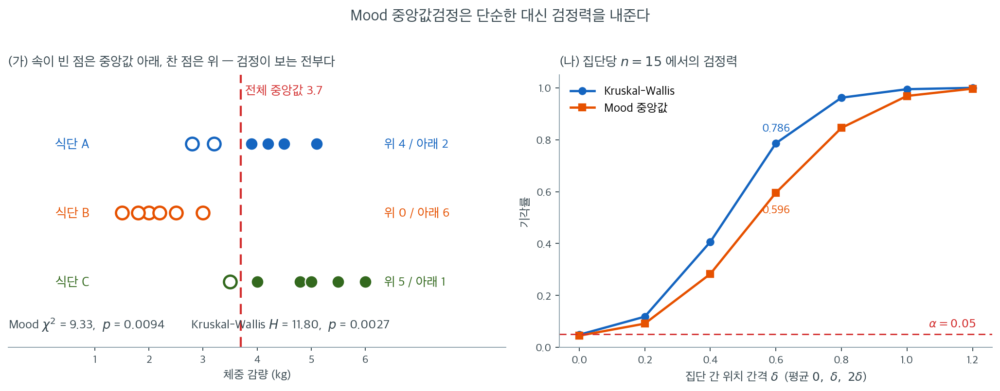
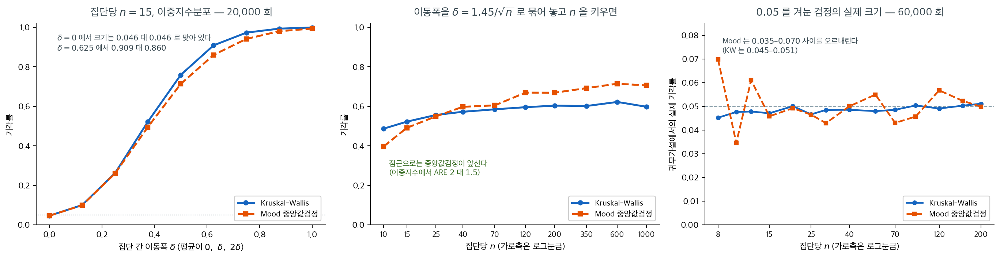

# Mood 중앙값검정

**Mood 중앙값검정**은 독립인 두 집단 이상을 비교하는 가장 단순한 비모수 검정 중 하나이다. 각 관측값을 전체 중앙값보다 위인지 아래인지로 분류한 뒤 그 분할표에 카이제곱 독립성 검정을 적용하여 집단들이 같은 중앙값을 갖는지 검정한다.

개념이 명료하고 이상치에 극도로 로버스트하지만, 각 관측값이 중앙값에서 얼마나 떨어져 있는지에 대한 정보를 모두 버리므로 [Kruskal-Wallis 검정](kruskal_wallis.md)보다 대체로 검정력이 낮다.

---

## 1. 가설

$$
H_0 \colon k \text{개 집단의 중앙값이 모두 같다}
$$

$$
H_a \colon \text{적어도 한 집단의 중앙값이 다르다}
$$

---

## 2. 절차

**1단계.** 크기 $N = \sum_{i=1}^{k} n_i$인 합친 표본의 **전체 중앙값** $\tilde{x}$를 계산한다.

**2단계.** 각 집단에서 전체 중앙값보다 위인 관측값과 아래(또는 같은) 관측값의 개수를 센다. 이렇게 $2 \times k$ 분할표가 만들어진다.

|  | 집단 1 | 집단 2 | $\cdots$ | 집단 $k$ | 합계 |
|:-|:-------:|:-------:|:--------:|:---------:|:-----:|
| $\tilde{x}$ 위 | $a_1$ | $a_2$ | $\cdots$ | $a_k$ | $A$ |
| $\tilde{x}$ 아래 | $b_1$ | $b_2$ | $\cdots$ | $b_k$ | $B$ |
| **합계** | $n_1$ | $n_2$ | $\cdots$ | $n_k$ | $N$ |

$\tilde{x}$와 정확히 같은 관측값은 보통 "아래 또는 같음" 범주에 넣지만 관례가 다양하다.

**3단계.** 분할표에 **Pearson 카이제곱 검정**을 적용한다.

$$
\chi^2 = \sum_{i=1}^{k} \left[\frac{(a_i - E_{a_i})^2}{E_{a_i}} + \frac{(b_i - E_{b_i})^2}{E_{b_i}}\right]
$$

여기서 $H_0$ 아래의 기대도수는

$$
E_{a_i} = \frac{n_i \times A}{N}, \qquad E_{b_i} = \frac{n_i \times B}{N}
$$

이다.

**4단계.** $H_0$ 아래에서 검정통계량은 근사적으로

$$
\chi^2 \sim \chi^2_{k-1}
$$

을 따른다.

<div class="exbox" markdown>

**보기 1.** <span class="diff easy" title="쉬움"></span> 기대도수가 모두 3 이다. 세 가지 식단을 8주간의 체중 감량(kg)으로 비교한다.

**식단 A** ($n_1 = 6$): 3.2, 4.5, 2.8, 5.1, 3.9, 4.2

**식단 B** ($n_2 = 6$): 1.5, 2.0, 3.0, 2.5, 1.8, 2.2

**식단 C** ($n_3 = 6$): 4.0, 5.5, 3.5, 6.0, 4.8, 5.0

**(1)** 위 네 단계를 밟아 전체 중앙값, 분할표, $\chi^2$, $p$ 값을 손으로 구하시오.

**(2)** 기대도수가 모두 $3$ 으로 "$E \geq 5$" 라는 흔한 규칙에 못 미친다. 주변합이 고정된 $2 \times 3$ 표를 **전부 열거**해 정확 p-값을 구하고 $\chi^2_2$ 근사와 견주시오.

</div>

??? success "풀이"

    **(1) 네 단계.**

    **1단계.** 합친 표본을 정렬한다: 1.5, 1.8, 2.0, 2.2, 2.5, 2.8, 3.0, 3.2, 3.5, 3.9, 4.0, 4.2, 4.5, 4.8, 5.0, 5.1, 5.5, 6.0.

    $N = 18$이므로 전체 중앙값은 9번째와 10번째 값의 평균이다.

    $$
    \tilde{x} = \frac{3.5 + 3.9}{2} = 3.7
    $$

    **2단계.** $\tilde{x} = 3.7$ 위·아래를 센다.

    |  | 식단 A | 식단 B | 식단 C | 합계 |
    |:-|:------:|:------:|:------:|:-----:|
    | 3.7 위 | 4 | 0 | 5 | 9 |
    | 3.7 아래 | 2 | 6 | 1 | 9 |
    | **합계** | 6 | 6 | 6 | 18 |

    **3단계.** 기대도수는 모두 $E = 6 \times 9/18 = 3$이다.

    $$
    \chi^2 = \frac{(4-3)^2}{3} + \frac{(0-3)^2}{3} + \frac{(5-3)^2}{3} + \frac{(2-3)^2}{3} + \frac{(6-3)^2}{3} + \frac{(1-3)^2}{3}
    $$

    $$
    = \frac{1 + 9 + 4 + 1 + 9 + 4}{3} = \frac{28}{3} \approx 9.33
    $$

    **4단계.** $\chi^2_2$와 비교한다: $P(\chi^2_2 > 9.33) = 0.0094$.

    ```python
    from scipy import stats
    A = [3.2, 4.5, 2.8, 5.1, 3.9, 4.2]
    B = [1.5, 2.0, 3.0, 2.5, 1.8, 2.2]
    C = [4.0, 5.5, 3.5, 6.0, 4.8, 5.0]
    print(stats.median_test(A, B, C))
    # statistic=9.3333, pvalue=0.0094036, median=3.7,
    # table=[[4 0 5]
    #        [2 6 1]]
    ```

    출력:

    ```
    MedianTestResult(statistic=9.333333333333334, pvalue=0.009403562551495204, median=3.7, table=array([[4, 0, 5],
           [2, 6, 1]]))
    ```

    $\alpha = 0.05$에서 $H_0$을 기각한다. 식단들의 중앙값 체중 감량이 다르다는 유의한 증거가 있다. 식단 B가 가장 효과가 낮고(6개 중 0개가 전체 중앙값 위), 식단 C가 가장 효과가 높다(6개 중 5개).

    **(2) 표가 37 가지뿐이고 $\chi^2$ 은 여섯 값만 갖는다.** 주변합이 고정되어 있다 — 열합은 $6, 6, 6$ 이고 행합은 $9, 9$ 다. 그러므로 첫 행 $(a, b, c)$ 만 정하면 표가 결정되고, 조건은

    $$
    a + b + c = 9, \qquad 0 \leq a, b, c \leq 6
    $$

    뿐이다. 그런 $(a,b,c)$ 는 **37 가지**다. $H_0$ 아래에서 "위" 아홉 개가 열여덟 자리 가운데 어디로 가는지는 모두 같은 확률이므로

    $$
    P(a, b, c) = \frac{\binom{6}{a}\binom{6}{b}\binom{6}{c}}{\binom{18}{9}},
    \qquad \binom{18}{9} = 48{,}620
    $$

    이다(다변량 초기하분포). 기대도수가 모두 $3$ 이고 둘째 행이 첫 행의 보수($6-a$ 등)이므로

    $$
    \chi^2 = \frac{1}{3}\sum\bigl[(a-3)^2 + (3-a)^2 + \cdots\bigr]
    = \frac{2}{3}\left[(a-3)^2 + (b-3)^2 + (c-3)^2\right]
    $$

    로 간단해진다. 관측값 $(4, 0, 5)$ 에서 $\tfrac23(1 + 9 + 4) = \tfrac{28}{3}$ 로 맞는다.

    $u = a-3$ 등으로 두면 $u + v + w = 0$ 이고 $-3 \leq u,v,w \leq 3$ 이다. 이 조건에서 $u^2+v^2+w^2$ 가 가질 수 있는 값은 $0, 2, 6, 8, 14, 18$ **여섯 개뿐**이므로 $\chi^2$ 도 여섯 값만 갖는다.

    | $\chi^2$ | 그 값을 주는 표 $(a,b,c)$ 의 예 | 정확 $P(\chi^2 \geq \cdot)$ | $\chi^2_2$ 근사 |
    |---|---|---|---|
    | $0$ | $(3,3,3)$ | 1.000000 | 1.000000 |
    | $4/3$ | $(4,2,3)$ | 0.835459 | 0.513417 |
    | $4$ | $(4,4,1)$ | 0.280132 | 0.135335 |
    | $16/3$ | $(5,1,3)$ | 0.113534 | 0.069483 |
    | $28/3$ | $(4,0,5)$ | **0.024681** | **0.009404** |
    | $12$ | $(6,3,0)$ | 0.002468 | 0.002479 |

    **관측값의 정확 p-값은 $1200/48620 = 60/2431 = 0.024681$ 이고, $\chi^2_2$ 근사의 $0.009404$ 는 그 $0.381$ 배 — 곧 참값이 근사의 2.6배다.** 근사가 **위험한 방향**으로 틀렸다: p-값을 작게 보고하므로 유의성을 과장한다. 기대도수가 $3$ 밖에 되지 않는 자리에서 "$E \geq 5$" 규칙을 무시한 대가다.

    명목수준별 실제 수준을 보면 이산성이 더 뚜렷하다.

    | 명목 $\alpha$ | $\chi^2_2$ 임계값 | 실제 수준 | 실제/명목 |
    |---|---|---|---|
    | 0.10 | 4.6052 | 0.113534 | 1.135 |
    | 0.05 | 5.9915 | 0.024681 | 0.494 |
    | 0.01 | 9.2103 | 0.024681 | **2.468** |

    $\alpha = 0.05$ 와 $\alpha = 0.01$ 의 임계값 사이에 **도달 가능한 $\chi^2$ 값이 하나도 없으므로** 두 검정의 기각역이 똑같고 실제 수준도 똑같이 $0.0247$ 이다. 그래서 $\alpha = 0.01$ 을 요구하면 실제로는 $0.0247$ 짜리 검정, 곧 **명목의 2.5배**를 돌리게 된다.

    **결론.** 이 자료에서 $\alpha = 0.05$ 판정은 안전하지만($0.0247 < 0.05$), **보고해야 할 p-값은 $0.0094$ 가 아니라 $0.0247$ 이다.** $2 \times k$ 표에서 기대도수가 작으면 위처럼 주변합을 고정해 직접 열거하거나 `scipy.stats.permutation_test` 로 정확 p-값을 구해야 한다.

    ```python
    import numpy as np
    from fractions import Fraction
    from math import comb

    N, row_above = 18, 9
    total = comb(N, row_above)
    tables = []
    for a in range(7):
        for b in range(7):
            c = row_above - a - b
            if 0 <= c <= 6:
                count = comb(6, a) * comb(6, b) * comb(6, c)
                T = np.array([[a, b, c], [6 - a, 6 - b, 6 - c]])
                E = np.outer(T.sum(1), T.sum(0)) / N
                tables.append((a, b, c, count, ((T - E) ** 2 / E).sum()))
    print(f"가능한 표 {len(tables)} 가지,  가지수 합 {sum(t[3] for t in tables)}"
          f" = C(18,9) = {total}")

    chi_vals = sorted({round(t[4], 6) for t in tables})
    print(f"chi2 가 가질 수 있는 값 {chi_vals}")
    print("\n  chi2      정확 p     chi2_2 근사")
    for v in chi_vals:
        exact = sum(t[3] for t in tables if t[4] >= v - 1e-9) / total
        print(f"{v:>8.4f}  {exact:>10.6f}  {stats.chi2.sf(v, 2):>12.6f}")

    obs = 28 / 3
    hit = sum(t[3] for t in tables if t[4] >= obs - 1e-9)
    print(f"\n관측 chi2 = 28/3 = {obs:.4f}")
    print(f"  정확   p = {hit}/{total} = {Fraction(hit, total)} = {hit / total:.6f}")
    print(f"  chi2_2 p = {stats.chi2.sf(obs, 2):.6f}"
          f"  ->  근사/정확 = {stats.chi2.sf(obs, 2) / (hit / total):.3f}")

    print("\n명목     임계값   실제 수준   실제/명목")
    for alpha in (0.10, 0.05, 0.01):
        crit = stats.chi2.isf(alpha, 2)
        size = sum(t[3] for t in tables if t[4] >= crit - 1e-9) / total
        print(f"{alpha:>6}  {crit:>8.4f}  {size:>10.6f}  {size / alpha:>9.3f}")
    ```

    출력:

    ```
    가능한 표 37 가지,  가지수 합 48620 = C(18,9) = 48620
    chi2 가 가질 수 있는 값 [0.0, 1.333333, 4.0, 5.333333, 9.333333, 12.0]
    
      chi2      정확 p     chi2_2 근사
      0.0000    1.000000      1.000000
      1.3333    0.835459      0.513417
      4.0000    0.280132      0.135335
      5.3333    0.113534      0.069483
      9.3333    0.024681      0.009404
     12.0000    0.002468      0.002479
    
    관측 chi2 = 28/3 = 9.3333
      정확   p = 1200/48620 = 60/2431 = 0.024681
      chi2_2 p = 0.009404  ->  근사/정확 = 0.381
    
    명목     임계값   실제 수준   실제/명목
       0.1    4.6052    0.113534      1.135
      0.05    5.9915    0.024681      0.494
      0.01    9.2103    0.024681      2.468
    ```

    **가지수의 합이 $\binom{18}{9} = 48620$ 으로 정확히 떨어지는 것이 열거가 빠짐없다는 검산이다.** 그리고 손으로 따진 여섯 개의 $\chi^2$ 값과 정확 p-값이 모두 맞는다.

    표의 맨 아래 줄 $\chi^2 = 12$ 에서 정확 $0.002468$ 과 근사 $0.002479$ 가 거의 같은 것이 재미있다. **근사가 이 한 점에서만 잘 맞는다** — 꼬리의 끝에서 우연히 교차한 것이고, 그 바로 앞 $\chi^2 = 28/3$ 에서는 2.6배 어긋난다. 이산분포를 연속곡선으로 덮을 때 두 곡선이 교차하는 지점이 있는 것은 당연하며, **거기서 잘 맞는 것을 근사가 쓸 만하다는 증거로 읽으면 안 된다.**

!!! note "$2 \times k$ 표에는 Yates 보정을 쓰지 않는다"
    Yates 연속성 보정은 $2 \times 2$ 표에만 적용된다. 여기서는 $k = 3$이라 $2 \times 3$ 표이므로 보정 없이 계산하며, `scipy.stats.median_test`도 보정을 적용하지 않는다.

    $k = 2$일 때는 [Mann-Whitney U 검정](../two_sample_nonparametric/mann_whitney.md)에서 보았듯 보정 여부가 결과를 크게 바꿀 수 있으므로 주의해야 한다.

---

## 3. 장점과 한계

| 장점 | 한계 |
|:----------|:-----------|
| 계산이 매우 간단하다 | 검정력이 낮다(크기 정보를 버린다) |
| 이상치에 극도로 로버스트하다 | 중앙값 차이만 탐지하고 산포는 보지 못한다 |
| 순서형 자료에도 쓸 수 있다 | 기대도수가 작으면 카이제곱 근사가 나쁘다 |
| $k > 2$로 자연스럽게 확장된다 | 대체로 [Kruskal-Wallis](kruskal_wallis.md)에 밀린다 |



"검정력이 낮다"를 말로만 두지 말고 값을 붙여 보자.

(가)가 이 검정의 시야다. 속이 빈 점은 전체 중앙값 $3.7$보다 아래, 속이 찬 점은 위이다. **Mood 검정이 아는 것은 이 색칠 여부가 전부다.** 식단 C의 $6.0$과 $3.9$는 둘 다 그냥 "위 하나"이고, 식단 B의 $1.5$와 $3.0$은 둘 다 그냥 "아래 하나"이다. 그래도 식단 B가 $0 : 6$으로 완전히 한쪽에 몰려 있어 신호가 강하고, $\chi^2 = 9.33$, $p = 0.0094$로 기각에 이른다. 같은 자료에서 Kruskal-Wallis는 $H = 11.80$, $p = 0.0027$을 준다.

(나)가 그 격차를 일반화한 것이다. 평균이 $0$, $\delta$, $2\delta$인 정규 세 집단에서 집단당 $n = 15$를 뽑아 두 검정의 기각률을 쟀다. $\delta = 0$에서는 둘 다 $0.045$ 근처로 크기가 맞지만, 효과가 생기면 파란 곡선이 줄곧 위에 있다. $\delta = 0.4$에서 $0.406$ 대 $0.283$, $\delta = 0.6$에서 **$0.786$ 대 $0.596$**이다. 검정력 $0.80$에 이르는 지점으로 환산하면 Mood 검정은 같은 효과를 잡는 데 표본이 대략 $1.5$배 필요하다.

그렇다면 Mood 검정을 왜 배우는가. 이 검정이 요구하는 정보가 **"각 관측값이 기준선 위인가 아래인가"뿐**이기 때문이다. 순위를 매길 수 없는 자료 --- 검출한계 밖이라 "$> 100$"으로만 기록된 측정값, 구간으로만 보고된 소득 --- 에서도 그대로 작동한다. 검정력을 $1.5$배의 표본으로 사는 대신 순위를 매길 수 있다는 가정을 통째로 버리는 거래이다.

!!! warning "낮은 검정력"
    Mood 중앙값검정은 Kruskal-Wallis 검정보다 검정력이 상당히 낮다. 이상치 저항성이 무엇보다 중요하거나 자료가 의미 있는 임계값을 기준으로 자연스럽게 이분되는 경우에 주로 써야 한다. 일상적인 비교에는 Kruskal-Wallis 검정이 낫다.

<div class="storybox" markdown>

**그림으로 보는 통계학 1.** 은퇴를 권고받은 검정

$2000$ 년 『The American Statistician』 $54$ 권 $161$–$164$ 쪽에, 제목이 물음표로 끝나는 네 쪽짜리 글이 실렸다. 「**중앙값검정을 일반적 사용에서 은퇴시켜야 하는가?**」 통계 검정을 이름으로 지목해 공개적으로 그만 쓰자고 한 글이다. 쓴 사람은 프라이들린과 개스워스다.

불평은 이것이었다. 소표본에서 검정력이 낮다는 지적이 여러 번 나왔는데도 **여전히 많은 교과서에 실리고, 널리 쓰이는 소프트웨어 꾸러미에 들어 있고, 여러 분야에서 실제로 쓰인다**는 것. 그러고는 모의실험을 붙였는데, 그 문장이 날카롭다 — 중앙값검정은 **점근적으로 그것이 가장 강력한 이중지수분포에서조차** 손쉽게 쓸 수 있는 다른 순위검정들보다 뚜렷이 검정력이 낮았다.

그래서 직접 돌려 보았다. 자리를 공정하게 내주려고 **모두 이중지수분포**에서 뽑았다. 중앙값검정에게 가장 유리한 세상이다.



**(가)** 집단당 $n = 15$. $\delta = 0$ 에서 둘 다 $0.046$ 이라 출발선이 같은데, $\delta = 0.625$ 에서 $0.909$ 대 $0.860$ 이다. 가장 유리한 분포에서도 진다. 그들의 말이 맞다.

**(나)** 그런데 이동폭을 $\delta = 1.45/\sqrt n$ 으로 묶어 놓고 $n$ 을 키우면 **집단당 스물다섯 명쯤에서 순서가 뒤집힌다.** 점근적으로는 중앙값검정이 옳기 때문이다(이중지수에서 ARE 가 $2$ 대 $1.5$). $n = 1000$ 에서는 $0.706$ 대 $0.598$ 로 꽤 벌어진다. 「은퇴」라는 말이 겨눈 것은 **소표본**이다.

**(다)** 그리고 진짜 흠은 여기 있다. $0.05$ 를 겨눈 중앙값검정의 **실제 크기가 $n$ 에 따라 $0.035$ 와 $0.070$ 사이를 오르내린다.** 세는 것이 띄엄띄엄한 개수이고 가르는 선인 전체 중앙값마저 자료에서 뽑아 쓰기 때문이다. 같은 구간에서 Kruskal-Wallis 는 $0.045$–$0.051$ 안에 머문다. 이 흔들림은 **ARE 표에 전혀 나타나지 않는다.** ARE 는 $n \to \infty$ 를 말하는 수이고, 여기서 탈이 나는 것은 작은 $n$ 이다.

권고는 받아들여지지 않았다. 사반세기가 지난 지금도 이 검정은 교과서와 꾸러미에 그대로 있고, 그래서 이 쪽도 여기 있다. 다만 바로 위에서 말한 그 거래 — 순위를 매길 수 있다는 가정을 통째로 버리는 대신 검정력을 내준다 — 가 성립하는 자리는 분명히 있다. 은퇴를 권고받은 것은 **일상적인 사용**이지 이 검정의 존재가 아니었다.

_확인한 곳 — 논문이 B. Freidlin 과 J. L. Gastwirth 의 「Should the Median Test be Retired from General Use?」이고 『The American Statistician』 $54$ 권 $3$ 호 $161$–$164$ 쪽($2000$)이라는 것, 그리고 인용한 초록의 두 대목(「많은 교과서에 실리고 여러 소프트웨어 꾸러미에 들어 있으며 여러 분야에서 쓰인다」·「**점근적으로 가장 강력한 이중지수분포에서조차** 손쉽게 쓸 수 있는 다른 순위검정들보다 뚜렷이 검정력이 낮다」)과 「일상적 사용에서 은퇴시키자」는 권고는 그 논문의 [출판사 초록 쪽](https://www.tandfonline.com/doi/abs/10.1080/00031305.2000.10474539) 에서 읽었다(서지는 [Wikipedia 「Median test」](https://en.wikipedia.org/wiki/Median_test) 의 참고문헌으로도 맞춰 보았다). 그림 세 판의 수 — 검정력, 뒤집히는 자리, 실제 크기의 범위 — 는 모두 직접 계산한 값이다_

</div>

---

## 4. 언제 쓰는가

- **극단적인 이상치가 있어** 순위 기반 검정조차 영향을 받을 수 있을 때(실무에서는 드물다).
- **빠른 탐색적 분석**이 필요하고 뒤이어 형식적인 순위 기반 검정을 할 때.
- **연구 질문이 구체적으로 중앙값에 관한 것**이고 분할표 구조가 직관적인 요약이 될 때.

### 낼 수 있는 p-값은 몇 개인가

<div class="exbox" markdown>

**보기 2.** <span class="diff easy" title="쉬움"></span> $5 + 5$ 에서 중앙값검정이 낼 수 있는 p-값은 몇 개인가. 두 학생 집단의 중앙값 시험점수를 비교한다.

- 집단 A: $[50, 55, 60, 65, 70]$
- 집단 B: $[45, 50, 55, 60, 65]$

**(1)** 위 1~5단계를 손으로 밟아 전체 중앙값, 분할표, $\chi^2$, p-값을 구하시오.

**(2)** $n_1 = n_2 = 5$ 이고 중앙값과 같은 값이 없으면 **분할표가 몇 가지밖에 안 된다.** 모두 열거해 이 검정이 낼 수 있는 p-값 전부를 적고, $\alpha = 0.05$ 에서 기각하려면 자료가 어떠해야 하는지 말하시오.

</div>

??? success "풀이"

    **(1) 다섯 단계를 밟는다.**

    **1단계.** 열 개를 합쳐 정렬하면 $45, 50, 50, 55, 55, 60, 60, 65, 65, 70$ 이다. $N = 10$ 이 짝수이므로 전체 중앙값은 5번째와 6번째의 평균

    $$
    \text{전체 중앙값} = \frac{55 + 60}{2} = 57.5
    $$

    다. **관측값 가운데 $57.5$ 와 같은 것은 하나도 없으므로** 동점을 어떻게 다룰지 고민할 필요가 없다.

    **2단계.** $A$ 에서 $57.5$ 보다 큰 것은 $60, 65, 70$ 셋, 작은 것은 $50, 55$ 둘이다. $B$ 에서 큰 것은 $60, 65$ 둘, 작은 것은 $45, 50, 55$ 셋이다.

    **3단계.**

    | | 집단 A | 집단 B | 합 |
    |---|---|---|---|
    | $> 57.5$ | 3 | 2 | 5 |
    | $< 57.5$ | 2 | 3 | 5 |
    | 합 | 5 | 5 | 10 |

    **4단계.** 행합과 열합이 모두 $5$ 이므로 기대도수는 네 칸 모두 $5 \times 5/10 = 2.5$ 다. 보정 없이

    $$
    \chi^2 = 4 \times \frac{(3 - 2.5)^2}{2.5} = \frac{4 \times 0.25}{2.5} = 0.4
    $$

    **5단계.** 자유도 $(2-1)(2-1) = 1$ 에서 $p = P(\chi^2_1 > 0.4) = 0.527089$ 다. 기각하지 못한다.

    **(2) 가능한 분할표는 여섯 가지뿐이다.** $N = 10$ 을 전체 중앙값으로 자르면 위가 정확히 5개, 아래가 정확히 5개다. 각 집단의 크기도 5 이므로 **네 변의 합이 모두 5 로 고정된다.** 따라서 왼쪽 위 칸의 값 $a$ 하나만 정하면 표가 결정된다.

    $$
    T(a) = \begin{pmatrix} a & 5-a \\ 5-a & a \end{pmatrix},
    \qquad a = 0, 1, 2, 3, 4, 5
    $$

    기대도수는 늘 $2.5$ 이므로

    $$
    \chi^2(a) = 4 \times \frac{(a - 2.5)^2}{2.5} = 1.6\,(a - 2.5)^2
    $$

    이고, 예이츠 보정을 넣으면 $\chi^2_Y(a) = 1.6\,(\lvert a - 2.5 \rvert - 0.5)^2$ 다.

    | $a$ | 분할표 | $\chi^2$ | $p$ | $\chi^2_Y$ | $p_Y$ |
    |---|---|---|---|---|---|
    | 0 또는 5 | $\begin{pmatrix} 5 & 0 \\ 0 & 5\end{pmatrix}$ | 10.0 | 0.001565 | 6.4 | 0.011412 |
    | 1 또는 4 | $\begin{pmatrix} 4 & 1 \\ 1 & 4\end{pmatrix}$ | 3.6 | 0.057780 | 1.6 | 0.205903 |
    | 2 또는 3 | $\begin{pmatrix} 3 & 2 \\ 2 & 3\end{pmatrix}$ | 0.4 | 0.527089 | 0.0 | 1.000000 |

    **이 검정이 낼 수 있는 p-값은 단 세 개다.** 보정 없이 $\{0.001565,\ 0.057780,\ 0.527089\}$, 보정하면 $\{0.011412,\ 0.205903,\ 1.000000\}$ 이다. 그러므로 $\alpha = 0.05$ 에서 기각하려면 **$a = 0$ 또는 $a = 5$, 곧 한 집단이 전체 중앙값 위를 전부 차지해야 한다.** 다섯 명씩으로는 두 집단이 완전히 분리되지 않는 한 유의할 수 없다.

    이 자료는 $A$ 가 $B$ 를 정확히 $5$ 만큼 평행이동한 것이다 — $A = B + 5$ 로 **구조가 뚜렷하다.** 그런데도 $a = 3$ 이 되어 두 번째로 큰 p-값을 받는다. **관측값이 겹치면 중앙값 위아래로 자르는 일만으로는 그 구조를 잡아낼 수 없다.**

    **수치적으로.**

    ```python
    import numpy as np
    from scipy import stats

    a = np.array([50, 55, 60, 65, 70])
    b = np.array([45, 50, 55, 60, 65])
    allv = np.concatenate([a, b])
    gm = np.median(allv)
    print(f"정렬 {np.sort(allv).tolist()}  ->  전체 중앙값 {gm}")
    print(f"= {gm} 인 관측값 {int((allv == gm).sum())} 개")
    print(f"A: 위 {int((a > gm).sum())}, 아래 {int((a < gm).sum())}  |  "
          f"B: 위 {int((b > gm).sum())}, 아래 {int((b < gm).sum())}")

    print("\n가능한 분할표를 모두 열거한다")
    for k in range(6):
        T = np.array([[k, 5 - k], [5 - k, k]])
        c0 = stats.chi2_contingency(T, correction=False)
        c1 = stats.chi2_contingency(T, correction=True)
        print(f"  a={k}  {T.tolist()}   chi2 = {c0.statistic:6.2f}, p = {c0.pvalue:.6f}"
              f"   |  Yates chi2 = {c1.statistic:5.2f}, p = {c1.pvalue:.6f}")
    print(f"\nscipy median_test: {stats.median_test(a, b)}")
    ```

    출력:

    ```
    정렬 [45, 50, 50, 55, 55, 60, 60, 65, 65, 70]  ->  전체 중앙값 57.5
    = 57.5 인 관측값 0 개
    A: 위 3, 아래 2  |  B: 위 2, 아래 3

    가능한 분할표를 모두 열거한다
      a=0  [[0, 5], [5, 0]]   chi2 =  10.00, p = 0.001565   |  Yates chi2 =  6.40, p = 0.011412
      a=1  [[1, 4], [4, 1]]   chi2 =   3.60, p = 0.057780   |  Yates chi2 =  1.60, p = 0.205903
      a=2  [[2, 3], [3, 2]]   chi2 =   0.40, p = 0.527089   |  Yates chi2 =  0.00, p = 1.000000
      a=3  [[3, 2], [2, 3]]   chi2 =   0.40, p = 0.527089   |  Yates chi2 =  0.00, p = 1.000000
      a=4  [[4, 1], [1, 4]]   chi2 =   3.60, p = 0.057780   |  Yates chi2 =  1.60, p = 0.205903
      a=5  [[5, 0], [0, 5]]   chi2 =  10.00, p = 0.001565   |  Yates chi2 =  6.40, p = 0.011412
    
    scipy median_test: MedianTestResult(statistic=0.0, pvalue=1.0, median=57.5, table=array([[3, 2],
           [2, 3]]))
    ```

    **손계산 $\chi^2 = 0.4$, $p = 0.527089$ 가 열거표의 $a = 3$ 줄과 같고, `scipy` 의 `median_test` 는 예이츠 보정을 기본으로 쓰므로 $\chi^2 = 0$, $p = 1.0$ 을 준다.** 세 가지 p-값만 가능하다는 것도 열거로 확인된다.

    이것이 중앙값검정의 **이산성**이다. 관측값 열 개를 두 칸짜리 표로 뭉개 버리면 자료가 가진 정보가 "$a$ 가 몇인가" 하나로 줄어들고, 그 $a$ 가 여섯 값만 가지므로 p-값도 여섯 — 대칭이니 실은 세 — 개만 가능하다. 아래 보기 3 이 이 여섯 칸 가운데 $a = 3$ 을 코드로 다시 확인한다.

---

### 명목수준과 실제 수준이 갈린다

<div class="exbox" markdown>

**보기 3.** <span class="diff easy" title="쉬움"></span> 명목수준 $0.05$, 실제 수준 $0.0079$. 앞 보기와 같은 자료를 직접 구현한 중앙값검정에 넣으면 예이츠 보정에서 $\chi^2 = 0$, $p = 1$ 이고 보정을 빼면 $\chi^2 = 0.4$, $p = 0.527$ 이 나온다.

**(1)** 보정이 $\chi^2$ 을 정확히 $0$ 으로 만드는 것이 우연인지 손으로 따져 보시오. 이 구현이 전체 중앙값과 **같은** 값을 버린다는 점은 이 자료에서 문제가 되는가.

**(2)** 주변합이 모두 $5$ 로 고정된 $2 \times 2$ 표이므로 피셔 정확검정을 쓸 수 있다. 보정·비보정·피셔 세 p-값을 견주고, 명목수준 $0.05$ 검정의 **실제 수준**을 열거로 구하시오.

</div>

??? success "풀이"

    **(1) 우연이 아니다.** 주변합이 모두 $5$ 이므로 기대도수는 네 칸 모두 $2.5$ 이고, 관측도수가 $(3,2,2,3)$ 이므로 **모든 칸에서 편차가 정확히 $\lvert O - E \rvert = 0.5$ 다.** 예이츠 보정은 그 편차에서 $0.5$ 를 깎는다.

    $$
    \chi^2_Y = \sum \frac{(\lvert O - E \rvert - 0.5)^2}{E}
    = 4 \times \frac{(0.5 - 0.5)^2}{2.5} = 0
    $$

    분자가 네 칸 모두 $0$ 이 되어 버린다. 앞 보기의 열거표에서 $a = 2$ 와 $a = 3$ 줄이 $\chi^2_Y = 0$ 인 것이 바로 이것이다. **$\chi^2_Y = 0$ 은 "두 집단이 완벽히 같다"는 뜻이 아니라 "편차가 보정량보다 크지 않다"는 뜻이다.** 보정이 편차를 다 먹어 치운 자리다.

    중앙값과 같은 값을 버리는 문제는 **이 자료에서는 일어나지 않는다.** 전체 중앙값 $57.5$ 는 두 관측값 $55$ 와 $60$ 의 평균이라 관측값 가운데 $57.5$ 인 것이 없다. $N$ 이 짝수이고 가운데 두 값이 다르면 늘 이렇게 된다. 반면 $N$ 이 홀수이거나 가운데 두 값이 같으면 전체 중앙값이 관측값과 일치해 이 구현이 자료를 버린다 — 아래 연습문제 2 가 그 경우를 다룬다.

    **(2) 세 p-값과 실제 수준.** 관측된 표 $a = 3$ 에서

    | 방법 | $p$ |
    |---|---|
    | $\chi^2$, 보정 없음 | 0.527089 |
    | $\chi^2$, 예이츠 보정 | 1.000000 |
    | 피셔 정확 | 1.000000 |

    로 셋 다 기각과는 거리가 멀다. 세 방법이 갈리는 곳은 **꼬리**다. 가장 치우친 표 $a = 5$ 에서

    $$
    p_{\text{보정 없음}} = 0.001565,
    \qquad
    p_{\text{예이츠}} = 0.011412,
    \qquad
    p_{\text{피셔}} = 0.007937
    $$

    이다. **피셔가 참값이므로, 보정 없는 $\chi^2$ 은 5배 작게(위험한 쪽으로) 보고하고 예이츠는 1.4배 크게(안전한 쪽으로) 보고한다.** 둘 다 참값을 비껴가지만 방향이 반대다.

    실제 수준은 **기각역을 정하고 그 확률을 세면** 나온다. $H_0$ 아래에서 주변합이 고정되면 $a$ 는 초기하분포를 따른다.

    $$
    P(a = k) = \frac{\binom{5}{k}\binom{5}{5-k}}{\binom{10}{5}},
    \qquad
    \left(\tfrac{1}{252},\ \tfrac{25}{252},\ \tfrac{100}{252},\ \tfrac{100}{252},\ \tfrac{25}{252},\ \tfrac{1}{252}\right)
    $$

    앞 보기의 열거표를 보면 $p \leq 0.05$ 가 되는 것은 세 방법 모두 $a \in \{0, 5\}$ 뿐이다(보정 없는 $\chi^2$ 조차 $a \in \{1,4\}$ 에서 $0.057780 > 0.05$ 다). **따라서 세 방법의 기각역이 똑같고**

    $$
    \text{실제 수준} = P(a = 0) + P(a = 5) = \frac{2}{252} = 0.007937
    $$

    이다. **명목 $0.05$ 의 6분의 1 도 안 된다.** 피셔의 $a = 5$ p-값 $0.007937$ 이 이 수와 같은 것은 우연이 아니다 — 가장 치우친 표의 정확 p-값이 곧 그 표만 기각하는 검정의 크기다.

    이산검정에서는 이렇게 **명목수준을 쓸 수가 없다.** $0.05$ 를 요구해도 실제로는 $0.0079$ 짜리 검정을 돌리게 되고, 그만큼 검정력을 잃는다. 어느 보정을 쓰느냐는 p-값의 숫자만 바꿀 뿐 여기서는 결론을 하나도 바꾸지 않는다.

    **수치적으로.**

    ```python
    import numpy as np
    from scipy.stats import chi2_contingency

    def moods_median_test(*groups, correction=True):
        """Mood 의 중앙값 검정. 여러 집단의 중앙값을 견준다.

        자료 전체의 중앙값을 구한 뒤, 집단마다 그보다 큰 값과 작은 값의 개수를
        세어 분할표를 만들고 카이제곱 검정을 돌린다. 값을 "위/아래" 둘로만
        나누므로 순위검정보다도 정보를 더 버리고, 그만큼 검정력이 낮다.
        대신 가정이 거의 없어 아주 거친 자료에도 쓸 수 있다.

        매개변수
        --------
        groups : 집단을 나타내는 배열 여럿
        correction : Yates 연속성 보정 여부 (2x2 표에서만 뜻이 있다)

        돌려주는 값
        ----------
        chi2_stat, p_value, contingency_table
        """
        # 전체 중앙값을 기준선으로 삼는다.
        combined_data = np.concatenate(groups)
        overall_median = np.median(combined_data)

        contingency_table = []
        for group in groups:
            # 중앙값과 정확히 같은 값은 어느 쪽에도 넣지 않는다.
            above_median = np.sum(group > overall_median)
            below_median = np.sum(group < overall_median)
            contingency_table.append([above_median, below_median])

        contingency_table = np.array(contingency_table).T
        chi2_stat, p_value, _, _ = chi2_contingency(contingency_table,
                                                    correction=correction)

        return chi2_stat, p_value, contingency_table

    # 예시 자료
    group_a = np.array([50, 55, 60, 65, 70])
    group_b = np.array([45, 50, 55, 60, 65])

    # 보정 여부에 따라 p-값이 꽤 갈린다. 2x2 표에서 표본이 작을 때 그렇다.
    for corr in (True, False):
        chi2_stat, p_value, table = moods_median_test(group_a, group_b,
                                                      correction=corr)
        print(f"correction={corr}: chi2={chi2_stat:.4f}, p={p_value:.4f}")
    print(f"Contingency Table:\n{table}")
    ```

    출력:

    ```
    correction=True: chi2=0.0000, p=1.0000
    correction=False: chi2=0.4000, p=0.5271
    Contingency Table:
    [[3 2]
     [2 3]]
    ```

    ```python
    import math
    from scipy.stats import fisher_exact

    T = np.array([[3, 2], [2, 3]])
    E = np.outer(T.sum(1), T.sum(0)) / T.sum()
    print(f"기대도수 {E.tolist()},  |O - E| = {np.abs(T - E).tolist()}")
    print(f"예이츠 분자 (|O-E| - 0.5)^2 = {((np.abs(T - E) - 0.5) ** 2).tolist()}")

    print(f"\n관측된 표 a=3")
    print(f"  보정 없음 p = {chi2_contingency(T, correction=False).pvalue:.6f}")
    print(f"  예이츠    p = {chi2_contingency(T, correction=True).pvalue:.6f}")
    print(f"  피셔      p = {fisher_exact(T).pvalue:.6f}")

    T5 = np.array([[5, 0], [0, 5]])
    print(f"가장 치우친 표 a=5")
    print(f"  보정 없음 p = {chi2_contingency(T5, correction=False).pvalue:.6f}")
    print(f"  예이츠    p = {chi2_contingency(T5, correction=True).pvalue:.6f}")
    print(f"  피셔      p = {fisher_exact(T5).pvalue:.6f}")

    # H0 아래에서 a 의 분포(초기하)와 alpha=0.05 검정의 실제 수준
    probs = np.array([math.comb(5, k) * math.comb(5, 5 - k) / math.comb(10, 5)
                      for k in range(6)])
    print(f"\nP(a = k) = {[f'{p:.6f}' for p in probs]}"
          f"   분자 {[math.comb(5, k) * math.comb(5, 5 - k) for k in range(6)]} / {math.comb(10, 5)}")
    for name, pv in (("보정 없음", [chi2_contingency(np.array([[k, 5 - k], [5 - k, k]]),
                                                  correction=False).pvalue for k in range(6)]),
                     ("예이츠   ", [chi2_contingency(np.array([[k, 5 - k], [5 - k, k]]),
                                                  correction=True).pvalue for k in range(6)]),
                     ("피셔     ", [fisher_exact(np.array([[k, 5 - k], [5 - k, k]])).pvalue
                                   for k in range(6)])):
        rej = [k for k in range(6) if pv[k] <= 0.05]
        print(f"  {name}: 기각역 a in {rej},  실제 수준 = {probs[rej].sum():.6f}")
    ```

    출력:

    ```
    기대도수 [[2.5, 2.5], [2.5, 2.5]],  |O - E| = [[0.5, 0.5], [0.5, 0.5]]
    예이츠 분자 (|O-E| - 0.5)^2 = [[0.0, 0.0], [0.0, 0.0]]

    관측된 표 a=3
      보정 없음 p = 0.527089
      예이츠    p = 1.000000
      피셔      p = 1.000000
    가장 치우친 표 a=5
      보정 없음 p = 0.001565
      예이츠    p = 0.011412
      피셔      p = 0.007937

    P(a = k) = ['0.003968', '0.099206', '0.396825', '0.396825', '0.099206', '0.003968']   분자 [1, 25, 100, 100, 25, 1] / 252
      보정 없음: 기각역 a in [0, 5],  실제 수준 = 0.007937
      예이츠   : 기각역 a in [0, 5],  실제 수준 = 0.007937
      피셔     : 기각역 a in [0, 5],  실제 수준 = 0.007937
    ```

    **예이츠 분자가 네 칸 모두 정확히 $0$ 이라는 것이 손계산과 맞는다.** 그리고 세 방법의 기각역이 모두 $\{0, 5\}$ 로 같아 **실제 수준이 셋 다 $0.007937$** 이다. 명목 $0.05$ 의 $16\%$ 밖에 되지 않는다.

    여기서 거꾸로 읽어야 할 것이 있다. 보정 논쟁은 p-값의 **숫자**를 두고 벌어지지만, 이 자료에서 보듯 숫자가 다섯 배 달라져도 **결정은 한 글자도 바뀌지 않는다.** 결정을 바꾸는 것은 보정이 아니라 자료의 이산성이다. $5 + 5$ 로는 완전 분리가 아니면 기각할 수 없다는 사실이 어떤 보정보다 중요하다.

!!! warning "SciPy는 $2\times2$ 표에 Yates 보정을 기본으로 적용한다"
    `chi2_contingency`의 `correction` 인자는 $2 \times 2$ 표에서 **기본값이 `True`**이다. 위 자료에서 Yates 보정을 적용하면 $\chi^2 = 0$, $p = 1$이 되고, 적용하지 않으면 $\chi^2 = 0.4$, $p = 0.527$이 된다.

    보정이 이렇게 극단적으로 작동하는 이유는 관측도수가 $(3, 2, 2, 3)$이고 기대도수가 모두 $2.5$여서, 각 칸의 편차 $|O - E| = 0.5$가 Yates 보정량 $0.5$와 정확히 같기 때문이다. 보정 후 분자가 $0$이 된다.

    `scipy.stats.median_test`도 기본적으로 보정을 적용하여 $p = 1.0$을 반환한다. 어느 쪽이든 이 자료에서는 기각하지 않으므로 결론은 같다.

**해석**: 두 경우 모두 $p$값이 $0.05$보다 크므로 귀무가설을 기각하지 못한다. 중앙값에 유의한 차이가 없다.

---

### 전체 중앙값과 같은 값은 위인가 아래인가

<div class="exbox" markdown>

**보기 4.** <span class="diff easy" title="쉬움"></span> 전체 중앙값과 **같은** 값은 위인가 아래인가. 앞 보기와 같은 세 집단에 Mood 중앙값검정을 하면 전체 중앙값이 $34$ 이고 분할표가 $\begin{pmatrix} 5 & 10 & 7 \\ 11 & 5 & 10\end{pmatrix}$, $p = 0.1261$ 로 나온다.

**(1)** 전체 중앙값이 $34$ 임을 확인하고 분할표를 손으로 세우시오. 그다음 그 표에 카이제곱 검정을 해 $p = 0.1261$ 을 재현하시오.

**(2)** 이 자료에는 값이 정확히 $34$ 인 관측값이 **세 개** 있다. `scipy` 의 `ties` 인수를 `"below"`(기본값), `"above"`, `"ignore"` 로 바꾸면 결론이 어떻게 달라지는가.

</div>

??? success "풀이"

    **(1) 전체 중앙값과 분할표.** $N = 48$ 이므로 전체 중앙값은 정렬한 24번째와 25번째 값의 평균이다. 둘 다 $34$ 이므로

    $$
    \text{전체 중앙값} = \frac{34 + 34}{2} = 34
    $$

    다. $34$ 보다 큰 값이 22개, 작은 값이 23개, **같은 값이 3개**다. 기본값 `ties="below"` 는 같은 값을 아래 칸에 넣으므로 아래가 $23 + 3 = 26$ 이 된다.

    | | 집단 0 | 집단 1 | 집단 2 | 합 |
    |---|---|---|---|---|
    | $> 34$ | 5 | 10 | 7 | 22 |
    | $\leq 34$ | 11 | 5 | 10 | 26 |
    | 합 | 16 | 15 | 17 | 48 |

    기대도수는 $E_{ij} = (\text{행합})(\text{열합})/48$ 이다.

    | | 집단 0 | 집단 1 | 집단 2 |
    |---|---|---|---|
    | $> 34$ | $22 \cdot 16/48 = 7.3333$ | $22 \cdot 15/48 = 6.875$ | $22 \cdot 17/48 = 7.7917$ |
    | $\leq 34$ | $26 \cdot 16/48 = 8.6667$ | $26 \cdot 15/48 = 8.125$ | $26 \cdot 17/48 = 9.2083$ |

    $$
    \chi^2 = \sum_{i,j} \frac{(O_{ij} - E_{ij})^2}{E_{ij}}
    = \frac{(-2.3333)^2}{7.3333} + \frac{3.125^2}{6.875} + \frac{(-0.7917)^2}{7.7917}
      + \frac{2.3333^2}{8.6667} + \frac{(-3.125)^2}{8.125} + \frac{0.7917^2}{9.2083}
    $$

    $$
    \chi^2 = 0.742424 + 1.420455 + 0.080437 + 0.628205 + 1.201923 + 0.068062 = 4.141506
    $$

    자유도는 $(2-1)(3-1) = 2$ 이므로

    $$
    p = P(\chi^2_2 > 4.141506) = 0.126091
    $$

    이고 `scipy` 의 $0.1261$ 과 맞는다. $\chi^2_2$ 의 $5\%$ 임계값 $5.9915$ 에 못 미친다. **가장 큰 몫은 집단 1 이다** — 15개 가운데 10개가 위에 있어 기댓값 $6.875$ 를 셋 넘게 웃돌고, 이 한 칸이 $\chi^2$ 의 $1.42$, 곧 전체의 34%를 낸다.

    **(2) 같은 값을 어디에 넣는가가 결론을 뒤집는다.**

    | `ties` | 분할표 | $\chi^2$ | $p$ | $\alpha = 0.05$ |
    |---|---|---|---|---|
    | `"below"` (기본값) | $\begin{pmatrix} 5 & 10 & 7 \\ 11 & 5 & 10\end{pmatrix}$ | 4.141506 | 0.126091 | 기각 못 함 |
    | `"above"` | $\begin{pmatrix} 5 & 11 & 9 \\ 11 & 4 & 8\end{pmatrix}$ | 5.501708 | 0.063873 | 기각 못 함 |
    | `"ignore"` | $\begin{pmatrix} 5 & 10 & 7 \\ 11 & 4 & 8\end{pmatrix}$ | 4.868277 | 0.087673 | 기각 못 함 |

    세 값이 $0.064$ 와 $0.126$ 사이로 **두 배 가까이 벌어진다.** 여기서는 셋 모두 $0.05$ 를 넘어 결론이 같지만, `"above"` 의 $0.0639$ 는 $0.05$ 에서 멀지 않다. $34$ 인 관측값 세 개 가운데 둘이 집단 2 에, 하나가 집단 1 에 있어서 이 셋을 위로 올리면 두 집단의 "위" 개수가 함께 늘어나는데, 집단 1 은 원래 위에 치우쳐 있었으므로 벌어짐이 더 커진다.

    **관측값 48개 가운데 셋을 어느 칸에 넣는가가 p-값을 두 배 움직인다는 것이 Mood 검정의 약점을 그대로 보여 준다.** 각 관측값을 한 비트로 뭉개면 경계에 걸린 관측값의 몫이 그만큼 커진다. 순위를 쓰는 Kruskal--Wallis 에는 이런 선택지가 아예 없다 — 동점에는 중간순위를 주면 끝이다.

    **수치적으로.**

    ```python
    from scipy import stats

    data0 = [10, 14, 14, 18, 20, 22, 24, 25, 31, 31, 32, 39, 43, 43, 48, 49]
    data1 = [28, 30, 31, 33, 34, 35, 36, 40, 44, 55, 57, 61, 91, 92, 99]
    data2 = [0, 3, 9, 22, 23, 25, 25, 33, 34, 34, 40, 45, 46, 48, 62, 67, 84]

    # 중앙값 검정은 전체 중앙값을 기준으로 위아래 개수만 센다. 정보를 많이
    # 버리므로 위 Kruskal-Wallis 보다 p-값이 크게 나온다. 같은 자료에서
    # 한쪽은 유의하고 한쪽은 그렇지 않은 것이 그 차이다.
    result = stats.median_test(data0, data1, data2)
    print(f"Grand median = {result.median}")
    print(f"Contingency table:\n{result.table}")
    print(f"p-value = {result.pvalue:.4f}")
    # Grand median = 34.0
    # Contingency table:
    # [[ 5 10  7]
    #  [11  5 10]]
    # p-value = 0.1261
    ```

    출력:

    ```
    Grand median = 34.0
    Contingency table:
    [[ 5 10  7]
     [11  5 10]]
    p-value = 0.1261
    ```

    ```python
    import numpy as np

    allv = np.array(data0 + data1 + data2)
    s = np.sort(allv)
    N = len(allv)
    print(f"N = {N},  24번째 = {s[23]},  25번째 = {s[24]},  전체 중앙값 = {np.median(allv)}")
    print(f"> 34 인 것 {(allv > 34).sum()} 개,  < 34 인 것 {(allv < 34).sum()} 개,"
          f"  = 34 인 것 {(allv == 34).sum()} 개")

    T = np.array([[5, 10, 7], [11, 5, 10]])
    row, col = T.sum(1), T.sum(0)
    E = np.outer(row, col) / T.sum()
    print(f"\n행합 {list(row)},  열합 {list(col)}")
    print("기대도수\n", np.round(E, 4))
    chi2 = ((T - E) ** 2 / E).sum()
    print(f"칸별 기여 {np.round((T - E) ** 2 / E, 6).tolist()}")
    print(f"chi2 = {chi2:.6f},  p = {stats.chi2.sf(chi2, 2):.6f}"
          f"  (chi2_2 의 5% 임계값 {stats.chi2.ppf(0.95, 2):.4f})")

    print("\nties 인수를 바꾸어 본다")
    for tie in ("below", "above", "ignore"):
        r = stats.median_test(data0, data1, data2, ties=tie)
        print(f"  ties={tie:7s} {r.table.tolist()}  "
              f"chi2 = {r.statistic:.6f},  p = {r.pvalue:.6f}")
    for i, g in enumerate([data0, data1, data2]):
        print(f"  집단 {i} 에 34 가 {np.sum(np.array(g) == 34)} 개")
    ```

    출력:

    ```
    N = 48,  24번째 = 34,  25번째 = 34,  전체 중앙값 = 34.0
    > 34 인 것 22 개,  < 34 인 것 23 개,  = 34 인 것 3 개

    행합 [22, 26],  열합 [16, 15, 17]
    기대도수
     [[7.3333 6.875  7.7917]
     [8.6667 8.125  9.2083]]
    칸별 기여 [[0.742424, 1.420455, 0.080437], [0.628205, 1.201923, 0.068062]]
    chi2 = 4.141506,  p = 0.126091  (chi2_2 의 5% 임계값 5.9915)

    ties 인수를 바꾸어 본다
      ties=below   [[5, 10, 7], [11, 5, 10]]  chi2 = 4.141506,  p = 0.126091
      ties=above   [[5, 11, 9], [11, 4, 8]]  chi2 = 5.501708,  p = 0.063873
      ties=ignore  [[5, 10, 7], [11, 4, 8]]  chi2 = 4.868277,  p = 0.087673
      집단 0 에 34 가 0 개
      집단 1 에 34 가 1 개
      집단 2 에 34 가 2 개
    ```

    **손으로 센 $\chi^2 = 4.141506$ 과 $p = 0.126091$ 이 `scipy` 와 소수 여섯째 자리까지 같다.** 칸별 기여도 손계산과 맞고, 집단 1 의 "위" 칸이 $1.42$ 로 가장 크다는 것도 확인된다. `ties` 세 설정의 p-값 $0.1261 / 0.0639 / 0.0877$ 은 모두 $0.05$ 를 넘지만, 기본값에서 멀어질수록 작아진다. **`ties` 의 기본값이 `"below"` 라는 것은 임의의 관례이며, 경계에 동점이 많은 자료에서는 세 설정을 모두 보고하는 것이 정직하다.**

!!! note "같은 자료에서 두 검정의 결론이 갈린다"
    Kruskal--Wallis는 $p = 0.0218$로 기각하지만 Mood 중앙값검정은 $p = 0.1261$로
    기각하지 못한다. Mood 검정이 각 관측값을 한 비트로 뭉개면서 정보를 크게 잃기
    때문이다.

    구체적으로 `data1`은 값이 $28$부터 $99$까지 전체적으로 높지만, Mood 검정에게는
    "중앙값 $34$보다 위인 것이 $15$개 중 $10$개"라는 정보만 남는다. Kruskal--Wallis는
    `data1`의 값들이 순위 상위권에 몰려 있다는 사실을 그대로 반영한다.


두 검정의 결론이 갈리는 까닭이 그림에 그대로 보인다. 위아래 두 칸은 **완전히 같은 자료**이고, 다르게 그린 것은 각 검정이 실제로 들여다보는 양뿐이다.

(가)가 Mood 중앙값검정의 시야다. 빨간 점선이 전체 중앙값 $34$이고, 속이 빈 점은 그 아래, 속이 찬 점은 그 위이다. 이 검정에게 남는 것은 집단마다 "위 몇 개, 아래 몇 개"라는 숫자 한 쌍, 즉 분할표 $\begin{pmatrix} 5 & 10 & 7 \\ 11 & 5 & 10\end{pmatrix}$뿐이다. 집단 1의 $91$, $92$, $99$는 $35$와 똑같이 그냥 "위 한 개"로 취급된다. 이 표로 카이제곱 검정을 하면 $\chi^2 = 4.14$, $p = 0.1261$이 나온다.

(나)가 Kruskal--Wallis의 시야다. 관측값 $48$개 전부가 순위 $1$부터 $48$까지 제자리를 갖는다. 집단 1(주황)의 점들이 **오른쪽 절반에 치우쳐 몰려 있다**는 것이 눈으로 보이고, 평균순위가 $18.4 / 32.2 / 23.4$로 벌어진다. 이 벌어짐을 재면 $H = 7.648$, $p = 0.0218$로 기각에 이른다.

정보를 더 쓰는 쪽이 이겼으니 Mood 검정은 쓸모가 없는 것일까? 그렇지 않다. Mood 검정이 버린 정보는 곧 **버릴 수 있는 가정**이기도 하다. 이 검정은 관측값이 중앙값 위인지 아래인지만 알면 되므로 자료가 순수한 순서형이거나 일부 값이 검출한계 밖("$> 100$" 같은 중도절단)이어도 그대로 쓸 수 있다. Kruskal--Wallis는 그런 자료에서 순위를 매길 수 없다. 검정을 고르는 일은 언제나 **가진 정보와 감당할 가정 사이의 거래**이다.

---

---

## 연습문제

<div class="drillbox" markdown>

**연습문제 1.** <span class="diff med" title="중간"></span>
본문의 식단 자료에 Kruskal-Wallis 검정을 적용하여 Mood 중앙값검정과 비교하라. 어느 쪽이 더 작은 $p$값을 주는가?

</div>

??? success "풀이"
    ```python
    from scipy import stats
    A = [3.2, 4.5, 2.8, 5.1, 3.9, 4.2]
    B = [1.5, 2.0, 3.0, 2.5, 1.8, 2.2]
    C = [4.0, 5.5, 3.5, 6.0, 4.8, 5.0]
    print(stats.median_test(A, B, C).pvalue)   # 0.009404
    print(stats.kruskal(A, B, C).pvalue)       # 0.002738
    print(stats.f_oneway(A, B, C).pvalue)      # 1.20e-04
    ```

    출력:

    ```
    0.009403562551495204
    0.002737843272588475
    0.00011973857254105124
    ```

    | 검정 | 통계량 | $p$값 |
    |:---|---:|---:|
    | Mood 중앙값 | $\chi^2 = 9.33$ | $0.00940$ |
    | Kruskal-Wallis | $H = 11.80$ | $0.00274$ |
    | 일원분산분석 | $F = 17.5$ | $1.2 \times 10^{-4}$ |

    사용하는 정보량 순서대로 $p$값이 작아진다.

    - **Mood**는 각 관측값을 "위/아래"라는 이진값으로 뭉갠다. $18$개 자료점에서 남는 정보가 $2 \times 3$ 표의 6개 숫자뿐이다.
    - **Kruskal-Wallis**는 $18$개의 순위를 모두 쓴다.
    - **분산분석**은 원값을 쓴다. 이 자료는 각 집단이 거의 정규이고 등분산이라 분산분석에 매우 유리하다.

    Mood 검정이 $\chi^2$의 자유도를 $k-1 = 2$로 유지하면서도 정보를 크게 잃으므로 Kruskal-Wallis보다 $p$값이 3.4배 커진다.

    실무 결론: 세 검정 모두 $\alpha = 0.05$에서 기각하므로 이 자료에서는 어느 것을 써도 같다. 그러나 효과가 더 약했다면 Mood 검정만 놓쳤을 것이다.

<div class="drillbox" markdown>

**연습문제 2.** <span class="diff med" title="중간"></span>
Mood 중앙값검정의 정규분포 아래 ARE는 얼마인가? 검정력을 모의실험으로 확인하고 Kruskal-Wallis와 비교하라.

</div>

??? success "풀이"
    Mood 중앙값검정은 각 집단에서 "전체 중앙값을 넘는 비율"을 비교하는 것이므로 본질적으로 부호검정의 다집단 확장이다. 따라서 정규분포 아래 일원분산분석 대비 ARE는 부호검정과 같은

    $$
    \text{ARE} = \frac{2}{\pi} \approx 0.637
    $$

    이다. Kruskal-Wallis의 $3/\pi \approx 0.955$보다 훨씬 낮다.

    ```python
    import numpy as np
    from scipy import stats
    rng = np.random.default_rng(0)
    B = 1500

    for n in (10, 20, 40):
        pm, pk, pf = [], [], []
        for _ in range(B):
            g1 = rng.normal(0.0, 1, n)
            g2 = rng.normal(0.5, 1, n)
            g3 = rng.normal(1.0, 1, n)
            pm.append(stats.median_test(g1, g2, g3).pvalue)
            pk.append(stats.kruskal(g1, g2, g3).pvalue)
            pf.append(stats.f_oneway(g1, g2, g3).pvalue)
        f = lambda p: round(np.mean(np.array(p) < .05), 3)
        print(n, f(pm), f(pk), f(pf))
    ```

    출력:

    ```
    10 0.256 0.428 0.459
    20 0.575 0.757 0.78
    40 0.885 0.97 0.982
    ```

    처리 효과가 $(0, 0.5, 1.0)$인 세 정규집단의 검정력:

    | 집단당 $n$ | Mood 중앙값 | Kruskal-Wallis | 일원분산분석 |
    |---:|---:|---:|---:|
    | 10 | 0.256 | 0.428 | 0.459 |
    | 20 | 0.575 | 0.757 | 0.780 |
    | 40 | 0.885 | 0.970 | 0.982 |

    Kruskal-Wallis가 분산분석에 거의 붙어 있는 반면($0.757$ 대 $0.780$, 3% 손실) Mood 중앙값검정은 뚜렷이 뒤처진다($0.575$, 26% 손실).

    $n = 20$에서 Kruskal-Wallis가 도달한 검정력 $0.757$을 Mood 검정으로 얻으려면 $n = 30$ 정도가 필요하다. ARE 비 $0.637/0.955 = 0.667$이 예측하는 배수 $1.5$와 대체로 부합한다.

<div class="drillbox" markdown>

**연습문제 3.** <span class="diff med" title="중간"></span>
전체 중앙값과 **정확히 같은** 관측값을 어떻게 처리하느냐가 결과를 바꿀 수 있다. `scipy.stats.median_test`의 `ties` 인자가 제공하는 세 가지 방식을 이산자료로 비교하라.

</div>

??? success "풀이"
    ```python
    import numpy as np
    from scipy import stats
    # 세 집단, 값이 1~5 인 Likert 자료
    g1 = [3, 3, 3, 4, 4, 5]
    g2 = [2, 3, 3, 3, 4, 4]
    g3 = [1, 2, 3, 3, 3, 3]
    print(np.median(g1 + g2 + g3))     # 3.0

    for t in ("below", "above", "ignore"):
        r = stats.median_test(g1, g2, g3, ties=t)
        print(t, round(float(r.statistic), 4), round(float(r.pvalue), 4))
        print(r.table)
    ```

    출력:

    ```
    3.0
    below 3.8769 0.1439
    [[3 2 0]
     [3 4 6]]
    above 2.4 0.3012
    [[6 5 4]
     [0 1 2]]
    ignore 5.1556 0.0759
    [[3 2 0]
     [0 1 2]]
    ```

    | `ties` | $\chi^2$ | $p$ | 분할표 |
    |:---|---:|---:|:---|
    | `"below"` (기본값) | 3.877 | 0.144 | $\begin{smallmatrix}3&2&0\\3&4&6\end{smallmatrix}$ |
    | `"above"` | 2.400 | 0.301 | $\begin{smallmatrix}6&5&4\\0&1&2\end{smallmatrix}$ |
    | `"ignore"` | 5.156 | 0.076 | $\begin{smallmatrix}3&2&0\\0&1&2\end{smallmatrix}$ |

    $18$개 관측값 중 $10$개가 전체 중앙값 $3$과 같다. 처리 방식에 따라 $\chi^2$이 $2.4$에서 $5.16$까지, $p$값이 $0.301$에서 $0.076$까지 4배 범위로 움직인다.

    `"ignore"`의 분할표는 자료가 $18$개에서 $8$개로 줄어든 것임에 유의하라. 통계량이 가장 크게 나오지만 표본크기를 절반 이상 버린 결과라 신뢰하기 어렵다.

    이것이 Mood 중앙값검정의 근본적 약점이다. **자료가 이산적일수록 중앙값과 같은 값이 많아지고, 임의의 규칙이 결론을 좌우한다.**

    Kruskal-Wallis는 이 문제에서 훨씬 자유롭다. 중간순위라는 원칙적인 동점 처리 방식이 있고 보정계수로 분산을 조정하기 때문이다.

    ```python
    print(stats.kruskal(g1, g2, g3))   # H=4.9342, p=0.08483
    ```

    출력:

    ```
    KruskalResult(statistic=4.93421605716687, pvalue=0.0848298300499718)
    ```

    이 자료에서는 어느 방법도 $\alpha = 0.05$에서 기각하지 않으므로 결론이 갈리지는 않는다. 그러나 $p$값의 요동 폭 자체가 경고 신호이다.

    **권고:** 값의 종류가 적은 순서형 자료(Likert 척도, 등급)에는 Mood 중앙값검정을 쓰지 말라.

<div class="drillbox" markdown>

**연습문제 4.** <span class="diff med" title="중간"></span>
중앙값이 모두 같지만 산포가 크게 다른 세 집단에서 Mood 중앙값검정과 Kruskal-Wallis 검정의 제1종 오류율을 확인하라. 두 검정이 정말로 명목수준을 지키는가?

</div>

??? success "풀이"
    ```python
    import numpy as np
    from scipy import stats
    rng = np.random.default_rng(1)
    B = 2000

    for n in (20, 50, 100):
        rej_m = rej_k = 0
        for _ in range(B):
            g1 = rng.normal(0, 1, n)
            g2 = rng.normal(0, 3, n)
            g3 = rng.normal(0, 9, n)
            rej_m += stats.median_test(g1, g2, g3).pvalue < 0.05
            rej_k += stats.kruskal(g1, g2, g3).pvalue < 0.05
        print(n, rej_m / B, rej_k / B)
    ```

    출력:

    ```
    20 0.092 0.0745
    50 0.102 0.0855
    100 0.117 0.0785
    ```

    세 집단의 중앙값이 모두 0이고 표준편차만 $1, 3, 9$로 다르다.

    | 집단당 $n$ | Mood 중앙값 | Kruskal-Wallis |
    |---:|---:|---:|
    | 20 | 0.092 | 0.075 |
    | 50 | 0.102 | 0.086 |
    | 100 | 0.117 | 0.079 |

    **두 검정 모두 명목수준을 넘는다.** 중앙값이 정확히 0으로 같은데도 Mood 검정은 $9$--$12\%$, Kruskal-Wallis는 $8$--$9\%$를 기각한다.

    Mood 검정이 왜 무너지는지가 특히 의외이다. "중앙값만 본다"면 문제가 없어야 하지 않은가?

    핵심은 **전체 중앙값이 모수가 아니라 추정값**이라는 데 있다. $\chi^2$ 검정은 분할표의 행 합이 $N/2$로 고정되었을 때 열 도수가 초기하분포를 따른다고 가정한다. 이 가정은 세 집단이 **같은 분포**일 때만 성립한다. 분산이 다르면 표본 전체 중앙값의 변동이 각 집단의 도수와 다른 방식으로 상관되어 초기하 귀무분포가 깨진다.

    구체적으로, 표본 전체 중앙값은 분산이 작은 집단($\sigma = 1$)의 관측값들에 의해 주로 결정된다. 그 집단의 표본이 우연히 오른쪽으로 치우치면 전체 중앙값이 올라가고, 그러면 분산이 큰 집단들의 "위" 도수가 함께 내려간다. 이 유도된 상관이 도수의 변동을 부풀린다.

    Mood 검정이 Kruskal-Wallis보다 더 나쁘고 $n$이 커질수록 악화되는 것도 이 때문이다.

    **정리:** "Mood 중앙값검정은 중앙값만 검정하므로 모양 차이에 안전하다"는 흔한 설명은 **정확하지 않다**. 등분산성이 크게 깨지면 두 검정 모두 신뢰할 수 없다. 이런 상황에서는 각 집단 중앙값의 붓스트랩 신뢰구간을 비교하는 편이 정직하다.

<div class="drillbox" markdown>

**연습문제 5.** <span class="diff med" title="중간"></span>
집단이 둘뿐이고 크기가 같은 경우($k = 2$, $n_1 = n_2 = n$)를 끝까지 손으로 따져 보자. 동점은 없다고 가정한다.

**(1)** $N = 2n$ 이 짝수이므로 "위" 도수의 합은 언제나 $A = n$ 이다. 집단 1 의 "위" 도수를 $a$ 라 할 때 보정하지 않은 Pearson 통계량이

$$
\chi^2 = \frac{2(2a - n)^2}{n}
$$

임을 보이고, 이것이 $a$ 를 표준화한 값의 제곱임을 확인하시오.

**(2)** $n = 4$ 에서 $H_0$ 아래 $a$ 의 분포를 전수 열거하여 $\chi^2$ 이 가질 수 있는 값마다 정확 p-값과 $\chi^2_1$ 근사를 견주시오. 이 검정이 $\alpha = 0.05$ 와 $\alpha = 0.01$ 에서 각각 무엇을 할 수 있는가?

**(3)** 본문의 경고 상자는 $k = 2$ 일 때 Yates 보정 여부가 결과를 크게 바꿀 수 있다고 했다. $n = 4$ 에서 보정한 $\chi^2$ 의 p-값을 (2) 의 정확 p-값과 견주시오.

</div>

??? success "풀이"
    **(1)** $N = 2n$ 이 짝수이므로 전체 중앙값은 $n$ 번째와 $n+1$ 번째 순서통계량의 평균이고, 그보다 **엄격히 큰** 관측값은 정확히 $n$ 개다. 곧 $A = B = n$ 이다. 집단 1 의 "위" 도수를 $a$ 라 하면 나머지 칸이 모두 따라 정해진다.

    |  | 집단 1 | 집단 2 | 합계 |
    |:-|:------:|:------:|:----:|
    | $\tilde{x}$ 위 | $a$ | $n - a$ | $n$ |
    | $\tilde{x}$ 아래 | $n - a$ | $a$ | $n$ |
    | **합계** | $n$ | $n$ | $2n$ |

    기대도수는 네 칸 모두 $E = n \times n / (2n) = n/2$ 이고, 따라서 네 칸의 편차가 모두 크기가 같다.

    $$
    \lvert O - E \rvert = \left\lvert a - \frac{n}{2} \right\rvert \quad (\text{네 칸 모두})
    $$

    그러므로

    $$
    \chi^2 = 4 \cdot \frac{(a - n/2)^2}{n/2} = \frac{8(a - n/2)^2}{n} = \frac{2(2a - n)^2}{n}
    $$

    이다. $H_0$ 아래 $a$ 는 초기하분포를 따르므로

    $$
    E[a] = \frac{n}{2}, \qquad
    \mathrm{Var}(a) = n \cdot \frac{1}{2} \cdot \frac{1}{2} \cdot \frac{2n - n}{2n - 1}
    = \frac{n^2}{4(2n-1)} \to \frac{n}{8}
    $$

    이고, 점근분산 $n/8$ 로 표준화하면

    $$
    \frac{(a - n/2)^2}{n/8} = \frac{8(a - n/2)^2}{n} = \chi^2
    $$

    이다. **$k = 2$ 에서 Mood 통계량은 "위 도수 하나"를 표준화한 $Z^2$ 에 지나지 않는다.** 자유도가 $k - 1 = 1$ 인 것이 이 때문이다.

    **(2)** $H_0$ 아래에서 $n$ 개의 "위" 표가 $2n$ 자리 가운데 어디로 가는지는 모두 같은 확률이므로

    $$
    P(a) = \frac{\binom{n}{a}\binom{n}{n-a}}{\binom{2n}{n}} = \frac{\binom{n}{a}^2}{\binom{2n}{n}}
    $$

    이다. $n = 4$ 면 $\binom{8}{4} = 70$ 이고 $\chi^2 = 2(2a-4)^2/4 = (2a-4)^2/2$ 다.

    | $a$ | 0 | 1 | 2 | 3 | 4 |
    |:-|:-:|:-:|:-:|:-:|:-:|
    | 가지수 $\binom{4}{a}^2$ | 1 | 16 | 36 | 16 | 1 |
    | $P(a)$ | $1/70$ | $8/35$ | $18/35$ | $8/35$ | $1/70$ |
    | $\chi^2$ | 8 | 2 | 0 | 2 | 8 |

    $\chi^2$ 은 세 값만 갖는다. 꼬리확률을 쌓으면

    | $\chi^2$ | 주는 $a$ | 정확 $P(\chi^2 \geq \cdot)$ | $\chi^2_1$ 근사 |
    |:-:|:-:|:-:|:-:|
    | $0$ | $2$ | $1$ | $1.000000$ |
    | $2$ | $1, 3$ | $34/70 = 17/35 = 0.485714$ | $0.157299$ |
    | $8$ | $0, 4$ | $2/70 = 1/35 = 0.028571$ | $0.004678$ |

    이다. 도달 가능한 가장 작은 정확 p-값이 $1/35 = 0.0286$ 이므로

    - $\alpha = 0.05$: $a = 0$ 또는 $a = 4$ 일 때만, 곧 **한 집단의 네 값이 모두 위이고 다른 집단의 네 값이 모두 아래일 때만** 기각한다. 실제 수준은 $0.0286$ 이다.
    - $\alpha = 0.01$: 도달 가능한 p-값이 하나도 없다. **어떤 자료에서도 기각할 수 없으므로 검정력이 정확히 $0$ 이다.**

    가장 극단적인 표에서 $\chi^2_1$ 근사는 $0.004678$ 을 주어 "$\alpha = 0.01$ 에서도 유의" 라고 말한다. 그러나 참값은 $0.0286$ 으로 근사의 $6.1$ 배다. 근사가 또 위험한 방향으로 틀렸다.

    **(3)** Yates 보정은 각 칸의 편차에서 $1/2$ 을 깎는다.

    $$
    \chi^2_{\text{Yates}} = 4 \cdot \frac{(\lvert a - 2 \rvert - 1/2)^2}{2}
    $$

    $a = 0$ (또는 $4$) 이면 $\lvert a-2 \rvert = 2$ 이므로 $4 \times (1.5)^2/2 = 4.5$ 이고, $a = 1$ (또는 $3$) 이면 $4 \times (0.5)^2 / 2 = 0.5$ 다.

    | $a$ | 정확 p-값 | 보정 없음 | Yates 보정 |
    |:-:|:-:|:-:|:-:|
    | $0$ 또는 $4$ | $0.028571$ | $0.004678$ | $0.033895$ |
    | $1$ 또는 $3$ | $0.485714$ | $0.157299$ | $0.479500$ |

    **Yates 보정은 정확 p-값을 거의 맞춘다.** 오차가 $+19\%$ 와 $-1.3\%$ 인데, 보정하지 않으면 $-84\%$ 와 $-68\%$ 다. 이산분포의 계단을 반 칸 밀어 주는 것이 $2 \times 2$ 에서는 이렇게 잘 듣는다.

    주의할 실무 사항: `scipy.stats.median_test` 는 `correction=True` 가 기본값이고 이 보정은 $2 \times 2$ 표에만 적용되므로, $k = 2$ 에서는 자동으로 $4.5$ 를 돌려준다. (1) 에서 유도한 $2(2a-n)^2/n = 8$ 을 보려면 `correction=False` 를 명시해야 한다. 반면 보기 1 의 $k = 3$ 에서는 표가 $2 \times 3$ 이라 보정이 아예 적용되지 않는다.

<div class="drillbox" markdown>

**연습문제 6.** <span class="diff med" title="중간"></span>
본문 3절은 Mood 검정을 배우는 까닭으로 "검출한계 밖이라 `> 100` 으로만 기록된 측정값"에도 그대로 작동한다는 점을 들었다. 본문의 식단 자료로 그 주장을 확인하자.

**(1)** 저울의 상단 검출한계가 $3.9$ 라서 $3.9$ 를 넘는 모든 값이 "$> 3.9$" 로만 기록되었다고 하자(곧 위쪽 아홉 개가 모두 한 값이 된다). 또 반대로 하단 검출한계가 $3.5$ 라서 $3.5$ 미만이 모두 "$< 3.5$" 로만 기록되었다고 하자. 두 경우에 Mood 검정의 분할표와 p-값, Kruskal-Wallis 의 $H$ 와 p-값을 구하시오.

**(2)** Mood 검정의 결과가 한 자리도 변하지 않는 까닭을 밝히고, 검출한계가 어디에 놓이면 그 성질이 깨지는지 말하시오.

**(3)** Kruskal-Wallis 의 $H$ 가 상단 절단에서는 커지고 하단 절단에서는 작아졌다. 동점 보정계수를 써서 설명하시오.

</div>

??? success "풀이"
    **(1)** 절단은 `min`/`max` 로 흉내낸다.

    ```python
    import numpy as np
    from scipy import stats

    A = [3.2, 4.5, 2.8, 5.1, 3.9, 4.2]
    B = [1.5, 2.0, 3.0, 2.5, 1.8, 2.2]
    C = [4.0, 5.5, 3.5, 6.0, 4.8, 5.0]

    def tie_factor(vals):
        _, t = np.unique(vals, return_counts=True)
        N = len(vals)
        return 1 - (t ** 3 - t).sum() / (N ** 3 - N)

    def report(name, g1, g2, g3):
        m = stats.median_test(g1, g2, g3, ties="below",
                              lambda_=1, correction=False)   # 기본값에 기대지 않는다
        k = stats.kruskal(g1, g2, g3)
        c = tie_factor(g1 + g2 + g3)
        print(f"{name}  전체중앙값 {m.median:.2f}   표 {m.table.tolist()}")
        print(f"             Mood chi2 {m.statistic:.4f}  p {m.pvalue:.6f}")
        print(f"             KW   H {k.statistic:.4f}  p {k.pvalue:.6f}"
              f"   (보정 전 {k.statistic * c:.4f}, 보정계수 {c:.6f})")

    report("원자료      ", A, B, C)
    hi = lambda g: [min(x, 3.9) for x in g]   # "> 3.9" 로만 기록 -> 위쪽 9 개가 한 값
    report("상단 검출한계", hi(A), hi(B), hi(C))
    lo = lambda g: [max(x, 3.5) for x in g]   # "< 3.5" 로만 기록 -> 아래쪽 9 개가 한 값
    report("하단 검출한계", lo(A), lo(B), lo(C))
    ```

    출력:

    ```text
    원자료        전체중앙값 3.70   표 [[4, 0, 5], [2, 6, 1]]
                 Mood chi2 9.3333  p 0.009404
                 KW   H 11.8012  p 0.002738   (보정 전 11.8012, 보정계수 1.000000)
    상단 검출한계  전체중앙값 3.70   표 [[4, 0, 5], [2, 6, 1]]
                 Mood chi2 9.3333  p 0.009404
                 KW   H 12.5347  p 0.001897   (보정 전 10.9825, 보정계수 0.876161)
    하단 검출한계  전체중앙값 3.70   표 [[4, 0, 5], [2, 6, 1]]
                 Mood chi2 9.3333  p 0.009404
                 KW   H 8.5033  p 0.014240   (보정 전 7.4503, 보정계수 0.876161)
    ```

    | 자료 | Mood 표 | Mood $p$ | KW $H$ | KW $p$ |
    |:---|:---|---:|---:|---:|
    | 원자료 | $\begin{smallmatrix}4&0&5\\2&6&1\end{smallmatrix}$ | $0.009404$ | $11.8012$ | $0.002738$ |
    | 상단 검출한계 $3.9$ | $\begin{smallmatrix}4&0&5\\2&6&1\end{smallmatrix}$ | $0.009404$ | $12.5347$ | $0.001897$ |
    | 하단 검출한계 $3.5$ | $\begin{smallmatrix}4&0&5\\2&6&1\end{smallmatrix}$ | $0.009404$ | $8.5033$ | $0.014240$ |

    **Mood 검정은 세 경우에 소수점 끝자리까지 똑같고, Kruskal-Wallis 의 p-값은 $0.0019$ 에서 $0.0142$ 까지 $7.5$ 배 범위로 움직인다.**

    **(2)** Mood 검정이 자료에서 읽는 것은 "각 관측값이 $\tilde{x}$ 위인가 아래인가" 뿐이다. 상단 절단 $x \mapsto \min(x, L)$ 은 $L$ 보다 큰 값만 건드린다. $L = 3.9 > \tilde{x} = 3.7$ 이므로

    - 중앙값 근처의 순서통계량(9번째 $3.5$, 10번째 $3.9$)은 손대지 않으니 $\tilde{x} = 3.7$ 이 그대로다.
    - 옮겨진 값들은 원래 $L$ 보다 컸으므로 "위" 였고, 옮겨진 뒤에도 $L > \tilde{x}$ 이므로 여전히 "위" 다.

    곧 $x > \tilde{x} \iff \min(x, L) > \tilde{x}$ 가 모든 관측값에서 성립하여 분할표가 보존된다. 하단 절단 $x \mapsto \max(x, L')$ 도 $L' = 3.5 < \tilde{x}$ 이므로 같은 논리가 적용된다.

    **깨지는 자리.** 상단 검출한계가 $L \leq \tilde{x}$ 로 내려오면 안 된다. 그때는 "위" 범주가 통째로 비어 분할표가 $\begin{smallmatrix}0&0&0\\6&6&6\end{smallmatrix}$ 꼴로 퇴화하고 기대도수가 $0$ 이 되어 $\chi^2$ 을 아예 계산할 수 없다. 조건을 한 줄로 쓰면

    $$
    L' < \tilde{x} < L
    $$

    이다. **검출한계가 전체 중앙값을 가두고 있는 동안만 Mood 검정이 무사하다.** 식단 자료라면 $(L', L)$ 이 $3.7$ 을 품으면 되고, 그 바깥이 얼마나 뭉개졌는지는 상관없다.

    **(3)** 동점이 있을 때 Kruskal-Wallis 는

    $$
    H = \frac{H_{\text{raw}}}{1 - \dfrac{\sum_j (t_j^3 - t_j)}{N^3 - N}}
    $$

    로 분산을 보정한다. 두 절단 모두 크기 $9$ 인 동점 덩어리 하나를 만들므로 보정계수는 같다.

    $$
    1 - \frac{9^3 - 9}{18^3 - 18} = 1 - \frac{720}{5814} = 0.876161
    $$

    보정 전 $H_{\text{raw}}$ 를 보면 무슨 일이 일어났는지 분명해진다.

    | 자료 | $H_{\text{raw}}$ | 보정계수 | $H$ |
    |:---|---:|---:|---:|
    | 원자료 | $11.8012$ | $1.000000$ | $11.8012$ |
    | 상단 검출한계 | $10.9825$ | $0.876161$ | $12.5347$ |
    | 하단 검출한계 | $7.4503$ | $0.876161$ | $8.5033$ |

    **두 절단 모두 정보를 잃어 $H_{\text{raw}}$ 가 줄었다**($11.80 \to 10.98$, $11.80 \to 7.45$). 잃은 양이 다른 것은 어느 쪽 정보가 신호를 지고 있었는지가 다르기 때문이다.

    - 상단 절단은 위쪽 아홉 개의 순서를 지운다. 거기서 잃는 것은 식단 C 가 A 보다 위라는 정보뿐이고, 가장 센 신호인 "식단 B 가 바닥에 몰려 있다"는 그대로 남는다. 그래서 $H_{\text{raw}}$ 가 $7\%$ 만 줄고, 보정계수로 $1/0.876 = 1.14$ 배 되돌려 받으면 **원래보다 오히려 커진다.**
    - 하단 절단은 아래쪽 아홉 개의 순서를 지운다. 그런데 식단 B 의 여섯 값이 전부 그 아홉 개 안에 있으므로, 절단 뒤에 B 는 A 의 두 값과 C 의 한 값과 완전히 동점이 되어 **"바닥에 몰려 있다"는 신호 자체가 사라진다.** $H_{\text{raw}}$ 가 $37\%$ 무너지고 보정으로도 메울 수 없다.

    교훈: 순위 검정은 동점을 원칙적으로 처리할 수 있지만 **동점이 신호가 있는 자리를 덮으면 검정력이 무너진다.** Mood 검정은 애초에 그 정보를 쓰지 않았으므로 잃을 것이 없다. 이것이 본문 3절의 "$1.5$ 배의 표본"이라는 보험료를 내고 사는 것의 정체다.

<div class="drillbox" markdown>

**연습문제 7.** <span class="diff hard" title="어려움"></span>
연습문제 2 의 풀이는 정규분포 아래 ARE 가 $2/\pi$ 라고 적고 지나갔다. 그 값을 유도하자. $k = 2$, $n_1 = n_2 = n$, 밀도 $f$ 는 $0$ 에 대칭이고 분산이 $\sigma^2$ 이며, 대안은 집단 2 를 $\delta$ 만큼 옮긴 순수 위치이동이라 하자.

**(1)** 연습문제 5(1) 의 $a$ 를 써서 $t$ 검정 대비 ARE 가

$$
\text{ARE} = 4 f(0)^2 \sigma^2
$$

임을 보이시오.

**(2)** 정규분포, 척도가 $b$ 인 라플라스분포, $[-c, c]$ 균등분포에서 그 값을 구하시오.

**(3)** 혼합분포 $0.9\,N(0, 0.1^2) + 0.1\,N(0, 10^2)$ 에서 ARE 를 구하시오. ARE 에 상한이나 하한이 있는가?

**(4)** 본문 3절의 "Mood 검정은 같은 효과를 잡는 데 표본이 대략 $1.5$ 배 필요하다"를 이 틀로 설명하시오.

</div>

??? success "풀이"
    **(1)** 두 검정 모두 점근적으로 정규인 통계량을 같은 임계값과 비교하므로, 검정력은 **표준화한 신호의 크기(비중심모수)** 하나로 결정된다. 두 검정의 비중심모수를 각각 구해 맞추면 된다.

    **Mood 쪽.** $H_0$ 아래 $\mathrm{Var}(a) \to n/8$ 임을 연습문제 5(1) 에서 보았다. 대안 아래에서 표본 전체 중앙값 $\tilde{x}$ 는 혼합분포

    $$
    \frac{1}{2}F(x) + \frac{1}{2}F(x - \delta)
    $$

    의 중앙값으로 수렴하고, $f$ 가 대칭이며 두 집단의 크기가 같으므로 그 값은 정확히 $\delta/2$ 다. 그러면 집단 1 의 관측값이 기준선 위일 확률은

    $$
    p_1 = P\!\left(X > \frac{\delta}{2}\right) = 1 - F\!\left(\frac{\delta}{2}\right)
    = \frac{1}{2} - \frac{f(0)\delta}{2} + o(\delta)
    $$

    이고 따라서

    $$
    E[a] - \frac{n}{2} = n\left(p_1 - \frac{1}{2}\right) = -\frac{n f(0) \delta}{2}
    $$

    이다. 표준화하면

    $$
    \lambda_{\text{Mood}} = \frac{n f(0)\delta / 2}{\sqrt{n/8}} = \sqrt{2n}\, f(0)\, \delta
    $$

    **$t$ 검정 쪽.** 두 표본 $t$ 검정의 비중심모수는

    $$
    \lambda_t = \frac{\delta}{\sigma\sqrt{2/n}} = \frac{\delta}{\sigma}\sqrt{\frac{n}{2}}
    $$

    **맞추기.** Mood 검정에 $n_M$, $t$ 검정에 $n_t$ 를 주어 두 비중심모수를 같게 하면

    $$
    \sqrt{2 n_M}\, f(0)\, \delta = \frac{\delta}{\sigma}\sqrt{\frac{n_t}{2}}
    \;\Longrightarrow\;
    2 n_M f(0)^2 = \frac{n_t}{2\sigma^2}
    \;\Longrightarrow\;
    \frac{n_t}{n_M} = 4 f(0)^2 \sigma^2
    $$

    이므로 $\text{ARE} = 4f(0)^2\sigma^2 = (2 f(0) \sigma)^2$ 이다. $\square$

    눈여겨볼 점: ARE 가 **무차원량 $f(0)\sigma$ 하나에만 달려 있다.** 분포의 척도를 바꿔도 $f(0)$ 과 $\sigma$ 가 반대로 움직여 상쇄되므로, 결국 "중앙값에서의 밀도가 산포에 비해 얼마나 높은가"가 전부다.

    **(2)** 차례로 넣으면 된다.

    | 분포 | $f(0)$ | $\sigma^2$ | ARE $= 4f(0)^2\sigma^2$ |
    |:---|:---:|:---:|:---:|
    | $N(0, \sigma^2)$ | $1/(\sigma\sqrt{2\pi})$ | $\sigma^2$ | $4/(2\pi) = 2/\pi \approx 0.6366$ |
    | 라플라스(척도 $b$) | $1/(2b)$ | $2b^2$ | $4 \cdot \frac{1}{4b^2} \cdot 2b^2 = 2$ |
    | 균등 $[-c, c]$ | $1/(2c)$ | $c^2/3$ | $4 \cdot \frac{1}{4c^2}\cdot\frac{c^2}{3} = 1/3$ |

    정규분포에서 $2/\pi$ 가 나와 연습문제 2 의 풀이가 확인된다. **라플라스분포에서는 ARE 가 $2$ 로, 중앙값 쪼개기가 $t$ 검정의 절반 표본으로 같은 일을 한다.** 꼬리가 두꺼워 평균이 흔들리는 반면 중앙값 근처 밀도가 뾰족해 "위/아래" 가 민감해지기 때문이다. 균등분포에서는 반대로 $1/3$ 밖에 안 되어 표본을 $3$ 배 모아야 한다. 가운데가 평평해 기준선을 조금 옮겨도 도수가 거의 변하지 않는 까닭이다.

    **(3)** 혼합의 밀도와 분산은 성분별로 더하면 된다.

    $$
    f(0) = \frac{0.9}{0.1\sqrt{2\pi}} + \frac{0.1}{10\sqrt{2\pi}}
    = 3.590481 + 0.003989 = 3.594470
    $$

    $$
    \sigma^2 = 0.9 \times 0.1^2 + 0.1 \times 10^2 = 0.009 + 10 = 10.009
    $$

    $$
    \text{ARE} = 4 (3.594470)^2 (10.009) = 517.3
    $$

    **표본을 $517$ 분의 $1$ 만 모으면 $t$ 검정을 따라잡는다.** $90\%$ 의 자료가 $\sigma = 0.1$ 로 중앙값 주위에 빽빽하므로 $f(0)$ 이 크고, $10\%$ 의 오염이 $\sigma^2$ 을 $10$ 까지 끌어올리므로 $t$ 검정이 거의 마비된다.

    **상한·하한.** 둘 다 없다. 위 구성에서 가운데 성분의 표준편차를 $\varepsilon \to 0$, 오염 성분의 표준편차를 $M \to \infty$ 로 보내면 $f(0) \gtrsim 0.9/(\varepsilon\sqrt{2\pi}) \to \infty$ 이고 $\sigma^2 \geq 0.1 M^2 \to \infty$ 이므로 $\text{ARE} \to \infty$ 다. 반대로 중앙값에서 밀도가 꺼진 대칭 쌍봉분포를 쓰면 $f(0) \to 0$ 이라 $\text{ARE} \to 0$ 이다. 곧 $\text{ARE} \in (0, \infty)$ 의 어느 값도 가능하다.

    **ARE 를 "$0.64$ 정도" 로 외우면 안 되는 까닭이 여기 있다.** 그 숫자는 정규분포라는 한 점에서의 값이고, 분포 모양을 조금만 바꾸면 세 자릿수까지 움직인다.

    **(4)** 본문 3절은 Mood 검정과 Kruskal-Wallis 를 비교했다. 정규분포 아래 일원분산분석 대비 ARE 가

    $$
    \text{ARE}_{\text{Mood}} = \frac{2}{\pi}, \qquad
    \text{ARE}_{\text{KW}} = \frac{3}{\pi}
    $$

    이고, 필요한 표본크기는 ARE 의 역수에 비례하므로

    $$
    \frac{n_{\text{Mood}}}{n_{\text{KW}}}
    = \frac{\text{ARE}_{\text{KW}}}{\text{ARE}_{\text{Mood}}}
    = \frac{3/\pi}{2/\pi} = \frac{3}{2} = 1.5
    $$

    이다. 본문의 "$1.5$ 배"와 연습문제 2 의 "$0.637/0.955 = 0.667$"이 같은 계산이다. 재미있는 것은 $\pi$ 가 약분되어 **비가 정확히 $3/2$ 라는 유리수**로 떨어진다는 점이다. Mood 검정은 순위를 "위/아래" 두 단계로 뭉개면서 정확히 신호의 $1/3$ 을 버린다.

<div class="drillbox" markdown>

**연습문제 8.** <span class="diff hard" title="어려움"></span>
연습문제 4 의 풀이는 산포가 다를 때 제1종 오류율이 부푸는 까닭을 "전체 중앙값이 모수가 아니라 **추정값**이라서"라고 지목했다. 그 설명이 맞는지 가려내자.

기준선을 표본 전체 중앙값이 아니라 **참 중앙값 $0$ 으로 고정한** Mood 검정을 직접 구현하여, $\sigma = (1, 3, 9)$ 에서 두 판의 기각률을 비교하시오. 대조군으로 $\sigma = (1,1,1)$ 도 재시오. 그리고 고정판이 왜 수준을 지키는지, 추정판이 왜 지키지 못하는지 증명하시오.

</div>

??? success "풀이"
    `scipy.stats.median_test` 는 기준선을 고정할 수 없으므로 본문 2절의 네 단계를 그대로 벡터화해 구현한다. 기준선만 바꾸고 나머지는 똑같이 둔다.

    ```python
    import numpy as np
    from scipy import stats

    REPS = 40000
    CRIT = stats.chi2.isf(0.05, 2)

    def mood_reject(X, theta=None):
        """X: (reps, k, n).  theta=None 이면 표본 전체 중앙값, 아니면 그 값을 기준선으로."""
        reps, k, n = X.shape
        N = k * n
        t = (np.median(X.reshape(reps, N), axis=1)[:, None, None] if theta is None
             else np.full((reps, 1, 1), float(theta)))
        a = (X > t).sum(axis=2).astype(float)          # 각 집단의 "위" 도수
        A = a.sum(axis=1, keepdims=True)               # 행합
        Ea, Eb = n * A / N, n * (N - A) / N
        ok = ((A > 0) & (A < N)).ravel()
        chi2 = np.zeros(reps)
        chi2[ok] = (((a - Ea) ** 2 / Ea + ((n - a) - Eb) ** 2 / Eb).sum(axis=1))[ok]
        return float(np.mean(chi2 > CRIT))

    cases = (("sigma = (1, 3, 9)", (1, 3, 9)), ("sigma = (1, 1, 1)", (1, 1, 1)))
    for i, (label, sds) in enumerate(cases):
        print(("\n" if i else "") + f"{label}   (세 집단의 중앙값은 모두 0)")
        print("   n   표본중앙값 기준   참중앙값 0 기준")
        rng = np.random.default_rng(0)
        for n in (20, 50, 100):
            X = np.stack([rng.normal(0, s, (REPS, n)) for s in sds], axis=1)
            print(f"{n:>4}   {mood_reject(X):>13.4f}   {mood_reject(X, 0.0):>15.4f}")
    ```

    출력:

    ```text
    sigma = (1, 3, 9)   (세 집단의 중앙값은 모두 0)
       n   표본중앙값 기준   참중앙값 0 기준
      20          0.0982            0.0506
      50          0.0966            0.0457
     100          0.1102            0.0508

    sigma = (1, 1, 1)   (세 집단의 중앙값은 모두 0)
       n   표본중앙값 기준   참중앙값 0 기준
      20          0.0484            0.0506
      50          0.0466            0.0457
     100          0.0551            0.0508
    ```

    | 집단당 $n$ | $\sigma=(1,3,9)$ 추정 기준선 | $\sigma=(1,3,9)$ 고정 기준선 | $\sigma=(1,1,1)$ 추정 기준선 |
    |---:|---:|---:|---:|
    | 20 | $0.0982$ | $0.0506$ | $0.0484$ |
    | 50 | $0.0966$ | $0.0457$ | $0.0466$ |
    | 100 | $0.1102$ | $0.0508$ | $0.0551$ |

    **기준선을 참값 $0$ 으로 고정하는 순간 부풀이가 완전히 사라진다.** 연습문제 4 의 진단이 옳았다.

    출력에서 눈여겨볼 것이 하나 더 있다. $\sigma=(1,3,9)$ 와 $\sigma=(1,1,1)$ 의 **고정 기준선 열이 소수점 끝자리까지 똑같다**($0.0506$, $0.0457$, $0.0508$). 우연이 아니다. `rng.normal(0, s, ...)` 는 표준정규를 뽑아 $s$ 를 곱하므로 부호가 바뀌지 않고, 고정판 통계량은 **부호만 보기 때문**이다.

    **고정판이 정확히 수준을 지키는 이유.** 기준선이 $\theta = 0$ 이고 세 집단의 중앙값이 모두 $0$ 이면, 모든 관측값에 대해

    $$
    P(X_{ij} > 0) = \frac{1}{2}
    $$

    이고 이 사건들은 서로 독립이다. $\sigma_i$ 가 무엇이든 상관없다. 따라서 $a_i \sim \text{Bin}(n, 1/2)$ 가 독립이고, 행합 $A = \sum_i a_i$ 를 조건으로 주면 $(a_1, a_2, a_3)$ 은 **정확히 다변량 초기하분포**를 따른다 — 이것이 분할표 $\chi^2$ 검정이 가정하는 바로 그 귀무분포다. 그래서 $\sigma$ 와 무관하게 수준이 유지된다. $\square$

    **추정판이 깨지는 이유.** 기준선이 $\tilde{x}$ 면 행합이 $A = N/2$ 로 **고정**되는데, 그 조건 아래 $(a_1,a_2,a_3)$ 이 다변량 초기하분포가 되려면 $N$ 개 관측값 전체가 **교환가능**해야 한다. 분포가 다르면 교환가능성이 깨진다. 분산을 보면 어긋남의 방향까지 보인다. 초기하 귀무분포는

    $$
    \mathrm{Var}(a_i) = n \cdot \frac{1}{2}\cdot\frac{1}{2}\cdot\frac{N - n}{N - 1}
    \approx \frac{n}{4}\cdot\frac{2}{3} = \frac{n}{6}
    \qquad (k = 3)
    $$

    을 쓴다. 그런데 $\sigma_3 = 9$ 인 집단에서는 $\tilde{x}$ 의 요동($O(1)$)이 그 집단의 산포($9$)에 비해 무시할 만하므로 $a_3$ 이 사실상 $\text{Bin}(n, 1/2)$ 처럼 움직여

    $$
    \mathrm{Var}(a_3) \approx \frac{n}{4} = 1.5 \times \frac{n}{6}
    $$

    이 된다. **실제 분산이 귀무분포가 쓰는 분산의 $1.5$ 배이므로 $\chi^2$ 이 그만큼 부풀고, 기각률이 $0.05$ 에서 $0.10$ 근처로 두 배가 된다.** $n$ 이 커질수록 $\tilde{x}$ 가 $\sigma = 1$ 집단에 더 단단히 묶이므로 이 효과가 더 선명해진다($0.0982 \to 0.1102$).

    대조군 $\sigma=(1,1,1)$ 의 추정판이 $0.048$--$0.055$ 로 흔들리는 것은 수준 위반이 아니라 **이산성** 때문이다. 연습문제 10 의 전수 열거를 $n = 20, 50, 100$ 에 돌리면 명목 $0.05$ 의 정확한 실제 수준이 각각 $0.0481$, $0.0477$, $0.0542$ 이고 위 모의실험이 바로 그 값들을 재현했다.

    **실무 결론:** 기준선을 고정할 근거(공정의 규격값, 임상 기준치)가 있다면 그 값을 쓰는 것이 표본 중앙값을 쓰는 것보다 **낫다.** 추정 한 번을 아끼는 것이 아니라 귀무분포를 정확하게 만드는 일이다.

<div class="drillbox" markdown>

**연습문제 9.** <span class="diff hard" title="어려움"></span>
$k = 2$, $n_1 = 2$, $n_2 = 20$ 인 자료를 생각한다. 집단 1 의 두 관측값이 전체 $22$ 개 가운데 가장 큰 두 개라고 하자. 직관으로는 집단 1 이 위로 치우쳤다는 증거가 꽤 세 보인다.

**(1)** $H_0$ 아래 $a_1$(집단 1 의 "위" 도수)의 정확한 분포를 구하고, Mood 검정의 **도달 가능한 가장 작은 양쪽꼬리 정확 p-값**을 분수로 적으시오.

**(2)** 그 표에서 보정 없는 $\chi^2$ 과 Yates 보정한 $\chi^2$ 의 p-값을 손으로 구하시오. $\alpha = 0.05$ 에서 어떤 결론이 나오는가?

**(3)** 같은 자료에 Mann-Whitney 순위합 검정을 쓰면 정확 p-값이 얼마인가? 두 검정의 차이가 어디서 오는지 설명하시오.

**(4)** $n_2$ 가 매우 커서 전체 중앙값이 사실상 집단 2 의 중앙값일 때, $\alpha = 0.05$ 에서 기각이 가능하려면 $n_1$ 이 최소 얼마여야 하는가?

</div>

??? success "풀이"
    **(1)** $N = 22$ 는 짝수이므로 $A = B = 11$ 이다. $H_0$ 아래에서 $11$ 개의 "위" 표가 $22$ 자리에 고르게 흩어지므로 $a_1$ 은 초기하분포를 따른다.

    $$
    P(a_1 = a) = \frac{\binom{11}{a}\binom{11}{2-a}}{\binom{22}{2}}, \qquad \binom{22}{2} = 231
    $$

    | $a_1$ | 0 | 1 | 2 |
    |:-:|:-:|:-:|:-:|
    | 가지수 | $\binom{11}{2} = 55$ | $11 \times 11 = 121$ | $\binom{11}{2} = 55$ |
    | $P(a_1)$ | $55/231 = 5/21$ | $121/231 = 11/21$ | $55/231 = 5/21$ |

    $\chi^2$ 은 $a_1$ 에 대해 $a_1 = 1$ 을 중심으로 대칭이므로 가장 극단적인 표는 $a_1 \in \{0, 2\}$ 다. 그러므로 도달 가능한 가장 작은 양쪽꼬리 정확 p-값은

    $$
    P(a_1 = 0) + P(a_1 = 2) = \frac{110}{231} = \frac{10}{21} = 0.476190
    $$

    이다. **$\alpha = 0.05$ 는 물론이고 $\alpha = 0.4$ 에서도 기각할 수 없다. 자료가 아무리 극단적이어도 이 검정은 절대 기각하지 않는다 — 검정력이 정확히 $0$ 이다.**

    **(2)** 집단 1 의 두 값이 가장 크므로 $a_1 = 2$ 이고 표는 다음과 같다.

    |  | 집단 1 | 집단 2 | 합계 |
    |:-|:------:|:------:|:----:|
    | $\tilde{x}$ 위 | $2$ | $9$ | $11$ |
    | $\tilde{x}$ 아래 | $0$ | $11$ | $11$ |
    | **합계** | $2$ | $20$ | $22$ |

    기대도수는 $E_{a_1} = 2 \times 11/22 = 1$, $E_{b_1} = 1$, $E_{a_2} = 20 \times 11/22 = 10$, $E_{b_2} = 10$ 이다. 보정 없이는

    $$
    \chi^2 = \frac{(2-1)^2}{1} + \frac{(0-1)^2}{1} + \frac{(9-10)^2}{10} + \frac{(11-10)^2}{10}
    = 1 + 1 + 0.1 + 0.1 = 2.2
    $$

    이고 $P(\chi^2_1 > 2.2) = 0.138011$ 이다. Yates 보정을 넣으면 네 칸의 편차 $1$ 이 모두 $0.5$ 로 깎여

    $$
    \chi^2_{\text{Yates}} = \frac{0.25}{1} + \frac{0.25}{1} + \frac{0.25}{10} + \frac{0.25}{10} = 0.55
    $$

    이고 $P(\chi^2_1 > 0.55) = 0.458318$ 이다.

    | 방법 | p-값 | $\alpha = 0.05$ |
    |:---|---:|:---|
    | 정확(초기하) | $0.476190$ | 기각 못 함 |
    | $\chi^2_1$, Yates 보정 | $0.458318$ | 기각 못 함 |
    | $\chi^2_1$, 보정 없음 | $0.138011$ | 기각 못 함 |

    세 방법 모두 같은 결론에 이르지만 숫자의 신뢰도는 다르다. 연습문제 5(3) 과 마찬가지로 **Yates 보정판이 정확값을 거의 맞히고**($0.4583$ 대 $0.4762$, 오차 $3.8\%$), 보정 없는 쪽은 참값의 $0.29$ 배로 심하게 작다.

    **(3)** $n_1 = 2$, $n_2 = 20$ 에서 순위합이 가질 수 있는 가장 극단적인 값은 집단 1 이 $21$ 등과 $22$ 등을 차지하는 경우 하나뿐이고, 가능한 자리 선택은 $\binom{22}{2} = 231$ 가지이므로 한쪽꼬리 확률이 $1/231$, 양쪽꼬리로는

    $$
    p = \frac{2}{231} = 0.008658
    $$

    이다(동점이 없으므로 정확분포를 쓴 양쪽꼬리 값이고, scipy 로 같은 값을 보려면 `stats.mannwhitneyu(..., alternative="two-sided", method="exact")` 처럼 인수를 명시해야 한다). **Mood 가 $0.476$ 을 주는 자리에서 순위합은 $0.0087$ 을 준다 — $55$ 배 차이다.**

    다만 두 검정이 보는 귀무가설이 같지 않다. Mood 검정은 중앙값이 같다는 것을 겨누지만 Mann-Whitney 가 겨누는 것은 $P(X < Y) = 1/2$ 이고, 이것이 중앙값 비교로 읽히는 것은 **위치이동 모형**을 가정할 때뿐이다. 아래 비교는 그 가정이 성립하는 자리에서의 해상도 차이로 읽어야 한다.

    차이의 뿌리는 **두 검정이 세는 "경우의 수"의 해상도**다. 둘 다 $\binom{22}{2} = 231$ 가지 배치를 똑같이 열거한다. 그런데

    - 순위합은 $231$ 가지를 순위합 값 $3, 4, \dots, 43$ 의 $41$ 개 구간으로 **잘게** 나누므로 가장 극단적인 칸의 확률이 $1/231$ 까지 내려간다.
    - Mood 는 $231$ 가지를 $a_1 = 0, 1, 2$ 라는 **세 칸**으로만 나눈다. 세 칸의 확률이 $5/21, 11/21, 5/21$ 이니 가장 작은 칸조차 $0.238$ 이다.

    $n_1 = 2$ 이면 Mood 통계량이 담을 수 있는 정보가 $\log_2 3 = 1.58$ 비트뿐이고, $\alpha = 0.05$ 짜리 기각역을 만들려면 확률 $0.05$ 이하의 칸이 있어야 하는데 그런 칸이 없다. **표본이 작을 때 "위/아래로 뭉개기"의 대가가 검정력 감소가 아니라 검정의 완전한 무력화로 나타난다.**

    **(4)** $n_2 \to \infty$ 면 전체 중앙값은 집단 2 의 중앙값으로 수렴하고 $A/N \to 1/2$ 이므로 $a_1 \sim \text{Bin}(n_1, 1/2)$ 가 된다. 가장 극단적인 양쪽꼬리 확률은 두 끝 칸을 더한

    $$
    2 \times \left(\frac{1}{2}\right)^{n_1} = 2^{1 - n_1}
    $$

    이고, 이것이 $0.05$ 이하여야 기각이 가능하다.

    $$
    2^{1-n_1} \leq 0.05 \iff 2^{\,n_1 - 1} \geq 20 \iff n_1 - 1 \geq \log_2 20 = 4.32 \iff n_1 \geq 6
    $$

    | $n_1$ | 2 | 3 | 4 | 5 | 6 | 7 |
    |:-:|:-:|:-:|:-:|:-:|:-:|:-:|
    | $2^{1-n_1}$ | $0.5$ | $0.25$ | $0.125$ | $0.0625$ | $0.03125$ | $0.015625$ |

    **$n_1 \geq 6$ 이다.** $n_1 = 5$ 에서 $0.0625$ 로 간발의 차로 못 미치는 것이 이산검정의 전형적인 모습이다. 참고로 같은 극한에서 부호검정이 $\alpha=0.05$ 에 이르려면 $n \geq 6$ 이 필요한 것과 똑같은 계산인데, 이는 **Mood 검정이 작은 집단 쪽에서는 사실상 부호검정 하나**라는 뜻이다.

<div class="drillbox" markdown>

**연습문제 10.** <span class="diff hard" title="어려움"></span>
보기 1(2) 는 집단당 $n = 6$, $k = 3$ 에서 $\chi^2_2$ 근사의 실제 수준이 명목 $0.05$ 에 대해 $0.0247$, 명목 $0.01$ 에 대해 $0.0247$ 임을 전수 열거로 보였다. 그 계산을 $n$ 의 함수로 일반화하자.

집단 크기가 모두 $n$ 인 $k = 3$ 에서, 주변합을 고정한 다변량 초기하 귀무분포를 전수 열거하여 명목 $0.10$, $0.05$, $0.01$ 에 대한 **정확한 실제 수준**을 $n = 3, 4, 5, 6, 8, 10, 12, 15, 20, 30, 50$ 에 대해 구하시오. 함께 가능한 표의 수와 서로 다른 $\chi^2$ 값의 개수도 세시오.

$n = 6$ 행이 보기 1(2) 와 일치하는지 확인하고, 그 표에서 읽을 수 있는 것을 말하시오. 특히 "기대도수 $\geq 5$" 규칙이 이 검정에서 충분한 보장인지 판단하시오.

</div>

??? success "풀이"
    $N = 3n$, $A = \lfloor N/2 \rfloor$ 이다($N$ 이 홀수면 중앙값 자체가 관측값이고 `ties="below"` 규약상 "아래"로 가므로 "위"는 $(N-1)/2$ 개다). 첫 행 $(a_1, a_2, a_3)$ 만 정하면 표가 결정되고, 확률은 보기 1(2) 와 같은 다변량 초기하분포다.

    ```python
    import numpy as np
    from math import comb
    from scipy import stats

    def exact_size(n, k=3):
        """집단당 n 명인 k 집단에서 Mood chi2 검정의 정확한 실제 수준."""
        N = k * n
        A = N // 2                       # ties="below" 이므로 "위" 는 floor(N/2) 개
        B, tot = N - A, comb(N, A)
        E = np.outer([A, B], [n] * k) / N
        chi2, prob = [], []
        for a1 in range(n + 1):
            for a2 in range(n + 1):
                a3 = A - a1 - a2
                if 0 <= a3 <= n:
                    T = np.array([[a1, a2, a3], [n - a1, n - a2, n - a3]], float)
                    chi2.append(((T - E) ** 2 / E).sum())
                    prob.append(comb(n, a1) * comb(n, a2) * comb(n, a3) / tot)
        c, p = np.array(chi2), np.array(prob)
        assert abs(p.sum() - 1) < 1e-9          # 열거가 빠짐없다는 검산
        size = [p[c >= stats.chi2.isf(a, 2) - 1e-9].sum() for a in (0.10, 0.05, 0.01)]
        return N, len(c), np.unique(np.round(c, 9)).size, size

    print(" n    N   표의 수  서로 다른 chi2     실제 수준 (명목 0.10 / 0.05 / 0.01)")
    for n in (3, 4, 5, 6, 8, 10, 12, 15, 20, 30, 50):
        N, ntab, nval, s = exact_size(n)
        print(f"{n:>2}  {N:>3}  {ntab:>7}  {nval:>12}"
              f"        {s[0]:.4f}   {s[1]:.4f}   {s[2]:.4f}")
    ```

    출력:

    ```text
     n    N   표의 수  서로 다른 chi2     실제 수준 (명목 0.10 / 0.05 / 0.01)
     3    9       12             3        0.1429   0.1429   0.0000
     4   12       19             4        0.1429   0.1429   0.0000
     5   15       27             6        0.0676   0.0676   0.0093
     6   18       37             6        0.1135   0.0247   0.0247
     8   24       61             9        0.0695   0.0695   0.0039
    10   30       91            12        0.1219   0.0342   0.0144
    12   36      127            16        0.1749   0.0609   0.0054
    15   45      192            33        0.1146   0.0462   0.0100
    20   60      331            35        0.1305   0.0481   0.0084
    30   90      721            67        0.1070   0.0434   0.0111
    50  150     1951           162        0.0917   0.0477   0.0093
    ```

    **검산.** $n = 6$ 행이 $0.1135$, $0.0247$, $0.0247$ 로 보기 1(2) 의 표($0.113534$, $0.024681$, $0.024681$)와 정확히 일치한다. 표의 수 $37$ 도 맞는다. 코드의 `assert` 가 확률의 합이 $1$ 임을 매 $n$ 마다 확인하는 것이 열거의 두 번째 검산이다.

    **읽을 것 하나: 수렴이 단조롭지 않다.** 실제 수준이 $n$ 과 함께 명목값으로 곱게 내려오지 않고 톱니처럼 요동한다. 명목 $0.05$ 열만 보면 $0.1429 \to 0.1429 \to 0.0676 \to 0.0247 \to 0.0695 \to 0.0342 \to 0.0609 \to 0.0462$ 로 보수적과 과감함을 번갈아 오간다. $\chi^2_2$ 곡선이 $n$ 마다 다른 이산 격자를 덮기 때문이고, **"$n$ 을 좀 늘렸으니 안전해졌다"고 말할 수 없다.** $n = 12$($N = 36$)에서 명목 $0.10$ 의 실제 수준이 $0.1749$ 로 $1.75$ 배까지 치솟는 것이 그 예다.

    **읽을 것 둘: 작은 $n$ 에서는 아예 기각이 불가능하다.** $n = 3, 4$ 의 명목 $0.01$ 열이 $0.0000$ 이다. 임계값 $\chi^2_{2,0.99} = 9.2103$ 을 넘는 표가 하나도 없으므로 **어떤 자료에서도 $\alpha = 0.01$ 에서 기각할 수 없다.** 같은 두 행에서 명목 $0.10$ 과 $0.05$ 의 실제 수준이 똑같이 $0.1429$ 인 것은, 두 임계값 $4.6052$ 와 $5.9915$ 사이에 도달 가능한 $\chi^2$ 값이 없어 기각역이 같기 때문이다 — 본문이 $n = 6$ 에서 $\alpha = 0.05$ 와 $0.01$ 에 대해 지적한 것과 똑같은 현상이다.

    **읽을 것 셋: 격자가 너무 거칠다.** $N = 150$ 이나 되어도 $\chi^2$ 이 가질 수 있는 값이 $162$ 개뿐이다. 자료가 $150$ 개인데 통계량의 해상도가 세 자리도 안 된다. 이것이 Mood 검정이 정보를 버리는 방식의 다른 얼굴이다.

    **"기대도수 $\geq 5$" 규칙에 대한 판단.** 여기서 기대도수는 $E \approx n/2$ 이므로 그 규칙은 $n \geq 10$ 을 뜻한다. 그런데 $n = 10$ 행은

    | 명목 $\alpha$ | 실제 수준 | 실제/명목 |
    |---:|---:|---:|
    | $0.10$ | $0.1219$ | $1.22$ |
    | $0.05$ | $0.0342$ | $0.68$ |
    | $0.01$ | $0.0144$ | $1.44$ |

    로, 세 수준 모두 $20\%$ 이상 어긋나고 **방향조차 들쭉날쭉하다.** $\alpha = 0.05$ 에서는 보수적인데 $\alpha = 0.01$ 에서는 $1.44$ 배 과감하다. 곧 **"$E \geq 5$" 는 이 검정에서 보장이 되지 못한다.** 꼬리로 갈수록 격자가 거칠어지므로 작은 $\alpha$ 를 쓸수록 규칙이 더 못 듣는다. $n = 50$($N = 150$, $E = 25$)에 이르러서야 $0.0917 / 0.0477 / 0.0093$ 으로 세 수준이 모두 쓸 만해진다.

    **권고:** $k$ 집단 Mood 검정에서 $N$ 이 백 단위에 못 미치면 $\chi^2_{k-1}$ 근사를 믿지 말고 위 코드처럼 주변합을 고정해 전수 열거하라. 표의 수가 $n^{k-1}$ 규모라 $k = 3$, $n = 50$ 에서도 $1951$ 가지뿐이고 계산이 순식간이다.

<div class="drillbox" markdown>

**연습문제 11.** <span class="diff med" title="중간"></span>
본문의 Mood 중앙값검정 구현은 전체 중앙값과 **정확히 같은** 관측값을 버린다. 이것이 문제가 되는 상황을 만들고, SciPy `median_test`의 `ties` 인자와 비교하라.

</div>

??? success "풀이"
    관측값이 이산적이면 중앙값과 같은 값이 여러 개 생긴다.

    ```python
    import numpy as np
    from scipy.stats import median_test
    a = np.array([3, 3, 3, 4, 5, 5])
    b = np.array([1, 2, 3, 3, 3, 3])
    print(np.median(np.concatenate([a, b])))    # 3.0

    for ties in ("below", "above", "ignore"):
        r = median_test(a, b, ties=ties)
        print(ties, r.statistic.round(4), r.pvalue.round(4))
        print(r.table)
    ```

    출력:

    ```
    3.0
    below 1.7778 0.1824
    [[3 0]
     [3 6]]
    above 0.6 0.4386
    [[6 4]
     [0 2]]
    ignore 1.7014 0.1921
    [[3 0]
     [0 2]]
    ```

    | `ties` | 처리 방식 | 분할표 | $\chi^2$ | $p$ |
    |:---|:---|:---|---:|---:|
    | `"below"` (기본값) | 중앙값과 같은 값을 "아래"로 | $\begin{smallmatrix}3&0\\3&6\end{smallmatrix}$ | 1.778 | 0.182 |
    | `"above"` | "위"로 | $\begin{smallmatrix}6&4\\0&2\end{smallmatrix}$ | 0.600 | 0.439 |
    | `"ignore"` | 버린다 | $\begin{smallmatrix}3&0\\0&2\end{smallmatrix}$ | 1.701 | 0.192 |

    같은 자료에서 $\chi^2$이 $0.6$에서 $1.78$까지, $p$값이 $0.182$에서 $0.439$까지 요동친다. $12$개 관측값 중 $7$개가 중앙값 $3$과 같기 때문이다.

    본문 구현은 `"ignore"`에 해당한다. 이 자료에서는 표본크기를 $12$에서 $5$로 줄여 검정력을 크게 떨어뜨린다.

    **권고:** 동점이 많은 이산자료에는 Mood 중앙값검정을 쓰지 말라. 결론이 임의의 처리 규칙에 좌우된다. 이런 자료에는 순위 기반 검정(중간순위로 동점을 원칙적으로 처리한다)이나 정확 순열검정이 낫다.


<div class="drillbox" markdown>

**연습문제 12.** <span class="diff med" title="중간"></span> Mood 중앙값검정은 각 관측값을 이진 지시값(전체 중앙값 위/아래)으로
바꾼다. 이 접근이 Kruskal--Wallis보다 검정력이 낮지만 극단 이상치에 더 로버스트한
이유를 설명하라.

</div>

??? success "풀이"

    Mood 중앙값검정은 각 관측값을 정보 한 비트 --- 전체 중앙값을 넘는지 여부 ---
    로 줄인다. 각 관측값이 중앙값에서 *얼마나 멀리* 있는지를 무시하므로, 순위가
    보존하는 순서 정보를 버린다. Kruskal--Wallis는 완전한 순위 정보를 쓰므로
    분포 이동을 더 잘 포착하고 검정력이 더 높다.

    그러나 바로 그 정보 축소가 Mood 검정을 더 로버스트하게 만든다. 중앙값이 $30$인
    자료에 $10{,}000$이라는 극단 이상치가 있어도 $35$라는 온건한 값과 똑같이
    "위"라는 이진 부호를 받는다. Kruskal--Wallis에서는 이상치의 극단적 순위가 그
    집단의 순위합을 부풀려 결과를 왜곡할 수 있다.

    본문 보기가 이 대비를 보여 준다. Kruskal--Wallis는 $p = 0.0218$로 기각하고
    Mood 검정은 $p = 0.1261$로 기각하지 못한다.

    !!! warning "로버스트성의 한계"
        Mood 검정의 로버스트성은 과장되기 쉽다. 순위 자체도 이미 이상치에 매우
        로버스트하기 때문이다. 관측값이 $10{,}000$이든 $35$든 Kruskal--Wallis에서
        받는 최대 순위는 $N$으로 같다. 이상치 하나가 순위합을 움직일 수 있는 폭은
        $N$ 이하로 제한된다.

        [Mood 중앙값검정](../multi_group_nonparametric/median_test.md) 연습문제 3에서
        보았듯, 등분산성이 크게 깨지면 두 검정 모두 명목수준을 넘는다. Mood 검정이
        만능 보험은 아니다. $\square$

---


<div class="drillbox" markdown>

**연습문제 13.** <span class="diff hard" title="어려움"></span> 연습문제 8 의 반례를 모의실험으로 확인하고, 같은 자료에서 Mood
중앙값검정은 어떻게 행동하는지 견주자.

**(1)** $m = n$ 이고 합친 크기 $2n$ 이 짝수이며 동점이 없을 때, Mood 중앙값검정(기본값
`ties="below"`, $2\times2$ 라 Yates 보정이 들어간다)의 통계량이 "$X$ 쪽에서 전체 중앙값을
넘는 개수" $a$ 만으로

$$
\chi^2 = \frac{2}{n}\bigl(\lvert 2a - n \rvert - 1\bigr)^2
$$

로 적힘을 보이시오(음수가 되면 0 으로 자른다).

**(2)** 연습문제 8 의 $X, Y$ 로 $n = 20, 50, 100, 200$ 에 20,000 번씩 모의해
$U/(mn)$ 의 평균, Mann--Whitney(양측, `method="asymptotic"`) 의 기각률, Mood 검정의
기각률을 재시오. (1) 의 닫힌 식을 써서 벡터화하고, `scipy` 의 `median_test` 와 한 번
맞추어 보시오. 연습문제 8 (3) 의 어림 $\Phi(0.1125\sqrt{6n} - 1.96)$ 과 비교하시오.

**(3)** 세 열이 각각 무엇을 말하는가. Mood 의 기각률이 $0.05$ 에 정확히 머물지 않는
까닭을 연습문제 4 의 경고와 엮어 설명하시오.

</div>

??? success "풀이"

    **(1) 닫힌 식.** 합친 $2n$ 개는 연속분포에서 왔으므로 동점이 없고, 전체 중앙값은
    $n$ 번째와 $n+1$ 번째 순서통계량의 평균이다. 그러므로 중앙값보다 **큰 값이 정확히 $n$ 개,
    작은 값이 정확히 $n$ 개**이고 중앙값과 같은 값은 없다 — `ties` 인수가 무엇이든 결과가
    같다. $X$ 쪽에서 위에 있는 개수를 $a$ 라 하면 $Y$ 쪽은 $n - a$ 이고 분할표는

    $$
    \begin{pmatrix} a & n-a \\ n-a & a \end{pmatrix}
    $$

    로 행합과 열합이 모두 $n$ 이다. $2\times2$ 표의 Yates 보정 카이제곱은
    $N = 2n$ 에 대해

    $$
    \chi^2 = \frac{N\bigl(\lvert ad - bc \rvert - N/2\bigr)^2}{(a+b)(c+d)(a+c)(b+d)}
    $$

    인데, 여기서 $ad - bc = a^2 - (n-a)^2 = n(2a - n)$ 이므로

    $$
    \lvert ad-bc \rvert - \frac{N}{2} = n\lvert 2a-n \rvert - n = n\bigl(\lvert 2a-n\rvert - 1\bigr)
    $$

    이고 분모는 $n \cdot n \cdot n \cdot n = n^4$ 다. 따라서

    $$
    \chi^2 = \frac{2n \cdot n^2 \bigl(\lvert 2a-n\rvert-1\bigr)^2}{n^4}
           = \frac{2}{n}\bigl(\lvert 2a-n\rvert - 1\bigr)^2
    $$

    이고 자유도는 $(2-1)(3-1)$ 이 아니라 $(2-1)(2-1) = 1$ 이다. 통계량이 $a$ 하나로
    환원되므로 모의실험을 완전히 벡터화할 수 있다. $\square$

    **(2) 모의실험.**

    ```python
    import numpy as np
    from scipy import stats

    rng = np.random.default_rng(0)
    REP = 20000

    def sample_y(shape):
        """중앙값 0, 오른쪽으로 길게 늘어진 Y: 반은 U(-1,0), 반은 U(0,10)."""
        left = rng.random(shape) < 0.5
        return np.where(left, rng.uniform(-1.0, 0.0, shape),
                        rng.uniform(0.0, 10.0, shape))

    def mood_chi2(X, med, n):
        """m = n 이고 동점이 없을 때의 무드 중앙값검정 통계량 (Yates 보정)."""
        a = (X > med).sum(axis=1)
        return 2.0 / n * np.maximum(np.abs(2 * a - n) - 1.0, 0.0) ** 2

    # 닫힌 식이 scipy 의 median_test 와 같은지 먼저 확인한다
    x0, y0 = rng.uniform(-1, 1, 37), sample_y(37)
    r0 = stats.median_test(x0, y0, ties="below")
    c0 = mood_chi2(x0[None, :], np.median(np.r_[x0, y0]), 37)[0]
    print(f"닫힌 식 {c0:.6f}  vs  scipy {r0.statistic:.6f}   일치 {abs(c0 - r0.statistic) < 1e-9}")

    crit = stats.chi2.ppf(0.95, 1)
    print("\n  n   E[U/mn]   만-휘트니 기각률   어림   무드 기각률")
    for n in (20, 50, 100, 200):
        X = rng.uniform(-1.0, 1.0, (REP, n))
        Y = sample_y((REP, n))
        U, p = stats.mannwhitneyu(X, Y, axis=1, alternative="two-sided",
                                  method="asymptotic")
        med = np.median(np.concatenate([X, Y], axis=1), axis=1, keepdims=True)
        chi2 = mood_chi2(X, med, n)
        guess = stats.norm.cdf(0.1125 * np.sqrt(6 * n) - 1.959964)
        print(f"{n:4d}   {(U / (n * n)).mean():.4f}      {(p < 0.05).mean():.4f}"
              f"        {guess:.4f}      {(chi2 > crit).mean():.4f}")
    ```

    출력:

    ```
    닫힌 식 0.864865  vs  scipy 0.864865   일치 True

      n   E[U/mn]   만-휘트니 기각률   어림   무드 기각률
      20   0.3874      0.2417        0.2334      0.0538
      50   0.3880      0.4933        0.4954      0.0578
     100   0.3872      0.7862        0.7869      0.0689
     200   0.3876      0.9671        0.9736      0.0693
    ```

    **(3) 세 열이 하는 말.**

    **첫째 열** $U/(mn)$ 은 네 크기 모두에서 $0.3872 \sim 0.3880$ 으로, 연습문제 8 에서
    손으로 구한 $31/80 = 0.3875$ 에 붙어 있다. $n$ 이 커져도 이 값이 $0.5$ 로 돌아오지
    않는다는 것이 핵심이다 — **편향이 아니라 모집단의 성질**이다.

    **둘째 열**이 결론이다. 두 모집단의 중앙값이 정확히 같은데도 기각률이
    $0.24 \to 0.49 \to 0.79 \to 0.97$ 로 올라간다. $n = 50$ 에서 $0.4933$ 이 나와
    연습문제 8 에서 어림한 "$50\%$ 를 넘는 가장 작은 $n$ 은 51" 과 정확히 맞물린다.
    셋째 열의 $\Phi(0.1125\sqrt{6n} - 1.96)$ 이 네 줄 모두 소수 둘째 자리까지 맞으므로,
    그 어림이 우연이 아니라는 것도 확인된다($n = 200$ 에서 $0.9671$ 대 $0.9736$ 으로 조금
    벌어지는 것은 대립가설 아래의 실제 분산이 귀무분산과 다르기 때문이다). **Mann--Whitney 는
    중앙값 가설에 대해 유의수준을 지키는 검정이 아니다.**

    **넷째 열**이 대비다. Mood 검정의 기각률은 $0.0538, 0.0578, 0.0689, 0.0693$ 으로
    $n$ 과 함께 1 로 가지 않고 $0.05$ 근처에 머문다. Mood 검정은 각 관측값을 "전체 중앙값
    위/아래" 한 비트로 뭉개므로, 중앙값이 같으면 두 집단에서 "위" 비율이 둘 다 $1/2$ 가 되고
    모양 차이가 통계량에 들어올 길이 없다. 절 $3$ 의 표가 「크기 정보를 버린다」고 적은 그 손실이
    여기서는 **올바른 가설을 검정하게 해 주는 대가**로 되돌아온다.

    다만 $0.05$ 에 **정확히** 머물지는 않는다. $n = 100, 200$ 에서 $0.069$ 로 명목수준을
    $1.4$ 퍼센트포인트 넘는다. 까닭은 전체 중앙값을 **표본에서 추정**하기 때문이다. 두 분포의
    0 에서의 밀도가 $f_X(0) = 0.5$ 인데 $f_Y$ 는 0 에서 끊겨 왼쪽이 $0.5$, 오른쪽이 $0.05$ 다.
    추정한 전체 중앙값이 참값 0 에서 $O(n^{-1/2})$ 만큼 흔들릴 때 그 흔들림이 두 집단의 "위"
    개수에 **같은 크기로 전달되지 않아** 여분의 변동이 생긴다. 이것이 연습문제 4 의 경고
    "등분산성이 크게 깨지면 두 검정 모두 명목수준을 넘는다" 가 가리키던 바로 그 현상이다.
    표준편차가 여섯 배 벌어진 이 자료에서 Mood 검정도 완전히 결백하지는 않다.

    그러나 **$0.05$ 가 $0.07$ 이 되는 것과 $0.05$ 가 $0.97$ 이 되는 것은 급이 다른 이야기다.**
    중앙값을 비교하고 싶다면, 가정이 더 적은 검정을 고르는 것만으로는 부족하고 **그 검정이
    실제로 무엇을 검정하는지** 를 먼저 확인해야 한다.

---


---

## 정리하며

Mood 중앙값검정은 전체 중앙값 위·아래 도수의 $2 \times k$ 분할표를 만들고 카이제곱 독립성 검정을 적용하여 집단 중앙값을 비교한다. 극도의 단순함과 이상치 로버스트성이 낮은 통계적 검정력과 맞바꾸어진다. 대부분의 응용에서 [Kruskal-Wallis 검정](kruskal_wallis.md)이 더 강력한 대안이며, Mood 중앙값검정은 이상치 저항성이 최우선인 상황에 아껴 두는 것이 좋다.
