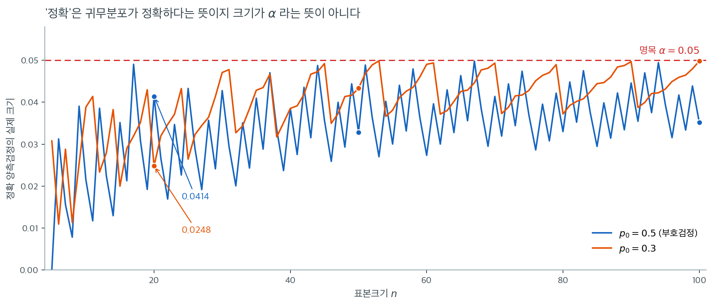

# 이항검정

**이항검정**은 독립인 베르누이 시행열에서 "성공" 확률이 가설값 $p_0$과 같은지를 검정하는 정확 비모수 검정이다. 부호검정 계열에서 가장 일반적인 구성원으로, [부호검정](sign_test.md)은 $p_0 = 0.5$인 특수한 경우이고 이항검정은 임의의 비율을 검정할 수 있다.

이 검정은 이항분포에 직접 기반하므로 정규근사에 기대지 않고 정확 $p$값을 산출한다. 그래서 소표본에 특히 적합하다.

---

## 1. 가설

$X_1, X_2, \ldots, X_n$을 성공확률 $p$인 독립 베르누이 시행이라 하자. 가설값은 $p_0$이다.

| 검정 유형 | $H_0$ | $H_a$ |
|:----------|:------|:------|
| 양측 | $p = p_0$ | $p \ne p_0$ |
| 왼쪽 꼬리 | $p = p_0$ | $p < p_0$ |
| 오른쪽 꼬리 | $p = p_0$ | $p > p_0$ |

---

## 2. 검정통계량

검정통계량은 관측된 성공 횟수이다.

$$
S = \sum_{i=1}^{n} X_i
$$

$H_0$ 아래에서

$$
S \sim \text{Binomial}(n, p_0)
$$

정확분포를 완전히 알고 있으므로 추가적인 변환이나 표준화가 필요 없다.

---

## 3. 정확 p값

**오른쪽 꼬리 검정** ($H_a \colon p > p_0$):

$$
p\text{값} = P(S \ge s_{\text{obs}}) = \sum_{k=s_{\text{obs}}}^{n} \binom{n}{k} p_0^k (1 - p_0)^{n-k}
$$

**왼쪽 꼬리 검정** ($H_a \colon p < p_0$):

$$
p\text{값} = P(S \le s_{\text{obs}}) = \sum_{k=0}^{s_{\text{obs}}} \binom{n}{k} p_0^k (1 - p_0)^{n-k}
$$

**양측검정** ($H_a \colon p \ne p_0$):

$$
p\text{값} = 2 \min\!\bigl(P(S \le s_{\text{obs}}), \; P(S \ge s_{\text{obs}})\bigr)
$$

이며 1을 넘으면 1로 자른다. 관측값만큼 또는 그보다 더 가능성이 낮은 모든 결과의 확률을 더하는 정의도 쓰인다.

!!! warning "두 정의는 같은 값을 주지 않는다"
    $p_0 \ne 0.5$이면 이항분포가 비대칭이라 두 정의가 갈라진다. SciPy의 `binomtest`는 **두 번째** 정의(가능성이 낮은 결과들의 확률합)를 쓴다. 예를 들어 $n = 20$, $s = 10$, $p_0 = 0.7$에서 SciPy는 $0.0834$를 주는 반면 $2\min(\cdot)$ 규칙은 $0.0959$를 준다. 어느 쪽도 틀리지 않지만, 결과를 보고할 때 어느 정의를 썼는지 밝혀야 한다.

!!! tip "정규근사가 필요 없다"
    대표본 정규근사에 기대는 많은 비모수 검정과 달리 이항검정은 어떤 표본크기에서도 $p$값을 정확히 계산한다. 그래서 단일 비율을 검정하는 소표본 문제에서 우선적인 선택이다.



다만 "정확"이라는 이름이 약속하지 **않는** 것이 하나 있다. 위 그림은 $n = 5$부터 $100$까지 각각에 대해, 유의수준 $0.05$의 정확 양측 이항검정이 $H_0$이 참일 때 실제로 기각하는 확률을 계산한 것이다. 빨간 점선이 명목 $\alpha = 0.05$이다.

**어느 $n$에서도 선이 빨간 점선에 닿지 않는다.** 그것도 매끄럽게 접근하는 것이 아니라 톱니처럼 오르내린다. $p_0 = 0.5$(부호검정)의 파란 선은 $n = 20$에서 $0.0414$까지 올라갔다가 $n = 26$ 근처에서 $0.024$로 떨어지고 다시 올라간다. $p_0 = 0.3$의 주황 선은 $n = 20$에서 $0.0248$로 **명목수준의 절반**이다. 가장 극단적인 자리는 파란 선의 왼쪽 끝이다. $p_0 = 0.5$, $n = 5$에서 크기가 정확히 $0$인데, 가장 극단적인 결과인 $S = 0$이나 $S = 5$조차 양측 $p$값이 $2 \times (1/32) = 0.0625$라서 **무엇을 관측하든 기각할 수 없기** 때문이다.

톱니가 생기는 이유는 검정통계량 $S$가 정수만 취하기 때문이다. 기각역은 $\{S \le c\} \cup \{S \ge c'\}$ 꼴이라 확률질량 덩어리 단위로만 넓힐 수 있고, $\alpha$를 넘지 않는 가장 큰 덩어리를 고르면 남는 자리가 버려진다. $n$이 하나 늘 때마다 이항분포의 질량이 재배치되므로 버려지는 양도 널뛴다. 두 선을 비교하면 **비대칭한 $p_0 = 0.3$ 쪽이 더 크게 출렁인다**는 것도 보인다. 한쪽 꼬리의 질량 덩어리가 굵어 촘촘히 채우기가 더 어렵기 때문이다.

실무적 결론은 두 가지이다. 첫째, 정확검정은 **보수적**이다. 크기가 $\alpha$를 넘지 않는다는 보장을 사는 대가로 검정력을 내준다. 둘째, 소표본 설계에서는 검정력 계산 전에 **그 표본크기에서 기각이 가능하기는 한지**부터 확인해야 한다. $n = 5$, $p_0 = 0.3$처럼 크기가 $0$인 조합이 실제로 존재한다.

<div class="exbox" markdown>

**보기 1.** <span class="diff easy" title="쉬움"></span> 약효 주장의 이항검정. 한 제약회사가 자사 약이 환자의 70%에게 효과가 있다고 주장한다($p_0 = 0.70$). 환자 $n = 20$명을 대상으로 한 임상시험에서 $s_{\text{obs}} = 10$명만 반응했다. 참인 반응률이 70%보다 낮은지 검정하라.

**가설:** $H_0 \colon p = 0.70$ 대 $H_a \colon p < 0.70$.

**$p$값 (왼쪽 꼬리):**

</div>

??? success "풀이"
    $$
    p = P(S \le 10) = \sum_{k=0}^{10} \binom{20}{k} (0.70)^k (0.30)^{20-k}
    $$

    이 합을 계산하면(또는 소프트웨어를 쓰면)

    $$
    p \approx 0.0480
    $$

    $\alpha = 0.05$에서 $H_0$을 기각한다. 참인 반응률이 70% 아래라는 증거가 있다.

    ??? example "정확 계산 상세"
        개별 항은 $k = 0, 1, \ldots, 10$에 대해 $P(S = k) = \binom{20}{k}(0.7)^k(0.3)^{20-k}$이다. 누적합은 파이썬에서 `scipy.stats.binom.cdf(10, 20, 0.70)`로 얻을 수 있으며 약 $0.048$을 반환한다.

---

## 4. 부호검정과의 관계

중앙값에 대한 부호검정은 $p_0 = 0.5$인 이항검정이다. $H_0 \colon \text{중앙값} = m_0$을 검정할 때 각 관측값을 성공($X_i > m_0$) 또는 실패($X_i < m_0$)로 부호화하고 동점은 제외한다. $H_0$ 아래에서 성공 횟수는 $\text{Binomial}(n, 0.5)$를 따른다.

이항검정은 임의의 $p_0$을 허용하여 이를 일반화한다. 다음 상황에서 유용하다.

- 처치가 특정한(반드시 50%는 아닌) 성공률을 갖는지 검정할 때.
- 어떤 임계값을 넘는 값의 비율이 알려진 기준선과 일치하는지 검정할 때.

---

## 5. 대표본 정규근사

$n$이 크면 정확 이항 계산을 정규근사로 대체할 수 있다. 표준화된 통계량은

$$
Z = \frac{\hat{p} - p_0}{\sqrt{p_0(1 - p_0)/n}}
$$

이며 $\hat{p} = S/n$은 표본비율이다. 검정에 쓸 참이라면 $np_0 \ge 10$이고 $n(1 - p_0) \ge 10$인 [보수적 기준](../../ch04/discrete_distributions/binomial.md#언제-쓸-수-있는가-5와-10)을 본다. 문턱값 $5$인 느슨한 기준은 분포가 종 모양에 가까워져 확률 하나를 어림해도 될 수준까지만 보장하는데, 검정에서 지켜야 하는 것은 실제 제1종 오류율이 명목 $\alpha$에 가깝다는 것이기 때문이다.

---

## 6. p에 대한 신뢰구간

이항검정에서 참인 비율 $p$에 대한 신뢰구간이 자연스럽게 따라 나온다. **Clopper-Pearson** 정확 신뢰구간은 두 개의 단측 이항검정을 역전시켜 얻는다.

$$
\text{CI}_{1-\alpha} = \bigl(p_L, \; p_U\bigr)
$$

여기서 $p_L$과 $p_U$는 관측된 결과가 유의성의 경계에 놓이게 하는 $p$의 값이다. 이 구간은 최소 $1 - \alpha$의 포함확률을 보장하지만 보수적일 수 있다.

---

## 연습문제

<div class="drillbox" markdown>

**연습문제 1.** <span class="diff med" title="중간"></span>
$n = 20$, $s = 10$, $p_0 = 0.70$인 보기에서 양측 $p$값을 두 가지 정의로 각각 계산하고 왜 다른지 설명하라. SciPy는 어느 쪽을 쓰는가?

</div>

??? success "풀이"
    ```python
    from scipy import stats
    lo = stats.binom.cdf(10, 20, 0.7)     # P(S <= 10) = 0.04796
    hi = stats.binom.sf(9, 20, 0.7)       # P(S >= 10) = 0.98320
    print(2 * min(lo, hi))                # 0.09592
    print(stats.binomtest(10, 20, 0.7).pvalue)   # 0.08345
    ```

    출력:

    ```
    0.09592379466268705
    0.08344502962981218
    ```

    | 정의 | $p$값 |
    |:---|---:|
    | $2\min(P(S \le 10), P(S \ge 10))$ | $0.0959$ |
    | 확률이 $P(S=10)$ 이하인 모든 $k$의 합 (SciPy) | $0.0834$ |

    차이는 $p_0 = 0.7 \ne 0.5$라서 $\text{Binomial}(20, 0.7)$이 **비대칭**이기 때문이다. 최빈값은 $k = 14$이고, 관측값 $s = 10$은 왼쪽 꼬리에 있다.

    - **$2\min$ 규칙**은 왼쪽 꼬리 확률 $0.048$을 그대로 두 배 한다. 오른쪽 꼬리를 실제로 보지 않고 "대칭이라 치고" 같은 크기로 잡는 것이다.
    - **확률합 규칙**은 $P(S = k) \le P(S = 10) = 0.0308$인 모든 $k$를 모은다. 오른쪽에서 이 조건을 만족하는 것은 $k = 18, 19, 20$이고 그 확률의 합은 $0.0355$이다. 따라서 $0.0480 + 0.0355 = 0.0834$가 된다.

    $2\min$ 규칙이 오른쪽 꼬리의 몫을 과대평가한 셈이다. $p_0 = 0.5$이면 분포가 대칭이라 두 정의가 정확히 일치한다.

    실무적 함의: 이 보기에서 $\alpha = 0.05$ 양측검정의 결론이 정의에 따라 갈리지는 않지만($0.0834$와 $0.0959$ 모두 기각 못 함), 경계 근처에서는 갈릴 수 있다. 보고할 때는 소프트웨어 기본값에 의존하지 말고 정의를 명시해야 한다.

<div class="drillbox" markdown>

**연습문제 2.** <span class="diff med" title="중간"></span>
$p_0 = 0.3$일 때 정확 이항검정의 실제 크기를 $n = 20, 50, 100$에 대해 계산하라. 부호검정에서와 같은 이산성 문제가 나타나는가?

</div>

??? success "풀이"
    ```python
    import numpy as np
    from scipy import stats
    for n in (20, 50, 100):
        pv = np.array([stats.binomtest(k, n, 0.3).pvalue for k in range(n + 1)])
        pmf = stats.binom.pmf(np.arange(n + 1), n, 0.3)
        print(n, round(pmf[pv <= 0.05].sum(), 4))
    ```

    출력:

    ```
    20 0.0248
    50 0.0433
    100 0.0498
    ```

    | $n$ | 실제 크기 |
    |---:|---:|
    | 20 | 0.0248 |
    | 50 | 0.0433 |
    | 100 | 0.0498 |

    같은 이산성 문제가 나타난다. $n = 20$에서 실제 크기는 명목값의 절반인 $0.0248$이다. 정확검정은 **어떤 $n$에서도 크기가 $\alpha$를 넘지 않는다는 것을 보장**하지만, 그 대가로 소표본에서는 유의수준의 절반만 사용한다.

    부호검정($p_0 = 0.5$)과 비교하면 흥미로운 차이가 있다. $p_0 = 0.5$에서는 $n = 20$의 크기가 $0.0414$였는데 여기서는 $0.0248$이다. 이항분포가 비대칭일수록 확률질량 덩어리가 고르지 않아 $\alpha$를 촘촘히 채우기가 더 어렵기 때문이다.

    "정확"이 "정확히 $\alpha$"를 뜻하지 않는다는 점을 기억해야 한다. 정확검정에서 "정확"은 **귀무분포를 근사 없이 계산한다**는 뜻이지 크기가 명목값과 일치한다는 뜻이 아니다.

<div class="drillbox" markdown>

**연습문제 3.** <span class="diff med" title="중간"></span>
$n = 20$에서 Clopper-Pearson 구간, Wilson 구간, Wald 구간의 실제 포함확률을 $p = 0.1, 0.3, 0.5, 0.7, 0.9$에 대해 계산하고 비교하라.

</div>

??? success "풀이"
    ```python
    import numpy as np
    from scipy import stats

    def coverage(n, p):
        out = []
        for method in ("exact", "wilson", "wald"):
            c = 0.0
            for k in range(n + 1):
                pr = stats.binom.pmf(k, n, p)
                if method == "wald":
                    ph = k / n; se = np.sqrt(ph * (1 - ph) / n)
                    lo, hi = ph - 1.96 * se, ph + 1.96 * se
                else:
                    lo, hi = stats.binomtest(k, n, 0.5).proportion_ci(method=method)
                c += pr * (lo <= p <= hi)
            out.append(c)
        return out

    for p in (0.1, 0.3, 0.5, 0.7, 0.9):
        print(p, ["%.4f" % v for v in coverage(20, p)])
    ```

    출력:

    ```
    0.1 ['0.9887', '0.9568', '0.8760']
    0.3 ['0.9752', '0.9752', '0.9474']
    0.5 ['0.9586', '0.9586', '0.9586']
    0.7 ['0.9752', '0.9752', '0.9474']
    0.9 ['0.9887', '0.9568', '0.8760']
    ```

    | 참값 $p$ | Clopper-Pearson | Wilson | Wald |
    |---:|---:|---:|---:|
    | 0.1 | 0.9887 | 0.9568 | **0.8760** |
    | 0.3 | 0.9752 | 0.9752 | 0.9474 |
    | 0.5 | 0.9586 | 0.9586 | 0.9586 |
    | 0.7 | 0.9752 | 0.9752 | 0.9474 |
    | 0.9 | 0.9887 | 0.9568 | **0.8760** |

    세 구간의 성격이 뚜렷이 갈린다.

    - **Clopper-Pearson**은 모든 $p$에서 $0.95$ 이상을 보장하지만 극단에서 $0.989$까지 올라가 지나치게 넓다. 보수적이다.
    - **Wilson**은 $0.95$ 근처를 꽤 잘 지킨다. 가장 좋은 절충안이다.
    - **Wald**($\hat{p} \pm 1.96\sqrt{\hat{p}(1-\hat{p})/n}$)는 $p = 0.1$에서 포함확률이 $0.876$으로 무너진다. 명목수준보다 7%p 넘게 낮다.

    Wald가 무너지는 이유는 $k = 0$일 때 $\hat{p} = 0$이 되어 구간이 $[0, 0]$이라는 **점 하나로 붕괴**하기 때문이다. $p = 0.1$, $n = 20$에서 $P(S = 0) = 0.9^{20} = 0.122$이므로 이 사건만으로 이미 12%의 실패가 생긴다.

    실무 권고: 소표본 비율의 신뢰구간에는 Wald를 쓰지 말라. 보수성을 감수하더라도 보장이 필요하면 Clopper-Pearson, 실제 포함확률이 명목값에 가깝기를 원하면 Wilson을 쓴다.

<div class="drillbox" markdown>

**연습문제 4.** <span class="diff med" title="중간"></span>
$p_0 = 0.5$, $n = 20$에서 모든 $s = 0, \ldots, 20$에 대해 정확 $p$값, 보정 없는 정규근사 $p$값, 연속성 보정 정규근사 $p$값을 비교하라. 세 방법의 $\alpha = 0.05$ 결론이 갈리는 $s$가 있는가?

</div>

??? success "풀이"
    ```python
    import numpy as np
    from scipy import stats
    n, p0 = 20, 0.5
    for s in range(n + 1):
        pe = stats.binomtest(s, n, p0).pvalue
        z = (s / n - p0) / np.sqrt(p0 * (1 - p0) / n)
        pn = 2 * stats.norm.sf(abs(z))
        zc = (abs(s - n * p0) - 0.5) / np.sqrt(n * p0 * (1 - p0))
        pc = 2 * stats.norm.sf(max(zc, 0))
        print(s, round(pe, 4), round(pn, 4), round(pc, 4))
    ```

    출력:

    ```
    0 0.0 0.0 0.0
    1 0.0 0.0001 0.0001
    2 0.0004 0.0003 0.0008
    3 0.0026 0.0017 0.0037
    4 0.0118 0.0073 0.0139
    5 0.0414 0.0253 0.0442
    6 0.1153 0.0736 0.1175
    7 0.2632 0.1797 0.2636
    8 0.5034 0.3711 0.5023
    9 0.8238 0.6547 0.8231
    10 1.0 1.0 1.0
    11 0.8238 0.6547 0.8231
    12 0.5034 0.3711 0.5023
    13 0.2632 0.1797 0.2636
    14 0.1153 0.0736 0.1175
    15 0.0414 0.0253 0.0442
    16 0.0118 0.0073 0.0139
    17 0.0026 0.0017 0.0037
    18 0.0004 0.0003 0.0008
    19 0.0 0.0001 0.0001
    20 0.0 0.0 0.0
    ```

    꼬리 근처의 값들만 보면(대칭이므로 $s$와 $20-s$가 같다):

    | $s$ | 정확 | 정규근사 (보정 없음) | 정규근사 (연속성 보정) |
    |---:|---:|---:|---:|
    | 4 | $0.0118$ | $0.0073$ | $0.0139$ |
    | 5 | $0.0414$ | $0.0253$ | $0.0442$ |
    | 6 | $0.1153$ | $0.0736$ | $0.1175$ |
    | 7 | $0.2632$ | $0.1797$ | $0.2636$ |
    | 8 | $0.5034$ | $0.3711$ | $0.5023$ |

    **결론이 갈리는 $s$는 없다.** $\alpha = 0.05$에서 세 방법 모두 $s \le 5$ 또는 $s \ge 15$에서 기각한다.

    그러나 $p$값 자체는 크게 다르다. 보정 없는 정규근사는 $s = 5$에서 $0.0253$을 주어 정확값 $0.0414$의 **61%**에 불과하다. 결론이 같은 것은 근사가 좋아서가 아니라 $S$가 이산이라 $p$값이 $0.0414$에서 $0.1153$으로 건너뛰기 때문이다. 그 사이에 $\alpha = 0.05$가 놓여 있어 어느 쪽으로 틀려도 결정이 바뀌지 않는다.

    연속성 보정은 $0.0442$로 정확값에 훨씬 가깝다. 완전히 같지는 않지만 오차가 $0.0028$로, 보정 없는 근사의 오차 $0.0161$의 6분의 1이다. 보정이 하는 일은 이산 계단함수의 계단 중앙을 지나도록 정규곡선을 맞추는 것이며, 이로써 근사 오차의 1차 항이 상쇄된다.

    권고: 정규근사를 쓴다면 **반드시 연속성 보정을 함께 쓴다**. 보정 없는 근사는 $p$값을 체계적으로 과소평가하여 기각을 지나치게 많이 하게 만든다. 다만 오늘날 $n$이 수천 이하이면 정확 계산이 즉시 끝나므로, 근사를 쓸 이유는 손계산 말고는 별로 없다.

<div class="drillbox" markdown>

**연습문제 5.** <span class="diff med" title="중간"></span>
이 쪽은 $p_0 = 0.5$, $n = 5$에서 정확 양측검정의 크기가 정확히 $0$이라고 했다. 무엇을 관측하든 기각할 수 없는 설계였다. $n$을 하나 늘리면 어떻게 되는가?

$n = 6$, $p_0 = 0.5$의 정확 양측 이항검정을 $2^6 = 64$개 결과를 직접 세어 종이에서 끝내라. (a) $s = 0, 1, \ldots, 6$ 각각의 양측 $p$값을 분수로 적어라. (b) $\alpha = 0.05$의 기각역과 그 실제 크기를 구하라. (c) 일반적으로 $p_0 = 0.5$의 정확 양측검정이 $\alpha = 0.05$에서 **기각이 가능해지는** 가장 작은 $n$을 구하라. 라이브러리를 쓰지 말라.

</div>

??? success "풀이"
    $p_0 = 0.5$이므로 $P(S = k) = \binom{6}{k}/64$이고 이항계수는

    $$
    \binom{6}{0}, \ldots, \binom{6}{6} = 1,\, 6,\, 15,\, 20,\, 15,\, 6,\, 1
    $$

    이다. 합이 $64$인 것을 확인해 두자. 분포가 대칭이므로 두 양측 정의가 같은 값을 주고(연습문제 6), $2 \min$으로 계산하면 된다.

    **(a) 양측 $p$값.** 아래 꼬리 누적을 $64$분모로 적으면 $1,\ 7,\ 22,\ 42,\ 57,\ 63,\ 64$이다.

    | $s$ | $P(S = s)$ | $P(S \le s)$ | 양측 $p$값 |
    |---:|:---|:---|:---|
    | $0$ | $1/64$ | $1/64$ | $2/64 = 1/32 = 0.03125$ |
    | $1$ | $6/64$ | $7/64$ | $14/64 = 7/32 = 0.21875$ |
    | $2$ | $15/64$ | $22/64$ | $44/64 = 11/16 = 0.6875$ |
    | $3$ | $20/64$ | $42/64$ | $84/64 \to 1$ (자름) |
    | $4$ | $15/64$ | $57/64$ | $0.6875$ |
    | $5$ | $6/64$ | $63/64$ | $0.21875$ |
    | $6$ | $1/64$ | $1$ | $0.03125$ |

    $s = 3$에서는 아래·위 꼬리가 모두 $42/64$라 $2\min = 84/64 = 1.3125 > 1$이므로 $1$로 자른다.

    **(b) 기각역과 크기.** $p$값이 $0.05$ 이하인 것은 $s = 0$과 $s = 6$뿐이다. 따라서

    $$
    \text{기각역} = \{0, 6\}, \qquad \text{실제 크기} = \frac{1 + 1}{64} = \frac{1}{32} = 0.03125
    $$

    $n = 5$의 $0$에서 벗어났지만 여전히 명목 $0.05$의 $62.5\%$만 쓴다. $s = 1$을 기각역에 넣으면 크기가 $14/64 = 0.21875$로 뛰어 $\alpha$를 네 배 넘기므로 넣을 수 없다. 버려지는 $0.01875$가 바로 이산성의 대가다.

    **(c) 기각이 가능해지는 최소 $n$.** 가장 작은 양측 $p$값은 가장 극단적인 결과 $s = 0$(또는 $s = n$)에서 나오고 그 값은

    $$
    2 \cdot \frac{1}{2^n} = 2^{1-n}
    $$

    이다. $2^{1-n} \le 0.05$가 되려면 $2^{n-1} \ge 20$, 곧 $n - 1 \ge 5$이다. $2^4 = 16 < 20 \le 32 = 2^5$이므로

    $$
    n \ge 6
    $$

    이고 최소값은 $n = 6$이다. $n = 5$에서 $2^{-4} = 0.0625 > 0.05$였던 것이 쪽 본문의 "크기가 정확히 $0$"의 정체다.

    한 줄 해석: 부호검정의 설계에서 가장 먼저 확인할 것은 검정력이 아니라 **기각이 가능한 $n$인가**이고, 양측 $\alpha = 0.05$에서 그 문턱은 $n = 6$이다.

<div class="drillbox" markdown>

**연습문제 6.** <span class="diff med" title="중간"></span>
연습문제 1은 $p_0 \ne 0.5$에서 두 양측 정의가 갈라지는 것을 보았고, 풀이 끝에 "$p_0 = 0.5$이면 분포가 대칭이라 두 정의가 정확히 일치한다"고 적었다. 이것을 증명하라.

(a) $p_0 = 0.5$이고 $s < n/2$일 때 $\{k : P(S = k) \le P(S = s)\} = \{0, 1, \ldots, s\} \cup \{n-s, \ldots, n\}$임을 보여라. (b) 이로부터 확률합 정의의 $p$값이 $2 P(S \le s)$와 같고, 그것이 $2\min$ 정의와 일치함을 보여라. (c) $n = 20$, $s = 10$, $p_0 = 0.5$에서 $2\min$ 규칙의 값은 $2 \times 0.5881 = 1.1762$인데 확률합 규칙은 $1$을 준다. "정확히 일치한다"는 주장이 그래도 참인 이유를 말하고, 그 일치에 **무엇이 꼭 필요한지** 밝혀라.

</div>

??? success "풀이"
    **(a) 집합의 일치.** $p_0 = 0.5$이면 $P(S = k) = \binom{n}{k} / 2^n$이므로 $P(S = k) \le P(S = s)$는 $\binom{n}{k} \le \binom{n}{s}$와 같다. 이항계수의 두 성질을 쓴다.

    - **대칭성:** $\binom{n}{k} = \binom{n}{n-k}$.
    - **단봉성:** 연속한 비

    $$
    \frac{\binom{n}{k}}{\binom{n}{k-1}} = \frac{n-k+1}{k}
    $$

    이 $1$ 이상인 것은 $k \le (n+1)/2$와 같다. 따라서 $\binom{n}{k}$는 $k \le \lfloor n/2 \rfloor$에서 증가하고 그 뒤로 감소한다.

    이제 $k$를 두 쪽으로 나눈다. $k \le n/2$이면 증가 구간이므로 $\binom{n}{k} \le \binom{n}{s} \iff k \le s$이다. $k > n/2$이면 $n - k < n/2$이고 대칭성으로 $\binom{n}{k} = \binom{n}{n-k}$이니 다시 증가 구간의 비교가 되어 $\binom{n}{k} \le \binom{n}{s} \iff n-k \le s \iff k \ge n-s$이다. 두 경우를 합치면

    $$
    \{k : P(S = k) \le P(S = s)\} = \{0, \ldots, s\} \cup \{n-s, \ldots, n\}
    $$

    이다. $s < n/2$이므로 $s < n - s$이고 두 조각은 겹치지 않는다.

    **(b) 두 정의의 일치.** (a)의 집합에 확률을 매기면

    $$
    p_{\text{확률합}} = P(S \le s) + P(S \ge n-s) = 2 P(S \le s)
    $$

    인데, 마지막 등호는 $S \sim \text{Binomial}(n, 0.5)$의 대칭성 $P(S \ge n-s) = P(n - S \le s) = P(S \le s)$에서 나온다. 한편 $s < n/2$이면 $P(S \le s) \le 1/2 \le P(S \ge s)$이므로 $\min$이 아래 꼬리에서 잡히고

    $$
    p_{2\min} = 2 \min\bigl(P(S \le s),\, P(S \ge s)\bigr) = 2 P(S \le s)
    $$

    이다. 두 값이 같다. $s > n/2$는 $S \mapsto n - S$로 바꾸면 같은 논증이고, $n$이 짝수인 $s = n/2$는 (c)에서 다룬다. $\square$

    **(c) 자르기가 꼭 필요하다.** $n = 20$, $s = 10$은 $\binom{20}{10}$이 최댓값인 자리다. 그러면 모든 $k$가 $P(S = k) \le P(S = 10)$을 만족하므로 확률합 정의는 표본공간 전체를 모아 정확히

    $$
    p_{\text{확률합}} = 1
    $$

    을 준다. 반면 $2\min$ 규칙은 $P(S \le 10) = P(S \ge 10) = 0.5881$이라 $2 \times 0.5881 = 1.1762$를 주고, 이 쪽 §3이 말한 "1을 넘으면 1로 자른다"에 따라 $1$이 된다. 자른 뒤에는 둘이 같다.

    따라서 "정확히 일치한다"는 주장은 **$2\min$ 값을 $1$로 자른 뒤에만** 참이다. 그리고 두 정의의 성격 차이가 여기서 드러난다.

    - 확률합 정의는 확률들의 합이므로 설계상 절대 $1$을 넘지 않는다. 자르기가 필요 없다.
    - $2\min$ 정의는 아래 꼬리를 두 배 하는 **규칙**이지 어떤 사건의 확률이 아니다. $s$가 중앙 근처면 $\min$이 $1/2$에 가까워 두 배가 $1$을 넘는다. 자르기는 그 구조적 결함을 덮는 반창고다.

    한 줄 해석: $p_0 = 0.5$에서 두 정의가 같다는 것은 $S$가 꼬리 쪽에 있을 때의 이야기이고, 중앙 근처에서는 한쪽이 확률이기를 포기한 뒤 손으로 맞춘 결과다.

<div class="drillbox" markdown>

**연습문제 7.** <span class="diff med" title="중간"></span>
이 쪽의 그림은 정확검정의 **크기**가 $n$에 따라 톱니처럼 오르내린다고 가르쳤다. 그러면 **검정력**도 그런가?

$p_0 = 0.5$, $\alpha = 0.05$ 양측 정확검정의 기각역을 $n = 5$부터 $24$까지 구하고, 참값이 $p = 0.75$일 때의 검정력을 계산하라. 표본을 늘렸는데 검정력이 **떨어지는** $n$이 있는가? 가장 심한 자리를 찾아 그 까닭을 기각역의 모양으로 설명하고, 표본크기를 정하는 사람에게 이것이 뜻하는 바를 한 줄로 적어라.

</div>

??? success "풀이"
    ```python
    import numpy as np
    from scipy import stats

    def region(n, p0=0.5, alpha=0.05):
        k = np.arange(n + 1)
        pv = np.array([stats.binomtest(int(s), n, p0,
                                       alternative="two-sided").pvalue for s in k])
        return pv <= alpha

    print(" n   크기    검정력(p=0.75)")
    pw_prev = None
    for n in range(5, 25):
        rej = region(n)
        size = stats.binom.pmf(np.arange(n + 1), n, 0.5)[rej].sum()
        pw = stats.binom.pmf(np.arange(n + 1), n, 0.75)[rej].sum()
        mark = "  <- 감소" if pw_prev is not None and pw < pw_prev else ""
        print(f"{n:3d}  {size:.4f}  {pw:.4f}{mark}")
        pw_prev = pw
    ```

    출력:

    ```text
     n   크기    검정력(p=0.75)
      5  0.0000  0.0000
      6  0.0313  0.1782
      7  0.0156  0.1335  <- 감소
      8  0.0078  0.1001  <- 감소
      9  0.0391  0.3004
     10  0.0215  0.2441  <- 감소
     11  0.0117  0.1971  <- 감소
     12  0.0386  0.3907
     13  0.0225  0.3326  <- 감소
     14  0.0129  0.2811  <- 감소
     15  0.0352  0.4613
     16  0.0213  0.4050  <- 감소
     17  0.0490  0.5739
     18  0.0309  0.5187  <- 감소
     19  0.0192  0.4654  <- 감소
     20  0.0414  0.6172
     21  0.0266  0.5666  <- 감소
     22  0.0169  0.5168  <- 감소
     23  0.0347  0.6537
     24  0.0227  0.6074  <- 감소
    ```

    **검정력은 $n$의 증가함수가 아니다.** 스무 개의 $n$ 가운데 열두 번이 앞의 $n$보다 낮다. 가장 심한 자리는 $n = 6 \to 8$이다.

    | $n$ | 기각역 | 크기 | 검정력 ($p = 0.75$) |
    |---:|:---|---:|---:|
    | $6$ | $\{0, 6\}$ | $0.0313$ | $0.1782$ |
    | $7$ | $\{0, 7\}$ | $0.0156$ | $0.1335$ |
    | $8$ | $\{0, 8\}$ | $0.0078$ | $0.1001$ |
    | $9$ | $\{0, 1, 8, 9\}$ | $0.0391$ | $0.3004$ |

    **까닭.** $n = 6, 7, 8$에서 기각역은 모두 양 끝 한 점씩인 $\{0, n\}$이다. $s = 1$을 넣으려면 양측 $p$값 $2(n+1)/2^n$이 $0.05$ 이하여야 하는데, $n = 8$에서 그 값은 $2 \times 9/256 = 0.0703$으로 아직 크다. $n = 9$에서야 $2 \times 10/512 = 0.0391 \le 0.05$가 되어 임계값이 한 칸 움직인다.

    기각역이 $\{0, n\}$으로 고정된 채 $n$만 커지면 그 역의 확률은

    $$
    P(\text{기각}) = (0.75)^n + (0.25)^n
    $$

    으로 **$n$에 대해 줄어든다.** $n = 6$에서 $0.75^6 + 0.25^6 = 0.1780 + 0.0002 = 0.1782$이고 $n = 8$에서 $0.75^8 + 0.25^8 = 0.1001$이다. 관측값을 두 개 더 모았는데 검정력이 $44\%$ 깎인 것이다. 임계값이 한 칸 움직이는 $n = 6, 9, 12, 15, 17, 20, 23$에서만 검정력이 뛰어오르고, 그 사이에서는 계속 흘러내린다. 크기 열을 보면 이 $n$들이 바로 크기가 국소 최대인 자리와 같다.

    한 줄 해석: 소표본 정확검정에서 표본크기는 "크면 클수록 좋다"가 아니라 **기각역의 임계값이 한 칸 올라가는 $n$을 골라야 한다** — $n = 8$에 쓸 돈이 있으면 하나를 더 보태 $n = 9$로 가면 검정력이 세 배가 된다.

<div class="drillbox" markdown>

**연습문제 8.** <span class="diff hard" title="어려움"></span>
§6은 Clopper-Pearson 구간이 "두 개의 단측 이항검정을 역전시켜" 얻어진다고 했다. 그렇다면 "$p_0$이 $95\%$ Clopper-Pearson 구간 안에 있다"와 "$\alpha = 0.05$ 양측 정확검정이 $p_0$을 기각하지 못한다"는 같은 말인가?

$n = 20$의 모든 $k = 0, 1, \ldots, 20$과 $p_0 = 0.01, 0.02, \ldots, 0.99$에 대해, §3의 두 양측 정의($2\min$ 규칙과 SciPy의 확률합 규칙) 각각에서 이 동치가 성립하는지 세어 보라. 어긋나는 쪽이 있으면 구체적인 $(k, p_0)$ 하나를 들고, 어느 쪽이 더 많이 기각하는지 밝히고, 보고 실무에 주는 교훈을 적어라.

</div>

??? success "풀이"
    ```python
    import numpy as np
    from scipy import stats

    n, alpha = 20, 0.05
    grid = np.round(np.arange(0.01, 1.00, 0.01), 2)
    bad_2min, bad_like = [], []
    for k in range(n + 1):
        lo, hi = stats.binomtest(k, n, 0.5, alternative="two-sided").proportion_ci(
            method="exact", confidence_level=1 - alpha)
        for p0 in grid:
            inside = lo <= p0 <= hi
            a = stats.binom.cdf(k, n, p0)
            b = stats.binom.sf(k - 1, n, p0)
            p2 = min(1.0, 2 * min(a, b))
            pl = stats.binomtest(k, n, p0, alternative="two-sided").pvalue
            if inside != (p2 > alpha):
                bad_2min.append((k, p0, p2))
            if inside != (pl > alpha):
                bad_like.append((k, p0, pl))

    print(f"격자 크기: {(n + 1) * len(grid)}")
    print(f"2min 정의와 어긋난 칸: {len(bad_2min)}")
    print(f"확률합(SciPy) 정의와 어긋난 칸: {len(bad_like)}")
    print("어긋난 칸의 보기 (k, p0, SciPy p값, 2min p값):")
    for k, p0, pl in bad_like[:4]:
        lo, hi = stats.binomtest(k, n, 0.5, alternative="two-sided").proportion_ci(
            method="exact", confidence_level=1 - alpha)
        a = stats.binom.cdf(k, n, p0)
        b = stats.binom.sf(k - 1, n, p0)
        print(f"  k={k:2d}  p0={p0:.2f}  p={pl:.4f}  "
              f"2min={min(1.0, 2 * min(a, b)):.4f}  CI=[{lo:.4f}, {hi:.4f}]")
    ```

    출력:

    ```text
    격자 크기: 2079
    2min 정의와 어긋난 칸: 0
    확률합(SciPy) 정의와 어긋난 칸: 40
    어긋난 칸의 보기 (k, p0, SciPy p값, 2min p값):
      k= 3  p0=0.04  p=0.0439  2min=0.0877  CI=[0.0321, 0.3789]
      k= 4  p0=0.06  p=0.0290  2min=0.0579  CI=[0.0573, 0.4366]
      k= 4  p0=0.07  p=0.0471  2min=0.0943  CI=[0.0573, 0.4366]
      k= 4  p0=0.43  p=0.0422  2min=0.0572  CI=[0.0573, 0.4366]
    ```

    **$2\min$ 정의에서는 동치가 완벽하다.** $2079$개 칸 가운데 어긋난 것이 하나도 없다. 그럴 수밖에 없다. Clopper-Pearson 구간은 정의상

    $$
    \text{CI} = \Bigl\{ p : P_p(S \le k) > \tfrac{\alpha}{2} \;\text{이고}\; P_p(S \ge k) > \tfrac{\alpha}{2} \Bigr\}
    $$

    인데, 이 조건은 $2\min\bigl(P_p(S \le k), P_p(S \ge k)\bigr) > \alpha$와 글자 그대로 같은 말이다. §6의 "두 개의 단측 검정을 역전시켜"가 뜻하는 것이 바로 이것이다.

    **SciPy의 확률합 정의에서는 동치가 깨진다.** $2079$개 중 $40$개 칸에서 어긋나고, $40$개 전부가 같은 방향이다 — **$p_0$이 구간 안에 있는데도 $p$값이 $\alpha$ 이하라서 기각한다.** 가장 눈에 띄는 것이 $k = 4$, $p_0 = 0.43$이다.

    | 방법 | 값 | 결론 |
    |:---|---:|:---|
    | SciPy 확률합 $p$값 | $0.0422$ | 기각 |
    | $2\min$ $p$값 | $0.0572$ | 기각 못 함 |
    | $95\%$ Clopper-Pearson 구간 | $[0.0573,\, 0.4366]$ | $0.43$을 포함 |

    $20$번 중 $4$번 성공한 자료가 "비율이 $0.43$이다"를 유의수준 $5\%$에서 기각하는데, 같은 자료의 $95\%$ 정확 신뢰구간은 $0.43$을 담고 있다. 보고서에 이 둘을 나란히 쓰면 독자는 모순을 본다.

    까닭은 두 정의가 표본공간을 **다른 순서로** 극단적이라고 매기기 때문이다. 확률합 규칙은 $P(S = k) \le P(S = 4)$인 $k$를 모으므로 비대칭한 $\text{Binomial}(20, 0.43)$에서 위쪽 꼬리의 몫을 $2\min$보다 적게 잡는다. 그만큼 $p$값이 작아져 더 많이 기각하고, 그 순서에 대응하는 구간은 Clopper-Pearson 구간이 아니다(연습문제 1에서 본 $0.0834$ 대 $0.0959$와 같은 현상이 반대 방향으로 나타난 것이다).

    한 줄 교훈: $p$값과 신뢰구간은 **같은 정의에서 뽑아야** 한다. `binomtest`의 `pvalue`와 `proportion_ci(method="exact")`는 짝이 아니다. 둘을 함께 보고하려면 $p$값을 $2\min$ 규칙으로 직접 계산하든지, 구간을 확률합 순서로 역전시켜 다시 만들든지 해야 한다.

<div class="drillbox" markdown>

**연습문제 9.** <span class="diff hard" title="어려움"></span>
§5는 정규근사를 검정에 쓸 때 $np_0 \ge 10$, $n(1-p_0) \ge 10$의 보수적 기준을 보라고 했고, 그 이유로 "검정에서 지켜야 하는 것은 실제 제1종 오류율이 명목 $\alpha$에 가깝다는 것"을 들었다. 그 기준이 실제로 그것을 지켜 주는가?

$p_0 = 0.5, 0.4, 0.3, 0.2, 0.1$ 각각에 대해 기준을 만족하는 가장 작은 $n$부터 $40$개의 $n$에 걸쳐 (i) 정확검정, (ii) 보정 없는 정규근사 검정, (iii) 연속성 보정 정규근사 검정의 **실제 크기**의 최댓값을 구하라. 기준을 지켰는데도 명목 $\alpha = 0.05$를 넘는 것이 있는가? 가장 나쁜 자리를 손으로 확인하고, 연습문제 4의 결론을 다시 읽어라.

</div>

??? success "풀이"
    ```python
    import numpy as np
    from scipy import stats

    def sizes(n, p0, alpha=0.05):
        k = np.arange(n + 1)
        pmf = stats.binom.pmf(k, n, p0)
        ex = np.array([stats.binomtest(int(s), n, p0,
                                       alternative="two-sided").pvalue for s in k])
        z = (k / n - p0) / np.sqrt(p0 * (1 - p0) / n)
        pn = 2 * stats.norm.sf(np.abs(z))
        zc = np.maximum((np.abs(k - n * p0) - 0.5) / np.sqrt(n * p0 * (1 - p0)), 0.0)
        pc = 2 * stats.norm.sf(zc)
        return (pmf[ex <= alpha].sum(), pmf[pn <= alpha].sum(), pmf[pc <= alpha].sum())

    print(" p0  n범위      최대크기(정확) (보정없음)  (보정)   보정없음이 가장 나쁜 n")
    for p0 in (0.5, 0.4, 0.3, 0.2, 0.1):
        nmin = int(np.ceil(10 / min(p0, 1 - p0)))
        ns = range(nmin, nmin + 40)
        tab = np.array([sizes(n, p0) for n in ns])
        worst = ns[int(tab[:, 1].argmax())]
        print(f"{p0:4.1f}  {nmin:3d}-{nmin + 39:3d}   "
              f"{tab[:, 0].max():.4f}      {tab[:, 1].max():.4f}    "
              f"{tab[:, 2].max():.4f}   n={worst}")
    ```

    출력:

    ```text
     p0  n범위      최대크기(정확) (보정없음)  (보정)   보정없음이 가장 나쁜 n
     0.5   20- 59   0.0489      0.0784    0.0489   n=21
     0.4   25- 64   0.0496      0.0650    0.0471   n=31
     0.3   34- 73   0.0499      0.0657    0.0446   n=60
     0.2   50- 89   0.0493      0.0613    0.0445   n=55
     0.1  100-139   0.0499      0.0636    0.0458   n=100
    ```

    **기준을 지켜도 보정 없는 정규근사 검정은 $\alpha$를 넘는다.** 다섯 줄 모두에서 최대 크기가 $0.05$보다 크고, 가장 나쁜 자리는 $p_0 = 0.5$, $n = 21$의 $0.0784$다. 명목값의 $157\%$, 곧 유의수준 $5\%$라고 적어 놓고 실제로는 $7.8\%$로 기각한다. 반면 정확검정은 다섯 줄 모두 $0.05$ 아래이고(최대 $0.0499$), 연속성 보정 검정도 이 범위에서는 $0.05$를 넘지 않았다(최대 $0.0489$).

    **가장 나쁜 자리를 손으로 확인.** $p_0 = 0.5$, $n = 21$이면 $np_0 = 10.5 \ge 10$으로 기준을 만족한다. 보정 없는 검정이 기각하는 조건은

    $$
    \frac{\lvert s - 10.5 \rvert}{\sqrt{21 \times 0.25}} \ge 1.96 \quad \Longleftrightarrow \quad \lvert s - 10.5 \rvert \ge 1.96 \times 2.2913 = 4.491
    $$

    이므로 $s \le 6$ 또는 $s \ge 15$이다. 실제 크기는

    $$
    2 \sum_{k=0}^{6} \binom{21}{k} 2^{-21} = \frac{2 (1 + 21 + 210 + 1330 + 5985 + 20349 + 54264)}{2097152} = \frac{164320}{2097152} = 0.0784
    $$

    로 출력과 맞는다. 보정을 넣으면 문턱이 $\lvert s - 10.5 \rvert \ge 4.991$이 되어 기각역이 $\{s \le 5\} \cup \{s \ge 16\}$으로 한 칸 줄고, 크기는

    $$
    2 \sum_{k=0}^{5} \binom{21}{k} 2^{-21} = \frac{2 \times 27896}{2097152} = 0.0266
    $$

    으로 떨어진다. 보정이 하는 일은 결국 **임계값을 반 칸 밖으로 미는 것**이고, $S$가 정수라 그 반 칸이 꼬리의 질량 덩어리 하나를 통째로 빼낸다.

    **연습문제 4를 다시 읽으면** 거기서 세 방법의 결론이 하나도 갈리지 않았던 것은 근사가 좋아서가 아니라 $n = 20$, $p_0 = 0.5$가 운 좋은 자리였기 때문임이 분명해진다. $n$을 하나만 늘려 $21$로 가면 보정 없는 근사가 $s = 6$에서 기각하는데 정확검정의 $p$값은 $2 P(S \le 6) = 0.0784$로 기각하지 않는다. 결론이 바로 갈린다.

    한 줄 해석: $np_0 \ge 10$은 분포의 모양에 대한 조건이지 검정 크기에 대한 보장이 아니다. 이산 통계량에서 크기를 지키는 것은 표본크기 기준이 아니라 **연속성 보정**이며, 그마저도 보장이 아니라 경험적 사실이므로 쓸 수 있으면 정확검정을 쓴다.

<div class="drillbox" markdown>

**연습문제 10.** <span class="diff hard" title="어려움"></span>
연습문제 5에서 $n = 6$, $p_0 = 0.5$의 정확 양측검정은 크기가 $1/32 = 0.03125$로, 명목 $\alpha = 0.05$ 가운데 $0.01875$를 쓰지 못하고 버렸다. 경계에서 자료와 무관한 동전을 던지면 그 몫을 되찾을 수 있다. $S \in \{0, 6\}$이면 반드시 기각하고 $S \in \{1, 5\}$이면 확률 $\gamma$로 기각하는 **무작위화 검정**을 생각하자.

(a) 크기가 정확히 $0.05$가 되는 $\gamma$를 구하라. (b) 참값이 $p = 3/4$일 때 무작위화하지 않은 검정과 무작위화한 검정의 검정력을 분수로 구하고 비교하라($p = 3/4$의 확률질량은 분모 $4096$에서 깔끔하게 적힌다). (c) 이 검정은 버리는 유의수준이 없어 Neyman-Pearson 이론에서 자연스러운데도 실무에서 쓰이지 않는다. 그 까닭을 두 가지 들고, 연습문제 7과 견주어 이 $0.01875$를 되찾을 더 나은 길을 제시하라.

</div>

??? success "풀이"
    **(a) $\gamma$.** 연습문제 5의 표에서 $P(S = 0) = P(S = 6) = 1/64$이고 $P(S = 1) = P(S = 5) = 6/64$이다. $H_0 \colon p = 0.5$ 아래에서 기각확률은

    $$
    \frac{2}{64} + \gamma \cdot \frac{12}{64} = \frac{1}{32} + \frac{3\gamma}{16}
    $$

    이다. 이것을 $0.05 = 1/20$과 같게 두면

    $$
    \frac{3\gamma}{16} = \frac{1}{20} - \frac{1}{32} = \frac{8 - 5}{160} = \frac{3}{160}
    \quad \Longrightarrow \quad \gamma = \frac{16}{160} = \frac{1}{10}
    $$

    이다. 경계값 $s \in \{1, 5\}$를 보면 확률 $0.1$로 기각한다. 크기는 $2/64 + 0.1 \times 12/64 = 3.2/64 = 0.05$로 정확히 맞는다.

    **(b) 검정력.** $p = 3/4$이면 $P(S = k) = \binom{6}{k} 3^k / 4^6$이고 $4^6 = 4096$이다.

    | $k$ | $0$ | $1$ | $5$ | $6$ |
    |---:|---:|---:|---:|---:|
    | $4096 \, P(S = k)$ | $1$ | $18$ | $1458$ | $729$ |

    무작위화하지 않은 검정(기각역 $\{0, 6\}$)의 검정력은

    $$
    \frac{1 + 729}{4096} = \frac{730}{4096} = 0.178223
    $$

    이고, 무작위화한 검정은 여기에 경계의 몫을 $\gamma = 1/10$만큼 더해

    $$
    \frac{730}{4096} + \frac{1}{10} \cdot \frac{18 + 1458}{4096} = \frac{730 + 147.6}{4096} = \frac{1097}{5120} = 0.214258
    $$

    이 된다. 검정력이 $0.1782$에서 $0.2143$으로, 절대값 $0.0360$ 상대값 $20.2\%$ 늘었다. 유의수준을 $0.03125$에서 $0.05$로 $60\%$ 키운 대가치고는 수확이 작은데, 이는 늘어난 기각역이 $\{1, 5\}$라 $p = 3/4$ 아래에서도 확률이 크지 않은 자리를 사들였기 때문이다.

    **(c) 쓰이지 않는 까닭.**

    1. **같은 자료가 같은 결론을 주지 않는다.** $s = 1$을 관측한 두 연구자가 각자 동전을 던지면 한 사람은 "유의하다", 다른 사람은 "유의하지 않다"고 보고한다. 자료가 아닌 난수가 결론을 가르므로 재현할 수도, 검증할 수도 없다. 조건성의 원칙에도 어긋난다 — 결론은 실제로 관측한 것에만 의지해야 한다.
    2. **$p$값도 신뢰구간도 나오지 않는다.** 무작위화 검정은 $\alpha$를 고정해 두고 기각/비기각만 내놓는다. $\alpha$를 바꾸면 $\gamma$가 따라 바뀌므로 "$p$값"이라는 하나의 수로 요약되지 않고, 연습문제 8이 보인 검정-구간 역전도 할 수 없다. 보고 관행 전체와 맞지 않는다.

    **더 나은 길.** 연습문제 7의 표를 보면 같은 $0.05$ 안에서 $n$을 $6$에서 $9$로 늘리기만 해도 크기가 $0.0391$로 올라가고 $p = 0.75$에서의 검정력이 $0.1782 \to 0.3004$가 된다. 무작위화로 얻은 $0.2143$보다 훨씬 높고, 동전 던지기 없이 얻는다. 곧 **버려지는 유의수준은 동전으로 되찾을 것이 아니라 관측값 세 개로 되찾는 것**이다. 이산성이 아깝다고 느껴질 때 실제로 움직여야 할 손잡이는 $\gamma$가 아니라 $n$이다.

---

## 정리하며

이항검정은 독립성 외에 분포 가정 없이 모비율에 대한 정확 추론을 제공한다. 부호검정을 $p_0 = 0.5$에서 임의의 가설 비율로 일반화하며, 정규근사가 믿을 수 없는 소표본에서 특히 가치가 있다. 대표본에서는 이항분포의 표준정규근사가 계산이 더 간단하면서도 같은 결론을 주는 대안이 된다.
