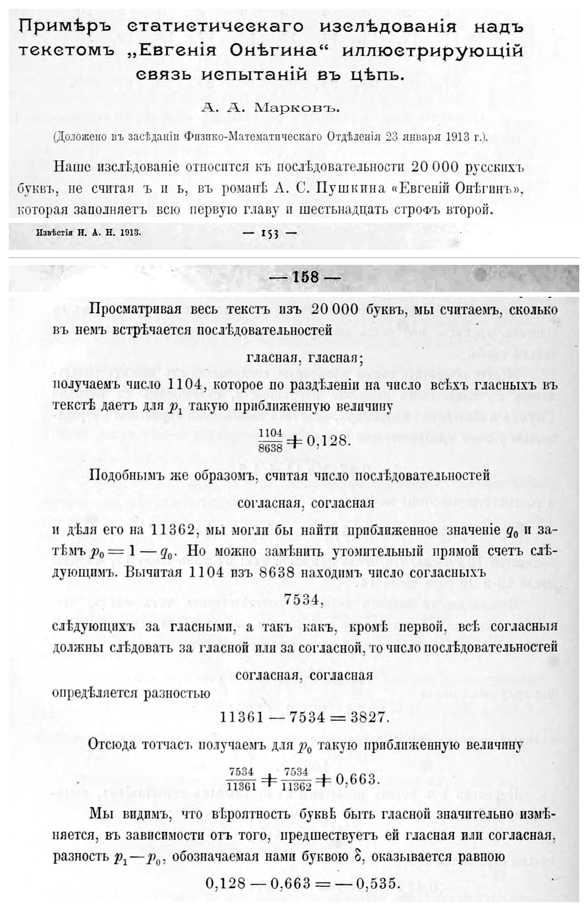
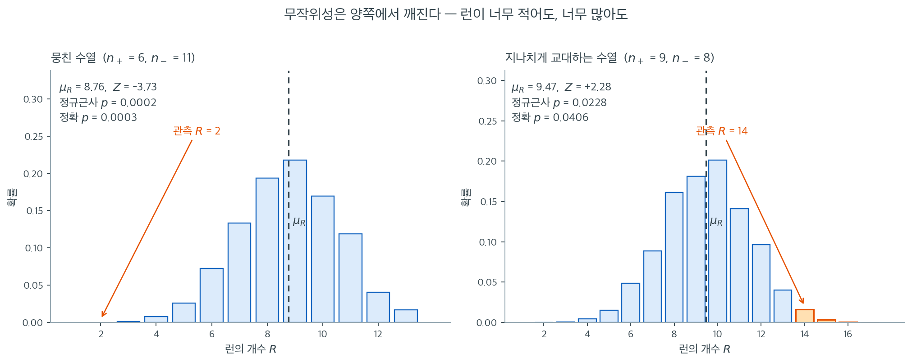
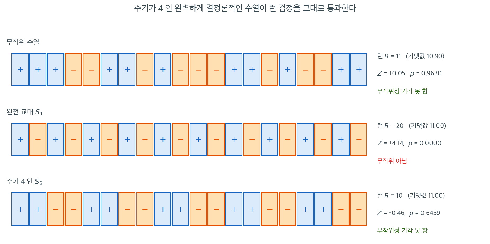

# 무작위성에 대한 런 검정

주식 수익률 $15$ 개의 부호가 $+,+,+,-,-,+,+,-,+,-,-,-,+,+,-$ 로 나왔다. 양수가 $8$ 개, 음수가 $7$ 개로 반반에 가까우니 비율만 보면 아무 할 말이 없다. 그런데 **순서**를 보면 같은 부호가 셋씩 뭉친 자리가 두 번 있다. 이 수열을 무작위라고 말할 수 있는가 — 대부분의 통계적 검정이 깔고 있는 독립성이 바로 여기서 깨진다.

표본이 특정 분포에서 왔는지, 두 집단이 다른지를 검정하기 전에 더 기본적인 성질을 먼저 확인해야 할 때가 많다. 바로 **무작위성**이다. 수열의 관측값이 체계적인 패턴 --- 비슷한 값들의 뭉침이나 지나친 교대 --- 을 보인다면 대부분의 통계적 검정이 깔고 있는 독립성 가정이 깨진 것이다. **Wald-Wolfowitz 런 검정**은 이진 부호화된 수열에서 "런"의 개수를 세어 이런 무작위성 이탈을 탐지한다.

---

## 1. 런의 정의

**런**(run)은 같은 원소가 연달아 이어지는 최대 부분수열이다. 두 종류의 기호(예: $+$와 $-$)로 이루어진 수열에서 같은 기호가 이어지는 각 덩어리가 하나의 런이다. 예를 들어 수열

$$
\underbrace{+ + +}_{\text{런 1}} \; \underbrace{- -}_{\text{런 2}} \; \underbrace{+}_{\text{런 3}} \; \underbrace{- - -}_{\text{런 4}}
$$

에는 $R = 4$개의 런이 있다. 진정으로 무작위인 수열은 런이 너무 적어서도(뭉침을 뜻한다), 너무 많아서도(체계적 교대를 뜻한다) 안 된다.

---

## 2. 가설

$$
H_0 \colon \text{수열의 원소들이 서로 독립이다(순서가 무작위이다)}
$$

$$
H_a \colon \text{수열이 무작위가 아니다}
$$

검정은 보통 양측이다. 뭉침(런이 너무 적음)과 교대(런이 너무 많음) 모두 무작위성으로부터의 이탈로 본다.

<div class="storybox" markdown>

**그림으로 보는 통계학 1.** 시 두 만 자를 손으로 세어 얻은 두 수

<figure markdown>
  { width=720 }
  <figcaption markdown>『Извѣстія Императорской Академіи Наукъ』($1913$, 제$6$ 계열 제$7$ 권)의 $153$ 쪽과 $158$ 쪽 — 마르코프 「시험들이 사슬로 이어져 있음을 보이는, 『예브게니 오네긴』 본문에 대한 통계적 조사의 한 예」. 두 쪽에서 제목·첫 문단·쪽 번호 줄과, 수가 적힌 대목을 잘라 위아래로 붙였다. *(Internet Archive 스캔, PD-old)*</figcaption>
</figure>

위 $H_0$ — 「수열의 원소들이 서로 독립이다」 — 를 실제 자료에서 **처음 깨뜨려 본** 자리다.
글이 읽힌 날은 $1913$ 년 $1$ 월 $23$ 일, 페테르부르크 과학아카데미 물리수학부 회의다. 제목 아래
괄호에 그 날짜가 그대로 적혀 있다.

첫 문단이 설정을 말한다 — 「우리의 조사는 푸시킨의 소설 『예브게니 오네긴』의 러시아
글자 $20\,000$ 자(ъ 와 ь 는 세지 않는다)의 열에 관한 것이며, 그것은 제$1$ 장 전부와 제$2$
장의 열여섯 연을 채운다.」 글자 하나하나를 **모음이면 하나, 자음이면 다른 하나**로 읽으면
$20\,000$ 번의 시행이 된다. 아래 §3 이 관측값을 중앙값으로 갈라 $+$ 와 $-$ 두 기호로
바꾸는 것과 똑같은 부호화다. 그런데 보통의 반복시행과 달리 이 시행들은 서로 **이어져 있다.**

$158$ 쪽이 그 결과다. 모음 뒤에 모음이 오는 자리를 세니 $1104$ 개였고, 글 전체의 모음이
$8638$ 개이므로

$$
p_1=\frac{1104}{8638}\approx 0.128,\qquad
p_0=\frac{7534}{11362}\approx 0.663
$$

이다. 앞 글자가 모음이면 다음이 모음일 확률이 $0.128$, 앞 글자가 자음이면 $0.663$ 이다.
글자를 서로 무관하게 뽑는다면 두 값은 모두 모음의 비율 $8638/20000\approx 0.432$ 여야 하니,
$\delta=p_1-p_0=-0.535$ 라는 차이가 곧 **앞 글자가 다음 글자를 당긴다는 증거**다.

세는 방법이 더 놀랍다. 바로 앞 $154$ 쪽에서 그는 $20\,000$ 자를 $100$ 자씩 $200$ 토막으로
나눈 뒤 각 토막을 열 줄 열 칸의 사각형으로 늘어놓고 칸별로 모음을 세었다고 적는다. 계산기가
없던 시절의 품이다. 그가 이 일을 한 까닭은 문학이 아니었다 — 제목이 말하듯 **시험이 사슬로
이어진 한 예**를 보이려던 것이고, 손에 잡히는 종속 시행의 자료로 시 한 편을 고른 것이다.

그러니 이 쪽의 $H_0$ 가 무엇을 재는지가 저 두 수에 그대로 있다. $\delta$ 가 **음수**라는 것은
모음과 자음이 지나치게 번갈아 나온다는 뜻이고, 런으로 세면 런이 **너무 많은** 쪽의
이탈이다. 마르코프는 런을 세지 않고 전이확률을 세었지만 두 셈이 가리키는 것은 같다.
오늘 기계가 글을 다루는 방식도 뿌리는 같다. 다음에 올 것의 확률을
**바로 앞의 것**에 조건을 걸어 적는다는 틀이 그대로이고, 달라진 것은 앞의 한 글자가 아니라
앞의 수천 토막을 함께 본다는 점뿐이다.

_확인한 곳 — 제목(「Примѣръ статистическаго изслѣдованія надъ текстомъ „Евгенія Онѣгина“
иллюстрирующій связь испытаній въ цѣпь」)과 저자, 보고 날짜(「Доложено въ засѣданіи
Физико-Математическаго Отдѣленія 23 января 1913 г.」), 첫 문단, 쪽 번호 $153$, 그리고 $158$
쪽의 $1104$·$8638$·$7534$·$11362$·$3827$·$0{,}128$·$0{,}663$·$\delta=-0{,}535$ 는
[Internet Archive: izviestiiaimpera671111913impe](https://archive.org/details/izviestiiaimpera671111913impe)
(『Извѣстія』 제$6$ 계열 제$7$ 권 제$1$–$11$ 호, $1913$)의 낱장 n$194$(인쇄 $153$ 쪽)·n$199$(인쇄
$158$ 쪽)에서 **사진으로 직접 읽었다**(러시아어는 옮긴 것이다) · $100$ 자씩 $200$ 토막으로
나누어 열 줄 열 칸에 늘어놓고 셌다는 것은 같은 글 $154$ 쪽(낱장 n$195$)에서 읽었다 ·
$8638/20000\approx0.432$, $1104/8638\approx0.128$, $7534/11362\approx0.663$ 은 **이 쪽에서 직접
계산해 보았다** · 이 글이 마르코프 연쇄가 실제 자료에 쓰인 첫 자리로 꼽힌다는 것은
[Wikipedia 「Andrey Markov」](https://en.wikipedia.org/wiki/Andrey_Markov)_

</div>

---

## 3. 이진 수열 만들기

실제로는 입력자료가 이진 기호가 아니라 연속 관측값인 경우가 많다. 표준적인 방법은 각 관측값을 표본중앙값 $\tilde{x}$와 비교하여 중앙값보다 큰 값을 $+$, 작은 값을 $-$로 부호화하는 것이다. 중앙값과 정확히 같은 관측값은 보통 수열에서 제외한다.

---

## 4. 검정통계량

수열의 길이를 $N$, 한 종류의 원소 개수를 $n_1$, 다른 종류를 $n_2 = N - n_1$이라 하자. 런의 개수 $R$이 검정통계량이다.

**$H_0$ 아래 런 개수의 기댓값:**

$$
\mu_R = \frac{2 \, n_1 \, n_2}{N} + 1
$$

**$H_0$ 아래 런 개수의 분산:**

$$
\sigma_R^2 = \frac{2 \, n_1 \, n_2 \, (2 \, n_1 \, n_2 - N)}{N^2 (N - 1)}
$$

이는 동치로 다음과 같이 쓸 수 있다.

$$
\sigma_R^2 = \frac{(\mu_R - 1)(\mu_R - 2)}{N - 1}
$$

---

## 5. 정규근사

$N$이 크면(보통 $n_1 \ge 10$이고 $n_2 \ge 10$) 표준화된 통계량

$$
Z = \frac{R - \mu_R}{\sigma_R}
$$

은 $H_0$ 아래 근사적으로 표준정규를 따른다. 양측 $p$값은

$$
p = 2 \, \Phi(-|Z|)
$$

이며, 여기서 $\Phi$는 표준정규 누적분포함수이다.

!!! note "소표본에서의 정확분포"
    $N$이 작으면 런 분포표에서 정확 임계값을 얻을 수 있다. 정확 귀무분포는 동등하게 가능한 $\binom{N}{n_1}$가지 배열을 모두 열거하고 각각의 런 개수를 세어 계산한다.

<div class="exbox" markdown>

**보기 1.** <span class="diff easy" title="쉬움"></span> 주식 수익률 부호의 연검정. 양수($+$) 또는 음수($-$)로 분류된 다음 15개 주식 수익률 수열을 보자.

</div>

??? success "풀이"
    $$
    +, +, +, -, -, +, +, -, +, -, -, -, +, +, -
    $$

    **1단계.** 원소를 센다. $n_1 = 8$(양수), $n_2 = 7$(음수), $N = 15$.

    **2단계.** 런을 센다. $+\!+\!+$, $-\!-$, $+\!+$, $-$, $+$, $-\!-\!-$, $+\!+$, $-$이므로 $R = 8$.

    **3단계.** 귀무가설 아래 평균과 표준편차를 계산한다.

    $$
    \mu_R = \frac{2(8)(7)}{15} + 1 = \frac{112}{15} + 1 \approx 8.467
    $$

    $$
    \sigma_R^2 = \frac{(8.467 - 1)(8.467 - 2)}{15 - 1} = \frac{(7.467)(6.467)}{14} \approx 3.449
    $$

    $$
    \sigma_R \approx 1.857
    $$

    **4단계.** $Z$ 통계량을 계산한다.

    $$
    Z = \frac{8 - 8.467}{1.857} \approx -0.251
    $$

    **5단계.** $p$값을 계산한다. $p = 2\,\Phi(-0.251) \approx 0.802$.

    $p = 0.802 \gg 0.05$이므로 $H_0$을 기각하지 못한다. 자료는 무작위 수열과 일관된다.

    ??? example "뭉침 탐지하기"
        같은 15개 관측값이 $+,+,+,+,+,+,+,+,-,-,-,-,-,-,-$로 배열되어 있다면 런은 $R = 2$개뿐이다. $\mu_R \approx 8.467$, $\sigma_R \approx 1.857$이므로 $Z = (2 - 8.467)/1.857 \approx -3.48$이고 $p \approx 0.0005$이다. 수열이 무작위가 아니라는(값들이 뭉쳐 있다는) 강한 증거이다.

### 표준편차를 적는 두 가지 꼴

<div class="exbox" markdown>

**보기 2.** <span class="diff easy" title="쉬움"></span> $\sigma_R$ 의 두 얼굴. 위 식은 런의 표준편차를 $\sigma_R = \sqrt{(\mu_R-1)(\mu_R-2)/(N-1)}$ 로 적는다. 교과서에서 더 자주 보는 꼴은

$$
\operatorname{Var}(R) = \frac{2N_+N_-\,(2N_+N_- - N)}{N^2(N-1)}
$$

이다.

**(1)** 두 식이 같은 것임을 보이시오.

**(2)** $\mu_R$ 과 $\operatorname{Var}(R)$ 은 근사식이 아니라 **등식**이다. 작은 $N$ 에서 전수 열거로 확인하시오.

</div>

??? success "풀이"

    **(1) 대입하면 끝난다.** $\mu_R = \dfrac{2N_+N_-}{N} + 1$ 이므로

    $$
    \mu_R - 1 = \frac{2N_+N_-}{N},
    \qquad
    \mu_R - 2 = \frac{2N_+N_-}{N} - 1 = \frac{2N_+N_- - N}{N}
    $$

    이고, 두 값을 곱해 $N - 1$ 로 나누면

    $$
    \frac{(\mu_R-1)(\mu_R-2)}{N-1}
    = \frac{1}{N-1} \cdot \frac{2N_+N_-}{N} \cdot \frac{2N_+N_- - N}{N}
    = \frac{2N_+N_-\,(2N_+N_- - N)}{N^2(N-1)}
    $$

    가 되어 교과서 꼴과 **글자 하나까지 같다.** $\square$

    구현이 앞의 꼴을 쓰는 까닭은 간단하다. $\mu_R$ 을 이미 계산해 두었으므로 **곱셈 두 번과 나눗셈 한 번으로 끝나고** $N_+N_-$ 를 다시 쓰지 않아도 된다.

    분산이 양수이려면 $2N_+N_- > N$ 이 필요하다. $N_+ = 1$ 이면 $2N_- = 2(N-1) > N$ 이 $N > 2$ 에서 성립하므로 양쪽에 하나씩이라도 있으면 괜찮다. **그러나 $N_+ = 0$ 이나 $N_- = 0$ 이면 분산이 0 이 되어 $Z$ 가 0 으로 나누어진다.** 한 종류만 나온 수열에서는 런이 언제나 1 개이므로 검정할 것이 없다 — 이 구현은 그 자리를 막아 두지 않았다.

    **(2) 전수 열거.** $H_0$ 아래에서 $N_+$ 개의 $+1$ 을 $N$ 자리에 놓는 $\binom{N}{N_+}$ 가지가 모두 같은 확률이다. 각 배치의 $R$ 을 세어 평균과 분산을 내면 공식과 맞아야 한다. $N = 17$, $N_+ = 6$ 이면 $\binom{17}{6} = 12376$ 가지다.

    $$
    \mu_R = \frac{2 \times 6 \times 11}{17} + 1 = \frac{132}{17} + 1 = 8.764706,
    \qquad
    \operatorname{Var}(R) = \frac{(7.764706)(6.764706)}{16} = 3.282872
    $$

    아래 코드가 네 가지 $(N_+, N_-)$ 에서 열거한 값과 공식이 **소수 여섯째 자리까지 같다**는 것을 보인다.

    **수치적으로.**

    ```python
    import numpy as np
    import scipy.stats as stats

    def runs_test(data):
        """Wald-Wolfowitz 런 검정. 관측 순서가 무작위인지 본다.

        +1 과 -1 이 늘어선 수열에서 같은 부호가 이어지는 덩어리를 런이라 한다.
        런이 너무 적으면 같은 값끼리 뭉쳐 있다는 뜻이고, 너무 많으면 번갈아
        나온다는 뜻이다. 둘 다 무작위가 아니다.

        매개변수
        --------
        data : +1 과 -1 로 이루어진 수열

        돌려주는 값
        ----------
        statistic : Z 통계량
        p_value : 양측 p-값
        """
        data = np.asarray(data)
        N = data.shape[0]
        N_plus = (data == 1).sum()
        N_minus = N - N_plus

        # 무작위라면 런의 개수가 이 평균과 표준편차를 갖는다.
        mu = 2 * N_plus * N_minus / N + 1
        sigma = np.sqrt((mu - 1) * (mu - 2) / (N - 1))

        # 런의 개수를 이웃한 원소의 곱으로 센다. 부호가 바뀌는 자리에서만
        # 곱이 -1 이 되므로, 그 개수가 런의 경계 수다. 반복문 없이 끝난다.
        R = (N_plus + N_minus + 1 - np.sum(data[1:] * data[:-1])) / 2

        statistic = (R - mu) / sigma
        p_value = 2 * stats.norm.cdf(-abs(statistic))

        return statistic, p_value
    ```

    ```python
    import itertools

    def count_runs(x):
        x = np.asarray(x)
        return (len(x) + 1 - np.sum(x[1:] * x[:-1])) / 2

    print(" N+  N-   배치수    E[R]열거    mu_R공식     Var열거  (mu-1)(mu-2)/(N-1)  교과서꼴")
    for N_plus, N_minus in ((6, 11), (9, 8), (4, 4), (5, 3)):
        N = N_plus + N_minus
        mu = 2 * N_plus * N_minus / N + 1
        var_a = (mu - 1) * (mu - 2) / (N - 1)
        var_b = 2 * N_plus * N_minus * (2 * N_plus * N_minus - N) / (N ** 2 * (N - 1))
        Rs = []
        for comb in itertools.combinations(range(N), N_plus):
            x = -np.ones(N, int)
            x[list(comb)] = 1
            Rs.append(count_runs(x))
        Rs = np.array(Rs)
        print(f"{N_plus:>3} {N_minus:>3} {len(Rs):>8} "
              f"{Rs.mean():>11.6f} {mu:>11.6f} {Rs.var():>11.6f} "
              f"{var_a:>19.6f} {var_b:>9.6f}")
    ```

    출력:

    ```
     N+  N-   배치수    E[R]열거    mu_R공식     Var열거  (mu-1)(mu-2)/(N-1)  교과서꼴
      6  11    12376    8.764706    8.764706    3.282872            3.282872  3.282872
      9   8    24310    9.470588    9.470588    3.955017            3.955017  3.955017
      4   4       70    5.000000    5.000000    1.714286            1.714286  1.714286
      5   3       56    4.750000    4.750000    1.473214            1.473214  1.473214
    ```

    **네 경우 모두 열거한 평균·분산이 공식과 소수 여섯째 자리까지 같고, 두 분산 꼴도 서로 같다.** 이것이 (1) 의 대수적 증명을 수로 뒷받침한다. 특히 $N_+ = N_- = 4$ 처럼 $N = 8$ 로 아주 작아도 **등식이 그대로 성립한다** — 근사가 끼어드는 곳은 $R$ 의 평균과 분산이 아니라 $Z$ 를 표준정규로 보는 **마지막 단계** 하나뿐이다.

---

### 두 꼬리에서 하나씩

<div class="exbox" markdown>

**보기 3.** <span class="diff easy" title="쉬움"></span> 뭉침과 과잉 교대, 두 꼬리에서 하나씩. 세 수열에 위 `runs_test` 를 돌리면 $Z$ 가 각각 $-3.7335$, $+2.2775$, $+1.3294$ 로 나온다. 첫째는 뭉침이 심한 수열, 둘째는 언뜻 "잘 섞여" 보이는 수열, 셋째는 진짜 독립인 모의 이항자료다.

**(1)** 세 수열의 $N_+$, $N_-$, $R$, $\mu_R$, $\sigma_R$, $Z$ 를 손으로 구해 코드의 값과 맞추시오.

**(2)** 둘째 수열은 왜 기각되는가. 런이 **너무 많다**는 것이 $Z$ 의 부호에서 어떻게 읽히는가.

</div>

??? success "풀이"

    **(1) 세 수열의 손계산.**

    **첫째 수열** $(1^6 0^{11})$ 은 $N = 17$, $N_+ = 6$, $N_- = 11$ 이고 런은 $1$ 의 덩어리와 $0$ 의 덩어리 **둘**뿐이다.

    $$
    \mu_R = \frac{2 \times 6 \times 11}{17} + 1 = \frac{132}{17} + 1 = 8.764706,
    \qquad
    \sigma_R = \sqrt{\frac{7.764706 \times 6.764706}{16}} = 1.811870
    $$

    $$
    Z = \frac{2 - 8.764706}{1.811870} = -3.733550
    $$

    **둘째 수열** $(1,1,0,1,0,1,0,0,1,0,1,0,1,0,1,1,0)$ 은 $1$ 이 **아홉 개**, $0$ 이 여덟 개다. 이웃한 열여섯 쌍 가운데 값이 바뀌는 자리가 열세 개이므로 $R = 13 + 1 = 14$ 다.

    $$
    \mu_R = \frac{2 \times 9 \times 8}{17} + 1 = \frac{144}{17} + 1 = 9.470588,
    \qquad
    \sigma_R = \sqrt{\frac{8.470588 \times 7.470588}{16}} = 1.988723
    $$

    $$
    Z = \frac{14 - 9.470588}{1.988723} = +2.277548
    $$

    **셋째 수열**은 $n = 200$ 의 모의 이항자료로 $1$ 이 80개, $0$ 이 120개이고 $R = 106$ 이다.

    $$
    \mu_R = \frac{2 \times 80 \times 120}{200} + 1 = 96 + 1 = 97,
    \qquad
    \sigma_R = \sqrt{\frac{96 \times 95}{199}} = 6.769723
    $$

    $$
    Z = \frac{106 - 97}{6.769723} = +1.329449
    $$

    세 값이 모두 코드의 $-3.7335$, $+2.2775$, $+1.3294$ 와 맞는다.

    **(2) $Z$ 의 부호가 어느 꼬리인지를 말해 준다.** 런 검정은 양측이지만 **두 꼬리의 뜻이 다르다.**

    | 수열 | $R$ | $\mu_R$ | $Z$ | 읽는 법 |
    |---|---|---|---|---|
    | 뭉침 | 2 | 8.7647 | $-3.73$ | 런이 **너무 적다** — 같은 값이 덩어리를 짓는다(양의 자기상관) |
    | 과잉 교대 | 14 | 9.4706 | $+2.28$ | 런이 **너무 많다** — 지나치게 자주 뒤바뀐다(음의 자기상관) |
    | 이항 | 106 | 97 | $+1.33$ | 기댓값 근처 — 독립성과 일관된다 |

    둘째 수열이 "잘 섞여" 보이는 것은 **같은 값이 세 번 이상 이어지는 곳이 없기** 때문이다. 실제로 이 수열의 가장 긴 런은 길이 2 다. 그러나 $N = 17$ 의 진짜 무작위 수열이라면 런이 평균 $9.47$ 개여야 하고, 14 개는 표준편차의 $2.28$ 배 위다. **눈에 "규칙적으로 보이지 않는 것"과 통계적 무작위성은 다르다.** 아래 연습문제 2 가 이것을 최장 런의 길이로 다시 본다.

    **수치적으로.**

    ```python
    data = np.array([1, 1, 1, 1, 1, 1, 0, 0, 0, 0, 0, 0, 0, 0, 0, 0, 0])
    statistic, p_value = runs_test(data * 2 - 1)  # {0,1} → {-1,+1} 변환
    print(f"{statistic = :.4f}")   # -3.7335
    print(f"{p_value   = :.4f}")   # 0.0002 → 무작위성 기각
    ```

    출력:

    ```
    statistic = -3.7335
    p_value   = 0.0002
    ```

    ```python
    data = np.array([1, 1, 0, 1, 0, 1, 0, 0, 1, 0, 1, 0, 1, 0, 1, 1, 0])
    statistic, p_value = runs_test(data * 2 - 1)
    print(f"{statistic = :.4f}")   # +2.2775
    print(f"{p_value   = :.4f}")   # 0.0228 → 무작위성 기각
    ```

    출력:

    ```
    statistic = 2.2775
    p_value   = 0.0228
    ```

    ```python
    np.random.seed(1)
    data = np.random.binomial(n=1, p=0.4, size=200)
    statistic, p_value = runs_test(data * 2 - 1)
    print(f"{statistic = :.4f}")   # +1.3294
    print(f"{p_value   = :.4f}")   # 0.1837 → 무작위성을 기각하지 못함
    ```

    출력:

    ```
    statistic = 1.3294
    p_value   = 0.1837
    ```

    ```python
    seqs = {
        "뭉침": np.array([1, 1, 1, 1, 1, 1, 0, 0, 0, 0, 0, 0, 0, 0, 0, 0, 0]),
        "과잉 교대": np.array([1, 1, 0, 1, 0, 1, 0, 0, 1, 0, 1, 0, 1, 0, 1, 1, 0]),
    }
    np.random.seed(1)
    seqs["이항 n=200"] = np.random.binomial(n=1, p=0.4, size=200)

    for name, s in seqs.items():
        x = s * 2 - 1
        N = len(x)
        N_plus = int((x == 1).sum())
        N_minus = N - N_plus
        R = (N + 1 - np.sum(x[1:] * x[:-1])) / 2
        mu = 2 * N_plus * N_minus / N + 1
        sigma = np.sqrt((mu - 1) * (mu - 2) / (N - 1))
        z, p = runs_test(x)
        print(f"{name}: N+={N_plus:>3} N-={N_minus:>3} R={R:>5.0f} "
              f"mu={mu:>9.6f} sigma={sigma:>8.6f} "
              f"z={(R - mu) / sigma:>9.6f}  (runs_test: {z:>9.6f}, p={p:.4f})")
        # 가장 긴 런
        best = cur = 1
        for i in range(1, N):
            cur = cur + 1 if s[i] == s[i - 1] else 1
            best = max(best, cur)
        print(f"  가장 긴 런의 길이 {best}")
    ```

    출력:

    ```
    뭉침: N+=  6 N-= 11 R=    2 mu= 8.764706 sigma=1.811870 z=-3.733550  (runs_test: -3.733550, p=0.0002)
      가장 긴 런의 길이 11
    과잉 교대: N+=  9 N-=  8 R=   14 mu= 9.470588 sigma=1.988723 z= 2.277548  (runs_test:  2.277548, p=0.0228)
      가장 긴 런의 길이 2
    이항 n=200: N+= 80 N-=120 R=  106 mu=97.000000 sigma=6.769723 z= 1.329449  (runs_test:  1.329449, p=0.1837)
      가장 긴 런의 길이 9
    ```

    **손계산 세 개가 모두 `runs_test` 와 소수 여섯째 자리까지 같다.** 가장 긴 런의 길이를 함께 찍어 보면 세 수열의 성격이 한눈에 갈린다 — 뭉친 수열은 11, 과잉 교대는 2, 진짜 무작위는 9 이다.

!!! warning "'잘 섞인' 것처럼 보인다고 무작위인 것은 아니다"
    이 수열은 언뜻 잘 섞여 보이지만 런이 $14$개로, 기댓값 $9.47$보다 **너무 많다**. 사람이 무작위 수열을 흉내 낼 때 전형적으로 저지르는 실수가 바로 이것이다. 같은 값이 연달아 나오는 것을 피하려다 실제 무작위 수열보다 훨씬 자주 교대하게 된다. 런 검정은 뭉침만이 아니라 이 과잉 교대도 잡아낸다.

**셋째 수열 --- 모의 이항자료.**

```python
np.random.seed(1)
data = np.random.binomial(n=1, p=0.4, size=200)
statistic, p_value = runs_test(data * 2 - 1)
print(f"{statistic = :.4f}")   # +1.3294
print(f"{p_value   = :.4f}")   # 0.1837 → 무작위성을 기각하지 못함
```

출력:

```
statistic = 1.3294
p_value   = 0.1837
```

이 자료는 진짜로 독립이므로 기각하지 않는 것이 옳다.

---

### 귀무분포를 통째로 그려 보기

<figure markdown>
  { width="900" }
  <figcaption markdown>런 개수의 정확 귀무분포와 양쪽 꼬리. 근사가 아니라 가능한 배열을 **전부 열거해서** 얻은 분포다.</figcaption>
</figure>

$\mu_R$과 $\sigma_R$ 공식만 보면 무엇을 재는지 감이 잘 오지 않는다. 그럴 때는 귀무분포를 통째로 그려 보는 편이 빠르다. 위 그림의 두 막대그림은 근사가 아니라 **가능한 배열을 전부 열거해서** 얻은 정확분포이다. 왼쪽은 $+$가 $6$개, $-$가 $11$개인 $\binom{17}{6} = 12{,}376$가지 배열, 오른쪽은 $+$가 $9$개, $-$가 $8$개인 $\binom{17}{9} = 24{,}310$가지 배열을 모두 세었다.

왼쪽은 보기 $3$ 의 첫째 수열, 곧 뭉친 수열 $111111\,00000000000$이다. 런이 $2$개뿐인데 분포의 중심 $\mu_R = 8.76$에서 한참 왼쪽이라 $Z = -3.73$, 정확 $p = 0.0003$으로 압도적으로 기각된다. 막대그림에서 $R = 2$ 자리의 막대가 눈에 보이지도 않을 만큼 낮다는 것이 그대로 $p$값이다.

오른쪽이 더 배울 점이 많다. 이 수열은 언뜻 잘 섞여 보이지만 런이 $14$개로 $\mu_R = 9.47$보다 **너무 많다.** $Z = +2.28$, 정규근사 $p = 0.0228$이다. 사람이 무작위를 흉내 낼 때 같은 값이 연달아 나오는 것을 피하려다 실제 무작위보다 훨씬 자주 교대하게 되는데, 런 검정은 바로 이 과잉 교대를 잡는다. **무작위성은 양쪽에서 깨질 수 있다**는 것이 두 그림의 공통 교훈이다.

---

## 6. 세 수열에서 런의 수가 어떻게 갈리는가

| 결과 | 의미 |
|:--------|:--------|
| 런이 너무 적음 ($R \ll \mu_R$) | 관측값이 뭉쳐 있다 --- 양의 자기상관 |
| 런이 너무 많음 ($R \gg \mu_R$) | 관측값이 지나치게 교대한다 --- 음의 자기상관 |
| $R \approx \mu_R$ | 무작위성에 반하는 증거가 없다 |



해석표를 외우기 전에 이 검정이 **무엇을 못 보는지**를 먼저 알아 두는 편이 낫다. 세 수열 모두 길이 $20$이고 $+$와 $-$의 개수가 거의 같아 기댓값 $\mu_R$이 $11$ 근처이다.

첫째 줄은 진짜 무작위 수열이다. 런이 $11$개로 기댓값 $10.90$에 거의 정확히 맞아 $p = 0.9630$이다. 둘째 줄 $S_1$은 $+$와 $-$가 끝까지 번갈아 나오는 수열인데, 런이 가능한 최댓값 $20$까지 올라가 $Z = +4.14$, $p = 0.0000$으로 압도적으로 기각된다. **뭉침만이 아니라 지나친 교대도 무작위성 위반**이라는 점을 여기서 확인할 수 있다.

문제는 셋째 줄이다. $S_2$는 $+\,+\,-\,-$가 다섯 번 반복되는, **다음 값을 100% 맞힐 수 있는 완벽하게 결정론적인 수열**이다. 그런데 런이 $10$개로 기댓값 $11$에 붙어 있어 $Z = -0.46$, $p = 0.6459$가 나온다. 런 검정은 무작위성을 전혀 의심하지 않는다.

이유는 런의 개수가 오직 **이웃한 두 원소가 같은지 다른지**만 세기 때문이다. $S_2$에서 이웃이 같은 자리와 다른 자리의 비율은 각각 절반으로 무작위 수열과 구별되지 않는다. 즉 런 검정은 **지연 $1$의 자기상관에만** 민감하고, 주기가 $2$ 이상인 구조는 통계량에 흔적을 남기지 않는다. 회귀 잔차나 수익률 계열을 진단할 때 런 검정이 통과했다고 독립성을 확보한 것으로 읽으면 안 되는 이유가 이것이며, 자기상관함수 전체나 주기도를 함께 봐야 한다.

---

## 7. 응용

- **임의보행 가설.** 각 수익률을 0 위/아래(또는 중앙값 위/아래)로 부호화하여 연속된 주식 수익률이 독립인지 검정한다.
- **품질관리.** 생산라인의 불량이 무작위로 발생하는지 뭉쳐서 발생하는지 확인한다.
- **잔차 진단.** 회귀모형을 적합한 뒤 양·음 잔차 수열에 런 검정을 적용하여 독립성 가정을 확인한다.

---

<div class="exbox" markdown>

**보기 4.** <span class="diff easy" title="쉬움"></span> $\{0,1\}$ 을 그대로 넣으면 런이 반 개가 나온다. 아래 함수는 $R$ 을 이웃한 원소의 곱으로 센다. 그 수법은 자료가 **정확히 $\pm 1$** 일 때만 통한다.

**(1)** $\{0,1\}$ 로 부호화한 자료를 변환 없이 그대로 넣으면 무엇이 어떻게 틀어지는가. 두 수열로 확인하시오.

**(2)** 이 함수는 정규근사만 준다. 위에서 말한 두 수열의 **정확** p-값 $0.0003$ 과 $0.0406$ 을 전수 열거로 확인하고, 그 값이 어느 관례의 p-값인지 밝히시오.

</div>

??? success "풀이"

    **(1) $\mu_R$ 과 $\sigma_R$ 은 멀쩡하고 $R$ 만 틀어진다.** 함수 안에서 $N_+$ 는 `(data == 1).sum()` 으로 세므로 $\{0,1\}$ 부호화에서도 $1$ 의 개수가 제대로 나온다. $N_-$, $\mu_R$, $\sigma_R$ 모두 옳다. 문제는 마지막 줄이다.

    $$
    x_i x_{i+1} =
    \begin{cases}
    +1 & x_i = x_{i+1} \\
    -1 & x_i \ne x_{i+1}
    \end{cases}
    \qquad (x_i \in \{-1, +1\})
    $$

    이 관계가 $R$ 공식의 근거인데, $x_i \in \{0, 1\}$ 이면 곱이

    $$
    x_i x_{i+1} =
    \begin{cases}
    1 & x_i = x_{i+1} = 1 \\
    0 & \text{그 밖}
    \end{cases}
    $$

    이 되어 **"$1$ 이 두 번 이어진 자리의 개수"** 를 셀 뿐이다. 부호가 바뀌는 자리와 아무 관계가 없다.

    교대 수열 $(1,1,0,1,0,1,0,0,1,0,1,0,1,0,1,1,0)$ 에서 $1$ 이 이어지는 자리는 맨 앞 $(1,1)$ 과 끝의 $(1,1)$ 둘뿐이므로 $\sum x_ix_{i+1} = 2$ 이고

    $$
    R_{\text{잘못}} = \frac{17 + 1 - 2}{2} = 8
    \quad (\text{참값은 } 14)
    $$

    이 된다. $Z$ 가 $+2.2775$ 에서 $-0.7395$ 로 바뀌고 p-값은 $0.0228$ 에서 $0.4596$ 으로 뛴다. **기각에서 기각 못 함으로 결론이 뒤집힌다.**

    뭉친 수열 $(1^6 0^{11})$ 은 더 노골적이다. $1$ 이 여섯 개 이어졌으므로 이어진 자리가 다섯이고

    $$
    R_{\text{잘못}} = \frac{17 + 1 - 5}{2} = 6.5
    $$

    **런의 개수가 $6.5$ 개로 나온다.** 런은 정수여야 하므로 이 하나만으로도 부호화가 틀렸다는 것을 알 수 있다. 쓸 때마다 `data * 2 - 1` 을 잊지 말아야 하고, 더 나은 설계는 함수 안에서 입력이 $\pm 1$ 인지 확인하는 것이다.

    **(2) 정확 귀무분포는 열거로 얻는다.** $H_0$ 아래에서 $\binom{N}{N_+}$ 가지 배치가 모두 같은 확률이므로, 그 전부의 $R$ 을 세면 정확분포가 나온다. $N_+ = 6$ 이면 $12376$ 가지, $N_+ = 9$ 이면 $24310$ 가지다. 아래 연습문제 14 의 조합식과 열거가 완전히 일치한다.

    정확 양측 p-값에는 **관례가 둘** 있다.

    - **편차 기준** — $\lvert r - \mu_R \rvert \geq \lvert R_{\text{obs}} - \mu_R \rvert$ 인 모든 $r$ 을 모은다.
    - **작은 꼬리의 두 배** — 한쪽 꼬리 확률을 구해 2를 곱한다.

    $R$ 의 귀무분포는 **대칭이 아니므로** 두 관례가 다른 값을 준다.

    | 수열 | $R$ | $\mu_R$ | 정규근사 | 편차 기준 | 작은 꼬리 $\times 2$ |
    |---|---|---|---|---|---|
    | 뭉침 ($N_+=6$) | 2 | 8.7647 | 0.000189 | $2/12376 = 0.000162$ | 0.000323 |
    | 과잉 교대 ($N_+=9$) | 14 | 9.4706 | 0.022753 | $622/24310 = 0.025586$ | 0.040559 |

    **위에서 말한 $0.0003$ 과 $0.0406$ 은 "작은 꼬리의 두 배" 관례의 값이다.** 그러므로 "정확 $p$ 값이 정규근사의 거의 두 배" 라는 비교는 **관례의 차이와 근사의 오차가 섞인 것**이다. 같은 관례로 견주면 편차 기준 $0.025586$ 대 정규근사 $0.022753$ 으로 12% 차이에 그친다. 두 배로 벌어진 몫의 대부분은 **비대칭 분포에서 작은 꼬리를 두 배 한 데서** 왔다.

    **수치적으로.**

    ```python
    import numpy as np
    import scipy.stats as stats


    def runs_test(data):
        """+1/-1 수열에 대한 Wald-Wolfowitz 런 검정.

        같은 부호가 이어지는 덩어리를 런이라 한다. 런이 너무 적으면 뭉쳐
        있다는 뜻이고 너무 많으면 번갈아 난다는 뜻이며, 둘 다 무작위가 아니다.
        """
        data = np.asarray(data)
        N = data.shape[0]
        N_plus = (data == 1).sum()
        N_minus = N - N_plus

        # 무작위라는 가정 아래에서 런 개수의 평균과 표준편차
        mu = 2 * N_plus * N_minus / N + 1
        sigma = np.sqrt((mu - 1) * (mu - 2) / (N - 1))
        # 이웃한 원소의 곱은 부호가 바뀌는 자리에서만 -1 이다. 그 개수를 세면
        # 런의 경계 수가 나온다.
        R = (N_plus + N_minus + 1 - np.sum(data[1:] * data[:-1])) / 2

        statistic = (R - mu) / sigma
        p_value = 2 * stats.norm.cdf(-abs(statistic))
        return statistic, p_value
    ```

    ```python
    def runs_detail(data):
        """R 과 중간값을 모두 돌려주어 추적할 수 있게 한다."""
        data = np.asarray(data)
        N = data.shape[0]
        N_plus = int((data == 1).sum())
        N_minus = N - N_plus
        mu = 2 * N_plus * N_minus / N + 1
        sigma = np.sqrt((mu - 1) * (mu - 2) / (N - 1))
        prod = int(np.sum(data[1:] * data[:-1]))
        R = (N + 1 - prod) / 2
        z = (R - mu) / sigma
        return N_plus, N_minus, prod, R, mu, sigma, z, 2 * stats.norm.cdf(-abs(z))

    seqs = {
        "뭉침": np.array([1, 1, 1, 1, 1, 1, 0, 0, 0, 0, 0, 0, 0, 0, 0, 0, 0]),
        "과잉 교대": np.array([1, 1, 0, 1, 0, 1, 0, 0, 1, 0, 1, 0, 1, 0, 1, 1, 0]),
    }
    for name, s in seqs.items():
        for tag, x in (("±1 로 변환", s * 2 - 1), ("{0,1} 그대로", s)):
            Np, Nm, prod, R, mu, sigma, z, p = runs_detail(x)
            print(f"{name} / {tag}: N+={Np} N-={Nm} sum(x_i x_(i+1))={prod:>3} "
                  f"R={R:>5} mu={mu:.4f} z={z:>9.4f} p={p:.4f}")
    ```

    출력:

    ```
    뭉침 / ±1 로 변환: N+=6 N-=11 sum(x_i x_(i+1))= 14 R=  2.0 mu=8.7647 z=  -3.7335 p=0.0002
    뭉침 / {0,1} 그대로: N+=6 N-=11 sum(x_i x_(i+1))=  5 R=  6.5 mu=8.7647 z=  -1.2499 p=0.2113
    과잉 교대 / ±1 로 변환: N+=9 N-=8 sum(x_i x_(i+1))=-10 R= 14.0 mu=9.4706 z=   2.2775 p=0.0228
    과잉 교대 / {0,1} 그대로: N+=9 N-=8 sum(x_i x_(i+1))=  2 R=  8.0 mu=9.4706 z=  -0.7395 p=0.4596
    ```

    ```python
    import itertools
    from collections import Counter
    from math import comb

    def exact_runs_pmf(N_plus, N_minus):
        """가능한 모든 배치를 열거해 R 의 정확 귀무분포를 얻는다."""
        N = N_plus + N_minus
        tally = Counter()
        for cb in itertools.combinations(range(N), N_plus):
            x = -np.ones(N, int)
            x[list(cb)] = 1
            tally[int((N + 1 - np.sum(x[1:] * x[:-1])) // 2)] += 1
        return tally, comb(N, N_plus)

    for name, N_plus, N_minus, R_obs in (("뭉침", 6, 11, 2), ("과잉 교대", 9, 8, 14)):
        N = N_plus + N_minus
        mu = 2 * N_plus * N_minus / N + 1
        sigma = np.sqrt((mu - 1) * (mu - 2) / (N - 1))
        tally, total = exact_runs_pmf(N_plus, N_minus)
        dev = abs(R_obs - mu)
        hit = sum(c for r, c in tally.items() if abs(r - mu) >= dev - 1e-12)
        lower = sum(c for r, c in tally.items() if r <= R_obs)
        upper = sum(c for r, c in tally.items() if r >= R_obs)
        p_two = min(1.0, 2 * min(lower, upper) / total)
        print(f"{name}: N+={N_plus} N-={N_minus}  배치 {total} 가지,  "
              f"R 의 범위 {min(tally)} ~ {max(tally)}")
        print(f"   정규근사      p = {2 * stats.norm.cdf(-abs((R_obs - mu) / sigma)):.6f}")
        print(f"   편차 기준     p = {hit}/{total} = {hit / total:.6f}")
        print(f"   작은 꼬리 x2  p = {p_two:.6f}")
    ```

    출력:

    ```
    뭉침: N+=6 N-=11  배치 12376 가지,  R 의 범위 2 ~ 13
       정규근사      p = 0.000189
       편차 기준     p = 2/12376 = 0.000162
       작은 꼬리 x2  p = 0.000323
    과잉 교대: N+=9 N-=8  배치 24310 가지,  R 의 범위 2 ~ 17
       정규근사      p = 0.022753
       편차 기준     p = 622/24310 = 0.025586
       작은 꼬리 x2  p = 0.040559
    ```

    **$\{0,1\}$ 을 그대로 넣으면 뭉친 수열에서 $R = 6.5$ 가 나온다** — 손으로 따진 그대로다. 두 수열 모두 결론이 뒤집히고, 교대 수열에서는 $Z$ 의 **부호까지** 바뀐다.

    정확 p-값도 손으로 세운 표와 맞는다. 특히 뭉친 수열의 편차 기준 p-값이 $2/12376$ 이라는 것은 뜻이 분명하다 — 12376 가지 배치 가운데 $R = 2$ 를 주는 것이 **단 두 가지**뿐이고 그보다 치우친 배치는 아예 없다는 것이다. 아래 보기 5 가 그 두 가지가 무엇인지 따진다.

<div class="exbox" markdown>

**보기 5.** <span class="diff easy" title="쉬움"></span> 가장 뭉친 수열은 12376 가지 가운데 둘뿐이다. 뭉친 수열 $(1,1,1,1,1,1,0,0,\dots,0)$ 은 $N_+ = 6$, $N_- = 11$ 이고 런이 두 개다.

**(1)** $R$, $\mu_R$, $\sigma_R$, $Z$ 를 손으로 구해 $p = 0.0002$ 를 확인하시오.

**(2)** $N_+ = 6$, $N_- = 11$ 에서 $R$ 이 가질 수 있는 **최솟값과 최댓값**은 무엇인가. $R = 2$ 를 주는 배치가 몇 개인지 세시오.

</div>

??? success "풀이"

    **(1) 손계산.** $N = 17$ 이고 수열은 $1$ 의 덩어리 하나와 $0$ 의 덩어리 하나로 **런이 둘**이다.

    $$
    \mu_R = \frac{2 \times 6 \times 11}{17} + 1 = \frac{132}{17} + 1 = 8.764706
    $$

    $$
    \sigma_R = \sqrt{\frac{(8.764706 - 1)(8.764706 - 2)}{16}}
             = \sqrt{\frac{7.764706 \times 6.764706}{16}}
             = \sqrt{3.282872} = 1.811870
    $$

    $$
    Z = \frac{2 - 8.764706}{1.811870} = -3.733550
    \implies p = 2\Phi(-3.733550) = 0.000189
    $$

    로 코드의 $0.0002$ 와 맞는다. $\pm 1$ 로 바꾼 수열에서 열여섯 개의 이웃 쌍 가운데 열다섯이 같은 값이고 하나만 바뀌므로 $\sum x_ix_{i+1} = 15 - 1 = 14$ 이고 $R = (17+1-14)/2 = 2$ 인 것도 확인된다.

    **(2) 범위는 2 부터 13 까지다.**

    **최솟값.** 런이 하나뿐일 수는 없다 — 두 기호가 모두 있으니 적어도 한 번은 바뀐다. 런이 둘이면 각 기호가 **통째로 한 덩어리**여야 하므로 $(+^6 -^{11})$ 과 $(-^{11} +^6)$ **두 가지**뿐이다. 열거한 결과의 $R = 2$ 칸이 정확히 2 인 것이 이것이다.

    **최댓값.** 런은 $+$ 덩어리와 $-$ 덩어리가 번갈아 놓인 것이므로, $+$ 덩어리가 $a$ 개, $-$ 덩어리가 $b$ 개면 $\lvert a - b \rvert \leq 1$ 이어야 한다. $a \leq N_+ = 6$, $b \leq N_- = 11$ 이므로 $a$ 는 6 을 넘을 수 없고, 그때 $b$ 는 최대 $a + 1 = 7$ 이다. 따라서

    $$
    R_{\max} = 2\min(N_+, N_-) + 1 = 2 \times 6 + 1 = 13
    $$

    이고, 그 배치는 $+$ 를 여섯 덩어리로(곧 하나씩) 떼어 놓고 그 사이사이에 $-$ 를 끼운 모양이다. 열거해 보면 $R = 13$ 인 배치가 210 가지다.

    $$
    \binom{N_- - 1}{\,6 - 1\,} = \binom{10}{5} = 252 ?
    $$

    가 아니라 $210$ 인 까닭은 $-$ 열한 개를 **일곱 덩어리**로 나누어야 하기 때문이다. $\binom{10}{6} = 210$ 이 그 수다(열한 개 사이의 열 군데 틈 가운데 여섯 곳을 골라 자른다).

    **$R = 2$ 가 두 가지뿐이라는 사실이 이 수열의 p-값을 그대로 정한다.** 12376 가지 배치 가운데 "이만큼 또는 더 뭉친" 것이 둘이므로 편차 기준 정확 양측 p-값이 $2/12376 = 0.000162$ 다. 정규근사의 $0.000189$ 는 이보다 17% 크다 — **이 꼬리에서는 근사가 보수적인 쪽으로 조금 빗나간다.**

    **수치적으로.**

    ```python
    data = np.array([1, 1, 1, 1, 1, 1, 0, 0, 0, 0, 0, 0, 0, 0, 0, 0, 0])
    z, p = runs_test(data * 2 - 1)
    print(f"z = {z:.4f}, p = {p:.4f}")
    # R = 2, mu = 8.76, sigma = 1.81
    # z = -3.7335, p = 0.0002 → 무작위성 기각
    ```

    출력:

    ```
    z = -3.7335, p = 0.0002
    ```

    ```python
    tally, total = exact_runs_pmf(6, 11)
    print(f"배치 {total} 가지,  R 의 범위 {min(tally)} ~ {max(tally)}"
          f"  (2*min(N+,N-)+1 = {2 * min(6, 11) + 1})")
    print("R :", [r for r in sorted(tally)])
    print("개수:", [tally[r] for r in sorted(tally)])
    print(f"R = 2 인 배치 {tally[2]} 가지  ->  (+^6 -^11) 과 (-^11 +^6)")
    print(f"R = 13 인 배치 {tally[13]} 가지  (C(10, 6) = {comb(10, 6)})")
    print(f"합계 {sum(tally.values())} = {total}")
    print(f"\n편차 기준 정확 p = {tally[2]}/{total} = {tally[2] / total:.6f}")
    print(f"정규근사       p = 0.000189,  비 = {0.000189 / (tally[2] / total):.2f} 배")
    ```

    출력:

    ```
    배치 12376 가지,  R 의 범위 2 ~ 13  (2*min(N+,N-)+1 = 13)
    R : [2, 3, 4, 5, 6, 7, 8, 9, 10, 11, 12, 13]
    개수: [2, 15, 100, 325, 900, 1650, 2400, 2700, 2100, 1470, 504, 210]
    R = 2 인 배치 2 가지  ->  (+^6 -^11) 과 (-^11 +^6)
    R = 13 인 배치 210 가지  (C(10, 6) = 210)
    합계 12376 = 12376
    
    편차 기준 정확 p = 2/12376 = 0.000162
    정규근사       p = 0.000189,  비 = 1.17 배
    ```

    **$R$ 의 범위가 $2 \sim 13$ 이고 양 끝의 배치 수가 각각 2 와 210 으로 손계산과 맞는다.** 개수의 합이 $12376$ 으로 떨어지는 것이 열거가 빠짐없다는 검산이다. 분포의 봉우리는 $R = 9$ 에 있고($2700$ 가지) $\mu_R = 8.76$ 과 가깝다.

    눈여겨볼 것은 **분포가 대칭이 아니라는 점**이다. 왼쪽 꼬리는 $R = 2$ 까지 $6.76$ 칸 뻗지만 오른쪽은 $R = 13$ 까지 $4.24$ 칸밖에 못 간다. $N_+ \ne N_-$ 이기 때문이다. 정규근사는 이 비대칭을 전혀 모른다 — 양쪽 꼬리를 같은 모양으로 재는 것이 근사의 가장 큰 한계다.

<div class="exbox" markdown>

**보기 6.** <span class="diff easy" title="쉬움"></span> 지나치게 교대하는 수열. 빈번한 교대 역시 무작위성으로부터의 이탈이다.

</div>

??? success "풀이"
    ```python
    data = np.array([1, 1, 0, 1, 0, 1, 0, 0, 1, 0, 1, 0, 1, 0, 1, 1, 0])
    z, p = runs_test(data * 2 - 1)
    # R = 14, mu = 9.47, sigma = 1.99
    # z = +2.2775, p = 0.0228 → 무작위성 기각
    ```

!!! warning "'잘 섞여 보임'은 무작위성의 증거가 아니다"
    두 번째 수열은 언뜻 잘 섞인 듯 보이지만 $17$개 원소에서 런이 $14$개로, 기댓값 $9.47$을
    크게 넘는다. 최장 런의 길이가 $2$에 불과한데, 무작위 수열이라면 길이 $17$에서 평균
    $4.4$ 정도의 런이 나타나야 한다.

    사람이 무작위를 흉내 낼 때 같은 값이 이어지는 것을 피하려다 정확히 이런 패턴을 만든다.
    런 검정은 뭉침과 과잉 교대를 **양쪽 모두** 잡아낸다.

---

## 8. 런이 너무 적어도 너무 많아도 걸린다

| 결과 | 의미 |
|---|---|
| $Z \ll 0$ (런이 적음) | 관측값이 **뭉쳐** 있다 --- 연속된 값이 같은 경향이 있다. |
| $Z \gg 0$ (런이 많음) | 관측값이 우연보다 자주 **교대**한다. |
| $\lvert Z \rvert$가 작음 | 선택한 유의수준에서 무작위성에 반하는 증거가 없다. |

이 검정은 기본적으로 양측이다. 런이 비정상적으로 적은 경우와 많은 경우 모두 독립성에
반하는 증거이다.

---

## 연습문제

<div class="drillbox" markdown>

**연습문제 1.** <span class="diff easy" title="쉬움"></span>
동전을 20번 던져 다음 수열을 얻었다.

$$
H, H, T, T, T, H, H, H, H, T, T, H, T, H, H, T, T, T, H, H
$$

**(a)** 이 수열의 런 개수 $R$을 세라.

**(b)** $n_H = 11$, $n_T = 9$일 때 무작위성 귀무가설 아래 런 개수의 기댓값

$$
E[R] = \frac{2 n_H n_T}{n_H + n_T} + 1
$$

과 분산

$$
\text{Var}(R) = \frac{2 n_H n_T (2 n_H n_T - n_H - n_T)}{(n_H + n_T)^2 (n_H + n_T - 1)}
$$

을 계산하라.

**(c)** $z$ 통계량을 계산하고 $\alpha = 0.05$에서 양측검정을 수행하라.

</div>

??? success "풀이"

    **(a)** 런(같은 원소가 이어지는 최대 덩어리)을 찾으면

    - 런 1: HH
    - 런 2: TTT
    - 런 3: HHHH
    - 런 4: TT
    - 런 5: H
    - 런 6: T
    - 런 7: HH
    - 런 8: TTT
    - 런 9: HH

    런의 개수는 $R = 9$이다.

    **(b)** $n_H = 11$, $n_T = 9$이므로

    $$
    E[R] = \frac{2(11)(9)}{20} + 1 = \frac{198}{20} + 1 = 9.9 + 1 = 10.9
    $$

    $$
    \text{Var}(R) = \frac{2(11)(9)(2 \times 11 \times 9 - 11 - 9)}{20^2 \times 19} = \frac{198(198 - 20)}{400 \times 19} = \frac{198 \times 178}{7600} = \frac{35244}{7600} \approx 4.637
    $$

    **(c)**

    $$
    z = \frac{R - E[R]}{\sqrt{\text{Var}(R)}} = \frac{9 - 10.9}{\sqrt{4.637}} = \frac{-1.9}{2.153} \approx -0.882
    $$

    양측 $p$값은

    $$
    p = 2 \times P(Z \le -0.882) = 2 \times \Phi(-0.882) \approx 2 \times 0.189 = 0.378
    $$

    $p = 0.378 \gg 0.05$이므로 $H_0$을 기각하지 못한다. 이 수열은 비무작위성의 통계적으로 유의한 증거를 보이지 않는다. 관측된 런 개수 $9$가 기댓값 $10.9$에 가까워 무작위 수열과 일관된다.

<div class="drillbox" markdown>

**연습문제 2.** <span class="diff med" title="중간"></span>
런 검정은 무작위성으로부터의 어떤 이탈을 탐지하지 **못하는가**? 다음 두 수열을 보라.

$$
S_1 = +,-,+,-,+,-,+,-,+,-,+,-,+,-,+,-,+,-,+,- \\
S_2 = +,+,-,-,+,+,-,-,+,+,-,-,+,+,-,-,+,+,-,-
$$

각각에 런 검정을 적용하고, 두 수열 모두 명백히 무작위가 아님에도 결과가 어떻게 다른지 설명하라.

</div>

??? success "풀이"
    두 수열 모두 $n_1 = n_2 = 10$, $N = 20$이므로

    $$
    \mu_R = \frac{2(10)(10)}{20} + 1 = 11, \qquad
    \sigma_R^2 = \frac{(11-1)(11-2)}{19} = \frac{90}{19} \approx 4.737, \quad \sigma_R \approx 2.176
    $$

    | 수열 | $R$ | $Z$ | $p$ |
    |:---|---:|---:|---:|
    | $S_1$ (완전 교대) | 20 | $+4.14$ | $0.0000355$ |
    | $S_2$ (주기 4) | 10 | $-0.46$ | $0.646$ |

    ```python
    import numpy as np
    from scipy import stats

    def runs_z(s):
        s = np.asarray(s); N = len(s)
        R = 1 + np.sum(s[1:] != s[:-1])
        n1 = s.sum(); n2 = N - n1
        mu = 2 * n1 * n2 / N + 1
        sd = np.sqrt((mu - 1) * (mu - 2) / (N - 1))
        z = (R - mu) / sd
        return R, z, 2 * stats.norm.sf(abs(z))

    print(runs_z([1, 0] * 10))       # (20, 4.135, 3.55e-05)
    print(runs_z([1, 1, 0, 0] * 5))  # (10, -0.459, 0.646)
    ```

    출력:

    ```
    (20, 4.135214625627066, 3.546230491468838e-05)
    (10, -0.45946829173634074, 0.6458979170265631)
    ```

    $S_1$은 잡아낸다. 완전한 교대는 런을 최대치인 $20$까지 밀어 올려 $Z = +4.14$가 된다.

    $S_2$는 **전혀 잡아내지 못한다**. 주기가 4인 완벽하게 결정론적인 수열인데도 $p = 0.646$으로 무작위성과 완전히 일관되어 보인다. 런이 정확히 10개인데 이는 기댓값 11에 거의 딱 맞기 때문이다.

    교훈: 런 검정은 **지연 1의 자기상관에만** 민감하다. 뭉침(지연 1 양의 상관)과 교대(지연 1 음의 상관)를 본다. 더 긴 주기의 구조는 런 개수를 정상 범위에 남겨 두므로 보이지 않는다. 주기적 패턴을 찾으려면 자기상관함수 전체나 주기도(periodogram)를 봐야 한다.

<div class="drillbox" markdown>

**연습문제 3.** <span class="diff med" title="중간"></span>
연속자료에 런 검정을 적용할 때 중앙값을 기준으로 부호화하면 $n_1$과 $n_2$가 거의 같아진다. 이것이 검정에 어떤 영향을 주는가? 중앙값 대신 평균을 쓰면 무엇이 달라지는가?

</div>

??? success "풀이"
    $n_1 + n_2 = N$을 고정하고 $\mu_R = 2n_1n_2/N + 1$을 보면, $n_1 n_2$는 $n_1 = n_2 = N/2$에서 최대가 된다. 즉 중앙값 부호화는 **런 개수의 기댓값을 최대로** 만든다($\mu_R \approx N/2 + 1$).

    이것이 좋은 이유는 검정의 해상도 때문이다. $\mu_R$이 크면 관측된 $R$이 위아래 양쪽으로 움직일 여지가 넓어져 뭉침과 교대를 모두 탐지할 수 있다. 극단적으로 $n_1 = 1$이면 $\mu_R = 2(N-1)/N + 1 \approx 3$이고 $R$이 가질 수 있는 값은 $2$ 또는 $3$뿐이라 검정이 사실상 무력해진다.

    **평균을 쓰면** 자료가 치우쳤을 때 $n_1$과 $n_2$가 크게 불균형해진다. 예를 들어 지수분포 자료에서는 관측값의 약 63%가 평균보다 작다.

    ```python
    import numpy as np
    rng = np.random.default_rng(3)
    x = rng.exponential(1, 2000)
    print((x < x.mean()).mean())      # 0.6275  (이론값 1 - e^-1 = 0.632)
    print((x < np.median(x)).mean())  # 0.5
    ```

    출력:

    ```
    0.6275
    0.5
    ```

    $N = 2000$에서 평균 부호화는 $n_1 = 745$, $n_2 = 1255$를 주어 $\mu_R = 936.0$인 반면, 중앙값 부호화는 $\mu_R = 1001.0$이다. 손실이 크지는 않지만 치우침이 심해질수록 나빠진다.

    더 중요한 문제는 **해석**이다. 중앙값 부호화에서 $H_0$은 "수열이 무작위이다"이고, 이는 자료의 분포와 무관하게 성립한다. 평균 부호화에서는 $+$의 비율 자체가 분포 모양에 의존하므로 검정이 순수하게 분포무관이 아니게 된다. 실무에서는 언제나 중앙값을 쓴다.

<div class="drillbox" markdown>

**연습문제 4.** <span class="diff med" title="중간"></span>
런 검정을 회귀 잔차의 독립성 진단에 쓰는 상황을 생각하자. $y_t = 2 + 0.5t + \varepsilon_t$인 자료에 **상수만 있는 모형** $y_t = \beta_0 + \varepsilon_t$를 적합하면 잔차의 런 검정이 어떻게 반응하는가? 모의실험으로 확인하라.

</div>

??? success "풀이"
    ```python
    import numpy as np
    rng = np.random.default_rng(5)
    n = 40
    t = np.arange(n)
    y = 2 + 0.5 * t + rng.normal(0, 3, n)

    def runs_z(res):
        s = (res > np.median(res)).astype(int)
        R = 1 + np.sum(s[1:] != s[:-1])
        n1 = s.sum(); n2 = n - n1; N = n
        mu = 2 * n1 * n2 / N + 1
        sd = np.sqrt((mu - 1) * (mu - 2) / (N - 1))
        return R, (R - mu) / sd

    print("상수만:", runs_z(y - y.mean()))
    b1, b0 = np.polyfit(t, y, 1)
    print("추세 포함:", runs_z(y - (b0 + b1 * t)))
    ```

    출력:

    ```
    상수만: (8, -4.164701290861719)
    추세 포함: (23, 0.6407232755171874)
    ```

    | 모형 | $R$ | $Z$ | $p$ |
    |:---|---:|---:|---:|
    | 상수만 ($y = \beta_0$) | 8 | $-4.16$ | $3.1 \times 10^{-5}$ |
    | 추세 포함 ($y = \beta_0 + \beta_1 t$) | 23 | $+0.64$ | $0.52$ |

    상수만 적합하면 잔차의 부호가 앞쪽에 음수, 뒤쪽에 양수로 몰려 런이 $8$개에 그친다(기댓값 $21$). 잡음의 표준편차가 $3$으로 작지 않아 런이 $2$까지 내려가지는 않지만, 런 검정은 여전히 압도적으로 기각한다.

    이것이 런 검정의 잔차 진단으로서의 가치이다. 검정이 잡아낸 것은 오차항의 자기상관이 아니라 **모형의 설정 오류**이다. 빠진 추세가 잔차에 체계적인 부호 패턴을 남겼고, 런 검정은 그 패턴을 본다.

    반대로 옳은 모형을 적합하면 $R = 23$으로 기댓값 $21$에 가깝고 $p = 0.52$이다. 다만 주의할 점이 있다. 여기서 잔차는 자료에서 추정한 두 모수에 의존하므로 엄밀히 독립이 아니다. 순위 기반 귀무분포는 근사일 뿐이며, 잔차의 개수가 적으면 이 근사가 다소 보수적으로 작동한다.

<div class="drillbox" markdown>

**연습문제 5.** <span class="diff med" title="중간"></span>
§5 의 참고란은 "정확 귀무분포는 동등하게 가능한 $\binom{N}{n_1}$가지 배열을 모두 열거하고 각각의 런 개수를 세어 계산한다"고 적었다. $n_1 = n_2 = 3$, $N = 6$에서 이것을 손으로 끝까지 해 보자.

**(a)** $+$ 3개와 $-$ 3개를 늘어놓는 $\binom{6}{3} = 20$가지 배열을 모두 열거하여 $R$의 귀무분포를 구하라.

**(b)** 열거한 분포에서 $E[R]$과 $\mathrm{Var}(R)$을 직접 계산하고, §4 의 공식 $\mu_R = 2n_1n_2/N + 1$과 $\sigma_R^2 = (\mu_R - 1)(\mu_R - 2)/(N-1)$이 주는 값과 일치하는지 확인하라.

**(c)** 관측된 수열이 `+++---` 로 완전히 뭉쳐 있어 $R = 2$라고 하자. 정확 양측 $p$값과 §5 의 정규근사 $p$값을 각각 구하여 비교하라. $N = 6$에서 $\alpha = 0.05$로 $H_0$을 기각할 수 있는 $R$값이 하나라도 있는가?

</div>

??? success "풀이"
    **(a)** 20가지를 런 개수별로 모으면 다음과 같다.

    | $R$ | 배열 | 개수 |
    |---:|:---|---:|
    | 2 | `+++---`, `---+++` | 2 |
    | 3 | `++---+`, `+---++`, `-+++--`, `--+++-` | 4 |
    | 4 | `++-+--`, `++--+-`, `+-++--`, `+--++-`, `-++--+`, `-+--++`, `--++-+`, `--+-++` | 8 |
    | 5 | `+-+--+`, `+--+-+`, `-++-+-`, `-+-++-` | 4 |
    | 6 | `+-+-+-`, `-+-+-+` | 2 |

    합이 $2+4+8+4+2 = 20$으로 맞는다. 따라서 귀무분포는

    $$
    P(R = 2) = P(R = 6) = 0.1, \quad P(R = 3) = P(R = 5) = 0.2, \quad P(R = 4) = 0.4
    $$

    이고 $n_1 = n_2$이므로 $R = 4$를 중심으로 대칭이다.

    **(b)** 열거한 분포에서

    $$
    E[R] = \frac{2(2) + 3(4) + 4(8) + 5(4) + 6(2)}{20} = \frac{4 + 12 + 32 + 20 + 12}{20} = \frac{80}{20} = 4
    $$

    $$
    E[R^2] = \frac{4(2) + 9(4) + 16(8) + 25(4) + 36(2)}{20} = \frac{8 + 36 + 128 + 100 + 72}{20} = \frac{344}{20} = 17.2
    $$

    $$
    \mathrm{Var}(R) = 17.2 - 4^2 = 1.2
    $$

    공식은

    $$
    \mu_R = \frac{2(3)(3)}{6} + 1 = 3 + 1 = 4, \qquad
    \sigma_R^2 = \frac{(4-1)(4-2)}{6-1} = \frac{6}{5} = 1.2
    $$

    로 둘 다 정확히 일치한다. §4 의 두 공식은 근사가 아니라 이 유한 열거의 **정확한** 평균과 분산이다. 정규근사가 들어오는 자리는 공식이 아니라 그다음 단계, 곧 $(R - \mu_R)/\sigma_R$의 분포를 $\Phi$로 바꾸는 곳이다.

    **(c)** 정확 $p$값은 $\sigma_R = \sqrt{1.2} \approx 1.0954$를 쓸 필요도 없이 표에서 바로 읽는다. 대칭이므로

    $$
    p_{\text{정확}} = P(R \le 2) + P(R \ge 6) = 0.1 + 0.1 = 0.2
    $$

    정규근사는

    $$
    Z = \frac{2 - 4}{1.0954} = -1.826, \qquad p_{\text{정규}} = 2\,\Phi(-1.826) = 0.0679
    $$

    정규근사 $p$값이 정확값의 약 $1/3$이다. $R$이 격자 위의 값인데 연속분포로 바꾼 탓이며, 이런 과소평가는 $N$이 작을수록 심하다.

    기각 가능한 $R$은 **없다**. 가장 극단적인 $R = 2$(완전 뭉침)와 $R = 6$(완전 교대)의 정확 양측 $p$값이 $0.2$이고, 이것이 이 귀무분포에서 얻을 수 있는 최솟값이다. $N = 6$에서는 수열이 어떤 모양이든 $\alpha = 0.05$에서 무작위성을 기각할 수 없다. 그런데 정규근사는 $R = 2$에 $p = 0.0679$를 주므로 $\alpha = 0.10$에서는 기각해 버린다 --- 정확분포로는 도저히 나올 수 없는 결론이다. 소표본에서 정규근사를 쓰면 안 되는 이유가 바로 이것이다.

<div class="drillbox" markdown>

**연습문제 6.** <span class="diff med" title="중간"></span>
§6 과 연습문제 2 는 주기 4인 수열 $S_2 = (++--)^5$가 완벽하게 결정론적인데도 런 검정을 통과한다는 것을 보였다. 이 맹점을 일반화하자. $2m$이 $N$을 나눈다고 하고

$$
S^{(m)} = (\underbrace{+\cdots+}_{m}\underbrace{-\cdots-}_{m})^{N/(2m)}
$$

꼴의 수열을 생각한다. $m = 1$은 완전 교대, $m = 2$는 $S_2$에 해당한다.

**(a)** $S^{(m)}$의 런 개수가 $R = N/m$임을 보여라. 또 $n_1 = n_2 = N/2$이므로 $\mu_R = N/2 + 1$이고 $\sigma_R^2 = \dfrac{N(N-2)}{4(N-1)}$임을 확인하라.

**(b)** $Z$를 $N$과 $m$으로 나타내고, $m$을 고정한 채 $N \to \infty$로 보낼 때의 거동을 $m = 1$, $m = 2$, $m \ge 3$으로 나누어 구하라.

**(c)** $m = 2$만 특별한 까닭을 설명하라. 자료를 늘리면 $m = 2$를 잡을 수 있게 되는가?

**(d)** $N = 20$에서 가능한 $m$값마다 $R$과 $Z$를 계산하여 표로 정리하라.

</div>

??? success "풀이"
    **(a)** $S^{(m)}$은 길이 $m$의 $+$덩어리와 길이 $m$의 $-$덩어리가 번갈아 $N/(2m)$번 반복된 것이다. 덩어리의 개수는 $2 \times N/(2m) = N/m$이고, 이웃한 덩어리는 기호가 서로 다르므로 각 덩어리가 그대로 하나의 극대 부분수열, 곧 런이다. 따라서 $R = N/m$이다.

    $+$와 $-$가 각각 $N/2$개이므로 $\mu_R = 2(N/2)(N/2)/N + 1 = N/2 + 1$이고

    $$
    \sigma_R^2 = \frac{(\mu_R - 1)(\mu_R - 2)}{N - 1} = \frac{(N/2)(N/2 - 1)}{N-1} = \frac{N(N-2)}{4(N-1)}
    $$

    **(b)** $\sigma_R = \tfrac{1}{2}\sqrt{N(N-2)/(N-1)}$이므로

    $$
    Z(m, N) = \frac{N/m - N/2 - 1}{\frac{1}{2}\sqrt{N(N-2)/(N-1)}}
    $$

    $N$이 크면 $\sigma_R \approx \sqrt{N}/2$이므로

    $$
    Z(m, N) \approx 2\sqrt{N}\left(\frac{1}{m} - \frac{1}{2}\right) - \frac{2}{\sqrt{N}}
    $$

    - $m = 1$: $1/m - 1/2 = 1/2 > 0$이므로 $Z \approx \sqrt{N} \to +\infty$. 런이 너무 많다는 쪽으로 기각된다.
    - $m \ge 3$: $1/m - 1/2 < 0$이므로 $Z \to -\infty$. 런이 너무 적다는 쪽으로 기각된다. 예컨대 $m = 3$이면 $Z \approx -\sqrt{N}/3$.
    - $m = 2$: $1/m - 1/2 = 0$이므로 첫 항이 사라지고 $Z \approx -2/\sqrt{N} \to 0$.

    **(c)** $m = 2$는 $1/m = 1/2$를 만족하는 유일한 정수다. 이때 $R = N/2$이고 $\mu_R = N/2 + 1$이므로

    $$
    R - \mu_R = -1
    $$

    이 $N$과 무관하게 성립한다. 관측된 런 개수가 기댓값에서 **런 하나만큼** 어긋나 있고 그 어긋남이 자료를 늘려도 커지지 않는다. 반면 $\sigma_R$은 $\sqrt{N}/2$로 자라므로

    $$
    Z = -\frac{1}{\sigma_R} = -2\sqrt{\frac{N-1}{N(N-2)}} \to 0
    $$

    이다. 즉 자료를 늘릴수록 $\lvert Z \rvert$는 오히려 **작아진다.** $N = 20$에서 $Z = -0.459$, $N = 200$에서 $Z = -0.142$, $N = 2000$에서 $Z = -0.045$이다. 관측값을 아무리 모아도 $m = 2$ 구조는 영원히 잡히지 않는다.

    까닭은 런 개수가 이웃한 두 원소가 같은지 다른지만 세기 때문이다. $N-1$개의 이웃쌍 가운데 다른 쌍의 비율은 $(R-1)/(N-1) = (N/m - 1)/(N-1) \approx 1/m$인데, $H_0$ 아래 기대 비율은 $(\mu_R - 1)/(N-1) = (N/2)/(N-1) \approx 1/2$이다. $m = 2$는 이 두 비율을 정확히 맞추는 값이다. 지연 1에서 완전히 무작위처럼 보이는 결정론적 수열을 만들려면 주기를 4로 잡으면 된다는 뜻이다.

    **(d)** $N = 20$에서 $2m \mid 20$을 만족하는 $m$은 $1, 2, 5, 10$이다($m = 4$는 $8 \nmid 20$이라 제외된다). $\mu_R = 11$, $\sigma_R = \sqrt{90/19} = 2.176$이다.

    | $m$ | 주기 $2m$ | $R = N/m$ | $Z$ | 결론 |
    |---:|---:|---:|---:|:---|
    | 1 | 2 | 20 | $+4.135$ | 기각 (교대) |
    | 2 | 4 | 10 | $-0.459$ | 기각 못 함 |
    | 5 | 10 | 4 | $-3.216$ | 기각 (뭉침) |
    | 10 | 20 | 2 | $-4.135$ | 기각 (뭉침) |

    $m = 1$과 $m = 10$의 $\lvert Z \rvert$가 같은 것은 $R = 20$과 $R = 2$가 $\mu_R = 11$에서 같은 거리에 있기 때문이다. 네 값 가운데 $m = 2$ 하나만 검정의 눈을 피한다.

<div class="drillbox" markdown>

**연습문제 7.** <span class="diff hard" title="어려움"></span>
§5 는 "$N$이 크면(보통 $n_1 \ge 10$이고 $n_2 \ge 10$)" 정규근사를 쓸 수 있다고 적었다. 그 경계에 딱 걸리는 $n_1 = n_2 = 10$에서 권고가 얼마나 맞는지 따지자.

**(a)** $\binom{20}{10}$가지 배열을 모두 열거하여 $R$의 정확 귀무분포를 얻고, 열거한 평균과 분산이 §4 의 공식과 맞는지 확인하라.

**(b)** $R = 2, \dots, 8$에 대하여 정확 양측 $p$값, §5 의 정규근사 $p$값, 그리고 연속성 수정을 넣은 $p$값

$$
p_{\text{수정}} = 2\,\Phi\!\left(-\frac{\lvert R - \mu_R \rvert - 0.5}{\sigma_R}\right)
$$

을 나란히 계산하라. 정확 양측 $p$값은 양쪽 꼬리확률의 작은 쪽을 두 배 한 것으로 정의한다.

**(c)** 명목 $\alpha = 0.05$의 정규근사 검정이 실제로 갖는 크기를 정확분포로 계산하라. $p$값은 과소평가되는데 검정의 크기는 $0.05$보다 작게 나온다. 모순이 아닌 까닭을 설명하라.

**(d)** §5 의 권고를 수정하라. $\alpha = 0.025$에서 결론이 갈리는 $R$값을 찾아 보이고, 어떤 경우에 정규근사를 그대로 써도 되는지 한 줄로 정리하라.

</div>

??? success "풀이"
    ```python
    import numpy as np
    from itertools import combinations
    from collections import Counter
    from math import comb
    from scipy import stats

    n1 = n2 = 10
    N = n1 + n2
    total = comb(N, n1)

    # 동등하게 가능한 C(20,10) 가지 배열을 모두 열거하여 런 개수를 센다
    cnt = Counter()
    for pos in combinations(range(N), n1):
        s = [0] * N
        for p in pos:
            s[p] = 1
        cnt[1 + sum(s[i] != s[i + 1] for i in range(N - 1))] += 1

    Rs = np.arange(2, N + 1)
    pmf = np.array([cnt[R] / total for R in Rs])
    cdf = np.cumsum(pmf)
    sf = 1 - cdf + pmf

    mu = 2 * n1 * n2 / N + 1
    sd = np.sqrt((mu - 1) * (mu - 2) / (N - 1))
    print(f"배열 수 {total}   확률 합 {pmf.sum():.4f}")
    print(f"열거 평균 {np.sum(Rs * pmf):.4f}   공식 mu_R {mu:.4f}")
    print(f"열거 분산 {np.sum(Rs**2 * pmf) - np.sum(Rs * pmf)**2:.4f}   공식 {sd**2:.4f}")

    print(" R     pmf     정확     정규    연속성수정")
    for i, R in enumerate(Rs):
        if R > 8:
            break
        p_exact = min(1.0, 2 * min(cdf[i], sf[i]))
        p_norm = 2 * stats.norm.sf(abs(R - mu) / sd)
        p_cc = 2 * stats.norm.sf((abs(R - mu) - 0.5) / sd)
        print(f"{R:2d}  {pmf[i]:.4f}  {p_exact:.4f}  {p_norm:.4f}  {p_cc:.4f}")

    rej = np.abs((Rs - mu) / sd) > 1.96
    print("명목 0.05 정규검정의 기각역:", Rs[rej].tolist())
    print(f"그 기각역의 정확한 크기: {pmf[rej].sum():.4f}")
    ```

    출력:

    ```text
    배열 수 184756   확률 합 1.0000
    열거 평균 11.0000   공식 mu_R 11.0000
    열거 분산 4.7368   공식 4.7368
     R     pmf     정확     정규    연속성수정
     2  0.0000  0.0000  0.0000  0.0001
     3  0.0001  0.0002  0.0002  0.0006
     4  0.0009  0.0020  0.0013  0.0028
     5  0.0035  0.0090  0.0058  0.0115
     6  0.0140  0.0370  0.0216  0.0387
     7  0.0327  0.1025  0.0661  0.1078
     8  0.0764  0.2553  0.1681  0.2507
    명목 0.05 정규검정의 기각역: [2, 3, 4, 5, 6, 16, 17, 18, 19, 20]
    그 기각역의 정확한 크기: 0.0370
    ```

    **(a)** 열거 평균 $11.0000$과 분산 $4.7368$이 공식값과 자리까지 같다. 연습문제 5 에서 본 것과 같은 사실이 $N = 20$에서도 성립한다.

    **(b)** 가운데 세 열을 견주면 정규근사의 성질이 드러난다.

    | $R$ | 정확 | 정규 | 연속성수정 | 정규/정확 |
    |---:|---:|---:|---:|---:|
    | 4 | 0.0020 | 0.0013 | 0.0028 | 0.65 |
    | 5 | 0.0090 | 0.0058 | 0.0115 | 0.64 |
    | 6 | 0.0370 | 0.0216 | 0.0387 | 0.58 |
    | 7 | 0.1025 | 0.0661 | 0.1078 | 0.64 |
    | 8 | 0.2553 | 0.1681 | 0.2507 | 0.66 |

    수정하지 않은 정규근사 $p$값은 정확값의 $0.6$배 안팎으로 **일관되게 작다.** $R = 6$에서는 $0.0216$ 대 $0.0370$으로 $1.7$배 차이다. 반면 연속성 수정을 넣으면 $0.0387$ 대 $0.0370$처럼 정확값에 바싹 붙는다. $R$이 정수 격자 위의 값이므로 $P(R \le 6)$을 $\Phi$로 근사하려면 $6$이 아니라 $6.5$까지 적분해야 한다는 당연한 이치다.

    **(c)** 명목 $0.05$ 검정의 기각역은 $\{2,\dots,6\} \cup \{16,\dots,20\}$이고 그 정확한 확률은 $0.0370$이다. $p$값은 정확값보다 작게 나오는데 검정의 크기는 명목수준 $0.05$보다 작다 --- 모순이 아니다. 서로 다른 두 가지가 작용한다.

    - $p$값의 과소평가는 **연속성** 문제다. 고정된 $R$에서 정규근사가 꼬리확률을 작게 본다.
    - 크기의 미달은 **이산성** 문제다. 기각역은 정수 $R$들의 모임이므로 그 확률이 $0.05$에 딱 맞을 수 없다. $R \le 6$의 확률은 $0.0185$이지만 한 칸 더 넓혀 $R \le 7$로 하면 $0.0513$으로 뛴다. 양측으로 $0.05$를 넘지 않는 가장 넓은 기각역이 $0.0370$인 것이다.

    두 효과가 겹쳐 "$p$값은 못 믿겠지만 기각역은 보수적"이라는 상태가 된다. 그러나 이것은 요행이다. 다음 (d)가 보여 준다.

    **(d)** $\alpha = 0.025$로 바꾸면 $R = 6$에서 결론이 갈린다. 수정하지 않은 정규근사는 $p = 0.0216 < 0.025$로 **기각**하지만 정확값은 $p = 0.0370 > 0.025$로 **기각하지 못한다.** 연속성 수정은 $0.0387$로 정확분포와 같은 결론을 준다. 이산성이 우연히 구해 주는 것은 $\alpha = 0.05$ 하나뿐이고, $\alpha$를 조금만 옮기면 수정하지 않은 근사는 바로 틀린 결론을 낸다.

    따라서 §5 의 권고는 이렇게 고쳐 읽어야 한다. $n_1, n_2 \ge 10$에서 정규근사가 믿을 만한 것은 **연속성 수정을 넣었을 때**이고, 수정 없이 보고한 $p$값은 경계 근처에서 체계적으로 유의성을 부풀린다.

<div class="drillbox" markdown>

**연습문제 8.** <span class="diff hard" title="어려움"></span>
§3 은 "중앙값과 정확히 같은 관측값은 보통 수열에서 제외한다"고 한 줄로 지나간다. 이 한 줄이 결론을 뒤집을 수 있음을 보자. 연속 관측값 15개를 표본중앙값 $\tilde{x}$와 비교했더니 아홉째 값이 $\tilde{x}$와 정확히 같았다. 그 자리를 $\odot$로 적으면 부호 수열은

$$
+,+,+,+,-,-,-,-,\odot,-,-,-,+,+,+
$$

이다.

**(a)** 관례 A --- 어떤 소프트웨어처럼 $x_i \ge \tilde{x}$를 $+$로 코딩한다. $N = 15$, $n_1 = 8$, $n_2 = 7$로 $R$, $Z$, 양측 $p$값을 구하라.

**(b)** 관례 B --- §3 의 권고대로 $\odot$를 버린다. 남은 14개로 $R$, $Z$, 양측 $p$값을 구하라.

**(c)** 길이 $N$의 이진 수열에서 원소 하나를 지울 때 런 개수의 변화 $\Delta R$가 $\{0, -1, -2\}$ 중 하나임을 보이고 각 경우가 일어나는 조건을 적어라. 위 자료는 어느 경우인가?

**(d)** 두 관례가 $\alpha = 0.05$에서 반대 결론을 준다. 어느 쪽을 믿어야 하는가? 또 이 문제가 $N$이 짝수일 때는 아예 생기지 않는 까닭을 말하라.

</div>

??? success "풀이"
    **(a)** $\odot$를 $+$로 보면 수열은 `++++----+---+++` 이고 런은 `++++`, `----`, `+`, `---`, `+++` 의 다섯 개이므로 $R = 5$이다. $n_1 = 8$, $n_2 = 7$, $N = 15$이므로 (보기 1 과 같은 값이다)

    $$
    \mu_R = \frac{2(8)(7)}{15} + 1 = \frac{112}{15} + 1 \approx 8.467, \qquad
    \sigma_R^2 = \frac{(7.467)(6.467)}{14} \approx 3.449, \quad \sigma_R \approx 1.857
    $$

    $$
    Z = \frac{5 - 8.467}{1.857} \approx -1.867, \qquad p = 2\,\Phi(-1.867) \approx 0.0619
    $$

    $p = 0.0619 > 0.05$이므로 **기각하지 못한다.**

    **(b)** 아홉째 원소를 버리면 그 앞의 `----`(다섯째부터 여덟째)와 뒤의 `---`(열째부터 열두째)가 맞붙어 $-$ 일곱 개의 한 런이 된다. 남은 수열은 `++++-------+++` 이므로 $R = 3$이다. 이제 $n_1 = n_2 = 7$, $N = 14$이므로

    $$
    \mu_R = \frac{2(7)(7)}{14} + 1 = 7 + 1 = 8, \qquad
    \sigma_R^2 = \frac{(8-1)(8-2)}{14-1} = \frac{42}{13} \approx 3.231, \quad \sigma_R \approx 1.797
    $$

    $$
    Z = \frac{3 - 8}{1.797} \approx -2.782, \qquad p = 2\,\Phi(-2.782) \approx 0.0054
    $$

    $p = 0.0054 < 0.05$이므로 **기각한다.** 같은 자료에서 $p$값이 $0.0619$와 $0.0054$로 열 배 넘게 벌어졌다. 연습문제 7 의 방법으로 정확분포를 쓰면 차이가 더 벌어져 $0.1026$ 대 $0.0082$다.

    **(c)** 지우는 원소가 속한 런의 길이로 나누면 된다.

    - 그 런의 길이가 $2$ 이상이면 런이 짧아질 뿐 개수는 그대로다. $\Delta R = 0$.
    - 그 런의 길이가 $1$이고 위치가 수열의 **안쪽**이면, 양 이웃이 모두 그 원소와 다르므로 둘은 서로 같다. 지우면 그 외톨이 런이 사라지고($-1$) 양쪽 두 런이 하나로 합쳐진다($-1$). 따라서 $\Delta R = -2$.
    - 그 런의 길이가 $1$이고 위치가 **양 끝**이면 합쳐질 상대가 한쪽뿐이라 외톨이 런만 사라진다. $\Delta R = -1$.

    세 경우가 전부이므로 $\Delta R \in \{0, -1, -2\}$이고, 특히 원소를 지워서 런이 **늘어나는 일은 없다.** 위 자료에서 $\odot$를 $+$로 코딩하면 그것은 안쪽의 길이 1 런이 되므로 세 번째가 아니라 두 번째 경우이고, $R$이 $5$에서 $3$으로 정확히 $2$ 줄었다.

    **(d)** 관례 B 가 맞다. (c)가 그 까닭을 말해 준다. 중앙값과 같은 관측값은 위·아래 어느 쪽으로도 벗어나지 않았으므로 방향에 대한 정보가 **영**인데, 억지로 한쪽 부호를 주면 그 자리가 길이 1 의 런이 되어 런 개수를 최대 2 개 **부풀린다.** 곧 관례 A 는 없는 교대를 만들어 뭉침을 가린다. 관측된 $R = 5$ 가운데 두 개는 자료가 아니라 코딩 규칙이 만든 것이다.

    다만 관례 B 도 공짜가 아니다. 여덟째와 열째 관측값은 원래 이웃이 아니었는데 지운 뒤에는 이웃으로 취급된다. 시간 순서에 뜻이 있는 자료에서 중간을 빼내는 것은 그 자체로 수열을 왜곡한다. 그래서 정직한 보고는 "$\odot$ 하나의 처리에 결론이 걸려 있고 $N = 15$에서는 어느 쪽도 단정할 수 없다"는 것이다.

    $N$이 짝수이면 이 문제는 생기지 않는다. 값이 모두 다를 때 표본중앙값은 $\tilde{x} = (x_{(N/2)} + x_{(N/2+1)})/2$로 두 순서통계량의 평균이고 이는 둘 사이에 **엄격히** 놓이므로 어떤 관측값도 $\tilde{x}$와 같을 수 없다. 반대로 $N$이 홀수이면 $\tilde{x} = x_{((N+1)/2)}$가 관측값 자체이므로 반드시 정확히 하나가 걸린다. 중앙값 부호화를 쓸 때 $N$을 짝수로 맞출 수 있다면 그렇게 하는 편이 낫다.

<div class="drillbox" markdown>

**연습문제 9.** <span class="diff hard" title="어려움"></span>
§7 은 런 검정의 응용으로 "임의보행 가설"과 "잔차 진단"을 들었다. 그러면 추세를 찾는 일에 런 검정과 모수적 검정 중 어느 쪽을 써야 하는가? $t = 0, 1, \dots, 39$에 대하여

$$
y_t = \beta t + \varepsilon_t
$$

를 생각하고 두 검정을 견준다. 하나는 $y_t$를 표본중앙값으로 부호화한 런 검정이고, 다른 하나는 최소제곱 기울기의 $t$ 검정이다. 오차 $\varepsilon_t$는 표준정규 또는 표준코시로 하고 $\beta = 0, 0.03, 0.06, 0.12$에서 각각 $20{,}000$번 모의실험하여 $\alpha = 0.05$ 양측 기각률을 재라.

**(a)** $\beta = 0$인 두 줄을 먼저 읽어라. 런 검정의 크기가 오차분포를 바꾸어도 변하지 않는 까닭을 말하라. 그 값이 $0.05$가 아닌 까닭은 무엇인가?

**(b)** 정규오차에서 런 검정이 지는 폭이 얼마인가? 이 장에서 윌콕슨 부호순위가 $t$ 검정에 대해 치르는 대가는 점근상대효율 $3/\pi \approx 0.955$, 곧 표본을 $4.7\%$ 더 모으면 되는 정도였다. 런 검정의 대가가 그와 전혀 다른 크기인 까닭을 설명하라.

**(c)** 코시오차에서 순서가 뒤집히는 자리를 찾고, §7 의 "응용"을 어떻게 읽어야 하는지 한 문단으로 정리하라.

</div>

??? success "풀이"
    ```python
    import numpy as np
    from scipy import stats

    n, B = 40, 20000
    t = np.arange(n)
    tc = t - t.mean()
    Stt = np.sum(tc ** 2)
    mu = 2 * 20 * 20 / n + 1
    sd = np.sqrt((mu - 1) * (mu - 2) / (n - 1))
    tcrit = stats.t.ppf(0.975, n - 2)

    def runs_rate(Y):
        S = (Y > np.median(Y, axis=1, keepdims=True)).astype(np.int8)
        R = 1 + np.sum(S[:, 1:] != S[:, :-1], axis=1)
        return np.mean(np.abs((R - mu) / sd) > 1.96)

    def slope_rate(Y):
        b = np.sum(Y * tc, axis=1) / Stt
        res = Y - Y.mean(axis=1, keepdims=True) - b[:, None] * tc
        s2 = np.sum(res ** 2, axis=1) / (n - 2)
        return np.mean(np.abs(b / np.sqrt(s2 / Stt)) > tcrit)

    rng = np.random.default_rng(0)
    print("오차      beta    런검정   기울기t")
    for name in ["정규", "코시"]:
        for beta in [0.00, 0.03, 0.06, 0.12]:
            E = rng.standard_normal((B, n)) if name == "정규" else rng.standard_cauchy((B, n))
            Y = beta * t + E
            print(f"{name}      {beta:.2f}   {runs_rate(Y):.4f}   {slope_rate(Y):.4f}")
    ```

    출력:

    ```text
    오차      beta    런검정   기울기t
    정규      0.00   0.0342   0.0478
    정규      0.03   0.0742   0.5710
    정규      0.06   0.3172   0.9891
    정규      0.12   0.9268   1.0000
    코시      0.00   0.0362   0.0316
    코시      0.03   0.0474   0.0554
    코시      0.06   0.1262   0.1242
    코시      0.12   0.4260   0.3196
    ```

    **(a)** 런 검정의 크기가 $0.0342$(정규)와 $0.0362$(코시)로 사실상 같다. 모의오차가 $\sqrt{0.036 \times 0.964/20000} = 0.0013$이므로 두 값의 차이는 잡음이다. 까닭은 통계량이 자료를 보는 창이 좁다는 데 있다. $R$은 $y_t > \tilde{y}$라는 **부호**만의 함수이고, $\varepsilon_t$가 연속분포를 따르며 독립이면 그 부호 수열은 어떤 $F$에서도 $+$ 20개와 $-$ 20개를 늘어놓은 $\binom{40}{20}$가지 배열 위의 균등분포를 따른다. 귀무분포가 $F$에 전혀 의존하지 않으므로 크기도 의존하지 않는다. 이것이 분포무관성이 주는 이득이다 --- 보장이지 근사가 아니다.

    그 값이 $0.05$가 아닌 것은 연습문제 7 의 이산성 때문이다. $n_1 = n_2 = 20$에서 $\mu_R = 21$, $\sigma_R = \sqrt{20 \times 19/39} = 3.121$이고 $\lvert Z \rvert > 1.96$은 $R \le 14$ 또는 $R \ge 28$을 뜻한다. 이 기각역을 열거하면 정확한 확률이 $0.0363$이다. 모의값 $0.0342$와 $0.0362$는 모두 그 $0.0363$을 맞히고 있다.

    **(b)** 정규오차에서 지는 폭이 압도적이다. $\beta = 0.03$에서 검정력이 $0.0742$ 대 $0.5710$이고, 기울기 $t$ 검정이 이미 $0.99$에 닿은 $\beta = 0.06$에서도 런 검정은 $0.3172$에 그친다. 표본을 $4.7\%$ 더 모아서 메울 차이가 아니다. 표에서 바로 읽을 수 있는 다른 비교도 있다. 신호를 두 배로 키운 $\beta = 0.06$의 런 검정($0.3172$)이 신호가 절반인 $\beta = 0.03$의 기울기 $t$ 검정($0.5710$)에도 못 미친다.

    차이의 뿌리는 "비모수"라는 이름이 같다는 데 속으면 안 된다는 것이다. 윌콕슨 부호순위는 분포 모양만 버리고 **순위 전체**를 쓴다. 반면 런 검정의 통계량은 $N-1$개의 이웃쌍이 같은지 다른지만 세는 $0/1$ 요약이다. 관측값의 크기는 물론이고 "$+$가 뒤쪽에 몰려 있다"는 **방향**조차 통계량에 들어가지 않는다. 그래서 단조 추세라는 매우 구체적인 대립가설에 대해서는 정보를 거의 다 버린 셈이 된다. 버린 정보의 양만큼 대가를 치른다는 원칙이 여기서는 $3/\pi$가 아니라 몇 배의 표본으로 나타난다.

    **(c)** 코시오차에서는 $\beta = 0.12$에서 순서가 뒤집힌다. 런 검정 $0.4260$, 기울기 $t$ 검정 $0.3196$이다. 기울기 추정량은 몇 개의 거대한 오차에 끌려다니고 $s^2$도 함께 터지므로 $t$ 통계량이 커지지 못한다. 크기도 $0.0478$에서 $0.0316$으로 내려앉아 명목수준에서 멀어진다. 오차분포를 바꾸면 수준 자체가 흔들린다는 뜻이고, 이 수준이 보장되지 않는 검정의 검정력은 애초에 공정한 비교 대상이 되기 어렵다. 런 검정은 부호만 보므로 꼬리의 두께에 면역이고, 그 덕에 추세가 충분히 뚜렷해지면 모수적 검정을 앞지른다.

    정리하면 런 검정은 추세검정의 대체품이 **아니다.** 정규에 가까운 상황에서는 모수적 검정에 크게 밀린다. 런 검정의 값은 다른 데 있다. 가정을 아무것도 하지 않고도 수준이 정확히 보장되는 **진단 도구**라는 점, 그리고 꼬리가 두꺼워 모수적 검정이 무너지는 자리에서 홀로 살아남는다는 점이다. §7 의 "응용"은 "추세를 이 검정으로 찾으라"가 아니라 "독립성 가정이 깨졌는지 값싸게 살펴보라"로 읽어야 한다.

<div class="drillbox" markdown>

**연습문제 10.** <span class="diff hard" title="어려움"></span>
연습문제 4 의 풀이는 마지막에 "여기서 잔차는 자료에서 추정한 두 모수에 의존하므로 엄밀히 독립이 아니다. 순위 기반 귀무분포는 근사일 뿐이며, 잔차의 개수가 적으면 이 근사가 다소 보수적으로 작동한다"고 적었다. 이 주장을 검증하라.

**(a)** 중앙값 부호화가 평행이동에 불변임을 보여, **절편만 있는 모형** $y_t = \beta_0 + \varepsilon_t$의 잔차에 런 검정을 적용하는 것이 원자료 $y_t$에 적용하는 것과 글자 그대로 같은 검정임을 증명하라. 연습문제 4 의 "상수만" 줄은 그러면 무엇에 대한 결과였는가?

**(b)** $n = 40$, iid 표준정규 오차로 $20{,}000$번 모의실험하여, 참오차 · 중심화만 한 것 · 1차 추세를 제거한 잔차 · 4차 다항식을 적합한 잔차 각각에 대하여 $\alpha = 0.05$ 런 검정의 실제 기각률을 재라. 이때 "런이 너무 적음" 쪽과 "너무 많음" 쪽을 **따로** 세라.

**(c)** 연습문제 4 의 주장이 어디까지 맞고 어디서 틀리는지 판정하라. 유연한 모형을 적합한 뒤 잔차의 런 검정이 유의하게 나왔다면 무엇을 의심해야 하는가?

</div>

??? success "풀이"
    **(a)** 절편만 적합하면 $\hat{\beta}_0 = \bar{y}$이고 잔차는 $e_t = y_t - \bar{y}$이다. 표본중앙값은 평행이동에 등변이므로

    $$
    \tilde{e} = \mathrm{med}(y_1 - \bar{y}, \dots, y_n - \bar{y}) = \tilde{y} - \bar{y}
    $$

    따라서 각 $t$에 대하여

    $$
    e_t > \tilde{e} \iff y_t - \bar{y} > \tilde{y} - \bar{y} \iff y_t > \tilde{y}
    $$

    이다. 부호 수열이 원소별로 **완전히 같으므로** $n_1$, $n_2$, $R$, $Z$, $p$가 모두 같다. 절편 하나를 추정하는 것은 중앙값 부호화에서 아무 효과가 없다. 그러므로 연습문제 4 의 "상수만: $(8, -4.16)$"은 잔차에 대한 결과가 아니라 **원자료 $y_t$ 자체**에 런 검정을 적용한 결과였다. 거기서 잡아낸 것은 추정 때문에 생긴 왜곡이 아니라 $y_t$에 들어 있는 추세다.

    **(b)**

    ```python
    import numpy as np

    n, B = 40, 20000
    t = np.arange(n)
    mu = 2 * 20 * 20 / n + 1
    sd = np.sqrt((mu - 1) * (mu - 2) / (n - 1))

    def rates(Y):
        S = (Y > np.median(Y, axis=1, keepdims=True)).astype(np.int8)
        R = 1 + np.sum(S[:, 1:] != S[:, :-1], axis=1)
        z = (R - mu) / sd
        return np.mean(z < -1.96), np.mean(z > 1.96), np.mean(R)

    def resid(E, deg):
        X = np.vstack([t ** k for k in range(deg + 1)]).T
        return E - E @ (X @ np.linalg.pinv(X)).T

    rng = np.random.default_rng(1)
    E = rng.standard_normal((B, n))

    print("자료            런적음   런많음   합계    평균 R")
    for label, Y in [("참오차", E),
                     ("중심화만", E - E.mean(axis=1, keepdims=True)),
                     ("1차 추세 제거", resid(E, 1)),
                     ("4차 다항 제거", resid(E, 4))]:
        lo, hi, mR = rates(Y)
        print(f"{label:14s}  {lo:.4f}   {hi:.4f}   {lo + hi:.4f}  {mR:.4f}")
    ```

    출력:

    ```text
    자료            런적음   런많음   합계    평균 R
    참오차             0.0158   0.0163   0.0320  21.0117
    중심화만            0.0158   0.0163   0.0320  21.0117
    1차 추세 제거        0.0113   0.0216   0.0330  21.3496
    4차 다항 제거        0.0037   0.0444   0.0481  22.3840
    ```

    먼저 "중심화만" 줄이 "참오차" 줄과 마지막 자리까지 같다. (a)의 증명이 수치로 확인된다.

    기준선부터 바로 세우자. 참오차에서도 기각률이 $0.0320$으로 $0.05$가 아니다. 이것은 추정의 효과가 아니라 연습문제 7 의 **이산성** 효과이고(열거한 정확값 $0.0363$), 두 꼬리가 $0.0158$과 $0.0163$으로 고르게 갈려 있다. 추정의 효과는 이 기준선과의 차이로만 읽어야 한다.

    **(c)** 연습문제 4 의 주장은 **절반만 맞다.**

    맞는 쪽: 뭉침을 보는 꼬리, 곧 "런이 너무 적음"의 기각률이 $0.0158 \to 0.0113 \to 0.0037$로 줄어든다. 잔차 진단에서 정작 찾고 싶은 것이 양의 자기상관이므로, 그 방향에 대해서는 과연 보수적이다. 4차 다항식까지 적합하면 기준선의 $1/4$ 아래로 떨어져 뭉침을 거의 보지 못한다.

    틀리는 쪽: 전체 기각률은 보수적이지 않다. "런이 너무 많음"의 기각률이 $0.0163 \to 0.0216 \to 0.0444$로 커져서 합계가 $0.0320 \to 0.0330 \to 0.0481$로 오히려 **올라간다.** 평균 런 개수도 $21.01$에서 $22.38$로 밀려 올라간다. 최소제곱이 잡음 가운데 천천히 변하는 성분을 적합값으로 흡수해 버리면 잔차에는 빠르게 흔들리는 성분만 남고, 그러면 부호가 더 자주 바뀌어 런이 늘어난다. 모수를 많이 추정할수록 이 쏠림이 심해진다.

    따라서 유연한 모형을 적합한 뒤 잔차의 런 검정이 "런이 너무 많다"며 유의하게 나왔다면 음의 자기상관을 의심하기 전에 **과적합을 의심해야 한다.** 그것은 오차의 성질이 아니라 적합 자체가 만든 결과일 수 있다. 반대로 "런이 너무 적다"가 유의하게 나왔다면 그것은 믿을 만한 신호다. 검정이 그 방향으로는 보수적으로 기울어 있으므로 기각했다는 사실이 더 무겁다. 두 꼬리를 모두 제대로 재려면 $\mu_R$, $\sigma_R$ 공식을 버리고 같은 모형으로 적합한 잔차를 되풀이 뒤섞어 귀무분포를 직접 만들어야 한다(17장 재표집).

---

<div class="drillbox" markdown>

**연습문제 11.** <span class="diff easy" title="쉬움"></span> 동전을 20번 던져 수열
HHHHTTTTHHHHTTTTTTHH를 얻었다. 각 H를 $+1$, 각 T를 $-1$로 부호화하고 런의 개수
$R$을 센 뒤 $\mu_R$과 $\sigma_R$을 손으로 계산하라.

</div>

??? success "풀이"

    수열은 HHHH TTTT HHHH TTTTTT HH이므로 $R = 5$개의 런이 있다.
    $N = 20$, $N_+ = 10$, $N_- = 10$이다.

    $$
    \mu_R = \frac{2 \cdot 10 \cdot 10}{20} + 1 = 11.
    $$

    $$
    \sigma_R = \sqrt{\frac{(11 - 1)(11 - 2)}{20 - 1}}
             = \sqrt{\frac{90}{19}}
             \approx 2.176.
    $$

    따라서 $Z = (5 - 11)/2.176 \approx -2.757$이고 $p = 0.0058$로 뭉침의 강한 증거가 된다.
    $\square$

---

<div class="drillbox" markdown>

**연습문제 12.** <span class="diff easy" title="쉬움"></span> 위 "지나치게 교대하는 수열" 보기의 자료로 런 검정 통계량과 $p$값을
파이썬에서 계산하라. $\alpha = 0.05$에서 귀무가설이 기각되는지 확인하라.

</div>

??? success "풀이"

    ```python
    import numpy as np
    import scipy.stats as stats

    data = np.array([1, 1, 0, 1, 0, 1, 0, 0, 1, 0, 1, 0, 1, 0, 1, 1, 0])
    seq = data * 2 - 1  # convert to +1/-1

    N = len(seq)
    N_plus = (seq == 1).sum()   # 9
    N_minus = N - N_plus        # 8

    mu = 2 * N_plus * N_minus / N + 1               # 9.4706
    sigma = np.sqrt((mu - 1) * (mu - 2) / (N - 1))  # 1.9887
    R = (N - np.sum(seq[1:] * seq[:-1]) + 1) / 2    # 14

    z = (R - mu) / sigma
    p = 2 * stats.norm.cdf(-abs(z))
    print(f"R = {R}, Z = {z:.4f}, p = {p:.4f}")
    # R = 14.0, Z = 2.2775, p = 0.0228  →  H0 기각
    ```

    출력:

    ```
    R = 14.0, Z = 2.2775, p = 0.0228
    ```

    $p = 0.0228 < 0.05$이므로 $\alpha = 0.05$에서 **귀무가설을 기각한다**. 런이 $14$개로
    기댓값 $9.47$보다 유의하게 많아 과잉 교대의 증거가 된다. $\square$

---

<div class="drillbox" markdown>

**연습문제 13.** <span class="diff med" title="중간"></span> 수열이 이진이 아니면 왜 런 검정이 부적절한지 설명하라. 연속 수열을
검정에 적합한 이진 수열로 바꾸는 흔한 방법 하나를 기술하라.

</div>

??? success "풀이"

    $\mu_R$과 $\sigma_R$의 유도는 기호가 정확히 두 종류이고 개수가 $N_+$, $N_-$로
    고정되어 있다고 가정한다. 범주가 셋 이상이면 조합론이 달라지고 정규근사가
    더 이상 성립하지 않는다.

    표준적인 해법은 연속 수열을 표본**중앙값을 기준으로 이분**하는 것이다. 중앙값보다
    큰 값을 $+1$, 작은 값을 $-1$로 부호화한다(중앙값과 같은 값은 관례에 따라 버리거나
    한쪽에 배정한다). 이렇게 얻은 이진 수열에 Wald--Wolfowitz 절차를 적용한다.
    $\square$

---

<div class="drillbox" markdown>

**연습문제 14.** <span class="diff med" title="중간"></span> 런 검정의 실제 제1종 오류율을 확인하라. $N$이 작을 때 정규근사가
얼마나 정확한가?

</div>

??? success "풀이"

    $R$의 정확 귀무분포는 조합식으로 바로 쓸 수 있다. $N_+$개의 $+$가 $k$개의 런으로,
    $N_-$개의 $-$가 $k$개의 런으로 나뉘는 경우를 세면

    $$
    P(R = 2k) = \frac{2\binom{N_+-1}{k-1}\binom{N_--1}{k-1}}{\binom{N}{N_+}}, \qquad
    P(R = 2k+1) = \frac{\binom{N_+-1}{k-1}\binom{N_--1}{k} + \binom{N_+-1}{k}\binom{N_--1}{k-1}}{\binom{N}{N_+}}
    $$

    이다. 이 분포로 $|Z| > 1.96$이라는 기각역의 실제 확률을 계산한다.

    ```python
    import numpy as np
    from math import comb
    import scipy.stats as stats

    def runs_pmf(N_plus, N_minus):
        N = N_plus + N_minus
        tot = comb(N, N_plus)
        pmf = {}
        for k in range(1, min(N_plus, N_minus) + 1):
            pmf[2 * k] = 2 * comb(N_plus - 1, k - 1) * comb(N_minus - 1, k - 1) / tot
            pmf[2 * k + 1] = (comb(N_plus - 1, k - 1) * comb(N_minus - 1, k)
                              + comb(N_plus - 1, k) * comb(N_minus - 1, k - 1)) / tot
        return pmf

    crit = stats.norm.isf(0.025)
    for n in (5, 10, 15, 20, 50):
        N = 2 * n
        mu = 2 * n * n / N + 1
        sd = np.sqrt((mu - 1) * (mu - 2) / (N - 1))
        pmf = runs_pmf(n, n)
        size = sum(p for R, p in pmf.items() if abs((R - mu) / sd) > crit)
        print(N, round(size, 4))
    ```

    출력:

    ```
    10 0.0794
    20 0.037
    30 0.0398
    40 0.0363
    100 0.0555
    ```

    | $N$ ($N_+ = N_- = N/2$) | 실제 크기 |
    |---:|---:|
    | 10 | **0.0794** |
    | 20 | 0.0370 |
    | 30 | 0.0398 |
    | 40 | 0.0363 |
    | 100 | 0.0555 |

    $N = 10$에서 실제 크기가 $0.079$로 명목값의 **1.6배**이다. 근사가 비보수적이다.
    $R$이 가질 수 있는 값이 $2$부터 $10$까지 9가지뿐이라 이산성이 극심하기 때문이다.

    더 흥미로운 것은 크기가 $N$에 따라 단조 수렴하지 않고 $0.036$과 $0.079$ 사이를
    **요동한다**는 점이다. $N = 100$에서도 $0.0555$로 명목값을 넘는다. 계단함수의
    계단 위치가 임계값 $\pm 1.96\sigma_R$과 어떻게 맞물리느냐에 따라 기각역이
    한 계단 더 포함되거나 덜 포함되기 때문이다.

    **권고:** 각 기호가 최소 10개씩 있어도 근사 오차가 $\pm 0.01$ 수준으로 남는다.
    정확한 판정이 필요하면 위 `runs_pmf`로 정확 $p$값을 직접 계산한다. 관측된 $R$에
    대해 $p = \sum_{r : |r - \mu_R| \ge |R - \mu_R|} P(R = r)$을 쓰면 된다.

---

<div class="drillbox" markdown>

**연습문제 15.** <span class="diff hard" title="어려움"></span> 각 $x_i \in \{-1, +1\}$일 때
$R = \dfrac{N_+ + N_- + 1 - \sum_{i=1}^{N-1} x_i\,x_{i+1}}{2}$임을 증명하라.

</div>

??? success "풀이"

    $i = 1,\dots,N-1$에 대해 지시함수 $d_i = \mathbf{1}[x_i \neq x_{i+1}]$을 정의한다.
    부호가 바뀔 때마다 새 런이 시작되므로 $R = 1 + \sum_{i=1}^{N-1} d_i$이다.

    $x_i \in \{-1,+1\}$이므로 $x_i\,x_{i+1} = 1 - 2\,d_i$이고 따라서
    $d_i = (1 - x_i\,x_{i+1})/2$이다. 합하면

    $$
    R = 1 + \sum_{i=1}^{N-1} \frac{1 - x_i\,x_{i+1}}{2}
      = 1 + \frac{(N-1) - \sum_{i=1}^{N-1} x_i\,x_{i+1}}{2}
      = \frac{N + 1 - \sum_{i=1}^{N-1} x_i\,x_{i+1}}{2}.
    $$

    $N = N_+ + N_-$이므로 결과가 따라 나온다. $\square$

---

<div class="drillbox" markdown>

**연습문제 16.** <span class="diff hard" title="어려움"></span> 수열의 모든 순열에 걸친 세기 논증으로
$\operatorname{E}[R] = \mu_R = \dfrac{2\,N_+\,N_-}{N} + 1$임을 보여라.

</div>

??? success "풀이"

    $H_0$ 아래에서 수열의 $\binom{N}{N_+}$가지 배열이 모두 동등하게 가능하다.
    $d_i = \mathbf{1}[x_i \neq x_{i+1}]$일 때 $R = 1 + \sum_{i=1}^{N-1} d_i$이므로
    기댓값의 선형성에 의해

    $$
    \operatorname{E}[R] = 1 + \sum_{i=1}^{N-1} P(x_i \neq x_{i+1}).
    $$

    인접한 한 쌍의 위치 $(i, i+1)$에 대해, 균등 무작위 배열에서 그 두 자리에 놓이는
    기호의 조합은 $N$개 중 순서 있게 2개를 뽑는 $N(N-1)$가지가 모두 동등하게 가능하다.
    이 중 앞이 $+$이고 뒤가 $-$인 경우가 $N_+ N_-$가지, 그 반대가 $N_+ N_-$가지이므로

    $$
    P(x_i \neq x_{i+1}) = \frac{2\,N_+\,N_-}{N(N-1)}.
    $$

    이 확률은 $i$에 의존하지 않는다. 인접 쌍이 $N-1$개이므로

    $$
    \operatorname{E}[R] = 1 + (N-1) \cdot \frac{2\,N_+\,N_-}{N(N-1)}
                        = 1 + \frac{2\,N_+\,N_-}{N}
                        = \mu_R.
    $$

    $\square$

    !!! note "분산은 왜 이 방법으로 안 되는가"
        기댓값은 $d_i$들이 서로 종속이어도 선형성 덕에 쉽게 나온다. 그러나 분산은
        $\text{Cov}(d_i, d_{i+1}) \ne 0$을 다루어야 한다. 인접한 두 지시함수가
        관측값 $x_{i+1}$을 공유하기 때문이다. 이 공분산을 모두 더하면 본문의
        $\sigma_R^2 = (\mu_R-1)(\mu_R-2)/(N-1)$이 나온다.

---

<div class="drillbox" markdown>

**연습문제 17.** <span class="diff hard" title="어려움"></span> 연습문제 14 의 표는 $N = 10$ 에서 명목 $5\%$ 검정의 실제 크기가 $0.0794$ 라고만 적었다. 그 수가 어디서 오는지 끝까지 손으로 따져 보자. $N_+ = N_- = 5$ 로 둔다.

**(1)** 연습문제 14 의 조합식으로 $R = 2, 3, \dots, 10$ 을 주는 배치의 **개수**를 모두 구하고, 합이 $\binom{10}{5} = 252$ 임을 확인하시오.

**(2)** $\mu_R$ 과 $\sigma_R$ 을 구하고 $\lvert Z \rvert > 1.96$ 인 $R$ 을 모두 찾아 실제 크기 $0.0794$ 를 재현하시오.

**(3)** 편차 기준 정확검정이 이 경우 **가질 수 있는** 유의수준을 모두 적으시오. 명목 $5\%$ 에 가장 가까운 것은 무엇인가. 임계값 $1.96$ 을 얼마까지 키우면 (2) 의 결론이 달라지는가.

</div>

??? success "풀이"

    **(1) 배치 수를 센다.** $N_+ = N_- = 5$ 이므로 조합식의 두 이항계수가 모두 $\binom{4}{\cdot}$ 이고, $\binom{4}{0}, \dots, \binom{4}{4} = 1, 4, 6, 4, 1$ 만 쓰면 된다. 분모는 $\binom{10}{5} = 252$ 다.

    $$
    \#\{R = 2k\} = 2\binom{4}{k-1}^2, \qquad
    \#\{R = 2k+1\} = 2\binom{4}{k-1}\binom{4}{k}
    $$

    (홀수 쪽은 두 항이 $N_+ = N_-$ 덕에 같아져 두 배가 된다.)

    | $k$ | $R = 2k$ | 개수 | $R = 2k+1$ | 개수 |
    |---:|---:|---:|---:|---:|
    | 1 | 2 | $2 \cdot 1^2 = 2$ | 3 | $2 \cdot 1 \cdot 4 = 8$ |
    | 2 | 4 | $2 \cdot 4^2 = 32$ | 5 | $2 \cdot 4 \cdot 6 = 48$ |
    | 3 | 6 | $2 \cdot 6^2 = 72$ | 7 | $2 \cdot 6 \cdot 4 = 48$ |
    | 4 | 8 | $2 \cdot 4^2 = 32$ | 9 | $2 \cdot 4 \cdot 1 = 8$ |
    | 5 | 10 | $2 \cdot 1^2 = 2$ | 11 | $2 \cdot 1 \cdot 0 = 0$ |

    합이 $2 + 8 + 32 + 48 + 72 + 48 + 32 + 8 + 2 = 252$ 로 떨어진다. $R_{\max} = 2\min(N_+, N_-) + 1 = 11$ 은 개수가 $0$ 인데, $+$ 를 다섯 덩어리로 쪼개면 $-$ 는 여섯 덩어리가 되어야 하지만 $-$ 가 다섯 개뿐이라 불가능하기 때문이다. 실제 최댓값은 $R = 10$ 이다.

    **(2) 기각역은 $R \in \{2, 3, 9, 10\}$ 이다.**

    $$
    \mu_R = \frac{2 \cdot 5 \cdot 5}{10} + 1 = 6, \qquad
    \sigma_R = \sqrt{\frac{(6-1)(6-2)}{10-1}} = \sqrt{\frac{20}{9}} = 1.490712
    $$

    $\lvert Z \rvert > 1.96$ 은 $\lvert R - 6 \rvert > 1.96 \times 1.490712 = 2.921795$ 와 같다. $R$ 은 정수이므로 이 조건은 $\lvert R - 6 \rvert \geq 3$, 곧 $R \in \{2, 3, 9, 10\}$ 과 **똑같다.** 따라서

    $$
    P(\lvert Z \rvert > 1.96) = \frac{2 + 8 + 8 + 2}{252} = \frac{20}{252} = 0.079365
    $$

    로 연습문제 14 의 $0.0794$ 가 그대로 나온다.

    **(3) 가질 수 있는 유의수준은 다섯 개뿐이다.** 편차 기준 검정의 기각역은 $\lvert R - 6 \rvert \geq d$ 꼴이고 $d$ 는 $0, 1, 2, 3, 4$ 다. 각각의 크기는

    | $d$ | 기각역 | 배치 수 | 크기 |
    |---:|---|---:|---:|
    | 4 | $\{2, 10\}$ | 4 | 0.015873 |
    | 3 | $\{2,3,9,10\}$ | 20 | 0.079365 |
    | 2 | $\{2,\dots,4\} \cup \{8,\dots,10\}$ | 84 | 0.333333 |
    | 1 | $R \ne 6$ | 180 | 0.714286 |
    | 0 | 전체 | 252 | 1 |

    이다. **$0.05$ 는 이 목록에 없고 가까이도 없다.** $R$ 만 보는 어떤 검정도 크기를 $0.0159$ 와 $0.0794$ 사이에 둘 수 없다. 명목 $5\%$ 를 넘지 않으려면 $d = 4$ 를 써야 하고 그때 실제 크기는 $0.0159$ 로 명목값의 **$3$ 분의 $1$** 이다. 반대로 정규근사는 $d = 3$ 칸에 올라앉은 채 자기 크기를 $0.05$ 라고 부르므로 실제로는 $0.0794$, 명목값의 **$1.6$ 배**다.

    **임계값을 얼마나 키워야 하나.** $d = 3$ 칸을 떨어내려면 $z\,\sigma_R \geq 3$ 이어야 하므로

    $$
    z \geq \frac{3}{1.490712} = 2.012461
    \quad\Longleftrightarrow\quad
    \alpha_{\text{명목}} \leq 2\Phi(-2.012461) = 0.044171
    $$

    이다. 곧 명목 유의수준을 $4.42\%$ 아래로 내리는 순간 실제 크기가 $0.0794$ 에서 $0.0159$ 로 **한꺼번에 떨어진다.** 명목 수준의 함수로 본 실제 크기는 매끄러운 곡선이 아니라 $0.0442$ 에서 다섯 배로 내려꽂히는 계단이며, 명목 $5\%$ 는 하필 그 계단의 높은 쪽 바로 위에 서 있다. 연습문제 14 가 본 "요동" 의 정체가 바로 이것이다. $\square$

---

<div class="drillbox" markdown>

**연습문제 18.** <span class="diff hard" title="어려움"></span> 보기 3 의 표에서 과잉 교대 수열($N_+ = 9$, $N_- = 8$, $R = 14$)의 정확 양측 p-값은 편차 기준으로 $622/24310$, 작은 꼬리의 두 배로 $0.040559$ 였다.

**(1)** 이 두 수만 보고 $R \geq 14$ 인 배치 수와 $R \leq 4$ 인 배치 수를 각각 복원하시오. 그리고 연습문제 14 의 조합식으로 두 수를 직접 세어 맞는지 확인하시오.

**(2)** 일반적으로 두 관례의 차 $p_{\times 2} - p_{\text{편차}}$ 가 무엇과 같은지 식으로 쓰고, 어느 쪽이 큰지 가르는 조건을 밝히시오. 이 수열에서 그 차가 몇 배치분인가.

**(3)** 보기 4 의 코드는 두 배 관례에 `min(1.0, ...)` 로 뚜껑을 씌웠다. 그 뚜껑이 없으면 무엇이 잘못되는가. $N_+ = N_- = 2$ 의 배치 여섯 개를 모두 적어 실제 보기를 만드시오.

</div>

??? success "풀이"

    **(1) $493$ 과 $129$ 다.** $R = 14$ 는 $\mu_R = 9.470588$ 보다 크므로 두 꼬리 가운데 작은 쪽은 위쪽이다. 따라서

    $$
    0.040559 = 2 \cdot \frac{\#\{R \geq 14\}}{24310}
    \implies \#\{R \geq 14\} = \frac{0.040559 \times 24310}{2} = 493
    $$

    이다. 편차 기준 쪽은 $\lvert r - \mu_R \rvert \geq \lvert 14 - \mu_R \rvert = 4.529412$ 인 $r$ 을 모은다. 위쪽에서는 $r \geq 14$ 가($r = 13$ 은 편차가 $3.529$ 로 모자라다), 아래쪽에서는

    $$
    r \leq \mu_R - 4.529412 = 4.941176
    \quad\text{곧}\quad r \leq 4
    $$

    가 걸린다. 그러므로

    $$
    \#\{r \leq 4\} = 622 - 493 = 129.
    $$

    **직접 세어 확인.** $N_+ - 1 = 8$, $N_- - 1 = 7$ 이고 분모는 $\binom{17}{9} = 24310$ 이다.

    | $R$ | 조합식 | 개수 |
    |---:|---|---:|
    | 2 | $2\binom{8}{0}\binom{7}{0}$ | 2 |
    | 3 | $\binom{8}{0}\binom{7}{1} + \binom{8}{1}\binom{7}{0} = 7 + 8$ | 15 |
    | 4 | $2\binom{8}{1}\binom{7}{1}$ | 112 |
    | 14 | $2\binom{8}{6}\binom{7}{6} = 2 \cdot 28 \cdot 7$ | 392 |
    | 15 | $\binom{8}{6}\binom{7}{7} + \binom{8}{7}\binom{7}{6} = 28 + 56$ | 84 |
    | 16 | $2\binom{8}{7}\binom{7}{7}$ | 16 |
    | 17 | $\binom{8}{7}\binom{7}{8} + \binom{8}{8}\binom{7}{7} = 0 + 1$ | 1 |

    아래쪽 $2 + 15 + 112 = 129$, 위쪽 $392 + 84 + 16 + 1 = 493$ 으로 복원한 값과 맞고 $129 + 493 = 622$ 도 맞는다. $R = 17$ 이 단 하나라는 것도 뜻이 분명하다 — $+-+-\cdots+$ 로 끝까지 번갈아 놓는 방법은 $N_+ = N_- + 1$ 일 때 유일하다.

    **(2) 차는 "관측된 꼬리 $-$ 반대쪽 먼 꼬리" 다.** 관측된 쪽 꼬리확률을 $p_1$, 반대쪽에서 편차가 같거나 더 큰 부분의 확률을 $q$ 라 하면

    $$
    p_{\text{편차}} = p_1 + q, \qquad p_{\times 2} = 2p_1
    \implies p_{\times 2} - p_{\text{편차}} = p_1 - q.
    $$

    곧 **두 배 관례는 반대쪽 꼬리가 관측된 쪽의 거울상이라고 가정한다.** 치우친 귀무분포에서는 거울상이 아니므로 $p_1 > q$ 면 두 배 관례가 보수적이고, $p_1 < q$ 면 오히려 **덜** 보수적이 된다. 이 수열에서는

    $$
    p_1 - q = \frac{493 - 129}{24310} = \frac{364}{24310} = 0.014973
    = 0.040559 - 0.025586
    $$

    로 정확히 맞는다. $364$ 배치분, 곧 전체의 $1.5\%$ 가 "있지도 않은 왼쪽 꼬리" 로 덧붙은 것이다. 보기 4 이 "두 배로 벌어진 몫의 대부분은 작은 꼬리를 두 배 한 데서 왔다" 고 한 것을 배치 수로 셈한 결과다.

    **(3) 뚜껑이 없으면 p-값이 $1$ 을 넘는다.** 두 꼬리는 둘 다 관측값 $R_{\text{obs}}$ 를 **포함하므로**

    $$
    P(R \leq R_{\text{obs}}) + P(R \geq R_{\text{obs}}) = 1 + P(R = R_{\text{obs}})
    $$

    이다. $P(R = R_{\text{obs}})$ 가 크면 **작은 쪽 꼬리마저 $1/2$ 을 넘을 수 있고**, 그것을 두 배 하면 $1$ 을 넘는다.

    $N_+ = N_- = 2$, $N = 4$ 의 $\binom{4}{2} = 6$ 가지를 모두 적으면

    | 배치 | $R$ |
    |---|---:|
    | $++--$ | 2 |
    | $--++$ | 2 |
    | $+--+$ | 3 |
    | $-++-$ | 3 |
    | $+-+-$ | 4 |
    | $-+-+$ | 4 |

    이고 $\mu_R = \frac{2 \cdot 2 \cdot 2}{4} + 1 = 3$ 이다. $R_{\text{obs}} = 3$ 을 보았다면

    $$
    P(R \leq 3) = \frac{4}{6}, \qquad P(R \geq 3) = \frac{4}{6}
    \implies p_{\times 2} = 2 \cdot \frac{4}{6} = \frac{4}{3} > 1.
    $$

    같은 자료의 편차 기준 p-값은 $\lvert 3 - 3 \rvert = 0$ 이라 모든 배치가 걸려 $p_{\text{편차}} = 1$ 이다. **두 배 관례는 확률이라는 조건조차 어길 수 있고 편차 기준은 그렇지 않다** — 이산 귀무분포에서 관례를 고를 때 편차 기준이 더 안전한 까닭이다. $\square$

---

<div class="drillbox" markdown>

**연습문제 19.** <span class="diff hard" title="어려움"></span> 연습문제 14 는 명목 $5\%$ 정규근사 런 검정의 실제 크기가 $N$ 에 따라 요동한다는 것까지만 보았다. 그 요동의 **최악**을 찾고, 고치는 값을 재어 보자. 기각규칙에 **연속성 수정**을 넣은

$$
Z_{cc} = \frac{\lvert R - \mu_R \rvert - 0.5}{\sigma_R} > 1.96
$$

쪽과 견준다.

**(1)** 연습문제 14 의 `runs_pmf` 로 $5 \leq N_+ \leq N_- \leq 30$ 인 $351$ 쌍 전부에 대해 두 검정의 **정확한 크기**를 계산하라. 각각의 최댓값과 그것이 나는 $(N_+, N_-)$, 그리고 $0.05$ 를 넘는 쌍의 개수를 보고하라.

**(2)** $N_+ = N_- = 5$ 에서 두 검정의 기각역을 $R$ 의 값으로 적고, 연속성 수정이 무엇을 포기해 타당성을 얻는지 밝히라.

**(3)** $(N_+, N_-) = (9, 8)$ 줄의 크기가 보기 4 의 "작은 꼬리 $\times 2$" p-값 $0.040559$ 와 글자까지 같게 나온다. 우연인가.

</div>

??? success "풀이"

    ```python
    crit = stats.norm.isf(0.025)          # 1.959964

    def exact_sizes(N_plus, N_minus):
        """명목 0.05 양측 검정의 정확한 크기: (무보정, 연속성 수정)."""
        N = N_plus + N_minus
        mu = 2 * N_plus * N_minus / N + 1
        sd = np.sqrt((mu - 1) * (mu - 2) / (N - 1))
        pmf = runs_pmf(N_plus, N_minus)   # 연습문제 14 에서 정의한 정확 귀무분포
        raw = sum(p for r, p in pmf.items() if abs(r - mu) / sd > crit)
        cc = sum(p for r, p in pmf.items() if (abs(r - mu) - 0.5) / sd > crit)
        return raw, cc

    print("  N+   N-    무보정   연속성수정")
    for a, b in [(5, 5), (6, 11), (9, 8), (10, 10), (15, 15),
                 (20, 20), (25, 25), (30, 30)]:
        raw, cc = exact_sizes(a, b)
        print(f"  {a:2d}   {b:2d}    {raw:.4f}     {cc:.4f}")

    grid = [(a, b) for a in range(5, 31) for b in range(a, 31)]
    size = {(a, b): exact_sizes(a, b) for a, b in grid}
    for j, name in ((0, "무보정"), (1, "연속성 수정")):
        worst = max(grid, key=lambda ab: size[ab][j])
        over = [ab for ab in grid if size[ab][j] > 0.05]
        print(f"\n[{name}] 최대 크기 {size[worst][j]:.4f}  at (N+,N-)={worst},  "
              f"0.05 초과 {len(over)}/{len(grid)} 쌍 "
              f"({100 * len(over) / len(grid):.1f}%)")
    ```

    출력:

    ```text
      N+   N-    무보정   연속성수정
       5    5    0.0794     0.0159
       6   11    0.0527     0.0264
       9    8    0.0406     0.0406
      10   10    0.0370     0.0370
      15   15    0.0398     0.0398
      20   20    0.0363     0.0363
      25   25    0.0617     0.0313
      30   30    0.0496     0.0262

    [무보정] 최대 크기 0.0794  at (N+,N-)=(5, 5),  0.05 초과 152/351 쌍 (43.3%)

    [연속성 수정] 최대 크기 0.0465  at (N+,N-)=(22, 22),  0.05 초과 0/351 쌍 (0.0%)
    ```

    **(1) 무보정 검정은 격자의 절반에서 명목 수준을 넘는다.** 최악은 $(5,5)$ 의 $0.0794$ 이고, $351$ 쌍 가운데 $152$ 쌍($43.3\%$)에서 실제 크기가 $0.05$ 를 넘는다. 두 기호가 각각 $30$ 개씩 있어도($N = 60$) $0.0496$ 으로 겨우 턱걸이다. 연습문제 14 의 "각 기호가 최소 10개씩 있어도 $\pm 0.01$ 수준의 오차" 라는 권고가 사실은 너그러운 편이었다는 뜻이다.

    연속성 수정 쪽은 최댓값이 $(22,22)$ 의 $0.0465$ 이고 **격자 전체에서 $0.05$ 를 넘는 쌍이 하나도 없다.** 정수 통계량을 반 칸 안쪽으로 당겨 재는 것만으로 비보수적 편향이 사라진다.

    **(2) 포기한 것은 바로 안쪽 계단이다.** $N_+ = N_- = 5$ 에서 $\mu_R = 6$, $\sigma_R = 1.490712$ 이므로 (연습문제 17)

    - 무보정: $\lvert R - 6 \rvert > 2.921795 \iff R \in \{2, 3, 9, 10\}$, 크기 $20/252 = 0.0794$
    - 연속성 수정: $\lvert R - 6 \rvert > 0.5 + 2.921795 = 3.421795 \iff R \in \{2, 10\}$, 크기 $4/252 = 0.0159$

    곧 수정은 $R = 3$ 과 $R = 9$ 를 기각역에서 **덜어낸다.** $R = 3$ 은 "거의 완전히 뭉친" 수열인데도 더는 기각되지 않는다. 명목 $5\%$ 에서 실제 크기가 $1.6\%$ 로 내려앉으니 검정력을 크게 버리는 것이다. **연속성 수정은 이산성이 주던 과대 기각을 반대쪽으로 넘겨 타당성을 산다** — 공짜가 아니라 맞바꿈이고, 연습문제 17 이 보인 대로 이 $N$ 에서는 애초에 $0.05$ 라는 크기 자체가 도달 불가능하다.

    **(3) 우연이다.** $(9,8)$ 에서 $\sigma_R = 1.988723$ 이므로 기각역은 $\lvert R - 9.470588 \rvert > 1.96 \times 1.988723 = 3.897897$, 곧 $R \geq 14$ 또는 $R \leq 5$ 다. 배치 수는 위쪽이 $493$(연습문제 18), 아래쪽이

    $$
    2 + 15 + 112 + 364 = 493
    $$

    로 **마침 똑같다.** 그래서 크기가 $2 \times 493 / 24310 = 0.040559$ 가 되어 보기 4 의 두 배 관례 p-값 $2 \times 493/24310$ 과 수가 겹친 것이다. 두 양의 뜻은 전혀 다르다 — 하나는 자료를 보기 전에 정해지는 **검정의 크기**이고, 하나는 관측된 한 수열의 **p-값**이다. 같은 줄의 연속성 수정 값도 $0.0406$ 으로 변하지 않는데, 수정 후 조건 $\lvert R - 9.470588 \rvert > 4.397897$ 이 $R \geq 14$ 또는 $R \leq 5$ 를 똑같이 주기 때문이다. 반 칸 당겨도 넘을 계단이 없으면 수정은 아무 일도 하지 않는다.

---

<div class="drillbox" markdown>

**연습문제 20.** <span class="diff hard" title="어려움"></span> 연습문제 16 의 주석이 "이 공분산을 모두 더하면" 하고 미룬 계산을 끝내자. 같은 표기로 $d_i = \mathbf{1}[x_i \neq x_{i+1}]$, $R = 1 + \sum_{i=1}^{N-1} d_i$ 라 하고 $a = N_+$, $b = N_-$, $N = a + b$ 로 줄여 쓴다.

**(1)** $H_0$ 아래에서 $P(d_i = d_{i+1} = 1)$ 을 세고, 그것이 $p = P(d_i = 1) = \dfrac{2ab}{N(N-1)}$ 의 **정확히 절반**임을 보이시오.

**(2)** $\lvert i - j \rvert \geq 2$ 일 때 $P(d_i = d_j = 1)$ 을 세시오.

**(3)** (1), (2) 를 모아

$$
\operatorname{Var}(R) = \frac{2ab\,(2ab - N)}{N^2 (N-1)}
$$

을 유도하고, 이것이 본문의 $\sigma_R^2 = (\mu_R - 1)(\mu_R - 2)/(N-1)$ 과 같은 식임을 보이시오.

**(4)** $(a, b) = (6, 11)$ 과 $(9, 8)$ 에 넣어 보기 5 의 $\sigma_R = 1.811870$ 과 연습문제 12 의 $1.9887$ 을 확인하시오. 또 $a = b = 1$ 에서 식이 무엇을 주는지 보고 그것이 옳은지 따지시오.

</div>

??? success "풀이"

    **(1) 인접한 두 지시함수.** $d_i = d_{i+1} = 1$ 은 $x_i \ne x_{i+1}$ 이고 $x_{i+1} \ne x_{i+2}$ 라는 뜻이므로, 기호가 두 종류뿐인 이상 **$x_i = x_{i+2}$ 이고 $x_{i+1}$ 만 다른** 모양, 곧 $(+,-,+)$ 또는 $(-,+,-)$ 다. $H_0$ 아래에서 세 자리 $(i, i+1, i+2)$ 에 놓이는 기호의 순서쌍은 $N(N-1)(N-2)$ 가지가 모두 동등하므로

    $$
    P(d_i = d_{i+1} = 1)
    = \frac{a\,b\,(a-1) + b\,a\,(b-1)}{N(N-1)(N-2)}
    = \frac{ab\,\bigl[(a-1) + (b-1)\bigr]}{N(N-1)(N-2)}
    = \frac{ab\,(N-2)}{N(N-1)(N-2)}
    $$

    이고 $(N-2)$ 가 약분되어

    $$
    q_1 := P(d_i = d_{i+1} = 1) = \frac{ab}{N(N-1)} = \frac{p}{2}.
    $$

    $(+,-,+)$ 의 가짓수가 $a \cdot b \cdot (a-1)$ 인 것은 첫 자리에 $+$ 하나, 둘째 자리에 $-$ 하나, 셋째 자리에 남은 $+$ 하나를 **순서대로** 고른 것이다. $(a-1) + (b-1) = N - 2$ 라는 한 줄이 약분을 일으킨다.

    따라서

    $$
    \operatorname{Cov}(d_i, d_{i+1}) = \frac{p}{2} - p^2 = p\Bigl(\frac{1}{2} - p\Bigr).
    $$

    **(2) 떨어진 두 지시함수.** $\lvert i - j \rvert \geq 2$ 면 네 자리 $i, i+1, j, j+1$ 이 모두 다르다. 각 쌍이 불일치하는 모양은 $(+,-)$ 또는 $(-,+)$ 이니 네 조합이 있고, 어느 조합이든 $+$ 를 두 개, $-$ 를 두 개 순서대로 고르는 것이므로 가짓수가 모두 $a(a-1)\,b(b-1)$ 로 같다. 순서 있는 네 자리의 총수는 $N(N-1)(N-2)(N-3)$ 이므로

    $$
    q_2 := P(d_i = d_j = 1) = \frac{4\,a(a-1)\,b(b-1)}{N(N-1)(N-2)(N-3)}.
    $$

    **(3) 더한다.** $S = \sum_{i=1}^{N-1} d_i$ 라 하면 $R = 1 + S$ 이므로 $\operatorname{Var}(R) = \operatorname{Var}(S)$ 다. $d_i$ 는 지시함수라 $d_i^2 = d_i$ 이고, $i \ne j$ 인 **순서 있는** 쌍은 모두 $(N-1)(N-2)$ 개인데 그 가운데 인접한 것이 $2(N-2)$ 개, 나머지가 $(N-1)(N-2) - 2(N-2) = (N-2)(N-3)$ 개다. 그러므로

    $$
    \operatorname{E}[S^2]
    = (N-1)\,p + 2(N-2)\cdot\frac{p}{2} + (N-2)(N-3)\,q_2
    = (N-1)p + (N-2)p + (N-2)(N-3)q_2.
    $$

    각 항을 $a, b$ 로 풀면 $(N-2)$, $(N-3)$ 이 깔끔히 약분된다.

    $$
    (N-1)p = \frac{2ab}{N}, \qquad
    (N-2)p = \frac{2ab(N-2)}{N(N-1)}, \qquad
    (N-2)(N-3)q_2 = \frac{4a(a-1)b(b-1)}{N(N-1)}
    $$

    연습문제 16 에서 $\operatorname{E}[S] = (N-1)p = 2ab/N$ 이었으므로

    $$
    \operatorname{Var}(S)
    = \frac{2ab}{N} + \frac{2ab(N-2)}{N(N-1)} + \frac{4a(a-1)b(b-1)}{N(N-1)}
      - \frac{4a^2b^2}{N^2}.
    $$

    분모를 $N^2(N-1)$ 로 맞추면 분자는

    $$
    2abN(N-1) + 2abN(N-2) + 4abN(a-1)(b-1) - 4a^2b^2(N-1)
    $$

    이다. 여기서 $a + b = N$ 을 쓰는 것이 요점이다. $(a-1)(b-1) = ab - (a+b) + 1 = ab - N + 1$ 이므로

    $$
    4abN(a-1)(b-1) = 4a^2b^2N - 4abN^2 + 4abN,
    $$

    $$
    -4a^2b^2(N-1) = -4a^2b^2N + 4a^2b^2
    $$

    이고 둘을 더하면 $4a^2b^2N$ 이 상쇄되어 $-4abN^2 + 4abN + 4a^2b^2$ 가 남는다. 앞의 두 항은 $2abN[(N-1) + (N-2)] = 2abN(2N-3) = 4abN^2 - 6abN$ 이니 분자 전체는

    $$
    4abN^2 - 6abN - 4abN^2 + 4abN + 4a^2b^2 = -2abN + 4a^2b^2 = 2ab\,(2ab - N).
    $$

    따라서

    $$
    \operatorname{Var}(R) = \frac{2ab\,(2ab - N)}{N^2(N-1)}.
    $$

    **본문 꼴과 같다.** $\mu_R - 1 = \dfrac{2ab}{N}$, $\mu_R - 2 = \dfrac{2ab}{N} - 1 = \dfrac{2ab - N}{N}$ 이므로

    $$
    \frac{(\mu_R - 1)(\mu_R - 2)}{N - 1}
    = \frac{1}{N-1} \cdot \frac{2ab}{N} \cdot \frac{2ab - N}{N}
    = \frac{2ab\,(2ab - N)}{N^2(N-1)}. \quad\square
    $$

    **(4) 수치 확인.** $N = 17$ 이므로 $N^2(N-1) = 289 \times 16 = 4624$ 다.

    $(a,b) = (6,11)$: $ab = 66$, $2ab = 132$ 이므로

    $$
    \sigma_R^2 = \frac{132 \times (132 - 17)}{4624} = \frac{132 \times 115}{4624}
    = \frac{15180}{4624} = 3.282872,
    \quad \sigma_R = 1.811870
    $$

    로 보기 5 의 값과 같다. $(a,b) = (9,8)$: $ab = 72$, $2ab = 144$ 이므로

    $$
    \sigma_R^2 = \frac{144 \times (144 - 17)}{4624} = \frac{18288}{4624} = 3.955017,
    \quad \sigma_R = 1.988723
    $$

    으로 연습문제 12 의 $1.9887$ 과 같다.

    $a = b = 1$: $N = 2$, $2ab = 2 = N$ 이므로 $\sigma_R^2 = 0$ 이다. **옳다** — 기호가 하나씩뿐이면 배치는 $(+-)$ 와 $(-+)$ 둘이고 둘 다 $R = 2$ 이니 $R$ 이 아예 변하지 않는다. $\mu_R = 2 \cdot 1 \cdot 1/2 + 1 = 2$ 와도 맞는다. 일반적으로 $2ab \geq N$ 이 항상 성립하고($a, b \geq 1$ 이면 $2ab - a - b = (a-1)(b-1) + (ab - 1) \geq 0$) 등호는 $a = b = 1$ 에서만 나므로, 분산이 $0$ 이 되는 자리는 이 하나뿐이다.

    마지막으로 한 가지. $\operatorname{Cov}(d_i, d_{i+1}) = p(1/2 - p)$ 의 **부호가 $p$ 에 따라 바뀐다.** $a = b = n$ 이면 $p = \frac{2n^2}{2n(2n-1)} = \frac{n}{2n-1} > \frac12$ 이라 음의 상관이고, $(6,11)$ 처럼 치우치면 $p = \frac{132}{272} = 0.485 < \frac12$ 이라 양의 상관이다. 균형 잡힌 수열에서는 한 번 바뀐 자리 옆이 또 바뀌기 어렵고, 치우친 수열에서는 드문 기호 하나가 두 번의 변화를 동시에 만들어 내기 때문이다. 그런데도 분산의 최종 꼴은 $a$ 와 $b$ 에 대칭인 한 덩어리로 떨어진다.
<div class="drillbox" markdown>

**연습문제 21.** <span class="diff med" title="중간"></span>
보기 3의 수열 $(1,1,0,1,0,1,0,0,1,0,1,0,1,0,1,1,0)$은 "잘 섞인" 것처럼 보이지만 런 검정이 기각한다. 사람이 만든 무작위 수열이 왜 이런 특징을 보이는지 설명하고, 진짜 무작위 수열에서 가장 긴 런의 기대 길이를 모의실험으로 확인하라.

</div>

??? success "풀이"
    ```python
    import numpy as np
    rng = np.random.default_rng(0)

    def max_run(s):
        best = cur = 1
        for i in range(1, len(s)):
            cur = cur + 1 if s[i] == s[i - 1] else 1
            best = max(best, cur)
        return best

    for n in (17, 50, 100, 200):
        m = [max_run(rng.integers(0, 2, n)) for _ in range(20000)]
        print(n, np.mean(m), np.percentile(m, [5, 95]))
    ```

    출력:

    ```
    17 4.41955 [3. 7.]
    50 5.9724 [4. 9.]
    100 6.97655 [ 5. 10.]
    200 7.98065 [ 6. 11.]
    ```

    | $n$ | 최장 런의 평균 | 5--95 백분위 |
    |---:|---:|:---:|
    | 17 | 4.4 | 3 -- 7 |
    | 50 | 6.0 | 4 -- 9 |
    | 100 | 7.0 | 5 -- 10 |
    | 200 | 8.0 | 6 -- 11 |

    동전을 100번 던지면 같은 면이 **평균 7번** 연달아 나온다. 사람이 무작위 수열을 흉내 낼 때는 이런 긴 덩어리를 "무작위처럼 보이지 않는다"는 이유로 피하기 때문에 지나치게 자주 교대하게 된다.

    보기 3의 수열은 길이 17에서 최장 런이 2에 불과하다. 기대되는 $4.4$의 절반도 안 되고, 5% 백분위인 $3$보다도 작다. 그래서 런 개수가 $14$로 기댓값 $9.47$을 크게 넘고, $Z = +2.28$로 기각된다.

    이것은 실무적으로 중요한 진단이다. 자료 조작이나 설문 응답 위조를 탐지할 때 "너무 규칙적으로 불규칙한" 패턴이 오히려 신호가 된다.

---

## 정리하며

Wald-Wolfowitz 런 검정은 수열에서 무작위성으로부터의 이탈을 탐지하는 간단한 분포무관 방법이다. 같은 원소가 이어지는 최대 덩어리의 개수를 세어 독립 아래의 기대 개수와 비교함으로써 뭉침과 교대 패턴을 모두 잡아낸다. 각 종류의 원소가 최소 10개씩 있으면 정규근사가 믿을 만하다. 표본이 더 작으면 정확표를 참조해야 한다.

다음 쪽 **[부호검정](sign_test.md)**으로 넘어간다. 런 검정이 **순서 자체**를 의심했다면, 거기서는 순서를 믿고 **중앙값**을 묻는다. 편차의 부호만 세므로 가정이 거의 필요 없다.
