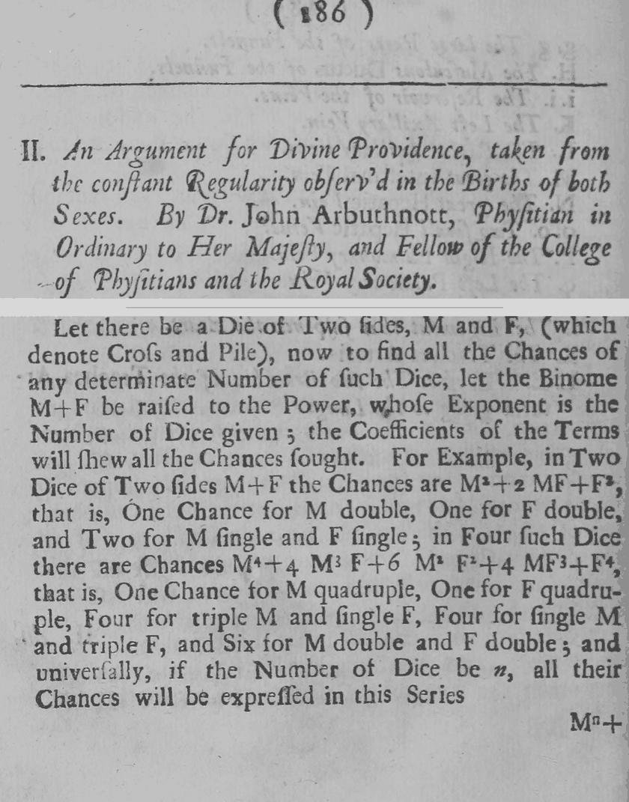
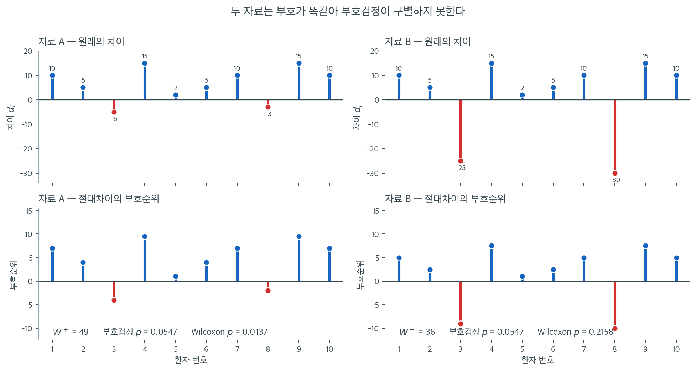
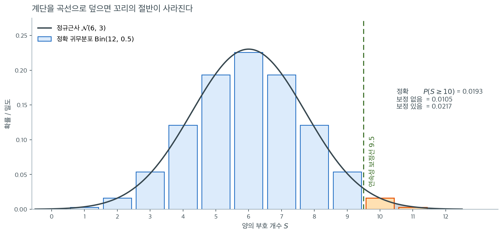

# 부호검정

<div class="leadbox" markdown>

**들어가는 이야기** — 크기를 아예 보지 않겠다고 하면

한 영양학자가 하루 열량 섭취의 중앙값이 $2000$ 칼로리라고 본다. $14$ 명을 뽑아 보니 $1850,\, 2100,\, 1950,\, 2200,\, \ldots$ 이고 그중 한 사람은 정확히 $2000$ 이다. 이 자료로 중앙값이 $2000$ 이 아니라고 말할 수 있는가. 값의 크기는 보지 않고 $2000$ 보다 큰 쪽과 작은 쪽의 **개수만** 세어도 답이 나온다. 그러면 가정이 거의 들지 않는다.

거의 들지 않는 대신 치르는 값이 있다. 환자 열 명의 처치 전후 차이를 적은 자료 두 벌을 보자. 두 벌 모두 양수가 $8$ 개, 음수가 $2$ 개이고 음수가 놓인 자리까지 같다. 다른 것은 음수의 크기뿐인데 — 한 벌은 $-5$ 와 $-3$ 으로 가장 작은 축이고 다른 벌은 $-25$ 와 $-30$ 으로 표본에서 가장 크다 — 개수만 세는 검정은 두 벌에 똑같이 $p = 0.0547$ 을 준다. 크기의 순위까지 쓰는 검정은 $0.0137$ 과 $0.2158$ 로 갈라 $16$ 배를 벌린다.

또 하나는 계산을 줄이는 쪽에서 온다. $n = 12$ 에서 양의 부호가 $10$ 개 나왔을 때 정확한 단측 $p$ 값은 $0.0193$ 인데, 계단꼴 분포를 종 모양 곡선으로 덮어 적분하면 $0.0105$ 밖에 되지 않는다 — 정확값의 $54\%$ 다. 어긋나는 방향이 늘 한쪽이라서 보정 없는 근사는 $p$ 값을 **작게** 만들고, 그만큼 거짓 기각이 늘어 명목 $5\%$ 가 실제로 $7.8\%$ 까지 올라간다.

그렇다면 크기를 버려서 얻는 것과 치르는 것은 각각 무엇인가. 이 쪽이 중앙값에 대한 물음을 공정한 동전에 대한 물음으로 바꾸는 한 줄을 세우고, 가설값과 똑 같은 관측값을 어디에 넣을지 정하고, 정확분포와 정규근사를 갈라 쓰는 선을 그은 뒤, 이항검정과의 관계와 크기를 버린 대가를 차례로 짚는다.

</div>

**부호검정**은 가장 오래되고 가장 단순한 비모수 절차 중 하나이다. 모집단의 중앙값이 가설값 $m_0$과 같은지를, $m_0$보다 큰 관측값과 작은 관측값의 개수를 세어 검정한다. 편차 $X_i - m_0$의 *부호*만 쓰고 크기는 무시하므로 가정이 거의 필요 없다. 그 덕에 순서형 자료나 변화의 방향만 신뢰성 있게 측정되는 상황에도 적용할 수 있다.

---

## 1. 중앙값 물음이 동전 물음으로 바뀐다

참인 중앙값이 $m_0$이라면 정의에 의해 모집단의 절반이 $m_0$ 위에, 절반이 아래에 있다. 따라서 각 관측값이 위에 있을 확률과 아래에 있을 확률이 같으므로, $m_0$을 넘는 관측값의 개수는 성공확률 $p = 0.5$인 이항분포를 따른다. 양의 부호나 음의 부호가 크게 넘치면 참인 중앙값이 $m_0$과 다르다는 증거가 된다.

---

## 2. 가설

$p = P(X_i > m_0)$이라 하자. $H_0$ 아래에서 중앙값이 $m_0$이고, 이는 $p = 0.5$를 뜻한다.

| 검정 유형 | $H_0$ | $H_a$ |
|:----------|:------|:------|
| 양측 | $p = 0.5$ | $p \ne 0.5$ |
| 왼쪽 꼬리 | $p = 0.5$ | $p < 0.5$ |
| 오른쪽 꼬리 | $p = 0.5$ | $p > 0.5$ |

---

## 3. 동점 처리

$m_0$과 정확히 같은 관측값($X_i = m_0$)은 분석에서 **제외**한다. 남은 $n = n_+ + n_-$개의 관측값만 사용하며, $n_+$는 $m_0$보다 큰 값의 개수, $n_-$는 작은 값의 개수이다.

---

## 4. 검정통계량

### 정확검정 (소표본)

검정통계량은 양의 부호 개수

$$
S = n_+
$$

이다. $H_0$ 아래에서

$$
S \sim \text{Binomial}(n, 0.5)
$$

정확 양측 $p$값은

$$
p = 2 \min\!\bigl(P(S \le s_{\text{obs}}), \; P(S \ge s_{\text{obs}})\bigr)
$$

이며 $s_{\text{obs}}$는 관측된 $S$의 값이다.

### 정규근사 (대표본)

$n$이 크면(보통 $n \ge 20$) 표준화된 통계량

$$
Z = \frac{S - n/2}{\sqrt{n/4}} = \frac{n_+ - n_-}{\sqrt{n}}
$$

은 $H_0$ 아래 근사적으로 $\mathcal{N}(0, 1)$을 따른다.

!!! note "연속성 보정"
    중간 정도의 표본크기에서는 연속성 보정으로 정규근사를 개선할 수 있다. 보정된 통계량은 $Z = (S - n/2 \pm 0.5) / \sqrt{n/4}$이며, 보정의 부호는 $S$를 $n/2$ 쪽으로 당기도록 고른다.

<div class="exbox" markdown>

**보기 1.** <span class="diff easy" title="쉬움"></span> 열량 섭취 중앙값의 부호검정. 한 영양학자가 어떤 모집단의 하루 열량 섭취 중앙값이 2000칼로리라고 가정한다. $n = 14$인 확률표본은 다음과 같다.

</div>

??? success "풀이"
    $$
    1850, \; 2100, \; 1950, \; 2200, \; 1900, \; 2050, \; 2000, \; 1800, \; 2150, \; 1975, \; 2300, \; 1920, \; 2080, \; 2010
    $$

    **1단계.** $m_0 = 2000$을 기준으로 부호를 구한다.

    | 값 | 부호 |
    |:-----:|:----:|
    | 1850 | $-$ |
    | 2100 | $+$ |
    | 1950 | $-$ |
    | 2200 | $+$ |
    | 1900 | $-$ |
    | 2050 | $+$ |
    | 2000 | (동점) |
    | 1800 | $-$ |
    | 2150 | $+$ |
    | 1975 | $-$ |
    | 2300 | $+$ |
    | 1920 | $-$ |
    | 2080 | $+$ |
    | 2010 | $+$ |

    **2단계.** 동점을 제외하면 $n = 13$, $n_+ = 7$, $n_- = 6$이다.

    **3단계.** 정확 양측 $p$값을 계산한다. $H_0$ 아래 $S \sim \text{Binomial}(13, 0.5)$이다.

    $$
    P(S \ge 7) = \sum_{k=7}^{13} \binom{13}{k} \left(\frac{1}{2}\right)^{13} = 0.500
    $$

    $$
    p = 2 \times 0.500 = 1.000
    $$

    $p = 1.000 \gg 0.05$이므로 $H_0$을 기각하지 못한다. 자료는 열량 섭취 중앙값이 2000이라는 것과 일관된다.

    ??? example "유의한 결과"
        대신 $n = 13$ 중 $n_+ = 12$, $n_- = 1$을 관측했다고 하자. 그러면 $P(S \ge 12) = \binom{13}{12}(0.5)^{13} + \binom{13}{13}(0.5)^{13} = 14/8192 \approx 0.0017$이다. 양측 $p$값은 $2 \times 0.0017 = 0.0034$로 $H_0$에 반하는 강한 증거가 된다.

---

## 5. 이항검정과의 관계

부호검정은 $p_0 = 0.5$인 **이항검정**([이항검정](binomial_test.md) 참조)의 특수한 경우이다. 더 일반적으로 이항검정은 임의의 가설 비율을 검정할 수 있는 반면, 부호검정은 중앙값 가설 $p_0 = 0.5$에 국한된다.

<div class="storybox" markdown>

**그림으로 보는 통계학 1.** 신의 존재를 증명하려고 쓴 첫 가설검정

<figure markdown>
  { width=430 align=right }
  <figcaption markdown>『왕립학회 철학회보』 제 $27$ 권 인쇄 $186$ 쪽. 제목은 **「양성의 출생에서 관찰되는 한결같은 규칙성으로부터 이끌어 낸, 신의 섭리에 대한 논증」**이고 지은이가 **존 아버스넛, 여왕의 시의(侍醫)이자 왕립의사회와 왕립학회 회원**이라 적혀 있다. 아래 토막에서 「두 면 $\mathrm M$ 과 $\mathrm F$ 를 가진 주사위」를 세우고 **「이항식 $\mathrm M+\mathrm F$ 를 주사위 개수만큼 거듭제곱하면 그 항들의 계수가 구하려는 모든 경우를 보여 준다」**고 한 뒤, $\mathrm M^2+2\mathrm{MF}+\mathrm F^2$ 과 $\mathrm M^4+4\mathrm M^3\mathrm F+6\mathrm M^2\mathrm F^2+4\mathrm{MF}^3+\mathrm F^4$ 을 예로 든다. *(Internet Archive, 저작권 없음)*</figcaption>
</figure>

§4 의 $S\sim\text{Binomial}(n,\ 0.5)$ 를 풀어 쓰면 $P(S=r)=\binom nr p^r(1-p)^{n-r}$ 이고, 여기에 $p=\frac12$ 를 넣은 것이 부호검정의 정확 $p$ 값이다. 이 식이 **실제 자료에 처음 쓰인** 자리가 사진의 쪽인데, 쓰인 목적이 뜻밖이다 — **신이 있음을 보이려는 것**이었다.

쓴 사람은 앤 여왕의 시의였던 스코틀랜드 사람 **존 아버스넛**($1667$–$1735$)이다. 사진의 토막이 그 식을 $p=\frac12$ 로 적은 것이다. 그는 $\mathrm M$(남)과 $\mathrm F$(여) 두 면을 가진 주사위를 세우고 $(\mathrm M+\mathrm F)^n$ 의 계수가 경우의 수라고 말한 뒤, 다음 쪽에서 $n=10$ 일 때 가운데 항의 계수가 $252$ 이고 $2^{10}=1024$ 이므로 남녀가 꼭 같을 확률이 $\frac{252}{1024}=\frac{63}{256}$ 이라고 계산한다. 그 식에 $\binom{10}{5}2^{-10}$ 을 넣은 것과 글자 하나 다르지 않다.

그다음이 핵심이다. 그는 런던의 세례 기록 **$82$ 해분**($1629$–$1710$)을 붙여 놓고, **해마다 빠짐없이 남아가 더 많았다**고 적는다. 그리고 묻는다 — 「$\mathrm A$ 가 $\mathrm B$ 에게 **해마다** 남아가 더 많이 태어난다는 쪽에 건다. $\mathrm A$ 의 몫은 얼마인가.」

한 해에 남아가 더 많을 확률을 넉넉히 $\frac12$ 로 쳐 주고 해마다 독립이라 보면, 이항분포의 바탕이 되는 곱셈이 그대로 답을 준다.

$$
\left(\frac12\right)^{82}=\frac{1}{4\,835\,703\,278\,458\,516\,698\,824\,704}\approx 2\times10^{-25}
$$

그는 이 값을 **로그표로** 구해 $\dfrac{1}{4836\,0000\,0000\,0000\,0000\,00000}$ 이라 찍어 놓았다. 위의 정확한 값과 **앞 네 자리까지 같다** — 열 자리 로그표만으로 $10^{-25}$ 짜리 수를 맞춘 것이다. 그리고 결론을 내린다 — **「그러므로 이를 다스리는 것은 우연이 아니라 기예(Art)다.」**

오늘 이것을 **첫 유의성 검정**이라 부른다. 귀무가설($p=\frac12$)을 세우고, 관측이 그 가설 아래에서 얼마나 드문지를 재고, 너무 드물면 가설을 버리는 — $p$ 값 계산 그 자체다. 더 좁혀 말하면 **이 쪽의 부호검정**이다. 해마다의 남아 초과를 양의 부호로 세어 $n=82$, $s_{\text{obs}}=82$ 로 §4 의 정확검정을 돌린 것과 같다. 그 절차가 $1710$ 년에 통째로 들어 있다.

**그런데 결론은 살아남지 못했다.** 작은 확률은 「$p=\frac12$ 이 아니다」까지만 말해 주지, 그 자리에 무엇이 있는지는 말해 주지 않는다. 동전이 아주 살짝만 기울어 있어도 같은 자료가 쉽게 나온다. 한 해 출생을 $1$ 만 명으로 잡고 남아 비율 $p$ 를 조금씩 올려 보자.

| $p$ | $0.50$ | $0.51$ | $0.52$ |
|---|---|---|---|
| 그 해에 남아가 더 많을 확률 | $0.496$ | $0.977$ | $1.000$ |
| $82$ 해 내리 그럴 확률 | $\approx 0$ | $0.15$ | $0.997$ |

$2$ 퍼센트만 기울어도 $82$ 해 연속은 거의 확실해진다. 아버스넛이 무너뜨린 것은 **정확한 반반**이었고, 그 자리를 섭리로 채운 것은 자료가 아니라 그였다. 부호검정이 주는 것은 확률이지 까닭이 아니다.

_확인한 곳 — 사진의 쪽 번호 $186$, 제목과 지은이 직함, 「두 면 $\mathrm M$ 과 $\mathrm F$ 를 가진 주사위」와 「이항식 $\mathrm M+\mathrm F$ 를 … 거듭제곱하면 계수가 모든 경우를 보여 준다」, 그리고 $(\mathrm M+\mathrm F)^2$·$(\mathrm M+\mathrm F)^4$ 의 전개는 [Internet Archive 『Philosophical Transactions』 제 $27$ 권($1710$–$1712$)](https://archive.org/details/philosophicaltra2717roya) 의 그 쪽에서 **사진으로 직접 읽었다**. 이어지는 인쇄 $187$ 쪽의 $\frac{252}{1024}$ 와 $\frac{63}{256}$, $188$ 쪽의 「$82$ 해분 런던 출생 관찰을 담은 표」·「$\mathrm A$ 가 $\mathrm B$ 에게 건다」·「$82$ 번 내리 … 로그표로 쉽게 구해진다」도 같은 스캔에서 읽었다 · 아버스넛($1667$–$1735$)이 앤 여왕의 시의였고, $1629$–$1710$ 의 $82$ 해 모두 남아가 많았으며, 「우연이 아니라 기예가 다스린다」로 맺었고, 이것이 오늘 **최초의 유의성 검정**(부호검정으로 $p$ 값을 구해 귀무가설을 버린 것)으로 꼽힌다는 것은 [Wikipedia 「John Arbuthnot」](https://en.wikipedia.org/wiki/John_Arbuthnot) · $2^{82}$ 의 모든 자리와 표의 여섯 값은 **이 쪽에서 직접 계산해 보았다**_

</div>

### 이 Z 는 사실 비율검정이다

<div class="exbox" markdown>

**보기 2.** <span class="diff easy" title="쉬움"></span> 이 $Z$ 는 사실 $T/\sqrt{n}$ 이다. 아래 구현은 부호검정을 비율검정의 꼴 $Z = (\hat p - 0.5)/\sqrt{0.25/n}$ 으로 쓴다.

**(1)** 이 $Z$ 가 앞에 적은 부호통계량 $T = n_+ - n_-$ 를 $\sqrt{n}$ 으로 나눈 것과 **똑같음**을 보이시오.

**(2)** 이 구현은 연속성 보정을 하지 않는다. 바로 위 자료($n = 12$, $n_+ = 10$)에서 정확 이항검정과 얼마나 어긋나며, 연속성 보정을 넣으면 얼마나 가까워지는가.

</div>

??? success "풀이"

    **(1) 두 줄로 끝난다.** $\hat p = n_+/n$ 이고 $n = n_+ + n_-$ 이므로

    $$
    \hat p - \frac12 = \frac{n_+}{n} - \frac12 = \frac{2n_+ - n}{2n},
    \qquad
    \sqrt{\frac{0.25}{n}} = \frac{1}{2\sqrt{n}}
    $$

    이고 나누면

    $$
    Z = \frac{(2n_+ - n)/(2n)}{1/(2\sqrt{n})}
      = \frac{2n_+ - n}{2n} \cdot 2\sqrt{n}
      = \frac{2n_+ - n}{\sqrt{n}}
    $$

    다. 한편 $n_- = n - n_+$ 이므로

    $$
    T = n_+ - n_- = n_+ - (n - n_+) = 2n_+ - n
    $$

    이고 따라서 $Z = T/\sqrt{n}$ 이다. $\square$ **"비율의 검정"과 "부호의 합"이 같은 통계량의 두 이름일 뿐이다.** 확인하면 $T = 10 - 2 = 8$, $\sqrt{12} = 3.464102$, $8/3.464102 = 2.309401$ 로 구현이 주는 값과 같다.

    이 꼴에서 $\operatorname{Var}(T) = n$ 인 것도 바로 읽힌다. $T = \sum \operatorname{sign}(d_i)$ 이고 $H_0$ 아래에서 각 항이 $\pm 1$ 을 반반씩 독립으로 받으므로 항마다 분산이 1 이다.

    **(2) 보정이 없으면 두 배 가까이 어긋난다.** 정확 양측 p-값은 이항분포에서 바로 나온다. $n = 12$, $n_+ = 10$ 이므로 꼬리는 $\{10, 11, 12\}$ 와 대칭인 $\{0, 1, 2\}$ 이고

    $$
    p_{\text{정확}} = \frac{2\left[\binom{12}{10} + \binom{12}{11} + \binom{12}{12}\right]}{2^{12}}
    = \frac{2(66 + 12 + 1)}{4096}
    = \frac{158}{4096}
    = 0.038574
    $$

    다. 구현의 정규근사는

    $$
    Z = \frac{8}{\sqrt{12}} = 2.309401
    \implies p = 2\Phi(-2.309401) = 0.020921
    $$

    로 **정확값의 54% 에 불과하다.** $n_+$ 가 정수이므로 반 칸을 깎아 주면

    $$
    Z_{\text{보정}} = \frac{\lvert n_+ - n/2 \rvert - 0.5}{\sqrt{n/4}} = \frac{4 - 0.5}{\sqrt{3}} = 2.020726
    \implies p = 0.043308
    $$

    이 되어 정확값 $0.038574$ 에 훨씬 가깝다. 오차가 $0.017653$ 에서 $0.004734$ 로 **3.7배 줄었다.**

    | 방법 | $p$ | 정확값과의 차이 |
    |---|---|---|
    | 정확 이항 | 0.038574 | --- |
    | 정규근사, 보정 없음 (이 구현) | 0.020921 | $-0.017653$ |
    | 정규근사, 연속성 보정 | 0.043308 | $+0.004734$ |

    **보정 없는 쪽이 위험한 방향으로 틀린다** — p-값을 작게 보고하므로 기각을 과하게 한다. $n$ 이 열두 개뿐인 자료에 연속성 보정 없는 정규근사를 쓰는 것은 권할 일이 아니다.

    정확 p-값은 `binomtest` 로 구했다. 흔히 쓰이는 `2 * binom.cdf(...)` 관례는 $n$ 이 짝수이고 $n_+ = n/2$ 인 자리에서 **1 을 넘는 "p-값"** 을 돌려주는 결함이 있다. [부호검정](sign_test.md) 절 끝의 쪽지 이 그 자리를 수로 따져 두었으니 참고하라.

    구현에도 걸리는 데가 두 곳 있다. 모든 쌍이 동점이면 $n = 0$ 이 되어 `n_plus / n` 이 0 으로 나누어지고, `test_type` 에 세 문자열 가운데 없는 값을 주면 `p_value` 가 정의되지 않은 채 `return` 에 닿는다.

    **수치적으로.**

    ```python
    import numpy as np
    import scipy.stats as stats

    def sign_test(paired_data, test_type="two-sided"):
        """대응표본에 대한 부호검정.

        차이의 크기는 버리고 부호만 센다. 그래서 자료가 순서척도이기만 하면
        쓸 수 있고 이상치에도 끄떡없다. 대신 크기 정보를 버린 만큼 검정력이
        낮다 — 그 중간이 부호순위검정이다.

        매개변수
        --------
        paired_data : 모양 (n, 2) 인 배열. 0열이 처리 후, 1열이 처리 전이다.
        test_type : "less", "two-sided", "greater" 중 하나

        돌려주는 값
        ----------
        z : Z 통계량
        p_value : p-값
        """
        p_0, q_0 = 0.5, 0.5

        # 동점(차이가 0)은 아예 세지 않는다. 그래서 실제로 쓰이는 n 이
        # 원래 표본크기보다 작아진다.
        n_plus = np.sum(paired_data[:, 0] > paired_data[:, 1])
        n_minus = np.sum(paired_data[:, 0] < paired_data[:, 1])
        n = n_plus + n_minus
        p_hat = n_plus / n

        z = (p_hat - p_0) / np.sqrt(p_0 * q_0 / n)

        if test_type == "less":
            p_value = stats.norm.cdf(z)
        elif test_type == "two-sided":
            p_value = 2 * stats.norm.cdf(-abs(z))
        elif test_type == "greater":
            p_value = stats.norm.sf(z)

        return z, p_value
    ```

    ```python
    from math import comb

    n, n_plus = 12, 10
    T = 2 * n_plus - n
    print(f"T = n+ - n- = {T},  sqrt(n) = {np.sqrt(n):.6f},  T/sqrt(n) = {T / np.sqrt(n):.6f}")
    p_hat = n_plus / n
    print(f"(p_hat - 0.5)/sqrt(0.25/n) = {(p_hat - 0.5) / np.sqrt(0.25 / n):.6f}   <- 같다")

    exact = 2 * sum(comb(n, k) for k in range(n_plus, n + 1)) / 2 ** n
    print(f"\n정확     : 2*({' + '.join(str(comb(n, k)) for k in range(n_plus, n + 1))})"
          f"/{2 ** n} = {exact:.6f}")
    print(f"binomtest: {stats.binomtest(n_plus, n).pvalue:.6f}")

    z0 = (p_hat - 0.5) / np.sqrt(0.25 / n)
    zc = (abs(n_plus - n / 2) - 0.5) / np.sqrt(n / 4)
    p0 = 2 * stats.norm.sf(z0)
    pc = 2 * stats.norm.sf(zc)
    print(f"\n보정 없음: z = {z0:.6f},  p = {p0:.6f},  차이 {p0 - exact:+.6f}")
    print(f"연속성보정: z = {zc:.6f},  p = {pc:.6f},  차이 {pc - exact:+.6f}")
    print(f"오차가 {abs(p0 - exact) / abs(pc - exact):.1f} 배 줄었다")
    ```

    출력:

    ```
    T = n+ - n- = 8,  sqrt(n) = 3.464102,  T/sqrt(n) = 2.309401
    (p_hat - 0.5)/sqrt(0.25/n) = 2.309401   <- 같다

    정확     : 2*(66 + 12 + 1)/4096 = 0.038574
    binomtest: 0.038574

    보정 없음: z = 2.309401,  p = 0.020921,  차이 -0.017653
    연속성보정: z = 2.020726,  p = 0.043308,  차이 +0.004734
    오차가 3.7 배 줄었다
    ```

    **$T/\sqrt{n}$ 과 $(\hat p - 0.5)/\sqrt{0.25/n}$ 이 소수 여섯째 자리까지 같다.** 손으로 센 $158/4096 = 0.038574$ 가 `binomtest` 와 같고, 연속성 보정이 오차를 3.7배 줄이는 것도 확인된다.

---

### 동점을 어디에 넣는가

<div class="exbox" markdown>

**보기 3.** <span class="diff easy" title="쉬움"></span> 동점 세 개를 어디에 넣는가. 처리 전후 점수 15쌍에 위 `sign_test` 를 돌리면 $Z = 2.3094$, $p = 0.0209$ 가 나온다.

**(1)** $n_+$, $n_-$, 동점의 개수, $n$, $\hat p$, $Z$ 를 손으로 구해 코드의 값과 맞추시오.

**(2)** 이 구현은 동점 세 개를 **버린다.** 동점을 양·음에 반반씩 세거나 모두 $H_0$ 쪽(음의 방향)으로 세면 p-값이 어떻게 달라지는가. 어느 처리가 정직한가.

</div>

??? success "풀이"

    **(1) 세어 본다.** 15쌍의 차이(후 $-$ 전)는

    $$
    d = (17,\ -2,\ 6,\ -3,\ 14,\ 0,\ 6,\ 10,\ 12,\ 8,\ 9,\ 2,\ 0,\ 3,\ 0)
    $$

    이고 양수 열 개, 음수 두 개, **0 이 세 개**다. 구현은 `>` 와 `<` 만 세므로 0 인 쌍은 어느 쪽에도 들어가지 않는다.

    $$
    n_+ = 10, \quad n_- = 2, \quad n = 12, \quad \hat p = \frac{10}{12} = 0.833333
    $$

    $$
    Z = \frac{0.833333 - 0.5}{\sqrt{0.25/12}} = \frac{0.333333}{0.144338} = 2.309401
    \implies p = 0.020921
    $$

    이고 코드의 $2.3094$, $0.0209$ 와 맞는다. **관측 15쌍 가운데 실제로 검정에 쓰인 것은 열두 개다.**

    **(2) 동점의 처리가 결론을 뒤집는다.** 세 가지 관례를 모두 계산하면

    | 동점 처리 | $n_+$ | $n$ | $\hat p$ | $Z$ | 정규근사 $p$ | 정확 $p$ |
    |---|---|---|---|---|---|---|
    | 버린다 (이 구현) | 10 | 12 | 0.8333 | 2.3094 | 0.0209 | 0.0386 |
    | 반반씩 센다 | 11.5 | 15 | 0.7667 | 2.0656 | 0.0389 | --- |
    | 모두 음의 방향으로 센다 | 10 | 15 | 0.6667 | 1.2910 | 0.1967 | 0.3018 |

    **버리는 쪽과 가장 보수적인 쪽 사이에서 p-값이 $0.021$ 에서 $0.197$ 로 아홉 배 벌어진다.** 정확검정으로 보면 $0.039$ 대 $0.302$ 로 여덟 배다. $\alpha = 0.05$ 에서 첫 둘은 기각하고 마지막은 기각하지 못한다. **관측 열다섯 개 가운데 세 개의 처리가 결론을 결정한다.**

    어느 쪽이 정직한가는 **0 이 왜 생겼는지**에 달렸다. 여기서는 점수가 정수로 기록되어 $54 \to 54$, $78 \to 78$, $76 \to 76$ 이 된 것이므로, 눈금이 더 고왔다면 아주 작은 양수나 음수였을 수 있다. 그렇다면 그 쌍이 양·음일 확률이 반반이라고 보는 **"반반씩" 쪽이 맞고**, 실제로 그 값 $0.0389$ 가 버리는 쪽의 정확값 $0.0386$ 과 거의 같다. 반면 "0 은 변화 없음이므로 효과의 증거가 아니다" 라는 입장을 취하면 가장 보수적인 쪽으로 가야 하고 그때는 기각할 수 없다.

    **그래서 보고할 때 동점의 개수를 반드시 적어야 한다.** "$n = 15$, $p = 0.021$" 은 읽는 이를 오도한다. "15쌍 가운데 동점 3쌍을 제외한 $n = 12$ 로 검정했고 $p = 0.021$(정규근사) 또는 $0.039$(정확)" 가 정직한 서술이다.

    **수치적으로.**

    ```python
    # 처리 전후 점수 15쌍. 아래 부호검정과 부호순위검정을 같은 자료에 돌려
    # p-값을 견줄 수 있다.
    data = np.array([
        [93, 76], [70, 72], [81, 75], [65, 68], [79, 65],
        [54, 54], [94, 88], [91, 81], [77, 65], [65, 57],
        [95, 86], [89, 87], [78, 78], [80, 77], [76, 76]
    ])
    z, p_value = sign_test(data)
    print(f"{z       = :.4f}")   # 2.3094
    print(f"{p_value = :.4f}")   # 0.0209
    ```

    출력:

    ```
    z       = 2.3094
    p_value = 0.0209
    ```

    ```python
    d = data[:, 0] - data[:, 1]
    n_plus = int((d > 0).sum())
    n_minus = int((d < 0).sum())
    n_zero = int((d == 0).sum())
    print(f"차이 {list(d)}")
    print(f"n+ = {n_plus},  n- = {n_minus},  동점 = {n_zero},  n = {n_plus + n_minus}")

    print("\n동점 처리별 p-값")
    for label, np_eff, n_eff in (("버린다       ", n_plus, n_plus + n_minus),
                                 ("반반씩 센다  ", n_plus + n_zero / 2, 15),
                                 ("음의 방향으로", n_plus, 15)):
        p_hat = np_eff / n_eff
        z = (p_hat - 0.5) / np.sqrt(0.25 / n_eff)
        line = (f"  {label}: n+={np_eff:>5} n={n_eff:>3} p_hat={p_hat:.4f} "
                f"z={z:.4f} 근사 p={2 * stats.norm.sf(abs(z)):.4f}")
        if float(np_eff).is_integer():
            line += f" 정확 p={stats.binomtest(int(np_eff), n_eff).pvalue:.4f}"
        print(line)
    ```

    출력:

    ```
    차이 [17, -2, 6, -3, 14, 0, 6, 10, 12, 8, 9, 2, 0, 3, 0]
    n+ = 10,  n- = 2,  동점 = 3,  n = 12

    동점 처리별 p-값
      버린다       : n+=   10 n= 12 p_hat=0.8333 z=2.3094 근사 p=0.0209 정확 p=0.0386
      반반씩 센다  : n+= 11.5 n= 15 p_hat=0.7667 z=2.0656 근사 p=0.0389
      음의 방향으로: n+=   10 n= 15 p_hat=0.6667 z=1.2910 근사 p=0.1967 정확 p=0.3018
    ```

    **손계산 $\hat p = 0.8333$, $Z = 2.3094$, $p = 0.0209$ 가 구현과 같고**, 세 관례의 p-값 $0.0209 / 0.0389 / 0.1967$ 도 표와 맞는다. 동점 셋이 결론을 가르는 자리에 있다는 것이 그대로 보인다.

---

## 6. 검정력과 한계

부호검정은 크기 정보를 모두 버리므로 흔한 일표본 비모수 검정 중 검정력이 가장 낮다. 정규성 아래 일표본 $t$ 검정 대비 ARE는

$$
\text{ARE}(\text{부호검정}, \; t\text{ 검정}) = \frac{2}{\pi} \approx 0.637
$$

이다. 정규자료에서 같은 검정력에 도달하려면 $t$ 검정의 약 $\pi/2 \approx 1.57$배의 관측값이 필요하다는 뜻이다.



"크기 정보를 버린다"는 말이 실제로 무엇을 뜻하는지는 두 자료를 나란히 놓으면 분명해진다. 위쪽 두 칸은 환자 10명의 원래 차이이고, 아래쪽 두 칸은 그 절대차이에 매긴 부호순위이다.

**자료 A와 자료 B는 부호가 한 자리도 다르지 않다.** 둘 다 양수 8개, 음수 2개이고, 음수가 놓인 자리도 3번과 8번으로 같다. 다른 것은 음수의 크기뿐이다. 자료 A의 음수는 $-5$와 $-3$으로 가장 작은 축에 속하는 반면, 자료 B에서는 $-25$와 $-30$으로 표본에서 가장 큰 값이다.

부호검정은 이 차이를 전혀 보지 못한다. 두 자료 모두 $p = 0.0547$로 **소수점 넷째 자리까지 같다.** 반면 부호순위검정은 크기를 순위로 반영하므로 자료 A에서 $W^+ = 49$, $p = 0.0137$을 주고 자료 B에서는 $W^+ = 36$, $p = 0.2158$을 준다. **$p$값이 16배 벌어진다.**

이것이 ARE $= 0.637$이 개별 자료에서 드러나는 모습이다. 다만 방향을 헷갈리지 말아야 한다. 부호검정이 두 자료를 구별하지 못하는 것은 **결함이 아니라 설계**이다. 크기가 믿을 만한 정보가 아닐 때 --- Likert 척도라 간격에 의미가 없거나, 측정이 "호전/악화"로만 기록되었을 때 --- 부호검정은 없는 정보를 지어내지 않는 유일한 검정이다. 크기를 믿을 수 있는데도 부호검정을 쓸 때만 이것이 손실이 된다.

그럼에도 부호검정은 다음 상황에서 여전히 가치가 있다.

- 자료가 순서형이라 크기가 의미를 갖지 않을 때.
- 차이의 분포가 심하게 비대칭이어서 Wilcoxon 부호순위검정의 대칭성 가정을 어길 때.
- 변화의 방향(호전/악화)만 신뢰성 있게 판정할 수 있을 때.

---

<div class="exbox" markdown>

**보기 4.** <span class="diff easy" title="쉬움"></span> 명목 5%, 실제로는 7.8% 까지. 아래 함수는 연속성 보정 없는 정규근사를 쓴다. 양측 $\alpha = 0.05$ 로 쓰면 기각규칙이 사실

$$
\lvert Z \rvert = \frac{\lvert 2n_+ - n \rvert}{\sqrt{n}} > 1.959964
$$

가 된다.

**(1)** 이 규칙의 **실제 제1종 오류율**을 $n = 5$ 부터 $40$ 까지 정확 이항분포로 계산하시오. 모의실험이 아니라 합으로 구할 수 있다.

**(2)** 연속성 보정을 넣은 규칙과 `binomtest` 의 정확 규칙은 어떤가. 세 규칙 가운데 명목수준을 넘는 것은 무엇이며, $n$ 을 키우면 그 문제가 사라지는가.

</div>

??? success "풀이"

    **(1) 실제 수준은 유한 합으로 정확히 구해진다.** $H_0$ 아래에서 $n_+ \sim \text{Bin}(n, 1/2)$ 는 **정확한** 사실이고, 기각역은 정수 $k$ 의 유한집합이다. 그러므로

    $$
    \text{실제 수준} = \sum_{k \,:\, \lvert 2k - n \rvert > 1.959964\sqrt{n}} \binom{n}{k} \frac{1}{2^n}
    $$

    을 그대로 더하면 된다. 모의실험이 필요 없다.

    $n = 21$ 을 손으로 해 보자. $\sqrt{21} = 4.582576$ 이므로 문턱은 $1.959964 \times 4.582576 = 8.982$ 이다. $n$ 이 홀수이면 $2k - n$ 도 홀수이므로 $\lvert 2k-21 \rvert \in \{1, 3, 5, \dots, 21\}$ 이고, $8.982$ 를 넘는 가장 작은 값은 $9$ 다. $\lvert 2k-21 \rvert \geq 9$ 는 $k \leq 6$ 또는 $k \geq 15$ 를 뜻하므로

    $$
    \text{실제 수준}
    = 2 \sum_{k=0}^{6} \binom{21}{k} \frac{1}{2^{21}}
    = \frac{2(1 + 21 + 210 + 1330 + 5985 + 20349 + 54264)}{2097152}
    = \frac{164320}{2097152}
    = 0.078354
    $$

    **명목 $0.05$ 의 1.57배다.** 이 규칙은 $H_0$ 이 참일 때 스무 번에 한 번이 아니라 **열세 번에 한 번** 기각한다.

    **(2) 보정하면 넘지 않는다.** $n = 5$ 부터 $40$ 까지 세 규칙을 모두 재면

    | 규칙 | 명목수준을 넘는 $n$ 의 개수 | 최대 실제 수준 |
    |---|---|---|
    | 정규근사, 보정 없음 (이 함수) | 36 개 가운데 **17 개** | $0.078354$ ($n = 21$) |
    | 정규근사, 연속성 보정 | 0 개 | $0.047031$ ($n = 37$) |
    | 정확 이항 (`binomtest`) | 0 개 | $0.049042$ ($n = 17$) |

    **보정 없는 쪽만 명목수준을 넘고, 그것도 절반 가까운 $n$ 에서 넘는다.**

    그리고 **$n$ 을 키워도 문제가 사라지지 않는다.** $n = 39$ 에서도 $0.0533$ 이다. 까닭은 이산성이다. 문턱 $1.959964\sqrt{n}$ 이 $\lvert 2k-n \rvert$ 이 실제로 가질 수 있는 값들(짝수 $n$ 이면 짝수, 홀수 $n$ 이면 홀수) 사이 어디에 떨어지는지가 $n$ 마다 다르다. 문턱이 어떤 달성 가능한 값 **바로 아래**에 떨어지면 그 쌍이 기각역에 들어와 실제 수준이 튀어 오른다. $\sqrt{n}$ 은 매끄럽게 커지지만 격자는 $2$ 씩 뛰므로 이 어긋남이 **주기적으로 되풀이된다.**

    연속성 보정이 하는 일이 바로 그 어긋남을 메우는 것이다. 문턱을 반 칸 밖으로 밀어 두므로 격자점이 경계에 걸리는 일이 줄고, 그 결과 실제 수준이 명목값 **아래**로 내려간다. 다만 지나치게 내려가기도 한다 — $n = 17$ 에서 정확검정은 $0.0490$ 인데 보정 규칙은 $0.0127$ 이다. **검정력을 그만큼 버린 셈이다.**

    따라서 권고는 분명하다. **이 함수의 $p$ 값을 $0.05$ 와 견주어 판정하지 말고 `binomtest` 를 쓰라.** 정확검정은 설계상 명목수준을 넘지 않으며, 보정 규칙처럼 지나치게 보수적이지도 않다. $n$ 이 수천 이하이면 계산은 순식간이다.

    **수치적으로.**

    ```python
    import numpy as np
    import scipy.stats as stats


    def sign_test(paired_data, test_type="two-sided"):
        """대응표본에 대한 부호검정.

        차이의 크기는 버리고 부호만 센다. 그래서 자료가 순서척도이기만 하면
        쓸 수 있고 이상치에도 끄떡없다. 대신 크기 정보를 버린 만큼 검정력이
        낮다 — 그 중간이 부호순위검정이다.

        매개변수
        --------
        paired_data : 모양 (n, 2) 인 배열. 0열이 처리 후, 1열이 처리 전이다.
        test_type : "less", "two-sided", "greater" 중 하나

        돌려주는 값
        ----------
        z : Z 통계량
        p_value : p-값
        """
        p_0, q_0 = 0.5, 0.5

        n_plus = np.sum(paired_data[:, 0] > paired_data[:, 1])
        n_minus = np.sum(paired_data[:, 0] < paired_data[:, 1])
        n = n_plus + n_minus  # 동점은 세지 않는다
        p_hat = n_plus / n

        z = (p_hat - p_0) / np.sqrt(p_0 * q_0 / n)

        if test_type == "less":
            p_value = stats.norm.cdf(z)
        elif test_type == "two-sided":
            p_value = 2 * stats.norm.cdf(-abs(z))
        elif test_type == "greater":
            p_value = stats.norm.sf(z)

        return z, p_value
    ```

    ```python
    from math import comb, sqrt

    crit = stats.norm.isf(0.025)
    print(f"임계값 z_0.025 = {crit:.6f}")

    # n = 21 을 손으로 따라가 본다.
    n = 21
    print(f"\nn = {n}: 문턱 = {crit:.6f} * sqrt({n}) = {crit * sqrt(n):.3f}")
    ks = [k for k in range(n + 1) if abs(2 * k - n) > crit * sqrt(n)]
    print(f"  기각역 k in {ks}")
    terms = [comb(n, k) for k in range(7)]
    print(f"  2*({' + '.join(map(str, terms))})/{2 ** n} = {2 * sum(terms)}/{2 ** n}"
          f" = {2 * sum(terms) / 2 ** n:.6f}")

    print("\n  n   보정없음    보정    정확")
    worst = {"plain": (0, 0), "corr": (0, 0), "exact": (0, 0)}
    over = []
    for n in range(5, 41):
        pmf = np.array([comb(n, k) for k in range(n + 1)]) / 2 ** n
        k = np.arange(n + 1)
        rej_plain = np.abs(2 * k - n) / np.sqrt(n) > crit
        rej_corr = (np.abs(k - n / 2) - 0.5) / np.sqrt(n / 4) > crit
        rej_exact = np.array([stats.binomtest(j, n).pvalue < 0.05 for j in k])
        s = (pmf[rej_plain].sum(), pmf[rej_corr].sum(), pmf[rej_exact].sum())
        for key, val in zip(("plain", "corr", "exact"), s):
            if val > worst[key][0]:
                worst[key] = (val, n)
        if s[0] > 0.05:
            over.append(n)
        if n in (5, 12, 17, 21, 25, 30, 39, 40):
            print(f"{n:>3} {s[0]:>10.4f} {s[1]:>8.4f} {s[2]:>8.4f}")

    print(f"\n보정 없음: 명목 0.05 를 넘는 n {len(over)} 개 / 36 개  -> {over}")
    print(f"  최대 실제 수준 {worst['plain'][0]:.6f} (n = {worst['plain'][1]})")
    print(f"연속성 보정: 최대 {worst['corr'][0]:.6f} (n = {worst['corr'][1]})")
    print(f"정확 이항  : 최대 {worst['exact'][0]:.6f} (n = {worst['exact'][1]})")
    ```

    출력:

    ```
    임계값 z_0.025 = 1.959964

    n = 21: 문턱 = 1.959964 * sqrt(21) = 8.982
      기각역 k in [0, 1, 2, 3, 4, 5, 6, 15, 16, 17, 18, 19, 20, 21]
      2*(1 + 21 + 210 + 1330 + 5985 + 20349 + 54264)/2097152 = 164320/2097152 = 0.078354

      n   보정없음    보정    정확
      5     0.0625   0.0000   0.0000
     12     0.0386   0.0386   0.0386
     17     0.0490   0.0127   0.0490
     21     0.0784   0.0266   0.0266
     25     0.0433   0.0433   0.0433
     30     0.0428   0.0428   0.0428
     39     0.0533   0.0237   0.0237
     40     0.0385   0.0385   0.0385

    보정 없음: 명목 0.05 를 넘는 n 17 개 / 36 개  -> [5, 8, 11, 14, 16, 19, 21, 22, 24, 26, 27, 29, 31, 32, 34, 36, 39]
      최대 실제 수준 0.078354 (n = 21)
    연속성 보정: 최대 0.047031 (n = 37)
    정확 이항  : 최대 0.049042 (n = 17)
    ```

    **손으로 더한 $164320/2097152 = 0.078354$ 가 코드와 같다.** 보정 없는 규칙이 36 개 $n$ 가운데 17 개에서 명목수준을 넘고, $n = 39$ 까지도 $0.0533$ 으로 넘는다는 것이 확인된다. 보정 규칙과 정확 규칙은 한 번도 넘지 않는다.

    표에서 $n = 12, 25, 30, 40$ 처럼 **세 값이 완전히 같아지는** $n$ 들이 눈에 띈다. 그 $n$ 에서는 문턱이 세 규칙 모두 같은 격자점 사이에 떨어져 **기각역이 글자 하나까지 같아지기** 때문이다. 어느 규칙을 쓰느냐가 중요한 것은 문턱이 격자점 바로 옆에 떨어지는 $n$ 에서다. 그리고 **어느 $n$ 이 그런지는 미리 알 수 없다** — 그러므로 늘 정확검정을 쓰는 편이 안전하다.

<div class="exbox" markdown>

**보기 5.** <span class="diff easy" title="쉬움"></span> 학생의 처치 전후 점수. 학생 15명을 처치 프로그램 전후에 측정했다.

</div>

??? success "풀이"
    ```python
    paired_data = np.array([
        [93, 76], [70, 72], [81, 75], [65, 68], [79, 65],
        [54, 54], [94, 88], [91, 81], [77, 65], [65, 57],
        [95, 86], [89, 87], [78, 78], [80, 77], [76, 76]
    ])

    diffs = paired_data[:, 0] - paired_data[:, 1]
    print(diffs)
    # [17 -2  6 -3 14  0  6 10 12  8  9  2  0  3  0]

    z, p_value = sign_test(paired_data, test_type="two-sided")
    print(f"Z = {z:.4f}, p = {p_value:.4f}")
    # Z = 2.3094, p = 0.0209
    ```

    출력:

    ```
    [17 -2  6 -3 14  0  6 10 12  8  9  2  0  3  0]
    Z = 2.3094, p = 0.0209
    ```

15쌍 중 **세 쌍**이 동점($D_i = 0$)이라 제외되어 $n = 12$가 남는다. 그중
$n_+ = 10$, $n_- = 2$이므로 $\hat{p} = 10/12 \approx 0.833$이고
$Z \approx 2.309$, 양측 $p$값은 약 $0.021$이다.

!!! warning "동점의 개수를 반드시 확인하라"
    이 자료에서 동점은 학생 6번(54 대 54), 13번(78 대 78), 15번(76 대 76)의
    **세 개**이다. 동점을 하나 놓치면 $n$이 $12$가 아니라 $13$이 되어 $\hat{p}$,
    $Z$, $p$값이 모두 달라진다. `sign_test`를 호출하기 전에 항상 `diffs`를 출력하여
    확인하는 습관을 들이는 것이 좋다.



위 `sign_test` 함수는 정규근사를 쓴다. $n = 12$에서 그것이 얼마나 위험한지 보자. 파란 막대가 $H_0$ 아래 $S = n_+$의 정확한 분포 $\text{Bin}(12,\,0.5)$이고, 검은 곡선이 이 함수가 대신 쓰는 정규근사 $\mathcal{N}(6,\,3)$이다.

몸통에서는 두 분포가 아주 잘 맞는다. $S = 6$의 막대 높이 $0.226$과 곡선의 봉우리 $0.230$이 거의 겹친다. 그런데 우리가 실제로 쓰는 곳은 몸통이 아니라 **꼬리**이다. 관측값이 $S = 10$일 때 정확한 단측 $p$값은 막대 $10, 11, 12$의 합인 $0.0193$인데, 곡선을 $10$부터 적분하면 $0.0105$밖에 되지 않는다. **정확값의 54%이다.**

이유는 그림에 직접 보인다. $S = 10$의 막대는 $9.57$에서 $10.43$까지 **폭 $1$을 차지하는 직사각형**인데, 곡선을 $10$부터 적분하면 그 막대의 왼쪽 절반이 통째로 빠진다. 계단을 연속 곡선으로 덮을 때 생기는 이 체계적 손실을 메우는 것이 **연속성 보정**이고, 초록 점선이 그 보정선 $9.5$이다. $9.5$부터 적분하면 $0.0217$로 정확값 $0.0193$에 훨씬 가까워진다. 오차가 $0.0088$에서 $0.0024$로 줄었다.

방향이 늘 같다는 점이 중요하다. 보정 없는 근사는 **언제나** $p$값을 과소평가하므로 기각을 지나치게 많이 하게 된다. 실무 지침은 둘 중 하나다. 연속성 보정을 반드시 넣든지, 아니면 애초에 `stats.binomtest`로 정확 $p$값을 계산하든지. $n$이 수천 이하이면 정확 계산이 순식간에 끝나므로 후자가 낫다.

---

## 7. 크기를 버린 값과 그 대가

- 부호검정은 대응 비교를 베르누이 시행의 수열로 바꾼다. 본질적으로 "이 동전은
  공정한가?"를 묻는 것이며, 앞면은 "후 > 전"을 뜻한다.
- 부호 정보만 쓰므로 **분포무관**이다. 차이에 대해 정규성이나 대칭성 가정이 필요 없다.
- 대가는 낮은 **검정력**이다. 차이가 얼마나 큰지를 무시한다. 차이가 대략 대칭이면
  Wilcoxon 부호순위검정이 더 강력하다.
- 표본이 매우 작으면($n < 20$) 정규근사 대신 정확 이항분포를 써야 한다.

---

## 연습문제

<div class="drillbox" markdown>

**연습문제 1.** <span class="diff easy" title="쉬움"></span>
어떤 영양 연구가 새 식단이 콜레스테롤을 낮춘다고 주장한다. 환자 10명의 식단 전후 콜레스테롤 수치(mg/dL)는 다음과 같다.

| 환자 | 전 | 후 | 차이 (전 $-$ 후) |
|:---:|:---:|:---:|:---:|
| 1 | 220 | 210 | 10 |
| 2 | 240 | 235 | 5 |
| 3 | 195 | 200 | $-5$ |
| 4 | 260 | 245 | 15 |
| 5 | 230 | 228 | 2 |
| 6 | 215 | 210 | 5 |
| 7 | 250 | 240 | 10 |
| 8 | 205 | 208 | $-3$ |
| 9 | 235 | 220 | 15 |
| 10 | 245 | 235 | 10 |

**(a)** 단측 부호검정의 귀무가설과 대립가설을 세워라.

**(b)** 0을 제외한 양·음 부호의 개수를 세고 검정통계량을 구하라.

**(c)** $H_0$ 아래 양의 부호 개수는 어떤 분포를 따르는가? $p$값을 계산하라.

**(d)** $\alpha = 0.05$에서 결론은 무엇인가?

</div>

??? success "풀이"

    **(a)** $\tilde{\mu}_d$를 대응차이의 모중앙값이라 하자.

    - $H_0$: $\tilde{\mu}_d = 0$ (식단에 효과가 없다)
    - $H_1$: $\tilde{\mu}_d > 0$ (식단이 콜레스테롤을 낮춘다)

    **(b)** 차이의 부호를 세면 양수 8개($+$), 음수 2개($-$), 0은 없다. 부호검정의 검정통계량은 양의 부호 개수 $S^+ = 8$이다.

    **(c)** $H_0$ 아래에서 각 차이가 양수일 확률과 음수일 확률이 같으므로 $S^+ \sim \text{Binomial}(n = 10, p = 0.5)$이다.

    단측검정($H_1$: 중앙값 $> 0$)의 $p$값은

    $$
    p = P(S^+ \ge 8) = P(S^+ = 8) + P(S^+ = 9) + P(S^+ = 10)
    $$

    $$
    = \binom{10}{8}(0.5)^{10} + \binom{10}{9}(0.5)^{10} + \binom{10}{10}(0.5)^{10}
    $$

    $$
    = \frac{45 + 10 + 1}{1024} = \frac{56}{1024} \approx 0.0547
    $$

    **(d)** $p \approx 0.055 > 0.05$이므로 5% 유의수준에서 $H_0$을 기각하지 못한다. 콜레스테롤 감소의 증거가 시사적이기는 하나 부호검정으로는 통계적으로 유의하지 않다. 부호검정이 크기 정보를 버리기 때문에 보수적임에 유의하라. Wilcoxon 부호순위검정은 다른 결론을 낼 수 있다.

<div class="drillbox" markdown>

**연습문제 2.** <span class="diff med" title="중간"></span>
연습문제 1의 자료에 Wilcoxon 부호순위검정과 대응 $t$ 검정을 적용하여 세 검정의 $p$값을 비교하라. 왜 이렇게 큰 차이가 나는가?

</div>

??? success "풀이"
    ```python
    import numpy as np
    from scipy import stats
    d = np.array([10, 5, -5, 15, 2, 5, 10, -3, 15, 10])
    print(stats.binomtest(8, 10, 0.5, alternative='greater').pvalue)  # 0.0547
    print(stats.wilcoxon(d, alternative='greater').pvalue)            # 0.01367
    print(stats.ttest_1samp(d, 0, alternative='greater').pvalue)      # 0.00833
    ```

    출력:

    ```
    0.0546875
    0.013671875
    0.008331827903401293
    ```

    | 검정 | $p$값 (단측) | $\alpha = 0.05$ 결론 |
    |:---|---:|:---|
    | 부호검정 | $0.0547$ | 기각 못 함 |
    | Wilcoxon 부호순위 | $0.0137$ | 기각 |
    | 대응 $t$ | $0.0083$ | 기각 |

    부호검정만 결론이 다르다. 이유는 자료의 구조에 있다. 두 개의 음의 차이 $-5$와 $-3$은 **절댓값이 가장 작은 축에 속한다**. 절댓값 순위는

    $$
    |d| = (10, 5, 5, 15, 2, 5, 10, 3, 15, 10) \;\to\; R = (7, 4, 4, 9.5, 1, 4, 7, 2, 9.5, 7)
    $$

    이고, 음의 차이가 받은 순위는 $4$와 $2$로 총 $6$뿐이다. 전체 순위합 $55$ 중 $W^+ = 49$가 양의 차이에 몰려 있다.

    부호검정은 이 정보를 전혀 쓰지 않는다. 부호검정에게 $-3$은 $-300$과 똑같은 한 개의 음수이다. 반면 Wilcoxon은 "반대 방향의 증거가 있긴 하지만 모두 미미하다"를 읽어 낸다.

    이것이 $\text{ARE}(\text{부호}, t) = 0.637$과 $\text{ARE}(\text{Wilcoxon}, t) = 0.955$의 차이가 현실에서 드러나는 모습이다. 다만 이 자료가 Wilcoxon에 유리하게 짜여 있다는 점도 유의하라. 음의 차이가 컸다면 순서가 뒤집혔을 것이다.

<div class="drillbox" markdown>

**연습문제 3.** <span class="diff med" title="중간"></span>
부호검정의 정확검정은 유의수준 $\alpha = 0.05$를 정확히 달성하지 못한다. $n = 10, 13, 20, 25, 30$에서 정확 양측 부호검정의 **실제 크기**를 계산하고, 왜 명목수준에 못 미치는지 설명하라.

</div>

??? success "풀이"
    ```python
    import numpy as np
    from scipy import stats
    for n in (10, 13, 20, 25, 30):
        pv = np.array([stats.binomtest(k, n, 0.5).pvalue for k in range(n + 1)])
        pmf = stats.binom.pmf(np.arange(n + 1), n, 0.5)
        print(n, pmf[pv <= 0.05].sum())
    ```

    출력:

    ```
    10 0.021484375000000017
    13 0.022460937500000003
    20 0.04138946533203132
    25 0.043285250663757324
    30 0.04277394525706773
    ```

    | $n$ | 실제 크기 |
    |---:|---:|
    | 10 | 0.0215 |
    | 13 | 0.0225 |
    | 20 | 0.0414 |
    | 25 | 0.0433 |
    | 30 | 0.0428 |

    모두 $0.05$보다 작다. 원인은 $S$가 **이산**이기 때문이다. 기각역은 $\{S \le c\} \cup \{S \ge n - c\}$ 형태여야 하는데, 이 집합의 확률이 $\alpha$를 정확히 맞추는 정수 $c$가 없다.

    $n = 10$을 보자. 양측 확률은 $c = 1$일 때 $2 \times P(S \le 1) = 2 \times 11/1024 = 0.0215$이고, $c = 2$일 때 $2 \times 56/1024 = 0.1094$이다. $0.05$를 넘지 않으려면 $c = 1$을 택할 수밖에 없고, 그러면 실제 크기가 $0.0215$로 명목값의 절반도 안 된다.

    귀결은 **검정력 손실**이다. 부호검정이 $t$ 검정보다 검정력이 낮은 것은 ARE가 $0.637$이라서만이 아니라, 소표본에서 유의수준을 절반밖에 쓰지 못하기 때문이기도 하다. 이 이산성 손실은 $n$이 커지면서 줄어들어 $n = 20$ 이상에서는 $0.043$ 근처로 안정된다.

    이 문제를 완화하려면 중간 $p$값(mid-$p$)을 쓸 수 있다. $p_{\text{mid}} = P(S > s) + \tfrac{1}{2}P(S = s)$로 정의하면 평균적으로 크기가 명목수준에 가까워지지만, 더 이상 크기를 $\alpha$ 이하로 **보장하지는** 않는다.

<div class="drillbox" markdown>

**연습문제 4.** <span class="diff med" title="중간"></span>
부호검정이 검정하는 것은 정확히 무엇인가? "중앙값이 $m_0$이다"와 "$P(X > m_0) = 0.5$"가 언제 다른가?

</div>

??? success "풀이"
    연속분포에서는 두 진술이 동치이다. 그러나 **이산분포나 $m_0$에 확률질량이 있는 분포**에서는 갈라진다.

    $X$가 $P(X = 0) = 0.4$, $P(X = 1) = 0.3$, $P(X = -1) = 0.3$인 분포를 따른다고 하자. 중앙값은 $0$이다. 그러나

    $$
    P(X > 0) = 0.3, \qquad P(X < 0) = 0.3, \qquad P(X = 0) = 0.4
    $$

    이다. 부호검정은 동점을 버리므로 남은 관측값에 대해 $p = P(X > 0 \mid X \ne 0) = 0.5$를 검정하고, 이 경우 옳은 답을 낸다.

    문제는 분포가 $m_0$에서 비대칭일 때다. $P(X = 0) = 0.4$, $P(X = 1) = 0.4$, $P(X = -1) = 0.2$라 하자. 중앙값은 여전히 $0$이지만($P(X \le 0) = 0.6 \ge 0.5$이고 $P(X \ge 0) = 0.8 \ge 0.5$),

    $$
    P(X > 0 \mid X \ne 0) = \frac{0.4}{0.6} = \frac{2}{3} \ne 0.5
    $$

    이다. 부호검정은 $H_0$을 기각할 것이고 --- 중앙값 가설은 참인데도 --- 이는 **제1종 오류가 아니라 다른 가설을 검정한 결과**이다.

    ```python
    from scipy import stats
    import numpy as np
    rng = np.random.default_rng(2)
    x = rng.choice([-1, 0, 1], size=200, p=[0.2, 0.4, 0.4])
    nz = x[x != 0]
    print(np.median(x), stats.binomtest((nz > 0).sum(), len(nz), 0.5).pvalue)
    # 0.0  0.00017  ← 중앙값은 0인데 기각한다
    ```

    출력:

    ```
    0.0 0.00017009447829625235
    ```

    정확한 서술은 이렇다. **부호검정의 귀무가설은 "$P(X > m_0) = P(X < m_0)$"이다.** 연속분포에서는 이것이 중앙값 조건과 같지만, 동점이 생길 수 있는 자료(순서형 척도, 반올림된 측정값)에서는 같지 않다. 순서형 자료가 부호검정의 주된 응용 영역임을 생각하면 이는 실제로 마주치는 문제이다.

<div class="drillbox" markdown>

**연습문제 5.** <span class="diff med" title="중간"></span>
4절이 적은 정확 양측 $p$값 공식

$$
p = 2 \min\!\bigl(P(S \le s_{\text{obs}}), \; P(S \ge s_{\text{obs}})\bigr)
$$

은 확률이 아닐 수 있다.

**(a)** $n = 10$, $s_{\text{obs}} = 5$에서 이 공식의 값을 손으로 계산하라.

**(b)** 이 공식의 값이 $1$을 넘는 $(n, s_{\text{obs}})$를 모두 찾고, 그때의 값이 $1 + \binom{n}{n/2} 2^{-n}$임을 보여라.

**(c)** 보기 1에서 $n = 13$, $s_{\text{obs}} = 7$일 때 $p = 1.000$이 나온 것이 반올림의 결과가 아니라 **정확한 등식**임을 설명하라.

**(d)** 공식을 고치는 두 가지 방법을 적고, 둘이 $p_0 = 0.5$에서 어디서 갈리는지 말하라.

</div>

??? success "풀이"
    **(a)** $S \sim \text{Binomial}(10, 0.5)$이므로

    $$
    P(S \le 5) = \frac{1 + 10 + 45 + 120 + 210 + 252}{1024} = \frac{638}{1024} = 0.62305
    $$

    이고, $S$와 $10 - S$가 같은 분포를 가지므로 $P(S \ge 5) = P(S \le 5) = 0.62305$이다. 따라서

    $$
    2 \min(0.62305, \; 0.62305) = 1.24609
    $$

    이다. **$p$값이 $1$을 넘는다.** 그런데 $s_{\text{obs}} = 5$는 $n = 10$에서 가장 균형 잡힌 관측, 곧 $H_0$에 가장 잘 맞는 자료이다. 공식이 가장 무해한 자료에서 깨진다.

    **(b)** $a = P(S \le s)$, $b = P(S \ge s)$라 쓰면 $a + b = 1 + P(S = s)$이다. 공식이 $1$을 넘으려면 $\min(a, b) > 1/2$, 곧 $a$와 $b$가 **둘 다** $1/2$를 넘어야 한다.

    $s \ge (n+1)/2$인 경우를 보자. 대칭성 $P(S \ge s) = P(S \le n - s)$를 쓰면, $s \ge (n+1)/2$는 $n - s \le s - 1$을 뜻하므로

    $$
    b = P(S \le n - s) \le P(S \le s - 1) = 1 - P(S \ge s) = 1 - b
    $$

    이고 따라서 $b \le 1/2$이다. 같은 논법으로 $s \le (n-1)/2$이면 $a \le 1/2$이다. 그러므로 남는 것은

    $$
    \frac{n-1}{2} < s < \frac{n+1}{2}
    $$

    인 경우뿐이고, $s$가 정수이므로 이는 **$n$이 짝수이고 $s = n/2$인 경우** 하나뿐이다. 이때는 대칭성에 의해 $a = b$이고 $a + b = 1 + P(S = n/2)$이므로

    $$
    2\min(a, b) = 2a = 1 + P(S = n/2) = 1 + \binom{n}{n/2} 2^{-n} > 1
    $$

    이다. $n = 10$이면 $1 + 252/1024 = 1.24609$로 (a)와 맞는다. 가장 작은 예는 $n = 2$, $s = 1$로 값이 $1.5$이다.

    **(c)** $n = 13$은 홀수이고 $s = 7 = (13+1)/2$는 (b)의 증명에서 부등식이 **등식이 되는 경계**이다. $n - s = 6 = s - 1$이므로

    $$
    P(S \ge 7) = P(S \le 6) = 1 - P(S \ge 7) \quad \Longrightarrow \quad P(S \ge 7) = \frac{1}{2}
    $$

    이 정확히 성립한다. 실제로 $\sum_{k=7}^{13}\binom{13}{k} = 4096 = 2^{12}$이다. 그러므로 $p = 2 \times \tfrac12 = 1$은 반올림이 아니라 등식이다. 홀수 $n$에서 가장 균형 잡힌 관측은 $p$를 정확히 $1$로, 짝수 $n$에서는 $1$ 너머로 보낸다.

    **(d)** 두 가지가 쓰인다.

    1. **절단**: $p = \min\bigl(1, \; 2\min(a, b)\bigr)$. 간단하지만 공식이 왜 깨지는지는 가려 버린다.
    2. **같은 확률 꼬리(small-$p$) 방법**: $p = \sum_{k \,:\, P(S=k) \le P(S=s_{\text{obs}})} P(S = k)$. 관측된 결과보다 "일어나기 어려운" 모든 결과를 모은다.

    $p_0 = 0.5$에서는 $P(S = k)$가 $\lvert k - n/2 \rvert$의 증가함수이므로 두 번째 방법의 합은 $\lvert k - n/2 \rvert \ge \lvert s_{\text{obs}} - n/2 \rvert$인 $k$ 전체에 대한 합, 곧 $P(S \le n - s_{\text{obs}}) + P(S \ge s_{\text{obs}})= 2\min(a,b)$와 **같다.** 단 $s_{\text{obs}} = n/2$($n$ 짝수)에서는 모든 $k$가 조건을 만족해 합이 정확히 $1$이 된다. 즉 두 방법은 공식이 깨지는 그 한 점에서만 갈리고, 거기서 두 번째 방법이 자동으로 옳은 값을 준다. `scipy.stats.binomtest`의 기본 동작이 이 두 번째 방법이다.

<div class="drillbox" markdown>

**연습문제 6.** <span class="diff med" title="중간"></span>
연습문제 3의 풀이 끝에 나온 중간 $p$값 $p_{\text{mid}} = P(S > s_{\text{obs}}) + \tfrac12 P(S = s_{\text{obs}})$를 따져 보자.

**(a)** 연습문제 1의 자료($n = 10$, $S^+ = 8$, 단측 $H_1$)에 대해 $p_{\text{mid}}$를 분수로 구하고, $\alpha = 0.05$ 결론이 어떻게 바뀌는지 적어라.

**(b)** $p_{\text{mid}} \le p_{\text{exact}}$가 언제나 성립함을 보이고, 이로부터 중간 $p$값 검정의 실제 크기가 정확검정의 실제 크기보다 작아질 수 없음을 설명하라.

**(c)** 단측 정확 부호검정과 단측 중간 $p$값 부호검정의 실제 크기를 $n = 10, 13, 20, 25, 30, 50$에서 계산하라. 연습문제 3의 마지막 문장("크기를 $\alpha$ 이하로 보장하지는 않는다")이 표에서 확인되는가?

</div>

??? success "풀이"
    **(a)** $S^+ \sim \text{Binomial}(10, 0.5)$이고 $s_{\text{obs}} = 8$이므로

    $$
    P(S^+ > 8) = \frac{\binom{10}{9} + \binom{10}{10}}{1024} = \frac{11}{1024}, \qquad P(S^+ = 8) = \frac{45}{1024}
    $$

    $$
    p_{\text{mid}} = \frac{11}{1024} + \frac12 \cdot \frac{45}{1024} = \frac{33.5}{1024} = 0.03271
    $$

    정확 $p$값은 $56/1024 = 0.05469$였다. 중간 $p$값은 관측된 결과의 확률질량 $45/1024$ 가운데 절반만 꼬리에 넣으므로 $22.5/1024 = 0.02197$만큼 작아지고, 그 결과 **$0.05$ 아래로 내려가 $H_0$을 기각한다.** 연습문제 1에서 "시사적이나 유의하지 않다"던 결론이 뒤집힌다.

    **(b)** 정의에서

    $$
    p_{\text{exact}} = P(S \ge s_{\text{obs}}) = P(S > s_{\text{obs}}) + P(S = s_{\text{obs}}) = p_{\text{mid}} + \tfrac12 P(S = s_{\text{obs}})
    $$

    이므로 $p_{\text{mid}} = p_{\text{exact}} - \tfrac12 P(S = s_{\text{obs}}) \le p_{\text{exact}}$이다. 따라서 기각역

    $$
    \{s : p_{\text{mid}}(s) \le \alpha\} \supseteq \{s : p_{\text{exact}}(s) \le \alpha\}
    $$

    이고, 큰 집합의 귀무확률이 작을 수 없으므로 실제 크기도 작아질 수 없다. 두 집합이 같을 때만 크기가 같다.

    **(c)**

    ```python
    import numpy as np
    from scipy import stats

    print(f"{'n':>4}{'c_exact':>9}{'size_exact':>12}{'c_mid':>7}{'size_mid':>10}")
    for n in (10, 13, 20, 25, 30, 50):
        k = np.arange(n + 1)
        p_ex = stats.binom.sf(k - 1, n, 0.5)                               # P(S >= k)
        p_mid = stats.binom.sf(k, n, 0.5) + 0.5 * stats.binom.pmf(k, n, 0.5)
        pmf = stats.binom.pmf(k, n, 0.5)
        print(f"{n:>4}{k[p_ex <= 0.05].min():>9}{pmf[p_ex <= 0.05].sum():>12.4f}"
              f"{k[p_mid <= 0.05].min():>7}{pmf[p_mid <= 0.05].sum():>10.4f}")
    ```

    출력:

    ```text
       n  c_exact  size_exact  c_mid  size_mid
      10        9      0.0107      8    0.0547
      13       10      0.0461     10    0.0461
      20       15      0.0207     14    0.0577
      25       18      0.0216     17    0.0539
      30       20      0.0494     20    0.0494
      50       32      0.0325     31    0.0595
    ```

    표의 모든 행에서 $\text{size}_{\text{mid}} \ge \text{size}_{\text{exact}}$로 (b)가 확인된다. 임계값이 정확검정보다 하나 내려간 행($n = 10, 20, 25, 50$)에서는 크기가 $0.0547$, $0.0577$, $0.0539$, $0.0595$로 **모두 $0.05$를 넘는다.** 임계값이 같은 행($n = 13, 30$)에서는 두 검정이 글자 그대로 같은 검정이고 크기도 같다.

    연습문제 3의 경고가 그대로 확인된다. 중간 $p$값은 크기의 **보장**을 버리고 **평균적 정확도**를 얻는 거래이다. 정확검정의 크기는 $n = 10$에서 $0.0107$로 명목값의 5분의 1밖에 쓰지 못하는데(검정력을 그만큼 버린다), 중간 $p$값은 $0.0547$로 9% 초과한다. 명목수준을 **절대** 넘어서는 안 되는 규제 환경에서는 정확검정을, 여러 검정의 $p$값을 모아 쓰는 탐색적 분석에서는 중간 $p$값을 쓰는 것이 보통이다.

<div class="drillbox" markdown>

**연습문제 7.** <span class="diff hard" title="어려움"></span>
6절은 "음의 차이가 컸다면 순서가 뒤집혔을 것이다"라고 적었다. 이를 정확히 따져 보자. $n = 10$인 대응차이에 $0$이 없고 양수가 $8$개, 음수가 $2$개라는 것만 안다고 하자(연습문제 1의 자료, 그리고 6절의 자료 A·B가 모두 이 조건을 만족한다).

**(a)** 단측 부호검정의 $p$값은 자료를 더 몰라도 하나로 정해진다. 그 값은?

**(b)** 같은 조건에서 $W^+$가 가질 수 있는 값의 집합을 구하라. 최솟값과 최댓값에 해당하는 자료는 어떤 모양인가?

**(c)** $W^+$가 최댓값일 때의 단측 Wilcoxon $p$값을 전수 열거로 손계산하라. 최솟값일 때의 값은 6절에 이미 나와 있다.

**(d)** 부호검정의 $p$값이 Wilcoxon의 $p$값보다 **작아지는**($=$ 부호검정이 더 유의한) $W^+$의 범위를 구하라. 그런 자료에서 $\alpha = 0.05$ 결론도 뒤집히는가?

</div>

??? success "풀이"
    **(a)** 부호검정은 부호만 보므로 $S^+ = 8$이 자료가 주는 정보 전부이다. 연습문제 1과 같이

    $$
    p_{\text{sign}} = P(S^+ \ge 8) = \frac{45 + 10 + 1}{1024} = \frac{56}{1024} = 0.05469
    $$

    이고, 부호가 $8:2$인 $\binom{10}{2} = 45$가지 부호배치 어디서나 --- 그리고 각 배치 안에서 크기를 어떻게 바꾸어도 --- 같은 값이다.

    **(b)** 절댓값 순위 $1, \dots, 10$의 총합은 $55$이고 $W^+ = 55 - W^-$이다. $W^-$는 음수 두 개가 받은 순위의 합이므로 서로 다른 두 순위의 합, 곧 $3 = 1 + 2$부터 $19 = 9 + 10$까지의 모든 정수를 취할 수 있다. 따라서

    $$
    W^+ \in \{36, 37, \dots, 52\} \quad (\text{17개 값})
    $$

    이다. $W^+ = 36$은 음수 둘이 **절댓값이 가장 큰** 두 차이일 때이고(6절의 자료 B가 바로 이것이다), $W^+ = 52$는 음수 둘이 **절댓값이 가장 작은** 두 차이일 때이다.

    **(c)** $W^+ \ge 52$는 $W^- \le 3$과 같다. $H_0$ 아래에서 $W^-$는 $\{1, \dots, 10\}$의 $2^{10} = 1024$개 부분집합을 같은 확률로 고를 때의 원소합이다. 합이 $3$ 이하인 부분집합은

    $$
    \varnothing, \quad \{1\}, \quad \{2\}, \quad \{3\}, \quad \{1,2\}
    $$

    의 $5$개뿐이므로

    $$
    p = P(W^+ \ge 52) = \frac{5}{1024} = 0.00488
    $$

    이다. 반대쪽 끝은 6절이 자료 B에 대해 적은 $p = 0.2158$이다. 곧 부호가 $8 : 2$로 고정되어도 Wilcoxon의 단측 $p$값은

    $$
    0.00488 \le p_{\text{W}} \le 0.2158
    $$

    사이에서 **44배** 움직이는데, 부호검정은 그 전체에서 $0.05469$ 하나만 내놓는다. 이것이 "크기 정보를 버린다"의 정량적 모습이다.

    **(d)** $W^-$의 귀무분포를 꼬리부터 세면 $P(W^+ \ge w)$는 $w = 52, 51, \dots$에서 $5/1024 = 0.0049$, $7/1024 = 0.0068$, $10/1024 = 0.0098$, $\dots$로 커진다. $0.05469$를 넘는 첫 지점을 찾으면

    | $W^+$ | $43$ | $44$ | $45$ |
    |---:|---:|---:|---:|
    | $p_{\text{W}}$ | $0.0654$ | $0.0527$ | $0.0420$ |

    이므로 $p_{\text{W}} > p_{\text{sign}}$인 것은 $W^+ \le 43$, 곧 **음수 두 개가 받은 순위의 합이 $12$ 이상**일 때다. 가능한 $17$개 값 중 $8$개($W^+ = 36, \dots, 43$)가 여기 속한다.

    그러나 $\alpha = 0.05$ 결론은 뒤집히지 않는다. 부호검정의 $p$값은 늘 $0.05469 > 0.05$여서 **이 조건에서는 절대로 기각하지 못한다.** Wilcoxon은 $p_{\text{W}} \le 0.05$, 곧 $W^+ \ge 45$일 때 기각한다. 따라서 가능한 결론 조합은 (부호: 기각 못 함, Wilcoxon: 기각)과 (둘 다 기각 못 함) 둘뿐이고, **부호검정만 기각하는 일은 일어날 수 없다.**

    정리하면 $p$값의 순서는 흔히 뒤집히지만($8$개 값에서), 고정된 $\alpha = 0.05$에서 부호검정이 Wilcoxon을 앞지르는 일은 $n = 10$, $8:2$에서는 불가능하다. 순서가 뒤집히려면 부호검정이 쓸 수 있는 유의수준 자체가 커져야 하므로 $n$이 더 커야 한다.

<div class="drillbox" markdown>

**연습문제 8.** <span class="diff hard" title="어려움"></span>
4절의 "연속성 보정" 註를 수로 확인하자. 상단꼬리 단측 $p$값을 쓴다.

**(a)** $n = 20$, $s_{\text{obs}} = 13, 14, 15$에서 정확 $p$값, 보정 없는 정규근사, 보정한 정규근사를 비교하라. $\alpha = 0.05$ 결론이 세 방법에서 갈리는 자리가 있는가?

**(b)** $n = 10, 20, 30, 40, 60, 100$에서 $s > n/2$인 모든 $s$에 대한 최대 절대오차를 두 근사에 대해 구하고, 오차가 각각 $n$에 어떻게 의존하는지 판정하라.

**(c)** 보정하지 않은 근사가 상단꼬리에서 $p$값을 체계적으로 **작게** 주는 이유를 히스토그램 직사각형으로 설명하고, 이것이 검정을 보수적으로 만드는지 과감하게 만드는지 답하라.

**(d)** 4절이 "보정의 부호는 $S$를 $n/2$ 쪽으로 당기도록 고른다"고 한 까닭을 (c)로 설명하라.

</div>

??? success "풀이"
    **(a)**, **(b)**

    ```python
    import numpy as np
    from scipy import stats

    n = 20
    sd = np.sqrt(n / 4)
    print("n = 20 (단측 상단꼬리)")
    print(f"{'s':>3}{'exact':>9}{'no_corr':>9}{'corr':>9}")
    for s in (13, 14, 15):
        print(f"{s:>3}{stats.binom.sf(s - 1, n, 0.5):>9.4f}"
              f"{stats.norm.sf((s - n / 2) / sd):>9.4f}"
              f"{stats.norm.sf((s - 0.5 - n / 2) / sd):>9.4f}")

    print("\n최대오차 (s > n/2 전체에 대해)")
    print(f"{'n':>5}{'no_corr':>10}{'corr':>10}{'ratio':>8}{'sqrt(n)*e0':>12}{'n*e1':>9}")
    for n in (10, 20, 30, 40, 60, 100):
        s = np.arange(n // 2 + 1, n + 1)
        exact = stats.binom.sf(s - 1, n, 0.5)
        sd = np.sqrt(n / 4)
        e0 = np.abs(stats.norm.sf((s - n / 2) / sd) - exact).max()
        e1 = np.abs(stats.norm.sf((s - 0.5 - n / 2) / sd) - exact).max()
        print(f"{n:>5}{e0:>10.4f}{e1:>10.4f}{e0 / e1:>8.1f}{np.sqrt(n) * e0:>12.4f}{n * e1:>9.4f}")
    ```

    출력:

    ```text
    n = 20 (단측 상단꼬리)
      s    exact  no_corr     corr
     13   0.1316   0.0899   0.1318
     14   0.0577   0.0368   0.0588
     15   0.0207   0.0127   0.0221

    최대오차 (s > n/2 전체에 대해)
        n   no_corr      corr   ratio  sqrt(n)*e0     n*e1
       10    0.1134    0.0027    42.2      0.3586   0.0269
       20    0.0845    0.0014    60.8      0.3781   0.0278
       30    0.0703    0.0009    76.6      0.3849   0.0275
       40    0.0614    0.0007    90.6      0.3883   0.0271
       60    0.0506    0.0005   110.7      0.3918   0.0274
      100    0.0395    0.0003   144.8      0.3947   0.0273
    ```

    $s_{\text{obs}} = 14$가 결론이 갈리는 자리다. 정확 $p$값 $0.0577$과 보정한 근사 $0.0588$은 $H_0$을 기각하지 못하는데, **보정하지 않은 근사는 $0.0368$로 기각한다.** $s = 13$과 $s = 15$에서는 세 방법이 모두 같은 결론을 낸다. 보정하지 않은 근사가 만드는 오류는 추상적인 것이 아니라 $n = 20$에서 바로 실제 결정을 뒤집는다.

    (b)의 마지막 두 열이 수렴속도를 말해 준다. $\sqrt{n} \times e_0$이 $0.36 \to 0.39$로 거의 일정하므로 보정 없는 오차는 $O(n^{-1/2})$이고, $n \times e_1$이 $0.027$ 근처에 머무르므로 보정한 오차는 $O(n^{-1})$이다. 보정은 수렴 **차수**를 하나 올리고, 그래서 두 오차의 비가 $42$에서 $145$로 $n$과 함께 벌어진다.

    **(c)** $S$의 확률질량 $P(S = k)$를 밑변이 $[k - \tfrac12, \; k + \tfrac12]$인 직사각형으로 그리면 히스토그램 전체의 면적이 $1$이고, 정규곡선은 이 히스토그램을 매끄럽게 덮는다. 우리가 원하는 것은

    $$
    P(S \ge s) = \text{직사각형 } s, s+1, \dots, n \text{의 면적} = \text{곡선 아래 } [s - \tfrac12, \infty) \text{의 면적}
    $$

    인데, 보정 없는 근사는 $[s, \infty)$만 적분하므로 $s$번째 직사각형의 **왼쪽 절반**, 곧 약 $\tfrac12 P(S = s)$를 잃는다. $n = 20$, $s = 14$에서 $\tfrac12 P(S = 14) = \tfrac12 (0.0370) = 0.0185$이고, 실제 오차 $0.0577 - 0.0368 = 0.0209$가 거의 이 값이다.

    잃은 것이 꼬리확률이므로 $p$값이 작아지고, 작아진 $p$값은 더 자주 기각하게 한다. 따라서 보정하지 않은 정규근사는 **반보수적(과감한)**이다. 실제 크기가 명목수준을 넘는다. 이 방향은 연습문제 3의 이산성 손실과 정확히 **반대**임을 유의하라. 정확검정은 $\alpha$를 다 쓰지 못해 보수적이고, 보정 없는 근사는 $\alpha$를 넘겨 쓴다. 둘을 합쳐 쓰면 오차가 상쇄되는 것처럼 보일 수도 있지만, 상쇄량은 $n$과 $s$에 따라 달라 통제가 되지 않는다.

    **(d)** 어느 꼬리를 쓰든 "직사각형의 안쪽 절반을 되찾는" 것이 목표이다. 상단꼬리 $P(S \ge s)$에서는 적분 시작점을 $s - \tfrac12$로, 하단꼬리 $P(S \le s)$에서는 끝점을 $s + \tfrac12$로 옮겨야 한다. 두 경우 모두 경계가 중심 $n/2$ **쪽으로** $\tfrac12$ 움직인다. 보정된 $Z$의 절댓값은 그만큼 작아지고 $p$값은 커진다. 보정의 부호를 반대로 잡으면 오차가 두 배가 되므로, 4절의 문구는 외울 규칙이 아니라 히스토그램 그림에서 바로 읽히는 사실이다.

<div class="drillbox" markdown>

**연습문제 9.** <span class="diff hard" title="어려움"></span>
6절은 "차이의 분포가 심하게 비대칭이어서 Wilcoxon 부호순위검정의 대칭성 가정을 어길 때" 부호검정이 가치가 있다고 적었다. 이 말을 반례로 만들어 보자.

대응차이 $D$가 다음 분포를 따른다고 하자. 동전을 던져 앞면이면 $D = -U$, 뒷면이면 $D = V$이며, $U \sim \text{Unif}(0, 1)$, $V \sim \text{Unif}(0, 10)$이고 셋은 독립이다.

**(a)** $D$의 분포가 연속이고 중앙값이 정확히 $0$임을 보여라. 부호검정의 크기가 정확히 명목수준인 이유는 무엇인가?

**(b)** 부호순위통계량이 $W^+ = \#\{(i, j) : i \le j, \; D_i + D_j > 0\}$로 다시 쓰임을 보여라(동점과 $0$은 없다고 가정한다).

**(c)** $\theta = P(D_1 + D_2 > 0)$을 손으로 구하라. 이어서 $E[W^+]$를 $n$과 $\theta$로 적고, $n = 20$에서 귀무기댓값·귀무표준편차와 비교하라.

**(d)** $n$이 커질 때 Wilcoxon 검정의 기각확률이 어디로 가는지 판정하고, 이 분포에서 어느 검정을 써야 하는지 한 줄로 답하라.

</div>

??? success "풀이"
    **(a)** $D$의 분포함수는 $x < 0$에서 $F(x) = \tfrac12 P(-U \le x) = \tfrac12 (1 + x)$ (단 $-1 \le x < 0$), $x \ge 0$에서 $F(x) = \tfrac12 + \tfrac12 \min(x/10, 1)$이다. 어디서도 점프가 없으므로 연속이고

    $$
    P(D < 0) = P(D > 0) = \tfrac12
    $$

    이므로 중앙값은 $0$이다. 4절의 귀무분포 $S \sim \text{Binomial}(n, 0.5)$는 "각 관측이 독립이고 $P(D_i > 0) = 1/2$"만 쓰므로, 이 분포에서 부호검정의 귀무분포는 **정확히** 맞다. 비대칭성은 부호검정에 아무 영향을 주지 않는다. 연습문제 4가 지적한 대로 부호검정의 귀무가설은 $P(D > 0) = P(D < 0)$이고, 이 분포는 그것을 만족한다.

    **(b)** $R_i$를 $\lvert D_i \rvert$의 순위라 하면 $W^+ = \sum_{i : D_i > 0} R_i$이다. 각 지표 $i$를 보자. $R_i$는 $\lvert D_j \rvert \le \lvert D_i \rvert$인 $j$의 개수($j = i$ 포함)이다.

    - $D_i > 0$이고 $\lvert D_j \rvert \le \lvert D_i \rvert$이면 $D_i + D_j \ge D_i - \lvert D_j \rvert \ge 0$이고, 동점이 없으므로 $j \ne i$에서는 엄격히 양수이며 $j = i$에서는 $2D_i > 0$이다. 그러므로 이런 $j$가 정확히 $R_i$개 있다.
    - $D_i < 0$이고 $\lvert D_j \rvert \le \lvert D_i \rvert$이면 $D_i + D_j \le D_i + \lvert D_i \rvert = 0$이므로 양수인 짝이 없다.

    따라서 각 짝 $(i, j)$, $i \le j$를 **절댓값이 큰 쪽 지표에서 한 번만** 세면, 합이 양수인 짝의 개수는 $\sum_{i : D_i > 0} R_i = W^+$와 같다. $\square$

    **(c)** (b)에서 $i = j$인 짝이 $n$개, $i < j$인 짝이 $\binom{n}{2}$개이므로

    $$
    E[W^+] = n \, P(D > 0) + \binom{n}{2} \theta = \frac{n}{2} + \binom{n}{2}\theta
    $$

    이다. $\theta$를 구하자. 두 관측의 부호 조합으로 나눈다.

    - 둘 다 음수(확률 $1/4$): $-U_1 - U_2 < 0$이므로 기여 $0$.
    - 둘 다 양수(확률 $1/4$): $V_1 + V_2 > 0$이므로 확률 $1$.
    - 부호가 엇갈림(확률 $1/2$): $V - U > 0$일 확률이 필요하다. $P(V < U) = \int_0^1 P(V < u)\,du = \int_0^1 \frac{u}{10}\,du = \frac{1}{20}$이므로 $P(V > U) = 0.95$.

    $$
    \theta = \tfrac14 \cdot 0 + \tfrac14 \cdot 1 + \tfrac12 \cdot 0.95 = 0.25 + 0.475 = 0.725
    $$

    대칭분포라면 $D_1 + D_2$도 $0$에 대해 대칭이어서 $\theta = 1/2$이어야 한다. $\theta = 0.725$는 대칭성이 깨진 정도를 그대로 보여 준다. $n = 20$에서

    $$
    E[W^+] = 10 + 190 \times 0.725 = 147.75
    $$

    이고, 귀무기댓값과 귀무표준편차는

    $$
    \frac{n(n+1)}{4} = 105, \qquad \sqrt{\frac{n(n+1)(2n+1)}{24}} = \sqrt{\frac{20 \cdot 21 \cdot 41}{24}} = \sqrt{717.5} = 26.79
    $$

    이다. 기댓값이 귀무기댓값보다 $42.75$, 곧 귀무표준편차의 $1.60$배만큼 높다.

    **(d)** $\theta > 1/2$이면 평균의 치우침은

    $$
    E[W^+] - \frac{n(n+1)}{4} = \binom{n}{2}\Bigl(\theta - \frac12\Bigr) \sim \frac{n^2}{2}\Bigl(\theta - \frac12\Bigr)
    $$

    로 $n^2$ 차수로 커지는데 귀무표준편차는 $n^{3/2}$ 차수로만 커진다. 따라서 표준화된 치우침이 $\sqrt{n}$처럼 커지고 **기각확률은 $1$로 간다.** $n = 20$에서 이미 $1.60$ 표준편차인 것이 그 시작이다. 중앙값은 참으로 $0$인데도 Wilcoxon은 "양의 이동이 있다"고 거의 확실하게 말하게 된다.

    까닭은 Wilcoxon의 귀무가설이 "중앙값이 $0$"이 아니라 **"Walsh 평균 $(D_i + D_j)/2$의 중앙값(의중앙값, pseudomedian)이 $0$"**이기 때문이다. 이 분포에서는 작은 음의 값과 큰 양의 값이 섞여 있어 두 관측의 합은 압도적으로 양수가 되고, 의중앙값이 $0$보다 크다. 대칭성 아래에서만 중앙값과 의중앙값이 같아진다.

    결론: 차이의 분포가 이처럼 심하게 비대칭이면 **부호검정을 써야 한다.** 검정력이 낮은 것은 대가이지만, Wilcoxon은 중앙값에 대해 아예 틀린 질문에 답하므로 검정력을 비교하는 것 자체가 무의미하다.

<div class="drillbox" markdown>

**연습문제 10.** <span class="diff hard" title="어려움"></span>
6절은 $\text{ARE}(\text{부호}, t) = 2/\pi$이므로 정규자료에서 같은 검정력에 도달하려면 $t$ 검정의 약 $\pi/2 \approx 1.57$배의 관측값이 필요하다고 적었다. 이를 수로 확인하자.

**(a)** 연습문제 3·6의 결과 때문에 부호검정과 $t$ 검정의 검정력을 그냥 나란히 놓으면 부호검정이 부당하게 불리하다. 왜 그런가? 임계값 $c$ 바로 아래에서 확률 $\gamma$로 기각하는 **확률화 부호검정**(크기가 정확히 $\alpha$가 되도록 $\gamma$를 고른다)을 쓰면 왜 공정해지는가?

**(b)** 위치이동 $\theta = 0.5$, $\alpha = 0.05$ 단측에서 정규자료의 검정력을 구하라. $t$ 검정은 $n = 20$에서 비중심 $t$ 분포로 정확히, 확률화 부호검정은 $n = 20, 26, 30, 31, 32$에서 이항분포로 정확히 계산한다. 어느 $n$에서 맞먹는가? $20 \times \pi/2$와 비교하라.

**(c)** 같은 $\theta = 0.5$를 표준 코시분포에 얹고 $n = 20, 40$에서 $t$ 검정의 실제 크기와 검정력을 모의실험으로, 부호검정의 검정력을 정확식으로 구하라. 맞바꿈이 어떻게 뒤집히는가?

</div>

??? success "풀이"
    **(a)** 부호검정의 통계량은 이산이므로 비확률화 기각역 $\{S \ge c\}$의 귀무확률은 $\alpha$를 정확히 맞출 수 없다(연습문제 3). $n = 20$, $\alpha = 0.05$ 단측이면 $P(S \ge 15) = 0.0207$, $P(S \ge 14) = 0.0577$이라 $c = 15$를 택해야 하고 **실제로 쓰는 유의수준은 $0.0207$, 명목값의 41%뿐이다.** 반면 $t$ 검정은 연속통계량이라 $0.05$를 모두 쓴다. 이 상태로 검정력을 비교하면 "부호검정이 약하다"는 결론에 ARE 때문의 손실과 이산성 때문의 손실이 섞여 들어간다. ARE는 점근 개념이고 이산성 손실은 $n$이 커지면 사라지는 유한표본 현상이므로, 섞어서는 ARE를 검증할 수 없다.

    확률화 부호검정은 $S \ge c$면 기각하고 $S = c - 1$이면 확률 $\gamma$로 기각한다. $\gamma$를

    $$
    P(S \ge c) + \gamma \, P(S = c-1) = \alpha
    $$

    로 고르면 크기가 **정확히** $\alpha$이다. $n = 20$에서는 $\gamma = (0.05 - 0.0207)/0.0370 = 0.793$이다. 이제 두 검정이 같은 $\alpha$를 쓰므로 검정력 차이는 순수하게 통계량의 효율 차이이고, 덧붙여 검정력이 $n$에 대해 단조가 되어 교차점을 찾을 수 있다(비확률화 검정은 실제 크기가 $n$에 따라 들쭉날쭉해 검정력도 단조가 아니다).

    **(b)**, **(c)**

    ```python
    import numpy as np
    from scipy import stats

    def sign_power(n, p1, alpha=0.05):
        """크기를 정확히 alpha 로 맞춘 확률화 단측 부호검정의 검정력."""
        c = n + 1
        while stats.binom.sf(c - 2, n, 0.5) <= alpha:
            c -= 1
        g = (alpha - stats.binom.sf(c - 1, n, 0.5)) / stats.binom.pmf(c - 1, n, 0.5)
        return stats.binom.sf(c - 1, n, p1) + g * stats.binom.pmf(c - 1, n, p1)

    theta = 0.5

    # (b) 정규분포: t 검정의 검정력은 비중심 t 로 정확히 구한다
    p1 = stats.norm.cdf(theta)
    pow_t = stats.nct.sf(stats.t.ppf(0.95, 19), 19, np.sqrt(20) * theta)
    print(f"정규  t 검정    n=20  검정력 {pow_t:.4f}")
    for n in (20, 26, 30, 31, 32):
        print(f"정규  부호검정  n={n:<3d} 검정력 {sign_power(n, p1):.4f}")
    print(f"ARE 예측 표본크기 = 20 * pi/2 = {20 * np.pi / 2:.1f}")

    # (c) 코시분포: t 검정은 모의실험, 부호검정은 정확식
    rng = np.random.default_rng(0)
    R = 20000
    p1c = 0.5 + np.arctan(theta) / np.pi
    print(f"\n코시: P(X>0) = {p1c:.4f}")
    for n in (20, 40):
        tc = stats.t.ppf(0.95, n - 1)
        x = rng.standard_cauchy((R, n))
        t0 = x.mean(1) / (x.std(1, ddof=1) / np.sqrt(n))
        y = x + theta
        t1 = y.mean(1) / (y.std(1, ddof=1) / np.sqrt(n))
        print(f"코시  n={n:<3d} t: 크기 {(t0 > tc).mean():.4f} 검정력 {(t1 > tc).mean():.4f}"
              f" | 부호: 크기 0.0500 검정력 {sign_power(n, p1c):.4f}")
    ```

    출력:

    ```text
    정규  t 검정    n=20  검정력 0.6951
    정규  부호검정  n=20  검정력 0.5356
    정규  부호검정  n=26  검정력 0.6297
    정규  부호검정  n=30  검정력 0.6965
    정규  부호검정  n=31  검정력 0.6970
    정규  부호검정  n=32  검정력 0.7151
    ARE 예측 표본크기 = 20 * pi/2 = 31.4

    코시: P(X>0) = 0.6476
    코시  n=20  t: 크기 0.0293 검정력 0.1285 | 부호: 크기 0.0500 검정력 0.3726
    코시  n=40  t: 크기 0.0306 검정력 0.1343 | 부호: 크기 0.0500 검정력 0.5920
    ```

    **(b)의 읽기.** 같은 $n = 20$에서 검정력은 $0.5356$ 대 $0.6951$로 부호검정이 뒤진다. 부호검정이 $t$ 검정의 $0.6951$을 처음 넘어서는 것은 $n = 30$($0.6965$)이다. ARE가 예측하는 $20 \times \pi/2 = 31.4$와 비교하면 $5\%$ 안쪽에서 맞는다. ARE는 $n \to \infty$, $\theta \to 0$의 극한값이고 여기서는 $n = 20$, $\theta = 0.5$라는 유한한 설정을 썼으므로 이 정도의 어긋남은 당연하다. 핵심은 **$1.57$배라는 수의 자리가 맞는다**는 것이다. 표본을 $57\%$ 더 모으면 정규자료에서조차 분포 가정을 완전히 버리고도 $t$ 검정과 같은 검정력을 얻는다.

    **(c)의 읽기.** 코시분포에서는 순서가 완전히 뒤집힌다. $n = 20$에서 부호검정의 검정력 $0.3726$은 $t$ 검정의 $0.1285$의 **$2.9$배**다. 더 극적인 것은 $n$을 두 배로 늘려도 $t$ 검정의 검정력이 $0.1343$으로 거의 꿈쩍하지 않는다는 점이다. 코시분포에는 평균이 없어 $\bar X$가 어느 값으로도 수렴하지 않고, 표본표준편차는 극단값 때문에 $\sqrt{n}$보다 빠르게 커져 $t$ 통계량을 $0$ 쪽으로 끌어내린다. 그래서 $t$ 검정은 크기도 명목값에 못 미치고($0.0293$, $0.0306$) 검정력도 거의 늘지 않는다. 반면 $P(X > 0) = 0.5 + \arctan(0.5)/\pi = 0.6476$은 꼬리와 무관하게 멀쩡한 양이므로 부호검정은 $n$과 함께 정상적으로 세진다($0.3726 \to 0.5920$).

    두 표를 함께 보면 이 장의 맞바꿈이 한눈에 들어온다. 정규자료에서 분포 가정을 버리는 대가는 표본 $57\%$이고, 꼬리가 두꺼운 자료에서 분포 가정을 붙드는 대가는 검정력 전부이다.

---

<div class="drillbox" markdown>

**연습문제 11.** <span class="diff easy" title="쉬움"></span> 피험자 8명을 식단 전후에 측정했다. 체중 변화(후 $-$ 전, kg)는
$-3, +1, -2, 0, -4, -1, +2, -5$이다. 정확 이항분포로 $\alpha = 0.05$에서
부호검정을 수행하라.

</div>

??? success "풀이"

    동점($D = 0$)을 버리면 $n = 7$이 남는다. 0이 아닌 차이 중
    $n_+ = 2$, $n_- = 5$이다.

    $H_0$ 아래에서 $n_+ \sim \text{Binomial}(7, 0.5)$이므로 양측 $p$값은

    $$
    p = 2 \cdot P(n_+ \leq 2) = 2 \sum_{k=0}^{2} \binom{7}{k} (0.5)^7
      = 2 \cdot \frac{1 + 7 + 21}{128} = \frac{58}{128} \approx 0.453.
    $$

    $p = 0.453 > 0.05$이므로 $H_0$을 기각하지 못한다. 중앙값 체중 변화가 0과
    다르다는 유의한 증거가 없다. $\square$

---

<div class="drillbox" markdown>

**연습문제 12.** <span class="diff med" title="중간"></span> 학생 자료 보기에서 $H_1{:}\; \text{median}(D) > 0$(처치가 점수를
높인다)인 단측검정으로 부호검정을 다시 수행하라. $\alpha = 0.05$에서 결론을 밝혀라.

</div>

??? success "풀이"

    보기에서 $n_+ = 10$, $n = 12$, $\hat{p} = 10/12 \approx 0.833$,
    $Z \approx 2.309$였다.

    단측(greater) 대립가설의 $p$값은

    $$
    p = 1 - \Phi(Z) = 1 - \Phi(2.309) \approx 0.0105.
    $$

    정확 이항 단측 $p$값은 $P(X \ge 10) = 79/4096 = 0.0193$이다.

    ```python
    from scipy import stats
    print(stats.binomtest(10, 12, alternative='greater').pvalue)   # 0.019287
    ```

    출력:

    ```
    0.019287109375
    ```

    두 값 모두 $0.05$보다 작으므로 $H_0$을 기각하고, 처치가 점수를 유의하게
    높인다고 결론짓는다. 다만 정규근사($0.0105$)가 정확값($0.0193$)의 절반에
    가깝다는 점에 유의하라. $n = 12$는 정규근사에 작다. $\square$

---

<div class="drillbox" markdown>

**연습문제 13.** <span class="diff med" title="중간"></span> 부호검정 통계량 $Z$를 다음과 같이 쓸 수 있음을 보여라.

$$
Z = \frac{2\,n_+ - n}{\sqrt{n}}.
$$

</div>

??? success "풀이"

    정의에서 출발하면

    $$
    Z = \frac{\hat{p} - 0.5}{\sqrt{0.25/n}}
      = \frac{n_+/n - 0.5}{\,1/(2\sqrt{n}\,)}
      = \frac{(n_+ - n/2)/n}{\,1/(2\sqrt{n}\,)}
      = \frac{2\sqrt{n}\,(n_+ - n/2)}{n}
      = \frac{2\,n_+ - n}{\sqrt{n}}.
    $$

    $\square$

    이 형태가 유용한 것은 $2n_+ - n = n_+ - n_-$이기 때문이다. 즉

    $$
    Z = \frac{n_+ - n_-}{\sqrt{n_+ + n_-}}
    $$

    로도 쓸 수 있으며, 이는 "양의 부호가 음의 부호보다 얼마나 많은가"를
    표준화한 것이라는 직관을 그대로 보여 준다. 학생 자료에서
    $Z = (10 - 2)/\sqrt{12} = 8/3.464 = 2.309$로 앞의 계산과 일치한다.

---

<div class="drillbox" markdown>

**연습문제 14.** <span class="diff med" title="중간"></span> 차이의 분포가 심하게 치우쳐 있어도 부호검정이 타당한 이유를
설명하고, Wilcoxon 부호순위검정은 부적절하지만 부호검정은 적절한 상황을 하나 들어라.

</div>

??? success "풀이"

    부호검정은 $H_0$ 아래에서 $P(D_i > 0) = P(D_i < 0) = 0.5$라는 사실에만
    의존하며, 이는 $D_i$가 중앙값 0인 연속분포이기만 하면 성립한다. 대칭성이나
    적률의 유한성 같은 가정이 전혀 필요 없다.

    Wilcoxon 부호순위검정은 여기에 더해 $D_i$의 분포가 0을 중심으로 **대칭**임을
    요구한다. 예를 들어 차이가 중앙값 0이 되도록 이동한 지수분포에서 나온다면
    (즉 크기가 심하게 오른쪽으로 치우쳐 있다면) 부호순위검정의 대칭성 가정이
    깨지고 귀무분포가 더 이상 옳지 않다. 이 경우에도 부호검정은 타당하다.

    [Wilcoxon 부호순위검정](./wilcoxon_signed_rank.md)
    연습문제 12에서 이를 정량적으로 확인했다. 중앙값 이동 지수분포에서
    $n = 100$일 때 Wilcoxon의 제1종 오류율이 $0.376$까지 치솟는 반면
    부호검정은 $0.035$를 유지했다. $\square$

---

<div class="drillbox" markdown>

**연습문제 15.** <span class="diff med" title="중간"></span> 정규근사가 아니라 정확 이항분포를 쓰는 부호검정 함수를 작성하고
학생 자료로 검정하라.

</div>

??? success "풀이"

    ```python
    import numpy as np
    from scipy.stats import binom

    def sign_test_exact(paired_data):
        """대응관측에 대한 정확 양측 부호검정.

            정규근사 대신 이항분포로 p-값을 정확히 구한다. 표본이 작을 때는
            이쪽이 맞다.
            """
        diffs = paired_data[:, 0] - paired_data[:, 1]
        nonzero = diffs[diffs != 0]
        n = len(nonzero)
        n_plus = (nonzero > 0).sum()

        # 양측 p-값: 2 * min(P(X <= n_+), P(X >= n_+))
        p_left = binom.cdf(n_plus, n, 0.5)
        p_right = binom.sf(n_plus - 1, n, 0.5)  # P(X >= n_+)
        p_value = 2 * min(p_left, p_right)
        p_value = min(p_value, 1.0)  # cap at 1

        return n_plus, n, p_value

    paired_data = np.array([
        [93, 76], [70, 72], [81, 75], [65, 68], [79, 65],
        [54, 54], [94, 88], [91, 81], [77, 65], [65, 57],
        [95, 86], [89, 87], [78, 78], [80, 77], [76, 76]
    ])

    n_plus, n, p = sign_test_exact(paired_data)
    print(f"n_+ = {n_plus}, n = {n}, exact p = {p:.4f}")
    # n_+ = 10, n = 12, exact p = 0.0386
    ```

    출력:

    ```
    n_+ = 10, n = 12, exact p = 0.0386
    ```

    정확 양측 $p$값은 $0.0386$으로 정규근사값 $0.0209$의 **1.8배**이다.
    두 값 모두 $\alpha = 0.05$에서 기각하므로 결론은 같지만, 근사가
    유의성을 과장하고 있다.

    `min(p_value, 1.0)`으로 1을 자르는 처리가 필요한 이유는
    $n_+$가 $n/2$에 가까울 때 $2\min(\cdot)$이 1을 넘을 수 있기 때문이다.
    $n = 12$, $n_+ = 6$이면 $2 \times P(X \le 6) = 2 \times 0.6128 = 1.226$이 된다.

    `scipy.stats.binomtest`를 쓰면 이 처리가 자동으로 되며, 같은 값 $0.0386$을
    반환한다.

    ```python
    from scipy.stats import binomtest
    print(binomtest(10, 12).pvalue)   # 0.03857421875
    ```

    출력:

    ```
    0.03857421875
    ```

    $\square$

---

<div class="drillbox" markdown>

**연습문제 16.** <span class="diff med" title="중간"></span> 부호검정과 Wilcoxon 부호순위검정, 대응 $t$ 검정을 학생 자료에
모두 적용하여 $p$값을 비교하고, 순서가 왜 그렇게 나오는지 설명하라.

</div>

??? success "풀이"

    ```python
    import numpy as np
    from scipy import stats
    d = np.array([17, -2, 6, -3, 14, 0, 6, 10, 12, 8, 9, 2, 0, 3, 0])

    print(stats.binomtest(10, 12).pvalue)                        # 0.038574
    print(stats.wilcoxon(d, zero_method='wilcox',
                         method='exact').pvalue)                 # 0.007579
    print(stats.ttest_1samp(d, 0).pvalue)                        # 0.003816
    ```

    출력:

    ```
    0.03857421875
    0.007579201614253502
    0.003815602209766083
    ```

    | 검정 | 양측 $p$값 | 사용 정보 |
    |:---|---:|:---|
    | 부호검정 (정확) | $0.0386$ | 부호만 |
    | Wilcoxon 부호순위 (정확) | $0.0076$ | 부호 + 순위 |
    | 대응 $t$ | $0.0038$ | 원값 |

    사용하는 정보량이 늘어날수록 $p$값이 작아진다. 이 자료에서는 그 서열이
    깨끗하게 나타난다.

    **왜 이 자료가 부호검정에 특히 불리한가.** 음의 차이 두 개가 $-2$와 $-3$으로
    **절댓값이 가장 작은 축**이다. 양의 차이는 $2$부터 $17$까지 퍼져 있다.

    - 부호검정에게 $-3$은 $-300$과 똑같은 한 개의 음수이다.
    - Wilcoxon은 $-2$와 $-3$이 절댓값 순위 $1.5$와 $3.5$를 받는다는 것을 안다.
      $W^- = 5$에 불과하고 $W^+ = 73$이다.
    - $t$ 검정은 여기에 더해 $17$과 $14$가 얼마나 큰지까지 반영한다.

    반대로 음의 차이가 $-17$과 $-14$였다면 서열이 뒤집혔을 것이다. 검정의
    상대적 성능은 자료의 구조에 달려 있으며, "$t$ 검정이 언제나 가장 작은
    $p$값을 준다"는 규칙은 존재하지 않는다.

---

<div class="drillbox" markdown>

**연습문제 17.** <span class="diff med" title="중간"></span> $n = 6$ 의 정확 부호검정을 손으로 끝까지 따라간다. $H_0$ 아래에서
$n_+ \sim \text{Bin}(6,\, 0.5)$ 다.

**(1)** $n_+ = 0, 1, \dots, 6$ 각각에 대해 양측 정확 $p$값
$2\min\{P(X \leq n_+),\, P(X \geq n_+)\}$ (1 에서 자른다) 을 분수로 적어라. 이 검정이
**낼 수 있는** $p$값은 몇 종류인가. $\alpha = 0.05$ 의 기각역과 **실제 수준**을 구하라.

**(2)** 보기 4 의 표에서 $n = 5$ 의 정확 이항 열이 $0.0000$ 이었다. 왜 그런가. 양측 정확
부호검정이 $\alpha = 0.05$ 에서 기각을 **할 수 있는** 가장 작은 $n$ 은 얼마인가.
$\alpha = 0.10$ 이면 $n = 5$ 는 어떻게 되는가.

**(3)** 처치가 열 번 가운데 아홉 번 점수를 올린다고 하자. 곧 $P(D_i > 0) = 0.9$ 다.
(1) 의 기각역으로 $n = 6$ 에서의 **검정력**을 구하라.

</div>

??? success "풀이"

    **(1) 낼 수 있는 $p$값은 네 종류뿐이다.** $2^6 = 64$ 이고 이항계수는
    $1, 6, 15, 20, 15, 6, 1$ 이다. 꼬리합이 $P(X \leq 0) = 1/64$,
    $P(X \leq 1) = 7/64$, $P(X \leq 2) = 22/64$, $P(X \leq 3) = 42/64$ 이므로

    | $n_+$ | 양측 $p$값 | 소수 |
    |---:|:---|---:|
    | $0$ 또는 $6$ | $2 \cdot 1/64 = 2/64$ | $0.03125$ |
    | $1$ 또는 $5$ | $2 \cdot 7/64 = 14/64$ | $0.21875$ |
    | $2$ 또는 $4$ | $2 \cdot 22/64 = 44/64$ | $0.68750$ |
    | $3$ | $2 \cdot 42/64 = 84/64 \to 1$ | $1.00000$ |

    이다. $p$값이 가질 수 있는 값은 $\{2/64,\; 14/64,\; 44/64,\; 1\}$ 의 **네 종류**다.
    $0.05$ 보다 작은 것은 $2/64$ 하나뿐이므로 기각역은 $n_+ \in \{0, 6\}$ 이고 실제 수준은

    $$
    P(n_+ = 0) + P(n_+ = 6) = \frac{1}{64} + \frac{1}{64} = \frac{2}{64} = 0.03125
    $$

    이다. 명목 $0.05$ 가운데 $62.5\%$ 밖에 쓰지 못한다. 남은 $0.019$ 는 쓰지 못하고 버리는
    것이며, 그만큼 검정력을 잃는다.

    **(2) $n = 5$ 에서는 기각이 아예 불가능하다.** $2^5 = 32$ 이고 가장 작은 양측 $p$값은
    $n_+ \in \{0, 5\}$ 일 때의 $2/32 = 0.0625$ 다. 이것이 이미 $0.05$ 보다 크므로
    **어떤 자료가 나와도** 정확검정은 기각하지 않는다. 기각역이 공집합이니 실제 수준이
    정확히 $0$ 이고, 보기 4 의 표가 $n = 5$ 에서 $0.0000$ 을 찍은 것이 바로 이것이다.
    (같은 줄의 연속성 보정 열도 $0.0000$ 인데, 그쪽은 다른 까닭 — 보정이 문턱을 너무 밀어
    기각역이 비었기 때문 — 이지만 결과는 같다.)

    기각이 가능해지려면 가장 작은 양측 $p$값 $2/2^{n}$ 이 $0.05$ 아래여야 하므로
    $2^n > 40$, 곧 $n \geq 6$ 이다. 즉 **$n = 6$ 이 가장 작다.** 한편 $\alpha = 0.10$ 이면
    $0.0625 < 0.10$ 이므로 $n = 5$ 에서도 $n_+ \in \{0, 5\}$ 를 기각역으로 쓸 수 있고 실제
    수준은 $0.0625$ 가 된다. **$n = 5$ 의 자료로 무엇을 할 수 있는지는 $\alpha$ 에 달려 있다.**

    **(3) 검정력은 절반 남짓이다.** $p = 0.9$ 에서 기각역 $\{0, 6\}$ 의 확률은

    $$
    0.9^6 + 0.1^6 = 0.531441 + 0.000001 = 0.531442
    $$

    이다. 열 번에 아홉 번 효과가 나타나는 **아주 센 처치**인데도 $n = 6$ 의 부호검정은
    절반을 조금 넘는 확률로만 그것을 잡아낸다. 까닭이 둘 겹친다 — 자료가 여섯 개뿐인 데다,
    이산성 때문에 실제로 쓰는 유의수준이 $0.05$ 가 아니라 $0.03125$ 로 깎여 있다.
    $\square$

---

<div class="drillbox" markdown>

**연습문제 18.** <span class="diff hard" title="어려움"></span> 정리하며는 "정규 자료에서 점근효율이 $2/\pi \approx 0.64$" 라고만 적어
두었다. 이것을 연습문제 13 의 꼴 $Z = (2n_+ - n)/\sqrt{n}$ 에서 직접 끌어낸다.

차이 $D_i$ 가, 밀도 $f$ 가 $0$ 에 대칭인 분포를 $\Delta$ 만큼 옮긴 것이라 하자. 곧
$D_i - \Delta$ 의 밀도가 $f$ 이고 $f(0) > 0$, $\sigma^2 = \text{Var}(D_i) < \infty$ 다.
$\Delta$ 는 작고 $\alpha$ 는 고정이며, 같은 검정력을 주는 표본크기를 각각 $n_S$(부호검정),
$n_T$($t$ 검정) 라 쓴다.

**(1)** $p(\Delta) = P(D_i > 0)$ 을 $\Delta$ 의 1차까지 전개하여, $\Delta \to 0$ 에서 $Z$ 가
평균 $2\sqrt{n}\,f(0)\,\Delta$ 와 표준편차 $1$ 의 정규분포에 가까워짐을 보여라. 대응 $t$
통계량의 평균이 $\sqrt{n}\,\Delta/\sigma$ 라는 것과 견주어

$$
\frac{n_S}{n_T} = \frac{1}{4\sigma^2 f(0)^2}
$$

임을 보여라.

**(2)** $D_i \sim N(\Delta, \sigma^2)$ 에서 이 값을 계산하라. 정리하며의 $2/\pi$ 가 나오는가.
부호검정은 $t$ 검정보다 표본을 몇 % 더 모아야 하는가. 윌콕슨의 점근상대효율
$3/\pi \approx 0.9549$ 와 견주어 보라.

**(3)** 라플라스(이중지수) 밀도 $f(x) = \frac{1}{2b} e^{-\lvert x \rvert / b}$ 에서 같은 계산을
하라. 이번에는 어느 쪽이 표본을 더 모아야 하는가. 표준 코시분포에서는 $\sigma^2 = \infty$
인데 이 비는 어떻게 되는가.

</div>

??? success "풀이"

    **(1) 두 통계량을 같은 자로 재면 된다.** $f$ 가 $0$ 에 대칭이므로 $D_i - \Delta$ 의
    분포함수 $F$ 는 $F(-x) = 1 - F(x)$ 를 만족한다. 따라서

    $$
    p(\Delta) = P(D_i > 0) = P(D_i - \Delta > -\Delta) = 1 - F(-\Delta) = F(\Delta)
    $$

    이고 $p(0) = 1/2$, $p'(0) = f(0)$ 이므로

    $$
    p(\Delta) = \tfrac{1}{2} + f(0)\,\Delta + o(\Delta)
    $$

    이다. $n_+ \sim \text{Bin}(n, p)$ 이므로

    $$
    E[Z] = \frac{2np - n}{\sqrt{n}} = 2\sqrt{n}\Bigl(p - \tfrac{1}{2}\Bigr) \approx 2\sqrt{n}\,f(0)\,\Delta,
    \qquad
    \text{sd}(Z) = \frac{2\sqrt{np(1-p)}}{\sqrt{n}} = 2\sqrt{p(1-p)} \to 1
    $$

    을 얻는다($\Delta \to 0$ 이면 $p \to 1/2$ 이므로 표준편차는 $1$ 로 간다). 중심극한정리로
    $Z \approx N(\mu_S, 1)$, $\mu_S = 2\sqrt{n}\,f(0)\,\Delta$ 다. 대응 $t$ 통계량
    $T = \sqrt{n}\,\bar{D}/S$ 도 같은 자로 재면 $T \approx N(\mu_T, 1)$,
    $\mu_T = \sqrt{n}\,\Delta/\sigma$ 다.

    두 검정이 모두 "평균이 $\mu$ 이고 표준편차가 $1$ 인 정규통계량을 고정된 문턱과 견주는"
    꼴이므로 검정력은 **$\mu$ 만의 증가함수**다. 그러므로 같은 검정력은 같은 $\mu$ 와 같은
    말이고,

    $$
    2\sqrt{n_S}\,f(0)\,\Delta = \sqrt{n_T}\,\frac{\Delta}{\sigma}
    \quad\Longrightarrow\quad
    \frac{n_S}{n_T} = \frac{1}{4\sigma^2 f(0)^2}
    $$

    이다. 점근상대효율은 그 역수 $\text{ARE} = 4\sigma^2 f(0)^2$ 다. 요점은 이 식에
    **$f(0)$ 과 $\sigma$ 만 들어온다**는 것이다. 부호검정은 중앙 근처의 밀도가 높을수록
    세지고, $t$ 검정은 분산이 작을수록 세진다.

    **(2) 정규에서는 $2/\pi$ 다.** $f(0) = 1/(\sigma\sqrt{2\pi})$ 이므로

    $$
    \text{ARE} = 4\sigma^2 \cdot \frac{1}{2\pi\sigma^2} = \frac{2}{\pi} = 0.63662,
    \qquad \frac{n_S}{n_T} = \frac{\pi}{2} = 1.5708
    $$

    이다. 정리하며의 숫자가 그대로 나왔다. 부호검정은 표본을 **$57.1\%$ 더** 모아야 한다.
    윌콕슨은 $1/0.9549 = 1.0472$, 곧 **$4.7\%$ 더** 모으면 된다. 크기를 **순위로** 남겨 두는
    대가는 거의 없는데 **부호만** 남기면 대가가 열두 배로 뛴다. 이것이 "부호검정은 가정이
    가장 적지만 보통은 윌콕슨을 쓴다" 는 권고의 수치적 근거다.

    **(3) 꼬리가 무거우면 뒤집힌다.** 라플라스에서 $f(0) = 1/(2b)$, $\sigma^2 = 2b^2$ 이므로

    $$
    \text{ARE} = 4 \cdot 2b^2 \cdot \frac{1}{4b^2} = 2,
    \qquad \frac{n_S}{n_T} = \frac{1}{2}
    $$

    이다. 이번에는 **$t$ 검정이 두 배를 모아야** 부호검정을 따라온다. 표준 코시에서는
    $f(0) = 1/\pi$ 로 멀쩡한데 $\sigma^2 = \infty$ 이므로 $\text{ARE} = \infty$,
    $n_S/n_T = 0$ 이다. 엄밀히는 (1) 의 유도가 $\sigma^2 < \infty$ 를 썼으니 이 값은 극한의
    해석으로 읽어야 한다. 코시표본의 평균은 다시 같은 코시분포이므로 $\bar{D}$ 가 아예
    집중하지 않고, $t$ 검정은 $n$ 을 키워도 검정력이 늘지 않는다.

    한 줄로 하면 이렇다. **$\text{ARE} = 4\sigma^2 f(0)^2$ 에서 $\sigma$ 는 꼬리에 반응하고
    $f(0)$ 은 중앙에 반응한다.** 꼬리를 무겁게 할수록 $\sigma$ 는 커지는데 $f(0)$ 은 별로
    변하지 않으므로, 가정을 버린 **대가**(정규에서 $0.64$)가 그대로 **이득**(라플라스에서
    $2$, 코시에서 $\infty$)으로 바뀐다. $\square$

---

<div class="drillbox" markdown>

**연습문제 19.** <span class="diff hard" title="어려움"></span> 연습문제 18 의 $\pi/2$ 를 **모의실험 없이** 확인한다. 차이가
$N(\Delta, \sigma^2)$, 양측 $\alpha = 0.05$ 다. 부호검정은 `binomtest` 의 정확 기각역
(양측 정확 $p$값이 $0.05$ 미만인 $n_+$ 의 집합) 을 쓰고 $t$ 검정은 비중심 $t$ 를 쓴다.
$p = \Phi(\Delta/\sigma)$ 로 두면 부호검정의 검정력은 $\text{Bin}(n, p)$ 의 유한합으로
**정확히** 구해진다.

**(1)** $\Delta/\sigma = 0.5$, $n = 30$ 에서 두 검정의 정확한 검정력을 구하라. 부호검정의
실제 수준도 함께 적어라.

**(2)** $n = 30$ 의 $t$ 검정 검정력을 부호검정이 따라잡는 $n$ 을 찾아라. 그 $n$ 이 하나로
깔끔하게 정해지지 않는데, $n = 47$ 부터 $55$ 까지의 검정력과 실제 수준을 나란히 놓고 까닭을
말하라. $\frac{\pi}{2} \times 30 \approx 47.1$ 과는 얼마나 어긋나는가.

**(3)** $\Delta/\sigma$ 를 $0.5, 0.3, 0.2, 0.1$ 로 줄이며 검정력 $0.80$ 에 드는 $n_T$ 와
$n_S$ 의 비를 구하라. $\pi/2$ 로 다가가는가. 점근상대효율이 왜 "점근" 인지 한 줄로 적어라.

</div>

??? success "풀이"

    **난수가 필요 없다.** 부호검정의 기각역은 정수의 유한집합이고 대립가설 아래에서도
    $n_+ \sim \text{Bin}(n, p)$ 이므로, 검정력은 그 집합 위에서 이항 확률질량을 더하면 끝난다.
    $t$ 검정 쪽은 비중심 $t$ 분포가 정확한 분포를 준다. 둘 다 **닫힌 계산**이므로 출력이 글자
    하나까지 재현된다.

    ```python
    import numpy as np
    from math import pi
    from scipy import stats

    ALPHA = 0.05


    def sign_power(n, p):
        """정확 이항 기각역을 쓴 양측 부호검정의 (검정력, 실제 수준). 모의실험이 아니다."""
        k = np.arange(n + 1)
        pv = np.minimum(1.0, 2 * np.minimum(stats.binom.cdf(k, n, 0.5),
                                            stats.binom.sf(k - 1, n, 0.5)))
        rej = pv < ALPHA
        return (stats.binom.pmf(k, n, p)[rej].sum(),
                stats.binom.pmf(k, n, 0.5)[rej].sum())


    def t_power(n, delta):
        """비중심 t 로 구한 대응 t 검정의 정확한 검정력."""
        tc = stats.t.isf(ALPHA / 2, n - 1)
        nc = np.sqrt(n) * delta
        return stats.nct.sf(tc, n - 1, nc) + stats.nct.cdf(-tc, n - 1, nc)


    delta = 0.5
    p = stats.norm.cdf(delta)
    print(f"Delta/sigma = {delta} -> p = P(D > 0) = {p:.6f}")
    pw30, sz30 = sign_power(30, p)
    target = t_power(30, delta)
    print(f"n = 30: 부호검정 검정력 {pw30:.4f} (실제 수준 {sz30:.4f})")
    print(f"n = 30: t 검정 검정력  {target:.4f}")

    print("\n  n   부호검정력  실제수준")
    for n in range(47, 56):
        a, b = sign_power(n, p)
        print(f"{n:>3} {a:>11.4f} {b:>9.4f}")

    pw = {n: sign_power(n, p)[0] for n in range(30, 120)}
    first = next(n for n in sorted(pw) if pw[n] >= target)
    stable = next(n for n in sorted(pw) if all(pw[m] >= target for m in range(n, n + 12)))
    print(f"\n{target:.4f} 를 처음 넘는 n = {first} ({pw[first]:.4f}), "
          f"다시 못 내려가는 n = {stable} ({pw[stable]:.4f})")
    print(f"비: {first / 30:.3f}, {stable / 30:.3f}   (pi/2 = {pi / 2:.4f})")

    print("\n목표 검정력 0.80 에 드는 표본크기")
    print(" D/sg   n_t  n_s(처음)  n_s(안정)   처음/n_t  안정/n_t")
    for d in (0.5, 0.3, 0.2, 0.1):
        pd = stats.norm.cdf(d)
        n_t = next(n for n in range(5, 20000) if t_power(n, d) >= 0.80)
        g = {n: sign_power(n, pd)[0] for n in range(5, 3 * n_t)}
        f1 = next(n for n in sorted(g) if g[n] >= 0.80)
        s1 = next(n for n in sorted(g) if all(g[m] >= 0.80 for m in range(n, n + 12)))
        print(f"{d:>5} {n_t:>5} {f1:>10} {s1:>10}   {f1 / n_t:>8.3f} {s1 / n_t:>9.3f}")
    print(f"\npi/2 = {pi / 2:.4f}")
    ```

    출력:

    ```
    Delta/sigma = 0.5 -> p = P(D > 0) = 0.691462
    n = 30: 부호검정 검정력 0.5484 (실제 수준 0.0428)
    n = 30: t 검정 검정력  0.7540

      n   부호검정력  실제수준
     47      0.7398    0.0400
     48      0.7061    0.0293
     49      0.7720    0.0444
     50      0.7408    0.0328
     51      0.8006    0.0489
     52      0.7721    0.0365
     53      0.7420    0.0270
     54      0.8001    0.0402
     55      0.7724    0.0300

    0.7540 를 처음 넘는 n = 49 (0.7720), 다시 못 내려가는 n = 54 (0.8001)
    비: 1.633, 1.800   (pi/2 = 1.5708)

    목표 검정력 0.80 에 드는 표본크기
     D/sg   n_t  n_s(처음)  n_s(안정)   처음/n_t  안정/n_t
      0.5    34         51         61      1.500     1.794
      0.3    90        145        154      1.611     1.711
      0.2   199        314        329      1.578     1.653
      0.1   787       1238       1265      1.573     1.607

    pi/2 = 1.5708
    ```

    **(1)** $p = \Phi(0.5) = 0.691462$ 다. $n = 30$ 에서 부호검정의 검정력은 $0.5484$,
    $t$ 검정은 $0.7540$ 이다. 부호검정의 실제 수준은 $0.0428$ 로 명목 $0.05$ 아래다.

    **(2) $n$ 이 하나로 정해지지 않는다.** 부호검정의 검정력은 $n$ 의 증가함수가 **아니다.**
    $0.7540$ 을 처음 넘는 것은 $n = 49$ ($0.7720$) 인데, $n = 50$ 에서 $0.7408$, $n = 53$ 에서
    $0.7420$ 으로 다시 내려간다. 다시 내려가지 않는 첫 $n$ 은 $54$ 다.

    까닭은 표의 오른쪽 열에 그대로 보인다. 실제 수준이 $0.0270$ 에서 $0.0489$ 사이를
    오르내리고, **검정력이 그것을 따라 오르내린다.** $n = 49$ 는 수준 $0.0444$, $n = 53$ 은
    $0.0270$ 이다. 보기 4 에서 본 이산성이 여기서는 수준이 아니라 **검정력의 톱니**로 나타난
    것이다. 기각역이 정수의 집합이므로 $n$ 이 하나 늘 때 경계가 반 칸씩 밀리고, 어느 $n$ 에서는
    경계 바로 밖의 큰 확률덩이를 쓸 수 있고 어느 $n$ 에서는 쓸 수 없다.

    $\pi/2 \times 30 = 47.1$ 과 견주면 $49$ (비 $1.633$) 나 $54$ (비 $1.800$) 는 모두 위쪽으로
    어긋난다. 이유가 둘이다. 첫째, 정확검정의 실제 수준이 $0.05$ 가 아니라 $0.04$ 쯤이어서
    **쓰지 못하고 버리는 유의수준**이 있다. 둘째, $\Delta/\sigma = 0.5$ 는 연습문제 18 의
    "$\Delta$ 가 작다" 는 전제에 비해 크다.

    **(3) 줄이면 다가간다.** $\Delta/\sigma$ 를 $0.5 \to 0.1$ 로 줄이면 비가
    $1.500,\, 1.611,\, 1.578,\, 1.573$ (처음 넘는 $n$ 기준) 과
    $1.794,\, 1.711,\, 1.653,\, 1.607$ (다시 내려가지 않는 $n$ 기준) 으로 양쪽에서
    $\pi/2 = 1.5708$ 에 모여든다. 톱니 때문에 "처음 넘는 $n$" 은 아래로도 튀지만($0.5$ 에서
    $1.500$), $\Delta$ 가 작아져 $n$ 이 커질수록 톱니의 상대적 크기가 줄어 두 정의가 한곳으로
    수렴한다.

    한 줄로: **점근상대효율은 $\Delta \to 0$, $n \to \infty$ 의 극한값이므로, 유한한 $n$ 에서는
    이산성이 만드는 톱니와 버려지는 유의수준만큼 늘 손해 쪽으로 어긋난다.** 실무에서 표본크기를
    잡을 때 $\pi/2$ 를 곱해 두면 모자랄 수 있고, 안전하게는 (2) 처럼 검정력을 직접 계산해
    "다시 내려가지 않는 $n$" 을 쓰는 것이 맞다.

---

<div class="drillbox" markdown>

**연습문제 20.** <span class="diff hard" title="어려움"></span> 같은 자료에 세 검정이 서로 다른 답을 주는 보기를 만든다. 차이
$D_i$ 가 다음 20 개라고 하자.

$$
0.1,\ 0.2,\ \dots,\ 1.6 \ (\text{16 개}), \qquad -8,\ -9,\ -10,\ -11
$$

**(1)** $n_+$, 중앙값, 평균을 구하고 부호검정(정확), 윌콕슨 부호순위검정(정확), 대응 $t$ 검정의
양측 $p$값을 구하라. 부호검정의 $p$값과 윌콕슨의 $W^+,\, W^-$ 는 손으로 구할 수 있으니 손으로도
구해 보라. 세 결론이 갈리는 것을 **세 검정의 귀무가설이 서로 다르다**는 말로 설명하라.

**(2)** (1) 에서 $t$ 검정은 표본평균이 음수인데도 유의하지 않았다. 같은 짜임을 키워, 양수 80 개를
$+1$, 음수 20 개를 $-10$ 으로 한 $n = 100$ 의 자료에서 부호검정과 $t$ 검정이 **둘 다**
$\alpha = 0.05$ 에서 유의하되 **방향이 서로 반대**가 됨을 확인하라. 이것이 "검정력이 모자라서"가
아니라는 사실은 무엇을 뜻하는가.

</div>

??? success "풀이"

    ```python
    import numpy as np
    from scipy import stats
    from scipy.stats import rankdata

    d = np.concatenate([np.arange(1, 17) / 10.0, [-8.0, -9.0, -10.0, -11.0]])
    print("정렬한 차이:", ", ".join(f"{v:g}" for v in np.sort(d)))
    print(f"n = {len(d)}, n_+ = {(d > 0).sum()}, 중앙값 = {np.median(d):.4f}, "
          f"평균 = {d.mean():.4f}, s = {d.std(ddof=1):.4f}")

    r = rankdata(np.abs(d))
    print(f"W+ = {r[d > 0].sum():.1f}, W- = {r[d < 0].sum():.1f}")

    print("부호검정 (정확)  p = "
          f"{stats.binomtest(16, 20, p=0.5, alternative='two-sided').pvalue:.6f}")
    w = stats.wilcoxon(d, zero_method="wilcox", correction=False,
                       alternative="two-sided", method="exact")
    print(f"윌콕슨   (정확)  p = {w.pvalue:.6f}")
    tt = stats.ttest_1samp(d, 0, alternative="two-sided")
    print(f"대응 t 검정      t = {tt.statistic:.4f}, p = {tt.pvalue:.6f}")

    dB = np.concatenate([np.ones(80), -10 * np.ones(20)])
    print(f"\nn = {len(dB)}, n_+ = {(dB > 0).sum()}, 중앙값 = {np.median(dB):.4f}, "
          f"평균 = {dB.mean():.4f}, s = {dB.std(ddof=1):.4f}")
    print("부호검정 (정확)  p = "
          f"{stats.binomtest(80, 100, p=0.5, alternative='two-sided').pvalue:.3e}")
    ttB = stats.ttest_1samp(dB, 0, alternative="two-sided")
    print(f"대응 t 검정      t = {ttB.statistic:.4f}, p = {ttB.pvalue:.6f}")
    ```

    출력:

    ```
    정렬한 차이: -11, -10, -9, -8, 0.1, 0.2, 0.3, 0.4, 0.5, 0.6, 0.7, 0.8, 0.9, 1, 1.1, 1.2, 1.3, 1.4, 1.5, 1.6
    n = 20, n_+ = 16, 중앙값 = 0.6500, 평균 = -1.2200, s = 4.2993
    W+ = 136.0, W- = 74.0
    부호검정 (정확)  p = 0.011818
    윌콕슨   (정확)  p = 0.261099
    대응 t 검정      t = -1.2691, p = 0.219749

    n = 100, n_+ = 80, 중앙값 = 1.0000, 평균 = -1.2000, s = 4.4222
    부호검정 (정확)  p = 1.116e-09
    대응 t 검정      t = -2.7136, p = 0.007851
    ```

    **(1) 손으로 따라가 보자.** $n = 20$, $n_+ = 16$, $n_- = 4$, 동점은 없다. 중앙값은 열째와
    열한째 값의 평균 $(0.6 + 0.7)/2 = 0.65$ 이고 평균은
    $(0.1 + \cdots + 1.6 - 8 - 9 - 10 - 11)/20 = (13.6 - 38)/20 = -1.22$ 다.
    **중앙값은 양수인데 평균은 음수다.**

    부호검정의 양측 정확 $p$값은

    $$
    2 \cdot P(X \geq 16)
    = \frac{2\bigl(\binom{20}{16} + \binom{20}{17} + \binom{20}{18} + \binom{20}{19} + \binom{20}{20}\bigr)}{2^{20}}
    = \frac{2(4845 + 1140 + 190 + 20 + 1)}{1048576}
    = \frac{12392}{1048576}
    = 0.011818
    $$

    이다. 윌콕슨 쪽은 절댓값의 순위가 더 쉽다. 양수 16 개는 절댓값이 모두 $1.6$ 이하이고 음수
    4 개는 모두 $8$ 이상이므로, 양수가 순위 $1$ 부터 $16$ 을, 음수가 $17$ 부터 $20$ 을 받는다.

    $$
    W^+ = 1 + 2 + \cdots + 16 = \frac{16 \cdot 17}{2} = 136, \qquad
    W^- = 17 + 18 + 19 + 20 = 74
    $$

    $H_0$ 아래에서 $E[W^+] = n(n+1)/4 = 105$, $\text{Var}(W^+) = n(n+1)(2n+1)/24 = 717.5$ 이므로
    $z = (136 - 105)/\sqrt{717.5} = 1.1573$ 이므로 연속성 보정 없는 점근근사 $p$값은
    $2\Phi(-1.1573) = 0.2471$ 이다. 위 코드가 쓴 **정확**검정(`method="exact"`, 동점이 없으므로
    쓸 수 있다) 의 양측 $p$값은 $0.2611$ 이다. 두 값이 다르다는 것 자체가 $n = 20$ 에서
    근사와 정확을 섞어 쓰면 안 되는 까닭이다. 아래 표에는 정확값을 적는다. $t$ 검정은
    $s = 4.2993$, $t = -1.22/(4.2993/\sqrt{20}) = -1.2691$, $p = 0.2197$ 이다.

    | 검정 | 양측 $p$값 | 실제로 검정하는 것 |
    |:---|---:|:---|
    | 부호검정 | $0.0118$ | $P(D > 0) = 1/2$, 곧 **중앙값**이 $0$ |
    | 윌콕슨 부호순위 | $0.2611$ | $D$ 의 분포가 $0$ 에 **대칭** |
    | 대응 $t$ | $0.2197$ | **평균**이 $0$ |

    세 결론이 갈리는 것은 어느 하나가 틀렸기 때문이 아니라 **묻는 것이 다르기** 때문이다.
    부호검정은 20 개 가운데 16 개가 양수라는 사실만 보고 "중앙값이 $0$ 보다 크다"에
    $p = 0.0118$ 의 증거를 준다. 실제로 중앙값은 $0.65$ 이므로 **옳은 결론**이다. 윌콕슨은 음수
    네 개가 절댓값 순위 $17$–$20$ 을 독차지하는 것을 보고 $W^- = 74$ 가 $W^+ = 136$ 과 그럴듯하게
    맞설 만하다고 판정한다. 게다가 이 자료는 왼쪽으로 심하게 치우쳐 있어 윌콕슨의 **대칭성 가정
    자체가 깨져 있다**(연습문제 14 와 같은 이야기다). $t$ 검정은 $-11$ 하나에 끌려가 평균을
    $-1.22$ 로 보고, 다만 표준편차 $4.30$ 이 커서 유의하다고는 말하지 못한다.

    **(2) 키우면 두 검정이 반대 방향으로 동시에 유의해진다.** $n = 100$, 양수 80 개가 $+1$,
    음수 20 개가 $-10$ 이면 중앙값은 $1$, 평균은 $(80 - 200)/100 = -1.2$, $s = 4.4222$ 다.
    부호검정은 $p = 1.116 \times 10^{-9}$ 로 "중앙값 $> 0$" 을 강하게 말하고, $t$ 검정은
    $t = -2.7136$, $p = 0.0079$ 로 "평균 $< 0$" 을 유의하게 말한다. **둘 다 $\alpha = 0.05$ 에서
    기각하는데 방향이 반대다.**

    검정력이 모자란 것이 아니다. 두 귀무가설이 **모두 거짓**이고, 참인 쪽이 서로 반대 방향이다 —
    중앙값은 정말 $+1$ 이고 평균은 정말 $-1.2$ 다. $n$ 을 더 키우면 두 $p$값이 **함께** 더 작아질
    뿐 모순이 해소되지 않는다. 그러므로 부호검정의 결론을 "처치가 평균을 올린다" 로 옮겨 적으면
    **틀린 문장**이 된다. 2 장에서 본 중앙값의 강건성이 여기서는 장점이 아니라 **번역의 함정**으로
    나타난 셈이다. 비모수 검정을 보고할 때 "유의하다" 다음에 **무엇이** 유의한지를 반드시 함께
    적어야 하는 까닭이다.

    (덧붙여, (2) 의 자료는 $\lvert D \rvert$ 에 동점이 가득해 윌콕슨의 정확검정을 쓸 수 없다.
    중간순위를 매기고 분산에 동점 보정을 넣은 점근근사로만 계산할 수 있다.)
---

## 정리하며

부호검정은 각 관측값을 가설값보다 위($+$) 또는 아래($-$)로 부호화하여 중앙값 가설을 이항비율 검정으로 바꾼다. 가정이 최소한이라 일표본 비모수 검정 중 가장 폭넓게 적용되지만, 편차의 크기까지 활용하는 [Wilcoxon 부호순위검정](wilcoxon_signed_rank.md)에 비해 검정력이 낮다는 대가를 치른다.
