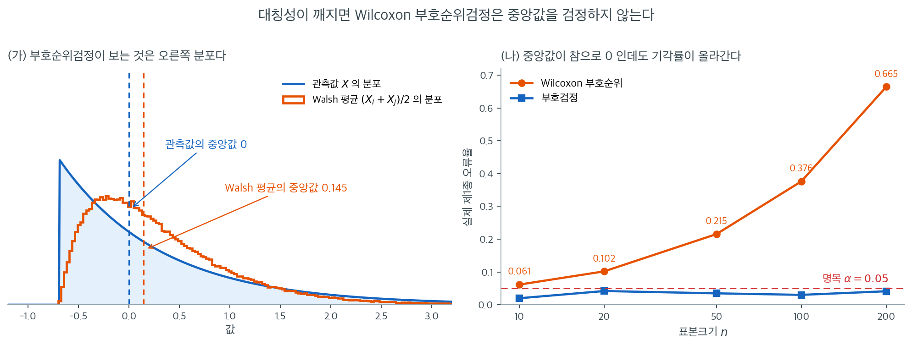
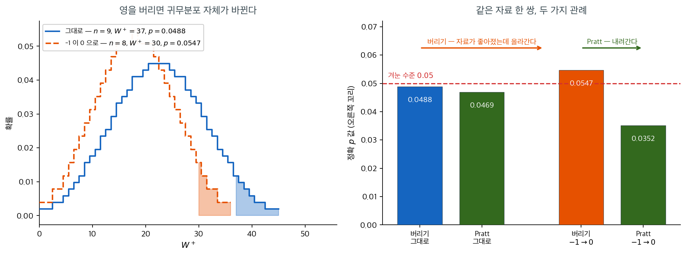

# Wilcoxon 부호순위검정

한 심리학자가 새 프로토콜에서 피험자 $10$ 명의 반응시간을 재고 중앙값이 $250$ ms 와 다른지 묻는다. $250$ 에서 벗어난 양을 보면 $+45$, $+39$, $+25$ 처럼 크게 빠른 쪽이 있고 $-9$, $-13$ 처럼 조금 늦은 쪽이 있다. 부호만 세면 $+$ 가 일곱 $-$ 가 셋일 뿐이지만, **얼마나** 벗어났는지까지 쓰면 이야기가 달라진다. 그 크기를 순위로 바꾸어 넣는 것이 이 검정이고, 그 대가로 새 가정 하나를 지불한다.

[부호검정](sign_test.md)은 가설 중앙값으로부터의 편차에서 방향만 쓰고, 각 관측값이 $m_0$에서 얼마나 떨어져 있는지에 대한 정보를 모두 버린다. **Wilcoxon 부호순위검정**은 부호와 함께 절대편차의 *순위*까지 반영하여 $m_0$에서 크게 벗어난 관측값에 더 큰 가중치를 준다. 이 추가 정보 덕에, 편차의 분포가 대칭이기만 하면 더 강력한 검정이 된다.

!!! note "순위합검정과 혼동하지 말 것"
    **Wilcoxon 부호순위검정**은 일표본 또는 대응자료를 위한 것이다. **Wilcoxon 순위합검정**([순위합검정](../two_sample_nonparametric/rank_sum.md) 참조)은 독립인 두 표본을 비교하기 위한 것이다.

---

## 1. 가정

1. 관측값 $X_1, X_2, \ldots, X_n$이 독립이다.
2. 각 $X_i$가 연속분포에서 나온다.
3. $H_0$ 아래에서 $X_i - m_0$의 분포가 0을 중심으로 **대칭**이다.

대칭성 가정이 부호검정에 비해 추가로 요구되는 핵심 조건이다. 대칭성이 깨지면 부호검정이 더 안전한 선택이다.



이 가정을 "웬만하면 괜찮겠지" 정도로 넘기기 쉬운데, 그러면 안 되는 이유가 위 그림에 있다. 자료는 $\text{Exp}(1)$에서 중앙값 $\ln 2$를 뺀 분포이다. 중앙값이 **정확히 $0$**이므로 귀무가설 "중앙값 $= 0$"은 참이다. 그런데 오른쪽으로 심하게 치우쳐 있어 대칭성은 깨져 있다.

(가)를 보라. 파란 곡선이 관측값 $X$의 분포이고 중앙값이 $0$이다. 주황 곡선은 모든 쌍의 평균 $(X_i + X_j)/2$, 즉 **Walsh 평균**의 분포인데 그 중앙값이 $0.145$로 오른쪽에 있다. 부호순위검정이 실제로 검정하는 귀무가설은 $P(X_i + X_j > 0) = 1/2$, 곧 **Walsh 평균의 중앙값이 $0$**이라는 것이다. 대칭분포에서는 두 중앙값이 일치하지만 여기서는 $0$과 $0.145$로 갈라진다. 검정은 자기가 보는 쪽이 $0$이 아님을 정직하게 잡아낼 뿐이다.

(나)가 그 결과이다. 표본크기를 $10$에서 $200$까지 늘려 가며 실제 기각률을 재면 부호순위검정은 $0.061 \to 0.102 \to 0.215 \to 0.376 \to 0.665$로 **올라간다.** 근사 오차라면 $n$이 커질수록 $0.05$에 가까워져야 하는데 정반대로 간다. $n \to \infty$에서 기각률이 $1$로 수렴한다는 뜻이며, 이것은 근사의 문제가 아니라 **검정이 다른 가설을 검정하고 있다**는 신호이다. 같은 자료에서 부호검정은 $0.020$부터 $0.042$ 사이에 머문다.

실무 지침은 간단하다. 대응차이의 히스토그램이나 Q-Q 그림에서 뚜렷한 치우침이 보이면 부호순위검정을 쓰지 말라. $\text{ARE}$가 $0.955$ 대 $0.637$이라 아깝게 느껴지겠지만, **엉뚱한 가설을 강력하게 검정하는 것보다 옳은 가설을 약하게 검정하는 편이 낫다.**

---

## 2. 가설

가설 중앙값이 $m_0$인 일표본 검정에서

$$
H_0 \colon X \text{의 중앙값이 } m_0 \text{과 같다}
$$

$$
H_a \colon X \text{의 중앙값이 } m_0 \text{과 다르다} \quad \text{(양측)}
$$

단측 대립가설 $H_a \colon \text{중앙값} > m_0$ 또는 $H_a \colon \text{중앙값} < m_0$도 마찬가지 방식으로 다룬다.

---

## 3. 검정통계량

**1단계.** 편차 $D_i = X_i - m_0$을 계산한다.

**2단계.** $D_i = 0$인 관측값($m_0$과 같은 값)을 버린다. 남은 관측값의 개수를 $n$이라 하자.

**3단계.** 절대편차 $|D_1|, |D_2|, \ldots, |D_n|$을 작은 값부터 순위를 매긴다. 동점에는 중간순위를 배정한다.

**4단계.** 부호순위를 정의한다.

$$
W_i = \operatorname{sign}(D_i) \cdot R_i
$$

여기서 $R_i$는 $|D_i|$의 순위이다.

**5단계.** 양·음 순위합을 계산한다.

$$
W^+ = \sum_{\{i : D_i > 0\}} R_i, \qquad W^- = \sum_{\{i : D_i < 0\}} R_i
$$

$W^+ + W^- = n(n+1)/2$임에 유의하라.

양측검정의 검정통계량은

$$
T = \min(W^+, W^-)
$$

이다. $T$가 작으면 $H_0$에 반하는 증거가 된다.

---

## 4. 귀무분포

편차가 대칭인 $H_0$ 아래에서 $2^n$가지 부호 배정이 모두 동등하게 가능하다. $T$(또는 동치로 $W^+$)의 정확 귀무분포는 $n$이 작을 때 열거로 표를 만들 수 있다.

**$H_0$ 아래 $W^+$의 평균과 분산:**

$$
\mu_{W^+} = \frac{n(n+1)}{4}
$$

$$
\sigma_{W^+}^2 = \frac{n(n+1)(2n+1)}{24}
$$

<div class="storybox" markdown>

**그림으로 보는 통계학 1.** 한 줄로 처리된 영

§3 의 2단계는 한 줄짜리다 — 「$D_i = 0$ 인 관측값을 버린다.」 교과서마다 그렇게 적혀 있고 대개의 구현도 그것을 기본값으로 삼는다. 그런데 그 한 줄을 두고 $1959$ 년 『Journal of the American Statistical Association』 $54$ 권 $655$–$667$ 쪽에 **열세 쪽짜리 논문 한 편**이 실렸다. 제목은 「윌콕슨 부호순위 절차에서의 영과 동점에 관한 소견」, 쓴 사람은 존 W. 프랫이다.

제기한 흠은 초록 첫머리에 그대로 적혀 있다. 「관측값 가운데 $0$ 이 있을 때 윌콕슨 일표본 부호순위검정은 순위를 매기기 전에 $0$ 을 버림으로써 수행할 수 있다. **그러나 어떤 표본은 유의하게 양수가 아닌데, 모든 관측값을 똑같이 낮추어 더 음수가 된 표본이 보통의 윌콕슨 검정으로는 유의하게 양수가 될 수 있다.**」 자료를 대립가설에서 **멀어지는** 쪽으로 옮겼는데 결론이 대립가설 쪽으로 간다는 뜻이다.

프랫이 든 것은 모든 관측값을 한꺼번에 옮기는 꼴이지만, **하나만 옮겨도 같은 일이 생긴다.** 편차 열 개가 이렇다고 하자.

$$
-1,\quad 0,\quad 3,\quad 4,\quad 5,\quad 6,\quad 7,\quad -8,\quad 9,\quad 10
$$

여기서 $-1$ 하나를 $0$ 으로 바꾼다. 「양으로 치우쳤는가」를 묻는 검정에서 이것은 두말할 것 없이 **자료가 좋아진 것**이다.



왼쪽이 까닭이다. $0$ 을 버리므로 $n$ 이 $9$ 에서 $8$ 로 줄고 **$W^+$ 의 귀무분포가 통째로 다른 것으로 바뀐다.** 남은 순위도 하나씩 당겨져 $W^+$ 는 $37$ 에서 $30$ 으로 떨어진다. 두 수는 서로 다른 자 위에 있는데 같은 자인 양 읽힌다. 그 결과 오른쪽 꼬리가 $0.0488$ 에서 $0.0547$ 로 **두꺼워진다.** $\alpha = 0.05$ 에서 유의하던 것이 자료가 좋아진 뒤 유의하지 않게 된다.

프랫이 내놓은 고침은 간단하다. **$0$ 까지 넣어 순위를 매기고, $0$ 의 순위는 어느 쪽 합에도 넣지 않으며, 귀무분포는 「$0$ 이 몇 개인가」를 조건으로 세운다.** 그러면 $0$ 이 하나 늘어나도 $W^+$ 는 $44$ 로 그대로이고 귀무분포만 좁아진다. 오른쪽 그림에서 $p$ 가 $0.0469$ 에서 $0.0352$ 로 **내려간다.** 자료가 좋아졌으니 내려가는 것이 옳다.

$0$ 이 하나도 없으면 두 관례는 같은 수를 준다. 그래서 대부분의 자료에서는 이 한 줄이 아무 일도 하지 않는다. 다만 **$0$ 이 섞이는 자료 — 순서형 척도, 반올림된 측정값, 「변화 없음」이 흔한 전후 비교 — 에서는 어느 관례를 썼는지가 결론을 바꿀 수 있다.** 적어 두고 쓰는 편이 안전하다.

_확인한 곳 — 논문이 John W. Pratt 의 「Remarks on Zeros and Ties in the Wilcoxon Signed Rank Procedures」이고 『Journal of the American Statistical Association』 $54$ 권 $655$–$667$ 쪽($1959$)이라는 것, 인용한 초록의 두 문장(「$0$ 을 버림으로써 수행할 수 있다」·「어떤 표본은 유의하게 양수가 아닌데 모든 관측값을 똑같이 낮춘 더 음수인 표본이 보통의 윌콕슨 검정으로는 유의하게 양수가 될 수 있다」), 그리고 그가 내놓은 절차(「$0$ 을 포함해 순위를 매기고, $0$ 의 순위를 떼어 내고, 남은 음(또는 양) 순위합이 — $0$ 의 개수를 조건으로 한 — 귀무분포의 꼬리에 들면 기각한다」)는 그 논문의 [초록](https://www.semanticscholar.org/paper/Remarks-on-Zeros-and-Ties-in-the-Wilcoxon-Signed-Pratt/6b86a3fda78f31364b25d352b16bbb4f8b0f79d6) 에서 읽었다. 위의 편차 열 개와 네 개의 정확 $p$ 값($0.0488$·$0.0547$·$0.0469$·$0.0352$), 그리고 두 귀무분포는 **이 쪽에서 직접 찾고 계산한 것이다** — 프랫이 논문에 든 보기가 아니다_

</div>

### 작은 n' 에서는 손으로 셀 수 있다


그런데 $n'$이 작으면 근사에 기댈 필요가 없다. 귀무분포를 **손으로 세어 만들 수 있기** 때문이다. 그 과정이 위 그림이다.

(가)는 대응차이 $D = (4, -1, 7, 3, -2, 5)$ 여섯 개다. 절댓값 $(4, 1, 7, 3, 2, 5)$에 순위를 매기면 $(4, 1, 6, 3, 2, 5)$이고, 양의 차이가 받은 순위를 더하면 $W^+ = 4 + 6 + 3 + 5 = 18$이다.

(나)가 핵심이다. 차이가 $0$을 중심으로 대칭이면 각 순위의 부호가 **독립적인 동전던지기**로 정해진다. 순위가 여섯 개이므로 가능한 부호 배정은 $2^6 = 64$가지이고, 각각이 확률 $1/64$로 똑같이 가능하다. 그 $64$가지에서 나오는 $W^+$를 전부 세면 $0$부터 $21$까지 퍼진 막대그림이 되며, 이것이 $W^+$의 **정확 귀무분포**이다. 모집단이 정규인지 지수인지는 한 번도 쓰이지 않았다. 순위에 붙는 부호가 동전던지기라는 사실만 썼다.

관측값 $W^+ = 18$ 이상이 나오는 배정은 $64$가지 중 $5$가지여서 단측 $p$값이 $5/64 = 0.0781$이다. SciPy의 `stats.wilcoxon(D, alternative="greater")`가 돌려주는 값과 정확히 같다. 표도 $t$ 분포표도 필요 없고, 근사 오차도 없다.

이 열거가 가능한 범위가 곧 정확검정을 쓸 수 있는 범위이다. $n' = 6$이면 $64$가지, $n' = 20$이면 약 $100$만 가지로 여전히 즉시 계산되지만 $n' = 50$이면 $10^{15}$가지가 되어 동적계획법이나 정규근사로 넘어가야 한다. SciPy가 $n' \le 25$에서 기본적으로 `method="exact"`를 쓰는 것이 이 경계선이다.

---

## 5. 정규근사

$n$이 크면(보통 $n \ge 20$) 표준화된 통계량

$$
Z = \frac{W^+ - \mu_{W^+}}{\sigma_{W^+}}
$$

은 근사적으로 $\mathcal{N}(0, 1)$을 따른다.

$|D_i|$ 값들에 동점이 있으면 분산에 보정이 필요하다. 크기가 $t_1, t_2, \ldots, t_g$인 동점 집단이 $g$개 있을 때 보정된 분산은

$$
\sigma_{W^+}^2 = \frac{n(n+1)(2n+1)}{24} - \frac{1}{48}\sum_{j=1}^{g}(t_j^3 - t_j)
$$

이다.

<div class="exbox" markdown>

**보기 1.** <span class="diff easy" title="쉬움"></span> 반응시간의 윌콕슨 부호순위검정. 한 심리학자가 새 프로토콜에서 피험자 10명의 반응시간(ms)을 측정하고, 중앙값 반응시간이 $m_0 = 250$ ms와 다른지 검정하려 한다.

| 피험자 | $X_i$ | $D_i = X_i - 250$ | $\lvert D_i \rvert$ | 순위 | 부호순위 |
|:-------:|:------:|:------------------:|:--------:|:----:|:-----------:|
| 1 | 268 | 18 | 18 | 5 | $+5$ |
| 2 | 241 | $-9$ | 9 | 2 | $-2$ |
| 3 | 273 | 23 | 23 | 7 | $+7$ |
| 4 | 230 | $-20$ | 20 | 6 | $-6$ |
| 5 | 255 | 5 | 5 | 1 | $+1$ |
| 6 | 262 | 12 | 12 | 3 | $+3$ |
| 7 | 289 | 39 | 39 | 9 | $+9$ |
| 8 | 237 | $-13$ | 13 | 4 | $-4$ |
| 9 | 295 | 45 | 45 | 10 | $+10$ |
| 10 | 275 | 25 | 25 | 8 | $+8$ |

**순위합 계산:**

</div>

??? success "풀이"
    $$
    W^+ = 5 + 7 + 1 + 3 + 9 + 10 + 8 = 43
    $$

    $$
    W^- = 2 + 6 + 4 = 12
    $$

    **검산:** $W^+ + W^- = 43 + 12 = 55 = 10(11)/2$. $\checkmark$

    **검정통계량:** $T = \min(43, 12) = 12$.

    **정규근사:**

    $$
    \mu_{W^+} = \frac{10(11)}{4} = 27.5
    $$

    $$
    \sigma_{W^+} = \sqrt{\frac{10(11)(21)}{24}} = \sqrt{96.25} \approx 9.811
    $$

    $$
    Z = \frac{43 - 27.5}{9.811} \approx 1.580
    $$

    $$
    p = 2\,\Phi(-1.580) \approx 0.114
    $$

    $\alpha = 0.05$에서 $H_0$을 기각하지 못한다. 중앙값 반응시간이 250 ms와 다르다는 증거가 충분하지 않다.

    !!! warning "$n = 10$에서 정규근사는 낙관적이다"
        같은 자료의 **정확** 양측 $p$값은 $0.1309$로, 정규근사값 $0.114$보다 15% 크다. 연속성 보정을 넣으면 $0.1263$으로 정확값에 가까워진다.

        ```python
        import numpy as np
        from scipy import stats
        d = np.array([268, 241, 273, 230, 255, 262, 289, 237, 295, 275]) - 250
        print(stats.wilcoxon(d, method='exact').pvalue)                     # 0.13086
        print(stats.wilcoxon(d, method='approx', correction=False).pvalue)  # 0.11413
        print(stats.wilcoxon(d, method='approx', correction=True).pvalue)   # 0.12628
        ```

        출력:

        ```
        0.130859375
        0.11412832776223866
        0.12627892855469777
        ```

        이 보기에서는 세 값 모두 $\alpha = 0.05$에서 같은 결론을 주지만, 근사가 $p$값을 체계적으로 과소평가한다는 점은 기억해야 한다. $n \le 20$에서는 SciPy가 기본적으로 정확검정을 쓰며, 그 편이 옳다.

### 크기 정보가 결론을 뒤집는다

<div class="exbox" markdown>

**보기 2.** <span class="diff easy" title="쉬움"></span> 크기 정보가 결론을 뒤집는다. 같은 15쌍에 부호순위검정을 돌리면 $W = 11$, $p = 0.0086$ 으로 부호검정의 $p = 0.0209$ 보다 2.4배 작다.

**(1)** 그 차이가 어디에서 오는지 $W^+ = 103$, $W^- = 11$ 을 써서 말하시오. 부호검정에게는 전달되지 않는 정보가 무엇인가.

**(2)** 차이의 **부호는 그대로 두고 크기만 뒤바꾸어** 부호검정의 p-값은 변하지 않는데 부호순위검정이 기각하지 못하게 만들 수 있는가.

</div>

??? success "풀이"

    **(1) 음의 차이 둘이 가장 작은 쪽이다.** 0 이 아닌 차이 열둘의 절대값은 $2, 2, 3, 3, 6, 6, 8, 9, 10, 12, 14, 17$ 이고, 음의 차이는 $-2$ 와 $-3$ 둘뿐이다. Pratt 방식의 순위에서 그 둘이 받는 것은 $4.5$ 와 $6.5$ 로 **열두 개 가운데 아래쪽 두 자리**다. 그래서

    $$
    W^- = 4.5 + 6.5 = 11,
    \qquad
    W^+ = 103,
    \qquad
    W^+ + W^- = 114
    $$

    로 양의 순위가 압도한다.

    **부호검정에게는 이 사실이 전달되지 않는다.** 부호검정은 $n_+ = 10$, $n_- = 2$ 라는 두 숫자만 본다. 음의 차이가 $-2, -3$ 인지 $-17, -14$ 인지 구별하지 못한다. 부호순위검정은 "반대 방향 증거가 둘 있는데 그 둘이 가장 약한 것들이다" 를 $W^- = 11$ 이라는 작은 수로 셈에 넣는다. 그만큼 증거가 강해지고 p-값이 $0.0209$ 에서 $0.0086$ 으로 내려간다.

    **(2) 만들 수 있다.** 절대값의 **다중집합을 그대로 유지**하고 음의 부호만 가장 큰 두 값에 옮긴다.

    $$
    d' = (-17,\ -14,\ 12,\ 10,\ 9,\ 8,\ 6,\ 6,\ 3,\ 3,\ 2,\ 2,\ 0,\ 0,\ 0)
    $$

    $\lvert d' \rvert$ 의 다중집합은 $\lvert d \rvert$ 와 같고, 양수 열 개·음수 두 개·0 세 개도 그대로다. **따라서 부호검정은 $n_+ = 10$, $n_- = 2$, $n = 12$ 를 그대로 받아 $Z = 2.3094$, $p = 0.0209$ 를 그대로 낸다.**

    부호순위검정은 다르다. 순위가 같은 자리(동점 묶음도 같으므로 $\operatorname{E}[W] = 57$, $\sigma = 17.496428$ 이 변하지 않는다)에 있지만 음의 차이가 **가장 높은 두 순위** $14$ 와 $15$ 를 받는다.

    $$
    W^- = 14 + 15 = 29,
    \qquad
    W^+ = 114 - 29 = 85
    $$

    $$
    z = \frac{29 - 57}{17.496428} = -1.600327
    \implies p = 0.109526
    $$

    **$0.0086$ 에서 $0.1095$ 로 열세 배 올라가 기각하지 못한다.** 부호검정의 p-값은 한 자리도 움직이지 않았다.

    | | 원래 자료 | 크기를 뒤바꾼 자료 |
    |---|---|---|
    | $n_+ / n_-$ | 10 / 2 | 10 / 2 |
    | 부호검정 $p$ | 0.0209 | **0.0209** (같다) |
    | $W^- / W^+$ | 11 / 103 | 29 / 85 |
    | 부호순위 $p$ | 0.0086 | **0.1095** (기각 못 함) |

    이것이 두 검정의 관계를 가장 또렷하게 보여 준다. **부호검정은 부호의 개수만 보므로 크기를 어떻게 섞어도 같은 답을 낸다.** 부호순위검정은 반대 방향 증거의 **크기**까지 보므로, 소수의 반대 사례가 크면 결론을 바꾼다. 어느 쪽이 옳은지는 자료가 아니라 가정이 정한다 — 부호순위검정의 $0.1095$ 는 **차이의 분포가 0 을 중심으로 대칭**이라는 가정 아래의 답이고, 부호검정의 $0.0209$ 는 그 가정 없이 얻은 답이다.

    **수치적으로.**

    ```python
    import numpy as np
    import scipy.stats as stats

    data = np.array([
        [93, 76], [70, 72], [81, 75], [65, 68], [79, 65],
        [54, 54], [94, 88], [91, 81], [77, 65], [65, 57],
        [95, 86], [89, 87], [78, 78], [80, 77], [76, 76]
    ])

    # 부호순위검정은 부호뿐 아니라 차이의 크기 순위까지 쓴다. 그래서 같은
    # 자료에서 부호검정보다 작은 p-값이 나온다.
    statistic, p_value = stats.wilcoxon(
        data[:, 0], data[:, 1],
        alternative="two-sided",
        method="approx",      # 정규근사
        zero_method="pratt"   # 0을 순위 매기기에 포함
    )
    print(f"{statistic = }")   # 11.0  (= W^-)
    print(f"{p_value   = :.4f}")   # 0.0086
    ```

    출력:

    ```
    statistic = 11.0
    p_value   = 0.0086
    ```

    ```python
    d_orig = data[:, 0] - data[:, 1]
    # 부호는 그대로, 크기만 뒤바꾼다. |d| 의 다중집합이 같다.
    d_swap = np.array([-17, -14, 12, 10, 9, 8, 6, 6, 3, 3, 2, 2, 0, 0, 0])
    print(f"원래  |d| 정렬 {sorted(np.abs(d_orig))}")
    print(f"뒤바꾼 |d| 정렬 {sorted(np.abs(d_swap))}   <- 같다")

    for label, d in (("원래      ", d_orig), ("크기 뒤바꿈", d_swap)):
        r = stats.rankdata(np.abs(d))
        n_plus, n_minus = int((d > 0).sum()), int((d < 0).sum())
        n = n_plus + n_minus
        z_sign = (n_plus / n - 0.5) / np.sqrt(0.25 / n)
        w = stats.wilcoxon(d, method="approx", zero_method="pratt")
        print(f"\n{label}: n+={n_plus} n-={n_minus}  "
              f"부호검정 z={z_sign:.4f} p={2 * stats.norm.sf(abs(z_sign)):.4f}")
        print(f"            W-={r[d < 0].sum():.1f}  W+={r[d > 0].sum():.1f}  "
              f"부호순위 W={w.statistic:.1f} p={w.pvalue:.6f}")
    ```

    출력:

    ```
    원래  |d| 정렬 [0, 0, 0, 2, 2, 3, 3, 6, 6, 8, 9, 10, 12, 14, 17]
    뒤바꾼 |d| 정렬 [0, 0, 0, 2, 2, 3, 3, 6, 6, 8, 9, 10, 12, 14, 17]   <- 같다

    원래      : n+=10 n-=2  부호검정 z=2.3094 p=0.0209
                W-=11.0  W+=103.0  부호순위 W=11.0 p=0.008561

    크기 뒤바꿈: n+=10 n-=2  부호검정 z=2.3094 p=0.0209
                W-=29.0  W+=85.0  부호순위 W=29.0 p=0.109526
    ```

    **부호검정의 $z = 2.3094$ 와 $p = 0.0209$ 가 두 자료에서 완전히 같고, 부호순위검정만 $0.008561 \to 0.109526$ 으로 움직인다.** 손으로 구한 $W^- = 29$, $z = -1.600327$ 도 맞는다.

    **지어낸 자료가 아니면 이런 일이 드물다고 생각하기 쉬우나 그렇지 않다.** "대부분 좋아졌지만 몇 사람은 크게 나빠졌다" 는 흔한 임상 양상이 바로 이 모양이다. 그때 부호검정과 부호순위검정이 갈리며, 어느 쪽을 보고할지는 **몇 명이 나빠졌는가**를 묻는지 **얼마나 나빠졌는가**를 묻는지에 달려 있다.

!!! warning "`mode=` 는 더 이상 쓰이지 않는다"
    옛 SciPy 코드는 `mode="approx"`를 썼지만 이 인자는 `method=`로 바뀌었다. 옛 이름은 SciPy 1.9에서 폐기되었고 이후 제거되었다.

    또 `zero_method="pratt"`를 쓰면 정확검정을 쓸 수 없다(0이 있으면 정확 귀무분포가 정의되지 않는다). SciPy는 이 경우 경고와 함께 정규근사로 자동 전환한다.

---

### 0 을 다루는 두 가지 관례

<div class="exbox" markdown>

**보기 3.** <span class="diff easy" title="쉬움"></span> 0 을 다루는 두 가지 관례. 대응 관측 15쌍에서 차이가 정확히 0 인 쌍이 **세 개** 나온다. `scipy` 에 `zero_method="pratt"`, `method="approx"` 를 주면 $W = 11$, $p = 0.0086$이 나온다.

**(1)** 차이를 구하고 `"pratt"` 관례로 $W^+$ 와 $W^-$ 를 손으로 계산하시오. `"wilcox"` 관례와 무엇이 다르며 어느 쪽이 보수적인가.

**(2)** 0 보정과 동점 보정을 넣은 정규근사로 $p = 0.0086$을 재현하시오.

</div>

??? success "풀이"

    **(1) 차이와 두 관례.** 각 쌍의 차이는

    $$
    d = (17,\ -2,\ 6,\ -3,\ 14,\ 0,\ 6,\ 10,\ 12,\ 8,\ 9,\ 2,\ 0,\ 3,\ 0)
    $$

    이고 **0 이 세 개**(6, 13, 15번째) 있다. 두 관례는 이 0 을 다르게 다룬다.

    - **`"wilcox"`**(윌콕슨의 본래 방식) — 0 인 쌍을 **먼저 버리고** 남은 $n' = 12$개에 다시 순위를 매긴다.
    - **`"pratt"`** — 0 을 **순위 매길 때는 함께 세고** 합에서만 뺀다.

    `"pratt"` 로 가 보자. $\lvert d \rvert$ 열다섯 개 전부에 순위를 매긴다. $0$ 이 셋이므로 순위 $1,2,3$ 의 평균 $2$ 를, $2$ 가 둘이므로 $4,5$ 의 평균 $4.5$ 를, $3$ 이 둘이므로 $6,7$ 의 평균 $6.5$ 를, $6$ 이 둘이므로 $8,9$ 의 평균 $8.5$ 를 주고, 나머지 $8,9,10,12,14,17$ 에 차례로 $10,11,12,13,14,15$ 를 준다.

    $$
    r = (15,\ 4.5,\ 8.5,\ 6.5,\ 14,\ 2,\ 8.5,\ 12,\ 13,\ 10,\ 11,\ 4.5,\ 2,\ 6.5,\ 2)
    $$

    부호를 붙여 더하면 음의 차이는 $-2$ 와 $-3$ 둘뿐이므로

    $$
    W^- = 4.5 + 6.5 = 11,
    \qquad
    W^+ = 15 + 8.5 + 14 + 8.5 + 12 + 13 + 10 + 11 + 4.5 + 6.5 = 103
    $$

    이고 $W = \min = 11$ 이다. **검산은 0 의 순위를 뺀 총합이다.**

    $$
    W^+ + W^- = \frac{n(n+1)}{2} - (2 + 2 + 2) = 120 - 6 = 114,
    \qquad 103 + 11 = 114 \ \checkmark
    $$

    `"wilcox"` 로 가면 0 세 개를 버려 $n' = 12$ 가 되고 $\lvert d \rvert$ 를 다시 매긴 순위에서 $W^- = 1.5 + 3.5 = 5$, $W^+ = 73$, 합은 $12 \times 13/2 = 78$ 이다. $W = 5$ 이고 p-값은 $0.007579$ 다.

    **`"pratt"` 쪽이 보수적이다.** 0 에 가장 낮은 순위를 깔아 두면 그 위의 순위가 모두 한 칸씩 올라가므로, 작은 쪽 꼬리에 들어 있는 $-2$ 와 $-3$ 의 순위도 $1.5, 3.5$ 에서 $4.5, 6.5$ 로 올라간다. 중심에서 덜 멀어지는 셈이라 p-값이 커진다: $0.008561 > 0.007579$.

    **(2) 정규근사.** `"pratt"` 에서는 0 을 순위 매김에 포함했으므로 기댓값과 분산도 전체 $n = 15$ 에서 출발해 0 의 몫 $n_0 = 3$ 을 덜어 낸다.

    $$
    \operatorname{E}[W] = \frac{n(n+1)}{4} - \frac{n_0(n_0+1)}{4} = 60 - 3 = 57
    $$

    $$
    24\operatorname{Var}(W) = n(n+1)(2n+1) - n_0(n_0+1)(2n_0+1) - \frac{1}{2}\sum_j (t_j^3 - t_j)
    $$

    동점 묶음은 **0 을 뺀 순위에서** 센다. $4.5$ 가 둘, $6.5$ 가 둘, $8.5$ 가 둘이므로 $t = 2$ 인 묶음 셋이고 $\sum (t^3 - t) = 3 \times 6 = 18$, 그 절반이 $9$ 다.

    $$
    24\operatorname{Var}(W) = 7440 - 84 - 9 = 7347
    \implies \operatorname{Var}(W) = 306.125,\quad \sigma = 17.496428
    $$

    $$
    z = \frac{11 - 57}{17.496428} = -2.629108
    \implies p = 2\Phi(-2.629108) = 0.008560915879
    $$

    **`scipy` 가 준 $0.008560915878575636$과 소수 열한째 자리까지 같다.**

    **수치적으로.**

    ```python
    from scipy import stats
    import numpy as np

    paired_data = np.array([
        [93, 76], [70, 72], [81, 75], [65, 68], [79, 65],
        [54, 54], [94, 88], [91, 81], [77, 65], [65, 57],
        [95, 86], [89, 87], [78, 78], [80, 77], [76, 76]
    ])

    # 대응표본에는 부호순위검정을 쓴다. 짝을 무시하고 독립표본 검정을 쓰면
    # 개체 간 변동이 그대로 남아 검정력을 크게 잃는다.
    stat, p = stats.wilcoxon(
        paired_data[:, 0], paired_data[:, 1],
        alternative="two-sided", method="approx", zero_method="pratt"
    )
    print(f"W = {stat}, p = {p:.4f}")
    # W = 11.0, p = 0.0086
    ```

    출력:

    ```
    W = 11.0, p = 0.0086
    ```

    ```python
    from collections import Counter

    d = paired_data[:, 0] - paired_data[:, 1]
    n, n0 = len(d), int((d == 0).sum())
    r = stats.rankdata(np.abs(d))          # pratt: 0 도 함께 순위를 매긴다
    print(f"차이  {list(d)}")
    print(f"순위  {list(r)}   (0 이 {n0} 개)")
    W_plus, W_minus = r[d > 0].sum(), r[d < 0].sum()
    zero_rank_sum = r[d == 0].sum()
    print(f"W+ = {W_plus},  W- = {W_minus},  합 = {W_plus + W_minus}"
          f"   (n(n+1)/2 - 0 의 순위합 = {n * (n + 1) / 2} - {zero_rank_sum})")

    E = n * (n + 1) / 4 - n0 * (n0 + 1) / 4
    tie = sum(c ** 3 - c for c in Counter(r[d != 0]).values())
    V24 = n * (n + 1) * (2 * n + 1) - n0 * (n0 + 1) * (2 * n0 + 1) - tie / 2
    V = V24 / 24
    z = (W_minus - E) / np.sqrt(V)
    print(f"\nE[W] = {E},  24Var = {n * (n + 1) * (2 * n + 1)} - "
          f"{n0 * (n0 + 1) * (2 * n0 + 1)} - {tie / 2} = {V24}")
    print(f"Var = {V},  sigma = {np.sqrt(V):.6f}")
    print(f"z = {z:.6f},  양측 p = {2 * stats.norm.cdf(z):.12f}")
    print(f"scipy (pratt)  = {p:.12f}")

    w = stats.wilcoxon(paired_data[:, 0], paired_data[:, 1],
                       method="approx", zero_method="wilcox")
    print(f"scipy (wilcox) = W {w.statistic},  p = {w.pvalue:.12f}")
    ```

    출력:

    ```
    차이  [17, -2, 6, -3, 14, 0, 6, 10, 12, 8, 9, 2, 0, 3, 0]
    순위  [15.0, 4.5, 8.5, 6.5, 14.0, 2.0, 8.5, 12.0, 13.0, 10.0, 11.0, 4.5, 2.0, 6.5, 2.0]   (0 이 3 개)
    W+ = 103.0,  W- = 11.0,  합 = 114.0   (n(n+1)/2 - 0 의 순위합 = 120.0 - 6.0)

    E[W] = 57.0,  24Var = 7440 - 84 - 9.0 = 7347.0
    Var = 306.125,  sigma = 17.496428
    z = -2.629108,  양측 p = 0.008560915879
    scipy (pratt)  = 0.008560915879
    scipy (wilcox) = W 5.0,  p = 0.007579201614
    ```

    **손으로 세운 $\operatorname{E}[W] = 57$, $\operatorname{Var}(W) = 306.125$, $z = -2.629108$ 이 `scipy` 의 p-값을 그대로 재현한다.** 두 관례의 차이 $0.008561$ 대 $0.007579$ 는 열 몇 퍼센트이고 둘 다 $0.01$ 보다 작아 여기서는 결론이 같다. 그러나 **0 이 많아질수록 두 값은 벌어진다.** 0 이 생기는 까닭을 먼저 따져 보아야 한다. 측정 눈금이 거칠어 생긴 0 이라면 버리는 쪽(`"wilcox"`)이 자료를 줄여 검정력을 깎고, 진짜로 변화가 없어서 생긴 0 이라면 $H_0$ 쪽 증거이므로 포함하는 쪽(`"pratt"`)이 옳다. 어느 관례를 썼는지 반드시 밝혀야 한다.

!!! danger "같은 자료에 두 검정을 섞어 쓰지 말 것"
    위 대응자료를 두 열로 쪼개어 `ranksums`에 넣으면 $Z = 1.472$, $p = 0.141$이 나온다.
    부호순위검정의 $p = 0.0086$과 16배 차이가 난다.

    자료의 **구조**가 어느 검정을 쓸지 결정한다. 같은 피험자를 두 번 측정했다면
    대응자료이고, 서로 다른 피험자 집단이라면 독립표본이다. 두 검정을 모두 돌려 보고
    작은 $p$값을 고르는 것은 명백한 오용이다.

---

## 6. 부호검정과의 비교

| 특징 | 부호검정 | Wilcoxon 부호순위 |
|:--------|:----------|:---------------------|
| 부호를 쓰는가 | 예 | 예 |
| 크기를 쓰는가 | 아니오 | 예 (순위를 통해) |
| 가정 | i.i.d. 외에 없음 | 차이의 분포가 대칭 |
| 검정력 | 낮음 | 높음 (대칭성이 성립할 때) |
| $t$ 검정 대비 ARE (정규자료) | $2/\pi \approx 0.637$ | $3/\pi \approx 0.955$ |
| 이상치에 대한 로버스트성 | 매우 높음 | 높음 |

부호순위검정은 정규성 아래에서 $t$ 검정과 거의 같은 검정력(ARE $\approx 0.955$)에 도달하며, 두꺼운 꼬리 분포에서는 $t$ 검정을 넘어설 수 있다. 부호검정은 대칭성 가정을 받아들일 수 없거나 자료가 순수하게 순서형일 때만 선호된다.

---

## 연습문제

<div class="drillbox" markdown>

**연습문제 1.** <span class="diff easy" title="쉬움"></span>
아래 콜레스테롤 자료로 Wilcoxon 부호순위검정을 수행하라.

| 환자 | 1 | 2 | 3 | 4 | 5 | 6 | 7 | 8 | 9 | 10 |
|:---:|:---:|:---:|:---:|:---:|:---:|:---:|:---:|:---:|:---:|:---:|
| 차이 | 10 | 5 | $-5$ | 15 | 2 | 5 | 10 | $-3$ | 15 | 10 |

**(a)** 절대차이 $|d_i|$를 구해 작은 값부터 순위를 매기고 부호순위를 배정하라.

**(b)** 검정통계량 $W^+ = \sum \text{(양의 차이들의 순위)}$를 계산하라.

**(c)** $n = 10$일 때 $H_0$ 아래 $W^+$의 기댓값은 $n(n+1)/4$, 분산은 $n(n+1)(2n+1)/24$이다. **동점 보정을 적용하여** $z$ 통계량과 근사 $p$값을 계산하라.

**(d)** 부호검정 결과와 결론을 비교하라.

</div>

??? success "풀이"

    **(a)** $|d_i|$를 정렬하면 2, 3, 5, 5, 5, 10, 10, 10, 15, 15이다.

    - 2 → 순위 1
    - 3 → 순위 2
    - 5, 5, 5 → 위치 3, 4, 5 → 중간순위 4
    - 10, 10, 10 → 위치 6, 7, 8 → 중간순위 7
    - 15, 15 → 위치 9, 10 → 중간순위 9.5

    | 환자 | $d_i$ | $\lvert d_i \rvert$ | 순위 | 부호순위 |
    |:---:|:---:|:---:|:---:|:---:|
    | 5 | 2 | 2 | 1 | $+1$ |
    | 8 | $-3$ | 3 | 2 | $-2$ |
    | 3 | $-5$ | 5 | 4 | $-4$ |
    | 2 | 5 | 5 | 4 | $+4$ |
    | 6 | 5 | 5 | 4 | $+4$ |
    | 1 | 10 | 10 | 7 | $+7$ |
    | 7 | 10 | 10 | 7 | $+7$ |
    | 10 | 10 | 10 | 7 | $+7$ |
    | 4 | 15 | 15 | 9.5 | $+9.5$ |
    | 9 | 15 | 15 | 9.5 | $+9.5$ |

    **(b)**

    $$
    W^+ = 1 + 4 + 4 + 7 + 7 + 7 + 9.5 + 9.5 = 49
    $$

    $$
    W^- = 2 + 4 = 6
    $$

    검산: $W^+ + W^- = 49 + 6 = 55 = n(n+1)/2 = 10 \times 11/2$.

    **(c)** $H_0$ 아래에서

    $$
    E[W^+] = \frac{n(n+1)}{4} = \frac{10 \times 11}{4} = 27.5
    $$

    보정하지 않은 분산은

    $$
    \frac{n(n+1)(2n+1)}{24} = \frac{10 \times 11 \times 21}{24} = 96.25
    $$

    이다. 동점 집단은 크기 3(값 5), 크기 3(값 10), 크기 2(값 15)이므로 보정항은

    $$
    \frac{1}{48}\sum_j (t_j^3 - t_j) = \frac{(27-3) + (27-3) + (8-2)}{48} = \frac{54}{48} = 1.125
    $$

    이고 보정된 분산은 $96.25 - 1.125 = 95.125$, 표준편차는 $9.753$이다.

    $$
    z = \frac{49 - 27.5}{9.753} = \frac{21.5}{9.753} \approx 2.204
    $$

    단측 $p$값은

    $$
    p = P(Z \ge 2.204) = 1 - \Phi(2.204) \approx 0.0137
    $$

    ```python
    import numpy as np
    from scipy import stats
    d = np.array([10, 5, -5, 15, 2, 5, 10, -3, 15, 10])
    print(stats.wilcoxon(d, alternative='greater', method='exact').pvalue)   # 0.013672
    print(stats.wilcoxon(d, alternative='greater', method='approx',
                         correction=False).pvalue)                           # 0.013748
    ```

    출력:

    ```
    0.013671875
    0.01374798396900858
    ```

    정확 $p$값 $0.01367$과 거의 일치한다. 동점 보정을 빠뜨리면 $z = 2.191$, $p = 0.0142$가 되어 정확값에서 조금 더 멀어진다.

    **(d)** Wilcoxon 부호순위검정은 $p \approx 0.0137$로 $\alpha = 0.05$에서 유의한 반면, 부호검정은 $p \approx 0.055$로 유의하지 않았다. Wilcoxon이 유의성에 도달한 것은 차이의 크기를 쓰기 때문이다. 큰 양의 차이(10과 15)가 높은 순위를 받아 $W^+$에 크게 기여한다. 부호검정은 모든 양의 차이를 똑같이 취급하여 이 정보를 낭비한다.

---

<div class="drillbox" markdown>

**연습문제 2.** <span class="diff med" title="중간"></span>
Wilcoxon 부호순위검정의 대칭성 가정이 깨지면 무슨 일이 일어나는가? 중앙값이 정확히 0인 비대칭 분포에서 제1종 오류율을 모의실험으로 확인하라.

</div>

??? success "풀이"
    중앙값이 0인 비대칭 분포를 만들자. $\text{Exp}(1)$에서 중앙값 $\ln 2$를 빼면 중앙값이 0이면서 오른쪽으로 치우친 분포가 된다.

    ```python
    import numpy as np
    from scipy import stats
    rng = np.random.default_rng(0)
    B = 3000
    for n in (10, 20, 50, 100):
        x = rng.exponential(1, (B, n)) - np.log(2)
        pw = np.array([stats.wilcoxon(x[i]).pvalue for i in range(B)])
        ps = np.array([stats.binomtest(int((x[i] > 0).sum()), n).pvalue
                       for i in range(B)])
        print(n, (pw < .05).mean(), (ps < .05).mean())
    ```

    출력:

    ```
    10 0.058333333333333334 0.019
    20 0.109 0.03966666666666667
    50 0.219 0.037
    100 0.37566666666666665 0.035
    ```

    | $n$ | Wilcoxon 부호순위 | 부호검정 |
    |---:|---:|---:|
    | 10 | 0.058 | 0.019 |
    | 20 | 0.109 | 0.040 |
    | 50 | 0.219 | 0.037 |
    | 100 | 0.376 | 0.035 |

    Wilcoxon 검정이 **무너진다**. 중앙값이 참으로 0인데도 $n = 100$에서 표본의 38%를 기각한다. 결정적으로, $n$이 커질수록 **더 나빠진다**. 크기가 명목수준으로 수렴하지 않고 1로 발산한다. 이것은 근사 오차가 아니라 검정이 다른 가설을 검정하고 있다는 신호이다.

    이유는 이렇다. Wilcoxon 부호순위검정이 실제로 검정하는 귀무가설은 "중앙값이 0"이 아니라

    $$
    H_0 \colon P(X_i + X_j > 0) = \tfrac{1}{2} \quad (i \ne j)
    $$

    즉 **Hodges-Lehmann 중앙값**(모든 쌍 평균 $(X_i + X_j)/2$의 중앙값, Walsh 평균이라고도 한다)이 0이라는 것이다. 대칭분포에서는 이것이 중앙값과 같지만 비대칭분포에서는 다르다. 중앙값 이동 지수분포에서 Walsh 평균의 중앙값은 약 $+0.147$로 0이 아니다.

    ```python
    y = rng.exponential(1, 200000) - np.log(2)
    w = (y[:100000] + y[100000:]) / 2
    print(np.median(y), np.median(w))     # 0.0001, 0.147
    ```

    출력:

    ```
    0.00011479673764763776 0.147140210508641
    ```

    이 $+0.147$이 바로 검정이 잡아내는 것이며, 표본이 커질수록 그 신호가 확실해지므로 기각률이 1로 간다.

    부호검정은 이 문제에서 자유롭다. 중앙값을 직접 검정하므로 크기가 $0.05$ 근처를 유지한다.

    **실무 지침:** 대응차이의 히스토그램이나 Q-Q 그림이 뚜렷한 치우침을 보이면 Wilcoxon 부호순위검정을 쓰지 말라. 검정력이 낮더라도 부호검정이 옳은 답을 준다.

---

<div class="drillbox" markdown>

**연습문제 3.** <span class="diff med" title="중간"></span>
Wilcoxon 부호순위검정을 역전시켜 중앙값의 신뢰구간을 만들 수 있다. $n = 10$인 보기 자료에서 95% 신뢰구간을 구하고, $t$ 신뢰구간과 비교하라.

</div>

??? success "풀이"
    부호순위검정의 신뢰구간은 **Walsh 평균**에 기반한다. 모든 쌍 $(i \le j)$에 대해 $(X_i + X_j)/2$를 계산하면 $n(n+1)/2 = 55$개의 값이 나온다. 정렬한 뒤 양 끝에서 $k$개씩 잘라내는데, $k$는 정확 부호순위 임계값이다.

    ```python
    import numpy as np
    from scipy import stats
    x = np.array([268, 241, 273, 230, 255, 262, 289, 237, 295, 275])
    n = len(x)
    walsh = np.array([(x[i] + x[j]) / 2 for i in range(n) for j in range(i, n)])
    walsh.sort()
    # 양측 95%: W+ <= 8 이면 기각 (2 * P(W+ <= 8) = 0.0488)
    k = 8
    print(len(walsh), walsh[k], walsh[-(k + 1)])   # 55 248.0 278.5
    print(np.median(walsh), x.mean(), np.median(x))  # 263.0 262.5 265.0
    print(stats.ttest_1samp(x, 0).confidence_interval())  # (246.90, 278.10)
    ```

    출력:

    ```
    55 246.0 278.5
    263.0 262.5 265.0
    ConfidenceInterval(low=246.89913171804932, high=278.1008682819507)
    ```

    $k$는 $2P(W^+ \le k) \le 0.05$를 만족하는 가장 큰 정수이다. $n = 10$에서 $2P(W^+ \le 8) = 0.0488$이고 $2P(W^+ \le 9) = 0.0645$이므로 $k = 8$이다.

    | 양 | 값 |
    |:---|---:|
    | Walsh 평균 개수 | $55$ |
    | Wilcoxon 95% 신뢰구간 | $(248.0, \; 278.5)$ |
    | Hodges-Lehmann 추정값 | $263.0$ |
    | $t$ 95% 신뢰구간 | $(246.9, \; 278.1)$ |
    | 표본평균 / 표본중앙값 | $262.5$ / $265.0$ |

    두 구간이 거의 같다. Wilcoxon 구간의 폭은 $30.5$, $t$ 구간의 폭은 $31.2$로 오히려 Wilcoxon이 살짝 좁다. 자료가 대칭에 가까워 순위 방법이 잃는 것이 거의 없기 때문이며, $\text{ARE} = 0.955$가 실제로 뜻하는 바이다.

    두 구간 모두 $250$을 포함하므로 앞의 검정 결과($p = 0.131$, 기각 못 함)와 일관된다. 검정과 구간이 이렇게 맞물리는 것은 우연이 아니다. 신뢰구간이 검정을 역전시켜 만들어졌으므로 **구조적으로** 일치한다.

    Hodges-Lehmann 추정값 $263.0$이 표본평균 $262.5$와 표본중앙값 $265.0$ 사이에 놓인다는 점도 눈여겨보라. Walsh 평균의 중앙값은 평균의 효율성과 중앙값의 로버스트성 사이의 절충으로, 정규분포에서 평균 대비 효율이 $0.955$이면서(중앙값은 $0.637$) 붕괴점은 $0.29$이다(평균은 $0$).

---

<div class="drillbox" markdown>

**연습문제 4.** <span class="diff hard" title="어려움"></span>
$W^+$의 평균 $n(n+1)/4$와 분산 $n(n+1)(2n+1)/24$를 유도하라.

</div>

??? success "풀이"
    $H_0$(대칭성) 아래에서 각 순위 $i$의 부호가 독립적으로 $\pm$ 중 하나를 확률 $1/2$씩 갖는다. 지시확률변수

    $$
    Z_i = \begin{cases} 1 & i\text{번째로 작은 절대편차가 양수} \\ 0 & \text{음수} \end{cases}
    $$

    를 두면 $Z_1, \ldots, Z_n$은 독립이고 $Z_i \sim \text{Bernoulli}(1/2)$이며

    $$
    W^+ = \sum_{i=1}^n i \, Z_i
    $$

    이다.

    **평균.** $E[Z_i] = 1/2$이므로

    $$
    E[W^+] = \sum_{i=1}^n i \cdot \frac{1}{2} = \frac{1}{2} \cdot \frac{n(n+1)}{2} = \frac{n(n+1)}{4}
    $$

    **분산.** $\text{Var}(Z_i) = 1/4$이고 $Z_i$들이 독립이므로

    $$
    \text{Var}(W^+) = \sum_{i=1}^n i^2 \cdot \frac{1}{4}
    = \frac{1}{4} \cdot \frac{n(n+1)(2n+1)}{6}
    = \frac{n(n+1)(2n+1)}{24}
    $$

    독립성이 성립하는 이유가 핵심이다. 대칭성 아래에서 $|D_i|$와 $\operatorname{sign}(D_i)$가 **독립**이므로, 어떤 절대편차가 어떤 순위를 받았는지와 무관하게 부호가 동전던지기로 결정된다. 이것이 대칭성 가정이 필요한 정확한 지점이며, 연습문제 2에서 이 가정이 깨질 때 검정이 무너지는 이유이기도 하다.

    동점이 있으면 순위 $i$가 중간순위 $r_i$로 대체되어 $\text{Var}(W^+) = \frac{1}{4}\sum_i r_i^2$이 된다. 이 합을 정리하면 본문의 보정식이 나온다.

---

<div class="drillbox" markdown>

**연습문제 5.** <span class="diff hard" title="어려움"></span>
4절은 "정확 귀무분포는 $n$이 작을 때 열거로 표를 만들 수 있다"고만 적고 지나갔다. $n = 6$에서 끝까지 해 보자.

**(a)** $H_0$ 아래에서 $W^+ = w$가 되는 경우의 수는 다항식 $\prod_{i=1}^{6}(1 + z^i)$에서 $z^w$의 계수와 같다. 왜 그런지 설명하고, 그 계수를 $w = 0, 1, \ldots, 21$에 대해 모두 구하라. 계수의 합이 $2^6 = 64$인지 검산하라.

**(b)** $T = \min(W^+, W^-)$의 양측 정확 $p$값은 $2P(W^+ \le t)$이다. $t = 0, 1, 2$에 대해 이 값을 분수로 적고, $\alpha = 0.05$ 양측검정의 기각역과 **실제** 유의수준을 구하라.

**(c)** (b)의 기각역을 $n = 6$ 부호검정의 $\alpha = 0.05$ 양측 기각역과 비교하라. $n = 6$에서 두 검정은 어떤 관계인가? 부호순위검정이 부호검정보다 **더 많이** 기각하기 시작하는 가장 작은 $n$을 구하라.

</div>

??? success "풀이"
    **(a)** 연습문제 4에서 보았듯 $H_0$ 아래에서 $W^+ = \sum_{i=1}^{6} i\,Z_i$이고 $Z_i$는 독립인 공정한 동전이다. 곧 $W^+$는 $\{1, 2, \ldots, 6\}$의 **부분집합의 합**이며, $2^6 = 64$가지 부분집합이 각각 확률 $1/64$를 갖는다.

    $\prod_{i=1}^{6}(1 + z^i)$를 전개할 때 $i$번째 괄호에서 $z^i$를 고르는 것은 $i$를 부분집합에 넣는 것과 같고, $1$을 고르는 것은 빼는 것과 같다. 전개항 하나가 부분집합 하나에 일대일로 대응하고 그 차수가 원소들의 합이므로, $z^w$의 계수는 합이 $w$인 부분집합의 개수이다.

    차례로 곱하면

    $$
    (1+z)(1+z^2) = 1 + z + z^2 + z^3
    $$

    $$
    \times (1+z^3) = 1 + z + z^2 + 2z^3 + z^4 + z^5 + z^6
    $$

    $$
    \times (1+z^4) = 1 + z + z^2 + 2z^3 + 2z^4 + 2z^5 + 2z^6 + 2z^7 + z^8 + z^9 + z^{10}
    $$

    이고, $\times(1+z^5)$는 계수열 $(1,1,1,2,2,2,2,2,1,1,1)$에 그것을 다섯 칸 밀어 더하는 것이므로 $(1,1,1,2,2,3,3,3,3,3,3,2,2,1,1,1)$이 된다(합 $32$ $\checkmark$). 마지막으로 여섯 칸 밀어 더하면

    | $w$ | 0 | 1 | 2 | 3 | 4 | 5 | 6 | 7 | 8 | 9 | 10 |
    |:---|---:|---:|---:|---:|---:|---:|---:|---:|---:|---:|---:|
    | 경우의 수 | 1 | 1 | 1 | 2 | 2 | 3 | 4 | 4 | 4 | 5 | 5 |
    | 누적 | 1 | 2 | 3 | 5 | 7 | 10 | 14 | 18 | 22 | 27 | 32 |

    이고 $w = 11, \ldots, 21$은 $w \mapsto 21 - w$ 대칭으로 $5, 5, 4, 4, 4, 3, 2, 2, 1, 1, 1$이다. 합은 $2 \times 32 = 64$ $\checkmark$.

    검산: $w = 3$의 계수가 $2$인 것은 $\{3\}$과 $\{1,2\}$ 둘뿐이기 때문이다.

    **(b)** 누적도수에서

    $$
    2P(W^+ \le 0) = \frac{2}{64} = \frac{1}{32} = 0.03125
    $$

    $$
    2P(W^+ \le 1) = \frac{4}{64} = 0.0625, \qquad 2P(W^+ \le 2) = \frac{6}{64} = 0.09375
    $$

    $0.05$ 이하인 가장 큰 $t$는 $t = 0$이다. 그러므로 $\alpha = 0.05$ 양측검정의 기각역은

    $$
    T = 0 \quad \Longleftrightarrow \quad W^+ \in \{0, 21\}
    $$

    이고 실제 유의수준은 $1/32 = 0.03125$이다. $n = 6$에서 $0.05$는 **도달할 수 없는 수준**이며, 쓸 수 있는 가장 가까운 수준이 $0.03125$라서 검정은 보수적이다.

    **(c)** $W^+ = 21$은 모든 순위가 $+$를 받았다는 뜻, $W^+ = 0$은 모두 $-$를 받았다는 뜻이다. 곧 기각역은 "$D_i$ 여섯 개의 부호가 모두 같다"이다.

    부호검정은 $S \sim \text{Bin}(6, 1/2)$에서 $S = 6$(또는 $0$)일 때 양측 $p = 2/64 = 0.03125$, $S = 5$일 때 $p = 2(6+1)/64 = 14/64 = 0.21875 > 0.05$이므로 역시 "부호가 모두 같다"에서만 기각한다. **$n = 6$, $\alpha = 0.05$ 양측에서 두 검정은 글자 그대로 같은 검정이다.** ARE가 $0.955$ 대 $0.637$이라는 차이가 나타날 자리가 아예 없다.

    $n = 7$에서는 달라진다. $n = 7$의 계수는 $c_7(w) = c_6(w) + c_6(w - 7)$이므로 $w = 0, 1, 2$에서 모두 $1$이고 누적이 $1, 2, 3$이다. 따라서

    $$
    2P(W^+ \le 2) = \frac{6}{128} = 0.046875 \le 0.05, \qquad 2P(W^+ \le 3) = \frac{10}{128} = 0.078125
    $$

    이므로 기각역은 $T \le 2$이다. 반면 부호검정은 $S = 7$에서 $p = 2/128 = 0.015625$, $S = 6$에서 $p = 2 \times 8/128 = 0.125$이므로 여전히 "부호가 모두 같다"뿐이다. $T \le 2$는 그것을 포함하면서 더 넓으므로 답은 $n = 7$이다.

    순위 정보의 이득은 $n$이 아주 작으면 쓸 자리가 없다. 도달 가능한 유의수준이 $2^{-n}$ 격자에 갇혀 있어서, 격자가 촘촘해지기 전에는 "더 세밀하게 기각한다"는 것이 불가능하기 때문이다.

---

<div class="drillbox" markdown>

**연습문제 6.** <span class="diff hard" title="어려움"></span>
$n = 7$인 대응차이에서 여섯 개가 양수이고 하나가 음수라고 하자. 음수인 관측값의 절대편차 순위를 $r \in \{1, 2, \ldots, 7\}$이라 한다(동점은 없다).

**(a)** $W^+$, $W^-$, $T$를 각각 $r$의 식으로 쓰라.

**(b)** 연습문제 5(c)에서 얻은 $n = 7$의 계수를 이어 구해(누적도수가 필요하다) $r = 1, 2, \ldots, 7$ 각각의 **양측 정확** $p$값을 분수와 소수로 모두 적어라.

**(c)** 같은 자료에 부호검정을 하면 양측 정확 $p$값은 얼마인가? $r$에 따라 두 $p$값의 대소가 뒤집히는 자리를 찾아라.

**(d)** 이 결과를 보고 "부호순위검정이 부호검정보다 강력하다"는 문장을 어떻게 고쳐 말해야 하는가?

</div>

??? success "풀이"
    **(a)** 순위 $1, \ldots, 7$의 합은 $7 \times 8 / 2 = 28$이고 음수가 받은 순위는 $r$ 하나뿐이므로

    $$
    W^- = r, \qquad W^+ = 28 - r, \qquad T = \min(28 - r,\; r) = r
    $$

    이다($r \le 7 < 21 \le 28 - r$). 부호 하나의 위치가 $T$를 그대로 결정한다.

    **(b)** $c_7(w) = c_6(w) + c_6(w-7)$에 $c_6 = (1,1,1,2,2,3,4,4,4,5,\ldots)$를 넣으면 $w = 0, \ldots, 7$에서 $c_7 = 1, 1, 1, 2, 2, 3, 4, 5$이고 누적은 $1, 2, 3, 5, 7, 10, 14, 19$이다. $p = 2P(W^+ \le r) = 2 \times (\text{누적})/128$이므로

    | $r$ | 1 | 2 | 3 | 4 | 5 | 6 | 7 |
    |:---|---:|---:|---:|---:|---:|---:|---:|
    | $p$ (분수) | $4/128$ | $6/128$ | $10/128$ | $14/128$ | $20/128$ | $28/128$ | $38/128$ |
    | $p$ (소수) | 0.0313 | 0.0469 | 0.0781 | 0.1094 | 0.1563 | 0.2188 | 0.2969 |

    **(c)** 부호검정은 순위를 보지 않으므로 $r$이 무엇이든 $S = 6$이고

    $$
    p_{\text{부호}} = \frac{2\left[\binom{7}{6} + \binom{7}{7}\right]}{128} = \frac{2 \times 8}{128} = \frac{16}{128} = 0.125
    $$

    이다. 부호순위검정의 $p$값은 $r \le 4$에서 $0.125$보다 작고($0.1094 < 0.125$) $r \ge 5$에서 크다($0.1563 > 0.125$). 대소가 뒤집히는 자리는 $r = 4$와 $r = 5$ 사이이다.

    끝의 두 경우를 나란히 보면 뜻이 분명해진다. 음수가 **가장 작은** 절대편차를 가지면($r = 1$) 부호순위검정은 $p = 0.0313$으로 $\alpha = 0.05$에서 기각하지만 부호검정은 $0.125$로 기각하지 못한다. 음수가 **가장 큰** 절대편차를 가지면($r = 7$) 거꾸로 부호순위검정이 $p = 0.2969$로 부호검정의 $0.125$보다 두 배 이상 보수적이 된다.

    **(d)** "강력하다"는 것은 **검정력 함수에 대한 평균적 진술**이지 자료 하나에 대한 진술이 아니다. 고정된 대립가설 아래 기각확률을 비교하면 부호순위검정이 이기지만, 주어진 표본에서 어느 $p$값이 더 작은지는 자료가 결정한다. 부호순위검정은 "큰 편차가 가설과 같은 방향을 가리킨다"에 상금을 걸고, 그 판돈을 "큰 편차가 반대 방향을 가리킨다"에서 잃는다. 이익과 손실이 같은 메커니즘에서 나온다.

    덧붙여, $r = 7$처럼 하나의 큰 반대방향 편차가 결론을 뒤집는 상황은 2장에서 중앙값이 평균보다 강건한 까닭과 같은 구도이다. 순위를 가중치로 쓰는 순간 강건성의 일부를 되돌려 놓는 셈이다.

---

<div class="drillbox" markdown>

**연습문제 7.** <span class="diff hard" title="어려움"></span>
6절 표의 $\text{ARE} = 3/\pi \approx 0.955$는 "정규자료에서 부호순위검정이 $t$ 검정과 같은 검정력을 내려면 표본을 $1/0.955 - 1 \approx 4.7\%$ 더 모아야 한다"는 뜻이다. 이것을 모의실험으로 확인하라.

$\mathcal{N}(0.4,\, 1)$에서 $\alpha = 0.05$ 양측, 반복 20,000회로 (i) $n = 40$의 $t$ 검정, (ii) $n = 40$의 부호순위검정, (iii) $n = 42$의 부호순위검정($42/40 = 1.05 > 1.047$)의 검정력을 재라. $W^+$는 5절의 정규근사로 평가한다.

이어서 꼬리가 두꺼운 $t_3$ 분포를 $0.4$만큼 평행이동한 자료에서 같은 셋을 재고, 두 분포에서 무엇이 뒤집히는지 설명하라. ARE라는 하나의 수가 왜 "비모수 검정이 약간 약하다"는 요약이 될 수 없는지 적어라.

</div>

??? success "풀이"
    ```python
    import numpy as np
    from scipy import stats

    rng = np.random.default_rng(0)
    B, delta = 20000, 0.4


    def pow_t(x):
        return (stats.ttest_1samp(x, 0, axis=1).pvalue < 0.05).mean()


    def pow_w(x):
        n = x.shape[1]
        r = stats.rankdata(np.abs(x), axis=1)
        wp = (r * (x > 0)).sum(axis=1)
        z = (wp - n * (n + 1) / 4) / np.sqrt(n * (n + 1) * (2 * n + 1) / 24)
        return (2 * stats.norm.sf(np.abs(z)) < 0.05).mean()


    for name, gen in [("정규", lambda m, n: rng.normal(0, 1, (m, n))),
                      ("t(3)", lambda m, n: rng.standard_t(3, (m, n)))]:
        pt = pow_t(gen(B, 40) + delta)
        p40 = pow_w(gen(B, 40) + delta)
        p42 = pow_w(gen(B, 42) + delta)
        print(f"{name}  t(n=40)={pt:.4f}  W(n=40)={p40:.4f}  W(n=42)={p42:.4f}")
    ```

    출력:

    ```text
    정규  t(n=40)=0.6936  W(n=40)=0.6784  W(n=42)=0.6938
    t(3)  t(n=40)=0.3704  W(n=40)=0.4943  W(n=42)=0.5114
    ```

    **정규자료.** 같은 $n = 40$에서 부호순위검정이 $0.6784$, $t$ 검정이 $0.6936$으로 $0.0152$ 뒤진다. 표본을 둘 더 모아 $n = 42$로 만들면 $0.6938$이 되어 $t$ 검정의 $0.6936$과 사실상 같아진다(차이 $0.0002$, 반복 20,000회의 표준오차는 $\sqrt{0.69 \times 0.31/20000} \approx 0.0033$이므로 구별할 수 없다). ARE $0.955$가 뜻하는 "표본 $4.7\%$"가 $n = 40$에서 이미 눈에 보이는 정확도로 맞는다. ARE는 $n \to \infty$, $\delta \to 0$의 극한값인데도 중간 크기 표본에서 잘 맞는다는 점이 이 수를 실용적으로 만든다.

    **$t_3$ 자료.** 순서가 뒤집힌다. 같은 $n = 40$에서 부호순위검정이 $0.4943$, $t$ 검정이 $0.3704$로 **부호순위검정이 $0.124$ 앞선다.** $t$ 검정이 잃는 것을 표본 수로 환산하면 $4.7\%$가 아니라 $30\%$가 넘는다. 두꺼운 꼬리가 표본표준편차를 부풀려 $t$ 통계량의 분모를 키우는 반면, 순위는 이상치의 **크기**가 아니라 **차례**만 보므로 영향을 받지 않는다.

    그래서 $0.955$는 "비모수 검정이 약간 약하다"가 아니라 **"정규분포라는 가장 불리한 전장에서조차 약간만 약하다"**로 읽어야 한다. ARE는 분포마다 다른 값이고, $0.955$는 $t$ 검정에 가장 유리한 경우에서 잰 값이다. 꼬리가 두꺼워지면 같은 비가 $1$을 넘고 한없이 커질 수도 있다. 포기하는 것($4.7\%$의 표본)은 상한이 있고 얻는 것(두꺼운 꼬리에서의 검정력)은 상한이 없다.

---

<div class="drillbox" markdown>

**연습문제 8.** <span class="diff hard" title="어려움"></span>
5절의 동점 보정항 $\frac{1}{48}\sum_j (t_j^3 - t_j)$은 분산에서 **빼진다.** 그러므로 보정을 빼먹으면 분모가 커지고 $|Z|$가 작아지며 $p$값이 커진다. 검정이 보수적으로 치우친다는 뜻이다. 얼마나 치우치는지 재어라.

$\mathcal{N}(0,1)$을 폭 $h$인 칸의 **중앙값**으로 반올림하면 대칭성은 그대로 유지되면서($D_i = 0$도 생기지 않으면서) 동점만 많아진다. $n = 30$, $h \in \{0.5, 1, 2\}$, 반복 20,000회로 보정·무보정 기각률을 재고 다음에 답하라.

**(a)** 무보정 기각률이 $h$가 커질수록 어떻게 변하는가? 보정한 쪽은 어떤가?

**(b)** 연습문제 4의 마지막 줄은 동점이 있을 때 $\operatorname{Var}(W^+) = \frac{1}{4}\sum_i r_i^2$($r_i$는 중간순위)이라고 했다. 이것이 본문의 보정식과 같은 수인지 수치로 확인하라.

**(c)** $h = 2$에서 이 검정은 사실상 어떤 검정이 되는가?

**(d)** "동점이 있으면 정확검정을 쓸 수 없다"는 말을 (b)에 비추어 정확하게 고쳐 쓰라.

</div>

??? success "풀이"
    ```python
    import numpy as np
    from scipy import stats

    rng = np.random.default_rng(0)
    B, n = 20000, 30
    mu = n * (n + 1) / 4
    var0 = n * (n + 1) * (2 * n + 1) / 24

    for h in (0.5, 1.0, 2.0):
        # N(0,1) 을 폭 h 인 칸의 중앙으로 반올림한다. 칸 중앙은 0 이 아니므로 D_i = 0 은 없다.
        d = h * np.floor(rng.normal(0, 1, (B, n)) / h) + h / 2
        r = stats.rankdata(np.abs(d), axis=1)            # 중간순위
        wp = (r * (d > 0)).sum(axis=1)

        corr = np.empty(B)
        ngrp = np.empty(B)
        for i in range(B):
            t = np.unique(np.abs(d[i]), return_counts=True)[1]
            corr[i] = (t ** 3 - t).sum() / 48
            ngrp[i] = len(t)

        p_no = 2 * stats.norm.sf(np.abs(wp - mu) / np.sqrt(var0))
        p_tc = 2 * stats.norm.sf(np.abs(wp - mu) / np.sqrt(var0 - corr))
        ident = np.abs((r ** 2).sum(axis=1) / 4 - (var0 - corr)).max()
        print(f"h={h}  |D| 값 {ngrp.mean():.2f} 종류  보정항 {corr.mean():6.2f}"
              f" (={100 * corr.mean() / var0:5.2f}% of {var0:.2f})"
              f"  기각률: 무보정 {(p_no < 0.05).mean():.4f}  보정 {(p_tc < 0.05).mean():.4f}"
              f"  항등식오차 {ident:.1e}")
    ```

    출력:

    ```text
    h=0.5  |D| 값 4.90 종류  보정항  60.68 (= 2.57% of 2363.75)  기각률: 무보정 0.0453  보정 0.0483  항등식오차 0.0e+00
    h=1.0  |D| 값 2.81 종류  보정항 201.47 (= 8.52% of 2363.75)  기각률: 무보정 0.0383  보정 0.0490  항등식오차 0.0e+00
    h=2.0  |D| 값 1.75 종류  보정항 490.76 (=20.76% of 2363.75)  기각률: 무보정 0.0287  보정 0.0471  항등식오차 0.0e+00
    ```

    **(a)** 무보정 기각률은 $0.0453 \to 0.0383 \to 0.0287$로 **단조 감소**한다. 명목수준 $0.05$의 절반을 향해 가는 것이다. 보정항이 분산의 $2.57\% \to 8.52\% \to 20.76\%$로 커지는 것과 나란히 간다. 보정한 쪽은 $0.0483, 0.0490, 0.0471$로 $0.05$ 근처에 머문다. 방향은 예상대로다. 올바른 분산은 보정된 쪽이고, 무보정 분산은 그보다 크므로 $|Z|$를 작게 만들어 기각을 덜 한다.

    보수적인 것이 "안전하니 괜찮다"는 뜻은 아니다. 수준을 $0.05$라 적어 놓고 실제로 $0.029$를 쓰면 검정력을 공짜로 버리는 것이고, 그만큼 표본을 더 모아야 한다.

    **(b)** 출력의 마지막 칸이 그 확인이다. 20,000개 표본 전부에서

    $$
    \frac{1}{4}\sum_{i=1}^{n} r_i^2 \quad \text{과} \quad \frac{n(n+1)(2n+1)}{24} - \frac{1}{48}\sum_j (t_j^3 - t_j)
    $$

    의 차이가 정확히 $0$이다. 두 식은 같은 수를 다르게 쓴 것이다. 동점이 없으면 $r_i = i$이고 $\sum i^2 /4 = n(n+1)(2n+1)/24$로 돌아간다.

    **(c)** $h = 2$면 $\lvert D_i \rvert$가 평균 $1.75$종류뿐이고 대부분 $1$ 또는 $3$이다. 순위가 거의 모두 같은 중간순위로 뭉개지므로 $W^+$는 "양수의 개수 $\times$ 공통 중간순위"에 가까워진다. 곧 부호순위검정이 **부호검정으로 퇴화한다.** 순위를 쓰는 이득은 절대편차를 서로 구별할 수 있을 때에만 생긴다. 측정 정밀도가 거칠면 ARE $0.955$가 아니라 $0.637$ 쪽으로 끌려간다는 뜻이다.

    **(d)** 정확한 진술은 이렇다. 동점이 있으면 **표에 실린 정확분포**(순위가 $1, \ldots, n$으로 서로 다를 때의 분포)는 쓸 수 없다. 그러나 대칭성 아래에서 부호가 독립인 동전이라는 사실은 그대로이므로, **관측된 중간순위 $r_1, \ldots, r_n$을 조건으로** $2^n$가지 부호배정을 다시 열거하면 그 자료 고유의 정확 귀무분포를 얻을 수 있다. 보정된 분산 $\frac{1}{4}\sum r_i^2$은 바로 그 조건부 분포의 분산이다. 잃는 것은 "모든 자료에 공통인 하나의 표"이지 정확검정 자체가 아니다.

---

<div class="drillbox" markdown>

**연습문제 9.** <span class="diff hard" title="어려움"></span>
1절 그림의 주황 곡선은 $\text{Exp}(1) - \ln 2$의 Walsh 평균 분포이고 그 중앙값이 $0.145$였다. 연습문제 2의 모의실험은 $0.147$을 주었다. 이 수를 손으로 구하자. $E_1, E_2 \sim \text{Exp}(1)$이 독립이고 $X_i = E_i - \ln 2$라 한다.

**(a)** $X_1 + X_2$의 분포를 쓰고, 부호순위검정이 실제로 검정하는 양 $P(X_1 + X_2 > 0)$을 닫힌 식으로 구하라. $\text{Gamma}(2,1)$의 생존함수가 $P(G > m) = (1+m)e^{-m}$임을 쓰라. 귀무가설이 요구하는 $1/2$에서 얼마나 벗어나는가?

**(b)** Walsh 평균 $(X_1 + X_2)/2$의 중앙값을 구하라. $\text{Gamma}(2,1)$의 중앙값 $m$은 $(1+m)e^{-m} = 1/2$의 해이다. $m_0 = 1.7$에서 Newton 방법을 두 걸음 밟아 소수 넷째 자리까지 구하고 본문의 $0.145$와 비교하라.

**(c)** 동점이 없을 때 $W^+ = \#\{(i,j) : i \le j,\; D_i + D_j > 0\}$임을 보이고, 이것을 써서 (a)의 값이 $1/2$가 아니라는 사실만으로 연습문제 2의 "기각률이 $1$로 간다"가 왜 따라오는지 설명하라. $Z$가 $n$의 어떤 거듭제곱으로 커지는지도 적어라.

</div>

??? success "풀이"
    **(a)** $E_1 + E_2 \sim \text{Gamma}(2, 1)$이므로 $X_1 + X_2 = (E_1 + E_2) - 2\ln 2$이다. 따라서

    $$
    P(X_1 + X_2 > 0) = P(G > 2\ln 2) = (1 + 2\ln 2)\,e^{-2\ln 2} = \frac{1 + 2\ln 2}{4}
    $$

    이다($e^{-2\ln 2} = 1/4$). 수치로는 $2\ln 2 = 1.386294$이므로

    $$
    P(X_1 + X_2 > 0) = \frac{2.386294}{4} = 0.596574
    $$

    귀무가설이 요구하는 값에서 $0.596574 - 0.5 = 0.096574$만큼 벗어나 있다. 중앙값은 정확히 $0$인데도 이 양은 $1/2$가 아니다. 부호순위검정이 보는 모수가 중앙값이 아니라는 것이 이 한 줄에 다 들어 있다.

    **(b)** $f(m) = (1+m)e^{-m} - \tfrac12$이라 하면

    $$
    f'(m) = e^{-m} - (1+m)e^{-m} = -m\,e^{-m}
    $$

    이다. $m_0 = 1.7$에서 $e^{-1.7} = 0.182684$이므로

    $$
    f(1.7) = 2.7 \times 0.182684 - 0.5 = -0.006754, \qquad f'(1.7) = -1.7 \times 0.182684 = -0.310562
    $$

    $$
    m_1 = 1.7 - \frac{-0.006754}{-0.310562} = 1.7 - 0.021748 = 1.678252
    $$

    한 걸음 더 가면 $e^{-1.678252} = 0.186700$, $f(m_1) = 0.000030$, $f'(m_1) = -0.313330$이므로

    $$
    m_2 = 1.678252 + 0.000095 = 1.678347
    $$

    이고 이미 수렴했다. 따라서 Walsh 평균의 중앙값은

    $$
    \frac{m}{2} - \ln 2 = \frac{1.678347}{2} - 0.693147 = 0.839174 - 0.693147 = 0.146026
    $$

    본문 그림의 $0.145$, 연습문제 2의 모의실험값 $0.147$과 모두 맞는다(모의실험의 차이는 난수 오차이다). 자료의 중앙값 $0$과 Walsh 중앙값 $0.1460$ 사이의 간격 $0.1460$이 바로 검정이 쫓아가는 거리이다.

    **(c)** 먼저 항등식을 보이자. 양수인 $D_i$가 $P$개라 하고 $i \le j$인 쌍을 부호로 나눈다.

    - 둘 다 양수이면 $D_i + D_j > 0$이 항상 참이고, 그런 쌍은 $i = j$를 포함해 $\binom{P}{2} + P = P(P+1)/2$개다.
    - 둘 다 음수이면 $D_i + D_j > 0$이 항상 거짓이다.
    - 하나는 양수 $D_a > 0$, 하나는 음수 $D_b < 0$이면 $D_a + D_b > 0 \iff \lvert D_a \rvert > \lvert D_b \rvert$이다.

    그러므로 오른쪽은 $P(P+1)/2 + \#\{(a,b) : D_a > 0 > D_b,\ \lvert D_b \rvert < \lvert D_a \rvert\}$이다.

    한편 $R_i = \#\{j : \lvert D_j \rvert \le \lvert D_i \rvert\}$이다. 양수인 $i$들에 대해 $R_i$를 더할 때 "양수를 세는 몫"은 절대편차가 작은 양수부터 $1, 2, \ldots, P$가 되어 합이 $P(P+1)/2$이고, "음수를 세는 몫"의 합은 $\#\{(a,b) : D_a > 0 > D_b,\ \lvert D_b \rvert < \lvert D_a \rvert\}$이다. 두 쪽이 같다. $\square$

    이제 $W^+$는 $n(n+1)/2$개의 쌍 가운데 $D_i + D_j > 0$인 쌍의 개수이므로

    $$
    \frac{W^+}{n(n+1)/2} \longrightarrow p := P(X_1 + X_2 > 0) = 0.5966 \quad (\text{확률수렴})
    $$

    이다. 귀무가설이 쓰는 중심은 $n(n+1)/4$, 곧 쌍 개수의 정확히 절반이다. 따라서 분자는

    $$
    W^+ - \frac{n(n+1)}{4} \approx \left(p - \frac12\right)\frac{n(n+1)}{2} \sim 0.0966 \times \frac{n^2}{2}
    $$

    로 $n^2$ 규모로 커지는데, 분모는 $\sigma_{W^+} = \sqrt{n(n+1)(2n+1)/24} \sim n^{3/2}/\sqrt{24}$로 $n^{3/2}$ 규모밖에 안 된다. 그래서

    $$
    Z \sim 0.0966 \times \frac{\sqrt{24}}{2}\sqrt{n} = 0.237\sqrt{n} \longrightarrow \infty
    $$

    이고 기각확률이 $1$로 간다. $Z$는 $\sqrt{n}$으로 커진다. (대립가설 아래 $W^+$의 분산은 귀무분산보다 크므로 실제 상수는 $0.237$보다 작다. 연습문제 2의 $0.058 \to 0.109 \to 0.219 \to 0.376$이 이 발산의 앞부분이다.)

    요점은 이것이다. 치우친 분포에서 부호순위검정이 무너지는 것은 근사가 나빠서가 아니라, 검정이 보는 모수 $p$가 중앙값과 **구조적으로** 다른 수 $0.5966$이기 때문이다. 수렴이 빠를수록 엉뚱한 답을 더 확신하게 된다.

---

<div class="drillbox" markdown>

**연습문제 10.** <span class="diff hard" title="어려움"></span>
연습문제 3의 구간은 "중앙값의 신뢰구간"이라 불린다. 그런데 연습문제 2와 9가 맞다면 그것은 중앙값이 아니라 **Walsh 평균의 중앙값**(Hodges-Lehmann 모수)의 신뢰구간이어야 한다. 모의실험으로 판정하라. $n = 15$, 반복 20,000회로 한다.

- Wilcoxon 구간: Walsh 평균 $n(n+1)/2 = 120$개를 정렬해 양 끝에서 $k_W$개씩 자른다. $k_W$는 $2P(W^+ \le k) \le 0.05$를 만족하는 최대 정수이며, 연습문제 5의 전수 열거로 구한다.
- 부호검정 구간: 순서통계량 $(X_{(k_S+1)},\, X_{(n-k_S)})$를 쓴다. $k_S$는 $2P(S \le k) \le 0.05$를 만족하는 최대 정수이다($S \sim \text{Bin}(n, 1/2)$).

**(a)** $k_W, k_S$와 그에 딸린 **정확** 신뢰수준을 적어라.

**(b)** $\mathcal{N}(0,1)$과 $\text{Exp}(1) - \ln 2$ 각각에서 두 구간이 참 중앙값 $0$을 덮는 비율과 평균 폭을 재라.

**(c)** 이동 지수분포에서 Wilcoxon 구간이 연습문제 9의 $0.1460$을 덮는 비율도 재라.

**(d)** 이동 지수분포에서 $n$을 $15$에서 $40$으로 늘리면 $0$ 포함률은 어떻게 되는가? 결론을 세 줄로 정리하라.

</div>

??? success "풀이"
    ```python
    import numpy as np
    from scipy import stats

    rng = np.random.default_rng(0)
    B = 20000
    hl = 1.678347 / 2 - np.log(2)        # 연습문제 9 의 Walsh 중앙값


    def sr_crit(n):                      # 2P(W+ <= k) <= 0.05 인 최대 k 를 전수 열거로
        poly = [1]
        for i in range(1, n + 1):
            new = [0] * (len(poly) + i)
            for k, c in enumerate(poly):
                new[k] += c
                new[k + i] += c
            poly = new
        cdf = np.cumsum(np.array(poly, dtype=float)) / 2 ** n
        k = max(j for j in range(len(poly)) if 2 * cdf[j] <= 0.05)
        return k, 1 - 2 * cdf[k]


    def sign_crit(n):
        k = max(j for j in range(n + 1) if 2 * stats.binom.cdf(j, n, 0.5) <= 0.05)
        return k, 1 - 2 * stats.binom.cdf(k, n, 0.5)


    n = 15
    kW, lvW = sr_crit(n)
    kS, lvS = sign_crit(n)
    print(f"n=15  Wilcoxon: k={kW}, 신뢰수준 {lvW:.4f}   부호검정: k={kS}, 신뢰수준 {lvS:.4f}")

    I, J = np.triu_indices(n)
    for name, x in [("정규    ", rng.normal(0, 1, (B, n))),
                    ("이동지수", rng.exponential(1, (B, n)) - np.log(2))]:
        w = np.sort((x[:, I] + x[:, J]) / 2, axis=1)
        lw, hw = w[:, kW], w[:, -(kW + 1)]
        xs = np.sort(x, axis=1)
        ls, hs = xs[:, kS], xs[:, -(kS + 1)]
        print(f"{name}  0 포함률: Wilcoxon {((lw < 0) & (0 < hw)).mean():.4f}"
              f"  부호 {((ls < 0) & (0 < hs)).mean():.4f}"
              f"   Wilcoxon 의 {hl:.4f} 포함률 {((lw < hl) & (hl < hw)).mean():.4f}"
              f"   평균폭 {np.mean(hw - lw):.4f} / {np.mean(hs - ls):.4f}")

    n = 40                               # 같은 분포에서 표본만 늘린다
    kW, lvW = sr_crit(n)
    I, J = np.triu_indices(n)
    x = rng.exponential(1, (B, n)) - np.log(2)
    w = np.sort((x[:, I] + x[:, J]) / 2, axis=1)
    cov = ((w[:, kW] < 0) & (0 < w[:, -(kW + 1)])).mean()
    print(f"이동지수 n=40  k={kW}  공칭 {lvW:.4f}  Wilcoxon 구간의 0 포함률 {cov:.4f}")
    ```

    출력:

    ```text
    n=15  Wilcoxon: k=25, 신뢰수준 0.9521   부호검정: k=3, 신뢰수준 0.9648
    정규      0 포함률: Wilcoxon 0.9526  부호 0.9668   Wilcoxon 의 0.1460 포함률 0.9230   평균폭 1.1220 / 1.4305
    이동지수  0 포함률: Wilcoxon 0.9164  부호 0.9628   Wilcoxon 의 0.1460 포함률 0.9461   평균폭 1.0315 / 1.1825
    이동지수 n=40  k=264  공칭 0.9502  Wilcoxon 구간의 0 포함률 0.8244
    ```

    **(a)** $k_W = 25$이고 $2P(W^+ \le 25) = 0.0479$이므로 정확 신뢰수준은 $0.9521$이다. $k_S = 3$이고 $2P(S \le 3) = 0.0352$이므로 $0.9648$이다. 둘 다 $0.95$보다 **크다.** 연습문제 5에서 본 것과 같은 이유로 도달 가능한 수준이 격자에 갇혀 있어 양쪽 모두 보수적이다.

    **(b)** 정규자료에서는 Wilcoxon 구간의 $0$ 포함률이 $0.9526$으로 공칭 $0.9521$과 맞고, 부호검정 구간은 $0.9668$로 공칭 $0.9648$과 맞는다. 둘 다 제 몫을 한다. 차이는 폭이다. Wilcoxon $1.1220$ 대 부호검정 $1.4305$로 부호검정 구간이 $28\%$ 넓다. ARE $0.955$ 대 $0.637$이 구간의 폭으로 나타난 것이다.

    이동 지수분포에서는 갈린다. 부호검정 구간은 $0.9628$로 여전히 공칭을 지키지만 **Wilcoxon 구간은 $0.9164$로 내려앉는다.** $95\%$라 적어 놓고 $91.6\%$만 덮는다.

    **(c)** 같은 Wilcoxon 구간이 $0.1460$을 덮는 비율은 $0.9461$로 공칭 $0.9521$에 가깝다. 구간이 고장난 것이 아니다. **다른 모수를 덮고 있다.** 연습문제 9에서 손으로 구한 $0.146026$이 이 구간의 참 표적이라는 것이 수치로 확인된다(정규자료에서는 거꾸로 $0.1460$ 포함률이 $0.9230$으로 내려가는데, 그 분포에서는 Walsh 중앙값이 $0$이기 때문이다).

    **(d)** $n = 40$에서 $0$ 포함률이 $0.8244$로 더 떨어진다. 표본을 늘리면 구간이 좁아지면서 $0.1460$ 주위로 더 단단히 모이므로 $0$을 놓치는 일이 더 잦아진다. $n \to \infty$에서 포함률은 $0$으로 간다. 연습문제 2에서 기각률이 $1$로 가던 것과 같은 현상을 구간 쪽에서 본 것이다.

    세 줄 결론.

    1. Wilcoxon 구간은 **Walsh 중앙값의 구간**이다. 대칭이면 그것이 중앙값이어서 "중앙값의 구간"이라 불러도 맞고, 치우치면 틀린다.
    2. 치우친 자료에서 Wilcoxon 구간의 오류는 $n$을 늘려 고칠 수 없다. 늘리면 더 나빠진다.
    3. 부호검정 구간은 치우침에 상관없이 중앙값을 덮지만 폭으로 값을 치른다. 분포가 대칭임을 믿을 수 있는지가 둘 사이의 선택을 가른다.

<div class="drillbox" markdown>

**연습문제 11.** <span class="diff med" title="중간"></span>
위 학생 자료에서 세 검정(런 검정은 제외)의 $p$값을 모두 구하고 비교하라. 부호검정, Wilcoxon(Pratt), Wilcoxon(wilcox), 대응 $t$ 검정을 각각 계산하라.

</div>

??? success "풀이"
    ```python
    import numpy as np, scipy.stats as stats
    data = np.array([
        [93, 76], [70, 72], [81, 75], [65, 68], [79, 65],
        [54, 54], [94, 88], [91, 81], [77, 65], [65, 57],
        [95, 86], [89, 87], [78, 78], [80, 77], [76, 76]])
    d = data[:, 0] - data[:, 1]

    print(stats.binomtest(int((d > 0).sum()), int((d != 0).sum())).pvalue)
    print(stats.wilcoxon(d, zero_method='pratt', method='approx').pvalue)
    print(stats.wilcoxon(d, zero_method='wilcox', method='exact').pvalue)
    print(stats.ttest_1samp(d, 0).pvalue)
    ```

    출력:

    ```
    0.03857421875
    0.008560915878575636
    0.007579201614253502
    0.003815602209766083
    ```

    | 검정 | $p$값 (양측) |
    |:---|---:|
    | 부호검정 (정확) | $0.0386$ |
    | 부호검정 (정규근사) | $0.0209$ |
    | Wilcoxon, Pratt | $0.0086$ |
    | Wilcoxon, wilcox | $0.0076$ |
    | 대응 $t$ | $0.0038$ |

    검정력의 서열이 그대로 드러난다. $t$ < Wilcoxon < 부호검정 순으로 $p$값이 커진다. 이 자료가 대략 대칭이고 이상치가 없어 $t$ 검정에 유리한 조건이기 때문이다.

    부호검정에서 정확 $p$값 $0.0386$이 정규근사 $0.0209$의 거의 두 배임에도 주목하라. $n = 12$는 정규근사를 쓰기에 너무 작다. 이 자료에서는 두 값 모두 $0.05$ 아래라 결론이 같지만, 소표본에서 정규근사를 쓰면 $p$값을 크게 과소평가할 수 있다.

    Pratt와 wilcox의 차이는 작다($0.0086$ 대 $0.0076$). Pratt 방법이 0을 순위 매기기에 포함시켜 나머지 순위를 모두 3칸씩 밀어 올리므로 $W^+$와 $W^-$가 함께 커지고, 결과적으로 표준화된 값이 살짝 보수적으로 나온다.

---


<div class="drillbox" markdown>

**연습문제 12.** <span class="diff med" title="중간"></span>
`zero_method`의 세 선택지(`wilcox`, `pratt`, `zsplit`)는 언제 갈라지는가? 0이 아닌 차이는 그대로 두고 0의 개수만 늘려 가며 세 방법의 $p$값을 비교하라.

</div>

??? success "풀이"
    0이 아닌 차이를 $(3, 5, 8, 12, 15, 2, 6, -4, -9, -1)$로 고정하고 0의 개수만 바꾼다.

    ```python
    import numpy as np, scipy.stats as stats
    nonzero = [3, 5, 8, 12, 15, 2, 6, -4, -9, -1]
    for nz in (0, 10, 20, 30, 40):
        d = np.array([0] * nz + nonzero)
        print(nz,
              round(stats.wilcoxon(d, zero_method='wilcox', method='approx').pvalue, 4),
              round(stats.wilcoxon(d, zero_method='pratt',  method='approx').pvalue, 4),
              round(stats.wilcoxon(d, zero_method='zsplit', method='approx').pvalue, 4))
    ```

    출력:

    ```
    0 0.1394 0.1394 0.1394
    10 0.1394 0.1663 0.1912
    20 0.1394 0.1792 0.245
    30 0.1394 0.1859 0.2908
    40 0.1394 0.1899 0.3297
    ```

    | 0의 개수 | 전체 $n$ | wilcox | pratt | zsplit |
    |---:|---:|---:|---:|---:|
    | 0 | 10 | 0.1394 | 0.1394 | 0.1394 |
    | 10 | 20 | 0.1394 | 0.1663 | 0.1912 |
    | 20 | 30 | 0.1394 | 0.1792 | 0.2450 |
    | 30 | 40 | 0.1394 | 0.1859 | 0.2908 |
    | 40 | 50 | 0.1394 | 0.1899 | 0.3297 |

    결정적인 관찰: **`wilcox`의 $p$값은 0을 아무리 많이 붙여도 전혀 변하지 않는다.** 0을 통째로 버리므로 $n = 10$짜리 검정을 반복하는 것과 같다. 반면 `pratt`과 `zsplit`은 0이 늘수록 보수적으로 변한다.

    - **wilcox**가 묻는 질문은 "변화가 있었던 쌍들 중에서 양의 변화가 우세한가?"이다. 변화 없는 쌍이 90%라도 답이 같다.
    - **pratt**은 0을 순위 매기기에 포함시켜 전체 $n$을 유지한다. 0들이 가장 낮은 순위를 차지하므로 0이 아닌 값들의 순위가 위로 밀리지만, 표준화 분산도 함께 커진다. 순 효과는 완만한 보수화이고 $0.19$ 부근에서 포화된다.
    - **zsplit**은 0의 순위를 양·음에 절반씩 나눈다. 나뉜 순위가 $W^+$와 $W^-$를 모두 중앙값 쪽으로 끌어당기므로 신호가 가장 강하게 희석되어 $0.33$까지 올라간다.

    **어느 쪽이 옳은가는 맥락에 달렸다.** 0이 측정 해상도의 한계로 생긴 것(실제로는 미세한 변화가 있었으나 반올림됨)이라면 wilcox가 합리적이다. 0이 진짜로 "효과 없음"을 뜻한다면 pratt이나 zsplit이 정직하다. 변화 없는 쌍이 90%인데 나머지 10%에서 방향이 우세하다는 이유로 "처치에 효과가 있다"고 말하는 것은 오도이기 때문이다.

    Pratt이 자신의 방법을 제안한 이유가 정확히 이것이다. 0을 버리면 자료를 본 뒤에 표본크기를 정하는 셈이 되어 검정의 실제 크기가 명목수준을 넘을 수 있다.

---


<div class="drillbox" markdown>

**연습문제 13.** <span class="diff hard" title="어려움"></span>
보기 2 는 Pratt 순위 아래에서 $\operatorname{E}[W] = 57$, $\sigma = 17.496428$ 을 증명 없이 썼다. 이 두 수가 어디서 오는지 끝까지 따져 보자. 본문 표의 Pratt 순위 가운데 0 이 아닌 차이가 받은 열두 개는

$$
r = (4.5,\ 4.5,\ 6.5,\ 6.5,\ 8.5,\ 8.5,\ 10,\ 11,\ 12,\ 13,\ 14,\ 15)
$$

이다.

**(1)** $H_0$ 아래에서 $W^+ = \sum_i r_i B_i$ 꼴로 쓸 수 있음을 설명하고($B_i$ 는 독립인 $\text{Bern}(1/2)$), 여기서 $\operatorname{E}[W^+] = \tfrac12 \sum_i r_i$ 와 $\operatorname{Var}(W^+) = \tfrac14 \sum_i r_i^2$ 를 유도하시오. 두 값을 계산해 $57$ 과 $17.496428$ 을 확인하시오.

**(2)** 동점이 없다고 보고 순위를 $4, 5, \dots, 15$ 로 두면 분산이 얼마가 되는가. 두 분산의 차가 동점 보정항 $\tfrac{1}{48}\sum_j (t_j^3 - t_j)$ 와 같음을 확인하시오.

**(3)** 동점 보정을 빼먹으면 검정이 보수적이 되는가 과감해지는가. 보기 2 의 "크기 뒤바꿈" 자료($W^- = 29$)에서 p-값이 어떻게 달라지는지 수로 보이시오.

**(4)** 동점 보정이 분산을 깎을 수 있는 **한계**를 구하시오. 곧 0 이 아닌 차이 $n$ 개의 절댓값이 모두 같을 때 $\operatorname{Var}(W^+)$ 가 동점 없는 값의 몇 배인지 $n$ 의 식으로 적고 $n \to \infty$ 극한을 내시오. 그 극단에서 부호순위검정은 어떤 검정이 되는가.

</div>

??? success "풀이"

    **(1) 순위를 고정하면 남는 것은 동전 열두 번이다.** $H_0$ 아래에서 차이의 분포는 0 을 중심으로 대칭이므로, 절댓값 $\lvert d_1 \rvert, \dots, \lvert d_n \rvert$ 을 **조건으로 주었을 때** 부호들은 서로 독립이고 각각 $\pm 1$ 을 반반씩 받는다. 순위 $r_i$ 는 절댓값만으로 정해지므로 조건 아래에서 상수다. $B_i = \mathbb{1}(d_i > 0)$ 라 두면

    $$
    W^+ = \sum_{i} r_i B_i,
    \qquad
    B_1, \dots, B_n \stackrel{\text{iid}}{\sim} \text{Bern}(1/2)
    $$

    이고 $\operatorname{E}[B_i] = 1/2$, $\operatorname{Var}(B_i) = 1/4$ 이므로 독립성에서

    $$
    \operatorname{E}[W^+] = \frac12 \sum_i r_i,
    \qquad
    \operatorname{Var}(W^+) = \frac14 \sum_i r_i^2
    $$

    가 바로 나온다. 이제 세어 보면

    $$
    \sum_i r_i = 2(4.5) + 2(6.5) + 2(8.5) + 10 + 11 + 12 + 13 + 14 + 15 = 39 + 75 = 114
    $$

    이므로 $\operatorname{E}[W^+] = 57$ 이고(이것이 보기 2 의 $\operatorname{E}[W] = 57$ 이다), 제곱합은

    $$
    \sum_i r_i^2 = 2(20.25) + 2(42.25) + 2(72.25) + 100 + 121 + 144 + 169 + 196 + 225
    = 269.5 + 955 = 1224.5
    $$

    이므로

    $$
    \operatorname{Var}(W^+) = \frac{1224.5}{4} = 306.125,
    \qquad
    \sigma = \sqrt{306.125} = 17.496428
    $$

    다. 보기 2 의 두 수가 그대로 나왔다. $\square$

    **(2) 동점이 분산을 $0.375$ 만큼 깎는다.** 동점을 무시하고 $4, 5, \dots, 15$ 를 쓰면

    $$
    \sum_{r=4}^{15} r^2 = \sum_{r=1}^{15} r^2 - (1 + 4 + 9) = 1240 - 14 = 1226
    \implies \operatorname{Var} = \frac{1226}{4} = 306.5
    $$

    이고 두 값의 차는 $306.5 - 306.125 = 0.375$ 다. 한편 0 이 아닌 절댓값 가운데 동점 묶음은 $\lvert d \rvert = 2, 3, 6$ 의 **크기 2 인 묶음 셋**이므로

    $$
    \frac{1}{48}\sum_j (t_j^3 - t_j) = \frac{3(2^3 - 2)}{48} = \frac{18}{48} = 0.375
    $$

    로 **글자 하나까지 같다.** 공식이 왜 이렇게 생겼는지도 (1) 에서 읽힌다. 크기 $t$ 인 묶음이 정수순위 $a+1, \dots, a+t$ 대신 평균 $\bar{r}$ 를 $t$ 번 받으면 제곱합이 $\sum (a+k)^2 - t\bar{r}^2 = \frac{t^3 - t}{12}$ 만큼 줄고, 분산은 그 $\tfrac14$ 배인 $\frac{t^3-t}{48}$ 만큼 줄기 때문이다.

    **(3) 보정을 빼먹으면 보수적이 된다.** 보정을 빼면 분산을 **크게** 잡는 것이므로 $\lvert z \rvert$ 가 작아지고 p-값이 커진다. 보기 2 의 "크기 뒤바꿈" 자료는 $W^- = 29$ 이므로

    $$
    z_{\text{보정 있음}} = \frac{29 - 57}{\sqrt{306.125}} = \frac{-28}{17.496428} = -1.600327
    \implies p = 0.109526
    $$

    $$
    z_{\text{보정 없음}} = \frac{29 - 57}{\sqrt{306.5}} = \frac{-28}{17.507141} = -1.599347
    \implies p = 0.109743
    $$

    로 보정 없는 쪽이 $0.000217$ 만큼 크다. 원래 자료($W^- = 11$)에서는 $0.008561$ 대 $0.008602$ 다. **여기서는 차이가 보이지 않을 만큼 작다** — 동점이 크기 2 인 묶음 셋뿐이기 때문이다.

    **(4) 깎임의 한계는 4분의 1 이다.** 0 이 아닌 절댓값이 모두 같으면 중간순위가 전부 $(n+1)/2$ 이므로

    $$
    \operatorname{Var}(W^+) = \frac14 \cdot n \left(\frac{n+1}{2}\right)^2 = \frac{n(n+1)^2}{16}
    $$

    이고 동점 없는 값은 $\tfrac14 \cdot \tfrac{n(n+1)(2n+1)}{6} = \tfrac{n(n+1)(2n+1)}{24}$ 이므로 비는

    $$
    \frac{n(n+1)^2/16}{n(n+1)(2n+1)/24} = \frac{3(n+1)}{2(2n+1)}
    \;\xrightarrow[n \to \infty]{}\; \frac34
    $$

    다. $n = 12$ 에서는 $\tfrac{3 \cdot 13}{2 \cdot 25} = \tfrac{39}{50} = 0.78$ 이다. 곧 동점 보정이 분산을 최대 **4분의 1** 까지 깎고, 표준편차를 $\sqrt{3}/2 = 0.8660$ 배로 줄이며, 그만큼 $\lvert z \rvert$ 를 $2/\sqrt{3} = 1.1547$ 배, 곧 $15.5\%$ 키운다.

    이 극단에서 부호순위검정은 **부호검정이 된다.** 모든 순위가 $(n+1)/2$ 이면

    $$
    W^+ = \frac{n+1}{2} \, n_+
    $$

    이므로 $W^+$ 가 $n_+$ 의 상수배일 뿐이고, 크기 정보가 전혀 없으니 그럴 수밖에 없다. 본문의 "정보의 사다리" 그림에서 가운데 층이 맨 아래 층으로 내려앉는 자리다.

    **정리하면 동점 보정을 빼먹는 쪽은 안전한 방향으로 틀린다.** 분산을 크게 잡아 기각을 덜 하므로 1종오류가 늘지는 않는다. 그러나 Likert 척도처럼 동점이 많은 자료에서는 검정력을 $15\%$ 가까이 버리는 셈이고, 거기서는 보정을 반드시 넣어야 한다. SciPy 의 `method="approx"` 는 이 보정을 넣어 준다.

---


<div class="drillbox" markdown>

**연습문제 14.** <span class="diff hard" title="어려움"></span>
연습문제 11 은 `wilcoxon(d, zero_method="wilcox", method="exact")` 로 $p = 0.0076$ 을 얻었다. 그런데 0 을 뺀 열두 개의 차이에는 동점이 세 쌍($\lvert d \rvert = 2, 3, 6$) 있다. 동점이 있으면 정확 귀무분포를 쓸 수 없다고들 하지만, **중간순위를 고정하면** 연습문제 13 의 $B_i$ 들이 그대로 살아 있어 $2^{12} = 4096$ 가지 부호배정이 모두 같은 확률이다. 전수 열거가 그대로 된다.

**(1)** 중간순위를 적고 $W^- = 5$ 임을 확인하시오.

**(2)** $W^- \le 5$ 가 되는 부호배정이 **열 가지**임을 손으로 세고, 정확 양측 p-값을 분수로 구하시오.

**(3)** 연습문제 11 의 $0.0076$ 과 어긋나는 까닭을 밝히시오. 어느 쪽이 정확값이며, 무엇이 정확검정을 막았는가.

</div>

??? success "풀이"

    **(1) 중간순위.** 0 이 아닌 차이는 $17, -2, 6, -3, 14, 6, 10, 12, 8, 9, 2, 3$ 으로 열두 개이고 절댓값을 정렬하면

    $$
    2,\ 2,\ 3,\ 3,\ 6,\ 6,\ 8,\ 9,\ 10,\ 12,\ 14,\ 17
    $$

    이다. 동점 묶음 셋에 중간순위를 주면

    $$
    1.5,\ 1.5,\ 3.5,\ 3.5,\ 5.5,\ 5.5,\ 7,\ 8,\ 9,\ 10,\ 11,\ 12
    \qquad (\text{합} = 78)
    $$

    이고, 음의 차이는 $-2$(순위 $1.5$)와 $-3$(순위 $3.5$) 둘뿐이므로

    $$
    W^- = 1.5 + 3.5 = 5,
    \qquad
    W^+ = 78 - 5 = 73
    $$

    다. 연습문제 13 의 Pratt 순위와 달리 0 을 떼어 냈으므로 순위가 세 칸씩 내려왔다.

    **(2) 열 가지뿐이다.** 음의 부호를 받는 순위의 집합을 $A$ 라 하면 $W^- = \sum_{i \in A} r_i$ 이고, $A$ 로 쓸 수 있는 작은 순위는 $1.5$ 가 둘, $3.5$ 가 둘, $5.5$ 가 둘이다. 합이 $5$ 이하인 $A$ 를 크기별로 센다.

    | $\lvert A \rvert$ | 가능한 합 | 가지 수 |
    |---:|---|---:|
    | 0 | $0$ | 1 |
    | 1 | $1.5$ (2 가지), $3.5$ (2 가지) | 4 |
    | 2 | $1.5+1.5 = 3$ (1 가지), $1.5+3.5 = 5$ ($2 \times 2$ 가지) | 5 |
    | $\ge 3$ | 가장 작은 셋이 $1.5+1.5+3.5 = 6.5 > 5$ | 0 |

    크기 1 에서 $5.5 > 5$ 이므로 $5.5$ 는 쓸 수 없고, 크기 2 에서 $3.5 + 3.5 = 7 > 5$ 도 안 된다. 모두 더하면 $1 + 4 + 5 = 10$ 가지다. 따라서

    $$
    P(W^- \le 5) = \frac{10}{4096} = 0.002441,
    \qquad
    p_{\text{정확}} = \frac{2 \times 10}{4096} = \frac{20}{4096} = 0.004883
    $$

    다. 관측값 $W^- = 5$ 가 경계에 정확히 걸려 있다는 점이 재미있다 — $1.5 + 3.5$ 라는 조합 자체가 네 가지 방법으로 만들어진다.

    **(3) 정확값은 $0.004883$ 이고 $0.0076$ 은 정규근사다.** 연습문제 11 은 0 이 세 개 들어 있는 `d` 를 그대로 넘겼다. SciPy 는 **입력에 0 이 하나라도 있으면 `method="exact"` 를 무시하고 경고와 함께 정규근사로 갈아탄다** — `zero_method="wilcox"` 가 어차피 0 을 버린다 해도 그렇다. 그래서 돌아온 값은 연습문제 13 의 꼴로 계산한

    $$
    \operatorname{E}[W^-] = \frac{78}{2} = 39,
    \qquad
    \operatorname{Var} = \frac14 \sum r_i^2 = \frac{648.5}{4} = 162.125
    $$

    $$
    z = \frac{5 - 39}{\sqrt{162.125}} = \frac{-34}{12.732831} = -2.670262
    \implies p = 0.007579
    $$

    다. 0 을 **미리 떼어** 같은 함수에 넣으면 손으로 센 $0.004883$ 이 그대로 나온다. 근사가 정확값의 $1.55$ 배다.

    **수치적으로.**

    ```python
    import itertools
    import numpy as np
    from scipy import stats

    data = np.array([
        [93, 76], [70, 72], [81, 75], [65, 68], [79, 65],
        [54, 54], [94, 88], [91, 81], [77, 65], [65, 57],
        [95, 86], [89, 87], [78, 78], [80, 77], [76, 76]])
    d = data[:, 0] - data[:, 1]
    dz = d[d != 0]                   # 0 인 차이 세 개를 미리 떼어 낸다 (wilcox 방식)
    r = stats.rankdata(np.abs(dz))   # 동점은 중간순위
    W_minus = r[dz < 0].sum()
    print(f"n = {len(dz)},  중간순위 {sorted(r)}")
    print(f"W- = {W_minus:.1f},  W+ = {r[dz > 0].sum():.1f},  순위합 {r.sum():.1f}")

    # 2^12 = 4096 가지 부호배정을 모두 센다. 중간순위를 고정한 조건부 순열분포다.
    signs = np.array(list(itertools.product([0, 1], repeat=len(dz))))
    null = signs @ r
    k = int((null <= W_minus).sum())
    print(f"\n부호배정 {len(null)} 가지 가운데 W- <= {W_minus:.0f} 인 것이 {k} 가지")
    print(f"정확 양측  p = 2*{k}/{len(null)} = {2 * k / len(null):.6f}")

    p_a = stats.wilcoxon(dz, alternative="two-sided", method="exact",
                         zero_method="wilcox").pvalue
    p_b = stats.wilcoxon(d, alternative="two-sided", method="exact",
                         zero_method="wilcox").pvalue
    p_c = stats.wilcoxon(dz, alternative="two-sided", method="approx",
                         correction=False, zero_method="wilcox").pvalue
    print(f"\n0 을 떼고 넣은 method='exact'   : {p_a:.6f}")
    print(f"0 을 그대로 둔 method='exact'   : {p_b:.6f}   <- 말없이 정규근사로 갈아탄다")
    print(f"method='approx' (동점 보정 분산): {p_c:.6f}")
    ```

    출력:

    ```text
    n = 12,  중간순위 [1.5, 1.5, 3.5, 3.5, 5.5, 5.5, 7.0, 8.0, 9.0, 10.0, 11.0, 12.0]
    W- = 5.0,  W+ = 73.0,  순위합 78.0

    부호배정 4096 가지 가운데 W- <= 5 인 것이 10 가지
    정확 양측  p = 2*10/4096 = 0.004883

    0 을 떼고 넣은 method='exact'   : 0.004883
    0 을 그대로 둔 method='exact'   : 0.007579   <- 말없이 정규근사로 갈아탄다
    method='approx' (동점 보정 분산): 0.007579
    ```

    **손으로 센 $20/4096 = 0.004883$ 이 SciPy 의 정확계산과 소수 여섯째 자리까지 같다.** 그리고 0 을 그대로 둔 호출이 `method="approx"` 와 **똑같은 값**을 돌려준다는 것이 갈아탔다는 증거다.

    교훈이 둘이다. 첫째, **정확검정을 막는 것은 동점이 아니라 0 이다.** 동점은 순위를 중간순위로 묶어 놓을 뿐이고 그 위에서 부호를 뒤집는 조건부 분포는 떳떳하게 정확하다. 0 은 다르다 — 어느 `zero_method` 를 쓰느냐에 따라 $n$ 자체가 달라지고, 연습문제 12 이 적은 Pratt 의 지적처럼 **자료를 본 뒤에 표본크기를 정하는** 셈이 되기 때문이다. 둘째, `method="exact"` 를 적었다고 정확검정이 돌았다는 보장이 없다. 돌아온 값이 `method="approx"` 와 같은지 한 번 견주어 보는 것이 값싼 보험이다.

---


<div class="drillbox" markdown>

**연습문제 15.** <span class="diff hard" title="어려움"></span>
본문 표는 부호순위검정의 검정력을 "높음(대칭성이 성립할 때)" 이라 적었고, 연습문제 11 은 이 자료에서 $t$ 검정이 가장 작은 p-값을 준다고 적었다. 그 맞바꿈의 **값**을 재어 보자. 정규분포 아래에서 Wilcoxon 부호순위검정의 대응 $t$ 검정 대비 점근상대효율은 $3/\pi = 0.9549$ 다. 뒤집으면 $1/0.9549 = 1.0472$, 곧 **표본을 $4.7\%$ 더 모으면 검정력이 같아진다**는 뜻이고 $n = 20$ 이면 $n = 21$ 로 올리면 된다.

**(1)** $W^+$ 의 귀무분포를 생성함수 $\prod_{i=1}^{n}(1 + x^i)$ 로 전수 열거해 양측 $5\%$ 임계값을 얻고, 그 검정의 **실제** 유의수준을 $n = 20$ 과 $n = 21$ 에서 구하시오. 왜 정확히 $0.05$ 가 아닌가.

**(2)** 분산이 1 인 세 분포(정규, 라플라스, $t_3/\sqrt{3}$)와 분산이 없는 표준 코시에서 $\delta = 0$ 일 때 두 검정의 기각률을 재시오. 어느 쪽이 **분포와 무관하게** 수준을 지키는가.

**(3)** $\delta = 0.6$ 에서 부호순위($n = 20$), $t$ 검정($n = 20$), 부호순위($n = 21$)의 검정력을 재어 $3/\pi$ 의 예측을 확인하시오. 꼬리가 두꺼워지면 맞바꿈이 어떻게 뒤집히는가.

</div>

??? success "풀이"

    **수치적으로.**

    ```python
    import numpy as np
    from scipy import stats

    def sr_crit(n, alpha=0.05):
        """부호순위 W+ 의 귀무분포를 생성함수 prod(1 + x^i) 로 전수 열거한다."""
        cnt = np.ones(1)
        for i in range(1, n + 1):
            nxt = np.zeros(len(cnt) + i)
            nxt[:len(cnt)] += cnt      # 순위 i 에 음의 부호
            nxt[i:] += cnt             # 순위 i 에 양의 부호
            cnt = nxt
        tail = np.cumsum(cnt[::-1])[::-1] / cnt.sum()
        c = int(np.argmax(2 * tail <= alpha))
        return c, float(2 * tail[c])

    def reject(sampler, n, delta, reps, seed=0):
        """(부호순위 기각률, 대응 t 기각률). 둘 다 양측 5% 다."""
        c, _ = sr_crit(n)
        t_crit = stats.t.ppf(0.975, n - 1)
        total = n * (n + 1) / 2
        rng = np.random.default_rng(seed)
        hit_w = hit_t = 0
        batch = 2000
        for _ in range(reps // batch):
            x = sampler(rng, (batch, n)) + delta
            rk = stats.rankdata(np.abs(x), axis=1)
            w_plus = (rk * (x > 0)).sum(axis=1)
            hit_w += int(((w_plus >= c) | (w_plus <= total - c)).sum())
            t = x.mean(axis=1) / (x.std(axis=1, ddof=1) / np.sqrt(n))
            hit_t += int((np.abs(t) >= t_crit).sum())
        return hit_w / reps, hit_t / reps

    samplers = {                                    # 코시만 빼고 모두 분산 1
        "정규       ": lambda g, sh: g.standard_normal(sh),
        "라플라스   ": lambda g, sh: g.laplace(0, 1 / np.sqrt(2), sh),
        "t(3)/sqrt3 ": lambda g, sh: g.standard_t(3, sh) / np.sqrt(3),
        "코시       ": lambda g, sh: g.standard_cauchy(sh),
    }
    REPS = 50000
    for n in (20, 21):
        c, lev = sr_crit(n)
        print(f"n={n}: 부호순위 양측 임계값 c={c}, 실제 유의수준 {lev:.6f}")

    print("\n귀무(delta=0) 아래 기각률")
    print("분포          부호순위 n=20    t 검정 n=20")
    for name, samp in samplers.items():
        w, t = reject(samp, 20, 0.0, REPS)
        print(f"{name}      {w:.4f}         {t:.4f}")

    print("\n대립(delta=0.6) 아래 검정력")
    print("분포          부호순위 n=20    t 검정 n=20    부호순위 n=21    차이")
    for name, samp in samplers.items():
        w20, t20 = reject(samp, 20, 0.6, REPS)
        w21, _ = reject(samp, 21, 0.6, REPS)
        print(f"{name}      {w20:.4f}         {t20:.4f}         {w21:.4f}      {w21 - t20:+.4f}")
    ```

    출력:

    ```text
    n=20: 부호순위 양측 임계값 c=158, 실제 유의수준 0.048441
    n=21: 부호순위 양측 임계값 c=173, 실제 유의수준 0.045993

    귀무(delta=0) 아래 기각률
    분포          부호순위 n=20    t 검정 n=20
    정규             0.0481         0.0499
    라플라스         0.0472         0.0456
    t(3)/sqrt3       0.0466         0.0415
    코시             0.0493         0.0201

    대립(delta=0.6) 아래 검정력
    분포          부호순위 n=20    t 검정 n=20    부호순위 n=21    차이
    정규             0.6985         0.7214         0.7152      -0.0062
    라플라스         0.7988         0.7388         0.8109      +0.0721
    t(3)/sqrt3       0.8883         0.8014         0.8997      +0.0983
    코시             0.2720         0.0917         0.2748      +0.1832
    ```

    **(1) 이산성 때문에 $0.05$ 를 맞출 수 없다.** 생성함수 $\prod_{i=1}^n (1 + x^i)$ 의 $x^w$ 계수가 $W^+ = w$ 를 주는 부호배정의 개수다(순위 $i$ 를 양에 넣으면 $x^i$, 음에 넣으면 $1$). $W^+$ 는 정수값만 가지므로 $2P(W^+ \ge c) \le 0.05$ 를 만족하는 가장 작은 $c$ 를 잡을 수밖에 없고, 그러면 실제 수준이 $0.05$ 아래로 떨어진다.

    $$
    n = 20: \; c = 158, \; \alpha_{\text{실제}} = 0.048441
    \qquad
    n = 21: \; c = 173, \; \alpha_{\text{실제}} = 0.045993
    $$

    연습문제 5 가 $n = 6$ 에서 본 현상이 $n = 20$ 에도 남아 있다. 다만 손실이 $37.5\%$ 에서 $3.1\%$ 로 줄었다. **$n = 21$ 의 실제 수준이 $n = 20$ 보다 오히려 낮다**는 점은 (3) 에서 $n = 21$ 에게 불리하게 작용하니 기억해 두자.

    **(2) 부호순위만 수준을 지킨다.** $\delta = 0$ 에서 부호순위의 기각률은 네 분포 모두 $0.0466 \sim 0.0493$ 로 임계수준 $0.0484$ 를 둘러싸고 있다(한 칸의 모의표준오차는 $\sqrt{0.05 \cdot 0.95/50000} = 0.0010$ 이다). **$H_0$ 아래 $W^+$ 의 분포가 자료의 분포에 전혀 의존하지 않으므로 당연하다 — 이것이 "분포무관" 의 뜻이다.** 연습문제 13 에서 $W^+ = \sum r_i B_i$ 로 쓴 순간 자료는 사라지고 동전만 남았다.

    $t$ 검정은 다르다. $0.0499 \to 0.0456 \to 0.0415 \to 0.0201$ 로 꼬리가 두꺼워질수록 **보수적으로 흘러내린다.** 코시에서는 명목 $5\%$ 검정이 실제로 $2\%$ 검정이다. 표본표준편차 $s$ 가 몇 개의 거대한 관측값에 끌려 커지면서 $t$ 의 분모를 부풀리기 때문이다.

    **(3) 정규에서는 $4.7\%$, 꼬리가 두꺼워지면 역전된다.**

    | 분포 | 부호순위 $n=20$ | $t$ 검정 $n=20$ | 부호순위 $n=21$ |
    |---|---:|---:|---:|
    | 정규 | 0.6985 | 0.7214 | 0.7152 |
    | 라플라스 | 0.7988 | 0.7388 | 0.8109 |
    | $t_3/\sqrt{3}$ | 0.8883 | 0.8014 | 0.8997 |
    | 코시 | 0.2720 | 0.0917 | 0.2748 |

    정규에서 $t$ 검정이 $0.7214$, 부호순위가 $0.6985$ 로 $0.0229$ 앞선다. $n$ 을 **하나만** 늘려 $21$ 로 하면 $0.7152$ 가 되어 차이가 $-0.0062$ 로 줄어든다. 한 칸의 모의표준오차가 $\sqrt{0.72 \cdot 0.28/50000} = 0.0020$ 이고 게다가 (1) 에서 본 대로 $n = 21$ 쪽이 실제 수준 $0.045993$ 으로 불리하게 출발하니, **$3/\pi$ 가 예측한 "$4.7\%$ 만 더" 가 그대로 맞는 셈이다.** $20 \times 1.0472 = 20.94$ 이고 올림하면 $21$ 이다.

    꼬리가 두꺼워지면 방향이 뒤집힌다. 라플라스에서 이미 $0.7988$ 대 $0.7388$ 로 부호순위가 앞서고($\delta$ 를 고정한 채 분산만 1 로 맞추었다), $t_3/\sqrt{3}$ 에서 $0.8883$ 대 $0.8014$, 코시에서는 $0.2720$ 대 $0.0917$ 로 **세 배** 차이가 난다. 코시의 $t$ 검정 검정력 $0.0917$ 은 그 검정의 실제 수준 $0.0201$ 에 비하면 네 배지만 절대값으로는 거의 쓸 데가 없다.

    **그래서 비모수를 고르는 일은 보험을 드는 일이다.** 정규일 때 내는 보험료는 표본 $4.7\%$ — 스무 명 모으는 연구에 한 명 더 — 이고, 받는 보상은 꼬리가 두꺼워질 때 검정력이 무너지지 않는 것이다. 연습문제 11 이 이 자료에서 "$t$ < Wilcoxon < 부호검정 순으로 p-값이 커진다" 고 적은 것은 **그 자료가 정규에 가까웠기 때문**이고, 서열 자체가 법칙은 아니다. 라플라스 한 줄만 보아도 뒤집힌다.

---


<div class="drillbox" markdown>

**연습문제 16.** <span class="diff hard" title="어려움"></span>
본문 표는 부호검정의 가정을 "i.i.d. 외에 없음", 부호순위검정의 가정을 "차이의 분포가 대칭" 이라 적었다. 대칭이 깨지면 부호순위검정이 **중앙값이 아닌 다른 것**을 검정하게 된다는 것을 반례로 보이자.

$X_1, X_2, \dots$ 가 독립인 $\text{Exp}(1)$ 이고 그와 독립인 공정한 동전이 있다. $c > 1$ 을 고정하고

$$
D_i = \begin{cases} +c X_i & \text{동전이 앞} \\ -X_i & \text{동전이 뒤} \end{cases}
$$

라 하자. 이것을 대응자료의 차이로 본다.

**(1)** $D$ 의 중앙값이 정확히 0 임을 보이고, 따라서 부호검정이 $H_0$: 중앙값 $= 0$ 에 대해 $c$ 와 무관하게 정확한 수준을 갖는다는 것을 말하시오.

**(2)** 동점이 없을 때 $W^+ = \#\{i : d_i > 0\} + \#\{(i,j) : i < j,\ d_i + d_j > 0\}$ 임을 순위의 정의 $R_i = \sum_j \mathbb{1}(\lvert d_j \rvert \le \lvert d_i \rvert)$ 에서 유도하시오.

**(3)** $\theta = P(D_1 + D_2 > 0)$ 을 $c$ 의 식으로 구하시오. $c = 1$ 과 $c = 3$ 에서 값을 내고 $c \to \infty$ 극한을 구하시오.

**(4)** $\operatorname{E}[W^+]$ 를 $n$ 과 $\theta$ 로 적고, $c = 3$ 에서 표준화된 치우침이 $n$ 과 함께 어떻게 커지는지 구하시오($\sigma_0 = \sqrt{n(n+1)(2n+1)/24}$ 는 동점 없는 귀무표준편차다). 부호순위검정의 기각확률이 어떻게 되는가. 그러면 이 검정이 실제로 검정하고 있는 것은 무엇인가.

</div>

??? success "풀이"

    **(1) 중앙값은 0 이고 부호검정은 끄떡없다.** 동전이 뒤일 때만 $D < 0$ 이고 $X > 0$ 이 확률 1 로 성립하므로

    $$
    P(D < 0) = \frac12,
    \qquad
    P(D > 0) = \frac12,
    \qquad
    P(D = 0) = 0
    $$

    이다. $D$ 의 분포함수는 연속이고 0 의 양쪽에서 엄격히 증가하며 $F_D(0) = 1/2$ 이므로 중앙값은 유일하게 $0$ 이다. 부호검정의 통계량은 $n_+ = \#\{i : d_i > 0\}$ 뿐이고 이것이 $c$ 가 무엇이든 정확히 $\text{Bin}(n, 1/2)$ 를 따르므로, 정확 이항검정의 수준은 명목값 그대로다. **부호검정은 $P(D > 0) = 1/2$ 만 쓰고 분포의 모양은 보지 않기 때문이다.**

    **(2) 왈시 꼴 항등식.** 동점이 없으면 $R_i = \sum_j \mathbb{1}(\lvert d_j \rvert \le \lvert d_i \rvert) = 1 + \sum_{j \ne i} \mathbb{1}(\lvert d_j \rvert < \lvert d_i \rvert)$ 이므로

    $$
    W^+ = \sum_i R_i \mathbb{1}(d_i > 0)
    = \sum_i \mathbb{1}(d_i > 0) + \sum_{i \ne j} \mathbb{1}\bigl(\lvert d_j \rvert < \lvert d_i \rvert,\ d_i > 0\bigr)
    $$

    다. 둘째 합을 순서 없는 짝 $\{i, j\}$ 로 묶으면 그 짝의 기여는

    $$
    \mathbb{1}\bigl(\lvert d_j \rvert < \lvert d_i \rvert,\ d_i > 0\bigr)
    + \mathbb{1}\bigl(\lvert d_i \rvert < \lvert d_j \rvert,\ d_j > 0\bigr)
    $$

    인데 두 조건의 첫 인자가 배타적이므로 많아야 하나가 1 이고, 1 이 되는 것은 **절댓값이 큰 쪽이 양수일 때**다. 그런데 두 수 가운데 절댓값이 큰 쪽이 양수라는 것은 $d_i + d_j > 0$ 과 **같은 말**이다. 따라서 그 기여가 $\mathbb{1}(d_i + d_j > 0)$ 이고 항등식이 나온다. $\square$

    이 꼴이 중요한 까닭은 **$W^+$ 가 두 가지 모수에만 의존한다**는 것을 드러내기 때문이다. 하나는 $p = P(D > 0)$, 다른 하나는 $\theta = P(D_1 + D_2 > 0)$ 이다. 중앙값은 $p$ 를 통해서만 들어온다.

    **(3) 동전 네 경우로 쪼갠다.** $D_1, D_2$ 의 동전 결과가 각각 확률 $1/4$ 다.

    - 둘 다 뒤: $D_1 + D_2 = -X_1 - X_2 < 0$ 이므로 기여 $0$.
    - 둘 다 앞: $c(X_1 + X_2) > 0$ 이므로 기여 $1$.
    - 하나만 앞(두 경우): $D_1 + D_2 > 0 \iff c X_{\text{앞}} > X_{\text{뒤}}$ 이고, 독립인 $\text{Exp}(1)$ 에서

    $$
    P(X_1 < c X_2) = \operatorname{E}\bigl[1 - e^{-c X_2}\bigr] = 1 - \frac{1}{1 + c} = \frac{c}{1 + c}
    $$

    따라서

    $$
    \theta = \frac14 \left[ 0 + 1 + \frac{2c}{1 + c} \right]
    = \frac14 \cdot \frac{(1 + c) + 2c}{1 + c}
    = \frac{1 + 3c}{4(1 + c)}
    $$

    다. $c = 1$ 에서 $\theta = 4/8 = 1/2$ 인데, 그때 $D$ 는 평균 0 의 라플라스분포이고 실제로 대칭이므로 맞는다. $c = 3$ 에서는

    $$
    \theta = \frac{1 + 9}{4 \cdot 4} = \frac{10}{16} = 0.625
    $$

    이고 $c \to \infty$ 에서 $\theta \to 3/4$ 다. **중앙값은 어떤 $c$ 에서도 0 인데 $\theta$ 는 $1/2$ 에서 $3/4$ 까지 움직인다.**

    **(4) 기각확률이 1 로 간다.** (2) 에서 바로

    $$
    \operatorname{E}[W^+] = n \, P(D > 0) + \binom{n}{2} \theta = \frac{n}{2} + \binom{n}{2}\theta
    $$

    이고, $\theta = 1/2$ 를 넣으면 $\frac n2 + \frac12\binom n2 = \frac{n(n+1)}{4}$ 로 귀무 기댓값이 된다. 따라서 치우침은

    $$
    \operatorname{E}[W^+] - \frac{n(n+1)}{4} = \binom{n}{2}\left(\theta - \frac12\right) = \frac{n(n-1)}{2}\left(\theta - \frac12\right)
    $$

    로 $\Theta(n^2)$ 인데 $\sigma_0 = \sqrt{n(n+1)(2n+1)/24} \sim n^{3/2}/\sqrt{12}$ 는 $\Theta(n^{3/2})$ 다. 비는

    $$
    \frac{\operatorname{E}[W^+] - n(n+1)/4}{\sigma_0}
    \;\sim\; \frac{n^2(\theta - 1/2)/2}{n^{3/2}/\sqrt{12}}
    = \sqrt{3n}\left(\theta - \frac12\right)
    \;\longrightarrow\; \infty
    $$

    이다. $c = 3$ 이면 $\theta - 1/2 = 0.125$ 이므로 유한한 $n$ 에서도 값을 낼 수 있다.

    | $n$ | $\operatorname{E}[W^+]$ | $n(n+1)/4$ | $\sigma_0$ | 치우침$/\sigma_0$ | $\sqrt{3n}(\theta - 1/2)$ |
    |---:|---:|---:|---:|---:|---:|
    | 20 | 128.75 | 105 | 26.7862 | 0.8867 | 0.9682 |
    | 50 | 790.625 | 637.5 | 103.5917 | 1.4782 | 1.5309 |
    | 100 | 3143.75 | 2525 | 290.8393 | 2.1275 | 2.1651 |
    | 400 | 50075 | 40100 | 2313.7308 | 4.3112 | 4.3301 |

    치우침이 표준편차의 $\sqrt{n}$ 배로 벌어지므로 어느 $n$ 부터는 임계값 $1.96$ 을 넘어서고, **중앙값이 정확히 0 인데도 부호순위검정의 기각확률이 1 로 간다.** $n = 100$ 에서 이미 $2.13$ 이다.

    **그러면 이 검정이 검정하고 있는 것은 무엇인가.** $W^+$ 가 $p$ 와 $\theta$ 에만 의존하므로, 부호순위검정의 참 귀무가설은 "중앙값이 0" 이 아니라

    $$
    H_0': \quad P(D > 0) = \frac12 \;\text{ 그리고 }\; P(D_1 + D_2 > 0) = \frac12
    $$

    다. 둘째 조건은 **왈시 평균 $(d_i + d_j)/2$ 의 중앙값**, 곧 Hodges–Lehmann 의사중앙값이 0 이라는 말이고, 이 반례에서는 그 값이 0 보다 크다. **$D$ 가 대칭일 때만 의사중앙값과 중앙값이 일치하고, 그때에만 부호순위검정이 중앙값의 검정이 된다.** 본문 표가 "가정: 차이의 분포가 대칭" 이라 적은 한 줄의 무게가 이것이다.

    같은 구조가 두 표본에서 반복된다. 16.4.1절의 Wilcoxon 순위합(만--휘트니)검정도 "두 중앙값이 같다" 를 검정하지 않고 $P(X < Y) = 1/2$ 를 검정하며, 순수한 위치이동 모형 아래에서만 중앙값의 비교가 된다.

    마지막으로 이 반례가 뒤집어 주는 것이 하나 더 있다. 본문은 가정을 덜어 내는 대가로 검정력을 잃는다고 적었고 연습문제 15 가 그 값을 $4.7\%$ 로 재었다. 그러나 여기서는 **가정을 덜 한 부호검정만이 옳은 질문에 답한다.** 더 강력한 검정이 다른 질문에 답하고 있다면 그 검정력은 쓸 곳이 없다.


<div class="drillbox" markdown>

**연습문제 17.** <span class="diff med" title="중간"></span> `stats.wilcoxon`이 반환하는 `statistic`이 $W^+$가 아니라
$\min(W^+, W^-)$임을 확인하고, `alternative`를 바꾸면 무엇이 달라지는지 조사하라.

</div>

??? success "풀이"

    ```python
    import numpy as np
    from scipy import stats
    D = np.array([4, -1, 7, 3, -2, 5])
    r = stats.rankdata(np.abs(D))
    print("W+ =", r[D > 0].sum(), " W- =", r[D < 0].sum())   # 18.0  3.0

    for alt in ("two-sided", "greater", "less"):
        res = stats.wilcoxon(D, alternative=alt, method='exact')
        print(alt, res.statistic, round(res.pvalue, 5))
    ```

    출력:

    ```
    W+ = 18.0  W- = 3.0
    two-sided 3.0 0.15625
    greater 18.0 0.07812
    less 18.0 0.95312
    ```

    같은 값을 표로 옮기면 이렇다.

    | `alternative` | `statistic` | $p$값 |
    |:---|---:|---:|
    | `"two-sided"` | $3.0$ | $0.15625$ |
    | `"greater"` | $18.0$ | $0.07812$ |
    | `"less"` | $18.0$ | $0.95312$ |

    반환되는 `statistic`이 `alternative`에 따라 **달라진다**.

    - `"two-sided"`: $\min(W^+, W^-) = 3$
    - `"greater"`, `"less"`: $W^+ = 18$

    이는 SciPy의 문서화된 동작이지만 혼동을 부르기 쉽다. 논문에 통계량을 보고할
    때는 어느 쪽인지 명시하거나, 아예 $W^+$와 $W^-$를 직접 계산하여 함께 보고하는
    편이 안전하다.

    단측 $p$값 $0.07813 = 5/64$와 $0.95313 = 61/64$의 합이 $1$을 넘는다는 점도
    유의하라($66/64$). 이산분포에서 $P(W^+ \ge 18)$과 $P(W^+ \le 18)$이 모두
    $P(W^+ = 18)$을 포함하기 때문이다.

---

## 정리하며

Wilcoxon 부호순위검정은 가설 중앙값으로부터의 절대편차에 순위를 매기고 각 부호에 그 순위만큼 가중치를 주어 부호검정을 확장한다. 편차의 분포가 대칭이면 더 강력한 검정이 되지만 가정이 하나 늘어난다는 대가를 치른다. 검정통계량 $T = \min(W^+, W^-)$은 소표본에서는 정확히, 대표본에서는 정규근사로 평가할 수 있다.

다음 쪽 **[이항검정](binomial_test.md)**으로 넘어가며 16.2절을 마무리한다. 부호검정 계열에서 가장 일반적인 꼴이다 — 부호검정은 $p_0 = 0.5$ 인 특수한 경우이고, 이항검정은 **임의의** 비율을 가설값으로 받는다.
