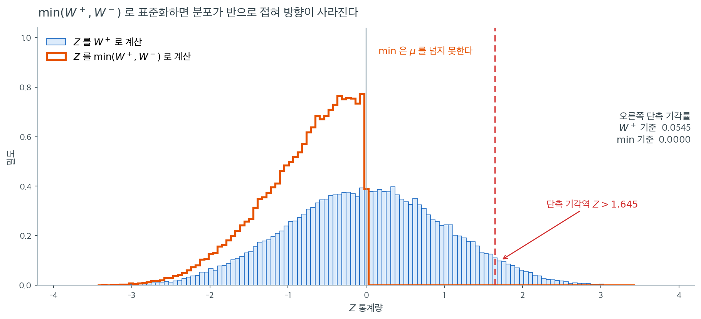

# 대응표본 비모수 검정


## 1. 대응표본 Wilcoxon 부호순위검정

**대응표본 Wilcoxon 부호순위검정**은 대응 관측값 사이의 중앙값 차이가 0과 유의하게 다른지 판정하는 비모수 검정이다. 자료가 정규성 가정을 만족하지 않을 때 대응 t 검정의 비모수 대안으로 쓰인다.

### 주요 특징

- **목적**: 대응 관측값 사이의 중앙값 차이가 0인지 검정한다.
- **귀무가설 ($H_0$)**: 대응표본 차이의 중앙값이 0이다.
- **대립가설 ($H_a$)**:
    - 양측: 중앙값 차이가 0이 아니다.
    - 단측: 중앙값 차이가 0보다 크거나, 0보다 작다.
- **자료 요건**:
    - 자료가 대응되어 있고 연속형 또는 순서형이어야 한다.
    - 쌍 사이의 차이가 대칭으로 분포해야 한다.

### 검정 절차

**1단계: 차이 계산**

대응 관측값 사이의 차이를 계산한다.

$$d_i = X_i - Y_i$$

$d_i = 0$인 쌍은 무시한다(검정에서 제외된다).

**2단계: 절대차이 순위 매기기**

절댓값 $|d_i|$를 오름차순으로 순위를 매기고, 필요하면 동점 순위를 배정한다.

**3단계: 순위에 부호 배정**

각 차이의 부호를 대응하는 순위에 배정한다.

**4단계: 검정통계량 계산**

- 양의 차이들의 순위합: $W^+$
- 음의 차이들의 순위합: $W^-$
- 검정통계량: $W = \min(W^+, W^-)$

**5단계: 유의성 판정**

- 주어진 표본크기와 유의수준 $\alpha$에 대해 Wilcoxon 부호순위검정표의 임계값과 $W$를 비교한다.
- 표본이 크면($n > 20$) 정규근사를 쓴다.

$$Z = \frac{W^+ - \frac{n(n+1)}{4}}{\sqrt{\frac{n(n+1)(2n+1)}{24}}}$$

!!! warning "정규근사의 분자에는 $W^+$를 쓴다"
    표준화할 때 분자에 넣는 것은 $W = \min(W^+, W^-)$가 아니라 **$W^+$**(또는 $W^-$ 중 하나를 일관되게)이다. $\min$을 쓰면 언제나 $Z \le 0$이 되어 방향 정보가 사라진다.

    양측검정에서는 $\min$을 쓰고 $|Z|$를 보아도 같은 결과가 나오지만, 단측검정에서는 반드시 $W^+$를 써야 한다.



말로만 들으면 사소한 표기 문제 같지만 결과는 그렇지 않다. $n = 15$인 자료를 $H_0$ 아래에서 $60{,}000$번 만들어 두 방식으로 $Z$를 계산한 것이 위 그림이다.

옅은 파란 히스토그램이 $W^+$로 표준화한 $Z$이다. $0$을 중심으로 좌우대칭이고 표준정규에 가깝다. 오른쪽 꼬리 $Z > 1.645$로 떨어지는 비율이 $0.0545$로 명목수준과 맞는다. **이 분포는 "양의 차이가 우세한가 음의 차이가 우세한가"를 좌우로 구별해 담고 있다.**

주황 윤곽선이 $\min(W^+, W^-)$로 표준화한 $Z$이다. 모양이 전혀 다르다. $\min$은 정의상 $W^+$와 $W^-$ 중 작은 쪽이고 둘의 합이 $n(n+1)/2 = 120$으로 고정되어 있으므로 $\min \le 60 = \mu$가 **항상** 성립한다. 따라서 $Z$가 결코 $0$을 넘지 못하고, 분포가 $0$에서 칼로 자른 듯 끊긴 채 왼쪽으로 접혀 있다. 오른쪽 단측 기각률은 $0.0000$이다. **오른쪽 단측검정을 $\min$으로 수행하면 어떤 자료가 와도 기각하지 못한다.**

양측검정에서는 왜 괜찮은가. $|Z|$를 보는 순간 접힌 분포와 접히기 전 분포가 같은 대답을 주기 때문이다(모의실험에서 양측 기각률이 두 방식 모두 $0.0484$였다). 그러나 이것은 우연한 일치일 뿐 원칙이 아니다. **$W^+$를 일관되게 쓰고 부호로 방향을 읽는 습관**을 들이면 단측·양측을 가리지 않고 안전하다.

---

<div class="exbox" markdown>

**보기 1.** <span class="diff easy" title="쉬움"></span> 교수법 개선. **상황**: 한 연구자가 새 교수법이 시험 점수를 높이는지 검정하려 한다. 학생 10명이 새 방법을 쓰기 전과 후에 시험을 본다. 점수가 유의하게 향상되었는지 검정하라.

**자료:**

| 학생 | 전 | 후 | 차이 ($d_i$) |
|---|---|---|---|
| 1 | 70 | 72 | 2 |
| 2 | 68 | 69 | 1 |
| 3 | 75 | 78 | 3 |
| 4 | 80 | 85 | 5 |
| 5 | 72 | 75 | 3 |
| 6 | 74 | 76 | 2 |
| 7 | 69 | 70 | 1 |
| 8 | 77 | 79 | 2 |
| 9 | 73 | 74 | 1 |
| 10 | 76 | 80 | 4 |


</div>

??? success "풀이"
    **1단계 --- 차이:** 모든 차이가 양수이다. $d = [2, 1, 3, 5, 3, 2, 1, 2, 1, 4]$

    **2단계 --- 절대차이 순위:**

    $$|d| = [2, 1, 3, 5, 3, 2, 1, 2, 1, 4]$$

    정렬: $[1, 1, 1, 2, 2, 2, 3, 3, 4, 5]$

    동점 순위: $[2, 2, 2, 5, 5, 5, 7.5, 7.5, 9, 10]$

    원래 순서로 배정: $[5, 2, 7.5, 10, 7.5, 5, 2, 5, 2, 9]$

    **3단계 --- 부호 배정:** 모든 차이가 양수이므로 모든 순위가 양수이다.

    **4단계 --- $W^+$와 $W^-$ 계산:**

    - $W^+ = 5 + 2 + 7.5 + 10 + 7.5 + 5 + 2 + 5 + 2 + 9 = 55$
    - $W^- = 0$
    - $W = \min(55, 0) = 0$

    **5단계 --- 유의성 판정:**

    $n = 10$, $\alpha = 0.05$(양측)에 대한 Wilcoxon 표의 임계값은 8이다. $W = 0 < 8$이므로 $H_0$을 **기각**한다.

    **결론**: 새 교수법이 시험 점수를 향상시킨다는 유의한 증거가 있다.
!!! note "정확 $p$값과 근사 $p$값"
    모든 차이가 양수인 이 자료의 정확 양측 $p$값은

    $$
    p = 2 \times \left(\tfrac{1}{2}\right)^{10} = \frac{2}{1024} = 0.001953
    $$

    이다. 동점 보정을 적용한 정규근사는 $Z = (55 - 27.5)/\sqrt{95.125} = 2.820$에서 $p = 0.00481$을 준다. 근사값이 정확값의 **2.5배**로, $n = 10$에서 정규근사가 얼마나 부정확한지를 보여 준다.

    이 자료에서는 모든 차이가 같은 방향이므로 부호검정도 같은 정확 $p$값 $0.001953$을 낸다. 부호검정이 크기 정보를 버려도 손해를 보지 않는 유일한 경우이다.

---

### 파이썬 구현

<div class="exbox" markdown>

**보기 2.** <span class="diff easy" title="쉬움"></span> 동점이 있으면 임계값 8 의 뜻이 달라진다. 훈련 전후 점수 10쌍에서 **열 쌍 모두** 점수가 올랐다. `wilcoxon(after, before)` 이 $W = 0$, $p = 0.001953125$ 를 준다.

**(1)** 정확 양측 p-값이 $2/1024$ 인 까닭을 말하시오. $\lvert d \rvert$ 에 동점이 많은데도 이 값이 동점에 **전혀 영향받지 않는** 까닭은 무엇인가.

**(2)** 아래 연습문제 2 는 $n = 10$ 의 양측 임계값이 $8$ 이고 그 실제 수준이 $0.0488$ 이라고 한다. 그것은 **동점이 없을 때**의 값이다. 이 자료의 중간순위로 귀무분포를 다시 열거하면 실제 수준이 얼마인가.

</div>

??? success "풀이"

    **(1) 극단에서는 순위의 세부가 지워진다.** 차이는

    $$
    d = (2,\ 1,\ 3,\ 5,\ 3,\ 2,\ 1,\ 2,\ 1,\ 4)
    $$

    로 열 개가 모두 양수다. 따라서 $W^- = 0$ 이고 $W^+$ 는 순위의 총합 $55$ 다.

    $H_0$ 과 대칭성 아래에서 각 순위의 부호는 독립적인 동전던지기이므로 $2^{10} = 1024$ 가지 부호 배정이 모두 확률 $1/1024$ 다. 그 가운데

    - $W^- = 0$ 을 주는 배정 — "모두 $+$" 하나
    - $W^+ = 0$ 을 주는 배정 — "모두 $-$" 하나

    둘뿐이므로

    $$
    p = P\bigl(\min(W^+, W^-) \leq 0\bigr) = \frac{2}{1024} = 0.001953125
    $$

    **동점이 영향을 주지 못하는 까닭이 여기 있다.** 중간순위를 쓰든 $1, 2, \dots, 10$ 을 쓰든 **순위의 총합은 $55$ 로 같고**, "모두 한 부호" 인 배정은 언제나 두 개다. $T = 0$ 은 분포의 양 끝이므로 순위가 어떻게 뭉쳤는지와 무관하다. `scipy` 의 정확검정이 동점을 무시하는 표를 쓰면서도 여기서 맞는 답을 주는 것은 **운이다** — 이 자료가 하필 극단에 있기 때문이다.

    **(2) 실제 수준은 $0.0488$ 이 아니라 $0.0430$ 이다.** 이 자료의 중간순위는

    $$
    r = (5,\ 2,\ 7.5,\ 10,\ 7.5,\ 5,\ 2,\ 5,\ 2,\ 9)
    $$

    다. $\lvert d \rvert$ 에서 $1$ 이 셋($\to$ 순위 $1,2,3$ 의 평균 $2$), $2$ 가 셋($\to 4,5,6$ 의 평균 $5$), $3$ 이 둘($\to 7,8$ 의 평균 $7.5$), $4$ 와 $5$ 가 각각 하나($\to 9$, $10$)다. 이 순위로 $1024$ 가지를 다시 열거해 $T = \min(W^+, W^-)$ 의 분포를 얻으면

    | $c$ | 동점 없음 $P(T \leq c)$ | 이 자료 $P(T \leq c)$ |
    |---|---|---|
    | 6 | 0.027344 | 0.021484 |
    | 7 | 0.037109 | **0.039062** |
    | 8 | 0.048828 | **0.042969** |
    | 9 | 0.064453 | 0.062500 |

    $c = 8$ 의 실제 수준이 $0.048828$ 에서 $0.042969$ 로 **내려간다.** 명목 $0.05$ 를 쓰고 있다고 믿으면서 실제로는 $0.043$ 짜리 검정을 돌리는 셈이다.

    **움직이는 방향이 한결같지 않다는 점도 보라.** $c = 7$ 에서는 오히려 $0.037109$ 에서 $0.039062$ 로 **올라간다.** 중간순위는 격자를 반 칸씩 밀어 놓으므로 어느 쪽으로 움직일지는 동점의 모양에 달려 있고, 미리 알 수 없다. $T$ 가 가질 수 있는 값도 $28$ 가지에서 $43$ 가지로 **늘어난다** — 반정수 $7.5$ 가 끼어 부분합이 $0.5$ 단위로 나오기 때문이다.

    그러므로 **동점이 있는 자료에 표의 임계값을 그대로 쓰지 말아야 한다.** $n$ 이 작으면 관측된 $\lvert d \rvert$ 의 중간순위로 직접 열거하는 것이 옳다.

    **수치적으로.**

    ```python
    import numpy as np
    from scipy.stats import wilcoxon

    # 훈련 전후의 점수. 같은 사람을 두 번 잰 대응자료다.
    before = np.array([70, 68, 75, 80, 72, 74, 69, 77, 73, 76])
    after = np.array([72, 69, 78, 85, 75, 76, 70, 79, 74, 80])

    # 부호순위검정은 대응 t 검정의 비모수 대응이다. 차이의 부호와 크기 순위만
    # 쓰므로 정규성을 요구하지 않는다. 열 쌍 모두 점수가 올랐으므로 통계량이
    # 0 이 되고, 그때 나올 수 있는 가장 작은 p-값이 (1/2)^10 의 두 배다.
    stat, p_value = wilcoxon(after, before)

    print(f"Test Statistic: {stat}")     # 0.0
    print(f"P-value: {p_value}")         # 0.001953125

    # 결과 해석
    alpha = 0.05
    if p_value < alpha:
        print("Reject the null hypothesis: Significant improvement in scores.")
    else:
        print("Fail to reject the null hypothesis: No significant improvement in scores.")
    ```

    출력:

    ```
    Test Statistic: 0.0
    P-value: 0.001953125
    Reject the null hypothesis: Significant improvement in scores.
    ```

    ```python
    import itertools
    from scipy import stats

    d = after - before
    r = stats.rankdata(np.abs(d))
    n = len(d)
    print(f"차이        {d.tolist()}")
    print(f"|차이| 순위  {r.tolist()}   합 {r.sum()}  (n(n+1)/2 = {n * (n + 1) / 2})")

    signs = np.array(list(itertools.product([0, 1], repeat=n)))

    def null_T(ranks):
        W_plus = signs @ ranks
        return np.minimum(W_plus, ranks.sum() - W_plus)

    T_plain = null_T(np.arange(1, n + 1, dtype=float))   # 동점이 없을 때
    T_tied = null_T(r)                                   # 이 자료의 중간순위
    print(f"\nT 가 가질 수 있는 값: 동점 없음 {len(set(np.round(T_plain, 6)))} 가지,"
          f"  이 자료 {len(set(np.round(T_tied, 6)))} 가지")
    print("  c   동점없음 P(T<=c)   이 자료 P(T<=c)")
    for c in (0, 6, 7, 8, 9):
        print(f" {c:>2} {float((T_plain <= c + 1e-9).mean()):>16.6f} "
              f"{float((T_tied <= c + 1e-9).mean()):>17.6f}")
    for lab, T in (("동점 없음", T_plain), ("이 자료  ", T_tied)):
        c = max(k for k in range(28) if (T <= k + 1e-9).mean() <= 0.05)
        print(f"  {lab}: 임계값 c = {c},  실제 수준 {float((T <= c + 1e-9).mean()):.6f}")
    ```

    출력:

    ```
    차이        [2, 1, 3, 5, 3, 2, 1, 2, 1, 4]
    |차이| 순위  [5.0, 2.0, 7.5, 10.0, 7.5, 5.0, 2.0, 5.0, 2.0, 9.0]   합 55.0  (n(n+1)/2 = 55.0)
    
    T 가 가질 수 있는 값: 동점 없음 28 가지,  이 자료 43 가지
      c   동점없음 P(T<=c)   이 자료 P(T<=c)
      0         0.001953          0.001953
      6         0.027344          0.021484
      7         0.037109          0.039062
      8         0.048828          0.042969
      9         0.064453          0.062500
      동점 없음: 임계값 c = 8,  실제 수준 0.048828
      이 자료  : 임계값 c = 8,  실제 수준 0.042969
    ```

    **$c = 0$ 에서는 두 분포가 똑같이 $0.001953$ 을 주고($= 2/1024$), $c = 8$ 에서는 $0.048828$ 과 $0.042969$ 로 갈린다.** (1) 과 (2) 의 결론이 한 표에 나란히 보인다 — **극단에서는 동점이 지워지고, 중간에서는 지워지지 않는다.**

---

## 2. 대응 부호검정

Wilcoxon 부호순위검정의 대칭성 가정이 깨질 때는 **대응 부호검정**을 쓸 수 있다. 대응차이의 부호만 고려하고 크기와 순위는 모두 무시한다.

### 절차

1. 차이 $d_i = X_i - Y_i$를 계산한다.
2. 양의 차이 개수($n_+$)와 음의 차이 개수($n_-$)를 센다. 동점($d_i = 0$)은 무시한다.
3. $H_0$ 아래에서 각 차이가 양수일 확률과 음수일 확률이 같으므로 $n_+ \sim \text{Binomial}(n, 0.5)$이다.
4. 이항분포로 $p$값을 계산한다.

<div class="exbox" markdown>

**보기 3.** <span class="diff easy" title="쉬움"></span> 부호검정을 뒤집으면 중앙값의 신뢰구간이 나온다. 같은 자료에 부호검정을 돌리면 $n_+ = 10$, $n_- = 0$, $p = 0.001953$ 이다. p-값은 "중앙값이 0 이 아니다" 만 말한다. 그러나 같은 이항확률에서 **얼마나** 다른지까지 읽어 낼 수 있다.

**(1)** 정렬한 차이를 $d_{(1)} \leq \dots \leq d_{(10)}$ 이라 할 때 구간 $[d_{(k)},\ d_{(11-k)}]$ 가 참 중앙값을 포함할 확률이 $1 - 2P(\text{Bin}(10, 1/2) \leq k-1)$ 임을 보이시오. 95% 이상을 보장하는 $k$ 와 그 구간을 구하시오.

**(2)** 그 구간이 $0$ 을 포함하지 않는 것과 부호검정이 기각하는 것은 같은 일인가.

</div>

??? success "풀이"

    **(1) 놓치는 사건을 세면 된다.** 참 중앙값을 $m$ 이라 하자. 구간이 $m$ 을 **놓치는** 것은 두 경우다.

    - $m < d_{(k)}$ — 곧 $m$ 보다 **작은** 관측값이 $k - 1$ 개 이하
    - $m > d_{(11-k)}$ — 곧 $m$ 보다 **큰** 관측값이 $k - 1$ 개 이하

    $m$ 이 참 중앙값이고 분포가 연속이면 각 관측값이 $m$ 보다 클 확률이 정확히 $1/2$ 이고 관측값끼리 독립이므로, "$m$ 보다 큰 개수" $X \sim \text{Bin}(10, 1/2)$ 다. 따라서

    $$
    P(\text{놓침}) = P(X \leq k-1) + P(X \geq 11-k) = 2\,P(X \leq k-1)
    $$

    이고(이항분포가 $p = 1/2$ 에서 대칭이므로 두 꼬리가 같다), 포함률은

    $$
    1 - 2\,P\bigl(\text{Bin}(10, 1/2) \leq k-1\bigr)
    $$

    이다. $\square$ **이 유도에 모집단 분포는 한 번도 쓰이지 않았다** — 연속이라는 것뿐이다. 그래서 분포무관 구간이다.

    정렬한 차이는 $(1, 1, 1, 2, 2, 2, 3, 3, 4, 5)$ 이고

    | $k$ | 구간 | 포함률 |
    |---|---|---|
    | 1 | $[d_{(1)}, d_{(10)}] = [1,\ 5]$ | 0.998047 |
    | 2 | $[d_{(2)}, d_{(9)}] = [1,\ 4]$ | **0.978516** |
    | 3 | $[d_{(3)}, d_{(8)}] = [1,\ 3]$ | 0.890625 |
    | 4 | $[d_{(4)}, d_{(7)}] = [2,\ 3]$ | 0.656250 |

    **95% 를 보장하는 가장 좁은 것은 $k = 2$ 의 $[1,\ 4]$ 이고 실제 포함률은 97.85% 다.** $k = 3$ 으로 한 칸 좁히면 89.06% 로 떨어져 모자란다. $n = 10$ 에서 **정확히 95% 를 맞출 수는 없다** — 이산성 때문에 쓸 수 있는 포함률이 네댓 개뿐이다.

    **(2) 같은 일이다.** 구간 $[d_{(k)}, d_{(11-k)}]$ 가 $m_0$ 을 포함하지 않는다는 것은, 위 유도를 그대로 뒤집으면 $m_0$ 보다 큰(또는 작은) 관측값이 $k-1$ 개 이하라는 것이고, 그것이 바로 수준 $2P(X \leq k-1)$ 의 부호검정 기각역이다. **구간과 검정이 같은 이항확률의 두 얼굴이다.**

    $k = 2$ 를 쓰면 수준은 $2P(X \leq 1) = 2 \times 11/1024 = 0.021484$ 이고, 구간 $[1, 4]$ 가 $0$ 을 품지 않으므로 기각한다. 부호검정의 p-값 $0.001953$ 이 $0.021484$ 보다 작은 것과 맞아떨어진다.

    **그런데 구간 쪽이 더 쓸모 있다.** p-값 $0.001953$ 은 "$0$ 이 아니다" 만 말하지만, 구간 $[1, 4]$ 는 **"점수 향상의 중앙값이 적어도 1점이고 많아도 4점"** 이라고 말한다. 신뢰구간이 크기를 함께 보고하는 것이 p-값보다 나은 까닭이 여기 있다. 다만 $n = 10$ 에서 그 구간은 $1$ 부터 $4$ 까지로 꽤 넓다 — **부호검정은 가정을 적게 쓰는 대가로 넓은 구간을 준다.**

    **수치적으로.**

    ```python
    from scipy.stats import binom
    import numpy as np

    before = np.array([70, 68, 75, 80, 72, 74, 69, 77, 73, 76])
    after = np.array([72, 69, 78, 85, 75, 76, 70, 79, 74, 80])

    # 같은 자료에 부호검정을 돌린다. 크기는 버리고 부호만 세므로 계산이 더 쉽다.
    differences = after - before
    n_plus = np.sum(differences > 0)
    n_minus = np.sum(differences < 0)
    n = n_plus + n_minus
    W = min(n_plus, n_minus)

    # 귀무가설 아래에서 부호가 +일 확률이 0.5 이므로, 통계량이 이항분포를 따른다.
    # 표본이 작을 때는 정규근사 대신 이렇게 정확분포를 쓰는 편이 낫다.
    p_value = min(1.0, 2 * binom.cdf(W, n, 0.5))  # 양측

    print(f"n+ = {n_plus}, n- = {n_minus}")   # n+ = 10, n- = 0
    print(f"P-value: {p_value:.6f}")          # 0.001953
    ```

    출력:

    ```
    n+ = 10, n- = 0
    P-value: 0.001953
    ```

    ```python
    d_sorted = np.sort(differences)
    print(f"정렬한 차이 {d_sorted.tolist()}")
    print(" k   구간          포함률")
    for k in range(1, 5):
        cov = 1 - 2 * binom.cdf(k - 1, n, 0.5)
        print(f" {k}  [{d_sorted[k - 1]}, {d_sorted[n - k]}]  "
              f"  {cov:.6f}   (수준 {2 * binom.cdf(k - 1, n, 0.5):.6f})")

    k = 2
    lo, hi = d_sorted[k - 1], d_sorted[n - k]
    level = 2 * binom.cdf(k - 1, n, 0.5)
    print(f"\n95% 이상을 보장하는 가장 좁은 구간: k = {k},  [{lo}, {hi}],"
          f"  포함률 {1 - level:.6f}")
    print(f"  0 을 포함하는가? {lo <= 0 <= hi}  ->  수준 {level:.6f} 에서 기각")
    print(f"  부호검정 p-값 {p_value:.6f} < {level:.6f} ?  {p_value < level}")

    # 포함률을 모의로 확인한다 (연속분포, 참 중앙값 0)
    rng = np.random.default_rng(1)
    B = 2000
    for k in (2, 3):
        hit = sum(1 for _ in range(B)
                  if (x := np.sort(rng.normal(0, 1, n)))[k - 1] <= 0 <= x[n - k])
        theory = 1 - 2 * binom.cdf(k - 1, n, 0.5)
        print(f"  k={k}: 모의 포함률 {hit / B:.4f},  이론 {theory:.4f},"
              f"  MC 오차 {np.sqrt(theory * (1 - theory) / B):.4f}")
    ```

    출력:

    ```
    정렬한 차이 [1, 1, 1, 2, 2, 2, 3, 3, 4, 5]
     k   구간          포함률
     1  [1, 5]    0.998047   (수준 0.001953)
     2  [1, 4]    0.978516   (수준 0.021484)
     3  [1, 3]    0.890625   (수준 0.109375)
     4  [2, 3]    0.656250   (수준 0.343750)
    
    95% 이상을 보장하는 가장 좁은 구간: k = 2,  [1, 4],  포함률 0.978516
      0 을 포함하는가? False  ->  수준 0.021484 에서 기각
      부호검정 p-값 0.001953 < 0.021484 ?  True
      k=2: 모의 포함률 0.9810,  이론 0.9785,  MC 오차 0.0032
      k=3: 모의 포함률 0.8905,  이론 0.8906,  MC 오차 0.0070
    ```

    **이론 포함률 $0.9785$ 와 $0.8906$ 이 모의실험의 $0.9810$ 과 $0.8905$ 와 몬테카를로 오차($\pm 0.0032$, $\pm 0.0070$) 안에서 맞는다.** 그리고 $k = 1$ 줄의 수준 $0.001953$ 이 바로 이 자료의 부호검정 p-값과 같은 수인 것을 보라 — 열 개가 모두 한쪽에 있는 것이 $k = 1$ 의 기각역이기 때문이다.

!!! warning "$2 \times$ 규칙은 1을 넘을 수 있다"
    $2 \times P(S \le W)$는 $W$가 $n/2$에 가까우면 1을 넘는다. 예를 들어 $n = 10$, $W = 5$이면 $2 \times 0.6230 = 1.246$이다. 반드시 1로 자르거나 `scipy.stats.binomtest`를 쓰는 편이 안전하다.

---

## 3. 비교: 대응 t 검정 대 비모수 대안

| 특징 | 대응 t 검정 | 대응 Wilcoxon | 대응 부호검정 |
|---|---|---|---|
| **가정** | 차이가 정규 | 차이가 대칭 | 없음 |
| **검정 대상** | 평균 차이 | 중앙값 차이 | 중앙값 차이 |
| **사용 정보** | 원 차이값 | 차이의 순위 | 부호만 |
| **검정력** | 최고 (정규일 때) | 높음 (ARE $\approx 0.955$) | 낮음 (ARE $\approx 0.637$) |
| **로버스트성** | 이상치에 민감 | 높음 | 매우 높음 |

### 선택 지침

- **차이가 정규**: 검정력을 최대로 얻으려면 **대응 t 검정**.
- **대칭이지만 비정규**: **대응 Wilcoxon 부호순위검정**.
- **가정이 하나도 성립하지 않음**(치우침, 순서형): **대응 부호검정**.

### 장점과 한계

**장점:**

- 정규성을 가정하지 않는다.
- 이상치에 로버스트하다.
- 순서형 자료에도 쓸 수 있다.

**한계:**

- 차이 분포의 대칭성을 가정한다(Wilcoxon만 해당).
- 정규성이 성립할 때 모수적 검정보다 검정력이 낮다.
- 부호검정은 크기 정보를 버려 검정력이 더 떨어진다.

---

## 연습문제

<div class="drillbox" markdown>

**연습문제 1.** <span class="diff med" title="중간"></span>
교수법 보기 자료에서 네 가지 검정(대응 $t$, Wilcoxon 정확·근사, 부호검정)의 $p$값을 모두 계산하고, 왜 부호검정이 Wilcoxon과 같은 값을 내는지 설명하라.

</div>

??? success "풀이"
    ```python
    import numpy as np
    from scipy import stats
    before = np.array([70, 68, 75, 80, 72, 74, 69, 77, 73, 76])
    after  = np.array([72, 69, 78, 85, 75, 76, 70, 79, 74, 80])
    d = after - before

    print(stats.ttest_rel(after, before).pvalue)                    # 0.000325
    print(stats.wilcoxon(d, method='exact').pvalue)                 # 0.001953
    print(stats.wilcoxon(d, method='approx', correction=False).pvalue)  # 0.004809
    print(stats.binomtest(10, 10).pvalue)                           # 0.001953
    ```

    출력:

    ```
    0.0003248947130212966
    0.001953125
    0.004808563078561356
    0.001953125
    ```

    | 검정 | 양측 $p$값 |
    |:---|---:|
    | 대응 $t$ | $0.000325$ |
    | Wilcoxon (정확) | $0.001953$ |
    | 부호검정 (정확) | $0.001953$ |
    | Wilcoxon (정규근사) | $0.004809$ |

    **부호검정과 Wilcoxon 정확검정이 같은 값을 낸다.** 이유는 자료가 극단적으로 한쪽에 쏠려 있기 때문이다.

    두 검정 모두 $2^{10} = 1024$가지 부호 배정을 귀무분포로 쓴다. 관측된 배정은 "모두 $+$"인 단 하나이다. Wilcoxon에서 $W^+ = 55$는 도달 가능한 최댓값이고, 이를 달성하는 배정은 하나뿐이다. 부호검정에서 $n_+ = 10$을 달성하는 배정도 하나뿐이다. 따라서 두 정확 $p$값이 모두 $2/1024$가 된다.

    일반적으로는 두 검정이 갈라진다. 음의 차이가 하나라도 있으면 그 차이의 크기가 Wilcoxon에는 영향을 주지만 부호검정에는 주지 않는다.

    Wilcoxon 정규근사가 $0.004809$로 정확값의 2.5배임에 유의하라. 관측값이 분포의 **끝점**에 놓여 있어 정규근사가 가장 나쁘게 작동하는 위치이다. 꼬리 확률을 근사할 때 정규근사가 체계적으로 부정확한 이유이다.

<div class="drillbox" markdown>

**연습문제 2.** <span class="diff med" title="중간"></span>
$n = 10$일 때 Wilcoxon 부호순위검정의 양측 임계값이 왜 $8$인지 정확 귀무분포를 열거하여 확인하라. 이 임계값의 실제 유의수준은 얼마인가?

</div>

??? success "풀이"
    ```python
    import numpy as np, itertools
    n = 10
    ranks = np.arange(1, n + 1)
    W = np.array([np.dot(s, ranks) for s in itertools.product([0, 1], repeat=n)])
    T = np.minimum(W, n * (n + 1) // 2 - W)      # min(W+, W-)
    for c in range(6, 12):
        print(c, (T <= c).mean())
    ```

    출력:

    ```
    6 0.02734375
    7 0.037109375
    8 0.048828125
    9 0.064453125
    10 0.083984375
    11 0.10546875
    ```

    | 임계값 $c$ | $P(T \le c)$ |
    |---:|---:|
    | 6 | 0.0273 |
    | 7 | 0.0371 |
    | 8 | **0.0488** |
    | 9 | 0.0645 |
    | 10 | 0.0840 |
    | 11 | 0.1055 |

    $c = 8$이 $0.05$를 넘지 않는 가장 큰 값이다($0.0488 \le 0.05 < 0.0645$). 그래서 표에 $8$이 실려 있다.

    실제 유의수준은 $0.0488$로 명목값 $0.05$에 매우 가깝다. $n = 10$에서 부호검정의 실제 크기가 $0.0215$였던 것과 비교하면 훨씬 낫다. Wilcoxon의 귀무분포는 $T = \min(W^+, W^-)$가 가질 수 있는 값이 $28$가지($0$부터 $27$까지)라 $\alpha$를 촘촘히 채울 수 있는 반면, 부호검정은 $6$가지밖에 없다.

    이것이 Wilcoxon 검정이 부호검정보다 강력한 두 번째 이유이다. ARE가 $0.955$ 대 $0.637$인 것뿐 아니라, 소표본에서 유의수준을 훨씬 효율적으로 쓴다.

<div class="drillbox" markdown>

**연습문제 3.** <span class="diff med" title="중간"></span>
`p_value = 2 * binom.cdf(W, n, 0.5)`가 언제 1을 넘는가? $n = 10$에서 $W = 0, 1, \ldots, 5$에 대해 계산하고, 올바른 처리 방법을 제시하라.

</div>

??? success "풀이"
    ```python
    from scipy.stats import binom, binomtest
    n = 10
    for W in range(6):
        naive = 2 * binom.cdf(W, n, 0.5)
        print(W, round(naive, 4), round(binomtest(W, n, 0.5).pvalue, 4))
    ```

    출력:

    ```
    0 0.002 0.002
    1 0.0215 0.0215
    2 0.1094 0.1094
    3 0.3438 0.3438
    4 0.7539 0.7539
    5 1.2461 1.0
    ```

    | $W = \min(n_+, n_-)$ | $2 \times P(S \le W)$ | `binomtest` |
    |---:|---:|---:|
    | 0 | 0.0020 | 0.0020 |
    | 1 | 0.0215 | 0.0215 |
    | 2 | 0.1094 | 0.1094 |
    | 3 | 0.3438 | 0.3438 |
    | 4 | 0.7539 | 0.7539 |
    | 5 | **1.2461** | 1.0000 |

    $W = 5$(즉 $n_+ = n_- = 5$)에서 $1.2461$이 나온다. $P(S \le 5) = 0.6230$을 두 배 했기 때문이다.

    원인은 $S = 5$가 두 꼬리에 **중복해서 세어지기** 때문이다. $P(S \le 5)$와 $P(S \ge 5)$는 둘 다 $P(S = 5) = 0.2461$을 포함하므로 합이 $1 + 0.2461$이 된다.

    올바른 처리 방법은 셋 중 하나이다.

    1. **1로 자른다.** `min(1.0, 2 * binom.cdf(W, n, 0.5))` --- 가장 간단하고 대부분의 교과서가 쓰는 규칙이다.
    2. **`scipy.stats.binomtest`를 쓴다.** SciPy는 "관측값만큼 가능성이 낮은 결과들의 확률합" 정의를 쓰므로 자동으로 1을 넘지 않는다.
    3. **중복을 뺀다.** $2P(S \le W) - P(S = W)$ --- 이론적으로 깔끔하지만 표준 관행은 아니다.

    $p_0 = 0.5$일 때는 분포가 대칭이라 1과 2가 $W < n/2$에서 정확히 일치한다. $p_0 \ne 0.5$이면 두 정의가 갈라진다.

<div class="drillbox" markdown>

**연습문제 4.** <span class="diff med" title="중간"></span>
교수법 보기에서 모든 차이가 양수인 것은 우연이 아닐 수 있다. 이 자료가 실제로 정규 차이에서 나왔다면 $n = 10$에서 모두 같은 부호일 확률은 얼마인가? 관측된 차이의 분포는 무엇을 시사하는가?

</div>

??? success "풀이"
    차이는 $d = [2, 1, 3, 5, 3, 2, 1, 2, 1, 4]$로 평균 $2.4$, 표준편차 $1.35$이다.

    참인 차이 분포가 $\mathcal{N}(2.4, 1.35^2)$이라면 한 관측값이 음수일 확률은

    $$
    \Phi\!\left(\frac{0 - 2.4}{1.35}\right) = \Phi(-1.78) = 0.0377
    $$

    이고, 10개가 모두 양수일 확률은 $(1 - 0.0377)^{10} = 0.681$이다. **전혀 놀랍지 않다.**

    ```python
    import numpy as np
    from scipy import stats
    d = np.array([2, 1, 3, 5, 3, 2, 1, 2, 1, 4])
    print(d.mean(), d.std(ddof=1))                          # 2.4, 1.3499
    p_neg = stats.norm.cdf(0, d.mean(), d.std(ddof=1))
    print(p_neg, (1 - p_neg) ** 10)                         # 0.0377, 0.681
    ```

    출력:

    ```
    2.4 1.3498971154211057
    0.037709049885978514 0.680869711192701
    ```

    그러나 자료 자체를 보면 다른 문제가 보인다. 차이의 값이 $\{1, 2, 3, 4, 5\}$ 다섯 가지뿐이고 모두 정수이다. 시험 점수가 정수라 차이도 정수인 것은 자연스럽지만, 이 정도 이산성에서는 **동점이 많이 생겨** 순위 기반 검정의 정확 귀무분포가 엄밀하게는 성립하지 않는다.

    실제로 이 자료에는 크기 3, 3, 2의 동점 집단이 있다. SciPy가 반환한 "정확" $p$값 $0.001953$은 동점이 없다고 가정한 값이다. 다행히 모든 차이가 양수라 $W^+$가 최댓값이라는 사실은 동점 여부와 무관하므로 이 경우에는 문제가 되지 않는다.

    **일반적 교훈:** 이산 척도(정수 점수, Likert 척도)에서는 동점이 필연적이며, 순위 기반 검정의 "정확" $p$값이 사실은 근사이다. 동점 비율이 높으면 순열검정으로 동점을 포함한 실제 귀무분포를 직접 계산하는 편이 정직하다.

<div class="drillbox" markdown>

**연습문제 5.** <span class="diff med" title="중간"></span>
본문 경고상자는 $\min(W^+, W^-)$ 로 표준화하면 오른쪽 단측 기각률이 $0.0000$ 이 되고, 양측에서는 두 방식이 모두 $0.0484$ 로 **"우연히"** 일치했다고 말한다. 그 "우연" 을 따져 보자. $d_i = 0$ 인 쌍이 없어 $W^+ + W^- = n(n+1)/2$ 라고 하자.

**(1)** $Z_{W^+} = (W^+ - \mu)/\sigma$, $Z_{\min} = (\min(W^+, W^-) - \mu)/\sigma$ 라 쓸 때($\mu = n(n+1)/4$, $\sigma = \sqrt{n(n+1)(2n+1)/24}$) 어떤 자료에서나

$$
Z_{\min} = -\lvert Z_{W^+} \rvert
$$

임을 보이시오.

**(2)** 그러므로 양측검정의 일치는 우연이 아니라 **항등식**이다. 본문의 모의실험에서 두 양측 기각률이 "몬테카를로 오차 안에서 비슷한" 것이 아니라 $0.0484$ 로 **똑같은 수**였던 까닭을 설명하라. 또 오른쪽 기각률이 "아주 작은 값" 이 아니라 정확히 $0$ 인 까닭도 말하라.

**(3)** 그렇다면 $\min$ 으로 **왼쪽** 단측검정은 할 수 있는가. "$Z_{\min} < -1.645$ 이면 기각" 을 수준 $0.05$ 의 왼쪽 단측검정이라 믿고 쓰면 실제로는 무슨 검정을 하는 셈이며 그 실제 크기는 얼마인가. 본문 그림에 적힌 수치를 쓰라.

</div>

??? success "풀이"

    **(1) 두 통계량은 $\mu$ 를 중심으로 서로의 거울상이다.** $W^+ + W^- = n(n+1)/2 = 2\mu$ 이므로

    $$
    W^- - \mu = 2\mu - W^+ - \mu = -(W^+ - \mu)
    $$

    다. $a = W^+ - \mu$ 라 두면 $W^- - \mu = -a$ 이고

    $$
    \min(W^+, W^-) - \mu = \min(a,\ -a) = -\lvert a \rvert
    $$

    이다. 양변을 $\sigma > 0$ 으로 나누면 $Z_{\min} = -\lvert a \rvert/\sigma = -\lvert Z_{W^+}\rvert$ 다. $\square$

    **(2) 양측검정은 글자 그대로 같은 검정이다.** (1) 에서 $\lvert Z_{\min}\rvert = \lvert Z_{W^+}\rvert$ 가 **모든 표본에서** 성립하므로, 두 방식의 양측 p-값이 같고 기각 여부도 표본마다 하나하나 같다. 모의실험의 두 기각률은 **같은 사건을 두 번 센 것**이어서 $60{,}000$ 개 가운데 기각된 개수가 똑같고, 따라서 소수점까지 같은 $0.0484$ 가 나온다. 두 수가 조금이라도 달랐다면 그것은 모의오차가 아니라 코드의 버그다.

    오른쪽 기각률도 같은 이유로 "작은 값" 이 아니다. $Z_{\min} = -\lvert \cdot \rvert \leq 0$ 이 항등적으로 성립하므로

    $$
    P(Z_{\min} > 1.645) = 0
    $$

    이 **정확히** 참이다. 표본을 얼마나 많이 뽑아도 $0.0000$ 이지 $0.0003$ 이 될 수 없다.

    **(3) 할 수 없다. 그것은 수준 $0.109$ 의 양측검정이다.** (1) 을 넣으면

    $$
    Z_{\min} < -1.645 \iff -\lvert Z_{W^+}\rvert < -1.645 \iff \lvert Z_{W^+}\rvert > 1.645
    $$

    이다. 곧 **$W^+$ 의 양측검정을 임계값 $1.645$ 로 수행하는 것**과 같다. 본문 그림에서 $W^+$ 쪽의 오른쪽 꼬리 $Z > 1.645$ 가 $0.0545$ 였고 분포가 좌우대칭이므로 실제 크기는 약

    $$
    2 \times 0.0545 = 0.109
    $$

    다. 수준 $0.05$ 라고 믿으면서 $0.109$ 짜리 검정을 돌리는 셈이고, 더 나쁜 것은 **차이가 크게 양수일 때에도 "중앙값이 0 보다 작다" 는 결론으로 기각한다**는 점이다.

    정리하면 $\min$ 은 양측에서는 $W^+$ 와 **완전히** 같고, 단측에서는 한쪽은 영원히 기각하지 못하고 다른 쪽은 크기가 두 배가 되면서 방향을 잘못 읽는다. 본문의 권고 — $W^+$ 를 일관되게 쓰고 부호로 방향을 읽으라 — 는 "대개 안전하다" 가 아니라 **단측검정을 하려면 유일한 선택**이다.

<div class="drillbox" markdown>

**연습문제 6.** <span class="diff med" title="중간"></span>
연습문제 2 의 풀이는 "$T = \min(W^+, W^-)$ 가 가질 수 있는 값이 $28$ 가지($0$ 부터 $27$ 까지)라 $\alpha$ 를 촘촘히 채울 수 있는 반면, 부호검정은 $6$ 가지밖에 없다" 고 했다. 그 두 수를 세어 확인하고 대가를 계산하라.

**(1)** 동점이 없는 $n = 10$ 에서 $T$ 의 값역이 정확히 $\{0, 1, \dots, 27\}$ 임을 보이시오. 상한이 왜 $27.5$ 가 아니라 $27$ 인가. 일반 $n$ 에서 값역의 크기를 $n$ 으로 나타내라.

**(2)** 부호검정에서 $\min(n_+, n_-)$ 의 값역이 $\{0, \dots, 5\}$ 임을 보이시오. 연습문제 2 와 3 의 표를 써서 두 검정의 "$0.05$ 를 넘지 않는 가장 큰 도달가능 수준" 과 그때 **버리는 $\alpha$** 를 비교하라. 부호검정의 검정력 손실 가운데 ARE 와 무관한 몫이 여기 있다는 것을 설명하라.

**(3)** $n$ 을 키우면 버리는 $\alpha$ 는 두 검정에서 각각 어떤 속도로 줄어드는가. 임계점 근처의 점질량을 정규근사로 어림하여 $n$ 의 거듭제곱으로 답하고, $n = 10$ 의 실제 간격과 자릿수가 맞는지 확인하라.

</div>

??? success "풀이"

    **(1) $W^+$ 는 $\{1, 2, \dots, 10\}$ 의 부분집합합이다.** 귀납법으로 $\{1, \dots, k\}$ 의 부분집합합이 $0$ 부터 $k(k+1)/2$ 까지의 **모든 정수**를 덮는다. $k = 1$ 이면 $\{0, 1\}$ 로 참이다. $k$ 에서 참이라 하면 $\{1, \dots, k+1\}$ 의 부분집합합은 이전 범위 $[0,\ k(k+1)/2]$ 와 거기에 $k+1$ 을 더한 $[k+1,\ (k+1)(k+2)/2]$ 의 합집합을 포함하고, $k(k+1)/2 \geq k$ 이므로 두 구간이 끊기지 않고 이어진다. 따라서 $W^+$ 는 $0, 1, \dots, 55$ 를 모두 취한다.

    이제 $T = \min(W^+,\ 55 - W^+)$ 다. $T \leq 55/2 = 27.5$ 이고 $T$ 는 정수이므로 $T \leq 27$ 이다. **합 $55$ 가 홀수라 $W^+ = W^-$ 가 불가능하고, 가장 균형잡힌 쪼갬이 $27$ 과 $28$ 이다** — 그래서 상한이 $27.5$ 가 아니라 $27$ 이다. 거꾸로 $t = 0, \dots, 27$ 마다 $W^+ = t$ 가 실현되고 그때 $55 - t \geq 28 > t$ 이므로 $T = t$ 다. 값역은 정확히 $\{0, \dots, 27\}$ 이고 $28$ 가지다.

    일반 $n$ 에서는 같은 논법으로

    $$
    T \in \Bigl\{0, 1, \dots, \Bigl\lfloor \tfrac{n(n+1)}{4} \Bigr\rfloor \Bigr\}, \qquad \text{값역 크기} = \Bigl\lfloor \tfrac{n(n+1)}{4} \Bigr\rfloor + 1
    $$

    이다. $n = 10$ 이면 $\lfloor 27.5 \rfloor + 1 = 28$ 로 맞는다.

    **(2) 부호검정은 $n_+ \in \{0, \dots, 10\}$ 뿐이다.** $\min(n_+, 10 - n_+) \leq 5$ 이고 $n_+ = 0, \dots, 5$ 가 각각 $0, \dots, 5$ 를 주므로 값역은 $\{0, \dots, 5\}$, $6$ 가지다. $11$ 가지 중 절반이 접혀 사라진다.

    | 검정 | $0.05$ 이하의 도달가능 수준 | 가장 큰 것 | 버리는 $\alpha$ |
    |---|---|---:|---:|
    | 윌콕슨 ($T \leq c$) | $0.0020,\ \dots,\ 0.0273,\ 0.0371,\ 0.0488$ | $0.0488$ | $0.0012$ |
    | 부호검정 ($\min \leq c$) | $0.0020,\ 0.0215$ | $0.0215$ | $0.0285$ |

    **버리는 $\alpha$ 가 $0.0012$ 대 $0.0285$ 로 약 $24$ 배 차이다.** 윌콕슨은 명목 $5\%$ 의 $97.6\%$ 를 쓰는데 부호검정은 $43\%$ 만 쓴다.

    여기서 **ARE 와 무관한 손실**이 보인다. 연습문제 2 의 풀이가 지적한 대로, $n = 10$ 에서 부호검정을 "$\alpha = 0.05$ 로 돌린다" 고 말하는 사람은 실제로는 수준 $0.0215$ 짜리 검정을 돌리고 있다. ARE $0.637$ 은 $\alpha$ 를 **같게** 맞춘 뒤의 비교이므로, 소표본에서 부호검정이 실제로 겪는 불리함은 $0.637$ 보다 더 크다. **격자가 거친 검정은 쓰라고 준 $\alpha$ 를 다 쓰지 못한다.**

    **(3) 격자 간격은 임계점 근처 점질량의 두 배다.** 도달가능 수준이 $2P(\cdot \leq c)$ 꼴이므로 이웃한 두 수준의 차는 $2P(\cdot = c+1)$ 이다.

    - 부호검정: $n_+$ 의 표준편차가 $\sqrt n / 2$ 이므로 눈금 하나가 $z$ 축에서 $2/\sqrt n$ 이다. 따라서 $2P(S = c) \approx 2\varphi(1.96) \cdot 2/\sqrt n = 0.234\, n^{-1/2}$.
    - 윌콕슨: $\sigma = \sqrt{n(n+1)(2n+1)/24} \approx n^{3/2}/\sqrt{12}$ 이므로 눈금 하나가 $\sqrt{12}\, n^{-3/2}$ 이고 $2P(T = c) \approx 2\varphi(1.96)\sqrt{12}\, n^{-3/2} = 0.405\, n^{-3/2}$.

    $n = 10$ 에서 어림값은 $0.234/\sqrt{10} = 0.074$ 와 $0.405 \times 10^{-3/2} = 0.0128$ 이고, 표에서 읽은 실제 간격은 $0.1094 - 0.0215 = 0.0879$ 와 $0.0645 - 0.0488 = 0.0157$ 로 자릿수가 맞는다.

    그러므로 **버리는 $\alpha$ 는 부호검정에서 $O(n^{-1/2})$, 윌콕슨에서 $O(n^{-3/2})$ 로 줄어든다.** 윌콕슨의 이산성은 $n$ 이 조금만 커져도 사실상 사라지지만, 부호검정은 $n = 100$ 에서도 간격이 $0.023$ 쯤으로 여전히 명목수준의 절반 가까이를 흔든다. 부호검정으로 정확한 수준을 맞추려면 $\alpha$ 를 고르는 대신 **$\alpha$ 가 골라 주는 것을 받아들여야 한다.**

<div class="drillbox" markdown>

**연습문제 7.** <span class="diff hard" title="어려움"></span>
본문 3절의 비교표는 윌콕슨과 부호검정이 똑같이 "중앙값 차이" 를 검정한다고 적었다. 그 칸이 느슨하다는 것을 보인다. 차이 $D_1, \dots, D_n$ 이 독립이고 연속분포를 따라 동점이 없다고 하자.

**(1)** $R_i$ 를 $\lvert D_i \rvert$ 의 순위라 하고 $W^+ = \sum_{i=1}^n \mathbf 1\{D_i > 0\} R_i$ 라 하자. $p_1 = P(D > 0)$, $p_2 = P(D_1 + D_2 > 0)$ 라 둘 때

$$
E[W^+] = n\,p_1 + \binom{n}{2} p_2
$$

임을 보이시오. 차이가 $0$ 을 중심으로 대칭이면 본문의 $\mu = n(n+1)/4$ 로 돌아오는지 확인하라.

**(2)** $D$ 가 확률 $1/2$ 로 $U(-1, 0)$, 확률 $1/2$ 로 $U(0, 9)$ 인 분포를 생각하자. $D$ 의 중앙값이 $0$ 임을 확인하고 $p_1$ 과 $p_2$ 를 손으로 구하라.

**(3)** $n = 20$ 에서 $E[W^+]$ 와 $E[Z]$ 를 구하라. 중앙값이 **정확히** $0$ 인데도 수준 $0.05$ 양측 윌콕슨 검정이 어느 정도 비율로 기각하는지 어림하고, 같은 자료에서 부호검정의 실제 크기는 얼마인지 말하라. 비교표의 "검정 대상" 칸을 어떻게 고쳐 써야 하는가.

</div>

??? success "풀이"

    **(1) 순위를 지시함수의 합으로 풀어 쓴다.** 동점이 없으므로 거의 확실하게

    $$
    R_i = \sum_{j=1}^n \mathbf 1\{\lvert D_j \rvert \leq \lvert D_i \rvert\} = 1 + \sum_{j \neq i} \mathbf 1\{\lvert D_j \rvert < \lvert D_i \rvert\}
    $$

    이다. 이것을 넣으면

    $$
    W^+ = \sum_i \mathbf 1\{D_i > 0\} + \sum_{i \neq j} \mathbf 1\{D_i > 0,\ \lvert D_j \rvert < \lvert D_i \rvert\}
    $$

    이다. 둘째 합을 **순서 없는 쌍**으로 묶는 것이 열쇠다. 쌍 $\{i, j\}$ 에서

    $$
    \mathbf 1\{D_i > 0,\ \lvert D_j \rvert < \lvert D_i \rvert\} + \mathbf 1\{D_j > 0,\ \lvert D_i \rvert < \lvert D_j \rvert\} = \mathbf 1\{D_i + D_j > 0\}
    $$

    이 성립한다. 왜냐하면 **$D_i + D_j$ 의 부호는 절댓값이 큰 쪽의 부호**이고, 두 사건은 "절댓값이 큰 쪽이 양수" 를 $i$ 가 큰 경우와 $j$ 가 큰 경우로 쪼갠 것이어서 서로 배반이기 때문이다. 기댓값을 취하면 첫 합이 $n p_1$, 둘째 합이 쌍의 개수 $\binom n2$ 곱하기 $p_2$ 이므로

    $$
    E[W^+] = n\,p_1 + \binom{n}{2} p_2
    $$

    이다. $\square$

    대칭이면 $p_1 = 1/2$ 이고, $D_1 + D_2$ 도 $0$ 을 중심으로 대칭이므로 $p_2 = 1/2$ 다. 그러면

    $$
    E[W^+] = \frac n2 + \frac{n(n-1)}{4} = \frac{n(n+1)}{4} = \mu
    $$

    로 본문 5단계의 중심과 정확히 맞는다. **대칭성이 들어가는 자리가 바로 $p_2 = 1/2$ 다.**

    **(2) 중앙값은 $0$ 이지만 $p_2$ 는 $1/2$ 이 아니다.** $P(D < 0) = 1/2 \cdot 1 = 1/2$ 이고 $P(D > 0) = 1/2$ 이므로 중앙값이 $0$ 이고 $p_1 = 1/2$ 다.

    $p_2$ 는 세 경우로 나눈다.

    - 둘 다 음수(확률 $1/4$): 합이 반드시 음수이므로 기여 $0$.
    - 둘 다 양수(확률 $1/4$): 합이 반드시 양수이므로 기여 $1/4$.
    - 하나씩(확률 $1/2$): $D_i \sim U(-1,0)$, $D_j \sim U(0,9)$ 이면 $\lvert D_i \rvert \sim U(0,1)$ 이고 합이 양수인 것은 $D_j > \lvert D_i \rvert$ 다. $u \in [0,1]$ 에서 $P(D_j < u) = u/9$ 이므로

    $$
    P(D_j < \lvert D_i \rvert) = \int_0^1 \frac u9\, du = \frac{1}{18}, \qquad P(D_i + D_j > 0) = \frac{17}{18}
    $$

    따라서

    $$
    p_2 = \frac14 \cdot 0 + \frac14 \cdot 1 + \frac12 \cdot \frac{17}{18} = \frac14 + \frac{17}{36} = \frac{13}{18} = 0.7222
    $$

    **왜 $1/2$ 을 넘는가.** 음의 차이는 최대 $1$ 밖에 못 가지만 양의 차이는 $9$ 까지 간다. 두 개를 더하면 큰 쪽이 이기므로 합은 양수가 되기 쉽다. 중앙값은 "몇 개가 어느 쪽인가" 만 보고 $p_2$ 는 "얼마나 멀리 가는가" 를 본다.

    **(3) 중앙값이 $0$ 인데도 기각률이 $35\%$ 쯤 된다.** $n = 20$ 에서 $\mu = 20 \cdot 21/4 = 105$, $\sigma = \sqrt{20 \cdot 21 \cdot 41/24} = \sqrt{717.5} = 26.786$ 이고

    $$
    E[W^+] = 20 \cdot \frac12 + \binom{20}{2} \cdot \frac{13}{18} = 10 + 190 \cdot \frac{13}{18} = 147.22
    $$

    이다. 따라서

    $$
    E[Z] = \frac{147.22 - 105}{26.786} = 1.576
    $$

    이다. $Z$ 가 대략 $N(1.576, 1)$ 이라 보면 양측 기각률은

    $$
    P(Z > 1.96) \approx 1 - \Phi(1.96 - 1.576) = 1 - \Phi(0.384) = 0.350
    $$

    쯤이다(귀무분산을 그대로 쓴 어림이다). 명목 $5\%$ 의 일곱 배다. 반면 부호검정은 $n_+ \sim \text{Bin}(20, p_1)$ 에서 $p_1 = 1/2$ 이 **정확히** 참이므로 귀무분포가 그대로 맞고, 기각역 $\min(n_+, n_-) \leq 5$ 의 크기는 $2P(\text{Bin}(20, 1/2) \leq 5) = 0.0414$ 로 정확하다.

    **그러므로 비교표의 "검정 대상" 칸은 이렇게 읽어야 한다.**

    | 검정 | 실제로 검정하는 것 |
    |---|---|
    | 부호검정 | $p_1 = P(D > 0) = 1/2$ — 곧 중앙값이 $0$ |
    | 윌콕슨 | $D$ 가 $0$ 을 중심으로 대칭, 특히 $p_2 = P(D_1 + D_2 > 0) = 1/2$ |

    $p_2 = 1/2$ 는 "왈시 평균 $(D_i + D_j)/2$ 의 중앙값이 $0$"이라는 말이고, 이것을 **유사중앙값**(pseudomedian)이라 부른다. 중앙값과 유사중앙값은 **대칭일 때만** 일치한다. 본문 표의 "중앙값 차이" 는 대칭성 칸을 이미 받아들인 뒤의 축약이며, 대칭이 깨지면 윌콕슨은 중앙값에 대한 검정이 **아니다.**

<div class="drillbox" markdown>

**연습문제 8.** <span class="diff hard" title="어려움"></span>
연습문제 7 의 결론을 다른 치우친 분포에서 수치로 확인하라. $Z \sim N(0,1)$ 로부터 $D = e^Z - 1$ 을 만들면 $e^Z$ 의 중앙값이 $1$ 이므로 $D$ 의 중앙값이 **정확히** $0$ 이고, 오른쪽으로 길게 치우쳐 있다. $n = 20$, 반복 $20{,}000$ 회로 다음을 하라.

**(1)** $p_2 = P(D_1 + D_2 > 0) = P(e^{Z_1} + e^{Z_2} > 2)$ 를 수치적분으로 구하고, 연습문제 7 의 공식으로 $E[W^+]$ 와 $E[Z]$ 를 예측해 모의 평균과 맞추어 보라.

**(2)** 윌콕슨(본문 5단계의 정규근사, $\lvert Z \rvert > 1.96$)과 부호검정(정확, 기각역 $\min(n_+, n_-) \leq 5$)의 실제 크기를 재라. 어느 쪽이 명목수준을 지키는가.

**(3)** 윌콕슨의 기각이 거의 모두 오른쪽 꼬리에서 나오는 까닭을 말하라. 표본 $n$ 을 키우면 이 문제는 나아지는가. 이 결과를 본문 비교표의 "로버스트성: 높음" 칸과 어떻게 화해시킬 것인가.

</div>

??? success "풀이"

    ```python
    import numpy as np
    from scipy.stats import rankdata, norm, binom
    from scipy.integrate import quad

    rng = np.random.default_rng(0)
    n, B = 20, 20000

    # D = exp(Z) - 1. 중앙값은 정확히 0 이지만 오른쪽으로 치우쳐 대칭이 아니다.
    d = np.exp(rng.standard_normal((B, n))) - 1.0

    r = rankdata(np.abs(d), axis=1)          # 연속분포라 동점이 없다
    W_plus = (r * (d > 0)).sum(axis=1)
    mu = n * (n + 1) / 4
    sd = np.sqrt(n * (n + 1) * (2 * n + 1) / 24)
    Z = (W_plus - mu) / sd                   # 본문 5단계의 표준화

    n_plus = (d > 0).sum(axis=1)
    m = np.minimum(n_plus, n - n_plus)       # 부호검정 통계량

    print(f"부호검정 기각역 min(n+,n-) <= 5 의 정확 수준 {2 * binom.cdf(5, n, 0.5):.4f}")
    print(f"윌콕슨 기각률 (|Z| > 1.96)  {float((np.abs(Z) > 1.959964).mean()):.4f}")
    print(f"  그 가운데 오른쪽 꼬리     {float((Z > 1.959964).mean()):.4f}")
    print(f"부호검정 기각률 (정확)      {float((m <= 5).mean()):.4f}")

    # E[W+] = n p1 + C(n,2) p2,  p2 = P(D1 + D2 > 0) = P(exp(Z1) + exp(Z2) > 2)
    def f(z):
        t = 2.0 - np.exp(z)
        tail = 1.0 if t <= 0 else float(norm.sf(np.log(t)))
        return float(norm.pdf(z)) * tail

    p2 = quad(f, -12, 12, limit=400)[0]
    EW = n * 0.5 + n * (n - 1) / 2 * p2
    print(f"\np1 = P(D > 0) = 0.5000,   p2 = P(D1 + D2 > 0) = {p2:.4f}")
    print(f"E[W+]  예측 {EW:.4f}   모의 {W_plus.mean():.4f}   (귀무평균 {mu:.1f})")
    print(f"E[Z]   예측 {(EW - mu) / sd:.4f}   모의 {Z.mean():.4f}")
    ```

    출력:

    ```text
    부호검정 기각역 min(n+,n-) <= 5 의 정확 수준 0.0414
    윌콕슨 기각률 (|Z| > 1.96)  0.1134
      그 가운데 오른쪽 꼬리     0.1084
    부호검정 기각률 (정확)      0.0410

    p1 = P(D > 0) = 0.5000,   p2 = P(D1 + D2 > 0) = 0.6058
    E[W+]  예측 125.1105   모의 125.3124   (귀무평균 105.0)
    E[Z]   예측 0.7508   모의 0.7583
    ```

    **(1) 공식이 맞는다.** $p_2 = 0.6058 \neq 1/2$ 이므로

    $$
    E[W^+] = 20 \cdot 0.5 + 190 \cdot 0.6058 = 125.11
    $$

    이고 모의 평균 $125.31$ 이 이와 맞는다($W^+$ 의 표준편차가 $27$ 쯤이므로 평균의 모의오차가 $27/\sqrt{20000} \approx 0.19$ 다). 표준화한 $E[Z]$ 도 예측 $0.7508$ 대 모의 $0.7583$ 이다. **귀무중심 $105$ 에서 $20$ 만큼 오른쪽으로 밀린 채 검정이 시작된다.**

    **(2) 부호검정만 수준을 지킨다.** 부호검정의 기각률 $0.0410$ 은 이론 수준 $0.0414$ 와 모의오차($\sqrt{0.0414 \times 0.9586/20000} = 0.0014$) 안에서 일치한다. $p_1 = 1/2$ 이 정확히 참이므로 당연한 일이다. 윌콕슨은 $0.1134$ — 명목 $0.05$ 의 **$2.3$ 배**다.

    **(3) 치우침이 한 방향이므로 기각도 한 방향이다.** 전체 기각 $0.1134$ 가운데 $0.1084$, 곧 $96\%$ 가 오른쪽 꼬리다. $E[Z] = 0.75 > 0$ 이니 $Z$ 가 오른쪽으로 밀려 있고, 따라서 이 검정은 "차이의 중앙값이 $0$ 보다 크다" 고 **체계적으로 잘못 말한다.** 오른쪽으로 치우친 분포에서는 큰 양의 차이 몇 개가 가장 큰 순위를 독점하고, $W^+$ 는 순위의 크기를 세므로 그 몇 개에 끌려간다.

    **$n$ 을 키우면 나아지지 않고 더 나빠진다.** $p_1 = 1/2$ 일 때

    $$
    E[Z] = \frac{\binom n2 (p_2 - \tfrac12)}{\sigma} \approx \frac{n^2(p_2 - 1/2)/2}{n^{3/2}/\sqrt{12}} = \sqrt{3n}\,\Bigl(p_2 - \frac12\Bigr)
    $$

    이므로 $E[Z]$ 가 $\sqrt n$ 에 비례해 커지고 기각률은 $1$ 로 간다. 모의오차와 달리 **자료를 더 모아서 고칠 수 있는 종류의 오류가 아니다.**

    **"로버스트성" 칸과의 화해.** 윌콕슨은 로버스트하다 — 이상치가 순위로 눌리고, 귀무분포가 모분포에 매이지 않는다. 그러나 **로버스트성은 타당성이 아니다.** 여기서 윌콕슨은 고장난 것이 아니라 자기 귀무가설("$D$ 가 $0$ 을 중심으로 대칭")을 올바르게 기각하고 있다. 고장난 것은 그 기각을 "중앙값이 $0$ 이 아니다" 로 **읽는 사람**이다. 그러므로 비교표의 두 칸은 함께 읽어야 한다: 가정 칸이 "차이가 대칭" 인 검정은 그 가정이 깨지면 로버스트성과 무관하게 결론이 틀어진다. 대칭이 의심스러우면 본문 선택지침대로 **부호검정으로 내려가는 것**이 옳다.

<div class="drillbox" markdown>

**연습문제 9.** <span class="diff hard" title="어려움"></span>
본문 비교표는 윌콕슨의 점근상대효율이 $0.955 \approx 3/\pi$ 라고 적는다. 그 뜻은 "정규분포 아래에서 표본을 $1/0.955 = 1.047$ 배, 곧 $4.7\%$ 더 모으면 대응 $t$ 검정과 같은 검정력에 이른다" 다. 두 방향의 대가를 모의실험으로 재라.

차이가 $N(0.25, 1)$ 인 경우와 꼬리가 두꺼운 $t(3) + 0.40$ 인 경우에 대해, 대응 $t$ 검정과 윌콕슨 검정(본문 5단계의 정규근사)의 양측 $5\%$ 검정력을 $n = 100, 105, \dots$ 에서 재라. 반복은 $40{,}000$ 회로 한다.

**(1)** 정규일 때 $n = 105$ 의 윌콕슨이 $n = 100$ 의 $t$ 검정과 같은 검정력인지 몬테카를로 오차 안에서 확인하라. $4.7\%$ 라는 예측과 맞는가.

**(2)** $t(3)$ 에서는 대가가 어느 쪽으로 가는가. $t$ 검정이 $n = 100$ 의 윌콕슨을 따라잡으려면 몇 쌍이 필요한지 표에서 보간하여 구하라.

**(3)** 두 결과를 한 문장으로 합쳐 "무엇을 포기하고 무엇을 얻는가" 에 답하라.

</div>

??? success "풀이"

    ```python
    import numpy as np
    from scipy.stats import rankdata, t as tdist

    B = 40000


    def powers(n, delta, dist):
        rng = np.random.default_rng(0)
        if dist == "정규":
            d = delta + rng.standard_normal((B, n))
        else:                                     # 자유도 3 의 t, 꼬리가 두껍다
            d = delta + rng.standard_t(3, size=(B, n))
        # 대응 t 검정
        tstat = d.mean(axis=1) / (d.std(axis=1, ddof=1) / np.sqrt(n))
        pw_t = float((np.abs(tstat) > tdist.ppf(0.975, n - 1)).mean())
        # 윌콕슨 부호순위 (W+ 로 표준화한 정규근사)
        r = rankdata(np.abs(d), axis=1)
        W = (r * (d > 0)).sum(axis=1)
        Z = (W - n * (n + 1) / 4) / np.sqrt(n * (n + 1) * (2 * n + 1) / 24)
        return pw_t, float((np.abs(Z) > 1.959964).mean())


    print(f"4.7% 더 모은다는 것: 100 / 0.955 = {100 / 0.955:.1f}")
    print("차이분포   delta    n    t 검정   윌콕슨")
    for dist, delta, ns in (("정규", 0.25, (100, 105, 110)),
                            ("t(3)", 0.40, (100, 105, 160, 170))):
        for n in ns:
            a, b = powers(n, delta, dist)
            print(f"{dist:>6} {delta:>8.2f} {n:>4} {a:>9.4f} {b:>8.4f}")
    ```

    출력:

    ```text
    4.7% 더 모은다는 것: 100 / 0.955 = 104.7
    차이분포   delta    n    t 검정   윌콕슨
        정규     0.25  100    0.6960   0.6732
        정규     0.25  105    0.7180   0.6981
        정규     0.25  110    0.7359   0.7184
      t(3)     0.40  100    0.6871   0.8727
      t(3)     0.40  105    0.7073   0.8909
      t(3)     0.40  160    0.8504   0.9774
      t(3)     0.40  170    0.8691   0.9829
    ```

    **(1) 예측이 맞는다.** 검정력이 $0.7$ 쯤일 때 모의오차는 $\sqrt{0.7 \times 0.3/40000} = 0.0023$ 이다.

    | 검정 | $n$ | 검정력 |
    |---|---:|---:|
    | 대응 $t$ | 100 | $0.6960$ |
    | 윌콕슨 | 100 | $0.6732$ |
    | 윌콕슨 | 105 | $\mathbf{0.6981}$ |
    | 윌콕슨 | 110 | $0.7184$ |

    같은 $n = 100$ 에서는 윌콕슨이 $0.6732$ 로 $t$ 검정보다 $0.023$ 만큼 뒤진다(두 검정을 **같은 자료**에 돌렸으니 비교가 더 정밀하고, 차이의 모의오차 상한 $\sqrt 2 \times 0.0023 = 0.0033$ 의 일곱 배이니 실재하는 차이다). 그런데 $n = 105$ 로 다섯 쌍을 더하면 $0.6981$ 이 되어 $t$ 검정의 $0.6960$ 과 차이가 $0.0021$, 곧 **모의오차 하나보다 작다.** $100/0.955 = 104.7$ 이라는 예측과 맞는다. **정규분포 아래에서 분포가정을 버리는 값은 100 쌍에 5 쌍이다.**

    **(2) $t(3)$ 에서는 $t$ 검정이 $70$ 쌍 넘게 더 필요하다.** $n = 100$ 의 윌콕슨이 $0.8727$ 인데 $t$ 검정은 $n = 160$ 에서 $0.8504$, $n = 170$ 에서 $0.8691$ 이다. 그 구간에서 $10$ 쌍마다 $0.0187$ 씩 오르므로

    $$
    n \approx 170 + \frac{0.8727 - 0.8691}{0.00187} \approx 172
    $$

    다. 곧 $t$ 검정은 윌콕슨과 같은 검정력을 얻으려 **$1.7$ 배**의 표본이 필요하다. 꼬리가 두꺼운 분포에서 표본평균은 큰 관측값 몇 개에 흔들리고 $s$ 도 같이 커져 $t$ 통계량이 커지지 못하는데, 순위는 그 관측값을 "가장 큰 하나" 로만 세기 때문이다. 2장에서 중앙값이 평균보다 강건했던 것과 같은 일이 검정 수준에서 되풀이된다.

    **(3) $4.7\%$ 를 보험료로 내고 $70\%$ 를 보험금으로 받는다.** 정규가 참일 때 윌콕슨을 쓴 손해는 $100$ 쌍에 $5$ 쌍이지만, 꼬리가 두꺼울 때 $t$ 를 고집한 손해는 $100$ 쌍에 $72$ 쌍이다. 정규성을 **확신할 수 없다면** 이 맞바꿈은 비모수 쪽이 압도적으로 유리하다 — 특히 본문이 지적한 대로 $n < 20$ 에서는 정규성을 확인할 방법조차 마땅치 않다.

<div class="drillbox" markdown>

**연습문제 10.** <span class="diff hard" title="어려움"></span>
보기 1 의 각주는 $W^+ = 55$ 에서 정확 p-값이 $0.001953$ 인데 정규근사는 $0.00481$ 로 **$2.5$ 배**라고 했다. 그것이 끝점에서만 벌어지는 일인지 전체적인 일인지 확인하라.

$n = 10$ 의 $2^{10} = 1024$ 가지 부호 배정을 전수 열거해 $T = \min(W^+, W^-)$ 의 정확 귀무분포를 얻고, 각 $t$ 에서 정확 p-값 $P(T \leq t)$, 정규근사 p-값 $2\Phi(-(\mu - t)/\sigma)$, 연속성 수정을 넣은 p-값 $2\Phi(-(\mu - t - 0.5)/\sigma)$ 를 비교하라.

**(1)** 근사가 **보수적**(근사 p-값이 정확값보다 큼)인 구역과 **과감한** 구역을 가르는 $t$ 를 찾아라. 비율이 가장 나쁜 곳은 꼬리인가 중앙인가. $\alpha = 0.05$ 의 **판정**까지 틀어지는가.

**(2)** 연속성 수정이 고치는 곳과 오히려 망치는 곳을 각각 지적하고, 끝점에서 왜 망치는지 설명하라. 수정을 넣으면 $\alpha = 0.05$ 의 실제 크기는 어떻게 되는가.

**(3)** 각주가 쓴 $\sigma^2 = 95.125$ 는 동점 보정을 넣은 값이다(크기 $3, 3, 2$ 의 동점 묶음에서 $\sum (t_k^3 - t_k) = 54$, 그리고 $96.25 - 54/48 = 95.125$). 동점 보정을 **빼먹으면** 검정이 보수적이 되는가 과감해지는가. 출력의 두 p-값으로 답하고 까닭을 말하라.

</div>

??? success "풀이"

    ```python
    import itertools
    import numpy as np
    from scipy.stats import norm

    n = 10
    ranks = np.arange(1, n + 1)
    tot = n * (n + 1) // 2                                  # 55
    Wp = np.array([s @ ranks for s in itertools.product([0, 1], repeat=n)])
    T = np.minimum(Wp, tot - Wp)                            # min(W+, W-)

    mu, sd = tot / 2, np.sqrt(n * (n + 1) * (2 * n + 1) / 24)
    print(f"mu = {mu},  sigma = {sd:.4f}")
    print("  t    정확 p      근사 p      수정 p    근사/정확  수정/정확")
    for t in (0, 3, 5, 7, 8, 9, 11, 14, 17, 20, 23, 27):
        p_ex = float((T <= t).mean())
        p_ap = float(2 * norm.sf((mu - t) / sd))
        p_cc = float(2 * norm.sf((mu - t - 0.5) / sd))
        print(f" {t:>2} {p_ex:>9.4f} {p_ap:>11.4f} {p_cc:>11.4f}"
              f" {p_ap / p_ex:>11.3f} {p_cc / p_ex:>10.3f}")

    for lab, g in (("근사", lambda x: 2 * norm.sf(x / sd)),
                   ("수정", lambda x: 2 * norm.sf((x - 0.5) / sd))):
        bad = [t for t in range(28) if g(mu - t) < (T <= t).mean()]
        print(f"{lab} p < 정확 p 인 t 는 {min(bad)} 부터 {max(bad)} 까지 {len(bad)} 개")

    # 보기 1 자료의 동점 보정: 3,3,2 묶음 -> sum(t^3 - t) = 54
    var_tie = n * (n + 1) * (2 * n + 1) / 24 - 54 / 48
    print(f"\nt = 0 에서  동점 보정 전 sigma^2 = {sd**2:.4f},  p = "
          f"{float(2 * norm.sf(27.5 / sd)):.6f}")
    print(f"            동점 보정 후 sigma^2 = {var_tie:.4f},  p = "
          f"{float(2 * norm.sf(27.5 / np.sqrt(var_tie))):.6f}")
    print(f"            정확 p = {float((T <= 0).mean()):.6f}")
    ```

    출력:

    ```text
    mu = 27.5,  sigma = 9.8107
      t    정확 p      근사 p      수정 p    근사/정확  수정/정확
      0    0.0020      0.0051      0.0059       2.592      3.032
      3    0.0098      0.0125      0.0144       1.282      1.478
      5    0.0195      0.0218      0.0249       1.117      1.277
      7    0.0371      0.0367      0.0415       0.988      1.118
      8    0.0488      0.0469      0.0528       0.960      1.081
      9    0.0645      0.0593      0.0665       0.921      1.032
     11    0.1055      0.0926      0.1029       0.878      0.976
     14    0.1934      0.1688      0.1851       0.873      0.958
     17    0.3223      0.2845      0.3081       0.883      0.956
     20    0.4922      0.4446      0.4755       0.903      0.966
     23    0.6953      0.6465      0.6835       0.930      0.983
     27    1.0000      0.9594      1.0000       0.959      1.000
    근사 p < 정확 p 인 t 는 7 부터 27 까지 21 개
    수정 p < 정확 p 인 t 는 10 부터 26 까지 17 개

    t = 0 에서  동점 보정 전 sigma^2 = 96.2500,  p = 0.005062
                동점 보정 후 sigma^2 = 95.1250,  p = 0.004809
                정확 p = 0.001953
    ```

    **(1) 경계는 $t = 7$ 이고, 비율이 나쁜 곳은 꼬리다.** $t \leq 6$ 에서는 근사 p-값이 정확값보다 **크고**(보수적), $t \geq 7$ 에서는 **작다**(과감하다 — $28$ 개 값 가운데 $21$ 개가 그렇다).

    두 방향의 어긋남이 크기가 전혀 다르다는 점이 중요하다.

    - 꼬리: $t = 0$ 에서 비율 $2.592$ — 근사가 정확값의 **$2.6$ 배**다. 각주의 "$2.5$ 배" 가 바로 이 칸이다(각주는 동점 보정을 넣어 $0.00481$ 을, 여기서는 넣지 않아 $0.00506$ 을 쓴다).
    - 중앙: 비율이 가장 낮은 곳이 $t = 14$ 의 $0.873$ 으로, 근사가 정확값의 $87\%$ 다. 어긋남이 $13\%$ 를 넘지 않는다.

    **곱셈으로 보면 꼬리가 압도적으로 나쁘지만 뺄셈으로 보면 중앙이 나쁘다** — $t = 0$ 의 절대오차는 $0.0031$ 이고 $t = 14$ 의 절대오차는 $0.0246$ 이다. p-값은 작은 값에서 자릿수가 중요하므로 꼬리의 상대오차가 더 문제다.

    **판정은 다행히 틀어지지 않는다.** "근사 p-값 $\leq 0.05$ 이면 기각" 은 $t \leq 8$ 에서 기각하는 규칙이다($0.0469 \leq 0.05 < 0.0593$). 그 기각역의 **실제** 크기는 정확열의 $0.0488$ 이므로 $0.05$ 를 넘지 않는다. p-값이 $4\%$ 과감했어도 격자 간격($0.0488 \to 0.0645$)이 그보다 거칠어 결정이 같은 칸에 남은 것이다. **격자가 근사오차를 삼켜 준 운 좋은 경우다.**

    **(2) 수정은 중앙을 고치고 끝점을 망친다.**

    | 구역 | 근사/정확 | 수정/정확 |
    |---|---:|---:|
    | 끝점 $t = 0$ | $2.592$ | $3.032$ |
    | $t = 5$ | $1.117$ | $1.277$ |
    | $t = 11 \sim 23$ | $0.878 \sim 0.930$ | $0.976 \sim 0.983$ |

    중앙에서는 어긋남이 $12\%$ 에서 $2\%$ 로 줄어든다. 수정이 하는 일이 바로 이것이다: $T$ 가 정수 격자 위에 있으므로 $P(T \leq t)$ 를 연속분포로 바꿀 때 $t$ 에서 자르지 말고 $t + 0.5$ 까지 세어야 하고, 이는 $\mu - t$ 를 $0.5$ 줄이는 것과 같다.

    끝점에서는 반대로 나빠진다($2.592 \to 3.032$). 까닭은 **끝점에는 "반 칸 너머" 가 없다**는 데 있다. $t = 0$ 은 지지집합의 벽이고, $T = 0$ 의 점질량은 정규밀도가 아니라 $2/1024$ 라는 조합적 사실로 정해진다. 꼬리에서 근사가 틀리는 진짜 원인은 격자가 아니라 **정규밀도가 이 이산분포의 끝을 너무 두껍게 본다**는 것이고, 수정은 p-값을 더 키우는 방향이므로 틀린 곳을 더 틀리게 만든다.

    수정을 넣으면 $\alpha = 0.05$ 의 기각역은 $t \leq 7$ 로 **한 칸 좁아진다**($0.0415 \leq 0.05 < 0.0528$). 실제 크기가 $0.0488$ 에서 $0.0371$ 로 떨어져 연습문제 6 에서 본 "버리는 $\alpha$" 가 $0.0012$ 에서 $0.0129$ 로 열 배 늘어난다. **p-값은 정확해지고 수준 활용은 나빠지는 맞바꿈이다.**

    **(3) 동점 보정을 빼먹으면 보수적이 된다.** 출력의 마지막 세 줄에서

    $$
    \sigma^2 = 96.250 \Rightarrow p = 0.005062, \qquad \sigma^2 = 95.125 \Rightarrow p = 0.004809
    $$

    로, 보정을 넣은 쪽의 p-값이 **더 작다.** 보정은 $\sigma^2$ 를 $54/48 = 1.125$ 만큼 **줄이고**, 분모가 작아지면 $\lvert Z \rvert$ 가 커지고($2.8031 \to 2.8196$) p-값이 작아진다. 그러므로 보정을 빼먹은 검정은 p-값을 부풀리고 기각을 덜 하는 **보수적** 검정이다 — 1종 오류는 커지지 않지만 검정력을 잃는다.

    까닭은 분산의 뜻에 있다. 동점이 생기면 같은 중간순위를 나눠 가진 관측값들이 부호에 따라 서로 다른 순위를 주지 못하므로 $W^+$ 가 흔들릴 폭이 **실제로 줄어든다.** 보정 없는 $n(n+1)(2n+1)/24$ 는 있지도 않은 변동을 더 넣은 값이고, 그만큼 통계량을 과소평가하게 된다.

    세 수를 나란히 두면 이 쪽의 교훈이 한 줄로 모인다: 정확 $0.001953$, 동점 보정 근사 $0.004809$, 보정 없는 근사 $0.005062$. **동점 보정은 바른 방향으로 $0.00025$ 를 움직이지만, 정규근사 자체가 끝점에서 만드는 $0.003$ 짜리 오차 앞에서는 잔돈이다.** $n$ 이 작고 관측값이 꼬리에 있으면 보정이든 수정이든 손보기보다 **전수 열거로 정확분포를 쓰는 것**이 답이다.

---

## 정리하며

대응 자료의 비모수 검정은 **차이를 만들어** 일표본으로 환원한다.

- **윌콕슨 부호순위검정이 대응 $t$ 검정의 대안이다.** 차이의 부호와 크기 순위를 함께 쓴다.
- **중앙값 차이가 $0$ 인지를 묻는다.** 평균이 아니라는 점이 $t$ 검정과 다르며, 치우친 자료에서 둘의 결론이 갈릴 수 있다.
- **대칭성 가정이 있다.** 없어도 되는 것은 부호검정이며, 그만큼 검정력을 잃는다.
- **짝짓기의 이득은 그대로다.** 8장·9장에서 본 대로 피험자 간 변동이 뺄셈으로 사라지며, 그것이 비모수에서도 유효하다.
- **쌍이 적을 때 특히 유용하다.** $n<20$ 이면 정규성을 확인할 방법도 마땅치 않으므로 비모수가 안전하다.

다음 절 **이표본 비모수 검정**으로 넘어간다.
