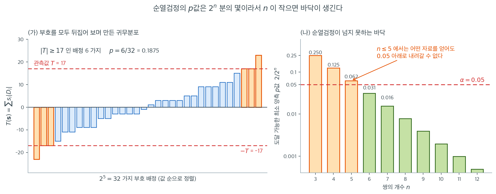
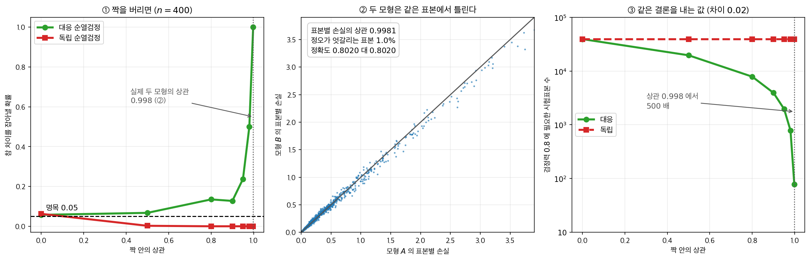

# 대응 순열검정

[대응 부호검정](paired_sign.md)과 [대응 Wilcoxon 검정](paired_wilcoxon.md)은 대응차이에서 어떤 정보를 쓸지에 대해 각기 특정한 선택을 한다. 부호만 쓰거나, 부호에 순위를 더한다. **대응 순열검정**은 다른 접근을 취한다. 차이의 완전한 수치값을 쓰고, 부호가 배정될 수 있었던 모든 경우를 고려하여 귀무분포를 유도한다. 그 결과 가용한 정보를 모두 활용하면서도 가정이 없는 정확검정을 얻는다.

---

## 1. 직관

$H_0$(처치 효과 없음) 아래에서 각 차이 $D_i = X_i - Y_i$는 양수일 확률과 음수일 확률이 같다. 한 쌍 안에서 "전"과 "후" 라벨을 맞바꾸면 크기는 그대로인 채 $D_i$의 부호만 뒤집히기 때문이다. $n$개 차이의 부호를 무작위로 다시 배정하면 그 결과 나오는 검정통계량이 관측값과 비슷해야 한다. 순열검정은 관측된 통계량을 가능한 $2^n$가지 부호 배정 전체에 걸친 통계량의 분포와 비교하여 이 논리를 형식화한다.

---

## 2. 가설

$$
H_0 \colon D_i \text{의 분포가 0을 중심으로 대칭이다}
$$

$$
H_a \colon D_i \text{의 분포가 0을 중심으로 대칭이 아니다 (양측)}
$$

단측 대립가설은 양의 이동이나 음의 이동으로 관심을 제한하여 얻는다.

---

## 3. 검정통계량

$D_1, D_2, \ldots, D_n$을 관측된 대응차이라 하자. 차이의 임의의 함수를 검정통계량으로 쓸 수 있다. 흔한 선택은 다음과 같다.

- **차이의 평균:** $\bar{D} = \frac{1}{n}\sum_{i=1}^{n} D_i$
- **차이의 합:** $T = \sum_{i=1}^{n} D_i$

둘은 비례하므로 동치인 검정을 준다. 간단하게 $T$를 쓴다.

---

## 4. 순열분포

$H_0$ 아래에서 각 차이 $D_i$는 $+|D_i|$일 확률과 $-|D_i|$일 확률이 같다. 각 $s_i \in \{-1, +1\}$인 부호 배정 $\mathbf{s} = (s_1, s_2, \ldots, s_n)$이 $2^n$가지 있고 모두 동등하게 가능하다. 각 배정에 대해

$$
T(\mathbf{s}) = \sum_{i=1}^{n} s_i \, |D_i|
$$

를 계산한다. 집합 $\{T(\mathbf{s}) : \mathbf{s} \in \{-1, +1\}^n\}$이 $H_0$ 아래 $T$의 **순열분포**를 이룬다.

---

## 5. 정확 p값

정확 양측 $p$값은 관측값만큼 또는 그보다 극단적인 검정통계량을 내는 부호 배정의 비율이다.

$$
p = \frac{\#\{|\,T(\mathbf{s})| \ge |T_{\text{obs}}|\}}{2^n}
$$

단측검정에서는

$$
p = \frac{\#\{T(\mathbf{s}) \ge T_{\text{obs}}\}}{2^n} \qquad \text{(오른쪽 꼬리)}
$$

<div class="exbox" markdown>

**보기 1.** <span class="diff easy" title="쉬움"></span> 새 학습법의 대응 순열검정. 한 연구자가 새 학습법이 시험 점수를 높이는지 검정한다. 학생 5명이 옛 방법과 새 방법으로 각각 한 번씩 시험을 본다.

| 학생 | 옛 ($Y_i$) | 새 ($X_i$) | $D_i = X_i - Y_i$ |
|:-------:|:------:|:------:|:-----:|
| 1 | 72 | 78 | 6 |
| 2 | 85 | 82 | $-3$ |
| 3 | 68 | 75 | 7 |
| 4 | 90 | 93 | 3 |
| 5 | 76 | 80 | 4 |

**관측 검정통계량:** $T_{\text{obs}} = 6 + (-3) + 7 + 3 + 4 = 17$.

**$2^5 = 32$가지 부호 배정을 모두 열거한다.** 각 배정 $\mathbf{s} = (s_1, \ldots, s_5)$에 대해 $T(\mathbf{s}) = 6s_1 + 3s_2 + 7s_3 + 3s_4 + 4s_5$를 계산한다.

절대차이는 $(6, 3, 7, 3, 4)$이고 $T$의 최댓값은 $6 + 3 + 7 + 3 + 4 = 23$이다.

32가지를 모두 열거한 뒤 $|T(\mathbf{s})| \ge 17$인 것을 센다.

| $T(\mathbf{s}) \ge 17$ | 부호 배정 |
|:-:|:-:|
| 23 | $(+,+,+,+,+)$ |
| 17 | $(+,-,+,+,+)$ |
| 17 | $(+,+,+,-,+)$ |

그리고 $T(\mathbf{s}) \le -17$인 것은

| $T(\mathbf{s}) \le -17$ | 부호 배정 |
|:-:|:-:|
| $-23$ | $(-,-,-,-,-)$ |
| $-17$ | $(-,+,-,-,-)$ |
| $-17$ | $(-,-,-,+,-)$ |

합계 32가지 중 6가지가 $|T| \ge 17$을 만족한다.

</div>

??? success "풀이"
    $$
    p = \frac{6}{32} = 0.1875
    $$

    $\alpha = 0.05$에서 $H_0$을 기각하지 못한다. 5쌍만으로는 중간 정도의 효과를 탐지할 검정력이 부족하다.

    !!! note "$n = 5$에서 도달 가능한 가장 작은 $p$값"
        양측 순열검정이 $n = 5$에서 낼 수 있는 최소 $p$값은 $2/32 = 0.0625$이다. 모든 차이가 같은 방향일 때(즉 $T$가 최댓값 또는 최솟값일 때)에 해당한다.

        따라서 **$n = 5$에서는 양측 순열검정이 $\alpha = 0.05$에서 결코 기각할 수 없다.** 어떤 자료를 얻어도 그렇다. 유의성에 도달하려면 최소 $n = 6$($2/64 = 0.031$)이 필요하다. 이는 대응 부호검정과 Wilcoxon 부호순위검정에도 똑같이 적용되는 제약이다. 순열 기반 검정은 모두 $2^n$가지 부호 배정을 귀무분포로 쓰기 때문이다.



(가)는 위에서 손으로 센 것을 그림으로 옮긴 것이다. 막대 $32$개가 $2^5$가지 부호 배정 각각의 $T(\mathbf{s})$이고, 값 순으로 정렬해 두었다. 빨간 점선 $\pm 17$ 바깥으로 나가는 주황 막대가 $6$개이므로 $p = 6/32 = 0.1875$이다. 순열검정의 $p$값 계산에는 **어떤 분포도, 어떤 표도 등장하지 않는다.** 막대를 세는 것이 전부이다.

바로 그 점이 (나)의 문제를 낳는다. $p$값이 언제나 $2^n$을 분모로 갖는 분수이므로, 양측검정에서 가장 작게 만들 수 있는 값은 양 끝의 두 배정에 해당하는 $2/2^n$이다. 이것이 **그 표본크기에서 도달 가능한 $p$값의 바닥**이다. $n = 3$이면 $0.25$, $n = 4$면 $0.125$, $n = 5$면 $0.0625$이다.

$n = 5$의 막대가 $\alpha = 0.05$ 선 위에 있다는 사실이 뜻하는 바는 강하다. **다섯 쌍으로는 어떤 자료를 얻어도 양측 $0.05$ 수준에서 기각할 수 없다.** 다섯 쌍 모두 같은 방향으로 커다랗게 움직였어도 그렇다. $n = 6$에서 $0.03125$로 처음 선 아래로 내려가고, 그 뒤로는 쌍이 하나 늘 때마다 바닥이 절반씩 낮아진다.

이 제약은 순열검정만의 것이 아니다. 부호검정도 Wilcoxon 부호순위검정도 같은 $2^n$가지 부호 배정을 귀무분포로 쓰므로 **바닥이 정확히 같다.** 그러니 대응설계를 계획할 때는 검정력 계산 이전에 이것부터 확인해야 한다. 유의수준 $0.05$를 쓸 작정이라면 양측검정에는 최소 $6$쌍, $\alpha = 0.01$을 쓸 작정이라면 최소 $8$쌍($2/256 = 0.0078$)이 필요하다.

---

## 6. 몬테카를로 근사

$n$이 크면 $2^n$가지 순열을 모두 열거하는 것이 계산적으로 불가능하다. **몬테카를로 근사**는 $B$개(보통 $B = 10{,}000$ 이상)의 부호 배정을 무작위로 뽑아 $p$값을 추정한다.

$$
\hat{p} = \frac{\#\{|T(\mathbf{s}_b)| \ge |T_{\text{obs}}| : b = 1, \ldots, B\} + 1}{B + 1}
$$

분자와 분모의 $+1$은 $p$값이 정확히 0이 되지 않게 하고, 관측된 자료 자체가 순열 중 하나임을 반영한다.

!!! note "몬테카를로 p값의 정확도"
    $B = 10{,}000$개의 무작위 순열을 쓰면 추정된 $p$값의 몬테카를로 표준오차는 최대 $\sqrt{0.25 / 10{,}000} = 0.005$이다. 대부분의 실무 목적에는 이 정밀도로 충분하다.

---

## 7. 다른 대응 검정과의 비교

| 특징 | 대응 $t$ 검정 | 대응 Wilcoxon | 대응 부호검정 | 대응 순열검정 |
|:--------|:----------------|:----------------|:------------|:-------------------|
| 정규성 필요 | 예 | 아니오 | 아니오 | 아니오 |
| 대칭성 필요 | 예 | 예 | 아니오 | $H_0$ 아래에서만 |
| 크기를 쓰는가 | 예 | 순위를 통해 | 아니오 | 예 (원값) |
| 정확 $p$값 | 아니오 (근사) | 소표본만 | 예 | 예 |
| 검정력 (정규자료) | 최고 | 매우 높음 | 낮음 | 매우 높음 |

대응 순열검정은 완전한 수치 차이를 쓰므로 정규성을 요구하지 않으면서도 대응 $t$ 검정에 비견할 만한 검정력을 갖는다. 주된 한계는 계산이다. 정확한 열거에는 $2^n$번의 계산이 필요하지만, 몬테카를로 표집으로 임의의 큰 표본까지 확장할 수 있다.

<div class="aibox" markdown>

**AI로 보는 통계학 1.** 같은 시험집합에 걸었다면 그것은 짝지은 자료다

기계학습에서 가장 흔한 짝지은 자료가 하나 있다 — **같은 시험집합에 걸린 두 모형.** 표본마다 모형 $A$ 의 손실과 모형 $B$ 의 손실이 하나씩 나오니, 완벽하게 짝지어져 있다. 그런데 둘을 견줄 때 "$A$ 의 점수 분포"와 "$B$ 의 점수 분포"를 **독립 두 표본처럼** 다루는 일이 흔하다. 그 대가를 재 보았다.



**① 상관이 높을수록 손해가 커진다.** 참 차이가 있는 자료($n = 400$, 명목 $0.05$)에서 짝 안의 상관만 바꿔 가며 두 검정을 돌렸다.

| 짝 안의 상관 | $0$ | $0.5$ | $0.9$ | $0.98$ | $0.998$ |
|---|---|---|---|---|---|
| 대응 순열검정 | $0.058$ | $0.068$ | $0.128$ | $0.500$ | $\mathbf{1.000}$ |
| 독립 순열검정 | $0.062$ | $0.003$ | $0.000$ | $0.000$ | $\mathbf{0.000}$ |

상관이 $0$ 이면 둘이 같다 — 짝이 없으면 짝을 쓸 이유도 없다. 그런데 상관이 커지면 대응 쪽만 올라가고 **독립 쪽은 $0.05$ 아래로 내려간다.** 검정력이 유의수준보다 낮다는 말이 이상하게 들리지만 까닭은 분명하다. 두 무더기를 **합쳐서 다시 가르는** 순간 귀무분포가 실제 차이의 흩어짐보다 넓어진다. 넓은 자로 재면 무엇도 커 보이지 않는다.

**② 실제 상관은 $1$ 에 가깝다.** 같은 자료로 학습한 로지스틱 모형 둘(씨앗과 규제가 다르다)을 시험표본 $1000$ 개에 걸었다.

- 표본별 손실의 상관 $\mathbf{0.9981}$
- 정오가 **엇갈리는** 표본은 $1.0\%$, 곧 $10$ 개뿐
- 정확도는 $0.8020$ 대 $0.8020$ 으로 소수 넷째 자리까지 같다

놀랄 일이 아니다. 두 모형은 **같은 자료로 배웠으므로 같은 표본에서 틀린다.** 어려운 표본은 양쪽 모두에게 어렵다. 그림 ②의 점들이 대각선에 붙어 있는 것이 그 모습이다.

그래서 같은 손실 차이에 두 검정을 걸면 **대응 $p = 0.0349$, 독립 $p = 0.9047$** 이 나온다. 같은 자료, 같은 두 모형인데 한쪽은 "차이가 있다"고 하고 한쪽은 아무 말도 하지 않는다.

**③ 값으로 환산하면.** 참 차이 $0.02$ 를 검정력 $0.8$ 로 잡는 데 필요한 시험표본 수는 대응 쪽이 $2(1-\rho)(z_{0.975}+z_{0.8})^2/\delta^2$ 로 $\rho$ 와 함께 줄지만, 짝을 버리면 $\rho$ 가 도움이 되지 않아 그 자리에 머문다.

| 상관 | $0.9$ | $0.95$ | $0.98$ | $0.998$ |
|---|---|---|---|---|
| 대응 | $3{,}924$ | $1{,}962$ | $785$ | $\mathbf{78}$ |
| 독립 | $39{,}244$ | $39{,}244$ | $39{,}244$ | $39{,}244$ |

상관 $0.998$ 에서 **$500$ 배**다. 시험표본 $78$ 개로 될 일에 $39{,}244$ 개를 쓰는 셈이다.

실무로는 셋이다.

- **같은 시험집합이면 언제나 짝을 지킨다.** 어려운 일이 아니다 — 집계된 점수 하나가 아니라 **표본별 점수를 저장**해 두면 된다. 그것 하나가 위 표의 차이를 만든다.
- **지표가 이진이면 엇갈린 표본만 세게 된다.** 정·오로만 재면 두 모형이 같이 맞히거나 같이 틀린 표본은 어느 쪽에도 증거가 되지 않는다. ②에서 쓸모 있는 표본은 $1000$ 개 가운데 $10$ 개다. 손실처럼 연속인 지표를 쓰면 나머지 $990$ 개도 조금씩 말을 한다.
- **정확도가 같다고 두 모형이 같은 것이 아니다.** ②에서 정확도는 넷째 자리까지 같은데 손실 차이는 유의하다. 지표를 하나로 줄이는 일이 비교를 지우기도 한다.

</div>

---

## 연습문제

<div class="drillbox" markdown>

**연습문제 1.** <span class="diff med" title="중간"></span>
위 학습법 자료에 네 가지 대응 검정을 적용하여 양측 $p$값을 비교하라. 순열검정과 Wilcoxon 검정의 $p$값이 왜 정확히 같은가?

</div>

??? success "풀이"
    ```python
    import numpy as np, itertools
    from scipy import stats
    D = np.array([6, -3, 7, 3, 4])

    a = np.abs(D); T = D.sum()
    allT = np.array([np.dot(s, a) for s in itertools.product([-1, 1], repeat=5)])
    print((np.abs(allT) >= abs(T)).mean())        # 0.1875
    print(stats.wilcoxon(D, method='exact').pvalue)  # 0.1875
    print(stats.ttest_1samp(D, 0).pvalue)            # 0.1239
    print(stats.binomtest(4, 5).pvalue)              # 0.3750
    ```

    출력:

    ```
    0.1875
    0.1875
    0.12385684836470104
    0.375
    ```

    | 검정 | 양측 $p$값 |
    |:---|---:|
    | 대응 $t$ | $0.1239$ |
    | 대응 Wilcoxon | $0.1875$ |
    | 대응 순열검정 | $0.1875$ |
    | 대응 부호검정 | $0.3750$ |

    순열검정과 Wilcoxon이 **소수점 이하 전부 일치**한다. 우연이 아니라 $n = 5$에서 순열분포가 아주 성기기 때문이다.

    $p$값은 $\{|T(\mathbf{s})| \ge |T_{\text{obs}}|\}$인 부호 배정의 **개수**로 결정된다. Wilcoxon은 같은 논리를 $|D|$ 대신 순위 $(1, \ldots, 5)$에 적용한다. 이 자료의 절대차이 $(6, 3, 7, 3, 4)$가 순위로는 $(4, 1.5, 5, 1.5, 3)$인데, 두 벡터의 **순서 구조가 같으므로** 극단적인 배정 6개가 정확히 같은 6개가 된다.

    두 검정이 언제나 일치하는 것은 아니다. 절대차이 사이의 비율이 순위 사이의 비율과 크게 다르면 갈라진다. 예를 들어 $|D| = (1, 2, 3, 4, 100)$이면 순열검정은 $100$의 압도적 크기를 반영하지만 Wilcoxon에게는 그냥 순위 5일 뿐이다.

<div class="drillbox" markdown>

**연습문제 2.** <span class="diff med" title="중간"></span>
$|D| = (1, 2, 3, 4, 100)$처럼 한 차이가 압도적으로 큰 자료에서 순열검정과 Wilcoxon 검정의 $p$값을 비교하라. 이상치에 대한 두 검정의 태도가 어떻게 다른가?

</div>

??? success "풀이"
    두 경우를 보자. $D_A = (1, 2, 3, 4, 100)$(모두 양수)과 $D_B = (1, 2, 3, 4, -100)$(가장 큰 것만 음수).

    ```python
    import numpy as np, itertools
    from scipy import stats

    def perm_p(D):
        a = np.abs(D); T = D.sum()
        allT = np.array([np.dot(s, a) for s in itertools.product([-1, 1], repeat=len(D))])
        return (np.abs(allT) >= abs(T)).mean()

    for D in (np.array([1, 2, 3, 4, 100]), np.array([1, 2, 3, 4, -100])):
        print(D, perm_p(D),
              stats.wilcoxon(D, method='exact').pvalue,
              stats.ttest_1samp(D, 0).pvalue)
    ```

    출력:

    ```
    [  1   2   3   4 100] 0.0625 0.0625 0.32245920880686274
    [   1    2    3    4 -100] 1.0 0.625 0.4296209319991539
    ```

    | 자료 | 순열검정 | Wilcoxon | $t$ 검정 |
    |:---|---:|---:|---:|
    | $(1, 2, 3, 4, 100)$ | $0.0625$ | $0.0625$ | $0.3225$ |
    | $(1, 2, 3, 4, -100)$ | $1.0000$ | $0.6250$ | $0.4296$ |

    **첫 번째 자료**에서는 세 검정이 갈린다. 순열검정과 Wilcoxon은 $n = 5$의 최소값 $2/32 = 0.0625$를 준다. 모든 차이가 양수이므로 가능한 한 극단적이다. 반면 $t$ 검정은 $0.32$로 아무것도 못 찾는다. 분자 $\bar{D} = 22$가 크지만 $100$이 표본표준편차를 $43.6$까지 부풀려 $t = 1.13$밖에 안 되기 때문이다.

    여기서 순위 기반 검정과 순열검정의 로버스트성이 드러난다. 두 검정 모두 "다섯 개가 모두 같은 방향"이라는 사실만 보고 판정하는 반면, $t$ 검정은 이상치 하나에 무너진다.

    **두 번째 자료**에서 순열검정이 정확히 $p = 1$을 준다. $T = -90$인데, $|D| = (1,2,3,4,100)$의 어떤 부호 배정에서도 $100$이 나머지 합 $10$을 압도하므로 **모든** $|T(\mathbf{s})|$가 $90$ 이상이다($90$에서 $110$ 사이). 관측값이 가장 덜 극단적인 배정 중 하나인 셈이다.

    Wilcoxon은 $W^+ = 1+2+3+4 = 10$, $W^- = 5$로 순위상 어느 정도 불균형이 있어 $p = 0.625$이다. 순위를 쓰면 $100$이 그저 "가장 큰 것"일 뿐이므로 다른 넷이 반대 방향이라는 사실이 약한 신호로 남는다.

    **핵심 차이:** 순열검정은 크기의 **비율**에 민감하고 Wilcoxon은 그렇지 않다. $100$을 $1000$으로 바꾸어도 Wilcoxon $p$값은 $0.625$ 그대로지만, 순열검정에서는 $100$이 지배적일수록 $p$가 1에 붙는다. 이것이 항상 좋은 성질은 아니다. 지배적인 이상치 하나가 순열검정을 완전히 무력화할 수 있다.

<div class="drillbox" markdown>

**연습문제 3.** <span class="diff med" title="중간"></span>
몬테카를로 순열검정에서 $+1$ 보정이 왜 필요한가? 보정 없이 $\hat{p}_{\text{raw}} = c/B$를 쓰면 검정의 실제 크기가 명목수준을 넘음을 모의실험으로 보여라.

</div>

??? success "풀이"
    $H_0$이 참인 자료($\mathcal{N}(0,1)$, $n = 15$)를 생성하여 두 방식의 실제 크기를 비교한다.

    ```python
    import numpy as np
    rng = np.random.default_rng(0)
    n, M = 15, 40000

    for B in (20, 100, 200, 1000):
        raw = adj = 0
        for _ in range(M):
            D = rng.normal(0, 1, n)
            a = np.abs(D); T = abs(D.sum())
            s = rng.choice([-1, 1], size=(B, n))
            c = np.sum(np.abs(s @ a) >= T)
            raw += (c / B) <= 0.05
            adj += ((c + 1) / (B + 1)) <= 0.05
        print(B, raw / M, adj / M)
    ```

    출력:

    ```
    20 0.0942 0.04645
    100 0.0588 0.049675
    200 0.05315 0.04795
    1000 0.05105 0.0499
    ```

    | $B$ | 보정 없음 $c/B$ | 보정 있음 $(c+1)/(B+1)$ |
    |---:|---:|---:|
    | 20 | **0.0942** | 0.0464 |
    | 100 | 0.0588 | 0.0497 |
    | 200 | 0.0532 | 0.0479 |
    | 1000 | 0.0510 | 0.0499 |

    $B = 20$에서 보정하지 않은 검정의 실제 크기가 $0.094$로 명목값의 **거의 두 배**이다. $B$가 커지면 차이가 줄어들지만 $B = 1000$에서도 여전히 $0.0510$ 대 $0.0499$로 보정한 쪽이 정확하다.

    이유는 이렇다. $c/B \le 0.05$가 되려면 $B = 20$에서 $c \le 1$이면 된다. 관측값보다 극단적인 순열이 **하나까지 허용**되므로 기준이 느슨하다. 반면 $(c+1)/21 \le 0.05$는 $c = 0$을 요구한다.

    개념적으로도 보정이 옳다. 귀무가설 아래에서 관측된 자료는 다른 모든 순열과 **교환 가능**하다. 따라서 $B$개의 무작위 순열과 관측값을 합쳐 $B+1$개를 만들고 관측값이 그중 상위 $\alpha$에 드는지를 물어야 한다. 분자와 분모의 $+1$이 바로 "관측값 자신"을 세는 것이다.

    이 때문에 실무에서 $B$를 $999$나 $9999$로 잡는 관행이 생겼다. $B + 1$이 깔끔한 수가 되어 $\hat{p}$의 분모가 $1000$이나 $10000$이 된다.

<div class="drillbox" markdown>

**연습문제 4.** <span class="diff med" title="중간"></span>
$n$이 커지면 순열검정과 대응 $t$ 검정의 $p$값이 수렴한다. $n = 5, 10, 20, 50$에서 정규분포 차이에 대해 두 검정의 $p$값 상관을 모의실험으로 확인하라.

</div>

??? success "풀이"
    ```python
    import numpy as np
    from scipy import stats
    rng = np.random.default_rng(9)

    def perm_p_mc(D, B=4999, rng=rng):
        a = np.abs(D); T = abs(D.sum())
        signs = rng.choice([-1, 1], size=(B, len(D)))
        Ts = np.abs(signs @ a)
        return (np.sum(Ts >= T) + 1) / (B + 1)

    for n in (5, 10, 20, 50):
        pp, pt = [], []
        for _ in range(300):
            D = rng.normal(0.5, 1, n)
            pp.append(perm_p_mc(D)); pt.append(stats.ttest_1samp(D, 0).pvalue)
        pp, pt = np.array(pp), np.array(pt)
        print(n, round(np.corrcoef(pp, pt)[0, 1], 4),
              round(np.max(np.abs(pp - pt)), 4))
    ```

    출력:

    ```
    5 0.9752 0.4711
    10 0.999 0.0784
    20 0.9996 0.0391
    50 0.9997 0.0108
    ```

    | $n$ | $p$값 상관 | 최대 절대차 |
    |---:|---:|---:|
    | 5 | 0.9752 | 0.4711 |
    | 10 | 0.9990 | 0.0784 |
    | 20 | 0.9996 | 0.0391 |
    | 50 | 0.9997 | 0.0108 |

    상관이 $n = 10$에서 이미 $0.999$이다. 최대 차이는 $n = 5$에서 $0.47$로 매우 크지만($2^5 = 32$가지 순열밖에 없어 $p$값이 $1/32$ 단위로 계단을 이룬다) $n = 20$부터는 $0.04$ 아래로 떨어진다.

    이유는 두 검정이 결국 같은 통계량 $\sum D_i$를 쓰기 때문이다. 차이는 귀무분포를 어떻게 얻느냐뿐이다. $t$ 검정은 정규이론으로, 순열검정은 열거로 얻는다. 자료가 정규이고 $n$이 커지면 순열분포가 $t$ 분포로 수렴한다.

    **실무적 함의는 양방향이다.**

    - 자료가 정규에 가까우면 순열검정을 써도 잃는 것이 거의 없다. 즉 순열검정을 기본으로 삼아도 비용이 없다.
    - 반대로 자료가 정규이면 굳이 순열검정의 계산 비용을 치를 필요도 없다.

    순열검정의 진짜 가치는 자료가 정규가 아닐 때 드러난다. 연습문제 2의 $(1, 2, 3, 4, 100)$에서 $t$ 검정은 $0.347$, 순열검정은 $0.0625$였다. 여기서는 두 검정이 전혀 수렴하지 않는다.

<div class="drillbox" markdown>

**연습문제 5.** <span class="diff med" title="중간"></span>
보기 1의 자료에 여섯째 학생을 더한다. 이 학생은 두 시험에서 똑같은 점수를 받아 $D_6 = 0$이다. 곧 $D = (6, -3, 7, 3, 4, 0)$이다.

**(가)** $2^6 = 64$가지 부호 배정으로 정확 양측 $p$값을 구하라. 손으로 세라.

**(나)** $n$개 차이 가운데 $k$개가 0일 때 도달 가능한 가장 작은 양측 $p$값이 $2/2^{\,n-k}$임을 보여라.

**(다)** 보기 1의 노트는 "유의수준 $0.05$를 쓸 작정이라면 양측검정에는 최소 6쌍"이라고 했다. (나)에 비추어 이 문장에서 빠진 조건을 말하라.

</div>

??? success "풀이"
    **(가)** $|D_6| = 0$이므로

    $$
    T(\mathbf{s}) = 6s_1 + 3s_2 + 7s_3 + 3s_4 + 4s_5 + 0 \cdot s_6
    $$

    에서 $s_6$은 아예 들어오지 않는다. 따라서 64가지 배정의 $T$값 묶음은 보기 1의 32개 값을 **그대로 두 벌 겹쳐 놓은 것**이다. $T_{\text{obs}} = 17$도 그대로이고, $|T(\mathbf{s})| \ge 17$인 배정은 보기 1의 6개가 각각 $s_6 = \pm 1$로 갈라진 12개다.

    $$
    p = \frac{12}{64} = \frac{6}{32} = 0.1875
    $$

    보기 1과 **똑같다.** 쌍을 하나 더 모았는데 $p$값이 조금도 움직이지 않았다.

    **(나)** 0인 차이 $k$개의 부호는 $T$에 영향을 주지 않는다. 0이 아닌 $m = n - k$개를 보면 $|T(\mathbf{s})|$의 최댓값은 $\sum_{i} |D_i|$이고, 0이 아닌 것 하나라도 부호를 뒤집으면 합이 $2|D_i| > 0$만큼 줄어 최댓값에 못 미친다. 그러므로 $|T(\mathbf{s})| = \sum_i |D_i|$를 주는 배정은 "0이 아닌 것 모두 $+$"와 "모두 $-$" 두 꼴뿐이고, 0인 $k$개의 부호는 자유다. 개수는 $2 \cdot 2^k$이므로

    $$
    p_{\min} = \frac{2 \cdot 2^k}{2^n} = \frac{2}{2^{\,n-k}} = \frac{2}{2^m}
    $$

    바닥은 전체 쌍의 수가 아니라 **0이 아닌 차이의 개수** $m$만으로 정해진다.

    **(다)** 빠진 조건은 "모든 차이가 0이 아니다"이다. 6쌍 가운데 한 쌍이 동점이면 $m = 5$이므로 바닥이 $2/32 = 0.0625 > 0.05$가 되어, 어떤 자료를 얻어도 양측 $0.05$에서 기각할 수 없다. 필요한 것은 "6쌍"이 아니라 "**차이가 0이 아닌 6쌍**"이다.

    이것이 대응 부호검정에서 0인 차이를 버리고 $n$을 줄이는 관행, Wilcoxon 검정의 `zero_method` 인수가 모두 가리키는 사정이다. 0인 차이는 정보가 아니라 자리만 차지한다. 대응설계를 계획할 때 쌍의 수를 세는 것만으로는 부족하고, **변화가 있을 쌍의 수**를 세야 한다.

<div class="drillbox" markdown>

**연습문제 6.** <span class="diff med" title="중간"></span>
5절의 양측 공식과 단측 공식을 비교한다.

**(가)** $T_{\text{obs}} > 0$이면 양측 $p$값이 오른쪽 꼬리 단측 $p$값의 정확히 두 배임을 증명하라. 보기 1에서 확인하라.

**(나)** $D = (3, 4, -7)$에서 두 $p$값을 모두 구하고 (가)가 깨지는 까닭을 말하라.

**(다)** 단측검정의 $p$값 바닥은 얼마인가? $\alpha = 0.05$와 $\alpha = 0.01$에 각각 몇 쌍이 필요한가? 보기 1의 노트가 양측에 대해 말한 6쌍과 8쌍과 비교하라.

</div>

??? success "풀이"
    **(가)** 사상 $\mathbf{s} \mapsto -\mathbf{s}$는 $\{-1, +1\}^n$의 일대일 대응이고 $T(-\mathbf{s}) = -T(\mathbf{s})$이다. 따라서

    $$
    \#\{T(\mathbf{s}) \le -T_{\text{obs}}\} = \#\{-T(\mathbf{s}) \le -T_{\text{obs}}\} = \#\{T(\mathbf{s}) \ge T_{\text{obs}}\}
    $$

    $T_{\text{obs}} > 0$이므로 두 사건 $\{T \ge T_{\text{obs}}\}$와 $\{T \le -T_{\text{obs}}\}$는 서로소이고 그 합집합이 $\{|T| \ge |T_{\text{obs}}|\}$이다. 그러므로

    $$
    p_{\text{양측}} = \frac{2 \cdot \#\{T(\mathbf{s}) \ge T_{\text{obs}}\}}{2^n} = 2 \, p_{\text{단측}}
    $$

    $\square$

    보기 1에서 단측은 $3/32 = 0.09375$, 양측은 $6/32 = 0.1875$로 정확히 두 배다. 보기 1의 두 표가 위아래로 꼭 3개씩 짝을 이루는 것이 바로 이 대칭이다.

    **(나)** $|D| = (3, 4, 7)$이고 $T_{\text{obs}} = 3 + 4 - 7 = 0$이다. 8가지 배정의 $T$를 모두 적으면

    | $\mathbf{s}$ | $T(\mathbf{s})$ | $\mathbf{s}$ | $T(\mathbf{s})$ |
    |:-:|-:|:-:|-:|
    | $(+,+,+)$ | $14$ | $(-,+,+)$ | $8$ |
    | $(+,+,-)$ | $0$ | $(-,+,-)$ | $-6$ |
    | $(+,-,+)$ | $6$ | $(-,-,+)$ | $0$ |
    | $(+,-,-)$ | $-8$ | $(-,-,-)$ | $-14$ |

    양측은 $|T| \ge 0$이 8개 모두이므로 $p = 8/8 = 1$이다. 오른쪽 꼬리 단측은 $T \ge 0$인 것이 $\{14, 0, 6, 8, 0\}$의 5개이므로 $p = 5/8 = 0.625$이고, $2 \times 0.625 = 1.25 > 1$이니 (가)가 깨진다.

    증명에서 $T_{\text{obs}} > 0$을 **서로소**에 썼다. $T_{\text{obs}} = 0$이면 $\{T \ge 0\}$과 $\{T \le 0\}$이 $T = 0$인 배정 2개에서 겹쳐 두 번 세어진다. 겹친 것을 빼면 $5 + 5 - 2 = 8$로 맞는다.

    **(다)** 단측 바닥은 $T_{\text{obs}}$가 최댓값일 때의 $1/2^n$이다(차이가 모두 0이 아니어야 한다 — 연습문제 5). $\alpha = 0.05$에는 $1/32 = 0.03125 < 0.05$이므로 $n = 5$로 충분하고, $\alpha = 0.01$에는 $1/128 = 0.0078 < 0.01$이므로 $n = 7$이 필요하다. 양측이 요구한 6쌍과 8쌍에 비해 단측은 언제나 **한 쌍을 깎아 준다.** 두 바닥의 비가 정확히 2이고, $2$의 거듭제곱 격자에서 절반으로 내려가는 것은 $n$을 1 늘리는 것과 같기 때문이다.

    해석하면, 방향을 미리 정하는 것만으로 대응쌍 하나를 버는 셈이다. 다만 그 방향은 자료를 보기 **전에** 정해야 한다. 자료를 본 뒤 유리한 쪽으로 단측을 고르면 실제 수준이 두 배가 된다(9장).

<div class="drillbox" markdown>

**연습문제 7.** <span class="diff hard" title="어려움"></span>
7절의 표는 검정력을 "$t$ 최고 / Wilcoxon 매우 높음 / 부호 낮음 / 순열 매우 높음"으로 적었다. 이 순서가 자료의 분포에 따라 뒤집히는지 확인하라.

$n = 12$, $\alpha = 0.05$, 반복 20,000번으로 네 상황의 기각률을 재라. (i) $H_0$인 표준정규, (ii) $\mathcal{N}(0.6, 1)$, (iii) 10%가 표준편차 10배로 오염된 정규에 $0.6$ 이동, (iv) 표준코시에 $0.6$ 이동.

네 검정 모두 $p$값을 $2^{12} = 4096$가지 전수 열거로 정확히 구하라. 세 비모수 검정은 **같은 부호배정 행렬에 가중치만 바꾸어** 한꺼번에 돌릴 수 있다(가중치 $|D_i|$, 순위, $1$). 결과를 표로 만들고 7절의 표에서 고쳐야 할 칸을 지적하라.

</div>

??? success "풀이"
    세 비모수 검정은 모두 $T(\mathbf{s}) = \sum_i s_i w_i$ 꼴의 통계량을 같은 $2^n$가지 부호 배정에 대고 보는 검정이다. 가중치 $w_i$가 $|D_i|$면 순열검정, $|D_i|$의 순위면 Wilcoxon 부호순위검정, 모두 $1$이면 부호검정이다. 그러므로 $4096 \times 12$ 행렬 하나를 만들어 두고 가중치만 바꾸면 세 검정을 함께 돌릴 수 있다.

    ```python
    import numpy as np, itertools
    from scipy import stats

    n, M, alpha = 12, 20000, 0.05
    S = np.array(list(itertools.product([-1.0, 1.0], repeat=n)))   # 4096 x 12
    rng = np.random.default_rng(0)

    def rates(D):
        """D: (n, M). 같은 2^n 부호배정에 가중치만 바꿔 세 검정을 함께 돌린다."""
        sgn = np.sign(D)
        rk = np.argsort(np.argsort(np.abs(D), axis=0), axis=0) + 1.0
        out = []
        for w in (np.abs(D), rk, np.ones_like(D)):     # 순열 / Wilcoxon / 부호
            obs = np.abs((sgn * w).sum(axis=0))
            p = np.empty(M)
            for j in range(0, M, 2000):                # 메모리 때문에 토막내어
                sl = slice(j, j + 2000)
                p[sl] = (np.abs(S @ w[:, sl]) >= obs[sl]).mean(axis=0)
            out.append((p <= alpha).mean())
        out.append((stats.ttest_1samp(D, 0, axis=0, alternative="two-sided").pvalue <= alpha).mean())
        return out

    d = 0.6
    cases = [
        ("normal H0", rng.normal(0, 1, (n, M))),
        ("normal   ", d + rng.normal(0, 1, (n, M))),
        ("contam   ", d + rng.normal(0, 1, (n, M))
                        * np.where(rng.random((n, M)) < 0.1, 10.0, 1.0)),
        ("Cauchy   ", d + rng.standard_cauchy((n, M))),
    ]
    print("case         perm  wilcoxon    sign       t")
    for name, D in cases:
        a, b, c, e = rates(D)
        print(f"{name} {a:8.4f}{b:10.4f}{c:8.4f}{e:8.4f}")
    ```

    출력:

    ```text
    case         perm  wilcoxon    sign       t
    normal H0   0.0505    0.0433  0.0412  0.0512
    normal      0.4712    0.4267  0.3211  0.4721
    contam      0.3160    0.3067  0.2686  0.2204
    Cauchy      0.1539    0.1707  0.1971  0.0804
    ```

    | 자료 | 순열 | Wilcoxon | 부호 | $t$ |
    |:---|---:|---:|---:|---:|
    | $\mathcal{N}(0,1)$ ($H_0$) | $0.0505$ | $0.0433$ | $0.0412$ | $0.0512$ |
    | $\mathcal{N}(0.6, 1)$ | $0.4712$ | $0.4267$ | $0.3211$ | $\mathbf{0.4721}$ |
    | 10% 오염정규 | $\mathbf{0.3160}$ | $0.3067$ | $0.2686$ | $0.2204$ |
    | 코시 | $0.1539$ | $0.1707$ | $\mathbf{0.1971}$ | $0.0804$ |

    **첫 줄(크기).** 네 검정 모두 $0.05$를 넘지 않는다. 순열검정의 $0.0505$는 몬테카를로 표준오차 $\sqrt{0.05 \cdot 0.95/20000} = 0.0015$ 안에서 이론 상한과 어긋나지 않는다. 양측 순열 $p$값은 $1/2048$의 배수만 가질 수 있으므로($s \mapsto -s$ 대칭 때문에 세는 개수가 늘 짝수다 — 연습문제 6) $0.05$ 이하에서 가장 큰 값은 $102/2048 = 0.0498$이고, 실제 크기는 그 이하다. Wilcoxon $0.0433$과 부호검정 $0.0412$가 더 작은 것은 귀무분포가 더 성겨서 생기는 보수성이다.

    **둘째 줄(정규).** $t$ 검정 $0.4721$, 순열검정 $0.4712$. 차이가 $0.001$로 표준오차보다도 작다. **정규자료에서 순열검정은 $t$ 검정에 비해 잃는 것이 사실상 없다.** Wilcoxon은 $0.4267$로 $t$의 90% 수준이고 부호검정은 $0.3211$이다. 여기까지는 7절의 표가 맞다.

    **셋째 줄(오염정규).** 순서가 이미 뒤집혔다. $t$ 검정이 $0.2204$로 **가장 나쁘다.** 분산 100인 성분이 10%만 섞여도 표본표준편차가 부풀어 $t$가 작아진다. 순열검정 $0.3160$이 가장 세고 Wilcoxon $0.3067$이 바로 뒤다.

    **넷째 줄(코시).** 완전히 거꾸로다. 7절이 "낮음"이라 적은 부호검정이 $0.1971$로 1위이고, 순열검정은 $0.1539$로 Wilcoxon $0.1707$보다도 낮다. $t$ 검정은 $0.0804$로 거의 쓸모가 없다.

    **고쳐야 할 칸.** 7절 표의 마지막 줄은 제목이 "검정력 (정규자료)"이므로 그 줄 자체는 틀리지 않았다. 그러나 "순열검정은 완전한 수치 차이를 쓰므로 $t$ 검정에 비견할 검정력을 갖는다"는 본문의 문장은 **정규자료에 한정된 말**로 읽어야 한다. 순열검정의 통계량 $T = \sum D_i$는 평균이고, 평균은 꼬리가 두꺼운 자료에서 강건하지 않다. 순열검정이 버린 것은 **분포 가정**이고 통계량의 비강건성은 그대로 남는다. 코시 자료에서 $|D_i|$ 하나가 나머지를 지배하면 순열 귀무분포의 폭 $\sqrt{\sum D_i^2}$ 자체가 함께 커져 신호가 묻힌다(연습문제 2, 8).

    실무 교훈은 하나다. **정확성(exactness)과 강건성(robustness)은 다른 성질이다.** 순열검정은 언제나 정확하지만 언제나 강건하지는 않다.

<div class="drillbox" markdown>

**연습문제 8.** <span class="diff hard" title="어려움"></span>
연습문제 2의 $D = (1, 2, 3, 4, -100)$은 $p = 1$을 주었다. 이를 일반화한다. 모든 $D_i \ne 0$이고 어떤 $k$에 대해

$$
|D_k| > \sum_{i \ne k} |D_i|
$$

라 하자. $\sigma = \operatorname{sign}(D_k)$라 하고, $U$를 나머지 $n - 1$개의 부호합 $\sum_{i \ne k} s_i |D_i|$가 갖는 $2^{n-1}$개 값의 묶음, $u_{\text{obs}} = \sigma \sum_{i \ne k} D_i$라 하자.

**(가)** 정확 양측 $p$값이 다음과 같음을 보여라.

$$
p = \frac{\#\{u \in U : u \ge u_{\text{obs}}\}}{2^{\,n-1}}
$$

곧 지배적인 차이의 **크기는 $p$값에 전혀 들어오지 않고 부호만 남는다.**

**(나)** $D = (1, -2, 3, -4, 100)$의 정확 양측 $p$값을 손으로 구하라.

**(다)** $p = 1$이 되는 것은 언제인가? 이 상황에서 도달 가능한 가장 작은 양측 $p$값은 얼마인가?

</div>

??? success "풀이"
    **(가)** $m = |D_k|$라 하고 $R = \sum_{i \ne k} |D_i| < m$이라 하자. 임의의 배정 $\mathbf{s}$에서

    $$
    T(\mathbf{s}) = s_k m + u, \qquad u = \sum_{i \ne k} s_i |D_i| \in U
    $$

    이고 $|u| \le R < m$이므로 $T(\mathbf{s})$의 부호는 $s_k$와 같다. 따라서

    $$
    |T(\mathbf{s})| = m + s_k u
    $$

    관측된 배정은 $s_i = \operatorname{sign}(D_i)$이므로 $s_k = \sigma$, $u = \sum_{i \ne k} D_i$이고 $|T_{\text{obs}}| = m + \sigma \sum_{i \ne k} D_i = m + u_{\text{obs}}$다. 그러므로

    $$
    \#\{|T(\mathbf{s})| \ge |T_{\text{obs}}|\} = \#\{(s_k, \mathbf{s}_{-k}) : s_k u \ge u_{\text{obs}}\}
    $$

    $s_k = +1$이면 $u \ge u_{\text{obs}}$, $s_k = -1$이면 $u \le -u_{\text{obs}}$다. $\mathbf{s}_{-k} \mapsto -\mathbf{s}_{-k}$가 $U$를 그대로 옮기므로 $\#\{u \le -u_{\text{obs}}\} = \#\{u \ge u_{\text{obs}}\}$이고, 개수는 그 두 배다. $2^n$으로 나누면

    $$
    p = \frac{2 \, \#\{u \ge u_{\text{obs}}\}}{2^n} = \frac{\#\{u \in U : u \ge u_{\text{obs}}\}}{2^{\,n-1}}
    $$

    $\square$

    오른쪽에 $m$이 어디에도 없다. 지배적인 차이는 **방향만 정하고 물러난다.** 남은 것은 나머지 $n - 1$개 차이에 대한 **단측** 부호순열검정이다.

    **(나)** $m = 100 > 1 + 2 + 3 + 4 = 10$이므로 조건이 성립한다. $\sigma = +1$이고

    $$
    u_{\text{obs}} = 1 + (-2) + 3 + (-4) = -2
    $$

    $U$는 $\pm 1 \pm 2 \pm 3 \pm 4$가 갖는 $16$개 값이다. $+$를 모두 택한 $10$에서 출발해 부분집합 $A \subseteq \{1,2,3,4\}$의 부호를 뒤집으면 값이 $10 - 2\sum A$가 되므로

    | $u$ | $10$ | $8$ | $6$ | $4$ | $2$ | $0$ | $-2$ | $-4$ | $-6$ | $-8$ | $-10$ |
    |:-:|-:|-:|-:|-:|-:|-:|-:|-:|-:|-:|-:|
    | 개수 | $1$ | $1$ | $1$ | $2$ | $2$ | $2$ | $2$ | $2$ | $1$ | $1$ | $1$ |

    합이 $16$으로 맞는다. $u \ge -2$인 것은 $1+1+1+2+2+2+2 = 11$개이므로

    $$
    p = \frac{11}{16} = 0.6875
    $$

    $100$의 크기는 계산 어디에도 등장하지 않았다. $100$을 $10^6$으로 바꾸어도 $p = 0.6875$ 그대로다.

    **(다)** $p = 1$은 $u_{\text{obs}} = \min U = -\sum_{i \ne k}|D_i|$일 때, 곧 모든 $i \ne k$에서 $\sigma \operatorname{sign}(D_i) = -1$일 때다. 나머지 차이가 **전부 지배적 차이와 반대 방향**인 경우다. 연습문제 2의 $(1, 2, 3, 4, -100)$이 정확히 그 꼴이어서 $p = 1$이 나왔다.

    가장 작은 값은 $u_{\text{obs}} = \max U$, 곧 나머지가 전부 같은 방향일 때의

    $$
    p_{\min} = \frac{1}{2^{\,n-1}} = \frac{2}{2^n}
    $$

    이다. 이는 0인 차이가 없는 $n$쌍의 보통 바닥 $2/2^n$과 **똑같다**(연습문제 5). 그러니 지배 상황이 쌍 하나를 0인 차이처럼 잃는 것은 아니다. 도달 가능한 $p$값의 격자도 달라지지 않는다 — 양측 $p$값은 $\mathbf{s} \mapsto -\mathbf{s}$ 대칭 때문에 어차피 $2/2^n$의 배수뿐이기 때문이다(연습문제 6). 잃는 것은 해상도가 아니라 **정보**다. 양측검정이 나머지 $n - 1$개 차이에 대한 단측검정으로 주저앉고, 지배적 차이의 크기 $|D_k|$는 아무리 커도 $p$값에 한 자리도 남기지 못한다.

    순열검정이 크기를 쓴다는 것은 장점이지만, 하나가 나머지 전체를 지배해 버리면 그 하나의 크기 정보는 오히려 전부 버려진다. 연습문제 7의 코시 줄에서 순열검정이 부호검정에 뒤진 까닭이 여기에 있다.

<div class="drillbox" markdown>

**연습문제 9.** <span class="diff hard" title="어려움"></span>
7절의 표는 순열검정의 대칭성 요구를 "$H_0$ 아래에서만"이라고 적었다. 이 칸의 뜻을 수로 재어 보자. $Z \sim \mathcal{N}(0, 1)$에서 $D = e^Z - 1$로 차이를 만들면 $D$의 중앙값은 **정확히 0**이고 $P(D > 0) = 1/2$이지만 평균은 $e^{1/2} - 1 \approx 0.6487$이다.

**(가)** $n = 12$, $\alpha = 0.05$, 반복 20,000번으로 부호 · Wilcoxon · 순열 · $t$ 네 검정의 기각률을 구하라. 비교를 위해 $D \sim \mathcal{N}(0,1)$도 같이 하고, $P(D > 0)$, $E[D]$, $P(D_i + D_j > 0)$을 모의로 확인하라.

**(나)** 네 기각률 가운데 어느 것이 **크기**이고 어느 것이 **검정력**인가? 각 검정의 귀무가설을 적어 가려라.

**(다)** $n$이 커지면 순열검정의 기각률은 어떻게 되는가? 부호검정은 어떻게 되는가?

</div>

??? success "풀이"
    **(가)** 연습문제 7과 같은 틀을 그대로 쓴다.

    ```python
    import numpy as np, itertools
    from scipy import stats

    n, M, alpha = 12, 20000, 0.05
    S = np.array(list(itertools.product([-1.0, 1.0], repeat=n)))
    rng = np.random.default_rng(7)

    def rates2(D):
        sgn = np.sign(D)
        rk = np.argsort(np.argsort(np.abs(D), axis=0), axis=0) + 1.0
        out = []
        for w in (np.ones_like(D), rk, np.abs(D)):     # 부호 / Wilcoxon / 순열
            obs = np.abs((sgn * w).sum(axis=0))
            p = np.empty(M)
            for j in range(0, M, 2000):
                sl = slice(j, j + 2000)
                p[sl] = (np.abs(S @ w[:, sl]) >= obs[sl]).mean(axis=0)
            out.append((p <= alpha).mean())
        out.append((stats.ttest_1samp(D, 0, axis=0, alternative="two-sided").pvalue <= alpha).mean())
        return out

    cases = [("exp(Z)-1", np.exp(rng.normal(0, 1, (n, M))) - 1.0),
             ("Z       ", rng.normal(0, 1, (n, M)))]
    print("D 의 분포    sign  wilcoxon    perm       t")
    for name, D in cases:
        a, b, c, e = rates2(D)
        print(f"{name} {a:8.4f}{b:10.4f}{c:8.4f}{e:8.4f}")

    # 세 귀무가설이 각각 참인지 확인한다
    V = np.exp(rng.normal(0, 1, 2_000_000)) - 1.0
    U, W = V[:1_000_000], V[1_000_000:]
    print(f"P(D > 0)        = {np.mean(V > 0):.4f}")
    print(f"E[D]            = {V.mean():.4f}  (이론값 {np.exp(0.5) - 1:.4f})")
    print(f"P(D_i + D_j > 0) = {np.mean(U + W > 0):.4f}")
    ```

    출력:

    ```text
    D 의 분포    sign  wilcoxon    perm       t
    exp(Z)-1   0.0364    0.0658  0.1076  0.0731
    Z          0.0379    0.0422  0.0504  0.0508
    P(D > 0)        = 0.4999
    E[D]            = 0.6479  (이론값 0.6487)
    P(D_i + D_j > 0) = 0.6052
    ```

    **(나)** 네 검정의 귀무가설이 모두 다르므로 같은 자료에서 어느 것은 크기이고 어느 것은 검정력이다.

    | 검정 | 귀무가설 | $e^Z - 1$에서 참인가 | 기각률 $0.0500$과 비교 | 읽는 법 |
    |:---|:---|:-:|---:|:---|
    | 부호 | $P(D > 0) = 1/2$ | 참 ($0.4999$) | $0.0364$ | **크기** |
    | Wilcoxon | $D$가 0 대칭 (실질적으로 $P(D_i + D_j > 0) = 1/2$) | 거짓 ($0.6052$) | $0.0658$ | 검정력 |
    | 순열 | $D$가 0 대칭 | 거짓 | $0.1076$ | 검정력 |
    | $t$ | $E[D] = 0$ | 거짓 ($0.6487$) | $0.0731$ | 검정력 |

    부호검정의 $0.0364$는 **크기**이고 명목값보다 작다. $n = 12$에서 양측 부호검정의 정확한 크기는

    $$
    2 \cdot \frac{\binom{12}{0} + \binom{12}{1} + \binom{12}{2}}{2^{12}} = 2 \cdot \frac{1 + 12 + 66}{4096} = 0.0386
    $$

    이고 관측값 $0.0364$가 표준오차 $0.0013$의 두 배 안에 들어온다.

    대칭인 둘째 줄에서는 네 귀무가설이 모두 참이고 기각률이 모두 $0.05$ 이하다. 순열검정의 $0.0504$는 연습문제 7에서 본 이론 상한 $102/2048 = 0.0498$과 몬테카를로 오차 안에서 어긋나지 않는다.

    위험한 지점은 이것이다. **"순열검정은 가정이 없다"는 말에 기대어 기각을 "중앙값이 0이 아니다"로 읽으면 틀린다.** 이 자료의 중앙값은 정확히 0인데 순열검정은 $0.05$ 수준에서 $10.8\%$를 기각한다. 순열검정이 포기한 것은 정규성이고 포기하지 않은 것은 **대칭성**이다. 치우친 차이 분포에서는 부호검정만이 중앙값에 대한 진술을 지킨다.

    **(다)** $T = \sum_i D_i$이므로 $E[T] = n(e^{1/2} - 1)$이고 $\operatorname{sd}(T) = \sqrt{n}\,\sigma_D$다. 로그정규의 분산에서

    $$
    \sigma_D^2 = (e - 1)e = e^2 - e = 4.6708, \qquad \sigma_D = 2.1613
    $$

    이므로 신호 대 잡음은

    $$
    \frac{E[T]}{\operatorname{sd}(T)} = \frac{0.6487}{2.1613}\sqrt{n} = 0.300\sqrt{n}
    $$

    $\sqrt{n}$으로 자란다. $n = 100$이면 $3.00$이고 기각률은 대략 $\Phi(3.00 - 1.96) \approx 0.85$다. ($n = 12$에서 같은 근사를 쓰면 $0.300\sqrt{12} = 1.04$로 $0.18$이 나오는데 실제는 $0.108$이다. $n$이 작으면 $T$가 오른쪽으로 심하게 치우쳐 정규근사가 거칠다.)

    반면 부호검정의 귀무가설 $P(D > 0) = 1/2$은 $n$과 무관하게 참이므로 기각률은 $n$이 아무리 커져도 $0.05$ 아래에 머문다. **$n$을 늘려서 갈라지는 두 검정을 보는 것이 그 둘이 서로 다른 것을 검정한다는 가장 확실한 증거다.**

<div class="drillbox" markdown>

**연습문제 10.** <span class="diff hard" title="어려움"></span>
3절은 "차이의 임의의 함수를 검정통계량으로 쓸 수 있다"고 하고 $\bar{D}$와 $T$가 비례하므로 동치라고 했다. 한 걸음 더 나아가자. 대응 $t$ 통계량

$$
t(\mathbf{s}) = \frac{\bar{D}(\mathbf{s})}{s(\mathbf{s})/\sqrt{n}}
$$

는 $T(\mathbf{s})$에 비례하지 **않는데도** 순열검정에서 $T$와 똑같은 양측 $p$값을 준다.

**(가)** $\sum_i D_i(\mathbf{s})^2$이 부호 배정에 불변임을 확인하고, 이를 써서 $|t(\mathbf{s})|$가 $|T(\mathbf{s})|$의 증가함수임을 보여라.

**(나)** 보기 1의 자료에서 $T$, $t$, 차이의 중앙값 세 통계량의 정확 양측 $p$값을 구하고, 무작위 자료로 (가)를 확인하라.

**(다)** 중앙값 통계량이 보기 1에서 $p = 0.25$를 주는 까닭을 32가지 배정을 세어 설명하라. (가)와 (다)를 합쳐 "통계량 선택은 언제 상관없고 언제 상관있는가"에 답하라.

</div>

??? success "풀이"
    **(가)** $D_i(\mathbf{s}) = s_i |D_i|$이므로 $D_i(\mathbf{s})^2 = |D_i|^2$이고 부호가 사라진다. 따라서

    $$
    Q = \sum_{i=1}^{n} D_i(\mathbf{s})^2 = \sum_{i=1}^{n} |D_i|^2
    $$

    는 $2^n$가지 배정 전부에서 같은 값이다. 보기 1에서는 $Q = 36 + 9 + 49 + 9 + 16 = 119$다. 표본분산은

    $$
    s^2(\mathbf{s}) = \frac{1}{n-1}\left(Q - \frac{T(\mathbf{s})^2}{n}\right)
    $$

    이고 $Q$가 상수이므로 $s^2$는 $T^2$의 **감소**함수다. 그러므로 $x = T(\mathbf{s})^2/n$이라 두면

    $$
    t^2(\mathbf{s}) = \frac{n\bar{D}^2}{s^2} = \frac{x}{(Q - x)/(n-1)} = \frac{(n-1)x}{Q - x}
    $$

    이고 이 함수는 $0 \le x < Q$에서 증가한다(분자는 늘고 분모는 줄기 때문이다). $x$가 $|T|$의 증가함수이므로 $|t|$도 $|T|$의 증가함수다. 따라서 두 사건이 **집합째** 같다.

    $$
    \{|t(\mathbf{s})| \ge |t_{\text{obs}}|\} = \{|T(\mathbf{s})| \ge |T_{\text{obs}}|\}
    $$

    같은 개수를 세므로 $p$값도 같다. $\square$ (모든 $|D_i|$가 같은 극단적인 경우에만 양 끝 배정에서 $x = Q$, $s = 0$이 되어 $|t| = \infty$이지만, 순서는 그대로다.)

    **(나)**

    ```python
    import numpy as np, itertools

    def perm_pvals(D):
        """D 의 모든 부호배정에서 T, t, 중앙값 통계량의 정확 양측 p값."""
        n = len(D)
        S = np.array(list(itertools.product([-1.0, 1.0], repeat=n)))
        Ds = S * np.abs(D)                                  # 2^n x n, 한 행이 한 배정
        T = Ds.sum(axis=1)
        t = (T / n) / (Ds.std(axis=1, ddof=1) / np.sqrt(n))
        med = np.median(Ds, axis=1)
        k = np.where((Ds == D).all(axis=1))[0][0]           # 관측된 배정의 자리
        p = {}
        for name, v in (("T", T), ("t", t), ("med", med)):
            p[name] = (np.abs(v) >= abs(v[k]) - 1e-9).mean()  # 동점은 허용오차로
        return p, np.unique(np.round((Ds ** 2).sum(axis=1), 9))

    D = np.array([6.0, -3, 7, 3, 4])
    p, Q = perm_pvals(D)
    print("보기 1 의 자료 D = (6, -3, 7, 3, 4)")
    print(f"  p(T)      = {p['T']:.4f}")
    print(f"  p(t)      = {p['t']:.4f}")
    print(f"  p(중앙값) = {p['med']:.4f}")
    print(f"  32 개 배정에서 sum D_i^2 이 갖는 값: {Q}")

    rng = np.random.default_rng(3)
    print("무작위 자료 5 벌 (n = 10, D ~ N(0.4, 1))")
    for _ in range(5):
        p, _ = perm_pvals(rng.normal(0.4, 1, 10))
        print(f"  p(T) = {p['T']:.5f}   p(t) - p(T) = {p['t'] - p['T']:+.5f}"
              f"   p(중앙값) - p(T) = {p['med'] - p['T']:+.5f}")
    ```

    출력:

    ```text
    보기 1 의 자료 D = (6, -3, 7, 3, 4)
      p(T)      = 0.1875
      p(t)      = 0.1875
      p(중앙값) = 0.2500
      32 개 배정에서 sum D_i^2 이 갖는 값: [119.]
    무작위 자료 5 벌 (n = 10, D ~ N(0.4, 1))
      p(T) = 0.61328   p(t) - p(T) = +0.00000   p(중앙값) - p(T) = +0.25000
      p(T) = 0.20117   p(t) - p(T) = +0.00000   p(중앙값) - p(T) = +0.09180
      p(T) = 0.00391   p(t) - p(T) = +0.00000   p(중앙값) - p(T) = +0.02734
      p(T) = 0.87695   p(t) - p(T) = +0.00000   p(중앙값) - p(T) = -0.24805
      p(T) = 0.02148   p(t) - p(T) = +0.00000   p(중앙값) - p(T) = +0.02539
    ```

    $Q$가 한 값 $119$뿐임이 (가)의 전제를 확인해 준다. $p(T)$와 $p(t)$는 보기 1에서도, 무작위 자료 다섯 벌 전부에서도 **소수점 다섯째 자리까지 완전히 일치**한다. 비교 연산에 $10^{-9}$의 허용오차를 둔 것은 수학이 아니라 부동소수점 때문이다. $|T| = 17$인 배정 4개에서 $|t|$가 이론적으로는 똑같은데 계산 순서 때문에 마지막 비트가 어긋나, 허용오차 없이 비교하면 $p(t) = 0.1250$이라는 **거짓 불일치**가 나온다.

    **(다)** 관측된 배정의 차이는 $(6, -3, 7, 3, 4)$이고 정렬하면 $(-3, 3, 4, 6, 7)$이므로 중앙값은 $4$다. 5개 값의 중앙값은 세 번째로 큰 값이므로

    $$
    \operatorname{med}(\mathbf{s}) \ge 4 \iff 4 \text{ 이상인 값이 적어도 3개}
    $$

    $|D| = (6, 3, 7, 3, 4)$에서 $4$ 이상이 될 수 있는 것은 $6, 7, 4$ 셋뿐이고 두 개의 $3$은 어떤 부호로도 $4$에 못 미친다. 따라서 $s_1 = s_3 = s_5 = +1$이 강제되고 $s_2, s_4$는 자유다. 네 가지 모두에서 중앙값은 정확히 $4$다.

    | $(s_2, s_4)$ | 정렬한 값 | 중앙값 |
    |:-:|:-:|:-:|
    | $(-,-)$ | $(-3, -3, 4, 6, 7)$ | $4$ |
    | $(+,-)$ | $(-3, 3, 4, 6, 7)$ | $4$ |
    | $(-,+)$ | $(-3, 3, 4, 6, 7)$ | $4$ |
    | $(+,+)$ | $(3, 3, 4, 6, 7)$ | $4$ |

    대칭으로 $\operatorname{med}(\mathbf{s}) \le -4$인 것도 4가지다. 합이 8이므로 $p = 8/32 = 0.25$다.

    **답.** 통계량이 $|T|$의 단조함수인 한 — 합, 평균, $t$, 스튜던트화한 평균이 모두 그렇다 — 순열 $p$값은 **바뀌지 않는다.** $|T|$의 함수가 아닌 통계량, 곧 중앙값 · 절단평균 · 순위합은 **다른 검정**이 되고 $p$값도 달라진다. 보기 1에서 중앙값 통계량은 $0.25$로 더 둔했지만, 위 출력의 넷째 벌처럼 $p$값이 $0.248$ 더 **작아지는** 자료도 있다. 어느 쪽이 나은지는 자료의 꼬리에 달렸다.

    그러니 "순열검정"은 하나의 검정이 아니라 **검정을 만드는 틀**이다. 틀은 어떤 통계량에든 정확한 $p$값을 준다. 무엇을 잘 탐지할지는 틀이 아니라 통계량의 선택이 정한다.

---

## 정리하며

대응 순열검정은 관측된 대응차이의 부호를 $2^n$가지로 재배정한 경우를 모두 열거하거나 무작위로 표집하여 귀무분포를 구성한다. 자료의 완전한 수치 정보를 활용하는 정확한 분포무관 $p$값을 얻는다. $n$이 작으면 정확한 열거가 가능하고, $n$이 크면 몬테카를로 표집이 정확한 근사를 준다. 대응 $t$ 검정의 정규성 가정도, Wilcoxon 부호순위검정의 대칭성 가정도 정당화되지 않을 때 특히 유용하다.

다음 절부터 **[이표본 비모수 검정](../two_sample_nonparametric/rank_sum.md)**으로 넘어간다. 짝이 없는 두 집단을 견주는 일이다.
