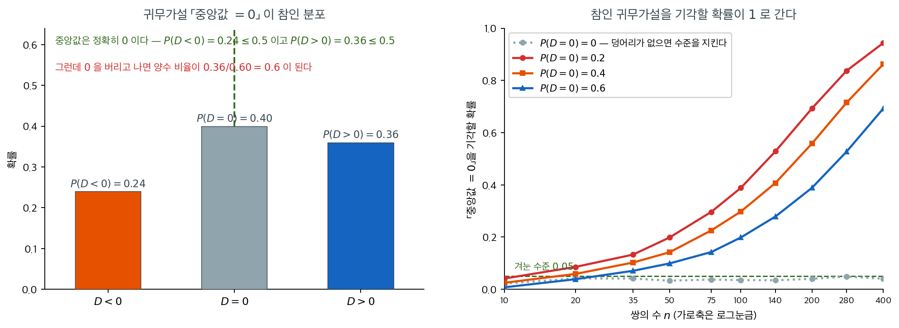
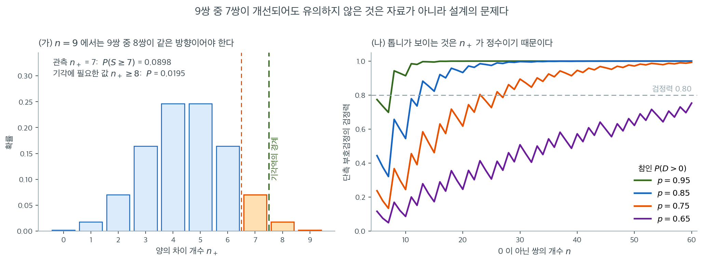

# 대응 부호검정

같은 피험자에게서 처치 전후를 측정하는 것처럼 대응 관측값 $(X_i, Y_i)$을 얻었다면, 자연스러운 접근은 자료를 차이 $D_i = X_i - Y_i$로 줄인 뒤 중앙값 차이가 0인지 검정하는 것이다. **대응 부호검정**은 이 차이들에 [부호검정](../one_sample_nonparametric/sign_test.md)을 적용하며, 각 차이의 방향(양수 또는 음수)만 쓰고 크기는 무시한다.

대응 부호검정은 분포 가정을 사실상 하지 않으므로 대응자료에 대한 가장 안전한 비모수 선택이다. 대가는 크기 정보까지 활용하는 [대응 Wilcoxon 부호순위검정](paired_wilcoxon.md)에 비해 검정력이 낮다는 것이다.

---

## 1. 가설

$i = 1, 2, \ldots, n$에 대해 $D_i = X_i - Y_i$라 두고 $p = P(D_i > 0)$이라 하자. $H_0$ 아래에서 중앙값 차이가 0이며 이는 $p = 0.5$를 뜻한다.

| 검정 유형 | $H_0$ | $H_a$ |
|:----------|:------|:------|
| 양측 | $p = 0.5$ | $p \ne 0.5$ |
| 왼쪽 꼬리 | $p = 0.5$ | $p < 0.5$ (처치가 결과를 악화시킨다) |
| 오른쪽 꼬리 | $p = 0.5$ | $p > 0.5$ (처치가 결과를 개선한다) |

---

## 2. 절차

**1단계.** 대응차이 $D_i = X_i - Y_i$를 계산한다.

**2단계.** $D_i = 0$인 쌍을 모두 버린다. 남은(0이 아닌) 차이의 개수를 $n$이라 하자.

**3단계.** 양의 차이 개수 $n_+$와 음의 차이 개수 $n_-$를 센다.

**4단계.** $H_0$ 아래에서 양의 부호 개수는

$$
n_+ \sim \text{Binomial}(n, 0.5)
$$

를 따른다.

**5단계.** $p$값을 계산한다. $S \sim \text{Binomial}(n, 0.5)$일 때

- **양측:** $p\text{값} = 2\min\!\bigl(P(S \le n_+),\; P(S \ge n_+)\bigr)$
- **오른쪽 꼬리:** $p\text{값} = P(S \ge n_+)$
- **왼쪽 꼬리:** $p\text{값} = P(S \le n_+)$

$n$이 크면 정규근사가

$$
Z = \frac{n_+ - n/2}{\sqrt{n/4}}
$$

를 준다.

<div class="storybox" markdown>

**그림으로 보는 통계학 1.** 버린 쌍이 물음을 바꾼다

위 2단계도 한 줄이다 — 「$D_i = 0$ 인 쌍을 모두 버린다.」 16.2 에서 본 [부호순위검정의 영](../one_sample_nonparametric/wilcoxon_signed_rank.md)과 같은 자리인데, **부호검정에서는 탈이 나는 방식이 다르다.** 그쪽은 자료를 좋게 바꾸어도 $p$ 값이 올라갈 수 있다는 것이었고, 여기서는 **검정이 답하는 물음 자체가 바뀐다.**

§1 은 「$H_0$ 아래에서 중앙값 차이가 $0$ 이며 이는 $p = 0.5$ 를 뜻한다」고 적어 두었다. 그 「이며」가 성립하는 것은 $D$ 가 $0$ 을 확률 $0$ 으로 가질 때뿐이다. 연속분포라는 가정이 바로 그것을 말한다. 그런데 $0$ 을 버리는 절차를 두었다는 것은 **$0$ 이 실제로 나온다는 뜻**이고, 그러면 두 진술은 갈라진다.



왼쪽이 갈라지는 자리다. $P(D<0) = 0.24$, $P(D=0) = 0.40$, $P(D>0) = 0.36$ 인 분포를 보자. 양쪽 꼬리가 모두 $0.5$ 아래이므로 **$D$ 의 중앙값은 정확히 $0$ 이고 귀무가설은 참이다.** 그런데 $0$ 을 버리고 나면 남은 쌍 가운데 양수의 비율이 $0.36/0.60 = 0.6$ 이다. 부호검정이 재는 것은 이 조건부 비율이지 중앙값이 아니다.

오른쪽이 그 대가다. 쌍을 늘려 가며 기각확률을 정확히 계산하면 $P(D=0) = 0.2$ 에서 $n = 50$ 에 $0.198$, $n = 200$ 에 $0.693$, $n = 400$ 에 $0.944$ 로 **$1$ 을 향해 올라간다.** 참인 귀무가설인데 그렇다. 자료를 더 모을수록 더 확실하게 틀리는 셈이다. 덩어리가 없는 맨 아래 점선은 $0.021$–$0.048$ 사이에 얌전히 머물러 있어 대조가 분명하다.

$0$ 이 섞인 자료를 어떻게 다룰지는 $1955$ 년에 요제프 푸터가 『Annals of Mathematical Statistics』 $26$ 권 $368$–$386$ 쪽에 열아홉 쪽을 들여 따진 문제이고, 네 해 뒤 프랫의 논문이 그 뒤를 이었다. **교과서가 한 줄로 지나가는 자리에 학술지 논문 두 편이 붙어 있다.**

고약한 것은 이 쪽 §3 이 부호검정을 권하는 자리 — **리커트 척도, 순서형 차이, 「호전·불변·악화」로만 적힌 기록** — 이 하필 $0$ 이 가장 많이 나오는 자리라는 점이다. 그러니 $0$ 인 쌍이 몇이었는지를 **반드시 함께 보고하고**, 그 수가 많으면 「중앙값이 $0$ 이다」가 아니라 **「변한 쌍 가운데 좋아진 쪽이 절반이다」**를 검정했다고 적어야 한다. 두 문장은 같은 말이 아니다.

_확인한 곳 — 논문이 Joseph Putter 의 「The Treatment of Ties in Some Nonparametric Tests」이고 『The Annals of Mathematical Statistics』 $26$ 권 $3$ 호 $368$–$386$ 쪽($1955$ 년 $9$ 월)이라는 것은 [Project Euclid 의 그 쪽](https://projecteuclid.org/journals/annals-of-mathematical-statistics/volume-26/issue-3/The-Treatment-of-Ties-in-Some-Nonparametric-Tests/10.1214/aoms/1177728485.full) · 프랫($1959$)의 서지는 16.2 의 상자에 적어 두었다. 세 꼭짓점 분포와 기각확률은 모의실험이 아니라 **이항분포로 정확히 계산한 값이다**_

</div>

<div class="exbox" markdown>

**보기 1.** <span class="diff easy" title="쉬움"></span> 운동 프로그램과 안정시 심박수. 참가자 10명을 대상으로 12주 프로그램 전후의 안정시 심박수(bpm)를 측정하여 운동 프로그램을 평가한다.

| 참가자 | 전 ($X_i$) | 후 ($Y_i$) | $D_i = X_i - Y_i$ | 부호 |
|:-----------:|:------:|:------:|:----:|:----:|
| 1 | 72 | 68 | 4 | $+$ |
| 2 | 80 | 75 | 5 | $+$ |
| 3 | 68 | 70 | $-2$ | $-$ |
| 4 | 76 | 74 | 2 | $+$ |
| 5 | 85 | 78 | 7 | $+$ |
| 6 | 74 | 74 | 0 | (동점) |
| 7 | 90 | 82 | 8 | $+$ |
| 8 | 78 | 76 | 2 | $+$ |
| 9 | 82 | 79 | 3 | $+$ |
| 10 | 70 | 72 | $-2$ | $-$ |

</div>

??? success "풀이"
    **1단계.** 위에서 차이를 계산했다. 동점 하나($D_6 = 0$)를 제외한다.

    **2단계.** 남은 것: $n = 9$, $n_+ = 7$, $n_- = 2$.

    **3단계.** $H_0$ 아래에서 $n_+ \sim \text{Binomial}(9, 0.5)$이다.

    **4단계.** 오른쪽 꼬리 $p$값($H_a$: 프로그램이 심박수를 낮추므로 $D_i > 0$이 기대된다):

    $$
    P(S \ge 7) = \sum_{k=7}^{9} \binom{9}{k} (0.5)^9 = \binom{9}{7}(0.5)^9 + \binom{9}{8}(0.5)^9 + \binom{9}{9}(0.5)^9
    $$

    $$
    = \frac{36 + 9 + 1}{512} = \frac{46}{512} \approx 0.090
    $$

    $\alpha = 0.05$에서 $H_0$을 기각하지 못한다. 동점이 아닌 9쌍 중 7쌍이 개선을 보였는데도 표본이 너무 작아 부호검정이 유의성에 이르지 못했다. 소표본에서 부호검정의 검정력이 낮음을 보여 주는 예이다.

    !!! tip "검정력에 대한 고려"
        같은 자료에 [대응 Wilcoxon 부호순위검정](paired_wilcoxon.md)을 적용하면 차이의 크기를 쓰므로(큰 양의 차이가 더 큰 가중치를 받는다) $p$값이 더 작아질 수 있다. 대칭성 가정이 그럴듯하다면 대응 Wilcoxon 검정이 낫다.



"표본이 너무 작아 유의성에 이르지 못했다"는 말이 얼마나 구체적인 제약인지 그림으로 확인해 두자.

(가)가 $n = 9$의 정확 귀무분포 $\text{Binomial}(9,\,0.5)$이다. 관측된 $n_+ = 7$부터 오른쪽 꼬리를 더하면 $0.0898$이다. 초록 점선이 기각역의 경계인데, $\alpha = 0.05$ 단측검정에서 기각하려면 $n_+ \ge 8$이어야 하고 그때의 확률은 $0.0195$이다. 즉 **아홉 쌍 중 여덟 쌍이 같은 방향이어야 한다.** $7$과 $8$ 사이에 중간 단계가 없으므로, 관측값이 경계 바로 아래에 있었다는 것 외에 달리 해석할 여지가 없다.

(나)가 처방을 준다. 참인 $P(D > 0)$을 $0.65$에서 $0.95$까지 바꿔 가며 단측 부호검정의 검정력을 표본크기별로 계산한 것이다. 심박수 자료의 관측 비율 $7/9 \approx 0.78$과 가까운 주황 곡선($p = 0.75$)을 보면, 검정력 $0.80$에 이르려면 **$0$이 아닌 쌍이 $23$개 필요하다.** $9$쌍으로는 애초에 승산이 없었다는 뜻이다.

곡선이 매끄럽지 않고 톱니처럼 흔들리는 것도 같은 이산성 때문이다. $n$이 하나 늘 때마다 임계값 $c$가 그대로일 수도 있고 하나 올라갈 수도 있는데, 올라가는 해에는 기각역이 좁아져 검정력이 오히려 **떨어진다.** $n = 6$보다 $n = 7$이 나빠 보이는 구간이 그런 자리이다. 대응설계의 표본크기를 정할 때 연속 공식을 믿지 말고 이런 표를 직접 계산해 봐야 하는 이유가 여기에 있다.

---

## 3. 대응 부호검정을 언제 쓰는가

대응 부호검정은 다음 상황에 적절하다.

- **변화의 방향만 알 때.** 예를 들어 환자가 변화의 정도를 수치화하지 않고 "호전" 또는 "악화"만 보고하는 경우.
- **차이가 순서형일 때.** 측정 척도가 의미 있는 산술을 지원하지 않으면(예: Likert 척도) 크기에 신뢰성 있게 순위를 매길 수 없다.
- **대칭성이 의심스러울 때.** Wilcoxon 부호순위검정은 차이 분포의 대칭성을 가정한다. 차이가 심하게 치우쳐 있다면 부호검정이 이 가정을 피한다.

---

## 4. 대안과의 비교

| 특징 | 대응 $t$ 검정 | 대응 Wilcoxon | 대응 부호검정 |
|:--------|:----------------|:----------------|:-----------------|
| 차이에 대한 가정 | 정규 | 대칭, 연속 | 연속 |
| 사용하는 정보 | 원값 | 부호 + 순위 | 부호만 |
| 검정력 (정규자료) | 최고 | 높음 (ARE $\approx 0.955$) | 낮음 (ARE $\approx 0.637$) |
| 이상치에 대한 로버스트성 | 낮음 | 높음 | 매우 높음 |
| 순서형 자료 적용 | 불가 | 때때로 | 가능 |

---

## 연습문제

<div class="drillbox" markdown>

**연습문제 1.** <span class="diff med" title="중간"></span>
위 심박수 자료에 대응 부호검정, 대응 Wilcoxon 부호순위검정, 대응 $t$ 검정, 대응 순열검정을 모두 적용하여 단측 $p$값을 비교하라. 결론이 갈리는가?

</div>

??? success "풀이"
    ```python
    import numpy as np, itertools
    from scipy import stats
    d = np.array([4, 5, -2, 2, 7, 0, 8, 2, 3, -2])
    nz = d[d != 0]          # 동점 제외, n = 9

    print(stats.binomtest(int((nz > 0).sum()), len(nz),
                          alternative='greater').pvalue)          # 0.0898
    print(stats.wilcoxon(nz, alternative='greater',
                         method='exact',
                         zero_method='wilcox').pvalue)            # 0.0195
    print(stats.ttest_1samp(nz, 0, alternative='greater').pvalue) # 0.0165

    a = np.abs(nz); T = nz.sum()
    allT = np.array([np.dot(s, a) for s in itertools.product([-1, 1], repeat=9)])
    print((allT >= T).mean())                                     # 0.0254
    ```

    출력:

    ```
    0.08984375
    0.01953125
    0.01652701624852805
    0.025390625
    ```

    | 검정 | 단측 $p$값 | $\alpha = 0.05$ 결론 |
    |:---|---:|:---|
    | 대응 부호검정 | $0.0898$ | 기각 못 함 |
    | 대응 순열검정 | $0.0254$ | 기각 |
    | 대응 Wilcoxon | $0.0195$ | 기각 |
    | 대응 $t$ | $0.0165$ | 기각 |

    **부호검정만 결론이 다르다.** 나머지 셋은 모두 유의하다고 판정한다.

    이유는 이 자료의 구조에 있다. 음의 차이 두 개는 모두 $-2$로 절댓값이 가장 작다. 양의 차이는 $4, 5, 2, 7, 8, 2, 3$으로 $8$까지 올라간다. 크기를 쓰는 세 검정은 "반대 방향 증거가 있긴 하나 모두 미미하다"를 읽어 내지만, 부호검정에게는 $-2$가 $-200$과 같은 한 개의 음수일 뿐이다.

    순열검정($0.0254$)이 Wilcoxon($0.0195$)보다 $p$값이 살짝 크다는 점도 흥미롭다. 순열검정은 원래 값을 쓰므로 이 자료에서 순위보다 정보를 더 쓰는데도 그렇다. $n = 9$에서 순열분포가 $2^9 = 512$개의 값밖에 갖지 못해 이산성이 크기 때문이며, 이 정도 차이는 잡음 범위이다.

<div class="drillbox" markdown>

**연습문제 2.** <span class="diff med" title="중간"></span>
대응 부호검정에서 동점($D_i = 0$)이 많으면 어떤 문제가 생기는가? 보기 자료의 동점 개수를 1개에서 5개로 늘려 가며 $p$값의 변화를 관찰하라.

</div>

??? success "풀이"
    ```python
    from scipy import stats
    # n+ = 7 은 고정, 동점만 늘려 전체 쌍 수를 키운다
    for extra in range(0, 5):
        n = 9                # 0이 아닌 쌍의 수는 변하지 않는다
        print(10 + extra, n, stats.binomtest(7, n, alternative='greater').pvalue)
    ```

    출력:

    ```
    10 9 0.08984375
    11 9 0.08984375
    12 9 0.08984375
    13 9 0.08984375
    14 9 0.08984375
    ```

    출력은 모두 $0.0898$이다. **동점을 아무리 많이 붙여도 부호검정의 $p$값은 전혀 변하지 않는다.**

    이것이 부호검정의 동점 처리가 가진 근본적 성질이자 위험이다. 참가자 100명 중 91명이 변화가 없고 7명이 개선, 2명이 악화했다고 하자. 부호검정은 여전히 $p = 0.0898$을 준다. 하지만 "100명 중 7명만 개선"이라는 사실은 실질적으로 프로그램의 효과가 미미함을 강하게 시사한다.

    부호검정이 검정하는 귀무가설이 **"$D \ne 0$인 쌍들 중에서" $P(D > 0) = P(D < 0)$**이기 때문이다. 변화가 없는 쌍은 이 조건부 확률에 대해 아무 정보도 주지 않으므로 옳게 버려지는 것이다.

    **실무 권고:** 동점 비율이 높으면 부호검정 $p$값과 함께 **동점 비율을 반드시 함께 보고**해야 한다. 검정 결과만 보고하면 효과의 실질적 크기를 완전히 오도한다. 효과 크기가 관심사라면 $\hat{p} = n_+/(n_+ + n_-)$가 아니라 $n_+/N$을 보는 것이 낫다.

<div class="drillbox" markdown>

**연습문제 3.** <span class="diff med" title="중간"></span>
대응 부호검정에서 중앙값 차이의 신뢰구간을 어떻게 구하는가? 보기 자료로 95% 신뢰구간을 계산하라.

</div>

??? success "풀이"
    부호검정을 역전시키면 중앙값의 신뢰구간이 나온다. 차이를 정렬한 순서통계량 $D_{(1)} \le \cdots \le D_{(n)}$에 대해 구간은

    $$
    \bigl( D_{(k+1)}, \; D_{(n-k)} \bigr)
    $$

    이며, $k$는 $2P(S \le k) \le \alpha$를 만족하는 가장 큰 정수이다($S \sim \text{Binomial}(n, 0.5)$).

    ```python
    import numpy as np
    from scipy import stats
    d = np.array([4, 5, -2, 2, 7, 0, 8, 2, 3, -2])
    nz = np.sort(d[d != 0]); n = len(nz)     # n = 9
    for k in range(0, 4):
        print(k, 2 * stats.binom.cdf(k, n, 0.5))
    # k=0: 0.0039, k=1: 0.0391, k=2: 0.1797  →  k = 1
    print(nz)                     # [-2 -2  2  2  3  4  5  7  8]
    print(nz[1], nz[n - 2])       # -2, 7
    ```

    출력:

    ```
    0 0.00390625
    1 0.0390625
    2 0.1796875
    3 0.5078125
    [-2 -2  2  2  3  4  5  7  8]
    -2 7
    ```

    $k = 1$이므로 95% 신뢰구간은 $\bigl(D_{(2)}, D_{(8)}\bigr) = (-2, \; 7)$이다.

    구간이 $0$을 포함하므로 검정 결과($p = 0.0898$, 기각 못 함)와 일관된다. 구간과 검정이 이렇게 맞물리는 것은 구간이 검정을 역전시켜 만들어졌기 때문이다.

    구간이 매우 넓다는 점에 주목하라. 폭이 $9$ bpm으로, 자료 전체 범위($-2$에서 $8$)와 거의 같다. $n = 9$에서 부호검정 기반 구간이 쓸 수 있는 것은 $k = 1$뿐이므로 양 끝에서 하나씩만 잘라 낼 수 있다. 실제 포함확률은 $1 - 0.0391 = 0.961$로 명목값보다 높다. 소표본에서 부호검정 구간이 지나치게 보수적인 이유이다.

<div class="drillbox" markdown>

**연습문제 4.** <span class="diff med" title="중간"></span>
대응자료를 대응으로 다루지 않고 두 독립표본처럼 분석하면 무슨 일이 일어나는가? 보기 자료로 Mann-Whitney 검정을 수행하고 대응 부호검정과 비교하라.

</div>

??? success "풀이"
    ```python
    import numpy as np
    from scipy import stats
    before = np.array([72, 80, 68, 76, 85, 74, 90, 78, 82, 70])
    after  = np.array([68, 75, 70, 74, 78, 74, 82, 76, 79, 72])
    # 동점(74 대 74)이 있으므로 method='asymptotic'(동점 보정 + 연속성 수정)을 명시한다
    print(stats.mannwhitneyu(before, after, alternative='greater',
                             method='asymptotic', use_continuity=True))
    print(np.corrcoef(before, after)[0, 1])
    ```

    출력:

    ```
    MannwhitneyuResult(statistic=61.0, pvalue=0.2128050157999556)
    0.9232351791538461
    ```

    | 분석 | 단측 $p$값 |
    |:---|---:|
    | 대응 부호검정 | $0.0898$ |
    | 대응 Wilcoxon | $0.0195$ |
    | Mann-Whitney (대응 무시) | $0.2128$ |

    먼저 한 가지를 분명히 해 두자. 만–휘트니가 검정하는 것은 두 중앙값의 비교가 아니라 확률적 우위 $P(X < Y) = 1/2$이고, 두 분포가 위치이동만으로 다를 때에만 중앙값 비교로 읽힌다. 여기서는 전·후 분포의 모양이 비슷하다고 보아 비교에 쓰지만, 아래 $p$값의 차이는 가설이 달라서가 아니라 **대응 구조를 버린 대가**임에 주의하라.

    대응 구조를 무시하면 $p$값이 $0.213$으로 크게 나빠진다. 대응 Wilcoxon의 $0.0195$와 비교하면 11배이다. 이유는 두 측정값의 상관이 $0.923$으로 매우 높기 때문이다.

    직관은 이렇다. 참가자들의 기저 심박수가 $68$에서 $90$까지 넓게 퍼져 있다. 두 집단을 독립으로 보면 이 **개인차가 모두 잡음으로 들어간다**. 대응 분석은 각 참가자 안에서 차이를 계산하여 개인차를 통째로 소거하고, 남은 것은 처치 효과뿐이다.

    이것이 대응설계의 존재 이유이며, 대응자료를 독립표본으로 분석하는 것이 흔하면서도 값비싼 실수인 이유이다. 반대 방향의 실수(독립자료를 억지로 짝지어 대응 분석) 역시 위험하다. 이 경우 자유도를 절반으로 잃으면서 아무것도 얻지 못한다.

<div class="drillbox" markdown>

**연습문제 5.** <span class="diff med" title="중간"></span>
보기 1 뒤의 그림 설명은 검정력 곡선이 "톱니처럼 흔들리는" 것이 임계값 $c$가 띄엄띄엄 올라가기 때문이라고 했다. 이것을 손으로 끝까지 확인하자. 0이 아닌 쌍이 $n$개일 때 오른쪽꼬리 부호검정의 임계값을

$$
c(n) = \min\{k : P(S \ge k) \le 0.05\}, \qquad S \sim \text{Binomial}(n, 0.5)
$$

로 정한다.

(가) $n = 4, 5, 6, 7, 8, 9$에 대해 $c(n)$과 검정의 **실제 크기** $P(S \ge c(n))$을 분모 $2^n$의 분수로 구하라.

(나) 참인 $P(D > 0) = 0.75$일 때 $n = 5, \ldots, 9$의 검정력을 구하라. 표본이 늘어나는데 검정력이 **줄어드는** 구간을 찾아 그 까닭을 설명하라.

(다) $\alpha = 0.05$에서 모든 쌍이 같은 방향으로 나와도 기각할 수 없는 $n$의 범위를 구하라.

</div>

??? success "풀이"
    **(가)** 오른쪽꼬리를 큰 $k$에서부터 더해 가며 $0.05$를 넘지 않는 가장 작은 $k$를 찾는다.

    | $n$ | 꼬리확률들 | $c(n)$ | 실제 크기 |
    |:---:|:---|:---:|:---|
    | $4$ | $P(S \ge 4) = 1/16 = 0.0625$ | 없음 | $-$ |
    | $5$ | $P(S \ge 5) = 1/32 = 0.0313$, $P(S \ge 4) = 6/32 = 0.1875$ | $5$ | $1/32 = 0.0313$ |
    | $6$ | $P(S \ge 6) = 1/64 = 0.0156$, $P(S \ge 5) = 7/64 = 0.1094$ | $6$ | $1/64 = 0.0156$ |
    | $7$ | $P(S \ge 7) = 1/128 = 0.0078$, $P(S \ge 6) = 8/128 = 0.0625$ | $7$ | $1/128 = 0.0078$ |
    | $8$ | $P(S \ge 7) = 9/256 = 0.0352$, $P(S \ge 6) = 37/256 = 0.1445$ | $7$ | $9/256 = 0.0352$ |
    | $9$ | $P(S \ge 8) = 10/512 = 0.0195$, $P(S \ge 7) = 46/512 = 0.0898$ | $8$ | $10/512 = 0.0195$ |

    $n = 9$의 두 값 $0.0195$와 $0.0898$이 보기 1과 그림 설명에 나온 바로 그 수들이다.

    **(나)** $n_+ \sim \text{Binomial}(n, 0.75)$에서 $P(n_+ \ge c(n))$을 계산한다.

    $$
    n = 5:\ (0.75)^5 = \tfrac{243}{1024} = 0.2373, \qquad n = 6:\ (0.75)^6 = \tfrac{729}{4096} = 0.1780
    $$

    $$
    n = 7:\ (0.75)^7 = \tfrac{2187}{16384} = 0.1335
    $$

    $$
    n = 8:\ \binom{8}{7}(0.75)^7(0.25) + (0.75)^8 = \tfrac{17496 + 6561}{65536} = \tfrac{24057}{65536} = 0.3671
    $$

    $$
    n = 9:\ \binom{9}{8}(0.75)^8(0.25) + (0.75)^9 = \tfrac{59049 + 19683}{262144} = \tfrac{78732}{262144} = 0.3003
    $$

    $5 \to 6 \to 7$에서 검정력이 $0.2373 \to 0.1780 \to 0.1335$로 **떨어지고**, $8 \to 9$에서도 $0.3671 \to 0.3003$으로 떨어진다.

    까닭은 (가)의 "실제 크기" 열에 그대로 있다. $n$이 하나 늘면 표본공간의 크기가 $2^n$에서 $2^{n+1}$로 두 배가 되어 꼬리확률이 대략 절반이 된다. 그래서 $c$가 그대로 머무는 해에는 기각역이 넓어져 크기가 커지고($n = 7 \to 8$에서 $0.0078 \to 0.0352$), $c$가 하나 올라가는 해에는 기각역이 좁아져 크기가 작아진다($n = 5 \to 6 \to 7$에서 $0.0313 \to 0.0156 \to 0.0078$). 검정력은 크기를 따라가므로, $c$가 올라가는 해에는 **새로 얻은 관측값 한 개를 전부 임계값에 뺏기고도 더 낸다.**

    **(다)** $n \le 4$이다. 가장 극단적인 결과 하나의 확률이 $P(S = n) = 2^{-n} \ge 1/16 = 0.0625 > 0.05$이므로, 네 쌍 모두가 같은 방향으로 나와도 $p$값이 $0.05$를 넘는다. 즉 $n \le 4$에서 단측 부호검정의 검정력은 참인 $p$가 무엇이든 **정확히 $0$**이다.

    대응설계의 표본크기를 연속 공식으로 정하면 이 모든 것이 보이지 않는다. 부호검정은 자료를 $2^n$개의 부호열로 줄이므로, 작은 $n$에서는 "검정력을 얼마로 맞춘다"가 아니라 "기각이 가능한가"부터 물어야 한다.

<div class="drillbox" markdown>

**연습문제 6.** <span class="diff med" title="중간"></span>
2절 5단계는 $n$이 크면 $Z = (n_+ - n/2)/\sqrt{n/4}$를 쓰라고 한다. 보기 1의 자료($n = 9$, $n_+ = 7$)에 이 근사를 그대로 적용해 보자.

(가) 연속성 수정 없이 $Z$와 오른쪽꼬리 $p$값을 구하라.

(나) $n_+$를 $n_+ - 0.5$로 바꾼 연속성 수정판 $Z$와 $p$값을 구하라.

(다) 정확값 $46/512 = 0.0898$과 비교하여 수정하지 않은 근사가 보수적인지 과감한지 판정하고, $\alpha = 0.05$에서 연습문제 1의 결론이 어떻게 달라지는지 적어라.

(라) 오른쪽꼬리에서 연속성 수정이 **항상** $p$값을 키우는 까닭을 설명하라.

필요한 값: $\Phi(1.3333) = 0.9088$, $\Phi(1.6667) = 0.9522$.

</div>

??? success "풀이"
    $n = 9$에서 $n/2 = 4.5$, $\sqrt{n/4} = \sqrt{2.25} = 1.5$이다.

    **(가)** 수정 없이

    $$
    Z = \frac{7 - 4.5}{1.5} = \frac{2.5}{1.5} = 1.6667, \qquad p = 1 - \Phi(1.6667) = 0.0478
    $$

    **(나)** 연속성 수정을 넣으면

    $$
    Z = \frac{6.5 - 4.5}{1.5} = \frac{2}{1.5} = 1.3333, \qquad p = 1 - \Phi(1.3333) = 0.0912
    $$

    **(다)** 세 값을 늘어놓는다.

    | 방법 | $p$값 | 정확값에 대한 비 | $\alpha = 0.05$ 결론 |
    |:---|---:|---:|:---|
    | 정확 이항 | $0.0898$ | $1.00$ | 기각 못 함 |
    | 정규근사 + 연속성 수정 | $0.0912$ | $1.02$ | 기각 못 함 |
    | 정규근사, 수정 없음 | $0.0478$ | $0.53$ | **기각** |

    수정하지 않은 근사는 정확값의 거의 **절반**을 준다. $p$값을 작은 쪽으로 틀렸으니 보수적이 아니라 **과감하다** — 1종 오류를 명목수준보다 많이 낸다. 그 결과 연습문제 1에서 "부호검정만 기각하지 못했다"던 결론이 뒤집혀, 네 검정이 모두 유의하다는 잘못된 그림이 된다.

    **(라)** 이항분포는 정수점에만 질량을 둔다. $P(S \ge 7)$에는 $k = 7$의 질량이 **전부** 들어가야 하는데, 정규분포로 옮길 때 그 질량은 구간 $[6.5,\, 7.5)$에 퍼져 있다고 보아야 한다. 수정 없는 $P(\mathcal{N} \ge 7)$은 $[6.5,\, 7)$에 놓인 절반을 빠뜨리므로 꼬리를 과소평가한다. 따라서 오른쪽꼬리에서 수정판 $p$값이 항상 더 크다. $\square$

    $n = 9$는 애초에 "$n$이 크면"에 해당하지 않는다. 수정판조차 $0.0912$ 대 $0.0898$로 $1.5\%$ 틀렸다. 부호검정의 귀무분포는 $\text{Binomial}(n, 0.5)$로 **완전히 알려져 있고** 정확 꼬리를 세는 비용이 사실상 0이므로, 이 검정에서 정규근사를 쓸 이유는 손으로 계산할 때 말고는 없다.

<div class="drillbox" markdown>

**연습문제 7.** <span class="diff hard" title="어려움"></span>
4절 표는 정규자료에서 부호검정의 대응 $t$ 검정 대비 점근상대효율이 $\text{ARE} \approx 0.637 = 2/\pi$라고 적고 있다. 이 수가 뜻하는 것은 "같은 검정력에 이르려면 부호검정이 표본을 $\pi/2 \approx 1.571$배 모아야 한다"는 것이다. 모의실험 없이 **정확 검정력**만으로 이것을 확인하라.

차이가 $D_i \sim N(\mu, 1)$이면 부호검정이 보는 모수는 $p = P(D > 0) = \Phi(\mu)$이고 $n_+ \sim \text{Binomial}(n, \Phi(\mu))$이므로 검정력을 정확히 계산할 수 있다. 대응 $t$ 검정의 검정력은 비중심 $t$ 분포로 정확히 계산된다. ARE는 국소대립 $\mu = c/\sqrt{n}$에서의 극한이므로 $c = 2.5$로 고정하고 $n$을 키워 가며, $t$ 검정의 검정력에 이르는 데 필요한 부호검정의 표본크기 $m$을 구해 비 $m/n$을 보라. 비가 $\pi/2$로 **단조수렴하지 않는** 까닭도 설명하라.

</div>

??? success "풀이"
    ```python
    import numpy as np
    from scipy import stats

    def crit(n, alpha=0.05):
        """오른쪽꼬리 부호검정의 정확 임계값."""
        return min(k for k in range(n + 1) if stats.binom.sf(k - 1, n, 0.5) <= alpha)

    def sign_power(n, p, alpha=0.05):
        return stats.binom.sf(crit(n, alpha) - 1, n, p)

    def t_power(n, mu, alpha=0.05):
        """단측 대응 t 검정의 정확 검정력(비중심 t)."""
        return stats.nct.sf(stats.t.ppf(1 - alpha, n - 1), n - 1, mu * np.sqrt(n))

    for n in [20, 40, 80, 160, 320, 640]:
        mu = 2.5 / np.sqrt(n)                 # 국소대립 mu = c / sqrt(n)
        pt = t_power(n, mu)
        p = stats.norm.cdf(mu)                # 부호검정이 보는 모수
        m = n
        while sign_power(m, p) < pt:
            m += 1
        size = stats.binom.sf(crit(m) - 1, m, 0.5)
        print(f"n={n:4d}  mu={mu:.4f}  t검정력={pt:.4f}  m={m:4d}"
              f"  m/n={m / n:.3f}  부호검정 실제크기={size:.4f}")
    print(f"pi/2 = {np.pi / 2:.4f}")
    ```

    출력:

    ```text
    n=  20  mu=0.5590  t검정력=0.7777  m=  33  m/n=1.650  부호검정 실제크기=0.0401
    n=  40  mu=0.3953  t검정력=0.7914  m=  62  m/n=1.550  부호검정 실제크기=0.0490
    n=  80  mu=0.2795  t검정력=0.7978  m= 130  m/n=1.625  부호검정 실제크기=0.0476
    n= 160  mu=0.1976  t검정력=0.8008  m= 258  m/n=1.613  부호검정 실제크기=0.0463
    n= 320  mu=0.1398  t검정력=0.8023  m= 504  m/n=1.575  부호검정 실제크기=0.0496
    n= 640  mu=0.0988  t검정력=0.8030  m=1018  m/n=1.591  부호검정 실제크기=0.0483
    pi/2 = 1.5708
    ```

    비 $m/n$은 $1.650,\ 1.550,\ 1.625,\ 1.613,\ 1.575,\ 1.591$로 $\pi/2 = 1.5708$ 주위를 오간다. 평균적으로는 ARE가 예측한 값과 맞지만 단조수렴하지는 않는다.

    까닭은 연습문제 5의 이산성이다. 마지막 열을 보면 부호검정이 $m$에서 실제로 쓰는 크기가 $0.0401$에서 $0.0496$ 사이를 들쭉날쭉 오간다. $m$이 운 나쁜 자리에 걸리면 임계값이 $\alpha = 0.05$를 다 쓰지 못하고 검정이 쓸데없이 보수적이 되어 더 큰 $m$을 요구한다. 실제로 가장 보수적인 $m = 33$(크기 $0.0401$)에서 비가 가장 큰 $1.650$이 나오고, 거의 $0.05$를 채운 $m = 62$(크기 $0.0490$)와 $m = 504$(크기 $0.0496$)에서 비가 $1.550$, $1.575$로 가장 작다. 상관이 완벽하다. ARE는 이 들쭉날쭉함을 평균해 없앤 극한값이므로, 유한한 $n$에서 소수점까지 맞기를 기대하면 안 된다.

    수로 옮기면 이렇다. **정규자료에서 부호검정을 쓰면 표본을 약 $57\%$ 더 모아야 한다.** 윌콕슨의 $3/\pi \approx 0.955$, 곧 $4.7\%$ 추가와 비교하면 차원이 다른 대가다. 크기 정보를 쓸 수 있고 대칭성이 그럴듯하다면 부호검정을 고를 이유가 거의 없다는 4절 표의 결론이 바로 이 수에서 나온다.

<div class="drillbox" markdown>

**연습문제 8.** <span class="diff hard" title="어려움"></span>
3절은 "차이가 심하게 치우쳐 있다면 부호검정이 대칭성 가정을 피한다"고 했다. 이것이 단순한 주의가 아니라 **윌콕슨이 틀린 답을 준다**는 뜻임을 반례로 보이자.

차이 $D$가 다음과 같이 분포한다고 하자. 확률 $1/2$로 $D = -U$ ($U \sim \text{Uniform}(0,1)$)이고, 확률 $1/2$로 $D = 10V$ ($V \sim \text{Uniform}(0,1)$)이다. 곧 작은 악화와 큰 개선이 반반 섞인 치우친 차이다.

(가) $D$의 중앙값과 $P(D > 0)$을 구하여 대응 부호검정의 귀무가설이 **참**임을 확인하라.

(나) 윌콕슨 부호순위검정이 실제로 검정하는 모수는 독립 사본 둘에 대한 $\theta = P(D_1 + D_2 > 0)$이다. $\theta$를 구하라.

(다) 윌콕슨 통계량을 $W_+ = \#\{(i, j) : i \le j,\ D_i + D_j > 0\}$로 쓸 때 $E[W_+]$를 $n$의 함수로 구하고, $n = 15$에서 귀무기댓값 $n(n+1)/4$ 및 귀무표준편차 $\sqrt{n(n+1)(2n+1)/24}$와 비교하라.

(라) $n \to \infty$에서 윌콕슨의 기각확률이 어디로 가는지 적어라.

</div>

??? success "풀이"
    **(가)** $P(D < 0) = 1/2$, $P(D > 0) = 1/2$, $P(D = 0) = 0$이므로 중앙값은 정확히 $0$이다. 따라서 $p = P(D > 0) = 0.5$이고 1절 표의 귀무가설 $p = 0.5$가 **참**이다. 부호검정은 이 분포에서 명목수준을 지킨다.

    **(나)** 두 독립 사본의 부호 조합으로 쪼갠다.

    - 둘 다 음수(확률 $1/4$): 합도 음수이므로 기여 $0$.
    - 둘 다 양수(확률 $1/4$): 합도 양수이므로 기여 $1$.
    - 하나씩(확률 $1/2$): $D_1 = -a$에서 $a \sim \text{Uniform}(0,1)$, $D_2 = 10V \sim \text{Uniform}(0,10)$이고

    $$
    P(10V > a) = \int_0^1 \left(1 - \frac{a}{10}\right) da = 1 - \frac{1}{20} = 0.95
    $$

    따라서

    $$
    \theta = \frac{1}{4}\cdot 0 + \frac{1}{4}\cdot 1 + \frac{1}{2}\cdot 0.95 = 0.25 + 0.475 = 0.725
    $$

    **(다)** $W_+$의 항은 $i = j$인 $n$개(이는 $D_i > 0$인지 여부)와 $i < j$인 $\binom{n}{2}$개로 갈린다. 그러므로

    $$
    E[W_+] = n \cdot P(D > 0) + \binom{n}{2}\theta = \frac{n}{2} + \binom{n}{2}(0.725)
    $$

    $n = 15$를 넣으면 $7.5 + 105 \times 0.725 = 7.5 + 76.125 = 83.625$이다. 귀무기댓값은 $15 \times 16/4 = 60$, 귀무표준편차는 $\sqrt{15 \times 16 \times 31/24} = \sqrt{310} = 17.61$이다. 중심이

    $$
    \frac{83.625 - 60}{17.61} = 1.34
    $$

    표준편차만큼 오른쪽으로 밀려 있다. 단측 임계값이 약 $1.645$ 표준편차 자리이므로 기각확률은 대략 $1 - \Phi(1.645 - 1.34) = 1 - \Phi(0.305) \approx 0.38$이다 — 명목 $0.05$가 아니다.

    **(라)** $\theta \ne 1/2$이면 큰 수의 법칙으로 $W_+ / \binom{n}{2} \to \theta$이므로 중심의 밀림은 $(\theta - 1/2)\binom{n}{2} \asymp n^2$ 규모로 커진다. 반면 귀무표준편차는 $\asymp n^{3/2}$ 규모다. 표준화하면 $n^2 / n^{3/2} = \sqrt{n} \to \infty$이므로 기각확률 $\to 1$이다. **중앙값이 정확히 $0$인데도 윌콕슨은 $n$이 커지면 반드시 기각한다.** $\square$

    진단은 "윌콕슨이 고장났다"가 아니다. 윌콕슨의 귀무가설은 처음부터 "중앙값이 $0$"이 아니라 "의사중앙값(두 독립 사본 평균의 중앙값)이 $0$"이며, 두 모수는 차이 분포가 $0$ 주위로 **대칭일 때만** 일치한다. 대칭성은 계산 편의를 위한 가정이 아니라 **가설의 정의에 들어가는 가정**이다. 만–휘트니가 중앙값 비교가 아니라 확률적 우위 $P(X < Y) = 1/2$를 검정하는 것과 똑같은 구조의 함정이다.

<div class="drillbox" markdown>

**연습문제 9.** <span class="diff hard" title="어려움"></span>
연습문제 8의 치우친 차이 분포에서 세 검정의 **실제 1종 오류율**을 재라. 귀무가설은 "중앙값 차이가 $0$"이고 이것은 참이다. $n = 15$, 단측($H_a$: 중앙값 $> 0$), $\alpha = 0.05$, 반복 $20{,}000$회로 한다.

윌콕슨의 임계값은 라이브러리를 부르지 말고 $W_+$의 귀무분포를 $2^{15}$개 부호배정에 대해 **전수 열거**하여 직접 구하라(생성함수 $\prod_{r=1}^{n}(1 + x^r)$의 계수를 점화로 쌓으면 한 줄이다). 세 검정이 각각 어떤 모수에 대한 가설을 검정하고 있는지로 결과를 설명하라.

</div>

??? success "풀이"
    ```python
    import numpy as np
    from scipy import stats

    n, REP = 15, 20000
    rng = np.random.default_rng(0)
    # D: 확률 1/2 로 -U(0,1), 확률 1/2 로 U(0,10).  중앙값 0, 평균 2.25
    pos = rng.random((REP, n)) < 0.5
    d = np.where(pos, rng.random((REP, n)) * 10, -rng.random((REP, n)))

    # === 두 검정의 정확 임계값 (단측, alpha = 0.05)
    cS = min(k for k in range(n + 1) if stats.binom.sf(k - 1, n, 0.5) <= 0.05)
    cnt = np.zeros(n * (n + 1) // 2 + 1)      # W+ 의 귀무분포를 전수 열거
    cnt[0] = 1.0
    for r in range(1, n + 1):
        cnt[r:] += cnt[:-r].copy()            # 순위 r 을 넣거나 빼거나
    tail = (cnt / 2 ** n)[::-1].cumsum()[::-1]
    cW = int(np.argmax(tail <= 0.05))
    print(f"임계값: n+ >= {cS} (크기 {stats.binom.sf(cS - 1, n, 0.5):.4f}), "
          f"W+ >= {cW} (크기 {tail[cW]:.4f})")

    n_plus = (d > 0).sum(axis=1)
    W_plus = (stats.rankdata(np.abs(d), method="average", axis=1)
              * (d > 0)).sum(axis=1)
    p_t = stats.ttest_1samp(d, 0, axis=1, alternative="greater").pvalue
    print(f"부호검정  기각률 {(n_plus >= cS).mean():.4f}")
    print(f"윌콕슨    기각률 {(W_plus >= cW).mean():.4f}")
    print(f"t 검정    기각률 {(p_t <= 0.05).mean():.4f}")
    print(f"E[W+]/(n(n+1)/2) 추정 {W_plus.mean() / (n * (n + 1) / 2):.4f}  (귀무 0.5)")
    ```

    출력:

    ```text
    임계값: n+ >= 12 (크기 0.0176), W+ >= 90 (크기 0.0473)
    부호검정  기각률 0.0181
    윌콕슨    기각률 0.4185
    t 검정    기각률 0.8372
    E[W+]/(n(n+1)/2) 추정 0.6985  (귀무 0.5)
    ```

    먼저 임계값이 옳은지 확인한다. 전수 열거가 준 $W_+ \ge 90$은 표준 윌콕슨 표의 $n = 15$, 단측 $0.05$ 임계값 $T = 30$과 $120 - 30 = 90$으로 정확히 일치한다.

    | 검정 | 귀무가설이 말하는 모수 | 참값 | 명목 크기 | 실제 기각률 |
    |:---|:---|---:|---:|---:|
    | 부호검정 | 중앙값 $= 0$ | $0$ | $0.0176$ | $0.0181$ |
    | 윌콕슨 | 의사중앙값 $= 0$ | $> 0$ | $0.0473$ | $0.4185$ |
    | 대응 $t$ | 평균 $= 0$ | $2.25$ | $0.05$ | $0.8372$ |

    **부호검정은 $0.0181$로 자신의 실제 크기 $0.0176$과 일치한다.** 연습문제 8 (가)에서 중앙값이 정확히 $0$임을 보였으니 당연한 결과다. 명목 $0.05$가 아니라 $0.0176$인 것은 연습문제 5의 이산성 때문이며, 이 방향의 오차는 보수적이므로 안전하다.

    **윌콕슨은 $0.4185$로 자신의 명목 크기 $0.0473$의 아홉 배다.** 연습문제 8 (다)에서 정규근사로 어림한 $0.38$과 잘 맞는다. $E[W_+]/120$의 모의 추정값 $0.6985$도 이론값 $83.625/120 = 0.6969$와 일치하므로, 계산이 맞았음을 두 방향에서 확인한 셈이다.

    **$t$ 검정이 $0.8372$로 가장 심하다.** 이 분포의 평균은 $\frac{1}{2}(-0.5) + \frac{1}{2}(5) = 2.25$이므로 $t$ 검정은 애초에 거짓인 가설을 검정하고 있다. 치우침이 심할수록 평균이 중앙값에서 멀어지므로 이 격차는 더 벌어진다.

    세 검정은 같은 자료에서 **서로 다른 세 모수**를 검정한다. 대칭분포에서는 세 모수가 한 점에서 만나므로 이 구별이 보이지 않지만, 치우치면 갈라진다. 중앙값이 관심사이고 대칭성을 보장할 수 없다면 세 검정 가운데 부호검정만 옳은 질문에 답한다. 3절이 "대칭성이 의심스러울 때" 부호검정을 쓰라고 한 것은 검정력을 양보하라는 권고가 아니라 **다른 두 검정이 가설을 바꿔치기한다는 경고**다.

<div class="drillbox" markdown>

**연습문제 10.** <span class="diff hard" title="어려움"></span>
연습문제 2는 동점이 $p$값을 전혀 바꾸지 않음을 보였다. 그러나 **설계 단계**에서는 이야기가 다르다. 보기 1 뒤의 그림 (나)는 $P(D > 0) = 0.75$에서 검정력 $0.80$에 이르려면 $0$이 아닌 쌍이 $23$개 필요하다고 했다.

전체 $N$쌍을 모으는데 각 쌍이 서로 독립으로 확률 $q$로 동점이 된다고 하자. 그러면 $0$이 아닌 쌍의 수는 $n \sim \text{Binomial}(N, 1-q)$이고 전체 검정력은

$$
\text{검정력}(N, q) = \sum_{n=0}^{N} \binom{N}{n}(1-q)^n q^{N-n} \cdot \text{검정력}_{\text{부호}}(n,\, 0.75)
$$

이다.

(가) $q = 0,\ 0.2,\ 0.4,\ 0.6$에 대해 검정력 $0.80$에 이르는 최소 $N$을 정확히 계산하라.

(나) 나이브한 보정 $N = 23/(1-q)$가 맞는가? 틀렸다면 어느 방향으로 얼마나 틀렸는지, 그리고 왜 그런지 적어라.

(다) 동점이 없을 때 검정력은 $n$에 대해 톱니처럼 흔들렸는데, $q > 0$에서는 $N$에 대해 매끄럽게 증가한다. 왜 그런가?

</div>

??? success "풀이"
    ```python
    import numpy as np
    from scipy import stats

    def crit(n, alpha=0.05):
        c = [k for k in range(n + 1) if stats.binom.sf(k - 1, n, 0.5) <= alpha]
        return min(c) if c else None

    def sign_power(n, p, alpha=0.05):
        c = crit(n, alpha)
        return stats.binom.sf(c - 1, n, p) if c is not None else 0.0

    def power_N(N, q, p, alpha=0.05):
        """전체 N 쌍, 각 쌍이 확률 q 로 동점일 때의 검정력."""
        w = stats.binom.pmf(np.arange(N + 1), N, 1 - q)
        return sum(w[k] * sign_power(k, p, alpha) for k in range(N + 1))

    p = 0.75
    for n in range(22, 28):
        print(f"동점 없음: n={n}  c={crit(n)}  검정력={sign_power(n, p):.4f}")
    for q in [0.0, 0.2, 0.4, 0.6]:
        N = next(N for N in range(1, 400) if power_N(N, q, p) >= 0.80)
        print(f"q={q:.1f}  N={N:3d}  검정력={power_N(N, q, p):.4f}  "
              f"기대 유효쌍={(1 - q) * N:.1f}  나이브 23/(1-q)={23 / (1 - q):.1f}")
    ```

    출력:

    ```text
    동점 없음: n=22  c=16  검정력=0.6994
    동점 없음: n=23  c=16  검정력=0.8037
    동점 없음: n=24  c=17  검정력=0.7662
    동점 없음: n=25  c=18  검정력=0.7265
    동점 없음: n=26  c=18  검정력=0.8195
    동점 없음: n=27  c=19  검정력=0.7859
    q=0.0  N= 23  검정력=0.8037  기대 유효쌍=23.0  나이브 23/(1-q)=23.0
    q=0.2  N= 33  검정력=0.8023  기대 유효쌍=26.4  나이브 23/(1-q)=28.8
    q=0.4  N= 44  검정력=0.8010  기대 유효쌍=26.4  나이브 23/(1-q)=38.3
    q=0.6  N= 67  검정력=0.8049  기대 유효쌍=26.8  나이브 23/(1-q)=57.5
    ```

    **(가)** 차례로 $N = 23,\ 33,\ 44,\ 67$이다. $q = 0$에서 $23$이 나오는 것이 그림 (나)의 수치와 맞아 계산이 옳음을 확인해 준다.

    **(나)** 나이브한 값은 $28.8,\ 38.3,\ 57.5$인데 참값은 $33,\ 44,\ 67$이다. **모두 모자라며 $13\!-\!14\%$ 적다.** 쌍 수로는 각각 $4$개, $6$개, $10$개 부족하다. 두 가지가 겹쳤다.

    첫째, $n = 23$은 **운이 좋은 해**다. 첫 블록의 출력을 보면 $c(22) = c(23) = 16$으로 임계값이 머문 덕에 검정력이 $0.6994$에서 $0.8037$로 뛰어올랐다. 바로 다음 $n = 24, 25$에서는 임계값이 $17, 18$로 올라가 검정력이 $0.7662$, $0.7265$로 **떨어진다**(연습문제 5의 톱니가 그대로다). $23$에 딱 맞춘 설계는 이산성의 운에 기댄 것이어서, 설계의 기준점으로 쓰면 안 된다.

    둘째, 동점이 있으면 $n$이 확률변수가 되어 $23$ 근처의 운 나쁜 해들이 평균에 섞여 들어온다. 그래서 필요한 **기대** 유효쌍이 $23$이 아니라 $26.4$로 올라간다. 출력의 "기대 유효쌍" 열이 $q$와 거의 무관하게 $26.4,\ 26.4,\ 26.8$로 안정된 것이 바로 그 값이다. 올바른 어림은

    $$
    N \approx \frac{26.5}{1 - q}
    $$

    이며 $q = 0.2, 0.4, 0.6$에서 $33.1,\ 44.2,\ 66.3$을 주어 정확값 $33, 44, 67$을 잘 맞춘다.

    **(다)** $n \sim \text{Binomial}(N, 1-q)$가 여러 $n$에 질량을 퍼뜨려 검정력을 **평균**해 주기 때문이다. 톱니는 특정 $n$ 하나의 성질이므로, 이웃한 운 좋은 해와 운 나쁜 해를 함께 평균하면 상쇄된다. $N$이 $1$ 늘 때 이 분포 전체가 오른쪽으로 $1 - q$만큼 밀리므로 결과는 매끄럽게 증가한다. 랜덤화검정이 이산검정의 톱니를 없애는 것과 같은 구조다.

    실무로 옮기면 이렇다. 동점은 분석 단계에서 $p$값을 바꾸지 않지만(연습문제 2) 설계 단계의 표본크기는 완전히 바꾼다. 동점 비율 $40\%$를 예상한다면 $23$쌍이 아니라 **$44$쌍**을 모아야 한다. 연습문제 2의 "동점 비율을 반드시 함께 보고하라"는 권고는 사후 보고만이 아니라 사전 설계에도 똑같이 적용된다.

---

## 정리하며

대응 부호검정은 대응 관측값을 양·음 부호의 수열로 줄이고 이항분포를 써서 중앙값 차이가 0인지 검정한다. 독립성과 연속성 외에 분포 가정이 필요 없어 가장 로버스트한 대응표본 검정이다. 대응 Wilcoxon 검정이나 대응 $t$ 검정에 비해 검정력이 낮은 것은 크기를 무시하며 버린 정보의 대가이다. 크기 정보를 쓸 수 있고 대칭성 가정이 합리적이라면 [대응 Wilcoxon 부호순위검정](paired_wilcoxon.md)이 대체로 낫다.
