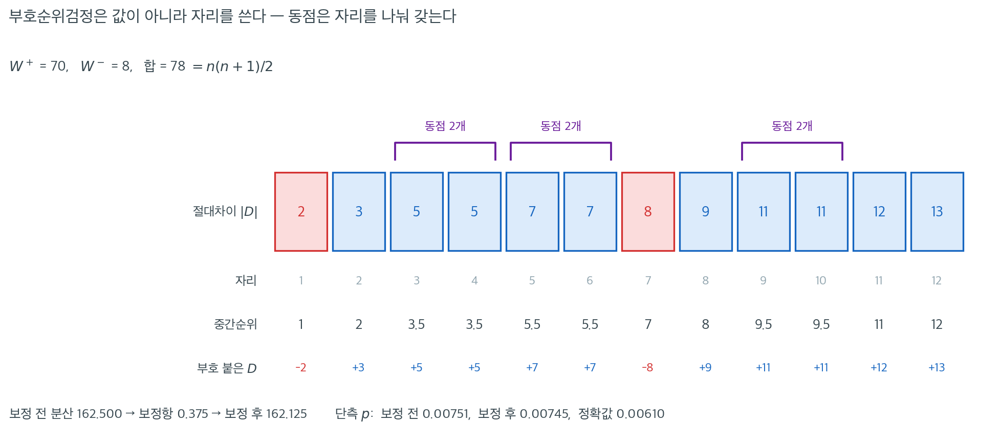

# 대응자료에 대한 Wilcoxon 부호순위검정

[대응 부호검정](paired_sign.md)은 대응차이의 중앙값이 0인지 검정하지만 각 차이가 얼마나 큰지는 무시한다. 차이가 의미 있는 수치 척도로 측정되고 그 분포가 근사적으로 대칭이라면, **대응자료에 대한 Wilcoxon 부호순위검정**이 각 절대차이의 부호와 순위를 모두 반영하여 더 강력한 대안을 제공한다. 이는 [Wilcoxon 부호순위 절차](../one_sample_nonparametric/wilcoxon_signed_rank.md)를 차이 $D_i = X_i - Y_i$에 그대로 적용한 것이다.

---

## 1. 가정

1. 쌍 $(X_i, Y_i)$들이 독립이다.
2. 각 차이 $D_i = X_i - Y_i$가 연속분포에서 나온다.
3. $H_0$ 아래에서 $D_i$의 분포가 중앙값을 중심으로 **대칭**이다.

대칭성 요구가 대응 부호검정에 비해 추가되는 핵심 가정이다. 차이가 눈에 띄게 치우쳐 있다면 대응 부호검정이나 [대응 순열검정](paired_permutation.md)이 더 적절할 수 있다.

---

## 2. 가설

$$
H_0 \colon D_i = X_i - Y_i \text{의 중앙값이 0이다}
$$

$$
H_a \colon D_i \text{의 중앙값이 0이 아니다} \quad \text{(양측)}
$$

단측 대립가설($H_a \colon \text{중앙값} > 0$ 또는 $< 0$)도 마찬가지이다.

---

## 3. 절차

**1단계.** 대응차이 $D_i = X_i - Y_i$를 계산한다.

**2단계.** $D_i = 0$인 쌍을 제외한다. 남은 쌍의 개수를 $n$이라 하자.

**3단계.** 절대차이 $|D_1|, |D_2|, \ldots, |D_n|$을 작은 값부터 순위를 매기고 동점에는 중간순위를 배정한다.

**4단계.** 부호순위합을 계산한다.

$$
W^+ = \sum_{\{i : D_i > 0\}} R_i, \qquad W^- = \sum_{\{i : D_i < 0\}} R_i
$$

$W^+ + W^- = n(n+1)/2$임에 유의하라.

**5단계.** 양측검정의 검정통계량은 $T = \min(W^+, W^-)$이다. 동치로 $W^+$를 그 귀무분포와 비교해도 된다.

---

## 4. 귀무분포

차이가 대칭인 $H_0$ 아래에서 모든 부호 배정이 동등하게 가능하다. $W^+$의 귀무분포는

$$
\mu_{W^+} = \frac{n(n+1)}{4}, \qquad \sigma_{W^+}^2 = \frac{n(n+1)(2n+1)}{24}
$$

을 갖는다. $n$이 클 때의 정규근사는

$$
Z = \frac{W^+ - n(n+1)/4}{\sqrt{n(n+1)(2n+1)/24}}
$$

이다. 절대차이의 동점 집단이 $g$개이고 크기가 $t_1, \ldots, t_g$일 때 보정된 분산은

$$
\sigma_{W^+}^2 = \frac{n(n+1)(2n+1)}{24} - \frac{1}{48}\sum_{j=1}^{g}(t_j^3 - t_j)
$$

이다.

<div class="exbox" markdown>

**보기 1.** <span class="diff easy" title="쉬움"></span> 교육 프로그램과 생산성 점수. 한 회사가 교육 프로그램이 직원의 생산성 점수를 높이는지 검정한다. 직원 12명을 프로그램 전후에 측정했다.

| 직원 | 전 ($Y_i$) | 후 ($X_i$) | $D_i = X_i - Y_i$ | $\lvert D_i \rvert$ | 순위 | 부호순위 |
|:--------:|:------:|:------:|:-----:|:--------:|:----:|:-----------:|
| 1 | 45 | 52 | 7 | 7 | 5.5 | $+5.5$ |
| 2 | 38 | 41 | 3 | 3 | 2 | $+2$ |
| 3 | 50 | 48 | $-2$ | 2 | 1 | $-1$ |
| 4 | 42 | 49 | 7 | 7 | 5.5 | $+5.5$ |
| 5 | 55 | 60 | 5 | 5 | 3.5 | $+3.5$ |
| 6 | 48 | 53 | 5 | 5 | 3.5 | $+3.5$ |
| 7 | 41 | 50 | 9 | 9 | 8 | $+8$ |
| 8 | 53 | 45 | $-8$ | 8 | 7 | $-7$ |
| 9 | 47 | 58 | 11 | 11 | 9.5 | $+9.5$ |
| 10 | 44 | 55 | 11 | 11 | 9.5 | $+9.5$ |
| 11 | 50 | 62 | 12 | 12 | 11 | $+11$ |
| 12 | 46 | 59 | 13 | 13 | 12 | $+12$ |

**순위합 계산:**

</div>

??? success "풀이"
    $$
    W^+ = 5.5 + 2 + 5.5 + 3.5 + 3.5 + 8 + 9.5 + 9.5 + 11 + 12 = 70
    $$

    $$
    W^- = 1 + 7 = 8
    $$

    **검산:** $W^+ + W^- = 70 + 8 = 78 = 12(13)/2$. $\checkmark$

    **검정통계량:** $T = \min(70, 8) = 8$.

    **정규근사** ($n = 12$):

    $$
    \mu_{W^+} = \frac{12 \times 13}{4} = 39
    $$

    $$
    \sigma_{W^+}^2 = \frac{12 \times 13 \times 25}{24} = 162.5
    $$

    절대차이에 크기 2인 동점 집단이 세 개 있다($|D| = 5$가 둘, $|D| = 7$이 둘, $|D| = 11$이 둘). 따라서 $\sum_j (t_j^3 - t_j) = 3(8 - 2) = 18$이고

    $$
    \sigma_{W^+} = \sqrt{162.5 - \frac{18}{48}} = \sqrt{162.125} \approx 12.733
    $$

    $$
    Z = \frac{70 - 39}{12.733} \approx 2.434
    $$

    $$
    p = 2\,\Phi(-2.434) \approx 0.015
    $$

    $\alpha = 0.05$에서 $H_0$을 기각한다. 교육 프로그램이 생산성 점수를 개선했다는 유의한 증거가 있다.

    !!! note "정확 $p$값"
        $n = 12$에서는 SciPy가 정확검정을 쓸 수 있으며 결과는 $p = 0.0122$이다. 정규근사값 $0.0149$보다 작다.

        ```python
        import numpy as np
        from scipy import stats
        D = np.array([7, 3, -2, 7, 5, 5, 9, -8, 11, 11, 12, 13])
        print(stats.wilcoxon(D, method='exact').pvalue)   # 0.012207
        print(stats.wilcoxon(D, method='approx', correction=False).pvalue)  # 0.014906
        ```

        출력:

        ```
        0.01220703125
        0.014906162657892297
        ```

        동점이 있으면 정확 귀무분포가 엄밀하게는 성립하지 않으므로, SciPy의 정확값도 "동점이 없었다면"의 값임에 유의하라.



절차의 3단계와 4단계가 실제로 무슨 일을 하는지 한 줄로 펼쳐 보자. 맨 윗줄이 절대차이 $|D|$를 작은 것부터 세운 것이고, 파란 칸은 원래 차이가 양수였던 것, 빨간 칸은 음수였던 것이다.

두 번째 줄의 **"자리"**와 세 번째 줄의 **"중간순위"**가 다른 지점을 보라. $|D| = 5$가 두 개 있어 자리 $3$과 $4$를 차지하는데, 어느 쪽에 $3$을 주고 어느 쪽에 $4$를 줄 이유가 없으므로 둘 다 $(3+4)/2 = 3.5$를 받는다. $|D| = 7$인 두 개는 $5.5$, $|D| = 11$인 두 개는 $9.5$를 받는다. 이렇게 배정해도 순위의 총합은 $78 = 12 \cdot 13 / 2$로 변하지 않는다. $W^+ = 70$, $W^- = 8$이고 합이 정확히 $78$인 것이 검산이다.

이 그림에서 **부호순위검정이 크기를 쓰는 방식이 얼마나 완곡한지**도 드러난다. 가장 큰 차이 $13$이 받는 것은 $13$이 아니라 순위 $12$이고, 음의 차이 $-8$이 깎아내리는 것은 $8$이 아니라 순위 $7$이다. 그래서 $W^-$가 $1 + 7 = 8$에 그친다. 이 완곡함 덕에 이상치가 통계량을 끌고 가지 못하는 동시에, 순위 $1$과 순위 $12$를 구별하므로 부호만 세는 것보다는 훨씬 많은 정보를 쓴다. 단측 $p$값이 부호검정 $0.0193$, 부호순위검정 $0.0061$, 대응 $t$ 검정 $0.0028$로 늘어서는 것이 그 순서이다.

동점 보정은 이 자료에서 거의 하는 일이 없다. 크기 $2$인 동점 집단이 셋뿐이라 보정항이 $\frac{1}{48}\sum (t_j^3 - t_j) = \frac{3 \times 6}{48} = 0.375$에 불과하여, 분산이 $162.500$에서 $162.125$로 $0.2\%$ 줄고 단측 $p$값은 $0.00751$에서 $0.00745$로 바뀔 뿐이다. **보정이 문제가 되는 것은 동점 집단이 크거나 많을 때**이며, Likert 척도처럼 값이 몇 개뿐인 자료가 전형적인 경우이다.

---

## 5. 왜 대응 부호검정보다 강력한가

같은 자료에서 대응 부호검정은 $n_+ = 10$, $n_- = 2$를 셀 뿐이다. 음의 차이($-2$와 $-8$)가 양의 차이보다 대체로 작다는 사실을 무시한다. Wilcoxon 부호순위검정은 음의 차이에 낮은 순위(1과 7)를 배정하고 양의 차이가 높은 순위를 쌓아 가게 함으로써 이 사실을 포착한다. 크기를 반영한 이 가중치가 증거를 훨씬 효과적으로 모은다.

!!! note "ARE 비교"
    차이가 정규일 때 대응 Wilcoxon 검정의 대응 $t$ 검정 대비 ARE는 $3/\pi \approx 0.955$이다. 대응 부호검정의 ARE는 $2/\pi \approx 0.637$에 그친다. 즉 Wilcoxon 검정은 $t$ 검정의 검정력에 맞추려면 관측값이 약 5% 더 필요한 반면, 부호검정은 약 57% 더 필요하다.

<div class="aibox" markdown>

**AI로 보는 통계학 1.** 짝지은 것이 사람이 아니라 자료집합일 때

이 쪽의 대응 Wilcoxon 부호순위검정은 오늘 기계학습 논문이 **두 알고리즘을 견줄 때 쓰라고 권고받는 바로 그 검정**이다. 달라진 것은 「짝」이 무엇이냐 하나뿐이다. 위 보기 1 에서 짝은 교육 전후의 같은 직원이었고, 거기서는 같은 **자료집합**에서 잰 두 알고리즘의 성적이다.

그 권고가 적힌 곳이 $2006$ 년 『Journal of Machine Learning Research』 $7$ 권 $1$–$30$ 쪽, 야네즈 뎀샤르의 논문이다. 그는 당시 관행을 훑은 뒤 여러 검정을 이론과 실험으로 따져 보고 초록에 이렇게 적었다. 「… 분류기의 통계적 비교를 위해 단순하면서도 안전하고 로버스트한 비모수 검정 한 벌을 권한다 — **두 분류기를 견줄 때는 Wilcoxon 부호순위검정**, 여러 분류기를 여러 자료집합에서 견줄 때는 **Friedman 검정과 그에 딸린 사후검정**.」 이 쪽과 [Friedman 검정](../multi_group_nonparametric/friedman.md) 쪽이 이름으로 호명되어 있다.

까닭은 이 쪽이 줄곧 말해 온 것과 같다. **자료집합마다 정확도의 눈금이 다르다.** 어떤 자료집합에서는 $0.99$ 대 $0.98$ 이고 다른 데서는 $0.61$ 대 $0.55$ 다. 차이를 그대로 평균 내면 눈금이 큰 자료집합 하나가 결론을 통째로 끌고 간다. 순위로 바꾸면 각 자료집합은 「어느 쪽이 이겼는가, 그 차이가 다른 자료집합들에 견주어 몇 번째로 컸는가」만 기여한다.

자료집합 $20$ 개에서 두 알고리즘을 재었다고 하자. $\mathrm A$ 가 $18$ 개에서 조금씩 이기고 $2$ 개에서 크게 진다.

```python
import numpy as np
from scipy import stats

# 자료집합 20 개에서 잰 두 알고리즘의 정확도 (설명을 위해 지어낸 값)
A = np.array([0.832, 0.954, 0.699, 0.677, 0.827, 0.643, 0.635, 0.798, 0.782, 0.929,
              0.833, 0.795, 0.789, 0.708, 0.630, 0.689, 0.857, 0.694, 0.660, 0.550])
B = np.array([0.825, 0.946, 0.691, 0.673, 0.822, 0.635, 0.632, 0.790, 0.774, 0.923,
              0.828, 0.790, 0.784, 0.702, 0.624, 0.683, 0.848, 0.686, 0.742, 0.621])

d = A - B
print(f"A 가 이긴 자료집합  {(d > 0).sum()} / {len(d)}")
print(f"차이의 평균        {d.mean():+.4f}")

t = stats.ttest_rel(A, B)
w = stats.wilcoxon(A, B)
print(f"대응 t 검정        t = {t.statistic:+.3f}, p = {t.pvalue:.4f}")
print(f"부호순위검정       W = {w.statistic:.1f}, p = {w.pvalue:.4f}")
```

출력:

```
A 가 이긴 자료집합  18 / 20
차이의 평균        -0.0019
대응 t 검정        t = -0.332, p = 0.7438
부호순위검정       W = 39.0, p = 0.0121
```

**두 검정이 방향마저 다르게 말한다.** 차이의 평균은 $-0.0019$ 로 $\mathrm B$ 쪽이 낫다고 하고 대응 $t$ 는 $p = 0.74$ 로 아무 말도 하지 않는다. 두 자료집합에서 난 $-0.08$ 짜리 손실이 나머지 열여덟 개의 $+0.005$ 를 혼자 상쇄했기 때문이다. 부호순위검정은 그 둘에게 가장 높은 순위인 $19$ 와 $20$ 을 주어 가장 무겁게 쳐 주고도 $W = 39$, $p = 0.012$ 를 낸다. 음의 순위합 $39$ 가 전체 $210$ 의 $1/5$ 에 못 미치기 때문이다.

다만 이 검정이 말해 주는 것은 **「이 스무 개의 모둠에서 한쪽이 더 자주 낫다」뿐**이다. 자료집합 모둠을 누가 어떻게 골랐는지가 결론을 정하는데, 검정은 그 선택에 대해 한마디도 하지 않는다.

_확인한 곳 — 논문이 Janez Demšar 의 「Statistical Comparisons of Classifiers over Multiple Data Sets」이고 『Journal of Machine Learning Research』 $7$ 권 $1$–$30$ 쪽($2006$ 년 $1$ 월 간행, $2004$ 년 $8$ 월 투고)이며 슬로베니아 류블랴나 대학 소속으로 적혀 있다는 것, 그리고 인용한 초록의 권고 문장은 [JMLR 의 공개 PDF](https://www.jmlr.org/papers/volume7/demsar06a/demsar06a.pdf) 첫 쪽에서 읽었다. 위 코드의 정확도는 **설명을 위해 지어낸 값**이고 출력은 그 값으로 실제로 돌려 받은 것이다_

</div>

---

## 연습문제

<div class="drillbox" markdown>

**연습문제 1.** <span class="diff med" title="중간"></span>
위 생산성 자료에 네 가지 대응 검정(부호검정, Wilcoxon, 순열검정, $t$ 검정)을 모두 적용하여 양측 $p$값을 비교하고, 순서를 설명하라.

</div>

??? success "풀이"
    ```python
    import numpy as np, itertools
    from scipy import stats
    D = np.array([7, 3, -2, 7, 5, 5, 9, -8, 11, 11, 12, 13])

    print(stats.binomtest(10, 12).pvalue)                      # 0.03857
    print(stats.wilcoxon(D, method='exact').pvalue)            # 0.01221
    print(stats.ttest_1samp(D, 0).pvalue)                      # 0.00569

    a = np.abs(D); T = D.sum()
    allT = np.array([np.dot(s, a) for s in itertools.product([-1, 1], repeat=12)])
    print((np.abs(allT) >= abs(T)).mean())                     # 0.01074
    ```

    출력:

    ```
    0.03857421875
    0.01220703125
    0.00569322392504434
    0.0107421875
    ```

    | 검정 | 양측 $p$값 |
    |:---|---:|
    | 대응 부호검정 | $0.0386$ |
    | 대응 Wilcoxon (정확) | $0.0122$ |
    | 대응 순열검정 | $0.0107$ |
    | 대응 $t$ | $0.0057$ |

    사용하는 정보량 순서와 정확히 일치한다. 부호만 → 부호+순위 → 부호+원값 → 정규모형까지 가정. 각 단계마다 $p$값이 작아진다.

    이 자료는 차이가 대칭에 가깝고 이상치가 없어 $t$ 검정에 유리한 조건이다. $-8$이라는 비교적 큰 음의 차이가 하나 있지만 $+13$, $+12$, $+11$, $+11$이 이를 압도한다.

    순열검정($0.0107$)이 Wilcoxon($0.0122$)보다 조금 작다. 순열검정이 원값을 그대로 쓰므로 $+13$과 $+11$의 차이를 순위 $12$와 $9.5$의 차이보다 정확하게 반영하기 때문이다.

<div class="drillbox" markdown>

**연습문제 2.** <span class="diff med" title="중간"></span>
$n = 12$에서 Wilcoxon 부호순위검정의 정확 귀무분포를 직접 열거하여 구하고, 관측된 $W^+ = 70$의 정확 $p$값을 계산하라. 정규근사와 비교하라.

</div>

??? success "풀이"
    ```python
    import numpy as np, itertools
    n = 12
    ranks = np.arange(1, n + 1)
    Wplus = np.array([np.dot(s, ranks)
                      for s in itertools.product([0, 1], repeat=n)])
    print(len(Wplus))                       # 4096 = 2^12
    print(Wplus.mean(), Wplus.var())        # 39.0, 162.5
    p = 2 * min((Wplus >= 70).mean(), (Wplus <= 70).mean())
    print(p)                                # 0.012207
    ```

    출력:

    ```
    4096
    39.0 162.5
    0.01220703125
    ```

    열거로 얻은 평균 $39.0$과 분산 $162.5$가 공식 $n(n+1)/4$와 $n(n+1)(2n+1)/24$의 값과 정확히 일치한다.

    | 방법 | $p$값 |
    |:---|---:|
    | 정확 (열거) | $0.01221$ |
    | 정규근사, 동점 보정 없음 | $0.01502$ |
    | 정규근사, 동점 보정 | $0.01491$ |

    동점 보정의 효과가 미미하다($0.01502 \to 0.01491$, 0.8% 감소). 보정항 $18/48 = 0.375$가 분산 $162.5$의 0.23%에 불과하기 때문이다. 동점이 크기 2짜리 세 개뿐이라 그렇다.

    반면 정규근사 자체의 오차는 훨씬 크다. $0.0149$ 대 $0.0122$로 22% 과대평가한다. $n = 12$에서 $W^+$의 분포가 아직 계단이 굵어 정규곡선과 잘 맞지 않기 때문이다.

    **교훈:** 동점 보정보다 정확검정을 쓰는 편이 훨씬 중요하다. $n \le 25$ 정도면 정확 계산이 즉시 끝난다.

<div class="drillbox" markdown>

**연습문제 3.** <span class="diff med" title="중간"></span>
차이 분포가 대칭이 아니면 대응 Wilcoxon 검정이 위험하다. 처치 효과가 **일부 피험자에게만** 나타나는 상황을 모형화하여 이 문제를 보여라.

</div>

??? success "풀이"
    처치가 피험자의 30%에게만 크게 작용하고 나머지 70%에게는 아무 효과가 없다고 하자. 이때 차이의 분포는 0에 몰린 덩어리와 오른쪽 꼬리로 이루어진 심한 비대칭 혼합이다.

    ```python
    import numpy as np
    from scipy import stats
    rng = np.random.default_rng(4)

    def sim(n, B=2000):
        pw = np.empty(B); ps = np.empty(B)
        for b in range(B):
            responder = rng.random(n) < 0.3
            d = rng.normal(0, 1, n) + responder * 3.0
            pw[b] = stats.wilcoxon(d).pvalue
            nz = d[d != 0]
            ps[b] = stats.binomtest(int((nz > 0).sum()), len(nz)).pvalue
        return (pw < .05).mean(), (ps < .05).mean()

    for n in (10, 20, 40):
        print(n, sim(n))
    ```

    출력:

    ```
    10 (0.2445, 0.0875)
    20 (0.486, 0.246)
    40 (0.811, 0.432)
    ```

    여기서 참인 중앙값 차이는 0이 **아니다**(반응자가 30%이므로 중앙값은 여전히 0 근처이지만 평균은 $+0.9$이다). 따라서 이것은 크기 문제가 아니라 **두 검정이 서로 다른 것을 재고 있음**을 보여 주는 예이다.

    | $n$ | Wilcoxon 기각률 | 부호검정 기각률 |
    |---:|---:|---:|
    | 10 | 0.244 | 0.088 |
    | 20 | 0.486 | 0.246 |
    | 40 | 0.811 | 0.432 |

    Wilcoxon이 훨씬 자주 기각한다. 그런데 이것을 "검정력이 높다"고 말할 수 있을까?

    문제는 **무엇을 결론으로 삼느냐**이다. Wilcoxon이 기각할 때 우리가 아는 것은 "Walsh 평균의 중앙값이 0이 아니다"이고, 이는 여기서 참이다. 그러나 실무자는 이를 "전형적인 환자가 개선된다"로 읽기 쉽다. 그런데 참가자의 **70%는 아무 효과도 없다**.

    부호검정은 정직하게 "개선된 사람이 절반을 넘는가?"를 묻고, 답은 "그렇다, 하지만 약하게"이다($n = 40$에서 기각률 0.43으로 Wilcoxon의 0.81의 절반이다).

    **실무 권고:** 반응자/비반응자 혼합이 의심되면 검정 하나로 요약하지 말고 차이의 히스토그램을 반드시 그려야 한다. 이봉 분포가 보이면 "평균 효과"라는 개념 자체가 오도적이며, 반응자 비율을 추정하는 것이 옳은 분석이다.

<div class="drillbox" markdown>

**연습문제 4.** <span class="diff med" title="중간"></span>
대응 Wilcoxon 검정으로 중앙값 차이의 신뢰구간을 만들고, 대응 부호검정 기반 구간 및 $t$ 구간과 폭을 비교하라.

</div>

??? success "풀이"
    Wilcoxon 구간은 차이의 **Walsh 평균** $(D_i + D_j)/2$ ($i \le j$)에 기반한다.

    ```python
    import numpy as np, itertools
    from scipy import stats
    D = np.array([7, 3, -2, 7, 5, 5, 9, -8, 11, 11, 12, 13])
    n = len(D)

    walsh = np.sort([(D[i] + D[j]) / 2 for i in range(n) for j in range(i, n)])
    ranks = np.arange(1, n + 1)
    Wplus = np.array([np.dot(s, ranks) for s in itertools.product([0, 1], repeat=n)])
    k = max(c for c in range(30) if 2 * (Wplus <= c).mean() <= 0.05)
    print(k, len(walsh), walsh[k], walsh[-(k + 1)])   # 13 78 1.5 10.0

    Ds = np.sort(D)
    m = max(c for c in range(n) if 2 * stats.binom.cdf(c, n, 0.5) <= 0.05)
    print(m, Ds[m + 1], Ds[n - m - 1])                # 2 5 11
    print(stats.ttest_1samp(D, 0).confidence_interval())
    ```

    출력:

    ```
    13 78 1.5 10.0
    2 5 11
    ConfidenceInterval(low=2.1717302734032677, high=9.994936393263398)
    ```

    | 방법 | 95% 신뢰구간 | 폭 | 실제 포함확률 |
    |:---|:---:|---:|---:|
    | 대응 부호검정 | $(5, \; 11)$ | $6.0$ | $0.961$ |
    | 대응 Wilcoxon | $(1.5, \; 10.0)$ | $8.5$ | $0.958$ |
    | 대응 $t$ | $(2.17, \; 9.99)$ | $7.8$ | $0.950$ |

    세 구간 모두 0을 포함하지 않으므로 세 검정이 모두 기각한 것과 일관된다.

    부호검정 구간이 가장 **좁다**는 것이 뜻밖으로 보인다. 검정력이 가장 낮은 검정이 왜 가장 좁은 구간을 주는가? 이는 두 구간이 다른 방식으로 만들어지기 때문이다. 부호검정 구간은 **순서통계량** $D_{(3)} = 5$와 $D_{(10)} = 11$ 사이이고, 이 자료의 차이가 대부분 $5$ 이상에 몰려 있어 우연히 좁게 나왔다. Wilcoxon 구간은 Walsh 평균에 기반하므로 $-8$과 $-2$가 만드는 낮은 쌍평균들까지 반영되어 아래쪽으로 늘어난다.

    구간의 폭은 검정력의 좋은 지표가 아니다. 표본이 하나뿐일 때 어느 구간이 좁은지는 그 표본의 우연에 크게 좌우된다. 검정력을 비교하려면 여러 표본에 걸친 평균 폭을 보아야 한다.

    점추정값을 비교하면 부호검정의 점추정은 표본중앙값 $7.0$, Wilcoxon의 Hodges-Lehmann 추정은 Walsh 평균의 중앙값 $7.0$, $t$의 점추정은 표본평균 $6.08$이다.

<div class="drillbox" markdown>

**연습문제 5.** <span class="diff med" title="중간"></span>
본문 보기의 교육 프로그램을 다른 부서의 직원 **여섯 명**에게 시범 적용했다.

| 직원 | 전 ($Y_i$) | 후 ($X_i$) |
|:--:|:--:|:--:|
| 1 | 40 | 43 |
| 2 | 44 | 43 |
| 3 | 51 | 55 |
| 4 | 38 | 44 |
| 5 | 47 | 55 |
| 6 | 42 | 53 |

(a) $\lvert D_i \rvert$ 의 순위와 $W^+$, $W^-$ 를 구하고 $W^+ + W^- = n(n+1)/2$ 로 검산하라.

(b) $n = 6$ 이면 부호 배정이 $2^6 = 64$ 가지뿐이다. 관측된 $W^+$ 의 양측 정확 $p$ 값을 **손으로 세어** 구하라.

(c) 같은 자료에 대응 부호검정을 적용하여 양측 $p$ 값을 구하고 (b) 와 비교하라.

(d) $n = 6$ 에서 두 검정이 달성할 수 있는 **가장 작은** 양측 $p$ 값은 둘 다 $1/32$ 다. 왜 같은지 설명하고, 그렇다면 윌콕슨을 쓰는 이득은 어디에 있는지 (b), (c) 의 수로 답하라.

</div>

??? success "풀이"
    **(a)** 차이는 $D = (3, -1, 4, 6, 8, 11)$ 이다. 절대차이 $1 < 3 < 4 < 6 < 8 < 11$ 에 동점이 없으므로 순위는

    | $D_i$ | $3$ | $-1$ | $4$ | $6$ | $8$ | $11$ |
    |:--:|:--:|:--:|:--:|:--:|:--:|:--:|
    | $\lvert D_i \rvert$ | $3$ | $1$ | $4$ | $6$ | $8$ | $11$ |
    | $R_i$ | $2$ | $1$ | $3$ | $4$ | $5$ | $6$ |

    이고

    $$
    W^+ = 2 + 3 + 4 + 5 + 6 = 20, \qquad W^- = 1
    $$

    이다. 검산: $20 + 1 = 21 = 6 \cdot 7/2$. $\checkmark$ 검정통계량은 $T = \min(20, 1) = 1$ 이다.

    **(b)** $H_0$ 아래에서 $W^+$ 는 $\{1,2,3,4,5,6\}$ 의 부분집합 $64$ 개의 합이 모두 같은 확률로 나오는 분포다. 꼬리는 세기 쉽다. $W^+ \ge 20$ 은 $W^- = 21 - W^+ \le 1$ 과 같은 말이고, 합이 $1$ 이하인 부분집합은 $\varnothing$ 과 $\{1\}$ 둘뿐이다. 따라서

    $$
    P(W^+ \ge 20) = \frac{2}{64} = \frac{1}{32}, \qquad p_{\text{양측}} = 2 \times \frac{1}{32} = \frac{1}{16} = 0.0625
    $$

    이다. $\alpha = 0.05$ 에서 기각하지 **못한다**. 참고로 합이 $w$ 인 부분집합의 개수 $c(w)$ 를 모두 세면($\prod_{k=1}^{6}(1 + x^k)$ 의 계수)

    | $w$ | 0 | 1 | 2 | 3 | 4 | 5 | 6 | 7 | 8 | 9 | 10 |
    |:--:|:--:|:--:|:--:|:--:|:--:|:--:|:--:|:--:|:--:|:--:|:--:|
    | $c(w)$ | 1 | 1 | 1 | 2 | 2 | 3 | 4 | 4 | 4 | 5 | 5 |

    이고 $c(w) = c(21 - w)$ 로 대칭이다. $\sum_w c(w) = 64$ 임을 검산할 수 있다.

    **(c)** 양의 차이가 $n_+ = 5$, 음의 차이가 $n_- = 1$ 이다. $\mathrm{Bin}(6, 1/2)$ 에서

    $$
    p_{\text{양측}} = 2\,P(n_+ \ge 5) = 2 \cdot \frac{6 + 1}{64} = \frac{14}{64} = 0.21875
    $$

    이다. 윌콕슨의 $0.0625$ 보다 $3.5$ 배 크다. 하나뿐인 음의 차이가 **가장 작은** 차이($-1$)라는 사실을 부호검정은 전혀 쓰지 못한 결과다.

    **(d)** 가장 극단적인 결과는 "여섯 차이가 모두 양수"이고, 이것은 윌콕슨에서 $W^+ = 21$, 부호검정에서 $n_+ = 6$ 인 **같은 하나의** 부호 배정이다. 확률이 $1/64$ 이니 단측 $p$ 의 최솟값이 $1/64$, 양측은 $1/32 = 0.03125$ 로 두 검정이 같다. 극단값 하나만 보면 순위를 쓰는 이득이 없다.

    이득은 **$p$ 값 격자의 촘촘함**에 있다. $n = 6$ 에서 부호검정이 낼 수 있는 양측 $p$ 는

    $$
    0.03125, \quad 0.21875, \quad 0.6875, \quad 1
    $$

    네 개뿐이지만, 윌콕슨은 $c(w)$ 의 누적합에서

    $$
    0.03125, \quad 0.0625, \quad 0.09375, \quad 0.15625, \quad 0.21875, \quad 0.3125, \ \ldots
    $$

    를 낸다. 이 자료가 바로 그 사이에 떨어져서, 부호검정은 "$0.219$" 라고 뭉개는 것을 윌콕슨은 "$0.0625$, 유의수준 바로 앞" 이라고 말해 준다. **소표본에서 비모수 검정의 진짜 제약은 검정력이 아니라 $p$ 값이 취할 수 있는 값이 몇 개뿐이라는 거칠기이고, 순위를 쓰는 일은 그 격자를 촘촘하게 만드는 일이다.**

<div class="drillbox" markdown>

**연습문제 6.** <span class="diff med" title="중간"></span>
$H_0$ 아래에서 $\lvert D_i \rvert$ 의 순위 $R_i$ 는 고정되어 있고 부호만 동전처럼 정해지므로 $W^+ = \sum_i R_i B_i$ ($B_i$ 는 독립인 베르누이 $1/2$)이다. 따라서 동점이 있든 없든

$$
\operatorname{Var}(W^+) = \frac{1}{4}\sum_{i=1}^{n} R_i^2
$$

이다. 이 한 줄이 §4 의 동점 보정식의 정체다.

(a) 동점에 중간순위를 배정했을 때 위 식이 §4 의 보정식과 **정확히** 같음을 보여라. 곧 보정식은 근사가 아니다. (힌트: 크기 $t$ 인 동점 집단에서 제곱합이 줄어드는 양은 $t$ 곱하기 그 자리 $t$ 개의 분산 $(t^2-1)/12$ 다.)

(b) 절대차이가 **모두 같은** 극단($g = 1$, $t_1 = n$)에서 보정된 분산이 $n(n+1)^2/16$ 임을 (a) 에서 얻어라. 이때 윌콕슨 검정이 부호검정과 똑같아진다는 사실로 그 값을 독립적으로 확인하라.

(c) 동점 보정을 빼먹으면 검정이 보수적이 되는가 과감해지는가? (b) 의 극단에서 $n = 20$ 일 때 표준편차가 몇 배 틀리는지, 그리고 $n \to \infty$ 에서 그 배수의 극한을 구하라. $n_+ = 15$ 인 자료에 대해 양측 $p$ 값 세 개(보정 없음·보정·정확)를 비교하라.

</div>

??? success "풀이"
    **(a)** 크기 $t$ 인 동점 집단이 자리 $a+1, \ldots, a+t$ 를 차지하면 중간순위는 그 자리들의 평균 $\bar r = a + (t+1)/2$ 다. 같은 평균을 가진 수들을 모두 평균으로 바꾸면 제곱합은 "편차제곱합"만큼 줄어든다.

    $$
    \sum_{j=1}^{t}(a+j)^2 - t\,\bar r^{\,2} = t \cdot \frac{t^2 - 1}{12} = \frac{t^3 - t}{12}
    $$

    집단마다 이만큼 줄어드니 중간순위의 제곱합은

    $$
    \sum_{i=1}^{n} R_i^2 = \sum_{k=1}^{n} k^2 - \frac{1}{12}\sum_{j=1}^{g}(t_j^3 - t_j) = \frac{n(n+1)(2n+1)}{6} - \frac{1}{12}\sum_{j=1}^{g}(t_j^3 - t_j)
    $$

    이고, $4$ 로 나누면

    $$
    \operatorname{Var}(W^+) = \frac{n(n+1)(2n+1)}{24} - \frac{1}{48}\sum_{j=1}^{g}(t_j^3 - t_j)
    $$

    로 §4 의 식이 그대로 나온다. $\square$

    본문 보기로 검산하면 $n = 12$ 에 크기 $2$ 인 집단이 셋이므로 $\sum(t_j^3 - t_j) = 18$, 분산 $162.5 - 18/48 = 162.125$ 로 일치한다. 보정항이 "어디선가 가져온 보정"이 아니라 **중간순위를 쓰면 제곱합이 줄어든다는 산수**일 뿐이라는 점이 중요하다.

    **(b)** $g = 1$, $t_1 = n$ 이면 모든 중간순위가 $(n+1)/2$ 이므로

    $$
    \operatorname{Var}(W^+) = \frac{1}{4} \cdot n \left(\frac{n+1}{2}\right)^2 = \frac{n(n+1)^2}{16}
    $$

    이다. (a) 의 식으로 계산해도 같다.

    $$
    \frac{n(n+1)(2n+1)}{24} - \frac{n^3 - n}{48} = \frac{n(n+1)\{2(2n+1) - (n-1)\}}{48} = \frac{3n(n+1)^2}{48} = \frac{n(n+1)^2}{16}
    $$

    독립 확인: 순위가 모두 $(n+1)/2$ 이면 $W^+ = \frac{n+1}{2} n_+$ 이고 $n_+ \sim \mathrm{Bin}(n, 1/2)$ 이므로

    $$
    \operatorname{Var}(W^+) = \left(\frac{n+1}{2}\right)^2 \cdot \frac{n}{4} = \frac{n(n+1)^2}{16}
    $$

    로 같다. $\checkmark$ 더 중요한 것은 이때 $T$ 가 $n_+$ 의 단조함수라는 점이다. **절대차이에 크기 정보가 전혀 남지 않으면 윌콕슨 검정은 부호검정으로 정확히 퇴화한다.** ARE 가 $3/\pi = 0.955$ 에서 $2/\pi = 0.637$ 로 떨어지는 것이 이 퇴화의 대가다.

    **(c)** 보정항은 항상 분산에서 **빼는** 양이므로 보정을 빼먹으면 분산을 과대평가한다. 그러면 $\sigma$ 가 크고 $\lvert Z \rvert$ 가 작고 $p$ 가 커진다 — **보수적**이 된다.

    $n = 20$ 의 극단에서

    $$
    \sigma_{\text{보정없음}} = \sqrt{\frac{20 \cdot 21 \cdot 41}{24}} = \sqrt{717.5} = 26.786, \qquad \sigma_{\text{보정}} = \sqrt{\frac{20 \cdot 21^2}{16}} = \sqrt{551.25} = 23.479
    $$

    이고 비는 $26.786/23.479 = 1.141$ 이다. 일반적으로

    $$
    \frac{\sigma_{\text{보정없음}}^2}{\sigma_{\text{보정}}^2} = \frac{n(n+1)(2n+1)/24}{n(n+1)^2/16} = \frac{2(2n+1)}{3(n+1)} \ \longrightarrow \ \frac{4}{3}
    $$

    이므로 표준편차의 배수는 $2/\sqrt3 = 1.155$ 로 올라간다. 곧 $\lvert Z \rvert$ 를 최대 $13\%$ 깎아 먹는다.

    $n_+ = 15$ 이면 $W^+ = 15 \times 10.5 = 157.5$, $\mu = 105$, 편차 $52.5$ 다.

    | 방법 | $z$ | 양측 $p$ |
    |:---|---:|---:|
    | 정규근사, 보정 없음 | $1.960$ | $0.0500$ |
    | 정규근사, 동점 보정 | $2.236$ | $0.0253$ |
    | 정확 ($=$ 부호검정) | — | $0.0414$ |

    보정을 빼먹은 쪽은 참값 $0.0414$ 보다 $21\%$ 큰 $p$ 를 내놓는다. 거꾸로 보정한 정규근사는 이번엔 너무 작게 나오는데, 이는 분산 때문이 아니라 $W^+$ 의 계단이 $10.5$ 로 굵어졌는데 연속성 수정을 하지 않은 탓이다. 반 계단 $5.25$ 를 빼면 $z = 52.5 - 5.25$ 를 쓴 $2.012$, $p = 0.0442$ 로 정확값에 붙는다. **동점이 많으면 보정항과 연속성 수정이 둘 다 필요하고, 그럴 상황이면 애초에 정확검정이나 순열검정을 쓰는 것이 낫다.**

<div class="drillbox" markdown>

**연습문제 7.** <span class="diff hard" title="어려움"></span>
§5 의 ARE $3/\pi \approx 0.955$ 는 "표본을 $1/0.955 - 1 = 4.7\%$ 더 모으면 대응 $t$ 검정과 같아진다"는 뜻이다. 이 주장을 모의실험으로 확인하라.

차이가 정규일 때 $n = 40$ 의 $t$ 검정과 $n = 42$($= \lceil 40 \times 1.047 \rceil$)의 윌콕슨 검정의 검정력을 비교하라. 윌콕슨의 임계값은 정규근사가 아니라 **정확 귀무분포**에서 얻어야 한다($2^{40}$ 을 열거하지 말고 $\prod_k (1 + x^k)$ 의 계수를 점화식으로 쌓아라). 이어 차이가 자유도 $2$ 인 $t$ 분포일 때 같은 비교를 하여 맞바꿈의 반대쪽을 보라. 반복은 $20{,}000$ 회로 한다.

</div>

??? success "풀이"
    ```python
    import numpy as np
    from scipy import stats

    # === W+ 의 정확 귀무분포와 양측 0.05 임계값 ===
    def null_pmf(n):
        c = np.ones(1)
        for k in range(1, n + 1):
            new = np.zeros(len(c) + k)
            new[:len(c)] += c
            new[k:] += c
            c = new
        return c / c.sum()

    def crit(n, alpha=0.05):
        cdf = np.cumsum(null_pmf(n))
        return int(np.max(np.where(2 * cdf <= alpha)[0]))

    # === 두 검정의 기각률 (벡터화) ===
    def rates(D, c, tcrit):
        n = D.shape[1]
        R = stats.rankdata(np.abs(D), axis=1)
        W = (R * (D > 0)).sum(1)
        M = n * (n + 1) / 2
        wil = ((W <= c) | (W >= M - c)).mean()
        t = (np.abs(D.mean(1) / (D.std(1, ddof=1) / np.sqrt(n))) > tcrit).mean()
        return wil, t

    B = 20000
    for name, delta in [("정규", 0.4), ("t(2)", 0.6)]:
        for n in (40, 42):
            rng = np.random.default_rng(7)
            for d in (0.0, delta):
                D = (rng.standard_normal((B, n)) if name == "정규"
                     else rng.standard_t(2, (B, n))) + d
                w, t = rates(D, crit(n), stats.t.ppf(0.975, n - 1))
                print(f"{name} delta={d:.1f} n={n}  Wilcoxon {w:.4f}  t {t:.4f}")
    ```

    출력:

    ```text
    정규 delta=0.0 n=40  Wilcoxon 0.0508  t 0.0510
    정규 delta=0.4 n=40  Wilcoxon 0.6725  t 0.6905
    정규 delta=0.0 n=42  Wilcoxon 0.0503  t 0.0502
    정규 delta=0.4 n=42  Wilcoxon 0.6902  t 0.7128
    t(2) delta=0.0 n=40  Wilcoxon 0.0503  t 0.0382
    t(2) delta=0.6 n=40  Wilcoxon 0.7232  t 0.4511
    t(2) delta=0.0 n=42  Wilcoxon 0.0522  t 0.0399
    t(2) delta=0.6 n=42  Wilcoxon 0.7419  t 0.4633
    ```

    먼저 크기를 보면 정규 차이에서 두 검정이 모두 $0.050$ 근처다. 윌콕슨 임계값을 정확 귀무분포에서 잡았으므로 명목수준보다 살짝 낮다($n = 40$ 에서 $2P(W^+ \le 264) = 0.0498$).

    정규, $\delta = 0.4$ 에서:

    | 검정 | $n$ | 검정력 |
    |:---|---:|---:|
    | 대응 $t$ | 40 | $0.6905$ |
    | 대응 Wilcoxon | 40 | $0.6725$ |
    | 대응 Wilcoxon | 42 | $0.6902$ |

    같은 $n = 40$ 에서 윌콕슨은 $0.0180$ 만큼 뒤진다. 그런데 **$n$ 을 $40$ 에서 $42$ 로 두 개만 늘리면 $0.6902$ 가 되어 $t$ 검정의 $0.6905$ 와 사실상 같다**(차이 $0.0003$, 모의 표준오차 약 $0.0033$ 의 $1/10$ 수준). ARE $3/\pi$ 가 말하는 "$4.7\%$ 더"가 바로 이것이다. 정규성이라는 가정을 버리는 값은 관측값 두 개였다.

    자유도 $2$ 인 $t$ 분포(평균은 있고 분산은 무한)로 바꾸면 맞바꿈의 방향이 뒤집힌다.

    | 검정 | $n = 40$ 크기 | $n = 40$ 검정력 ($\delta = 0.6$) |
    |:---|---:|---:|
    | 대응 $t$ | $0.0382$ | $0.4511$ |
    | 대응 Wilcoxon | $0.0503$ | $0.7232$ |

    윌콕슨의 검정력이 $t$ 검정의 $1.6$ 배다. 이상치 하나가 $\bar D$ 를 끌고 가는 동시에 $s$ 를 더 크게 부풀려 $t$ 통계량의 분모를 키우기 때문이다. $t$ 검정은 크기마저 $0.038$ 로 내려가 있다 — 꼬리가 두꺼우면 $t$ 통계량의 분포가 $t_{n-1}$ 보다 더 뭉쳐 보수적이 되고, 그 보수성이 곧 검정력 손실이다.

    **요약:** 정규일 때 비모수가 내는 비용은 표본 $4.7\%$ 로 상수에 가깝고 유한하다. 반면 꼬리가 두꺼울 때 모수검정이 내는 비용은 상한이 없다. 어느 쪽이 모르는 상황에서 더 나은 기본값인지는 이 비대칭이 답한다.

<div class="drillbox" markdown>

**연습문제 8.** <span class="diff hard" title="어려움"></span>
풀이 3 과 4 는 윌콕슨 검정이 재는 것이 중앙값이 아니라 **Walsh 평균의 중앙값**이라고 했다. 그 까닭을 다음 항등식에서 끌어내라. 동점이 없다고 하자.

(a) $W^+ = \#\{(i, j) : i \le j, \ D_i + D_j > 0\}$ 를 증명하라.

(b) (a) 에서 $p_1 = P(D > 0)$, $p_2 = P(D_1 + D_2 > 0)$ 이라 할 때

$$
E[W^+] = n p_1 + \binom{n}{2} p_2
$$

임을 보이고, 귀무평균 $n(n+1)/4$ 가 되려면 $p_1 = 1/2$ **와** $p_2 = 1/2$ 가 **둘 다** 필요함을 확인하라.

(c) $U \sim \mathrm{Unif}(0,1)$ 로 $D$ 를 "확률 $1/2$ 로 $-U$, 확률 $1/2$ 로 $5U$" 라 정의하면 $D$ 의 중앙값은 정확히 $0$ 이다. $p_1$ 과 $p_2$ 를 계산하고 $n = 20$ 에서 $E[W^+]$ 를 구하라. 중앙값이 $0$ 이라는 참인 귀무가설을 윌콕슨이 체계적으로 기각하게 되는 까닭과, 그 쏠림이 $n$ 과 함께 어떻게 커지는지 밝혀라. 부호검정은 왜 괜찮은가?

</div>

??? success "풀이"
    **(a)** 동점이 없으면 $\lvert D_i \rvert \ne \lvert D_j \rvert$ 이므로 $D_i + D_j$ 의 부호는 **절댓값이 큰 쪽의 부호**와 같다($i = j$ 이면 $D_i$ 자신의 부호). 그러므로 $D_i + D_j > 0$ 인 쌍 $(i,j)$, $i \le j$ 를 "절댓값이 큰 쪽의 첨자 $k$" 로 묶어 세면, 그 $k$ 는 반드시 $D_k > 0$ 을 만족하고 짝 $j$ 는 $\lvert D_j \rvert \le \lvert D_k \rvert$ 인 것 전부($j = k$ 포함)다. 그 개수가 바로 순위 $R_k$ 이므로

    $$
    \#\{(i,j) : i \le j, \ D_i + D_j > 0\} = \sum_{k \,:\, D_k > 0} \#\{j : \lvert D_j \rvert \le \lvert D_k \rvert\} = \sum_{k \,:\, D_k > 0} R_k = W^+
    $$

    이다. $\square$

    본문 보기로 검산하면 $n = 12$ 에서 $\binom{12}{2} + 12 = 78$ 개의 쌍 가운데 $D_i + D_j > 0$ 인 것이 $70$ 개이고 $W^+ = 70$ 과 맞는다.

    **(b)** 지표함수로 쓰면 $W^+ = \sum_{i} \mathbf 1(D_i > 0) + \sum_{i < j} \mathbf 1(D_i + D_j > 0)$ 이다. 대각항이 $n$ 개, 비대각항이 $\binom n2$ 개이고 $D_i$ 가 독립이고 같은 분포이므로 기대값을 취하면

    $$
    E[W^+] = n p_1 + \binom{n}{2} p_2
    $$

    이다. 한편

    $$
    n \cdot \frac12 + \binom{n}{2}\cdot \frac12 = \frac{n}{2} + \frac{n(n-1)}{4} = \frac{n(n+1)}{4}
    $$

    이므로 $p_1 = p_2 = 1/2$ 는 귀무평균을 준다. 거꾸로 $p_1$ 과 $p_2$ 는 서로 묶여 있지 않으므로, 둘 중 하나만 $1/2$ 여도 평균이 어긋난다. $0$ 에 대한 **대칭성**은 $p_1 = p_2 = 1/2$ 를 둘 다 주지만, **중앙값이 $0$** 이라는 조건은 $p_1 = 1/2$ 만 준다. 여기가 대칭성 가정이 들어가는 정확한 자리다.

    **(c)** $P(D < 0) = P(D > 0) = 1/2$ 이고 $0$ 의 양쪽에 밀도가 양수이므로 중앙값은 유일하게 $0$ 이고 $p_1 = 1/2$ 다. $p_2$ 는 세 경우로 나눈다. $D_1, D_2$ 를 독립인 두 복사본이라 하고 $U, V \sim \mathrm{Unif}(0,1)$ 이라 하면

    - 둘 다 음수 (확률 $1/4$): 합이 음수. 기여 $0$.
    - 둘 다 양수 (확률 $1/4$): 합이 양수. 기여 $1/4$.
    - 하나는 음수 하나는 양수 (확률 $1/2$): $P(5U - V > 0) = P(V < 5U) = \int_0^1 \min(5u, 1)\,du = \int_0^{0.2} 5u\,du + \int_{0.2}^{1} 1\,du = 0.1 + 0.8 = 0.9$.

    $$
    p_2 = \tfrac14 \cdot 0 + \tfrac14 \cdot 1 + \tfrac12 \cdot 0.9 = 0.70
    $$

    따라서 $n = 20$ 에서

    $$
    E[W^+] = 20(0.5) + 190(0.7) = 10 + 133 = 143
    $$

    인데 귀무평균은 $20 \cdot 21/4 = 105$ 이고 귀무표준편차는 $\sqrt{20 \cdot 21 \cdot 41/24} = \sqrt{717.5} = 26.79$ 다. 평균이 이미 $1.42$ 표준편차만큼 오른쪽으로 밀려 있다.

    쏠림의 증가 속도가 결정적이다.

    $$
    E[W^+] - \frac{n(n+1)}{4} = \binom{n}{2}\left(p_2 - \tfrac12\right) = O(n^2), \qquad \sigma_{W^+} = O(n^{3/2})
    $$

    이므로 표준화된 쏠림이 $O(\sqrt n)$ 로 자란다. **중앙값이 정확히 $0$ 인데도 윌콕슨의 기각확률이 $1$ 로 간다.** 이것은 검정력이 아니라 **크기의 붕괴**다. 윌콕슨이 실제로 검정하는 모수는 Walsh 평균의 중앙값

    $$
    \theta = \mathrm{med}\!\left(\frac{D_1 + D_2}{2}\right)
    $$

    (Hodges–Lehmann 모수)이고, 이 분포에서는 $p_2 = 0.7 > 1/2$ 이므로 $\theta > 0$ 이다. 검정은 틀린 답을 내는 것이 아니라 **우리가 묻지 않은 질문에 맞는 답**을 내고 있다.

    부호검정의 통계량은 $n_+ \sim \mathrm{Bin}(n, p_1)$ 이고 중앙값이 $0$ 이면 $p_1 = 1/2$ 이므로, 치우침이 아무리 심해도 크기가 정확히 유지된다. 그것이 "대칭성을 포기하는 대가"로 사는 것이다. 풀이 3 의 반응자 혼합이 바로 이 현상이 실무에서 나타나는 모습이다.

<div class="drillbox" markdown>

**연습문제 9.** <span class="diff hard" title="어려움"></span>
풀이 2 는 $n = 12$ 에서 정규근사가 정확 $p$ 값 $0.0122$ 를 $0.0149$ 로 $22\%$ 과대평가하는 것을 보았다. 이것이 우연인지 체계적인지 $n = 10$ 에서 끝까지 따져라.

$W^+$ 의 정확 귀무분포를 열거하고, 달성 가능한 모든 꼬리값에 대해 (i) 정확 양측 $p$, (ii) 연속성 수정 없는 정규근사, (iii) 연속성 수정 있는 정규근사를 비교하라. 그리고 **왜 그 방향으로 틀리는지**를 귀무분포의 첨도로 설명하라. 힌트: $W^+ = \sum_k k B_k$ 이고 $B_k$ 는 독립인 베르누이 $1/2$ 다.

</div>

??? success "풀이"
    ```python
    import numpy as np
    from scipy import stats

    n = 10
    c = np.ones(1)
    for k in range(1, n + 1):
        new = np.zeros(len(c) + k)
        new[:len(c)] += c
        new[k:] += c
        c = new
    pmf = c / c.sum()
    w = np.arange(len(pmf))
    mu, var = n * (n + 1) / 4, n * (n + 1) * (2 * n + 1) / 24
    sd = np.sqrt(var)

    k2 = (np.arange(1, n + 1) ** 2).sum()
    k4 = (np.arange(1, n + 1) ** 4).sum()
    print(f"평균 {pmf @ w:.4f}  분산 {pmf @ (w - mu) ** 2:.4f}")
    print(f"첨도 {(pmf @ (w - mu) ** 4) / var ** 2:.4f}  공식 {3 - 2 * k4 / k2 ** 2:.4f}")
    print("  W+     정확      근사     근사+cc    근사/정확")
    for v in range(46, 56):
        ex = 2 * pmf[w >= v].sum()
        ap = 2 * stats.norm.sf((v - mu) / sd)
        cc = 2 * stats.norm.sf((v - mu - 0.5) / sd)
        print(f"{v:4d}  {ex:.6f}  {ap:.6f}  {cc:.6f}  {ap / ex:8.3f}")
    ```

    출력:

    ```text
    평균 27.5000  분산 96.2500
    첨도 2.6582  공식 2.6582
      W+     정확      근사     근사+cc    근사/정확
      46  0.064453  0.059336  0.066546     0.921
      47  0.048828  0.046853  0.052787     0.960
      48  0.037109  0.036658  0.041491     0.988
      49  0.027344  0.028417  0.032313     1.039
      50  0.019531  0.021824  0.024932     1.117
      51  0.013672  0.016605  0.019059     1.215
      52  0.009766  0.012515  0.014433     1.282
      53  0.005859  0.009344  0.010827     1.595
      54  0.003906  0.006910  0.008045     1.769
      55  0.001953  0.005062  0.005922     2.592
    ```

    열거한 평균 $27.5$ 와 분산 $96.25$ 가 $n(n+1)/4$, $n(n+1)(2n+1)/24$ 와 일치한다.

    **오차의 방향이 꼬리 깊이에 따라 뒤집힌다.** 마지막 열을 보면 $W^+ = 48$ 쯤에서 비가 $1$ 을 지나간다.

    - $W^+ \le 48$ (정확 $p \ge 0.037$): 수정 없는 근사가 $p$ 를 **작게** 본다($46$ 에서 $0.0593$ 대 $0.0645$). 계단 폭 $1$ 의 절반을 빼먹은 탓이고, 연속성 수정이 이것을 거의 완벽히 고친다($0.0665$ 대 $0.0645$).
    - $W^+ \ge 50$: 두 근사가 모두 $p$ 를 **크게** 본다. 극단 $W^+ = 55$ 에서 정확값 $0.00195$ 를 수정 없는 근사는 $0.00506$($2.6$ 배), 연속성 수정은 $0.00592$($3.0$ 배)로 본다. 여기서는 연속성 수정이 오차를 더 키운다.

    까닭은 귀무분포의 **첨도**다. $W^+ = \sum_{k=1}^{n} k B_k$ 에서 $B_k$ 가 독립이고 $kB_k$ 의 네제곱 누적률이 $-2 \cdot k^4/16$ 이므로

    $$
    \text{초과첨도} = \frac{\sum_k \kappa_4(kB_k)}{\left(\sum_k \operatorname{Var}(kB_k)\right)^2} = \frac{-\tfrac{2}{16}\sum_k k^4}{\left(\tfrac14 \sum_k k^2\right)^2} = -\,\frac{2\sum_k k^4}{\left(\sum_k k^2\right)^2}
    $$

    이다. $n = 10$ 이면 $\sum k^2 = 385$, $\sum k^4 = 25333$ 이므로 초과첨도 $= -2(25333)/385^2 = -0.3418$, 첨도 $2.6582$ 로 출력의 열거값과 **소수 넷째 자리까지 일치한다.** 큰 $n$ 에서는 $\sum k^4 \sim n^5/5$, $(\sum k^2)^2 \sim n^6/9$ 이므로 초과첨도 $\approx -3.6/n$ 로 느리게 사라진다.

    첨도가 $3$ 보다 작다는 것은 귀무분포의 꼬리가 정규보다 **얇다**는 뜻이고, 실제로 $W^+$ 는 $[0, 55]$ 에 갇혀 있어 $W^+ = 55$ 를 넘는 일이 아예 없다. 정규곡선은 거기서도 꼬리를 계속 내밀므로 깊은 꼬리의 $p$ 값을 과대평가한다. 풀이 2 의 $n = 12$ 사례($0.0122 \to 0.0149$)는 우연이 아니라 이 구조의 한 점이다.

    **교훈 두 개.** 첫째, 연속성 수정은 $\alpha$ 근처에서는 분명히 도움이 되지만 "$p < 0.001$" 처럼 깊은 꼬리를 보고할 때는 믿을 것이 아니다. 둘째, $n \le 25$ 에서는 위 다섯 줄짜리 점화식으로 정확 분포를 즉시 얻을 수 있으니 근사를 쓸 이유가 없다.

<div class="drillbox" markdown>

**연습문제 10.** <span class="diff hard" title="어려움"></span>
§3 의 2단계는 $D_i = 0$ 인 쌍을 **버린다**. 이것은 공짜가 아니다. 다른 관례도 있다. 절대차이 $0$ 에도 순위를 주고 그 순위합을 양쪽에 반씩 나누는 **zsplit**, 순위는 주지만 통계량에서는 빼는 **Pratt** 이다.

Likert 척도 차이 자료

$$
D = (0, 0, 0, 0, 0, 0,\ 1, 1, 1, 1,\ 2, 2,\ 3,\ -1,\ -2,\ -3)
$$

에 대해 (a) 세 관례의 $W^+$ 와 양측 $p$ 값을 **손으로** 계산하라. 중간순위와 동점 분산 보정을 명시하라. (b) zsplit 과 Pratt 의 $Z$ 통계량 분자가 **항등적으로 같고** 분모만 다른 까닭을 밝혀라. (c) 대칭인 참 귀무가설 아래에서 세 관례의 1종오류를 모의로 재고 왜 그렇게 갈리는지 설명하라. (d) 이 자료에 정확검정을 쓸 수 없는 까닭을 한 줄로 적어라.

</div>

??? success "풀이"
    **(a)** 연습문제 6 에서 얻은 $\operatorname{Var}(W^+) = \frac14\sum_i R_i^2$ 를 쓰면 세 관례를 한 틀에서 다룰 수 있다.

    *wilcox (버리기).* $0$ 인 여섯 쌍을 버려 $n = 10$ 이다. 절대차이는 $1$ 이 다섯, $2$ 가 셋, $3$ 이 둘이므로 중간순위는 각각 $3$, $7$, $9.5$ 다. 양수는 $1$ 이 넷, $2$ 가 둘, $3$ 이 하나이므로

    $$
    W^+ = 4(3) + 2(7) + 9.5 = 35.5, \qquad W^- = 3 + 7 + 9.5 = 19.5
    $$

    검산 $35.5 + 19.5 = 55 = 10 \cdot 11/2$. $\checkmark$ $\mu = 27.5$ 이고 동점 집단이 $t = 5, 3, 2$ 이므로

    $$
    \sigma^2 = 96.25 - \frac{120 + 24 + 6}{48} = 96.25 - 3.125 = 93.125, \qquad \sigma = 9.650
    $$

    $$
    z = \frac{35.5 - 27.5}{9.650} = 0.829, \qquad p = 0.4071
    $$

    *zsplit.* $n = 16$ 전부에 순위를 준다. $0$ 이 여섯 개로 자리 $1$–$6$ 을 차지해 중간순위 $3.5$(합 $21$), $1$ 이 다섯 개로 자리 $7$–$11$ 에서 중간순위 $9$, $2$ 가 셋으로 $13$, $3$ 이 둘로 $15.5$ 다. $0$ 의 순위합 $21$ 을 반씩 나누면

    $$
    W^+ = \frac{21}{2} + \{4(9) + 2(13) + 15.5\} = 10.5 + 77.5 = 88
    $$

    $\mu = 16 \cdot 17/4 = 68$, 동점 집단 $t = 6, 5, 3, 2$ 이므로

    $$
    \sigma^2 = 374 - \frac{210 + 120 + 24 + 6}{48} = 374 - 7.5 = 366.5, \qquad \sigma = 19.144
    $$

    $$
    z = \frac{88 - 68}{19.144} = 1.045, \qquad p = 0.2962
    $$

    *Pratt.* 순위는 zsplit 과 같이 매기지만 $0$ 인 쌍은 통계량에서 뺀다. $W^+ = 77.5$ 이고 귀무평균은 $0$ 이 아닌 쌍의 순위합의 절반, 곧 $(136 - 21)/2 = 57.5$ 다. 분산은 $0$ 이 아닌 순위만 모아

    $$
    \sigma^2 = \frac14\{5(9^2) + 3(13^2) + 2(15.5^2)\} = \frac{1392.5}{4} = 348.125, \qquad \sigma = 18.658
    $$

    $$
    z = \frac{77.5 - 57.5}{18.658} = 1.072, \qquad p = 0.2838
    $$

    **(b)** zsplit 에서 $0$ 의 순위합을 $Z$, $0$ 이 아닌 순위합을 $S$, 양수의 순위합을 $P$ 라 하면

    $$
    W^+ - \mu = \left(\frac{Z}{2} + P\right) - \frac{Z + S}{2} = P - \frac{S}{2}
    $$

    이고 Pratt 에서는 $W^+ - \mu = P - S/2$ 다. **분자가 글자 그대로 같다**(여기서 둘 다 $77.5 - 57.5 = 88 - 68 = 20$). 차이는 분산뿐이고 그 차이는 정확히 $0$ 인 순위들이 보태는 양

    $$
    366.5 - 348.125 = 18.375 = \frac14 \sum_{D_i = 0} R_i^2 = \frac{6(3.5^2)}{4}
    $$

    이다. 따라서 **Pratt 은 zsplit 보다 항상 $\lvert z \rvert$ 가 크다** — zsplit 은 $0$ 인 쌍을 통계량에는 기여시키지 않으면서 귀무분산만 키우므로 구조적으로 보수적이다.

    **(c)** $D$ 가 $\{-2,-1,0,1,2\}$ 에서 확률 $(0.15, 0.2, 0.3, 0.2, 0.15)$ 를 갖는 **대칭** 분포, 곧 참인 귀무가설 아래에서 재 본다.

    ```python
    import numpy as np
    from scipy import stats

    # === Likert 차이 자료: 0 이 여섯 개, 동점 덩어리가 넷 ===
    D = np.array([0, 0, 0, 0, 0, 0, 1, 1, 1, 1, 2, 2, 3, -1, -2, -3])
    for zm in ("wilcox", "zsplit", "pratt"):
        r = stats.wilcoxon(D, zero_method=zm, correction=False,
                           method="approx", alternative="two-sided")
        print(f"{zm:7s} T={r.statistic:6.1f}  p={r.pvalue:.6f}")

    # === 대칭 귀무가설 아래 1종오류: D in {-2,-1,0,1,2}, P(0)=0.3 ===
    rng = np.random.default_rng(1)
    B, n = 20000, 20
    vals = np.array([-2, -1, 0, 1, 2])
    pr = np.array([0.15, 0.2, 0.3, 0.2, 0.15])
    Ds = rng.choice(vals, size=(B, n), p=pr)
    for zm in ("wilcox", "zsplit", "pratt"):
        p = stats.wilcoxon(Ds, zero_method=zm, correction=True, method="approx",
                           alternative="two-sided", axis=1).pvalue
        print(f"{zm:7s} 기각률 {(p < 0.05).mean():.4f}")
    ```

    출력:

    ```text
    wilcox  T=  19.5  p=0.407102
    zsplit  T=  48.0  p=0.296160
    pratt   T=  37.5  p=0.283756
    wilcox  기각률 0.0420
    zsplit  기각률 0.0397
    pratt   기각률 0.0462
    ```

    (a) 의 손계산 $0.4071$, $0.2962$, $0.2838$ 이 SciPy 와 소수 넷째 자리까지 맞는다. SciPy 가 찍는 $T$ 는 $\min(W^+, W^-)$ 이므로 $19.5 = 55 - 35.5$, $48 = 136 - 88$, $37.5 = 115 - 77.5$ 다.

    | 관례 | 1종오류 ($\alpha = 0.05$) |
    |:---|---:|
    | wilcox (버리기) | $0.0420$ |
    | zsplit | $0.0397$ |
    | Pratt | $0.0462$ |

    셋 다 명목수준보다 낮다. $D$ 가 다섯 값만 취해 $p$ 값이 몇 개 값만 가질 수 있고(이산성), 거기에 연속성 수정이 한 번 더 보수적으로 밀기 때문이다. 순서는 (b) 가 예측한 그대로 Pratt $>$ zsplit 이고, 그 간격 $0.0065$ 는 모의 표준오차 $0.0015$ 의 네 배가 넘어 우연이 아니다. wilcox 는 그 사이인데, $0$ 을 버려 $n$ 이 $20$ 에서 평균 $14$ 로 줄면 귀무분포가 더 거칠어져 이산성 손실이 커지는 쪽과, 남은 순위가 작아져 분산이 줄어드는 쪽이 서로 상쇄한 결과다.

    세 관례가 같은 자료에서 $p = 0.284$ 부터 $0.407$ 까지 흔들리는 것을 기억하라. $0$ 이 많은 자료($\alpha$ 경계 근처라면 더욱)에서는 **어느 관례를 썼는지 반드시 적어야** 하고, 코드에서도 `zero_method` 를 생략하지 말아야 한다.

    **(d)** 절대차이에 동점이 있으면 "모든 부호 배정이 같은 확률" 이라는 귀무분포를 중간순위 위에서 다시 세워야 하므로 표에 실린 정확 임계값이 성립하지 않는다. 이 자료처럼 동점이 많으면 정확검정 대신 관측된 $\lvert D_i \rvert$ 를 고정한 **부호 순열검정**($2^{10}$ 전수 열거)을 써야 한다.

---

## 정리하며

대응자료에 대한 Wilcoxon 부호순위검정은 절대 대응차이에 순위를 매기고 각 부호에 그 순위만큼 가중치를 준다. 대칭성 가정이 성립하면 대응 부호검정보다 강력한 검정이 된다. 절차는 차이 $D_i = X_i - Y_i$에 일표본 Wilcoxon 부호순위검정을 적용한 것과 동일하다. 소표본에서는 정확 임계값을 쓸 수 있고, 표본이 크면 동점 보정을 적용한 정규근사가 신뢰할 만한 $p$값을 준다.
