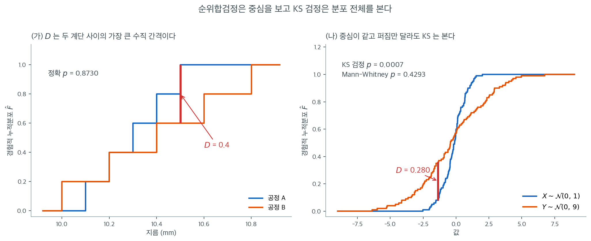

# Kolmogorov-Smirnov 이표본 검정

[Wilcoxon 순위합](rank_sum.md) 검정과 [Mann-Whitney U](mann_whitney.md) 검정은 주로 **위치이동** --- 두 분포의 중심경향 차이 --- 에 민감하다. **Kolmogorov-Smirnov(KS) 이표본 검정**은 더 넓은 관점을 취한다. 두 표본의 *전체* 경험적 누적분포함수(ECDF)를 비교하여 위치, 산포, 모양, 그 밖의 어떤 분포적 특징의 차이든 탐지할 수 있다.

이 일반성 덕에 KS 검정은 다재다능한 진단도구가 되지만, 순수한 위치이동 같은 특정 대립가설에 대해서는 순위 기반 검정보다 검정력이 낮다는 대가를 치른다.

---

## 1. 직관

독립인 두 표본이 주어지면 각 표본이 경험적 CDF --- 관측값마다 $1/n$씩 뛰는 계단함수 --- 를 만든다. 두 모집단이 동일하다면 두 ECDF가 서로 가까이 붙어 움직여야 한다. KS 검정은 두 ECDF 사이의 최대 수직 간격을 재고, 그 간격이 표집변동만으로 설명하기에 너무 크면 $H_0$을 기각한다.

---

## 2. 가설

$$
H_0 \colon F_X = F_Y \quad \text{(두 모집단이 같은 연속분포를 갖는다)}
$$

$$
H_a \colon F_X \ne F_Y \quad \text{(분포가 어떤 식으로든 다르다)}
$$

이 검정은 본질적으로 양측이다. 분포 사이의 *임의의* 차이를 탐지한다.

---

## 3. 검정통계량

크기 $n_1$과 $n_2$인 두 표본의 ECDF를 $\hat{F}_1(x)$, $\hat{F}_2(x)$라 하자. KS 통계량은 절대차이의 상한이다.

$$
D_{n_1, n_2} = \sup_{x \in \mathbb{R}} \left|\hat{F}_1(x) - \hat{F}_2(x)\right|
$$

실제로는 $N = n_1 + n_2$개 관측값을 모두 합쳐 정렬한 뒤, 각 관측값에서(그리고 각 도약 직전에서) $|\hat{F}_1 - \hat{F}_2|$를 평가하여 $D$를 계산한다.

---

## 4. 귀무분포

연속분포라는 $H_0$ 아래에서 $D_{n_1, n_2}$의 귀무분포는 공통분포 $F$에 의존하지 않는다. 즉 검정이 분포무관이다.

표본이 크면 척도조정된 통계량

$$
\sqrt{\frac{n_1 \, n_2}{n_1 + n_2}} \, D_{n_1, n_2}
$$

이 **Kolmogorov 분포**로 분포수렴하며, 그 CDF는

$$
K(t) = 1 - 2\sum_{k=1}^{\infty} (-1)^{k-1} e^{-2k^2 t^2}
$$

이다. 점근 $p$값은 $c = \sqrt{n_1 n_2 / (n_1 + n_2)} \cdot D$일 때 $p = 1 - K(c)$이다.

소표본에서는 열거나 동적계획법으로 정확 $p$값을 계산한다.

<div class="exbox" markdown>

**보기 1.** <span class="diff easy" title="쉬움"></span> 정확 p-값 $0.873016$ 의 분모는 252 다. 두 제조공정이 볼베어링을 생산한다. 각 공정의 표본에서 지름(mm)을 측정했다.

**공정 A** ($n_1 = 5$): 10.1, 10.3, 10.2, 10.5, 10.4

**공정 B** ($n_2 = 5$): 10.0, 10.2, 10.6, 10.8, 10.4

**(1)** 두 ECDF 의 표를 만들어 $D$ 와 척도조정 통계량 $\sqrt{n_1n_2/(n_1+n_2)}\,D$ 를 손으로 구하시오.

**(2)** $n_1 = n_2 = 5$ 이면 합친 표본을 두 집단에 배치하는 방법이 $\binom{10}{5} = 252$ 가지뿐이다. 전수 열거로 정확 p-값을 **분수로** 적고, $D$ 가 가질 수 있는 값이 몇 개인지 세시오. 또 `scipy` 의 `method='asymp'` 가 주는 $0.82$ 가 위 식 $1 - K(c)$ 와 같은지 확인하시오.

</div>

??? success "풀이"

    **(1) ECDF 표.** 합친 표본의 서로 다른 값은 여덟 개다. 각 값에서 두 ECDF 를 읽는다.

    | 값 | $\hat{F}_1(x)$ | $\hat{F}_2(x)$ | $\lvert \hat{F}_1 - \hat{F}_2 \rvert$ |
    |:-----:|:-----:|:-----:|:-----:|
    | 10.0 | 0/5 = 0.0 | 1/5 = 0.2 | 0.2 |
    | 10.1 | 1/5 = 0.2 | 1/5 = 0.2 | 0.0 |
    | 10.2 | 2/5 = 0.4 | 2/5 = 0.4 | 0.0 |
    | 10.3 | 3/5 = 0.6 | 2/5 = 0.4 | 0.2 |
    | 10.4 | 4/5 = 0.8 | 3/5 = 0.6 | 0.2 |
    | 10.5 | 5/5 = 1.0 | 3/5 = 0.6 | 0.4 |
    | 10.6 | 5/5 = 1.0 | 4/5 = 0.8 | 0.2 |
    | 10.8 | 5/5 = 1.0 | 5/5 = 1.0 | 0.0 |

    최대 간격은 $x = 10.5$ 에서 $D = 0.4$ 다. $A$ 의 계단이 $10.5$ 에서 $1.0$ 에 닿는데 $B$ 는 아직 $0.6$ 에 머물러 있다. 척도조정 통계량은

    $$
    c = \sqrt{\frac{n_1 n_2}{n_1 + n_2}}\,D = \sqrt{\frac{25}{10}} \times 0.4 = \sqrt{2.5} \times 0.4 = 0.632456
    $$

    이다.

    **(2) 전수 열거.** $H_0$ 아래에서 합친 10개 관측값 가운데 어느 다섯이 $A$ 가 되는지는 모두 같은 확률이고, 그런 배치가 $\binom{10}{5} = 252$ 가지다. 배치를 정하면 $D$ 가 다음과 같이 **한 번 훑어** 나온다. 정렬한 합친 표본을 왼쪽부터 보면서 $A$ 의 값에서 $+1/5$, $B$ 의 값에서 $-1/5$ 를 더해 가면 부분합이 $\hat F_1 - \hat F_2$ 이고

    $$
    D = \max_{k} \left\lvert \sum_{i \leq k} s_i \right\rvert,
    \qquad s_i = \pm \tfrac15
    $$

    이다. **따라서 $D$ 는 $0.2$ 의 배수일 수밖에 없다.** 게다가 첫 걸음에서 이미 $\lvert s_1 \rvert = 0.2$ 이므로 $D = 0$ 은 불가능하다. 가능한 값은 $0.2, 0.4, 0.6, 0.8, 1.0$ 의 **다섯 개뿐**이고 252 가지가 그 다섯에 나뉘어 들어간다.

    | $D$ | 0.2 | 0.4 | 0.6 | 0.8 | 1.0 | 합 |
    |---|---|---|---|---|---|---|
    | 배치 수 | 32 | 130 | 70 | 18 | 2 | 252 |

    관측값 $D = 0.4$ 이상인 배치는 $130 + 70 + 18 + 2 = 220$ 개다.

    $$
    p_{\text{정확}} = \frac{220}{252} = \frac{55}{63} = 0.873016
    $$

    **`scipy` 의 `method='exact'` 가 준 $0.873015873$ 과 같다.** $D$ 가 다섯 값만 가지므로 **이 검정이 낼 수 있는 p-값도 다섯 개뿐**이다: $1, 220/252, 90/252, 20/252, 2/252$, 곧 $1,\ 0.8730,\ 0.3571,\ 0.0794,\ 0.0079$. $\alpha = 0.05$ 에서 기각하려면 $D = 1.0$, 곧 **두 표본이 완전히 분리되어야** 한다.

    **점근값은 본문의 $1 - K(c)$ 와 다르다.** 본문의 급수를 $c = 0.632456$ 에서 더하면

    $$
    1 - K(c) = 2\sum_{k=1}^{\infty}(-1)^{k-1}e^{-2k^2c^2} = 0.818621
    $$

    인데 `scipy` 는 $0.82$ 를 돌려준다. 까닭은 `scipy` 가 극한분포를 쓰지 않고 **유효 표본크기를 정수로 반올림한 유한 $n$ 분포**를 쓰기 때문이다.

    $$
    n_{\text{eff}} = \frac{n_1n_2}{n_1+n_2} = 2.5
    \ \xrightarrow{\text{반올림}}\ 2,
    \qquad
    p = P(D_2 \geq 0.4) \ \text{(일표본 KS 분포)} = 0.82
    $$

    `numpy` 의 반올림은 $2.5$ 를 **짝수 쪽인 $2$** 로 보낸다. 차이 $0.0014$ 는 여기서 대수롭지 않지만, **"점근 p-값"이라는 이름이 붙은 수가 실제로 무엇으로 계산되는지는 함수마다 확인해야 한다.**

    **수치적으로.**

    ```python
    from scipy import stats
    A = [10.1, 10.3, 10.2, 10.5, 10.4]
    B = [10.0, 10.2, 10.6, 10.8, 10.4]
    print(stats.ks_2samp(A, B, method='exact').pvalue)   # 0.873016
    print(stats.ks_2samp(A, B, method='asymp').pvalue)   # 0.820000
    ```

    출력:

    ```
    0.873015873015873
    0.82
    ```

    ```python
    import itertools
    import math
    from collections import Counter

    import numpy as np

    n1 = n2 = 5
    N = n1 + n2
    pool = np.array(sorted(A + B))
    print(f"정렬한 합친 표본 {pool.tolist()}")
    print(f"동점 {[(k, v) for k, v in sorted(Counter(pool.tolist()).items()) if v > 1]}")

    # 252 가지 배치를 전수 열거한다.
    Ds = []
    for comb in itertools.combinations(range(N), n1):
        step = np.full(N, -1 / n2)
        step[list(comb)] = 1 / n1
        Ds.append(np.abs(np.cumsum(step)).max())
    Ds = np.round(Ds, 10)
    tally = Counter(Ds)
    print(f"\n열거한 배치 수 {len(Ds)}  (C(10,5) = {math.comb(N, n1)})")
    print(f"D 가 가질 수 있는 값 {sorted(tally)}")
    print(f"배치 수           {[tally[d] for d in sorted(tally)]}")

    D_obs = 0.4
    hit = int((Ds >= D_obs - 1e-12).sum())
    print(f"\nD >= {D_obs} 인 배치 {hit} 개  ->  정확 p = {hit}/{len(Ds)}"
          f" = {hit / len(Ds):.9f}")
    print(f"scipy method='exact' : {stats.ks_2samp(A, B, method='exact').pvalue:.9f}")
    print("이 검정이 낼 수 있는 p-값 전부:")
    for d in sorted(tally):
        k = int((Ds >= d - 1e-12).sum())
        print(f"  D = {d}:  p = {k}/{len(Ds)} = {k / len(Ds):.4f}")

    c = np.sqrt(n1 * n2 / N) * D_obs
    series = 2 * sum((-1) ** (k - 1) * np.exp(-2 * k ** 2 * c ** 2)
                     for k in range(1, 200))
    print(f"\nc = sqrt({n1 * n2}/{N}) * {D_obs} = {c:.6f}")
    print(f"급수 1 - K(c)        = {series:.6f}")
    print(f"kstwobign.sf(c)      = {stats.kstwobign.sf(c):.6f}")
    print(f"n_eff = {n1 * n2 / N} -> round -> {np.round(n1 * n2 / N):.0f}")
    print(f"kstwo.sf(D, round(n_eff)) = {stats.kstwo.sf(D_obs, int(np.round(n1 * n2 / N))):.6f}")
    print(f"scipy method='asymp'      = {stats.ks_2samp(A, B, method='asymp').pvalue:.6f}")
    ```

    출력:

    ```
    정렬한 합친 표본 [10.0, 10.1, 10.2, 10.2, 10.3, 10.4, 10.4, 10.5, 10.6, 10.8]
    동점 [(10.2, 2), (10.4, 2)]

    열거한 배치 수 252  (C(10,5) = 252)
    D 가 가질 수 있는 값 [0.2, 0.4, 0.6, 0.8, 1.0]
    배치 수           [32, 130, 70, 18, 2]

    D >= 0.4 인 배치 220 개  ->  정확 p = 220/252 = 0.873015873
    scipy method='exact' : 0.873015873
    이 검정이 낼 수 있는 p-값 전부:
      D = 0.2:  p = 252/252 = 1.0000
      D = 0.4:  p = 220/252 = 0.8730
      D = 0.6:  p = 90/252 = 0.3571
      D = 0.8:  p = 20/252 = 0.0794
      D = 1.0:  p = 2/252 = 0.0079

    c = sqrt(25/10) * 0.4 = 0.632456
    급수 1 - K(c)        = 0.818621
    kstwobign.sf(c)      = 0.818621
    n_eff = 2.5 -> round -> 2
    kstwo.sf(D, round(n_eff)) = 0.820000
    scipy method='asymp'      = 0.820000
    ```

    **열거한 $220/252$ 가 `scipy` 의 정확 p-값과 아홉째 자리까지 같다.** 그리고 급수로 더한 $1 - K(c) = 0.818621$ 이 `kstwobign.sf(c)` 와 같으므로 **본문의 극한 공식은 맞다** — `scipy` 의 `'asymp'` 가 그것을 쓰지 않을 뿐이다. $n_{\text{eff}} = 2.5$ 를 $2$ 로 반올림해 `kstwo.sf(0.4, 2) = 0.82` 를 돌려주는 것이 확인된다.

    $\alpha = 0.05$ 에서 $H_0$ 을 기각하지 못한다. 두 공정의 지름 분포에 유의한 차이가 나타나지 않는다. **다만 "차이가 없다"가 아니라 "다섯 개씩으로는 완전 분리가 아니면 어차피 기각할 수 없었다"가 정확한 서술이다.** 이 설계의 가장 작은 p-값이 $2/252 = 0.0079$ 라는 사실이 그 뜻이다.

!!! warning "이 자료는 동점을 포함한다"
    공정 A와 B가 $10.2$와 $10.4$를 공유한다. KS 검정은 연속분포를 가정하므로 엄밀히는 동점이 없어야 한다. 동점이 있으면 정확 귀무분포가 성립하지 않고 검정이 **보수적**으로 된다. 반올림된 측정값에서는 이런 상황이 흔하므로, 동점이 많다면 순열검정으로 실제 귀무분포를 직접 계산하는 편이 낫다.

---

## 5. KS 검정이 탐지하는 것

위치에 집중하는 순위 기반 검정과 달리 KS 검정은 다음 차이에 민감하다.

- **위치** --- 한 분포가 다른 분포에 대해 이동
- **척도** --- 한 분포가 더 퍼져 있음
- **모양** --- 왜도, 첨도, 봉우리 수의 차이
- **위의 임의의 조합**



$D = \sup_x |\hat{F}_1(x) - \hat{F}_2(x)|$라는 정의는 그림으로 보면 한 줄로 끝난다. **두 계단 사이의 가장 긴 세로 막대를 찾는 것**이다.

(가)는 위의 볼베어링 보기이다. 공정 A(파랑)의 계단이 $10.5$에서 $1.0$까지 올라가는데 공정 B(주황)는 아직 $0.6$에 머물러 있어 그 자리의 간격이 $0.4$로 가장 크다. 빨간 막대가 바로 $D$이다. 다만 $n_1 = n_2 = 5$로 표본이 워낙 작아 이 정도 간격은 우연으로 충분히 설명되며, 정확 $p$값이 $0.8730$이다. **간격의 크기 자체가 아니라 그 크기가 표본크기에 비해 놀라운가**를 묻는 것이 검정이다.

(나)가 KS 검정을 따로 배울 이유를 보여 준다. 집단당 $100$개씩 뽑은 $X \sim \mathcal{N}(0, 1)$과 $Y \sim \mathcal{N}(0, 9)$인데, **중심은 같고 퍼짐만 세 배 다르다.** 두 계단이 가운데 $0.5$ 근처에서 교차하고 양쪽 끝에서 갈라지는 X자 모양이 이 상황의 전형적인 신호이다. KS 통계량은 $D = 0.280$이고 $p = 0.0007$로 강하게 기각한다.

같은 자료에 Mann-Whitney 검정을 돌리면 $p = 0.4293$이 나온다. 순위합은 "$Y$ 쪽 순위가 전체적으로 높은가 낮은가"만 보는데, $Y$는 아래로도 위로도 똑같이 퍼졌으므로 순위합에서 두 효과가 **정확히 상쇄된다.** 순위합검정에게 이 두 집단은 구별되지 않는다.

그래서 두 검정은 경쟁 관계가 아니라 분업 관계이다. 위치이동이 관심사라면 순위합검정이 더 강력하고, 차이의 성격을 모르거나 산포·모양이 관심사라면 KS 검정이 필요하다. 탐색 단계에서는 둘을 함께 돌리고 **결과가 갈리는 방향에서 무슨 일이 벌어지는지**를 읽는 것이 좋은 습관이다.

!!! warning "특정 대립가설에 대한 검정력은 낮다"
    KS 검정의 일반성에는 대가가 있다. 순수한 위치이동에 대해서는 Wilcoxon 순위합검정의 검정력이 대체로 더 높다. KS 검정은 차이의 성격을 모르거나 모양·산포의 차이가 관심사일 때 가장 유용하다.

---

## 6. 순위 기반 검정과의 비교

| 특징 | Wilcoxon 순위합 | KS 이표본 |
|:--------|:-----------------|:--------------|
| 위치이동 탐지 | 높은 검정력 | 중간 검정력 |
| 산포 차이 탐지 | 낮은 검정력 | 중간 검정력 |
| 모양 차이 탐지 | 낮은 검정력 | 중간 검정력 |
| 검정통계량 | 순위합 ($W$) | 최대 ECDF 간격 ($D$) |
| 동점 처리 | 중간순위로 처리 | 연속성을 요구 |
| 효과크기 해석 | $U$를 통한 $P(X > Y)$ | 최대 분포 간격 |

---

## 연습문제

<div class="drillbox" markdown>

**연습문제 1.** <span class="diff easy" title="쉬움"></span>
두 집단의 학생이 서로 다른 준비 과정을 수강했고 시험 점수는 다음과 같다.

- **과정 1**: 72, 78, 85, 90, 65
- **과정 2**: 80, 88, 92, 95, 85, 76

**(a)** 각 집단의 경험적 CDF $\hat{F}_1(x)$와 $\hat{F}_2(x)$를 계산하라.

**(b)** Kolmogorov-Smirnov 검정통계량 $D = \max_x |\hat{F}_1(x) - \hat{F}_2(x)|$를 구하라.

**(c)** $D$가 크다는 것은 두 분포에 대해 무엇을 뜻하는가?

</div>

??? success "풀이"

    **(a)** 각 표본을 정렬하고 ECDF를 계산한다(각 도약의 크기는 $1/n_i$).

    **과정 1** ($n_1 = 5$): 65, 72, 78, 85, 90. ECDF가 각 값에서 $1/5 = 0.2$씩 뛴다.

    **과정 2** ($n_2 = 6$): 76, 80, 85, 88, 92, 95. ECDF가 각 값에서 $1/6 \approx 0.167$씩 뛴다.

    **(b)** $D$를 찾기 위해 관측된 모든 값에서 $|\hat{F}_1(x) - \hat{F}_2(x)|$를 평가한다.

    | $x$ | $\hat{F}_1(x)$ | $\hat{F}_2(x)$ | $\lvert \hat{F}_1 - \hat{F}_2 \rvert$ |
    |:---:|:---:|:---:|:---:|
    | 65 | 0.2 | 0 | 0.200 |
    | 72 | 0.4 | 0 | 0.400 |
    | 76 | 0.4 | 1/6 | 0.233 |
    | 78 | 0.6 | 1/6 | 0.433 |
    | 80 | 0.6 | 2/6 | 0.267 |
    | 85 | 0.8 | 3/6 | 0.300 |
    | 88 | 0.8 | 4/6 | 0.133 |
    | 90 | 1.0 | 4/6 | 0.333 |
    | 92 | 1.0 | 5/6 | 0.167 |
    | 95 | 1.0 | 1.0 | 0.000 |

    $$
    D = \max_x |\hat{F}_1(x) - \hat{F}_2(x)| = 0.433 \quad (x = 78 \text{에서})
    $$

    **(c)** $D$가 크면 두 경험적 CDF가 상당히 다르다는 뜻이고, 두 표본이 서로 다른 모집단 분포에서 왔음을 시사한다. KS 검정은 위치(이동)와 모양의 차이 모두에 민감하다.

    이 자료에서 $D = 0.433$은 과정 2 학생들이 더 높은 점수를 내는 경향을 시사하지만, $n_1 = 5$, $n_2 = 6$에서 $\alpha = 0.05$의 임계값은

    $$
    c(\alpha)\sqrt{\frac{n_1 + n_2}{n_1 n_2}} = 1.36\sqrt{\frac{11}{30}} \approx 0.824
    $$

    이므로 $D = 0.433 < 0.824$이고 이 표본크기에서는 $H_0$을 기각하지 못한다.

    ```python
    from scipy import stats
    c1 = [72, 78, 85, 90, 65]; c2 = [80, 88, 92, 95, 85, 76]
    print(stats.ks_2samp(c1, c2, method='exact'))
    # statistic=0.4333, pvalue=0.5909
    print(stats.mannwhitneyu(c1, c2, method='exact').pvalue)   # 0.2468
    ```

    출력:

    ```
    KstestResult(statistic=0.43333333333333335, pvalue=0.5909090909090909, statistic_location=78, statistic_sign=1)
    0.24675324675324672
    ```

    정확 $p$값은 $0.591$이다. Mann-Whitney의 $0.247$과 비교하면 두 배가 넘는데, 이 자료의 차이가 주로 위치이동이라 순위 기반 검정이 더 효율적으로 잡아내기 때문이다.

---

<div class="drillbox" markdown>

**연습문제 2.** <span class="diff med" title="중간"></span>
KS 검정과 Mann-Whitney 검정의 검정력을 **위치이동**과 **척도 차이** 두 상황에서 모의실험으로 비교하라.

</div>

??? success "풀이"
    ```python
    import numpy as np
    from scipy import stats
    rng = np.random.default_rng(0)
    B, n = 3000, 25

    def rates(gen):
        pk, pm = [], []
        for _ in range(B):
            x, y = gen()
            pk.append(stats.ks_2samp(x, y).pvalue)
            pm.append(stats.mannwhitneyu(x, y).pvalue)
        return round(np.mean(np.array(pk) < .05), 3), \
               round(np.mean(np.array(pm) < .05), 3)

    for d in (0.0, 0.8):
        print("shift", d, rates(lambda: (rng.normal(0, 1, n), rng.normal(d, 1, n))))
    for s in (1.0, 2.0, 3.0):
        print("scale", s, rates(lambda: (rng.normal(0, 1, n), rng.normal(0, s, n))))
    ```

    출력:

    ```
    shift 0.0 (0.039, 0.047)
    shift 0.8 (0.614, 0.757)
    scale 1.0 (0.037, 0.047)
    scale 2.0 (0.153, 0.058)
    scale 3.0 (0.414, 0.069)
    ```

    **위치이동** ($n = 25$씩, $\alpha = 0.05$):

    | 이동 $\delta$ | KS | Mann-Whitney |
    |---:|---:|---:|
    | 0.0 (크기) | 0.039 | 0.047 |
    | 0.8 | 0.614 | **0.757** |

    **척도 차이** (평균은 둘 다 0):

    | 척도비 | KS | Mann-Whitney |
    |---:|---:|---:|
    | 1.0 (크기) | 0.037 | 0.047 |
    | 2.0 | **0.153** | 0.058 |
    | 3.0 | **0.414** | 0.069 |

    두 검정의 성격이 정반대로 갈린다.

    - **위치이동**에서는 Mann-Whitney가 $0.757$ 대 $0.614$로 명백히 앞선다. 순위합이 위치 차이에 최적화된 통계량이기 때문이다.
    - **척도 차이**에서는 Mann-Whitney가 사실상 **무력하다**. 척도비가 3배여도 기각률이 $0.069$로 명목수준을 겨우 넘는다. 두 분포가 모두 0 대칭이라 $P(X > Y) = 0.5$가 그대로 유지되어 순위합이 아무 신호도 받지 못한다.
    - KS는 척도비 3에서 $0.414$를 낸다. 완벽하지는 않지만 유일하게 탐지한다.

    **크기 확인:** 두 검정 모두 귀무가설 아래 기각률이 $0.05$ 아래이다(KS $0.037$--$0.039$, MWU $0.047$). KS가 다소 보수적인데, 이는 $D$의 이산성 때문이다.

    **실무 지침:** 관심이 "중심이 다른가"라면 Mann-Whitney를, "분포가 다른가"라면 KS를 쓴다. 둘 다 돌려 보고 유의한 쪽을 고르는 것은 다중검정 문제를 낳는다.

---

<div class="drillbox" markdown>

**연습문제 3.** <span class="diff med" title="중간"></span>
KS 통계량이 최댓값을 갖는 위치 $x^*$는 무엇을 알려 주는가? 두 분포가 다른 방식으로 다를 때 $x^*$가 어디에 나타나는지 확인하라.

</div>

??? success "풀이"
    ```python
    import numpy as np
    from scipy import stats
    rng = np.random.default_rng(7)
    n = 500

    cases = {
        "위치이동":   (rng.normal(0, 1, n),  rng.normal(1, 1, n)),
        "척도차이":   (rng.normal(0, 1, n),  rng.normal(0, 2.5, n)),
        "오른쪽 꼬리": (rng.normal(0, 1, n),  rng.standard_t(3, n)),
    }
    for name, (x, y) in cases.items():
        r = stats.ks_2samp(x, y)
        print(name, round(r.statistic, 3), round(r.statistic_location, 3))
    ```

    출력:

    ```
    위치이동 0.478 0.217
    척도차이 0.22 -1.57
    오른쪽 꼬리 0.078 1.199
    ```

    | 상황 | $D$ | $x^*$ (최대 간격 위치) |
    |:---|---:|---:|
    | 위치이동 $\mathcal{N}(0,1)$ 대 $\mathcal{N}(1,1)$ | 0.478 | $0.217$ |
    | 척도차이 $\mathcal{N}(0,1)$ 대 $\mathcal{N}(0,2.5^2)$ | 0.220 | $-1.570$ |
    | 꼬리차이 $\mathcal{N}(0,1)$ 대 $t(3)$ | 0.078 | $1.199$ |

    $x^*$의 위치가 차이의 성격을 알려 준다.

    - **위치이동**에서 $x^*$는 두 중앙값 사이($0$과 $1$ 사이)에 나타난다. 두 CDF가 서로 평행하게 이동했을 때 간격이 가장 벌어지는 곳이다.
    - **척도차이**에서 $x^*$는 중심이 아니라 한쪽 어깨($\approx -1.6$)에 나타난다. 두 CDF가 중앙($x = 0$)에서 교차하므로 그 지점의 간격은 0이고, 간격은 $\pm 1.5\sigma$ 부근에서 최대가 된다. 대칭이므로 $+1.6$ 근처에도 거의 같은 크기의 간격이 있다.
    - **꼬리차이**에서도 어깨 부근($\approx 1.2$)이지만 $D$ 자체가 $0.078$로 작다. $t(3)$과 정규분포의 차이는 주로 **극단 꼬리**에 있는데, 그곳은 CDF 값이 이미 0이나 1에 가까워 절대 간격이 클 수 없다.

    **핵심 한계:** KS 검정은 CDF의 **절대** 차이를 재므로 분포의 중앙부에 가장 민감하고 꼬리에는 둔감하다. 꼬리 차이를 잡아내려면 [14장](../../ch14/index.md)의 Anderson-Darling 검정처럼 $\sqrt{F(1-F)}$로 가중한 통계량을 써야 한다.

---

<div class="drillbox" markdown>

**연습문제 4.** <span class="diff hard" title="어려움"></span>
KS 검정이 분포무관인 이유를 설명하라. 즉 $D$의 귀무분포가 왜 공통분포 $F$에 의존하지 않는가?

</div>

??? success "풀이"
    핵심은 **확률적분변환**이다. $F$가 연속이면 $U = F(X) \sim \text{Uniform}(0,1)$이다.

    두 표본 $X_1, \ldots, X_{n_1}$과 $Y_1, \ldots, Y_{n_2}$가 모두 $F$에서 나왔다고 하자. 각 관측값에 $F$를 적용하면 $U_i = F(X_i)$, $V_j = F(Y_j)$가 되고, 모두 $\text{Uniform}(0,1)$이다.

    $F$가 단조증가이므로 순서가 보존되고 ECDF는 다음 관계를 만족한다.

    $$
    \hat{F}_1(x) = \hat{G}_1(F(x)), \qquad \hat{F}_2(x) = \hat{G}_2(F(x))
    $$

    여기서 $\hat{G}_1$, $\hat{G}_2$는 균등 표본의 ECDF이다. 따라서

    $$
    D = \sup_x |\hat{F}_1(x) - \hat{F}_2(x)| = \sup_{u \in (0,1)} |\hat{G}_1(u) - \hat{G}_2(u)|
    $$

    가 되어 $D$가 $F$에 전혀 의존하지 않는다.

    ```python
    import numpy as np
    from scipy import stats
    rng = np.random.default_rng(1)
    for name, gen in [("normal", lambda: rng.normal(0, 1, 30)),
                      ("exp",    lambda: rng.exponential(1, 30)),
                      ("cauchy", lambda: rng.standard_cauchy(30)),
                      ("unif",   lambda: rng.random(30))]:
        D = [stats.ks_2samp(gen(), gen()).statistic for _ in range(20000)]
        print(name, round(np.mean(D), 4), round(np.std(D), 4))
    ```

    출력:

    ```
    normal 0.2086 0.0667
    exp 0.2075 0.0663
    cauchy 0.2086 0.0676
    unif 0.2079 0.0667
    ```

    출력은 네 분포 모두 평균 약 $0.208$, 표준편차 약 $0.067$로 사실상 동일하다(normal 0.2086, exp 0.2075, cauchy 0.2086, uniform 0.2079).

    이것이 KS 검정의 근본적 장점이다. 모집단 분포를 몰라도, 심지어 코시처럼 평균이 존재하지 않아도 정확한 $p$값을 계산할 수 있다.

    **다만 두 조건이 필요하다.** (1) $F$가 **연속**이어야 한다. 이산분포에서는 $F(X)$가 균등하지 않아 검정이 보수적으로 된다. (2) 일표본 KS 검정에서 $F$의 모수를 자료로 추정하면 이 성질이 깨진다. 이것이 Lilliefors 보정이 필요한 이유이다([14장](../../ch14/index.md) 참조).

---

<div class="drillbox" markdown>

**연습문제 5.** <span class="diff hard" title="어려움"></span>
보기 1 은 $n_1 = n_2 = 5$ 에서 $D$ 가 다섯 값만 갖고, 이 설계가 낼 수 있는 가장 작은 정확 p-값이 $2/252 = 0.0079$ 임을 보였다. 같은 셈을 $n_1 = n_2 = 3$ 에서 끝까지 해 보자. 라이브러리를 부르지 말고 종이에서 끝낸다.

**(a)** 보기 1 의 걸음 논법 --- 정렬한 합친 표본을 왼쪽부터 훑으며 1 집단 값에서 $+1/3$, 2 집단 값에서 $-1/3$ 을 더하면 부분합이 $\hat F_1 - \hat F_2$ 이고 $D = \max_k \lvert \sum_{i \le k} s_i \rvert$ --- 을 써서, $D$ 가 가질 수 있는 값이 $1/3,\ 2/3,\ 1$ 셋뿐임을 보이라.

**(b)** $\binom{6}{3} = 20$ 가지 배치에서 $D$ 의 귀무분포를 구하라. 스무 가지를 다 적지 말고, $D = 1/3$ 인 배치가 **왜** $2^3$ 개인지 논증하라.

**(c)** 이 설계가 낼 수 있는 p-값을 모두 적고, $\alpha = 0.05$ 에서 KS 검정이 기각할 수 있는지 답하라. 1 집단의 세 값이 2 집단의 세 값보다 모두 작게 나와도 그런가?

**(d)** $n_1 = n_2 = n$ 일 때 $\alpha = 0.05$ 에서 기각이 **가능해지는** 가장 작은 $n$ 을 구하라.

</div>

??? success "풀이"

    **(a)** 걸음은 여섯 번이고 걸음마다 $\pm 1/3$ 이므로 모든 부분합이 $1/3$ 의 배수다. 따라서 $D$ 도 $1/3$ 의 배수다. 첫 걸음에서 이미 $\lvert s_1 \rvert = 1/3$ 이니 $D \geq 1/3$ 이고, 부분합의 절댓값이 $1$ 을 넘으려면 한 집단의 값이 세 개보다 많아야 하므로 $D \leq 1$ 이다. 그러므로

    $$
    D \in \left\{ \tfrac13,\ \tfrac23,\ 1 \right\}
    $$

    이다. 보기 1 의 $n = 5$ 에서 $D$ 가 $0.2$ 의 배수 다섯 개였던 것과 같은 논법이다.

    **(b)** $1/3$ 을 단위로 삼아 걸음을 $\pm 1$ 로 보면, 배치는 $0$ 에서 출발해 $0$ 으로 돌아오는 여섯 걸음 경로이고 그런 경로가 $\binom63 = 20$ 개다. $D$ 는 경로가 닿은 가장 높은 층(절댓값)이다.

    - $D = 1/3$: 경로가 $\pm 1$ 안에 갇힌다. 홀수 번째 걸음 뒤에는 반드시 $\pm 1$ 에 있으므로 **다음 걸음은 곧바로 $0$ 으로 돌아와야** 한다. 곧 경로가 $(+,-)$ 또는 $(-,+)$ 두 걸음 묶음 세 개로 쪼개지고, 묶음마다 선택이 둘이니 $2^3 = 8$ 개다.
    - $D = 1$: 층 $3$ 또는 $-3$ 에 닿으려면 여섯 걸음이 모두 같은 방향으로 먼저 세 번 나가야 한다. 곧 한 집단의 세 값이 다른 집단의 세 값보다 모두 작은 **완전 분리** 두 가지(1 집단이 아래, 2 집단이 아래)다.
    - $D = 2/3$: 남은 $20 - 8 - 2 = 10$ 개.

    | $D$ | 1/3 | 2/3 | 1 | 합 |
    |---|---|---|---|---|
    | 배치 수 | 8 | 10 | 2 | 20 |

    **(c)** 꼬리확률을 누적한다.

    $$
    P\!\left(D \geq \tfrac13\right) = \frac{20}{20} = 1,
    \qquad
    P\!\left(D \geq \tfrac23\right) = \frac{12}{20} = 0.6,
    \qquad
    P(D \geq 1) = \frac{2}{20} = 0.1
    $$

    p-값은 $1,\ 0.6,\ 0.1$ 세 개뿐이고 **가장 작은 것이 $0.1 > 0.05$** 다. 그러므로 $n_1 = n_2 = 3$ 에서 KS 검정은 $\alpha = 0.05$ 에서 **무슨 자료가 나와도 기각할 수 없다.** 1 집단의 세 값이 2 집단의 세 값보다 모두 작아 $D = 1$ 이라는 가장 극단적인 결과가 나와도 $p = 0.1$ 이다. 자료가 더 극단적일 수 없는데도 p-값이 더 내려가지 않는다.

    **(d)** 완전 분리는 언제나 배치 두 가지이고 그때 $D = 1$ 이 최대이므로, 어떤 설계에서든 가장 작은 정확 p-값은

    $$
    p_{\min} = \frac{2}{\binom{2n}{n}}
    $$

    이다. $p_{\min} \leq 0.05$ 는 $\binom{2n}{n} \geq 40$ 과 같고, $\binom63 = 20 < 40 \leq 70 = \binom84$ 이므로 답은 $n = 4$ 다. 그때 참 크기는 $2/70 = 0.028571$ 이고, 기각하려면 여전히 완전 분리여야 한다.

    **표본크기가 p-값의 바닥을 정하고, 그 바닥은 자료가 아무리 극단적이어도 내려가지 않는다.** 보기 1 의 $2/252$ 가 같은 이야기이고, 비모수 검정에서 "유의하지 않다"를 읽을 때 먼저 확인해야 할 것이 바로 이 바닥이다.

---

<div class="drillbox" markdown>

**연습문제 6.** <span class="diff hard" title="어려움"></span>
§5 의 (나)는 $X \sim \mathcal{N}(0,1)$, $Y \sim \mathcal{N}(0,9)$ 에서 집단당 $100$ 개를 뽑아 $D = 0.280$, $p = 0.0007$ 을 얻었다. 이 수들이 어디서 오는지 모집단 수준에서 따진다. $\sigma > 1$ 에 대해

$$
D(\sigma) = \sup_{x \in \mathbb{R}} \left\lvert \Phi(x) - \Phi(x/\sigma) \right\rvert
$$

라 하자.

**(a)** 상한이 달성되는 $x^* > 0$ 이

$$
x^{*2} = \frac{2\sigma^2 \ln \sigma}{\sigma^2 - 1}
$$

를 만족함을 보이라. 상한이 $+x^*$ 와 $-x^*$ 두 곳에서 똑같이 달성되는 까닭도 적으라.

**(b)** $\sigma = 3$ 에서 $x^*$ 와 $D(3)$ 을 소수 넷째 자리까지 구하라. 또 $\sigma = 2.5$ 의 이론값을 구해 연습문제 3 이 모의로 얻은 $D = 0.220$, $x^* = -1.570$ 과 견주고, 모의값이 이론값보다 큰 쪽으로 치우친 까닭을 말하라.

**(c)** $\sigma \to \infty$ 에서 $D(\sigma)$ 의 극한을 구하라. 이 대립가설에서 KS 검정은 $n \to \infty$ 일 때 일치검정인가? 같은 대립가설에서 Mann-Whitney 는 어떤가? $P(X < Y)$ 를 계산해 답하라.

**(d)** (b) 의 $D(3)$ 과 $n_1 = n_2 = 100$ 을 본문의 $p = 1 - K(c)$ 에 넣어 p-값을 구하라. §5 가 보고한 $0.0007$ 과 왜 다른가? 또 이 대립가설에서 KS 검정의 검정력이 약 $1/2$ 이 되는 집단당 표본크기를 어림하라.

</div>

??? success "풀이"

    **(a)** $g(x) = \Phi(x) - \Phi(x/\sigma)$ 라 두면 $\Phi(-t) = 1 - \Phi(t)$ 에서

    $$
    g(-x) = \left(1 - \Phi(x)\right) - \left(1 - \Phi(x/\sigma)\right) = -g(x)
    $$

    이므로 $g$ 는 기함수다. 따라서 $\lvert g \rvert$ 는 우함수이고 상한은 $\pm x^*$ 두 곳에서 같은 값을 갖는다. 미분하면

    $$
    g'(x) = \phi(x) - \frac1\sigma \phi(x/\sigma)
    = \frac{1}{\sqrt{2\pi}}\left( e^{-x^2/2} - \frac1\sigma e^{-x^2/(2\sigma^2)} \right)
    $$

    이고, $g'(x) = 0$ 에 로그를 취하면

    $$
    -\frac{x^2}{2} = -\ln\sigma - \frac{x^2}{2\sigma^2}
    \quad\Longleftrightarrow\quad
    \frac{x^2}{2}\left(1 - \frac{1}{\sigma^2}\right) = \ln \sigma
    \quad\Longleftrightarrow\quad
    x^{*2} = \frac{2\sigma^2 \ln\sigma}{\sigma^2 - 1}
    $$

    을 얻는다. $g(0) = 0$, $g'(0) = \phi(0)(1 - 1/\sigma) > 0$, $g(\infty) = 0$ 이고 $x > 0$ 에서 임계점이 이 하나뿐이므로 여기가 최대다. $\square$

    **(b)** $\sigma = 3$: $\ln 3 = 1.098612$ 이므로

    $$
    x^{*2} = \frac{2 \times 9 \times 1.098612}{8} = 2.471878,
    \qquad x^* = 1.5722
    $$

    이고

    $$
    D(3) = \Phi(1.5722) - \Phi(1.5722/3) = \Phi(1.5722) - \Phi(0.5241)
    = 0.942050 - 0.699886 = 0.2422
    $$

    다. $\sigma = 2.5$: $x^{*2} = 2(6.25)(0.916291)/5.25 = 2.181644$, $x^* = 1.4770$, $D(2.5) = 0.930167 - 0.722678 = 0.2075$.

    | $\sigma$ | 이론 $x^*$ | 이론 $D(\sigma)$ | 연습문제 3 의 모의값 |
    |---:|---:|---:|---|
    | 2.5 | $\pm 1.4770$ | 0.2075 | $D = 0.220$, $x^* = -1.570$ |
    | 3.0 | $\pm 1.5722$ | 0.2422 | ($n = 100$ 에서 $D = 0.280$) |

    모의값이 큰 쪽으로 치우치는 것은 **상한이 위로 편향되기 때문**이다. $\hat F_1 - \hat F_2$ 는 모집단 간격에 크기 $O(\sqrt{2/n})$ 의 표집잡음이 얹힌 것이고, 그 절댓값의 **최대**를 취하면 잡음이 유리한 쪽으로 터진 자리가 골라진다. 늘 $E[D_n] \geq D(\sigma)$ 이고, $n = 500$ 에서 잡음의 크기가 $\sqrt{2/500} \approx 0.063$ 이니 $0.2075 \to 0.220$ 의 차이는 그 범위 안이다. $x^*$ 의 부호가 음수로 나온 것도 이 때문이다. 모집단에서는 $\pm 1.477$ 이 똑같이 최대이므로 **어느 쪽이 뽑히는지는 잡음이 정한다.**

    **(c)** $\sigma \to \infty$ 에서 $x^{*2} \approx 2\ln\sigma \to \infty$ 이고 $x^*/\sigma \approx \sqrt{2\ln\sigma}/\sigma \to 0$ 이므로

    $$
    D(\sigma) \longrightarrow 1 - \tfrac12 = \tfrac12
    $$

    이다. $D(\sigma)$ 는 $\sigma$ 에 증가하지만 $1/2$ 를 넘지 못한다. 순수한 척도 차이로는 두 CDF 의 간격이 **절반을 넘을 수 없다**(두 분포가 중앙값을 공유하므로 $x = 0$ 에서 간격이 $0$ 이고, 한쪽 꼬리에서 벌릴 수 있는 최대가 $1/2$ 다).

    **KS 는 일치검정이다.** $\alpha = 0.05$ 의 임계값이 $1.3581\sqrt{(n_1+n_2)/(n_1n_2)} = 1.3581\sqrt{2/n} \to 0$ 으로 줄어드는데 $D_{n} \to D(\sigma) > 0$ 이므로 검정력이 $1$ 로 간다.

    **Mann-Whitney 는 일치검정이 아니다.** $X$ 와 $Y$ 가 독립이고 둘 다 $0$ 대칭이므로 $Y - X \sim \mathcal{N}(0, 1 + \sigma^2)$ 역시 $0$ 대칭이고

    $$
    P(X < Y) = P(Y - X > 0) = \tfrac12
    $$

    가 **모든 $\sigma$ 에서 정확히** 성립한다. 귀무모수가 어긋나지 않으니 표본을 아무리 늘려도 기각률은 $\alpha$ 에 머문다. §5 의 $p = 0.4293$ 은 표본이 작아서 나온 수가 아니라 **그 검정이 재는 양이 이 대립가설 아래 전혀 움직이지 않아서** 나온 수다.

    **(d)** $c = \sqrt{n_1n_2/(n_1+n_2)}\,D = \sqrt{50} \times 0.242164 = 1.712358$ 이고 $c^2 = 2.932170$ 이므로 급수의 첫 두 항으로

    $$
    1 - K(c) = 2\left(e^{-2c^2} - e^{-8c^2}\right)
    = 2\left(0.0028389 - 6.4\times 10^{-11}\right) = 0.005678
    $$

    이다. §5 의 $0.0007$ 보다 여덟 배 크다. 까닭은 §5 의 p-값이 **실현된** $D = 0.280$ 으로 계산된 것이고, (b) 에서 본 상한의 위쪽 편향 때문에 $0.280 > 0.2422$ 였기 때문이다. p-값은 $D$ 에 대해 $e^{-2c^2}$ 꼴로 급히 떨어지므로 $D = 0.280$ 이면 $c = 1.9799$, $p = 2e^{-7.84} = 0.000787$ 이 되어 $0.0007$ 과 맞는다. **$D$ 가 $0.04$ 커지는 동안 p-값은 일곱 배 작아진다.**

    검정력이 약 $1/2$ 이 되는 것은 임계값이 $D_n$ 의 중앙값 — 어림으로 $D(3)$ — 과 만나는 자리다.

    $$
    \sqrt{\frac{n}{2}}\,D(3) = 1.3581
    \quad\Longrightarrow\quad
    n = 2\left(\frac{1.3581}{0.242164}\right)^2 = 62.9
    $$

    곧 집단당 $63$ 개쯤이다(위쪽 편향 때문에 실제 검정력은 이보다 조금 높다). §5 가 $100$ 개씩으로 넉넉히 기각한 것이 이 어림과 들어맞는다. 중앙값이 같은 두 분포를 가르는 데 KS 는 수십 개로 되지만, Mann-Whitney 는 수십억 개로도 안 된다.

---

<div class="drillbox" markdown>

**연습문제 7.** <span class="diff hard" title="어려움"></span>
$D$ 와 순위합은 **같은 $\pm 1$ 경로의 서로 다른 함수**다. $n_1 = n_2 = 4$ 에서 1 집단이 $1, 2, 7, 8$ 이고 2 집단이 $3, 4, 5, 6$ 인 자료로 그 둘을 끝까지 따라가 보자. 손으로 푼다.

**(a)** 1 집단의 순위합 $W_1$ 과 Mann-Whitney $U$ 를 구하고 각자의 귀무평균과 비교하라. 정확 양측 p-값이 정확히 $1$ 이 되는 까닭을 설명하라.

**(b)** 같은 배치의 경로를 적고 $D$ 를 구하라.

**(c)** $\binom{8}{4} = 70$ 가지 배치에서 $D$ 의 귀무분포를 경로 셈으로 구하라. 높이 $\pm 1$ 안에 갇힌 경로, 그다음 $\pm 2$ 안에 갇힌 경로를 차례로 세면 된다. (b) 의 정확 p-값은 얼마인가?

**(d)** $n_1 = n_2 = 4$ 에서 KS 검정이 $\alpha = 0.05$ 로 기각하려면 $D = 1$ 이어야 한다. 그때 $W_1$ 은 어떤 값인가? §5 가 보인 "KS 는 $p = 0.0007$, Mann-Whitney 는 $p = 0.4293$" 같은 어긋남이 이 표본크기에서는 **일어날 수 없는** 까닭을 (c), (d) 와 연습문제 6(c) 로 설명하라.

</div>

??? success "풀이"

    **(a)** 합친 자료의 순위가 값 그대로이므로 $W_1 = 1 + 2 + 7 + 8 = 18$ 이다. 귀무평균은

    $$
    E[W_1] = \frac{n_1(N+1)}{2} = \frac{4 \times 9}{2} = 18
    $$

    이고, $U = W_1 - n_1(n_1+1)/2 = 18 - 10 = 8$ 로 귀무평균 $n_1n_2/2 = 8$ 과 **정확히 같다.** $U$ 의 귀무분포는 $8$ 에 대해 대칭이므로

    $$
    P(U \leq 8) = \frac{1 + P(U = 8)}{2} > \tfrac12,
    \qquad P(U \geq 8) > \tfrac12
    $$

    이고 양측 p-값 $\min\{1,\ 2\min(P(U \leq 8), P(U \geq 8))\}$ 이 $1$ 에서 잘린다. 곧 **순위합이 보기에 이 자료는 귀무가설에 가장 잘 맞는 자료다.**

    **(b)** 정렬한 합친 표본은 $1,2,3,4,5,6,7,8$ 이고 소속은 $1,1,2,2,2,2,1,1$ 이다. $1/4$ 을 단위로 걸음을 적으면

    $$
    (+1, +1, -1, -1, -1, -1, +1, +1)
    \ \longrightarrow\
    \text{부분합} (1, 2, 1, 0, -1, -2, -1, 0)
    $$

    이므로 $\max_k \lvert S_k \rvert = 2$, 곧 $D = 2/4 = 0.5$ 다($x = 2$ 와 $x = 6$ 에서 동시에 달성된다). **순위합은 평균 그대로인데 ECDF 간격은 절반이나 벌어져 있다.**

    **(c)** $\pm 1$ 걸음 여덟 번으로 $0$ 에서 $0$ 으로 가는 경로가 $70$ 개이고 $D = \max_k\lvert S_k\rvert / 4$ 다.

    **높이 $\pm 1$ 안.** 연습문제 5(b) 와 같은 논법으로 두 걸음 묶음 네 개, 곧 $2^4 = 16$ 개다. 이것이 $D = 0.25$ 인 배치다.

    **높이 $\pm 2$ 안.** 층 $-2, \dots, 2$ 에서 걸음마다 경우 수를 옮긴다.

    | 걸음 | 0 | 1 | 2 | 3 | 4 | 5 | 6 | 7 | 8 |
    |---|---|---|---|---|---|---|---|---|---|
    | 층 $2$ | | | 1 | | 3 | | 9 | | |
    | 층 $1$ | | 1 | | 3 | | 9 | | 27 | |
    | 층 $0$ | 1 | | 2 | | 6 | | 18 | | **54** |
    | 층 $-1$ | | 1 | | 3 | | 9 | | 27 | |
    | 층 $-2$ | | | 1 | | 3 | | 9 | | |

    두 걸음마다 경우 수가 세 배로 늘어 $54$ 개다. 그러므로 $D = 0.5$ 인 배치는 $54 - 16 = 38$ 개다.

    **높이 $\pm 3$ 안.** 층 $4$ 에 닿는 것은 완전 분리 두 가지뿐이므로 $70 - 2 = 68$ 개다. 따라서 $D = 0.75$ 는 $68 - 54 = 14$ 개, $D = 1$ 은 $2$ 개다.

    | $D$ | 0.25 | 0.50 | 0.75 | 1.00 | 합 |
    |---|---|---|---|---|---|
    | 배치 수 | 16 | 38 | 14 | 2 | 70 |
    | $P(D \geq d)$ | 1 | 54/70 | 16/70 | 2/70 | |

    (b) 의 정확 p-값은

    $$
    P(D \geq 0.5) = \frac{54}{70} = \frac{27}{35} = 0.771429
    $$

    이고 `scipy` 의 `ks_2samp([1,2,7,8], [3,4,5,6], method='exact')` 가 주는 $0.7714285714$ 와 같다.

    **(d)** $D = 1$ 은 완전 분리이므로 $W_1 = 1+2+3+4 = 10$ 또는 $W_1 = 5+6+7+8 = 26$ 이다. 이는 $W_1$ 이 가질 수 있는 **최솟값과 최댓값**이고, 순위합의 정확 양측 p-값도 $2/70 = 0.028571$ 이다. 곧 $n_1 = n_2 = 4$ 에서 두 검정은 $70$ 가지 가운데 **똑같은 두 가지**에서만 기각한다 --- 어긋날 여지가 아예 없다.

    어긋남은 작은 표본의 변덕이 아니라 **모집단 양이 만드는 것**이고, 그것이 보이려면 표본이 커야 한다. 연습문제 6(c) 에서 $\sigma = 3$ 의 모집단 간격은 $D(3) = 0.2422 > 0$ 인데 $P(X<Y) = 1/2$ 는 정확히 맞는다. KS 가 그 간격을 잡아내려면 임계값 $1.3581\sqrt{2/n}$ 이 $0.2422$ 아래로 내려가야 하므로 집단당 $63$ 개쯤이 필요하다. **$n = 4$ 에서는 KS 가 기각할 수 있는 유일한 사건이 순위합에게도 가장 극단적인 사건이다.** 두 검정의 분업은 자료가 쌓인 뒤에야 드러난다.

---

<div class="drillbox" markdown>

**연습문제 8.** <span class="diff hard" title="어려움"></span>
연습문제 2 는 귀무가설 아래 KS 의 기각률이 $0.037$ 에서 $0.039$ 로 명목 $0.05$ 보다 낮다고 보고하며 "$D$ 의 이산성 때문" 이라 적었다. 그 말을 수로 못박는다.

**(a)** $n_1 = n_2 = n$ 일 때 $P(D \geq k/n)$ 를 격자경로 셈으로 **정확히** 계산하는 함수를 쓰라. 연습문제 7(c) 에서 손으로 한 셈 --- 높이 $\pm(k-1)$ 안에 갇힌 경로를 세고 $\binom{2n}{n}$ 에서 빼기 --- 를 그대로 코드로 옮기면 된다. $n = 5$ 에서 보기 1 의 배치 수 $(32, 130, 70, 18, 2)$ 를 재현해 검산하라.

**(b)** $n = 3, 4, 5, 6, 8, 10, 15, 20, 25$ 에 대해 가장 작은 정확 p-값, $\alpha = 0.05$ 에서 실제로 쓰이는 임계값 $D_{\text{crit}}$, 그리고 그 임계값이 주는 **참 크기**를 표로 내라.

**(c)** $n = 25$ 의 참 크기를 연습문제 2 의 모의 기각률과 견주라. 모의오차 안에서 설명되는가? 참 크기는 $n$ 에 대해 단조인가?

</div>

??? success "풀이"

    **(a), (b)**

    ```python
    import math


    def ks_tail(n, k):
        """n1 = n2 = n 일 때 P(D >= k/n) 를 격자경로 셈으로 정확히 구한다."""
        if k <= 0:
            return 1.0
        lim = k - 1                       # |부분합| <= lim 에 갇힌 경로만 센다
        lev = [0] * (2 * lim + 1)
        lev[lim] = 1                      # 가운데 칸이 높이 0
        for _ in range(2 * n):
            nxt = [0] * len(lev)
            for i, v in enumerate(lev):
                if v:
                    if i > 0:
                        nxt[i - 1] += v
                    if i < len(lev) - 1:
                        nxt[i + 1] += v
            lev = nxt
        total = math.comb(2 * n, n)
        return (total - lev[lim]) / total


    # (a) 보기 1 의 n = 5 표를 재현한다.
    tot5 = math.comb(10, 5)
    cnt5 = [round(tot5 * (ks_tail(5, k) - ks_tail(5, k + 1))) for k in range(1, 6)]
    print(f"n = 5 의 D 별 배치 수 {cnt5}   (보기 1: [32, 130, 70, 18, 2])")

    # (b) 명목 0.05 에서 실제로 쓰이는 임계값과 참 크기
    print()
    for n in (3, 4, 5, 6, 8, 10, 15, 20, 25):
        tot = math.comb(2 * n, n)
        k_crit = next((k for k in range(1, n + 1) if ks_tail(n, k) <= 0.05), None)
        if k_crit is None:
            print(f"n = {n:2d}  C(2n,n) = {tot:7d}  p_min = {ks_tail(n, n):.6f}"
                  f"  D_crit = 없음    참 크기 = 0.000000")
        else:
            print(f"n = {n:2d}  C(2n,n) = {tot:7d}  p_min = {ks_tail(n, n):.6f}"
                  f"  D_crit = {k_crit / n:.4f}  참 크기 = {ks_tail(n, k_crit):.6f}")
    ```

    출력:

    ```text
    n = 5 의 D 별 배치 수 [32, 130, 70, 18, 2]   (보기 1: [32, 130, 70, 18, 2])

    n =  3  C(2n,n) =      20  p_min = 0.100000  D_crit = 없음    참 크기 = 0.000000
    n =  4  C(2n,n) =      70  p_min = 0.028571  D_crit = 1.0000  참 크기 = 0.028571
    n =  5  C(2n,n) =     252  p_min = 0.007937  D_crit = 1.0000  참 크기 = 0.007937
    n =  6  C(2n,n) =     924  p_min = 0.002165  D_crit = 0.8333  참 크기 = 0.025974
    n =  8  C(2n,n) =   12870  p_min = 0.000155  D_crit = 0.7500  참 크기 = 0.018648
    n = 10  C(2n,n) =  184756  p_min = 0.000011  D_crit = 0.7000  참 크기 = 0.012341
    n = 15  C(2n,n) = 155117520  p_min = 0.000000  D_crit = 0.5333  참 크기 = 0.026248
    n = 20  C(2n,n) = 137846528820  p_min = 0.000000  D_crit = 0.4500  참 크기 = 0.033542
    n = 25  C(2n,n) = 126410606437752  p_min = 0.000000  D_crit = 0.4000  참 크기 = 0.035611
    ```

    $n = 5$ 의 배치 수가 보기 1 의 전수 열거와 글자까지 같다. 연습문제 7 에서 손으로 센 $n = 4$ 의 $p_{\min} = 2/70 = 0.028571$ 과 연습문제 5 의 $n = 3$ 의 $0.1$ 도 그대로 나온다. $n = 3$ 에는 임계값이 아예 없다.

    **(c)** $n = 25$ 의 참 크기는 $0.035611$ 이고 명목 $0.05$ 의 $71\%$ 밖에 안 된다. 연습문제 2 는 $B = 3000$ 으로 $0.037$, $0.039$ 를 얻었는데 모의표준오차가

    $$
    \sqrt{\frac{0.0356 \times 0.9644}{3000}} = 0.0034
    $$

    이므로 $0.037$ 은 $0.4$ 표준오차, $0.039$ 는 $1.0$ 표준오차 안이다. **연습문제 2 의 "보수적" 은 모의오차가 아니라 정확히 예측되는 값이었다.**

    참 크기는 전혀 단조가 아니다.

    | $n$ | 4 | 5 | 6 | 8 | 10 | 15 | 20 | 25 |
    |---:|---:|---:|---:|---:|---:|---:|---:|---:|
    | 참 크기 | 0.0286 | 0.0079 | 0.0260 | 0.0186 | 0.0123 | 0.0262 | 0.0335 | 0.0356 |

    $D_{\text{crit}}$ 이 $1/n$ 의 배수 가운데서만 골라지므로, $n$ 이 하나 늘 때 임계값이 꼬리를 얼마나 깊이 자르는지가 톱니처럼 들쭉날쭉하다. $n = 5$ 에서는 참 크기가 명목의 $1/6$ 이고($0.0079$), $n = 25$ 에 와서야 $0.0356$ 까지 올라온다. **작은 표본에서 KS 검정의 "$\alpha = 0.05$" 는 장식이고, 실제로 치르는 수준은 따로 계산해야 안다.** 이 보수성은 연습문제 2 가 위치이동에서 Mann-Whitney 에 뒤진 이유의 일부이기도 하다 --- 연습문제 10 에서 그 몫을 분리한다.

---

<div class="drillbox" markdown>

**연습문제 9.** <span class="diff hard" title="어려움"></span>
보기 1 뒤의 경고는 "동점이 있으면 정확 귀무분포가 성립하지 않고 검정이 **보수적**으로 된다. … 동점이 많다면 순열검정으로 실제 귀무분포를 직접 계산하는 편이 낫다" 고 적었다. 보기 1 의 자료가 바로 동점을 두 쌍($10.2$, $10.4$) 가지고 있으니 그 말을 수로 확인한다.

**(a)** 합친 표본 $10.0, 10.1, 10.2, 10.2, 10.3, 10.4, 10.4, 10.5, 10.6, 10.8$ 을 그대로 두고 $252$ 가지 배치마다 **실제 값에서** $D$ 를 계산해(동점에서는 두 ECDF 를 그 값에서 한 번만 견준다) 동점을 반영한 귀무분포를 구하라. 보기 1 의 $(32, 130, 70, 18, 2)$ 와 비교해 질량이 어느 쪽으로 옮겨가는가? 왜 그 방향인가?

**(b)** 관측된 $D = 0.4$ 의 동점반영 p-값을 구하라. `scipy` 의 $0.873016$ 보다 큰가 작은가? 경고문의 "보수적" 이 어느 방향을 뜻하는지 확정하라.

**(c)** 두 귀무분포에서 각각 $\alpha = 0.05$ 의 임계값과 참 크기를 구하라. 동점을 제대로 다루면 기각할 수 있는 배치가 몇 개에서 몇 개로 늘어나는가?

</div>

??? success "풀이"

    ```python
    import itertools
    from collections import Counter

    import numpy as np

    A = [10.1, 10.3, 10.2, 10.5, 10.4]
    B = [10.0, 10.2, 10.6, 10.8, 10.4]
    pool = np.array(sorted(A + B))


    def D_stat(x, y):
        """실제 값에서 D 를 센다 — 서로 다른 값에서만 두 ECDF 를 견준다."""
        grid = np.unique(np.concatenate([x, y]))
        F1 = (x[:, None] <= grid[None, :]).mean(axis=0)
        F2 = (y[:, None] <= grid[None, :]).mean(axis=0)
        return np.abs(F1 - F2).max()


    tie = Counter()
    for comb in itertools.combinations(range(10), 5):
        m = np.zeros(10, dtype=bool)
        m[list(comb)] = True
        tie[round(D_stat(pool[m], pool[~m]), 10)] += 1

    no_tie = {0.2: 32, 0.4: 130, 0.6: 70, 0.8: 18, 1.0: 2}
    vals = sorted(tie)
    print(f"D                 {vals}")
    print(f"동점 반영 배치 수 {[tie[d] for d in vals]}  (합 {sum(tie.values())})")
    print(f"동점 무시 배치 수 {[no_tie[d] for d in vals]}  (합 {sum(no_tie.values())})")

    print()
    for name, cnt in (("동점 반영", tie), ("동점 무시", no_tie)):
        tail = {d: sum(v for dd, v in cnt.items() if dd >= d - 1e-12) for d in vals}
        crit = min(d for d in vals if tail[d] / 252 <= 0.05)
        print(f"{name}: p(D >= 0.4) = {tail[0.4]:3d}/252 = {tail[0.4] / 252:.6f},"
              f"  임계 D = {crit},  기각 배치 {tail[crit]:2d} 개,"
              f"  참 크기 = {tail[crit] / 252:.6f}")
    ```

    출력:

    ```text
    D                 [0.2, 0.4, 0.6, 0.8, 1.0]
    동점 반영 배치 수 [48, 132, 60, 10, 2]  (합 252)
    동점 무시 배치 수 [32, 130, 70, 18, 2]  (합 252)

    동점 반영: p(D >= 0.4) = 204/252 = 0.809524,  임계 D = 0.8,  기각 배치 12 개,  참 크기 = 0.047619
    동점 무시: p(D >= 0.4) = 220/252 = 0.873016,  임계 D = 1.0,  기각 배치  2 개,  참 크기 = 0.007937
    ```

    **(a)** 질량이 **작은 $D$ 쪽으로** 옮겨간다. $D = 0.2$ 가 $32 \to 48$ 로 늘고 $D = 0.8$ 이 $18 \to 10$ 으로 준다. 까닭은 걸음 논법으로 바로 보인다. 동점 쌍이 두 집단에 갈라지면 $+1/5$ 와 $-1/5$ 가 **같은 값에서** 일어나므로 두 ECDF 를 그 값에서 한 번만 견줄 때 둘이 상쇄된다. 동점을 무시하는 셈은 쌍의 첫 관측값 **직후**에도 간격을 재므로 상쇄되기 전의 큰 간격을 보게 된다. 곧 배치마다 늘

    $$
    D_{\text{동점 반영}} \leq D_{\text{동점 무시}}
    $$

    이고, 분포 전체가 아래로 눌린다.

    **(b)** 동점반영 p-값은 $204/252 = 0.809524$ 로 `scipy` 의 $220/252 = 0.873016$ 보다 **작다.** 곧 연속분포를 가정한 정확검정은 **p-값을 실제보다 크게** 보고한다 --- 증거를 실제보다 약하게 읽는다는 뜻이고, 이것이 경고문의 "보수적" 이다. (물론 이 자료에서는 $0.81$ 이든 $0.87$ 이든 기각하지 못한다.)

    **(c)**

    | 귀무분포 | $D_{\text{crit}}$ | 기각 배치 수 | 참 크기 |
    |---|---:|---:|---:|
    | 동점 무시(연속 가정) | 1.0 | 2 / 252 | 0.007937 |
    | 동점 반영(순열) | 0.8 | 12 / 252 | 0.047619 |

    기각 가능한 배치가 $2$ 개에서 $12$ 개로 **여섯 배** 늘고, 참 크기가 $0.0079$ 에서 $0.0476$ 으로 올라 명목 $0.05$ 를 거의 채운다. 동점을 무시하는 검정은 **완전 분리**라야 기각하지만, 실제 자료 풀로 순열분포를 다시 세운 검정은 $D = 0.8$ 만으로도 기각한다. 동점은 자료의 흠이지만 그 흠을 귀무분포에 **같이** 넣어 주면 잃은 검정력이 거의 다 돌아온다.

---

<div class="drillbox" markdown>

**연습문제 10.** <span class="diff hard" title="어려움"></span>
"순수한 위치이동에서는 순위합이 더 세다"는 §5 의 말은 **표본을 몇 % 더 모아야 하는가**로 환산해야 뜻이 분명해진다. $X \sim \mathcal{N}(0,1)$, $Y \sim \mathcal{N}(\delta, 1)$, $\delta = 0.8$, $n_1 = n_2 = n$, 명목 $\alpha = 0.05$ 에서 재라.

**(a)** 두 검정 모두 p-값 함수를 부르지 말고 **정확 임계값**을 쓰라. KS 는 연습문제 8 의 `ks_tail`, 순위합은 $\{1, \dots, 2n\}$ 에서 $n$ 개를 고른 합의 정확 분포로 구한다. 검정력을 견주기 전에 두 검정의 **참 크기**를 반드시 함께 적어야 하는 까닭을 말하라.

**(b)** $20{,}000$ 회 모의로 $n = 25$ 의 두 검정력을 재고 연습문제 2 의 $0.614$ / $0.757$ 과 견주라.

**(c)** KS 의 검정력이 $n = 25$ 의 순위합 검정력에 처음 닿는 $n$ 을 찾으라. 표본을 몇 % 더 모아야 하는가? 정규분포 아래 Wilcoxon 대 $t$ 의 점근상대효율 $3/\pi = 0.955$ (표본 $4.7\%$ 추가) 와 견주어 한 줄로 평하라.

**(d)** 표에서 $n = 32$ 의 검정력이 $n = 34$ 보다 **크다.** 왜 그런가?

</div>

??? success "풀이"

    **(a)** 연습문제 8 이 보인 대로 $n = 25$ 에서 KS 의 참 크기는 $0.0356$ 인데 순위합은 $0.0494$ 다. **참 크기가 다른 두 검정의 검정력을 맞대 놓는 것은 공정하지 않다** --- KS 의 열세 가운데 일부는 "실제로 더 엄한 수준에서 검정하고 있다"는 사실일 뿐이다. 그래서 둘 다 정확 임계값을 쓰고 참 크기를 함께 적는다. 겸해서 모의 $20{,}000$ 회마다 p-값을 계산하지 않으니 빠르고, `scipy` 판본의 기본값에도 매이지 않는다.

    ```python
    from collections import defaultdict

    import numpy as np


    def ks_crit(n, alpha=0.05):
        """연습문제 8 의 ks_tail 로 정확 임계값과 참 크기를 돌려준다."""
        k = next(k for k in range(1, n + 1) if ks_tail(n, k) <= alpha)
        return k / n, ks_tail(n, k)


    def w_crit(n, alpha=0.05):
        """순위합 W 의 정확 귀무분포에서 양측 임계값과 참 크기."""
        dp = [defaultdict(int) for _ in range(n + 1)]
        dp[0][0] = 1
        for v in range(1, 2 * n + 1):
            for j in range(min(v, n), 0, -1):
                for s, c in list(dp[j - 1].items()):
                    dp[j][s + v] += c
        cnt = dp[n]
        total = sum(cnt.values())
        mu = n * (2 * n + 1) / 2
        a = max(a for a in range(int(mu) + 1)
                if 2 * sum(c for s, c in cnt.items() if s <= a) <= alpha * total)
        return a, int(2 * mu) - a, 2 * sum(c for s, c in cnt.items() if s <= a) / total


    rng = np.random.default_rng(0)
    REP = 20000


    def powers(n, delta):
        """D 와 W 를 같은 ±1 경로에서 한꺼번에 계산한다."""
        d_crit, _ = ks_crit(n)
        lo, hi, _ = w_crit(n)
        pos = np.arange(1, 2 * n + 1)
        hit_ks = hit_w = 0
        for _ in range(REP // 2000):
            x = rng.normal(0.0, 1.0, (2000, n))
            y = rng.normal(delta, 1.0, (2000, n))
            order = np.argsort(np.concatenate([x, y], axis=1), axis=1, kind="stable")
            is_x = order < n
            path = np.cumsum(np.where(is_x, 1, -1), axis=1)
            D = np.abs(path).max(axis=1) / n
            W = (pos[None, :] * is_x).sum(axis=1)
            hit_ks += int((D >= d_crit - 1e-12).sum())
            hit_w += int(((W <= lo) | (W >= hi)).sum())
        return hit_ks / REP, hit_w / REP


    d25, s25 = ks_crit(25)
    lo, hi, sw = w_crit(25)
    print(f"n = 25 의 정확 임계값:  KS  D >= {d25:.4f}  (참 크기 {s25:.6f})")
    print(f"                        MWU W <= {lo} 또는 W >= {hi}  (참 크기 {sw:.6f})")

    size_ks, size_w = powers(25, 0.0)
    print(f"\nH0 (delta = 0) 에서 기각률: KS {size_ks:.4f}, MWU {size_w:.4f}")

    ref = powers(25, 0.8)[1]
    print(f"\ndelta = 0.8 에서 MWU (n = 25) 검정력 = {ref:.4f}")
    print("KS 의 검정력:")
    for n in (25, 30, 32, 34, 36, 38, 40):
        pk = powers(n, 0.8)[0]
        mark = "  <- 도달" if pk >= ref else ""
        print(f"  n = {n:2d}  D_crit = {ks_crit(n)[0]:.4f}  참 크기 = {ks_crit(n)[1]:.6f}"
              f"  검정력 = {pk:.4f}{mark}")
    ```

    출력:

    ```text
    n = 25 의 정확 임계값:  KS  D >= 0.4000  (참 크기 0.035611)
                            MWU W <= 536 또는 W >= 739  (참 크기 0.049425)

    H0 (delta = 0) 에서 기각률: KS 0.0372, MWU 0.0507

    delta = 0.8 에서 MWU (n = 25) 검정력 = 0.7624
    KS 의 검정력:
      n = 25  D_crit = 0.4000  참 크기 = 0.035611  검정력 = 0.6267
      n = 30  D_crit = 0.3667  참 크기 = 0.034580  검정력 = 0.7033
      n = 32  D_crit = 0.3438  참 크기 = 0.044862  검정력 = 0.7632  <- 도달
      n = 34  D_crit = 0.3529  참 크기 = 0.028185  검정력 = 0.7359
      n = 36  D_crit = 0.3333  참 크기 = 0.035932  검정력 = 0.7910  <- 도달
      n = 38  D_crit = 0.3158  참 크기 = 0.044604  검정력 = 0.8368  <- 도달
      n = 40  D_crit = 0.3250  참 크기 = 0.028603  검정력 = 0.8077  <- 도달
    ```

    **(b)** 귀무가설 아래 기각률이 KS $0.0372$, MWU $0.0507$ 로 (a) 의 참 크기 $0.035611$, $0.049425$ 와 각각 한 표준오차($0.0013$, $0.0015$) 안에서 맞는다. 정확 임계값이 제대로 꽂혔다는 확인이다. $\delta = 0.8$ 에서는 KS $0.6267$, MWU $0.7624$ 이고, 연습문제 2 의 $0.614$ / $0.757$ 과 ($B = 3000$ 의 표준오차 약 $0.009$, $0.008$ 안에서) 맞는다.

    **(c)** KS 의 검정력이 $0.7624$ 에 처음 닿는 것은 $n = 32$ 다($0.7632$).

    $$
    \frac{32}{25} = 1.28
    $$

    곧 **표본을 약 $28\%$ 더 모아야** 순위합의 $n = 25$ 를 따라잡는다. 게다가 $n = 32$ 에서 KS 의 참 크기는 $0.0449$ 로 아직 MWU 의 $0.0494$ 보다 낮으니 $28\%$ 는 오히려 과소평가다.

    정규분포 아래 $t$ 검정을 버리고 Wilcoxon 을 쓰는 대가는 표본 $4.7\%$ 다. 반면 위치이동이라는 **대립가설의 모양**까지 버리고 "어떤 차이든" 보는 KS 로 가는 대가는 $28\%$, 곧 여섯 배다. **분포 가정을 버리는 값은 싸지만 대립가설의 모양을 버리는 값은 비싸다.** 차이의 성격을 알고 있다면 그것을 검정에 알려 주는 편이 자료를 아끼는 길이다. 물론 연습문제 6(c) 처럼 모양을 잘못 짚으면 순위합은 표본을 무한히 늘려도 기각하지 못하므로, 이 $28\%$ 는 **옳게 짚었을 때만 받는 할인**이다.

    **(d)** $D_{\text{crit}}$ 이 $1/n$ 의 배수에서만 골라지기 때문이다. $n = 32$ 의 임계값은 $11/32 = 0.3438$ 로 참 크기 $0.0449$ 를 쓰는데, $n = 34$ 는 $12/34 = 0.3529$ 로 참 크기가 $0.0282$ 로 떨어진다. 표본이 더 큰 쪽이 **더 엄한 수준에서 검정하고 있으니** 검정력이 되밀린다. 연습문제 8 의 톱니를 검정력 쪽에서 본 것이고, KS 검정의 검정력은 참 크기가 제자리에 있는 부분수열에서만 $n$ 에 대해 단조다.

---

## 정리하며

Kolmogorov-Smirnov 이표본 검정은 독립인 두 표본의 경험적 분포함수 전체를 비교하여 최대 절대차이 $D = \sup|\hat{F}_1(x) - \hat{F}_2(x)|$를 계산한다. 동일한 연속분포라는 귀무가설 아래에서 분포무관이며 위치, 산포, 모양의 차이를 모두 탐지할 수 있다. 이 다재다능함 덕에 순위 기반 검정을 보완하는 유용한 도구가 되며, 특히 대립가설이 위치이동으로 국한되지 않을 때 그렇다. 순수한 위치 대립가설에 대해서는 Wilcoxon 순위합검정이 대체로 더 높은 검정력을 준다.
