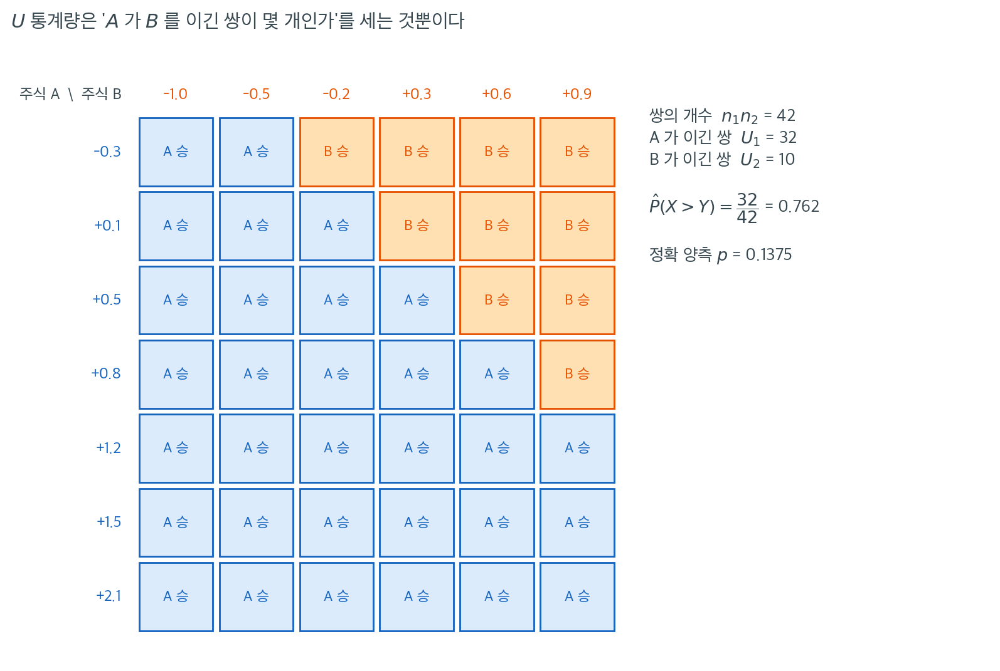
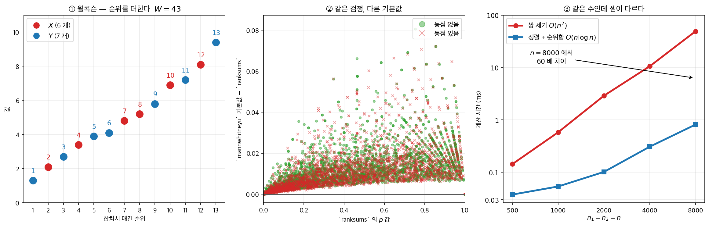
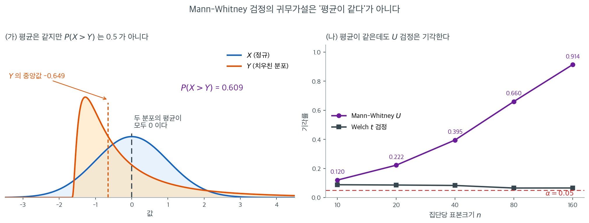

# Mann-Whitney U 검정

**Mann-Whitney U 검정**은 [Wilcoxon 순위합검정](rank_sum.md)의 다른 표현으로, 수학적으로 동치이면서 종종 더 직관적인 해석을 제공한다. 순위합검정이 한 집단의 순위합에 주목한다면, Mann-Whitney 검정은 한 집단의 관측값이 다른 집단의 관측값을 넘어서는 횟수를 센다. 이 개수, 즉 $U$ 통계량은 확률 $P(X > Y)$를 직접 추정하므로 검정에 분명한 확률적 의미를 부여한다.

---

## 1. 순위합검정과의 관계

$W$가 집단 1(표본크기 $n_1$)의 Wilcoxon 순위합통계량이면

$$
U_1 = W - \frac{n_1(n_1 + 1)}{2}
$$

이고

$$
U_2 = n_1 n_2 - U_1
$$

이다. Mann-Whitney $U$ 통계량은 $U = \min(U_1, U_2)$이다. 순위합검정과 Mann-Whitney 검정은 언제나 같은 $p$값을 낸다.

---

## 2. 직관: 쌍별 승수 세기

각 집단에서 하나씩 뽑아 만든 $n_1 \times n_2$개의 쌍 $(X_i, Y_j)$를 모두 생각하자. 다음을 정의한다.

$$
U_1 = \sum_{i=1}^{n_1} \sum_{j=1}^{n_2} \mathbf{1}(X_i > Y_j)
$$

이는 집단 1의 관측값이 집단 2의 관측값을 넘어서는 쌍의 개수이다. 반대로

$$
U_2 = \sum_{i=1}^{n_1} \sum_{j=1}^{n_2} \mathbf{1}(Y_j > X_i)
$$

이다. 동점이 없으면 $U_1 + U_2 = n_1 n_2$이다.

비율 $U_1 / (n_1 n_2)$는 확률 $P(X > Y)$를 추정한다. $H_0$(분포가 동일)에서 $P(X > Y) = 0.5$이므로 $U_1 \approx n_1 n_2 / 2$이다.



$U$가 하는 일은 문자 그대로 이것뿐이다. 보기 1의 자료로 격자를 채워 보자. 세로축이 주식 A의 수익률 $7$개, 가로축이 주식 B의 수익률 $6$개이고, 각 칸은 그 둘을 맞붙였을 때 누가 이겼는지를 나타낸다. 칸의 개수가 곧 $n_1 n_2 = 42$이다.

파란 칸(A 승)을 세면 $U_1 = 32$, 주황 칸(B 승)을 세면 $U_2 = 10$이다. 물론 $32 + 10 = 42$로 전체 칸수와 맞는다. 이 그림에서 **$U$는 순위합의 별명이 아니라 그 자체로 뜻이 있는 양**이라는 점이 드러난다. $\hat{P}(X > Y) = 32/42 = 0.762$는 "두 주식에서 무작위로 하루씩 골라 비교하면 A가 이길 확률이 약 $76\%$"라는 문장으로 바로 번역된다. 평균차나 $t$ 통계량에는 이런 번역이 없다.

격자의 모양도 정보를 준다. 아래 세 줄($+1.2$, $+1.5$, $+2.1$)은 전부 파랑이다. A의 상위 세 값이 B의 모든 값보다 크다는 뜻이다. 맨 윗줄($-0.3$)은 두 칸만 파랑이다. 계단 모양의 경계선이 오른쪽 아래로 내려갈수록 두 집단이 잘 분리된 것이고, 경계가 뒤엉킬수록 $U_1$이 $21$($= n_1 n_2 / 2$)에 가까워진다.

그런데 $76\%$라는 큰 효과에도 정확 양측 $p$값은 $0.1375$로 유의하지 않다. $42$개 칸이 독립인 $42$번의 관측이 아니라 **$13$개 관측값에서 파생된 것**이기 때문이다. $U$의 귀무 표준편차 $\sigma_U = \sqrt{7 \cdot 6 \cdot 14 / 12} = 7$이 그 종속성을 이미 반영하고 있으며, $U_1 = 32$는 기댓값 $21$에서 겨우 $1.57$ 표준편차 떨어져 있을 뿐이다. 효과크기가 커도 표본이 작으면 유의해지지 않는다는 흔한 교훈이 여기서도 그대로다.

<div class="storybox" markdown>

**그림으로 보는 통계학 1.** 두 사람이 같은 것을 다르게 보았다

$\S 1$ 과 $\S 2$ 는 같은 검정을 두 가지로 적었다 — 순위를 더하거나, 짝을 세거나. 그 둘은 **다른 사람이 다른 해에 따로 적은 것**이고, 제목만 보아도 두 사람이 같은 것을 보고 있지 않았음이 드러난다.

> **프랭크 윌콕슨** $(1945)$, 「**순위 방법에 의한 개별 비교**」, 『바이오메트릭스 불러틴』 $1$권 $6$호 $80$–$83$쪽.
>
> **헨리 만과 도널드 휘트니** $(1947)$, 「**두 확률변수 가운데 하나가 다른 쪽보다 확률적으로 큰지에 대한 검정**」, 『수리통계학 연보』 $18$권 $1$호 $50$–$60$쪽.

윌콕슨의 제목에는 **방법**이 적혀 있다 — 순위를 매겨 더하라. 만과 휘트니의 제목에는 **모수**가 적혀 있다 — $P(X > Y)$ 가 반을 넘는가. 네 쪽짜리 글과 열한 쪽짜리 글이고, 두 해 차이로 따로 나왔다.



**그런데 같은 수다.** 그림 ①은 위 $\S 1$ 과 같은 꼴의 작은 자료($X$ 여섯, $Y$ 일곱)를 합쳐서 순위를 매긴 것이다. 붉은 점의 순위를 더하면 $W = 43$ 이고, 같은 자료의 승패표를 세면 $U = 22$ 이며, $43 - 6\cdot 7/2 = 22$ 다. 우연이 아니라 항등식이다 — 무작위 자료 $5{,}000$ 벌(동점을 일부러 섞었다)에서 **깨진 경우가 한 벌도 없었다.**

**$p$ 값은 조심해야 한다.** 그림 ②는 `scipy` 의 두 함수를 $3{,}000$ 벌에 걸어 차이를 그린 것이다.

| | `ranksums` 대 `mannwhitneyu` |
|---|---|
| 동점 없음 · 연속성 보정 끔 | $0/3000$ 다름 (최대차 $4\times10^{-16}$) |
| 동점 있음 · 연속성 보정 끔 | $2{,}967/3000$ 다름 (최대차 $0.008$) |
| 기본값끼리 | $2{,}978/3000$ 다름 (최대차 $\mathbf{0.083}$) |

동점이 없고 연속성 보정을 끄면 **$3{,}000$ 벌이 기계오차까지 일치한다.** 두 글은 정말 같은 검정이다. 그런데 기본값끼리 견주면 거의 언제나 다르고 최대 $0.083$ 까지 벌어진다 — `mannwhitneyu` 는 연속성 보정을 켜 두고 `ranksums` 는 동점 보정을 하지 않기 때문이다. **두 함수가 다른 답을 내는 것은 검정이 달라서가 아니라 기본값이 달라서다.**

**두 얼굴은 지금도 각자 쓸모가 있다.** 그림 ③은 같은 수를 두 방식으로 구한 시간이다. $n = 8000$ 에서 짝을 세면 $46$ ms, 정렬해서 순위를 더하면 $0.69$ ms 로 **$67$ 배** 차이다. $O(n^2)$ 와 $O(n\log n)$ 의 차이이고, 표본이 커질수록 벌어진다. **셈은 윌콕슨이 이긴다.**

대신 **뜻은 만–휘트니가 이긴다.** 아래 $\S 8$ 이 적듯 $U_1/(n_1n_2)$ 가 그대로 $\hat P(X > Y)$ 이고, 그 문장은 순위합에서 바로 읽히지 않는다. 위 $\S 2$ 가 "$U$ 는 순위합의 별명이 아니라 그 자체로 뜻이 있는 양"이라 한 것이 그 말이다.

두 글이 얼마나 가까웠는지는 그 뒤로도 정리할 거리가 되어서, 윌리엄 크러스컬이 $1957$ 년에 「**윌콕슨 비대응 이표본 검정에 대한 역사적 각주**」를 『미국통계학회지』($52$권 $356$–$360$쪽)에 따로 실었다. 같은 검정의 내력을 정리하는 데 논문 한 편이 들었다는 뜻이다.

_확인한 곳 — 세 논문의 서지(제목·저자·학술지·연도·권호·쪽)를 Crossref 에서 확인했다. 윌콕슨 $(1945)$ 『바이오메트릭스 불러틴』 $1(6)$:$80$, 만·휘트니 $(1947)$ 『수리통계학 연보』 $18(1)$:$50$–$60$, 크러스컬 $(1957)$ 『미국통계학회지』 $52$:$356$–$360$. 크러스컬 논문은 제목만 확인했고 내용은 읽지 않았다. 그림과 표의 수는 모두 직접 계산한 값이다_

</div>

---

## 3. 가설

$$
H_0 \colon P(X > Y) = 0.5 \quad \text{(두 분포가 동일하다)}
$$

$$
H_a \colon P(X > Y) \ne 0.5 \quad \text{(양측)}
$$

단측 대립가설: $H_a \colon P(X > Y) > 0.5$(집단 1이 큰 경향) 또는 $P(X > Y) < 0.5$.

### 평균이 같은데도 기각한다

이 검정을 「이표본 $t$ 검정의 비모수판」이라 소개하면 $H_0$ 도 「두 평균이 같다」일
것 같지만 **그렇지 않다.** 그 차이가 실제로 결론을 뒤집는다.



여기서 반드시 짚어야 할 것이 있다. Mann-Whitney 검정을 "이표본 $t$ 검정의 비모수판"이라고 소개하면 $H_0$도 "두 평균이 같다"일 것 같지만 **그렇지 않다.** 그 차이가 실제로 결론을 뒤집는 상황이 아래 그림이다.

(가)의 두 분포는 **평균이 둘 다 정확히 $0$이다.** 파란 $X$는 표준정규이고, 주황 $Y$는 로그정규분포에서 평균을 빼 중심을 맞춘 것이다. 그런데 $Y$는 왼쪽에 봉우리가 있고 오른쪽으로 긴 꼬리를 끄는 모양이라 중앙값이 $-0.649$로 훨씬 아래에 있다. 이 상태에서 두 분포에서 하나씩 뽑아 비교하면 $X$가 이길 확률이 $P(X > Y) = 0.609$로 $0.5$가 아니다. **$Y$는 가끔 아주 크지만 대부분의 날에는 $X$보다 작다.**

(나)가 그 결과다. 표본크기를 $10$에서 $160$까지 늘리며 기각률을 재면 Mann-Whitney는 $0.120 \to 0.222 \to 0.395 \to 0.660 \to 0.914$로 올라간다. 평균이 같은 자료인데 $n = 160$이면 $91\%$의 확률로 기각한다. 반면 Welch $t$ 검정은 $0.088 \to 0.086 \to 0.083 \to 0.065 \to 0.066$으로 명목수준 근처에 머문다. **두 검정이 다른 가설을 검정하고 있으므로 둘 다 옳다.**

실무적 결론은 명확하다. Mann-Whitney 검정이 유의하게 나왔을 때 "평균이 다르다"거나 "중앙값이 다르다"고 보고하면 틀릴 수 있다. 정확한 서술은 **"한 집단이 다른 집단보다 확률적으로 크다", 즉 $P(X > Y) \ne 0.5$**이며, 이것을 중앙값 비교로 읽으려면 두 분포의 모양이 같다는 위치이동 가정을 따로 정당화해야 한다. 효과크기로 $\hat{P}(X>Y) = U_1/(n_1 n_2)$를 함께 보고하면 이 혼동을 애초에 피할 수 있다.

---

---

## 4. 검정통계량

검정통계량은

$$
U = \min(U_1, U_2)
$$

이다. $U$가 작으면 두 집단의 차이가 크다는 뜻이다.

---

## 5. 귀무분포

$H_0$ 아래에서 $U_1$의 평균과 분산은

$$
\mu_U = \frac{n_1 \, n_2}{2}
$$

$$
\sigma_U^2 = \frac{n_1 \, n_2 \,(n_1 + n_2 + 1)}{12}
$$

이다. 합친 표본(크기 $N = n_1 + n_2$)에 크기 $t_1, \ldots, t_g$인 동점 집단이 $g$개 있을 때의 동점 보정은

$$
\sigma_U^2 = \frac{n_1 \, n_2}{12}\left(N + 1 - \frac{\sum_{j=1}^{g}(t_j^3 - t_j)}{N(N - 1)}\right)
$$

이다.

---

## 6. 정규근사

$n_1, n_2 \ge 10$이면

$$
Z = \frac{U_1 - \mu_U}{\sigma_U}
$$

이 $H_0$ 아래 근사적으로 $\mathcal{N}(0, 1)$을 따른다.

<div class="exbox" markdown>

**보기 1.** <span class="diff easy" title="쉬움"></span> 두 주식의 일별 수익률 비교. 한 투자자가 두 주식의 일별 수익률(%)을 각각 7거래일과 6거래일에 걸쳐 비교한다.

**주식 A** ($n_1 = 7$): 1.2, 0.5, $-0.3$, 2.1, 0.8, 1.5, 0.1

**주식 B** ($n_2 = 6$): $-0.5$, 0.3, $-1.0$, 0.6, $-0.2$, 0.9

</div>

??? success "풀이"
    **1단계.** $7 \times 6 = 42$개의 쌍을 만들어 주식 A의 수익률이 주식 B의 수익률을 넘어서는 횟수를 센다.

    정렬한 주식 A: $-0.3, 0.1, 0.5, 0.8, 1.2, 1.5, 2.1$

    정렬한 주식 B: $-1.0, -0.5, -0.2, 0.3, 0.6, 0.9$

    주식 A의 각 값에 대해 그보다 작은 주식 B 값의 개수를 센다.

    | 주식 A | 넘어선 주식 B 값 | 개수 |
    |:-------:|:-----------------------:|:-----:|
    | $-0.3$ | $-1.0, -0.5$ | 2 |
    | 0.1 | $-1.0, -0.5, -0.2$ | 3 |
    | 0.5 | $-1.0, -0.5, -0.2, 0.3$ | 4 |
    | 0.8 | $-1.0, -0.5, -0.2, 0.3, 0.6$ | 5 |
    | 1.2 | $-1.0, -0.5, -0.2, 0.3, 0.6, 0.9$ | 6 |
    | 1.5 | 6개 모두 | 6 |
    | 2.1 | 6개 모두 | 6 |

    $$
    U_1 = 2 + 3 + 4 + 5 + 6 + 6 + 6 = 32
    $$

    $$
    U_2 = 42 - 32 = 10
    $$

    **2단계.** 확률 추정: $\hat{P}(X > Y) = 32/42 \approx 0.762$.

    **3단계.** 정규근사:

    $$
    \mu_U = \frac{7 \times 6}{2} = 21
    $$

    $$
    \sigma_U = \sqrt{\frac{7 \times 6 \times 14}{12}} = \sqrt{49} = 7
    $$

    $$
    Z = \frac{32 - 21}{7} \approx 1.571
    $$

    $$
    p = 2\,\Phi(-1.571) \approx 0.116
    $$

    $\alpha = 0.05$에서 $H_0$을 기각하지 못한다. 주식 A의 수익률이 높은 경향이 있지만(쌍별 비교의 76.2%), 표본이 작아 5% 수준에서 충분한 증거가 되지 못한다.

    !!! note "정확 $p$값"
        $n_1 = 7$, $n_2 = 6$에서 정확 양측 $p$값은 $0.1375$로 정규근사값 $0.1161$보다 18% 크다. 참고로 이표본 $t$ 검정은 $p = 0.0829$를 준다.

        ```python
        from scipy import stats
        A = [1.2, 0.5, -0.3, 2.1, 0.8, 1.5, 0.1]
        B = [-0.5, 0.3, -1.0, 0.6, -0.2, 0.9]
        print(stats.mannwhitneyu(A, B, method='exact').pvalue)   # 0.13753
        print(stats.ttest_ind(A, B).pvalue)                      # 0.08286
        ```

        출력:

        ```
        0.13752913752913754
        0.08286060062100548
        ```

        세 값 모두 $\alpha = 0.05$에서 기각하지 않으므로 결론은 같다.

### 정확 p-값의 분자를 세어 본다

<div class="exbox" markdown>

**보기 2.** <span class="diff easy" title="쉬움"></span> 정확 p-값의 분자를 세어 본다. 두 교수법의 시험 점수가 집단 $A = (85, 78, 92, 88, 76, 95, 89, 82, 91, 87)$, 집단 $B = (72, 68, 81, 75, 70, 77, 74, 69, 73, 71)$ 로 각각 10개다. `scipy` 가 $U = 97$, $p = 0.000440$ 을 준다.

**(1)** 순위를 매겨 $R_1$, $U_1$, $U_2$ 를 손으로 구하고 $U_1 + U_2 = n_1 n_2$ 와 평균순위를 확인하시오. `scipy` 가 돌려준 $97$ 은 위 4단계의 $U = \min(U_1, U_2)$ 와 같은가.

**(2)** 동점이 하나도 없으므로 귀무분포를 **전수 열거**할 수 있다. 정확 양측 p-값을 분수로 적고, 정규근사가 왜 이 자리에서 여섯 배나 어긋나는지 말하시오.

</div>

??? success "풀이"

    **(1) 순위와 $U$.** 20개를 합쳐 늘어놓으면 동점이 하나도 없다.

    | 값 | 68 | 69 | 70 | 71 | 72 | 73 | 74 | 75 | 76 | 77 |
    |---|---|---|---|---|---|---|---|---|---|---|
    | 순위 | 1 | 2 | 3 | 4 | 5 | 6 | 7 | 8 | 9 | 10 |
    | 집단 | B | B | B | B | B | B | B | B | **A** | B |

    | 값 | 78 | 81 | 82 | 85 | 87 | 88 | 89 | 91 | 92 | 95 |
    |---|---|---|---|---|---|---|---|---|---|---|
    | 순위 | 11 | 12 | 13 | 14 | 15 | 16 | 17 | 18 | 19 | 20 |
    | 집단 | **A** | B | **A** | **A** | **A** | **A** | **A** | **A** | **A** | **A** |

    집단 $A$ 의 순위는 $9, 11, 13, 14, 15, 16, 17, 18, 19, 20$ 이므로

    $$
    R_1 = 152, \qquad R_2 = 210 - 152 = 58
    $$

    이고(검산: $R_1 + R_2 = N(N+1)/2 = 210$),

    $$
    U_1 = R_1 - \frac{n_1(n_1+1)}{2} = 152 - 55 = 97,
    \qquad
    U_2 = R_2 - \frac{n_2(n_2+1)}{2} = 58 - 55 = 3
    $$

    다. **검산은 $U_1 + U_2 = n_1 n_2$ 다**: $97 + 3 = 100 = 10 \times 10$. $\checkmark$ 평균순위는 $152/10 = 15.2$ 와 $58/10 = 5.8$ 이고 전체 평균순위 $(N+1)/2 = 10.5$ 를 사이에 둔다.

    **`scipy` 가 돌려준 $97$ 은 $U_1$ 이고 $\min(U_1, U_2) = 3$ 이 아니다.** `mannwhitneyu(x, y)` 는 늘 **첫 인수의** $U$ 를 준다. 양측검정에서는 어느 쪽을 쓰든 p-값이 같으므로 결론에 영향이 없지만, 효과크기를 읽을 때는 방향이 뒤집힌다. 여기서는 $\hat P(A > B) = U_1/(n_1n_2) = 0.97$ 이다 — **100 쌍 가운데 97 쌍에서 $A$ 가 이긴다.**

    **(2) 전수 열거.** $H_0$ 아래에서 집단 $A$ 가 받는 순위는 $\{1,\dots,20\}$ 의 크기 10 부분집합 가운데 아무 것이나 같은 확률이다. 그런 부분집합은

    $$
    \binom{20}{10} = 184{,}756
    $$

    개다. $\operatorname{E}[U] = n_1n_2/2 = 50$ 이고 관측된 치우침은 $\lvert 97 - 50 \rvert = 47$ 이다. 이만큼 또는 더 치우친 부분집합을 세면 **14개뿐**이다.

    $$
    p_{\text{정확}} = \frac{14}{184{,}756} = 7.5776 \times 10^{-5}
    $$

    정규근사는 $\operatorname{Var}(U) = n_1n_2(N+1)/12 = 100 \times 21/12 = 175$, $\sigma = 13.228757$ 에서

    $$
    z = \frac{47 - 0.5}{13.228757} = 3.515070
    \implies p = 2\Phi(-3.515070) = 4.3964 \times 10^{-4}
    $$

    로 **정확값의 5.8배**다. 까닭은 관측값이 귀무분포의 **극단 꼬리**에 있기 때문이다. $U$ 가 가질 수 있는 값은 $0$ 부터 $100$ 까지이고 관측값 $97$ 은 거의 끝이다. 정규분포는 중앙부에서 잘 맞고 꼬리로 갈수록 **상대오차**가 커진다. 다만 **절대오차는 $0.00036$ 으로 작다** — 어느 쪽을 쓰든 "$p < 0.001$" 이라는 결론은 같다. 자세한 이야기는 아래 연습문제 4 에 있다.

    **수치적으로.**

    ```python
    import numpy as np
    from scipy.stats import mannwhitneyu, rankdata

    # 두 교수법의 시험 점수를 견준다.
    group_a = np.array([85, 78, 92, 88, 76, 95, 89, 82, 91, 87])
    group_b = np.array([72, 68, 81, 75, 70, 77, 74, 69, 73, 71])

    # Mann-Whitney U 는 이표본 t 검정의 비모수 대응이다. 귀무가설이 "두 평균이
    # 같다"가 아니라 "무작위로 뽑은 A 가 B 보다 클 확률이 1/2"이라는 점에 주의한다.
    stat, p_value = mannwhitneyu(group_a, group_b, alternative='two-sided')

    print(f"U statistic: {stat}")        # 97.0
    print(f"P-value: {p_value:.6f}")     # 0.000440  (asymptotic)

    # 표본이 작고 동점이 없으면 정확분포를 쓸 수 있다. 근사값과 꽤 갈린다.
    print(mannwhitneyu(group_a, group_b, method='exact').pvalue)   # 7.58e-05

    # 유의하다는 결론이 났을 때 어느 쪽이 큰지는 평균순위로 말한다.
    # 동점에 중간순위를 주려면 argsort 가 아니라 rankdata 를 써야 한다.
    combined = np.concatenate([group_a, group_b])
    ranks = rankdata(combined)
    mean_rank_a = ranks[:len(group_a)].mean()
    mean_rank_b = ranks[len(group_a):].mean()
    print(f"Mean rank Group A: {mean_rank_a:.1f}")   # 15.2
    print(f"Mean rank Group B: {mean_rank_b:.1f}")   # 5.8

    alpha = 0.05
    if p_value < alpha:
        print("Reject H0: Significant difference between groups.")
        if mean_rank_a > mean_rank_b:
            print("Group A tends to have larger values.")
        else:
            print("Group B tends to have larger values.")
    else:
        print("Fail to reject H0.")
    ```

    출력:

    ```
    U statistic: 97.0
    P-value: 0.000440
    7.577561757128321e-05
    Mean rank Group A: 15.2
    Mean rank Group B: 5.8
    Reject H0: Significant difference between groups.
    Group A tends to have larger values.
    ```

    ```python
    import itertools
    import math
    from scipy import stats

    n1, n2 = len(group_a), len(group_b)
    N = n1 + n2
    R1, R2 = ranks[:n1].sum(), ranks[n1:].sum()
    U1 = R1 - n1 * (n1 + 1) / 2
    U2 = R2 - n2 * (n2 + 1) / 2
    print(f"R1 = {R1},  R2 = {R2},  합 = {R1 + R2}  (N(N+1)/2 = {N * (N + 1) / 2})")
    print(f"U1 = {U1},  U2 = {U2},  합 = {U1 + U2}  (n1*n2 = {n1 * n2})")
    print(f"min(U1, U2) = {min(U1, U2)}   <- scipy 가 돌려준 것은 U1 = {stat}")
    print(f"P(A > B) 추정 = U1/(n1 n2) = {U1 / (n1 * n2)}")

    # 귀무분포를 전수 열거한다. C(20, 10) = 184756 가지뿐이다.
    total = math.comb(N, n1)
    Us = np.array([sum(c) for c in itertools.combinations(range(1, N + 1), n1)]) \
         - n1 * (n1 + 1) / 2
    E = n1 * n2 / 2
    V = n1 * n2 * (N + 1) / 12
    hit = int((np.abs(Us - E) >= abs(U1 - E)).sum())
    print(f"\n열거한 가지 수 {total},  평균 {Us.mean()},  분산 {Us.var()}"
          f"  (공식: {E}, {V})")
    print(f"|U - {E:.0f}| >= {abs(U1 - E):.0f} 인 것 {hit} 개"
          f"  ->  정확 p = {hit}/{total} = {hit / total:.6e}")
    print(f"scipy method='exact' : {mannwhitneyu(group_a, group_b, method='exact').pvalue:.6e}")

    z = (abs(U1 - E) - 0.5) / np.sqrt(V)
    print(f"\nsigma = {np.sqrt(V):.6f},  z = {z:.6f},"
          f"  정규근사 p = {2 * stats.norm.sf(z):.6e}")
    print(f"근사/정확 = {2 * stats.norm.sf(z) / (hit / total):.2f} 배,"
          f"  절대차 = {2 * stats.norm.sf(z) - hit / total:.6f}")
    ```

    출력:

    ```
    R1 = 152.0,  R2 = 58.0,  합 = 210.0  (N(N+1)/2 = 210.0)
    U1 = 97.0,  U2 = 3.0,  합 = 100.0  (n1*n2 = 100)
    min(U1, U2) = 3.0   <- scipy 가 돌려준 것은 U1 = 97.0
    P(A > B) 추정 = U1/(n1 n2) = 0.97

    열거한 가지 수 184756,  평균 50.0,  분산 175.0  (공식: 50.0, 175.0)
    |U - 50| >= 47 인 것 14 개  ->  정확 p = 14/184756 = 7.577562e-05
    scipy method='exact' : 7.577562e-05
    
    sigma = 13.228757,  z = 3.515070,  정규근사 p = 4.396388e-04
    근사/정확 = 5.80 배,  절대차 = 0.000364
    ```

    **열거한 귀무분포의 평균 $50$ 과 분산 $175$ 가 공식과 정확히 같고, $14/184756$ 이 `scipy` 의 정확 p-값과 같다.** 분자가 14 라는 것은 뜻이 분명하다 — $A$ 의 열 명이 이만큼 윗자리를 차지하는 배치가 18만 여 가지 가운데 열네 가지뿐이라는 것이다. 정규근사는 $5.80$ 배 크게 보고하지만 절대차가 $0.00036$ 이므로 결론은 흔들리지 않는다.

    남는 교훈은 **`scipy` 가 $\min(U_1,U_2)$ 가 아니라 $U_1$ 을 준다**는 것이다. 위 4단계의 관례와 다르다. 양측 p-값은 같으니 검정 결과는 안전하지만, $U/(n_1n_2)$ 를 효과크기로 보고할 때 어느 집단을 첫 인수로 넣었는지 확인하지 않으면 $0.97$ 과 $0.03$ 을 뒤바꿔 적게 된다.

!!! warning "`argsort(argsort(x))`는 동점을 처리하지 못한다"
    순위를 구할 때 `np.argsort(np.argsort(x)) + 1`을 쓰는 코드를 흔히 본다. 동점이 없으면 맞지만, 동점이 있으면 **중간순위 대신 임의의 순서**를 배정한다.

    ```python
    import numpy as np
    from scipy.stats import rankdata
    x = np.array([3, 1, 3, 2])
    print(np.argsort(np.argsort(x)) + 1)   # [3 1 4 2]  ← 두 3에 3과 4를 배정
    print(rankdata(x))                     # [3.5 1.  3.5 2. ]  ← 올바른 중간순위
    ```

    출력:

    ```
    [3 1 4 2]
    [3.5 1.  3.5 2. ]
    ```

    항상 `scipy.stats.rankdata`를 쓴다.

---

---

## 7. 동점 처리

두 집단 사이에 동점 관측값이 있으면 각 동점이 쌍별 비교 개수에 0이나 1이 아니라 0.5를 기여한다.

$$
U_1 = \sum_{i=1}^{n_1} \sum_{j=1}^{n_2} \left[\mathbf{1}(X_i > Y_j) + \tfrac{1}{2}\,\mathbf{1}(X_i = Y_j)\right]
$$

이때 정규근사에는 위에서 제시한 동점 보정 분산 공식을 써야 한다.

### 동점 보정과 연속성 보정

<div class="exbox" markdown>

**보기 3.** <span class="diff easy" title="쉬움"></span> 동점 보정과 연속성 보정, 어느 쪽이 크게 움직이는가. 크기 $m = 16$, $n = 15$ 인 두 집단에 동점이 섞여 있다. `mannwhitneyu` 의 기본값이 $U = 49$, $p = 0.0053$을 준다.

**(1)** 동점이 있으면 `method="auto"` 가 정확검정을 쓰지 못하고 정규근사로 넘어간다. 동점 보정 분산과 연속성 보정을 손으로 넣어 $p = 0.0053$을 재현하시오.

**(2)** 두 보정을 하나씩 빼면 p-값이 각각 얼마나 움직이는가. 어느 쪽이 큰 몫을 하며 그 까닭은 무엇인가.

</div>

??? success "풀이"

    **(1) 정규근사를 손으로 세운다.** $N = 16 + 15 = 31$ 이고 `data0` 의 순위합은 $W = 185$, 따라서

    $$
    U = W - \frac{m(m+1)}{2} = 185 - \frac{16 \times 17}{2} = 185 - 136 = 49
    $$

    다. $H_0$ 아래에서

    $$
    \operatorname{E}[U] = \frac{mn}{2} = \frac{16 \times 15}{2} = 120
    $$

    이고, 동점이 없으면 $\operatorname{Var}(U) = mn(N+1)/12 = 16 \times 15 \times 32/12 = 640$ 이다. **동점이 있으면 중간순위가 값을 뭉치면서 분산이 줄어든다.** 크기 $t_j$ 인 동점 묶음마다

    $$
    \operatorname{Var}(U) = \frac{mn}{12}\left[(N+1) - \frac{\sum_j (t_j^3 - t_j)}{N(N-1)}\right]
    $$

    를 쓴다. 이 자료의 동점은 $14$ 가 두 개, $31$ 이 세 개(`data0` 에 둘, `data1` 에 하나), $43$ 이 두 개다.

    $$
    \sum_j (t_j^3 - t_j) = (8 - 2) + (27 - 3) + (8 - 2) = 6 + 24 + 6 = 36
    $$

    $$
    \operatorname{Var}(U) = 20\left[32 - \frac{36}{31 \times 30}\right] = 20\,(32 - 0.038710) = 639.225806,
    \quad \sigma = 25.282915
    $$

    연속성 보정은 중심까지의 거리에서 격자 반 칸을 깎는다.

    $$
    z = \frac{49 - 120 + 0.5}{25.282915} = \frac{-70.5}{25.282915} = -2.788444
    \implies p = 2\Phi(-2.788444) = 0.005296186
    $$

    **`scipy` 가 준 $0.0052961860870385$와 같다.**

    **(2) 두 보정을 하나씩 뺀다.**

    | 쓴 것 | $\sigma$ | $z$ | 양측 $p$ |
    |---|---|---|---|
    | 동점 + 연속성 (기본값) | 25.282915 | $-2.788444$ | 0.0052962 |
    | 동점만 (`use_continuity=False`) | 25.282915 | $-2.808220$ | 0.0049816 |
    | 연속성만 (동점 보정 없음) | 25.298221 | $-2.786757$ | 0.0053238 |

    두 보정은 **방향이 반대**다. 동점 보정은 분산을 줄여 $\lvert z \rvert$ 를 키우고 p-값을 **작게** 하며, 연속성 보정은 거리를 깎아 p-값을 **크게** 한다. 몫의 크기는

    $$
    \underbrace{0.0052962 - 0.0049816 = 0.0003146}_{\text{연속성 보정}},
    \qquad
    \underbrace{0.0052962 - 0.0053238 = -0.0000276}_{\text{동점 보정}}
    $$

    로 **연속성 보정이 열한 배 크다.** 동점 보정이 작은 까닭은 분산 안에서 차지하는 몫이 작기 때문이다. $\sum(t_j^3-t_j)/[N(N-1)] = 36/930 = 0.0387$ 은 $N + 1 = 32$ 의 **0.12%** 밖에 되지 않는다. 동점이 31개 가운데 일곱 개뿐이고 묶음도 크기 2, 3 짜리로 작은 자료에서는 그렇다. **동점 보정이 결론을 바꾸려면 묶음이 커야 한다** — $t_j^3$ 이므로 크기 10 짜리 묶음 하나가 크기 2 짜리 묶음 165 개와 맞먹는다.

    **수치적으로.**

    ```python
    from scipy import stats

    data0 = [10, 14, 14, 18, 20, 22, 24, 25, 31, 31, 32, 39, 43, 43, 48, 49]
    data1 = [28, 30, 31, 33, 34, 35, 36, 40, 44, 55, 57, 61, 91, 92, 99]

    # 크기가 다른 두 집단이어도 상관없다. 순위만 쓰기 때문이다.
    stat, p = stats.mannwhitneyu(data0, data1)
    print(f"U = {stat}, p = {p:.2%}")
    # U = 49.0, p = 0.53%
    ```

    출력:

    ```
    U = 49.0, p = 0.53%
    ```

    ```python
    import numpy as np
    from collections import Counter

    m, n = len(data0), len(data1)
    N = m + n
    combined = data0 + data1
    W = stats.rankdata(combined)[:m].sum()
    U = W - m * (m + 1) / 2
    mu = m * n / 2
    counts = Counter(combined)
    tie = sum(t ** 3 - t for t in counts.values())
    print(f"W = {W},  U = W - m(m+1)/2 = {U},  E[U] = {mu}")
    print(f"동점 묶음 {dict((k, v) for k, v in sorted(counts.items()) if v > 1)}"
          f"  ->  sum(t^3-t) = {tie}")

    V_tie = m * n / 12 * ((N + 1) - tie / (N * (N - 1)))
    V_plain = m * n * (N + 1) / 12
    print(f"Var(U) 동점보정 = {V_tie:.6f} (sigma {np.sqrt(V_tie):.6f}),"
          f"  보정없음 = {V_plain} (sigma {np.sqrt(V_plain):.6f})")
    print(f"동점항 / (N+1) = {tie / (N * (N - 1)) / (N + 1):.6%}")

    for label, V, cc in (("동점 + 연속성", V_tie, 0.5),
                         ("동점만        ", V_tie, 0.0),
                         ("연속성만      ", V_plain, 0.5)):
        z = (U - mu + cc) / np.sqrt(V)
        print(f"  {label}: z = {z:9.6f},  p = {2 * stats.norm.cdf(z):.7f}")
    print(f"  scipy 기본값             : p = {p:.7f}")
    print(f"  scipy use_continuity=False: "
          f"p = {stats.mannwhitneyu(data0, data1, use_continuity=False).pvalue:.7f}")
    ```

    출력:

    ```
    W = 185.0,  U = W - m(m+1)/2 = 49.0,  E[U] = 120.0
    동점 묶음 {14: 2, 31: 3, 43: 2}  ->  sum(t^3-t) = 36
    Var(U) 동점보정 = 639.225806 (sigma 25.282915),  보정없음 = 640.0 (sigma 25.298221)
    동점항 / (N+1) = 0.120968%
      동점 + 연속성: z = -2.788444,  p = 0.0052962
      동점만        : z = -2.808220,  p = 0.0049816
      연속성만      : z = -2.786757,  p = 0.0053238
      scipy 기본값             : p = 0.0052962
      scipy use_continuity=False: p = 0.0049816
    ```

    **손으로 세운 세 값이 `scipy` 의 두 설정과 모두 맞는다.** 어느 보정을 쓰든 $p \approx 0.0053$ 이 $0.01$ 아래이므로 결론이 흔들리지 않는다.

    다만 **두 보정의 몫이 어디서 오는지는 서로 다르다.** 연속성 보정이 주는 상대변화는 $0.5/\lvert U - \operatorname{E}[U]\rvert$ 로 **치우침의 크기**가 결정하고, 동점 보정이 주는 상대변화는 $\sum(t_j^3-t_j)/[N(N-1)(N+1)]$ 로 **동점 묶음의 크기**가 결정한다. 이 자료는 묶음이 크기 2, 3 짜리뿐이라 뒤쪽이 0.12% 로 작았다. 눈금이 거친 자료 — 리커트 5점 척도처럼 서로 다른 값이 몇 개뿐인 자료 — 에서는 묶음이 $N$ 에 비례해 커지므로 동점 보정이 훨씬 큰 몫을 하게 된다. **어느 보정이 중요한지는 자료를 보고 판단해야 하며, 이 쪽의 결론을 다른 자료로 옮겨 적용하지 말아야 한다.**

---

---

## 8. 효과크기

**공통언어 효과크기**(common language effect size)는 곧 확률 추정값이다.

$$
\hat{P}(X > Y) = \frac{U_1}{n_1 n_2}
$$

$0.5$에 가까우면 효과가 없다는 뜻이고, $0$이나 $1$에 가까우면 강한 확률적 우월을 뜻한다.

### 분류기를 평가할 때 쓰는 그 수다

이 분수를 기계학습에서는 다른 이름으로 부른다. 19.3절 [ROC 곡선과 AUC](../../ch19/evaluation/roc_auc.md)의
**AUC 가 바로 이것이다** — 거기서는 $n_1$을 양성, $n_2$를 음성의 개수라 하고 같은 값을
$\text{AUC} = U_1/(n_1 n_2)$로 적는다. 이름이 둘인 까닭은 쓰는 자리가 다를 뿐이다. 여기서는
두 집단의 위치가 다른지 **검정**하려고 $U_1$을 세고, 거기서는 한 분류기가 양성을 음성보다
높게 매기는지 **재려고** 같은 것을 센다.

같은 수이므로 이 쪽에서 세운 것이 그대로 간다. AUC 에 대한 검정은 순위합검정과 같은 검정이고,
5절의 귀무분포와 6절의 정규근사가 그 검정의 p-값을 준다. 7절에서 동점을 $\tfrac{1}{2}$로 센
것도 그쪽에서 ROC 곡선이 대각선으로 가는 구간을 사다리꼴로 세는 일과 같다. 반대 방향도
참이다 — AUC 가 점수에 증가함수를 씌워도 변하지 않는 까닭은 $U_1$ 이 **순위만 보기** 때문이다.

---

## 연습문제

<div class="drillbox" markdown>

**연습문제 1.** <span class="diff easy" title="쉬움"></span>
한 연구자가 독립인 두 집단의 반응시간(밀리초)을 비교한다.

- **집단 A** (카페인): 210, 230, 215, 240, 225
- **집단 B** (위약): 250, 260, 235, 270, 245, 255

**(a)** 두 집단을 합쳐 모든 관측값에 작은 값부터 순위를 매겨라.

**(b)** 집단 A의 순위합 $R_A$를 계산하고, 이어서 집단 A의 Mann-Whitney $U$ 통계량을 계산하라.

$$
U_A = R_A - \frac{n_A(n_A + 1)}{2}
$$

**(c)** $E[U] = n_A n_B / 2$, $\text{Var}(U) = n_A n_B (n_A + n_B + 1)/12$인 정규근사로 $z$ 통계량과 양측 $p$값을 계산하라.

**(d)** 연구 맥락에서 결과를 해석하라.

</div>

??? success "풀이"

    **(a)** 합쳐서 정렬하면

    | 값 | 집단 | 순위 |
    |:---:|:---:|:---:|
    | 210 | A | 1 |
    | 215 | A | 2 |
    | 225 | A | 3 |
    | 230 | A | 4 |
    | 235 | B | 5 |
    | 240 | A | 6 |
    | 245 | B | 7 |
    | 250 | B | 8 |
    | 255 | B | 9 |
    | 260 | B | 10 |
    | 270 | B | 11 |

    **(b)** $n_A = 5$, $n_B = 6$이고 $R_A = 1 + 2 + 3 + 4 + 6 = 16$이다.

    $$
    U_A = R_A - \frac{n_A(n_A + 1)}{2} = 16 - \frac{5 \times 6}{2} = 16 - 15 = 1
    $$

    $U_A$가 작다는 것은 집단 A의 관측값이 낮은 순위(빠른 반응시간)에 몰려 있다는 뜻이다.

    **(c)**

    $$
    E[U] = \frac{n_A n_B}{2} = \frac{5 \times 6}{2} = 15
    $$

    $$
    \text{Var}(U) = \frac{n_A n_B(n_A + n_B + 1)}{12} = \frac{5 \times 6 \times 12}{12} = 30
    $$

    $$
    z = \frac{U_A - E[U]}{\sqrt{\text{Var}(U)}} = \frac{1 - 15}{\sqrt{30}} = \frac{-14}{5.477} \approx -2.556
    $$

    양측 $p$값은

    $$
    p = 2 \times P(Z \le -2.556) = 2 \times \Phi(-2.556) \approx 2 \times 0.0053 = 0.0106
    $$

    정확 $p$값은 $0.00866$으로 근사값보다 조금 작다.

    ```python
    from scipy import stats
    a = [210, 230, 215, 240, 225]; b = [250, 260, 235, 270, 245, 255]
    p_u = stats.mannwhitneyu(a, b, alternative='two-sided', method='exact').pvalue
    p_t = stats.ttest_ind(a, b, equal_var=True).pvalue
    print(f"Mann-Whitney 정확 p = {p_u:.6f}")
    print(f"이표본 t 검정   p = {p_t:.6f}")
    ```

    출력:

    ```text
    Mann-Whitney 정확 p = 0.008658
    이표본 t 검정   p = 0.003593
    ```

    **(d)** $p \approx 0.009 < 0.05$이므로 5% 수준에서 $H_0$을 기각한다. 카페인군과 위약군의 반응시간 분포가 다르다는 통계적으로 유의한 증거가 있다. 카페인군의 반응시간이 더 빠른 경향을 보이며 이는 카페인의 각성 효과와 일관된다.

    다만 $U_A = 1$이라는 것은 $30$개의 쌍별 비교 중 **단 하나**에서만 A가 B보다 느렸다는 뜻이다($240 > 235$). 거의 완전한 분리이며, 이런 자료에서는 $n = 5, 6$이라는 작은 표본으로도 유의성에 도달한다. $U_A = 0$(완전 분리)이면 정확 $p$값이 $2/462 = 0.0043$으로 이 표본크기의 최솟값이 된다.

<div class="drillbox" markdown>

**연습문제 2.** <span class="diff med" title="중간"></span>
$U_1 = W_A - n_A(n_A+1)/2$가 왜 $X_i > Y_j$인 쌍의 개수와 같은지 증명하라.

</div>

??? success "풀이"
    집단 A의 관측값 $X_{(1)} < X_{(2)} < \cdots < X_{(n_1)}$을 정렬했다고 하자(동점 없음 가정). 합친 표본에서 $X_{(k)}$의 순위 $R_{(k)}$는 $X_{(k)}$보다 작거나 같은 관측값의 개수이다. 이 개수는 두 부분으로 나뉜다.

    - 집단 A 안에서 $X_{(k)}$ 이하인 것: 정확히 $k$개(자신 포함).
    - 집단 B 안에서 $X_{(k)}$보다 작은 것: 이를 $c_k$라 하자.

    따라서 $R_{(k)} = k + c_k$이고

    $$
    W_A = \sum_{k=1}^{n_1} R_{(k)} = \sum_{k=1}^{n_1} k + \sum_{k=1}^{n_1} c_k
    = \frac{n_1(n_1+1)}{2} + \sum_{k=1}^{n_1} c_k
    $$

    이다. 그런데 $\sum_k c_k$는 정확히 $X_i > Y_j$인 쌍 $(i, j)$의 개수이다. 각 $X_{(k)}$에 대해 그보다 작은 $Y_j$를 모두 센 뒤 더한 것이기 때문이다. 그러므로

    $$
    U_1 = W_A - \frac{n_1(n_1+1)}{2} = \sum_{k=1}^{n_1} c_k = \#\{(i,j) : X_i > Y_j\} \quad \square
    $$

    본문 보기로 확인해 보자. 표에서 "넘어선 개수" 열이 바로 $c_k = (2, 3, 4, 5, 6, 6, 6)$이고 합이 $32$이다. 한편 정렬한 주식 A의 순위는 $(3, 5, 7, 9, 11, 12, 13)$이고 $W_A = 60$이며, $60 - 7 \times 8/2 = 60 - 28 = 32$로 일치한다.

    이 항등식이 $\sum_k k = n_1(n_1+1)/2$라는 "집단 A가 자기 자신에게 이긴 횟수"를 빼는 조작임에 주목하라. 순위합에는 A 내부의 순서 정보가 섞여 있는데, 그것은 두 집단 비교와 무관하므로 제거하는 것이다.

<div class="drillbox" markdown>

**연습문제 3.** <span class="diff med" title="중간"></span>
$\hat{P}(X > Y) = U_1/(n_1 n_2)$를 효과크기로 쓸 때의 장점과 함정을 논하라. Cohen의 $d$와 비교하라.

</div>

??? success "풀이"
    **장점.** $\hat{P}(X > Y)$는 단위가 없고 해석이 직관적이다. "무작위로 고른 A가 무작위로 고른 B보다 클 확률"이라는 문장은 통계 훈련이 없는 사람에게도 통한다. 또 순위 기반이므로 이상치에 로버스트하고 임의의 단조변환에 불변이다.

    **함정 1: 분포가 다르면 오도할 수 있다.** $P(X > Y) = 0.5$가 "두 분포가 같다"를 뜻하지는 않는다.

    ```python
    import numpy as np
    rng = np.random.default_rng(0)
    x = rng.normal(0, 1, 200000)
    y = rng.normal(0, 5, 200000)
    print(f"P(X > Y) 추정 = {(x > y).mean():.4f}")   # 분산이 25배 다른데도 0.5
    ```

    출력:

    ```text
    P(X > Y) 추정 = 0.4995
    ```

    **함정 2: Cohen의 $d$와 단조 대응하지 않는다.** 두 분포가 정규이고 등분산이면

    $$
    P(X > Y) = \Phi\!\left(\frac{d}{\sqrt{2}}\right)
    $$

    라는 정확한 대응이 있다.

    | Cohen $d$ | $P(X > Y)$ |
    |---:|---:|
    | 0.2 (작음) | 0.556 |
    | 0.5 (중간) | 0.638 |
    | 0.8 (큼) | 0.714 |
    | 1.2 | 0.802 |

    그러나 이 대응은 **정규성과 등분산성에 의존한다**. 분포가 다르면 같은 $d$가 전혀 다른 $P(X > Y)$에 대응한다.

    **함정 3: 비추이성.** $P(X > Y) > 0.5$이고 $P(Y > Z) > 0.5$여도 $P(X > Z) > 0.5$가 보장되지 않는다. 이는 세 집단 이상을 쌍별로 비교할 때 순환적 결론이 나올 수 있음을 뜻한다(비이행적 주사위 현상).

    **권고:** $\hat{P}(X > Y)$를 보고하되 반드시 두 집단의 상자그림이나 ECDF를 함께 제시한다. 효과크기 하나가 분포의 차이를 요약할 수 있다는 생각 자체가 위험하다.

<div class="drillbox" markdown>

**연습문제 4.** <span class="diff med" title="중간"></span>
Mann-Whitney 검정을 역전시켜 위치이동 모수 $\Delta$의 신뢰구간을 만들 수 있다(Hodges-Lehmann 구간). 보기의 주식 자료로 95% 신뢰구간을 구하라.

</div>

??? success "풀이"
    구간은 모든 쌍별 차이 $X_i - Y_j$($n_1 n_2 = 42$개)에 기반한다. 정렬한 뒤 양 끝에서 $k$개씩 잘라내며, $k$는 정확 Mann-Whitney 임계값이다.

    ```python
    import numpy as np
    from scipy import stats
    A = np.array([1.2, 0.5, -0.3, 2.1, 0.8, 1.5, 0.1])
    B = np.array([-0.5, 0.3, -1.0, 0.6, -0.2, 0.9])
    n1, n2 = len(A), len(B)

    diffs = np.sort((A[:, None] - B[None, :]).ravel())
    print(f"쌍별 차이 {len(diffs)}개,  중앙값 = {np.median(diffs):.2f}")

    # U 의 정확 귀무분포를 열거로 구한다
    import itertools
    ranks = np.arange(1, n1 + n2 + 1)
    Us = np.array([ranks[list(c)].sum() - n1 * (n1 + 1) / 2
                   for c in itertools.combinations(range(n1 + n2), n1)])
    k = max(c for c in range(20) if (Us <= c - 1).mean() <= 0.025)
    print(f"k = {k},  꼬리확률 = {(Us <= k - 1).mean():.4f}, "
          f"구간 = ({diffs[k - 1]:.2f}, {diffs[-k]:.2f})")
    ```

    출력:

    ```text
    쌍별 차이 42개,  중앙값 = 0.80
    k = 7,  꼬리확률 = 0.0175, 구간 = (-0.20, 1.80)
    ```

    | 양 | 값 |
    |:---|---:|
    | 쌍별 차이 개수 | $42$ |
    | Hodges-Lehmann 추정값 (쌍별 차이의 중앙값) | $0.80$ |
    | 95% 신뢰구간 | $(-0.20, \; 1.80)$ |
    | 실제 포함확률 | $1 - 2(0.0175) = 0.965$ |
    | 표본평균 차이 | $0.826$ |

    구간이 $0$을 **포함하므로** 앞의 검정 결과($p = 0.1375$, 기각 못 함)와 일관된다.

    Hodges-Lehmann 추정값 $0.80$은 "$X - Y$의 전형적인 값"이며, 위치이동 모형 $F_Y(x) = F_X(x - \Delta)$의 $\Delta$에 대한 로버스트 추정이다. 표본평균 차이 $0.826$과 매우 가까운데, 이 자료에는 극단적인 이상치가 없어 두 추정량이 크게 갈리지 않기 때문이다.

    구간의 폭이 $2.0$으로 매우 넓다는 점에 주목하라. $n_1 = 7$, $n_2 = 6$에서는 쌍별 차이가 42개뿐이라 양 끝에서 $k$개씩 잘라내는 해상도가 거칠고, 실제 포함확률도 $0.965$로 명목값을 넘어 보수적이다. 표본이 커지면 구간이 빠르게 좁아진다.

<div class="drillbox" markdown>

**연습문제 5.** <span class="diff med" title="중간"></span>
$n_1 = n_2 = 4$이고 동점이 없다고 하자. $H_0$ 아래에서 순위 $1, \ldots, 8$을 두 집단에 나누는 $\binom{8}{4} = 70$가지 방법이 모두 같은 확률을 갖는다. 라이브러리를 쓰지 말고 종이에서 끝까지 가 보라.

**(a)** 연습문제 2의 표현 $U_1 = \sum_{k=1}^{4} c_k$를 써서, $U_1 = u$가 되는 배치의 개수가 **$u$를 $4$ 이하인 부분 $4$개 이하로 쪼개는 방법의 수**와 같음을 설명하라. 이어서 $u = 0, 1, \ldots, 8$에 대해 그 수를 직접 세고, 대칭성으로 $u = 9, \ldots, 16$을 채운 뒤 총합이 $70$인지 확인하라.

**(b)** $U_1 = 0$과 $U_1 = 1$에서 양측 정확 $p$값을 구하라.

**(c)** $\alpha = 0.05$에서 기각역은 무엇이고 **실제** 유의수준은 얼마인가? 또 $n_1 = n_2 = 3$이면 자료가 아무리 극단적이어도 $5\%$ 수준에서는 결코 기각할 수 없음을 보여라.

</div>

??? success "풀이"
    **(a)** 집단 1을 정렬해 $X_{(1)} < \cdots < X_{(4)}$라 하고 $c_k = \#\{j : Y_j < X_{(k)}\}$라 하자. 연습문제 2에서 $U_1 = c_1 + c_2 + c_3 + c_4$였다. $X_{(k)}$가 커질수록 그보다 작은 $Y$의 개수는 줄지 않으므로

    $$
    0 \le c_1 \le c_2 \le c_3 \le c_4 \le 4
    $$

    이고, 거꾸로 이 조건을 만족하는 정수 넷은 순위 배치를 하나로 결정한다($X_{(k)}$ 앞에 놓인 $Y$의 개수를 지정하는 것이 곧 배치를 지정하는 것이다). 이 수열을 큰 것부터 적고 $0$을 버리면 $u = \sum_k c_k$를 **$4$ 이하인 부분 $4$개 이하**로 쪼갠 것이 된다. 역대응도 분명하므로 일대일이다.

    | $u$ | 쪼갠 모양 | 개수 |
    |:---:|:---|:---:|
    | 0 | (빈 것) | 1 |
    | 1 | 1 | 1 |
    | 2 | 2 · 1+1 | 2 |
    | 3 | 3 · 2+1 · 1+1+1 | 3 |
    | 4 | 4 · 3+1 · 2+2 · 2+1+1 · 1+1+1+1 | 5 |
    | 5 | 4+1 · 3+2 · 3+1+1 · 2+2+1 · 2+1+1+1 | 5 |
    | 6 | 4+2 · 4+1+1 · 3+3 · 3+2+1 · 3+1+1+1 · 2+2+2 · 2+2+1+1 | 7 |
    | 7 | 4+3 · 4+2+1 · 4+1+1+1 · 3+3+1 · 3+2+2 · 3+2+1+1 · 2+2+2+1 | 7 |
    | 8 | 4+4 · 4+3+1 · 4+2+2 · 4+2+1+1 · 3+3+2 · 3+3+1+1 · 3+2+2+1 · 2+2+2+2 | 8 |

    부분이 $5$개가 되는 쪼갬($1+1+1+1+1$, $2+1+1+1+1$ 등)을 빼야 하는 것에 주의하라. $U_1 \mapsto n_1 n_2 - U_1 = 16 - U_1$이 집단의 역할을 맞바꾸는 대응이므로 개수는 $u = 8$에 대해 대칭이다. 따라서 $u = 9, \ldots, 16$의 개수는 $7, 7, 5, 5, 3, 2, 1, 1$이고

    $$
    2(1 + 1 + 2 + 3 + 5 + 5 + 7 + 7) + 8 = 62 + 8 = 70
    $$

    으로 $\binom{8}{4}$와 맞는다.

    **(b)** 귀무분포가 $8$에 대칭이므로 양측 $p$값은 한쪽 꼬리의 두 배다.

    $$
    P(U_1 \le 0) = \frac{1}{70}, \qquad p_{\text{양측}} = \frac{2}{70} \approx 0.0286
    $$

    $$
    P(U_1 \le 1) = \frac{2}{70}, \qquad p_{\text{양측}} = \frac{4}{70} \approx 0.0571
    $$

    **(c)** $0.0286 \le 0.05 < 0.0571$이므로 기각역은 $U = \min(U_1, U_2) = 0$뿐이다. 곧 **두 집단이 완전히 분리될 때만** 기각한다. 이때 실제 유의수준은 명목 $5\%$가 아니라 $2/70 \approx 0.0286$이다.

    $n_1 = n_2 = 3$이면 배치가 $\binom{6}{3} = 20$가지이고 $U_1 = 0$인 것은 한 가지뿐이다. 그러므로 가장 극단적인 자료에서도

    $$
    p_{\text{양측}} = \frac{2}{20} = 0.10 > 0.05
    $$

    이고 $5\%$ 수준에서는 기각이 **불가능**하다.

    달성 가능한 유의수준이 $2/70, 4/70, 8/70, \ldots$처럼 띄엄띄엄하다는 것이 작은 표본 비모수 검정의 본질적 성질이다. 분포 가정을 버린 대가는 검정력만이 아니라 **유의수준의 해상도**로도 지불된다.

<div class="drillbox" markdown>

**연습문제 6.** <span class="diff med" title="중간"></span>
보기 1에서 정확 $p$값은 $0.1375$, 정규근사 $p$값은 $0.1161$로 $18\%$ 차이가 났다.

**(a)** $U_1$이 정수값만 갖는다는 사실을 써서 **연속성 수정**을 적용한

$$
Z = \frac{\lvert U_1 - \mu_U \rvert - 1/2}{\sigma_U}
$$

와 그 양측 $p$값을 손으로 구하라.

**(b)** $\binom{13}{7} = 1716$가지 순위 배치를 전수 열거해 $U_1$의 정확 귀무분포를 직접 만들고, 정확 $p$값·수정 없는 정규근사 $p$값·연속성 수정 $p$값을 한자리에 놓아 비교하라. 정확값이 `scipy`의 `method="exact"`와 일치하는지도 확인하라.

**(c)** 수정 없는 정규근사가 세 값 가운데 가장 작은 것은 이 자료의 우연인가, 아니면 방향이 정해져 있는가? 까닭을 적고, 그것이 검정을 보수적으로 만드는지 과감하게 만드는지 말하라.

</div>

??? success "풀이"
    **(a)** $\mu_U = 21$, $\sigma_U = 7$, $U_1 = 32$이므로

    $$
    Z = \frac{\lvert 32 - 21 \rvert - 0.5}{7} = \frac{10.5}{7} = 1.5
    $$

    $$
    p = 2\,\Phi(-1.5) \approx 0.1336
    $$

    정확값 $0.1375$와의 차이가 $18\%$에서 $2.8\%$로 줄었다.

    **(b)**

    ```python
    import itertools
    import numpy as np
    from scipy import stats

    n1, n2 = 7, 6
    N = n1 + n2
    ranks = np.arange(1, N + 1)
    U = np.array([ranks[list(c)].sum() - n1 * (n1 + 1) // 2
                  for c in itertools.combinations(range(N), n1)])
    print(f"열거한 경우의 수 = {len(U)}")

    u = 32
    p_exact = ((U >= u) | (U <= n1 * n2 - u)).mean()
    mu = n1 * n2 / 2
    sd = np.sqrt(n1 * n2 * (N + 1) / 12)
    z0 = (u - mu) / sd
    z1 = (abs(u - mu) - 0.5) / sd
    print(f"정확        p = {p_exact:.4f}")
    print(f"정규근사    p = {2 * stats.norm.cdf(-z0):.4f}   (z = {z0:.4f})")
    print(f"연속성수정  p = {2 * stats.norm.cdf(-z1):.4f}   (z = {z1:.4f})")

    A = [1.2, 0.5, -0.3, 2.1, 0.8, 1.5, 0.1]
    B = [-0.5, 0.3, -1.0, 0.6, -0.2, 0.9]
    p_scipy = stats.mannwhitneyu(A, B, alternative="two-sided",
                                 method="exact").pvalue
    print(f"scipy 정확  p = {p_scipy:.4f}")
    ```

    출력:

    ```text
    열거한 경우의 수 = 1716
    정확        p = 0.1375
    정규근사    p = 0.1161   (z = 1.5714)
    연속성수정  p = 0.1336   (z = 1.5000)
    scipy 정확  p = 0.1375
    ```

    손으로 구한 열거(연습문제 5의 방법)와 `scipy`의 정확검정이 같은 값을 주고, 연속성 수정이 정확값에 훨씬 가깝다.

    **(c)** 우연이 아니고 **방향이 정해져 있다**. $U_1$은 격자간격 $1$의 정수값을 가지므로 정확 꼬리확률 $P(U_1 \ge 32)$은 $32, 33, \ldots$의 확률질량을 전부 더한 것이고, 각 질량을 폭 $1$의 막대로 보면 그 막대들이 덮는 구간은 $31.5$부터다. 수정 없이 $32$부터 정규밀도를 적분하면 $31.5$에서 $32$까지, 곧 **관측값 자신의 질량 절반**을 빠뜨린다. 꼬리에서 밀도가 감소하므로 이 누락은 언제나 꼬리확률을 과소평가하는 쪽으로 작용한다.

    따라서 수정 없는 근사 $p$값은 체계적으로 **작고**, 검정은 **과감해진다**(제1종 오류가 명목수준을 넘는다). 표본이 작을수록 격자간격 $1$이 $\sigma_U$에 비해 크므로 이 왜곡이 커진다. 여기서는 $1/\sigma_U = 1/7$이 작지 않아 어긋남이 눈에 보인다. 연습문제 5가 보여 준 "띄엄띄엄함"의 또 다른 얼굴이다.

<div class="drillbox" markdown>

**연습문제 7.** <span class="diff hard" title="어려움"></span>
보기 1에서 주식 B의 자료만 $-0.5,\ 0.1,\ -1.0,\ 0.5,\ -0.2,\ 0.9$로 바뀌어 주식 A와 동점이 두 쌍 생겼다고 하자(주식 A는 그대로 $1.2, 0.5, -0.3, 2.1, 0.8, 1.5, 0.1$).

**(a)** 절반 기여 규칙으로 $U_1$을 구하라.

**(b)** 동점 보정을 하지 않은 $\sigma_U$와 보정한 $\sigma_U$를 모두 구하고, 두 경우의 $Z$와 양측 $p$값을 소수 넷째 자리까지 적어라.

**(c)** 일반적으로 동점 보정이 분산을 **줄인다**는 것을 보이고(등호가 성립하는 경우도 밝혀라), 보정을 빼먹으면 검정이 보수적이 되는지 과감해지는지 답하라. 이 자료에서 그 효과가 작은 까닭도 말하라.

**(d)** 이 자료에 본문의 정확 귀무분포를 그대로 쓸 수 없는 까닭을 적어라.

</div>

??? success "풀이"
    **(a)** 정렬하면 주식 A는 $-0.3, 0.1, 0.5, 0.8, 1.2, 1.5, 2.1$, 주식 B는 $-1.0, -0.5, -0.2, 0.1, 0.5, 0.9$다. 동점은 $0.1$과 $0.5$에서 각각 한 쌍이다.

    | 주식 A | 이긴 수 | 동점 수 | 기여 |
    |:------:|:------:|:------:|:----:|
    | $-0.3$ | 2 | 0 | 2 |
    | 0.1 | 3 | 1 | 3.5 |
    | 0.5 | 4 | 1 | 4.5 |
    | 0.8 | 5 | 0 | 5 |
    | 1.2 | 6 | 0 | 6 |
    | 1.5 | 6 | 0 | 6 |
    | 2.1 | 6 | 0 | 6 |

    $$
    U_1 = 2 + 3.5 + 4.5 + 5 + 6 + 6 + 6 = 33
    $$

    **(b)** $n_1 = 7$, $n_2 = 6$, $N = 13$이므로 $\mu_U = 21$이다. 동점 집단은 크기 $2$가 두 개($g = 2$, $t_1 = t_2 = 2$)이므로

    $$
    \sum_{j=1}^{2}(t_j^3 - t_j) = (8 - 2) + (8 - 2) = 12
    $$

    보정하지 않으면

    $$
    \sigma_U^2 = \frac{7 \cdot 6 \cdot 14}{12} = 49, \qquad \sigma_U = 7
    $$

    보정하면

    $$
    \sigma_U^2 = \frac{7 \cdot 6}{12}\left(14 - \frac{12}{13 \cdot 12}\right)
    = 3.5\,(14 - 0.076923) = 48.730769
    $$

    $$
    \sigma_U = 6.980743
    $$

    두 $Z$와 $p$값은

    $$
    Z_{\text{미보정}} = \frac{33 - 21}{7} = 1.7143, \qquad p = 0.0865
    $$

    $$
    Z_{\text{보정}} = \frac{33 - 21}{6.980743} = 1.7190, \qquad p = 0.0856
    $$

    **(c)** $t_j^3 - t_j = t_j(t_j - 1)(t_j + 1) \ge 0$이고 모든 항이 음이 아니므로 보정항은 $N + 1$에서 음이 아닌 양을 깎는다. 따라서

    $$
    \sigma_{U,\text{보정}}^2 \le \sigma_{U,\text{미보정}}^2
    $$

    이며 등호는 모든 $t_j = 1$, 곧 **동점이 하나도 없을 때**만 성립한다.

    보정을 빼먹으면 참값보다 큰 분모를 쓰는 것이므로 $\lvert Z \rvert$가 작아지고 $p$값이 커진다. 곧 검정이 **보수적**이 된다(기각을 덜 한다). 동점이 검정을 과감하게 만든다는 흔한 오해와 방향이 반대다.

    이 자료에서 효과가 $0.0865 \to 0.0856$으로 작은 까닭은 보정항이 $12/(13 \cdot 12) = 0.0769$로 $N + 1 = 14$의 $0.55\%$밖에 안 되기 때문이다. 동점 집단이 커지면 $t^3$으로 커진다. 예컨대 $N = 13$에 크기 $5$인 동점 집단 하나가 있으면 $t^3 - t = 120$이고 보정항이 $120/156 = 0.769$로 $14$의 $5.5\%$를 깎아 $\sigma_U$가 $7$에서 $6.805$로 $2.8\%$ 줄어든다.

    **(d)** 본문(과 표, 그리고 `scipy`의 `method="exact"`)의 정확 귀무분포는 $1, \ldots, 13$의 순위가 **모두 다르다**는 전제에서 $\binom{13}{7} = 1716$가지 배치를 열거해 얻은 것이다. 동점이 있으면 중간순위 때문에 $U_1$이 반정수 값을 갖고, 그 분포는 **어디에 동점이 생겼는지**에 따라 달라진다. 하나의 표로 쓸 수 있는 보편적 정확분포가 없는 것이다.

    타당한 정확검정을 하려면 관측값 $13$개를 그대로 두고 집단 표지만 $\binom{13}{7}$가지로 바꾸어 $U_1$을 다시 세는 **조건부 순열검정**을 해야 한다(17장). 라이브러리가 동점이 있는 자료에도 "정확" $p$값을 돌려주더라도 그 값은 이 자료의 귀무분포에서 나온 것이 아니다.

<div class="drillbox" markdown>

**연습문제 8.** <span class="diff hard" title="어려움"></span>
"Mann-Whitney 검정은 두 집단의 중앙값을 비교한다"는 설명이 널리 퍼져 있다. 반례를 만들어 이것이 틀렸음을 보이자. $E_1, E_2$가 독립인 $\text{Exp}(1)$일 때

$$
X = E_1 - \ln 2, \qquad Y = \ln 2 - E_2
$$

로 두자($X$는 오른쪽으로, $Y$는 왼쪽으로 치우친 분포다).

**(a)** 두 분포의 중앙값이 **모두 정확히 0**임을 보여라.

**(b)** $\theta = P(X > Y)$를 정확히 구하라. (힌트: $E_1 + E_2 \sim \text{Gamma}(2, 1)$이고 $P(S > s) = e^{-s}(1 + s)$다.)

**(c)** $n_1 = n_2 = 15$와 $50$에서 양측 Mann-Whitney 검정($\alpha = 0.05$, 정규근사)의 기각률을 20,000회 모의로 재고, $\hat{P}(X > Y) = U_1/(n_1 n_2)$의 평균이 (b)의 값과 맞는지 확인하라.

**(d)** 이 예가 무엇을 반증하는지, 그리고 어떤 가정을 더 얹어야 "중앙값 비교"라는 해석이 되살아나는지 적어라.

</div>

??? success "풀이"
    **(a)** $E \sim \text{Exp}(1)$이면 $P(E > \ln 2) = e^{-\ln 2} = 1/2$이므로 $E$의 중앙값은 $\ln 2$다. 따라서 $X = E_1 - \ln 2$의 중앙값은 $\ln 2 - \ln 2 = 0$이고, $Y = -(E_2 - \ln 2)$는 $X$를 $0$에 대해 뒤집은 것이므로 중앙값도 뒤집혀 역시 $0$이다.

    두 분포는 중앙값만 같고 모양은 서로 거울상이다. 평균은 $E[X] = 1 - \ln 2 \approx 0.3069$, $E[Y] = \ln 2 - 1 \approx -0.3069$로 다르다.

    **(b)**

    $$
    \theta = P(X > Y) = P(E_1 - \ln 2 > \ln 2 - E_2) = P(E_1 + E_2 > 2\ln 2)
    $$

    $S = E_1 + E_2 \sim \text{Gamma}(2, 1)$이고 $2\ln 2 = \ln 4$이므로

    $$
    \theta = e^{-\ln 4}\,(1 + \ln 4) = \frac{1 + \ln 4}{4} = \frac{1 + 1.386294}{4} \approx 0.5966
    $$

    중앙값이 완전히 같은데도 $\theta$가 $0.5$에서 $0.0966$ 떨어져 있다.

    **(c)**

    ```python
    import numpy as np
    from scipy import stats

    rng = np.random.default_rng(0)
    R = 20000
    c = np.log(2)
    print(f"이론값 P(X>Y) = (1+ln4)/4 = {(1 + np.log(4)) / 4:.4f}")
    for n in (15, 50):
        X = rng.exponential(1.0, (R, n)) - c      # 중앙값 0, 오른쪽 치우침
        Y = c - rng.exponential(1.0, (R, n))      # 중앙값 0, 왼쪽 치우침
        res = stats.mannwhitneyu(X, Y, axis=1, alternative="two-sided",
                                 method="asymptotic", use_continuity=True)
        print(f"n = {n:2d}   theta_hat 평균 = {(res.statistic / (n * n)).mean():.4f}"
              f"   기각률 = {(res.pvalue < 0.05).mean():.4f}")
    ```

    출력:

    ```text
    이론값 P(X>Y) = (1+ln4)/4 = 0.5966
    n = 15   theta_hat 평균 = 0.5956   기각률 = 0.1378
    n = 50   theta_hat 평균 = 0.5965   기각률 = 0.3900
    ```

    $\hat{P}(X > Y)$의 평균이 이론값 $0.5966$과 맞고, 기각률은 $n = 15$에서 $13.8\%$, $n = 50$에서 $39.0\%$로 $n$과 함께 $1$로 간다. 중앙값이 같은데도 검정은 점점 확실하게 기각한다.

    **(d)** 이 예가 반증하는 것은 "Mann-Whitney의 귀무가설이 중앙값 상등이다"라는 말이다. 본문 3절이 적은 대로 귀무가설은

    $$
    H_0 \colon P(X > Y) = 0.5
    $$

    곧 **확률적 동등**이며, 여기서는 중앙값이 둘 다 $0$인데 $\theta = 0.5966 \ne 0.5$이므로 귀무가설이 애초에 거짓이다. 검정은 제 일을 정확히 하고 있고, 틀린 것은 해석이다.

    해석이 되살아나는 조건은 **순수한 위치이동 모형**이다. $F_Y(x) = F_X(x - \Delta)$처럼 두 분포의 모양이 같고 평행이동만 다르면

    $$
    \theta = \tfrac12 \iff \Delta = 0 \iff \text{중앙값이 같다}
    $$

    가 모두 동치가 된다. 이 반례에서는 $X$가 오른쪽, $Y$가 왼쪽으로 치우쳐 어떤 $\Delta$로도 한쪽을 다른 쪽으로 옮길 수 없다. 중앙값 자체가 관심사라면 중앙값검정을 쓰거나 중앙값 차이에 대한 붓스트랩 구간(17장)을 쓰고, Mann-Whitney의 결과는 $\hat{P}(X > Y)$ 그대로 보고하는 것이 정직하다.

<div class="drillbox" markdown>

**연습문제 9.** <span class="diff hard" title="어려움"></span>
정규분포 아래에서 순위합·Mann-Whitney 검정의 이표본 $t$ 검정 대비 점근상대효율(ARE)은 $3/\pi \approx 0.955$다.

**(a)** 이 값을 표본크기의 말로 옮겨라. $n_1 = n_2 = 20$인 $t$ 검정과 같은 검정력을 비모수 검정으로 얻으려면 각 집단에 몇 개가 필요한가?

**(b)** $n_1 = n_2 = 20$, 위치이동 $\Delta = 0.8$, 20,000회 모의로 네 분포(정규, 라플라스, $t_3$, 코시 — 앞 셋은 분산이 $1$이 되도록 맞춘다)에서 $t$ 검정과 Mann-Whitney 검정의 검정력을 재라. 이어서 정규분포에서 Mann-Whitney만 $n = 21$로 올렸을 때 $n = 20$의 $t$ 검정 검정력에 닿는지 확인하라.

**(c)** 코시 행에서 $t$ 검정의 검정력이 유의수준과 거의 같은 까닭을 설명하라. 그 행의 비 $\text{MW}/t$를 "효율"로 읽으면 왜 안 되는가?

**(d)** "비모수 검정은 검정력을 많이 잃는다"는 말에 위 수치로 답하라.

</div>

??? success "풀이"
    **(a)** ARE가 $0.955$라는 것은 비모수 검정의 표본 $n$개가 $t$ 검정의 표본 $0.955n$개와 같은 값을 한다는 뜻이다. 같은 검정력을 내려면 표본을 $1/0.955 = \pi/3 \approx 1.047$배, 곧 $4.7\%$ 더 모으면 된다.

    $$
    20 \times \frac{\pi}{3} = 20.94 \approx 21
    $$

    **(b)**

    ```python
    import numpy as np
    from scipy import stats

    rng = np.random.default_rng(0)
    R, delta = 20000, 0.8

    def draw(name, size):
        if name == "정규":     return rng.normal(0, 1, size)
        if name == "라플라스": return rng.laplace(0, 1 / np.sqrt(2), size)
        if name == "t(3)":     return rng.standard_t(3, size) / np.sqrt(3)
        if name == "코시":     return rng.standard_cauchy(size)

    def power(name, n):
        X = draw(name, (R, n))
        Y = draw(name, (R, n)) + delta
        pt = stats.ttest_ind(X, Y, axis=1).pvalue
        pu = stats.mannwhitneyu(X, Y, axis=1, alternative="two-sided",
                                method="asymptotic", use_continuity=True).pvalue
        return (pt < 0.05).mean(), (pu < 0.05).mean()

    print("n1 = n2 = 20,  Delta = 0.8")
    for name in ("정규", "라플라스", "t(3)", "코시"):
        a, b = power(name, 20)
        print(f"  {name:<8} t = {a:.4f}   MW = {b:.4f}   MW/t = {b / a:.3f}")
    print(f"정규, n = 21:  MW = {power('정규', 21)[1]:.4f}")
    ```

    출력:

    ```text
    n1 = n2 = 20,  Delta = 0.8
      정규       t = 0.6937   MW = 0.6714   MW/t = 0.968
      라플라스     t = 0.7070   MW = 0.7974   MW/t = 1.128
      t(3)     t = 0.7664   MW = 0.8957   MW/t = 1.169
      코시       t = 0.0548   MW = 0.2609   MW/t = 4.760
    정규, n = 21:  MW = 0.6915
    ```

    정규분포에서 손실은 $0.6937 \to 0.6714$로 검정력 $2.2$퍼센트포인트($3.2\%$ 상대손실)이고, 표본을 하나만 늘리면 $0.6915$로 $t$ 검정의 $0.6937$에 사실상 닿는다(20,000회 모의의 표준오차가 $0.0033$이므로 둘의 차이는 잡음 안이다). (a)에서 예측한 $20 \to 21$이 그대로 확인된다.

    꼬리가 두꺼워지면 부호가 뒤집힌다. 라플라스에서 $1.13$배, $t_3$에서 $1.17$배로 비모수가 더 세다.

    **(c)** 코시분포는 분산이 없다. 표본표준편차는 표본 안의 가장 큰 $\lvert X_i \rvert$에 끌려가고 $n$이 커져도 어떤 값으로 수렴하지 않는다(오히려 커진다). 그러므로 $t$ 통계량의 분모가 신호 $\Delta = 0.8$을 압도해 검정력이 유의수준 $0.05$ 근처($0.0548$)에 머문다. 사실상 자료를 거의 다 버린 것이다. 반면 순위는 이상치의 **크기**를 버리고 **순서**만 남기므로 $\Delta$를 그대로 본다($0.2609$).

    비 $4.760$을 효율로 읽으면 안 되는 까닭은 분모가 검정력이 아니라 거의 유의수준이기 때문이다. $t$ 검정이 아무 일도 하지 않는 자리에서 비는 "몇 배 낫다"가 아니라 "비교 자체가 무의미하다"를 뜻한다. 점근상대효율은 두 검정이 **모두 일관적**일 때 정의되는 양이고, 코시 아래 $t$ 검정은 그 전제를 만족하지 않는다.

    **(d)** 비모수 검정이 가장 불리한 자리(정규분포)에서조차 대가는 표본 $4.7\%$, 곧 $20$명 대신 $21$명이다. 꼬리가 조금만 두꺼워지면 그 대가가 이득으로 바뀌고, 모멘트가 없는 극단에서는 $t$ 검정이 아예 무력해진다. 보험료가 매우 싼 보험인 셈이다.

<div class="drillbox" markdown>

**연습문제 10.** <span class="diff hard" title="어려움"></span>
$X \sim \mathcal{N}(0, 1)$과 $Y \sim \mathcal{N}(0, \sigma^2)$이 독립이라 하자. 두 분포가 $0$에 대칭이므로 $\theta = P(X > Y) = 1/2$이고 본문 3절의 귀무가설은 **참**이다. 그런데도 검정의 유의수준이 깨질 수 있다. 일반적인 $F, G$ 아래 $U_1$의 참 분산은

$$
\operatorname{Var}(U_1) = n_1 n_2 \left[\theta(1 - \theta) + (n_2 - 1)(p_1 - \theta^2) + (n_1 - 1)(p_2 - \theta^2)\right]
$$

이고, 여기서 $X'$, $Y'$는 독립 복제이며 $p_1 = P(X > Y,\, X > Y')$, $p_2 = P(X > Y,\, X' > Y)$다.

**(a)** 위 정규 모형에서 $p_1$과 $p_2$를 $\arcsin$으로 나타내라. (힌트: $X - Y$와 $X - Y'$는 평균 $0$의 이변량 정규이고, 그런 벡터가 두 성분 모두 양일 확률은 $\frac14 + \frac{1}{2\pi}\arcsin\rho$다.)

**(b)** $\sigma = 1$을 넣어 본문 5절의 $\sigma_U^2 = n_1 n_2 (N + 1)/12$가 되살아나는지 확인하라.

**(c)** $\sigma = 5$에서 $(n_1, n_2) = (10, 40)$과 $(40, 10)$의 참 분산을 구하고 본문 공식으로 나눈 비를 구하라. 이어서 명목 $5\%$ 양측검정의 실제 기각확률을 점근적으로 구하라.

**(d)** 결과를 한 문장으로 해석하고, 이것이 어느 고전적 문제의 비모수 판본인지 말하라.

</div>

??? success "풀이"
    **(a)** $p_1 = P(X - Y > 0,\, X - Y' > 0)$이다. 두 성분은 각각 분산 $1 + \sigma^2$이고

    $$
    \operatorname{Cov}(X - Y,\, X - Y') = \operatorname{Var}(X) = 1
    $$

    이므로 상관계수는 $\rho_1 = 1/(1 + \sigma^2)$이다. 같은 방식으로 $p_2 = P(X - Y > 0,\, X' - Y > 0)$에서는 공분산이 $\operatorname{Var}(Y) = \sigma^2$이므로 $\rho_2 = \sigma^2/(1 + \sigma^2)$이다. 따라서

    $$
    p_1 = \frac14 + \frac{1}{2\pi}\arcsin\frac{1}{1 + \sigma^2}, \qquad
    p_2 = \frac14 + \frac{1}{2\pi}\arcsin\frac{\sigma^2}{1 + \sigma^2}
    $$

    $\theta = 1/2$이므로 $\theta^2 = 1/4$이고 $p_i - \theta^2 = \frac{1}{2\pi}\arcsin\rho_i$로 깔끔해진다.

    $$
    \operatorname{Var}(U_1) = n_1 n_2 \left[\frac14 + \frac{n_2 - 1}{2\pi}\arcsin\rho_1 + \frac{n_1 - 1}{2\pi}\arcsin\rho_2\right]
    $$

    **(b)** $\sigma = 1$이면 $\rho_1 = \rho_2 = 1/2$이고 $\arcsin(1/2) = \pi/6$이므로 두 $\arcsin$ 항이 모두 $\frac{1}{2\pi} \cdot \frac{\pi}{6} = \frac{1}{12}$이 된다.

    $$
    \operatorname{Var}(U_1) = n_1 n_2 \left[\frac{3}{12} + \frac{n_1 + n_2 - 2}{12}\right]
    = \frac{n_1 n_2 (N + 1)}{12}
    $$

    본문 공식이 정확히 복원된다. 곧 본문의 분산은 **두 분포가 완전히 동일할 때**의 값이다.

    **(c)** $\sigma = 5$이면 $\rho_1 = 1/26 = 0.038462$, $\rho_2 = 25/26 = 0.961538$이고

    $$
    \frac{\arcsin\rho_1}{2\pi} = \frac{0.038471}{2\pi} = 0.006123, \qquad
    \frac{\arcsin\rho_2}{2\pi} = \frac{1.292550}{2\pi} = 0.205716
    $$

    $(n_1, n_2) = (10, 40)$: $n_1 n_2 = 400$이고

    $$
    \operatorname{Var}(U_1) = 400\,[0.25 + 39(0.006123) + 9(0.205716)] = 400 \times 2.340233 = 936.09
    $$

    $(n_1, n_2) = (40, 10)$:

    $$
    \operatorname{Var}(U_1) = 400\,[0.25 + 9(0.006123) + 39(0.205716)] = 400 \times 8.328016 = 3331.21
    $$

    본문 공식은 두 경우 모두 $400 \times 51/12 = 1700$을 준다.

    | $(n_1, n_2)$ | 참 분산 | 본문 공식 | 비 | 실제 기각확률 |
    |:---:|---:|---:|---:|---:|
    | $(10, 40)$ | $936.09$ | $1700$ | $0.5506$ | $0.0083$ |
    | $(40, 10)$ | $3331.21$ | $1700$ | $1.9595$ | $0.1615$ |

    기각확률은 이렇게 얻는다. 검정은 $Z_{\text{사용}} = (U_1 - \mu_U)/\sqrt{1700}$을 쓰지만 참된 표준화량은 $Z_{\text{참}} = (U_1 - \mu_U)/\sqrt{\operatorname{Var}(U_1)}$이므로

    $$
    Z_{\text{사용}} = Z_{\text{참}} \sqrt{\frac{\operatorname{Var}(U_1)}{1700}}
    $$

    이고 $\lvert Z_{\text{사용}} \rvert > 1.96$은 $\lvert Z_{\text{참}} \rvert > 1.96\sqrt{1700/\operatorname{Var}(U_1)}$과 같다. $(10, 40)$에서는 임계값이 $1.96 \times 1.3476 = 2.6413$으로 올라가 기각확률이 $2\Phi(-2.6413) = 0.0083$으로 떨어지고, $(40, 10)$에서는 $1.96 \times 0.7144 = 1.4002$로 내려가 $2\Phi(-1.4002) = 0.1615$로 부푼다. $n$이 유한하므로 실제 값은 조금 다르지만 방향과 크기는 그대로다.

    **(d)** 분산이 다르고 표본크기가 다르면 Mann-Whitney 검정은 $\theta = 1/2$가 참인데도 명목 $5\%$가 실제로는 $0.8\%$(보수적)에서 $16\%$(과감)까지 흔들린다. **분산이 큰 쪽의 표본이 작을 때 과감해진다.** 까닭은 본문의 $\sigma_U^2 = n_1 n_2(N+1)/12$가 $\theta = 1/2$만으로 유도된 것이 아니라 $N$개 관측값 전체의 **교환가능성**(두 분포가 완전히 동일함)에서 유도된 것이기 때문이다. 순위를 쓴다고 해서 가정이 사라지는 것은 아니다.

    이것은 Behrens-Fisher 문제의 비모수 판본이다. 15장에서 보았듯 분산이 다르면 $t$ 검정도 Welch 수정이 필요했는데, 순위검정에도 똑같은 병이 있고 처방도 비슷하다. $\operatorname{Var}(U_1)$을 자료로 추정해 표준화하는 Brunner-Munzel 검정이나, 두 집단에서 따로 재표집하는 붓스트랩(17장)을 쓴다. 등분산을 의심할 이유가 있다면 먼저 그것을 보고(15장), 표본크기를 되도록 맞추는 것이 가장 값싼 방어다.

<div class="drillbox" markdown>

**연습문제 11.** <span class="diff med" title="중간"></span>
본문의 Mann-Whitney 보기에서 SciPy의 기본 $p$값($0.000440$)과 정확 $p$값($7.58 \times 10^{-5}$)이 6배 가까이 차이 난다. 왜 이렇게 큰가?

</div>

??? success "풀이"
    자료를 다시 보자.

    - 집단 A: 76, 78, 82, 85, 87, 88, 89, 91, 92, 95
    - 집단 B: 68, 69, 70, 71, 72, 73, 74, 75, 77, 81

    B의 최댓값 $81$이 A의 최솟값 $76$과 두 번째 $78$보다 크므로 완전 분리는 아니지만 거의 그렇다. $U_1 = 97$로 최댓값 $100$에 가깝다.

    이것이 핵심이다. **관측값이 귀무분포의 극단 꼬리에 있다.** 정규근사는 분포의 중앙부에서 가장 정확하고 꼬리로 갈수록 상대오차가 커진다. $p$값이 $10^{-4}$ 수준이면 상대오차가 몇 배로 벌어지는 것이 정상이다.

    ```python
    import numpy as np, itertools
    from scipy.stats import mannwhitneyu
    ga = [85, 78, 92, 88, 76, 95, 89, 82, 91, 87]
    gb = [72, 68, 81, 75, 70, 77, 74, 69, 73, 71]
    print(mannwhitneyu(ga, gb, method='exact').pvalue)        # 7.5776e-05
    print(mannwhitneyu(ga, gb, method='asymptotic',
                       use_continuity=True).pvalue)           # 4.3964e-04
    print(mannwhitneyu(ga, gb, method='asymptotic',
                       use_continuity=False).pvalue)          # 3.8106e-04
    ```

    출력:

    ```
    7.577561757128321e-05
    0.00043963875262656465
    0.00038105845205068555
    ```

    | 방법 | $p$값 |
    |:---|---:|
    | 정확 | $7.58 \times 10^{-5}$ |
    | 정규근사, 보정 없음 | $3.81 \times 10^{-4}$ |
    | 정규근사, 연속성 보정 | $4.40 \times 10^{-4}$ |

    **절대오차는 $0.0004$로 작다.** 어느 방법을 써도 $\alpha = 0.05$나 $\alpha = 0.001$에서 같은 결론이 나온다. 배수로 보면 6배지만 결정에는 아무 영향이 없다.

    **교훈:** 아주 작은 $p$값의 정확한 자릿수에 집착할 필요는 없다. "$p < 0.001$"이 결론이고, 그 안에서 $7.6 \times 10^{-5}$인지 $4.4 \times 10^{-4}$인지는 실무적으로 같은 이야기이다. 반대로 $p$가 $0.04$와 $0.06$ 사이에 있다면 근사 오차가 결정을 뒤집을 수 있으므로 정확검정을 써야 한다.


<div class="drillbox" markdown>

**연습문제 12.** <span class="diff med" title="중간"></span>
보기 1 은 $n_1 = n_2 = 10$ 에서 $\binom{20}{10} = 184{,}756$ 가지를 열거했다. 표본을 더 줄여 $n_1 = n_2 = 4$ 로 가면 열거할 것이 $\binom{8}{4} = 70$ 가지뿐이다.

**(1)** $U_1$ 의 귀무분포에서 가장 치우친 쪽 다섯 칸($U_1 = 16, 15, 14, 13, 12$)의 도수를 순위 부분집합을 직접 적어 세고, $U_1 = 16, 15, 14$ 의 양측 정확 p-값을 분수로 쓰시오. $\alpha = 0.05$ 의 기각역은 무엇인가.

**(2)** 양측 정확검정이 수준 $\alpha$ 에서 **무엇이든 기각할 수 있으려면** $2/\binom{n_1+n_2}{n_1} \le \alpha$ 여야 한다. 그 까닭을 말하고 $\alpha = 0.05$ 에서 (가) $n_1 = n_2 = n$ 일 때 최소 $n$, (나) $n_1 = 2$ 일 때 최소 $n_2$, (다) $n_1 = 1$ 일 때 최소 $n_2$ 를 구하시오.

</div>

??? success "풀이"
    **(1) 꼬리를 손으로 센다.** $U_1 = R_1 - \frac{n_1(n_1+1)}{2} = R_1 - 10$ 이고 $R_1$ 은 $\{1,\dots,8\}$ 에서 고른 순위 네 개의 합이므로 $R_1$ 은 $10$ 부터 $26$ 까지, $U_1$ 은 $0$ 부터 $16$ 까지다. 큰 쪽부터 부분집합을 적는다.

    | $U_1$ | $R_1$ | 집단 1 이 받는 순위 | 도수 |
    |---|---|---|---|
    | 16 | 26 | $\{5,6,7,8\}$ | 1 |
    | 15 | 25 | $\{4,6,7,8\}$ | 1 |
    | 14 | 24 | $\{3,6,7,8\},\ \{4,5,7,8\}$ | 2 |
    | 13 | 23 | $\{2,6,7,8\},\ \{3,5,7,8\},\ \{4,5,6,8\}$ | 3 |
    | 12 | 22 | $\{1,6,7,8\},\ \{2,5,7,8\},\ \{3,4,7,8\},\ \{3,5,6,8\},\ \{4,5,6,7\}$ | 5 |

    귀무분포는 $U_1 \mapsto n_1n_2 - U_1 = 16 - U_1$ 에 대해 대칭이므로 작은 쪽 다섯 칸의 도수도 $1, 1, 2, 3, 5$ 다. 전체 도수를 다 적으면

    $$
    (1, 1, 2, 3, 5, 5, 7, 7, 8, 7, 7, 5, 5, 3, 2, 1, 1), \qquad \text{합} = 70 = \binom{8}{4}
    $$

    다. $\operatorname{E}[U] = n_1n_2/2 = 8$ 이므로 양측 p-값은 $\lvert U_1 - 8 \rvert$ 이상 치우친 칸의 도수를 모아 $70$ 으로 나눈 것이다.

    $$
    p(16) = \frac{1+1}{70} = \frac{1}{35} = 0.028571,
    \quad
    p(15) = \frac{4}{70} = \frac{2}{35} = 0.057143,
    \quad
    p(14) = \frac{8}{70} = \frac{4}{35} = 0.114286
    $$

    $\alpha = 0.05$ 에서 기각역은 **$U_1 \in \{0, 16\}$ 뿐이다.** 곧 네 명씩으로는 **두 집단이 완전히 분리되어야만** 유의하다. $U_1 = 15$ 는 "집단 1 의 넷이 집단 2 의 넷보다 모두 크되 한 쌍만 뒤집힌" 자료인데 그것조차 $0.0571$ 로 기각되지 않는다.

    **(2) 최소 p-값이 문턱이다.** 가장 치우친 자료는 완전 분리, 곧 $U_1 = 0$ 또는 $U_1 = n_1n_2$ 이고 그런 순위배치는 각각 **한 가지뿐이다**(집단 1 이 가장 작은 $n_1$ 개를 받거나 가장 큰 $n_1$ 개를 받는다). 따라서 양측 정확 p-값이 가질 수 있는 최솟값이

    $$
    p_{\min} = \frac{2}{\binom{N}{n_1}}
    $$

    이고, 이보다 작은 p-값은 **어떤 자료에서도 나오지 않는다.** $p_{\min} > \alpha$ 이면 기각역이 공집합이다.

    **(가)** $2/\binom{2n}{n} \le 0.05$ 를 푼다. $n = 3$ 이면 $2/20 = 0.1$ 로 안 되고, $n = 4$ 이면 $2/70 = 0.028571$ 로 된다. **최소 $n = 4$.**

    **(나)** $\binom{n_2+2}{2} = \frac{(n_2+2)(n_2+1)}{2} \ge \frac{2}{0.05} = 40$, 곧 $(n_2+2)(n_2+1) \ge 80$ 이다. $n_2 = 7$ 은 $9 \times 8 = 72$ 로 모자라고 $n_2 = 8$ 은 $10 \times 9 = 90$ 으로 된다. **최소 $n_2 = 8$** ($p_{\min} = 2/45 = 0.044444$).

    **(다)** $\binom{n_2+1}{1} = n_2 + 1 \ge 40$ 이므로 **최소 $n_2 = 39$** ($p_{\min} = 2/40 = 0.05$).

    세 답을 나란히 놓으면 한쪽 표본이 작을 때의 대가가 보인다. **집단 하나에 관측값이 단 하나뿐이면 상대 집단을 서른아홉 개 모아야 비로소 $\alpha = 0.05$ 에서 유의할 가능성이 생긴다.** 균형이 맞으면 네 개씩으로 충분한데, 균형이 깨지면 전체 표본이 $8$ 에서 $40$ 으로 다섯 배가 된다.

    덤으로 하나. $n = 5$ 의 최소 p-값은 $2/\binom{10}{5} = 2/252 = 0.007937$ 로, 보기 3 에서 구한 $5 + 5$ Mood 중앙값검정의 **실제 수준과 똑같다.** 우연이 아니다 — 두 검정 모두 $5 + 5$ 에서는 "완전 분리된 단 한 가지 배치" 만 기각하므로, 기각역의 확률이 같은 $2/252$ 다. 차이는 표본이 커질 때 벌어진다. Mann-Whitney 는 완전 분리가 아닌 자료도 점점 기각하게 되지만 Mood 검정은 여전히 $2 \times 2$ 표 하나만 본다.


<div class="drillbox" markdown>

**연습문제 13.** <span class="diff med" title="중간"></span>
본문 그림 (가)는 **평균이 같은데도** Mann-Whitney 가 기각하는 자료였다. 한 걸음 더 나아가 **중앙값의 순서와 확률적 우위의 방향이 정반대인** 두 분포를 만든다.

$$
X \sim U(-10,\, 10),
\qquad
Y = \begin{cases} U(-1,\, 0) & \text{확률 } 0.6 \\ U(10.5,\, 11) & \text{확률 } 0.4 \end{cases}
$$

**(1)** $X$ 와 $Y$ 의 중앙값, 평균, 그리고 $P(X > Y)$ 를 손으로 구하시오. 세 척도가 각각 어느 집단을 "더 크다" 고 말하는가.

**(2)** $n_1 = n_2 = n$ 을 $20$ 에서 $200$ 까지 늘리며 Mann-Whitney 와 Mood 중앙값검정의 기각률을 $20{,}000$ 번 반복으로 재고, Mann-Whitney 가 기각할 때 **어느 방향으로** 기각하는지 세시오. Mood 검정의 기각률이 거의 오르지 않는 까닭을 합친 분포의 중앙값을 구해 설명하시오.

</div>

??? success "풀이"
    **(1) 세 척도가 세 가지를 말한다.**

    **중앙값.** $X$ 는 $0$ 에 대해 대칭이므로 중앙값이 $0$ 이다. $Y$ 는 $t \in (-1, 0)$ 에서 $F_Y(t) = 0.6\,(t+1)$ 이므로

    $$
    0.6\,(t+1) = \frac12 \implies t + 1 = \frac56 \implies \operatorname{med}(Y) = -\frac16 = -0.1667
    $$

    **중앙값으로는 $X$ 가 크다.**

    **평균.** $\operatorname{E}[X] = 0$ 이고

    $$
    \operatorname{E}[Y] = 0.6 \times (-0.5) + 0.4 \times 10.75 = -0.3 + 4.3 = 4.0
    $$

    **평균으로는 $Y$ 가 크다.**

    **확률적 우위.** $Y$ 가 어느 성분에서 나왔는지로 나눈다. 아래쪽 성분일 때($Y \sim U(-1,0)$, 확률 $0.6$) $P(X > y) = \frac{10 - y}{20}$ 이므로

    $$
    \int_{-1}^{0} \frac{10-y}{20}\,dy
    = \frac{1}{20}\left[10y - \frac{y^2}{2}\right]_{-1}^{0}
    = \frac{1}{20}\left(0 - \left(-10 - \tfrac12\right)\right)
    = \frac{10.5}{20} = 0.525
    $$

    위쪽 성분일 때는 $Y > 10.5 > 10 \ge X$ 이므로 $P(X>Y) = 0$ 이다. 따라서

    $$
    P(X > Y) = 0.6 \times 0.525 + 0.4 \times 0 = 0.315
    $$

    **한 쌍씩 견주면 $Y$ 가 $68.5\%$ 이긴다.** 중앙값과 방향이 반대다.

    까닭은 분명하다. $Y$ 는 열 번 중 여섯 번은 $-1$ 과 $0$ 사이의 작은 값을 내지만 **그 작은 값조차 $X$ 의 범위 $(-10, 10)$ 의 가운데 바로 아래라 $X$ 와 거의 반반이다**($0.525$ 대 $0.475$). 그러고도 나머지 네 번은 $X$ 가 결코 닿지 못하는 $10.5$ 위로 간다. 중앙값은 "가운데 한 점" 만 보므로 이 네 번을 전혀 세지 않는다.

    **(2) 합친 분포의 중앙값.** $n_1 = n_2$ 이면 합친 표본은 $X$ 와 $Y$ 를 반반 섞은 분포에서 나온 것이고, 그 중앙값 $m$ 은 $\frac12 F_X(m) + \frac12 F_Y(m) = \frac12$, 곧 $F_X(m) + F_Y(m) = 1$ 을 만족한다. $m \in (-1, 0)$ 으로 두면

    $$
    \frac{m + 10}{20} + 0.6\,(m+1) = 1
    \implies 0.65\,m + 1.1 = 1
    \implies m = -\frac{2}{13} = -0.153846
    $$

    이고 이때

    $$
    P(X > m) = \frac{10 + \frac{2}{13}}{20} = \frac{132}{260} = \frac{33}{65} = 0.507692,
    \qquad
    P(Y > m) = 1 - 0.507692 = 0.492308
    $$

    이다(둘의 합이 $1$ 이어야 한다는 것이 $m$ 의 정의다). **Mood 검정이 재는 차이는 $0.5077$ 대 $0.4923$, 곧 $0.0154$ 뿐이다.** 중앙값이 거의 같으니 당연하고, 게다가 그 작은 차이는 $X$ 쪽이 위다 — **Mann-Whitney 와 반대 방향이다.**

    모의실험으로 확인한다. Mood 검정은 주변합이 모두 $n$ 으로 고정되므로 분할표가 보기 2 와 똑같은 $\begin{pmatrix} a & n-a \\ n-a & a\end{pmatrix}$ 꼴이고, 기대도수가 네 칸 모두 $n/2$ 여서 예이츠 보정 통계량이 $\chi^2_Y = \frac{8}{n}\left(\lvert a - \frac n2 \rvert - \frac12\right)^2$ 로 간단해진다.

    ```python
    import numpy as np
    from scipy import stats

    rng = np.random.default_rng(0)
    R = 20000

    def draw(rng, R, n):
        """X ~ U(-10,10);  Y = 0.6 x U(-1,0) + 0.4 x U(10.5,11)"""
        X = rng.uniform(-10, 10, (R, n))
        pick = rng.uniform(0, 1, (R, n)) < 0.6
        Y = np.where(pick, rng.uniform(-1, 0, (R, n)),
                     rng.uniform(10.5, 11, (R, n)))
        return X, Y

    print("이론값:  중앙값 X = 0,  중앙값 Y = -1/6 = -0.1667,  P(X > Y) = 0.315")
    print("        합친 분포의 중앙값 = -2/13 = -0.1538,  P(X > 그 값) = 33/65 = 0.5077")
    print()
    print("  n    MW 기각률   그중 'Y 가 크다'   Mood 기각률   P(X>Y) 추정   a/n 평균")
    for n in (20, 50, 100, 200):
        X, Y = draw(rng, R, n)
        C = np.hstack([X, Y])
        # Mann-Whitney: 연속성 보정 정규근사 (연속분포라 동점이 없다)
        r = stats.rankdata(C, axis=1, method="average")
        U1 = r[:, :n].sum(axis=1) - n * (n + 1) / 2
        mu = n * n / 2
        z = (np.abs(U1 - mu) - 0.5) / np.sqrt(n * n * (2 * n + 1) / 12)
        rej_mw = 2 * stats.norm.sf(z) < 0.05
        # Mood 중앙값검정: 표가 [[a, n-a], [n-a, a]] 이므로 예이츠 통계량이 단순하다
        gm = np.median(C, axis=1)
        a = (X > gm[:, None]).sum(axis=1)
        chi2 = 8 * np.maximum(np.abs(a - n / 2) - 0.5, 0) ** 2 / n
        rej_md = stats.chi2.sf(chi2, 1) < 0.05
        frac = (rej_mw & (U1 < mu)).sum() / max(rej_mw.sum(), 1)
        print(f"{n:5d}     {rej_mw.mean():.4f}        {frac:.4f}         "
              f"{rej_md.mean():.4f}        {np.mean(U1 / (n * n)):.4f}"
              f"      {np.mean(a / n):.4f}")
    ```

    출력:

    ```text
    이론값:  중앙값 X = 0,  중앙값 Y = -1/6 = -0.1667,  P(X > Y) = 0.315
            합친 분포의 중앙값 = -2/13 = -0.1538,  P(X > 그 값) = 33/65 = 0.5077

      n    MW 기각률   그중 'Y 가 크다'   Mood 기각률   P(X>Y) 추정   a/n 평균
       20     0.5401        0.9998         0.0600        0.3141      0.4845
       50     0.8932        1.0000         0.0671        0.3157      0.5010
      100     0.9937        1.0000         0.0924        0.3146      0.5049
      200     1.0000        1.0000         0.1162        0.3152      0.5076
    ```

    **$n = 200$ 에서 Mann-Whitney 는 $100\%$ 기각하고 그 전부가 "$Y$ 가 크다" 는 방향이다.** 그런데 중앙값은 $X$ 가 크다. $\hat P(X>Y)$ 가 $0.315$ 로 이론값을 맞추고, $a/n$ 평균이 $0.5076$ 으로 손계산 $33/65 = 0.507692$ 를 맞춘다. Mood 기각률은 $0.06$ 에서 $0.12$ 로 아주 느리게 오를 뿐이다 — 재는 차이가 $0.0154$ 밖에 안 되기 때문이다.

    **보고해야 할 결론은 하나뿐이다. "$Y$ 가 $X$ 보다 확률적으로 크다, $\hat P(X>Y) \approx 0.315$."** 여기에 "중앙값이 다르다" 를 붙이면 **방향까지 틀린** 보고가 된다. 본문이 "$P(X>Y) \ne 0.5$ 를 중앙값 비교로 읽으려면 위치이동 가정을 따로 정당화해야 한다" 고 한 단서가 비어 있는 경고가 아니라는 것을 이 자료가 보여 준다.


<div class="drillbox" markdown>

**연습문제 14.** <span class="diff med" title="중간"></span>
연습문제 2 의 이산자료 $A = (3, 3, 3, 4, 5, 5)$, $B = (1, 2, 3, 3, 3, 3)$ 에 Mann-Whitney 를 적용한다. `scipy` 의 `mannwhitneyu(A, B, alternative="two-sided", method="asymptotic")` 는 $p = 0.039597$ 을 준다.

**(1)** 중간순위로 $R_1$, $U_1$ 을 구하고, 동점 보정을 **넣지 않은** 분산 $\operatorname{Var}_0(U) = n_1n_2(N+1)/12$ 로 연속성 보정 정규근사 양측 p-값을 구하시오.

**(2)** 동점 보정 분산

$$
\operatorname{Var}(U) = \frac{n_1n_2}{12}\left[(N+1) - \frac{\sum_j (t_j^3 - t_j)}{N(N-1)}\right]
$$

로 다시 구해 `scipy` 값과 맞추시오. 보정을 빼먹으면 검정이 **보수적**이 되는가 **과감**해지는가 — 부호로 증명하시오. 모든 관측값이 동점인 극단에서 이 공식이 무엇을 주는지도 확인하시오. 이 자료에서 보정 여부가 $\alpha = 0.05$ 의 결정을 바꾸는가.

</div>

??? success "풀이"
    **(1) 중간순위와 무보정 근사.** 열두 개를 합치면 $1, 2, 3, 3, 3, 3, 3, 3, 3, 4, 5, 5$ 로 값 $3$ 이 일곱 개($A$ 에 셋, $B$ 에 넷), 값 $5$ 가 둘이다.

    | 값 | 1 | 2 | 3 (7개) | 4 | 5 (2개) |
    |---|---|---|---|---|---|
    | 자리 | 1 | 2 | 3~9 | 10 | 11~12 |
    | 중간순위 | 1 | 2 | 6 | 10 | 11.5 |

    $A$ 의 순위는 $6, 6, 6, 10, 11.5, 11.5$ 이므로

    $$
    R_1 = 51, \qquad R_2 = 78 - 51 = 27
    $$

    이고(검산: $N(N+1)/2 = 78$),

    $$
    U_1 = 51 - \frac{6 \times 7}{2} = 51 - 21 = 30,
    \qquad
    U_2 = 27 - 21 = 6,
    \qquad
    U_1 + U_2 = 36 = 6 \times 6 \ \checkmark
    $$

    다. $\operatorname{E}[U] = 18$ 이므로 치우침은 $\lvert 30 - 18 \rvert = 12$ 다. 보정 없는 분산은

    $$
    \operatorname{Var}_0(U) = \frac{6 \times 6 \times 13}{12} = 39,
    \qquad \sigma_0 = 6.244998
    $$

    $$
    z_0 = \frac{12 - 0.5}{6.244998} = 1.841474
    \implies p_0 = 2\Phi(-1.841474) = 0.065552
    $$

    **기각하지 못한다.**

    **(2) 동점 보정.** 동점 묶음은 $t = 7$ 하나와 $t = 2$ 하나다.

    $$
    \sum_j (t_j^3 - t_j) = (343 - 7) + (8 - 2) = 336 + 6 = 342
    $$

    $$
    \operatorname{Var}(U) = \frac{36}{12}\left[13 - \frac{342}{12 \times 11}\right]
    = 3\,(13 - 2.590909) = 31.227273,
    \qquad \sigma = 5.588137
    $$

    $$
    z = \frac{11.5}{5.588137} = 2.057931
    \implies p = 2\Phi(-2.057931) = 0.039597
    $$

    **`scipy` 값과 소수 여섯째 자리까지 같다.**

    **부호.** $t_j \ge 1$ 이므로 $t_j^3 - t_j = t_j(t_j-1)(t_j+1) \ge 0$ 이고, 동점 묶음이 하나라도 있으면($t_j \ge 2$) 합이 **양수**다. 보정항은 늘 뺄셈이므로

    $$
    \operatorname{Var}(U) \le \operatorname{Var}_0(U)
    $$

    가 **언제나** 성립하고, 동점이 있으면 등호가 깨진다. 따라서 보정을 빼먹으면 분산을 과대평가하여 $\lvert z \rvert$ 가 작아지고 p-값이 커진다 — **검정이 보수적이 된다.** 있는 차이를 놓치는 쪽으로 틀린다. $\square$

    **극단.** 모든 관측값이 같으면 동점 묶음이 $t_1 = N$ 하나이므로

    $$
    \frac{N^3 - N}{N(N-1)} = \frac{N(N-1)(N+1)}{N(N-1)} = N+1
    \implies \operatorname{Var}(U) = \frac{n_1n_2}{12}\,[(N+1) - (N+1)] = 0
    $$

    분산이 정확히 $0$ 이다. 당연하다 — 모든 값이 같으면 모든 중간순위가 $(N+1)/2$ 이고 어떤 배치에서도 $U_1 = n_1n_2/2$ 로 고정되므로 통계량에 변동이 **전혀 없다.** 보정 공식이 이 극단에서 옳은 답을 주는 것이 공식의 정당성을 확인해 준다. 반면 무보정 분산은 $n_1n_2(N+1)/12 > 0$ 으로 있지도 않은 변동을 가정한다.

    **결정.** $p_0 = 0.065552 > 0.05 > 0.039597 = p$ 이므로 **결정이 뒤집힌다.** 이 자료는 열두 개 가운데 일곱 개가 한 값에 몰려 있어 보정항이 분산의 $1 - 31.227273/39 = 19.9\%$ 를 깎는다. 연습문제 2 는 Mood 중앙값검정이 동점 처리 규칙에 휘둘리는 것을 보였지만, **순위검정도 공짜로 안전한 것이 아니다** — 보정을 제대로 넣어야 비로소 안전하다. 그리고 동점이 있으면 전수 열거로 정확검정을 할 수도 없으므로(순위 자체가 배치마다 달라진다) 이 근사가 쓸 수 있는 전부다.


<div class="drillbox" markdown>

**연습문제 15.** <span class="diff hard" title="어려움"></span>
연습문제 4 는 "$p$ 가 $0.04$ 와 $0.06$ 사이에 있다면 근사 오차가 결정을 뒤집을 수 있으므로 정확검정을 써야 한다" 로 끝났다. 그 자리를 실제로 찾는다.

**(1)** $n_1 = 3$, $n_2 = 6$ 이고 집단 1 이 순위 $6, 8, 9$ 를 받는 자료(예: $x = (6, 8, 9)$, $y = (1,2,3,4,5,7)$)에서 $U_1$ 을 구하고, $\binom{9}{3} = 84$ 가지를 열거해 양측 정확 p-값을 분수로 쓰시오. 연속성 보정을 넣은 정규근사 p-값과 넣지 않은 것을 각각 구해 $\alpha = 0.05$ 의 결정을 비교하시오.

**(2)** $N = n_1 + n_2 \le 16$ 의 모든 $(n_1, n_2, U_1)$ 을 전수 탐색해 정확검정과 연속성 보정 정규근사의 $\alpha = 0.05$ 결정이 갈리는 자리를 모두 찾으시오. 갈림이 처음 생기는 $N$ 은 몇인가. 어긋나는 **방향이 한쪽으로 쏠리는지** 확인하고 까닭을 말하시오.

</div>

??? success "풀이"
    **(1) 네 가지를 센다.** $R_1 = 6 + 8 + 9 = 23$ 이므로

    $$
    U_1 = 23 - \frac{3 \times 4}{2} = 23 - 6 = 17,
    \qquad
    U_2 = 22 - \frac{6 \times 7}{2} = 22 - 21 = 1,
    \qquad U_1 + U_2 = 18 = 3 \times 6 \ \checkmark
    $$

    $\operatorname{E}[U] = 9$ 이므로 치우침은 $\lvert 17 - 9 \rvert = 8$ 이고, 이만큼 또는 더 치우치려면 $U_1 \in \{0, 1, 17, 18\}$ 이어야 한다. 각 칸의 도수를 센다.

    - $U_1 = 18 \iff R_1 = 24$. 세 순위의 합이 $24$ 가 되는 $\{a<b<c\} \subset \{1,\dots,9\}$ 는 $c = 9$ 에서 $a+b = 15$, $b \le 8$ 이므로 $\{7,8\}$ 뿐이고, $c = 8$ 이면 $a + b = 16$ 인데 최대가 $6+7 = 13$ 이라 불가능하다. 따라서 $\{7,8,9\}$ **한 가지.**
    - $U_1 = 17 \iff R_1 = 23$. $c = 9$ 에서 $a+b = 14$ 는 $\{6,8\}$ 뿐이고($\{7,7\}$ 은 중복), $c = 8$ 이면 $a+b = 15 > 13$ 이라 불가능하다. 따라서 $\{6,8,9\}$ **한 가지.**
    - 대칭($U_1 \mapsto 18 - U_1$)으로 $U_1 = 0$ 과 $U_1 = 1$ 도 각각 **한 가지.**

    $$
    p_{\text{정확}} = \frac{4}{84} = \frac{1}{21} = 0.047619
    $$

    $\alpha = 0.05$ 에서 **기각한다.** 정규근사는 $\operatorname{Var}(U) = \frac{3 \times 6 \times 10}{12} = 15$, $\sigma = 3.872983$ 에서

    $$
    z_{\text{보정}} = \frac{8 - 0.5}{3.872983} = 1.936492 \implies p = 0.052808
    \quad \text{(기각 못 함)}
    $$

    $$
    z_{\text{무보정}} = \frac{8}{3.872983} = 2.065591 \implies p = 0.038867
    \quad \text{(기각)}
    $$

    **정확검정과 연속성 보정 근사가 $0.05$ 를 사이에 두고 갈린다.** 연습문제 4 의 자료에서는 두 p-값이 여섯 배 달랐는데도 결정이 안 바뀌었고, 여기서는 $0.0476$ 과 $0.0528$ 로 $10\%$ 밖에 다르지 않은데 결정이 바뀐다. **문제는 차이의 크기가 아니라 임계값과의 거리다.**

    **(2) 전수 탐색.**

    ```python
    import itertools
    import math

    import numpy as np
    from scipy import stats

    found = {}
    for N in range(4, 17):
        for n1 in range(1, N // 2 + 1):
            n2 = N - n1
            Us = np.array([sum(c) for c
                           in itertools.combinations(range(1, N + 1), n1)]) \
                 - n1 * (n1 + 1) // 2
            tot = len(Us)
            E = n1 * n2 / 2
            V = n1 * n2 * (N + 1) / 12
            for U in range(0, n1 * n2 // 2 + 1):      # 대칭이므로 절반만 본다
                p_ex = (np.abs(Us - E) >= abs(U - E)).sum() / tot
                z = max((abs(U - E) - 0.5) / math.sqrt(V), 0.0)
                p_as = 2 * stats.norm.sf(z)
                if (p_ex <= 0.05) != (p_as <= 0.05):
                    found.setdefault(N, []).append((n1, n2, U, p_ex, p_as))

    for N in sorted(found):
        print(f"N={N}: {len(found[N])} 자리 "
              f"{[(n1, n2, U) for n1, n2, U, _, _ in found[N]]}")
        for n1, n2, U, p_ex, p_as in found[N]:
            print(f"    (n1,n2)=({n1},{n2}) U={U:2d}: "
                  f"정확 {p_ex:.6f}   근사 {p_as:.6f}")
    ```

    출력:

    ```text
    N=9: 1 자리 [(3, 6, 1)]
        (n1,n2)=(3,6) U= 1: 정확 0.047619   근사 0.052808
    N=10: 1 자리 [(2, 8, 0)]
        (n1,n2)=(2,8) U= 0: 정확 0.044444   근사 0.050186
    N=11: 1 자리 [(3, 8, 2)]
        (n1,n2)=(3,8) U= 2: 정확 0.048485   근사 0.052479
    N=12: 2 자리 [(4, 8, 4), (5, 7, 5)]
        (n1,n2)=(4,8) U= 4: 정확 0.048485   근사 0.050799
        (n1,n2)=(5,7) U= 5: 정확 0.047980   근사 0.051320
    N=13: 1 자리 [(3, 10, 3)]
        (n1,n2)=(3,10) U= 3: 정확 0.048951   근사 0.051913
    N=14: 1 자리 [(2, 12, 1)]
        (n1,n2)=(2,12) U= 1: 정확 0.043956   근사 0.055234
    N=15: 3 자리 [(2, 13, 1), (3, 12, 4), (6, 9, 10)]
        (n1,n2)=(2,13) U= 1: 정확 0.038095   근사 0.050799
        (n1,n2)=(3,12) U= 4: 정확 0.048352   근사 0.051348
        (n1,n2)=(6,9) U=10: 정확 0.049550   근사 0.051830
    N=16: 1 자리 [(8, 8, 13)]
        (n1,n2)=(8,8) U=13: 정확 0.049883   근사 0.052030
    ```

    **갈림이 처음 생기는 것은 $N = 9$ 이고 그 자리는 $(n_1, n_2, U_1) = (3, 6, 1)$ 하나다**(대칭상 $U_1 = 17$ 이 같은 자리이므로 (1) 의 자료가 바로 그것이다). 그리고 **찾은 열한 자리 전부에서 정확 p-값이 $0.05$ 이하, 근사 p-값이 $0.05$ 초과다.** 어긋남이 한쪽으로 완전히 쏠린다 — 연속성 보정 정규근사는 늘 **보수적인** 쪽으로만 틀린다.

    까닭은 연속성 보정의 생김새에 있다. 보정은 치우침 $\lvert U - \operatorname{E}[U]\rvert$ 에서 반 칸을 깎아 $\lvert z \rvert$ 를 작게 만들고, 따라서 꼬리확률을 **체계적으로 키운다.** 작은 표본에서는 반 칸이 표준편차에 비해 크다 — $(1)$ 에서 $0.5/3.872983 = 0.129$ 로 $z$ 를 $6\%$ 나 깎았다. $N$ 이 커지면 $\sigma$ 가 커져 반 칸의 비중이 줄지만, 동시에 정확 p-값이 가질 수 있는 값들의 격자가 촘촘해져 **$0.05$ 바로 아래에 눈금이 놓이는 일이 계속 생긴다.** $N = 16$ 의 $(8,8,13)$ 이 그 예다 — 정확 $0.049883$ 과 근사 $0.052030$ 이 $0.05$ 를 아슬아슬하게 끼고 있다.

    **교훈은 간단하다. 동점이 없고 $N$ 이 작으면 `method="exact"` 를 쓴다.** 비용이 거의 없고, 연습문제 4 가 말한 "$0.04$ 와 $0.06$ 사이" 는 이렇게 $N$ 이 두 자리일 때 늘 열려 있는 틈이다.


<div class="drillbox" markdown>

**연습문제 16.** <span class="diff hard" title="어려움"></span>
비교표는 Mann-Whitney 의 효율을 "높음 (ARE $\approx 0.955$)" 으로 적어 놓았다. 이 수를 표본크기의 말로 옮기면 **정규자료에서 $t$ 검정과 같은 검정력을 내려면 표본을 $1/0.955 - 1 = 4.7\%$ 더 모으면 된다**는 뜻이다. 모의실험으로 이것을 재고, 꼬리가 두꺼워지면 맞바꿈이 어느 쪽으로 기우는지 확인한다.

$\delta = 0.5$ 만큼 떨어진 두 분포에서 $n_1 = n_2 = n$ 을 뽑아 $\alpha = 0.05$ 양측검정의 검정력을 $40{,}000$ 번 반복으로 재시오. 분포는 (가) 표준정규, (나) 분산을 $1$ 로 맞춘 라플라스($b = 1/\sqrt2$)를 쓴다. $n = 50$ 의 두 검정력을 먼저 재고, 뒤처진 쪽이 앞선 쪽의 $n = 50$ 검정력을 **따라잡는 데 필요한 $n$** 을 찾으시오. 이론 ARE 는 정규에서 $3/\pi$, 라플라스에서 $1.5$ 다.

</div>

??? success "풀이"
    같은 자료의 앞 $n$ 열만 잘라 쓰면 여러 $n$ 의 검정력이 **공통난수**로 묶여 비교가 훨씬 안정된다. 그래야 $n = 52$ 와 $n = 53$ 의 미세한 차이를 $40{,}000$ 번으로 가릴 수 있다.

    ```python
    import numpy as np
    from scipy import stats

    R, delta, nmax = 40000, 0.5, 90

    def mw_power(X, Y, n):
        C = np.hstack([X[:, :n], Y[:, :n]])
        r = stats.rankdata(C, axis=1, method="average")
        U1 = r[:, :n].sum(axis=1) - n * (n + 1) / 2
        z = (np.abs(U1 - n * n / 2) - 0.5) \
            / np.sqrt(n * n * (2 * n + 1) / 12)
        return (2 * stats.norm.sf(z) < 0.05).mean()

    def t_power(X, Y, n):
        r = stats.ttest_ind(X[:, :n], Y[:, :n], axis=1,
                            equal_var=True, alternative="two-sided")
        return (r.pvalue < 0.05).mean()

    for name, gen in (("정규", lambda r, sz: r.standard_normal(sz)),
                      ("라플라스", lambda r, sz: r.laplace(0, 1 / np.sqrt(2), sz))):
        rng = np.random.default_rng(0)
        X = gen(rng, (R, nmax))
        Y = gen(rng, (R, nmax)) + delta
        t50, m50 = t_power(X, Y, 50), mw_power(X, Y, 50)
        print(f"[{name}]  n=50 에서  t 검정력 {t50:.4f},  MW 검정력 {m50:.4f}")
        nt = next(n for n in range(50, nmax + 1) if mw_power(X, Y, n) >= t50)
        nm = next(n for n in range(50, nmax + 1) if t_power(X, Y, n) >= m50)
        print(f"   MW 가 t(n=50) 을 따라잡는 n = {nt}"
              f"  (표본 {100 * (nt / 50 - 1):.1f}% 증가)")
        print(f"   t 가 MW(n=50) 을 따라잡는 n = {nm}"
              f"  (표본 {100 * (nm / 50 - 1):.1f}% 증가)")
    print(f"\n이론: 정규 ARE = 3/pi = {3 / np.pi:.4f}"
          f" -> 50*pi/3 = {50 * np.pi / 3:.2f}")
    print(f"      라플라스 ARE = 1.5          -> 50*1.5   = {50 * 1.5:.2f}")
    ```

    출력:

    ```text
    [정규]  n=50 에서  t 검정력 0.6928,  MW 검정력 0.6713
       MW 가 t(n=50) 을 따라잡는 n = 53  (표본 6.0% 증가)
       t 가 MW(n=50) 을 따라잡는 n = 50  (표본 0.0% 증가)
    [라플라스]  n=50 에서  t 검정력 0.7022,  MW 검정력 0.8305
       MW 가 t(n=50) 을 따라잡는 n = 50  (표본 0.0% 증가)
       t 가 MW(n=50) 을 따라잡는 n = 70  (표본 40.0% 증가)

    이론: 정규 ARE = 3/pi = 0.9549 -> 50*pi/3 = 52.36
          라플라스 ARE = 1.5          -> 50*1.5   = 75.00
    ```

    **정규에서.** $n = 50$ 일 때 $t$ 검정이 $0.6928$, Mann-Whitney 가 $0.6713$ 으로 $t$ 가 $0.0215$ 앞선다. Mann-Whitney 가 그 $0.6928$ 을 따라잡는 것은 $n = 53$ 이다. 이론값은 $50 \times \pi/3 = 52.36$ 이고 $n$ 은 정수이므로 올려 읽으면 $53$ — **모의실험과 이론이 한 칸 안에서 맞는다.** 비율로 보면 $6\%$ 와 $4.7\%$ 다.

    **라플라스에서.** 방향이 뒤집힌다. $n = 50$ 에서 Mann-Whitney 가 $0.8305$, $t$ 검정이 $0.7022$ 로 **비모수가 $0.128$ 이나 앞선다.** $t$ 검정이 따라잡으려면 $n = 70$ 이 필요하다. 이론은 $50 \times 1.5 = 75$ 로 조금 더 크다. 어긋남은 ARE 가 $\delta \to 0$, $n \to \infty$ 의 **점근**값이고 $\delta = 0.5$, $n = 50$, 검정력 $0.7$ 은 그 극한이 아니기 때문이다. 방향과 크기의 자리수는 맞는다.

    표로 모으면 맞바꿈이 한눈에 보인다.

    | 분포 | $n = 50$ 에서 $t$ | $n = 50$ 에서 MW | 뒤처진 쪽이 따라잡는 데 필요한 표본 증가 |
    |---|---|---|---|
    | 정규 | $0.6928$ | $0.6713$ | MW 가 $6.0\%$ (이론 $4.7\%$) |
    | 라플라스 | $0.7022$ | $0.8305$ | $t$ 가 $40.0\%$ (이론 $50\%$) |

    **이 비대칭이 비모수를 고르는 까닭이다.** 자료가 정규라는 최선의 경우에 비모수를 쓰면 표본 $4.7\%$ 를 더 내면 된다 — 오십 명이면 두세 명이다. 그런데 꼬리가 조금만 두꺼워지면(라플라스는 코시처럼 극단적인 분포도 아니다) $t$ 검정이 $40\%$ 를 더 내야 따라온다. **잃을 것은 $5\%$ 이고 얻을 것은 $40\%$** 이므로, 정규성을 확신할 수 없을 때 비모수는 보험료가 아주 싼 보험이다.

    14 장의 정규성 검정으로 가정을 먼저 확인하는 길도 있지만, 그 검정 자체가 작은 표본에서 검정력이 낮아 "정규성을 기각하지 못했다" 가 "정규다" 를 뜻하지 않는다. 반면 Mann-Whitney 의 대가는 표본크기 하나로 미리 값이 매겨져 있고 자료를 들여다보지 않아도 치를 수 있다.


<div class="drillbox" markdown>

**연습문제 17.** <span class="diff hard" title="어려움"></span>
본문은 Mann-Whitney 가 "한 집단이 다른 집단보다 확률적으로 크다", 곧 $P(X>Y) \ne 1/2$ 를 검정한다고 했다. 그러면 "확률적으로 크다" 는 집단들을 **줄 세우는** 관계인가.

세 상자에 쪽지가 셋씩 들어 있다.

$$
A = \{2,\, 4,\, 9\}, \qquad B = \{1,\, 6,\, 8\}, \qquad C = \{3,\, 5,\, 7\}
$$

각 상자에서 쪽지 하나를 같은 확률로 뽑는다.

**(1)** 세 상자의 평균과 중앙값을 구하시오. 세 쌍 $(A,B)$, $(B,C)$, $(C,A)$ 마다 아홉 쌍을 전수로 세어 $\hat P(\cdot > \cdot) = U_1/9$ 를 구하시오. 확률적 우위 관계가 추이적인가.

**(2)** Kruskal-Wallis 가 유의해 쌍별 Mann-Whitney 로 사후검정을 한다고 하자. 이 세 분포에서 표본을 충분히 크게 뽑으면 사후검정이 무엇을 보고하는가. Bonferroni 보정이 이 문제를 고치는가.

**(3)** **순수한 위치이동 모형** 아래에서는 (1) 같은 순환이 일어날 수 없음을 증명하시오.

</div>

??? success "풀이"
    **(1) 아홉 쌍을 센다.** 평균은 $(2+4+9)/3 = (1+6+8)/3 = (3+5+7)/3 = 5$ 로 **세 상자가 모두 $5$ 다.** 중앙값은 $4$, $6$, $5$ 이므로 중앙값 순서는 $B > C > A$ 다.

    $A$ 대 $B$ 의 아홉 쌍에서 이기는 쪽을 적는다.

    | | $b = 1$ | $b = 6$ | $b = 8$ |
    |---|---|---|---|
    | $a = 2$ | **A** | B | B |
    | $a = 4$ | **A** | B | B |
    | $a = 9$ | **A** | **A** | **A** |

    $A$ 가 다섯 칸을 가지므로 $U_1 = 5$, $\hat P(A > B) = 5/9$ 다. 같은 셈을 두 번 더 한다.

    - $B$ 대 $C$: $b = 1$ 은 모두 지고, $b = 6$ 은 $3, 5$ 를 이기고(둘), $b = 8$ 은 셋 다 이긴다(셋). 합 $5$ 이므로 $\hat P(B>C) = 5/9$.
    - $C$ 대 $A$: $c = 3$ 은 $2$ 만 이기고(하나), $c = 5$ 는 $2, 4$ 를 이기고(둘), $c = 7$ 도 $2, 4$ 를 이긴다($9$ 에는 진다, 둘). 합 $5$ 이므로 $\hat P(C>A) = 5/9$.

    $$
    P(A > B) = P(B > C) = P(C > A) = \frac59 > \frac12
    $$

    **추이적이지 않다.** $A$ 가 $B$ 를 이기고 $B$ 가 $C$ 를 이기는데 $C$ 가 $A$ 를 이긴다. 가위바위보처럼 순환한다. 더구나 순환 방향이 중앙값 순서 $B > C > A$ 와 **세 쌍 모두에서 반대다.**

    **(2) 세 참인 문장이 모순을 만든다.** 각 분포에서 $n$ 개씩 뽑으면 $\hat P \to 5/9 \ne 1/2$ 이므로 $n$ 이 커질수록 세 쌍별 검정이 모두 유의해지고, 보고는

    $$
    \text{“}A > B\text{”}, \qquad \text{“}B > C\text{”}, \qquad \text{“}C > A\text{”}
    $$

    가 된다. 세 문장을 함께 읽으면 모순이지만 **셋 다 참이다** — 각각이 말하는 것은 해당 쌍의 확률적 우위이고 그 세 진술은 모두 옳다.

    Bonferroni 보정은 이것을 고치지 못한다. 보정은 "참인 귀무가설을 잘못 기각할" 확률을 조절하는 장치인데, 여기서는 **세 귀무가설이 모두 실제로 거짓이다.** 수준을 $0.05/3$ 으로 낮추면 유의해지는 데 필요한 $n$ 이 조금 커질 뿐, $n$ 이 충분하면 똑같이 세 결론이 모두 나온다.

    함정은 **"어느 집단이 더 큰가" 라는 물음 자체**에 있다. 이 물음은 집단들에 하나의 순서가 있다고 미리 가정하고, 사후검정의 흔한 보고 형식("$A$ 와 $C$ 가 $B$ 보다 유의하게 크다" 꼴의 줄 세우기)이 그 가정을 숨긴다. 확률적 우위는 쌍마다 따로 정의되는 관계이고 추이성을 보장하지 않으므로, 쌍별 Mann-Whitney 를 아무리 모아도 줄 세우기가 나오지 않을 수 있다. 중앙값으로 순서를 매기면 $B > C > A$ 로 추이적이지만(실수의 순서는 늘 추이적이다) 그 순서는 쌍별 검정이 말한 것과 모든 쌍에서 반대다.

    **(3) 위치이동 모형에서는 불가능하다.** 세 분포가 같은 연속 모양 $F$ 의 평행이동, 곧 $F_A(t) = F(t - \mu_A)$, $F_B(t) = F(t - \mu_B)$, $F_C(t) = F(t-\mu_C)$ 라고 하자. $X \sim F_A$, $Y \sim F_B$ 가 독립이면 $u = x - \mu_A$ 로 바꾸어

    $$
    P(X > Y) = \int F_B(x)\,dF_A(x)
    = \int F(x - \mu_B)\,dF(x - \mu_A)
    = \int F(u + \mu_A - \mu_B)\,dF(u)
    $$

    이 되어 **$\mu_A - \mu_B$ 에만 의존한다.** 그러므로 $\Delta = \mu_A - \mu_B$ 의 함수

    $$
    g(\Delta) = \int F(u + \Delta)\,dF(u)
    $$

    를 보면 되고, $F$ 가 증가함수이므로 $g$ 는 $\Delta$ 의 증가함수다($F$ 의 받침이 구간이면 그 안에서 엄격히 증가한다). 또 $F$ 가 연속이므로

    $$
    g(0) = \int F(u)\,dF(u) = \left[\frac{F^2}{2}\right]_0^1 = \frac12
    $$

    다. 따라서

    $$
    P(A > B) > \frac12 \iff \mu_A > \mu_B
    $$

    이고, 같은 것이 나머지 두 쌍에도 성립한다. 세 부등식을 모두 요구하면

    $$
    \mu_A > \mu_B > \mu_C > \mu_A
    $$

    가 되어 모순이다. 곧 순환은 일어날 수 없다. $\square$

    **거꾸로 읽으면 이것이 진단법이다. 쌍별 확률적 우위가 순환하면 위치이동 가정이 깨진 것이다.** 위 세 상자가 그렇다 — 모양이 서로 다르다. $A$ 는 큰 쪽에 하나가 멀리 떨어져 있고($2, 4$ 와 떨어진 $9$), $B$ 는 양 끝에 몰려 있고($1$ 과 $6, 8$), $C$ 는 고르게 퍼져 있다($3, 5, 7$). 세 평균이 모두 $5$ 로 같다는 것은 평행이동이 아님을 바로 말해 준다 — 평행이동이면 평균 차이가 곧 이동량이고, 이동량이 모두 $0$ 이면 세 분포가 같아야 하는데 그렇지 않다.

    본문의 단서 — "중앙값 비교로 읽으려면 두 분포의 모양이 같다는 위치이동 가정을 따로 정당화해야 한다" — 가 여기서 가장 날카롭게 드러난다. **가정 없이는 비교할 중앙값의 순서가 틀리는 데 그치지 않고, 순서라는 것 자체가 없을 수 있다.**


<div class="drillbox" markdown>

**연습문제 18.** <span class="diff easy" title="쉬움"></span> 위 코드 보기의 Mann--Whitney 자료로 $U = W - m(m+1)/2$를 손으로
확인하라. $W$는 `data0`의 순위합이고 $m = 16$이다.

</div>

??? success "풀이"

    합친 표본은 $N = 16 + 15 = 31$개이다. 합쳐 순위를 매긴 뒤 `data0`의 순위를
    더하면 $W$가 나온다.

    ```python
    import numpy as np
    from scipy import stats

    data0 = [10, 14, 14, 18, 20, 22, 24, 25, 31, 31, 32, 39, 43, 43, 48, 49]
    data1 = [28, 30, 31, 33, 34, 35, 36, 40, 44, 55, 57, 61, 91, 92, 99]

    combined = np.array(data0 + data1)
    ranks = stats.rankdata(combined)
    W = ranks[:16].sum()
    print(f"W = {W}")                        # W = 185.0
    print(f"W - m(m+1)/2 = {W - 16*17/2}")   # 49.0

    U, p = stats.mannwhitneyu(data0, data1)
    print(f"U = {U}")                        # U = 49.0
    ```

    출력:

    ```
    W = 185.0
    W - m(m+1)/2 = 49.0
    U = 49.0
    ```

    $W = 185$이고 $W - 16 \cdot 17/2 = 185 - 136 = 49 = U$로 정확히 일치한다.

    이 자료에는 동점이 여럿 있음에 유의하라. `data0`의 $14$가 두 개, $31$이 두 개,
    $43$이 두 개이고, `data0`의 $31$과 `data1`의 $31$은 **집단을 넘어서** 동점이다.
    `rankdata`가 중간순위를 배정하므로 $W$가 정수가 아닐 수도 있지만, 여기서는
    집단 간 동점이 하나뿐이라 우연히 정수로 떨어졌다.

    $U = 49$를 $mn = 240$으로 나누면 $\hat{P}(X > Y) = 0.204$이다. `data0`의 값이
    `data1`보다 큰 쌍이 20%에 불과하다는 뜻이며, $p = 0.0053$이라는 유의한 결과와
    일관된다. $\square$

---


<div class="drillbox" markdown>

**연습문제 19.** <span class="diff hard" title="어려움"></span> §3 의 동점 보정 분산

$$
\operatorname{Var}(U) = \frac{mn}{12}\left[(N+1) - \frac{\sum_j (t_j^3 - t_j)}{N(N-1)}\right]
$$

이 얼마나 줄어들 수 있는지 끝까지 밀어 보자.

**(1)** 동점 보정을 빼먹으면 p-값이 커지는가 작아지는가. 늘 그런가. §3 풀이의 표
세 행과 §4 의 보정인자 $C$ 로 각각 확인하시오.

**(2)** 서로 다른 값이 $g$ 가지뿐이고 각 값이 똑같이 $t = N/g$ 번 나오는 자료에서

$$
\frac{\operatorname{Var}(U)_{\text{동점 보정}}}{\operatorname{Var}(U)_{\text{보정 없음}}}
= \left(1 - \frac{1}{g^2}\right)\frac{N^2}{N^2 - 1}
$$

임을 보이고 $N \to \infty$ 의 극한을 적으시오. $g = 1$ 일 때 무슨 일이 생기는가.

**(3)** $N = 100$ 에서 $g = 2, 5, 10$ 일 때 $\sigma$ 의 비를 구하고, 동점 보정을
빼먹으면 $\lvert z \rvert$ 가 몇 퍼센트 깎이는지 적으시오. §3 풀이가 "크기 10 짜리 묶음
하나가 크기 2 짜리 묶음 165 개와 맞먹는다" 고 한 것을 확인하고, 그 쪽 자료
($N = 31$, $\sum_j(t_j^3-t_j) = 36$)의 경우와 견주시오.

</div>

??? success "풀이"

    **(1) 늘 보수적인 쪽으로 틀린다.** $t_j \geq 1$ 이면 $t_j^3 - t_j \geq 0$ 이고 등호는
    $t_j = 1$ 일 때뿐이다. 그러므로 $\sum_j (t_j^3 - t_j) \geq 0$ 이고

    $$
    \operatorname{Var}(U)_{\text{동점 보정}} \leq \frac{mn(N+1)}{12} = \operatorname{Var}(U)_{\text{보정 없음}}
    $$

    이다. 동점이 하나라도 있으면 **참값보다 큰 분산**을 쓰는 셈이라 $\lvert z \rvert$ 가 작아지고
    p-값이 커진다. **동점 보정을 빼먹는 것은 언제나 보수적인 쪽으로 틀리는 것이다.**

    §3 풀이의 표가 그대로 보여 준다. "연속성만"(동점 보정 없음) 행이
    $\sigma = 25.298221 > 25.282915$, $\lvert z \rvert = 2.786757 < 2.788444$,
    $p = 0.0053238 > 0.0052962$ 다. §4 도 같은 방향이다. $C = 1 - \sum_j(t_j^3-t_j)/(N^3-N) \leq 1$
    이므로 $H_{\text{보정}} = H/C \geq H$ 이고, 보정을 빼면 $H$ 가 작아 p-값이 커진다.

    **(2) $g$ 개의 같은 크기 묶음.** $t_j = t = N/g$ 가 $g$ 개 있으므로

    $$
    \sum_j (t_j^3 - t_j) = g\left(\frac{N^3}{g^3} - \frac{N}{g}\right) = \frac{N^3}{g^2} - N
    $$

    이다. 비를 계산한다. $\operatorname{Var}(U)$ 의 $mn/12$ 는 약분되므로

    $$
    \frac{(N+1) - \dfrac{\sum_j(t_j^3-t_j)}{N(N-1)}}{N+1}
    = 1 - \frac{\sum_j(t_j^3-t_j)}{N(N-1)(N+1)}
    = 1 - \frac{N^3/g^2 - N}{N(N^2-1)}
    = 1 - \frac{N^2/g^2 - 1}{N^2 - 1}
    $$

    이고, 분자를 모으면

    $$
    \frac{(N^2 - 1) - (N^2/g^2 - 1)}{N^2-1}
    = \frac{N^2\left(1 - 1/g^2\right)}{N^2-1}
    = \left(1 - \frac{1}{g^2}\right)\frac{N^2}{N^2-1}
    $$

    이다. $N \to \infty$ 에서 $N^2/(N^2-1) \to 1$ 이므로 극한은

    $$
    \lim_{N \to \infty} \frac{\operatorname{Var}(U)_{\text{동점 보정}}}{\operatorname{Var}(U)_{\text{보정 없음}}}
    = 1 - \frac{1}{g^2}
    $$

    다. $g = 1$ 이면 극한이 $0$ 이고 유한 $N$ 에서도 $(1-1)\cdot N^2/(N^2-1) = 0$ 이라
    $\operatorname{Var}(U) = 0$ 이다. 당연하다 — 모든 관측값이 같은 값이면 모두 중간순위
    $(N+1)/2$ 를 받아 $U$ 가 상수 $mn/2$ 로 **고정**되고, 검정할 것이 남지 않는다.
    분산이 0 이면 $z$ 가 정의되지 않으므로 소프트웨어가 오류를 내는 것이 옳다.

    **(3) 숫자로.** $N = 100$ 에 식을 넣는다. $N^2/(N^2-1) = 10000/9999 = 1.000100$ 이다.

    | $g$ | $t = N/g$ | 분산의 비 | $\sigma$ 의 비 | $\lvert z \rvert$ 손실 |
    |---|---|---|---|---|
    | 2 | 50 | 0.750075 | 0.866069 | 13.39% |
    | 5 | 20 | 0.960096 | 0.979845 | 2.02% |
    | 10 | 10 | 0.990099 | 0.995037 | 0.50% |

    $\lvert z \rvert$ 는 $\sigma$ 에 반비례하므로 보정을 빼면 $\lvert z \rvert$ 가 정확히
    "$\sigma$ 의 비" 만큼 줄어든다. 예컨대 $g = 5$ 면 $1 - 0.979845 = 2.02\%$ 를 버린다.

    §3 풀이의 "165 배" 는 $t^3 - t$ 가 세제곱으로 커지는 데서 온다.

    $$
    \frac{10^3 - 10}{2^3 - 2} = \frac{990}{6} = 165 \ \checkmark
    $$

    같은 $N$ 에서 동점을 큰 묶음 몇 개로 뭉치는 것이 작은 묶음 여럿으로 흩뿌리는 것보다
    훨씬 세게 분산을 깎는다는 뜻이다. §3 자료는 묶음이 크기 2, 2, 3 뿐이라

    $$
    1 - \frac{36}{31 \times 30 \times 32} = 1 - \frac{36}{29760} = 0.998790,
    \qquad \sqrt{0.998790} = 0.999395
    $$

    로 $\lvert z \rvert$ 손실이 $0.06\%$ 에 그쳤다($25.282915/25.298221 = 0.999395$ 와 같다).
    리커트 5점 척도처럼 $g = 5$ 로 **눈금 자체가 거친** 자료에서는 손실이 $2.02\%$ 로
    33 배 커지고, 찬반 두 칸짜리 이진자료($g = 2$)에서는 $13.39\%$ 가 된다.

    **보수적인 쪽으로 틀린다는 것은 안전하다는 뜻이 아니다.** $g = 2$ 에서 동점 보정을
    빼먹으면 $\lvert z \rvert$ 의 13% 를 그냥 버리는 것이고, 그만큼의 검정력을 공짜로
    내놓는 것이다. 값이 몇 가지뿐인 자료를 다룰 때 `ranksums` 처럼 동점 보정이 없는
    함수를 쓰지 말아야 하는 까닭이다.

---


---

## 정리하며

Mann-Whitney $U$ 검정은 독립인 두 집단 사이의 쌍별 승수를 세어 한 집단이 체계적으로 큰 값을 내는지 검정한다. $U$ 통계량이 Wilcoxon 순위합통계량의 선형함수이므로 두 검정은 동치이다. Mann-Whitney 표현의 주된 장점은 해석 가능성이다. $U_1 / (n_1 n_2)$가 $P(X > Y)$를 직접 추정하므로 가설검정과 함께 자연스러운 효과크기 측도를 제공한다.
