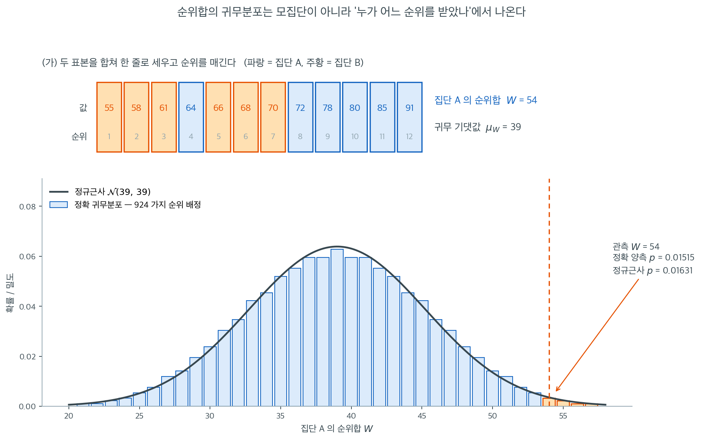
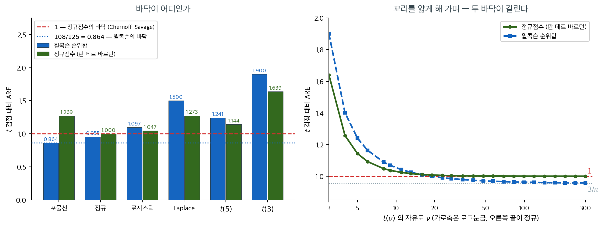

# Wilcoxon 순위합검정

**Wilcoxon 순위합검정**은 독립인 두 표본을 비교하는 가장 널리 쓰이는 비모수 검정이다. 두 모집단이 같은 분포를 갖는지 --- 더 구체적으로는 한 집단이 다른 집단보다 체계적으로 큰 값을 내는 경향이 있는지 --- 를 검정한다. 두 표본을 합쳐 모든 관측값에 함께 순위를 매기고, 각 집단에 배정된 순위의 합을 비교하는 방식이다.

Wilcoxon 순위합검정은 [Mann-Whitney U 검정](mann_whitney.md)과 수학적으로 동치이다. 둘은 같은 절차의 서로 다른 표현이다.

---

## 1. 가정

1. 두 표본이 서로 **독립**이다.
2. 관측값이 **연속**분포에서 추출된다.
3. 두 모집단이 **같은 모양**을 갖는다($H_0$ 아래에서 같은 분포를 공유한다).

!!! note "위치이동 모형"
    많은 교과서가 순위합검정을 **위치이동 모형** $F_Y(x) = F_X(x - \Delta)$ 아래에서 제시한다. 여기서 $\Delta$는 이동 모수이다. 이 모형에서 검정은 구체적으로 $H_0 \colon \Delta = 0$을 검정한다. 더 일반적으로는 위치이동만이 아니라 임의의 형태의 확률적 순서를 탐지한다.

---

## 2. 가설

$$
H_0 \colon F_X = F_Y \quad \text{(두 모집단이 같은 분포를 갖는다)}
$$

$$
H_a \colon F_X \ne F_Y \quad \text{(양측)}
$$

단측 대립가설: $H_a \colon X$가 $Y$보다 큰 경향이 있다, 또는 그 반대.

---

## 3. 검정통계량

**1단계.** 크기 $n_1$과 $n_2$인 두 표본을 합쳐 크기 $N = n_1 + n_2$인 하나의 표본을 만든다.

**2단계.** $N$개 관측값 전체에 작은 값부터 순위를 매기고 동점에는 중간순위를 배정한다.

**3단계.** 집단 1의 순위합을 계산한다.

$$
W = \sum_{i=1}^{n_1} R_i
$$

여기서 $R_i$는 합친 표본에서 집단 1의 $i$번째 관측값의 순위이다.

전체 순위합이 $N(N+1)/2$로 고정되므로 집단 2의 순위합은 $W_2 = N(N+1)/2 - W$이다.

---

## 4. 귀무분포

$H_0$ 아래에서 두 집단에 대한 순위 배정이 모두 동등하게 가능하다. $\{1, 2, \ldots, N\}$에서 $n_1$개를 고르는 방법은 $\binom{N}{n_1}$가지이다.

**$H_0$ 아래 $W$의 평균과 분산:**

$$
\mu_W = \frac{n_1(N + 1)}{2}
$$

$$
\sigma_W^2 = \frac{n_1 \, n_2 \,(N + 1)}{12}
$$

동점 보정: 크기가 $t_1, \ldots, t_g$인 동점 집단이 $g$개 있으면

$$
\sigma_W^2 = \frac{n_1 \, n_2}{12}\left(N + 1 - \frac{\sum_{j=1}^{g}(t_j^3 - t_j)}{N(N-1)}\right)
$$

---

## 5. 정규근사

표본이 크면(보통 $n_1, n_2 \ge 10$) 표준화된 통계량

$$
Z = \frac{W - \mu_W}{\sigma_W}
$$

은 $H_0$ 아래 근사적으로 $\mathcal{N}(0, 1)$을 따른다.

<div class="exbox" markdown>

**보기 1.** <span class="diff easy" title="쉬움"></span> 두 교수법의 시험 점수 비교. 두 교수법을 독립인 두 집단의 시험 점수로 비교한다.

**집단 A** ($n_1 = 6$): 78, 64, 85, 72, 91, 80

**집단 B** ($n_2 = 6$): 55, 68, 61, 70, 66, 58

</div>

??? success "풀이"
    **1단계.** $N = 12$개 관측값을 합쳐 순위를 매긴다.

    | 값 | 집단 | 순위 |
    |:-----:|:-----:|:----:|
    | 55 | B | 1 |
    | 58 | B | 2 |
    | 61 | B | 3 |
    | 64 | A | 4 |
    | 66 | B | 5 |
    | 68 | B | 6 |
    | 70 | B | 7 |
    | 72 | A | 8 |
    | 78 | A | 9 |
    | 80 | A | 10 |
    | 85 | A | 11 |
    | 91 | A | 12 |

    **2단계.** 집단 A의 순위합: $W = 4 + 8 + 9 + 10 + 11 + 12 = 54$.

    **3단계.** 귀무 모수:

    $$
    \mu_W = \frac{6 \times 13}{2} = 39
    $$

    $$
    \sigma_W = \sqrt{\frac{6 \times 6 \times 13}{12}} = \sqrt{39} \approx 6.245
    $$

    **4단계.** 표준화 통계량:

    $$
    Z = \frac{54 - 39}{6.245} \approx 2.402
    $$

    **5단계.** 양측 $p$값:

    $$
    p = 2\,\Phi(-2.402) \approx 0.016
    $$

    $\alpha = 0.05$에서 $H_0$을 기각한다. 집단 A의 점수가 집단 B보다 유의하게 높다.

    !!! note "정확 $p$값과의 비교"
        $n_1 = n_2 = 6$이면 $\binom{12}{6} = 924$가지 순위 배정을 모두 열거할 수 있다. 정확 양측 $p$값은 $0.01515$로 정규근사값 $0.01631$과 매우 가깝다.

        ```python
        from scipy import stats
        A = [78, 64, 85, 72, 91, 80]; B = [55, 68, 61, 70, 66, 58]
        print(stats.mannwhitneyu(A, B, method='exact').pvalue)    # 0.015152
        print(stats.ranksums(A, B).pvalue)                        # 0.016309
        ```

        출력:

        ```
        0.015151515151515152
        0.016309171877754974
        ```

        두 집단이 완전히 분리되지 않은(집단 A의 $64$가 집단 B의 값 넷보다 작다) 자료임에도 근사가 잘 맞는다.

---

## 6. Mann-Whitney U 검정과의 관계

Mann-Whitney $U$ 통계량은 $W$의 단순한 선형변환이다.

$$
U_1 = W - \frac{n_1(n_1 + 1)}{2}
$$

두 검정은 언제나 같은 $p$값을 낸다. $U$ 통계량 표현과 그 확률적 해석은 [Mann-Whitney U 검정](mann_whitney.md)을 보라.



위에서 쓴 $\mu_W = 39$와 $\sigma_W = 6.245$가 어디에서 왔는지는 귀무분포를 통째로 그려 보면 분명해진다.

(가)는 보기 1의 자료 $12$개를 크기순으로 한 줄로 세운 것이다. 집단 B(주황)가 앞쪽을 거의 차지하고 집단 A(파랑)가 뒤쪽에 몰려 있다. 눈에 띄는 예외는 순위 $4$를 받은 $64$ 하나뿐이다. **이 그림에서 값 자체는 이미 쓸모가 없다.** $91$이 $85$보다 얼마나 큰지는 순위 $12$와 $11$이라는 사실로 대체되었고, 검정은 여기서부터 값을 다시 보지 않는다. 집단 A의 순위합은 $W = 4 + 8 + 9 + 10 + 11 + 12 = 54$이다.

(나)가 귀무분포이다. $H_0$이 참이면 어느 여섯 자리가 A에게 갈지는 순전히 우연이므로, $\{1, \ldots, 12\}$에서 여섯 개를 고르는 $\binom{12}{6} = 924$가지 배정이 **모두 확률 $1/924$로 똑같이 가능하다.** 그 $924$가지의 순위합을 전부 세면 막대그림이 되고, 이것이 $W$의 정확 귀무분포이다. 점수가 정규인지 치우쳤는지는 한 번도 쓰이지 않았다. 이것이 "분포무관"의 구체적인 의미이다.

관측값 $W = 54$ 이상이 나오는 배정은 $924$가지 중 $7$가지뿐이어서 정확 양측 $p$값이 $0.01515$이다. 검은 곡선으로 겹쳐 놓은 정규근사 $\mathcal{N}(39,\,39)$는 $p = 0.01631$을 주는데, $n_1 = n_2 = 6$이라는 매우 작은 표본에서도 **오차가 $0.001$ 남짓**이다. 순위합은 서로 다른 순위 여러 개의 합이라 중심극한정리가 빠르게 작동하기 때문이며, 실무에서 $n_1, n_2 \ge 10$이면 근사를 써도 좋다는 권고가 여기에서 나온다.

### 작은 표본에서 순위합의 정규근사

<div class="exbox" markdown>

**보기 2.** <span class="diff easy" title="쉬움"></span> 작은 표본에서 순위합의 정규근사. 독립인 두 집단의 관측값이 $A = (12, 15, 18, 22, 25)$와 $B = (8, 10, 14, 19, 21, 24)$다. `scipy` 의 `ranksums` 가 $Z = 0.7303$, $p = 0.4652$를 준다.

**(1)** 집단 $A$ 의 순위합 $W$ 와 $\operatorname{E}[W]$, $\operatorname{Var}(W)$, $Z$ 를 손으로 구해 `scipy` 의 값과 맞추시오.

**(2)** 동점이 하나도 없으므로 귀무분포를 **전수 열거**할 수 있다. 정확 양측 p-값을 구해 정규근사와 견주고, 어긋난다면 그 까닭을 밝히시오.

</div>

??? success "풀이"

    **(1) 순위를 매긴다.** $N = m + n = 5 + 6 = 11$개를 합쳐 작은 것부터 늘어놓는다.

    | 값 | 8 | 10 | 12 | 14 | 15 | 18 | 19 | 21 | 22 | 24 | 25 |
    |---|---|---|---|---|---|---|---|---|---|---|---|
    | 순위 | 1 | 2 | 3 | 4 | 5 | 6 | 7 | 8 | 9 | 10 | 11 |
    | 집단 | B | B | A | B | A | A | B | B | A | B | A |

    집단 $A$ 의 순위합은

    $$
    W = 3 + 5 + 6 + 9 + 11 = 34
    $$

    이다. 검산: $B$ 의 순위합은 $66 - 34 = 32$이고 둘을 더하면 $N(N+1)/2 = 66$이다.

    $$
    \operatorname{E}[W] = \frac{m(N+1)}{2} = \frac{5 \times 12}{2} = 30,
    \qquad
    \operatorname{Var}(W) = \frac{mn(N+1)}{12} = \frac{5 \times 6 \times 12}{12} = 30
    $$

    이므로

    $$
    Z = \frac{34 - 30}{\sqrt{30}} = \frac{4}{5.477226} = 0.730297
    $$

    이고 `scipy` 가 준 $0.7302967$과 같다. 양측 p-값은 $2\Phi(-0.730297) = 0.465209$다.

    **(2) 전수 열거.** $H_0$ 아래에서 집단 $A$ 가 받는 순위는 $\{1,\dots,11\}$에서 고른 크기 $5$의 부분집합 가운데 **아무 것이나 같은 확률**이다. 그런 부분집합은

    $$
    \binom{11}{5} = 462
    $$

    개뿐이므로 $W$ 의 귀무분포를 하나씩 세어 그대로 얻을 수 있다. 관측된 치우침 $\lvert W - 30 \rvert = 4$ 이상인 것을 세면 $248$개다.

    $$
    p_{\text{정확}} = \frac{248}{462} = 0.536797
    $$

    **정규근사 $0.465209$가 정확값보다 $0.0716$ 작다.** 15% 가량 작은 쪽으로 밀린 셈이다. 까닭은 $W$ 가 정수 격자 위에서만 값을 갖는 **이산** 통계량인데 $N = 11$ 에서 그 격자가 아직 거칠다는 데 있다. 연속분포로 이산분포의 꼬리를 재면 계단 하나의 절반이 남는다. 그 절반을 깎아 주면

    $$
    Z_{\text{연속성 보정}} = \frac{4 - 0.5}{\sqrt{30}} = 0.639010
    \implies p = 0.522817
    $$

    로 정확값에 훨씬 가까워진다. **`ranksums` 는 연속성 보정을 하지 않는다.** 보정을 넣고 정확검정까지 해 주는 `mannwhitneyu` 를 쓰는 편이 안전하다.

    **수치적으로.**

    ```python
    from scipy import stats

    # 독립인 두 집단
    group_a = [12, 15, 18, 22, 25]
    group_b = [8, 10, 14, 19, 21, 24]

    # 순위합 검정. 동점 보정을 하지 않으므로 동점이 많으면 mannwhitneyu 를 쓴다.
    stat, p = stats.ranksums(group_a, group_b, alternative="two-sided")
    print(f"Z = {stat:.4f}, p = {p:.2%}")
    # Z = 0.7303, p = 46.52%
    ```

    출력:

    ```
    Z = 0.7303, p = 46.52%
    ```

    ```python
    import itertools
    import numpy as np
    from scipy import stats

    m, n = len(group_a), len(group_b)
    N = m + n
    ranks = stats.rankdata(group_a + group_b)
    W = ranks[:m].sum()
    E = m * (N + 1) / 2
    V = m * n * (N + 1) / 12
    print(f"A 의 순위 {list(ranks[:m])}  ->  W = {W}")
    print(f"E[W] = {E},  Var(W) = {V},  Z = {(W - E) / np.sqrt(V):.6f}")

    # 귀무분포를 전수 열거한다. C(11, 5) = 462 가지뿐이다.
    Ws = np.array([sum(c) for c in itertools.combinations(range(1, N + 1), m)])
    print(f"\n열거한 가지 수 {len(Ws)},  평균 {Ws.mean()},  분산 {Ws.var()}")
    hit = (np.abs(Ws - E) >= abs(W - E)).sum()
    print(f"|W - {E:.0f}| >= {abs(W - E):.0f} 인 것 {hit} 개")
    print(f"정확      양측 p = {hit / len(Ws):.6f}")
    print(f"정규근사  양측 p = {2 * stats.norm.sf(abs(W - E) / np.sqrt(V)):.6f}")
    print(f"연속성보정 양측 p = {2 * stats.norm.sf((abs(W - E) - 0.5) / np.sqrt(V)):.6f}")
    print(f"mannwhitneyu(method='exact'): {stats.mannwhitneyu(group_a, group_b, method='exact')}")
    print(f"U = W - m(m+1)/2 = {W - m * (m + 1) / 2}")
    ```

    출력:

    ```
    A 의 순위 [3.0, 5.0, 6.0, 9.0, 11.0]  ->  W = 34.0
    E[W] = 30.0,  Var(W) = 30.0,  Z = 0.730297

    열거한 가지 수 462,  평균 30.0,  분산 30.0
    |W - 30| >= 4 인 것 248 개
    정확      양측 p = 0.536797
    정규근사  양측 p = 0.465209
    연속성보정 양측 p = 0.522817
    mannwhitneyu(method='exact'): MannwhitneyuResult(statistic=19.0, pvalue=0.5367965367965368)
    U = W - m(m+1)/2 = 19.0
    ```

    **열거한 분포의 평균과 분산이 공식이 준 $30$과 $30$에 정확히 같다.** 근사식이 아니라 등식이라는 것을 이렇게 확인할 수 있다. 그리고 `mannwhitneyu` 의 정확검정이 $0.5367965$로 열거한 $248/462$와 같은 수를 돌려준다. $U = W - m(m+1)/2 = 34 - 15 = 19$인 것도 맞는다.

    세 p-값이 모두 $0.46$ 과 $0.54$ 사이에 있어 **어느 것을 쓰든 결론은 같다**. 그러나 $p$ 가 $0.05$ 근처였다면 $0.0716$의 차이가 결론을 뒤집는다. 작은 표본에서 정규근사만 보고 판정하지 말아야 하는 까닭이다.

---

---

## 7. 정확표와 소프트웨어

소표본($n_1, n_2 \le 20$)에서는 출간된 표나 소프트웨어(파이썬의 `scipy.stats.ranksums`, `scipy.stats.mannwhitneyu` 등)로 정확 임계값을 얻을 수 있다. 정확분포는 동등하게 가능한 $\binom{N}{n_1}$가지 순위 배정을 모두 열거하여 구한다.

<div class="storybox" markdown>

**그림으로 보는 통계학 1.** 순위 자리에 다른 수를 넣어도 된다

§3 은 관측값을 $1, 2, \ldots, N$ 으로 바꾸고 그 합을 쟀다. 그런데 **왜 하필 $1, 2, \ldots, N$ 인가.** 순위는 순서만 담고 있으면 되는 표식이므로, 같은 순서를 담은 다른 수로 갈아 끼워도 검정의 뼈대는 그대로다. 갈아 끼운 수를 **점수**라 부른다.

$1952$ 년에 그렇게 해 본 사람이 있다. 네덜란드의 **바르털 레인더르트 판 데르 바르던**($1903$–$1996$)인데, 통계학에서보다 **대수학**에서 훨씬 유명한 이름이다. 스물일곱에 펴낸 두 권짜리 『현대대수학』은 추상대수를 하나의 완결된 과목으로 다룬 최초의 저작으로 꼽힌다. 그가 『Indagationes Mathematicae』 $14$ 권 $453$–$458$ 쪽에 내놓은 것은 순위 $R_i$ 자리에

$$
a_i = \Phi^{-1}\!\left(\frac{R_i}{N+1}\right)
$$

를 넣는 검정이었다. 순위를 $0$ 과 $1$ 사이에 고르게 편 뒤 정규분포의 자 위로 되돌려 놓은 수, 곧 **정규점수**다.

그래서 무엇이 좋아지는가. 답은 여섯 해 뒤에 나왔다.



$1958$ 년 $12$ 월 『Annals of Mathematical Statistics』 $29$ 권 $972$–$994$ 쪽에서 허먼 체르노프와 I. 리처드 세비지가 증명한 것이 이것이다 — **정규점수에 기반한 이동 검정은 어떤 대립가설에서도 $t$ 검정에 못지않다.** $t$ 대비 ARE 가 $1$ 아래로 결코 내려가지 않고, 바닥인 $1$ 에 닿는 것은 **자료가 정규일 때뿐**이다.

[16.1 의 상자](../foundations/power_comparison.md)에서 윌콕슨의 바닥이 $108/125 = 0.864$ 였던 것과 견주어 보라. 윌콕슨에게는 정규자료에서 $4.5\%$ 를 내주고 최악에는 $14\%$ 가까이 내주는 구간이 있는데, 정규점수에는 **그 구간이 아예 없다.** 왼쪽 그림에서 초록 막대가 빨간 선 아래로 내려간 적이 한 번도 없고, 하필 윌콕슨을 가장 모질게 괴롭히던 그 포물선에서 $1.269$ 로 넉넉히 위에 있다.

오른쪽은 $t(\nu)$ 의 꼬리를 차츰 얇게 하며 본 것이다. 두 곡선이 나란히 내려오는데 **닿는 바닥이 다르다.** 윌콕슨은 $3/\pi = 0.955$ 로 가라앉고, 정규점수는 정확히 $1$ 에서 멈춘다.

그러면 왜 모두가 윌콕슨을 쓰는가. 하나는 셈이다. **순위합은 정수로 떨어진다.** 더하기만 하면 끝이고 임계값도 정수여서 표를 찾아 읽기가 쉽다. 정규점수는 $N$ 마다 다른 실수 묶음이라 관측값마다 $\Phi^{-1}$ 을 거쳐야 하고 임계값도 소수점 아래로 간다. 손으로 셈하고 표를 뒤지던 시절에 이것은 결정적인 차이였다. 다른 하나는 「$1$ 아래로 안 내려간다」가 **점근의 약속이지 작은 표본의 약속이 아니라는** 점이다. 그래도 16.1 의 ARE 표를 다시 볼 때, **$3/\pi$ 가 순위검정이 반드시 내주어야 하는 값은 아니었다**는 것은 알아 둘 만하다.

_확인한 곳 — 판 데르 바르던($1903$–$1996$)이 네덜란드 수학자이고 스물일곱에 두 권짜리 『Moderne Algebra』를 펴냈으며 그 책이 추상대수를 하나의 완결된 전체로 다룬 최초의 저작으로 꼽힌다는 것, 그리고 「van der Waerden test」가 그의 업적으로 함께 적혀 있다는 것은 [Wikipedia 「Bartel Leendert van der Waerden」](https://en.wikipedia.org/wiki/Bartel_Leendert_van_der_Waerden) · 그의 논문이 「Order tests for the two-sample problem and their power」이고 『Indagationes Mathematicae』 $14$ 권 $453$–$458$ 쪽($1952$)이며 II·III 가 이듬해 이어졌다는 것은 그 학술지 서지 · Chernoff 와 Savage 의 「Asymptotic Normality and Efficiency of Certain Nonparametric Test Statistics」가 『The Annals of Mathematical Statistics』 $29$ 권 $4$ 호 $972$–$994$ 쪽($1958$ 년 $12$ 월)이고, **모든 대립가설에서 Fisher-Yates-Terry-Hoeffding 정규점수 통계량에 기반한 이동 검정이 $t$ 검정에 적어도 못지않다**는 것이 그 결과라는 것은 [Project Euclid 의 그 쪽](https://projecteuclid.org/journals/annals-of-mathematical-statistics/volume-29/issue-4/Asymptotic-Normality-and-Efficiency-of-Certain-Nonparametric-Test-Statistics/10.1214/aoms/1177706436.full)(판 데르 바르던의 $\Phi^{-1}(R/(N+1))$ 판본은 이것과 점근적으로 같아 ARE 가 일치한다). 그림의 ARE 값은 모두 $12\sigma^2(\int f^2)^2$ 과 $\sigma^2\left(\int f^2/\varphi(\Phi^{-1}(F))\right)^2$ 을 수치적분해 **직접 계산한 값이고**, 정규에서 $3/\pi$ 와 $1$, 포물선에서 $108/125$ 가 나오는 것으로 맞춰 보았다_

</div>

---

## 연습문제

<div class="drillbox" markdown>

**연습문제 1.** <span class="diff easy" title="쉬움"></span>
집단 A $= \{3, 5, 7, 9\}$, 집단 B $= \{6, 8, 10, 12, 14\}$에 Wilcoxon 순위합검정을 적용하여 검정통계량 $W$를 계산하라.

</div>

??? success "풀이"
    합쳐서 순위를 매기면 3(1), 5(2), 6(3), 7(4), 8(5), 9(6), 10(7), 12(8), 14(9)이다.

    집단 A의 순위: 1, 2, 4, 6. 합 $W_A = 13$.

    집단 B의 순위: 3, 5, 7, 8, 9. 합 $W_B = 32$.

    검산: $13 + 32 = 45 = 9 \times 10 / 2$. $\checkmark$

    작은 집단(A, $n_1 = 4$)을 기준으로 $W = W_A = 13$이다.

    $H_0$ 아래에서 집단 A의 기대 순위합은 $n_1(n_1 + n_2 + 1)/2 = 4(10)/2 = 20$이다. $W = 13 < 20$이므로 집단 A가 작은 값을 갖는 경향이 있으며, 이는 자료와 일관된다.

    정확 양측 $p$값은 $0.1111$로 유의하지 않다. $n_1 = 4$, $n_2 = 5$에서 가능한 배정이 $\binom{9}{4} = 126$가지뿐이라 최소 $p$값이 $2/126 = 0.0159$이고, 이 자료는 완전 분리에서 멀다.

<div class="drillbox" markdown>

**연습문제 2.** <span class="diff med" title="중간"></span>
Wilcoxon 순위합검정과 Mann-Whitney U 검정의 관계를 설명하라. 두 검정은 동치인가?

</div>

??? success "풀이"
    그렇다. 두 검정은 서로 관련된 다른 통계량을 쓰지만 동치이다. Mann-Whitney $U_1$은 $x_i > y_j$인 쌍 $(x_i, y_j)$의 개수이다.

    $$
    U_1 = W_A - \frac{n_1(n_1+1)}{2}
    $$

    여기서 $W_A$는 집단 A의 Wilcoxon 순위합이다. 두 통계량은 언제나 같은 $p$값을 준다.

    !!! warning "부등호의 방향에 주의"
        $U_1 = W_A - n_1(n_1+1)/2$가 세는 것은 $x_i > y_j$인 쌍이지 $x_i < y_j$인 쌍이 아니다. 따라서

        $$
        \frac{U_1}{n_1 n_2} \text{ 는 } P(X > Y) \text{ 의 추정값이다.}
        $$

        연습문제 1의 자료로 확인해 보자. $W_A = 13$이므로 $U_1 = 13 - 10 = 3$이다. 실제로 $x > y$인 쌍을 세면 $(7,6)$, $(9,6)$, $(9,8)$의 3개로 정확히 일치한다. $x < y$인 쌍은 17개이다.

        ```python
        a = [3, 5, 7, 9]; b = [6, 8, 10, 12, 14]
        print(sum(1 for x in a for y in b if x > y))   # 3
        print(sum(1 for x in a for y in b if x < y))   # 17
        ```

        출력:

        ```
        3
        17
        ```

    통계량의 선택은 관례의 문제이다. 순위합 형태가 계산이 간단하고, $U$ 통계량은 확률적 해석이 깔끔하다.

<div class="drillbox" markdown>

**연습문제 3.** <span class="diff med" title="중간"></span>
Wilcoxon 순위합검정이 실제로 검정하는 것은 무엇인가? 중앙값이 같은지를 검정하는 것인가?

</div>

??? success "풀이"
    Wilcoxon 순위합검정은 $H_0$: 두 모집단이 같은 분포를 갖는다를, $H_a$: 한 모집단이 큰 값을 내는 경향이 있다(확률적 우월)에 대해 검정한다.

    흔히 "중앙값이 같은지를 검정한다"고 설명하지만, 이는 두 분포가 같은 모양을 갖고 위치만 다를 때만 정확하다. 분포의 모양이 다르면(예: 분산이나 왜도가 다르면) 중앙값이 같아도 기각할 수 있다.

    구체적인 반례를 보자. $X \sim \mathcal{N}(0, 1)$, $Y \sim \mathcal{N}(0, 25)$이면 중앙값이 둘 다 0이고 $P(X > Y) = 0.5$이므로 검정이 기각하지 않는다. 그러나 $X \sim \text{Exp}(1) - \ln 2$와 $Y \sim -(\text{Exp}(1) - \ln 2)$는 둘 다 중앙값이 0이지만 $P(X > Y) \approx 0.596 \ne 0.5$이다. 한쪽은 오른쪽으로, 다른 쪽은 왼쪽으로 치우쳐 있어 모양이 다르기 때문이다.

    ```python
    import numpy as np
    from scipy import stats
    rng = np.random.default_rng(0)
    x = rng.exponential(1, 200000) - np.log(2)
    y = -(rng.exponential(1, 200000) - np.log(2))
    print(np.median(x), np.median(y))     # 약 0.000, 0.000
    print((x > y).mean())                 # 0.596  ← 0.5가 아니다
    ```

    출력:

    ```
    -0.00482088991645685 0.0007391176296889235
    0.59587
    ```

    $n = 100$씩 표본을 뽑아 검정하면 기각률이 명목수준을 크게 넘는다. 중앙값이 같은데도 그렇다.

    위치이동 모형($Y = X + \Delta$)에서는 검정이 $H_0: \Delta = 0$과 동치이며, 기각은 중앙값(과 평균)이 다름을 함의한다.

<div class="drillbox" markdown>

**연습문제 4.** <span class="diff med" title="중간"></span>
대표본에서 순위합검정은 정규근사를 쓴다. $z$ 통계량의 공식을 쓰고, 연속성 보정의 효과를 보기 자료로 확인하라.

</div>

??? success "풀이"
    $H_0$ 아래에서 순위합 $W$는

    $$
    E[W] = \frac{n_1(n_1 + n_2 + 1)}{2}, \quad \text{Var}(W) = \frac{n_1 n_2 (n_1 + n_2 + 1)}{12}
    $$

    를 가지며 $z$ 통계량은

    $$
    Z = \frac{W - E[W]}{\sqrt{\text{Var}(W)}} \approx \mathcal{N}(0,1)
    $$

    이다. 이 근사는 $n_1, n_2 \ge 10$에서 정확하다. 더 작은 표본에서는 순열분포의 정확 $p$값을 써야 한다.

    본문 보기($W = 54$, $n_1 = n_2 = 6$)로 세 가지를 비교하면

    ```python
    from scipy import stats
    A = [78, 64, 85, 72, 91, 80]; B = [55, 68, 61, 70, 66, 58]
    print(stats.mannwhitneyu(A, B, method='exact').pvalue)              # 0.015152
    print(stats.mannwhitneyu(A, B, method='asymptotic',
                             use_continuity=False).pvalue)              # 0.016309
    print(stats.mannwhitneyu(A, B, method='asymptotic',
                             use_continuity=True).pvalue)               # 0.020241
    ```

    출력:

    ```
    0.015151515151515152
    0.016309171877754974
    0.020240570577077482
    ```

    | 방법 | $p$값 |
    |:---|---:|
    | 정확 (열거) | $0.01515$ |
    | 정규근사, 보정 없음 | $0.01631$ |
    | 정규근사, 연속성 보정 | $0.02024$ |

    여기서는 **연속성 보정이 오히려 정확값에서 멀어지게 한다**. 보정 없는 근사의 오차가 $0.0012$인데 보정한 쪽은 $0.0051$로 네 배가 넘는다.

    부호검정이나 부호순위검정에서 연속성 보정이 도움이 되었던 것과 대조적이다. 이유는 $W$의 귀무분포가 격자 간격 1로 촘촘한 반면(가능한 값이 $21$부터 $57$까지 $37$가지), 관측값 $54$가 이미 꼬리 깊숙이 있어 계단 보정보다 정규곡선 자체의 꼬리 오차가 더 크기 때문이다.

    **일반 지침:** 연속성 보정은 근사를 보수적으로(= $p$값을 크게) 만든다. 근사가 이미 $p$값을 과대평가하고 있다면 보정이 상황을 악화시킨다. $n \le 20$이면 보정 여부를 고민하지 말고 정확검정을 쓰는 것이 옳다.

<div class="drillbox" markdown>

**연습문제 5.** <span class="diff med" title="중간"></span>
보기 1 의 집단 B 를 조금 바꾸어 집단 A 와 동점이 두 쌍 생기게 하자.

**집단 A** ($n_1 = 6$): 78, 64, 85, 72, 91, 80

**집단 B** ($n_2 = 6$): 55, 72, 61, 64, 66, 58

(가) 중간순위를 써서 $W$ 를 구하고 $W_2 = N(N+1)/2 - W$ 로 검산하라.

(나) 4 절의 동점 보정 공식으로 $\sigma_W^2$ 를 구하고 보정하지 않은 $n_1 n_2 (N+1)/12$ 와 비교하라.

(다) 두 분산으로 각각 양측 $p$ 값을 구하라. $\Phi(-2.4019) = 0.0081551$, $\Phi(-2.4104) = 0.0079675$ 를 써도 좋다.

(라) 동점 보정을 빼먹으면 검정이 보수적이 되는가 과감해지는가? $N$ 개 값이 **모두** 동점인 극단에서 보정 공식이 무엇을 주는지 계산하여, 그 답이 (라)의 방향과 어떻게 들어맞는지 설명하라.

</div>

??? success "풀이"
    **(가)** $N = 12$ 개를 합쳐 세우면 $64$ 가 두 개($A$, $B$), $72$ 가 두 개($A$, $B$)다.

    | 값 | 집단 | 자리 | 순위 |
    |:---:|:---:|:---:|:---:|
    | 55 | B | 1 | 1 |
    | 58 | B | 2 | 2 |
    | 61 | B | 3 | 3 |
    | 64 | A, B | 4, 5 | 4.5, 4.5 |
    | 66 | B | 6 | 6 |
    | 72 | A, B | 7, 8 | 7.5, 7.5 |
    | 78 | A | 9 | 9 |
    | 80 | A | 10 | 10 |
    | 85 | A | 11 | 11 |
    | 91 | A | 12 | 12 |

    집단 A 의 순위는 $4.5,\ 7.5,\ 9,\ 10,\ 11,\ 12$ 이므로

    $$
    W = 4.5 + 7.5 + 9 + 10 + 11 + 12 = 54
    $$

    검산: $W_2 = 1 + 2 + 3 + 4.5 + 6 + 7.5 = 24$ 이고 $54 + 24 = 78 = 12 \times 13 / 2$. $\checkmark$

    보기 1 과 똑같은 $W = 54$ 이고 $\mu_W = 6 \times 13 / 2 = 39$ 도 그대로다. 동점은 평균을 바꾸지 않는다 --- 중간순위를 써도 전체 순위합이 $N(N+1)/2$ 로 보존되기 때문이다.

    **(나)** 동점 집단이 $g = 2$ 개, 크기가 $t_1 = t_2 = 2$ 이므로

    $$
    \sum_{j=1}^{2}(t_j^3 - t_j) = (8 - 2) + (8 - 2) = 12
    $$

    $$
    \sigma_W^2 = \frac{6 \times 6}{12}\left(13 - \frac{12}{12 \times 11}\right) = 3\left(13 - \frac{1}{11}\right) = \frac{426}{11} \approx 38.7273
    $$

    보정하지 않으면 $\sigma_W^2 = 6 \times 6 \times 13 / 12 = 39$ 다. 보정이 깎아내는 양은 $39 - 426/11 = 3/11 \approx 0.2727$, 곧 $0.70\%$ 다. 표준편차로는 $6.2450 \to 6.2231$.

    **(다)** $W - \mu_W = 15$ 이므로

    $$
    Z_{\text{보정없음}} = \frac{15}{6.2450} = 2.4019, \qquad p = 2 \times 0.0081551 = 0.01631
    $$

    $$
    Z_{\text{보정}} = \frac{15}{6.2231} = 2.4104, \qquad p = 2 \times 0.0079675 = 0.01594
    $$

    **(라)** 동점 보정은 분산을 **줄이므로** 같은 $W$ 에 대해 $\lvert Z \rvert$ 를 키우고 $p$ 값을 작게 만든다. 따라서 보정을 빼먹으면 $p$ 값이 커져 검정이 **보수적**이 된다(기각을 덜 한다). 여기서는 $0.01594$ 가 $0.01631$ 로 밀려났을 뿐이라 결론은 같지만, 동점이 많아지면 차이가 커진다.

    극단으로 보내 보자. $N$ 개 값이 모두 같으면 $g = 1$, $t_1 = N$ 이고

    $$
    \frac{\sum_j (t_j^3 - t_j)}{N(N-1)} = \frac{N^3 - N}{N(N-1)} = \frac{N^2 - 1}{N - 1} = N + 1
    $$

    이므로 $\sigma_W^2 = \frac{n_1 n_2}{12}\bigl((N+1) - (N+1)\bigr) = 0$ 이다. 맞는 답이다 --- 모든 값이 같으면 모든 관측값의 순위가 $(N+1)/2$ 이고 $W$ 는 $\mu_W$ 에 고정된 **상수**라 퍼짐이 없다. 보정항은 "순위가 겹쳐 잃어버린 정보"만큼 분산을 깎는 장치이고, 극단에서 전부 깎아 $0$ 을 준다. 보정 없는 공식은 그런 자료에서도 $\sigma_W^2 = n_1 n_2 (N+1)/12$ 를 주장하여 분산을 과대평가하므로, 틀리는 방향이 언제나 "덜 기각"으로 일정하다.

<div class="drillbox" markdown>

**연습문제 6.** <span class="diff med" title="중간"></span>
$n_1 = n_2 = 4$ 는 종이에서 끝까지 갈 수 있는 크기다. $\binom{8}{4} = 70$ 가지 순위 배정을 생각하자.

(가) 두 집단이 완전히 분리되었을 때(집단 1 의 네 값이 모두 집단 2 의 네 값보다 작을 때) $W$ 의 값과 정확 양측 $p$ 값을 구하라.

(나) $W = 11$ 인 배정은 몇 가지인가? 그때의 정확 양측 $p$ 값을 구하고, $n_1 = n_2 = 4$ 에서 $\alpha = 0.05$ 로 기각되는 자료가 어떤 자료뿐인지 말하라.

(다) $n_1 = n_2 = n$ 일 때 얻을 수 있는 가장 작은 양측 $p$ 값을 $n$ 의 식으로 쓰고, $\alpha = 0.05$ 와 $\alpha = 0.01$ 에서 **기각이 가능해지는** 최소 $n$ 을 각각 구하라.

(라) 이번에는 $n_1 = 1$ 로 극단으로 보내 보자. $H_0$ 아래 $W$ 의 분포는 무엇이 되는가? $\alpha = 0.05$ 에서 기각이 가능하려면 $n_2$ 가 얼마 이상이어야 하는가? 그 검정은 실질적으로 무엇을 보는 검정인가?

</div>

??? success "풀이"
    **(가)** 집단 1 이 가장 작은 네 값을 차지하면 순위가 $1, 2, 3, 4$ 이고

    $$
    W = 1 + 2 + 3 + 4 = 10
    $$

    이것이 $W$ 의 최솟값이고 그런 배정은 $\{1,2,3,4\}$ 하나뿐이다. 따라서 $P(W \le 10) = 1/70$ 이고 양측 $p$ 값은

    $$
    p = \frac{2}{70} = \frac{1}{35} \approx 0.02857
    $$

    **(나)** $\{1,2,3,4\}$ 에서 하나를 키워 합을 $11$ 로 만드는 방법은 $\{1,2,3,5\}$ 뿐이므로 $1$ 가지다. 그러므로 $P(W \le 11) = 2/70$ 이고

    $$
    p = \frac{4}{70} = \frac{2}{35} \approx 0.05714 > 0.05
    $$

    즉 $n_1 = n_2 = 4$ 에서 $\alpha = 0.05$ 로 기각되는 자료는 **완전히 분리된 자료뿐**이다. 한 값만 서로 넘나들어도 벌써 유의하지 않다. 참고로 $\mu_W = 4 \times 9 / 2 = 18$ 이고 $W$ 는 $10$ 부터 $26$ 까지 $17$ 가지 값을 갖는다.

    **(다)** 가장 극단인 배정은 아래쪽 꼬리와 위쪽 꼬리에 각각 하나씩이므로

    $$
    p_{\min} = \frac{2}{\binom{2n}{n}}
    $$

    $\binom{2n}{n}$ 은 $n = 2, 3, 4, 5$ 에서 각각 $6,\ 20,\ 70,\ 252$ 다.

    | $n$ | $\binom{2n}{n}$ | $p_{\min}$ |
    |:---:|---:|---:|
    | 2 | 6 | 0.3333 |
    | 3 | 20 | 0.1000 |
    | 4 | 70 | 0.0286 |
    | 5 | 252 | 0.0079 |

    $p_{\min} \le 0.05$ 는 $\binom{2n}{n} \ge 40$ 과 같으므로 최소 $n = 4$ 이고, $p_{\min} \le 0.01$ 은 $\binom{2n}{n} \ge 200$ 과 같으므로 최소 $n = 5$ 다. $n = 3$ 에서는 자료가 아무리 완벽하게 갈려도 $p$ 값이 $0.1$ 아래로 내려가지 않는다 --- **표본이 작으면 유의할 수 없는 것이 아니라 유의하는 것이 불가능하다.**

    **(라)** $n_1 = 1$ 이면 $W = R_1$ 이고, $H_0$ 아래 그 하나의 관측값은 $N = 1 + n_2$ 자리 어디에도 똑같이 놓일 수 있으므로 $W$ 는 $\{1, 2, \ldots, N\}$ 위의 **균등분포**다. 공식과도 맞는다.

    $$
    \mu_W = \frac{1 \cdot (N+1)}{2} = \frac{N+1}{2}, \qquad
    \sigma_W^2 = \frac{1 \cdot n_2 (N+1)}{12} = \frac{(N-1)(N+1)}{12} = \frac{N^2 - 1}{12}
    $$

    마지막 식은 균등분포 $\{1, \ldots, N\}$ 의 분산 그대로다. 가장 극단인 경우는 $W = 1$ 또는 $W = N$ 이고 각각 확률 $1/N$ 이므로 $p_{\min} = 2/N$ 이다. $2/N \le 0.05$ 는 $N \ge 40$, 곧 $n_2 \ge 39$ 다.

    그 검정이 실제로 보는 것은 "그 하나의 관측값이 상대 표본의 $39$ 개 전부보다 작다(또는 크다)"는 사건 하나뿐이다. 집단 2 를 아무리 더 키워도 얻을 수 있는 정보는 그 한 비교뿐이어서 검정력이 바닥에 깔린다. 비모수 검정의 해상도는 총 표본크기 $N$ 이 아니라 **배정의 개수** $\binom{N}{n_1}$ 이 정하고, 그 수는 두 표본이 균형일 때 가장 커진다.

<div class="drillbox" markdown>

**연습문제 7.** <span class="diff hard" title="어려움"></span>
연습문제 4 는 $n_1 = n_2 = 6$, $W = 54$ 에서 세 방법의 $p$ 값이 $0.01515$(정확), $0.01631$(근사, 보정 없음), $0.02024$(근사, 연속성 보정)로 갈린다는 것을 보였다. 그러나 $p$ 값이 다른 것과 **기각 결정**이 다른 것은 다른 얘기다.

난수를 쓰지 말고 $\binom{12}{6} = 924$ 가지 배정을 모두 열거하여, 세 방법의 **실제 유의수준**(= $p \le \alpha$ 가 되는 배정의 비율)을 $\alpha = 0.01,\ 0.02,\ 0.03,\ 0.05,\ 0.10$ 에서 구하라. 그리고 (ㄱ) 왜 어느 방법도 실제 크기가 $\alpha$ 에 닿지 못하는지, (ㄴ) 세 방법의 결정이 갈리는 $\alpha$ 는 어디이고 그때 누가 더 보수적인지 답하라.

</div>

??? success "풀이"
    $W$ 의 귀무분포는 $\{1, \ldots, 12\}$ 에서 여섯 개를 고르는 모든 방법을 세면 얻어진다. 각 배정은 확률 $1/924$ 로 동등하므로, "실제 크기"는 그 중 기각되는 배정을 센 비율이 된다.

    ```python
    from itertools import combinations
    from collections import Counter
    import numpy as np
    from scipy import stats

    cnt = Counter(sum(s) for s in combinations(range(1, 13), 6))   # n1 = n2 = 6
    tot = sum(cnt.values())                                        # 924
    mu, sd = 39.0, np.sqrt(39.0)

    def p_exact(w):
        lo = sum(v for k, v in cnt.items() if k <= w)
        hi = sum(v for k, v in cnt.items() if k >= w)
        return min(1.0, 2 * min(lo, hi) / tot)

    def p_norm(w, cc):
        z = max((abs(w - mu) - (0.5 if cc else 0.0)) / sd, 0.0)
        return 2 * stats.norm.sf(z)

    fs = [p_exact, lambda w: p_norm(w, False), lambda w: p_norm(w, True)]
    print(f"배정 수 = {tot},  mu_W = {mu:.1f},  sigma_W = {sd:.4f}")
    print("alpha    정확    보정없음   보정")
    for a in (0.01, 0.02, 0.03, 0.05, 0.10):
        s = [sum(v for w, v in cnt.items() if f(w) <= a) / tot for f in fs]
        print(f" {a:.2f}   " + "   ".join(f"{x:.4f}" for x in s))
    ```

    출력:

    ```text
    배정 수 = 924,  mu_W = 39.0,  sigma_W = 6.2450
    alpha    정확    보정없음   보정
     0.01   0.0087   0.0043   0.0043
     0.02   0.0152   0.0152   0.0087
     0.03   0.0260   0.0260   0.0152
     0.05   0.0411   0.0411   0.0411
     0.10   0.0931   0.0931   0.0931
    ```

    **(ㄱ) 왜 $\alpha$ 에 닿지 못하는가.** $W$ 는 $21$ 부터 $57$ 까지 $37$ 개 값만 갖는 이산통계량이고, 꼬리 확률은 분모가 $924$ 인 유리수뿐이다. 양측 기각역은 $\{W \le \mu_W - c\} \cup \{W \ge \mu_W + c\}$ 꼴이라 $c$ 를 한 칸 옮기면 확률이 뭉텅이로 뛴다. 그 중 $\alpha$ 를 넘지 않는 가장 큰 것을 고르니 실제 크기는 언제나 $\alpha$ 를 **밑돈다**. $\alpha = 0.05$ 에서 기각역은 $W \ge 52$ 또는 $W \le 26$ 이고, 위쪽 꼬리의 배정 수가 $7 + 5 + 3 + 2 + 1 + 1 = 19$ 이므로

    $$
    \text{실제 크기} = \frac{2 \times 19}{924} = \frac{38}{924} = 0.04113
    $$

    한 칸 더 넓히면 $W \ge 51$ 이 되어 $2 \times 30 / 924 = 0.06494 > 0.05$ 다. 즉 $0.05$ 와 $0.0411$ 사이에는 쓸 수 있는 기각역이 없다. 이것은 근사의 결함이 아니라 **이산성 자체의 대가**이고, 정확검정도 피할 수 없다.

    **(ㄴ) 결정이 갈리는 자리.**

    | $\alpha$ | 정확 | 보정 없음 | 연속성 보정 | 결정이 같은가 |
    |---:|---:|---:|---:|:---:|
    | 0.01 | 0.0087 | 0.0043 | 0.0043 | 근사 둘만 같다 |
    | 0.02 | 0.0152 | 0.0152 | 0.0087 | 보정만 다르다 |
    | 0.03 | 0.0260 | 0.0260 | 0.0152 | 보정만 다르다 |
    | 0.05 | 0.0411 | 0.0411 | 0.0411 | 셋 다 같다 |
    | 0.10 | 0.0931 | 0.0931 | 0.0931 | 셋 다 같다 |

    - $\alpha = 0.05,\ 0.10$ 에서는 세 방법이 **같은 기각역**을 고른다. $p$ 값이 $0.01515$ 와 $0.02024$ 처럼 꽤 달라도 그 셋이 모두 임계점의 같은 편에 있으면 결정은 바뀌지 않는다. 연습문제 4 의 지적은 $p$ 값의 크기에 관한 것이고, 그것이 자동으로 결정의 차이는 아니다.
    - $\alpha = 0.01$ 에서는 정확검정이 $W \ge 55$($p = 0.00866$)까지 기각하는데, 근사는 $p_{\text{보정없음}}(55) = 0.01041 > 0.01$ 이라 $W \ge 56$ 부터다. 근사 쪽이 더 보수적이다($0.0043$ 대 $0.0087$).
    - $\alpha = 0.02,\ 0.03$ 에서는 보정 없는 근사가 정확검정과 같은 기각역을 고르는데, 연속성 보정은 $p$ 를 키운 탓에 한 칸 안으로 밀려 더 보수적이 된다($0.0087$ 대 $0.0152$, $0.0152$ 대 $0.0260$).

    **정리.** 이 설정에서는 어떤 방법도 명목수준을 **넘지 않는다.** 세 방법이 틀리는 방향은 늘 "덜 기각"이고 연속성 보정은 그 보수성을 한 번 더 겹친다. 그래서 작은 $n$ 에서 연속성 보정은 안전장치가 아니라 검정력을 공짜로 버리는 장치다. 연습문제 4 의 "$n \le 20$ 이면 정확검정을 쓰라"는 지침이 결정 수준에서도 확인된다.

<div class="drillbox" markdown>

**연습문제 8.** <span class="diff hard" title="어려움"></span>
연습문제 3 은 모양이 다르면 중앙값이 같아도 순위합검정이 기각할 수 있다고 했다. 그 반례를 손으로 끝까지 계산해 보자.

$X \sim \text{Unif}(-1, 1)$ 이고 $Y$ 는 $X$ 와 독립이며 지지집합이 $[-1, 1]$ 안에 들어 있는 임의의 연속확률변수라 하자.

(가) $P(X > Y) = \dfrac{1}{2} - \dfrac{E[Y]}{2}$ 임을 보여라. 곧 균일분포를 한쪽에 놓으면 Mann-Whitney 모수는 중앙값이 아니라 $Y$ 의 **평균**이 정한다.

(나) 확률 $1/2$ 로 $\text{Unif}(-1/5,\ 0)$ 에서, 확률 $1/2$ 로 $\text{Unif}(0,\ 1)$ 에서 값을 내는 $Y$ 를 보자. $Y$ 의 중앙값과 평균을 구하고 $P(X > Y)$ 를 구하라.

(다) $n_1 = n_2 = n$ 으로 이 $X$, $Y$ 에서 표본을 뽑아 양측 $\alpha = 0.05$ 순위합검정을 한다. $U_1$ 의 기댓값과 귀무 표준편차를 써서 $Z$ 의 평균이 $-1.96$ 에 닿는 $n$ 을 구하라(검정력이 대략 $1/2$ 이 되는 자리의 거친 어림).

(라) 1 절의 가정 셋 가운데 어느 것이 깨졌는가? 그리고 이 기각을 1 종 오류라고 불러도 되는가?

</div>

??? success "풀이"
    **(가)** $X$ 와 $Y$ 가 독립이고 연속이므로 $P(X = Y) = 0$ 이고, $Y$ 로 조건을 걸어 평균하면

    $$
    P(X > Y) = E_Y\bigl[P(X > Y \mid Y)\bigr] = E_Y\bigl[1 - F_X(Y)\bigr]
    $$

    $Y$ 의 지지집합이 $[-1, 1]$ 안에 있으므로 거기서는 $F_X(y) = (y+1)/2$ 가 잘림 없이 성립한다. 따라서

    $$
    P(X > Y) = E\left[1 - \frac{Y+1}{2}\right] = E\left[\frac{1 - Y}{2}\right] = \frac{1}{2} - \frac{E[Y]}{2}
    $$

    $\square$

    $F_X$ 가 $Y$ 의 지지집합에서 **선형**이라는 것이 전부다. 지지집합이 $[-1,1]$ 을 벗어나면 $F_X$ 가 $0$ 또는 $1$ 로 잘려 등식이 깨진다.

    **(나)** 중앙값: $P(Y < 0) = 1/2$ 이므로 $F_Y(0) = 1/2$ 이고 중앙값은 $0$ 이다. $X$ 의 중앙값도 $0$ 이니 **두 중앙값이 같다.**

    평균:

    $$
    E[Y] = \frac{1}{2}\left(-\frac{1}{10}\right) + \frac{1}{2}\left(\frac{1}{2}\right) = -\frac{1}{20} + \frac{1}{4} = \frac{1}{5}
    $$

    (가)에 넣으면

    $$
    P(X > Y) = \frac{1}{2} - \frac{1/5}{2} = \frac{1}{2} - \frac{1}{10} = \frac{2}{5} = 0.4
    $$

    중앙값이 둘 다 $0$ 인데 Mann-Whitney 모수는 $0.4 \ne 0.5$ 다. $Y$ 는 왼쪽으로는 $-1/5$ 까지만 가고 오른쪽으로는 $1$ 까지 뻗으므로, 중앙값은 그대로인 채 "큰 값을 내는 경향"만 커졌다.

    **(다)** 6 절의 $U_1 = W - n_1(n_1+1)/2$ 에 대해 $U_1/(n_1 n_2)$ 가 $P(X > Y)$ 의 불편추정량이므로

    $$
    E[U_1] = n^2 \times 0.4, \qquad \mu_{U} = \frac{n^2}{2}, \qquad \sigma_U^2 = \frac{n^2(2n+1)}{12}
    $$

    ($U_1$ 은 $W$ 의 평행이동이라 분산이 $\sigma_W^2$ 와 같다.) 귀무 표준편차를 그대로 써서 $Z$ 의 평균을 어림하면

    $$
    E[Z] \approx \frac{n^2(0.4 - 0.5)}{\sqrt{n^2(2n+1)/12}} = -0.1\,n\sqrt{\frac{12}{2n+1}}
    $$

    큰 $n$ 에서 $2n + 1 \approx 2n$ 이므로 $E[Z] \approx -0.1\sqrt{6n} = -0.2449\sqrt{n}$ 이고 $0.2449\sqrt{n} = 1.96$ 은 $n \approx 64.0$ 을 준다. 어림 없이 직접 풀면

    $$
    n = 64:\ 0.1 \times 64 \sqrt{\tfrac{12}{129}} = 6.4 \times 0.30500 = 1.9520 < 1.96
    $$

    $$
    n = 65:\ 0.1 \times 65 \sqrt{\tfrac{12}{131}} = 6.5 \times 0.30266 = 1.9673 > 1.96
    $$

    따라서 $n = 65$ 다. 각 집단 $65$ 개만 모으면 "중앙값이 같은" 두 분포를 양측 $5\%$ 에서 절반쯤의 확률로 유의하게 다르다고 선언한다. $n$ 이 커지면 $\lvert E[Z] \rvert$ 가 $\sqrt{n}$ 으로 자라므로 기각률은 $1$ 로 간다.

    **(라)** 깨진 것은 가정 3 --- 두 모집단이 **같은 모양**을 갖는다 --- 이다. $X$ 는 $0$ 을 중심으로 대칭이고 $Y$ 는 오른쪽으로 길게 치우쳐 있다. 가정 1(독립)과 2(연속)는 멀쩡하다.

    그리고 이 기각은 1 종 오류가 **아니다.** 2 절의 귀무가설은 $H_0 \colon F_X = F_Y$ 이고 여기서 그것은 실제로 거짓이므로, 검정은 제 할 일을 정확히 했다. 틀린 것은 기각을 "중앙값이 다르다"로 읽은 사람이다. 1 절의 위치이동 모형 $F_Y(x) = F_X(x - \Delta)$ 는 바로 이 자유를 봉쇄하기 위한 조건이고, 그 아래에서만 "$P(X>Y) = 1/2$ 를 기각함"이 "중앙값이 다름"과 같은 말이 된다.

<div class="drillbox" markdown>

**연습문제 9.** <span class="diff hard" title="어려움"></span>
연습문제 5 의 자료($64$ 와 $72$ 에 동점이 한 쌍씩)에는 정확검정을 그대로 쓸 수 없다. 7 절의 열거는 $N$ 개 관측값에 $1, \ldots, N$ 이 하나씩 배정된다는 전제에서 나왔기 때문이다.

(가) 동점을 **깨는** 방법을 모두 열거하라. 몇 가지인가? 각 방법이 주는 $W$ 와 정확 양측 $p$ 값을 구하라.

(나) 중간순위와 동점 보정 분산을 쓴 정규근사 $p$ 값이 그 범위 안에서 어디에 놓이는지 보라.

(다) "동점을 무작위로 하나 깨서 정확검정을 쓰면 된다"는 처방이 왜 위험한가? 그리고 `scipy` 에 동점이 있는 자료를 `method="exact"` 로 넘기면 무엇이 돌아오는가?

</div>

??? success "풀이"
    **(가)** 동점 쌍이 둘($64$ 와 $72$)이고 각 쌍마다 집단 A 쪽을 앞에 둘지 뒤에 둘지 고르므로 $2 \times 2 = 4$ 가지다. 집단 A 의 $64$ 는 순위 $4$ 또는 $5$, $72$ 는 $7$ 또는 $8$ 을 받고 나머지 $78, 80, 85, 91$ 은 $9, 10, 11, 12$ 로 고정이므로

    $$
    W \in \{4+7+42,\ 4+8+42,\ 5+7+42,\ 5+8+42\} = \{53,\ 54,\ 54,\ 55\}
    $$

    여기서 $42 = 9+10+11+12$ 다. $n_1 = n_2 = 6$ 의 정확 꼬리는 $W \ge 53$ 인 배정이 $12$ 개, $W \ge 54$ 가 $7$ 개, $W \ge 55$ 가 $4$ 개이므로 양측 $p$ 값이 각각 $24/924$, $14/924$, $8/924$ 다.

    ```python
    from itertools import combinations, product
    from collections import Counter
    import numpy as np
    from scipy import stats

    A = [78, 64, 85, 72, 91, 80]
    B = [55, 72, 61, 64, 66, 58]
    cnt = Counter(sum(s) for s in combinations(range(1, 13), 6))

    def p_exact(w):
        lo = sum(v for k, v in cnt.items() if k <= w)
        hi = sum(v for k, v in cnt.items() if k >= w)
        return min(1.0, 2 * min(lo, hi) / 924)

    print("동점을 깨는 네 가지 방법")
    ps = []
    for d64, d72 in product([-1e-6, 1e-6], repeat=2):
        a = [78, 64 + d64, 85, 72 + d72, 91, 80]
        w = stats.rankdata(a + B, method="average")[:6].sum()
        ps.append(p_exact(w))
        print(f"  64 에서 A 가 {'앞' if d64 < 0 else '뒤'},"
              f" 72 에서 A 가 {'앞' if d72 < 0 else '뒤'}"
              f"  ->  W = {w:.0f},  정확 p = {p_exact(w):.6f}")
    print(f"범위 {min(ps):.6f} ~ {max(ps):.6f}  (최대/최소 = {max(ps) / min(ps):.1f})")

    W = stats.rankdata(A + B, method="average")[:6].sum()   # 동점에 중간순위
    sd_c = np.sqrt((6 * 6 / 12) * (13 - 2 * (2 ** 3 - 2) / (12 * 11)))
    z = (W - 39.0) / sd_c
    print(f"중간순위 W = {W:.1f},  동점보정 sigma_W = {sd_c:.4f},  z = {z:.4f}")
    print(f"동점보정 정규근사    p = {2 * stats.norm.sf(abs(z)):.6f}")
    print("scipy asymptotic     p = %.6f" % stats.mannwhitneyu(
        A, B, alternative="two-sided", method="asymptotic", use_continuity=False).pvalue)
    print("scipy exact (주의!)  p = %.6f" % stats.mannwhitneyu(
        A, B, alternative="two-sided", method="exact").pvalue)
    ```

    출력:

    ```text
    동점을 깨는 네 가지 방법
      64 에서 A 가 앞, 72 에서 A 가 앞  ->  W = 53,  정확 p = 0.025974
      64 에서 A 가 앞, 72 에서 A 가 뒤  ->  W = 54,  정확 p = 0.015152
      64 에서 A 가 뒤, 72 에서 A 가 앞  ->  W = 54,  정확 p = 0.015152
      64 에서 A 가 뒤, 72 에서 A 가 뒤  ->  W = 55,  정확 p = 0.008658
    범위 0.008658 ~ 0.025974  (최대/최소 = 3.0)
    중간순위 W = 54.0,  동점보정 sigma_W = 6.2231,  z = 2.4104
    동점보정 정규근사    p = 0.015937
    scipy asymptotic     p = 0.015937
    scipy exact (주의!)  p = 0.015152
    ```

    **(나)** 중간순위 $W = 54$ 에 동점 보정 $\sigma_W = 6.2231$ 을 쓰면 $z = 2.4104$, $p = 0.015937$ 이다. 이 값은 네 가지 깨기가 주는 $0.008658 \sim 0.025974$ 의 **가운데쯤**에 놓인다. 그럴 수밖에 없다 --- 중간순위는 네 가지 배정의 순위를 평균한 것이고, 동점 보정은 그 평균 때문에 줄어든 퍼짐을 분산에 반영한 것이다.

    **(다)** 깨는 방법에 따라 정확 $p$ 값이 $0.008658$ 에서 $0.025974$ 까지 **세 배** 움직인다. $\alpha = 0.01$ 로 보면 네 가지 중 하나($W = 55$)는 기각하고 셋은 기각하지 않는다. 무작위로 하나를 고르면 **자료가 아니라 난수가 결론을 정한다.** 같은 자료에 같은 분석을 두 번 돌려 다른 답이 나오는 것은 받아들일 수 없고, 더 나쁜 것은 분석자가 네 값을 모두 본 뒤 마음에 드는 하나를 고를 수 있다는 점이다(9 장의 $p$ 해킹).

    `scipy` 의 `mannwhitneyu` 에 이 자료를 `method="exact"` 로 넘기면 $0.015152$ 를 돌려준다. 이것은 **동점이 없는 척** 계산한 값이다 --- 중간순위 합 $W = 54$ 를 동점 없는 귀무분포의 꼬리에 그대로 대입한 것이고, 위 네 값 중 하나와 우연히 같을 뿐 동점 자료의 정확 $p$ 값이 아니다. 동점이 있으면 `method="asymptotic"` 을 쓰고 동점 보정 분산에 맡기는 것이 옳다. 엄밀한 정확검정을 원하면 **관측된 동점 꼴을 고정한 채** 중간순위를 재배정하는 조건부 순열검정을 돌려야 하고, 그것은 더 이상 $\binom{N}{n_1}$ 가지 "순위 배정"의 열거가 아니다.

<div class="drillbox" markdown>

**연습문제 10.** <span class="diff hard" title="어려움"></span>
"정리하며"는 정규성 아래에서 순위합검정이 이표본 $t$ 검정 대비 $\text{ARE} = 3/\pi \approx 0.955$ 를 달성한다고 했다. 이 말은 "순위합검정으로 $t$ 검정과 같은 검정력을 얻으려면 표본을 약 $1/0.955 - 1 = 4.7\%$ 더 모으면 된다"는 뜻이다. 모의실험으로 포기하는 것과 얻는 것을 수로 재어 보라.

(가) $\mathcal{N}(0,1)$ 에서 $n_1 = n_2 = 20$, 이동 $\Delta = 0.9$, 반복 $200{,}000$ 회로 두 검정의 양측 $\alpha = 0.05$ 검정력을 재라. 이어서 순위합검정만 $n_1 = n_2 = 21$ 로 올려 $t$ 검정의 $n = 20$ 값과 맞는지 보라.

(나) 같은 설정을 표준 Cauchy 로 바꾸어 재라.

(다) $\Delta = 0$ 의 기각률도 함께 재서 비교가 공정한지 확인하라. Cauchy 에서 $t$ 검정의 실제 크기가 왜 그렇게 되는지, 순위합검정의 실제 크기는 왜 두 분포에서 같은지 설명하라.

</div>

??? success "풀이"
    순위합은 합친 표본의 순위에만 의존하므로 `rankdata` 를 행 방향으로 한 번 부르면 반복 전체를 한꺼번에 처리할 수 있다.

    ```python
    import numpy as np
    from scipy import stats

    def run(dist, n, delta, reps=200000, seed=0):
        rng = np.random.default_rng(seed)
        z = (rng.standard_normal((reps, 2 * n)) if dist == "normal"
             else rng.standard_cauchy((reps, 2 * n)))
        z[:, :n] += delta                                  # 집단 1 을 delta 만큼 올린다
        p_t = stats.ttest_ind(z[:, :n], z[:, n:], axis=1,
                              equal_var=True, alternative="two-sided").pvalue
        W = stats.rankdata(z, axis=1, method="average")[:, :n].sum(axis=1)
        mu = n * (2 * n + 1) / 2
        sd = np.sqrt(n * n * (2 * n + 1) / 12)
        p_w = 2 * stats.norm.sf(np.abs(W - mu) / sd)
        return (p_t <= 0.05).mean(), (p_w <= 0.05).mean()

    print("분포       n   delta    t 검정   순위합")
    for dist, n in [("정규", 20), ("정규", 21), ("코시", 20)]:
        for delta in (0.0, 0.9):
            t, w = run("normal" if dist == "정규" else "cauchy", n, delta,
                       seed=1 if delta == 0.0 else 0)
            print(f"{dist:4s}    {n:3d}    {delta:.1f}    {t:.4f}   {w:.4f}")
    ```

    출력:

    ```text
    분포       n   delta    t 검정   순위합
    정규       20    0.0    0.0501   0.0488
    정규       20    0.9    0.7925   0.7698
    정규       21    0.0    0.0497   0.0489
    정규       21    0.9    0.8125   0.7906
    코시       20    0.0    0.0199   0.0484
    코시       20    0.9    0.0645   0.3080
    ```

    **(가) 정규에서 포기하는 것.** $n = 20$ 에서 $t$ 검정의 검정력은 $0.7925$, 순위합은 $0.7698$ 로 차이가 $0.0227$ 이다. 정규성이 **완벽하게** 맞는 자리에서도 순위를 쓰는 대가는 이 정도뿐이다.

    순위합만 $n = 21$ 로 올리면 $0.7906$ 이 되어 $t$ 검정의 $n = 20$ 값 $0.7925$ 를 거의 그대로 따라잡는다(차이 $0.0019$, 모의실험 표준오차 $\sqrt{0.79 \times 0.21 / 200000} \approx 0.0009$ 의 두 배 안). $20 \to 21$ 은 $5\%$ 증가이고 $3/\pi$ 가 요구하는 $4.7\%$ 와 맞는다. **표본 하나를 더 모으는 것으로 분포 가정을 통째로 버릴 수 있다.**

    **(나) 꼬리에서 얻는 것.** Cauchy 에서는 $t$ 검정 $0.0645$, 순위합 $0.3080$ 으로 다섯 배에 가깝다. $t$ 통계량은 표본평균과 표본표준편차에 기대는데 Cauchy 는 평균조차 존재하지 않고, 한두 개의 거대한 관측값이 분모 $s$ 를 부풀려 $t$ 를 $0$ 쪽으로 끌어당긴다. 순위는 그 값을 "가장 큰 것"으로만 쓰므로 크기가 얼마든 영향을 받지 않는다 --- 6 절 그림의 설명대로 **값 자체는 이미 쓸모가 없다.**

    **(다) 공정성 점검.** 정규에서는 $t$ 가 $0.0501$, 순위합이 $0.0488$ 로 둘 다 명목수준 근처라 검정력 비교가 공정하다.

    Cauchy 에서 $t$ 검정의 실제 크기는 $0.0199$ 로 명목수준의 절반에도 못 미친다. 같은 이유다 --- 꼬리 관측값이 $s$ 를 부풀려 $\lvert t \rvert$ 를 작게 만들므로 기각이 잘 일어나지 않는다. 그러니 Cauchy 에서 $t$ 검정이 약한 것은 "보수적이 되어서"이기도 하고, 보수성을 걷어내도 통계량이 신호를 잡지 못해서이기도 하다.

    순위합의 실제 크기는 정규에서 $0.0488$, Cauchy 에서 $0.0484$ 로 **같다.** 우연이 아니다. $H_0$ 아래에서 $W$ 의 분포는 4 절에서 본 대로 $\binom{N}{n_1}$ 가지 순위 배정만으로 정해지고 원래 분포가 무엇인지는 전혀 쓰이지 않는다. $n_1 = n_2 = 20$ 에서 정규근사 검정의 실제 크기를 $\binom{40}{20} = 137{,}846{,}528{,}820$ 가지 배정으로 정확히 계산하면 $0.04909$ 이고, 위의 두 추정값이 모의실험 표준오차 $0.0005$ 안에서 그 값을 가리킨다. 둘 다 $0.05$ 를 조금 밑도는 것은 연습문제 7 에서 본 이산성의 대가다.

    **16 장의 저울.** 정규에서 검정력 $0.023$ 을 포기하고(또는 표본을 $4.7\%$ 더 모아 그마저 되찾고), Cauchy 에서 $0.244$ 를 얻는다. 게다가 어느 분포에서든 실제 유의수준이 $0.0491$ 로 고정된다. 분포 가정을 버리는 값이 이렇게 싸다는 것이 비모수 검정이 널리 쓰이는 까닭이다.

---

## 정리하며

Wilcoxon 순위합검정은 두 독립표본의 관측값을 합쳐 순위를 매기고 한 집단의 순위합을 계산하여 비교한다. 귀무가설 아래에서 순위합이 너무 크거나 너무 작을 확률이 낮으므로, 한 집단이 체계적으로 큰 값을 내는 경향을 탐지한다. 중간 이상의 표본에서는 정규근사가 신뢰할 만하고, 소표본은 정확표로 다룬다. 순위합검정은 Mann-Whitney $U$ 검정과 동치이며, 정규성 아래에서 이표본 $t$ 검정 대비 ARE $3/\pi \approx 0.955$를 달성한다.
