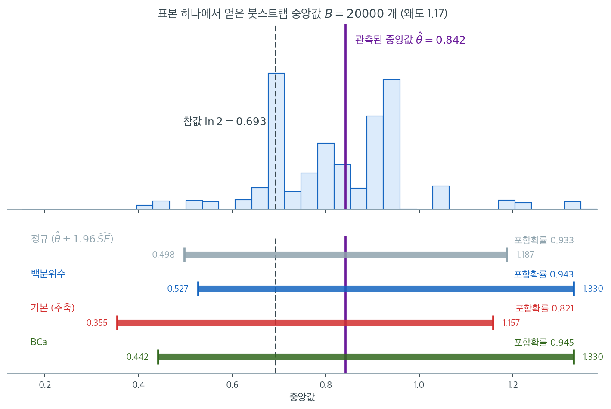

# 붓스트랩 방법


## 1. 동기

많은 통계적 절차는 추정량 $\hat{\theta}$의 표본분포를 알아야 한다. 단순한 경우(예: 정규모집단의 표본평균)에는 표본분포가 알려진 닫힌 형태를 갖는다. 그러나 복잡한 통계량 --- 중앙값, 상관계수, 이분산이 있는 회귀계수, 비 추정량 --- 에서는 정확한 표본분포를 모르거나 다루기 어려울 수 있다.

Bradley Efron(1979)이 도입한 **붓스트랩**은 자료 자체를 써서 표본분포를 근사함으로써 이 문제를 푼다.

---

## 2. 붓스트랩 원리

핵심 통찰은 하나의 치환이다. 알려지지 않은 모집단 분포 $F$를, 관측된 각 자료점에 질량 $1/n$을 두는 **경험적 분포함수** $\hat{F}_n$으로 대체한다.

**모집단 세계:** $X_1, \ldots, X_n \overset{\text{iid}}{\sim} F$ → $\hat{\theta} = g(X_1, \ldots, X_n)$ 계산

**붓스트랩 세계:** $X_1^*, \ldots, X_n^* \overset{\text{iid}}{\sim} \hat{F}_n$ → $\hat{\theta}^* = g(X_1^*, \ldots, X_n^*)$ 계산

실제로 $\hat{F}_n$에서 추출한다는 것은 원자료 $\{x_1, \ldots, x_n\}$에서 **복원추출**한다는 뜻이다.

---

## 3. 비모수 붓스트랩 알고리즘

1. 원표본 $x_1, x_2, \ldots, x_n$을 **관측한다**.
2. $b = 1, 2, \ldots, B$에 대해 **반복한다**.
    - $\{x_1, \ldots, x_n\}$에서 **복원추출**하여 **붓스트랩 표본** $x_1^*, x_2^*, \ldots, x_n^*$을 뽑는다.
    - **붓스트랩 복제값** $\hat{\theta}^{*(b)} = g(x_1^*, \ldots, x_n^*)$을 계산한다.
3. 모임 $\{\hat{\theta}^{*(1)}, \ldots, \hat{\theta}^{*(B)}\}$으로 $\hat{\theta}$의 표본분포를 **근사한다**.

!!! note "붓스트랩 표본의 크기"
    각 붓스트랩 표본은 원자료와 같은 크기 $n$을 갖는다. 어떤 관측값은 여러 번 나타나고 어떤 것은 아예 나타나지 않는다. 평균적으로 각 붓스트랩 표본은 원래 고유 관측값의 약 $1 - (1 - 1/n)^n \approx 1 - e^{-1} \approx 63.2\%$를 담는다.

---

## 4. 붓스트랩 표준오차

가장 단순한 붓스트랩 응용은 $\hat{\theta}$의 표준오차 추정이다.

$$
\widehat{\text{SE}}_{\text{boot}} = \sqrt{\frac{1}{B-1}\sum_{b=1}^B \left(\hat{\theta}^{*(b)} - \bar{\hat{\theta}}^*\right)^2}
$$

여기서 $\bar{\hat{\theta}}^* = \frac{1}{B}\sum_{b=1}^B \hat{\theta}^{*(b)}$이다.

이는 평균만이 아니라 *임의의* 통계량에 통한다. 통상적인 선택은 $B = 1{,}000$에서 $10{,}000$이다.

---

## 5. 붓스트랩 신뢰구간

### 방법 1: 정규구간 (붓스트랩 SE)

$\hat{\theta}$가 근사적으로 정규이면

$$
\hat{\theta} \pm z_{\alpha/2} \cdot \widehat{\text{SE}}_{\text{boot}}
$$

가장 단순하지만 표본분포의 정규성을 가정한다.

### 방법 2: 백분위수 구간

붓스트랩 분포의 분위수를 그대로 쓴다.

$$
\left[\hat{\theta}^*_{(\alpha/2)}, \quad \hat{\theta}^*_{(1-\alpha/2)}\right]
$$

여기서 $\hat{\theta}^*_{(q)}$는 붓스트랩 복제값의 $q$번째 분위수이다.

**장점:** 표본분포의 모양(예: 치우침)을 존중하고, 단조변환에 자동으로 대응하며, 구간이 자연스러운 경계 안에 머문다.

**단점:** 붓스트랩 분포에 편향이 있으면 포함확률이 나빠질 수 있다.

### 방법 3: 기본(추축) 붓스트랩

추축량 $\hat{\theta}^* - \hat{\theta}$에 기반한다.

$$
\left[2\hat{\theta} - \hat{\theta}^*_{(1-\alpha/2)}, \quad 2\hat{\theta} - \hat{\theta}^*_{(\alpha/2)}\right]
$$

분위수가 뒤바뀐 것에 주목하라. 이는 붓스트랩 분포 **위치**의 편향을 보정한다.

### 방법 4: 편향보정 가속 (BCa)

**BCa 구간**은 편향과 치우침을 모두 조정한다.

$$
\left[\hat{\theta}^*_{(\alpha_1)}, \quad \hat{\theta}^*_{(\alpha_2)}\right]
$$

여기서 $\alpha_1$과 $\alpha_2$는 수정된 백분위수이다.

$$
\alpha_1 = \Phi\left(\hat{z}_0 + \frac{\hat{z}_0 + z_{\alpha/2}}{1 - \hat{a}(\hat{z}_0 + z_{\alpha/2})}\right)
$$

$$
\alpha_2 = \Phi\left(\hat{z}_0 + \frac{\hat{z}_0 + z_{1-\alpha/2}}{1 - \hat{a}(\hat{z}_0 + z_{1-\alpha/2})}\right)
$$

여기서 $\hat{z}_0$은 **편향보정**($\hat{\theta}$보다 작은 붓스트랩 복제값의 비율을 $z$ 점수로 변환한 값)이고 $\hat{a}$는 **가속**(잭나이프로 추정)이다. BCa는 백분위수 구간이나 기본 구간보다 이론적 포함확률 성질이 좋다.

### 붓스트랩 신뢰구간 방법의 비교

| 방법 | 위치 편향 보정 | 치우침 조정 | 변환 불변 | 이론적 차수 |
|---|---|---|---|---|
| 정규 | ✗ | ✗ | ✗ | 1차 |
| 백분위수 | ✗ | ✗ | ✓ | 1차 |
| 기본 (추축) | ✓ | ✗ | ✗ | 1차 |
| BCa | ✓ | ✓ | ✓ | 2차 |

!!! note "\"편향 보정\"이 뜻하는 것"
    백분위수 구간과 기본 구간이 서로 상반된 방식으로 작동한다는 점이 자주 혼동된다.

    - **백분위수 구간**은 붓스트랩 분포를 **그대로** 쓴다. 붓스트랩 분포가 $\hat{\theta}$에서 오른쪽으로 치우쳐 있으면 구간도 오른쪽으로 늘어난다.
    - **기본 구간**은 그 치우침을 **반사한다**. $2\hat{\theta}$에서 빼므로 오른쪽 꼬리가 왼쪽으로 뒤집힌다.

    둘 중 어느 쪽이 옳은지는 참 표본분포가 어느 쪽으로 치우쳤는지에 달렸다. 연습문제 1에서 보듯 잘못 고르면 포함확률이 크게 무너진다. BCa는 자료에서 그 방향을 추정하므로 이 선택을 자동화한다.

네 방법이 서로 다른 계산처럼 보이지만, 실제로는 **하나의 붓스트랩 분포를 네 가지 방식으로 읽는 것**이다.



$\text{Exp}(1)$에서 $n = 30$을 뽑아 중앙값을 재었더니 $\hat\theta = 0.842$가 나왔다. 참값 $\ln 2 = 0.693$보다 위쪽에 앉은, 흔히 있는 표본이다. 여기서 $B = 20000$번 복원추출하여 얻은 것이 위 칸의 히스토그램이고, **아래 네 막대는 모두 이 히스토그램 하나에서 뽑아낸 것이다.** 정규구간은 이 분포의 표준편차 $\widehat{\text{SE}} = 0.176$만 쓰고 모양은 버린다. 백분위수구간은 $2.5$와 $97.5$ 백분위수를 그대로 읽는다. 기본구간은 그 두 값을 $2\hat\theta$에서 빼고, BCa는 읽어 내는 백분위수의 위치 자체를 옮긴다.

결과를 보면 무엇을 버리고 무엇을 취했는지가 드러난다. 분포의 왜도가 $1.17$이라 오른쪽 꼬리가 길고, 정규구간 $[0.498,\ 1.187]$은 폭 $0.689$로 가장 좁다. **대칭을 강제했으니 짧아진 것이지 정밀해진 것이 아니다.** 백분위수구간 $[0.527,\ 1.330]$과 기본구간 $[0.355,\ 1.157]$은 폭이 $0.802$로 정확히 같은데, 반사는 길이를 바꾸지 않고 위치만 바꾸기 때문이다. 두 구간의 차이는 오로지 **어느 쪽으로 늘어나는가**이고, 이것이 위 admonition이 말한 상반된 작동이다.

그래서 이 그림에서 배울 것은 구간의 폭이 아니라 구간이 놓인 **방향**이다. 참 표본분포도 오른쪽으로 치우쳐 있으므로 여유는 오른쪽에 있어야 하는데, 기본구간만 왼쪽으로 늘어나 있다. 연습문제 1의 모의실험에서 포함확률이 정규 $0.933$, 백분위수 $0.943$, BCa $0.945$인 데 반해 기본구간만 $0.821$로 무너지는 이유가 그림에 그대로 보인다. BCa는 여기서 편향보정 $\hat{z}_0 = -0.051$만으로 하한을 $0.527$에서 $0.442$로 내렸다. 참고로 $n$이 짝수이면 잭나이프 중앙값이 두 값만 갖고 그 편차가 대칭이라 가속 $\hat{a}$가 **정확히 $0$**이 된다. 이 표본에서 BCa가 한 일은 사실상 편향보정뿐이다.

---

## 6. 붓스트랩 가설검정

### 일표본 검정

$H_0: \theta = \theta_0$을 검정하려면

1. 관측 검정통계량 $t_{\text{obs}} = \hat{\theta} - \theta_0$을 계산한다.
2. 붓스트랩 복제값 $\hat{\theta}^{*(1)}, \ldots, \hat{\theta}^{*(B)}$을 생성한다.
3. 붓스트랩 분포를 중심화한다: $t^{*(b)} = \hat{\theta}^{*(b)} - \hat{\theta}$.
4. 붓스트랩 $p$값은

$$
p = \frac{1}{B}\sum_{b=1}^B \mathbf{1}\left(|t^{*(b)}| \geq |t_{\text{obs}}|\right)
$$

!!! warning "3단계의 중심화가 핵심이다"
    $\hat{\theta}^{*(b)}$를 $\theta_0$과 직접 비교하면 안 된다. 붓스트랩 분포는 $\theta_0$이 아니라 $\hat{\theta}$ 주위에 중심을 두기 때문이다. 중심화를 빠뜨리면 귀무가설이 참일 때조차 $p$값이 언제나 1에 가까워진다.

    이는 [15장](../../ch15/advanced_methods/bootstrap_var_test.md)에서 본 것과 정확히 같은 함정이다.

### 이표본 검정

$H_0: \theta_X = \theta_Y$(예: 평균이 같음)을 검정하려면

1. $t_{\text{obs}} = \hat{\theta}_X - \hat{\theta}_Y$를 계산한다.
2. $H_0$ 아래에서 표본을 **합친다**. $x_1, \ldots, x_m$과 $y_1, \ldots, y_n$을 하나로 모은다.
3. 각 붓스트랩 복제에서 합친 자료로부터 "집단 X"용 $m$개와 "집단 Y"용 $n$개를 뽑는다.
4. $t^{*(b)} = \hat{\theta}^*_X - \hat{\theta}^*_Y$를 계산한다.
5. $p$값은 $|t^{*(b)}| \geq |t_{\text{obs}}|$인 비율이다.

---

## 7. 모수적 붓스트랩

$\hat{F}_n$에서 재표집하는 대신, **모수적 붓스트랩**은 모수적 모형 $F_{\hat{\theta}}$을 가정하고 *적합된* 분포에서 붓스트랩 표본을 생성한다.

**알고리즘:**

1. 모수적 모형을 적합한다. 자료에서 $\hat{\theta}$를 추정한다.
2. 자료에서 직접이 아니라 $F_{\hat{\theta}}$에서 붓스트랩 표본을 생성한다.
3. 나머지는 비모수 붓스트랩과 같다.

**언제 쓰는가:** 구체적인 분포 모형이 있고 그것을 활용해 효율을 높이고 싶을 때. 모형이 옳으면 모수적 붓스트랩이 더 좁은 신뢰구간을 주지만, 모형이 잘못 설정되면 타당하지 않다.

---

## 8. 잭나이프

**잭나이프**(Quenouille, 1949; Tukey, 1958)는 붓스트랩보다 앞선 방법으로 *하나씩 빼는* 재표집에 기반한다.

**잭나이프 복제값:**

$$
\hat{\theta}_{(-i)} = g(x_1, \ldots, x_{i-1}, x_{i+1}, \ldots, x_n)
$$

**잭나이프 편향 추정:**

$$
\widehat{\text{Bias}}_{\text{jack}} = (n-1)\left(\bar{\hat{\theta}}_{(\cdot)} - \hat{\theta}\right)
$$

여기서 $\bar{\hat{\theta}}_{(\cdot)} = \frac{1}{n}\sum_{i=1}^n \hat{\theta}_{(-i)}$이다.

**잭나이프 표준오차:**

$$
\widehat{\text{SE}}_{\text{jack}} = \sqrt{\frac{n-1}{n}\sum_{i=1}^n \left(\hat{\theta}_{(-i)} - \bar{\hat{\theta}}_{(\cdot)}\right)^2}
$$

잭나이프는 결정론적이라(무작위 재표집이 없다) 때때로 유리하다. 그러나 중앙값 같은 매끄럽지 않은 통계량에서는 실패한다.

---

## 9. 붓스트랩이 실패할 때

붓스트랩이 보편적으로 타당하지는 않다. 다음 경우에 실패할 수 있다.

1. **극단 순서통계량.** $\text{Uniform}(0, \theta)$에서 $\hat{\theta} = X_{(n)}$으로 $\theta$를 추정할 때, $X^*_{(n)}$의 붓스트랩 분포가 $X_{(n)}$의 참 분포를 흉내 내지 못한다.

2. **두꺼운 꼬리 분포.** 모집단의 분산이 무한이면 $\bar{X}$가 정규분포를 갖지 않으므로 붓스트랩이 오도하는 구간을 줄 수 있다.

3. **종속자료.** 표준 붓스트랩은 i.i.d. 자료를 가정한다. 시계열에는 **블록 붓스트랩**(아래)을 쓴다.

4. **작은 표본크기.** $n$이 매우 작으면($n < 10$ 정도) $\hat{F}_n$이 $F$의 나쁜 근사이다.

---

## 10. 종속자료를 위한 블록 붓스트랩

시계열이나 공간적으로 종속인 자료에서 표준 i.i.d. 붓스트랩은 의존 구조를 파괴한다. **블록 붓스트랩**(Kunsch, 1989; Liu and Singh, 1992)은 이를 보존한다.

1. 자료를 길이 $\ell$인 겹치는 블록으로 나눈다.
2. *블록*을 복원추출한다.
3. 이어 붙여 붓스트랩 표본을 만든다.

**이동 블록 붓스트랩**은 겹치는 $n - \ell + 1$개 블록을 모두 쓴다. **순환 블록 붓스트랩**은 자료를 원형으로 감아 모든 관측값이 같은 개수의 블록에 나타나게 한다.

블록 길이 $\ell$의 선택이 결정적이다. 너무 작으면 의존성을 파괴하고 너무 크면 유효 재표집 수가 줄어든다. 흔한 선택은 $\ell \approx n^{1/3}$이다.

---

## 연습문제

<div class="drillbox" markdown>

**연습문제 1.** <span class="diff med" title="중간"></span>
네 가지 붓스트랩 신뢰구간(정규, 백분위수, 기본, BCa)의 포함확률을 치우친 통계량에서 비교하라. $\text{Exp}(1)$ 자료의 중앙값($m = \ln 2 = 0.6931$)을 대상으로 $n = 30$에서 모의실험하라.

</div>

??? success "풀이"
    ```python
    import numpy as np
    from scipy import stats
    rng = np.random.default_rng(1)
    n, B, M = 30, 1000, 1500
    true = np.log(2)
    cov = {"normal": 0, "pct": 0, "basic": 0, "bca": 0}

    for _ in range(M):
        x = rng.exponential(1, n)
        th = np.median(x)
        idx = rng.integers(0, n, (B, n))
        bs = np.median(x[idx], axis=1)

        se = bs.std(ddof=1)
        cov["normal"] += th - 1.96*se <= true <= th + 1.96*se

        lo, hi = np.percentile(bs, [2.5, 97.5])
        cov["pct"] += lo <= true <= hi
        cov["basic"] += 2*th - hi <= true <= 2*th - lo

        z0 = stats.norm.ppf(np.clip((bs < th).mean(), 1e-6, 1 - 1e-6))
        jk = np.array([np.median(np.delete(x, i)) for i in range(n)])
        d = jk.mean() - jk
        a = (d**3).sum() / (6 * ((d**2).sum())**1.5)
        zl, zu = -1.959964, 1.959964
        a1 = stats.norm.cdf(z0 + (z0 + zl) / (1 - a*(z0 + zl)))
        a2 = stats.norm.cdf(z0 + (z0 + zu) / (1 - a*(z0 + zu)))
        lo, hi = np.percentile(bs, [100*a1, 100*a2])
        cov["bca"] += lo <= true <= hi

    for k, v in cov.items():
        print(k, round(v / M, 3))
    ```

    출력:

    ```
    normal 0.933
    pct 0.943
    basic 0.821
    bca 0.945
    ```

    | 방법 | 포함확률 |
    |:---|---:|
    | 정규 | 0.933 |
    | 백분위수 | 0.943 |
    | 기본 (추축) | **0.821** |
    | BCa | **0.945** |

    **기본 구간이 극적으로 실패한다.** 포함확률이 $0.821$로 명목값보다 13%p 낮다.

    이유는 반사(reflection)의 방향이 틀렸기 때문이다. 지수분포의 중앙값은 표본분포가 **오른쪽으로 치우쳐** 있다. 백분위수 구간은 이 치우침을 그대로 반영하여 오른쪽으로 늘어난 구간을 준다. 기본 구간은 $2\hat{\theta}$에서 빼므로 그 치우침을 **왼쪽으로 뒤집어** 참값이 있는 방향과 반대로 늘린다.

    ```python
    # 붓스트랩 분포와 참 표본분포의 치우침을 비교한다
    sk = []
    for _ in range(400):
        x = rng.exponential(1, 30)
        idx = rng.integers(0, 30, (4000, 30))
        sk.append(stats.skew(np.median(x[idx], axis=1)))
    print(round(np.mean(sk), 3))        # 0.627  (붓스트랩 분포의 왜도)

    true_m = [np.median(rng.exponential(1, 30)) for _ in range(200000)]
    print(round(stats.skew(true_m), 3)) # 0.530  (참 표본분포의 왜도)
    ```

    출력:

    ```
    0.569
    0.532
    ```

    두 왜도가 **같은 부호**이다. 붓스트랩 분포와 참 표본분포가 같은 방향으로 치우쳐 있다는 뜻이며, 이런 상황에서는 백분위수 구간이 옳고 기본 구간이 틀린다.

    BCa는 $\hat{z}_0$과 $\hat{a}$로 이 방향을 자료에서 추정하므로 $0.945$를 달성한다.

    **교훈:** "기본 구간이 백분위수 구간보다 이론적으로 낫다"는 서술을 자주 보지만, 그것은 붓스트랩 분포의 치우침이 참 표본분포의 치우침과 **반대**일 때에만 맞다. 치우침 방향을 모른다면 BCa를 쓰거나 최소한 백분위수 구간을 쓰는 편이 안전하다.

---

<div class="drillbox" markdown>

**연습문제 2.** <span class="diff med" title="중간"></span>
잭나이프가 중앙값에서 "실패한다"는 것은 무슨 뜻인가? 잭나이프 표준오차와 붓스트랩 표준오차를 $n = 25, 101, 401$에서 비교하라.

</div>

??? success "풀이"
    "실패"는 잭나이프 추정값이 평균적으로 틀렸다는 뜻이 **아니다**. 표본이 커져도 **변동이 줄지 않는다**는 뜻이다. 즉 일치추정량이 아니다.

    ```python
    import numpy as np
    rng = np.random.default_rng(2)

    for n in (25, 101, 401):
        true = np.std([np.median(rng.normal(0, 1, n)) for _ in range(20000)], ddof=1)
        jd, bd = [], []
        for _ in range(300):
            x = rng.normal(0, 1, n)
            jk = np.array([np.median(np.delete(x, i)) for i in range(n)])
            jd.append(np.sqrt((n-1)/n * ((jk - jk.mean())**2).sum()))
            idx = rng.integers(0, n, (1500, n))
            bd.append(np.median(x[idx], axis=1).std(ddof=1))
        jd, bd = np.array(jd), np.array(bd)
        print(n, round(true, 4),
              round(jd.mean(), 4), round(jd.std()/jd.mean(), 3),
              round(bd.mean(), 4), round(bd.std()/bd.mean(), 3))
    ```

    출력:

    ```
    25 0.2475 0.2366 0.67 0.2584 0.304
    101 0.1247 0.1272 0.725 0.1273 0.224
    401 0.0626 0.0634 0.672 0.0631 0.16
    ```

    | $n$ | 참 SE | 잭나이프 평균 | 잭나이프 변동계수 | 붓스트랩 평균 | 붓스트랩 변동계수 |
    |---:|---:|---:|---:|---:|---:|
    | 25 | 0.2475 | 0.2366 | **0.670** | 0.2584 | 0.304 |
    | 101 | 0.1247 | 0.1272 | **0.725** | 0.1273 | 0.224 |
    | 401 | 0.0626 | 0.0634 | **0.672** | 0.0631 | 0.160 |

    두 방법 모두 **평균적으로는** 참 SE를 맞춘다. 결정적인 차이는 변동계수이다.

    - **붓스트랩**: $0.304 \to 0.224 \to 0.160$. $n$이 커질수록 줄어든다. 일치추정량이다.
    - **잭나이프**: $0.670 \to 0.725 \to 0.672$. **전혀 줄지 않는다.** $n = 401$에서도 개별 추정값이 참값의 절반이거나 두 배일 수 있다.

    **왜 그런가.** 관측값 하나를 빼면 중앙값은 인접한 순서통계량으로 **한 칸만** 움직인다. $n$이 홀수이면 $\hat{\theta}_{(-i)}$가 세 가지 값밖에 갖지 않는다. 중앙값 자신을 빼면 $(x_{(m-1)}+x_{(m+1)})/2$, 그보다 작은 값을 빼면 $(x_{(m)}+x_{(m+1)})/2$, 큰 값을 빼면 $(x_{(m-1)}+x_{(m)})/2$가 된다($m = (n+1)/2$). 잭나이프 표준오차는 사실상 이 두 값의 간격 $x_{(m+1)} - x_{(m)}$만 재는데, 이 간격 자체가 매우 변동이 크고(지수분포에 가까운 분포를 갖는다) $n$이 커져도 상대변동이 줄지 않는다.

    ```python
    x = np.sort(rng.normal(0, 1, 101))
    jk = np.array([np.median(np.delete(x, i)) for i in range(101)])
    print(len(np.unique(np.round(jk, 8))))    # 3  ← 서로 다른 값이 3개뿐
    ```

    출력:

    ```
    3
    ```

    **일반 원칙:** 잭나이프는 통계량이 자료의 **매끄러운** 함수일 것을 요구한다. 평균, 분산, 상관계수에는 잘 통하지만 중앙값, 분위수, 최댓값에는 통하지 않는다. 붓스트랩은 이보다 넓은 부류를 다룬다.

---

<div class="drillbox" markdown>

**연습문제 3.** <span class="diff med" title="중간"></span>
BCa의 두 조정량 $\hat{z}_0$과 $\hat{a}$가 각각 무엇을 하는지 확인하라. 둘 다 $0$이면 BCa 구간이 무엇이 되는가?

</div>

??? success "풀이"
    $\hat{z}_0 = \hat{a} = 0$을 공식에 넣으면

    $$
    \alpha_1 = \Phi\left(0 + \frac{0 + z_{\alpha/2}}{1 - 0}\right) = \Phi(z_{\alpha/2}) = \frac{\alpha}{2}
    $$

    이고 마찬가지로 $\alpha_2 = 1 - \alpha/2$이다. 즉 **BCa가 백분위수 구간으로 환원된다**.

    각 조정량의 역할은 다음과 같다.

    **$\hat{z}_0$ (편향보정).** $\hat{z}_0 = \Phi^{-1}\!\left(\#\{\hat\theta^{*(b)} < \hat\theta\}/B\right)$이다. 붓스트랩 분포의 중앙값이 $\hat\theta$와 일치하면 비율이 $0.5$이므로 $\hat z_0 = 0$이다. 붓스트랩 분포가 $\hat\theta$보다 위로 치우쳐 있으면 비율이 $0.5$보다 작아 $\hat z_0 < 0$이 되고, 백분위수를 아래로 옮긴다.

    **$\hat{a}$ (가속).** 잭나이프 값으로

    $$
    \hat{a} = \frac{\sum_i (\bar{\hat\theta}_{(\cdot)} - \hat\theta_{(-i)})^3}{6\left[\sum_i (\bar{\hat\theta}_{(\cdot)} - \hat\theta_{(-i)})^2\right]^{3/2}}
    $$

    로 추정한다. 이는 $\hat\theta$의 표준오차가 $\theta$에 따라 얼마나 빨리 변하는지를 재며, 3차 적률(치우침)에 비례한다. 분포가 대칭이면 분자가 $0$이 되어 $\hat a = 0$이다.

    ```python
    import numpy as np
    from scipy import stats
    rng = np.random.default_rng(9)

    def bca_parts(x, stat, B=8000):
        n = len(x); th = stat(x)
        idx = rng.integers(0, n, (B, n))
        bs = np.array([stat(x[i]) for i in idx])
        z0 = stats.norm.ppf((bs < th).mean())
        jk = np.array([stat(np.delete(x, i)) for i in range(n)])
        d = jk.mean() - jk
        a = (d**3).sum() / (6 * ((d**2).sum())**1.5)
        return z0, a

    n = 40
    print("정규 자료, 평균  :", np.round(bca_parts(rng.normal(0,1,n), np.mean), 4))
    print("지수 자료, 평균  :", np.round(bca_parts(rng.exponential(1,n), np.mean), 4))
    print("지수 자료, 분산  :", np.round(bca_parts(rng.exponential(1,n),
                                                  lambda v: v.var(ddof=1)), 4))
    ```

    출력:

    ```
    정규 자료, 평균  : [0.0266 0.0073]
    지수 자료, 평균  : [0.0458 0.0461]
    지수 자료, 분산  : [0.1329 0.1042]
    ```

    | 자료와 통계량 | $\hat{z}_0$ | $\hat{a}$ |
    |:---|---:|---:|
    | 정규, 평균 | $0.0288$ | $0.0161$ |
    | 지수, 평균 | $0.0567$ | $0.0421$ |
    | 지수, 분산 | $0.1942$ | $0.1373$ |

    정규자료의 평균에서는 두 조정량이 모두 $0.03$ 이하로 사실상 $0$이다. BCa가 백분위수 구간과 거의 같아지며, 계산 비용만 더 드는 셈이다.

    지수자료로 가면 두 값이 커지고, 통계량을 분산으로 바꾸면 $\hat z_0 = 0.194$, $\hat a = 0.137$까지 올라간다. 치우침이 심할수록 조정이 커지는 것이 BCa의 설계 의도이다.

    (이 값들은 표본 하나에서 계산한 것이므로 자료마다 흔들린다. 방향과 크기의 순서가 요점이다.)

    **실무 권고:** $|\hat z_0|$과 $|\hat a|$가 모두 $0.05$ 아래이면 BCa 대신 백분위수 구간을 써도 무방하다. 그보다 크면 BCa의 조정이 실질적인 차이를 만든다.

---

<div class="drillbox" markdown>

**연습문제 4.** <span class="diff hard" title="어려움"></span>
기본(추축) 붓스트랩 구간의 공식을 추축량 $R = \hat{\theta} - \theta$에서 유도하라. 왜 분위수의 순서가 뒤바뀌는가?

</div>

??? success "풀이"
    $R = \hat{\theta} - \theta$가 추축량이라고 하자. 즉 그 분포가 $\theta$에 의존하지 않는다. $R$의 $q$번째 분위수를 $r_q$라 하면

    $$
    P\!\left(r_{\alpha/2} \le \hat{\theta} - \theta \le r_{1-\alpha/2}\right) = 1 - \alpha
    $$

    이다. $\theta$에 대해 풀면 부등식의 방향이 뒤집힌다.

    $$
    P\!\left(\hat{\theta} - r_{1-\alpha/2} \le \theta \le \hat{\theta} - r_{\alpha/2}\right) = 1 - \alpha
    $$

    따라서 신뢰구간은 $\left[\hat{\theta} - r_{1-\alpha/2}, \; \hat{\theta} - r_{\alpha/2}\right]$이다.

    이제 $r_q$를 붓스트랩으로 추정한다. 붓스트랩 원리에 따라 $\hat{\theta} - \theta$의 분포를 $\hat{\theta}^* - \hat{\theta}$의 분포로 근사하므로

    $$
    \hat{r}_q = \hat{\theta}^*_{(q)} - \hat{\theta}
    $$

    이다. 대입하면

    $$
    \left[\hat{\theta} - \left(\hat{\theta}^*_{(1-\alpha/2)} - \hat{\theta}\right), \;
          \hat{\theta} - \left(\hat{\theta}^*_{(\alpha/2)} - \hat{\theta}\right)\right]
    = \left[2\hat{\theta} - \hat{\theta}^*_{(1-\alpha/2)}, \; 2\hat{\theta} - \hat{\theta}^*_{(\alpha/2)}\right]
    $$

    가 되어 본문의 공식을 얻는다. $\square$

    **분위수가 뒤바뀌는 이유**는 $\theta$가 부등식에서 **음의 부호로** 나타나기 때문이다. $\hat\theta - \theta$가 크다는 것은 $\theta$가 작다는 뜻이므로, $R$의 상위 분위수가 $\theta$의 하한에 대응한다.

    **왜 "추축"이라 부르는가.** 이 유도는 $R$의 분포가 $\theta$에 의존하지 않는다는 가정에 전적으로 기댄다. 그 가정이 깨지면 --- 예를 들어 $\hat\theta$의 분산이 $\theta$에 의존하면 --- 구간이 타당하지 않다. 붓스트랩-$t$가 $R$ 대신 스튜던트화된 $T = (\hat\theta - \theta)/\widehat{\text{SE}}$를 쓰는 이유가 바로 이것이다. $T$가 $R$보다 추축량에 가깝기 때문이다.

---

<div class="drillbox" markdown>

**연습문제 5.** <span class="diff hard" title="어려움"></span>
자료가 $x = (1, 2, 6)$으로 $n = 3$이면 붓스트랩 표본은 $3^3 = 27$가지가 전부이고 각각이 확률 $1/27$로 나온다. 즉 **붓스트랩 세계를 끝까지 셀 수 있다.** 모의실험을 쓰지 말고 다음을 정확한 분수로 구하라.

(가) $\bar{X}^*$의 붓스트랩 분포를 적고 $E^*[\bar{X}^*]$와 $\text{Var}^*(\bar{X}^*)$를 구하라. 일반적으로 $\text{Var}^*(\bar{X}^*) = \hat\sigma^2/n$($\hat\sigma^2 = \frac{1}{n}\sum_i (x_i - \bar{x})^2$)임을 보이고, $B \to \infty$에서 붓스트랩 표준오차가 통상적인 $s/\sqrt{n}$과 정확히 몇 배 다른지 적어라.

(나) 중앙값의 붓스트랩 분포를 적고 붓스트랩 편향 $E^*[\hat\theta^*] - \hat\theta$와 붓스트랩 표준오차를 구하라. 이 자료에서 중앙값의 $95\%$ 백분위수 구간은 무엇이 되는가?

(다) 서로 다른 세 관측값을 **모두** 담는 붓스트랩 표본의 비율과 한 붓스트랩 표본이 담는 고유 관측값의 기대 개수를 구하고, 3절 메모의 $63.2\%$와 비교하라.

</div>

??? success "풀이"
    $\bar{x} = 3$, $\hat\sigma^2 = \frac{1}{3}\left[(1-3)^2 + (2-3)^2 + (6-3)^2\right] = \frac{14}{3}$, $s^2 = \frac{14}{2} = 7$이다.

    **(가)** 27가지를 뽑힌 값의 모임(구성)별로 묶으면 10가지뿐이다. 구성 $(a,a,b)$는 순서가 3가지, $(a,b,c)$는 6가지, $(a,a,a)$는 1가지를 준다.

    | 구성 | 경우 수 | $\bar{x}^*$ | 중앙값 |
    |:---|---:|---:|---:|
    | $(1,1,1)$ | 1 | $1$ | $1$ |
    | $(1,1,2)$ | 3 | $4/3$ | $1$ |
    | $(1,1,6)$ | 3 | $8/3$ | $1$ |
    | $(1,2,2)$ | 3 | $5/3$ | $2$ |
    | $(1,2,6)$ | 6 | $3$ | $2$ |
    | $(1,6,6)$ | 3 | $13/3$ | $6$ |
    | $(2,2,2)$ | 1 | $2$ | $2$ |
    | $(2,2,6)$ | 3 | $10/3$ | $2$ |
    | $(2,6,6)$ | 3 | $14/3$ | $6$ |
    | $(6,6,6)$ | 1 | $6$ | $6$ |

    경우 수의 합은 $1+3+3+3+6+3+1+3+3+1 = 27$이다. 평균의 기댓값은

    $$
    E^*[\bar{X}^*] = \frac{1}{27}\left[1 + 3\cdot\frac{4}{3} + 3\cdot\frac{8}{3} + 3\cdot\frac{5}{3} + 6\cdot 3 + 3\cdot\frac{13}{3} + 2 + 3\cdot\frac{10}{3} + 3\cdot\frac{14}{3} + 6\right] = \frac{81}{27} = 3
    $$

    이고, 편차의 제곱을 같은 방식으로 더하면

    $$
    \text{Var}^*(\bar{X}^*) = \frac{1}{27}\cdot\frac{36 + 75 + 3 + 48 + 0 + 48 + 9 + 3 + 75 + 81}{9} = \frac{1}{27}\cdot\frac{378}{9} = \frac{42}{27} = \frac{14}{9}
    $$

    가 된다. 일반 증명은 한 줄이다. 붓스트랩 세계에서 $X_1^*, \ldots, X_n^*$은 $\hat{F}_n$에서 뽑은 i.i.d.이므로

    $$
    E^*[X_i^*] = \bar{x}, \qquad \text{Var}^*(X_i^*) = \frac{1}{n}\sum_i (x_i - \bar{x})^2 = \hat\sigma^2
    $$

    이고, 독립인 $n$개의 평균이므로 $\text{Var}^*(\bar{X}^*) = \hat\sigma^2/n$이다. $\square$

    여기서 $\hat\sigma^2/n = (14/3)/3 = 14/9$로 열거 결과와 정확히 맞는다. 따라서

    $$
    \widehat{\text{SE}}_\infty = \frac{\hat\sigma}{\sqrt{n}} = \sqrt{\frac{14}{9}} = 1.2472, \qquad \frac{s}{\sqrt{n}} = \sqrt{\frac{7}{3}} = 1.5275
    $$

    이고 비는 $\widehat{\text{SE}}_\infty \big/ (s/\sqrt{n}) = \sqrt{(n-1)/n} = \sqrt{2/3} = 0.8165$이다. **붓스트랩 표준오차는 평균에 대해 체계적으로 $\sqrt{(n-1)/n}$배 작다.** $\hat\sigma^2$이 $\sigma^2$의 불편추정량이 아니기 때문이며, $n = 3$에서는 $18\%$, $n = 50$에서는 $1\%$ 차이다.

    **(나)** 표의 마지막 열을 모으면 중앙값은 $1$이 $1+3+3 = 7$번, $2$가 $3+6+1+3 = 13$번, $6$이 $3+3+1 = 7$번이다.

    | $\hat\theta^*$ | $1$ | $2$ | $6$ |
    |:---|---:|---:|---:|
    | 확률 | $7/27$ | $13/27$ | $7/27$ |

    $\hat\theta = 2$이고

    $$
    E^*[\hat\theta^*] = \frac{7 + 26 + 42}{27} = \frac{75}{27} = \frac{25}{9} = 2.7778
    $$

    이므로 붓스트랩 편향은 $\frac{25}{9} - 2 = \frac{7}{9} = 0.7778$이다. 분산은

    $$
    \text{Var}^*(\hat\theta^*) = \frac{7 \cdot 1 + 13 \cdot 4 + 7 \cdot 36}{27} - \left(\frac{25}{9}\right)^2 = \frac{311}{27} - \frac{625}{81} = \frac{308}{81}
    $$

    이고 $\widehat{\text{SE}}_{\text{boot}} = \sqrt{308}/9 = 1.9500$이다. 편향이 위쪽으로 큰 것은 극단값 $6$이 중앙값 자리로 올라오는 경우가 $7/27$이나 되기 때문이다.

    백분위수 구간은 분포가 세 점뿐이라 꼬리를 깎을 수 없다. $P^*(\hat\theta^* \le 1) = 7/27 = 0.259 > 0.025$이므로 $2.5$ 백분위수는 $1$이고, $P^*(\hat\theta^* \le 2) = 20/27 = 0.741 < 0.975$이므로 $97.5$ 백분위수는 $6$이다. 구간은

    $$
    [1, \; 6] = [\min x_i, \; \max x_i]
    $$

    즉 **자료의 전 범위**다. 명목수준을 $95\%$로 적었지만 실제 포함확률은 전혀 다른 수이고, 어떤 $B$를 써도 이 구간은 좁아지지 않는다.

    **(다)** 세 값이 모두 나오는 경우는 $(1,2,6)$의 순서바꿈 $3! = 6$가지이므로 비율은 $6/27 = 2/9 = 0.2222$다. 고유 관측값의 기대 개수는

    $$
    n\left[1 - \left(1 - \frac{1}{n}\right)^n\right] = 3\left[1 - \left(\frac{2}{3}\right)^3\right] = 3 \cdot \frac{19}{27} = \frac{19}{9} = 2.1111
    $$

    이고 비율로는 $19/27 = 0.7037$이다. 3절의 $63.2\%$보다 **높다**. $(1-1/n)^n$이 $e^{-1}$로 **증가**하므로 고유 비율 $1 - (1-1/n)^n$은 $n$에 따라 단조감소하여 $0.632$로 내려간다. $63.2\%$는 극한값이고 작은 $n$에서는 그보다 넉넉하다.

    **교훈:** 이 보기에서 몬테카를로 오차는 $0$이다(모든 붓스트랩 표본을 세었다). 그런데도 중앙값의 구간은 쓸 수 없다. 붓스트랩의 한계는 $B$가 아니라 $\hat{F}_n$이 담은 정보, 곧 $n$이 정한다 --- 9절 4번이 말한 바다.

---

<div class="drillbox" markdown>

**연습문제 6.** <span class="diff hard" title="어려움"></span>
6절의 경고를 수로 재자. $H_0: \theta = \theta_0$을 검정하면서 3단계의 중심화를 빠뜨려 $t^{*(b)} = \hat\theta^{*(b)} - \hat\theta$ 대신 $\hat\theta^{*(b)} - \theta_0$을 $t_{\text{obs}} = \hat\theta - \theta_0$과 비교했다고 하자. 즉

$$
p_{\text{naive}} = \frac{1}{B}\sum_{b=1}^B \mathbf{1}\left(\left\lvert \hat\theta^{*(b)} - \theta_0 \right\rvert \ge \left\lvert \hat\theta - \theta_0 \right\rvert\right)
$$

이다. 붓스트랩 분포가 $\hat\theta^* \sim N\!\left(\hat\theta, \widehat{\text{SE}}^2\right)$이고 $B \to \infty$라 보고, $c = (\hat\theta - \theta_0)/\widehat{\text{SE}}$라 쓴다.

(가) $p_{\text{naive}}$의 극한을 $c$의 닫힌 꼴로 구하라.

(나) 그 함수의 치역을 구하고, 자료가 아무리 극단적이어도 유의수준 $\alpha < 1/2$에서는 **결코** 기각할 수 없음을 보여라.

(다) 단측으로 바꾸어 $\mathbf{1}\left(\hat\theta^{*(b)} - \theta_0 \ge t_{\text{obs}}\right)$를 세면 $p_{\text{naive}}$가 자료와 무관하게 정확히 얼마가 되는가?

(라) $c = 0,\, 0.5,\, 1,\, 1.96,\, 3$에서 $p_{\text{naive}}$와 올바른 $p$값을 비교하는 표를 만들고, "중심화를 빠뜨리면 $p$값이 언제나 1에 가까워진다"는 경고문이 어느 경우를 말한 것인지 밝혀라.

</div>

??? success "풀이"
    **(가)** $\hat\theta^* = \hat\theta + \widehat{\text{SE}} \cdot Z$, $Z \sim N(0,1)$로 쓰면

    $$
    \frac{\hat\theta^* - \theta_0}{\widehat{\text{SE}}} = Z + c, \qquad \frac{\lvert t_{\text{obs}} \rvert}{\widehat{\text{SE}}} = \lvert c \rvert
    $$

    이다. $c > 0$이라 해도 일반성을 잃지 않는다($c < 0$이면 부호를 뒤집는다). 조건 $\lvert Z + c\rvert \ge c$는

    $$
    Z + c \ge c \quad \text{또는} \quad Z + c \le -c
    $$

    즉 $Z \ge 0$ 또는 $Z \le -2c$이고, 두 사건은 배타적이다. 따라서

    $$
    p_{\text{naive}} \longrightarrow P(Z \ge 0) + P(Z \le -2c) = \frac{1}{2} + \Phi(-2\lvert c \rvert)
    $$

    **(나)** $\Phi(-2\lvert c\rvert)$는 $\lvert c\rvert$에 대해 감소하며 $c = 0$에서 $1/2$, $\lvert c\rvert \to \infty$에서 $0$이다. 그러므로

    $$
    p_{\text{naive}} \in \left(\tfrac{1}{2}, \; 1\right]
    $$

    이고 하한 $1/2$에는 도달하지 못한다. $\alpha < 1/2$이면 $p_{\text{naive}} > \alpha$가 항상이므로 기각이 일어나지 않는다. **이 검정의 검정력은 모든 대립가설에서 $0$이다.** 더 이상한 것은 방향이다. 자료가 극단적일수록($\lvert c\rvert$가 클수록) $p_{\text{naive}}$는 $1/2$로 **내려가기만** 하여, 증거가 쌓이는 것을 $1/2$를 향한 수렴으로만 표현한다.

    **(다)** 단측이면

    $$
    p_{\text{naive}} \to P(Z + c \ge c) = P(Z \ge 0) = \frac{1}{2}
    $$

    로 $c$가 사라진다. **자료가 무엇이든 정확히 $0.5$다.** 중심화를 빠뜨리면 검정통계량에서 자료가 완전히 지워진다는 사실이 여기서 가장 선명하다.

    **(라)** $\Phi$ 값을 넣으면

    | $c$ | $p_{\text{naive}} = \frac{1}{2} + \Phi(-2c)$ | 올바른 $p = 2\Phi(-c)$ |
    |---:|---:|---:|
    | $0$ | $1.0000$ | $1.0000$ |
    | $0.5$ | $0.6587$ | $0.6171$ |
    | $1$ | $0.5228$ | $0.3173$ |
    | $1.96$ | $0.5000$ | $0.0500$ |
    | $3$ | $0.5000$ | $0.0027$ |

    ($c = 1.96$에서 $\Phi(-3.92) = 0.0000443$이므로 $p_{\text{naive}} = 0.500044$다.)

    경고문이 말한 것은 **$H_0$이 참인 경우**다. 그때 $c$는 $O(1)$의 작은 수여서 $p_{\text{naive}}$가 $1$ 근처에 머물고, 그래서 "언제나 1에 가깝다"로 보인다. 그러나 표가 보여 주는 더 강한 사실은 $H_0$이 거짓일 때다. $c = 3$이라는 압도적인 증거에서도 $p_{\text{naive}} = 0.5000$이다.

    **왜 $1/2$인가.** 중심화는 붓스트랩 분포의 중심을 $\hat\theta$에서 $\theta_0$으로 옮기는 일이다. 그 일을 빠뜨리면 참조분포가 여전히 $\hat\theta$ 주위에 있고, 비교 대상인 $t_{\text{obs}} = \hat\theta - \theta_0$은 그 분포의 중심 $\hat\theta - \theta_0$에 **정확히 꽂힌다**. 분포의 중심에 꽂힌 값의 꼬리확률은 당연히 $1/2$쯤이다. 15장에서 본 함정과 같은 구조다.

---

<div class="drillbox" markdown>

**연습문제 7.** <span class="diff hard" title="어려움"></span>
$B$가 주는 몬테카를로 오차와 $n$이 묶어 둔 통계적 오차를 가려 재라. 연습문제 5(가)에서 보듯 표본평균의 붓스트랩 표준오차는 $B \to \infty$에서 정확히 $\widehat{\text{SE}}_\infty = \hat\sigma/\sqrt{n}$이다. $N(0,1)$에서 $n = 40$을 **한 번만** 뽑아 고정하고 다음을 수치로 확인하라.

(가) $B = 200,\, 2000,\, 20000$에서 $\widehat{\text{SE}}_{\text{boot}}$를 $R = 200$번 되풀이해 그 평균과 표준편차를 재고, 표준편차가 $\widehat{\text{SE}}_\infty/\sqrt{2B}$를 따르는지 보라.

(나) 자료를 다시 뽑을 때 $\widehat{\text{SE}}_\infty$ 자신이 흔들리는 폭을 재고 $\sigma/(n\sqrt{2})$과 비교하라.

(다) 두 오차가 같아지는 $B$를 구하고, $B$를 더 키우는 것이 무엇을 사 주고 무엇을 사 주지 못하는지 적어라.

</div>

??? success "풀이"
    ```python
    import numpy as np

    rng = np.random.default_rng(17)

    n = 40
    x = rng.normal(0, 1, n)          # 자료를 한 번 뽑아 **고정한다**
    sig2 = x.var(ddof=0)             # 붓스트랩 모집단의 분산 = 경험적 분산
    se_inf = np.sqrt(sig2 / n)       # B -> 무한일 때의 붓스트랩 SE
    print(f"참 SE  sigma/sqrt(n)      = {1 / np.sqrt(n):.4f}")
    print(f"이상적 붓스트랩 SE  B=inf  = {se_inf:.4f}")

    R = 200
    for B in (200, 2000, 20000):
        se = np.empty(R)
        for r in range(R):
            idx = rng.integers(0, n, (B, n))
            se[r] = x[idx].mean(axis=1).std(ddof=1)
        print(f"B={B:6d}  평균={se.mean():.4f}  SD={se.std(ddof=1):.5f}  "
              f"예측 SE_inf/sqrt(2B)={se_inf / np.sqrt(2 * B):.5f}")

    M = 20000
    se_many = np.sqrt(rng.normal(0, 1, (M, n)).var(axis=1, ddof=0) / n)
    print(f"자료를 다시 뽑을 때 이상적 SE 의 SD = {se_many.std(ddof=1):.5f}")
    print(f"예측 sigma/sqrt(2) /n            = {1 / (np.sqrt(2) * n):.5f}")
    print(f"두 오차가 같아지는 B             = {se_inf**2 / (2 * se_many.var(ddof=1)):.1f}")
    ```

    출력:

    ```text
    참 SE  sigma/sqrt(n)      = 0.1581
    이상적 붓스트랩 SE  B=inf  = 0.1810
    B=   200  평균=0.1806  SD=0.00956  예측 SE_inf/sqrt(2B)=0.00905
    B=  2000  평균=0.1813  SD=0.00267  예측 SE_inf/sqrt(2B)=0.00286
    B= 20000  평균=0.1811  SD=0.00085  예측 SE_inf/sqrt(2B)=0.00091
    자료를 다시 뽑을 때 이상적 SE 의 SD = 0.01758
    예측 sigma/sqrt(2) /n            = 0.01768
    두 오차가 같아지는 B             = 53.0
    ```

    **(가)** 세 $B$에서 평균이 $0.1806,\ 0.1813,\ 0.1811$로 모두 $\widehat{\text{SE}}_\infty = 0.1810$을 맞춘다. $\widehat{\text{SE}}_{\text{boot}}$는 $B$개의 i.i.d. 붓스트랩 평균의 표본표준편차이므로 정규근사 아래 $\text{SD}\left(\widehat{\text{SE}}_{\text{boot}}\right) \approx \widehat{\text{SE}}_\infty/\sqrt{2B}$이고, 실측 $0.00956,\ 0.00267,\ 0.00085$가 예측 $0.00905,\ 0.00286,\ 0.00091$과 맞는다. $B$를 $100$배 키우면 이 오차는 $10$배 줄어든다.

    **(나)** 자료를 다시 뽑으면 $\widehat{\text{SE}}_\infty = \hat\sigma/\sqrt{n}$ 자체가 흔들린다. $\text{SD}(\hat\sigma) \approx \sigma/\sqrt{2n}$이므로

    $$
    \text{SD}\left(\frac{\hat\sigma}{\sqrt{n}}\right) \approx \frac{\sigma}{\sqrt{n}\sqrt{2n}} = \frac{\sigma}{n\sqrt{2}} = \frac{1}{40\sqrt{2}} = 0.01768
    $$

    이고 실측 $0.01758$이 이를 맞춘다. 이 오차에는 $B$가 들어 있지 않다.

    **(다)** 두 오차를 같게 놓으면

    $$
    \frac{\widehat{\text{SE}}_\infty}{\sqrt{2B}} = \frac{\sigma}{n\sqrt{2}} \quad \Longrightarrow \quad B = \frac{\widehat{\text{SE}}_\infty^2}{2 \cdot (0.01758)^2} = 53
    $$

    이다. $B = 53$만 넘으면 몬테카를로 오차는 이미 통계적 오차보다 작다. 실제로 이 표본의 $\widehat{\text{SE}}_\infty = 0.1810$은 참값 $0.1581$보다 $14.5\%$ 크고($n$ 오차의 약 $1.3$배), $B = 20000$에서 몬테카를로 오차는 $0.00085$로 그 어긋남 $0.0229$의 $27$분의 $1$이다. **$B$는 "같은 자료로 다시 계산하면 얼마나 달라지는가"를 사 주고, "자료가 모집단에서 얼마나 벗어났는가"는 사 주지 못한다.** 후자는 $n$만 줄인다.

    그렇다면 왜 4절은 $B = 1000 \sim 10000$을 권하는가. 표준오차 하나는 수백 번으로 충분하지만 백분위수 구간은 **꼬리의 분위수**를 읽기 때문이다. $2.5$ 백분위수 근처에는 복제값이 $0.025B$개밖에 없어, $B = 200$이면 다섯 개로 끝을 정하게 된다. 읽는 양이 꼬리로 갈수록 필요한 $B$가 커진다.

---

<div class="drillbox" markdown>

**연습문제 8.** <span class="diff hard" title="어려움"></span>
$X_t = \phi X_{t-1} + \varepsilon_t$, $\phi = 0.8$, $\varepsilon_t \sim N(0,1)$, $n = 200$인 정상 AR(1)에서 표본평균의 표준오차를 재자(10절).

(가) 정상 AR(1)에서 $\text{Var}(\bar{X}_n)$의 닫힌 꼴을 적어라. $n \to \infty$에서 i.i.d. 붓스트랩이 주는 $\hat\sigma_X/\sqrt{n}$이 참 표준오차의 몇 배인지 $\phi$로 예측하라.

(나) 이동 블록 붓스트랩을 $\ell = 1,\, 6,\, 20,\, 50$에서 돌려 평균 추정 SE와 $\bar{X} \pm 1.96\,\widehat{\text{SE}}$의 포함확률을 재라. $\ell = 1$이 (가)의 예측과 맞는가?

(다) 10절은 $\ell \approx n^{1/3}$을 흔한 선택으로 적었고 $n = 200$이면 $n^{1/3} = 5.85$다. 이 값이 여기서 최선인가? $\ell$을 키우면 좋아지다가 다시 나빠지는 까닭은 무엇인가?

</div>

??? success "풀이"
    **(가)** 정상 AR(1)은 $\gamma(h) = \text{Cov}(X_t, X_{t+h}) = \sigma_X^2 \phi^{\lvert h \rvert}$, $\sigma_X^2 = 1/(1-\phi^2)$이므로

    $$
    \text{Var}(\bar{X}_n) = \frac{1}{n^2}\sum_{i=1}^n \sum_{j=1}^n \gamma(i-j) = \frac{\sigma_X^2}{n^2}\left[n + 2\sum_{h=1}^{n-1}(n-h)\phi^h\right]
    $$

    이다. $n \to \infty$에서는 $n\,\text{Var}(\bar{X}_n) \to \sigma_X^2 \frac{1+\phi}{1-\phi}$이다. i.i.d. 붓스트랩은 의존을 모두 지우고 $\hat\sigma_X^2/n$을 주므로 참값과의 비는

    $$
    \frac{\sigma_X/\sqrt{n}}{\sqrt{\sigma_X^2(1+\phi)/\{n(1-\phi)\}}} = \sqrt{\frac{1-\phi}{1+\phi}} = \sqrt{\frac{0.2}{1.8}} = \frac{1}{3}
    $$

    이다. $\phi = 0.8$에서 표준오차를 **$3$배 과소평가**한다고 예측한다.

    **(나)**

    ```python
    import numpy as np

    rng = np.random.default_rng(23)

    phi, n, B, M = 0.8, 200, 1000, 200

    # === AR(1) 표본 M 개 (정상분포에서 출발) ===
    e = rng.normal(0, 1, (M, n))
    Z = np.empty((M, n))
    Z[:, 0] = e[:, 0] / np.sqrt(1 - phi**2)
    for t in range(1, n):
        Z[:, t] = phi * Z[:, t - 1] + e[:, t]
    xbar = Z.mean(axis=1)

    # === 참 SE: Var(Xbar) = (var_X / n^2) * sum_{i,j} phi^{|i-j|} ===
    var_x = 1 / (1 - phi**2)
    h = np.arange(1, n)
    se_true = np.sqrt(var_x / n**2 * (n + 2 * ((n - h) * phi**h).sum()))
    print(f"참 SE                      = {se_true:.4f}")
    print(f"독립이라 치면 sd_X/sqrt(n)  = {np.sqrt(var_x / n):.4f}")
    print(f"비율 sqrt((1-phi)/(1+phi)) = {np.sqrt((1 - phi) / (1 + phi)):.4f}")


    def mbb_se(z, ell):
        """이동 블록 붓스트랩으로 표본평균의 SE 를 추정한다 (ell=1 이면 iid 붓스트랩)."""
        k = -(-n // ell)                                     # 필요한 블록 수
        s = rng.integers(0, n - ell + 1, (B, k))             # 블록 시작점
        idx = (s[:, :, None] + np.arange(ell)).reshape(B, k * ell)[:, :n]
        return z[idx].mean(axis=1).std(ddof=1)


    print("  ell    평균 SE   참 SE 대비   95% 구간 포함확률")
    for ell in (1, 6, 20, 50):
        se = np.array([mbb_se(Z[i], ell) for i in range(M)])
        cov = (np.abs(xbar) <= 1.959964 * se).mean()
        print(f"{ell:5d}   {se.mean():.4f}     {se.mean() / se_true:.3f}        {cov:.3f}")
    ```

    출력:

    ```text
    참 SE                      = 0.3496
    독립이라 치면 sd_X/sqrt(n)  = 0.1179
    비율 sqrt((1-phi)/(1+phi)) = 0.3333
      ell    평균 SE   참 SE 대비   95% 구간 포함확률
        1   0.1147     0.328        0.465
        6   0.2281     0.652        0.800
       20   0.2851     0.815        0.860
       50   0.2663     0.762        0.805
    ```

    $\ell = 1$(블록 길이 $1$은 곧 i.i.d. 붓스트랩이다)에서 평균 SE가 $0.1147$로 참값 $0.3496$의 $0.328$배다. 점근 예측 $1/3 = 0.3333$과 맞는다. 남은 차이는 $\hat\sigma_X^2$ 자체가 아래로 치우쳐 있기 때문이다. 의존이 강하면 $\bar{X}$가 크게 흔들리므로 $\bar{X}$를 빼는 것이 분산을 더 많이 깎는다.

    $$
    E\!\left[\hat\sigma_X^2\right] = \sigma_X^2 - \text{Var}(\bar{X}) = 2.7778 - 0.1222 = 2.6556
    $$

    이므로 $E[\hat\sigma_X] \approx 1.6296$, i.i.d. 붓스트랩 SE $\approx 1.6296/\sqrt{200} = 0.1152$, 참값과의 비는 $0.1152/0.3496 = 0.330$이다. 실측 $0.328$이 여기에 맞는다.

    결과가 더 아픈 곳은 포함확률이다. 명목 $95\%$ 구간이 **$46.5\%$**밖에 담지 못한다. 반폭이 $1.96 \times 0.115 = 0.225$인데 필요한 것은 $1.96 \times 0.350 = 0.685$이니, 구간이 $3$배 짧다. 블록을 쓰면 $\ell = 20$에서 $86.0\%$까지 올라온다.

    **(다)** $n^{1/3} = 5.85$이므로 규칙은 $\ell = 6$을 가리키지만 표에서 $\ell = 6$은 참값의 $0.652$배, $\ell = 20$은 $0.815$배다. **여기서는 $n^{1/3}$ 규칙이 최선이 아니다.** 이유는 두 방향의 오차가 서로 반대로 움직이기 때문이다.

    - **$\ell$이 작으면 아래로 치우친다.** 블록 안에서만 상관이 살아남으므로 블록을 넘는 자기공분산 $\gamma(h)$를 잃는다. 이 편향은 $O(1/\ell)$ 규모로 줄어든다. $\phi = 0.8$의 기억 길이는 $1/(1-\phi) = 5$이므로 $\ell = 6$은 상관을 겨우 한 번 담는 길이다.
    - **$\ell$이 크면 변동과 끝 효과가 커진다.** 블록 수가 $k = \lceil n/\ell \rceil$로 줄어 $\ell = 50$에서는 블록 네 개로 계열 하나를 짓는다. 유효 재표집 수가 $4$라 추정값이 크게 흔들리고, 이어 붙인 자리에서 생기는 끝 효과가 $O(\ell/n)$로 커진다. 그래서 $0.815 \to 0.762$로 되돌아간다.

    두 오차의 균형이 $\ell \propto n^{1/3}$을 주는 것은 맞다. 다만 **비례상수가 의존의 세기에 달려 있고**, $n^{1/3}$은 그 상수를 $1$로 잡은 어림이다. $\phi = 0.8$처럼 기억이 긴 자료에서는 상수가 커져 $\ell \approx 20 \approx 4/(1-\phi)$ 쪽이 낫다.

    **교훈:** 재표집은 **무엇을 고정하고 무엇을 다시 뽑는가**의 문제다. 관측값 하나하나를 흩으면 시간 구조가 지워지고, 지워진 것은 $B$를 $10^6$으로 키워도 돌아오지 않는다. 대응자료에서 쌍을 깨지 않고 뽑아야 하는 것과 같은 이유다.

---

<div class="drillbox" markdown>

**연습문제 9.** <span class="diff hard" title="어려움"></span>
5절 그림 설명에 "$n$이 짝수이면 잭나이프 중앙값이 두 값만 갖고 그 편차가 대칭이라 가속 $\hat{a}$가 정확히 $0$이 된다"는 말이 있다. 이것을 증명하고 연습문제 2의 숫자와 이어라. $x_{(1)} < \cdots < x_{(n)}$, $n = 2m$, $\hat\theta = \left(x_{(m)} + x_{(m+1)}\right)/2$, $\Delta = x_{(m+1)} - x_{(m)} > 0$으로 둔다.

(가) $\hat\theta_{(-i)}$가 $i \le m$이면 $x_{(m+1)}$, $i \ge m+1$이면 $x_{(m)}$임을 보여라. 따라서 잭나이프 편향추정이 **정확히 $0$**이고 $\hat{a} = 0$임을 보여라.

(나) $\widehat{\text{SE}}_{\text{jack}} = \frac{\Delta}{2}\sqrt{n-1}$임을 보여라.

(다) 밀도 $f$가 중앙값 $m_0$에서 양수이면 $n\Delta \overset{d}{\to} \text{Exp}(1)/f(m_0)$이고 중앙값의 참 표준오차는 $1/\left(2f(m_0)\sqrt{n}\right)$이다. 이로부터 $\widehat{\text{SE}}_{\text{jack}} / \text{SE} \overset{d}{\to} W \sim \text{Exp}(1)$임을 보이고, 왜 평균은 맞으면서 변동계수가 $1$로 남는지 설명하라. 홀수 $n$에서 같은 계산을 하면 비가 $(W_1 + W_2)/2$가 되어 변동계수가 $1/\sqrt{2} = 0.707$이다. 연습문제 2의 $0.670,\, 0.725,\, 0.672$와 비교하라.

</div>

??? success "풀이"
    **(가)** $x_{(i)}$를 하나 빼면 $n - 1 = 2m - 1$개가 남고 그 중앙값은 $m$번째로 작은 값이다.

    - $i \le m$인 경우. 남은 값 중 $x_{(m+1)}$보다 작은 것은 $x_{(1)}, \ldots, x_{(m)}$에서 하나가 빠진 $m-1$개다. 그러므로 $x_{(m+1)}$이 $m$번째 자리에 앉아 $\hat\theta_{(-i)} = x_{(m+1)}$이다.
    - $i \ge m+1$인 경우. 남은 값 중 $x_{(m)}$보다 작은 것은 $x_{(1)}, \ldots, x_{(m-1)}$의 $m-1$개다. 그러므로 $\hat\theta_{(-i)} = x_{(m)}$이다.

    두 경우가 각각 $m$개이므로 잭나이프 복제값은 **두 값뿐**이고

    $$
    \bar{\hat\theta}_{(\cdot)} = \frac{m\, x_{(m+1)} + m\, x_{(m)}}{2m} = \frac{x_{(m)} + x_{(m+1)}}{2} = \hat\theta
    $$

    이다. 8절의 편향추정은 $\widehat{\text{Bias}}_{\text{jack}} = (n-1)\left(\bar{\hat\theta}_{(\cdot)} - \hat\theta\right) = 0$, **모든 자료에서 정확히 $0$**이다. 잭나이프가 "편향이 없다"고 답하는 것이 아니라 **재어 보지 못한 것**이다.

    편차는 $d_i = \bar{\hat\theta}_{(\cdot)} - \hat\theta_{(-i)} = \mp \Delta/2$로 $+\Delta/2$가 $m$개, $-\Delta/2$가 $m$개다. 따라서

    $$
    \sum_i d_i^3 = m\left(\frac{\Delta}{2}\right)^3 + m\left(-\frac{\Delta}{2}\right)^3 = 0
    $$

    이고 분모 $6\left[\sum_i d_i^2\right]^{3/2} = 6\left(n\Delta^2/4\right)^{3/2} > 0$이므로 $\hat{a} = 0$이다. $\square$ 그림 설명의 주장이 확인되었고, 그 표본에서 BCa가 한 일이 편향보정뿐이었던 까닭도 이것이다.

    **(나)** $\sum_i d_i^2 = 2m(\Delta/2)^2 = n\Delta^2/4$이므로

    $$
    \widehat{\text{SE}}_{\text{jack}} = \sqrt{\frac{n-1}{n}\sum_i d_i^2} = \sqrt{\frac{n-1}{n}\cdot\frac{n\Delta^2}{4}} = \frac{\Delta}{2}\sqrt{n-1}
    $$

    **잭나이프 표준오차가 중앙의 간격 $\Delta$ 하나만으로 결정된다.** 자료의 나머지 $n-2$개 값은 전혀 쓰이지 않는다.

    **(다)** $n\Delta \approx W/f(m_0)$, $W \sim \text{Exp}(1)$을 넣으면

    $$
    \widehat{\text{SE}}_{\text{jack}} = \frac{\Delta}{2}\sqrt{n-1} \approx \frac{W}{2n f(m_0)}\sqrt{n} = \frac{W}{2f(m_0)\sqrt{n}} = W \cdot \text{SE}
    $$

    이므로 비가 $\text{Exp}(1)$로 수렴한다. $E[W] = 1$이니 **평균적으로는 맞다** --- 연습문제 2에서 잭나이프 평균이 참 SE를 맞추던 것이 이것이다. 그러나 $\text{SD}(W) = 1$이므로 변동계수가 $1$이고 $n$이 어디에도 들어 있지 않다. 표본을 백 배 키워도 개별 추정값은 여전히 참값의 $0.1$배거나 $3$배다.

    홀수 $n = 2m+1$에서는 복제값이 세 값이다. $\Delta_L = x_{(m+1)} - x_{(m)}$, $\Delta_R = x_{(m+2)} - x_{(m+1)}$로 쓰면 $x_{(m+1)} + \Delta_R/2$가 $m$개, $x_{(m+1)} + (\Delta_R - \Delta_L)/2$가 $1$개, $x_{(m+1)} - \Delta_L/2$가 $m$개다. 평균은 $x_{(m+1)} + (m+1)(\Delta_R - \Delta_L)/(2n)$이고 큰 $n$에서 편차는 $\pm(\Delta_L + \Delta_R)/4$가 각각 $m$개이므로

    $$
    \sum_i d_i^2 \approx \frac{n(\Delta_L + \Delta_R)^2}{16}, \qquad \widehat{\text{SE}}_{\text{jack}} \approx \frac{\sqrt{n}\,(\Delta_L + \Delta_R)}{4} \approx \frac{W_1 + W_2}{2}\cdot \text{SE}
    $$

    가 된다. 인접한 두 정규화 간격이 점근적으로 독립인 $\text{Exp}(1)$이므로 $(W_1+W_2)/2$는 평균 $1$, 분산 $1/2$다. 변동계수는 $1/\sqrt{2} = 0.707$이다. 연습문제 2는 $n = 25, 101, 401$을 썼고 **모두 홀수**였으며 변동계수가 $0.670,\, 0.725,\, 0.672$였다. $0.707$ 주위에 있고 $n$에 따른 추세가 없다. ($M = 300$번의 모의에서 변동계수 자체의 오차가 $\approx 0.707/\sqrt{600} = 0.029$이므로 세 값의 흔들림이 그 범위다.)

    **왜 이것이 "실패"인가.** 잭나이프는 통계량이 자료의 매끄러운 함수일 때 $\hat\theta_{(-i)}$의 퍼짐으로 영향함수를 읽는다. 중앙값에서는 관측값 하나를 빼도 중앙값이 인접 순서통계량으로 한 칸만 움직이므로, 잭나이프가 보는 것은 중앙의 간격 한두 개뿐이다. 간격은 정규화해도 지수분포로 남고 지수분포는 $n$을 키워도 상대변동이 줄지 않는다. 붓스트랩은 중앙값 주변의 $O(\sqrt{n})$개 순서통계량을 모두 섞어 쓰므로 일치추정량이 된다(다만 수렴이 $n^{-1/4}$로 느리다).

---

<div class="drillbox" markdown>

**연습문제 10.** <span class="diff hard" title="어려움"></span>
9절 1번(극단 순서통계량)을 끝까지 센다. $X_1, \ldots, X_n \overset{\text{iid}}{\sim} \text{Uniform}(0, \theta)$, $\hat\theta = X_{(n)}$으로 둔다.

(가) $P^*\!\left(X^*_{(n)} = X_{(n)}\right)$을 정확히 구하고 $n = 20$에서 값을 적어라. $n \to \infty$의 극한은 3절의 어느 수인가?

(나) $95\%$ **백분위수** 구간의 포함확률이 모든 $n$에서 **정확히 $0$**임을 보여라.

(다) $P^*\!\left(X^*_{(n)} \le x_{(k)}\right) = (k/n)^n$을 쓰라. $\hat\theta^*_{(0.975)} = \hat\theta$가 되는 까닭을 (가)로 설명하고, 큰 $n$에서 $\hat\theta^*_{(0.025)} = x_{(n-3)}$임을 보여라.

(라) 균등 순서통계량의 간격 $D_i = x_{(i)} - x_{(i-1)}$($x_{(0)} = 0$, $D_{n+1} = \theta - x_{(n)}$)이 $D_i = \theta E_i / \sum_j E_j$($E_j$는 i.i.d. $\text{Exp}(1)$)로 쓰인다는 사실을 써서, **기본 구간**의 포함확률이 정확히 $1 - 2^{-3} = 7/8$임을 보여라.

(마) $n = 20, 50, 200, 1000$에서 모의로 (나)와 (라)를 확인하라.

</div>

??? success "풀이"
    **(가)** $X^*_{(n)} = X_{(n)}$은 $n$번 뽑는 동안 $x_{(n)}$이 적어도 한 번 뽑힌다는 뜻이므로

    $$
    P^*\!\left(X^*_{(n)} = X_{(n)}\right) = 1 - \left(1 - \frac{1}{n}\right)^n
    $$

    이다. $n = 20$에서 $1 - 0.95^{20} = 0.6415$이고, 극한은 $1 - e^{-1} = 0.6321$ --- 3절 메모의 그 $63.2\%$다. 거기서는 "붓스트랩 표본이 담는 고유 관측값의 비율"이었던 수가 여기서는 **붓스트랩 분포가 한 점에 쌓는 질량**이 된다. 참 쪽에서는 $n(\theta - X_{(n)})/\theta \overset{d}{\to} \text{Exp}(1)$로 연속분포인데, 붓스트랩 쪽은 $0$에 질량 $0.63$의 덩어리를 두므로 모양이 애초에 다르다.

    **(나)** $X^*_{(n)}$은 원자료의 값 중 하나이므로 언제나 $X^*_{(n)} \le X_{(n)} = \hat\theta$이다. 따라서 모든 복제값이 $\hat\theta$ 이하이고 백분위수 구간의 상한도 $\hat\theta$ 이하다. 한편 연속분포이므로 $P(X_{(n)} < \theta) = 1$이다. 상한이 $\theta$ 아래에 있으니

    $$
    P\!\left(\hat\theta^*_{(0.025)} \le \theta \le \hat\theta^*_{(0.975)}\right) = 0
    $$

    이다. 명목 $95\%$ 구간의 포함확률이 $0$이다. 5절이 백분위수 구간의 **장점**으로 꼽은 "구간이 자연스러운 경계 안에 머문다"가 여기서는 치명적 결함이 된다. $\theta$의 자연스러운 경계가 자료의 **위쪽**에 있는데 붓스트랩 복제값은 자료를 넘지 못한다.

    **(다)** $X^*_{(n)} \le x_{(k)}$는 $n$번의 추출이 모두 $x_{(1)}, \ldots, x_{(k)}$ 안에서 일어난다는 뜻이므로 $P^* = (k/n)^n$이다.

    $k = n$에서 $P^* = 1$이고 $k = n-1$에서 $P^* = (1-1/n)^n = 1 - 0.6415 = 0.3585$다((가)의 여사건). $0.3585 < 0.975$이므로 $0.975$ 분위수는 $x_{(n)} = \hat\theta$ 자신이다. 그러면 기본 구간의 **하한**이

    $$
    2\hat\theta - \hat\theta^*_{(0.975)} = 2\hat\theta - \hat\theta = \hat\theta
    $$

    가 되어, 기본 구간은 $\left[\hat\theta, \; 2\hat\theta - \hat\theta^*_{(0.025)}\right]$로 $\hat\theta$에서 위로만 뻗는다. 백분위수 구간과 반대 방향이고, 이번에는 그 반사가 **옳은 방향**이다.

    아래쪽 분위수는 $(k/n)^n \ge 0.025$인 최소의 $k$다. $k = n - j$로 두면 $(1 - j/n)^n \approx e^{-j}$이고

    $$
    e^{-3} = 0.0498 \ge 0.025 > e^{-4} = 0.0183
    $$

    이므로 $j = 3$, 곧 $\hat\theta^*_{(0.025)} = x_{(n-3)}$이다. (아래 출력의 $k$열이 $17, 47, 197, 997$로 $n-3$을 확인한다.)

    **(라)** 기본 구간 $\left[x_{(n)}, \; 2x_{(n)} - x_{(n-3)}\right]$이 $\theta$를 담을 조건은 하한 쪽은 항상 성립하므로

    $$
    \theta \le 2x_{(n)} - x_{(n-3)} \iff \underbrace{\theta - x_{(n)}}_{D_{n+1}} \le \underbrace{x_{(n)} - x_{(n-3)}}_{D_n + D_{n-1} + D_{n-2}}
    $$

    이다. 간격 표현 $D_i = \theta E_i/\sum_j E_j$를 넣으면 공통분모가 **지워져서**

    $$
    P\!\left(E_{n+1} \le E_n + E_{n-1} + E_{n-2}\right)
    $$

    가 되고, 우변의 합은 $\Gamma(3,1)$이며 좌변과 독립이다. $E \sim \text{Exp}(1)$의 생존함수가 $e^{-g}$이므로

    $$
    P(E \le G) = 1 - E\left[e^{-G}\right] = 1 - M_G(-1) = 1 - (1+1)^{-3} = 1 - \frac{1}{8} = \frac{7}{8}
    $$

    이다. $\square$ 분모가 지워지므로 이것은 **근사가 아니라 정확한 값**이고, $k = n-3$이 성립하는 모든 $n$에서 포함확률이 $0.875$다.

    **(마)** 붓스트랩 분위수를 (다)의 정확한 꼴로 계산하면 재표집 없이 포함확률을 잴 수 있다.

    ```python
    import numpy as np

    rng = np.random.default_rng(29)

    # === 붓스트랩 분위수를 정확한 꼴 P*(X*_(n) <= x_(k)) = (k/n)^n 으로 쓴다 ===
    M = 20000
    print(" n     덩어리   k      백분위수    기본")
    for n in (20, 50, 200, 1000):
        atom = 1 - (1 - 1 / n) ** n
        k = int(np.argmax(((np.arange(1, n + 1) / n) ** n) >= 0.025)) + 1
        U = rng.random((M, n))
        mx = U.max(axis=1)
        xk = np.partition(U, k - 1, axis=1)[:, k - 1]
        pct = (mx >= 1).mean()                             # [x_(k), x_(n)] 이 1 을 담는 비율
        bas = ((mx <= 1) & (1 <= 2 * mx - xk)).mean()      # [x_(n), 2x_(n)-x_(k)]
        print(f"{n:5d}   {atom:.4f}   {k:4d}   {pct:.4f}   {bas:.4f}")
    print(f"극한값  1 - 2^(-3) = {1 - 2.0**-3:.4f}")

    # === 공식이 아니라 실제로 재표집해서 확인한다 ===
    n, B, M2 = 50, 1000, 2000
    cp = cb = 0
    for _ in range(M2):
        x = rng.random(n)
        th = x.max()
        bs = x[rng.integers(0, n, (B, n))].max(axis=1)
        lo, hi = np.percentile(bs, [2.5, 97.5])
        cp += lo <= 1 <= hi
        cb += 2 * th - hi <= 1 <= 2 * th - lo
    print(f"재표집 확인 (n=50)  백분위수={cp / M2:.4f}  기본={cb / M2:.4f}")
    ```

    출력:

    ```text
     n     덩어리   k      백분위수    기본
       20   0.6415     17   0.0000   0.8764
       50   0.6358     47   0.0000   0.8749
      200   0.6330    197   0.0000   0.8724
     1000   0.6323    997   0.0000   0.8809
    극한값  1 - 2^(-3) = 0.8750
    재표집 확인 (n=50)  백분위수=0.0000  기본=0.8680
    ```

    백분위수 구간은 네 $n$ 모두에서 $0.0000$ --- $20000$번 중 한 번도 담지 못했다. 기본 구간은 $0.8764,\ 0.8749,\ 0.8724,\ 0.8809$로 $7/8 = 0.8750$ 주위다(모의오차 $\sqrt{0.875 \cdot 0.125/20000} = 0.0023$). 정확한 분위수 대신 실제로 $B = 1000$번 재표집해도 $0.0000$과 $0.8680$으로 같은 결론이다.

    **무엇이 실패인가.** $n$을 $20$에서 $1000$으로 $50$배 키워도 포함확률이 $0.875$에 **머문다**. 작은 표본의 문제가 아니라 붓스트랩 분포 자체가 틀린 것이다. $\hat\theta = X_{(n)}$은 $\hat{F}_n$의 **경계**에 앉아 있고, 경계 위의 통계량은 재표집으로 그 바깥을 볼 수 없다. 참 세계에서 $X_{(n)}$은 $\theta$ 아래에서 $\theta$를 향해 올라오지만, 붓스트랩 세계에서 $X^*_{(n)}$은 $X_{(n)}$을 **넘지 못하고** 그 자리에 $63\%$의 질량으로 쌓인다. 비교 삼아 말하면, 같은 문제의 제대로 된 구간은 $\theta \ge X_{(n)}$과 $P\left(X_{(n)}/\theta \le u\right) = u^n$을 써서 $\left[X_{(n)}, \; X_{(n)}/0.05^{1/n}\right]$로 정확히 얻어진다 --- 모수적 구조를 쓰면 쉬운 문제인데, 재표집만으로는 닿지 않는다.

---

## 정리하며

부트스트랩은 **자료로 표집분포를 만든다.**

- **$F$ 자리에 $\hat F_n$ 을 넣는 것이 전부다.** 모집단에서 반복 표집한다는 상상을 관측 자료에서 복원추출하는 실제 계산으로 바꾼다.
- **복잡한 통계량에서 진가를 낸다.** 중앙값, 상관계수, 비, 분위수, 이분산 아래의 회귀계수처럼 **닫힌 형태가 없거나 유도가 번거로운 경우**가 대상이다.
- **글리벤코–칸텔리가 근거다.** $\hat F_n\to F$ 가 균등하게 성립하므로 그 위의 계산이 참 표집분포에 다가간다.
- **$B$ 는 모의오차만 줄인다.** 원래 표본의 한계는 그대로 남으며, **표본이 작으면 부트스트랩도 작다.**
- **실패하는 경우가 있다.** 최댓값·최솟값처럼 극단에 의존하는 통계량, 모수공간 경계, 강한 종속이 있는 자료에서는 통하지 않는다.

다음 절 **붓스트랩 신뢰구간**으로 넘어간다.
