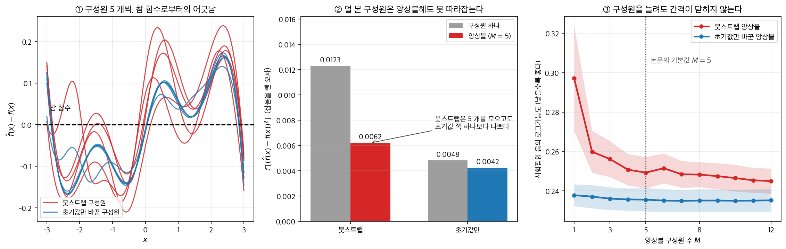
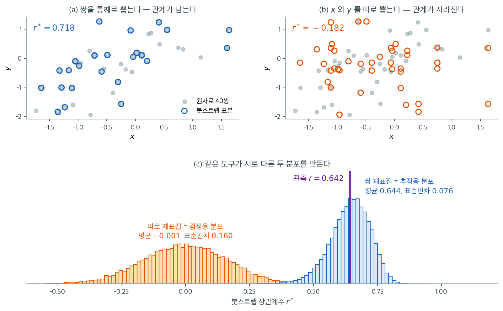

# 비모수 붓스트랩

## 1. 동기

비모수 붓스트랩은 가장 널리 쓰이는 붓스트랩 형태이다. 밑에 깔린 모집단 분포 $F$에 대해 아무 가정도 하지 않으며 사실상 모든 통계량에 적용된다. 관측된 표본이 주어지면 복원추출을 반복하여 근사 표집분포를 생성한다.

이 절에서는 알고리즘을 상세히 다루고, 그것이 산출하는 핵심 양(표준오차, 편향 추정값, 붓스트랩 분포)을 유도하며, 이 방법이 언제 왜 작동하는지 밝힌다.

---

## 2. 알고리즘

관측된 i.i.d. 표본 $x_1, x_2, \ldots, x_n$과 통계량 $\hat{\theta} = g(x_1, \ldots, x_n)$이 주어졌을 때:

1. 붓스트랩 복제 횟수 $B$를 **정한다**(보통 $B = 1{,}000$에서 $10{,}000$).
2. $b = 1, 2, \ldots, B$에 대해:
    - $\{x_1, \ldots, x_n\}$에서 $n$개를 **복원추출**하여 붓스트랩 표본 $x_1^*, x_2^*, \ldots, x_n^*$을 뽑는다.
    - 붓스트랩 복제값 $\hat{\theta}^{*(b)} = g(x_1^*, \ldots, x_n^*)$을 계산한다.
3. 붓스트랩 분포 $\{\hat{\theta}^{*(1)}, \hat{\theta}^{*(2)}, \ldots, \hat{\theta}^{*(B)}\}$를 **모은다**.

$B$개 붓스트랩 복제값의 모임이 $\hat{\theta}^*$의 **붓스트랩 분포**를 이루며, 이것이 $\hat{\theta}$의 참 표집분포의 근사가 된다.

!!! note "표본크기를 같게 유지한다"
    각 붓스트랩 표본은 원자료와 같은 크기 $n$을 갖는다. 더 적거나 많이 뽑으면 표집변동이 달라져 근사가 무효가 된다.

---

## 3. 붓스트랩 표준오차

$\hat{\theta}$의 표준오차에 대한 붓스트랩 추정값은 붓스트랩 복제값의 표본표준편차이다.

$$
\widehat{\text{SE}}_{\text{boot}} = \sqrt{\frac{1}{B-1}\sum_{b=1}^{B}\left(\hat{\theta}^{*(b)} - \bar{\hat{\theta}}^*\right)^2}
$$

여기서 $\bar{\hat{\theta}}^* = \frac{1}{B}\sum_{b=1}^{B}\hat{\theta}^{*(b)}$은 붓스트랩 분포의 평균이다.

이 공식은 평균, 중앙값, 상관계수, 회귀모수 등 자료의 임의의 함수에 그대로 적용된다.

---

## 4. 붓스트랩 편향 추정

붓스트랩은 $\theta$의 추정량으로서 $\hat{\theta}$가 갖는 편향의 추정값도 제공한다.

$$
\widehat{\text{Bias}}_{\text{boot}} = \bar{\hat{\theta}}^* - \hat{\theta}
$$

논리는 이렇다. 현실 세계에서 편향은 $E_F[\hat{\theta}] - \theta$이다. 붓스트랩 세계에서는 $\hat{\theta}$가 참 모수 역할을, $\hat{\theta}^*$가 추정량 역할을 하므로 붓스트랩 편향은 $E^*[\hat{\theta}^*] - \hat{\theta}$이고, 이를 $\bar{\hat{\theta}}^* - \hat{\theta}$로 추정한다.

**편향보정** 추정량은 다음과 같이 만들 수 있다.

$$
\hat{\theta}_{\text{corrected}} = \hat{\theta} - \widehat{\text{Bias}}_{\text{boot}} = 2\hat{\theta} - \bar{\hat{\theta}}^*
$$

!!! warning "편향보정은 분산을 키울 수 있다"
    편향보정이 체계적 오차를 줄이기는 하지만 추정량의 분산을 크게 늘릴 수 있다. 편향보정 추정량은 편향이 작은 대신 평균제곱오차가 더 클 수 있다. 실무에서는 편향이 표준오차에 비해 클 때에만 편향보정이 유용하다.

---

## 5. 붓스트랩 분포

$\{\hat{\theta}^{*(1)}, \ldots, \hat{\theta}^{*(B)}\}$의 히스토그램은 $\hat{\theta}$의 표집분포를 시각적으로 근사한다. 이 분포에서 읽을 수 있는 주요 특징은 다음과 같다.

- **중심**: $\bar{\hat{\theta}}^*$가 $E[\hat{\theta}]$를 근사한다.
- **산포**: $\widehat{\text{SE}}_{\text{boot}}$가 $\text{SE}(\hat{\theta})$를 근사한다.
- **모양**: 표집분포의 치우침, 다봉성, 두꺼운 꼬리.
- **분위수**: 신뢰구간 구성에 직접 쓴다.

모양 정보가 특히 값지다. 정규이론 근사가 부적절한 경우를 드러내 주기 때문이다.

---

## 6. 붓스트랩 표본의 성질

각 붓스트랩 표본이 $n$개 자료점에서 $n$개를 복원추출하므로, 어떤 관측값은 여러 번 뽑히고 어떤 것은 아예 빠진다.

관측값 $x_i$가 한 붓스트랩 표본에 나타나는 횟수는 $\text{Binomial}(n, 1/n)$을 따르며, $n$이 크면 근사적으로 $\text{Poisson}(1)$이다. $x_i$가 전혀 나타나지 않을 확률은

$$
P(x_i \notin \text{붓스트랩 표본}) = \left(1 - \frac{1}{n}\right)^n \to e^{-1} \approx 0.368
$$

이다. 평균적으로 각 붓스트랩 표본은 원래 고유 관측값의 약 $63.2\%$를 담는다.

!!! tip "Out-of-bag 관측값"
    주어진 붓스트랩 표본에 포함되지 않은 관측값을 **out-of-bag**(OOB) 관측값이라 한다. 이들은 예측오차를 추정하는 자연스러운 검증집합이 되며, 랜덤 포레스트와 배깅에서 널리 활용된다.

<div class="aibox" markdown>

**AI로 보는 통계학 1.** 그 $37\%$ 를 누가 치르는가

위의 $63.2\%$ 는 통계학에서 좋은 소식이다. 남는 $36.8\%$ 가 공짜 검증집합이 되니까.
그런데 같은 문장을 신경망 쪽에서 읽으면 이렇게 들린다 — **구성원마다 자료를 $37\%$ 덜
보고 배운다.**

$2017$ 년, 라크슈미나라야난·프리첼·블런델은 신경망의 예측 불확실성을 재는 방법으로
앙상블을 내놓으면서 **배깅을 쓰지 않았다.** 논문 $2.4$ 절이 든 이유가 바로 위 식이다 —
붓스트랩 표본으로 학습한 기저 학습자는 고유 자료점을 $63\%$ 밖에 보지 못하므로 붓스트랩이
성능을 해칠 때가 있다는 것이다. 그들은 자료를 전부 쓰고 **초기값과 섞는 순서만** 바꾸었다.
그리고 한 줄을 덧붙였다. **「배깅은 우리 실험에서 성능을 떨어뜨렸다.」** 권하는 구성원 수는
$M = 5$ 다.



$f(x) = \sin 1.5x + 0.3x$ 에 표준편차 $0.3$ 의 잡음을 얹어 $200$ 개를 뽑고, 은닉층
$64$–$64$ 짜리 작은 그물로 그대로 따라 해 보았다. 붓스트랩 표본이 담은 고유 관측은 실측
$63.4\%$ 로 위 식과 맞는다.

- **①** 붓스트랩 구성원들은 참 함수에서 큼직하게 벗어나고 서로도 갈린다. 구성원 사이의
  흩어짐이 $0.066$ 대 $0.019$ 로, 붓스트랩 쪽이 **세 배 반 더 다양하다.** 그런데 그
  다양성은 자료가 아니라 **자료의 결손**에서 왔다.
- **②** 잡음을 뺀 추정오차 $\mathbb{E}[(\hat f - f)^2]$ 은 구성원 하나에서 $0.0123$ 대
  $0.0048$ 로 붓스트랩 쪽이 $2.5$ 배 나쁘다. 앙상블은 그 손해를 메우는 데 쓰여 $0.0062$
  까지 내려오지만, **초기값만 바꾼 그물 한 개**($0.0048$)에도 못 미친다.
- **③** 다섯을 열둘로 늘려도 간격이 닫히지 않는다. 붓스트랩 열두 개의 음의 로그가능도
  $0.245$ 가 초기값 쪽 **한 개**의 $0.238$ 보다 높다.

$2020$ 년에 같은 연구진이 이것만 따로 파고들었다. CIFAR-$10$ 에 Wide ResNet 을 올려
놓고 붓스트랩이 쓰는 고유 자료의 비율을 $63.21\%$ 에서 $99\%$ 까지 끌어올려 보았다.
비율을 올리면 성능이 오르기는 했지만, $100\%$ 에 가까워져도 **잘 조정된 기준선을 넘지
못했다.** 그들이 적은 문장이 위 ② 와 같다 — 앙상블로 얻는 이득이 자료 크기가 깎인 몫을
이기지 못한다는 것이다.

재표집은 **통계량이 얼마나 흔들리는지 재는** 도구다. 자료를 덜 봐도 평균은 여전히
평균이다. 학습자는 다르다 — **자료가 곧 성능이다.** 같은 $37\%$ 인데 치르는 쪽이 바뀌면
값도 달라진다.

_확인한 곳 — 라크슈미나라야난·프리첼·블런델, "Simple and Scalable Predictive Uncertainty
Estimation using Deep Ensembles", NeurIPS $2017$(arXiv:$1612.01474$) $2.4$ 절의 두 문장과
알고리즘 $1$ 의 기본값 $M = 5$ · 닉슨·트랜·라크슈미나라야난, "Why Are Bootstrapped Deep
Ensembles Not Better?", NeurIPS $2020$ 「I Can't Believe It's Not Better!」 워크숍의
그림 $1$ 과 $2.2$ 절. 그림과 본문의 수는 모두 직접 계산한 값이다_

</div>

---

## 7. 이론적 정당화

비모수 붓스트랩은 넓은 부류의 통계량에 대해 일치한다. $\hat{\theta}_n = T(\hat{F}_n)$이 경험적 분포의 매끄러운 범함수이면 정칙조건 아래에서

$$
\sup_t \left|P^*\!\left(\sqrt{n}(\hat{\theta}^* - \hat{\theta}) \le t\right) - P\!\left(\sqrt{n}(\hat{\theta} - \theta) \le t\right)\right| \xrightarrow{P} 0
$$

이다. 여기서 $P^*$는 붓스트랩 재표집 아래의 확률이다. 이 결과는 Glivenko-Cantelli 정리($\hat{F}_n \to F$ 균등수렴 보장)와 범함수 델타법(매끄러운 통계량이 이 수렴을 물려받음을 보장)의 결합에서 나온다.

표본평균의 경우 붓스트랩은 중심극한정리와 같은 $O(n^{-1/2})$의 근사 속도를 달성한다. 붓스트랩-$t$ 같은 더 정교한 방법에서는 $O(n^{-1})$의 2차 정확도에 도달할 수 있다.

<div class="exbox" markdown>

**보기 1.** <span class="diff easy" title="쉬움"></span> 상관계수의 붓스트랩 표준오차. $n = 30$개의 대응 관측값 $(x_i, y_i)$에서 표본상관 $r = 0.62$를 얻었다고 하자. 비정규 자료에 통하는 $\text{SE}(r)$의 간단한 정확 공식은 없다.

</div>

??? success "풀이"
    **붓스트랩 절차:**

    1. $b = 1, \ldots, 5000$에 대해 30개 쌍 $(x_i, y_i)$를 복원추출하여 $r^{*(b)}$를 계산한다.
    2. $\widehat{\text{SE}}_{\text{boot}} = \text{sd}(r^{*(1)}, \ldots, r^{*(5000)})$을 계산한다.
    3. $\widehat{\text{Bias}}_{\text{boot}} = \bar{r}^* - r$을 계산한다.

    !!! example "붓스트랩 분포의 해석"
        $r^{*(1)}, \ldots, r^{*(5000)}$의 히스토그램이 왼쪽으로 치우쳐 있다면($r$이 1에 가까울 때 흔하다) 정규 기반 신뢰구간은 부적절하다. 붓스트랩 분포가 이 치우침을 직접 드러내어 신뢰구간 방법의 선택(예: 백분위수법 대신 BCa)을 안내한다.

        쌍 전체를 재표집해야 함에 유의하라. $x$와 $y$를 따로 재표집하면 두 변수 사이의 연관성이 파괴되어 $r^*$의 분포가 귀무가설 아래의 분포가 되어 버린다.

---

## 8. 무엇을 재표집 단위로 삼는가

알고리즘에서 정해야 할 것이 하나 더 있다. "복원추출로 $n$개를 뽑는다"고 할 때 **무엇을 하나로 세는가**이다. 관측값이 쌍 $(x_i, y_i)$일 때 이 선택이 결과를 통째로 바꾼다.



$n = 40$인 자료에서 $r = 0.642$를 얻었다. (a)는 **행 번호를 뽑는** 방식이다. $i$가 뽑히면 $x_i$와 $y_i$가 함께 따라오므로, 겹친 점이 있을 뿐 오른쪽 위로 올라가는 배치는 그대로 남는다. 이 한 번의 재표집에서 $r^* = 0.718$이 나왔다. (b)는 $x$의 번호와 $y$의 번호를 **따로** 뽑는다. 값 자체는 모두 원자료에서 왔지만 어느 $x$와 어느 $y$가 짝이었는지는 잊었고, 점구름이 둥글게 퍼지면서 $r^* = -0.182$가 되었다.

(c)에서 이 차이가 두 개의 완전히 다른 분포로 굳는다. 쌍 재표집은 평균 $0.644$, 표준편차 $0.076$으로 **관측값 $0.642$ 주위에** 모인다. 이것이 $\hat\theta$의 표집분포를 흉내 낸 것이며 $\widehat{\text{SE}}_{\text{boot}} = 0.076$이 바로 여기서 나온다. 따로 재표집한 쪽은 평균 $-0.001$, 표준편차 $0.160$으로 **$0$ 주위에** 모인다. 쌍을 깨는 순간 $x$와 $y$가 독립이라는 조건을 강제한 것이므로, 이 분포는 추정이 아니라 $H_0: \rho = 0$ 아래의 귀무분포이다.

두 분포의 표준편차가 $0.076$과 $0.160$으로 두 배 넘게 차이 난다는 점도 눈여겨볼 만하다. 잘못된 쪽을 쓰면 신뢰구간이 두 배로 부풀 뿐 아니라 중심까지 틀린다. **재표집 도구는 하나인데 무엇을 하나의 관측 단위로 묶느냐가 그 계산을 추정으로도, 검정으로도 만든다.** 목적을 먼저 정하고 재표집 단위를 거기에 맞추어야 하는 이유이며, 이 원리는 상관계수만이 아니라 회귀, 군집자료, 대응표본에서도 똑같이 작동한다.

---

## 9. 복제 횟수의 선택

붓스트랩 복제 횟수 $B$는 붓스트랩 근사의 **몬테카를로 오차**를 좌우한다. $B$가 크면 붓스트랩 추정값의 잡음이 줄지만 계산시간이 늘어난다.

- **표준오차**: $B = 1{,}000$이면 대개 충분하다.
- **신뢰구간**: 분위수 추정이 안정되려면 $B = 5{,}000$에서 $10{,}000$.
- **가설검정**: 정밀한 $p$값을 위해 $B = 10{,}000$ 이상.

붓스트랩 표준오차의 몬테카를로 표준오차는 대략 $\widehat{\text{SE}}_{\text{boot}} / \sqrt{2B}$이므로, $B$를 두 배로 하면 몬테카를로 오차가 $\sqrt{2}$배 줄어든다.

---

## 연습문제

<div class="drillbox" markdown>

**연습문제 1.** <span class="diff med" title="중간"></span>
크기 $n$인 자료에서 뽑은 크기 $n$의 붓스트랩 표본은 평균적으로 원래 고유 관측값의 약 63.2%만 담는다.

**(a)** 이 결과를 유도하라. (힌트: 관측값 $i$가 $n$번의 추출에서 한 번도 뽑히지 *않을* 확률은 $(1 - 1/n)^n$이다.)

**(b)** $n \to \infty$일 때 이 비율은 어떻게 되는가?

**(c)** out-of-bag 관측값(붓스트랩 표본에 없는 것들)은 랜덤 포레스트에서 검증에 쓰인다. 왜 이것이 작동하는가?

</div>

??? success "풀이"

    **(a)** 한 번의 추출에서 관측값 $i$가 뽑히지 않을 확률은 $1 - 1/n$이다. $n$번의 추출이 독립이므로 $n$번 모두 뽑히지 않을 확률은

    $$
    P(x_i \notin \text{붓스트랩 표본}) = \left(1 - \frac{1}{n}\right)^n.
    $$

    포함될 확률은 $1 - (1-1/n)^n$이다. 붓스트랩 표본에 담기는 고유 관측값의 기대 개수는 지시함수의 기댓값을 더하여

    $$
    E[\#\text{고유}] = \sum_{i=1}^n P(x_i \in \text{표본}) = n\left[1 - \left(1 - \frac{1}{n}\right)^n\right]
    $$

    이고, 비율은 $1 - (1-1/n)^n$이다.

    **(b)** $\ln(1-1/n) = -1/n - 1/(2n^2) - \cdots$이므로

    $$
    n \ln\left(1 - \frac{1}{n}\right) = -1 - \frac{1}{2n} - O(n^{-2}) \to -1
    $$

    이고 따라서 $(1-1/n)^n \to e^{-1} = 0.3679$이다. 포함 비율은 $1 - e^{-1} = 0.6321$로 수렴한다.

    ```python
    import numpy as np
    rng = np.random.default_rng(0)
    for n in (10, 50, 200):
        frac = [len(np.unique(rng.integers(0, n, n))) / n for _ in range(20000)]
        print(n, round(np.mean(frac), 4), round(1 - (1 - 1/n) ** n, 4))
    ```

    출력:

    ```
    10 0.6524 0.6513
    50 0.6358 0.6358
    200 0.633 0.633
    ```

    | $n$ | 모의실험 평균 | 이론값 $1-(1-1/n)^n$ |
    |---:|---:|---:|
    | 10 | 0.6524 | 0.6513 |
    | 50 | 0.6358 | 0.6358 |
    | 200 | 0.6330 | 0.6330 |

    **(c)** OOB 관측값이 검증에 쓸 수 있는 이유는 **모형 적합에 참여하지 않았기** 때문이다. 랜덤 포레스트의 각 나무는 하나의 붓스트랩 표본으로 학습되므로, 그 나무에게 OOB 관측값은 처음 보는 자료이다.

    관측값 $x_i$에 대해 $x_i$를 쓰지 않은 나무들만 모아 예측을 집계하면 편향 없는 예측오차 추정값을 얻는다. 나무가 $T$개일 때 각 관측값은 평균적으로 $0.368T$개의 나무에서 OOB이므로 집계할 나무가 충분하다.

    이는 교차검증과 같은 논리이며, 별도의 자료 분할 없이 공짜로 얻는다는 것이 장점이다. 다만 OOB 추정값은 $0.632T$개 나무로 이루어진 숲이 아니라 $T$개 나무 전체의 성능을 약간 비관적으로 추정한다.

<div class="drillbox" markdown>

**연습문제 2.** <span class="diff med" title="중간"></span>
$B = 200$과 $B = 5000$에서 붓스트랩 표준오차의 몬테카를로 변동을 비교하라. 본문의 근사식 $\widehat{\text{SE}}_{\text{boot}}/\sqrt{2B}$가 맞는지 확인하라.

</div>

??? success "풀이"
    같은 자료에 대해 붓스트랩 절차 전체를 여러 번 반복하고, 얻어진 $\widehat{\text{SE}}_{\text{boot}}$들의 변동을 본다.

    ```python
    import numpy as np
    rng = np.random.default_rng(0)
    x = rng.normal(0, 1, 50)          # 자료는 한 번만 생성해 고정

    for B in (200, 1000, 5000):
        ses = []
        for _ in range(400):
            idx = rng.integers(0, 50, (B, 50))
            ses.append(x[idx].mean(axis=1).std(ddof=1))
        ses = np.array(ses)
        print(B, round(ses.mean(), 5), round(ses.std(ddof=1), 5),
              round(ses.mean() / np.sqrt(2 * B), 5))
    ```

    출력:

    ```
    200 0.12881 0.00649 0.00644
    1000 0.12859 0.00296 0.00288
    5000 0.12883 0.00128 0.00129
    ```

    | $B$ | $\widehat{\text{SE}}$의 평균 | $\widehat{\text{SE}}$의 실제 표준편차 | 예측값 $\widehat{\text{SE}}/\sqrt{2B}$ |
    |---:|---:|---:|---:|
    | 200 | 0.12881 | 0.00649 | 0.00644 |
    | 1000 | 0.12859 | 0.00296 | 0.00288 |
    | 5000 | 0.12883 | 0.00128 | 0.00129 |

    근사식이 매우 정확하다. 세 경우 모두 예측값과 실제값이 3% 이내로 일치한다.

    $B = 200$에서도 몬테카를로 표준오차가 $0.0065$로 $\widehat{\text{SE}} = 0.129$의 5%에 불과하다. **표준오차만 필요하다면 $B$를 크게 할 이유가 별로 없다.**

    문제는 **분위수**이다. $2.5$ 백분위수의 몬테카를로 표준오차는 $\sqrt{p(1-p)/B}/f(q_p)$로, 꼬리의 밀도 $f(q_p)$가 작으면 훨씬 커진다.

    ```python
    for B in (200, 1000, 5000):
        q = []
        for _ in range(400):
            idx = rng.integers(0, 50, (B, 50))
            q.append(np.percentile(x[idx].mean(axis=1), 2.5))
        print(B, round(np.std(q, ddof=1), 5))
    # 200 0.02238 | 1000 0.01060 | 5000 0.00497
    ```

    출력:

    ```
    200 0.02238
    1000 0.0106
    5000 0.00497
    ```

    $B = 200$에서 $2.5$ 백분위수의 변동이 $0.0224$로, 표준오차 변동 $0.0065$의 3배가 넘는다. 이것이 신뢰구간에 $B \ge 5000$을 권하는 이유이다.

<div class="drillbox" markdown>

**연습문제 3.** <span class="diff med" title="중간"></span>
붓스트랩 편향보정이 평균제곱오차를 **악화**시키는 예를 만들어라.

</div>

??? success "풀이"
    $\hat{\theta} = \frac{1}{n}\sum(x_i - \bar{x})^2$(분모가 $n$인 표본분산)를 생각하자. 이 추정량은 $\sigma^2$에 대해 편향 $-\sigma^2/n$을 갖는다.

    ```python
    import numpy as np
    rng = np.random.default_rng(3)
    n, B, M = 20, 500, 2000
    true = 1.0
    raw, corr = [], []
    for _ in range(M):
        x = rng.normal(0, 1, n)
        th = x.var(ddof=0)
        idx = rng.integers(0, n, (B, n))
        bs = x[idx].var(axis=1, ddof=0)
        raw.append(th)
        corr.append(2 * th - bs.mean())
    raw, corr = np.array(raw), np.array(corr)
    for name, v in (("raw", raw), ("corrected", corr)):
        print(name, "bias=%.4f var=%.4f mse=%.4f"
              % (v.mean() - true, v.var(), ((v - true) ** 2).mean()))
    ```

    출력:

    ```
    raw bias=-0.0577 var=0.0917 mse=0.0950
    corrected bias=-0.0105 var=0.1012 mse=0.1013
    ```

    | 추정량 | 편향 | 분산 | MSE |
    |:---|---:|---:|---:|
    | 원래 $\hat{\theta}$ | $-0.0577$ | $0.0917$ | $0.0950$ |
    | 편향보정 | $-0.0105$ | $0.1012$ | $0.1013$ |

    편향이 $-0.058$에서 $-0.011$로 크게 줄었지만 분산이 $0.0917$에서 $0.1012$로 10% 늘어, **MSE가 $0.0950$에서 $0.1013$으로 7% 악화**되었다.

    이유는 편향 추정값 $\bar{\hat{\theta}}^* - \hat{\theta}$ 자체가 잡음을 갖기 때문이다. 편향보정 추정량 $2\hat{\theta} - \bar{\hat{\theta}}^*$은 이 잡음을 그대로 흡수한다. 참 편향이 $-0.05$로 작은데 그것을 추정하느라 훨씬 큰 잡음을 들여온 셈이다.

    **경험칙:** $|\widehat{\text{Bias}}| < 0.25 \times \widehat{\text{SE}}$이면 편향보정을 하지 않는다. 여기서 $\widehat{\text{SE}} \approx 0.303$이고 $|\widehat{\text{Bias}}| \approx 0.058$이므로 비가 $0.19$로 이 기준 아래이다.

<div class="drillbox" markdown>

**연습문제 4.** <span class="diff med" title="중간"></span>
비모수 붓스트랩으로 상관계수를 추정할 때 **쌍 전체를 재표집**하는 것과 $x$, $y$를 **따로 재표집**하는 것의 차이를 보여라.

</div>

??? success "풀이"
    ```python
    import numpy as np
    from scipy import stats
    rng = np.random.default_rng(5)
    n = 40
    x = rng.normal(0, 1, n)
    y = 0.7 * x + rng.normal(0, 0.7, n)
    r_obs = stats.pearsonr(x, y).statistic
    print("관측 r =", round(r_obs, 4))          # 0.6422

    B = 10000
    # (1) 쌍 전체를 재표집 -- 올바른 방법
    idx = rng.integers(0, n, (B, n))
    r_pair = np.array([stats.pearsonr(x[i], y[i]).statistic for i in idx])

    # (2) x 와 y 를 따로 재표집 -- 연관성을 파괴한다
    r_indep = np.array([stats.pearsonr(rng.choice(x, n), rng.choice(y, n)).statistic
                        for _ in range(B)])

    print("쌍 재표집: 평균 %.4f, sd %.4f" % (r_pair.mean(), r_pair.std()))
    print("독립 재표집: 평균 %.4f, sd %.4f" % (r_indep.mean(), r_indep.std()))
    ```

    출력:

    ```
    관측 r = 0.6422
    쌍 재표집: 평균 0.6449, sd 0.0764
    독립 재표집: 평균 -0.0027, sd 0.1601
    ```

    | 방법 | 평균 | 표준편차 | 2.5% | 97.5% |
    |:---|---:|---:|---:|---:|
    | 쌍 전체 재표집 | 0.6449 | 0.0764 | 0.4763 | 0.7759 |
    | $x$, $y$ 따로 재표집 | $-0.0027$ | 0.1601 | $-0.3192$ | 0.3050 |

    두 분포가 완전히 다르다.

    - **쌍 재표집**은 관측값 $r = 0.642$ 주위에 중심을 두며, $\hat{\theta}$의 표집분포를 근사한다. 이것이 신뢰구간을 만드는 데 필요한 것이다.
    - **따로 재표집**은 $0$ 주위에 중심을 둔다. $x$와 $y$의 연결을 끊었으므로 $\rho = 0$이라는 **귀무가설 아래의 분포**를 만든 셈이다.

    두 번째 방법이 무용한 것은 아니다. 그것은 사실상 [상관에 대한 순열검정](../permutation/correlation.md)이며, $H_0: \rho = 0$을 검정하는 데 정확히 쓸 수 있다. 관측값 $0.642$가 $[-0.319, 0.305]$ 바깥이므로 $p < 0.05$이다.

    **핵심:** 같은 재표집 도구라도 무엇을 재표집하느냐에 따라 **추정**이 되기도 하고 **검정**이 되기도 한다. 목적을 먼저 정하고 그에 맞는 재표집 방식을 골라야 한다.

<div class="drillbox" markdown>

**연습문제 5.** <span class="diff med" title="중간"></span>
자료가 $x = (1, 2, 6)$, 즉 $n = 3$인 경우를 생각하자. 크기 3의 붓스트랩 표본은 $3^3 = 27$가지가 모두 확률 $1/27$로 나오므로 몬테카를로 없이 **정확한** 붓스트랩 분포를 손으로 적을 수 있다.

**(a)** $\bar{x}^*$의 정확한 붓스트랩 분포를 구하고 $E^*[\bar{x}^*] = \bar{x}$와 $\operatorname{Var}^*(\bar{x}^*) = \hat{\sigma}^2/n$을 확인하라(여기서 $\hat{\sigma}^2 = \frac{1}{n}\sum_i (x_i - \bar{x})^2$). 이어서 이 두 등식을 임의의 자료에 대해 증명하라.

**(b)** 표본중앙값의 정확한 붓스트랩 분포를 구하고 $\widehat{\text{Bias}}_{\text{boot}}$와 $\widehat{\text{SE}}_{\text{boot}}$를 계산하라.

**(c)** (a)와 (b)에서 얻은 편향 추정값이 왜 이렇게 다른가? (b)의 편향을 믿고 4절의 편향보정을 적용해도 되는가?

</div>

??? success "풀이"
    **(a)** 붓스트랩 표본은 $(x_1^*, x_2^*, x_3^*)$의 순서쌍 $3^3 = 27$개이고, 각 값이 $\{1, 2, 6\}$에서 독립으로 뽑힌다. 합 $x_1^* + x_2^* + x_3^*$으로 묶으면 다음 표가 된다.

    | $\bar{x}^*$ | $1$ | $4/3$ | $5/3$ | $2$ | $8/3$ | $3$ | $10/3$ | $13/3$ | $14/3$ | $6$ |
    |---:|---:|---:|---:|---:|---:|---:|---:|---:|---:|---:|
    | 도수 | 1 | 3 | 3 | 1 | 3 | 6 | 3 | 3 | 3 | 1 |

    도수의 합은 $1+3+3+1+3+6+3+3+3+1 = 27$이다. 기댓값은

    $$
    E^*[\bar{x}^*] = \frac{1 \cdot 1 + \frac{4}{3}\cdot 3 + \frac{5}{3}\cdot 3 + 2 \cdot 1 + \frac{8}{3}\cdot 3 + 3 \cdot 6 + \frac{10}{3}\cdot 3 + \frac{13}{3}\cdot 3 + \frac{14}{3}\cdot 3 + 6 \cdot 1}{27} = \frac{81}{27} = 3
    $$

    이고 이는 $\bar{x} = (1+2+6)/3 = 3$과 같다. 분산을 같은 방식으로 더하면 $\operatorname{Var}^*(\bar{x}^*) = \frac{14}{9} = 1.5556$이다. 한편

    $$
    \hat{\sigma}^2 = \frac{(1-3)^2 + (2-3)^2 + (6-3)^2}{3} = \frac{4+1+9}{3} = \frac{14}{3}
    $$

    이므로 $\hat{\sigma}^2/n = \frac{14}{3}\cdot\frac{1}{3} = \frac{14}{9}$로 일치한다. 따라서 $\widehat{\text{SE}}_{\text{boot}} = \sqrt{14/9} = 1.2472$이고 $\widehat{\text{Bias}}_{\text{boot}} = 3 - 3 = 0$이다.

    **일반 증명.** 자료를 고정했을 때 하나의 재표집 추출 $X^*$는 $\{x_1, \ldots, x_n\}$에 균등하게 놓인 확률변수이므로

    $$
    E^*[X^*] = \frac{1}{n}\sum_{i=1}^n x_i = \bar{x}, \qquad \operatorname{Var}^*(X^*) = \frac{1}{n}\sum_{i=1}^n (x_i - \bar{x})^2 = \hat{\sigma}^2
    $$

    이다. $X_1^*, \ldots, X_n^*$은 복원추출이므로 서로 독립이고, 따라서

    $$
    E^*[\bar{x}^*] = \bar{x}, \qquad \operatorname{Var}^*(\bar{x}^*) = \frac{1}{n^2}\sum_{i=1}^n \operatorname{Var}^*(X_i^*) = \frac{\hat{\sigma}^2}{n}
    $$

    이다. $\square$

    표본평균에서는 붓스트랩이 **답을 이미 알고 있다**. $B \to \infty$에서 $\widehat{\text{SE}}_{\text{boot}} \to \hat{\sigma}/\sqrt{n}$이고 편향 추정값은 자료와 무관하게 정확히 $0$이다. 붓스트랩이 값진 것은 이런 선형 통계량이 아니라 (b) 같은 경우이다.

    **(b)** 세 값 가운데 중앙값은 "어떤 값이 두 번 이상 뽑히면 그 값, 세 값이 모두 다르면 가운데 값 $2$"로 정해진다. 값 $v$가 정확히 두 번 뽑히는 순서쌍은 $\binom{3}{2}\cdot 2 = 6$개, 세 번 뽑히는 것은 $1$개이므로 $v$가 두 번 이상 나오는 경우가 $7$개씩이다.

    | 중앙값$^*$ | $1$ | $2$ | $6$ |
    |---:|---:|---:|---:|
    | 확률 | $7/27$ | $13/27$ | $7/27$ |

    ($2$의 몫은 $1$과 $6$에 간 $14$를 뺀 $13$으로, "$2$가 두 번 이상" $7$개와 "세 값이 모두 다름" $3! = 6$개의 합이다.) 그러므로

    $$
    E^*[\hat{\theta}^*] = \frac{7 \cdot 1 + 13 \cdot 2 + 7 \cdot 6}{27} = \frac{75}{27} = \frac{25}{9} = 2.7778
    $$

    이고, 관측된 중앙값이 $\hat{\theta} = 2$이므로

    $$
    \widehat{\text{Bias}}_{\text{boot}} = \frac{25}{9} - 2 = \frac{7}{9} = 0.7778
    $$

    이다. 2차 적률은 $E^*[(\hat{\theta}^*)^2] = (7 \cdot 1 + 13 \cdot 4 + 7 \cdot 36)/27 = 311/27$이므로

    $$
    \operatorname{Var}^*(\hat{\theta}^*) = \frac{311}{27} - \left(\frac{25}{9}\right)^2 = \frac{933 - 625}{81} = \frac{308}{81} = 3.8025
    $$

    이고 $\widehat{\text{SE}}_{\text{boot}} = \sqrt{308/81} = 1.9500$이다.

    **(c)** 표본평균의 붓스트랩 편향이 $0$인 것은 우연이 아니라 (a)의 등식 $E^*[\bar{x}^*] = \bar{x}$ 때문이다. 평균은 경험적 분포의 **선형** 범함수이므로 붓스트랩 세계에서 편향이 생길 자리가 없다. 중앙값은 비선형이고, 여기서는 자료가 오른쪽으로 치우쳐 있다($2$와 $6$ 사이의 간격이 $1$과 $2$ 사이보다 훨씬 넓다). $6$이 두 번 이상 뽑히면($7/27$) 붓스트랩 중앙값이 $2$에서 $6$으로 **4만큼** 뛰지만, $1$이 두 번 이상 뽑혀도($7/27$) $1$만큼밖에 내려가지 않는다. 그 비대칭이 $+7/9$로 남은 것이다.

    편향보정을 하면

    $$
    \hat{\theta}_{\text{corrected}} = 2\hat{\theta} - \bar{\hat{\theta}}^* = 4 - \frac{25}{9} = \frac{11}{9} = 1.2222
    $$

    가 되는데, 이 수는 쓸 수 없다. 첫째, 세 점 자료의 중앙값이 될 수 있는 값은 $1, 2, 6$뿐이므로 $1.222$는 **어떤 자료의 중앙값도 아니다**. 둘째, 보정의 방향이 뒤집혀 있다. 치우침을 만든 이상값 $6$은 위에 있는데 보정은 추정값을 아래로 끌어내렸다. 붓스트랩 편향이 "큰 값 쪽으로 뛸 수 있다"는 사실을 재어 놓고, 보정은 그 반대 방향으로 같은 크기를 빼기 때문이다.

    연습문제 3의 경험칙으로도 판단이 선다. 여기서 $|\widehat{\text{Bias}}|/\widehat{\text{SE}} = 0.7778/1.9500 = 0.399$로 기준 $0.25$를 넘지만, 그 기준은 **편향 추정값이 믿을 만할 때**를 전제한다. $n = 3$에서 붓스트랩 분포는 원자 세 개에 얹혀 있고 $\hat{\theta}$는 그 가운데 원자이므로, 측정된 "편향"은 추정량의 성질이 아니라 자료 세 점의 치우침을 옮겨 적은 것에 가깝다. 중앙값에는 편향보정 대신 분포 자체(또는 순위에 기초한 구간)를 쓰는 것이 옳다.

<div class="drillbox" markdown>

**연습문제 6.** <span class="diff hard" title="어려움"></span>
$X_1, \ldots, X_n \overset{\text{iid}}{\sim} \text{Uniform}(0, \theta)$에서 $\hat{\theta} = \max_i X_i$를 생각하자. 7절의 수렴

$$
\sup_t \left|P^*(T^* \le t) - P(T \le t)\right| \xrightarrow{P} 0
$$

이 이 통계량에서는 성립하지 않는다. 여기서 $T$는 재규격화한 추정오차이고 $T^*$는 붓스트랩 세계의 대응물이다.

**(a)** $P^*(\hat{\theta}^* = \hat{\theta})$를 $n$의 식으로 정확히 구하고 $n \to \infty$ 극한을 적어라. (6절을 쓰라.)

**(b)** 참 분포 쪽에서 $T = n(\theta - \hat{\theta})/\theta$가 $\text{Exp}(1)$로 수렴함을 보여라. 붓스트랩 유사체 $T^* = n(\hat{\theta} - \hat{\theta}^*)/\hat{\theta}$와 비교하여 위 상한거리가 $0$으로 가지 않음을 보이고, 그 거리의 하한을 수로 적어라.

**(c)** (a)와 (b)를 모의로 확인하라. $n$을 키워도 어긋남이 줄지 않아야 한다.

</div>

??? success "풀이"
    **(a)** $\hat{\theta}^*$는 붓스트랩 표본의 최댓값이므로 항상 $\hat{\theta}^* \le \hat{\theta}$이고, 등호는 최댓값을 가진 그 관측값이 $n$번의 추출에서 **한 번이라도** 뽑힐 때 성립한다. 6절의 계산을 그대로 쓰면

    $$
    P^*(\hat{\theta}^* = \hat{\theta}) = 1 - \left(1 - \frac{1}{n}\right)^n \longrightarrow 1 - e^{-1} = 0.6321
    $$

    이다. $(1-1/n)^n$이 $e^{-1}$로 **증가**하며 수렴하므로 이 확률은 모든 $n$에서 $0.6321$ 이상이다($n = 50$에서 $0.6358$).

    **(b)** $0 \le t \le n$에 대해

    $$
    P(T > t) = P\!\left(\hat{\theta} < \theta\left(1 - \frac{t}{n}\right)\right) = \left(1 - \frac{t}{n}\right)^n \longrightarrow e^{-t}
    $$

    이므로 $T \xrightarrow{d} \text{Exp}(1)$이다. 이 극한은 **연속**분포이고, 특히 모든 $n$에서 $P(T = 0) = 0$이며 $P(T \le 0) = 0$이다.

    반면 $T^* \ge 0$이고 (a)에 의해 $T^*$는 $0$에 질량 $1 - (1-1/n)^n$을 가진 **원자**를 갖는다. 따라서 $t = 0$에서

    $$
    \left|P^*(T^* \le 0) - P(T \le 0)\right| = 1 - \left(1 - \frac{1}{n}\right)^n \ge 1 - e^{-1} = 0.6321
    $$

    이고, 상한거리는 $0.6321$ 아래로 내려갈 수 없다. 즉 7절의 수렴이 깨진다. 원자의 질량은 $\hat{\theta} - \hat{\theta}^*$에 어떤 상수를 곱해도 그대로이므로, $\sqrt{n}$ 대신 $n$으로 재규격화해도 이 어긋남은 사라지지 않는다.

    까닭은 $T(F) = \sup\{\text{지지집합}\}$이 $F$의 매끄러운 범함수가 아니라는 데 있다. 최댓값은 표본의 **단 한 점**으로 결정되고, 붓스트랩은 $\hat{\theta}$보다 큰 값을 결코 만들어 낼 수 없는데 참값 $\theta$는 확률 1로 $\hat{\theta}$보다 크다. 고칠 길은 $m/n \to 0$인 $m$개만 뽑는 $m$-out-of-$n$ 붓스트랩이나, $\text{Uniform}(0, \hat{\theta})$에서 다시 뽑는 모수 붓스트랩이다.

    **(c)**

    ```python
    import numpy as np
    rng = np.random.default_rng(17)
    M, B, D = 20000, 2000, 500        # 자료 수, 붓스트랩 복제 수, 붓스트랩을 돌릴 자료 수

    for n in (50, 200, 800):
        # (1) 참 표집분포: theta = 1 인 U(0,1) 에서 T = n(theta - thetahat)/theta
        T = n * (1.0 - rng.random((M, n)).max(axis=1))
        print("n=%3d | 참:  P(T=0)=%.4f 평균=%.4f 95%%=%.4f"
              % (n, (T == 0).mean(), T.mean(), np.percentile(T, 95)))

        # (2) 붓스트랩 유사체: T* = n(thetahat - thetahat*)/thetahat
        atom, mean_s, q95_s = [], [], []
        for x in rng.random((D, n)):
            th = x.max()
            ths = x[rng.integers(0, n, (B, n))].max(axis=1)
            Ts = n * (th - ths) / th
            atom.append((Ts == 0.0).mean())
            mean_s.append(Ts.mean())
            q95_s.append(np.percentile(Ts, 95))
        print("        붓:  P(T*=0)=%.4f 평균=%.4f 95%%=%.4f  [이론 덩어리 %.4f]"
              % (np.mean(atom), np.mean(mean_s), np.mean(q95_s), 1 - (1 - 1 / n) ** n))
    ```

    출력:

    ```text
    n= 50 | 참:  P(T=0)=0.0000 평균=0.9881 95%=2.9338
            붓:  P(T*=0)=0.6371 평균=0.5922 95%=2.3042  [이론 덩어리 0.6358]
    n=200 | 참:  P(T=0)=0.0000 평균=0.9872 95%=2.9328
            붓:  P(T*=0)=0.6334 평균=0.5530 95%=2.2388  [이론 덩어리 0.6330]
    n=800 | 참:  P(T=0)=0.0000 평균=1.0025 95%=3.0224
            붓:  P(T*=0)=0.6319 평균=0.5910 95%=2.5113  [이론 덩어리 0.6324]
    ```

    참 쪽은 $n$이 커질수록 $\text{Exp}(1)$에 붙는다. 평균이 $0.988 \to 0.987 \to 1.003$으로 $1$ 주위이고, $95$ 백분위수가 $2.93 \to 2.93 \to 3.02$로 $-\ln 0.05 = 2.996$ 주위이며, $P(T = 0)$은 언제나 $0$이다.

    붓스트랩 쪽은 $n$이 커져도 질량 $0.637 \to 0.633 \to 0.632$가 $T^* = 0$에 그대로 남아 이론값 $1 - (1-1/n)^n$과 소수 둘째 자리까지 맞는다. 평균($0.56$ 부근)과 $95$ 백분위수($2.2$~$2.5$)도 참값에서 벗어나 있고, 더구나 자료에 따라 흔들리며 한 값으로 모이지 않는다. **복제를 늘려도, 표본을 늘려도 고쳐지지 않는 종류의 실패다.**

<div class="drillbox" markdown>

**연습문제 7.** <span class="diff hard" title="어려움"></span>
연습문제 2의 자료(씨앗 $0$으로 뽑은 $n = 50$개의 표준정규 표본)에서 $\widehat{\text{SE}}_{\text{boot}}$의 평균이 $B = 200, 1000, 5000$에서 각각 $0.12881$, $0.12859$, $0.12883$이었다. 참값은 $\text{SE}(\bar{x}) = 1/\sqrt{50} = 0.14142$이다. 한 학생이 "$0.1288$과 $0.1414$의 차이는 몬테카를로 오차이니 $B = 10^6$으로 올리면 없어진다"고 말한다.

**(a)** 표본평균의 경우 $B \to \infty$에서 $\widehat{\text{SE}}_{\text{boot}}$가 무엇으로 수렴하는지 적고(연습문제 5(a)), 이 자료의 $\hat{\sigma} = 0.91113$을 넣어 그 값을 계산하라. 학생의 주장이 틀렸음을 보여라.

**(b)** $\widehat{\text{SE}}_{\text{boot}}$의 상대오차를 **몬테카를로 조각**과 **통계적 조각**으로 나누고, 정규자료에서 두 조각의 크기를 $n$과 $B$의 식으로 적어라. $B = 200, 1000, 5000, 10^6$에서 전체 상대오차를 수로 채워라.

**(c)** 몬테카를로 조각이 통계적 조각의 $1/10$ 이하가 되는 가장 작은 $B$를 구하고 9절의 권고와 비교하라. 오차를 더 줄이려면 무엇을 키워야 하는가?

</div>

??? success "풀이"
    **(a)** 연습문제 5(a)에서 표본평균의 붓스트랩 분산은 자료만으로 정해진다. $\operatorname{Var}^*(\bar{x}^*) = \hat{\sigma}^2/n$이므로 $B \to \infty$에서

    $$
    \widehat{\text{SE}}_{\text{boot}} \longrightarrow \frac{\hat{\sigma}}{\sqrt{n}} = \frac{0.91113}{\sqrt{50}} = 0.12885
    $$

    이다. 연습문제 2에서 잰 세 평균 $0.12881, 0.12859, 0.12883$은 이미 이 극한값이고, $B$를 $10^6$으로 올려도 $0.12885$에서 멈춘다. 참값 $0.14142$와의 차이 $0.01257$($-8.9\%$)은 **이 표본의 $\hat{\sigma} = 0.911$이 $\sigma = 1$보다 작다**는 사실에서 오며, 자료를 더 모으지 않는 한 어떤 계산으로도 없앨 수 없다. 학생은 $B$가 다스리는 오차와 $n$이 다스리는 오차를 섞었다.

    **(b)** 두 조각으로 쪼개어 쓴다.

    $$
    \frac{\widehat{\text{SE}}_{\text{boot}}(B)}{\text{SE}(\bar{x})} = \underbrace{\frac{\hat{\sigma}}{\sigma}}_{\text{통계적}} \times \underbrace{\frac{\widehat{\text{SE}}_{\text{boot}}(B)}{\hat{\sigma}/\sqrt{n}}}_{\text{몬테카를로}}
    $$

    - **몬테카를로 조각**: 9절의 근사식으로 상대표준편차가 $1/\sqrt{2B}$이다.
    - **통계적 조각**: 정규자료에서 $\operatorname{Var}(s^2) = 2\sigma^4/(n-1)$이고 델타법으로 $\text{sd}(\hat{\sigma})/\sigma \approx 1/\sqrt{2(n-1)} \approx 1/\sqrt{2n}$이다.

    두 조각은 거의 독립이므로 상대오차는 제곱으로 더해 $\sqrt{\frac{1}{2n} + \frac{1}{2B}}$이다. $n = 50$이면 통계적 바닥이 $1/\sqrt{100} = 0.1000$이다.

    | $B$ | 몬테카를로 $1/\sqrt{2B}$ | 통계적 $1/\sqrt{2n}$ | 전체 상대오차 |
    |---:|---:|---:|---:|
    | 200 | 0.0500 | 0.1000 | 0.1118 |
    | 1000 | 0.0224 | 0.1000 | 0.1025 |
    | 5000 | 0.0100 | 0.1000 | 0.1005 |
    | $10^6$ | 0.0007 | 0.1000 | 0.1000 |

    연습문제 2의 측정값이 몬테카를로 조각을 그대로 확인해 준다. $B = 200$에서 $0.00649/0.12881 = 5.04\%$ (예측 $5.00\%$), $B = 1000$에서 $0.00296/0.12859 = 2.30\%$ (예측 $2.24\%$), $B = 5000$에서 $0.00128/0.12883 = 0.99\%$ (예측 $1.00\%$)이다. $B$를 $5000$에서 $10^6$으로 $200$배 늘리면 전체 상대오차가 $10.05\%$에서 $10.00\%$로 줄어든다. **계산량 200배를 들여 오차 0.5%를 산다.**

    **(c)** $1/\sqrt{2B} \le \frac{1}{10}\cdot 1/\sqrt{2n}$이려면 $2B \ge 100 \cdot 2n$, 즉

    $$
    B \ge 100n = 100 \times 50 = 5{,}000
    $$

    이다. 9절이 신뢰구간에 권하는 $B = 5{,}000$이 바로 이 지점이다(분위수는 표준오차보다 몬테카를로 오차가 크므로 권고가 더 보수적인 쪽이다). 이 너머로 $B$를 키우는 것은 거의 전부 낭비다.

    바닥 $1/\sqrt{2n}$을 내리는 길은 하나뿐이다. $n$을 키우는 것이다. $n = 50 \to 200$이면 바닥이 $10.0\%$에서 $5.0\%$로 내려간다. **$B$는 계산으로 사고 $n$은 자료로만 산다. 붓스트랩은 자료에 없는 정보를 만들어 내지 않는다.**

<div class="drillbox" markdown>

**연습문제 8.** <span class="diff hard" title="어려움"></span>
연습문제 4의 두 번째 재표집($x$와 $y$를 따로 뽑기)은 $H_0: \rho = 0$ 아래의 귀무분포를 만들었다. 값은 그대로 두고 짝만 흩는다는 그 생각을 끝까지 밀면 **순열검정**이 된다. $x$의 순서는 두고 $y$를 가능한 모든 순서로 짝지어 보는 것이다.

**(a)** $n = 4$이고 $x = (1,2,3,4)$, $y = (2,3,5,9)$라 하자(원래 짝은 $(1,2), (2,3), (3,5), (4,9)$). 짝짓기를 바꾸어도 $\bar{x}, \bar{y}$와 제곱합 $\sum(x_i-\bar{x})^2, \sum(y_i-\bar{y})^2$은 변하지 않는다. 이를 써서 $r$의 크기 순서가 $S = \sum_i x_i y_{\pi(i)}$의 순서와 같음을 보여라. 그다음 $4! = 24$가지 짝짓기 전체에서 $S \ge S_{\text{obs}}$인 것의 개수를 구하여 단측 정확 $p$값을 적어라.

**(b)** 같은 검정을 $B = 10{,}000$개의 무작위 순열로 근사했더니 $S^* \ge S_{\text{obs}}$인 복제가 $427$개였다. $p = 427/10{,}000 = 0.0427$ 대신 $p = (1+427)/(10{,}000+1) = 0.0428$로 보고해야 하는 이유를 말하라. 복제가 **$0$개**였다면 두 공식은 각각 무엇을 주는가?

**(c)** $n = 4$에서는 $y$를 어떻게 고르더라도 단측 순열 $p$값이 $0.04$보다 작아질 수 없음을 보여라. 이것이 뜻하는 바는 무엇인가?

</div>

??? success "풀이"
    **(a)** 짝짓기 $\pi$를 바꾸어도 $x$의 다중집합과 $y$의 다중집합은 그대로이므로 $\bar{x}, \bar{y}$와 두 제곱합이 상수이다. 상관계수의 분자를 풀어 쓰면

    $$
    \sum_i (x_i - \bar{x})(y_{\pi(i)} - \bar{y}) = \sum_i x_i y_{\pi(i)} - n\bar{x}\bar{y} = S - n\bar{x}\bar{y}
    $$

    이므로

    $$
    r_\pi = \frac{S - n\bar{x}\bar{y}}{\sqrt{\sum_i (x_i-\bar{x})^2}\sqrt{\sum_i (y_i-\bar{y})^2}}
    $$

    은 $S$의 **증가하는 1차식**이다. 따라서 $r$로 세는 것과 $S$로 세는 것이 같다. $S$를 쓰면 24가지를 손으로 셀 수 있다.

    관측값은 $S_{\text{obs}} = 1\cdot 2 + 2\cdot 3 + 3\cdot 5 + 4\cdot 9 = 2+6+15+36 = 59$이다($r_{\text{obs}} = 0.9592$).

    여기서 **전수 열거를 다 하지 않고** 답할 수 있다. 재배열 부등식에 따르면 $\sum_i x_i y_{\pi(i)}$는 두 수열을 같은 방향으로 정렬할 때 최대가 되고, $x$와 $y$가 모두 **강증가**(값이 서로 다름)이므로 최대를 주는 짝짓기는 항등 짝짓기 **하나뿐**이다. 관측된 짝이 바로 그것이므로

    $$
    \#\{\pi : S_\pi \ge 59\} = 1, \qquad p_{\text{정확}} = \frac{1}{24} = 0.04167
    $$

    이다. 실제로 24개를 모두 적으면 큰 쪽 머리가 다음과 같다.

    | $S$ | 59 | 58 | 57 | 55 | 54 | 53 | $\cdots$ | 36 |
    |---:|---:|---:|---:|---:|---:|---:|---:|---:|
    | 도수 | 1 | 1 | 1 | 2 | 2 | 1 | $\cdots$ | 1 |
    | 누적비율 | 0.0417 | 0.0833 | 0.1250 | 0.2083 | 0.2917 | 0.3333 | $\cdots$ | 1.0000 |

    분포는 $E[S] = (\sum x_i)(\sum y_i)/n = 10 \cdot 19/4 = 47.5$를 중심으로 대칭이다($59 + 36 = 95 = 2 \times 47.5$).

    **(b)** 귀무가설 아래에서 24가지 짝짓기는 모두 같은 확률이고, **관측된 짝짓기도 그 24개 가운데 하나**이다. 무작위 순열을 뽑을 때 관측된 배치가 다시 나올 수도 있으므로, 귀무분포의 표본에는 관측된 통계량 자신이 이미 들어 있다고 세는 것이 옳다. 그래서 분자와 분모에 $1$을 더해

    $$
    \hat{p} = \frac{1 + \#\{S^* \ge S_{\text{obs}}\}}{B + 1} = \frac{1 + 427}{10{,}001} = 0.04280
    $$

    으로 보고한다. 이 꼴만이 귀무가설 아래에서 $P(\hat{p} \le \alpha) \le \alpha$를 지켜 검정의 크기를 $\alpha$ 아래로 유지한다. 여기서는 정확값 $1/24 = 0.04167$과 몬테카를로 표준오차 $\sqrt{p(1-p)/B} = 0.0020$ 안에서 맞는다.

    복제가 $0$개였다면 $\#/B$는 $p = 0$을 준다. 이것은 **있을 수 없는 값**이다. 관측된 배치가 자기 자신만큼은 늘 세어지므로 정확 $p$값은 아무리 작아도 $1/n!$ 이상이다. 반면 $(1+0)/(B+1) = 1/10{,}001 = 9.999 \times 10^{-5}$는 "$B$개의 복제로 가려낼 수 있는 한계까지 작다", 즉 $p < 10^{-4}$라고 정직하게 말한다.

    **(c)** 단측 $p$값은 $\#\{\pi: S_\pi \ge S_{\text{obs}}\}/24$이고 관측된 짝짓기 자신이 항상 세어지므로 분자는 $1$ 이상이다. 따라서

    $$
    p \ge \frac{1}{4!} = \frac{1}{24} = 0.0417 > 0.04
    $$

    이다. $x$와 $y$가 완벽한 직선 위에 놓여 $r = 1$이어도 $p = 0.0417$이 한계다. 그러므로 $n = 4$에서는 $\alpha = 0.01$인 순열검정이 **결코 기각할 수 없다**($n \ge 5$면 $1/120 = 0.0083 < 0.01$이 되어 가능해진다).

    뜻하는 바는 두 가지다. 첫째, 작은 표본에서 재표집 $p$값은 **알갱이**가 굵다. 얻을 수 있는 값이 $1/n!$의 배수뿐이고 바닥이 $1/n!$이다. 둘째, 그 알갱이는 $B$로 고칠 수 없다. $B$는 몬테카를로 분해능만 다스리고 참 $p$값의 알갱이는 자료의 크기가 정한다. 연습문제 7의 교훈이 검정 쪽에서 되풀이되는 것이다.

<div class="drillbox" markdown>

**연습문제 9.** <span class="diff hard" title="어려움"></span>
2절의 알고리즘은 자료가 i.i.d.라는 데 기댄다. 시계열 $x_t = \phi x_{t-1} + \varepsilon_t$($\phi = 0.7$, $\varepsilon_t \sim N(0,1)$, 정상, $n = 200$)에 관측값을 하나씩 재표집하는 붓스트랩을 그대로 적용하면 어떻게 되는지 본다.

**(a)** $\operatorname{Var}(\bar{x})$의 참값과 i.i.d. 붓스트랩이 겨냥하는 값 $\hat{\sigma}^2/n$을 비교하여 표준오차가 몇 배로 과소평가되는지 적어라. (장기분산 $\operatorname{Var}(\bar{x}) \approx \frac{\sigma_x^2}{n}\cdot\frac{1+\phi}{1-\phi}$를 써라.)

**(b)** 모의로 확인하라. 계열을 많이 만들어 $\bar{x}$의 참 표준편차를 재고 붓스트랩 SE의 평균과 비교하라.

**(c)** 길이 $L$인 토막을 $n/L$개 이어 붙여 재표집하면(이동블록 붓스트랩) 어떻게 되는가? $L = 1, 5, 20, 50$을 함께 재어 $L$을 키우는 것과 줄이는 것의 맞바꿈을 설명하라.

</div>

??? success "풀이"
    **(a)** 정상 AR(1)에서 $\sigma_x^2 = \sigma_\varepsilon^2/(1-\phi^2) = 1/0.51 = 1.9608$이고 $\gamma(h) = \sigma_x^2 \phi^{|h|}$이다. 평균의 분산은

    $$
    \operatorname{Var}(\bar{x}) = \frac{1}{n^2}\sum_{i}\sum_{j} \gamma(i-j) \approx \frac{\sigma_x^2}{n}\cdot\frac{1+\phi}{1-\phi} = \frac{1.9608}{200}\cdot\frac{1.7}{0.3} = 0.05556
    $$

    이고 $\text{SD}(\bar{x}) \approx 0.2357$이다. 한편 i.i.d. 붓스트랩은 연습문제 5(a)에 의해 $\hat{\sigma}^2/n$을 겨냥하고 $\hat{\sigma}^2$은 **주변분산** $\sigma_x^2$을 추정하므로, 겨냥하는 표준오차가 $\sigma_x/\sqrt{n}$이다. 두 표준오차의 비는

    $$
    \sqrt{\frac{1+\phi}{1-\phi}} = \sqrt{\frac{1.7}{0.3}} = 2.3805
    $$

    이다. 즉 **표준오차를 2.4배 과소평가**한다. 재표집이 관측값의 순서를 흩어 버리는 순간 $\gamma(1), \gamma(2), \ldots$가 전부 $0$으로 지워지고, 양의 자기상관이 평균에 더하던 변동이 사라지기 때문이다. $\phi < 0$이면 반대로 과대평가한다.

    **(b)**, **(c)**

    ```python
    import numpy as np
    rng = np.random.default_rng(23)
    n, phi, M, D, B = 200, 0.7, 20000, 500, 400

    def ar1(rng, M, n, phi):
        """정상분포에서 출발하는 AR(1) 계열 M 개를 한꺼번에 만든다."""
        e = rng.normal(0, 1, (M, n))
        x = np.empty((M, n))
        x[:, 0] = e[:, 0] / np.sqrt(1 - phi ** 2)        # 정상 초기값
        for t in range(1, n):
            x[:, t] = phi * x[:, t - 1] + e[:, t]
        return x

    X = ar1(rng, M, n, phi)
    i = np.arange(n)
    sd_true = np.sqrt((phi ** np.abs(i[:, None] - i)).sum() / (1 - phi ** 2)) / n
    sd_iid = np.sqrt(1 / (1 - phi ** 2) / n)
    print("이론: SD(xbar) 참값 %.4f | i.i.d. 가 겨냥하는 값 %.4f | 비 %.4f (극한 %.4f)"
          % (sd_true, sd_iid, sd_true / sd_iid, np.sqrt((1 + phi) / (1 - phi))))
    print("모의: 계열 %d 개에서 잰 SD(xbar) = %.4f" % (M, X.mean(axis=1).std(ddof=1)))

    se = {L: [] for L in (1, 5, 20, 50)}
    for x in X[:D]:
        for L in se:
            k, offs = n // L, np.arange(L)
            st = rng.integers(0, n - L + 1, (B, k))       # 블록 시작점 k 개
            idx = (st[:, :, None] + offs).reshape(B, n)   # L=1 이면 보통의 i.i.d. 붓스트랩
            se[L].append(x[idx].mean(axis=1).std(ddof=1))
    for L in se:
        v = np.array(se[L])
        print("블록길이 L=%2d: 붓스트랩 SE 평균 %.4f (참값의 %5.1f%%), SE 자체의 sd %.4f"
              % (L, v.mean(), 100 * v.mean() / sd_true, v.std(ddof=1)))
    ```

    출력:

    ```text
    이론: SD(xbar) 참값 0.2341 | i.i.d. 가 겨냥하는 값 0.0990 | 비 2.3641 (극한 2.3805)
    모의: 계열 20000 개에서 잰 SD(xbar) = 0.2341
    블록길이 L= 1: 붓스트랩 SE 평균 0.0978 (참값의  41.8%), SE 자체의 sd 0.0088
    블록길이 L= 5: 붓스트랩 SE 평균 0.1697 (참값의  72.5%), SE 자체의 sd 0.0210
    블록길이 L=20: 붓스트랩 SE 평균 0.2033 (참값의  86.9%), SE 자체의 sd 0.0454
    블록길이 L=50: 붓스트랩 SE 평균 0.1839 (참값의  78.6%), SE 자체의 sd 0.0641
    ```

    유한한 $n = 200$에서 $\operatorname{Var}(\bar{x})$를 이중합으로 정확히 계산하면 $\text{SD}(\bar{x}) = 0.2341$이고(극한비 $2.3805$ 대신 $2.3641$), 계열 2만 개로 잰 값도 $0.2341$로 꼭 맞는다.

    **(b)의 답:** i.i.d. 붓스트랩($L = 1$)은 평균 $0.0978$을 준다. 참값의 $41.8\%$, 즉 $1/2.39$배다. (a)의 예측과 일치한다. 겨냥값 $0.0990$보다도 조금 작은데, 양의 자기상관이 있는 자료에서 $\hat{\sigma}^2$이 $\sigma_x^2$을 약간 과소추정하기 때문이다. 이 SE를 그대로 쓰면 신뢰구간 폭이 $2.4$배 좁아지고, $95\%$라고 적은 구간의 실제 포함률은 $50\%$ 아래로 떨어진다.

    **(c)의 답:** 토막째 뽑으면 토막 **안의** 의존구조가 살아남는다. $L$이 커질수록 되살리는 자기상관의 범위가 넓어져 $41.8\% \to 72.5\% \to 86.9\%$로 올라간다. 그래도 완전히 회복되지는 않는다. 토막끼리는 독립으로 이어 붙이므로 **토막 경계를 넘는 상관**이 여전히 지워지고, 그 결함이 대략 $1/L$ 크기로 남는다.

    그러나 $L$을 더 키우면 $L = 50$에서 $78.6\%$로 다시 나빠진다. 두 가지가 동시에 벌어진다. 첫째, 이어 붙일 토막이 $n/L = 4$개뿐이라 한 재표집 안의 평균이 네 덩어리로만 정해져 추정이 거칠어진다. SE 자체의 표준편차가 $0.0088 \to 0.0210 \to 0.0454 \to 0.0641$로 계속 커지는 것이 그 값이다. 둘째, 토막이 길어지면 길이 $L$짜리 창의 평균이 전체 평균에 가까워져 토막들 사이의 변동이 줄고(끝 효과), 다시 아래쪽으로 치우친다.

    그래서 $L$에는 **치우침과 분산의 맞바꿈**이 있다. 작은 $L$은 의존을 지워 아래로 치우치고, 큰 $L$은 독립 토막이 모자라 들쭉날쭉해진다. 여기서는 $L = 20$ 부근이 가장 낫고, 이론적으로 분산 추정에 최적인 토막 길이는 $L \propto n^{1/3}$ 꼴로 자란다. **교훈은 하나다. 재표집 단위는 자료의 구조가 정한다. 8절에서 쌍을 통째로 뽑아야 했던 것과 같은 이유로, 시계열에서는 토막을 통째로 뽑아야 한다.**

<div class="drillbox" markdown>

**연습문제 10.** <span class="diff hard" title="어려움"></span>
붓스트랩은 표본중앙값에 대해 일치하지만 그 **표준오차 추정**의 수렴이 느리다. 평균에서는 $\widehat{\text{SE}}_{\text{boot}}$의 상대변동이 $n^{-1/2}$로 줄지만 중앙값에서는 $n^{-1/4}$로 줄어든다고 알려져 있다.

**(a)** 표준정규 자료를 $D$벌 만들고 각 벌에서 $\widehat{\text{SE}}_{\text{boot}}$를 계산하여 그 상대변동 $\text{sd}/\text{mean}$을 재라. $n$을 4배로 할 때 이 값이 평균에서는 $0.5$배, 중앙값에서는 $4^{-1/4} = 0.707$배가 되어야 한다. $n = 25, 100, 400, 1600$에서 확인하라.

**(b)** 평균 쪽의 마지막 배수가 $0.5$보다 꽤 크게 나온다. 연습문제 7의 분해로 이 값을 설명하라.

**(c)** 중앙값의 느린 수렴은 어디서 오는가? 실무에서 무엇을 해야 하는가?

</div>

??? success "풀이"
    **(a)**

    ```python
    import numpy as np
    rng = np.random.default_rng(31)
    D, B, ns = 600, 1000, (25, 100, 400, 1600)
    funs = {"평균": lambda a: a.mean(axis=-1), "중앙값": lambda a: np.median(a, axis=-1)}
    rel = {k: [] for k in funs}

    print(" n     통계량  참 SE    붓스트랩 SE 평균  상대변동")
    for n in ns:
        X = rng.normal(0, 1, (D, n))
        for name, f in funs.items():
            se = np.array([f(x[rng.integers(0, n, (B, n))]).std(ddof=1) for x in X])
            rel[name].append(se.std(ddof=1) / se.mean())
            print("%5d  %-6s  %.4f   %.4f            %.4f"
                  % (n, name, f(X).std(ddof=1), se.mean(), rel[name][-1]))

    print("\nn 을 4 배로 할 때 상대변동이 줄어드는 배수")
    for name in funs:
        r = rel[name]
        print("%-6s %s" % (name, "  ".join("%.3f" % (r[i + 1] / r[i])
                                           for i in range(len(ns) - 1))))
    print("예측 배수: n^(-1/2) 이면 0.500, n^(-1/4) 이면 %.3f" % 4 ** -0.25)
    ```

    출력:

    ```text
     n     통계량  참 SE    붓스트랩 SE 평균  상대변동
       25  평균      0.2003   0.1949            0.1497
       25  중앙값     0.2551   0.2633            0.2843
      100  평균      0.0978   0.0986            0.0759
      100  중앙값     0.1190   0.1271            0.2158
      400  평균      0.0513   0.0501            0.0419
      400  중앙값     0.0629   0.0642            0.1619
     1600  평균      0.0242   0.0250            0.0280
     1600  중앙값     0.0299   0.0318            0.1187

    n 을 4 배로 할 때 상대변동이 줄어드는 배수
    평균     0.507  0.552  0.668
    중앙값    0.759  0.750  0.733
    예측 배수: n^(-1/2) 이면 0.500, n^(-1/4) 이면 0.707
    ```

    붓스트랩은 두 통계량 모두에 대해 **중심은 맞춘다**. 참 SE와 붓스트랩 SE의 평균이 평균에서 $0.0513$ 대 $0.0501$, 중앙값에서 $0.0629$ 대 $0.0642$($n = 400$)처럼 나란하다. 정규자료에서 중앙값의 SE는 평균의 $\sqrt{\pi/2} = 1.2533$배여야 하는데 $0.0629/0.0513 = 1.226$으로 들어맞는다.

    다른 것은 **벌마다 흔들리는 폭**이다. $n = 1600$에서 평균의 상대변동은 $0.028$인데 중앙값은 $0.119$로 네 배가 넘는다. 줄어드는 배수를 보면 평균은 $0.507, 0.552$로 $0.5$ 근처, 중앙값은 $0.759, 0.750, 0.733$으로 $0.707$ 쪽에 붙어 있다. 두 수렴율이 다르다는 것이 수로 보인다.

    **(b)** 평균의 마지막 배수 $0.668$은 $B$가 유한하기 때문이다. 연습문제 7의 분해 $\sqrt{1/(2n) + 1/(2B)}$를 $B = 1000$으로 계산하면

    | $n$ | 통계적 $1/\sqrt{2n}$ | 몬테카를로 $1/\sqrt{2B}$ | 예측 상대변동 | 측정값 |
    |---:|---:|---:|---:|---:|
    | 25 | 0.1414 | 0.0224 | 0.1432 | 0.1497 |
    | 100 | 0.0707 | 0.0224 | 0.0742 | 0.0759 |
    | 400 | 0.0354 | 0.0224 | 0.0419 | 0.0419 |
    | 1600 | 0.0177 | 0.0224 | 0.0285 | 0.0280 |

    예측값의 배수는 $0.0742/0.1432 = 0.518$, $0.0419/0.0742 = 0.563$, $0.0285/0.0419 = 0.682$로 측정값 $0.507, 0.552, 0.668$과 거의 같다. $n = 1600$에서는 몬테카를로 조각 $0.0224$가 통계적 조각 $0.0177$보다 **커져** 바닥 노릇을 하므로 $n$을 키워도 더 줄지 않는 것이다. $B \ge 100n$이라는 연습문제 7(c)의 기준으로는 $n = 1600$에 $B = 160{,}000$이 필요한데 여기서는 $1000$을 썼다.

    중앙값 쪽에서 같은 몬테카를로 조각을 제곱으로 빼내면 $0.2834, 0.2146, 0.1603, 0.1166$이고 배수가 $0.757, 0.747, 0.727$로 $0.707$에 더 가까워진다. $n^{-1/4}$이 맞다.

    **(c)** 중앙값의 표준오차는 **중앙값 근처의 밀도** $f(\theta)$로 결정된다($\text{SE} \approx 1/(2f(\theta)\sqrt{n})$). 그런데 경험적 분포는 그 국소적인 양을 중앙 부근에 놓인 소수의 순서통계량으로만 추정한다. 붓스트랩 중앙값의 분포는 중앙 근처 순서통계량들 위에 얹힌 이산분포이고, 거기에 들어오는 관측값의 유효 개수가 $n$이 아니라 $O(\sqrt{n})$ 규모이다. 그래서 상대오차가 $O((\sqrt{n})^{-1/2}) = O(n^{-1/4})$이 된다. 평균의 경우에는 $\hat{\sigma}^2$이 $n$개 관측값 전부를 쓰므로 $O(n^{-1/2})$이다.

    실무의 대응은 세 가지다. 첫째, $B$를 키워 해결하려 들지 말 것. 이것은 몬테카를로 오차가 아니라 통계적 오차이므로 (b)의 표가 말하듯 $B$로는 바닥이 내려가지 않는다. 둘째, 중앙값의 구간추정에는 순서통계량에 기초한 비모수 구간(부호검정에서 나오는 구간)처럼 밀도 추정을 피하는 방법이 더 안전하다. 셋째, 꼭 붓스트랩을 쓴다면 경험적 분포에 작은 평활을 더하는 평활 붓스트랩을 쓰면 수렴율이 개선된다. **중앙값에 대한 붓스트랩은 틀리지 않지만 느리다. 틀린 것과 느린 것을 가려 보는 것이 이 문제의 요점이다.**

---

## 정리하며

비모수 붓스트랩은 알려지지 않은 모집단 분포를 경험적 분포로 대체하고 반복 재표집으로 임의의 통계량의 표집분포를 근사한다. 분포 가정이 전혀 필요 없으며, 대부분의 통계량에서 해석적으로 다루기 어려운 표준오차, 편향, 분포 모양의 추정값을 제공한다. 정칙조건 아래에서 일치하며, 이어지는 절에서 전개할 붓스트랩 신뢰구간과 가설검정의 토대가 된다.
