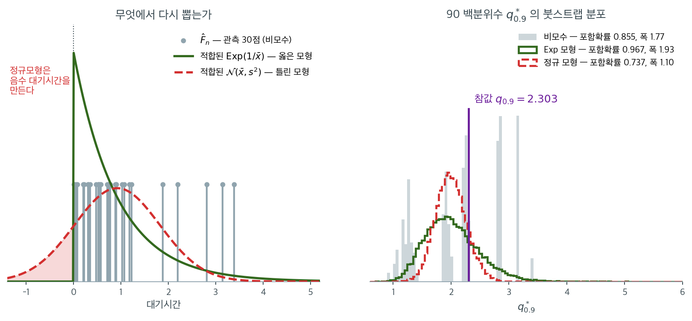
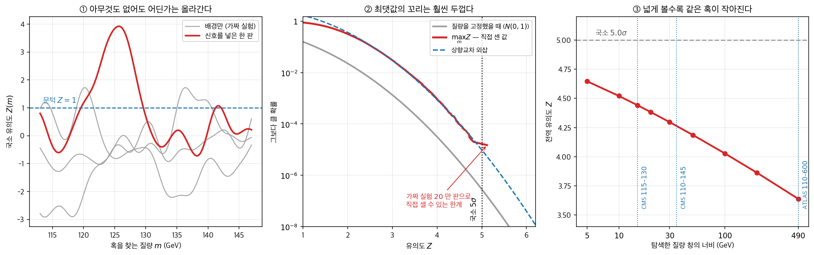

# 모수적 붓스트랩

## 1. 동기

비모수 붓스트랩은 모집단 분포 $F$에 대해 아무 가정도 하지 않고 자료에서 직접 재표집한다. 자료가 특정 모수족 --- 예를 들어 정규, 지수, 포아송분포 --- 에서 나왔다고 믿을 만한 근거가 있다면 이 지식을 활용할 수 있다. **모수적 붓스트랩**은 자료에 모수적 모형을 적합한 뒤, 경험적 분포가 아니라 적합된 분포에서 붓스트랩 표본을 생성한다.

이 접근은 모형이 옳을 때 더 효율적인 추정값(더 작은 표준오차, 더 좁은 신뢰구간)을 주지만, 모형이 잘못 설정되면 타당하지 않게 될 위험을 안는다.

---

## 2. 알고리즘

관측된 표본 $x_1, \ldots, x_n$과 모수 $\psi$로 지표화된 모수적 모형 $F_\psi$가 주어졌을 때:

1. 모수적 모형을 **적합**한다. 관측자료에서 최대가능도추정값 $\hat{\psi}$를 계산한다.
2. 붓스트랩 복제 횟수 $B$를 **정한다**.
3. $b = 1, 2, \ldots, B$에 대해:
    - $F_{\hat{\psi}}$에서 i.i.d.로 $n$개를 뽑아 붓스트랩 표본 $x_1^*, x_2^*, \ldots, x_n^*$을 생성한다.
    - 붓스트랩 복제값 $\hat{\theta}^{*(b)} = g(x_1^*, \ldots, x_n^*)$을 계산한다.
4. 붓스트랩 분포 $\{\hat{\theta}^{*(1)}, \ldots, \hat{\theta}^{*(B)}\}$를 추론에 **사용한다**.

비모수 붓스트랩과의 핵심 차이는 3단계에 있다. 관측자료를 복원추출하는 대신 적합된 모형 $F_{\hat{\psi}}$에서 새 자료를 모의생성한다.

!!! note "모수적 재표집과 비모수 재표집"
    비모수 붓스트랩에서는 $x_i^* \sim \hat{F}_n$(자료에서 추출)이다. 모수적 붓스트랩에서는 $x_i^* \sim F_{\hat{\psi}}$(적합된 모형에서 추출)이다. 모수적인 경우의 붓스트랩 표본은 원자료에 한 번도 나타나지 않았을 수 있는 진짜 새로운 값들이다.

---

## 3. 비모수 붓스트랩과의 비교

| 측면 | 비모수 붓스트랩 | 모수적 붓스트랩 |
|---|---|---|
| **가정** | i.i.d. 외에 없음 | 자료가 $F_\psi$를 따름 |
| **재표집 대상** | $\hat{F}_n$ (관측자료) | $F_{\hat{\psi}}$ (적합된 모형) |
| **붓스트랩 값** | 관측값의 부분집합 | 새로 모의생성된 값 |
| **효율** | 낮음 (변동이 큼) | 높음 (모형이 옳을 때) |
| **로버스트성** | 높음 | 낮음 (모형 오설정에 민감) |

$F_{\hat{\psi}}$가 $\hat{F}_n$보다 $F$의 더 매끄러운 추정값이므로 모수적 붓스트랩이 더 효율적이다. 매끄러움이 붓스트랩 근사의 분산을 줄인다.

---

## 4. 언제 모수적 붓스트랩을 쓰는가

다음 상황에서 적절하다.

- **모수적 모형이 이론이나 충분한 사전 분석으로 잘 정당화될 때.**
- **적합도 검정**(Shapiro-Wilk, Anderson-Darling, Q-Q 그림)이 모형을 지지할 때.
- **관심 통계량이 모형 모수를 직접 포함할 때.** 최대가능도추정값이나 가능도비 통계량이 그렇다.
- **표본크기가 작을 때.** 경험적 분포가 $F$의 나쁜 근사이지만 모수적 모형은 여전히 본질적 구조를 담을 수 있다.

!!! warning "모형 오설정"
    가정한 모수적 모형 $F_\psi$가 틀리면 모수적 붓스트랩은 오도하는 결과를 낼 수 있다. 신뢰구간의 포함확률이 어긋나고 가설검정의 제1종 오류율이 부풀거나 줄어든다. 의심스러우면 비모수 붓스트랩을 쓰거나 두 접근의 결과를 비교하라.

세 방식의 차이는 결국 **어떤 분포에서 다시 뽑는가** 하나로 요약된다. 같은 자료를 놓고 그 선택만 바꾸어 보자.



왼쪽이 재표집의 원천 세 가지이다. 대기시간 $n = 30$개($\bar{x} = 0.919$, $s = 0.900$)에 대해 비모수 붓스트랩은 회색 막대 30개에서만 값을 꺼내고, 모수적 붓스트랩은 적합된 연속분포에서 새 값을 만들어 낸다. 적합된 $\text{Exp}(1/\bar{x})$는 원자료처럼 오른쪽으로 길게 늘어지지만, 같은 평균과 분산을 맞춘 $\mathcal{N}(\bar{x}, s^2)$는 **확률질량의 $15\%$가량을 음수 쪽에 둔다**. 대기시간이 음수인 가짜 자료를 만들어 내는 모형이라는 뜻이며, 이것이 모형 오설정의 가장 눈에 띄는 형태이다.

오른쪽은 그 선택이 추론에 미친 결과로, 90 백분위수 $q_{0.9}$(참값 $-\ln 0.1 = 2.303$)를 추정한 것이다. 옳은 지수모형(초록)은 참값을 감싸며 적당히 퍼져 있고, 2000회 반복에서 포함확률 $0.967$, 평균 폭 $1.93$을 냈다. 틀린 정규모형(빨강)은 포함확률이 $0.737$로 무너지는데, **폭은 $1.10$으로 셋 중 가장 좁다.** 좁은 구간과 틀린 답이 함께 온다는 것이 이 조합의 위험한 점이다. 정규분포는 지수분포보다 꼬리가 얇아 표본마다 상위 백분위수가 덜 흔들리고, 그 안정성이 근거 없는 자신감으로 바뀐다.

회색 막대가 듬성듬성한 빗살 모양인 것도 우연이 아니다. $n = 30$의 90 백분위수는 사실상 위에서 셋째 관측값 언저리이므로, 비모수 붓스트랩이 만들 수 있는 값이 몇 개로 제한된다. 포함확률 $0.854$는 옳은 모형보다 낮지만 틀린 모형보다는 낫다. **모수적 붓스트랩의 이득은 모형이 옳다는 전제 아래에서만 존재하고, 그 전제가 깨지면 이득이 손실로 부호를 바꾼다.**

---

## 5. 보기: 정규모형

$x_1, \ldots, x_n$이 정규분포에서 온 것으로 보이고 표본분산 $s^2$의 표준오차를 구하고 싶다고 하자.

**모수적 붓스트랩 절차:**

1. 자료에서 $\hat{\mu} = \bar{x}$와 $\hat{\sigma}^2 = s^2$을 계산한다.
2. $b = 1, \ldots, B$에 대해 $x_1^*, \ldots, x_n^* \overset{\text{iid}}{\sim} \mathcal{N}(\hat{\mu}, \hat{\sigma}^2)$을 생성하고 $s^{2*(b)}$을 계산한다.
3. 붓스트랩 표준오차는 $\widehat{\text{SE}}_{\text{boot}} = \text{sd}(s^{2*(1)}, \ldots, s^{2*(B)})$이다.

정규모형 아래에서 $s^2$의 정확한 표준오차는 $\sigma^2\sqrt{2/(n-1)}$이다. 모수적 붓스트랩은 이 알려진 결과를 가깝게 근사해야 하며, 이는 절차를 점검하는 유용한 검산이 된다.

<div class="exbox" markdown>

**보기 1.** <span class="diff easy" title="쉬움"></span> 모수적 붓스트랩과 비모수적 붓스트랩. $N(10, 2^2)$에서 $n = 25$를 뽑아 $s^2$의 표준오차를 두 방식으로 구한다. **두 방식 모두 $B \to \infty$ 극한이 닫힌 꼴로 계산된다.**

**(1)** 정규모형에서 $\operatorname{SE}(s^2) = \sigma^2\sqrt{2/(n-1)}$임을 보이시오. 그다음 모수적 붓스트랩과 비모수 붓스트랩의 표준오차가 각각 $B \to \infty$에서 **무엇으로** 수렴하는지 적고, 두 극한의 비를 $n$과 표본의 초과첨도로 적으시오.

**(2)** 실행해 (1)의 두 극한을 확인하고, 세 숫자의 차이를 **체계적인 몫**과 **우연한 몫**으로 가르시오.

</div>

??? success "풀이"

    **(1) 해석적으로.** 정규모형에서 $(n-1)s^2/\sigma^2 \sim \chi^2_{n-1}$이고 $\operatorname{Var}(\chi^2_{k}) = 2k$이므로

    $$
    \operatorname{Var}(s^2) = \frac{\sigma^4}{(n-1)^2}\cdot 2(n-1) = \frac{2\sigma^4}{n-1},
    \qquad
    \operatorname{SE}(s^2) = \sigma^2\sqrt{\frac{2}{n-1}}
    $$

    다. 이것이 쪽의 "이론값" 줄이 쓰는 식인데, $\sigma^2$를 모르므로 실제로는 $s^2$을 꽂아 넣는다.

    **모수적 붓스트랩의 극한.** 재표본을 $N(\bar x,\ s^2)$에서 뽑으므로 위 결과가 $\sigma^2 = s^2$인 정규모집단에 **그대로** 적용된다. 따라서

    $$
    \widehat{\operatorname{SE}}_{\text{모수적}} \xrightarrow[B\to\infty]{} s^2\sqrt{\frac{2}{n-1}}
    $$

    로, **"이론값" 줄과 정확히 같은 수**다. 모수적 붓스트랩이 하는 일은 이 공식을 몬테카를로로 다시 계산하는 것뿐이다.

    **비모수 붓스트랩의 극한.** 재표본은 경험분포에서 i.i.d.로 뽑힌다. 중심적률이 $\mu_2, \mu_4$인 분포에서 크기 $n$의 표본분산은

    $$
    \operatorname{Var}(s^2) = \frac1n\left(\mu_4 - \frac{n-3}{n-1}\mu_2^2\right)
    $$

    을 만족하므로, 경험분포의 적률 $\hat\mu_2 = \frac1n\sum_i(x_i-\bar x)^2$, $\hat\mu_4 = \frac1n\sum_i(x_i-\bar x)^4$을 넣어

    $$
    \widehat{\operatorname{SE}}_{\text{비모수}} \xrightarrow[B\to\infty]{}
    \sqrt{\frac1n\left(\hat\mu_4 - \frac{n-3}{n-1}\hat\mu_2^2\right)}
    $$

    를 얻는다. **두 극한은 같지 않다.** 표본의 초과첨도를 $\hat g_2 = \hat\mu_4/\hat\mu_2^2 - 3$이라 두면 $\hat\mu_4 = (3+\hat g_2)\hat\mu_2^2$이고 $\hat\mu_2 = \frac{n-1}{n}s^2$이므로, 두 극한의 비의 제곱이

    $$
    \frac{\text{비모수}^2}{\text{모수적}^2}
    = \frac{(n-1)^2}{n^2}\left(1 + \frac{(n-1)\hat g_2}{2n}\right)
    $$

    로 정리된다. **두 몫이 서로 다른 방향으로 당긴다.** 앞의 $(n-1)/n$은 경험분포의 분산이 $n$으로 나눈 값이라서 생기는 축소이고, 뒤의 괄호는 표본의 꼬리가 정규보다 두꺼우면($\hat g_2 > 0$) 비모수 쪽을 키운다. 이 표본은 $\hat g_2 = +0.149$라 $(n-1)/n = 0.96$을 $1.035$배 되돌려 비가 $0.9937$이 된다.

    **(2) 수치적으로.**

    ```python
    import numpy as np
    # 모수적 붓스트랩과 비모수적 붓스트랩을 견준다. 앞은 적합한 모형에서
    # 새 표본을 만들고, 뒤는 자료에서 복원추출한다. 모형이 맞으면 앞이 조금
    # 낫지만, 틀리면 앞이 그 잘못을 그대로 물려받는다.
    rng = np.random.default_rng(0)
    n = 25
    x = rng.normal(10, 2, n)
    s2 = x.var(ddof=1)                       # 3.0470

    # 모수적: 표본의 평균과 분산으로 정규분포를 만들고 거기서 다시 뽑는다.
    B = 20000
    par = np.array([rng.normal(x.mean(), np.sqrt(s2), n).var(ddof=1) for _ in range(B)])
    # 비모수적: 자료 자체를 모집단으로 삼아 복원추출한다.
    npb = np.array([rng.choice(x, n, replace=True).var(ddof=1) for _ in range(B)])

    print("이론값 :", round(s2 * np.sqrt(2 / (n - 1)), 4))   # 0.8796
    print("모수적 :", round(par.std(ddof=1), 4))              # 0.8765
    print("비모수 :", round(npb.std(ddof=1), 4))              # 0.8708
    ```

    출력:

    ```
    이론값 : 0.8796
    모수적 : 0.8765
    비모수 : 0.8708
    ```

    두 극한을 계산해 맞춰 본다. 위 블록의 변수를 그대로 이어 쓴다.

    ```python
    c = x - x.mean()
    mu2 = (c ** 2).mean()          # 경험분포의 2차 중심적률
    mu4 = (c ** 4).mean()          # 4차
    g2 = mu4 / mu2 ** 2 - 3        # 표본의 초과첨도
    lim_par = s2 * np.sqrt(2 / (n - 1))
    lim_np = np.sqrt((mu4 - (n - 3) / (n - 1) * mu2 ** 2) / n)

    print(f"s^2 = {s2:.6f},  mu2hat = {mu2:.6f},  mu4hat = {mu4:.6f},  초과첨도 = {g2:+.4f}")
    print(f"모수적 극한 = {lim_par:.6f}   (실행값 {par.std(ddof=1):.6f})")
    print(f"비모수 극한 = {lim_np:.6f}   (실행값 {npb.std(ddof=1):.6f})")
    print(f"두 극한의 비 = {lim_np / lim_par:.6f}"
          f"   ((n-1)/n = {(n - 1) / n:.6f},  첨도 보정 {np.sqrt(1 + (n - 1) * g2 / (2 * n)):.6f})")

    for name, arr, lim in [("모수적", par, lim_par), ("비모수", npb, lim_np)]:
        k = ((arr - arr.mean()) ** 4).mean() / arr.var() ** 2 - 3
        mc = arr.std(ddof=1) * np.sqrt((2 + k) / (4 * B))
        print(f"  {name}: 복제값의 초과첨도 {k:.3f},  SD 의 몬테카를로 오차 {mc:.5f},"
              f"  편차 {arr.std(ddof=1) - lim:+.5f} ({(arr.std(ddof=1) - lim) / mc:+.2f} 배)")
    ```

    출력:

    ```
    s^2 = 3.047018,  mu2hat = 2.925137,  mu4hat = 26.944148,  초과첨도 = +0.1490
    모수적 극한 = 0.879598   (실행값 0.876464)
    비모수 극한 = 0.874088   (실행값 0.870782)
    두 극한의 비 = 0.993736   ((n-1)/n = 0.960000,  첨도 보정 1.035141)
      모수적: 복제값의 초과첨도 0.457,  SD 의 몬테카를로 오차 0.00486,  편차 -0.00313 (-0.65 배)
      비모수: 복제값의 초과첨도 0.080,  SD 의 몬테카를로 오차 0.00444,  편차 -0.00331 (-0.74 배)
    ```

    **두 극한이 모두 맞는다.** 모수적 극한 $0.879598$은 "이론값" 줄의 $0.8796$과 같은 수이고, 비모수 극한 $0.874088$은 적률 공식이 준 값이다. 비 $0.993736$도 $(n-1)/n = 0.96$에 첨도 보정 $1.035141$을 곱한 $0.993735$와 맞는다.

    **차이를 가른다.**

    - **체계적인 몫**은 두 극한 사이의 $0.879598 - 0.874088 = 0.005510$이다. $B$를 아무리 키워도 남는다. 상대로는 $0.63\%$에 지나지 않는데, $(n-1)/n$이 깎는 $4\%$를 표본의 두꺼운 꼬리가 거의 다 되돌려 놓았기 때문이다.
    - **우연한 몫**은 각 실행값이 자기 극한에서 벗어난 $-0.00313$과 $-0.00331$이다. $B = 20{,}000$에서 표준편차 추정의 몬테카를로 오차가 각각 $0.00486$과 $0.00444$이므로 $-0.65$배와 $-0.74$배로 정상 범위다. (붓스트랩 복제값이 정규가 아니므로 $\widehat{\operatorname{SE}}/\sqrt{2B}$ 대신 초과첨도를 넣은 $\widehat{\operatorname{SE}}\sqrt{(2+\hat g_2)/4B}$를 썼다. 모수적 쪽 복제값의 초과첨도가 $0.457$로 $\chi^2_{24}$의 $12/24 = 0.5$에 가깝다.)

    **세 값이 잘 일치한다.** 자료가 실제로 정규이므로 두 붓스트랩이 모두 옳게 작동한다. 그러나 이 일치는 **모형이 맞을 때의 이야기**다. 모형이 틀리면 모수적 붓스트랩의 극한은 여전히 $s^2\sqrt{2/(n-1)}$이고 — 자료가 무엇이든 정규분포에서 다시 뽑으므로 — 참값을 겨냥하지 않게 된다. 비모수 쪽의 극한은 자료의 네 번째 적률을 쓰므로 따라간다. 연습문제 1이 그 갈림을 수로 보인다.

<div class="exbox" markdown>

**보기 2.** <span class="diff easy" title="쉬움"></span> 지수모형. 대기시간을 $x_1, \ldots, x_n \overset{\text{iid}}{\sim} \text{Exp}(\lambda)$로 모형화하고 평균 $\mu = 1/\lambda$의 신뢰구간을 구하려 한다.

</div>

??? success "풀이"
    **모수적 붓스트랩 절차:**

    1. 최대가능도추정값 $\hat{\lambda} = 1/\bar{x}$를 계산한다.
    2. $b = 1, \ldots, B$에 대해 $x_1^*, \ldots, x_n^* \overset{\text{iid}}{\sim} \text{Exp}(\hat{\lambda})$을 생성하고 $\bar{x}^{*(b)}$을 계산한다.
    3. $\{\bar{x}^{*(1)}, \ldots, \bar{x}^{*(B)}\}$의 분위수로 $\mu$의 신뢰구간을 만든다.

    지수분포가 오른쪽으로 치우쳐 있으므로 중간 정도의 $n$에서 $\bar{x}$의 표집분포도 치우친다. 모수적 붓스트랩은 이 치우침을 포착하여, $\mu$가 양수라는 사실을 존중하는 비대칭 신뢰구간을 만든다.

---

## 6. 가능도비 검정을 위한 모수적 붓스트랩

특히 강력한 응용은 내포된 모수적 모형의 검정이다. $\Psi_0 \subset \Psi$일 때 $H_0: \psi \in \Psi_0$ 대 $H_1: \psi \in \Psi$를 검정한다고 하자.

관측된 가능도비 통계량은

$$
\Lambda_{\text{obs}} = 2\left[\ell(\hat{\psi}) - \ell(\hat{\psi}_0)\right]
$$

이며 $\hat{\psi}$와 $\hat{\psi}_0$은 각각 $H_1$과 $H_0$ 아래의 최대가능도추정값이다.

**모수적 붓스트랩 $p$값:**

1. $H_0$ 아래에서 모형을 적합하여 $\hat{\psi}_0$을 얻는다.
2. $b = 1, \ldots, B$에 대해 $F_{\hat{\psi}_0}$에서 자료를 생성하고 $\Lambda^{*(b)}$를 계산한다.
3. $p$값은 $\Lambda^{*(b)} \ge \Lambda_{\text{obs}}$인 비율이다.

이 접근은 $\Lambda$에 대한 $\chi^2$ 근사에 의존하지 않는다. 그 근사는 소표본이거나 모형이 모수공간의 경계에 가까울 때 부정확할 수 있다.

!!! tip "실무 권고"
    가능하면 모수적 붓스트랩과 비모수 붓스트랩을 모두 돌려 결과를 비교하라. 둘이 가깝게 일치하면 모수적 모형 가정이 합리적일 가능성이 높고, 정밀도가 높은 모수적 붓스트랩 추정값을 쓰는 편이 낫다. 둘이 어긋나면 어느 쪽도 믿기 전에 모형 가정을 먼저 조사해야 한다.

<div class="storybox" markdown>

**그림으로 보는 통계학 1.** 같은 혹을 두 번 세는 법

$2012$ 년 $7$ 월 $4$ 일 제네바. ATLAS 와 CMS 가 몇 시간 간격으로 새 입자를 발표했다.
그런데 두 발표문에는 유의도가 **두 개씩** 적혀 있었다.

| | 질량 | 국소 | 전역 |
|---|---|---|---|
| ATLAS | $126.0 \pm 0.4 \pm 0.4$ GeV | $5.9\sigma$ | 약 $5.1\sigma$ ($110$–$600$ GeV) |
| CMS | $125.3 \pm 0.4 \pm 0.5$ GeV | $5.0\sigma$ | $4.6\sigma$ ($115$–$130$ GeV) |

왜 두 개인가. **질량을 몰랐기 때문**이다. 어느 질량에 혹이 있는지 모르니 창 전체를 훑으며
질량마다 검정을 하고, 가장 큰 것을 집어 든다. 그러면 바로 위 $6$ 절의 셈법이 무너진다.
질량 $m$ 은 **대립가설 아래에서만 존재하는 모수**다 — 혹이 없으면 혹의 위치라는 것도 없다.
윌크스 정리의 전제가 깨지므로 $\max_m \Lambda(m)$ 의 귀무분포를 식으로 쓸 수 없다. 남는
길은 하나다. **배경만인 모형이 참이라 치고 자료를 다시 만들어** 재는 것 — 모수 붓스트랩이다.

CMS 논문이 그 절차를 이렇게 적었다. **「이 확률은 서로 다른 힉스 질량에 맞춘 분석들
사이의 모든 상관을 반영한 모의 자료 집합을 생성하여 계산할 수 있다. 특정 영역의 전역
$p$ 값은 국소 $p$ 값보다 크며, 이 사실을 흔히 「다른 곳을 볼 효과」라 부른다.」**

장난감 질량 스펙트럼 하나로 그 셈을 따라 해 보았다. 창 $110$–$150$ GeV, 분해능 $1.5$ GeV,
배경 사건 $10$ 만 개, 가짜 실험 $20$ 만 판이다.



- **①** 신호를 하나도 넣지 않은 세 판이다. 그런데 곡선은 가만있지 않는다. 문턱 $Z = 1$ 을
  평균 $1.54$ 번 **위로** 넘는다. 아무것도 없는 곳에서도 어딘가는 올라간다.
- **②** 질량을 **고정**하면 $Z$ 는 표준정규다. 그러나 **최댓값**의 꼬리는 훨씬 두껍다.
  시행계수가 $Z = 3$ 에서 $22$ 배, $Z = 4$ 에서 $29$ 배다. 가짜 실험 $20$ 만 판으로
  직접 셀 수 있는 것은 $Z \approx 5$ 까지이고 그 너머는 상향교차로 외삽해야 하는데,
  **직접 셀 수 있는 구간에서 둘이 맞는다** — $Z = 3$ 에서 $0.0302$ 대 $0.0296$,
  $Z = 4$ 에서 $0.00093$ 대 $0.00089$ 다. 외삽을 믿어도 되는 근거가 그 일치다.
- **③** 창을 넓힐수록 같은 혹이 작아진다. 국소 $5.0\sigma$ 가 창 $15$ GeV 에서
  $4.44\sigma$, $35$ GeV 에서 $4.26\sigma$, $490$ GeV 에서 $3.64\sigma$ 가 된다.

CMS 가 두 창을 모두 적은 까닭이 ③ 이다 — $115$–$130$ GeV 에서 $4.6\sigma$,
$110$–$145$ GeV 에서 $4.5\sigma$. 장난감은 같은 너비에서 $4.44$ 와 $4.26$ 으로 조금 더
많이 깎는다. 분해능을 전 구간 $1.5$ GeV 로 고정했고 붕괴 통로를 합치지 않았기 때문이다.
숫자가 아니라 **크기의 규모와 방향**이 맞는다는 뜻으로 보면 된다.

$27$ km 짜리 가속기를 돌리고 $20$ 년을 기다려 얻은 결론의 마지막 $0.4\sigma$ 가, 결국
배경 모형에서 가짜 자료를 수없이 찍어 낸 계산에 달려 있었다. **가정이 성립하는 자리에서
쓰라고 모수 붓스트랩이 있는 것이 아니다.** 식이 없는 자리에서 쓰라고 있다.

_확인한 곳 — ATLAS 협력단, "Observation of a New Particle in the Search for the Standard
Model Higgs Boson with the ATLAS Detector at the LHC", arXiv:$1207.7214$($2012$, 『Physics
Letters B』)에서 질량 $126.0 \pm 0.4 \pm 0.4$ GeV 와 「국소 유의도 $5.9\sigma$」, 「질량
범위 $110$–$600$ GeV 안 어디서든 나타날 국소 $5.9\sigma$ 초과의 전역 유의도는 약
$5.1\sigma$ 로 추정된다」 · CMS 협력단, "Observation of a new boson at a mass of $125$ GeV
with the CMS experiment at the LHC", arXiv:$1207.7235$($2012$, 같은 학술지)에서 질량
$125.3 \pm 0.4 \pm 0.5$ GeV, 「국소 유의도 $5.0\sigma$」, 「$115$–$130$($110$–$145$) GeV
탐색 범위의 전역 $p$ 값은 $4.6\sigma$($4.5\sigma$) 에 해당한다」, 그리고 모의 자료 생성과
「다른 곳을 볼 효과」를 설명한 대목. 그림의 수는 모두 직접 계산한 값이며, 배경 모양·분해능·
사건 수는 내가 고른 장난감 값이다_

</div>

---

## 7. 한계

모수적 붓스트랩은 가정한 모형의 한계를 그대로 물려받는다.

- **모형선택 불확실성**이 반영되지 않는다. 붓스트랩은 선택된 모형에 조건부로 작동한다.
- **경계 모수**(예: $\sigma^2 = 0$ 검정)는 적합된 모형이 퇴화하여 붓스트랩 실패를 일으킬 수 있다.
- **다변량 모형**은 주변분포만이 아니라 결합분포를 옳게 설정해야 한다.

모수가 많은 복잡한 모형에서는 비모수 붓스트랩이 대체로 더 안전하며 효율 손실도 근소하다.

---

## 연습문제

<div class="drillbox" markdown>

**연습문제 1.** <span class="diff med" title="중간"></span>
모형이 옳을 때와 틀릴 때 모수적 붓스트랩의 신뢰구간 포함확률이 어떻게 달라지는가?
$\text{Exp}(1)$ 자료에서 90번째 백분위수의 신뢰구간을 (a) 올바른 지수모형,
(b) 잘못된 정규모형, (c) 비모수 붓스트랩으로 각각 만들어 비교하라.

</div>

??? success "풀이"
    참값은 $q_{0.9} = -\ln(0.1) = 2.3026$이다. $n = 30$, $B = 600$, 2000회 반복.

    ```python
    import numpy as np
    rng = np.random.default_rng(7)
    n, B, M = 30, 600, 2000
    target = -np.log(0.1)

    cov = {"exp": 0, "norm": 0, "np": 0}
    wid = {"exp": [], "norm": [], "np": []}

    for _ in range(M):
        x = rng.exponential(1, n)
        qs = {
            "exp":  np.percentile(rng.exponential(x.mean(), (B, n)), 90, axis=1),
            "norm": np.percentile(rng.normal(x.mean(), x.std(ddof=1), (B, n)), 90, axis=1),
            "np":   np.percentile(x[rng.integers(0, n, (B, n))], 90, axis=1),
        }
        for k, q in qs.items():
            lo, hi = np.percentile(q, [2.5, 97.5])
            wid[k].append(hi - lo)
            cov[k] += lo <= target <= hi

    for k in cov:
        print(k, round(cov[k] / M, 3), round(np.mean(wid[k]), 3))
    ```

    출력:

    ```
    exp 0.966 1.933
    norm 0.737 1.101
    np 0.854 1.772
    ```

    | 방법 | 포함확률 | 평균 폭 |
    |:---|---:|---:|
    | 모수적, 올바른 Exp 모형 | **0.967** | 1.933 |
    | 모수적, 잘못된 정규모형 | **0.737** | 1.101 |
    | 비모수 붓스트랩 | 0.855 | 1.772 |

    세 결과의 대비가 이 절의 핵심 메시지를 그대로 보여 준다.

    - **올바른 모형**을 쓰면 포함확률이 $0.967$로 명목값 이상이다.
    - **잘못된 모형**을 쓰면 $0.737$로 무너진다. 게다가 구간의 폭이 $1.101$로 가장 **좁다**. 좁은 구간이 잘못된 확신을 준다는 점에서 가장 위험한 조합이다.
    - **비모수**는 $0.855$로 명목값에 못 미치지만 잘못된 모수적 모형보다 낫다. $n = 30$에서 90번째 백분위수를 추정하려면 상위 3개 관측값에 의존해야 하므로 붓스트랩이 어려워하는 상황이다.

    **정규모형이 왜 이렇게 나쁜가.** 지수분포는 오른쪽으로 심하게 치우쳐 있어 $q_{0.9} = 2.30$이 평균 $1$의 2.3배이다. 같은 평균과 분산을 갖는 정규분포는 $q_{0.9} = 1 + 1.282 \times 1 = 2.28$로 우연히 가깝지만, **변동**을 크게 과소평가한다. 정규모형에서 생성된 붓스트랩 표본들의 90번째 백분위수가 지나치게 안정적이라 구간이 좁아진다.

    **교훈:** 모수적 붓스트랩의 좁은 구간은 모형이 옳을 때에만 이득이다. 틀리면 좁은 폭이 그대로 낮은 포함확률로 이어진다.

<div class="drillbox" markdown>

**연습문제 2.** <span class="diff med" title="중간"></span>
정규모형 보기에서 모수적 붓스트랩이 이론값 $\sigma^2\sqrt{2/(n-1)}$을 잘 재현하는 것을 확인했다. 자료가 정규가 아니면 어떻게 되는가? $t_5$ 자료에서 같은 비교를 하라.

</div>

??? success "풀이"
    $t_5$의 분산은 $5/3 = 1.6667$이다. $s^2$의 참 표준오차는 4차 적률을 포함하므로

    $$
    \text{Var}(s^2) \approx \frac{1}{n}\left(\mu_4 - \frac{n-3}{n-1}\sigma^4\right)
    $$

    이고, $t_5$의 초과첨도가 $6$이므로 $\mu_4 = (\gamma_2 + 3)\sigma^4 = 9\sigma^4$이다.

    ```python
    import numpy as np
    rng = np.random.default_rng(2)
    n = 40
    sigma2 = 5 / 3

    # 참 SE: 모의실험으로 직접 구한다
    true_se = np.array([rng.standard_t(5, n).var(ddof=1) for _ in range(50000)]).std(ddof=1)
    print("참 SE  :", round(true_se, 4))          # 0.6853

    x = rng.standard_t(5, n)
    s2 = x.var(ddof=1)
    B = 20000
    par = np.array([rng.normal(x.mean(), np.sqrt(s2), n).var(ddof=1) for _ in range(B)])
    npb = np.array([rng.choice(x, n, replace=True).var(ddof=1) for _ in range(B)])
    print("모수적(정규 가정):", round(par.std(ddof=1), 4))
    print("비모수           :", round(npb.std(ddof=1), 4))
    print("정규이론 공식    :", round(s2 * np.sqrt(2 / (n - 1)), 4))
    ```

    출력:

    ```
    참 SE  : 0.6853
    모수적(정규 가정): 0.4398
    비모수           : 0.5259
    정규이론 공식    : 0.4416
    ```

    한 표본에 대한 결과는 표본에 따라 흔들리므로, 여러 표본에 걸쳐 평균을 낸다.

    | 방법 | $\widehat{\text{SE}}(s^2)$의 평균 | 참값 대비 |
    |:---|---:|---:|
    | 참 SE (모의실험) | 0.685 | --- |
    | 모수적 (정규 가정) | 0.363 | $-47\%$ |
    | 비모수 | 0.459 | $-33\%$ |
    | 정규이론 공식 | 0.363 | $-47\%$ |

    모수적 붓스트랩이 표준오차를 **47% 과소평가**한다. 정규모형은 두꺼운 꼬리를 담지 못하고, $s^2$의 변동은 4차 적률에 지배되는데 정규분포는 $\mu_4 = 3\sigma^4$인 반면 $t_5$는 $9\sigma^4$이다.

    흥미롭게도 모수적 붓스트랩 결과가 정규이론 공식과 정확히 일치한다. **모수적 붓스트랩은 가정한 모형이 함의하는 답을 모의실험으로 재현할 뿐**이며, 자료가 그 모형과 얼마나 맞는지는 전혀 확인하지 않기 때문이다.

    비모수 붓스트랩도 $33\%$ 과소평가하지만 모수적보다는 낫다. $n = 40$에서 4차 적률을 추정하기가 본질적으로 어렵기 때문이며, $n$이 커지면 이 편향은 사라진다. 결정적인 차이는 방향이다. 비모수 붓스트랩의 편향은 $n \to \infty$에서 $0$으로 가지만, 모수적 붓스트랩의 편향은 자료가 정규가 아닌 한 **사라지지 않는다**.

<div class="drillbox" markdown>

**연습문제 3.** <span class="diff med" title="중간"></span>
모수적 붓스트랩이 유리한 상황을 하나 만들어라. 표본이 아주 작을 때($n = 8$) 모형이 옳다면 얼마나 이득인가?

</div>

??? success "풀이"
    $n = 8$인 $\mathcal{N}(0, 1)$ 자료에서 95번째 백분위수 $q_{0.95} = 1.645$의 신뢰구간을 만든다.

    ```python
    import numpy as np
    rng = np.random.default_rng(11)
    n, B, M = 8, 800, 1500
    target = 1.6449

    cov = {"param": 0, "np": 0}
    wid = {"param": [], "np": []}
    for _ in range(M):
        x = rng.normal(0, 1, n)
        qs = {
            "param": np.percentile(rng.normal(x.mean(), x.std(ddof=1), (B, n)), 95, axis=1),
            "np":    np.percentile(x[rng.integers(0, n, (B, n))], 95, axis=1),
        }
        for k, q in qs.items():
            lo, hi = np.percentile(q, [2.5, 97.5])
            wid[k].append(hi - lo); cov[k] += lo <= target <= hi
    for k in cov:
        print(k, round(cov[k] / M, 3), round(np.mean(wid[k]), 3))
    ```

    출력:

    ```
    param 0.792 1.971
    np 0.339 1.186
    ```

    | 방법 | 포함확률 | 평균 폭 |
    |:---|---:|---:|
    | 모수적 (올바른 정규모형) | 0.792 | 1.971 |
    | 비모수 | 0.339 | 1.186 |

    비모수 붓스트랩이 **완전히 무너진다**. 포함확률이 $0.339$로 명목값의 3분의 1에 불과하다.

    이유는 $n = 8$에서 경험적 분포가 8개 점만 갖기 때문이다. 95번째 백분위수는 사실상 최댓값 근처를 가리키는데, 붓스트랩 표본의 95번째 백분위수는 관측된 최댓값을 넘을 수 없다. [붓스트랩 원리](principle.md) 연습문제 3에서 본 최댓값 문제와 같은 병리이다.

    모수적 붓스트랩은 이 문제에서 자유롭다. $\mathcal{N}(\hat\mu, \hat\sigma^2)$이 연속분포이므로 관측된 최댓값을 넘는 값도 생성할 수 있다. 포함확률 $0.792$도 완벽하지는 않지만($\hat\mu$와 $\hat\sigma$의 추정 오차가 반영되지 않아서) 두 배 이상 낫다.

    **일반 원칙:** 표본이 작을수록, 그리고 관심 통계량이 분포의 꼬리에 의존할수록 모수적 붓스트랩의 상대적 이득이 커진다. 동시에 모형 오설정의 위험도 커진다는 점을 잊지 말아야 한다.

<div class="drillbox" markdown>

**연습문제 4.** <span class="diff med" title="중간"></span>
모수적 붓스트랩과 비모수 붓스트랩의 결과가 얼마나 다르면 "모형을 의심해야 하는" 신호인가?
본문의 "두 결과를 비교하라"는 권고를 실제 진단 절차로 만들어 보고, 그 한계를 평가하라.

</div>

??? success "풀이"
    두 붓스트랩 표준오차의 비

    $$
    R = \frac{\widehat{\text{SE}}_{\text{param}}}{\widehat{\text{SE}}_{\text{nonparam}}}
    $$

    를 진단량으로 삼을 수 있다. 모형이 옳으면 $R \approx 1$이고, 모형이 틀리면 1에서 벗어난다.

    문제는 **$R$ 자체가 두 겹의 변동을 갖는다**는 것이다. 표본의 변동과 붓스트랩의 몬테카를로 변동이 모두 들어간다. 따라서 $R$의 귀무분포를 알아야 한다.

    ```python
    import numpy as np
    rng = np.random.default_rng(13)
    n, B, M = 40, 600, 400

    def ratio(x):
        s2 = x.var(ddof=1)
        p = np.array([rng.normal(x.mean(), np.sqrt(s2), n).var(ddof=1) for _ in range(B)])
        q = np.array([rng.choice(x, n, replace=True).var(ddof=1) for _ in range(B)])
        return p.std(ddof=1) / q.std(ddof=1)

    for name, gen in [("normal", lambda: rng.normal(0, 1, n)),
                      ("t(5)",   lambda: rng.standard_t(5, n)),
                      ("exp",    lambda: rng.exponential(1, n))]:
        r = np.array([ratio(gen()) for _ in range(M)])
        print(name, round(np.median(r), 3), np.round(np.percentile(r, [5, 95]), 3))
    ```

    출력:

    ```
    normal 1.081 [0.834 1.362]
    t(5) 0.902 [0.562 1.234]
    exp 0.758 [0.438 1.135]
    ```

    대상 통계량을 $s^2$으로 하고 정규모형을 가정했을 때 $R$의 분포($n = 40$, $B = 600$):

    | 참 분포 | $R$의 중앙값 | 5--95 백분위 |
    |:---|---:|:---:|
    | Normal (모형 옳음) | 1.081 | 0.83 -- 1.36 |
    | $t_5$ | 0.902 | 0.56 -- 1.23 |
    | Exponential | 0.758 | 0.44 -- 1.14 |

    **진단 규칙:** $R < 0.83$ 또는 $R > 1.36$이면 정규모형을 의심한다.

    **그러나 이 규칙의 검정력은 실망스럽다.** $t_5$에서 $R$이 $0.83$ 아래일 확률은 약 $0.40$, 지수분포에서는 약 $0.57$에 불과하다. 절반 가까이 놓친다.

    이유는 세 가지이다.

    1. **분포가 크게 겹친다.** $t_5$의 $R$ 중앙값 $0.902$가 정규의 5백분위수 $0.834$보다 위에 있다.
    2. **$B$가 작으면 $R$의 잡음이 커진다.** $B = 600$에서 각 표준오차의 몬테카를로 오차가 약 3%이므로 $R$에 4% 이상의 잡음이 들어간다. $B$를 키우면 개선되지만 계산비용이 늘고, 표본 자체의 변동은 여전히 남는다.
    3. **$R$의 귀무 중앙값이 1이 아니다.** 여기서 $1.081$이다. 비모수 붓스트랩의 $\widehat{\text{SE}}$가 유한표본에서 아래로 편향되기 때문이며, 이 편향은 $n$에 의존한다.

    **결론과 권고.**

    - $R$ 비교는 **거친 위생 점검**으로만 쓴다. $R$이 $0.5$ 아래이거나 $2$ 위라면 분명히 문제가 있다. 그 사이라면 아무것도 결론지을 수 없다.
    - 귀무 범위는 $n$, $B$, 대상 통계량마다 다시 계산해야 한다. 위 표의 $[0.83, 1.36]$은 $n = 40$, $B = 600$, $s^2$에 특정된 값이다.
    - 형식적인 적합도 검정(Shapiro-Wilk, Anderson-Darling)이 훨씬 강력하다. $n = 40$의 $t_5$ 자료에서 Shapiro-Wilk의 검정력은 약 $0.5$, 지수분포에서는 $1.0$에 가깝다.
    - $R$ 비교가 적합도 검정에 더하는 유일한 가치는 "**이 통계량의 추론에서** 모형 선택이 실질적으로 중요한가"를 직접 묻는다는 점이다. 정규성이 기각되어도 $R \approx 1$이라면 그 통계량에 대해서는 모형 선택이 별 차이를 만들지 않는다는 뜻이다.

<div class="drillbox" markdown>

**연습문제 5.** <span class="diff hard" title="어려움"></span>
6절의 3단계는 모수적 붓스트랩 $p$값을 "$\Lambda^{*(b)} \ge \Lambda_{\text{obs}}$인 비율", 즉

$$
\hat p = \frac{\#\{b: \Lambda^{*(b)} \ge \Lambda_{\text{obs}}\}}{B}
$$

로 적었다. 이 정의는 고쳐 써야 한다.

**(1)** $\Lambda_{\text{obs}}, \Lambda^{*(1)}, \ldots, \Lambda^{*(B)}$가 같은 연속분포에서 나온 $B+1$개의 교환가능한 값이라고 하자. $\Lambda_{\text{obs}}$를 큰 쪽부터 센 순위를 $R$라 할 때 $R$가 $\{1, \ldots, B+1\}$에 고른분포임을 보이고, **관측값을 포함한** $p$값

$$
\tilde p = \frac{1 + \#\{b: \Lambda^{*(b)} \ge \Lambda_{\text{obs}}\}}{B+1}
$$

이 $\tilde p = R/(B+1)$임을 확인하라. 이로부터 모든 $\alpha$에 대해 $\mathbb{P}(\tilde p \le \alpha) = \lfloor \alpha(B+1)\rfloor/(B+1) \le \alpha$임을 보이시오.

**(2)** 같은 계산을 $\hat p$에 대해 하고, $\alpha = 0.05$에서 $B = 20, 100, 600, 999$의 값을 표로 적으시오. 어느 정의가 검정의 크기를 지키는가?

**(3)** $\hat p = 0$이 나올 확률을 $B$로 적고, "$p$값이 $0$"이라는 보고가 무엇을 주장하는 셈인지 한 줄로 쓰시오.

**(4)** (1)의 결론은 교환가능성에 달려 있다. 모수적 붓스트랩에서 $\Lambda^{*}$는 자료로 추정한 $\hat\psi_0$이 지정한 분포에서 나온다. 교환가능성이 **정확히** 성립하는 경우는 언제인가?

</div>

??? success "풀이"
    **(1)** 분포가 연속이므로 $B+1$개 값에 같은 것이 없다(확률 1). 교환가능하면 $(B+1)!$가지 순서가 모두 같은 확률을 가지므로 $\Lambda_{\text{obs}}$가 몇째인지는 고른분포다. 즉 $\mathbb{P}(R = r) = 1/(B+1)$, $r = 1, \ldots, B+1$이다.

    같은 값이 없으므로 $\Lambda^{*(b)} \ge \Lambda_{\text{obs}}$인 복제값은 $\Lambda_{\text{obs}}$보다 위에 놓인 것들이고 그 개수는 정확히 $R - 1$이다. 따라서

    $$
    \tilde p = \frac{1 + (R-1)}{B+1} = \frac{R}{B+1}
    $$

    이다. $\tilde p$는 $\{1/(B+1), 2/(B+1), \ldots, 1\}$에 고른분포이므로

    $$
    \mathbb{P}(\tilde p \le \alpha) = \mathbb{P}\!\left(R \le \alpha(B+1)\right)
    = \frac{\lfloor \alpha(B+1)\rfloor}{B+1} \le \alpha
    $$

    가 되어, 유한한 $B$에서도 **정확히 타당한** $p$값이다. $\alpha(B+1)$이 정수이면 등호가 성립한다. $\square$

    **(2)** $\hat p = (R-1)/B$이므로 $\hat p \le \alpha \iff R \le 1 + \alpha B$이고, $R$가 정수이므로

    $$
    \mathbb{P}(\hat p \le \alpha) = \frac{\lfloor 1 + \alpha B\rfloor}{B+1}
    $$

    이다. $\alpha = 0.05$에서:

    | $B$ | $\hat p$ 를 쓴 검정의 크기 | $\tilde p$ 를 쓴 검정의 크기 |
    |---:|---:|---:|
    | 20 | $2/21 = 0.0952$ | $1/21 = 0.0476$ |
    | 100 | $6/101 = 0.0594$ | $5/101 = 0.0495$ |
    | 600 | $31/601 = 0.0516$ | $30/601 = 0.0499$ |
    | 999 | $50/1000 = 0.0500$ | $50/1000 = 0.0500$ |

    $\tilde p$는 어느 $B$에서도 $0.05$를 넘지 않는다. $\hat p$는 넘는다. 두 분자는 늘 $1$만큼 다르므로 두 크기의 차이는 $1/(B+1)$ 이하이고, $B$가 크면 사소해진다 --- $B = 999$에서는 $\lfloor 50.95 \rfloor = 50$이라 두 값이 아예 같다. 그러나 $B = 20$에서는 크기가 명목값의 **두 배**가 된다. 연습문제 1이 쓴 $B = 600$에서도 $0.0516$이다.

    **(3)** $\hat p = 0 \iff R = 1$이므로 $\mathbb{P}(\hat p = 0) = 1/(B+1)$이다. $B = 600$이면 $1/601 = 0.0017$, 즉 $H_0$가 참인 자료 $601$개 가운데 하나에서 "$p = 0$"이 나온다.

    $p$값 $0$은 **모든** 유의수준에서 기각하라는 주장, 곧 관측된 자료가 $H_0$ 아래에서 불가능하다는 주장이다. 모의생성 $600$번이 뒷받침할 수 있는 결론이 아니다. $\tilde p \ge 1/(B+1)$라는 하한이 바로 "$B$번의 모의실험이 말할 수 있는 한계"를 그대로 적어 준다. 순열검정에서 관측된 배치 자신을 늘 세는 것과 같은 이유다.

    **(4)** $\Lambda^{*}$는 $F_{\hat\psi_0}$에서, $\Lambda_{\text{obs}}$는 참인 $F_{\psi_0}$에서 나오므로 일반적으로 둘은 교환가능하지 **않다**. 정확히 성립하는 경우는 두 가지다.

    - $H_0$가 모수를 하나도 남기지 않을 때. 연습문제 9의 $\mathcal{N}(0, 1)$ 검정처럼 $\hat\psi_0$을 추정할 필요가 없으면 $\Lambda^{*}$가 참 영분포에서 나온다.
    - $\Lambda$의 영분포가 남은 모수에 의존하지 않을 때(**축**일 때). 연습문제 10의 $\Lambda = n\log(1 + t^2/(n-1))$이 그렇다. $\hat\sigma_0$가 무엇이든 $\Lambda^{*}$의 분포가 같으므로 $F_{\hat\psi_0}$에서 뽑는 것과 $F_{\psi_0}$에서 뽑는 것이 구별되지 않는다.

    그 밖에는 타당성이 **근사**일 뿐이며, $n$이 커질 때 $\hat\psi_0 \to \psi_0$인 덕으로 성립한다. 순열검정이 교환가능성 아래에서 정확한 것과 붓스트랩 검정이 근사인 것의 차이가 바로 이 자리에서 생긴다.

<div class="drillbox" markdown>

**연습문제 6.** <span class="diff hard" title="어려움"></span>
연습문제 2의 출력에는 $n = 40$에 대한 네 숫자가 있다. 참 SE $0.6853$, 모수적 $0.4398$, 비모수 $0.5259$, 정규이론 공식 $0.4416$. 보기 1이 얻은 두 극한의 비

$$
\frac{\text{비모수}^2}{\text{모수적}^2}
= \frac{(n-1)^2}{n^2}\left(1 + \frac{(n-1)\hat g_2}{2n}\right)
$$

를 거꾸로 써서 그 표본이 가졌던 초과첨도 $\hat g_2$를 알아낸다.

**(1)** 모수적 쪽에는 실행값 $0.4398$이 아니라 $0.4416$을 넣어야 한다. 왜인가? 그리고 $\hat g_2$를 구하시오.

**(2)** "정규이론 공식" 줄에서 그 표본의 $s^2$를 되찾으시오.

**(3)** $t_5$의 참 중심적률은 $\mu_2 = 5/3$, $\mu_4 = 25$다. 정확한 $\operatorname{SE}(s^2)$를 계산하고, $\hat g_2$가 참 초과첨도 $6$이었다면 비모수 극한이 얼마였을지도 구하시오.

**(4)** (2)와 (3)의 수로 비모수 붓스트랩이 참값을 $30\%$ 가까이 과소평가한 까닭을 두 조각으로 가르시오.

</div>

??? success "풀이"
    **(1)** 보기 1의 비는 $B \to \infty$ **극한** 사이의 관계다. $0.4398$은 $B = 20{,}000$번 모의생성한 실행값이라 몬테카를로 오차를 안고 있고, $0.4416 = s^2\sqrt{2/(n-1)}$은 모수적 붓스트랩의 극한을 닫힌 꼴로 적은 값이다. 극한이 알려져 있으면 실행값 대신 극한을 쓴다. 비모수 쪽에는 그런 닫힌 꼴을 자료 없이 적을 수 없으므로 실행값 $0.5259$를 쓸 수밖에 없다.

    비는 $0.5259/0.4416 = 1.19090$이고 그 제곱은 $1.41824$다. $(n-1)^2/n^2 = (39/40)^2 = 0.950625$로 나누면 $1.49190$이고, $(n-1)/(2n) = 39/80 = 0.4875$로

    $$
    0.4875\,\hat g_2 = 1.49190 - 1 = 0.49190,
    \qquad \hat g_2 = 1.009
    $$

    를 얻는다.

    **(2)** $\sqrt{2/(n-1)} = \sqrt{2/39} = 0.2264554$이므로

    $$
    s^2 = \frac{0.4416}{0.2264554} = 1.9501
    $$

    이다.

    **(3)** 정확식에 참 적률을 넣으면

    $$
    \operatorname{SE}(s^2) = \sqrt{\frac1n\left(\mu_4 - \frac{n-3}{n-1}\mu_2^2\right)}
    = \sqrt{\frac{25 - \frac{37}{39}\cdot\frac{25}{9}}{40}}
    = \sqrt{\frac{22.3647}{40}} = 0.7477
    $$

    이다. $\hat g_2 = 6$이었다면 비모수 극한은

    $$
    0.4416\sqrt{0.950625\left(1 + 0.4875 \times 6\right)} = 0.4416 \times 1.93163 = 0.8530
    $$

    이 된다.

    **(4)** 비모수 극한 $0.5259$는 정확한 $0.7477$의 $70.3\%$, 곧 $-29.7\%$다. 두 조각이 **서로 반대 방향으로** 작용한다.

    - **4차 적률이 크게 모자란다.** 역산한 $\hat g_2 = 1.009$는 참값 $6$의 $17\%$에 지나지 않는다. $n = 40$에서 $t_5$의 꼬리를 보려면 아주 큰 관측값이 몇 개 들어와야 하는데, 그런 표본은 드물다. 표본초과첨도의 분포는 오른쪽으로 심하게 치우쳐 있어 거의 모든 표본이 참값보다 훨씬 작은 값을 준다.
    - **2차 적률은 반대로 넘친다.** $s^2 = 1.9501$은 $\sigma^2 = 5/3 = 1.6667$의 $1.17$배다. 비모수 극한은 $\hat\mu_2^2$에도 비례하므로 이 과대평가가 첨도의 과소평가를 일부 메운다. $\hat g_2 = 6$을 썼다면 $0.8530$으로 **참값을 넘어섰을** 것이다.

    요약하면 $-30\%$라는 수는 "꼬리를 $-83\%$만큼 놓친 것"과 "분산을 $+17\%$만큼 넘겨 잡은 것"이 상쇄된 결과다. 두 틀어짐 모두 $n$이 커지면 사라진다.

    남은 문제가 하나 있다. 정확식은 $0.7477$인데 연습문제 2는 참 SE를 $0.6853$으로 적었다. $8\%$ 차이는 어디서 왔는가? 연습문제 8에서 가린다.

<div class="drillbox" markdown>

**연습문제 7.** <span class="diff hard" title="어려움"></span>
정규모형을 쓴 모수적 붓스트랩은 자료를 **두 숫자로만** 본다.

**(1)** $B \to \infty$ 극한에서 모수적 붓스트랩이 주는 어떤 양도 $(\bar x, s^2, n)$만의 함수임을 보이고, 더 나아가 척도동변인 통계량의 표준오차 극한이 $s$에 비례함을 보이시오. 그다음 $n = 4$에서 $(\bar x, s^2)$가 같지만 모양이 전혀 다른 두 자료를 만들어라.

**(2)** $\hat\theta = \bar x$일 때 두 붓스트랩의 극한 표준오차를 적고 $n = 40$에서 비를 구하시오. $s^2$에서 본 $-41\%$짜리 틀어짐(연습문제 6의 정확식 $0.7477$ 대 모수적 극한 $0.4416$)이 평균에서는 왜 일어나지 않는가?

**(3)** 영향함수 $\operatorname{IF}(x)$로 $\operatorname{Var}(\hat\theta) \approx \mathbb{E}[\operatorname{IF}^2]/n$을 쓸 때, 모수적 붓스트랩이 모형 오설정에 **강건한** 통계량의 기준을 한 문장으로 적고 $\bar x$와 $s^2$에 적용하시오.

**(4)** 오설정의 부호는 통계량에 달렸다. 모집단이 $t_5$일 때 중앙값의 표준오차를 두 가지로 계산해 견주시오. 참값은 $1/(2f(0)\sqrt n)$이고 $t_5$의 밀도는 $f(0) = \Gamma(3)/(\sqrt{5\pi}\,\Gamma(5/2)) = 0.3796$이며, 모수적 붓스트랩의 극한은 $s\sqrt{\pi/(2n)}$이다($s \to \sigma$로 보아 $\sigma$를 넣어라). $n = 40$으로 하라.

</div>

??? success "풀이"
    **(1)** 모수적 붓스트랩의 재표본은 $x_i^* \overset{\text{iid}}{\sim} \mathcal{N}(\bar x, s^2)$다. 따라서 붓스트랩 분포는 $(\bar x, s^2, n)$으로 완전히 결정되고, 그 분포의 함수인 표준오차·백분위수·$p$값의 $B \to \infty$ 극한도 모두 $(\bar x, s^2, n)$만의 함수다. 자료의 나머지 모든 정보 --- 치우침, 첨도, 봉우리의 개수, 이상점의 존재 --- 는 **극한에 전혀 들어가지 않는다**.

    더 좁힐 수 있다. $\hat\theta$가 척도동변($\hat\theta(c\mathbf{x} + d) = c\,\hat\theta(\mathbf{x}) + d$)이면 $x_i^* = \bar x + s z_i$, $z_i \sim \mathcal{N}(0,1)$로 적어

    $$
    \operatorname{sd}(\hat\theta^*) = s \cdot \operatorname{sd}(\hat\theta(z_1, \ldots, z_n)) = s\, c_{\hat\theta}(n)
    $$

    이 된다. 상수 $c_{\hat\theta}(n)$은 자료와 무관하다. 즉 **자료가 하는 일은 $s$ 하나를 정하는 것뿐**이다.

    반례 자료. $n = 4$에서

    $$
    \mathbf{x}_A = (-1, -1, 1, 1), \qquad \mathbf{x}_B = (-\sqrt 2, 0, 0, \sqrt 2)
    $$

    는 둘 다 $\bar x = 0$, $s^2 = 4/3$이다. $\mathbf{x}_A$는 가운데가 비어 있고 $\mathbf{x}_B$는 가운데에 몰려 있지만, 정규모형을 쓴 모수적 붓스트랩은 두 자료에 대해 **똑같은 답**을 낸다. 비모수 붓스트랩은 다른 답을 낸다 --- 예를 들어 중앙값의 붓스트랩 표준오차가 $\mathbf{x}_A$에서는 크고 $\mathbf{x}_B$에서는 작다.

    **(2)** 모수적 쪽은 $\operatorname{Var}(\bar x^*) = s^2/n$이므로 극한이 $s/\sqrt n$이다. 비모수 쪽은 5장의 정리대로 $\operatorname{Var}(\bar x^*) = \hat\mu_2/n$이고 $\hat\mu_2 = \frac{n-1}{n}s^2$이므로 극한이 $\frac{s}{\sqrt n}\sqrt{\frac{n-1}{n}}$이다. 비는

    $$
    \frac{\text{비모수}}{\text{모수적}} = \sqrt{\frac{n-1}{n}} = \sqrt{\frac{39}{40}} = 0.9874
    $$

    로, 모집단이 무엇이든 $1.3\%$ 차이뿐이다. $s^2$에서 보았던 $-41\%$(정확식 $0.7477$ 대 모수적 극한 $0.4416$)가 평균에서는 일어나지 않는다. 까닭은 $\operatorname{Var}(\bar x) = \mu_2/n$이 **2차 적률만**으로 결정되고, 적합된 정규분포가 그 2차 적률을 설계상 맞추기 때문이다. 모형이 아무리 틀려도 맞춘 적률만 쓰는 양은 틀리지 않는다.

    **(3)** 기준: **통계량의 영향함수의 2차 적률이 모형이 맞추는 적률만으로 결정되면** 모수적 붓스트랩은 오설정에 강건하다.

    - $\bar x$: $\operatorname{IF}(x) = x - \mu$이므로 $\mathbb{E}[\operatorname{IF}^2] = \mu_2$. 정규모형은 $\mu_2$를 맞춘다. 강건하다.
    - $s^2$: $\operatorname{IF}(x) = (x-\mu)^2 - \sigma^2$이므로 $\mathbb{E}[\operatorname{IF}^2] = \mu_4 - \mu_2^2$. 정규모형은 $\mu_4$를 맞추지 않고 $3\mu_2^2$으로 **덮어쓴다**. 강건하지 않다.

    $t_5$에서 $\mu_4 - \mu_2^2 = 25 - 25/9 = 22.222$인데 정규모형은 이 자리에 $2\mu_2^2 = 5.556$을 쓴다. 비가 정확히 $\sqrt{4} = 2$이므로 모수적 붓스트랩은 $\operatorname{SE}(s^2)$를 절반으로 잡는 셈이다 --- $\sqrt{22.222/40} = 0.7454$ 대 $\sqrt{5.556/40} = 0.3727$. 유한한 $n = 40$의 $(n-3)/(n-1)$ 보정과 그 표본의 $s^2$가 $\sigma^2$보다 $17\%$ 컸던 것이 겹쳐 실제 수는 $0.7477$ 대 $0.4416$, 곧 $-41\%$가 되었다.

    **(4)** 참값은

    $$
    \frac{1}{2 f(0)\sqrt n} = \frac{1}{2 \times 0.3796 \times \sqrt{40}} = \frac{1}{4.8017} = 0.2083
    $$

    이고, 정규모형의 극한은 $\sigma = \sqrt{5/3} = 1.2910$으로

    $$
    \sigma\sqrt{\frac{\pi}{2n}} = 1.2910 \times 0.19817 = 0.2558
    $$

    이다. 모수적 붓스트랩이 중앙값의 표준오차를 **$23\%$ 과대평가**한다($n = 40$에서 직접 모의생성해 보면 $0.2514$ 대 $0.2059$로 $+22\%$다).

    $s^2$에서는 $41\%$ 과소평가, 중앙값에서는 $23\%$ 과대평가다. **방향이 뒤집힌다.** 두꺼운 꼬리는 분산 추정을 불안정하게 만들지만 중앙값은 오히려 **안정**하게 만든다. 가운데에 질량이 더 몰려 있어 $f(0)$이 정규보다 크기 때문이다. 그러므로 "모형을 틀리면 표준오차가 작게 나온다" 같은 어림짐작은 통하지 않는다. 어느 적률이 그 통계량을 움직이는지 (3)의 기준으로 따져 보아야 한다.

<div class="drillbox" markdown>

**연습문제 8.** <span class="diff hard" title="어려움"></span>
연습문제 6은 $t_5$, $n = 40$에서 정확한 $\operatorname{SE}(s^2) = 0.7477$을 얻었다. 그런데 연습문제 2는 참 SE를 $50{,}000$번의 모의실험으로 구해 $0.6853$으로 적었다. $8\%$ 차이가 반복이 모자란 탓인지 가린다.

**(1)** $M$번 반복으로 표준편차를 추정할 때 그 추정값 자체의 변동은 $s^2$의 4차 적률, 곧 자료의 **8차** 적률을 요구한다. $t_5$에서 그것이 유한한지 판정하고, 추정값이 수렴하는지 그리고 $\sqrt M$ 꼴의 오차를 가지는지 각각 답하시오.

**(2)** 씨앗만 바꾸어 같은 모의실험을 열두 번 되풀이하고, 정규자료에서도 같은 일을 해 견주시오. 가장 큰 복제값 하나가 제곱편차 합에서 차지하는 몫도 재시오.

**(3)** 연습문제 2의 표는 $-47\%$와 $-33\%$를 보고했다. 분모를 정확식으로 바꾸면 어떻게 되는가? 결론의 방향은 바뀌는가?

</div>

??? success "풀이"
    **(1)** $t_\nu$는 $k < \nu$인 $k$에 대해서만 $\mathbb{E}\lvert X\rvert^k < \infty$다. $\nu = 5$이므로 4차 적률 $\mu_4 = 25$는 유한하지만 **8차 적률은 무한하다**.

    - **수렴은 한다.** 표본분산의 평균이 $\operatorname{Var}(s^2)$로 가려면 $\mathbb{E}[(s^2)^2] < \infty$, 즉 자료의 4차 적률만 유한하면 된다. 대수법칙이 작동한다.
    - **$1/\sqrt M$ 꼴의 오차는 아니다.** 추정값의 분산이 무한하므로 중심극한정리가 쓰이지 않는다. 오차는 $1/\sqrt M$보다 느리게 줄고 분포가 오른쪽으로 심하게 치우친다. 드물게 아주 큰 $s^2$ 하나가 들어오면 추정값이 위로 튀고, 그런 일이 없는 **대부분의 실행은 극한보다 아래**에 놓인다.

    **(2)** 벡터화해 돌린다.

    ```python
    import numpy as np

    n, M = 40, 50000
    mu2, mu4 = 5 / 3, 25.0                     # t(5) 의 참 2차·4차 중심적률
    exact_t = np.sqrt((mu4 - (n - 3) / (n - 1) * mu2 ** 2) / n)
    exact_n = np.sqrt((3 - (n - 3) / (n - 1)) / n)    # 정규자료: mu4 = 3 sigma^4

    # 씨앗만 바꾸어 같은 모의실험을 12 번 되풀이한다
    se_t = np.array([np.random.default_rng(s).standard_t(5, (M, n))
                     .var(axis=1, ddof=1).std(ddof=1) for s in range(12)])
    se_n = np.array([np.random.default_rng(s).normal(0, 1, (M, n))
                     .var(axis=1, ddof=1).std(ddof=1) for s in range(12)])

    print(f"t(5)   정확식 {exact_t:.4f}   씨앗 2 (연습문제 2 의 수) {se_t[2]:.4f}")
    print(f"       씨앗 0..11: {se_t.min():.4f} ~ {se_t.max():.4f},  평균 {se_t.mean():.4f}")
    print(f"N(0,1) 정확식 {exact_n:.4f}   씨앗 2 {se_n[2]:.4f}")
    print(f"       씨앗 0..11: {se_n.min():.4f} ~ {se_n.max():.4f},  평균 {se_n.mean():.4f}")

    # 왜 흔들리는가: 가장 큰 복제값 하나가 제곱편차 합에서 차지하는 몫
    for name, draw in [("t(5)  ", lambda r: r.standard_t(5, (M, n))),
                       ("N(0,1)", lambda r: r.normal(0, 1, (M, n)))]:
        v = draw(np.random.default_rng(5)).var(axis=1, ddof=1)
        d = (v - v.mean()) ** 2
        print(f"{name} 최대 복제값 하나의 몫 {d.max() / d.sum():.4f}")
    ```

    출력:

    ```text
    t(5)   정확식 0.7477   씨앗 2 (연습문제 2 의 수) 0.6853
           씨앗 0..11: 0.6797 ~ 0.7870,  평균 0.7239
    N(0,1) 정확식 0.2265   씨앗 2 0.2263
           씨앗 0..11: 0.2252 ~ 0.2270,  평균 0.2262
    t(5)   최대 복제값 하나의 몫 0.0390
    N(0,1) 최대 복제값 하나의 몫 0.0007
    ```

    (연습문제 2는 `rng.standard_t(5, n)`을 $50{,}000$번 불렀고 여기서는 `(M, n)` 한 번에 뽑았지만, 같은 Generator가 같은 순서로 소비하므로 **같은 자료**다. 씨앗 $2$에서 $0.6853$이 그대로 나오는 것이 그 증거다.)

    $t_5$에서 열두 실행이 $0.6797$부터 $0.7870$까지 $16\%$ 폭으로 흩어지고, 열두 개의 평균 $0.7239$조차 정확식 $0.7477$보다 작다. 연습문제 2가 쓴 $0.6853$은 이 띠의 **아래쪽 끝**이다. 반복이 $50{,}000$번인데도 그렇다 --- 반복을 늘려서 고칠 문제가 아니라, 추정량 자체가 $1/\sqrt M$ 속도를 갖지 못한 것이다.

    정규자료에서는 같은 방법이 $0.2252$부터 $0.2270$까지 $0.8\%$ 폭으로만 흔들리고 평균이 정확식과 맞는다. 8차 적률이 유한하기 때문이다. 제곱편차 합에서 **최대 복제값 하나**가 차지하는 몫이 정규에서는 $0.07\%$인데 $t_5$에서는 $3.9\%$다. $50{,}000$개 가운데 하나가 전체 변동의 $4\%$를 쥐고 있으면 그 추정값은 평균이 아니라 추출된 극단값 몇 개가 정한다.

    **(3)** 분모를 $0.7477$로 바꾸면

    $$
    \frac{0.363}{0.7477} - 1 = -51\%, \qquad \frac{0.459}{0.7477} - 1 = -39\%
    $$

    다($-47\%$, $-33\%$였다). 한 표본의 값으로 보면 모수적 극한 $0.4416$이 $-41\%$, 비모수 $0.5259$가 $-30\%$다. **결론의 방향은 그대로이고 과소평가의 폭만 더 커진다.** 모수적 붓스트랩이 더 많이 틀리고, 비모수가 덜 틀리지만 역시 많이 틀린다.

    **교훈.** "참값"을 모의실험으로 재는 것도 재표집이며, 꼬리가 두꺼우면 그 참값 추정이 먼저 무너진다. 닫힌 꼴이 있으면 그것을 쓰고, 모의실험은 씨앗을 바꾸어 흔들림을 재 본 뒤에 믿어라.

<div class="drillbox" markdown>

**연습문제 9.** <span class="diff hard" title="어려움"></span>
7절은 경계 모수가 붓스트랩 실패를 일으킬 수 있다고 경고했다. 그러나 경계에서 먼저 깨지는 것은 흔히 $\chi^2$ 근사다. $x_1, \ldots, x_n \overset{\text{iid}}{\sim} \mathcal{N}(\mu, 1)$($\sigma$는 안다)에서 $H_0: \mu = 0$ 대 $H_1: \mu > 0$을 가능도비로 검정한다. $H_1$ 아래의 모수공간은 $\mu \ge 0$이다.

**(1)** $\hat\mu = \max(\bar x, 0)$임을 쓰고 $\Lambda_{\text{obs}} = n\bar x^2 \mathbb{1}\{\bar x > 0\}$임을 보이시오. 그다음 $H_0$ 아래 $\Lambda$의 분포가 $\tfrac12\delta_0 + \tfrac12\chi^2_1$임을 보이시오.

**(2)** $\chi^2_1$의 $0.95$ 분위수 $3.8415$를 임계값으로 쓰면 검정의 크기가 얼마가 되는가? 유의수준 $0.05$를 맞추는 올바른 임계값은 무엇인가?

**(3)** $n = 25$, $M = 100{,}000$, $B = 999$에서 두 검정의 크기와 $\mu = 0.4$의 검정력을 재시오. 붓스트랩 $p$값은 연습문제 5의 보정한 꼴을 쓴다.

**(4)** 이 보기에서 모수적 붓스트랩은 근사가 아니라 **정확**하다. 왜인가? 그리고 7절의 경고가 실제로 들어맞는 경우는 어떤 모양인가?

</div>

??? success "풀이"
    **(1)** $\sigma = 1$이므로 $\ell(\mu) = -\frac12\sum_i (x_i - \mu)^2 + \text{const}$다. 이 포물선은 $\mu = \bar x$에서 최대이고 $\mu \ge 0$으로 제약하면 $\bar x > 0$일 때 $\hat\mu = \bar x$, $\bar x \le 0$일 때 경계값 $\hat\mu = 0$이다.

    $\bar x > 0$이면 $\sum_i x_i^2 = \sum_i (x_i - \bar x)^2 + n\bar x^2$이므로

    $$
    \Lambda = 2[\ell(\bar x) - \ell(0)] = \sum_i x_i^2 - \sum_i (x_i - \bar x)^2 = n\bar x^2
    $$

    이고, $\bar x \le 0$이면 $\hat\mu = 0 = \hat\mu_0$이라 $\Lambda = 0$이다.

    $H_0$ 아래 $\sqrt n\,\bar x \sim \mathcal{N}(0,1)$이므로 $\mathbb{P}(\bar x > 0) = 1/2$이고, 그 조건 아래에서 $n\bar x^2 \sim \chi^2_1$이다(대칭성 덕에 조건을 걸어도 제곱의 분포가 변하지 않는다). 따라서 $\Lambda \sim \tfrac12\delta_0 + \tfrac12\chi^2_1$다. $\square$

    **(2)** 크기는

    $$
    \mathbb{P}(\Lambda \ge 3.8415) = \tfrac12\,\mathbb{P}(\chi^2_1 \ge 3.8415) = \tfrac12 \times 0.05 = 0.025
    $$

    로 명목값의 절반이다. 올바른 임계값은 혼합분포의 $0.95$ 분위수, 곧 $\mathbb{P}(\chi^2_1 \ge c) = 0.10$을 만족하는 $c = 2.7055$다($\chi^2_1$의 $0.90$ 분위수). 점질량이 아래쪽 절반을 차지하므로 **위쪽 꼬리를 두 배로 넓게** 잡아야 한다.

    **(3)** $\Lambda$가 $z = \sqrt n\,\bar x$만의 함수이므로 $z$만 모의생성한다.

    ```python
    import numpy as np
    from scipy import stats

    rng = np.random.default_rng(17)
    n, M, B = 25, 100000, 999
    c_chi, c_true = stats.chi2.ppf(0.95, 1), stats.chi2.ppf(0.90, 1)

    def rates(mu):
        """Lambda = n xbar^2 1{xbar>0} 로 두 검정의 기각률을 잰다."""
        rej_chi = rej_boot = 0
        for _ in range(M // 10000):                      # 메모리를 아끼려 만 개씩
            z = np.sqrt(n) * mu + rng.standard_normal(10000)      # z = sqrt(n) xbar
            lam = np.where(z > 0, z ** 2, 0.0)
            zs = rng.standard_normal((10000, B))         # H0 에서 생성한 붓스트랩 표본
            lam_s = np.where(zs > 0, zs ** 2, 0.0)
            p = (1 + (lam_s >= lam[:, None]).sum(axis=1)) / (B + 1)   # 관측값을 포함한 p 값
            rej_chi += int((lam >= c_chi).sum())
            rej_boot += int((p <= 0.05).sum())
        return rej_chi / M, rej_boot / M

    print(f"카이제곱 임계값 {c_chi:.4f}   올바른 임계값 {c_true:.4f}")
    for mu, tag in [(0.0, "크기   (mu = 0  )"), (0.4, "검정력 (mu = 0.4)")]:
        a, b = rates(mu)
        print(f"{tag}:  카이제곱 {a:.4f}   붓스트랩 {b:.4f}")
    ```

    출력:

    ```text
    카이제곱 임계값 3.8415   올바른 임계값 2.7055
    크기   (mu = 0  ):  카이제곱 0.0242   붓스트랩 0.0496
    검정력 (mu = 0.4):  카이제곱 0.5155   붓스트랩 0.6354
    ```

    | 검정 | 크기 | $\mu = 0.4$의 검정력 | 이론값 |
    |:---|---:|---:|:---|
    | $\chi^2_1$ 근사 | 0.0242 | 0.5155 | 크기 $0.025$, 검정력 $\Phi(2 - 1.960) = 0.5160$ |
    | 모수적 붓스트랩 | 0.0496 | 0.6354 | 크기 $0.05$, 검정력 $\Phi(2 - 1.645) = 0.6388$ |

    몬테카를로 표준오차는 크기에서 $0.0005$, 검정력에서 $0.0015$이므로 네 수가 모두 이론값과 맞는다. 붓스트랩 검정력이 $0.6388$보다 $0.0017$ 작은 것도 설명된다 --- $B = 999$에서 기각 여부는 $\#\{\Lambda^* \ge \Lambda_{\text{obs}}\} \le 49$로 정해지는데 이 개수가 이항분포로 흔들려 이상적 임계값보다 조금 손해를 본다. 계산하면 유한 $B$의 검정력은 $0.6371$이다.

    $\chi^2$ 근사는 크기를 반으로 깎고 그 대가로 검정력 $12$ 퍼센트포인트를 잃는다. 모수적 붓스트랩은 $\tfrac12\delta_0 + \tfrac12\chi^2_1$을 **몰라도** 그 분포를 그대로 모의생성하므로 맞는 답을 낸다. 이것이 6절이 "$\chi^2$ 근사에 의존하지 않는다"고 적은 이득의 가장 깔끔한 형태다.

    **(4)** $H_0$가 $\mu = 0$, $\sigma = 1$을 모두 지정하므로 추정할 모수가 없고, $\Lambda^{*(b)}$가 **참 영분포**에서 i.i.d.로 나온다. 그러면 $\Lambda_{\text{obs}}$와 $\Lambda^{*(1)}, \ldots, \Lambda^{*(B)}$가 교환가능하여 연습문제 5(1)이 그대로 적용되고, 크기가 $\lfloor 0.05 \times 1000\rfloor/1000 = 0.05$로 정확하다. 실측 $0.0496$이 그 값이다.

    7절의 경고는 **적합된 모형이 퇴화할 때** 들어맞는다. 여기서는 $\hat\psi_0$을 추정할 일이 없었지만, 예컨대 분산성분 $\tau^2 = 0$을 검정하면서 $H_0$ 아래 $\hat\tau^2$이 경계 $0$에 붙으면 $F_{\hat\psi_0}$에서 뽑은 자료에 그 성분의 변동이 **아예 없다**. 그러면 거의 모든 $\Lambda^{*}$가 $0$이 되어 $\tilde p$가 $1$에 가깝게 쏠리고 검정력이 사라진다. 경계가 위험한 것은 $\chi^2$ 근사와 붓스트랩 **양쪽**이며, 서로 다른 방식으로 위험하다.

<div class="drillbox" markdown>

**연습문제 10.** <span class="diff hard" title="어려움"></span>
$H_0$ 아래 모수를 추정해야 해도 모수적 붓스트랩이 정확할 수 있다. $x_1, \ldots, x_n \overset{\text{iid}}{\sim} \mathcal{N}(\mu, \sigma^2)$에서 $\sigma^2$을 모르는 채 $H_0: \mu = 0$을 검정한다.

**(1)** $\Lambda = n\log\!\left(1 + \dfrac{t^2}{n-1}\right)$임을 보이시오. 여기서 $t = \bar x/(s/\sqrt n)$이다. 이로부터 모수적 붓스트랩 $p$값이 $\hat\sigma_0$에 의존하지 않고, 붓스트랩 검정이 정확한 $t$ 검정과 (유한 $B$의 격자만 빼면) **같은 검정**임을 논하시오.

**(2)** $n = 10$에서 $\chi^2_1$ 임계값 $3.8415$가 $\lvert t\rvert$로 무엇에 해당하는지 구하고, 그 검정의 크기를 적으시오.

**(3)** 한 표본에서 세 $p$값을 구하고, $M = 200{,}000$번으로 두 검정의 크기를 재시오.

**(4)** 정확성은 "모형이 맞다"에 달려 있다. 두 집단 등분산 정규모형의 가능도비 검정은 합동 $t$ 검정과 같은 검정이고, 적합된 영모형에서 뽑은 $t^*$는 자료와 무관하게 $t_{n_1+n_2-2}$를 따른다. 분산이 서로 다르면 크기가 어떻게 되는가? $(n_1, n_2, \sigma_1, \sigma_2)$를 $(10,30,1,1)$, $(10,30,1,3)$, $(10,30,3,1)$, $(20,20,1,3)$로 바꾸어 재고, Welch 꼴로 스튜던트화한 통계량과 견주시오.

</div>

??? success "풀이"
    **(1)** $\ell(\mu, \sigma^2) = -\frac n2\log(2\pi\sigma^2) - \frac{1}{2\sigma^2}\sum_i(x_i-\mu)^2$를 $\sigma^2$에 대해 최대화하면 $\hat\sigma^2 = \frac1n\sum_i(x_i-\hat\mu)^2$이고 그때 $\ell = -\frac n2\log(2\pi\hat\sigma^2) - \frac n2$다. 따라서

    $$
    \Lambda = 2[\ell(\hat\mu, \hat\sigma_1^2) - \ell(0, \hat\sigma_0^2)]
    = n\log\frac{\hat\sigma_0^2}{\hat\sigma_1^2}
    $$

    이고, $\hat\sigma_0^2 = \frac1n\sum_i x_i^2$, $\hat\sigma_1^2 = \frac1n\sum_i(x_i-\bar x)^2$에 $\sum_i x_i^2 = \sum_i(x_i-\bar x)^2 + n\bar x^2$을 넣으면

    $$
    \frac{\hat\sigma_0^2}{\hat\sigma_1^2} = 1 + \frac{n\bar x^2}{(n-1)s^2} = 1 + \frac{t^2}{n-1}
    $$

    이다. $\square$

    $\Lambda$는 $\lvert t\rvert$의 강증가함수다. 한편 붓스트랩 표본은 $\mathcal{N}(0, \hat\sigma_0^2)$에서 뽑히고 $t$는 척도에 불변이므로 $t^* \sim t_{n-1}$이 $\hat\sigma_0$과 **무관하게** 성립한다. 따라서

    $$
    \tilde p = \frac{1 + \#\{\lvert t^{*}\rvert \ge \lvert t_{\text{obs}}\rvert\}}{B+1}
    $$

    는 $t_{n-1}$ 분포에서 뽑은 $B$개로 꼬리확률을 몬테카를로로 재는 것일 뿐이다. 즉 붓스트랩 검정은 정확한 $t$ 검정을 $B$번의 모의실험으로 따라 한 것이고, 연습문제 5(4)의 두 번째 경우 --- $\Lambda$의 영분포가 남은 모수에 의존하지 않는 축인 경우 --- 에 해당해 유한 $B$에서도 크기가 정확히 지켜진다.

    **(2)** $\Lambda \ge 3.8415 \iff t^2 \ge (n-1)(e^{3.8415/n} - 1)$이므로 $n = 10$에서

    $$
    \lvert t\rvert \ge \sqrt{9\,(e^{0.38415} - 1)} = \sqrt{9 \times 0.46840} = 2.0531
    $$

    이다. $t_9$의 $0.975$ 분위수는 $2.2622$이므로 임계값이 **너무 낮고**, 크기는

    $$
    \mathbb{P}(\lvert t_9\rvert \ge 2.0531) = 0.0703
    $$

    으로 명목값의 $1.4$배다. $\chi^2$ 근사는 $\sigma$를 추정하면서 잃은 자유도를 셈하지 않는다.

    **(3)**

    ```python
    import numpy as np
    from scipy import stats

    rng = np.random.default_rng(23)
    n, B = 10, 9999

    # (1) 한 표본
    x = rng.normal(0.8, 1.0, n)
    t = x.mean() / (x.std(ddof=1) / np.sqrt(n))
    lam = n * np.log(1 + t ** 2 / (n - 1))
    s0 = np.sqrt((x ** 2).mean())                     # H0 아래의 최대가능도추정값
    xs = rng.normal(0, s0, (B, n))                    # F_{psi0hat} 에서 생성
    ts = xs.mean(axis=1) / (xs.std(axis=1, ddof=1) / np.sqrt(n))
    lam_s = n * np.log(1 + ts ** 2 / (n - 1))
    p_boot = (1 + (lam_s >= lam).sum()) / (B + 1)
    print(f"t = {t:.4f}   Lambda = {lam:.4f}   sigma0hat = {s0:.4f}")
    print(f"붓스트랩 p = {p_boot:.4f}   카이제곱 p = {stats.chi2.sf(lam, 1):.4f}"
          f"   정확한 t 검정 p = {2 * stats.t.sf(abs(t), n - 1):.4f}")

    # (2) 크기: Lambda 는 |t| 의 증가함수이므로 t 만 모의생성하면 된다
    M = 200000
    z = rng.standard_normal((M, n))
    tt = np.abs(z.mean(axis=1) / (z.std(axis=1, ddof=1) / np.sqrt(n)))
    lam_m = n * np.log(1 + tt ** 2 / (n - 1))
    print(f"카이제곱 검정의 크기 = {np.mean(lam_m >= stats.chi2.ppf(0.95, 1)):.4f}")
    print(f"붓스트랩 검정의 크기 = {np.mean(tt >= stats.t.ppf(0.975, n - 1)):.4f}")
    print(f"카이제곱 임계값에 해당하는 |t| = {np.sqrt((n - 1) * (np.exp(stats.chi2.ppf(0.95, 1) / n) - 1)):.4f}"
          f"   (t_9 의 0.975 분위수 {stats.t.ppf(0.975, n - 1):.4f})")
    ```

    출력:

    ```text
    t = 2.0707   Lambda = 3.8963   sigma0hat = 1.3859
    붓스트랩 p = 0.0715   카이제곱 p = 0.0484   정확한 t 검정 p = 0.0683
    카이제곱 검정의 크기 = 0.0694
    붓스트랩 검정의 크기 = 0.0495
    카이제곱 임계값에 해당하는 |t| = 2.0531   (t_9 의 0.975 분위수 2.2622)
    ```

    이 표본은 세 방법의 차이가 결론을 바꾸는 자리에 떨어졌다. $\chi^2$ 근사는 $p = 0.0484$로 $0.05$를 **아래로** 지나가 기각하고, 정확한 답은 $0.0683$이다. 붓스트랩은 $0.0715$를 주었는데 $B = 9999$에서 $p$값의 몬테카를로 표준오차가 $\sqrt{0.068 \times 0.932/9999} = 0.0025$이므로 $0.0683$과 $1.3$배 거리로 맞는다. 크기도 이론대로 $0.0694 \approx 0.0703$과 $0.0495 \approx 0.05$다.

    **(4)**

    ```python
    import numpy as np
    from scipy import stats

    rng = np.random.default_rng(29)
    M = 200000
    print("n1  n2  s1  s2    합동 t    Welch")
    for n1, n2, s1, s2 in [(10, 30, 1.0, 1.0), (10, 30, 1.0, 3.0),
                           (10, 30, 3.0, 1.0), (20, 20, 1.0, 3.0)]:
        a = rng.normal(0, s1, (M, n1))
        b = rng.normal(0, s2, (M, n2))
        dm = a.mean(axis=1) - b.mean(axis=1)
        v1, v2 = a.var(axis=1, ddof=1) / n1, b.var(axis=1, ddof=1) / n2
        sp2 = ((n1 - 1) * v1 * n1 + (n2 - 1) * v2 * n2) / (n1 + n2 - 2)
        tp = np.abs(dm) / np.sqrt(sp2 * (1 / n1 + 1 / n2))
        tw = np.abs(dm) / np.sqrt(v1 + v2)
        df = (v1 + v2) ** 2 / (v1 ** 2 / (n1 - 1) + v2 ** 2 / (n2 - 1))
        print(f"{n1:3d} {n2:3d} {s1:3.0f} {s2:3.0f}    "
              f"{np.mean(tp >= stats.t.ppf(0.975, n1 + n2 - 2)):.4f}    "
              f"{np.mean(tw >= stats.t.ppf(0.975, df)):.4f}")

    # 붓스트랩 LRT 를 실제로 돌려 합동 t 와 같은 검정임을 확인한다 (n1=10, n2=30, s1=3, s2=1)
    n1, n2, M, B = 10, 30, 20000, 999
    a, b = rng.normal(0, 3.0, (M, n1)), rng.normal(0, 1.0, (M, n2))
    sp2 = ((n1 - 1) * a.var(axis=1, ddof=1) + (n2 - 1) * b.var(axis=1, ddof=1)) / (n1 + n2 - 2)
    tp = np.abs(a.mean(axis=1) - b.mean(axis=1)) / np.sqrt(sp2 * (1 / n1 + 1 / n2))
    ts = np.abs(rng.standard_t(n1 + n2 - 2, (M, B)))   # 적합된 등분산 영모형의 합동 t*
    p = (1 + (ts >= tp[:, None]).sum(axis=1)) / (B + 1)
    print(f"붓스트랩 LRT 의 크기 {np.mean(p <= 0.05):.4f}"
          f"   합동 t 검정의 크기 {np.mean(tp >= stats.t.ppf(0.975, n1 + n2 - 2)):.4f}")
    ```

    출력:

    ```text
    n1  n2  s1  s2    합동 t    Welch
     10  30   1   1    0.0503    0.0514
     10  30   1   3    0.0039    0.0488
     10  30   3   1    0.2109    0.0511
     20  20   1   3    0.0531    0.0487
    붓스트랩 LRT 의 크기 0.2040   합동 t 검정의 크기 0.2044
    ```

    등분산일 때는 $0.0503$으로 정확하다. 분산이 어긋나면 **방향까지 뒤집힌다.**

    - 작은 집단의 분산이 작으면($n_1 = 10$, $\sigma_1 = 1$ 대 $n_2 = 30$, $\sigma_2 = 3$) 크기가 $0.0039$로 주저앉는다. 합동분산 $s_p^2$이 큰 집단에서 거의 다 오므로 $s_p^2(1/n_1 + 1/n_2)$의 기대값이 $0.947$인데 $\operatorname{Var}(\bar x_1 - \bar x_2) = 1/10 + 9/30 = 0.4$라서, 분모를 두 배 넘게 잡기 때문이다.
    - 작은 집단의 분산이 크면 분모가 거꾸로 $0.386$ 대 참값 $0.933$으로 모자라고, 크기가 $0.2109$ --- 명목값의 **네 배** --- 가 된다. 같은 자료를 두 집단의 라벨만 바꾸어 넣은 셈인데 결과가 $0.0039$에서 $0.2109$로 뛴다.
    - $n_1 = n_2$이면 $0.0531$로 거의 괜찮다. 합동 $t$가 등분산 위반에 강건하다는 통설은 **표본크기가 같을 때만** 통한다.
    - Welch 꼴로 스튜던트화하면 네 설정 모두 $0.049$에서 $0.051$ 사이다.

    마지막 줄이 핵심이다. 붓스트랩을 실제로 돌려 얻은 크기 $0.2040$이 합동 $t$ 검정의 $0.2044$와 같다. **적합된 영모형에서 뽑는 한, 그 모형이 빠뜨린 것(분산 차이)은 붓스트랩의 눈에 끝까지 보이지 않는다.** $B$를 $10^6$으로 키워도 $0.204$는 $0.204$로 남는다. $B$가 주는 몬테카를로 오차와 모형·자료가 주는 오차는 다른 것이며, 전자를 줄여도 후자는 그대로다.

    고치는 길은 두 가지다. 통계량을 바꾸거나(Welch처럼 스튜던트화해 분산 차이를 흡수) 재표집의 원천을 바꾸는 것이다(집단별로 따로 비모수 재표집하거나, 교환가능성을 쓰는 순열검정으로 옮기는 것 --- 단 순열검정도 분산이 다르면 평균 차에 대해 정확하지 않다). 어느 쪽이든 결론은 같다. **무엇을 고정하고 무엇을 다시 뽑는가가 답을 정한다.**

---

## 정리하며

모수적 붓스트랩은 재표집 장치로서 경험적 분포 $\hat{F}_n$을 적합된 모수적 분포 $F_{\hat{\psi}}$로 대체한다. 모수적 모형이 옳으면 더 효율적인 추론 --- 더 좁은 신뢰구간과 더 강력한 검정 --- 을 얻는다. 대가는 모형 오설정에 대한 민감성이다. 가정한 분포가 틀리면 모수적 붓스트랩 결과가 오도할 수 있다. 실무적으로는 모수적 결과와 비모수 결과를 비교하여 모형 적합성의 진단으로 삼는 전략이 유용하다.

다음 쪽 **[붓스트랩 재표집 방법](resampling_method.md)**으로 넘어가며 17.1절을 마무리한다. 두 갈래를 본 뒤에, 재표집을 실제로 **어떻게 돌리고** 거기서 표준오차와 신뢰구간을 어떻게 뽑는지를 절차로 정리한다.
