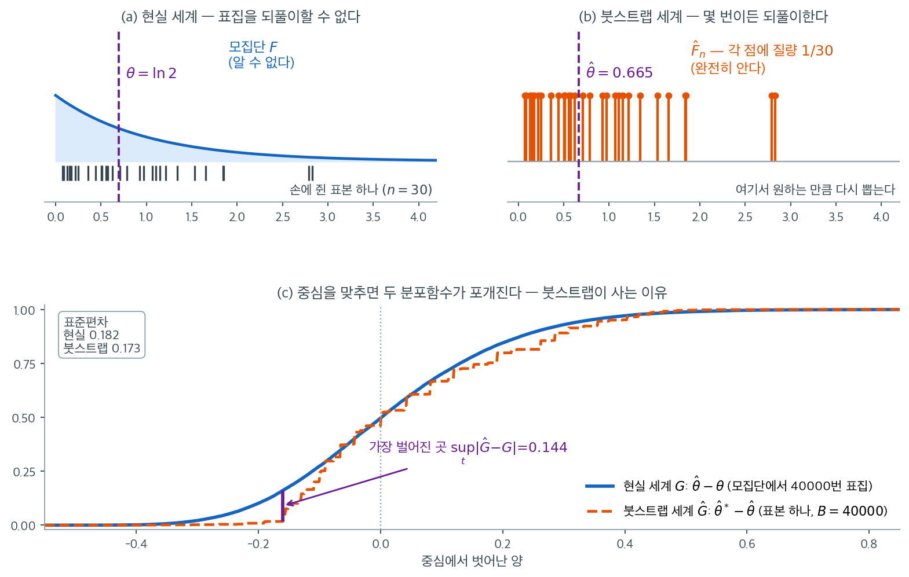
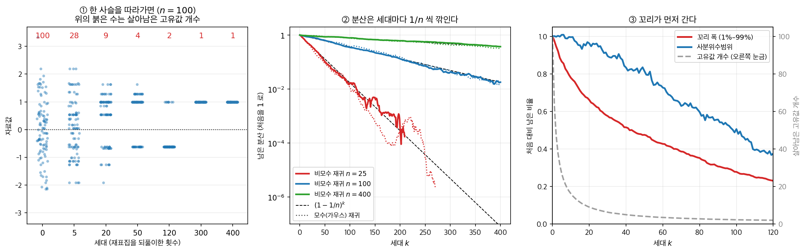
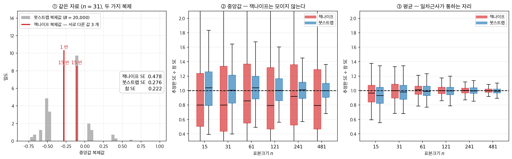

# 붓스트랩 원리

## 1. 공식이 없는 통계량에는 표준오차가 없다

표본 $x_1, \ldots, x_n$에서 계산한 통계량 $\hat{\theta}$의 표준오차를 추정하고 싶다고 하자. 정규모집단의 표본평균이라면 답이 간단하다. $s / \sqrt{n}$이다. 그런데 $\hat{\theta}$가 중앙값, 절사평균, 두 추정량의 비, 또는 자료의 복잡한 함수라면 어떨까? 실제 상황에서는 표준오차의 닫힌 공식이 존재하지 않는 경우가 많다.

브래들리 에프론은 1979년에 바로 이 문제를 풀기 위해 **붓스트랩**을 도입했다. 핵심 발상은 놀랍도록 단순하다. 관측된 표본을 마치 모집단인 것처럼 다루고, 재표집으로 $\hat{\theta}$의 거동을 배우는 것이다.

---

## 2. 대입 원리

붓스트랩은 통계학의 일반적 전략인 **대입 원리**(plug-in principle)에 기댄다. 관심 있는 양이 알려지지 않은 모집단 분포 $F$에 의존한다면, $F$ 자리에 경험적 분포함수 $\hat{F}_n$을 대입하여 추정한다.

경험적 분포함수는 관측된 각 자료점에 같은 질량 $1/n$을 둔다.

$$
\hat{F}_n(x) = \frac{1}{n} \sum_{i=1}^{n} \mathbf{1}(X_i \le x)
$$

예를 들어 모평균 $\mu = \int x \, dF(x)$는 $\bar{x} = \int x \, d\hat{F}_n(x) = \frac{1}{n}\sum_{i=1}^n x_i$로 추정된다. 모분산 $\sigma^2 = \int (x - \mu)^2 \, dF(x)$는 표본 대응물 $\frac{1}{n}\sum_{i=1}^n (x_i - \bar{x})^2$으로 추정된다. 대입 원리는 이 발상을 $F$의 임의의 범함수로 확장할 뿐이다.

!!! note "대입 원리가 작동하는 이유"
    Glivenko-Cantelli 정리는 $n \to \infty$일 때 $\hat{F}_n \to F$가 거의 확실하게 균등수렴함을 보장한다. 연속인 범함수 $T(F)$에 대해 이 수렴은 $T(\hat{F}_n) \to T(F)$를 함의하므로, 온건한 정칙조건 아래에서 대입 추정량은 일치추정량이다.

---

## 3. 대입에서 붓스트랩으로

대입 원리는 모수를 어떻게 추정할지 알려 준다. 붓스트랩은 이 발상을 추정량의 **표집분포**를 추정하는 데까지 확장한다.

i.i.d. 표본 $X_1, \ldots, X_n \sim F$에서 계산한 통계량 $\hat{\theta} = g(X_1, \ldots, X_n)$을 생각하자. 그 표집분포는 알려지지 않은 $F$에 의존한다. 붓스트랩은 모든 곳에서 $F$를 $\hat{F}_n$으로 대체한다.

| | 모집단 세계 | 붓스트랩 세계 |
|---|---|---|
| **분포** | $F$ (미지) | $\hat{F}_n$ (기지) |
| **표본** | $X_1, \ldots, X_n \overset{\text{iid}}{\sim} F$ | $X_1^*, \ldots, X_n^* \overset{\text{iid}}{\sim} \hat{F}_n$ |
| **통계량** | $\hat{\theta} = g(X_1, \ldots, X_n)$ | $\hat{\theta}^* = g(X_1^*, \ldots, X_n^*)$ |
| **목표** | $F$ 아래 $\hat{\theta}$의 분포 | $\hat{F}_n$ 아래 $\hat{\theta}^*$의 분포 |

$\hat{F}_n$은 $\{x_1, \ldots, x_n\}$ 위에 지지집합을 갖는 이산분포이므로, $\hat{F}_n$에서 추출하는 것은 원자료에서 **복원추출**하는 것과 같다.

---

## 4. 핵심 유비

에프론의 통찰은 한 문장으로 요약된다. **붓스트랩 세계와 관측된 표본의 관계는 현실 세계와 모집단의 관계와 같다.**

현실 세계에서 우리는 모집단에서 표본을 뽑아 통계량을 계산한다. 표본이 하나뿐이므로 이 실험을 반복할 수 없다. 붓스트랩 세계에서는 "표본에서 표본을" 뽑아 같은 통계량을 계산한다. "모집단"(관측자료)을 완전히 알고 있으므로 원하는 만큼 반복할 수 있다.

붓스트랩 표본에 걸친 $\hat{\theta}^*$의 변동이 $F$에서 반복 표집했을 때의 $\hat{\theta}$의 변동을 근사한다.



그림의 위쪽 두 칸이 유비 그 자체이다. (a)에서 $\text{Exp}(1)$ 모집단에서 $n = 30$을 뽑았고 중앙값의 참값은 $\theta = \ln 2 = 0.693$이지만, **우리에게 주어진 것은 눈금으로 찍힌 저 30개뿐**이다. 같은 실험을 다시 할 수 없으므로 $\hat\theta$가 얼마나 흔들리는지 알 길이 없다. (b)는 같은 30개를 다른 눈으로 본 것이다. 각 점에 질량 $1/30$을 얹으면 그것이 $\hat{F}_n$이고, 이 분포는 **미지의 대상이 아니라 우리가 완전히 아는 대상**이다. 그래서 (b)에서는 표집을 몇 번이든 되풀이할 수 있다. 이 표본의 중앙값은 $\hat\theta = 0.665$이며, 붓스트랩 세계에서는 이 값이 "참 모수" 노릇을 한다.

아래 칸이 유비가 실제로 값을 하는 지점이다. 두 세계에서 각각 4만 번씩 반복하여 **각자의 중심에서 벗어난 양**을 모았다. 파란 곡선은 현실 세계의 $\hat\theta - \theta$이고 주황 계단은 붓스트랩 세계의 $\hat\theta^* - \hat\theta$인데, 서로 다른 중심에서 출발했는데도 두 분포함수가 거의 포개진다. 표준편차가 $0.182$ 대 $0.173$이다. 참 표준오차를 알려면 모집단이 필요한데, 손에 든 표본 하나만으로 그 값을 $5\%$ 오차 안에서 재현한 셈이다. 중앙값에는 $s/\sqrt{n}$ 같은 공식이 없다는 점을 기억하면 이것이 공짜로 얻은 것이 아님을 알 수 있다.

동시에 그림은 붓스트랩의 한계도 숨기지 않는다. 주황 곡선이 **계단**인 것은 붓스트랩 중앙값이 관측된 30개 값의 조합에서만 나올 수 있기 때문이다. 두 곡선이 가장 벌어진 곳에서 간격이 $\sup_t |\hat{G} - G| = 0.144$이며, 이 틈은 $B$를 아무리 키워도 줄지 않는다. 위의 일치성 정리가 $B \to \infty$가 아니라 $n \to \infty$를 요구하는 이유가 여기에 있다. **$B$는 붓스트랩 세계를 얼마나 촘촘히 탐색했는지를 정할 뿐이고, 그 세계 자체가 현실 세계와 얼마나 닮았는지는 오직 $n$이 정한다.**

<div class="aibox" markdown>

**AI로 보는 통계학 1.** 한 칸 더 들어가면

위 표는 세계가 **둘**이다. 현실 세계 $F$ 와 붓스트랩 세계 $\hat F_n$. 대입은 한 번만
한다. 그런데 한 칸 더 들어가면 어떻게 되는가. 붓스트랩 표본을 새 $\hat F$ 로 삼아 또
뽑고, 그것을 또 새 $\hat F$ 로 삼고 — 그렇게 되풀이하면.

$2024$ 년 $7$ 월 『네이처』에 실린 논문이 그 물음에 답한다. 옥스퍼드·케임브리지·토론토의
일리아 슈마일로프와 공저자들이 쓴 제목은 **「AI 모형은 재귀적으로 생성된 자료로 학습하면
붕괴한다」**이다. 초록의 문장은 이렇다. **「모형이 생성한 내용을 가리지 않고 학습에 쓰면
그 모형에 되돌릴 수 없는 결함이 생기는데, 원래 내용 분포의 꼬리가 사라진다.」** 그들은
이것을 **모형 붕괴**라 이름 붙이고 언어모형·변분오토인코더·**가우스 혼합모형** 모두에서
일어남을 보였다.

원인 가운데 **으뜸**으로 꼽은 것이 이 쪽의 이야기다.

> **「통계적 근사 오차 — 표본 수가 유한하기 때문에 생기는 일차적 오차로, 표본 수가
> 무한으로 가면 사라진다. 재표집의 매 단계마다 정보가 사라질 확률이 $0$ 이 아니기
> 때문에 일어난다.」**

「재표집의 매 단계마다」. 그러니 장치가 하나도 필요 없다. 정규분포에서 $n$ 개를 뽑아
놓고, 거기서 $n$ 개를 복원추출하고, 또 거기서 $n$ 개를 복원추출하기만 하면 된다.



- **①** $n = 100$ 으로 시작한 사슬 하나다. $5$ 세대 만에 고유값이 $28$ 개로 줄고,
  $50$ 세대에 $4$ 개, $300$ 세대에 **$1$ 개**가 된다. 표준편차 $1.090$ 이 $0$ 이 된다.
  자료는 그대로 $100$ 개인데 그 안에 든 **서로 다른 값**이 없어진 것이다.
- **②** 말라 죽는 속도에는 닫힌 꼴이 있다. 복원추출한 표본의 대입 분산은 평균적으로
  부모의 $(1 - 1/n)$ 배이므로 $\mathbb{E}[\hat\sigma^2_k] = (1 - 1/n)^k \hat\sigma^2_0$ 이다.
  $n = 25, 100, 400$ 에서 모의값이 이 식 위에 그대로 얹힌다. **가우스를 적합해서 뽑는
  모수 재귀**(논문이 든 $1$ 차원 보기)도 같은 속도다 — $n = 100$, $100$ 세대에서
  비모수 $0.348$, 모수 $0.373$, 식 $0.366$.
- **③** 그리고 꼬리가 먼저 간다. 절반으로 줄기까지 **꼬리 폭($1\%$–$99\%$)은 $42$ 세대,
  사분위수범위는 $99$ 세대**가 걸린다. 논문이 「이른 모형 붕괴에서 모형은 분포의 꼬리에
  대한 정보를 잃기 시작한다」고 적은 것이 이 그림이다.

여기서 조심할 것이 있다. 이 그림은 붓스트랩이 틀렸다는 뜻이 **아니다.** 붓스트랩은
$\hat F_n$ 에서 **한 번** 뽑아 $\hat\theta$ 의 흔들림을 잴 뿐이고, 그 한 번은 위 절이
증명한 대로 옳다. 무너지는 것은 뽑은 것을 **다시 자료로 삼을 때**다. 재표집은 가진 정보를
**읽어 내는** 장치이지 **만들어 내는** 장치가 아니라는 것, §4 가 끝에서 한 말을 그대로
되풀이하면 — 세계가 현실과 얼마나 닮았는지는 오직 $n$ 이 정한다. $\hat F$ 에서 몇 번을
뽑든 $n$ 은 늘지 않는다.

모형이 만든 글로 다음 모형을 학습시키는 일이 그래서 위험하다. 세대마다 $(1 - 1/n)$ 을
곱하는 셈인데, 그 $n$ 이 「진짜 사람이 쓴 글」의 양이기 때문이다.

_확인한 곳 — 슈마일로프·슈마일로프·자오·파페르노·앤더슨·갈, "AI models collapse when
trained on recursively generated data", 『Nature』 $631$ 권 $755$–$759$ 쪽($2024$ 년 $7$ 월
$24$ 일)의 초록에서 인용한 문장과 세 모형(LLM·VAE·가우스 혼합모형) 목록 · 같은 연구의
준비원고 "The Curse of Recursion"(arXiv:$2305.17493$) $3$ 절에서 「통계적 근사 오차」를
으뜸 원인으로 든 대목과 「이른 모형 붕괴에서 모형은 분포의 꼬리에 대한 정보를 잃기
시작한다」는 정의. 그림의 수는 모두 직접 계산한 값이다_

</div>

---

## 5. 형식적 서술

$\hat{\theta}_n = T(\hat{F}_n)$을 경험적 분포에서 평가한 통계적 범함수라 하자. $\hat{\theta}_n - \theta$의 분포에 대한 붓스트랩 추정은

$$
\hat{G}_n(t) = P^*\!\left(T(\hat{F}_n^*) - T(\hat{F}_n) \le t\right)
$$

이다. 여기서 $P^*$는 (관측자료에 조건부로) 붓스트랩 재표집에 대한 확률이고 $\hat{F}_n^*$은 붓스트랩 표본의 경험적 분포이다.

$\hat{G}_n$이 $\hat{\theta}_n - \theta$의 참 분포 $G$로 확률수렴하면 붓스트랩이 **일치**한다고 한다. 정칙조건($T$의 매끄러움, 유한한 2차 적률) 아래에서 이 수렴이 성립한다.

$$
\sup_t \left| \hat{G}_n(t) - G(t) \right| \xrightarrow{P} 0 \quad (n \to \infty)
$$

!!! tip "실무적 함의"
    붓스트랩 일치성은 $n$이 충분히 크고 재표집 횟수 $B$가 충분히 크면 $\hat{\theta}^* - \hat{\theta}$의 붓스트랩 분포가 $\hat{\theta} - \theta$의 참 표집분포를 충실히 대변한다는 뜻이다. 이것이 붓스트랩 복제로 신뢰구간을 만들고 가설검정을 수행하는 것을 정당화한다.

<div class="exbox" markdown>

**보기 1.** <span class="diff easy" title="쉬움"></span> 중앙값의 표준오차. $n = 20$인 표본에서 표본중앙값의 표준오차를 구하고 싶다고 하자. 평균의 $s/\sqrt{n}$과 달리 간단한 공식이 없다.

**붓스트랩 절차:**

1. 관측된 중앙값 $\hat{\theta} = \text{median}(x_1, \ldots, x_{20})$을 계산한다.
2. $b = 1, \ldots, B$에 대해 자료에서 복원추출로 20개를 뽑아 중앙값 $\hat{\theta}^{*(b)}$을 계산한다.
3. $B$개 붓스트랩 중앙값의 표준편차로 표준오차를 추정한다.

</div>

??? success "풀이"
    $$
    \widehat{\text{SE}}_{\text{boot}} = \sqrt{\frac{1}{B-1} \sum_{b=1}^{B} \left(\hat{\theta}^{*(b)} - \bar{\hat{\theta}}^*\right)^2}
    $$

    여기서 $\bar{\hat{\theta}}^* = \frac{1}{B}\sum_{b=1}^{B} \hat{\theta}^{*(b)}$이다.

    이 절차는 $\hat{\theta}$가 중앙값이든 상관계수든 회귀계수든 다른 어떤 통계량이든 똑같이 작동한다.

---

## 6. 붓스트랩 표본의 성질

크기 $n$인 각 붓스트랩 표본은 복원추출로 뽑으므로, 원래 관측값 중 일부는 여러 번 나타나고 일부는 전혀 나타나지 않는다. 특정 관측값이 한 붓스트랩 표본에서 제외될 확률은

$$
\left(1 - \frac{1}{n}\right)^n \to e^{-1} \approx 0.368 \quad (n \to \infty)
$$

이다. 평균적으로 원래 고유 관측값의 약 63.2%가 각 붓스트랩 표본에 나타난다. 나머지 36.8%는 **out-of-bag** 관측값이라 불리며 랜덤 포레스트 같은 응용에서 중요한 역할을 한다.

!!! warning "붓스트랩은 새로운 정보를 만들지 않는다"
    붓스트랩이 마술처럼 새 자료를 만들거나 표집변동을 줄여 주지는 않는다. 붓스트랩은 관측된 단 하나의 표본에 담긴 정보만으로, 모집단에서 반복 표집했을 때 통계량이 얼마나 변할지를 추정한다. 표본이 모집단을 대표하지 못하면 붓스트랩은 그 비대표성을 충실히 재현할 뿐이다.

---

## 7. 잭나이프 --- 붓스트랩의 일차근사

대입 원리를 다르게 쓰는 길이 하나 더 있다. $\hat F_n$ 에서 $n$ 개를 다시 뽑는 대신 **한 개를 빼 보는** 것이다. 역사는 이쪽이 먼저였다.

**잭나이프**(Quenouille, 1949; Tukey, 1958)는 붓스트랩보다 앞선 방법으로 *하나씩 빼는* 재표집에 기반한다.

**잭나이프 복제값:**

$$
\hat{\theta}_{(-i)} = g(x_1, \ldots, x_{i-1}, x_{i+1}, \ldots, x_n)
$$

**잭나이프 편향 추정:**

$$
\widehat{\text{Bias}}_{\text{jack}} = (n-1)\left(\bar{\hat{\theta}}_{(\cdot)} - \hat{\theta}\right)
$$

여기서 $\bar{\hat{\theta}}_{(\cdot)} = \frac{1}{n}\sum_{i=1}^n \hat{\theta}_{(-i)}$이다.

**잭나이프 표준오차:**

$$
\widehat{\text{SE}}_{\text{jack}} = \sqrt{\frac{n-1}{n}\sum_{i=1}^n \left(\hat{\theta}_{(-i)} - \bar{\hat{\theta}}_{(\cdot)}\right)^2}
$$

잭나이프는 결정론적이라(무작위 재표집이 없다) 때때로 유리하다. 그러나 중앙값 같은 매끄럽지 않은 통계량에서는 실패한다.

<div class="storybox" markdown>

**그림으로 보는 통계학 1.** 에프론이 붙인 제목

$1979$ 년 논문의 제목은 「붓스트랩 방법: **잭나이프를 다시 본다**」였다. 새 도구를 내놓는
제목이 아니다. 서론의 두 문장이 의도를 그대로 밝힌다. **「케누이–튜키 잭나이프는 흥미로운
비모수 방법이다. (…) 이 글은 더 원시적인 방법으로 잭나이프를 설명해 보려 한다 — 곧
분명해질 이유로 「붓스트랩」이라 이름 붙인 방법이다.」**

설명이 끝나자 잭나이프의 정체가 드러났다. 초록의 한 줄이다. **「잭나이프는 붓스트랩의
일차근사 방법임을 보인다.」** 하나씩 빼는 것은 $\hat F_n$ 을 아주 조금 흔들어 보는 일이고,
그 작은 흔들림으로 전체 흔들림을 재려면 통계량이 **매끄러워야** 한다.

중앙값은 매끄럽지 않다. 서론이 이어서 적은 문장이 그것이다. **「$3$ 절에서는 붓스트랩이
표본중앙값의 분산을 (점근적으로) 옳게 추정함을 보이는데, 이는 잭나이프가 실패하는 것으로
알려진 경우다.」**

왜 실패하는지는 손으로 셀 수 있다. 홀수 $n = 2m+1$ 에서 중앙값은 $x_{(m+1)}$ 이다.

- 아래쪽 점을 하나 빼면 중앙값이 $\dfrac{x_{(m+1)} + x_{(m+2)}}{2}$ 로 옮겨 간다 ($m$ 가지)
- 위쪽 점을 하나 빼면 $\dfrac{x_{(m)} + x_{(m+1)}}{2}$ 로 옮겨 간다 ($m$ 가지)
- 중앙값 자신을 빼면 $\dfrac{x_{(m)} + x_{(m+2)}}{2}$ 다 ($1$ 가지)

$n$ 개를 하나씩 다 빼 보아도 **나오는 값은 셋뿐**이고, 셋 다 가운데 세 순서통계량의
간격만으로 정해진다. 그 간격은 $n$ 이 커져도 안정되지 않는다.



- **①** $n = 31$ 짜리 자료 하나다. 잭나이프 복제값은 $-0.285$($15$ 번), $-0.280$($1$ 번),
  $-0.110$($15$ 번) — 정말로 셋이다. 그 자료의 참 표준오차가 $0.222$ 인데 잭나이프는
  $0.478$ 로 두 배 넘게 부풀렸다.
- **②** $n$ 을 키우면 나아지는가. **아니다.** $15$ 에서 $481$ 로 $32$ 배 키워도 「추정
  SE $\div$ 참 SE」의 표준편차가 $0.599 \to 0.663$ 으로 줄지 않는다. $n = 481$ 에서도 이
  비의 가운데 $95\%$ 가 $[0.13,\ 2.60]$ 이다 — 참값의 $1/8$ 로 적을 수도, $2.6$ 배로 적을
  수도 있다. 붓스트랩은 같은 구간에서 $0.316 \to 0.152$ 로 절반이 된다.
- **③** 그런데 평균에서는 잭나이프가 흠잡을 데 없다. $n = 481$ 에서 비의 표준편차가
  $0.033$ 으로 붓스트랩($0.043$)보다 **오히려 낫다.** 붓스트랩 쪽의 여분은 $B = 800$ 에서
  오는 몬테카를로 잡음이니 $B$ 를 키우면 사라지지만, 그 말인즉 **$B$ 를 안 키워도 되는
  결정론적 계산**이 잭나이프의 값어치라는 뜻이다.

잭나이프를 버리라는 이야기가 아니다. ③ 이 말하듯 매끄러운 통계량에서는 잭나이프가 더
싸고 더 조용하며, [BCa](../bootstrap_ci/bca.md)의 가속 상수도 잭나이프로 구한다. ② 가
말하는 것은 다른 것이다 — **어떤 도구가 왜 통하는지를 알고 나면 어디서 안 통하는지도
알게 된다.** 에프론이 새 방법을 내놓기 전에 옛 방법을 설명부터 한 까닭이 거기에 있다.

_확인한 곳 — B. Efron, "Bootstrap Methods: Another Look at the Jackknife", 『Annals of
Statistics』 $7$ 권 $1$ 호 $1$–$26$ 쪽($1979$). 초록에서 「잭나이프는 붓스트랩의 일차근사
방법임을 보인다」, 서론에서 「케누이–튜키 잭나이프」라는 호칭과 「더 원시적인 방법으로
잭나이프를 설명해 보려 한다 — 곧 분명해질 이유로 「붓스트랩」이라 이름 붙인 방법이다」,
그리고 「$3$ 절에서는 붓스트랩이 표본중앙값의 분산을 (점근적으로) 옳게 추정함을 보이는데,
이는 잭나이프가 실패하는 것으로 알려진 경우다」를 인용했다. 그림의 수는 모두 직접 계산한
값이다_

</div>

---

## 연습문제

<div class="drillbox" markdown>

**연습문제 1.** <span class="diff easy" title="쉬움"></span>
$(1 - 1/n)^n$이 $n$에 대해 어떻게 변하는지 계산하고, $e^{-1}$로의 수렴이 얼마나 빠른지 확인하라. $n$이 작을 때 붓스트랩 표본에 포함되는 고유 관측값의 비율은 얼마인가?

</div>

??? success "풀이"
    ```python
    import numpy as np
    for n in (5, 10, 20, 50, 100, 1000):
        p_out = (1 - 1/n) ** n
        print(n, round(p_out, 4), round(1 - p_out, 4))
    print(np.exp(-1))
    ```

    출력:

    ```
    5 0.3277 0.6723
    10 0.3487 0.6513
    20 0.3585 0.6415
    50 0.3642 0.6358
    100 0.366 0.634
    1000 0.3677 0.6323
    0.36787944117144233
    ```

    | $n$ | $P(\text{제외})= (1-1/n)^n$ | 포함되는 고유 관측값 비율 |
    |---:|---:|---:|
    | 5 | 0.3277 | 0.6723 |
    | 10 | 0.3487 | 0.6513 |
    | 20 | 0.3585 | 0.6415 |
    | 50 | 0.3642 | 0.6358 |
    | 100 | 0.3660 | 0.6340 |
    | 1000 | 0.3677 | 0.6323 |
    | $\infty$ | 0.3679 | 0.6321 |

    수렴이 **아래에서 위로** 단조롭게 일어난다. $(1-1/n)^n$은 $n$에 대해 증가하며 $e^{-1} = 0.36788$로 수렴한다.

    수렴이 꽤 빠르다. $n = 20$에서 이미 $0.3585$로 극한값과 $0.009$ 차이이고, $n = 100$에서는 $0.002$ 차이이다. 오차가 대략 $e^{-1}/(2n)$ 정도로 줄어든다.

    실무적 함의: $n$이 작아도 "약 63%" 규칙이 그런대로 맞는다. $n = 5$에서도 $67\%$로 크게 벗어나지 않는다. 다만 $n = 5$에서는 붓스트랩 자체가 신뢰할 만하지 않다는 점이 훨씬 큰 문제이다.

---

<div class="drillbox" markdown>

**연습문제 2.** <span class="diff med" title="중간"></span>
붓스트랩 표본을 왜 비복원이 아니라 **복원**추출로 뽑는가? 원자료에서 크기 $n$인 표본을 비복원으로 뽑으면 무슨 일이 일어나는가?

</div>

??? success "풀이"
    크기 $n$인 자료에서 크기 $n$인 표본을 **비복원**으로 뽑으면 원자료를 순서만 바꾼 것이 나온다. 자료의 다중집합이 언제나 동일하므로 **모든 붓스트랩 표본이 같은 통계량 값을 준다**.

    ```python
    import numpy as np
    rng = np.random.default_rng(0)
    x = rng.normal(0, 1, 20)
    without = [rng.permutation(x).mean() for _ in range(1000)]
    withrep  = [rng.choice(x, 20, replace=True).mean() for _ in range(1000)]
    print(np.std(without), np.std(withrep))   # 4.9e-17, 0.1905
    ```

    출력:

    ```
    4.9214322082716815e-17 0.19048618210062987
    ```

    비복원의 표준편차가 $5 \times 10^{-17}$로 사실상 $0$이다(부동소수점 오차만 남는다). 변동이 전혀 없으므로 표준오차 추정값이 $0$이 되고 붓스트랩이 완전히 무의미해진다.

    **더 근본적인 이유**는 붓스트랩 세계가 현실 세계를 흉내 내야 한다는 데 있다. 현실에서 우리는 무한(또는 매우 큰) 모집단 $F$에서 $n$개를 뽑는다. 이는 사실상 복원추출이다. 붓스트랩 세계에서 $\hat{F}_n$은 $\{x_1, \ldots, x_n\}$ 위의 이산분포이고, 이 분포에서 i.i.d.로 $n$개를 뽑는 것이 바로 복원추출이다.

    !!! note "$m$-out-of-$n$ 붓스트랩"
        예외가 있다. 표본크기 $m < n$으로 뽑는 **$m$-out-of-$n$ 붓스트랩**은 표준 붓스트랩이 실패하는 상황(예: 최댓값이나 극단 분위수 추정)에서 일치성을 회복하는 데 쓰인다. 이 경우에도 추출은 복원으로 한다.

---

<div class="drillbox" markdown>

**연습문제 3.** <span class="diff med" title="중간"></span>
붓스트랩이 **실패하는** 예를 하나 구성하라. 표본최댓값 $\hat{\theta} = \max(X_1, \ldots, X_n)$의 붓스트랩 분포가 왜 참 표집분포를 근사하지 못하는가?

</div>

??? success "풀이"
    $X_i \sim \text{Uniform}(0, \theta)$이고 $\hat{\theta} = \max_i X_i$라 하자.

    **참 표집분포.** $\hat{\theta}/\theta$의 분포는 연속이며 $P(\hat\theta \le t) = (t/\theta)^n$이다. 특히 $n(\theta - \hat{\theta})/\theta \xrightarrow{d} \text{Exp}(1)$이다.

    **붓스트랩 분포.** 붓스트랩 표본의 최댓값 $\hat{\theta}^*$는 관측된 최댓값 $x_{(n)}$을 **결코 넘을 수 없다**. 그리고 $\hat{\theta}^* = x_{(n)}$일 확률은 $x_{(n)}$이 붓스트랩 표본에 적어도 한 번 포함될 확률이므로

    $$
    P^*(\hat{\theta}^* = \hat{\theta}) = 1 - \left(1 - \frac{1}{n}\right)^n \to 1 - e^{-1} \approx 0.632
    $$

    이다. 즉 붓스트랩 분포가 관측값 $\hat{\theta}$에 **확률질량 $0.632$의 원자**를 갖는다. 참 분포는 연속인데 붓스트랩 분포는 그렇지 않다.

    ```python
    import numpy as np
    rng = np.random.default_rng(1)
    n, theta = 50, 1.0
    x = rng.uniform(0, theta, n)
    obs = x.max()
    boot = np.array([rng.choice(x, n, replace=True).max() for _ in range(20000)])
    print("P*(max* == max) =", (boot == obs).mean())   # 0.6384
    print("이론값 =", 1 - (1 - 1/n) ** n)               # 0.6358
    ```

    출력:

    ```
    P*(max* == max) = 0.63845
    이론값 = 0.6358303199128832
    ```

    이 원자 때문에 붓스트랩 신뢰구간의 포함확률이 무너진다. 백분위수 구간의 상한이 $\hat{\theta}$를 절대 넘지 못하는데, 참인 $\theta$는 언제나 $\hat{\theta}$보다 크기 때문이다.

    **왜 실패하는가.** 붓스트랩 일치성은 통계량이 $\hat{F}_n$의 **매끄러운** 범함수일 것을 요구한다. 최댓값은 매끄럽지 않다. 자료점 하나(가장 큰 것)에 전적으로 의존하며, 이는 미분 가능한 범함수가 아니다.

    **해결책.** $m$-out-of-$n$ 붓스트랩($m = o(n)$)이나 subsampling을 쓰면 일치성이 회복된다. 자세한 내용은 [재표집이 실패할 때](../comparison/limitations.md)에서 다룬다.

---

<div class="drillbox" markdown>

**연습문제 4.** <span class="diff med" title="중간"></span>
표본평균 $\hat{\theta} = \bar{X}$에 대해서는 붓스트랩을 **돌리지 않고도** 답을 적을 수 있다.

(가) $X_1^*, \ldots, X_n^*$이 $\hat{F}_n$에서 i.i.d.일 때 $E^*[\bar{X}^*] = \bar{x}$와 $\operatorname{Var}^*(\bar{X}^*) = \hat{\sigma}^2 / n$을 보여라. 여기서 $\hat{\sigma}^2 = \frac{1}{n}\sum_{i=1}^n (x_i - \bar{x})^2$은 §2에서 대입 원리로 얻은 바로 그 분산 추정값이다.

(나) 따라서 붓스트랩 표준오차는 익숙한 $s/\sqrt{n}$과 정확히 얼마나 다른가? $n = 20$과 $n = 100$에서 그 비를 소수 넷째 자리까지 적어라.

(다) 이 결과를 보면 $B$를 키우는 일이 평균에 대해서는 무슨 뜻인가? §1이 붓스트랩의 동기로 평균이 아니라 중앙값을 든 까닭을 설명하라.

</div>

??? success "풀이"
    **(가)** $\hat{F}_n$은 각 $x_i$에 질량 $1/n$을 두는 이산분포이므로, 하나의 붓스트랩 추출 $X_1^*$에 대해

    $$
    E^*[X_1^*] = \sum_{i=1}^n \frac{1}{n} x_i = \bar{x}, \qquad
    \operatorname{Var}^*(X_1^*) = \sum_{i=1}^n \frac{1}{n} (x_i - \bar{x})^2 = \hat{\sigma}^2
    $$

    이다. 여기서 기댓값과 분산은 **관측자료에 조건부로**, 즉 §5의 $P^*$ 아래에서 계산한 것이다. $X_1^*, \ldots, X_n^*$이 ($P^*$ 아래에서) 독립이므로

    $$
    E^*[\bar{X}^*] = \bar{x}, \qquad
    \operatorname{Var}^*(\bar{X}^*) = \frac{1}{n^2} \sum_{i=1}^n \operatorname{Var}^*(X_i^*) = \frac{\hat{\sigma}^2}{n}
    $$

    이다. 근사가 아니라 **등식**이다. 몬테카를로가 전혀 들어가지 않았다.

    **(나)** $\hat{\sigma}^2 = \frac{n-1}{n} s^2$이므로

    $$
    \widehat{\text{SE}}_{\text{boot}}(\bar{X}) = \frac{\hat{\sigma}}{\sqrt{n}} = \sqrt{\frac{n-1}{n}} \cdot \frac{s}{\sqrt{n}}
    $$

    이다. $n = 20$에서 비는 $\sqrt{19/20} = 0.9747$, $n = 100$에서 $\sqrt{99/100} = 0.9950$이다. 붓스트랩 표준오차가 $s/\sqrt{n}$보다 각각 $2.5\%$, $0.5\%$ 작다.

    이것은 결함이 아니라 대입 원리를 글자 그대로 따른 결과다. 붓스트랩 세계의 "모집단"은 $\hat{F}_n$이고 그 분산은 $s^2$이 아니라 $\hat{\sigma}^2$이다. 두 값의 차이는 $O(1/n)$이므로 일치성에는 영향이 없다.

    **(다)** 평균에 대해서는 붓스트랩 분포의 분산이 닫힌 형태로 알려져 있으므로, $B$개 복제값에서 계산한 $\widehat{\text{SE}}$는 이 **이미 아는 값**을 몬테카를로로 추정하는 것일 뿐이다. $B \to \infty$에서 $\hat{\sigma}/\sqrt{n}$으로 수렴하며, 유한한 $B$가 보태는 것은 오차뿐이다. 즉 평균에 붓스트랩을 돌리는 것은 아는 답을 모의실험으로 다시 구하는 낭비다.

    §1이 중앙값을 든 까닭이 여기에 있다. 중앙값에는 이런 닫힌 공식이 없으므로 재표집이 유일한 길이다. 붓스트랩의 값은 "평균을 다시 계산해 주는" 데 있지 않고 **공식이 없는 통계량으로 같은 절차를 확장해 주는** 데 있다.

---

<div class="drillbox" markdown>

**연습문제 5.** <span class="diff med" title="중간"></span>
$n = 3$이면 붓스트랩 세계를 **전부** 들여다볼 수 있다. 자료가 $x = (1, 2, 6)$이라 하자. 크기 $3$인 붓스트랩 표본은 $3^3 = 27$가지이고 모두 같은 확률 $1/27$을 갖는다.

(가) $27$가지를 모두 열거하여 $\hat{\theta}^* = \text{median}(X_1^*, X_2^*, X_3^*)$의 **정확한** 붓스트랩 분포(확률질량함수)를 구하라. 손으로 세고 코드로 확인하라.

(나) $E^*[\hat{\theta}^*]$, $\text{SD}^*(\hat{\theta}^*)$, 그리고 붓스트랩 편향 추정값 $E^*[\hat{\theta}^*] - \hat{\theta}$를 구하라.

(다) 같은 자료에서 평균의 붓스트랩 표준오차를 연습문제 4의 공식으로 구해 (나)와 비교하라. 어느 쪽이 더 흔들리는가? 그리고 이 분포에 대해 $B$를 아무리 키워도 고쳐지지 않는 것은 무엇인가?

</div>

??? success "풀이"
    **(가)** 중앙값은 정렬한 가운데 값이다. 다중집합별로 세면

    | 붓스트랩 표본의 다중집합 | 순서 있는 가지 수 | 중앙값 |
    |---|---:|---:|
    | $\{1,1,1\}$ | 1 | 1 |
    | $\{1,1,2\}$ | 3 | 1 |
    | $\{1,1,6\}$ | 3 | 1 |
    | $\{2,2,2\}$ | 1 | 2 |
    | $\{2,2,1\}$ | 3 | 2 |
    | $\{2,2,6\}$ | 3 | 2 |
    | $\{1,2,6\}$ | 6 | 2 |
    | $\{6,6,6\}$ | 1 | 6 |
    | $\{6,6,1\}$ | 3 | 6 |
    | $\{6,6,2\}$ | 3 | 6 |

    이다. 합이 $1 + 3 + 3 + 1 + 3 + 3 + 6 + 1 + 3 + 3 = 27$로 맞는다. 따라서

    $$
    P^*(\hat{\theta}^* = 1) = \frac{7}{27}, \quad
    P^*(\hat{\theta}^* = 2) = \frac{13}{27}, \quad
    P^*(\hat{\theta}^* = 6) = \frac{7}{27}
    $$

    이다.

    **(나)**

    $$
    E^*[\hat{\theta}^*] = \frac{7 \cdot 1 + 13 \cdot 2 + 7 \cdot 6}{27} = \frac{75}{27} = 2.7778
    $$

    $$
    E^*[(\hat{\theta}^*)^2] = \frac{7 \cdot 1 + 13 \cdot 4 + 7 \cdot 36}{27} = \frac{311}{27} = 11.5185
    $$

    $$
    \operatorname{Var}^*(\hat{\theta}^*) = 11.5185 - 2.7778^2 = 3.8025, \qquad
    \text{SD}^*(\hat{\theta}^*) = 1.9500
    $$

    관측된 중앙값이 $\hat{\theta} = 2$이므로 붓스트랩 편향 추정값은 $2.7778 - 2 = 0.7778$이다.

    ```python
    import itertools
    import numpy as np

    x = np.array([1.0, 2.0, 6.0])
    n = len(x)
    samples = np.array(list(itertools.product(x, repeat=n)))   # 27 x 3
    med = np.median(samples, axis=1)
    mean = samples.mean(axis=1)

    vals, cnt = np.unique(med, return_counts=True)
    for v, c in zip(vals, cnt):
        print(f"median* = {v:.0f}   횟수 {c:2d}/27   확률 {c/27:.4f}")

    print(f"E*[median*]  = {med.mean():.4f}")
    print(f"SD*[median*] = {med.std(ddof=0):.4f}")
    print(f"편향 추정    = {med.mean() - np.median(x):.4f}")
    print(f"SD*[mean*]   = {mean.std(ddof=0):.4f}"
          f"   (sigmahat/sqrt(n) = {x.std(ddof=0) / np.sqrt(n):.4f})")
    ```

    출력:

    ```text
    median* = 1   횟수  7/27   확률 0.2593
    median* = 2   횟수 13/27   확률 0.4815
    median* = 6   횟수  7/27   확률 0.2593
    E*[median*]  = 2.7778
    SD*[median*] = 1.9500
    편향 추정    = 0.7778
    SD*[mean*]   = 1.2472   (sigmahat/sqrt(n) = 1.2472)
    ```

    **(다)** $\bar{x} = 3$이고 $\hat{\sigma}^2 = \frac{(1-3)^2 + (2-3)^2 + (6-3)^2}{3} = \frac{14}{3}$이므로 연습문제 4에 따라

    $$
    \widehat{\text{SE}}_{\text{boot}}(\bar{X}) = \frac{\hat{\sigma}}{\sqrt{3}} = \sqrt{\frac{14}{9}} = 1.2472
    $$

    이다. 코드의 마지막 줄이 전수 열거로 얻은 값과 이 공식이 정확히 일치함을 확인해 준다. 중앙값의 $1.9500$이 평균의 $1.2472$보다 $56\%$ 크다. 자료 셋 중 하나가 멀리 떨어진 $6$이라 중앙값이 그 값으로 튀는 일이 $7/27 = 26\%$나 되기 때문이다($n$이 작으면 중앙값의 강건성이 오히려 불리하게 작동한다).

    $B$를 키워도 고쳐지지 않는 것은 **붓스트랩 분포가 세 점 $\{1, 2, 6\}$ 위에만 질량을 갖는다는 사실**이다. $B = 10^9$이어도 $1.5$나 $3$ 같은 값은 한 번도 나오지 않는다. 참 표집분포는 $F$가 연속이면 연속인데 붓스트랩 분포는 격자 위에 있다. §4의 "주황 계단"이 바로 이것이고, 이 틈을 메우는 것은 $B$가 아니라 $n$이다.

---

<div class="drillbox" markdown>

**연습문제 6.** <span class="diff hard" title="어려움"></span>
연습문제 3을 끝까지 밀어 보자. 자료가 서로 다른 값 $x_{(1)} < x_{(2)} < \cdots < x_{(n)}$이고 $\hat{\theta}^* = \max_i X_i^*$라 하자.

(가) $P^*(\hat{\theta}^* \le x_{(k)}) = (k/n)^n$임을 보여라.

(나) 이로부터 확률질량함수 $P^*(\hat{\theta}^* = x_{(k)})$를 구하라.

(다) $n = 5$에 대해 다섯 값을 모두 분수와 소수로 적고 합이 $1$임을 확인하라.

(라) 위쪽 $j$개 관측값 $x_{(n-j+1)}, \ldots, x_{(n)}$이 차지하는 붓스트랩 질량이 $1 - (1 - j/n)^n$이고 $n \to \infty$에서 $1 - e^{-j}$로 간다는 것을 보여라. $j = 1, 2, 3$의 극한값을 적고, 이것이 "붓스트랩 분포가 참 분포를 근사하지 못한다"는 말의 정량적 표현인 까닭을 한 줄로 말하라.

</div>

??? success "풀이"
    **(가)** $\hat{\theta}^* \le x_{(k)}$가 되는 것은 붓스트랩 표본의 $n$개 추출이 **모두** $\{x_{(1)}, \ldots, x_{(k)}\}$에서 나올 때이고 그때뿐이다. 각 추출이 독립이고 이 집합에 들어갈 확률이 $k/n$이므로

    $$
    P^*(\hat{\theta}^* \le x_{(k)}) = \left(\frac{k}{n}\right)^{n}, \qquad k = 1, \ldots, n
    $$

    이다. $k = n$에서 값이 $1$이 되므로 분포함수가 맞다.

    **(나)** 지지집합이 $\{x_{(1)}, \ldots, x_{(n)}\}$이므로 계단의 뜀이 질량이다.

    $$
    P^*(\hat{\theta}^* = x_{(k)}) = \left(\frac{k}{n}\right)^{n} - \left(\frac{k-1}{n}\right)^{n} = \frac{k^n - (k-1)^n}{n^n}
    $$

    $k = n$에 넣으면 $1 - (1 - 1/n)^n$으로 본문 §6과 연습문제 3의 값이 그대로 나온다.

    **(다)** $n = 5$이면 $n^n = 3125$이고

    | $k$ | $k^5 - (k-1)^5$ | $P^*(\hat{\theta}^* = x_{(k)})$ |
    |---:|---:|---:|
    | 1 | $1 - 0 = 1$ | $1/3125 = 0.00032$ |
    | 2 | $32 - 1 = 31$ | $31/3125 = 0.00992$ |
    | 3 | $243 - 32 = 211$ | $211/3125 = 0.06752$ |
    | 4 | $1024 - 243 = 781$ | $781/3125 = 0.24992$ |
    | 5 | $3125 - 1024 = 2101$ | $2101/3125 = 0.67232$ |

    분자의 합이 $1 + 31 + 211 + 781 + 2101 = 3125$이므로 확률의 합이 정확히 $1$이다.

    **(라)** 위쪽 $j$개가 차지하는 질량은 여사건에서 바로 나온다.

    $$
    P^*\!\left(\hat{\theta}^* \ge x_{(n-j+1)}\right) = 1 - P^*\!\left(\hat{\theta}^* \le x_{(n-j)}\right) = 1 - \left(1 - \frac{j}{n}\right)^{n}
    $$

    $(1 - j/n)^n \to e^{-j}$이므로 극한은 $1 - e^{-j}$이다. $j = 1, 2, 3$에서 각각 $0.6321$, $0.8647$, $0.9502$이다($n = 5$에서는 $0.67232$, $0.92224$, $0.98976$).

    한 줄 해석: 참 표집분포는 $x_{(n)}$ 주변에 연속으로 퍼져 있는데 붓스트랩 분포는 $n$이 아무리 커도 질량의 $95\%$를 **단 세 개**의 관측값에 몰아넣는다. 지지집합이 늘어나지 않으므로 $\sup_t |\hat{G}_n - G|$가 $0$으로 가지 않고, 이것이 §5의 일치성이 깨지는 모습이다.

---

<div class="drillbox" markdown>

**연습문제 7.** <span class="diff hard" title="어려움"></span>
§4의 마지막 문단은 "$B$는 붓스트랩 세계를 얼마나 촘촘히 탐색했는지를 정할 뿐이고, 그 세계 자체가 현실 세계와 얼마나 닮았는지는 오직 $n$이 정한다"고 했다. 이 문장을 수치로 가려 보자. $\text{Exp}(1)$에서 $n = 30$을 뽑아 **중앙값**의 붓스트랩 표준오차를 재는 상황이다.

(가) 자료를 하나 뽑아 **고정**하고, $B = 250, 1000, 4000, 16000$에 대해 같은 계산을 $R = 40$번 되풀이하여 $\widehat{\text{SE}}_{\text{boot}}$의 반복 간 표준편차(**몬테카를로 오차**)를 재라. $B$가 $4$배가 될 때 이 오차는 어떻게 변하는가?

(나) 이번에는 $B = 4000$으로 고정하고 자료를 $S = 300$번 새로 뽑아 $\widehat{\text{SE}}_{\text{boot}}$의 표본 간 표준편차(**통계적 오차**)를 재라.

(다) 두 오차의 크기를 비교하라. (가)에서 고정한 자료가 준 값이 (나)의 평균과 얼마나 떨어져 있는가? $B$를 키워 줄일 수 있는 것과 줄일 수 없는 것을 구분하여 말하라.

</div>

??? success "풀이"
    ```python
    import numpy as np

    rng = np.random.default_rng(17)
    n = 30

    # (1) 자료 하나를 고정하고 B 만 키운다 --- 몬테카를로 오차
    x = rng.exponential(1.0, n)
    print(f"고정한 자료: n = {n},  표본중앙값 = {np.median(x):.4f}")
    R = 40
    for B in (250, 1000, 4000, 16000):
        se = np.empty(R)
        for r in range(R):
            idx = rng.integers(0, n, size=(B, n))
            se[r] = np.median(x[idx], axis=1).std(ddof=1)
        print(f"  B = {B:6d}   SE_boot 평균 {se.mean():.4f}   반복 간 SD {se.std(ddof=1):.4f}")

    # (2) B 를 크게 고정하고 자료를 다시 뽑는다 --- 통계적 오차
    S, B = 300, 4000
    se = np.empty(S)
    for s in range(S):
        y = rng.exponential(1.0, n)
        idx = rng.integers(0, n, size=(B, n))
        se[s] = np.median(y[idx], axis=1).std(ddof=1)
    print(f"자료를 바꿔 가며 S = {S}, B = {B}:"
          f"  SE_boot 평균 {se.mean():.4f}   표본 간 SD {se.std(ddof=1):.4f}")
    ```

    출력:

    ```text
    고정한 자료: n = 30,  표본중앙값 = 0.5223
      B =    250   SE_boot 평균 0.1162   반복 간 SD 0.0059
      B =   1000   SE_boot 평균 0.1170   반복 간 SD 0.0026
      B =   4000   SE_boot 평균 0.1170   반복 간 SD 0.0011
      B =  16000   SE_boot 평균 0.1169   반복 간 SD 0.0006
    자료를 바꿔 가며 S = 300, B = 4000:  SE_boot 평균 0.1870   표본 간 SD 0.0595
    ```

    **(가)** 반복 간 SD가 $0.0059 \to 0.0026 \to 0.0011 \to 0.0006$으로 $B$가 $4$배가 될 때마다 거의 정확히 **절반**이 된다. 즉 몬테카를로 오차는 $B^{-1/2}$로 줄어든다. 이것은 $\widehat{\text{SE}}_{\text{boot}}$가 $B$개 복제값의 표본표준편차이기 때문이다. 동시에 평균값은 $0.1162, 0.1170, 0.1170, 0.1169$로 한 값에 못박혀 있다. $B \to \infty$에서 $\widehat{\text{SE}}_{\text{boot}}$는 **이 고정한 자료가 결정한 하나의 수** $0.1170$으로 수렴한다.

    **(나)** 자료를 바꾸면 그 수가 평균 $0.1870$, 표준편차 $0.0595$로 흔들린다. 평균 $0.1870$은 §4에서 읽은 참 표준오차 $0.182$ 근처이다(중앙값의 붓스트랩 표준오차는 위로 조금 치우친다).

    **(다)** $B = 16000$에서 몬테카를로 오차는 $0.0006$이고 통계적 오차는 $0.0595$다. **약 $100$배** 차이다. 그런데도 (가)에서 고정한 자료는 $0.1170$을 주었으니 (나)의 평균보다 $0.070$, 즉 통계적 표준편차의 $1.2$배만큼 아래로 치우쳐 있다. 이 자료는 운이 나빴고, $B$를 $10^9$로 올려도 그 값은 $0.1170$에 더 정확히 수렴할 뿐 $0.187$ 쪽으로 움직이지 않는다.

    정리하면, $B$는 **"$\hat{F}_n$이 아는 답을 얼마나 정확히 읽어 내는가"** 만을 다스린다. "$\hat{F}_n$이 $F$를 얼마나 닮았는가"는 $n$만이 다스린다. 실무 규칙도 여기서 나온다. 몬테카를로 오차를 통계적 오차의 $10\%$ 아래로 누르는 데는 $B$가 수천이면 충분하고, 그 이상은 계산만 늘린다.

---

<div class="drillbox" markdown>

**연습문제 8.** <span class="diff hard" title="어려움"></span>
§3의 표는 현실 세계의 표본이 $X_1, \ldots, X_n \overset{\text{iid}}{\sim} F$임을 전제한다. 이 전제가 깨지면 유비의 어느 칸이 틀어지는지 수치로 보자.

치료 전후를 같은 사람에게서 잰 **대응자료**를 생각한다. $n = 40$명, 전후 측정값은 각각 표준정규이고 상관계수가 $\rho = 0.8$이다. 관심 있는 것은 평균 차 $\bar{D} = \bar{Y}_{\text{after}} - \bar{Y}_{\text{before}}$다.

(가) $\operatorname{Var}(\bar{D})$의 해석적 값을 구하라.

(나) 두 가지로 재표집하여 표준오차를 추정하라. 하나는 **쌍째로** 뽑는 것(사람 $i$를 뽑으면 그 사람의 전후 값이 함께 온다), 다른 하나는 두 열을 **따로** 뽑는 것이다. 각각을 해석적 값과 비교하라.

(다) 쌍을 흩은 쪽이 틀어진 비율을 자료의 표본분산으로 예측하라. 그리고 §3의 표에서 정확히 무엇을 잘못 대입한 것인지 지적하라.

</div>

??? success "풀이"
    **(가)** $\operatorname{Var}(D_i) = \sigma_1^2 + \sigma_2^2 - 2\rho \sigma_1 \sigma_2 = 1 + 1 - 2(0.8) = 0.4$이므로

    $$
    \operatorname{Var}(\bar{D}) = \frac{0.4}{40} = 0.01, \qquad \text{SE}(\bar{D}) = 0.1
    $$

    이다. 상관이 없었다면 $\operatorname{Var}(D_i) = 2$로 다섯 배였다. 대응설계의 이득이 바로 이 $-2\rho\sigma_1\sigma_2$ 항이다.

    ```python
    import numpy as np

    rng = np.random.default_rng(8)
    n, rho = 40, 0.8
    z = rng.standard_normal((n, 2))
    before = z[:, 0]
    after = rho * z[:, 0] + np.sqrt(1 - rho ** 2) * z[:, 1]
    d = after - before

    B = 20000
    # (가) 쌍을 하나의 관측으로 보고 쌍째로 뽑는다
    idx = rng.integers(0, n, size=(B, n))
    se_pair = (after[idx] - before[idx]).mean(axis=1).std(ddof=1)
    # (나) 두 열을 따로 뽑는다 --- 쌍을 흩는다
    i1 = rng.integers(0, n, size=(B, n))
    i2 = rng.integers(0, n, size=(B, n))
    se_broken = (after[i2].mean(axis=1) - before[i1].mean(axis=1)).std(ddof=1)

    v1, v2, vd = before.var(ddof=0), after.var(ddof=0), d.var(ddof=0)
    print(f"관측 상관계수   = {np.corrcoef(before, after)[0, 1]:.4f}")
    print(f"관측 평균차     = {d.mean():.4f}")
    print(f"참 SE (해석식)  = {np.sqrt(2 * (1 - rho) / n):.4f}")
    print(f"쌍째로 뽑은 SE  = {se_pair:.4f}   (예측 {np.sqrt(vd / n):.4f})")
    print(f"쌍을 흩은 SE    = {se_broken:.4f}   (예측 {np.sqrt((v1 + v2) / n):.4f})")
    print(f"흩은 SE / 쌍 SE = {se_broken / se_pair:.4f}"
          f"   (예측 {np.sqrt((v1 + v2) / vd):.4f})")
    ```

    출력:

    ```text
    관측 상관계수   = 0.8622
    관측 평균차     = 0.0706
    참 SE (해석식)  = 0.1000
    쌍째로 뽑은 SE  = 0.0996   (예측 0.0993)
    쌍을 흩은 SE    = 0.2672   (예측 0.2658)
    흩은 SE / 쌍 SE = 2.6835   (예측 2.6762)
    ```

    **(나)** 쌍째로 뽑으면 $0.0996$으로 해석적 값 $0.1000$을 거의 그대로 맞춘다. 두 열을 따로 뽑으면 $0.2672$로 참값의 $2.7$배가 된다. 표준오차를 $167\%$ 과대평가한 것이다(검정이라면 검정력을 잃고, 신뢰구간이라면 쓸데없이 넓어진다).

    **(다)** 연습문제 4의 결과를 쌍에 적용하면 쌍째 재표집의 붓스트랩 표준오차는 정확히 $\sqrt{\hat{\sigma}_D^2/n}$이고, 두 열을 독립으로 뽑으면 두 평균의 붓스트랩 분산이 더해져 $\sqrt{(\hat{\sigma}_1^2 + \hat{\sigma}_2^2)/n}$이 된다. 따라서 비는

    $$
    \frac{\widehat{\text{SE}}_{\text{흩음}}}{\widehat{\text{SE}}_{\text{쌍}}}
    = \sqrt{\frac{\hat{\sigma}_1^2 + \hat{\sigma}_2^2}{\hat{\sigma}_D^2}}
    = 2.6762
    $$

    로 예측되고 모의값 $2.6835$와 맞는다(모집단 값으로 계산하면 $\sqrt{1/(1-\rho)} = 2.2361$인데, 이 표본의 관측 상관이 $0.8622$로 조금 높아 비가 더 커졌다).

    **표의 어느 칸이 틀어졌는가.** 둘째 줄이다. 현실 세계의 표본 단위는 관측값 하나가 아니라 **쌍** $(Y_{\text{before},i}, Y_{\text{after},i})$이다. 그러면 $\hat{F}_n$도 $\mathbb{R}^2$ 위의 경험적 분포여야 하고, $\hat{F}_n$에서 i.i.d. 추출한다는 것은 **쌍째로** 뽑는다는 뜻이다. 두 열을 따로 뽑는 것은 $\hat{F}_n$이 아니라 그 두 주변분포의 **곱**에서 뽑는 것이어서, 대입하려던 대상 자체가 다르다. 일반 규칙은 하나다. **현실 세계에서 독립인 단위를 재표집 단위로 삼아라.** 시계열이라면 관측값이 아니라 블록이 그 단위가 된다.

---

<div class="drillbox" markdown>

**연습문제 9.** <span class="diff hard" title="어려움"></span>
§6의 경고 "붓스트랩은 새로운 정보를 만들지 않는다"의 가장 날카로운 형태를 만들어 보자. $X_1, \ldots, X_n$이 연속분포 $F$에서 뽑힌 i.i.d. 표본이고, 꼬리확률 $\theta = P(X > t) = 1 - F(t)$를 대입 원리로 추정한다.

(가) 대입 추정량 $\hat{\theta}$을 적어라. $t \ge x_{(n)}$이면 $\hat{\theta} = 0$이고, 더 나아가 **모든** 붓스트랩 복제값이 $\hat{\theta}^* = 0$이며 따라서 $\widehat{\text{SE}}_{\text{boot}} = 0$임을 보여라.

(나) 그런데 참값은 $0$이 아니다. $t = x_{(n)}$으로 두었을 때 참 꼬리확률 $1 - F(X_{(n)})$의 기댓값이 정확히 $1/(n+1)$임을 보여라. $n = 10$에서 그 값을 적어라.

(다) $\widehat{\text{SE}}_{\text{boot}} = 0$이라는 보고가 뜻하는 것과 뜻하지 않는 것을 구분하여 설명하라. §5의 일치성 정리가 이 상황과 모순되지 않는 까닭도 밝혀라.

</div>

??? success "풀이"
    **(가)** 대입 원리는 $F$ 자리에 $\hat{F}_n$을 넣으므로

    $$
    \hat{\theta} = 1 - \hat{F}_n(t) = \frac{1}{n} \sum_{i=1}^{n} \mathbf{1}(X_i > t)
    $$

    이다. $t \ge x_{(n)}$이면 모든 $i$에 대해 $x_i \le t$이므로 지시함수가 모두 $0$이고 $\hat{\theta} = 0$이다.

    붓스트랩 표본 $X_1^*, \ldots, X_n^*$의 각 값은 $\{x_1, \ldots, x_n\}$에서 나온 것이므로 역시 모두 $t$ 이하다. 따라서

    $$
    \hat{\theta}^* = \frac{1}{n} \sum_{i=1}^{n} \mathbf{1}(X_i^* > t) = 0 \quad \text{($P^*$-확률 1로)}
    $$

    이다. $B$개 복제값이 전부 $0$이니 그 표본표준편차도 $0$이다. 즉 $\widehat{\text{SE}}_{\text{boot}} = 0$이고, 이는 $B$와 무관하게 성립한다.

    **(나)** $F$가 연속이면 $U_i = F(X_i) \sim \text{Uniform}(0,1)$이고, $F$가 비감소이므로 $F(X_{(n)}) = \max_i U_i = U_{(n)}$이다. $U_{(n)}$의 분포함수가 $u^n$이므로

    $$
    E[U_{(n)}] = \int_0^1 u \cdot n u^{n-1} \, du = \frac{n}{n+1}
    $$

    이고 따라서

    $$
    E\left[1 - F(X_{(n)})\right] = 1 - \frac{n}{n+1} = \frac{1}{n+1}
    $$

    이다. $n = 10$이면 $1/11 = 0.0909$이다. 관측값 최댓값 너머에 평균적으로 모집단의 $9.1\%$가 남아 있는데, 대입 추정량은 그 몫을 $0$이라고 말하고 붓스트랩은 그 $0$에 **불확실성이 전혀 없다**고 보고한다.

    **(다)** $\widehat{\text{SE}}_{\text{boot}} = 0$이 뜻하는 것은 "$\hat{F}_n$을 모집단으로 간주했을 때 이 통계량은 재표집에 전혀 흔들리지 않는다"는 것뿐이다. 뜻하지 **않는** 것은 "$\hat{\theta}$가 $\theta$에 가깝다"거나 "추정이 정확하다"는 것이다. 붓스트랩이 재는 것은 $\hat{F}_n$ 아래에서의 변동이고, 지금의 오차는 그 변동이 아니라 **$\hat{F}_n$의 지지집합이 $x_{(n)}$에서 끊긴다는 사실** 자체에서 온다. 자료가 침묵하는 방향의 오차는 자료를 다시 뽑아서는 결코 드러나지 않는다. §6의 표현대로, 붓스트랩은 표본의 비대표성을 충실히 **재현**할 뿐 교정하지 않는다.

    §5와 모순되지 않는 까닭은 두 가지다. 첫째, 일치성은 $t$를 고정한 뒤 $n \to \infty$로 보내는 진술이다. 고정된 $t$에 대해 $P(x_{(n)} \le t) = F(t)^n \to 0$이므로($F(t) < 1$인 한) 문제가 되는 사건 자체가 사라진다. 둘째, 문제를 일으킨 $t = x_{(n)}$은 고정된 점이 아니라 **자료에 따라 움직이는** 점이다. 매끄러운 범함수의 고정된 점에서의 값을 묻는 정리를, 자료가 정하는 경계에서의 값을 묻는 데 쓸 수 없다. 연습문제 3·6의 최댓값이 실패하는 것과 뿌리가 같다.

---

<div class="drillbox" markdown>

**연습문제 10.** <span class="diff hard" title="어려움"></span>
§5는 $n \to \infty$에서 붓스트랩이 일치한다고만 말하고 **얼마나 빨리** 수렴하는지는 말하지 않는다. 평균과 중앙값에 대해 그 속도를 재어 비교하자.

$\text{Exp}(1)$에서 크기 $n$인 표본을 뽑아 $\widehat{\text{SE}}_{\text{boot}}$를 계산하고, 그 값이 **참 표준오차**(큰 모의실험으로 따로 구한다)에서 벗어난 상대오차의 제곱평균제곱근(RMS)을 $n = 25, 50, 100, 200$에 대해 재라. 평균에 대해서는 연습문제 4의 공식을 쓰면 재표집이 필요 없다.

그다음 $\log(\text{RMS 상대오차})$를 $\log n$에 회귀하여 기울기를 추정하라. 두 기울기가 각각 어떤 거듭제곱 법칙에 해당하는가? 중앙값 쪽이 느린 까닭을 연습문제 5의 결과와 연결하여 설명하고, 실무에서 이것이 무엇을 뜻하는지 한 문단으로 적어라.

</div>

??? success "풀이"
    ```python
    import numpy as np

    rng = np.random.default_rng(100)
    S, B = 200, 1200
    print("     n   참SE(중앙값)  참SE(평균)   RMS상대오차(중앙값)  RMS상대오차(평균)")
    rows = []
    for n in (25, 50, 100, 200):
        big = rng.exponential(1.0, size=(60000, n))
        se_med_true = np.median(big, axis=1).std(ddof=1)
        se_mean_true = big.mean(axis=1).std(ddof=1)
        del big
        r_med = np.empty(S)
        r_mean = np.empty(S)
        for s in range(S):
            y = rng.exponential(1.0, n)
            idx = rng.integers(0, n, size=(B, n))
            r_med[s] = np.median(y[idx], axis=1).std(ddof=1) / se_med_true - 1
            # 평균은 붓스트랩 SE 가 정확히 sigmahat/sqrt(n) 이므로 재표집이 필요 없다
            r_mean[s] = y.std(ddof=0) / np.sqrt(n) / se_mean_true - 1
        rms_med = np.sqrt((r_med ** 2).mean())
        rms_mean = np.sqrt((r_mean ** 2).mean())
        rows.append((n, rms_med, rms_mean))
        print(f"{n:6d}   {se_med_true:.4f}       {se_mean_true:.4f}"
              f"       {rms_med:.4f}              {rms_mean:.4f}")

    ns = np.array([r[0] for r in rows], float)
    for name, k in (("중앙값", 1), ("평균  ", 2)):
        v = np.array([r[k] for r in rows])
        slope = np.polyfit(np.log(ns), np.log(v), 1)[0]
        print(f"{name}: log(RMS 상대오차) 의 log n 기울기 = {slope:.3f}")
    ```

    출력:

    ```text
         n   참SE(중앙값)  참SE(평균)   RMS상대오차(중앙값)  RMS상대오차(평균)
        25   0.2032       0.2001       0.3469              0.2512
        50   0.1409       0.1409       0.2759              0.1903
       100   0.0995       0.1002       0.2615              0.1282
       200   0.0709       0.0711       0.1907              0.0990
    중앙값: log(RMS 상대오차) 의 log n 기울기 = -0.267
    평균  : log(RMS 상대오차) 의 log n 기울기 = -0.460
    ```

    **읽는 법.** 기울기 $-0.460$은 $n^{-1/2}$에, $-0.267$은 $n^{-1/4}$에 해당한다. 참 표준오차 자체는 두 통계량 모두 $n = 25$에서 $0.20$, $n = 200$에서 $0.071$로 거의 같고 $n^{-1/2}$로 줄어든다(지수분포의 중앙값과 평균이 우연히 비슷한 정밀도를 갖는다). 그런데 그 표준오차를 **붓스트랩이 얼마나 잘 맞추는지**는 전혀 다르다. $n$을 $8$배로 늘렸을 때 평균 쪽 상대오차는 $0.2512 \to 0.0990$으로 $2.5$배 줄었지만 중앙값 쪽은 $0.3469 \to 0.1907$로 $1.8$배밖에 줄지 않았다. $n = 200$에서도 중앙값의 붓스트랩 표준오차는 전형적으로 참값에서 $19\%$ 벗어난다.

    **왜 느린가.** 평균의 경우 연습문제 4에서 보았듯 $\widehat{\text{SE}}_{\text{boot}} = \hat{\sigma}/\sqrt{n}$이고, 이 값의 정확도는 $\hat{\sigma}$의 정확도가 전부다. 적률의 추정오차는 $n^{-1/2}$이다. 중앙값의 붓스트랩 표준오차는 $\hat{F}_n$의 **중심 근처 몇 개 관측값의 간격**으로 결정된다. 연습문제 5에서 $n = 3$일 때 붓스트랩 중앙값이 세 점 위의 격자에 갇혀 있던 것이 그 극단적인 모습이다. 유효하게 쓰이는 관측값이 $n$개가 아니라 $\sqrt{n}$개 규모이므로 정확도가 $n^{-1/4}$로 떨어진다. 중앙값에 대한 붓스트랩은 **일치하지만 느리다** --- $\sup_t|\hat{G}_n - G| \to 0$은 성립하고(연습문제 3·6의 최댓값과 달리) 다만 속도가 절반의 지수다.

    **실무적 함의.** 중앙값이나 분위수 같은 매끄럽지 않은 통계량에 붓스트랩을 쓸 때, 작은 $n$에서 나온 표준오차는 **한 자리 유효숫자 정도로만** 믿어야 한다. $n = 50$에서 $\widehat{\text{SE}} = 0.14$가 나왔다면 참값이 $0.10$에서 $0.18$ 사이일 수 있다는 뜻이다. 그리고 이 오차는 연습문제 7에서 보았듯 $B$로는 전혀 줄어들지 않는다. 줄이는 길은 $n$을 늘리는 것뿐이고, 그마저도 $4$배를 늘려야 오차가 $30\%$ 줄어든다. 신뢰구간을 세울 때 백분위 구간처럼 표준오차를 거치지 않는 방법이 선호되는 이유 중 하나가 이것이다.

---

<div class="drillbox" markdown>

**연습문제 11.** <span class="diff med" title="중간"></span>
잭나이프가 중앙값에서 "실패한다"는 것은 무슨 뜻인가? 잭나이프 표준오차와 붓스트랩 표준오차를 $n = 25, 101, 401$에서 비교하라.

</div>

??? success "풀이"
    "실패"는 잭나이프 추정값이 평균적으로 틀렸다는 뜻이 **아니다**. 표본이 커져도 **변동이 줄지 않는다**는 뜻이다. 즉 일치추정량이 아니다.

    ```python
    import numpy as np
    rng = np.random.default_rng(2)

    for n in (25, 101, 401):
        true = np.std([np.median(rng.normal(0, 1, n)) for _ in range(20000)], ddof=1)
        jd, bd = [], []
        for _ in range(300):
            x = rng.normal(0, 1, n)
            jk = np.array([np.median(np.delete(x, i)) for i in range(n)])
            jd.append(np.sqrt((n-1)/n * ((jk - jk.mean())**2).sum()))
            idx = rng.integers(0, n, (1500, n))
            bd.append(np.median(x[idx], axis=1).std(ddof=1))
        jd, bd = np.array(jd), np.array(bd)
        print(n, round(true, 4),
              round(jd.mean(), 4), round(jd.std()/jd.mean(), 3),
              round(bd.mean(), 4), round(bd.std()/bd.mean(), 3))
    ```

    출력:

    ```
    25 0.2475 0.2366 0.67 0.2584 0.304
    101 0.1247 0.1272 0.725 0.1273 0.224
    401 0.0626 0.0634 0.672 0.0631 0.16
    ```

    | $n$ | 참 SE | 잭나이프 평균 | 잭나이프 변동계수 | 붓스트랩 평균 | 붓스트랩 변동계수 |
    |---:|---:|---:|---:|---:|---:|
    | 25 | 0.2475 | 0.2366 | **0.670** | 0.2584 | 0.304 |
    | 101 | 0.1247 | 0.1272 | **0.725** | 0.1273 | 0.224 |
    | 401 | 0.0626 | 0.0634 | **0.672** | 0.0631 | 0.160 |

    두 방법 모두 **평균적으로는** 참 SE를 맞춘다. 결정적인 차이는 변동계수이다.

    - **붓스트랩**: $0.304 \to 0.224 \to 0.160$. $n$이 커질수록 줄어든다. 일치추정량이다.
    - **잭나이프**: $0.670 \to 0.725 \to 0.672$. **전혀 줄지 않는다.** $n = 401$에서도 개별 추정값이 참값의 절반이거나 두 배일 수 있다.

    **왜 그런가.** 관측값 하나를 빼면 중앙값은 인접한 순서통계량으로 **한 칸만** 움직인다. $n$이 홀수이면 $\hat{\theta}_{(-i)}$가 세 가지 값밖에 갖지 않는다. 중앙값 자신을 빼면 $(x_{(m-1)}+x_{(m+1)})/2$, 그보다 작은 값을 빼면 $(x_{(m)}+x_{(m+1)})/2$, 큰 값을 빼면 $(x_{(m-1)}+x_{(m)})/2$가 된다($m = (n+1)/2$). 잭나이프 표준오차는 사실상 이 두 값의 간격 $x_{(m+1)} - x_{(m)}$만 재는데, 이 간격 자체가 매우 변동이 크고(지수분포에 가까운 분포를 갖는다) $n$이 커져도 상대변동이 줄지 않는다.

    ```python
    x = np.sort(rng.normal(0, 1, 101))
    jk = np.array([np.median(np.delete(x, i)) for i in range(101)])
    print(len(np.unique(np.round(jk, 8))))    # 3  ← 서로 다른 값이 3개뿐
    ```

    출력:

    ```
    3
    ```

    **일반 원칙:** 잭나이프는 통계량이 자료의 **매끄러운** 함수일 것을 요구한다. 평균, 분산, 상관계수에는 잘 통하지만 중앙값, 분위수, 최댓값에는 통하지 않는다. 붓스트랩은 이보다 넓은 부류를 다룬다.

---

<div class="drillbox" markdown>

**연습문제 12.** <span class="diff hard" title="어려움"></span>
17.2절 [붓스트랩 신뢰구간 방법의 비교](../bootstrap_ci/comparison.md) 절 $12$ 의 그림 설명에 "$n$이 짝수이면 잭나이프 중앙값이 두 값만 갖고 그 편차가 대칭이라 가속 $\hat{a}$가 정확히 $0$이 된다"는 말이 있다. 이것을 증명하고 연습문제 11 의 숫자와 이어라. $x_{(1)} < \cdots < x_{(n)}$, $n = 2m$, $\hat\theta = \left(x_{(m)} + x_{(m+1)}\right)/2$, $\Delta = x_{(m+1)} - x_{(m)} > 0$으로 둔다.

(가) $\hat\theta_{(-i)}$가 $i \le m$이면 $x_{(m+1)}$, $i \ge m+1$이면 $x_{(m)}$임을 보여라. 따라서 잭나이프 편향추정이 **정확히 $0$**이고 $\hat{a} = 0$임을 보여라.

(나) $\widehat{\text{SE}}_{\text{jack}} = \frac{\Delta}{2}\sqrt{n-1}$임을 보여라.

(다) 밀도 $f$가 중앙값 $m_0$에서 양수이면 $n\Delta \overset{d}{\to} \text{Exp}(1)/f(m_0)$이고 중앙값의 참 표준오차는 $1/\left(2f(m_0)\sqrt{n}\right)$이다. 이로부터 $\widehat{\text{SE}}_{\text{jack}} / \text{SE} \overset{d}{\to} W \sim \text{Exp}(1)$임을 보이고, 왜 평균은 맞으면서 변동계수가 $1$로 남는지 설명하라. 홀수 $n$에서 같은 계산을 하면 비가 $(W_1 + W_2)/2$가 되어 변동계수가 $1/\sqrt{2} = 0.707$이다. 연습문제 11 의 $0.670,\, 0.725,\, 0.672$와 비교하라.

</div>

??? success "풀이"
    **(가)** $x_{(i)}$를 하나 빼면 $n - 1 = 2m - 1$개가 남고 그 중앙값은 $m$번째로 작은 값이다.

    - $i \le m$인 경우. 남은 값 중 $x_{(m+1)}$보다 작은 것은 $x_{(1)}, \ldots, x_{(m)}$에서 하나가 빠진 $m-1$개다. 그러므로 $x_{(m+1)}$이 $m$번째 자리에 앉아 $\hat\theta_{(-i)} = x_{(m+1)}$이다.
    - $i \ge m+1$인 경우. 남은 값 중 $x_{(m)}$보다 작은 것은 $x_{(1)}, \ldots, x_{(m-1)}$의 $m-1$개다. 그러므로 $\hat\theta_{(-i)} = x_{(m)}$이다.

    두 경우가 각각 $m$개이므로 잭나이프 복제값은 **두 값뿐**이고

    $$
    \bar{\hat\theta}_{(\cdot)} = \frac{m\, x_{(m+1)} + m\, x_{(m)}}{2m} = \frac{x_{(m)} + x_{(m+1)}}{2} = \hat\theta
    $$

    이다. 절 $7$ 의 편향추정은 $\widehat{\text{Bias}}_{\text{jack}} = (n-1)\left(\bar{\hat\theta}_{(\cdot)} - \hat\theta\right) = 0$, **모든 자료에서 정확히 $0$**이다. 잭나이프가 "편향이 없다"고 답하는 것이 아니라 **재어 보지 못한 것**이다.

    편차는 $d_i = \bar{\hat\theta}_{(\cdot)} - \hat\theta_{(-i)} = \mp \Delta/2$로 $+\Delta/2$가 $m$개, $-\Delta/2$가 $m$개다. 따라서

    $$
    \sum_i d_i^3 = m\left(\frac{\Delta}{2}\right)^3 + m\left(-\frac{\Delta}{2}\right)^3 = 0
    $$

    이고 분모 $6\left[\sum_i d_i^2\right]^{3/2} = 6\left(n\Delta^2/4\right)^{3/2} > 0$이므로 $\hat{a} = 0$이다. $\square$ 그림 설명의 주장이 확인되었고, 그 표본에서 BCa가 한 일이 편향보정뿐이었던 까닭도 이것이다.

    **(나)** $\sum_i d_i^2 = 2m(\Delta/2)^2 = n\Delta^2/4$이므로

    $$
    \widehat{\text{SE}}_{\text{jack}} = \sqrt{\frac{n-1}{n}\sum_i d_i^2} = \sqrt{\frac{n-1}{n}\cdot\frac{n\Delta^2}{4}} = \frac{\Delta}{2}\sqrt{n-1}
    $$

    **잭나이프 표준오차가 중앙의 간격 $\Delta$ 하나만으로 결정된다.** 자료의 나머지 $n-2$개 값은 전혀 쓰이지 않는다.

    **(다)** $n\Delta \approx W/f(m_0)$, $W \sim \text{Exp}(1)$을 넣으면

    $$
    \widehat{\text{SE}}_{\text{jack}} = \frac{\Delta}{2}\sqrt{n-1} \approx \frac{W}{2n f(m_0)}\sqrt{n} = \frac{W}{2f(m_0)\sqrt{n}} = W \cdot \text{SE}
    $$

    이므로 비가 $\text{Exp}(1)$로 수렴한다. $E[W] = 1$이니 **평균적으로는 맞다** --- 연습문제 11 에서 잭나이프 평균이 참 SE를 맞추던 것이 이것이다. 그러나 $\text{SD}(W) = 1$이므로 변동계수가 $1$이고 $n$이 어디에도 들어 있지 않다. 표본을 백 배 키워도 개별 추정값은 여전히 참값의 $0.1$배거나 $3$배다.

    홀수 $n = 2m+1$에서는 복제값이 세 값이다. $\Delta_L = x_{(m+1)} - x_{(m)}$, $\Delta_R = x_{(m+2)} - x_{(m+1)}$로 쓰면 $x_{(m+1)} + \Delta_R/2$가 $m$개, $x_{(m+1)} + (\Delta_R - \Delta_L)/2$가 $1$개, $x_{(m+1)} - \Delta_L/2$가 $m$개다. 평균은 $x_{(m+1)} + (m+1)(\Delta_R - \Delta_L)/(2n)$이고 큰 $n$에서 편차는 $\pm(\Delta_L + \Delta_R)/4$가 각각 $m$개이므로

    $$
    \sum_i d_i^2 \approx \frac{n(\Delta_L + \Delta_R)^2}{16}, \qquad \widehat{\text{SE}}_{\text{jack}} \approx \frac{\sqrt{n}\,(\Delta_L + \Delta_R)}{4} \approx \frac{W_1 + W_2}{2}\cdot \text{SE}
    $$

    가 된다. 인접한 두 정규화 간격이 점근적으로 독립인 $\text{Exp}(1)$이므로 $(W_1+W_2)/2$는 평균 $1$, 분산 $1/2$다. 변동계수는 $1/\sqrt{2} = 0.707$이다. 연습문제 11 은 $n = 25, 101, 401$을 썼고 **모두 홀수**였으며 변동계수가 $0.670,\, 0.725,\, 0.672$였다. $0.707$ 주위에 있고 $n$에 따른 추세가 없다. ($M = 300$번의 모의에서 변동계수 자체의 오차가 $\approx 0.707/\sqrt{600} = 0.029$이므로 세 값의 흔들림이 그 범위다.)

    **왜 이것이 "실패"인가.** 잭나이프는 통계량이 자료의 매끄러운 함수일 때 $\hat\theta_{(-i)}$의 퍼짐으로 영향함수를 읽는다. 중앙값에서는 관측값 하나를 빼도 중앙값이 인접 순서통계량으로 한 칸만 움직이므로, 잭나이프가 보는 것은 중앙의 간격 한두 개뿐이다. 간격은 정규화해도 지수분포로 남고 지수분포는 $n$을 키워도 상대변동이 줄지 않는다. 붓스트랩은 중앙값 주변의 $O(\sqrt{n})$개 순서통계량을 모두 섞어 쓰므로 일치추정량이 된다(다만 수렴이 $n^{-1/4}$로 느리다).

---

## 정리하며

붓스트랩 원리는 다루기 어려운 해석적 문제($\hat{\theta}$의 표집분포 구하기)를 계산 문제(관측자료에서 재표집하기)로 바꾼다. $F$ 자리에 $\hat{F}_n$을 대입함으로써, 알려지지 않은 모집단 분포에 의존하는 임의의 양을 모의실험으로 근사할 수 있다. 이어지는 절에서는 구체적인 붓스트랩 절차 --- 비모수 붓스트랩, 모수적 붓스트랩, 그리고 이들을 신뢰구간과 가설검정에 적용하는 방법 --- 을 전개한다.

다음 쪽 **[비모수 붓스트랩](nonparametric.md)**으로 넘어간다. 원리를 가장 단순하게 쓴 꼴이며 가장 널리 쓰인다 — 모집단 분포 $F$ 에 아무 가정도 하지 않고 관측된 표본에서 복원추출만 되풀이한다.
