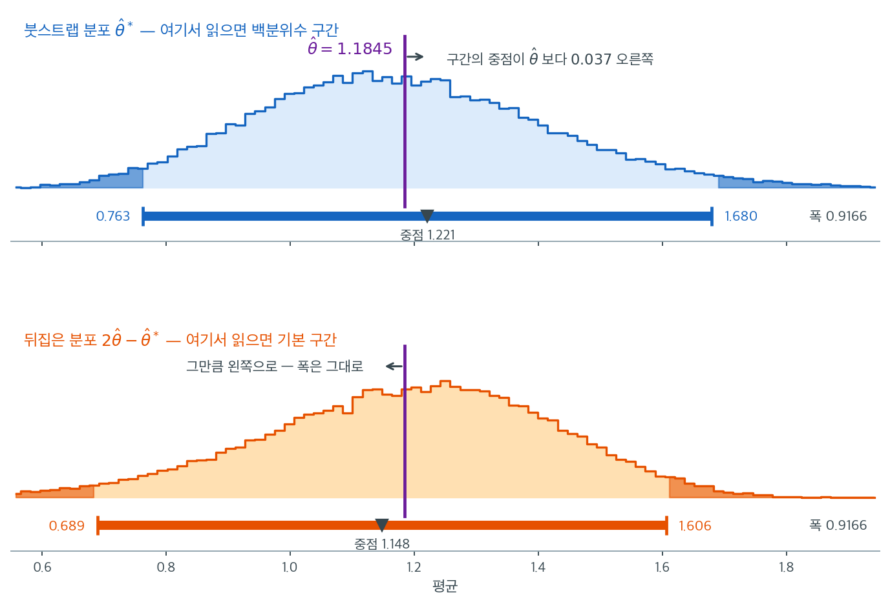

# 기본법 (역백분위수법)

## 개요

백분위수법은 붓스트랩 분포의 분위수를 **그대로** 신뢰한계로 읽는다. 기본법은 같은 분위수를 $\hat\theta$ 에 대해 **반사해서** 읽는다. 한 줄 차이인데 두 구간이 서로 거울상이 되고, 어느 쪽이 옳은지는 붓스트랩 분포가 아니라 **참 표집분포**가 어느 쪽으로 치우쳤는지가 정한다.

이 쪽은 그 반사가 무엇을 뒤집는 것인지, 그리고 반사가 **공짜가 아닌** 까닭을 본다.

---

## 1. 공식


기본법은 붓스트랩 분포로 $\hat\theta - \theta$의 산포를 추정한 뒤 구간을 뒤집는다. $\hat\theta$를 표본통계량이라 할 때

$$
\text{CI}_{\text{basic}} = \bigl[2\hat\theta - \hat\theta^*_{1 - \alpha/2},\;2\hat\theta - \hat\theta^*_{\alpha/2}\bigr]
$$

---

## 2. 반사는 공짜가 아니다

반사한 끝점은 복제값이 아니므로 **통계량이 가질 수 없는 값이 될 수 있다.** 백분위수법에는 없는 위험이다.

<div class="exbox" markdown>

**보기 1.** <span class="diff easy" title="쉬움"></span> 기본(역백분위수)법의 구현. 반사는 공짜가 아니다. **반사된 끝점은 통계량이 가질 수 없는 값일 수도 있다.**

**(1)** 기본 구간의 하한이 음수가 되는 조건을 $\hat\theta$와 붓스트랩 분위수로 적으시오. 붓스트랩 분포가 거의 정규이고 변동계수가 $c^{*}$이면 그 조건이 $c^{*} > 1/z_{1-\alpha/2}$가 됨을 보이고, $\text{Exp}(1)$ 자료의 **분산**을 추정할 때 어떤 $n$에서 문제가 되는지 어림하시오. 백분위수 구간에는 왜 같은 일이 생기지 않는가.

**(2)** 모의실험으로 그 비율을 재시오.

</div>

??? success "풀이"

    **(1) 해석적으로.** 기본 구간의 하한은 $2\hat\theta - \hat\theta^{*}_{1-\alpha/2}$이므로

    $$
    \text{하한} < 0 \iff \hat\theta^{*}_{1-\alpha/2} > 2\hat\theta
    $$

    다. **붓스트랩 분포의 위쪽 분위수가 추정값의 두 배를 넘으면 구간이 음수 영역으로 밀려난다.** 붓스트랩 분포가 평균 $\hat\theta$, 표준편차 $\hat\theta c^{*}$인 정규에 가깝다면 $\hat\theta^{*}_{1-\alpha/2} \approx \hat\theta(1 + z_{1-\alpha/2}c^{*})$이므로 조건이

    $$
    z_{1-\alpha/2}\, c^{*} > 1
    \iff
    c^{*} > \frac{1}{z_{1-\alpha/2}} = \frac{1}{1.96} = 0.510
    $$

    이 된다. 곧 **추정값의 절반이 넘는 표준오차**를 가진 통계량이면 위험하다.

    $\text{Exp}(1)$ 자료에서 분산 $s^2$을 추정한다고 하자. 초과첨도가 $\gamma_2$인 분포에서 $\operatorname{Var}(s^2) \approx \sigma^4(\gamma_2+2)/n$이므로 변동계수가 $c^{*} \approx \sqrt{(\gamma_2+2)/n}$이고, 지수분포는 $\gamma_2 = 6$이라

    $$
    c^{*} \approx \sqrt{\frac{8}{n}} > 0.510
    \iff
    n < 1.96^2 \times 8 = 30.7
    $$

    이다. **$n$이 서른 안팎이면 기본 구간이 음의 분산을 내놓는다.**

    백분위수 구간에는 이런 일이 없다. 그 끝점은 **실제 재표본에서 계산된 통계량의 값**이므로, 통계량이 음수를 가질 수 없으면 끝점도 음수가 될 수 없다. 반사는 그 보장을 버린다.

    **(2) 수치적으로.** 함수는 이렇다.

    ```python
    def bootstrap_basic_ci(data, statistic, boot_stats, alpha=0.05):
        """기본(역백분위수) 붓스트랩 신뢰구간.

        백분위점을 추정값 둘레로 되비춘다. 붓스트랩 분포가 오른쪽으로 치우쳐
        있으면 구간은 왼쪽으로 늘어나는데, 이는 "추정값이 참값보다 크게 나오는
        경향이 있다면 구간을 아래쪽으로 넓혀야 한다"는 셈법에서 나온다.
        백분위수법과 정반대 방향으로 움직이는 것이 처음에는 어리둥절하다.
        """
        theta_hat = statistic(data)
        lo = 2 * theta_hat - np.percentile(boot_stats, 100 * (1 - alpha / 2))
        hi = 2 * theta_hat - np.percentile(boot_stats, 100 * alpha / 2)
        return lo, hi
    ```

    $\text{Exp}(1)$에서 표본을 $200$개씩 뽑아 분산의 구간을 만들고, 하한이 음수인 비율을 센다.

    ```python
    import numpy as np

    rng = np.random.default_rng(5)
    M, Bb = 200, 1000
    print(f"{'n':>5}{'기본 하한 < 0':>16}{'백분위수 하한 < 0':>20}")
    for n in (10, 20, 30, 50):
        neg_b = neg_p = 0
        for _ in range(M):
            x = rng.exponential(1.0, n)
            bsv = np.var(x[rng.integers(0, n, (Bb, n))], axis=1, ddof=1)
            t = x.var(ddof=1)
            p = np.percentile(bsv, [2.5, 97.5])
            neg_b += (2 * t - p[1]) < 0
            neg_p += p[0] < 0
        print(f"{n:>5}{neg_b / M:>16.3f}{neg_p / M:>20.3f}")
    ```

    출력:

    ```
        n       기본 하한 < 0         백분위수 하한 < 0
       10           0.180               0.000
       20           0.175               0.000
       30           0.100               0.000
       50           0.065               0.000
    ```

    **$n = 10$과 $n = 20$에서 다섯 번에 한 번꼴로 음의 분산이 나온다.** 백분위수법은 단 한 번도 그러지 않는다. 구조적으로 그럴 수 없기 때문이다.

    어림한 문턱 $n < 30.7$도 방향은 맞지만 너무 낙관적이다. $n = 50$에서도 $6.5\%$가 남는다. 까닭이 둘이다. 하나는 $s^{2*}$의 붓스트랩 분포가 **오른쪽으로 치우쳐** 있어 $97.5$ 백분위점이 정규근사보다 위에 놓이는 것이고, 다른 하나는 $c^{*}$ 자체가 표본마다 크게 흔들린다는 것이다. 지수분포에서 표본첨도는 악명 높게 불안정하다.

    핵심 착상은 붓스트랩이 $\hat\theta$를 과대추정한다면 분위수를 $\hat\theta$에 대해 반사시켜 보정한다는 것이다. **그 보정은 $\hat\theta - \theta$를 다루는 데서는 옳지만, 모수의 정의역을 지켜 주지는 않는다.** 로그 척도에서 반사한 뒤 되돌리면 양수가 보장되는데, 그러면 보기 1에서 본 척도 의존성 문제로 되돌아간다.

---

## 3. 무엇을 뒤집는가


폭이 같고 위치만 옮겨진다는 사실은 기본법의 정의를 한 줄 고쳐 쓰면 바로 보인다. $[2\hat\theta - \hat\theta^*_{(1-\alpha/2)},\ 2\hat\theta - \hat\theta^*_{(\alpha/2)}]$는 **$\hat\theta$ 축에 대해 뒤집은 분포 $2\hat\theta - \hat\theta^*$에서 읽은 백분위수 구간**과 정확히 같다.



$\text{Exp}(1)$에서 $n = 30$을 뽑아 평균을 재면 $\hat\theta = 1.1845$이고, $B = 40000$번 재표집한 분포가 위 칸이다. 양쪽 꼬리 $2.5\%$씩을 칠하면 백분위수 구간 $[0.763,\ 1.680]$이 된다. 아래 칸은 같은 복제값을 $\hat\theta$에서 뒤집은 것뿐이며, 거기서 똑같이 양 끝 $2.5\%$를 칠하면 기본 구간 $[0.689,\ 1.606]$이 나온다. **두 구간의 폭이 $0.9166$으로 소수 넷째 자리까지 같은 것은 우연이 아니라 거울상이기 때문이다.**

옮겨진 거리가 어디서 오는지도 그림에 표시해 두었다. 백분위수 구간의 **중점**이 $1.221$로 $\hat\theta$보다 $0.037$ 오른쪽에 있고, 반사하면 그만큼 왼쪽으로 가서 중점이 $1.148$이 된다. 두 구간은 정확히 $2 \times 0.037 = 0.074$만큼 어긋난다. 표본평균의 붓스트랩은 애초에 편향이 없으므로($E^*[\bar{x}^*] = \bar{x}$), 이 어긋남을 만드는 것은 편향이 아니라 **분포의 치우침**이다. 오른쪽 꼬리가 길면 분위수의 중점이 중심보다 오른쪽으로 밀리고, 기본법은 그 밀림을 반대쪽으로 되돌린다.

그래서 두 방법 중 어느 쪽을 쓸지는 "붓스트랩 분포가 치우쳤는가"가 아니라 **"참 표집분포가 같은 방향으로 치우쳤는가"**로 정해진다. 같은 방향이면 백분위수가 옳고, 반대 방향이면 기본법이 옳다. 위 포아송 보기처럼 $n$이 크고 통계량이 얌전하면 중점과 $\hat\theta$의 거리가 $0.0125$로 작아져 둘 중 무엇을 골라도 차이가 없다.

---

## 연습문제

<div class="drillbox" markdown>

**연습문제 1.** <span class="diff hard" title="어려움"></span> 기본 붓스트랩 구간이 적절한 분위수 $q$에 대해 $\hat\theta \pm (\hat\theta - \hat\theta^*_q)$ 형태로 쓰일 수 있음을 보이고, 이 방법을 "반사"법이라 부르는 이유를 기하적으로 설명하라.

</div>

??? success "풀이"

    기본 구간은

    $$
    \text{CI}_{\text{basic}} = \bigl[2\hat\theta - \hat\theta^*_{1-\alpha/2},\; 2\hat\theta - \hat\theta^*_{\alpha/2}\bigr]
    $$

    이다. 하한을 다시 쓰면

    $$
    2\hat\theta - \hat\theta^*_{1-\alpha/2} = \hat\theta - (\hat\theta^*_{1-\alpha/2} - \hat\theta)
    $$

    상한은

    $$
    2\hat\theta - \hat\theta^*_{\alpha/2} = \hat\theta + (\hat\theta - \hat\theta^*_{\alpha/2})
    $$

    이다.

    기하적으로, 붓스트랩 분포는 $\hat\theta^*$가 $\hat\theta$ 주위에서 어떻게 변하는지를 정량화한다. 기본법은 $\hat\theta$가 $\theta$ 주위에서 같은 방식으로 변한다고 가정하므로, 붓스트랩 분위수를 $\hat\theta$를 지나는 축에 대해 *반사*하여 $\theta$의 신뢰한계를 얻는다. "반사"라는 이름은 이 거울상 변환에서 왔다. $\square$

    **왜 반사가 필요한가.** 붓스트랩 분포가 오른쪽으로 치우쳐 있다고 하자. 그러면 $\hat\theta$도 $\theta$에 대해 오른쪽으로 치우쳐 있을 것이라 추론한다. 즉 $\hat\theta$가 $\theta$를 과대추정하는 경향이 있다.

    이때 옳은 대응은 신뢰구간을 **왼쪽으로** 옮기는 것이다. 백분위수법은 이를 하지 않고 붓스트랩 분포를 그대로 읽으므로 오른쪽으로 치우친 구간을 준다.

    !!! note "그런데 백분위수법이 더 나은 경우도 있다"
        위 논증은 설득력 있어 보이지만 항상 옳지는 않다. [백분위수법](./percentile.md) 연습문제 3에서, 치우친 추정량에 대해 백분위수 구간의 포함확률이 $0.932$인 반면 기본 구간은 $0.732$였다.

        이유는 백분위수법이 **변환 불변**이기 때문이다. $\hat\theta$의 백분위수 구간에 단조변환 $g$를 적용하면 정확히 $g(\hat\theta)$의 백분위수 구간이 된다. 기본법은 이 성질을 갖지 않는다.

---

<div class="drillbox" markdown>

**연습문제 2.** <span class="diff hard" title="어려움"></span> 보기 1은 "기본법은 어느 척도에서 반사할지를 자료가 말해 주지 않는다"고 했다. **척도족에서는 옳은 척도가 있다.**

$X_1,\dots,X_n$이 평균 $\theta$인 지수분포에서 iid이고 $\hat\theta = \bar x$라 하자. $R = \hat\theta/\theta$의 분포는 $\theta$에 무관하며 $nR \sim \text{Gamma}(n,1)$이다. $n = 30$에서 $r_{0.025} = 0.674696$, $r_{0.975} = 1.388295$이고 $R$의 분포함수는 다음과 같다.

| $t$ | $0.720308$ | $0.754544$ | $1.482149$ | $1.634774$ |
|:---|---:|---:|---:|---:|
| $F_R(t)$ | $0.050360$ | $0.079089$ | $0.990988$ | $0.998606$ |

**모수 붓스트랩**을 쓴다. 곧 $\hat\theta$를 추정한 뒤 평균 $\hat\theta$인 지수분포에서 크기 $n$의 표본을 다시 뽑아 $\hat\theta^{*}$를 만든다.

**(1)** $\hat\theta^{*}/\hat\theta$가 $R$과 **똑같은 분포**임을 보이고, $B \to \infty$에서 백분위수 구간과 기본 구간을 $\hat\theta$와 $r_q$로 적으시오. 피봇 $R$로 만든 정확한 구간도 적으시오.

**(2)** 기본법을 **로그 척도**에서 적용한 뒤 되돌리면 (1)의 정확한 구간과 글자 그대로 같아짐을 보이시오.

**(3)** 세 구간의 포함확률을 표의 값으로 계산하시오. 구간 $\hat\theta\,[c_1, c_2]$가 $\theta$를 덮는 사건이 $1/c_2 \le R \le 1/c_1$임을 쓰면 된다. 어느 쪽 꼬리에서 빗나가는지도 적으시오.

</div>

??? success "풀이"

    **(1) 세 구간.** 평균 $\hat\theta$인 지수분포에서 뽑은 $n$개의 합은 모양 $n$, 척도 $\hat\theta$인 감마이므로 $n\hat\theta^{*}/\hat\theta \sim \text{Gamma}(n,1)$이다. 이는 $nR$의 분포와 **정확히 같다**. 근사가 아니다. 모수 붓스트랩이 모형을 맞게 쓰고 있으니 재표집 세계와 실제 세계의 상대오차 분포가 일치하는 것이다.

    따라서 $B \to \infty$에서 $\hat\theta^{*}_q = \hat\theta\, r_q$이고

    $$
    \text{CI}_{\text{pct}} = \hat\theta\,[r_{0.025},\ r_{0.975}] = \hat\theta\,[0.674696,\ 1.388295]
    $$

    $$
    \text{CI}_{\text{basic}} = \hat\theta\,[2 - r_{0.975},\ 2 - r_{0.025}] = \hat\theta\,[0.611705,\ 1.325304]
    $$

    다. 한편 $P(r_{0.025} \le \hat\theta/\theta \le r_{0.975}) = 0.95$를 $\theta$에 대해 풀면

    $$
    \text{CI}_{\text{exact}} = \hat\theta\left[\frac{1}{r_{0.975}},\ \frac{1}{r_{0.025}}\right] = \hat\theta\,[0.720308,\ 1.482149]
    $$

    다. **백분위수법은 분위수를 곱하고 정확한 구간은 나눈다.** 셋 모두 $\hat\theta$의 상수배인데 상수가 다르고, 정확한 구간이 가장 오른쪽에 있다.

    **(2) 로그 척도의 기본법.** $\psi = \log\theta$, $\hat\psi = \log\hat\theta$로 두면 복제값이 $\log\hat\theta^{*} = \hat\psi + \log R^{*}$이므로 그 분위수는 $\hat\psi + \log r_q$다. $\psi$에 대한 기본 구간은

    $$
    \left[2\hat\psi - (\hat\psi + \log r_{0.975}),\ 2\hat\psi - (\hat\psi + \log r_{0.025})\right]
    = \left[\hat\psi - \log r_{0.975},\ \hat\psi - \log r_{0.025}\right]
    $$

    이고 지수를 취하면

    $$
    \left[\frac{\hat\theta}{r_{0.975}},\ \frac{\hat\theta}{r_{0.025}}\right] = \text{CI}_{\text{exact}}
    $$

    다. $\square$

    **까닭은 한 줄이다.** 로그 척도에서 피봇이 **덧셈꼴**이 된다. $\log\hat\theta - \log\theta = \log R$이고 이 양의 분포가 $\theta$에 무관하므로, 반사($\hat\psi$ 둘레로 뒤집기)가 바로 피봇의 뒤집기가 되어 **정확해진다**. 원 척도에서 피봇은 곱셈꼴 $\hat\theta/\theta$인데 기본법은 뺄셈으로 반사하므로 틀린 연산을 쓰는 것이다.

    **(3) 포함확률.** 구간이 $\hat\theta[c_1,c_2]$이면 $\hat\theta c_1 \le \theta$는 $R \le 1/c_1$이고 $\theta \le \hat\theta c_2$는 $R \ge 1/c_2$이므로 포함확률은 $F_R(1/c_1) - F_R(1/c_2)$다.

    백분위수: $1/c_1 = 1/0.674696 = 1.482149$, $1/c_2 = 1/1.388295 = 0.720308$에서

    $$
    0.990988 - 0.050360 = 0.940628
    $$

    기본: $1/c_1 = 1/0.611705 = 1.634774$, $1/c_2 = 1/1.325304 = 0.754544$에서

    $$
    0.998606 - 0.079089 = 0.919517
    $$

    로그 척도의 기본: $1/c_1 = r_{0.975}$, $1/c_2 = r_{0.025}$이므로

    $$
    F_R(r_{0.975}) - F_R(r_{0.025}) = 0.975 - 0.025 = 0.950000
    $$

    | 방법 | 배수 | 포함확률 | $\theta$보다 **아래** | $\theta$보다 **위** |
    |:---|:---|---:|---:|---:|
    | 백분위수 | $[0.6747,\ 1.3883]$ | $0.9406$ | $0.0504$ | $0.0090$ |
    | 기본(원 척도) | $[0.6117,\ 1.3253]$ | $0.9195$ | $0.0791$ | $0.0014$ |
    | 기본(로그 척도) $=$ 정확 | $[0.7203,\ 1.4821]$ | $0.9500$ | $0.0250$ | $0.0250$ |

    **읽을 것이 셋이다.**

    첫째, **두 구간 모두 너무 왼쪽에 있다.** 명목 $2.5\%$여야 할 "구간이 $\theta$ 아래에 통째로 놓이는" 확률이 백분위수에서 $5.04\%$, 기본에서 $7.91\%$다. 위쪽 오류는 거꾸로 $0.90\%$와 $0.14\%$로 말라붙었다. 양쪽 합이 $0.95$에 가까워 보여도 **한쪽으로 몰린 오류**는 단측 추론에서 그대로 드러난다.

    둘째, **기본법이 백분위수법보다 나쁘다**($0.9195$ 대 $0.9406$). 보기 2와 연습문제 5는 반사가 치우침을 고치는 쪽으로 작동한다고 했지만, 여기서는 정확한 구간이 백분위수 구간보다 더 **오른쪽**에 있으므로 왼쪽으로 반사하는 것이 오히려 멀어진다. 반사의 방향이 옳은지는 분포가 아니라 **피봇의 꼴**이 정한다.

    셋째, **백분위수법의 척도 무관성은 "답이 하나"라는 뜻일 뿐 "답이 옳다"는 뜻이 아니다.** 보기 1에서 그것을 유일한 이론적 우위라고 했는데, 이 척도족에서는 하나뿐인 그 답이 $0.9406$으로 명목값에 못 미친다. 반면 기본법의 자의성은 **옳은 척도를 고를 자유**이기도 하다. 여기서 그 척도는 로그이고, 고르고 나면 포함확률이 정확히 $0.95$다.

    모수 붓스트랩이라 $B \to \infty$에서 몬테카를로 오차가 $0$이고 $n$도 고정이므로, 위의 어긋남은 자료의 운이나 반복 횟수가 아니라 **방법 자체의 값**이다.

---

## 정리하며

기본법은 백분위수 구간을 $\hat\theta$ 에 대해 **반사한** 것이다.

$$
\text{CI}_{\text{basic}} = \bigl[2\hat\theta - \hat\theta^*_{1-\alpha/2},\ 2\hat\theta - \hat\theta^*_{\alpha/2}\bigr]
$$

- **폭은 백분위수 구간과 같고 위치만 옮겨진다.** 옮겨진 거리는 백분위수 구간의 중점이 $\hat\theta$ 에서 벗어난 만큼의 두 배다.
- **어느 쪽이 옳은지는 붓스트랩 분포가 아니라 참 표집분포가 정한다.** 둘이 같은 방향으로 치우쳤으면 백분위수가 옳고, 반대 방향이면 기본법이 옳다. 그리고 **우리는 참 표집분포를 모른다.**
- **반사한 끝점은 모수공간을 벗어날 수 있다.** 분산이나 비율처럼 범위가 막힌 모수에서 음수 하한이 나오는 일이 실제로 생기며, 조건은 붓스트랩 분포의 변동계수가 $1/z_{1-\alpha/2}$ 를 넘는 것이다(절 $2$).
- **척도를 바꾸면 답이 바뀐다.** 백분위수법이 갖는 척도 불변성이 기본법에는 없다. 로그를 씌운 뒤 반사하고 되돌리면 다른 구간이 나온다(연습문제 2).

다음 절 **편향보정 가속 붓스트랩 (BCa)** 으로 넘어간다. 기본법이 위치만 고치는 데 그친 자리에서 BCa 는 왜도까지 고친다.
