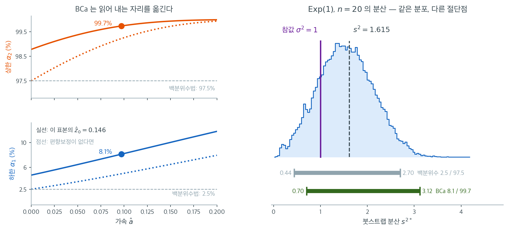

# 편향보정 가속 붓스트랩 (BCa)

## 1. 편향과 치우침을 자료에서 추정해 보정한다

$\text{Exp}(1)$ 에서 $n = 30$ 을 뽑아 평균의 신뢰구간을 세 가지로 만들면 기본법이 $[0.6879,\ 1.4435]$, 백분위수법이 $[0.7323,\ 1.4878]$, 그리고 셋째 것이 $[0.7689,\ 1.5481]$ 이다. 같은 복제값에서 읽은 구간인데 **기본법은 왼쪽으로, 셋째 것은 오른쪽으로** 옮겨 가 있다. 자료가 오른쪽으로 치우쳐 표본평균이 참값을 작게 추정하는 쪽으로 기울기 때문이고, 백분위수법은 그 치우침을 모르는 채 $2.5\%$ 와 $97.5\%$ 를 읽는다. 에프론이 $1987$ 년에 내놓은 보정은 자료에서 두 수를 재어 그 백분위점을 $4.059\%$ 와 $98.659\%$ 로 옮긴다 — 그 두 수가 무엇인지가 이 쪽의 내용이다.

백분위수법은 붓스트랩 분포에서 신뢰구간의 끝점을 직접 읽는다. 단순하지만 붓스트랩 분포에 편향이 있거나 $\hat{\theta}$의 표준오차가 $\theta$에 의존할 때(즉 표집분포가 치우쳐 있을 때) 포함확률이 나빠질 수 있다. 에프론(1987)이 도입한 **편향보정 가속(BCa) 방법**은 이 두 문제를 모두 보정하도록 백분위수 구간을 조정한다.

BCa 구간은 범용 붓스트랩 신뢰구간 중 최선으로 널리 평가된다. 백분위수법의 변환 불변성을 유지하면서 **2차 정확도**(포함확률 오차가 $O(n^{-1/2})$ 대신 $O(n^{-1})$)를 달성한다.

---

## 2. BCa 구간

BCa 구간은 백분위수 구간과 같은 형태이지만 **조정된 분위수**를 쓴다.

$$
\left[\hat{\theta}^*_{(\alpha_1)}, \quad \hat{\theta}^*_{(\alpha_2)}\right]
$$

여기서 $\alpha_1$과 $\alpha_2$가 백분위수법의 단순한 $\alpha/2$와 $1 - \alpha/2$를 대신한다. 조정된 수준은

$$
\alpha_1 = \Phi\!\left(\hat{z}_0 + \frac{\hat{z}_0 + z_{\alpha/2}}{1 - \hat{a}(\hat{z}_0 + z_{\alpha/2})}\right)
$$

$$
\alpha_2 = \Phi\!\left(\hat{z}_0 + \frac{\hat{z}_0 + z_{1-\alpha/2}}{1 - \hat{a}(\hat{z}_0 + z_{1-\alpha/2})}\right)
$$

이다. $\Phi$는 표준정규 누적분포함수, $z_q = \Phi^{-1}(q)$는 $q$번째 표준정규 분위수이며, 두 보정계수 $\hat{z}_0$과 $\hat{a}$는 아래에서 정의한다.

---

## 3. 편향보정 계수

**편향보정** $\hat{z}_0$은 붓스트랩 분포의 중심이 관측 추정값 $\hat{\theta}$에서 얼마나 떨어져 있는지를 잰다.

$$
\hat{z}_0 = \Phi^{-1}\!\left(\frac{\#\{\hat{\theta}^{*(b)} < \hat{\theta}\}}{B}\right)
$$

이는 관측 통계량보다 아래에 있는 붓스트랩 복제값의 비율을 $z$ 점수로 변환한 것이다. 붓스트랩 분포가 정확히 $\hat{\theta}$에 중심을 두면 복제값의 절반이 아래에 있어 $\hat{z}_0 = \Phi^{-1}(0.5) = 0$이 되고, 편향보정이 아무 효과를 내지 않는다.

$\hat{z}_0 \neq 0$이면 붓스트랩 분포가 $\hat{\theta}$에 대해 편향되어 있다는 뜻이고, BCa 구간은 이를 보상하도록 분위수 절단점을 옮긴다.

!!! note "편향보정의 해석"
    $\hat{z}_0$이 양수라는 것은 붓스트랩 복제값의 절반 이상이 $\hat{\theta}$를 넘는다는 뜻이 아니라 **절반 미만이 넘는다**는 뜻이다. 정의상 $\hat z_0 > 0$은 $\hat\theta$보다 작은 복제값의 비율이 $0.5$를 넘는 경우, 즉 붓스트랩 분포가 $\hat{\theta}$에 대해 **아래로** 치우친 경우이다. 이때 BCa는 분위수를 위로 옮긴다.

---

## 4. 가속 계수

**가속** $\hat{a}$는 $\theta$가 변할 때 $\hat{\theta}$의 표준오차가 어떻게 변하는지를 잰다. 표준오차가 일정하면($\theta$와 무관하면) 가속이 $0$이고 BCa 구간이 편향보정(BC) 구간으로 환원된다. 표준오차가 $\theta$에 의존하면 가속이 치우침을 반영하여 분위수 절단점을 조정한다.

가속은 보통 **잭나이프**로 추정한다.

$$
\hat{a} = \frac{\sum_{i=1}^{n}\left(\bar{\hat{\theta}}_{(\cdot)} - \hat{\theta}_{(-i)}\right)^3}{6\left[\sum_{i=1}^{n}\left(\bar{\hat{\theta}}_{(\cdot)} - \hat{\theta}_{(-i)}\right)^2\right]^{3/2}}
$$

여기서 $\hat{\theta}_{(-i)} = g(x_1, \ldots, x_{i-1}, x_{i+1}, \ldots, x_n)$은 $i$번째 관측값을 뺀 통계량이고 $\bar{\hat{\theta}}_{(\cdot)} = \frac{1}{n}\sum_{i=1}^{n}\hat{\theta}_{(-i)}$는 잭나이프 값들의 평균이다.

분자는 잭나이프 분포의 치우침을, 분모는 그것을 정규화한다. 이 공식은 밑에 깔린 변환모형에서 가속 상수의 일치추정량이다.

### 두 보정계수를 자료에서 재어 본다

두 보정계수 $z_0$ 와 $a$ 를 자료에서 실제로 재어 본다. 잭나이프가 어디에 드는지도 거기서 보인다.

<div class="exbox" markdown>

**보기 1.** <span class="diff easy" title="쉬움"></span> BCa법의 구현. 두 보정계수 $z_0$와 $a$가 실제로 무엇인지 평균의 경우에 끝까지 계산한다.

**(1)** $z_0 = 0$이고 $a = 0$이면 BCa가 백분위수법과 **정확히** 같아짐을 보이시오. 그다음 통계량이 표본평균일 때 잭나이프 가속이

$$
a = \frac{\hat\gamma_1}{6\sqrt n}
$$

임을 유도하시오($\hat\gamma_1$은 자료의 표본왜도). $z_0$의 1차근사가 같은 값이 되는 까닭도 밝히시오.

**(2)** $\text{Exp}(1)$에서 $n = 30$을 뽑아 확인하고, BCa·백분위수·기본 세 구간이 어느 방향으로 갈리는지 보시오.

</div>

??? success "풀이"

    **(1) 해석적으로.** $z_0 = a = 0$을 조정식에 넣으면

    $$
    \alpha_1 = \Phi\!\left(0 + \frac{0 + z_{\alpha/2}}{1 - 0}\right) = \Phi(z_{\alpha/2}) = \frac\alpha2
    $$

    이고 같은 식으로 $\alpha_2 = 1 - \alpha/2$다. **보정이 둘 다 꺼지면 원래의 $2.5\%$와 $97.5\%$로 되돌아간다.** BCa는 백분위수법에 두 개의 손잡이를 단 것이다.

    **가속 $a$.** 통계량이 $\hat\theta = \bar x$이면 $i$번째를 뺀 잭나이프 값이

    $$
    \hat\theta_{(i)} = \frac{n\bar x - x_i}{n-1}
    $$

    이고, 그 평균은 $\bar\theta_{(\cdot)} = \bar x$다. 따라서

    $$
    \bar\theta_{(\cdot)} - \hat\theta_{(i)} = \frac{x_i - \bar x}{n - 1}
    $$

    이 되어 $(n-1)$이 분자·분모에서 약분된다.

    $$
    a = \frac{\sum_i (x_i - \bar x)^3 / (n-1)^3}
             {6\left[\sum_i (x_i - \bar x)^2/(n-1)^2\right]^{3/2}}
      = \frac{\sum_i (x_i - \bar x)^3}{6\left[\sum_i (x_i - \bar x)^2\right]^{3/2}}
    $$

    여기에 $\hat\mu_k = \frac1n\sum_i (x_i-\bar x)^k$와 $\hat\gamma_1 = \hat\mu_3/\hat\mu_2^{3/2}$를 넣으면

    $$
    a = \frac{n\hat\mu_3}{6\,(n\hat\mu_2)^{3/2}}
      = \frac{\hat\mu_3}{6\,\hat\mu_2^{3/2}\sqrt n}
      = \frac{\hat\gamma_1}{6\sqrt n}
    $$

    이다. **가속은 자료의 왜도를 $6\sqrt n$으로 나눈 것일 뿐이다.** 대칭 자료에서는 $0$이고, $n$이 커지면 $n^{-1/2}$로 꺼진다.

    **편향보정 $z_0$.** 정의는 $z_0 = \Phi^{-1}\!\big(P^{*}(\hat\theta^{*} < \hat\theta)\big)$다. $\hat\theta^{*}$의 분포가 평균 $\hat\theta$, 왜도 $\gamma_1^{*}$인 거의 정규인 분포이면 Cornish--Fisher로 중앙값이 평균보다 $\gamma_1^{*}\sigma^{*}/6$만큼 **왼쪽**에 있으므로

    $$
    P^{*}(\hat\theta^{*} < \hat\theta) \approx \frac12 + \phi(0)\,\frac{\gamma_1^{*}}{6},
    \qquad
    z_0 \approx \frac{\gamma_1^{*}}{6}
    $$

    이다. 표본평균의 붓스트랩 분포는 왜도가 $\gamma_1^{*} = \hat\gamma_1/\sqrt n$이므로

    $$
    z_0 \approx \frac{\hat\gamma_1}{6\sqrt n} = a
    $$

    가 된다. **평균에 대해서는 두 보정이 1차적으로 같은 수다.** 둘이 하는 일은 다르지만($z_0$은 중심을 옮기고 $a$는 분위점 간격을 비대칭으로 늘린다) 크기가 같아 같은 방향으로 힘을 보탠다.

    **(2) 수치적으로.** 함수는 이렇다.

    ```python
    def bootstrap_bca_ci(data, statistic, boot_stats, alpha=0.05):
        """BCa(편향보정 가속) 붓스트랩 신뢰구간.

        백분위점을 두 가지로 조정한다. z0 은 붓스트랩 분포가 추정값을 중심으로
        치우친 정도(편향)를, a 는 통계량의 분산이 참값에 따라 달라지는 정도
        (가속)를 잡는다. 셋 중 가장 정확하지만 계산이 가장 무겁다.
        """
        n = len(data)
        theta_hat = statistic(data)

        # 편향보정 z0: 붓스트랩 값 중 관측된 추정값보다 작은 것의 비율을
        # 정규 분위점으로 옮긴다. 치우침이 없으면 절반이라 z0 이 0 이 된다.
        z0 = stats.norm.ppf(np.mean(boot_stats < theta_hat))

        # 가속 a: 잭나이프로 구한다. 관측값을 하나씩 빼 가며 통계량을 계산해,
        # 그 값들의 왜도에서 얻는다.
        jack = np.array([statistic(np.delete(data, i)) for i in range(n)])
        jack_mean = jack.mean()
        a_num = np.sum((jack_mean - jack) ** 3)
        a_den = 6 * np.sum((jack_mean - jack) ** 2) ** 1.5
        a = a_num / a_den if a_den != 0 else 0.0

        # 두 보정을 반영해 백분위점을 옮긴다. z0=0, a=0 이면 원래 백분위수법과
        # 정확히 같아진다.
        z_alpha = stats.norm.ppf(alpha / 2)
        z_1alpha = stats.norm.ppf(1 - alpha / 2)

        p_lo = stats.norm.cdf(z0 + (z0 + z_alpha) / (1 - a * (z0 + z_alpha)))
        p_hi = stats.norm.cdf(z0 + (z0 + z_1alpha) / (1 - a * (z0 + z_1alpha)))

        lo = np.percentile(boot_stats, 100 * p_lo)
        hi = np.percentile(boot_stats, 100 * p_hi)
        return lo, hi, z0, a
    ```

    보기 $2$의 지수분포 자료 `d`와 그 복제값 `bs`를 그대로 쓴다. 조정된 백분위점까지 함께 찍어 본다.

    ```python
    import numpy as np

    # 이 절의 보기가 쓰는 자료와 복제값. 치우친 자료라야 두 보정이 보인다.
    rng = np.random.default_rng(11)
    d = rng.exponential(1.0, 30)
    B = 10_000
    bs = d[rng.integers(0, 30, (B, 30))].mean(axis=1)
    th = d.mean()
    pc = np.percentile(bs, [2.5, 97.5])
    ba = np.array([2 * th - pc[1], 2 * th - pc[0]])   # 기본 구간

    from scipy import stats

    def bca_parts(data, statistic, boot_stats, alpha=0.05):
        n = len(data); th = statistic(data)
        z0 = stats.norm.ppf(np.mean(boot_stats < th))
        jack = np.array([statistic(np.delete(data, i)) for i in range(n)])
        jm = jack.mean()
        a = np.sum((jm - jack) ** 3) / (6 * np.sum((jm - jack) ** 2) ** 1.5)
        za, z1 = stats.norm.ppf(alpha / 2), stats.norm.ppf(1 - alpha / 2)
        p_lo = stats.norm.cdf(z0 + (z0 + za) / (1 - a * (z0 + za)))
        p_hi = stats.norm.cdf(z0 + (z0 + z1) / (1 - a * (z0 + z1)))
        return (np.percentile(boot_stats, 100 * p_lo),
                np.percentile(boot_stats, 100 * p_hi), z0, a, p_lo, p_hi)

    lo_b, hi_b, z0, a, p_lo, p_hi = bca_parts(d, np.mean, bs)
    g1 = stats.skew(d)
    print(f"자료 왜도 g1 = {g1:.6f},  a 닫힌 꼴 g1/(6 sqrt n) = {g1 / (6 * np.sqrt(30)):.8f}")
    print(f"코드의 a = {a:.8f}")
    print(f"z0 = {z0:.6f}   (1차근사 {g1 / (6 * np.sqrt(30)):.6f},"
          f"  z0 의 몬테카를로 오차 {np.sqrt(0.25 / B) / stats.norm.pdf(0):.4f})")
    print(f"조정된 백분위점: {100 * p_lo:.3f}% 와 {100 * p_hi:.3f}%  (보정 없으면 2.5% 와 97.5%)")
    print(f"BCa      = [{lo_b:.6f}, {hi_b:.6f}]")
    print(f"백분위수 = [{pc[0]:.6f}, {pc[1]:.6f}]")
    print(f"기본     = [{ba[0]:.6f}, {ba[1]:.6f}]")
    ```

    출력:

    ```
    자료 왜도 g1 = 1.357052,  a 닫힌 꼴 g1/(6 sqrt n) = 0.04129377
    코드의 a = 0.04129377
    z0 = 0.037357   (1차근사 0.041294,  z0 의 몬테카를로 오차 0.0125)
    조정된 백분위점: 4.059% 와 98.659%  (보정 없으면 2.5% 와 97.5%)
    BCa      = [0.768921, 1.548148]
    백분위수 = [0.732291, 1.487806]
    기본     = [0.687943, 1.443457]
    ```

    **유도한 $a$가 코드와 여덟 자리까지 같다.** $\hat\gamma_1 = 1.357052$를 $6\sqrt{30} = 32.863$으로 나눈 $0.04129377$이다. $z_0 = 0.037357$도 1차근사 $0.041294$와 가깝고, 차이 $0.0039$는 $z_0$의 몬테카를로 오차 $0.0125$의 $0.31$배다.

    **보정이 실제로 하는 일은 백분위점을 옮기는 것이다.** $2.5\%$가 $4.059\%$로, $97.5\%$가 $98.659\%$로 **둘 다 오른쪽으로** 밀렸다. 자료가 오른쪽으로 치우쳐 있어 표본평균이 참값을 **작게** 추정하는 쪽으로 기울기 때문이며, 구간 전체가 오른쪽으로 옮겨진다.

    **세 구간이 갈리는 방향을 보라.**

    | 방법 | 구간 | 중점 | 폭 |
    |:---|:---|---:|---:|
    | 기본 | $[0.6879,\ 1.4435]$ | $1.0657$ | $0.7555$ |
    | 백분위수 | $[0.7323,\ 1.4878]$ | $1.1100$ | $0.7555$ |
    | BCa | $[0.7689,\ 1.5481]$ | $1.1585$ | $0.7792$ |

    $\hat\theta = 1.0879$를 기준으로 **기본법은 왼쪽으로, BCa는 오른쪽으로** 옮겨 놓았다. 백분위수법이 그 사이에 있다. 기본법과 백분위수법의 폭이 소수 넷째 자리까지 같은 것은 둘이 거울상이기 때문이고, BCa만 폭이 $0.0237$ 넓다. 가속 $a$가 위쪽 꼬리를 더 멀리 밀어내기 때문이다.

    **어느 쪽이 옳은가.** 이 자료의 참 모수는 $1$이고 세 구간이 모두 그것을 덮지만, 그것만으로는 판정할 수 없다. 포함확률을 재야 하며, 치우친 자료에서 BCa가 나은 것이 [BCa 쪽](bca.md)과 [붓스트랩-t 쪽](bootstrap_t.md)의 모의실험이 보이는 바다.

<div class="storybox" markdown>

**그림으로 보는 통계학 1.** 주머니칼이라는 이름이 붙은 까닭

위에서 가속 $\hat a$ 를 **잭나이프**로 추정했다. BCa 는 붓스트랩 구간 가운데 가장
정교한 쪽인데, 그 마지막 계수를 붓스트랩보다 **삼십 년 앞선** 방법에 맡기고 있는
셈이다. 17.1절 [붓스트랩의 원리](../bootstrap/principle.md)의 상자가 그 둘의 관계를
적는다 — 에프론의 $1979$ 년 논문 제목이 「**잭나이프를 다시 본다**」였고, 잭나이프는
붓스트랩의 **일차근사**임이 거기서 밝혀졌다. 그 방법에 어쩌다 칼 이름이 붙었는지에 이 상자의 요점이 들어 있다.

$1949$ 년에 **모리스 크누이**가 추정량의 **편향**을 재고 줄이는 방법으로 하나씩
빼는 재표집을 내놓았고, $1956$ 년 『Biometrika』의 글에서 다듬었다. $1958$ 년에
**존 터키**가 그것을 **분산 추정**으로까지 넓히면서 이름을 붙였는데, 그것이
**잭나이프** — 보이스카우트가 들고 다니는 주머니칼이다.

이름에 담긴 뜻이 칭찬만은 아니었다. 주머니칼은 **아무 데나 꺼내 쓸 수 있지만, 그
일에 맞게 만든 전용 연장보다는 못하다.** 터키가 가리킨 것이 정확히 그 성격이다.
재 보면 그 말이 그대로 수로 나온다.

```python
import numpy as np
rgk = np.random.default_rng(12)
NK, BK = 40, 4000

def jack_se(xv_, stat_):
    """하나씩 빼서 n 번만 계산한다 — 크누이가 쓴 방식."""
    jv = np.array([stat_(np.delete(xv_, i)) for i in range(len(xv_))])
    return np.sqrt((len(xv_) - 1) / len(xv_) * ((jv - jv.mean()) ** 2).sum()), len(xv_)

def boot_se(xv_, stat_, bb=BK):
    """다시 뽑아 B 번 계산한다."""
    idxs = rgk.integers(0, len(xv_), size=(bb, len(xv_)))
    return float(np.std([stat_(xv_[r]) for r in idxs], ddof=1)), bb

xv_ = rgk.lognormal(size=NK)
print(f"  로그정규 n = {NK}.  같은 표본에서 표준오차를 두 가지로 잰다")
print("     통계량        잭나이프 SE (계산 n 번)   붓스트랩 SE (계산 B 번)   차이")
for nm, st in (("평균", np.mean),
               ("10% 절사평균", lambda v: np.mean(np.sort(v)[4:-4])),
               ("중앙값", np.median)):
    js, jn = jack_se(xv_, st)
    bsv, bn = boot_se(xv_, st)
    print(f"  {nm:12}   {js:.5f} ({jn:5d})        {bsv:.5f} ({bn:5d})     {abs(js-bsv)/bsv:6.1%}")
```

출력:

```
  로그정규 n = 40.  같은 표본에서 표준오차를 두 가지로 잰다
     통계량        잭나이프 SE (계산 n 번)   붓스트랩 SE (계산 B 번)   차이
  평균             0.22862 (   40)        0.22161 ( 4000)       3.2%
  10% 절사평균       0.17057 (   40)        0.19314 ( 4000)      11.7%
  중앙값            0.14344 (   40)        0.17938 ( 4000)      20.0%
```

맨 윗줄이 「빠르고 쓸 만한」 쪽이다. 평균에서는 계산을 $40$ 번만 하고도 $4{,}000$ 번
돌린 붓스트랩과 $3.2\%$ 안에서 같은 답을 준다. $100$ 분의 $1$ 의 품으로 거의 같은
수를 얻는 셈이니, 전산이 귀하던 시절에 이것이 왜 요긴했는지가 분명하다.

아래로 내려갈수록 벌어진다. 절사평균에서 $11.7\%$, 중앙값에서 $20\%$ 다. 통계량이
**매끄러울수록** 잭나이프가 잘 듣고, 꺾이거나 튀는 통계량에서는 듣지 않는다.
하나를 빼는 작은 흔들림으로 전체의 흔들림을 재는 방법이니, 하나를 빼도 값이 거의
안 움직이는 통계량에서는 잴 것이 남지 않는 것이다.

그러니 BCa 가 가속을 잭나이프에 맡긴 것은 **빌린 연장**이고, 빌린 연장의 한계가
그대로 따라온다. 이 쪽 연습문제가 중앙값에서 $\hat a$ 가 자료와 무관하게 $0$ 으로
나오는 것을 따져 보는데, 위 표의 맨 아랫줄과 같은 사정이다. $6$ 절이 적은 대로
$\hat z_0 = \hat a = 0$ 이면 BCa 는 **백분위수법으로 되돌아간다.** 가장 정교한
구간을 골랐다고 믿었는데 보정이 조용히 꺼져 있을 수 있다는 뜻이다.

_확인한 곳 — M. H. Quenouille 이 $1949$ 년에 편향을 재고 줄이는 방법으로 하나씩 빼는 재표집을 내놓고 「Notes on bias in estimation」(『Biometrika』 $43$권, $1956$, $353$–$360$쪽)에서 다듬었다는 것, J. W. Tukey 가 「Bias and confidence in not quite large samples (abstract)」(『Annals of Mathematical Statistics』 $29$권, $1958$, $614$쪽)에서 이를 분산 추정으로 넓히고 **잭나이프**라 이름 붙였다는 것, 그 이름이 보이스카우트의 주머니칼에서 왔으며 「여러 문제에 두루 쓸 수 있지만 각각에 맞게 만든 전용 도구보다는 못할 수 있다」는 뜻을 담았다는 것. 위 표의 수는 이 쪽이 직접 잰 값이다_

</div>

---

## 5. 두 보정값으로 분위수 수준을 옮긴다

1. 원표본에서 관측 통계량 $\hat{\theta}$를 계산한다.
2. $B$개의 붓스트랩 복제값 $\hat{\theta}^{*(1)}, \ldots, \hat{\theta}^{*(B)}$을 생성한다.
3. **편향보정** $\hat{z}_0$을 계산한다.
    - $\hat{\theta}$보다 작은 복제값의 비율을 센다.
    - $\hat{z}_0 = \Phi^{-1}(\text{비율})$로 $z$ 점수로 변환한다.
4. **가속** $\hat{a}$를 계산한다.
    - 각 $i = 1, \ldots, n$에 대해 $\hat{\theta}_{(-i)}$를 계산한다(하나씩 제거).
    - 위 치우침 공식을 적용한다.
5. 조정된 분위수 수준 $\alpha_1$과 $\alpha_2$를 계산한다.
6. BCa 구간은 $[\hat{\theta}^*_{(\alpha_1)}, \hat{\theta}^*_{(\alpha_2)}]$이다.

!!! warning "계산비용"
    잭나이프 단계는 $\hat{\theta}$를 추가로 $n$번 계산해야 한다(하나씩 제거한 표본마다 한 번). 계산이 무거운 통계량이나 큰 $n$에서는 $B$개의 붓스트랩 복제값에 더해 상당한 부담이 된다.

---

## 6. 특수한 경우

$\hat{z}_0 = 0$이고 $\hat{a} = 0$이면 조정된 분위수가 $\alpha_1 = \alpha/2$, $\alpha_2 = 1 - \alpha/2$로 환원되어 보통의 백분위수 구간이 된다.

$\hat{a} = 0$이지만 $\hat{z}_0 \neq 0$이면 **편향보정(BC) 구간**이라 부른다. 편향은 보정하지만 치우침은 보정하지 않는다.

두 보정이 모두 작동하면 BCa 구간이 백분위수 구간과 상당히 다른 끝점을 낼 수 있다. 표집분포가 치우친 통계량(분산, 오즈비, $\pm 1$에 가까운 상관계수)에서 특히 그렇다.

---

## 7. 이론적 성질

BCa 구간은 **2차 정확도**를 달성한다. 포함확률이

$$
P(\theta \in \text{BCa 구간}) = 1 - \alpha + O(n^{-1})
$$

를 만족하며, 이는 백분위수 구간의 $1 - \alpha + O(n^{-1/2})$와 대비된다. 표본크기가 커질수록 포함확률 오차가 더 빨리 줄어든다는 뜻이다.

BCa 구간은 **변환 불변**이기도 하다. 임의의 단조증가 함수 $m$에 대해, $[L, U]$가 $\theta$의 BCa 구간이면 $\phi = m(\theta)$의 BCa 구간은 $[m(L), m(U)]$이다.

    (엄밀히 말하면 이 성질은 참 가속 상수 $a$를 쓸 때 정확하다. 잭나이프 추정값 $\hat a$는 변환 아래에서 1차 근사로만 보존되므로 실제 구현에서는 근사적 불변성이 된다. 연습문제 4에서 그 크기를 확인한다.)

!!! tip "2차 정확도가 왜 중요한가"
    $n = 20$인 95% 구간에서 1차 정확도는 실제 포함확률 90%를, 2차 정확도는 보통 93--95%를 준다. 개선 효과는 중간 정도의 표본크기와 치우친 통계량에서 가장 두드러진다.

오른쪽으로 치우친 분포에서 $n = 15$인 표본을 얻었고 표본분산이 $s^2 = 8.4$라 하자. 붓스트랩 복제값을 $B = 10{,}000$개 만들었더니 그중 $62\%$가 $8.4$ 아래에 있었고, 잭나이프로 구한 가속이 $\hat a = 0.042$였다고 하자.

<div class="exbox" markdown>

**보기 2.** <span class="diff easy" title="쉬움"></span> 분산의 BCa 구간. 위 설정에서 $\hat z_0 = \Phi^{-1}(0.62)$이다.

**(1)** $95\%$ 구간의 조정된 분위수 $\alpha_1$, $\alpha_2$를 구하시오. 또 이 공식이 **쓸 수 없게 되는** 조건을 적고, 이 $\hat z_0$에서 $\hat a$가 얼마를 넘으면 상한이 깨지는지 구하시오.

**(2)** 확인하시오. $B = 10{,}000$에서 $99.75$ 백분위수를 읽는다는 것은 복제값 몇 개에 기대는 일인가. 그 값이 $97.5$ 백분위수보다 얼마나 더 흔들리는지 재어 보시오.

</div>

??? success "풀이"

    **(1) 해석적으로.** $\hat z_0 = \Phi^{-1}(0.62) = 0.305481$이고 $z_{0.025} = -1.959964$, $z_{0.975} = +1.959964$다. 조정식에 그대로 넣는다.

    $$
    \alpha_1 = \Phi\!\left(0.3055 + \frac{0.3055 - 1.96}{1 - 0.042(0.3055 - 1.96)}\right) = \Phi(-1.2415) = 0.107
    $$

    $$
    \alpha_2 = \Phi\!\left(0.3055 + \frac{0.3055 + 1.96}{1 - 0.042(0.3055 + 1.96)}\right) = \Phi(2.8091) = 0.9975
    $$

    **두 절단점이 모두 위로 옮겨졌다.** $2.5\%$가 $10.7\%$로, $97.5\%$가 $99.75\%$로 간다.

    **공식이 깨지는 조건.** 분모 $1 - \hat a(\hat z_0 + z)$가 $0$이 되면 지수가 발산하고, 음수가 되면 부호가 뒤집혀 **상한이 하한 아래로 내려간다.** 곧

    $$
    \hat a\,(\hat z_0 + z_{1-\alpha/2}) \ge 1
    \iff
    \hat a \ge \frac{1}{\hat z_0 + z_{1-\alpha/2}}
    $$

    이 위험 구역이다. 여기서는 $\hat a \ge 1/(0.305481 + 1.959964) = 0.441414$다. 실제 자료에서 $\hat a$는 $\hat\gamma_1/(6\sqrt n)$ 수준이라 이만큼 커지는 일은 드물지만, $n$이 아주 작고 자료가 극단적으로 치우치면 일어날 수 있다. **$\hat a$를 계산하면 이 문턱과 견주어 보는 것이 안전하다.** $\hat a > 0$일 때 하한 쪽은 $\hat z_0 + z_{\alpha/2}$가 음수라 분모가 $1$보다 커지므로 깨지지 않는다.

    **(2) 수치적으로.**

    ```python
    from scipy.stats import norm
    z0, a = norm.ppf(0.62), 0.042
    for z in (-1.959964, 1.959964):
        v = z0 + (z0 + z) / (1 - a * (z0 + z))
        print(round(v, 4), round(norm.cdf(v), 4))
    # -1.2415  0.1072
    #  2.8091  0.9975
    ```

    출력:

    ```
    -1.2415 0.1072
    2.8091 0.9975
    ```

    조정된 자리를 실제로 읽는 일이 얼마나 안정한지 잰다. $s^2 = 8.4$가 되도록 맞춘 치우친 표본에서 $B = 10{,}000$짜리 붓스트랩을 씨앗만 바꾸어 $20$번 돌린다.

    ```python
    import numpy as np

    print(f"z0 = {z0:.6f},  공식이 깨지는 a = 1/(z0+1.96) = {1 / (z0 + 1.959964):.6f}")

    rng = np.random.default_rng(2)
    x = rng.exponential(1.0, 15)
    x = x / x.std(ddof=1) * np.sqrt(8.4)      # 표본분산을 8.4 로 맞춘다
    print(f"s^2 = {x.var(ddof=1):.4f}")

    B = 10_000
    qs = {p: [] for p in (2.5, 10.72, 97.5, 99.75)}
    for s in range(20):
        r = np.random.default_rng(100 + s)
        bs = np.var(x[r.integers(0, 15, (B, 15))], axis=1, ddof=1)
        for p in qs:
            qs[p].append(np.percentile(bs, p))
    print(f"\n{'백분위점':>9}{'평균':>10}{'SD':>9}{'꼬리에 남는 복제값':>20}")
    for p in (2.5, 10.72, 97.5, 99.75):
        v = np.array(qs[p])
        tail = min(p, 100 - p) / 100 * B
        print(f"{p:>9}{v.mean():>10.4f}{v.std(ddof=1):>9.4f}{tail:>20.0f}")
    ```

    출력:

    ```
    z0 = 0.305481,  공식이 깨지는 a = 1/(z0+1.96) = 0.441414
    s^2 = 8.4000

         백분위점        평균       SD          꼬리에 남는 복제값
          2.5    2.7828   0.0376                 250
        10.72    4.1762   0.0390                1072
         97.5   13.9051   0.0886                 250
        99.75   16.5086   0.2320                  25
    ```

    **BCa 구간은 $2.5$와 $97.5$ 대신 붓스트랩 분포의 $10.7$과 $99.75$ 백분위수를 쓴다.** 두 절단점이 모두 위로 이동했으며, 이는 양의 편향보정과 양의 가속을 함께 반영한 것이다. 오른쪽으로 치우친 $s^2$의 분포에 맞게 구간이 위쪽으로 늘어난다.

    **대가는 상한의 불안정이다.** $99.75$ 백분위수는 $10{,}000$개 가운데 **위쪽 $25$개**에만 기대는 값이고, 씨앗을 바꾸면 $16.51 \pm 0.23$으로 흔들린다. 같은 실험에서 $97.5$ 백분위수는 $250$개에 기대어 $\pm 0.09$다. **보정이 상한을 꼬리로 밀어낼수록 그 자리를 읽는 일이 어려워진다.** 하한 쪽은 반대로 $2.5\%$에서 $10.72\%$로 안쪽으로 들어와 복제값 $1{,}072$개에 기대므로 사정이 낫다($\pm 0.039$).

    그러므로 BCa를 쓸 때는 $B$를 백분위수법보다 넉넉히 잡아야 한다. 어림으로는 **조정된 꼬리 확률 $\min(\alpha_1, 1-\alpha_2)$에 $B$를 곱한 값이 수백은 되도록** 하는 것이 좋고, 여기서는 $B = 10{,}000$이 겨우 $25$개를 남기므로 $B = 100{,}000$ 쪽이 알맞다.

---

## 8. BCa 가 바꾸는 것은 분포가 아니라 읽는 자리

여기서 짚어 둘 것이 있다. BCa는 붓스트랩 복제값을 하나도 건드리지 않는다. 백분위수법과 **똑같은 히스토그램**을 놓고, 어느 지점을 끝점으로 삼을지만 바꾼다.



실제 자료로 보자. $\text{Exp}(1)$에서 $n = 20$을 뽑아 분산을 추정하면 $s^2 = 1.615$가 나왔고, 이 표본의 두 보정계수는 $\hat{z}_0 = 0.146$, $\hat{a} = 0.097$이다. 왼쪽 두 칸이 공식을 그림으로 옮긴 것이다. 가속 $\hat{a}$가 커질수록 두 절단점이 **모두 위로** 올라가는데, 위 칸의 상한은 $97.5\%$에서 $99.7\%$로, 아래 칸의 하한은 $2.5\%$에서 $8.1\%$로 옮겨 간다. 점선은 $\hat{z}_0 = 0$일 때의 자리이고 실선과의 간격이 편향보정의 몫이다.

오른쪽 칸이 그 결과다. 백분위수 구간은 $[0.44,\ 2.70]$, BCa 구간은 $[0.70,\ 3.12]$로 **통째로 오른쪽으로 밀렸다**. 하한이 $0.44$에서 $0.70$으로 올라간 것이 특히 크다. 참값 $\sigma^2 = 1$이 두 구간 모두에 들어 있지만, 연습문제 2에서 확인하듯 이런 이동이 $n = 20$에서 포함확률을 $0.686$에서 $0.756$으로 끌어올린다. 오른쪽으로 치우친 $s^2$의 표집분포에서는 참값이 추정값보다 **아래에** 있는 경우가 훨씬 많고, BCa는 그쪽에 여유를 더 주는 것이 아니라 위쪽 꼬리를 길게 잡아 구간 전체를 참값이 놓인 방향으로 재배치한다.

그러므로 BCa의 효과는 두 계수의 크기가 결정한다. 왼쪽 그림에서 $\hat{a} = 0$이고 $\hat{z}_0 = 0$이면 두 점이 정확히 회색 점선($2.5\%$, $97.5\%$) 위에 앉아 백분위수 구간이 된다. 연습문제 1의 지침 "$|\hat{z}_0|$과 $|\hat{a}|$가 모두 $0.05$ 아래면 잭나이프를 아껴도 좋다"는 말은, 그 경우 그림의 두 점이 점선에서 거의 떨어지지 않는다는 뜻이다.

---

## 연습문제

<div class="drillbox" markdown>

**연습문제 1.** <span class="diff med" title="중간"></span>
**백분위수** 구간과 **BCa** 구간의 차이를 설명하라. BCa 구간이 백분위수 구간과 크게 달라지는 것은 언제인가?

</div>

??? success "풀이"
    두 구간은 **같은 붓스트랩 복제값에서 다른 분위수를 읽는다**는 점만 다르다.

    | | 하한 분위수 | 상한 분위수 |
    |:---|:---|:---|
    | 백분위수 | $\alpha/2$ | $1 - \alpha/2$ |
    | BCa | $\alpha_1 = \Phi\!\left(\hat z_0 + \frac{\hat z_0 + z_{\alpha/2}}{1 - \hat a(\hat z_0 + z_{\alpha/2})}\right)$ | $\alpha_2$ (같은 꼴, $z_{1-\alpha/2}$ 사용) |

    따라서 $\hat z_0$과 $\hat a$가 모두 $0$이면 두 구간이 **정확히 같다**.

    **크게 달라지는 조건은 셋이다.**

    1. **$\hat{z}_0$이 클 때.** 붓스트랩 분포의 중앙값이 $\hat{\theta}$에서 멀 때이다. 편향된 추정량(예: $\bar{X}^2$으로 $\mu^2$ 추정)이나 경계 근처의 모수에서 발생한다.

    2. **$\hat{a}$가 클 때.** 표준오차가 $\theta$에 강하게 의존할 때이다. 분산, 비율, 오즈비처럼 척도 모수가 관여하는 통계량에서 흔하다.

    3. **꼬리 밀도가 낮을 때.** 같은 $\alpha_1$ 변화라도 붓스트랩 분포의 꼬리가 평평하면 끝점이 크게 움직인다.

    조정의 크기를 어림하려면 $z$ 척도에서의 이동을 보는 것이 편하다. 본문 보기에서 하한이 $z = -1.96$에서 $-1.24$로 $0.72$만큼 이동했다. 표준정규 척도에서 $0.72\sigma$는 큰 이동이다.

    ```python
    import numpy as np
    from scipy.stats import norm
    for z0 in (0.0, 0.1, 0.3):
        for a in (0.0, 0.05, 0.15):
            zl = -1.959964
            v = z0 + (z0 + zl) / (1 - a * (z0 + zl))
            print(f"z0={z0:.1f} a={a:.2f} -> alpha1={norm.cdf(v):.4f}")
    ```

    출력:

    ```
    z0=0.0 a=0.00 -> alpha1=0.0250
    z0=0.0 a=0.05 -> alpha1=0.0371
    z0=0.0 a=0.15 -> alpha1=0.0649
    z0=0.1 a=0.00 -> alpha1=0.0392
    z0=0.1 a=0.05 -> alpha1=0.0546
    z0=0.1 a=0.15 -> alpha1=0.0878
    z0=0.3 a=0.00 -> alpha1=0.0869
    z0=0.3 a=0.05 -> alpha1=0.1088
    z0=0.3 a=0.15 -> alpha1=0.1517
    ```

    | $\hat z_0$ | $\hat a$ | $\alpha_1$ | 백분위수 대비 |
    |---:|---:|---:|:---|
    | 0.0 | 0.00 | 0.0250 | 동일 |
    | 0.0 | 0.05 | 0.0371 | 조금 위 |
    | 0.0 | 0.15 | 0.0649 | 뚜렷이 위 |
    | 0.1 | 0.00 | 0.0392 | 조금 위 |
    | 0.1 | 0.15 | 0.0878 | 크게 위 |
    | 0.3 | 0.00 | 0.0869 | 크게 위 |
    | 0.3 | 0.15 | 0.1517 | 매우 크게 위 |

    $\hat z_0 = 0.3$, $\hat a = 0.15$이면 하한 분위수가 $2.5\%$에서 $15.2\%$로 6배 넘게 이동한다. 두 계수가 각각 $0.1$과 $0.05$ 정도만 되어도 $2.5\% \to 5.5\%$로 두 배가 된다.

    **실무 지침:** $|\hat z_0| < 0.05$이고 $|\hat a| < 0.05$이면 BCa와 백분위수의 차이가 무시할 만하다. 잭나이프 계산을 아끼고 백분위수를 써도 좋다. 그보다 크면 BCa를 쓴다.

<div class="drillbox" markdown>

**연습문제 2.** <span class="diff med" title="중간"></span>
BCa가 백분위수보다 실제로 나은지 모의실험으로 확인하라. $\text{Exp}(1)$ 자료의 분산(참값 $=1$)에 대해 $n = 20, 50, 200$에서 포함확률을 비교하라.

</div>

??? success "풀이"
    ```python
    import numpy as np
    from scipy import stats
    rng = np.random.default_rng(1)

    def ci_pct_bca(x, stat, B=800, alpha=0.05):
        n = len(x); th = stat(x)
        idx = rng.integers(0, n, (B, n))
        bs = np.array([stat(x[i]) for i in idx])
        pct = np.percentile(bs, [100*alpha/2, 100*(1-alpha/2)])
        z0 = stats.norm.ppf(np.clip((bs < th).mean(), 1e-6, 1-1e-6))
        jk = np.array([stat(np.delete(x, i)) for i in range(n)])
        d = jk.mean() - jk
        den = ((d**2).sum())**1.5
        a = (d**3).sum() / (6*den) if den > 0 else 0.0
        zl, zu = stats.norm.ppf(alpha/2), stats.norm.ppf(1-alpha/2)
        a1 = stats.norm.cdf(z0 + (z0+zl)/(1 - a*(z0+zl)))
        a2 = stats.norm.cdf(z0 + (z0+zu)/(1 - a*(z0+zu)))
        return pct, np.percentile(bs, [100*a1, 100*a2])

    for n in (20, 50, 200):
        M = 800; cp = cb = 0
        for _ in range(M):
            x = rng.exponential(1, n)
            pct, bca = ci_pct_bca(x, lambda v: v.var(ddof=1))
            cp += pct[0] <= 1 <= pct[1]
            cb += bca[0] <= 1 <= bca[1]
        print(n, round(cp/M, 3), round(cb/M, 3))
    ```

    출력:

    ```
    20 0.686 0.756
    50 0.82 0.852
    200 0.892 0.904
    ```

    | $n$ | 백분위수 | BCa | 개선폭 |
    |---:|---:|---:|---:|
    | 20 | 0.686 | 0.756 | $+0.070$ |
    | 50 | 0.820 | 0.852 | $+0.032$ |
    | 200 | 0.892 | 0.904 | $+0.012$ |

    BCa가 세 표본크기에서 모두 낫다. 개선폭이 $n$이 커질수록 줄어드는 것도 이론과 부합한다. 두 방법의 오차 차수가 $O(n^{-1/2})$와 $O(n^{-1})$이므로 차이가 $O(n^{-1/2})$로 사라져야 한다. 실제로 $0.070 \to 0.032 \to 0.012$로 대략 $\sqrt{n}$에 반비례하여 줄어든다.

    !!! warning "BCa도 만능은 아니다"
        $n = 20$에서 BCa의 포함확률이 $0.756$이다. 백분위수의 $0.686$보다 낫지만 여전히 명목값 $0.95$에 크게 못 미친다.

        지수분포 분산이 어려운 문제이기 때문이다. $s^2$의 표집분포가 4차 적률에 지배되고 지수분포의 초과첨도가 $6$이라, $n = 20$에서는 어떤 붓스트랩 방법도 잘 작동하지 않는다. 이런 경우에는 로그변환 후 구간을 만들거나 모수적 방법을 쓰는 것이 낫다.

<div class="drillbox" markdown>

**연습문제 3.** <span class="diff med" title="중간"></span>
BCa의 가속 $\hat{a}$는 잭나이프로 추정한다. 잭나이프가 실패하는 통계량에서는 어떻게 되는가?
중앙값에 대해 $\hat{a}$를 계산해 보라.

</div>

??? success "풀이"
    17.1절 [붓스트랩 원리](../bootstrap/principle.md) 연습문제 11 에서 보았듯, $n$이 홀수일 때
    중앙값의 잭나이프 값 $\hat\theta_{(-i)}$는 **세 가지 값**만 갖는다.

    ```python
    import numpy as np
    rng = np.random.default_rng(0)
    x = rng.normal(0, 1, 41)
    jk = np.array([np.median(np.delete(x, i)) for i in range(41)])
    print(len(np.unique(np.round(jk, 10))))    # 3
    ```

    출력:

    ```
    3
    ```

    이 세 값 중 두 개는 $n$번의 제거 중 각각 $(n-1)/2$번씩 나타나고 나머지 하나는 한 번만
    나타난다. 그 결과 잭나이프 분포가 **거의 완벽하게 대칭**이 되고, 3차 적률이 $0$에 가까워진다.

    ```python
    rng2 = np.random.default_rng(0)
    def acc(gen, stat, n=41, M=2000):
        out = []
        for _ in range(M):
            z = gen(n)
            jk = np.array([stat(np.delete(z, i)) for i in range(n)])
            d = jk.mean() - jk
            den = ((d**2).sum())**1.5
            out.append((d**3).sum() / (6*den) if den > 0 else 0.0)
        return np.array(out)

    a_med = acc(lambda n: rng2.exponential(1, n), np.median)
    a_mean = acc(lambda n: rng2.exponential(1, n), np.mean)
    print("median: %.5f +- %.5f" % (a_med.mean(), a_med.std()))
    print("mean  : %.5f +- %.5f" % (a_mean.mean(), a_mean.std()))
    ```

    출력:

    ```
    median: 0.00001 +- 0.00089
    mean  : 0.04130 +- 0.01584
    ```

    $\text{Exp}(1)$ 자료, $n = 41$:

    | 통계량 | $\hat{a}$의 평균 | $\hat{a}$의 표준편차 |
    |:---|---:|---:|
    | 중앙값 | $0.00001$ | $0.00089$ |
    | 평균 | $0.04130$ | $0.01584$ |

    **문제는 $\hat a$가 흔들린다는 것이 아니다. 언제나 $0$이라는 것이다.**

    지수분포의 중앙값은 표집분포가 분명히 오른쪽으로 치우쳐 있으므로 참 가속이 $0$이 아니어야
    한다. 실제로 같은 자료의 평균에서는 $\hat a = 0.041$이 나온다. 그런데 중앙값에서는
    잭나이프 분포가 대칭이라 치우침 신호를 전혀 잡아내지 못한다.

    **결과.** 중앙값에 BCa를 적용하면 $\hat a \approx 0$이므로 사실상 **BC 구간**(편향보정만)이
    된다. 잭나이프를 $n$번 계산하는 비용을 치르고도 가속 보정의 이득을 전혀 얻지 못한다.

    **권고.** 매끄럽지 않은 통계량(중앙값, 분위수, 최댓값)에는

    - **delete-$d$ 잭나이프**를 쓴다. 하나가 아니라 $d$개씩 제거하면 중앙값에서도 일치추정량이 된다.
    - 또는 $\hat{a} = 0$임을 인정하고 **BC 구간**으로 부른다. 결과는 같지만 무엇을 하고 있는지 분명해진다.
    - 또는 그냥 **백분위수 구간**을 쓴다. [붓스트랩 신뢰구간 방법의 비교](comparison.md) 연습문제 20 에서
      보았듯 지수분포 중앙값에서 백분위수 구간의 포함확률이 이미 $0.943$으로 충분히 좋다.

<div class="drillbox" markdown>

**연습문제 4.** <span class="diff med" title="중간"></span>
BCa 구간의 변환 불변성을 수치로 확인하라. $\hat z_0$과 $\hat a$가 변환에 따라 어떻게 되는가?

</div>

??? success "풀이"
    $\theta$의 BCa 구간이 $[L, U]$이면 $\phi = m(\theta)$의 BCa 구간은 $[m(L), m(U)]$여야 한다.

    ```python
    import numpy as np
    from scipy import stats
    rng = np.random.default_rng(6)
    n = 40
    x = rng.exponential(1, n)

    # 두 호출이 같은 재표본을 쓰도록 인덱스를 미리 뽑아 공유한다
    idx = rng.integers(0, n, (20000, n))

    def bca(x, stat, idx, alpha=0.05):
        n = len(x); th = stat(x)
        bs = np.array([stat(x[i]) for i in idx])
        z0 = stats.norm.ppf((bs < th).mean())
        jk = np.array([stat(np.delete(x, i)) for i in range(n)])
        d = jk.mean() - jk
        a = (d**3).sum() / (6 * ((d**2).sum())**1.5)
        zl, zu = stats.norm.ppf(alpha/2), stats.norm.ppf(1-alpha/2)
        a1 = stats.norm.cdf(z0 + (z0+zl)/(1 - a*(z0+zl)))
        a2 = stats.norm.cdf(z0 + (z0+zu)/(1 - a*(z0+zu)))
        return np.percentile(bs, [100*a1, 100*a2]), z0, a

    ci1, z01, a1_ = bca(x, np.mean, idx)                    # 평균
    ci2, z02, a2_ = bca(x, lambda v: np.log(v.mean()), idx) # 로그 평균
    print(np.round(ci1, 6), round(z01, 4), round(a1_, 4))
    print(np.round(np.exp(ci2), 6), round(z02, 4), round(a2_, 4))
    ```

    출력:

    ```
    [0.624251 1.161511] 0.0392 0.0421
    [0.624594 1.164064] 0.0392 0.044
    ```

    두 호출이 같은 붓스트랩 재표본을 쓰도록 인덱스를 미리 뽑아 공유해야 비교가 공정하다.
    위 코드가 `idx`를 공유하는 이유이며, 아래 표는 그 출력이다.

    | 대상 | 구간 | $\hat z_0$ | $\hat a$ |
    |:---|:---|---:|---:|
    | $\mu$ 직접 | $[0.624251, \; 1.161511]$ | $0.0392$ | $0.0421$ |
    | $\log\mu$ 후 지수변환 | $[0.624594, \; 1.164064]$ | $0.0392$ | $0.0440$ |

    구간이 소수점 셋째 자리까지 일치한다. 상한이 $1.1615$와 $1.1641$로 $0.2\%$ 차이 난다.

    **완전히 일치하지 않는 이유는 $\hat{a}$에 있다.** 두 보정계수를 나누어 보자.

    - $\hat{z}_0$은 **정확히** 같다($0.0392$). $\#\{\hat\theta^{*} < \hat\theta\}/B$에만 의존하는데, $\log$가 단조증가이므로 $\log\hat\theta^{*} < \log\hat\theta \iff \hat\theta^{*} < \hat\theta$이고 비율이 바뀌지 않는다.
    - $\hat{a}$는 $0.0421$과 $0.0440$으로 다르다. 잭나이프 값의 3차 적률과 2차 적률의 비인데, 이 비는 단조변환 아래에서 **1차 근사로만** 보존된다.

    따라서 **BCa의 변환 불변성은 이론적으로는 정확하지만 실제 구현에서는 근사적**이다. 이론적 진술은 참 가속 상수 $a$에 대한 것이고, 잭나이프 추정값 $\hat a$가 그 성질을 정확히 물려받지는 않는다.

    실무적으로 이 차이는 무시할 만하다. 여기서 $0.2\%$인데, 붓스트랩의 몬테카를로 오차보다 작다.

    **기본 구간과 비교하면 차이가 확연하다.**

    ```python
    # 위와 같은 자료·같은 난수열로 평균의 붓스트랩 복제값을 만든다
    rng = np.random.default_rng(6)
    n = 40
    x = rng.exponential(1, n)
    th = x.mean()
    idx = rng.integers(0, n, (20000, n))
    bs = x[idx].mean(axis=1)

    # 같은 붓스트랩 복제값으로 기본 구간을 두 척도에서 만든다
    lo, hi = np.percentile(bs, [2.5, 97.5])
    print(np.round([2*th - hi, 2*th - lo], 5))            # 원척도
    llo, lhi = np.percentile(np.log(bs), [2.5, 97.5])
    lth = np.log(th)
    print(np.round(np.exp([2*lth - lhi, 2*lth - llo]), 5)) # 로그척도 후 되돌림
    ```

    출력:

    ```
    [0.56742 1.08876]
    [0.63586 1.18821]
    ```

    기본 구간은 하한이 $0.567$과 $0.636$으로 **12% 차이** 난다. BCa의 $0.2\%$와 비교하면 두 자릿수 차이이다. 어느 척도에서 반사하느냐가 결과를 크게 바꾸기 때문이다.

    **정리:** 변환 불변성의 강도는 BCa $>$ 백분위수 $\gg$ 기본 구간 순이다. 백분위수 구간은 **정확히** 불변이고(연습문제 1, 백분위수법 참조), BCa는 $\hat a$의 오차만큼 근사적으로 불변이며, 기본 구간과 붓스트랩-$t$는 불변이 아니다.

<div class="drillbox" markdown>

**연습문제 5.** <span class="diff med" title="중간"></span>
가속이 $\hat a = 0$인 경우(BC 구간)만 생각한다.

**(1)** $\hat a = 0$이면 조정된 수준이 $\alpha_1 = \Phi(2\hat z_0 + z_{\alpha/2})$, $\alpha_2 = \Phi(2\hat z_0 + z_{1-\alpha/2})$로 간단해짐을 보이라. 또 $B = 100$에서 $\hat\theta$보다 작은 복제값이 $50$개에서 $51$개로 하나 늘 때 $95\%$ 구간의 $\alpha_1$이 얼마에서 얼마로 바뀌는지 구하라.

**(2)** 비율 $p = \#\{\hat\theta^{*} < \hat\theta\}/B$는 $1/B$ 간격의 격자 위 값만 갖는다. 격자가 한 칸 어긋날 때 끝점을 읽는 **자리**가 복제값 몇 개분 움직이는지 $p = 1/2$ 근방에서 구하라. 답이 $B$에 의존하는가?

**(3)** $p$가 $0$이나 $1$이 되면 어떻게 되는가. 연습문제 2의 코드는 `np.clip((bs < th).mean(), 1e-6, 1-1e-6)`으로 이를 막는데, 이 clip이 무엇을 고치고 무엇을 고치지 못하는지 $\hat a = 0$에서 $\alpha_1$, $\alpha_2$를 계산해 답하라.

</div>

??? success "풀이"
    **(1)** $\hat a = 0$이면 조정식의 분모가 $1 - 0 \cdot (\hat z_0 + z) = 1$이므로

    $$
    \alpha_1 = \Phi\!\left(\hat z_0 + \frac{\hat z_0 + z_{\alpha/2}}{1}\right) = \Phi(2\hat z_0 + z_{\alpha/2}),
    \qquad
    \alpha_2 = \Phi(2\hat z_0 + z_{1-\alpha/2}).
    $$

    편향보정만 있을 때는 **$z$ 척도에서 절단점을 $2\hat z_0$만큼 통째로 옮기는 것**이다. $\hat z_0$이 두 번 들어오는 까닭은 한 번은 붓스트랩 분포의 중심을 되돌리고 한 번은 그 중심에서 분위수를 다시 재기 때문이다.

    $B = 100$에서 $p = 50/100$이면 $\hat z_0 = 0$, $\alpha_1 = \Phi(-1.959964) = 0.0250$이다. $p = 51/100$이면

    $$
    \hat z_0 = \Phi^{-1}(0.51) = 0.025069,
    \qquad
    \alpha_1 = \Phi(2 \times 0.025069 - 1.959964) = \Phi(-1.909826) = 0.028078
    $$

    이고 $\alpha_2 = \Phi(2.010102) = 0.977790$이다. **복제값 하나 때문에 하한 수준이 $2.50\%$에서 $2.81\%$로 간다.**

    **(2)** $\alpha_1 = \Phi(2\Phi^{-1}(p) + z_{\alpha/2})$를 $p$로 미분한다. $\dfrac{d\hat z_0}{dp} = \dfrac{1}{\phi(\hat z_0)}$이므로

    $$
    \frac{d\alpha_1}{dp} = \frac{2\,\phi(2\hat z_0 + z_{\alpha/2})}{\phi(\hat z_0)}
    \;\xrightarrow{\;p = 1/2\;}\;
    \frac{2\,\phi(-1.959964)}{\phi(0)} = \frac{2 \times 0.058445}{0.398942} = 0.293000.
    $$

    끝점을 읽는 자리는 복제값 번호로 $\alpha_1 B$번째다. $\Delta p = 1/B$를 넣으면

    $$
    \Delta(\alpha_1 B) = B \times 0.293 \times \frac{1}{B} = 0.293
    $$

    로 **$B$가 지워진다.** 복제값을 하나 더 세거나 덜 세는 것은 $B$가 얼마든 끝점의 자리를 복제값 $0.3$개분만 움직인다. (1)의 $B = 100$에서도 $\alpha_1 B$가 $2.500$에서 $2.808$로 $0.308$ 움직였다(곡률 때문에 미분값보다 조금 크다).

    그러므로 **$\hat z_0$의 격자성 자체는 걱정할 일이 아니다.** 보기 $2$에서 상한이 $\pm 0.23$으로 흔들린 것은 격자 때문이 아니라 조정된 꼬리에 남은 복제값의 **절대 개수**가 $25$개뿐이었기 때문이다. 두 문제를 섞지 말아야 한다.

    **(3)** $p = 1$이면 $\hat z_0 = \Phi^{-1}(1) = +\infty$이므로 $\alpha_1 = \alpha_2 = 1$이고, BCa 구간은 $[\hat\theta^{*}_{\max},\, \hat\theta^{*}_{\max}]$ 즉 **가장 큰 복제값 한 점**으로 주저앉는다. $p = 0$이면 거울상으로 가장 작은 복제값 한 점이 된다. `np.clip`을 쓰면

    $$
    \hat z_0 = \Phi^{-1}(1 - 10^{-6}) = 4.753424,
    \qquad
    2\hat z_0 + z_{0.025} = 7.546884,
    $$

    $\alpha_1 = \Phi(7.546884) = 1 - 2.2 \times 10^{-14}$, $\alpha_2 = \Phi(11.466813) \approx 1$이다. 반대쪽 clip에서는 $\alpha_1 = 9.7 \times 10^{-31}$, $\alpha_2 = 2.2 \times 10^{-14}$다.

    **clip은 수치적 사고만 막는다.** $\hat z_0 = \pm\infty$를 조정식에 넣으면 $\hat a \neq 0$일 때 분모도 발산해 $\infty/\infty$ 꼴이 되고, 그 `nan`을 `np.percentile`에 넘기면 `ValueError: Percentiles must be in the range [0, 100]`로 죽는다. clip은 그것을 막아 준다. 그러나 구간은 여전히 복제값 한 점이다. **통계적으로 고친 것이 하나도 없다.**

    덧붙여, $p$는 격자 위 값이므로 격자 안에서 가능한 가장 큰 $\lvert \hat z_0 \rvert$은 $\Phi^{-1}(1 - 1/B)$이고 $B = 10{,}000$에서 $3.719$다. clip 값 $10^{-6}$은 이 격자보다 훨씬 바깥이라, 결국 **"셀 수 없었다"는 표시** 구실만 한다. $p$가 $0$이나 $1$에 닿는다는 것은 $\hat\theta$가 붓스트랩 분포의 바깥에 놓였다는 뜻이고(연습문제 10의 최댓값이 바로 그런 예다), 그럴 때 보고할 것은 BCa 구간이 아니라 BCa를 쓸 수 없다는 사실이다.

<div class="drillbox" markdown>

**연습문제 6.** <span class="diff med" title="중간"></span>
$x = (1, 2, 3, 4, 10)$이고 $\hat\theta$는 표본중앙값 $= 3$이다. $n = 5$이므로 붓스트랩 재표본 $5^5 = 3125$개를 **모두 열거**할 수 있다. 이때 $\hat z_0$의 정의에 들어가는 비율이 애매해진다.

**(1)** $\#\{\hat\theta^{*} < 3\}$, $\#\{\hat\theta^{*} = 3\}$, $\#\{\hat\theta^{*} > 3\}$를 이항계수로 손으로 세라.

**(2)** 먼저 $\hat a$를 손으로 구하라. 그다음 $95\%$ BCa 구간을 세 가지 셈법으로 구하라. 정의 그대로 $\#\{<\}/B$, 등호를 넣은 $\#\{\le\}/B$, 동점을 반만 세는 것. 전수 열거로 확인하라.

**(3)** 셋 중 어느 것이 옳은가. 이 쪽의 $\hat z_0$ 공식이 암묵적으로 무엇을 전제하는지 말하라.

</div>

??? success "풀이"
    **(1)** 값에 $1 < 2 < 3 < 4 < 10$으로 순위를 매긴다. 재표본 다섯 개의 중앙값이 $3$보다 **작으려면** 다섯 번의 추출 가운데 적어도 세 번이 $\{1, 2\}$에서 나와야 한다. 각 추출이 $\{1,2\}$일 경우가 $2$가지, $\{3,4,10\}$일 경우가 $3$가지이므로

    $$
    \#\{\hat\theta^{*} < 3\} = \sum_{k=3}^{5}\binom{5}{k} 2^k 3^{5-k}
    = 10 \cdot 8 \cdot 9 + 5 \cdot 16 \cdot 3 + 1 \cdot 32 = 720 + 240 + 32 = 992.
    $$

    같은 셈을 $\{4, 10\}$에 대해 하면 $\#\{\hat\theta^{*} > 3\} = 992$로 **똑같다.** 따라서

    $$
    \#\{\hat\theta^{*} = 3\} = 3125 - 992 - 992 = 1141,
    $$

    즉 재표본의 $1141/3125 = 36.5\%$에서 복제값이 $\hat\theta$와 **정확히 같다.** 붓스트랩 분포에 $\hat\theta$ 자리에 큰 **원자**가 있다.

    **(2)** 잭나이프 값은 $\hat\theta_{(-1)} = \text{med}(2,3,4,10) = 3.5$, $\hat\theta_{(-2)} = 3.5$, $\hat\theta_{(-3)} = 3$, $\hat\theta_{(-4)} = 2.5$, $\hat\theta_{(-5)} = 2.5$다. 평균이 $3$이므로 $d = (-0.5, -0.5, 0, 0.5, 0.5)$이고 $\sum d_i^3 = 0$이다. 그러므로 $\hat a = 0$이 **정확히** 성립한다. 연습문제 3의 "중앙값에서 잭나이프 분포가 대칭이라 가속이 잡히지 않는다"를 $n = 5$에서 손으로 확인한 것이다.

    $\hat a = 0$이므로 연습문제 5(1)의 간단한 꼴 $\alpha_1 = \Phi(2\hat z_0 + z_{\alpha/2})$을 쓸 수 있다.

    ```python
    import itertools
    import numpy as np
    from scipy.stats import norm


    def pad(s, w):                       # 한글은 두 칸을 차지한다
        return s + " " * (w - sum(2 if ord(c) > 0x2E80 else 1 for c in s))


    x = np.array([1.0, 2.0, 3.0, 4.0, 10.0])
    th = np.median(x)                                      # theta_hat = 3
    boot = np.median(np.array(list(itertools.product(x, repeat=5))), axis=1)
    B = len(boot)                                          # 5^5 = 3125, 모두 같은 확률
    print(f"재표본 {B} 개 전수 열거:  #(<3) = {(boot < th).sum()},"
          f"  #(=3) = {(boot == th).sum()},  #(>3) = {(boot > th).sum()}")

    jk = np.array([np.median(np.delete(x, i)) for i in range(5)])
    d = jk.mean() - jk
    a = (d**3).sum() / (6 * ((d**2).sum())**1.5)
    print(f"잭나이프 값 = {jk},  a_hat = {a:.6f}")

    zl, zu = norm.ppf(0.025), norm.ppf(0.975)
    p_lt, p_le = (boot < th).mean(), (boot <= th).mean()
    print()
    print(pad("세는 법", 14) + pad("비율", 9) + pad("z0", 10) + pad("alpha1", 9)
          + pad("alpha2", 9) + "BCa 구간")
    for name, p in (("#(<)/B", p_lt), ("#(<=)/B", p_le), ("동점을 반만", (p_lt + p_le) / 2)):
        z0 = norm.ppf(p)
        a1 = norm.cdf(z0 + (z0 + zl) / (1 - a * (z0 + zl)))
        a2 = norm.cdf(z0 + (z0 + zu) / (1 - a * (z0 + zu)))
        lo, hi = np.percentile(boot, [100 * a1, 100 * a2])
        print(pad(name, 14) + pad(f"{p:.4f}", 9) + pad(f"{z0:+.4f}", 10)
              + pad(f"{a1:.4f}", 9) + pad(f"{a2:.4f}", 9) + f"[{lo:.1f}, {hi:.1f}]")

    lo, hi = np.percentile(boot, [2.5, 97.5])
    print(f"\n백분위수 구간 = [{lo:.1f}, {hi:.1f}]")
    ```

    출력:

    ```
    재표본 3125 개 전수 열거:  #(<3) = 992,  #(=3) = 1141,  #(>3) = 992
    잭나이프 값 = [3.5 3.5 3.  2.5 2.5],  a_hat = 0.000000

    세는 법       비율     z0        alpha1   alpha2   BCa 구간
    #(<)/B        0.3174   -0.4749   0.0018   0.8438   [1.0, 4.0]
    #(<=)/B       0.6826   +0.4749   0.1562   0.9982   [2.0, 10.0]
    동점을 반만   0.5000   +0.0000   0.0250   0.9750   [1.0, 10.0]

    백분위수 구간 = [1.0, 10.0]
    ```

    | 셈법 | 비율 | $\hat z_0$ | $\alpha_1$ | $\alpha_2$ | BCa 구간 |
    |:---|---:|---:|---:|---:|:---|
    | $\#\{<\}/B$ | $0.3174$ | $-0.4749$ | $0.0018$ | $0.8438$ | $[1, 4]$ |
    | $\#\{\le\}/B$ | $0.6826$ | $+0.4749$ | $0.1562$ | $0.9982$ | $[2, 10]$ |
    | 동점을 반만 | $0.5000$ | $0.0000$ | $0.0250$ | $0.9750$ | $[1, 10]$ |

    **셈법 하나로 구간이 $[1,4]$에서 $[2,10]$까지 벌어진다.** 같은 복제값, 같은 공식인데 그렇다.

    **(3)** 붓스트랩 분포는 $992 = 992$로 $\hat\theta = 3$에 대해 **완벽하게 대칭**이다. 그러니 정직한 편향보정은 $\hat z_0 = 0$이어야 하고, 동점을 반만 세는 셈법만이 그 값을 준다. 글자 그대로의 $\#\{<\}/B$는 $-0.4749$를 내어 구간을 아래로 끌어내리고($[1,4]$, 상한이 $\hat\theta$보다 겨우 하나 위다), 등호를 넣으면 $+0.4749$를 내어 위로 밀어 올린다($[2,10]$). 어느 쪽도 자료가 말하는 것이 아니다.

    $\hat z_0 = \Phi^{-1}(\#\{\hat\theta^{*} < \hat\theta\}/B)$라는 정의는 **복제값의 분포가 연속이라서 $\#\{<\}$와 $\#\{\le\}$가 사실상 같다**는 전제 아래에서만 뜻이 있다. 중앙값·분위수처럼 복제값이 원자를 갖는 통계량에서는 그 전제가 무너지고, 원자가 클수록($n$이 작을수록) 더 크게 무너진다. 세 셈법 가운데 동점을 반만 세는 것이 두 정의의 중간이고, 연습문제 7에서 보듯 **부호 반전 아래에서 모순이 생기지 않는 유일한 셈법**이기도 하다. 물론 가장 나은 길은 $n = 5$에서 BCa를 쓰지 않는 것이다.

<div class="drillbox" markdown>

**연습문제 7.** <span class="diff hard" title="어려움"></span>
연습문제 4는 증가변환($\log$)만 보았다. 이번에는 **감소변환** $m(\theta) = -\theta$를 생각한다.

**(1)** 붓스트랩 복제값에 $\hat\theta$와 같은 값이 없다고 하자. $-\hat\theta$에 대한 두 보정계수가 $-\hat z_0$과 $-\hat a$임을 보이라.

**(2)** 이로부터 $\alpha_1$과 $\alpha_2$가 서로 자리를 바꾸어 $-\theta$의 BCa 구간이 정확히 $[-U, -L]$이 됨을 보이라. 단 $[L, U]$는 $\theta$의 BCa 구간이다.

**(3)** 동점이 있으면 (1)이 깨진다. 연습문제 6의 중앙값에서 원척도와 부호를 뒤집은 척도의 BCa 구간을 각각 구해 얼마나 다른지 보이고, 동점을 반만 세면 어떻게 되는지 말하라.

</div>

??? success "풀이"
    **(1) 가속.** 잭나이프 값은 $(-\hat\theta)_{(-i)} = -\hat\theta_{(-i)}$이고 그 평균도 부호가 뒤집히므로 $d_i = \bar{\hat\theta}_{(\cdot)} - \hat\theta_{(-i)}$가 $-d_i$로 간다. 분자 $\sum d_i^3$은 부호가 뒤집히고 분모 $6[\sum d_i^2]^{3/2}$는 그대로이므로

    $$
    \hat a \;\longmapsto\; \frac{-\sum d_i^3}{6\left[\sum d_i^2\right]^{3/2}} = -\hat a .
    $$

    **편향보정.** 동점이 없으므로

    $$
    \#\{-\hat\theta^{*(b)} < -\hat\theta\} = \#\{\hat\theta^{*(b)} > \hat\theta\} = B - \#\{\hat\theta^{*(b)} < \hat\theta\},
    $$

    곧 비율이 $p \mapsto 1 - p$다. $\Phi^{-1}(1-p) = -\Phi^{-1}(p)$이므로 $\hat z_0 \mapsto -\hat z_0$이다.

    **(2)** $z_{\alpha/2} = -z_{1-\alpha/2}$를 쓰고 $u = \hat z_0 + z_{1-\alpha/2}$라 두자. 새 척도의 하한 수준은

    $$
    \alpha_1' = \Phi\!\left(-\hat z_0 + \frac{-\hat z_0 + z_{\alpha/2}}{1 - (-\hat a)(-\hat z_0 + z_{\alpha/2})}\right)
    $$

    인데 $-\hat z_0 + z_{\alpha/2} = -(\hat z_0 + z_{1-\alpha/2}) = -u$이고 분모는 $1 - (-\hat a)(-u) = 1 - \hat a u$다. 그러므로

    $$
    \alpha_1' = \Phi\!\left(-\hat z_0 - \frac{u}{1 - \hat a u}\right)
    = \Phi\!\left(-\left[\hat z_0 + \frac{u}{1 - \hat a u}\right]\right)
    = 1 - \Phi\!\left(\hat z_0 + \frac{u}{1 - \hat a u}\right) = 1 - \alpha_2 .
    $$

    같은 계산으로 $\alpha_2' = 1 - \alpha_1$이다. **두 보정계수가 함께 부호를 뒤집는 덕에 두 수준이 서로 자리를 바꾼다.**

    끝점을 읽자. $-\hat\theta^{*}$의 $q$번째 분위수는 $\hat\theta^{*}$의 $(1-q)$번째 분위수에 $-$를 붙인 것이므로

    $$
    \left[(-\hat\theta^{*})_{(\alpha_1')},\; (-\hat\theta^{*})_{(\alpha_2')}\right]
    = \left[-\hat\theta^{*}_{(1-\alpha_1')},\; -\hat\theta^{*}_{(1-\alpha_2')}\right]
    = \left[-\hat\theta^{*}_{(\alpha_2)},\; -\hat\theta^{*}_{(\alpha_1)}\right] = [-U, -L].
    $$

    이것이 바로 $m([L,U])$를 감소변환으로 옮긴 구간이다. $\square$

    즉 BCa의 변환 불변성은 증가변환뿐 아니라 감소변환 아래에서도 성립한다(연습문제 4에서 본 $\hat a$의 오차만큼만 근사적이다). 백분위수 구간이 $\hat z_0 = \hat a = 0$에서 자동으로 이 성질을 갖는 것과 달리, BCa는 **두 계수의 부호가 정확히 함께 뒤집혀야** 성립한다.

    **(3)** 중앙값은 $\hat a = 0$이므로 부호 반전은 $\hat z_0$에만 걸린다. 그런데 동점이 $1141$개나 있어

    $$
    \#\{-\hat\theta^{*} < -\hat\theta\} = \#\{\hat\theta^{*} > \hat\theta\} = 992 = \#\{\hat\theta^{*} < \hat\theta\}
    $$

    로, 부호를 뒤집어도 비율이 $0.3174$에서 꼼짝하지 않는다. 그래서 $\hat z_0' = -0.4749$가 나오는데 (1)이 요구하는 값은 $-\hat z_0 = +0.4749$다. 불변성이 깨진 것이다.

    결과를 보자. 새 척도에서 $\alpha_1' = 0.0018$, $\alpha_2' = 0.8438$을 $-\hat\theta^{*}$의 분포에서 읽고 원척도로 되돌리면

    $$
    \left[-(-\hat\theta^{*})_{(0.8438)},\; -(-\hat\theta^{*})_{(0.0018)}\right]
    = \left[\hat\theta^{*}_{(0.1562)},\; \hat\theta^{*}_{(0.9982)}\right] = [2, 10]
    $$

    이다. 연습문제 6의 표 둘째 줄이 바로 이 구간이다. 원척도의 $[1, 4]$와 견주면 **같은 자료에서 부호만 뒤집었는데 구간이 전혀 달라진다.** 그러니 "$\le$로 세기"는 다름 아닌 "부호를 뒤집어 $<$로 세기"다.

    동점을 반만 세면 두 척도 모두 $p = 1/2$를 주고 $\hat z_0 = -\hat z_0 = 0$이 모순 없이 성립해 두 척도가 같은 구간 $[1, 10]$을 준다. **동점 보정은 취향 문제가 아니라 불변성을 지키는 셈법이다.**

<div class="drillbox" markdown>

**연습문제 8.** <span class="diff hard" title="어려움"></span>
연습문제 2는 포함확률만 보았다. $\text{Exp}(1)$ 자료의 분산(참값 $\theta = 1$)에서 $n = 20, 50$, $M = 20{,}000$번 되풀이해 구간이 **어느 쪽으로** 빗나가는지를 세 방법으로 나누어 재라. 백분위수, BC($\hat a = 0$으로 고정), BCa.

명목 $95\%$ 구간이라면 양쪽 비포함이 각각 $0.025$여야 한다. 두 보정은 각각 어느 쪽 꼬리를 고치는가? 그리고 $n = 20$에서 BCa조차 $0.95$에 한참 못 미치는 까닭을 이 분해로 설명하라.

</div>

??? success "풀이"
    "구간이 아래"는 $U < 1$(상한이 참값 밑), "구간이 위"는 $L > 1$(하한이 참값 위)이다.

    ```python
    import numpy as np
    from scipy.stats import norm

    rng = np.random.default_rng(17)
    M, B, alpha = 20_000, 1000, 0.05
    zl, zu = norm.ppf(alpha / 2), norm.ppf(1 - alpha / 2)


    def pad(s, w):
        return s + " " * (w - sum(2 if ord(c) > 0x2E80 else 1 for c in s))


    def row_quantile(srt, q):
        """정렬된 행마다 서로 다른 분위수를 읽는다 (np.percentile 과 같은 선형보간)."""
        pos = np.clip(q, 0.0, 1.0) * (srt.shape[1] - 1)
        lo = np.floor(pos).astype(int)
        hi = np.minimum(lo + 1, srt.shape[1] - 1)
        f = pos - lo
        r = np.arange(srt.shape[0])
        return srt[r, lo] * (1 - f) + srt[r, hi] * f


    def level(z0, a, z):
        return norm.cdf(z0 + (z0 + z) / (1 - a * (z0 + z)))


    print(pad("   n", 5) + pad("방법", 11) + pad("포함", 8)
          + pad("구간이 아래", 13) + pad("구간이 위", 11))
    for n in (20, 50):
        tally = {k: np.zeros(3) for k in ("백분위수", "BC", "BCa")}
        chunk = max(1, 4_000_000 // (B * n))
        done = 0
        while done < M:
            m = min(chunk, M - done)
            done += m
            x = rng.exponential(1.0, (m, n))
            th = x.var(axis=1, ddof=1)
            idx = rng.integers(0, n, (m, B, n))
            bs = np.take_along_axis(x[:, None, :], idx, axis=2).var(axis=2, ddof=1)
            z0 = norm.ppf(np.clip((bs < th[:, None]).mean(axis=1), 1e-6, 1 - 1e-6))
            bs.sort(axis=1)
            # 분산의 잭나이프는 닫힌 꼴이라 M 개 표본을 한꺼번에 처리할 수 있다
            s1, s2 = x.sum(axis=1, keepdims=True), (x**2).sum(axis=1, keepdims=True)
            jk = ((s2 - x**2) - (s1 - x)**2 / (n - 1)) / (n - 2)
            d = jk.mean(axis=1, keepdims=True) - jk
            a = (d**3).sum(axis=1) / (6 * ((d**2).sum(axis=1))**1.5)
            cis = {"백분위수": (np.full(m, alpha / 2), np.full(m, 1 - alpha / 2)),
                   "BC": (level(z0, 0.0, zl), level(z0, 0.0, zu)),
                   "BCa": (level(z0, a, zl), level(z0, a, zu))}
            for k, (q1, q2) in cis.items():
                lo, hi = row_quantile(bs, q1), row_quantile(bs, q2)
                tally[k] += [((lo <= 1) & (1 <= hi)).sum(), (hi < 1).sum(), (lo > 1).sum()]
        for k, v in tally.items():
            c, below, above = v / M
            print(pad(f"{n:>4}", 5) + pad(k, 11) + pad(f"{c:.3f}", 8)
                  + pad(f"{below:.3f}", 13) + pad(f"{above:.3f}", 11))
    ```

    출력:

    ```
       n 방법       포함    구간이 아래  구간이 위
      20 백분위수   0.701   0.296        0.003
      20 BC         0.733   0.258        0.010
      20 BCa        0.757   0.221        0.023
      50 백분위수   0.811   0.185        0.004
      50 BC         0.830   0.159        0.011
      50 BCa        0.848   0.124        0.027
    ```

    | $n$ | 방법 | 포함 | $U < 1$ | $L > 1$ |
    |---:|:---|---:|---:|---:|
    | 20 | 백분위수 | $0.701$ | $0.296$ | $0.003$ |
    | 20 | BC | $0.733$ | $0.258$ | $0.010$ |
    | 20 | BCa | $0.757$ | $0.221$ | $0.023$ |
    | 50 | 백분위수 | $0.811$ | $0.185$ | $0.004$ |
    | 50 | BC | $0.830$ | $0.159$ | $0.011$ |
    | 50 | BCa | $0.848$ | $0.124$ | $0.027$ |

    **백분위수 구간의 비포함은 한쪽으로 완전히 쏠려 있다.** $n = 20$에서 비포함 $0.299$ 가운데 $0.296$이 $U < 1$, 곧 **구간이 통째로 참값 아래**인 경우다. 명목값 $0.025/0.025$와 견주면 $U < 1$ 쪽은 $12$배, $L > 1$ 쪽은 $1/8$이다. 이는 $s^2$의 표집분포가 오른쪽으로 치우쳐 **$s^2$이 $\sigma^2$보다 작게 나오는 표본이 훨씬 많다**는 사실의 결과다.

    **두 보정은 모두 구간을 위로 미는 일을 한다.** 편향보정만 넣으면($\hat z_0$, BC) $U < 1$이 $0.296 \to 0.258$, $L > 1$이 $0.003 \to 0.010$으로 간다. 가속까지 넣으면(BCa) $0.221$과 $0.023$이 되어 **$L > 1$ 쪽이 명목값 $0.025$에 거의 정확히 닿는다.** 8절이 "구간이 통째로 오른쪽으로 밀렸다"고 한 것을 꼬리 확률로 다시 본 셈이다. 개선분 $0.701 \to 0.733 \to 0.757$에서 편향보정과 가속이 거의 절반씩 몫을 한다.

    **그래서 $n = 20$에서 $0.757$인 까닭이 분명해진다.** 남은 결함이 전부 한쪽에 있다. $L > 1$ 쪽은 이미 제자리($0.023$)인데 $U < 1$ 쪽이 $0.221$로 명목값의 $9$배다. 즉 BCa가 한 일은 구간을 위로 옮겨 **$L > 1$ 쪽 꼬리를 명목값까지 끌어올린 것**이고, $U < 1$ 쪽은 $0.296 \to 0.221$로 조금 줄였을 뿐이다. 그쪽을 더 고치려면 상한을 훨씬 더 올려야 하는데, 그러려면 $\hat\theta^{*}$ 분포의 오른쪽 꼬리를 더 멀리 읽어야 하고 보기 $2$에서 보았듯 그 자리에는 복제값이 몇 개 남지 않는다. $n = 50$에서도 $0.124$로 여전히 크다. **치우친 통계량의 오른쪽 꼬리는 재표집으로 메울 수 없다** — 연습문제 2의 권고(로그변환이나 모수적 방법)가 여기서 더 분명해진다.

    끝으로 $M$에 대하여. 연습문제 2는 $M = B = 800$으로 $0.686/0.756$을 얻었고 여기서는 $M = 20{,}000$, $B = 1000$으로 $0.701/0.757$을 얻었다. 포함확률의 몬테카를로 표준오차가 $\sqrt{0.7 \times 0.3/800} = 0.016$이었으니 두 결과는 서로 맞고, $0.003$ 같은 작은 비율을 읽으려면 $M = 800$으로는 어림도 없다는 것도 알 수 있다($800$번에 $2.4$번이다).

<div class="drillbox" markdown>

**연습문제 9.** <span class="diff hard" title="어려움"></span>
보기 $2$의 설정($n = 15$, $s^2 = 8.4$, 분산의 BCa 상한)을 다시 쓴다. 이 상한의 흔들림에는 두 가지가 섞여 있다. 붓스트랩 난수가 주는 **몬테카를로 오차**와 자료가 주는 **통계적 오차**다.

**(1)** 자료를 고정하고 붓스트랩 씨앗만 $20$번 바꾸어 $B = 10{,}000$과 $B = 40{,}000$에서 상한의 표준편차를 재라. 두 값의 비가 이론과 맞는가?

**(2)** $\sigma^2 = 8.4$인 같은 모집단에서 $n = 15$ 표본을 $200$번 새로 뽑아 상한의 표준편차를 재라.

**(3)** 몬테카를로 표준편차를 통계적 표준편차의 $1/10$ 아래로 내리는 데 필요한 $B$를 구하라. 이 기준으로 보면 $B = 10{,}000$은 과한가 모자란가? 보기 $2$이 $B = 100{,}000$을 권한 것과 어긋나지 않는가?

</div>

??? success "풀이"
    ```python
    import numpy as np
    from scipy.stats import norm

    n, zu = 15, norm.ppf(0.975)


    def bca_upper(x, rng, B):
        """BCa 상한과 그 자리 alpha2 를 돌려준다 (통계량 = 표본분산)."""
        th = x.var(ddof=1)
        bs = np.var(x[rng.integers(0, n, (B, n))], axis=1, ddof=1)
        z0 = norm.ppf((bs < th).mean())
        s1, s2 = x.sum(), (x**2).sum()
        jk = ((s2 - x**2) - (s1 - x)**2 / (n - 1)) / (n - 2)   # 하나씩 제거한 분산
        d = jk.mean() - jk
        a = (d**3).sum() / (6 * ((d**2).sum())**1.5)
        a2 = norm.cdf(z0 + (z0 + zu) / (1 - a * (z0 + zu)))
        return np.percentile(bs, 100 * a2), a2


    # (1) 자료를 고정하고 붓스트랩 씨앗만 바꾼다 -> 몬테카를로 오차
    x0 = np.random.default_rng(2).exponential(1.0, n)
    x0 = x0 / x0.std(ddof=1) * np.sqrt(8.4)
    print(f"고정된 자료: s^2 = {x0.var(ddof=1):.4f}")
    mc = {}
    for B in (10_000, 40_000):
        u = np.array([bca_upper(x0, np.random.default_rng(100 + s), B)[0] for s in range(20)])
        mc[B] = u.std(ddof=1)
        print(f"  B = {B:>6}:  상한 평균 {u.mean():.4f},  SD {u.std(ddof=1):.4f}")

    # (2) 자료를 바꾼다 (sigma^2 = 8.4 인 모집단) -> 통계적 오차
    gen = np.random.default_rng(7)
    up, a2s = [], []
    for _ in range(200):
        x = gen.exponential(1.0, n) * np.sqrt(8.4)
        u, a2 = bca_upper(x, np.random.default_rng(100), 10_000)
        up.append(u)
        a2s.append(a2)
    up = np.array(up)
    q10, q50, q90 = np.percentile(up, [10, 50, 90])
    print(f"자료를 200 번 바꿀 때: 상한 평균 {up.mean():.4f},  SD {up.std(ddof=1):.4f}")
    print(f"                       상한의 10%, 50%, 90% 분위수 "
          f"{q10:.2f}, {q50:.2f}, {q90:.2f}")
    print(f"                       alpha2 범위 [{min(a2s):.4f}, {max(a2s):.4f}]")
    print(f"\nSD 비 (B=10000 -> 40000) = {mc[10_000]/mc[40_000]:.3f}   (이론값 2)")
    need = 10_000 * (mc[10_000] / (0.1 * up.std(ddof=1)))**2
    print(f"몬테카를로 SD 를 통계적 SD 의 1/10 로 낮추려면 B >= {need:.0f}")
    ```

    출력:

    ```
    고정된 자료: s^2 = 8.4000
      B =  10000:  상한 평균 17.5860,  SD 0.2893
      B =  40000:  상한 평균 17.6710,  SD 0.1384
    자료를 200 번 바꿀 때: 상한 평균 20.7478,  SD 17.4201
                           상한의 10%, 50%, 90% 분위수 5.72, 15.55, 46.00
                           alpha2 범위 [0.9935, 0.9998]

    SD 비 (B=10000 -> 40000) = 2.091   (이론값 2)
    몬테카를로 SD 를 통계적 SD 의 1/10 로 낮추려면 B >= 276
    ```

    **(1)** $0.2893 \to 0.1384$로 비가 $2.091$이다. 표본분위수의 표준오차가 $B^{-1/2}$로 줄므로 $B$를 네 배 키우면 비가 $\sqrt{4} = 2$여야 하고, $20$번으로 잰 표준편차 자체의 상대오차가 $1/\sqrt{2 \times 19} = 16\%$이니 $2.09$는 이론값과 맞는다.

    보기 $2$은 같은 자료에서 $\alpha_2$를 $99.75$로 **고정**하고 $0.2320$을 얻었다. 여기서 조금 더 큰 $0.2893$이 나오는 것은 같은 복제값에서 $\hat z_0$도 다시 추정하기 때문이다. 몬테카를로 오차가 분위수를 읽는 자리와 그 자리를 정하는 계수에 **둘 다** 들어간다. 평균 상한이 보기 $2$의 $16.51$에서 $17.59$로 오른 것도 같은 사정이다. 이 자료에서 실제로 나오는 값은 $\hat a = 0.115$에 씨앗마다 $\hat z_0 = 0.217 \sim 0.265$(평균 $0.237$)여서, $\alpha_2$가 보기 $2$이 가정한 $0.9975$보다 위인 $0.9991 \sim 0.9994$에 놓인다.

    **(2)** $17.4201$이다. 몬테카를로 표준편차의 **$60$배**다. 상한의 $10\%$, $50\%$, $90\%$ 분위수가 $5.72$, $15.55$, $46.00$이니, 자료를 새로 뽑을 때마다 상한이 한 자릿수에서 수십까지 움직인다. 조정 수준 $\alpha_2$조차 $0.9935$에서 $0.9998$까지 흔들린다($\hat z_0$과 $\hat a$가 표본마다 다르므로).

    **(3)** 몬테카를로 표준편차가 $\text{SD}_{\text{MC}}(B) \approx 0.2893\sqrt{10^4/B}$이므로 이를 $0.1 \times 17.4201 = 1.742$ 아래로 내리려면

    $$
    B \ge 10^4 \left(\frac{0.2893}{1.742}\right)^2 = 276 .
    $$

    **이 기준만 보면 $B = 300$으로 충분하고 $B = 10{,}000$은 한참 과하다.** 보기 $2$이 $B = 100{,}000$을 권한 것과 어긋나지 않는다. 두 기준이 재는 것이 다르기 때문이다. 여기 기준은 "몬테카를로 흔들림을 통계적 흔들림에 묻히게 하라"는 것이고, 보기 $2$의 기준은 "조정된 꼬리 확률 $\min(\alpha_1, 1-\alpha_2)$에 $B$를 곱한 값이 수백은 되게 하라"는 것이다. 뒤쪽이 훨씬 가혹하다. $\alpha_2 = 0.9975$에서 복제값 $300$개면 꼬리에 $0.75$개가 남아 상한이 아예 최대 복제값으로 잘려 버린다. **두 기준 중 큰 것을 택해야 한다.**

    **정리.** $B$를 키워 없앨 수 있는 오차와 $n$이 묶어 두는 오차는 다르다. $n = 15$에서 분산의 상한은 자료 자체가 $\pm 17$만큼 모르는 양이고, $B$를 $10^6$으로 올려도 그 $17$은 $1$도 줄지 않는다. $B$는 **계산을 몇 번 했는가**를 정하고 $n$은 **무엇을 알 수 있는가**를 정한다.

<div class="drillbox" markdown>

**연습문제 10.** <span class="diff hard" title="어려움"></span>
$X_1, \ldots, X_n \sim \text{Unif}(0, \theta)$이고 $\hat\theta = \max_i X_i$라 하자. 원표본의 최댓값은 유일하다고 본다(연속분포이므로 확률 $1$).

**(1)** 잭나이프 값이 두 가지뿐임을 보이고 $\hat a$를 닫힌 꼴로 구하라. 자료가 식에 남는가? $n \to \infty$에서 얼마로 가는가?

**(2)** $\#\{\hat\theta^{*} < \hat\theta\}/B$가 수렴하는 값을 구하고 $\hat z_0$의 극한을 적으라.

**(3)** $n = 10, 20, 100$에서 (1)과 (2)를 수치로 확인하고 $95\%$ BCa 구간을 구하라. 구간이 $\theta = 1$을 담는가? 담을 수 **없는** 까닭을 한 줄로 적으라.

**(4)** 7절의 2차 정확도 논증은 두 보정계수가 $n$이 커질 때 $O(n^{-1/2})$로 작아지는 데 기댄다. 여기서 무엇이 어긋났는가?

</div>

??? success "풀이"
    **(1)** $M_1 = x_{(n)}$, $M_2 = x_{(n-1)}$, $c = M_1 - M_2 > 0$이라 하자. $i$가 최댓값의 자리가 아니면 그것을 빼도 최댓값은 그대로이므로 $\hat\theta_{(-i)} = M_1$이고($n - 1$개), 최댓값을 빼면 $\hat\theta_{(-i)} = M_2$다($1$개). 따라서

    $$
    \bar{\hat\theta}_{(\cdot)} = \frac{(n-1)M_1 + M_2}{n} = M_1 - \frac{c}{n},
    \qquad
    d_i = \bar{\hat\theta}_{(\cdot)} - \hat\theta_{(-i)} =
    \begin{cases}
    -c/n & (n-1 \text{ 개})\\
    (n-1)c/n & (1 \text{ 개})
    \end{cases}
    $$

    이다. 두 적률을 센다.

    $$
    \sum_i d_i^2 = (n-1)\frac{c^2}{n^2} + \frac{(n-1)^2c^2}{n^2} = \frac{c^2(n-1)}{n},
    $$

    $$
    \sum_i d_i^3 = -(n-1)\frac{c^3}{n^3} + \frac{(n-1)^3c^3}{n^3}
    = \frac{c^3(n-1)\left[(n-1)^2 - 1\right]}{n^3} = \frac{c^3(n-1)(n-2)}{n^2}.
    $$

    그러므로

    $$
    \hat a = \frac{c^3(n-1)(n-2)/n^2}{6\left[c^2(n-1)/n\right]^{3/2}}
    = \frac{(n-1)(n-2)n^{3/2}}{6n^2(n-1)^{3/2}}
    = \frac{n-2}{6\sqrt{n(n-1)}} .
    $$

    **$c$가 약분되어 자료가 식에서 완전히 사라졌다.** $\hat a$는 자료를 보지 않고 $n$만 보는 수다. 그리고

    $$
    \hat a = \frac{n-2}{6\sqrt{n(n-1)}} \;\longrightarrow\; \frac{1}{6} = 0.16667
    \qquad (n \to \infty)
    $$

    로 $0$으로 가지 **않는다.**

    **(2)** 재표본의 최댓값이 $\hat\theta$보다 **작으려면** $n$번의 추출에서 최댓값 관측값을 한 번도 뽑지 않아야 한다. 그 확률은 $(1 - 1/n)^n$이고

    $$
    \frac{\#\{\hat\theta^{*} < \hat\theta\}}{B} \;\longrightarrow\; \left(1 - \frac1n\right)^n \;\longrightarrow\; e^{-1} = 0.367879,
    \qquad
    \hat z_0 \;\longrightarrow\; \Phi^{-1}(e^{-1}) = -0.33747 .
    $$

    이것도 $0$으로 가지 않는다. 남는 확률 $1 - (1-1/n)^n \to 0.632$는 $\hat\theta^{*} = \hat\theta$인 **원자**다. 연습문제 6의 중앙값($0.365$)보다 훨씬 크다.

    **(3)**

    ```python
    import numpy as np
    from scipy.stats import norm

    rng = np.random.default_rng(10)
    zl, zu = norm.ppf(0.025), norm.ppf(0.975)
    B = 20_000
    rows = []
    for n in (10, 20, 100):
        x = rng.uniform(0.0, 1.0, n)                 # Uniform(0, 1), theta = 1
        th = x.max()
        jk = np.array([np.delete(x, i).max() for i in range(n)])
        d = jk.mean() - jk
        a = (d**3).sum() / (6 * ((d**2).sum())**1.5)
        bs = x[rng.integers(0, n, (B, n))].max(axis=1)
        p = (bs < th).mean()
        z0 = norm.ppf(p)
        a1 = norm.cdf(z0 + (z0 + zl) / (1 - a * (z0 + zl)))
        a2 = norm.cdf(z0 + (z0 + zu) / (1 - a * (z0 + zu)))
        lo, hi = np.percentile(bs, [100 * a1, 100 * a2])
        rows.append((n, a, (n - 2) / (6 * np.sqrt(n * (n - 1))), p, (1 - 1 / n)**n,
                     z0, a1, a2, lo, hi, th, bs.max() <= th))


    def rj(s, w):                        # 한글이 든 머리글을 폭에 맞춰 오른쪽으로 붙인다
        return " " * (w - sum(2 if ord(c) > 0x2E80 else 1 for c in s)) + s


    print(rj("n", 4) + rj("잭나이프 a_hat", 15) + rj("(n-2)/(6 sqrt(n(n-1)))", 24)
          + rj("p=#(<)/B", 12) + rj("(1-1/n)^n", 12) + rj("z0", 10))
    for r in rows:
        print(f"{r[0]:>4}{r[1]:>15.5f}{r[2]:>24.5f}{r[3]:>12.4f}{r[4]:>12.4f}{r[5]:>10.4f}")

    print("\n" + rj("n", 4) + rj("alpha1", 10) + rj("alpha2", 10) + rj("BCa 구간", 20)
          + rj("theta_hat", 12) + rj("모든 복제값 <= theta_hat", 25))
    for r in rows:
        print(f"{r[0]:>4}{r[6]:>10.4f}{r[7]:>10.4f}{f'[{r[8]:.4f}, {r[9]:.4f}]':>20}"
              f"{r[10]:>12.4f}{str(r[11]):>25}")

    print(f"\nn -> 무한:  a_hat -> 1/6 = {1 / 6:.5f},"
          f"  z0 -> Phi^-1(1/e) = {norm.ppf(np.exp(-1)):.5f}")
    ```

    출력:

    ```
       n 잭나이프 a_hat  (n-2)/(6 sqrt(n(n-1)))    p=#(<)/B   (1-1/n)^n        z0
      10        0.14055                 0.14055      0.3511      0.3487   -0.3824
      20        0.15390                 0.15390      0.3548      0.3585   -0.3724
     100        0.16416                 0.16416      0.3636      0.3660   -0.3487

       n    alpha1    alpha2            BCa 구간   theta_hat 모든 복제값 <= theta_hat
      10    0.0160    0.9500    [0.8284, 0.9569]      0.9569                     True
      20    0.0184    0.9580    [0.8704, 0.9505]      0.9505                     True
     100    0.0215    0.9673    [0.9810, 0.9896]      0.9896                     True

    n -> 무한:  a_hat -> 1/6 = 0.16667,  z0 -> Phi^-1(1/e) = -0.33747
    ```

    잭나이프로 센 $\hat a$가 닫힌 꼴과 소수 다섯째 자리까지 일치한다. 비율 $p$도 $(1-1/n)^n$과 몬테카를로 오차($B = 20{,}000$에서 표준오차 $0.0034$) 안에서 맞는다.

    | $n$ | $\hat a$ | $\hat z_0$ | BCa 구간 | $\hat\theta$ | $\theta = 1$ 포함 |
    |---:|---:|---:|:---|---:|:---|
    | 10 | $0.14055$ | $-0.3824$ | $[0.8284,\ 0.9569]$ | $0.9569$ | 아니다 |
    | 20 | $0.15390$ | $-0.3724$ | $[0.8704,\ 0.9505]$ | $0.9505$ | 아니다 |
    | 100 | $0.16416$ | $-0.3487$ | $[0.9810,\ 0.9896]$ | $0.9896$ | 아니다 |

    **담을 수 없다.** 재표본은 원표본에서 뽑으므로 $\hat\theta^{*} \le \hat\theta < \theta$가 언제나 성립하고, 복제값의 백분위수를 읽어 만드는 구간은 전부 $(-\infty, \hat\theta]$ 안에 갇힌다. $\alpha_1$과 $\alpha_2$를 어떻게 조정해도 $\theta$에 닿을 수 없으니 **포함확률이 $0$이다.** 표에서 상한이 세 $n$ 모두 $\hat\theta$와 똑같은 것도 같은 까닭이다. 원자가 위쪽 $63\text{--}65\%$를 차지하므로 $\alpha_2$가 그 위이면 무엇이든 $\hat\theta$를 읽는다.

    **(4)** 두 보정계수가 $0$으로 가지 않는 것이 어긋난 자리다. 2차 정확도 논증은 $\hat z_0$과 $\hat a$가 $O(n^{-1/2})$로 작아져 Edgeworth 전개의 1차 항을 정확히 상쇄한다는 데 기대는데, 여기서는 $\hat a \to 1/6$, $\hat z_0 \to -0.337$로 **둘 다 상수로 수렴한다.** $\hat\theta$가 $\theta$의 매끄러운 함수가 아니고 붓스트랩 분포가 $\hat\theta$에 원자를 가지므로 전개 자체가 성립하지 않는다.

    뒤집어 말하면 쓸 만한 진단이 하나 생긴다. **$n$을 키워도 $\hat z_0$과 $\hat a$가 줄지 않으면 붓스트랩 자체가 실패하고 있다는 신호다.** 그럴 때 고쳐야 할 것은 분위수를 읽는 자리가 아니라 재표집 방식이다($m$-out-of-$n$ 붓스트랩, 매끄럽게 한 통계량, 또는 모수적 방법).

---

<div class="drillbox" markdown>

**연습문제 11.** <span class="diff hard" title="어려움"></span> 보기 3에서 $z_0 = 0.037357$, $a = 0.041294$였고 조정된 백분위점이 $4.059\%$와 $98.659\%$였다. 두 보정이 **1차에서** 무엇을 하는지 본다.

**(1)** $z_0$과 $a$가 모두 작다고 보고

$$
w(z) = z_0 + \frac{z_0 + z}{1 - a(z_0+z)}
$$

를 1차까지 전개해 $w(z) \approx z + 2z_0 + a z^2$임을 보이시오. 이 식에서 **두 끝점의 $z$ 이동량이 같다**는 사실을 읽어내시오.

**(2)** 보기 3의 수로 1차 이동량을 계산해 조정된 백분위점을 예측하고 실제 값과 견주시오. 빠뜨린 2차항이 어느 쪽을 어느 방향으로 미는지도 밝히시오.

**(3)** 1차에서는 $z$ 축 위의 평행이동일 뿐인데 보기 3의 BCa 구간은 백분위수 구간보다 폭이 $0.0237$ **넓다**. 두 끝점이 각각 얼마나 움직였는지 세고, 같은 $z$ 이동이 $\theta$ 축에서 다른 거리로 번역되는 까닭을 $\theta^{*}_{\Phi(z)}$의 미분으로 설명하시오.

</div>

??? success "풀이"

    **(1) 전개.** $u = z_0 + z$로 두면 $\lvert au \rvert \ll 1$에서

    $$
    \frac{u}{1-au} = u\left(1 + au + a^2u^2 + \cdots\right) = u + au^2 + a^2u^3 + \cdots
    $$

    이므로

    $$
    w(z) = z_0 + (z_0+z) + a(z_0+z)^2 + a^2(z_0+z)^3 + \cdots
    $$

    다. $z_0$과 $a$를 같은 크기의 작은 양으로 보고 1차항만 남기면 $a(z_0+z)^2 = az^2 + 2az_0z + az_0^2$에서 뒤의 둘은 2차이므로 버려져

    $$
    w(z) \approx z + 2z_0 + a z^2
    $$

    이 된다. 이동량 $2z_0 + az^2$은 $z$에 **짝함수로만** 의존한다. $z_{\alpha/2} = -z_{1-\alpha/2}$이므로 두 끝점의 이동량이 같고, 따라서 **1차에서 BCa 보정은 $z$ 축 위의 순수한 평행이동이다.** 아래쪽이 덜, 위쪽이 더 움직이는 비대칭은 2차부터 나온다.

    **(2) 수로.** $z_{0.975} = 1.959964$이므로

    $$
    2z_0 + a z^2 = 2(0.037357) + 0.041294 \times 1.959964^2 = 0.074714 + 0.158628 = 0.233342
    $$

    다. 예측한 백분위점은

    $$
    \Phi(-1.959964 + 0.233342) = \Phi(-1.726622) = 0.04212,
    \qquad
    \Phi(1.959964 + 0.233342) = \Phi(2.193306) = 0.98586
    $$

    곧 $4.212\%$와 $98.586\%$다. 실제는 $4.059\%$와 $98.659\%$이고 정확한 이동량은 아래쪽 $0.216126$, 위쪽 $0.254255$다. **1차근사 $0.2333$은 그 둘 사이에 있다.**

    빠뜨린 2차항이 둘을 갈라놓는다. $u = z_0+z$가 아래쪽에서 $-1.922607$, 위쪽에서 $1.997321$이므로

    $$
    a^2u^3 + a(2z_0z + z_0^2) =
    \begin{cases}
    -0.012117 - 0.005988 = -0.018105 & (\text{아래쪽})\\
    +0.013584 + 0.006108 = +0.019692 & (\text{위쪽})
    \end{cases}
    $$

    이고, 1차근사에 이것을 더하면 $0.215237$과 $0.253034$로 정확한 이동량 $0.216126$·$0.254255$를 거의 그대로 되찾는다. **두 2차항이 모두 $u$의 홀수 거듭제곱을 품고 있어 부호가 양쪽에서 반대다.** 비대칭은 여기서 온다.

    **(3) 폭은 왜 늘어나는가.** 보기 3의 끝점을 견주면

    $$
    0.768921 - 0.732291 = 0.036630\ (\text{아래}),
    \qquad
    1.548148 - 1.487806 = 0.060342\ (\text{위})
    $$

    이고 차이 $0.060342 - 0.036630 = 0.023712$가 바로 폭의 증가분이다. $z$ 축에서는 아래쪽이 $0.2161$, 위쪽이 $0.2543$ 움직였으니 이동량의 비는 $1.18$배인데, $\theta$ 축에서는 $0.0366$ 대 $0.0603$으로 $1.65$배다. **$z$ 축의 작은 비대칭이 $\theta$ 축에서 크게 벌어진다.**

    까닭은 분위수함수의 기울기다. $\theta^{*}_{\Phi(z)}$를 $z$로 미분하면

    $$
    \frac{d\theta^{*}_{\Phi(z)}}{dz} = \frac{\phi(z)}{f^{*}\!\left(\theta^{*}_{\Phi(z)}\right)}
    $$

    이다. 두 끝에서 $\phi(-1.96) = \phi(1.96)$으로 분자가 같으므로, 기울기의 비는 **붓스트랩 밀도의 비를 뒤집은 것**이다. 실제로 기울기를 재면 아래쪽 $0.036630/0.216126 = 0.1695$, 위쪽 $0.060342/0.254255 = 0.2373$으로 $1.40$배 차이가 난다. 복제값의 커널밀도로 재어 보면 $f^{*}(0.7323) = 0.373$, $f^{*}(1.4878) = 0.271$로 비가 $1.38$이니 예측과 맞는다.

    **정리하면 이렇다.** 오른쪽으로 치우친 붓스트랩 분포는 위쪽 꼬리가 얇다. 같은 확률질량을 밀어내려면 위쪽에서 더 먼 거리를 가야 한다. 그래서 $z$ 축에서 평행이동에 가까운 보정이 $\theta$ 축에서는 **이동 더하기 확장**으로 나타난다. 보기 $1$에서 BCa 구간이 백분위수 구간보다 넓었던 것이 가속 $a$가 "폭을 늘리라"고 말했기 때문이 아니라는 점이 요점이다. $a$가 한 일은 백분위점을 오른쪽으로 민 것뿐이고, 폭은 분포의 모양이 늘렸다.

---

## 정리하며

BCa 방법은 두 보정계수로 분위수 절단점을 조정하여 백분위수 구간을 개선한다. 편향보정 $\hat{z}_0$은 붓스트랩 분포의 중앙값 편향을, 가속 $\hat{a}$는 표준오차가 모수에 따라 변하는 정도를 잭나이프로 추정하여 반영한다. 이 보정으로 2차 정확도를 갖는 변환 불변 신뢰구간을 얻는다. 추가적인 잭나이프 계산을 감당할 수 있다면 BCa 구간이 권장 기본값이다.

다음 쪽 **[붓스트랩-t 방법](bootstrap_t.md)**으로 넘어간다. BCa 가 **끝점을 옮겨** 치우침을 고쳤다면, 붓스트랩-$t$ 는 추축량 자체를 재표집해 그 분포를 자료에서 얻는다 — 고전적 $t$ 구간이 가정으로 두던 것을 재는 것이다.
