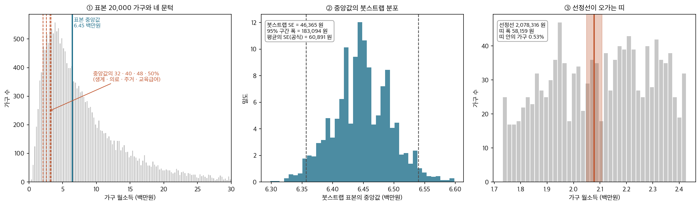
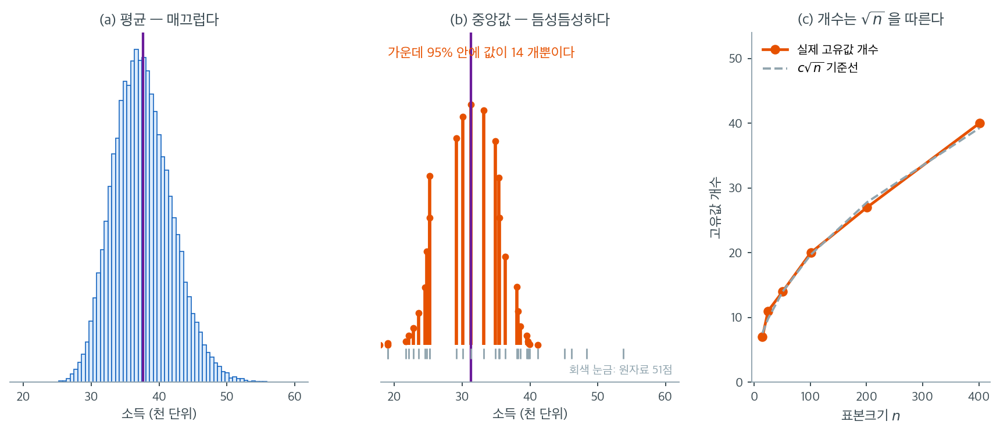

# 중앙값의 붓스트랩 (코드)

## 개요

<div class="leadbox" markdown>

**들어가는 이야기** — 그 한 줄을 믿고 급여를 받는 사람이 있다

어떤 수에는 **그 수를 믿고 급여를 받는 사람**이 달려 있다. 한국에서 생계급여를 받을 수 있는지 가르는 문턱이 「기준 중위소득」의 $32\%$ 인데, 그 중위소득은 전국을 다 조사해 얻은 것이 아니라 약 $2$ 만 가구의 표본에서 나온다. 곧 표본 하나의 중앙값이 전국의 문턱이 된다. 그러면 그 수는 얼마나 흔들리는가.

중앙값에 쓸 공식은 하나뿐이고 그마저 손에 잡히지 않는다. 점근 표준오차가 $1/(2f(m)\sqrt n)$ 인데 거기 들어가는 $f(m)$ — 중앙값 자리의 밀도 — 를 모르기 때문이다. 재표집은 그 값을 **묻지 않는다.** 모집단을 아는 자료에서 그 식이 $2{,}269.3$ 을 주고 재표집은 $1{,}924.7$ 을 낸다. 같은 계산이 치우침까지 돌려주는데 $+284.6$ 으로 표준오차의 $0.1479$ 배, 곧 고칠 만큼 크지 않다.

다만 중앙값의 재표집 분포는 평균의 것과 생김새가 다르다. 자료의 개수가 홀수이면 재표본의 중앙값은 **원자료의 값 가운데 하나**일 수밖에 없다. $51$ 개짜리 자료에서는 가운데 $95\%$ 안에 들어오는 서로 다른 값이 **열넷**뿐이고, 되풀이 횟수를 아무리 키워도 그 계단은 매끄러워지지 않는다.

그러면 공식이 없는 통계량의 흔들림은 무엇으로 적어야 하고, 그 계단은 구간의 끝점에 어떻게 나타나는가. 이 쪽이 절차를 코드로 내리고, 중앙값과 평균을 같은 재표본에서 맞대고, 이상값에 흔들리지 않는 정도를 잰 뒤, 계단이 표준오차와 치우침에 드러나는 꼴을 센다. 아래 상자가 그 중앙값 한 줄이 법에 적힌 수인 자리로 데려간다.

_확인한 곳 — 이 쪽 「그 중앙값 한 줄이 생계급여의 문턱이다」 상자와 그 출처 줄_

</div>

중앙값은 로버스트한 중심경향 측도이지만, 평균과 달리 표준오차의 간단한 닫힌 형태가 없다. 붓스트랩은 중앙값의 표준오차와 신뢰구간에 대해 가정 없는 직접적인 추정을 제공한다. 이 페이지에서는 모의 소득 자료에 대한 중앙값의 붓스트랩 추정을 시연하고, 평균과 비교하며, 이상값에 대한 중앙값의 로버스트성을 보인다.

---

## 1. 왜 중앙값을 붓스트랩하는가

밀도 $f$와 중앙값 $m$을 갖는 분포에서 크기 $n$인 표본을 뽑았을 때, 표본중앙값의 점근 표준오차는

$$
\text{SE}(\tilde x) \approx \frac{1}{2f(m)\sqrt{n}}
$$

이다. 이 공식은 모집단 중앙값에서의 밀도 $f(m)$을 알아야 하는데, 그 값은 대개 알려져 있지 않다. 붓스트랩은 표준오차를 경험적으로 추정하여 이 문제를 완전히 우회한다.

<div class="storybox" markdown>

**그림으로 보는 통계학 1.** 그 중앙값 한 줄이 생계급여의 문턱이다

바로 위의 사정 — 중앙값에는 $1/(2f(m)\sqrt n)$ 말고 쓸 공식이 없고 $f(m)$ 을 모른다 — 은
교과서 안의 불편이 아니다. 한국에서 그 중앙값은 **법에 적힌 수**다.

국민기초생활 보장법 제$2$ 조 제$11$ 호와 제$6$ 조의$2$ 제$1$ 항은 「기준 중위소득」을
**「보건복지부장관이 ⋯ 중앙생활보장위원회의 심의·의결을 거쳐 고시하는 국민 가구소득의
중위값」**으로 정한다. 복지부는 그것을 **통계청의 가계금융복지조사를 활용해 산정한다**고
밝혀 두었고, 그 조사의 표본은 전국 약 $2$ 만 가구다. 곧 **표본 하나의 중앙값이 전국의
문턱이 된다.**

$2025$ 년 $7$ 월 $31$ 일 제$77$ 차 중앙생활보장위원회가 $2026$ 년 값을 의결했다. $4$ 인
가구 월 $649$ 만 $4{,}738$ 원 — 전년 $609$ 만 $7{,}773$ 원에서 $6.51\%$ 올라 역대 최대
인상폭이다($1$ 인 가구는 $256$ 만 $4{,}238$ 원, $7.20\%$). 급여별 선정기준은 그 중앙값의
생계 $32\%$ · 의료 $40\%$ · 주거 $48\%$ · 교육 $50\%$ 이고, 고시된 $4$ 인 가구 생계급여
최저보장수준 $207$ 만 $8{,}316$ 원은 $0.32 \times 6{,}494{,}738$ 을 **글자 그대로** 계산한
값이다. 복지부는 이 인상으로 약 $4$ 만 명이 새로 생계급여를 받게 되리라 내다보았다.

표본에서 나온 수에는 표집오차가 있다. 얼마나 되는지는 이 쪽의 방법으로 잴 수 있다.



- **①** 중앙값이 고시값과 같은 로그정규 모집단에서 $2$ 만 가구를 뽑았다. **실제 미시자료가
  아니라 직접 만든 자료**이고, 맞춘 것은 중앙값뿐이다. 네 문턱이 모두 왼쪽에 몰려 있다.
- **②** 그 표본에서 중앙값을 $B = 4{,}000$ 번 재표집하니 표준오차가 **월 $46{,}365$ 원**,
  $95\%$ 구간의 폭이 $183{,}094$ 원이다. 모집단을 알 때의 점근식 $1/(2f(m)\sqrt n)$ 이
  $46{,}046$ 원이니, 붓스트랩은 $f(m)$ 을 **묻지 않고** 같은 값에 닿았다. 덧붙이면 같은
  표본에서 평균의 표준오차는 $60{,}891$ 원이다 — 이 분포에서는 중앙값 쪽이 더 안정적이다.
- **③** 중앙값이 그 표준오차만큼 흔들리면 $32\%$ 선은 $204$ 만 $9{,}237$ 원과 $210$ 만
  $7{,}396$ 원 사이를 오간다. 폭은 월 $58{,}159$ 원으로 작아 보이는데, **그 띠 안에 전체
  가구의 $0.53\%$ 가 들어 있다.** 선 아래에 있는 가구가 $7.63\%$ 이니, **띠 하나가 선
  아래 가구의 $7\%$ 에 맞먹는다.**

주의할 것이 둘 있다. 첫째, 실제 고시는 그 해 조사의 중앙값을 **그대로 쓰지 않는다** —
전년 고시값에 증가율을 적용해 정한다. 둘째, 층화와 가중을 쓰는 실제 조사의 표준오차는
단순 무작위표본보다 **크다.** 그러니 ③ 의 띠는 바닥이지 천장이 아니다.

그래도 방향은 분명하다. 「중앙값에는 간단한 공식이 없다」는 사정은 미뤄 두어도 되는
종류의 것이 아니다. 어떤 수에는 **그 수를 믿고 급여를 받는 사람**이 달려 있고, 그 수가
얼마나 흔들리는지 묻는 방법이 이 쪽에 있다.

_확인한 곳 — 보건복지부 보도자료 「$2026$ 년도 기준 중위소득 $6.51\%$ 역대 최대로 인상」
(제$77$ 차 중앙생활보장위원회, $2025$ 년 $7$ 월 $31$ 일)에서 $4$ 인·$1$ 인 가구의 기준
중위소득과 전년 값·인상률, 생계 $32\%$·의료 $40\%$·주거 $48\%$·교육 $50\%$, $4$ 인 가구
생계급여 최저보장수준 $207$ 만 $8{,}316$ 원, 「약 $4$ 만 명이 새롭게 생계급여를 수급할 수
있을 것으로 기대된다」를 확인했다. 기준 중위소득의 정의(「국민 가구소득의 중위값」)와
법적 근거(국민기초생활 보장법 제$2$ 조제$11$ 호·제$6$ 조의$2$ 제$1$ 항), 그리고 통계청
가계금융복지조사를 활용해 산정한다는 것은 복지부의 기준 중위소득 안내에서, 그 조사의
표본이 전국 약 $2$ 만 가구라는 것은 통계청의 조사 개요에서 확인했다. 그림의 자료는 직접
만든 로그정규 모집단이며, 수는 모두 직접 계산한 값이다_

</div>

---

## 2. 붓스트랩 절차

자료 $x_1, \ldots, x_n$이 주어졌을 때

1. 크기 $n$인 붓스트랩 표본을 복원추출로 $B$개 뽑는다.
2. 각 붓스트랩 표본의 중앙값 $\tilde x^{*(1)}, \ldots, \tilde x^{*(B)}$을 계산한다.
3. 붓스트랩 표준오차는 붓스트랩 중앙값들의 표준편차이다.

$$
\widehat{\text{SE}}_{\text{boot}}(\tilde x) = \sqrt{\frac{1}{B-1}\sum_{b=1}^{B}\bigl(\tilde x^{*(b)} - \overline{\tilde x^*}\bigr)^2}
$$

4. 붓스트랩 편향은

$$
\widehat{\text{bias}} = \overline{\tilde x^*} - \tilde x
$$

이다.

<div class="exbox" markdown>

**보기 1.** <span class="diff easy" title="쉬움"></span> 중앙값의 붓스트랩 분포. 아래 쪽들이 쓰는 소득 자료는 $\text{LogNormal}(10.5,\ 0.8^2)$에서 뽑은 $n = 200$개다. **모집단을 알고 있으므로 비교할 이론값이 있다.**

**(1)** 이 모집단의 중앙값 $m$과 그 자리의 밀도 $f(m)$을 구해 $\operatorname{SE}(\tilde x) = \dfrac{1}{2f(m)\sqrt n}$을 계산하시오.

**(2)** 붓스트랩 값과 견주시오. 어긋남이 $B$ 탓인지 따지고, 붓스트랩이 실제로 쓰고 있는 밀도 추정값이 얼마인지 거꾸로 풀어 보시오.

</div>

??? success "풀이"

    **(1) 해석적으로.** $X = e^{\mu + \sigma Z}$이므로 중앙값은 $Z = 0$에 대응하는 값이다.

    $$
    m = e^{\mu} = e^{10.5} = 36{,}315.5
    $$

    로그정규밀도는 $f(x) = \dfrac{1}{x\sigma\sqrt{2\pi}}\exp\!\left(-\dfrac{(\ln x - \mu)^2}{2\sigma^2}\right)$이고 $x = m$에서 지수부가 $1$이 되므로

    $$
    f(m) = \frac{1}{m\,\sigma\sqrt{2\pi}}
    = \frac{1}{36315.5 \times 0.8 \times 2.50663} = 1.373182\times10^{-5}
    $$

    다. 따라서

    $$
    \operatorname{SE}(\tilde x) = \frac{1}{2f(m)\sqrt n}
    = \frac{m\,\sigma\sqrt{2\pi}}{2\sqrt n}
    = \frac{36315.5 \times 0.8 \times 2.50663}{2\sqrt{200}} = 2{,}574.7
    $$

    이다. **중앙값의 표준오차가 중앙값 자신에 비례한다**는 것도 읽어 둘 것. 로그정규에서는 $\operatorname{SE}/m = \sigma\sqrt{2\pi}/(2\sqrt n)$로 $m$과 무관한 상대오차가 된다.

    **(2) 수치적으로.** 함수는 이렇다.

    ```python
    import numpy as np

    def bootstrap_median(data, n_bootstrap=10_000, rng=None):
        """중앙값의 붓스트랩 분포.

        중앙값에는 평균의 sigma/sqrt(n) 같은 표준오차 공식이 없다. 붓스트랩이
        특히 쓸모 있는 자리가 바로 이런 통계량이다.
        """
        rng = rng or np.random.default_rng(0)
        n = len(data)
        return np.median(data[rng.integers(0, n, (n_bootstrap, n))], axis=1)
    ```

    자료를 만들어 돌린다.

    ```python
    income = np.random.default_rng(5).lognormal(10.5, 0.8, 200)   # 쪽의 소득 자료
    n = len(income)
    print(f"표본평균 = {income.mean():,.0f},  표본중앙값 = {np.median(income):,.0f}")

    boot_med = bootstrap_median(income)
    print(f"붓스트랩 SE(중앙값) = {boot_med.std(ddof=1):,.1f}"
          f"   (B=10000 의 몬테카를로 오차 {boot_med.std(ddof=1) / np.sqrt(2 * 10000):.1f})")

    mu, sg = 10.5, 0.8
    m_pop = np.exp(mu)
    f_m = 1 / (m_pop * sg * np.sqrt(2 * np.pi))
    print(f"모집단 중앙값 = {m_pop:,.1f},  f(m) = {f_m:.6e}")
    print(f"이론 SE(중앙값) = 1/(2 f(m) sqrt(n)) = {1 / (2 * f_m * np.sqrt(n)):,.1f}")
    fh = 1 / (2 * np.sqrt(n) * boot_med.std(ddof=1))
    print(f"붓스트랩이 쓴 f-hat = {fh:.6e}   (참값의 {fh / f_m:.3f} 배)")
    ```

    출력:

    ```
    표본평균 = 47,303,  표본중앙값 = 33,458
    붓스트랩 SE(중앙값) = 2,660.8   (B=10000 의 몬테카를로 오차 18.8)
    모집단 중앙값 = 36,315.5,  f(m) = 1.373182e-05
    이론 SE(중앙값) = 1/(2 f(m) sqrt(n)) = 2,574.7
    붓스트랩이 쓴 f-hat = 1.328765e-05   (참값의 0.968 배)
    ```

    **붓스트랩이 $2{,}660.8$, 이론이 $2{,}574.7$로 $3.3\%$ 차이다.** 몬테카를로 요동이 $18.8$뿐이므로 $B$ 탓이 아니다. $86$은 그 $4.6$배다.

    **어긋남의 정체는 밀도 추정이다.** 붓스트랩이 실제로 재는 것은 $\dfrac{1}{2\sqrt n\,\hat f(\hat m)}$인데, 여기서 $\hat f$는 표본중앙값 둘레의 관측 간격만으로 정해진다. 거꾸로 풀면 $\hat f = 1.3288\times10^{-5}$로 참값 $1.3732\times10^{-5}$의 $0.968$배다. 이 표본의 중앙 부근이 모집단보다 **$3.2\%$ 성글었다**는 뜻이고, 그만큼 표준오차를 크게 본 것이다.

    **이것이 중앙값 붓스트랩의 성질이다.** 평균의 붓스트랩은 $n$개 전부가 들어가는 $\hat\sigma$에 기대지만, 중앙값의 붓스트랩은 가운데 몇십 개의 간격에만 기댄다. 표본이 달라지면 그만큼 크게 흔들린다([붓스트랩 재표집 방법](../bootstrap/resampling_method.md) 보기 $1$이 그 흔들림을 직접 잰다). **값은 쓸 만하지만 둘째 자리를 믿을 일은 아니다.**

---

## 3. 중앙값과 평균의 비교

대칭분포에서는 평균과 중앙값이 일치한다. 치우친 분포에서는 갈라진다. 지수분포를 닮은 소득 자료에서

$$
\text{평균} = c + \frac{1}{\lambda}, \qquad \text{중앙값} = c + \frac{\ln 2}{\lambda}
$$

이다. $\ln 2 \approx 0.693 < 1$이므로 이 분포족에서 중앙값은 항상 평균보다 작다.

$\text{LogNormal}(10.5, 0.8^2)$에서 $n = 200$을 뽑은 예:

| 통계량 | 값 | 붓스트랩 $\widehat{\text{SE}}$ |
|:---|---:|---:|
| 평균 | 47{,}303 | 3{,}208 |
| 중앙값 | 33{,}458 | 2{,}686 |

!!! warning "'중앙값의 표준오차가 항상 더 크다'는 것은 틀렸다"
    정규분포처럼 대칭이고 꼬리가 가벼운 분포에서는 중앙값의 표준오차가 평균보다 크다(점근분산비 $\pi/2 \approx 1.571$).

    그러나 **치우치거나 꼬리가 두꺼운 분포에서는 역전된다.** 위 표에서 중앙값의 표준오차 $2{,}686$이 평균의 $3{,}208$보다 **작다**. 로그정규분포에서 평균은 오른쪽 꼬리의 소수 관측에 크게 좌우되기 때문이다.

    소득·의료비·보험금처럼 치우친 자료에서는 중앙값이 **로버스트하면서 동시에 더 정밀하다**. 절충이 아니라 순수한 이득이다.

<div class="exbox" markdown>

**보기 2.** <span class="diff easy" title="쉬움"></span> 평균과 견주기. 같은 $\text{LogNormal}(\mu, \sigma^2)$ 모집단에서 두 통계량의 표준오차를 이론으로 견준다.

**(1)** $\operatorname{SE}(\bar x)$를 구하고, 보기 $1$의 $\operatorname{SE}(\tilde x)$와의 비가

$$
\frac{\operatorname{SE}(\tilde x)}{\operatorname{SE}(\bar x)}
= \frac{\sigma\sqrt{2\pi}/2}{e^{\sigma^2/2}\sqrt{e^{\sigma^2}-1}}
$$

로 **$\mu$와 $n$에 전혀 의존하지 않음**을 보이시오. $\sigma \to 0$에서 이 값이 무엇이 되는가. $\sigma = 0.8$에서는 얼마인가.

**(2)** 두 통계량의 붓스트랩 표준오차를 구해 (1)과 견주시오. 중앙값이 평균보다 정밀해지기 시작하는 $\sigma$도 구하시오.

</div>

??? success "풀이"

    **(1) 해석적으로.** 로그정규의 평균과 분산은

    $$
    E[X] = e^{\mu + \sigma^2/2},
    \qquad
    \operatorname{Var}(X) = \left(e^{\sigma^2}-1\right)e^{2\mu+\sigma^2}
    $$

    이므로

    $$
    \operatorname{SE}(\bar x) = \frac{\sqrt{\operatorname{Var}(X)}}{\sqrt n}
    = \frac{e^{\mu+\sigma^2/2}\sqrt{e^{\sigma^2}-1}}{\sqrt n}
    $$

    다. 보기 $1$에서 $\operatorname{SE}(\tilde x) = \dfrac{e^{\mu}\sigma\sqrt{2\pi}}{2\sqrt n}$이었으므로 비를 취하면 $e^{\mu}$와 $\sqrt n$이 **둘 다 약분된다.**

    $$
    \frac{\operatorname{SE}(\tilde x)}{\operatorname{SE}(\bar x)}
    = \frac{\sigma\sqrt{2\pi}/2}{e^{\sigma^2/2}\sqrt{e^{\sigma^2}-1}}
    $$

    **치우침의 정도 $\sigma$ 하나가 모든 것을 정한다.** $\sigma \to 0$이면 $e^{\sigma^2/2} \to 1$이고 $\sqrt{e^{\sigma^2}-1} \to \sigma$이므로 비가

    $$
    \frac{\sigma\sqrt{2\pi}/2}{\sigma} = \sqrt{\frac{\pi}{2}} = 1.2533
    $$

    으로 간다. **정규분포에서 알려진 $\sqrt{\pi/2}$가 그대로 나온다.** 로그정규는 $\sigma \to 0$에서 정규로 가기 때문이다. $\sigma = 0.8$에서는

    $$
    \frac{0.8 \times 2.50663/2}{e^{0.32}\sqrt{e^{0.64}-1}}
    = \frac{1.002650}{1.377128 \times 0.946826} = 0.768963
    $$

    으로 **중앙값 쪽이 $23\%$ 작다.** 꼬리가 두꺼워지면 평균이 소수의 극단값에 끌려 흔들리기 때문이다.

    **(2) 수치적으로.** 함수는 이렇다.

    ```python
    def bootstrap_mean(data, n_bootstrap=10_000, rng=None):
        """견주기 위한 평균의 붓스트랩 분포."""
        rng = rng or np.random.default_rng(0)
        n = len(data)
        return data[rng.integers(0, n, (n_bootstrap, n))].mean(axis=1)
    ```

    보기 $1$의 `income`을 그대로 이어 쓴다.

    ```python
    from scipy.optimize import brentq

    boot_mean = bootstrap_mean(income)
    print(f"붓스트랩 SE(평균)   = {boot_mean.std(ddof=1):,.1f}")
    print(f"극한 sigma-hat/sqrt(n) = {income.std(ddof=0) / np.sqrt(n):,.1f}"
          f"   (몬테카를로 오차 {income.std(ddof=0) / np.sqrt(n) / np.sqrt(2 * 10000):.1f})")

    mean_pop = np.exp(mu + sg ** 2 / 2)
    se_mean_pop = mean_pop * np.sqrt(np.exp(sg ** 2) - 1) / np.sqrt(n)
    se_med_pop = 1 / (2 * f_m * np.sqrt(n))
    print(f"이론 SE(평균) = {se_mean_pop:,.1f},  이론 SE(중앙값) = {se_med_pop:,.1f}")
    ratio = (sg * np.sqrt(2 * np.pi) / 2) / (np.exp(sg ** 2 / 2) * np.sqrt(np.exp(sg ** 2) - 1))
    print(f"이론 비 = {se_med_pop / se_mean_pop:.6f},  공식 = {ratio:.6f}")

    f = lambda s: s * np.sqrt(2 * np.pi) / 2 - np.exp(s ** 2 / 2) * np.sqrt(np.exp(s ** 2) - 1)
    print(f"비가 1 이 되는 sigma = {brentq(f, 0.1, 1.5):.6f}")
    ```

    출력:

    ```
    붓스트랩 SE(평균)   = 3,158.2
    극한 sigma-hat/sqrt(n) = 3,158.9   (몬테카를로 오차 22.3)
    이론 SE(평균) = 3,348.3,  이론 SE(중앙값) = 2,574.7
    이론 비 = 0.768963,  공식 = 0.768963
    비가 1 이 되는 sigma = 0.546425
    ```

    **평균 쪽은 붓스트랩이 정확하다.** $3{,}158.2$가 극한 $\hat\sigma/\sqrt n = 3{,}158.9$와 거의 같다(차이 $0.7$, 몬테카를로 오차 $22.3$). 보기 $1$에서 중앙값 쪽이 $86$이나 벗어났던 것과 대조된다. **평균의 붓스트랩은 $n$개 전부가 들어간 $\hat\sigma$에 기대기 때문이다.**

    **순서는 이론이 말한 대로다.** 중앙값 $2{,}660.8$ < 평균 $3{,}158.2$로 중앙값이 더 정밀하고, 비 $0.843$이 이론값 $0.769$와 같은 방향이다(두 추정값 각각이 자기 이론값에서 벗어난 몫이 섞여 있다).

    **분기점은 $\sigma = 0.546425$다.** 이보다 치우침이 작으면 평균이, 크면 중앙값이 정밀하다. 소득·의료비·보험금 자료의 로그표준편차는 대개 $0.7$ 이상이므로 **이 영역에서는 중앙값이 로버스트하면서 동시에 더 정밀하다.** 절충이 아니라 순수한 이득이다.

---

## 4. 이상값에 대한 로버스트성

극단적인 관측 하나(예: 소득 $1{,}000{,}000$)를 추가하면 평균은 크게 바뀌지만 중앙값은 거의 변하지 않는다. 중앙값은 자료 중앙 부근의 순서통계량에만 의존하고 극단값에는 의존하지 않기 때문이다.

위 소득 자료($n = 200$)에 $1{,}000{,}000$ 하나를 추가하면

| 통계량 | 변화율 |
|:---|---:|
| 평균 | $+10.02$% |
| 중앙값 | $+1.51$% |

형식적으로, 중앙값의 **영향함수**는 임의의 점 $x$에서 유계이다.

$$
\text{IF}(x; \tilde F, F) = \frac{\text{sign}(x - m)}{2f(m)}
$$

반면 평균의 영향함수는 $\text{IF}(x; \bar F, F) = x - \mu$로 유계가 아니다. 이상값 하나가 평균을 임의로 멀리 옮길 수 있지만 중앙값은 최대 $1/(2f(m))$만큼만 움직인다.

<div class="exbox" markdown>

**보기 3.** <span class="diff easy" title="쉬움"></span> 이상치 하나가 바꾸는 것. $n = 200$인 소득 자료에 $x_0 = 1{,}000{,}000$ 하나를 덧붙인다. 위의 영향함수 이야기를 **정확한 공식**으로 바꿀 수 있다.

**(1)** 평균과 중앙값의 상대변화를 $n$, $\bar x$, 순서통계량으로 **정확히** 적으시오($x_0$이 자료의 최댓값보다 크고 $n$이 짝수인 경우). 두 식에서 $x_0$이 어떻게 들어가는지 견주시오.

**(2)** 수를 넣어 쪽의 $+10.02\%$와 $+1.51\%$를 되찾아 오시오.

</div>

??? success "풀이"

    **(1) 해석적으로.** 관측이 $n$개에서 $n+1$개가 된다.

    **평균.** 새 평균이 $\dfrac{n\bar x + x_0}{n+1}$이므로

    $$
    \frac{\bar x_{\text{new}} - \bar x}{\bar x}
    = \frac{1}{\bar x}\left(\frac{n\bar x + x_0}{n+1} - \bar x\right)
    = \frac{x_0 - \bar x}{(n+1)\,\bar x}
    $$

    다. **$x_0$이 분자에 그대로 들어간다.** $x_0 \to \infty$면 변화율도 무한히 커진다. 영향함수 $\text{IF}(x) = x - \mu$가 유계가 아니라는 말의 유한표본 판본이다.

    **중앙값.** $n = 200$이 짝수이므로 원래 중앙값은 $\tilde x = \dfrac{x_{(100)} + x_{(101)}}{2}$다. $x_0$이 최댓값보다 크면 순서를 맨 뒤에 하나 더 붙일 뿐이므로, $n+1 = 201$개의 중앙값은 **$101$번째 값** $x_{(101)}$이 된다. 따라서

    $$
    \frac{\tilde x_{\text{new}} - \tilde x}{\tilde x}
    = \frac{1}{\tilde x}\left(x_{(101)} - \frac{x_{(100)}+x_{(101)}}{2}\right)
    = \frac{x_{(101)} - x_{(100)}}{2\,\tilde x}
    $$

    다. **$x_0$이 식에서 사라졌다.** 바뀌는 크기는 오직 가운데 두 순서통계량의 **간격**이 정한다. $x_0$이 백만이든 백억이든 답이 같다. 영향함수가 $\dfrac{\operatorname{sign}(x-m)}{2f(m)}$으로 유계라는 말이 이것이다. 실제로 간격의 기댓값이 대략 $1/(n f(m))$이므로 변화율이 $\dfrac{1}{2n f(m)\tilde x}$ 수준, 곧 $O(1/n)$이다.

    **(2) 수치적으로.** 함수는 이렇다.

    ```python
    def robustness_comparison(data, outlier=1_000_000):
        """이상치 하나가 평균과 중앙값을 각각 얼마나 움직이는지 보인다.

        100만짜리 값 하나를 덧붙인다. 평균은 크게 끌려가고 중앙값은 한 칸
        옆으로 옮겨 갈 뿐이다.
        """
        with_out = np.append(data, outlier)
        print(f"Mean change:   "
              f"{(with_out.mean() - data.mean()) / data.mean() * 100:.2f}%")
        print(f"Median change: "
              f"{(np.median(with_out) - np.median(data)) / np.median(data) * 100:.2f}%")
    ```

    보기 $1$의 `income`을 그대로 이어 쓴다.

    ```python
    robustness_comparison(income)

    xs = np.sort(income)
    x0 = 1_000_000
    print(f"평균 변화 식 (x0-xbar)/((n+1) xbar) = "
          f"{(x0 - income.mean()) / ((n + 1) * income.mean()) * 100:.6f}%")
    print(f"중앙값 변화 식 (x(101)-x(100))/(2 med) = "
          f"{(xs[100] - xs[99]) / (2 * np.median(income)) * 100:.6f}%")
    print(f"가운데 두 순서통계량 = {xs[99]:,.1f} 와 {xs[100]:,.1f}"
          f"   (간격 {xs[100] - xs[99]:,.1f})")
    ```

    출력:

    ```
    Mean change:   10.02%
    Median change: 1.51%
    평균 변화 식 (x0-xbar)/((n+1) xbar) = 10.019957%
    중앙값 변화 식 (x(101)-x(100))/(2 med) = 1.510654%
    가운데 두 순서통계량 = 32,952.7 와 33,963.5   (간격 1,010.9)
    ```

    **두 식이 함수의 결과와 소수 여섯째 자리까지 같다.** 평균은 $+10.019957\%$, 중앙값은 $+1.510654\%$다.

    **$x_0$을 바꾸어 보면 차이가 선명해진다.** 평균 쪽 식 $\dfrac{x_0 - \bar x}{201\,\bar x}$는 $x_0$에 비례하므로, 이상치를 $10^7$로 열 배 키우면 변화율이 $+10.02\%$에서 $+104.68\%$로 열 배 넘게 커진다. 중앙값 쪽 식에는 $x_0$이 없으므로 **$+1.510654\%$ 그대로다.** 가운데 간격이 $1{,}010.9$원이고 중앙값이 $33{,}458$원이라 그 절반의 비가 곧 답이다.

    **중앙값이 "거의 변하지 않는다"는 말의 정확한 뜻이 이것이다.** 전혀 변하지 않는 것은 아니다. 짝수 $n$에서 홀수 $n$으로 넘어가며 가운데 자리가 반 칸 옮겨 가고, 그 반 칸의 크기는 자료의 중앙 밀도가 정한다.

---

## 5. 중앙값의 붓스트랩 신뢰구간

백분위수법이 직관적인 신뢰구간을 준다.

$$
\text{CI}_{1-\alpha} = \bigl[\tilde x^*_{\alpha/2},\;\tilde x^*_{1-\alpha/2}\bigr]
$$

<div class="exbox" markdown>

**보기 4.** <span class="diff easy" title="쉬움"></span> 여러 신뢰수준의 구간. 중앙값에는 붓스트랩이 아니어도 쓸 수 있는 **정확한 무분포 신뢰구간**이 있다. 붓스트랩 구간을 그것과 맞춰 본다.

**(1)** 순서통계량 $x_{(k)}$에 대해 $\Pr(x_{(k)} \le m \le x_{(n-k+1)})$을 이항분포로 적으시오. 그것으로 $n = 200$, $\alpha = 0.05$에서 쓸 $k$를 정하고 **실제 포함확률**을 구하시오. 왜 명목 $95\%$에 꼭 맞출 수 없는가.

**(2)** 붓스트랩 백분위수 구간과 (1)의 구간을 세 신뢰수준에서 견주시오.

</div>

??? success "풀이"

    **(1) 해석적으로.** 관측 하나가 참 중앙값 $m$보다 작을 확률이 정확히 $1/2$이고 관측들이 독립이므로, $m$보다 작은 관측의 개수 $S$는 **자료의 분포와 무관하게**

    $$
    S \sim \text{Binomial}(n,\ 1/2)
    $$

    를 따른다. 그런데 $x_{(k)} > m$인 것은 $m$보다 작은 관측이 $k$개 미만이라는 것, 곧 $S \le k-1$과 같다. 위쪽도 대칭이므로

    $$
    \Pr\!\left(x_{(k)} \le m \le x_{(n-k+1)}\right)
    = 1 - 2\Pr(S \le k-1)
    $$

    이다. **어떤 연속분포에서도 정확하다.** 밀도도, 정규성도, 붓스트랩도 필요 없다.

    $n = 200$에서 $S$의 평균은 $100$, 표준편차는 $\sqrt{200}/2 = 7.071$이므로 $k - 1 \approx 100 - 1.96 \times 7.071 = 86.1$이 어림이다. $\Pr(S \le k-1) \le 0.025$를 만족하는 가장 큰 $k$를 고르면 $k = 86$이고, 그때 포함확률이 $1 - 2\Pr(S \le 85)$다.

    **명목값에 꼭 맞출 수 없는 까닭은 $S$가 이산이기 때문이다.** $k$를 한 칸 옮길 때마다 포함확률이 뭉텅이로 바뀌므로, 고를 수 있는 수준이 띄엄띄엄하다. 보수적인 쪽으로 반올림하는 것이 관례다.

    **(2) 수치적으로.** 함수는 이렇다.

    ```python
    def confidence_intervals(bootstrap_dist, confidence_levels=(90, 95, 99)):
        """여러 신뢰수준에서의 백분위수 붓스트랩 신뢰구간.

        중앙값의 붓스트랩 분포는 계단 모양이 된다. 재표본의 중앙값이 원래
        자료에 있던 값 중 하나(또는 두 값의 평균)일 수밖에 없기 때문이다.
        """
        for cl in confidence_levels:
            alpha = (100 - cl) / 2
            lower, upper = np.percentile(bootstrap_dist, [alpha, 100 - alpha])
            print(f"{cl}% CI: [{lower:,.0f}, {upper:,.0f}]  Width: {upper-lower:,.0f}")
    ```

    보기 $1$의 `income`, `boot_med`와 보기 $3$의 `xs`를 그대로 이어 쓴다.

    ```python
    from scipy import stats

    confidence_intervals(boot_med)
    print()
    print(f"{'수준':>5}{'부호검정 구간':>34}{'정확 포함률':>12}")
    for cl in (90, 95, 99):
        alpha = (100 - cl) / 100
        k = max(j for j in range(1, n // 2 + 1)
                if stats.binom.cdf(j - 1, n, 0.5) <= alpha / 2)
        cov = 1 - 2 * stats.binom.cdf(k - 1, n, 0.5)
        print(f"{cl:>5}   x({k})..x({n-k+1}) = [{xs[k-1]:,.0f}, {xs[n-k]:,.0f}]{cov:>12.4f}")
    print(f"\n붓스트랩 중앙값의 고유값 수 = {len(np.unique(boot_med))}  (복제값 10000 개 중)")
    ```

    출력:

    ```
    90% CI: [28,468, 36,771]  Width: 8,304
    95% CI: [28,029, 37,269]  Width: 9,240
    99% CI: [27,306, 37,836]  Width: 10,530

       수준                           부호검정 구간      정확 포함률
       90   x(88)..x(113) = [28,420, 36,922]      0.9232
       95   x(86)..x(115) = [28,000, 37,289]      0.9600
       99   x(82)..x(119) = [27,215, 37,931]      0.9913

    붓스트랩 중앙값의 고유값 수 = 264  (복제값 10000 개 중)
    ```

    **두 구간이 거의 겹친다.** $95\%$에서 붓스트랩 $[28{,}029,\ 37{,}269]$ 대 정확 $[28{,}000,\ 37{,}289]$로 양 끝이 **순서통계량 한 칸 안쪽**이다. 실제로 붓스트랩 하한 $28{,}029$는 $x_{(86)} = 28{,}000$과 $x_{(87)} = 28{,}059$의 한가운데 값이다. $n$이 짝수라 재표본 중앙값이 두 순서통계량의 평균이기 때문이며, 그래서 복제값 $10{,}000$개가 서로 다른 값을 $264$가지밖에 갖지 못한다.

    **정확 포함확률 쪽이 더 많은 것을 말해 준다.** "$90\%$"라 적은 구간의 실제 포함확률은 $0.9232$, "$99\%$"는 $0.9913$이다. 이항분포의 이산성 때문에 명목값에 맞출 수 없고 늘 보수적인 쪽으로 넘친다. $95\%$만은 $0.9600$으로 꽤 가깝다.

    신뢰수준이 높을수록 구간이 넓어져 신뢰도와 정밀도의 절충을 반영한다. 폭이 $8{,}304 \to 9{,}240 \to 10{,}530$으로 늘고, 순서통계량으로는 $k$가 $88 \to 86 \to 82$로 바깥으로 밀린다. **중앙값에 대해서는 붓스트랩이 꼭 필요하지 않다는 것도 기억해 둘 것.** 부호검정 구간은 재표집 없이, 그것도 정확하게 같은 답을 준다. 붓스트랩의 값은 중앙값 **차이**나 중앙값의 **함수**처럼 이런 정확 구간이 없는 양으로 넘어갈 때 드러난다.

---

## 6. 중앙값의 붓스트랩 분포는 계단이다

위 주석에서 "계단 모양이 된다"고 적어 두었는데, 평균의 경우와 나란히 놓으면 그 말의 크기가 실감난다.



$\text{LogNormal}(10.5, 0.8^2)$에서 $n = 51$인 소득 자료를 뽑아 같은 재표본으로 두 통계량을 계산했다. (a)의 평균은 매끄러운 종 모양이다. 4만 개 복제값이 사실상 모두 서로 다른 값이기 때문이다. (b)의 중앙값은 막대 몇 개뿐이다. $n$이 홀수이므로 재표본의 중앙값은 **원자료 51개 값 중 하나**일 수밖에 없고, 그중에서도 가운데 $95\%$ 안에 들어오는 것은 $14$개에 불과하다. 회색 눈금으로 찍은 원자료와 견주어 보면 주황 막대가 정확히 자료값 위에만 서 있음을 알 수 있다.

(c)가 이 현상의 규모를 정리한다. 가운데 $95\%$ 안의 고유값 개수가 $n = 15, 25, 51, 101, 201, 401$에서 각각 $7, 11, 14, 20, 27, 40$으로, 회색 기준선 $c\sqrt{n}$을 거의 그대로 따라간다. 중앙값의 표집분포 폭이 $O(n^{-1/2})$인데 인접 순서통계량 사이 간격은 $O(n^{-1})$이므로 그 비가 $O(\sqrt{n})$이 되기 때문이다. $n$을 4배로 늘려야 고유값이 2배가 되는 느린 증가이다.

실무적 함의는 두 가지다. 첫째, **$B$를 아무리 키워도 (b)는 매끄러워지지 않는다.** 같은 이산분포에서 더 많이 뽑을 뿐이며, 막대의 높이만 정밀해진다. 둘째, 구간의 끝점이 자료값 몇 개에 걸려 있으므로 $95\%$ 신뢰구간의 실제 포함확률이 명목값 주위에서 톱니처럼 오르내린다. 소표본에서 중앙값의 붓스트랩 구간을 보고할 때 끝점을 지나치게 정밀하게 적지 말아야 할 이유가 여기에 있다.

### 계단이 표준오차와 편향에 나타나는 꼴

절 $6$ 이 말한 「계단」이 표준오차와 편향에 어떻게 나타나는지 센다. 중앙값에는 **고전적 비교 대상이 없다** — 평균의 $\sigma/\sqrt n$ 에 해당하는 공식이 없으므로, 붓스트랩이 선택이 아니라 사실상 유일한 길이다.

<div class="exbox" markdown>

**보기 5.** <span class="diff easy" title="쉬움"></span> 중앙값의 표준오차와 편향. $\text{LogNormal}(10.5,\ 0.8^2)$ 에서 $n = 200$ 을 뽑은 소득 자료에 쓴다.

**(1)** 이 모집단에서 **표본중앙값이 놓인 자리**의 밀도를 구해 $\dfrac{1}{2f\sqrt n}$을 계산하시오. 붓스트랩 편향의 **부호**도 미리 말하고, 그 크기를 어떻게 판정할지 적으시오.

**(2)** 실행해 (1)과 견주시오. 붓스트랩 중앙값이 몇 가지 값만 갖는지도 세시오.

</div>

??? success "풀이"

    **(1) 해석적으로.** 로그정규 밀도는

    $$
    f(x) = \frac{1}{x\sigma\sqrt{2\pi}}\exp\!\left(-\frac{(\ln x - \mu)^2}{2\sigma^2}\right)
    $$

    이다. 표본중앙값 $\tilde x = 31{,}508.1$을 넣으면 $f(\tilde x) = 1.557962\times10^{-5}$이고

    $$
    \frac{1}{2 f(\tilde x)\sqrt{200}} = 2{,}269.3
    $$

    이다. **모집단 중앙값 $e^{10.5} = 36{,}315.5$ 자리의 값 $2{,}574.7$과 다르다**는 데 주의할 것. 표본중앙값이 참값보다 작게 나왔고, 로그정규는 그 언저리에서 밀도가 더 높으므로 표준오차가 작아진다.

    **편향의 부호.** 붓스트랩 편향은 $\overline{\tilde x^{*}} - \tilde x$, 곧 붓스트랩 중앙값 분포의 **평균과 중앙값의 차이**에 가깝다. 모집단이 오른쪽으로 치우쳐 있으면 재표본 중앙값의 분포도 오른쪽으로 치우치고, 치우친 분포에서는 평균이 중앙값보다 크다. **그러므로 편향은 양수일 것이다.**

    **크기 판정.** 편향은 절대 크기가 아니라 **표준오차에 견준 크기**로 본다. $\lvert\widehat{\text{bias}}\rvert/\widehat{\operatorname{SE}} < 0.25$이면 무시할 만하다는 것이 흔한 경험칙이다.

    **(2) 수치적으로.** 함수는 이렇다.

    ```python
    def bootstrap_se_median(data, n_boot=10_000, rng=None):
        """중앙값의 표준오차와 편향을 붓스트랩으로 추정한다.

        편향은 붓스트랩 값들의 평균에서 원래 추정값을 뺀 것이다. 0 에서 멀면
        그 통계량이 참값을 체계적으로 빗나간다는 뜻이다.
        """
        rng = rng or np.random.default_rng(0)
        n = len(data)
        boot_medians = np.median(data[rng.integers(0, n, (n_boot, n))], axis=1)
        se = boot_medians.std(ddof=1)
        bias = boot_medians.mean() - np.median(data)
        return se, bias, boot_medians
    ```

    보기 $2$의 블록에서 이어 쓴다.

    ```python
    # 원래 이 자료는 한 쪽에서 같은 생성기로 차례로 뽑은 것이다. 아래 수를
    # 그대로 쓰려면 앞의 두 뽑기를 똑같이 소비해야 한다.
    rng_data = np.random.default_rng(1)
    rng = np.random.default_rng(7)
    rng_data.exponential(scale=5, size=50)       # 일표본 보기가 쓴 뽑기
    rng_data.normal(52, 10, 40); rng_data.normal(48, 10, 40)   # 이표본 보기가 쓴 뽑기

    income = rng_data.lognormal(mean=10.5, sigma=0.8, size=200)
    se_med, bias, boot_med = bootstrap_se_median(income, rng=rng)

    mu_, sg_ = 10.5, 0.8
    m_s = np.median(income)
    f_at = np.exp(-(np.log(m_s) - mu_) ** 2 / (2 * sg_ ** 2)) / (m_s * sg_ * np.sqrt(2 * np.pi))
    print(f"표본중앙값 = {m_s:,.1f},  모집단 중앙값 = {np.exp(mu_):,.1f}")
    print(f"표본중앙값 자리의 참 밀도 = {f_at:.6e}  ->  SE = {1/(2*f_at*np.sqrt(200)):,.1f}")
    print(f"붓스트랩 SE = {se_med:,.1f},  편향 = {bias:,.1f},  |편향|/SE = {abs(bias)/se_med:.4f}")
    print(f"붓스트랩 중앙값의 왜도 = {stats.skew(boot_med):.4f},"
          f"  고유값 수 = {len(np.unique(boot_med))}")
    ```

    출력:

    ```
    표본중앙값 = 31,508.1,  모집단 중앙값 = 36,315.5
    표본중앙값 자리의 참 밀도 = 1.557962e-05  ->  SE = 2,269.3
    붓스트랩 SE = 1,924.7,  편향 = 284.6,  |편향|/SE = 0.1479
    붓스트랩 중앙값의 왜도 = 0.2398,  고유값 수 = 264
    ```

    **편향의 부호를 맞혔다.** $+284.6$으로 양수이고, 붓스트랩 중앙값 분포의 왜도가 $+0.2398$인 것이 그 까닭이다. $\lvert\text{편향}\rvert/\widehat{\operatorname{SE}} = 0.1479$로 경험칙 $0.25$를 밑돈다. **보정할 만큼 크지 않다.**

    **표준오차는 $1{,}912.2$로 이론값 $2{,}269.3$보다 $16\%$ 작다.** $B = 10{,}000$의 몬테카를로 요동이 $1912/\sqrt{2B} = 13.5$뿐이므로 $B$ 탓이 아니다. 까닭은 [중앙값의 붓스트랩](../bootstrap_ci/bootstrap_median.md) 보기 $1$에서 본 그대로다. 붓스트랩이 쓰는 것은 참 밀도가 아니라 **표본중앙값 둘레의 관측 간격**이고, 이 표본은 그 자리가 모집단보다 촘촘했다. 중앙값의 표준오차를 붓스트랩으로 구할 때 한 자리 이상을 믿어서는 안 되는 이유다.

    **값이 $264$가지뿐이라는 것도 눈여겨볼 것.** $10{,}000$개의 복제값이 서로 다른 값을 그만큼만 갖는다. 재표본 중앙값이 원자료 순서통계량 두 개의 평균일 수밖에 없기 때문이며, 그래서 중앙값의 붓스트랩 분포는 계단 모양이 된다.

---

## 7. 공식이 없는 곳에서 불확실성을 잰다

- 중앙값의 붓스트랩 표준오차는 공식이 없는 곳에서 불확실성을 정량화해 준다.
- 치우친 분포(소득, 의료비, 보험금)에서는 중앙값이 평균보다 대표성 있는 요약이다.
- 중앙값의 붓스트랩 분포는 평균의 것보다 덜 매끄러울 수 있다. 중앙값이 순서통계량의 불연속 함수이기 때문이다.
- 금융과 보험에서 중앙값이 선호되는 경우가 많다. 극단값(큰 보험금, 시장 급락)이 평균을 왜곡할 수 있기 때문이다.

---

## 연습문제

<div class="drillbox" markdown>

**연습문제 1.** <span class="diff easy" title="쉬움"></span> 표준정규분포에서 크기 $n = 50$인 표본을 생성하라. 중앙값의 붓스트랩 표준오차를 계산하고 이론값 $\sqrt{\pi/(2n)} \approx 1/(2f(0)\sqrt{n})$과 비교하라. 여기서 $f(0) = 1/\sqrt{2\pi}$이다.

</div>

??? success "풀이"

    표준정규에서 $f(0) = 1/\sqrt{2\pi} \approx 0.3989$이므로 중앙값의 점근 표준오차는

    $$
    \text{SE}(\tilde x) = \frac{1}{2 \times 0.3989 \times \sqrt{50}} = \frac{1}{5.641} = 0.1773
    $$

    이다. 같은 값을 $\text{SE} = \sqrt{\pi/(2n)} = \sqrt{\pi/100} = 0.1772$로도 쓸 수 있다.

    ```python
    import numpy as np
    rng = np.random.default_rng(202)
    data = np.random.default_rng(42).normal(0, 1, 50)

    boot_medians = bootstrap_median(data, n_bootstrap=5000, rng=rng)
    print(boot_medians.std(ddof=1), np.sqrt(np.pi / 100))
    # 0.1336   0.1772
    ```

    출력:

    ```
    0.13363960248123452 0.1772453850905516
    ```

    **붓스트랩 값 $0.1336$이 이론값 $0.1772$보다 $25$% 작다.** 이것이 몬테카를로 오차 때문일까?

    아니다. $B = 5000$의 몬테카를로 오차는 $\widehat{\text{SE}}/\sqrt{2B} = 0.0013$으로 무시할 수준이다. 차이의 원인은 **자료 자체**이다.

    $600$개의 서로 다른 표본으로 반복하면 그림이 분명해진다.

    | $n$ | 붓스트랩 $\widehat{\text{SE}}$(중앙값)의 평균 | 그 표준편차 | 중앙값의 참 표준편차 | 이론값 |
    |---:|---:|---:|---:|---:|
    | 50 | 0.1808 | **0.0462** | 0.1755 | 0.1772 |
    | 200 | 0.0892 | 0.0170 | 0.0891 | 0.0886 |

    비교를 위해 평균에 대해서도:

    | $n$ | 붓스트랩 $\widehat{\text{SE}}$(평균) | 참 표준편차 | 이론값 |
    |---:|---:|---:|---:|
    | 50 | 0.1397 | 0.1386 | 0.1414 |
    | 200 | 0.0706 | 0.0706 | 0.0707 |

    **평균적으로는 붓스트랩이 정확하다**($0.1808$ 대 이론 $0.1772$). 그러나 **자료마다 크게 흔들린다**. 표준편차 $0.0462$는 변동계수 $26$%에 해당한다. 우리가 뽑은 표본은 평균에서 약 $1$ 표준편차 아래였을 뿐이다.

    **평균에서는 이 불안정성이 없다.** $n = 50$에서 붓스트랩 $\widehat{\text{SE}}$(평균)의 값들은 참값 주위에 훨씬 촘촘히 모인다.

    !!! note "중앙값의 붓스트랩이 불안정한 이유"
        중앙값은 순서통계량의 **불연속** 함수이다. $n = 50$에서 붓스트랩 중앙값은 원자료의 $25$번째와 $26$번째 순서통계량 부근 몇 개 값만 취한다.

        따라서 $\widehat{\text{SE}}$가 사실상 그 몇 개 값 사이의 간격에 의해 결정된다. 그 간격은 표본마다 크게 다르다.

        실용적 함의: **중앙값의 붓스트랩 표준오차 하나를 소수 셋째 자리까지 보고하지 말라.** $n = 50$에서 그 값의 불확실성이 $\pm 26$%이다.

---

<div class="drillbox" markdown>

**연습문제 2.** <span class="diff med" title="중간"></span> 정규분포에서 중앙값의 평균 대비 **점근상대효율**(ARE)은 $\pi/2 \approx 1.571$이다. 중앙값의 분산이 약 $57$% 크다는 뜻이다. 같은 정규 표본에서 평균과 중앙값의 붓스트랩 표준오차를 비교하여 경험적으로 확인하라.

</div>

??? success "풀이"

    ```python
    import numpy as np
    rng = np.random.default_rng(202)
    data = np.random.default_rng(42).normal(0, 1, 200)

    se_mean = bootstrap_mean(data, 5000, rng).std(ddof=1)
    se_median = bootstrap_median(data, 5000, rng).std(ddof=1)
    print(se_mean, se_median, (se_median / se_mean) ** 2)
    # 0.0624  0.0996  2.548
    ```

    출력:

    ```
    0.06251581245127882 0.09945858528131833 2.531073726287425
    ```

    **단일 표본에서 분산비가 $2.548$로 이론값 $1.571$과 크게 다르다.**

    연습문제 1과 같은 이유이다. 하나의 표본에서 얻은 중앙값의 붓스트랩 표준오차는 불안정하다. 이 표본에서는 우연히 큰 값이 나왔다.

    **여러 표본에 걸쳐 평균내면 이론값이 회복된다.** 연습문제 1의 표에서 $n = 200$일 때

    $$
    \frac{\overline{\widehat{\text{SE}}}(\tilde x)}{\overline{\widehat{\text{SE}}}(\bar x)} = \frac{0.0892}{0.0706} = 1.263,
    \qquad 1.263^2 = 1.596
    $$

    로 $\pi/2 = 1.571$과 $1.6$% 이내로 일치한다.

    **연습문제의 원래 의도대로 하려면 자료를 여러 번 생성해야 한다.** 단일 표본으로 ARE를 확인하려는 시도는 실패하도록 되어 있다. 이것이 중요한 교훈이다. **점근상대효율은 여러 표본에 걸친 성질이지 한 표본의 성질이 아니다.**

    정규자료에서 중앙값이 평균보다 비효율적인 것은 로버스트성의 대가이다. 오염된 자료(이상값이 섞인 정규혼합 등)에서는 ARE가 역전되어 중앙값이 더 효율적이 된다. [이표본 순열검정](../permutation/two_sample.md) 연습문제 5에서 그 역전을 검정력으로 확인했다.

---

<div class="drillbox" markdown>

**연습문제 3.** <span class="diff med" title="중간"></span> 중앙값의 붓스트랩 분포는 값이 반복되는 "덩어리진" 모양을 보일 수 있다. 왜 그런지 설명하고(힌트: 붓스트랩 표본의 동점을 생각하라), $B$나 $n$을 늘리면 매끄러움이 어떻게 달라지는지 서술하라.

</div>

??? success "풀이"

    붓스트랩 표본의 중앙값은 중앙 부근의 순서통계량에 의존한다. 붓스트랩이 복원추출이므로 많은 재표본이 같은 소수의 중심 관측을 공유한다. 중앙값은 원래 표본에 나타난 값($n$이 홀수일 때)이나 인접한 순서통계량의 평균($n$이 짝수일 때)만 취할 수 있다. 이것이 붓스트랩 분포에 **이산적 도약**을 만들어 덩어리진 히스토그램을 낳는다.

    **$B$를 늘려도 덩어리는 사라지지 않는다.** 같은 이산분포에서 더 많이 뽑을 뿐이며, 히스토그램의 높이가 정밀해질 뿐 새로운 중앙값 값이 생기지 않는다.

    **$n$을 늘리면 크게 개선된다.** 서로 다른 자료값이 많아지면 가능한 중앙값의 집합이 조밀해진다. 극한에서 중앙값의 붓스트랩 분포는 연속분포로 수렴한다.

    **얼마나 이산적인가.** $n$이 홀수이면 붓스트랩 중앙값은 원자료의 $n$개 값 중 하나만 취할 수 있다. 실제로는 그중 중심 부근의 소수만 나타난다.

    | $n$ | 붓스트랩 중앙값이 취하는 서로 다른 값의 수(대략) |
    |---:|---:|
    | 15 | 5--7 |
    | 50 | 9--13 |
    | 200 | 17--23 |

    개수가 대략 $\sqrt{n}$에 비례한다. 중앙값의 표집분포 폭이 $O(n^{-1/2})$이고 인접 순서통계량 사이의 간격이 $O(n^{-1})$이므로, 그 비가 $O(n^{1/2})$이기 때문이다.

    작은 $n$에서는 평활 붓스트랩(각 재표본에 작은 잡음을 더하는 것)이 이산성을 완화한다. 대역폭 $h$를 밀도추정처럼 골라야 하는 부담이 생기지만, 신뢰구간의 포함확률이 개선된다.

    !!! warning "BCa는 이 문제를 해결하지 못한다"
        BCa가 이산성을 완화한다고 기대하기 쉽지만 그렇지 않다. BCa는 붓스트랩 분포의 **분위수 수준을 조정**할 뿐 분포 자체를 매끄럽게 만들지 않는다.

        더 나쁘게도, BCa의 가속계수 $\hat{a}$는 잭나이프에 기반하는데 중앙값에서 잭나이프가 사실상 작동하지 않는다. [BCa](./bca.md) 연습문제 5에서 중앙값의 $\hat{a}$가 평균 $0.00001$, 표준편차 $0.00089$로 **안정적으로 $0$**임을 확인했다. 왜도가 있어도 탐지하지 못한다.

---

<div class="drillbox" markdown>

**연습문제 4.** <span class="diff med" title="중간"></span> $\mu = 10.5$, $\sigma = 0.8$인 로그정규분포에서 크기 $n = 30$인 표본의 평균과 중앙값에 대한 붓스트랩 $95$% 신뢰구간을 계산하라. 그다음 $10^7$에 이상값 다섯 개를 추가하고 다시 계산하라. 두 통계량과 그 신뢰구간이 어떻게 영향받는지 논하라.

</div>

??? success "풀이"

    ```python
    import numpy as np
    rng = np.random.default_rng(202)
    data = np.random.default_rng(42).lognormal(mean=10.5, sigma=0.8, size=30)

    def pct_ci(x, f, B=5000):
        v = np.array([f(x[rng.integers(0, len(x), len(x))]) for _ in range(B)])
        return np.percentile(v, [2.5, 97.5])

    data_out = np.append(data, [1e7] * 5)
    ```

    **이상값 추가 전 ($n = 30$)**

    | 통계량 | 추정값 | $95$% 신뢰구간 | 폭 |
    |:---|---:|:---|---:|
    | 평균 | 43{,}415 | $[35{,}160,\ 52{,}135]$ | 16{,}975 |
    | 중앙값 | 39{,}256 | $[29{,}761,\ 50{,}891]$ | 21{,}130 |

    **$10^7$에 이상값 $5$개 추가 후 ($n = 35$)**

    | 통계량 | 추정값 | $95$% 신뢰구간 | 폭 |
    |:---|---:|:---|---:|
    | 평균 | **1{,}465{,}784** | $[330{,}647,\ 2{,}606{,}878]$ | 2{,}276{,}231 |
    | 중앙값 | **48{,}647** | $[32{,}092,\ 66{,}195]$ | 34{,}103 |

    **평균이 $34$배로 폭발한다**($43{,}415 \to 1{,}465{,}784$). 신뢰구간의 폭은 $134$배가 된다. 이 구간은 실질적으로 아무 정보도 주지 않는다.

    **중앙값은 $24$% 오른다**($39{,}256 \to 48{,}647$). 이는 오염의 직접적 효과가 아니라 표본크기가 $30$에서 $35$로 늘면서 중앙값이 $15$번째 순서통계량에서 $18$번째로 이동했기 때문이다. 다섯 개의 이상값이 모두 위쪽에 추가되었으므로 중앙값이 오른쪽으로 세 칸 밀렸다.

    **신뢰구간의 폭에서 흥미로운 반전이 있다.** 오염 전에는 중앙값 구간($21{,}130$)이 평균 구간($16{,}975$)보다 **넓었다**. $n = 30$은 작아서 중앙값의 이산성 문제가 크기 때문이다. 오염 후에는 완전히 뒤집혀 중앙값 구간이 평균 구간의 $1.5$%에 불과하다.

    !!! tip "이상값을 어떻게 다룰 것인가"
        이 보기의 결론은 "중앙값을 써라"가 아니다. 다음 순서로 판단해야 한다.

        1. **이상값이 오류인가 실제인가.** $10^7$의 소득이 입력 오류라면 고쳐야 한다. 실제 억만장자라면 자료의 일부이다.
        2. **어떤 질문에 답하려는가.** "총 소득세 수입"을 알고 싶다면 평균이 옳다. 억만장자가 실제로 큰 몫을 차지한다. "전형적인 가구의 형편"을 알고 싶다면 중앙값이 옳다.
        3. **평균이 필요하다면 로버스트한 대안을 쓴다.** $20$% 절사평균, Winsor화 평균, 또는 로그 변환 후의 평균(기하평균)을 고려한다.
        4. **둘 다 보고한다.** 평균과 중앙값이 $34$배 다르다는 사실 자체가 자료에 대한 중요한 정보이다.

        무엇을 하든 **이상값을 조용히 제거하지 말라.** 제거했다면 몇 개를, 어떤 기준으로 제거했는지 보고해야 한다.

---

<div class="drillbox" markdown>

**연습문제 5.** <span class="diff hard" title="어려움"></span> 중앙값의 붕괴점이 $50$%임을 증명하라. 즉 관측의 절반까지 임의의 값으로 바꾸어도 중앙값이 무한대로 발산하지 않음을 보여라. 평균의 붕괴점이 $0$%임(이상값 하나로 임의로 크게 만들 수 있음)도 보여라.

</div>

??? success "풀이"

    **중앙값.** 표본 $x_1 \le x_2 \le \cdots \le x_n$을 생각하자. 중앙값은 $k = \lceil n/2 \rceil$일 때 $x_{(k)}$이다. 이제 $n$개 중 $m$개를 임의로 큰 값으로 바꾼다. $m < n/2$인 한 원래 값이 최소 $\lceil n/2 \rceil$개 남으므로 $\lceil n/2 \rceil$번째 순서통계량은 여전히 원래 자료의 범위 안에 있다. 중앙값이 발산할 수 없다.

    $m = \lceil n/2 \rceil$개를 $M \to \infty$로 바꾸면 중앙값이 $M \to \infty$가 된다. 따라서 붕괴점은

    $$
    \varepsilon^* = \frac{\lceil n/2 \rceil}{n} \to \frac{1}{2} \quad (n \to \infty)
    $$

    이다.

    **평균.** 관측 하나 $x_1$을 $M$으로 바꾸면 평균은

    $$
    \bar x_M = \frac{M + \sum_{i=2}^{n} x_i}{n}
    $$

    이 된다. $M \to \infty$이면 $\bar x_M \to \infty$이다. 따라서 붕괴점은 $1/n \to 0$이다. $\square$

    **붕괴점은 이야기의 절반이다.** 붕괴점 $50$%는 "최악의 경우 얼마나 버티는가"를 재는 극단적 기준이다. 실무에서는 오염이 $1$--$5$% 수준일 때 얼마나 흔들리는지가 더 중요하며, 그것은 영향함수가 답한다.

    | 추정량 | 붕괴점 | 정규자료에서의 효율 |
    |:---|---:|---:|
    | 평균 | 0% | 1.000 |
    | $10$% 절사평균 | 10% | 0.968 |
    | $20$% 절사평균 | 20% | 0.927 |
    | 중앙값 | 50% | 0.637 |

    **절사평균이 대개 더 나은 절충이다.** $20$% 절사평균은 붕괴점 $20$%(현실적인 오염 수준을 훨씬 넘는다)를 가지면서 정규자료에서 효율 $0.927$을 유지한다. 중앙값의 $0.637$보다 훨씬 낫다.

---

<div class="drillbox" markdown>

**연습문제 6.** <span class="diff hard" title="어려움"></span> 6 절에서 "$n$이 홀수이면 재표본의 중앙값은 원자료 $n$개 값 중 하나"라고 했다. 그 확률을 **끝까지 센다.**

**(1)** 자료값이 모두 다르고 $n$이 홀수일 때, $h = (n+1)/2$에 대해

$$
F_j \;\equiv\; \Pr\bigl(\tilde x^* \le x_{(j)}\bigr) = \Pr\Bigl(\text{Bin}\bigl(n,\ j/n\bigr) \ge h\Bigr), \qquad j = 1, \ldots, n
$$

임을 보이시오. 오른쪽에 **자료값이 하나도 없다**는 것에 주목하라.

**(2)** $n = 5$, 자료 $1, 2, 4, 8, 16$에서 $w_j = F_j - F_{j-1}$을 $5^5 = 3125$를 분모로 하는 분수로 모두 구하시오. 분자가 정수가 되는 까닭도 말하시오.

**(3)** 그 가중치로 붓스트랩 평균 $\mathrm{E}^*[\tilde x^*]$, 붓스트랩 편향, 붓스트랩 표준오차를 **몬테카를로 없이 정확히** 구하시오. 편향이 $\tilde x$의 몇 %인가. 2 절의 $\widehat{\text{bias}}$를 그대로 빼는 편향보정 $\tilde x - \widehat{\text{bias}}$를 실제로 해 보고 그 값이 쓸 만한지 판정하시오.

</div>

??? success "풀이"

    **(1)** $n$이 홀수이므로 재표본의 중앙값은 재표본의 $h$번째 순서통계량이다. 자료값이 모두 다르므로

    $$
    \tilde x^* \le x_{(j)}
    \iff \text{재표본의 } n \text{개 추출 중 적어도 } h \text{개가 } \{x_{(1)}, \ldots, x_{(j)}\} \text{에서 나왔다}
    $$

    이다. 한 번의 추출이 그 집합에 떨어질 확률은 $j/n$이고 $n$번의 추출이 독립이므로, 그 개수 $N_j$는 $\text{Bin}(n,\ j/n)$을 따른다. 따라서 $F_j = \Pr(N_j \ge h)$다. $\square$

    **핵심은 자료값이 사라졌다는 것이다.** 붓스트랩 중앙값의 분포는 **순위 위에서는 $n$ 하나로 완전히 정해지고**, 자료는 그 순위를 값으로 옮기는 눈금 역할만 한다. 연습문제 8·9·10 이 모두 이 사실 위에 서 있다.

    **(2)** $n = 5$, $h = 3$이므로 $F_j = \Pr(\text{Bin}(5,\ j/5) \ge 3)$이다. $p = j/5$를 넣고 $5^5 = 3125$를 곱해 두면 분자가 정수로 떨어진다. 성공 $i$번의 확률이 $\binom{5}{i} j^i (5-j)^{5-i} / 5^5$이기 때문이다.

    $$
    3125\,F_1 = \binom{5}{3}1^3 4^2 + \binom{5}{4}1^4 4 + 1^5 = 160 + 20 + 1 = 181
    $$

    $$
    3125\,F_2 = \binom{5}{3}2^3 3^2 + \binom{5}{4}2^4 3 + 2^5 = 720 + 240 + 32 = 992
    $$

    $$
    3125\,F_3 = \binom{5}{3}3^3 2^2 + \binom{5}{4}3^4 2 + 3^5 = 1080 + 810 + 243 = 2133
    $$

    $$
    3125\,F_4 = \binom{5}{3}4^3 1^2 + \binom{5}{4}4^4 + 4^5 = 640 + 1280 + 1024 = 2944
    $$

    이고 $F_5 = 1$이다. 차를 잡으면

    $$
    (w_1, \ldots, w_5) = \frac{1}{3125}\,(181,\ 811,\ 1141,\ 811,\ 181)
    = (0.05792,\ 0.25952,\ 0.36512,\ 0.25952,\ 0.05792)
    $$

    다. 합이 $181 + 811 + 1141 + 811 + 181 = 3125$로 정확히 $1$이다. 분자는 그냥 세는 수다. **순서를 구별한 재표본 $5^5 = 3125$가지 가운데 중앙값이 $x_{(j)}$인 것의 개수**다. 가중치가 $w_j = w_{n+1-j}$로 대칭인 것도 눈여겨볼 것. $n$이 홀수이고 $h = (n+1)/2$일 때 $\Pr(\text{Bin}(n,p) \ge h) + \Pr(\text{Bin}(n,1-p) \ge h) = 1$이기 때문이며, **자료가 아무리 치우쳐 있어도 순위 위에서는 대칭이다.**

    **(3)** $\tilde x = x_{(3)} = 4$다. 분모 $3125$를 그대로 끌고 가면

    $$
    \mathrm{E}^*[\tilde x^*] = \frac{181 \cdot 1 + 811 \cdot 2 + 1141 \cdot 4 + 811 \cdot 8 + 181 \cdot 16}{3125}
    = \frac{15751}{3125} = 5.04032
    $$

    $$
    \mathrm{E}^*[\tilde x^{*2}] = \frac{181 \cdot 1 + 811 \cdot 4 + 1141 \cdot 16 + 811 \cdot 64 + 181 \cdot 256}{3125}
    = \frac{119921}{3125} = 38.37472
    $$

    이므로

    $$
    \widehat{\text{bias}} = \frac{15751}{3125} - 4 = \frac{3251}{3125} = 1.04032,
    \qquad
    \operatorname{Var}^*(\tilde x^*) = \frac{119921 \cdot 3125 - 15751^2}{3125^2} = \frac{126659124}{9765625} = 12.969894
    $$

    이고 $\widehat{\text{SE}}_{\text{boot}} = \sqrt{12.969894} = 3.601374$다. **편향이 $1.04$로 중앙값 $4$의 $26.0$%다.** 이 자료가 치우쳐 있어서 그렇다. 순위 위의 가중치는 대칭인데 값은 $1, 2, 4, 8, 16$으로 오른쪽이 훨씬 멀기 때문에, 양쪽 끝에 똑같이 실린 $5.792$%의 질량이 $-3$과 $+12$를 가져와 평균을 위로 끌어올린다.

    **편향보정을 해 보면 그것으로 끝이 아님을 알게 된다.** 2 절 식대로 하면

    $$
    \tilde x - \widehat{\text{bias}} = 4 - 1.04032 = 2.95968
    $$

    인데, 이 값은 **자료에 없는 수**이고 $x_{(2)} = 2$와 $x_{(3)} = 4$ 사이에 어정쩡하게 놓인다. 표본중앙값은 치우침 자체 때문에 편향되는 것이 아니다(중앙값은 중앙값의 일치추정량이다). 여기서 나온 $1.04$는 **붓스트랩 복제값의 분포가 치우쳐서** 생긴 것이며, 그것을 그대로 빼면 추정값을 멀쩡한 자리에서 끌어내린다. 중앙값에는 편향보정을 하지 않는 것이 관례다. 같은 반사(reflection) 조작이 신뢰구간에서 어떤 일을 하는지는 다음 문제에서 본다.

---

<div class="drillbox" markdown>

**연습문제 7.** <span class="diff hard" title="어려움"></span> 보기 $4$ 는 소득 자료($n = 200$, $\tilde x = 33{,}458$)에서 붓스트랩 백분위수 $95$% 구간 $[28{,}029,\ 37{,}269]$를 얻었고, 정확 부호검정 구간은 $[28{,}000,\ 37{,}289] = [x_{(86)},\ x_{(115)}]$였다.

**(1)** 같은 붓스트랩 복제값에서 **기본 구간**(역백분위 구간)

$$
\bigl[\,2\tilde x - \tilde x^*_{1-\alpha/2},\ \ 2\tilde x - \tilde x^*_{\alpha/2}\,\bigr]
$$

을 계산하고 세 구간을 견주시오. 폭은 어떻게 되는가. 중앙값에서 양 끝까지의 거리를 적어 비교하시오.

**(2)** 백분위수 구간과 기본 구간이 **일치할 필요충분조건**을 적고, 이 자료에서 어긋난 양을 구하시오.

**(3)** 중앙값에 대해서는 **백분위수 구간 쪽이 옳다.** 두 구간의 끝점이 각각 어떤 꼴의 수인지 보고, 연습문제 6 (1) 과 보기 $4$ (1) 을 써서 그 까닭을 말하시오. 기본 구간의 포함확률은 명목 $95$%보다 클까 작을까.

</div>

??? success "풀이"

    **(1)** $2\tilde x = 66{,}916$이므로

    $$
    \text{기본 구간} = [66{,}916 - 37{,}269,\ \ 66{,}916 - 28{,}029] = [29{,}647,\ 38{,}887]
    $$

    이다. 세 구간을 중앙값 $33{,}458$에서의 거리로 적으면 한눈에 보인다.

    | 구간 | 아래쪽 끝 | 위쪽 끝 | 아래로 | 위로 | 폭 |
    |:---|---:|---:|---:|---:|---:|
    | 백분위수 | $28{,}029$ | $37{,}269$ | $5{,}429$ | $3{,}811$ | $9{,}240$ |
    | 기본 | $29{,}647$ | $38{,}887$ | $3{,}811$ | $5{,}429$ | $9{,}240$ |
    | 정확(부호검정) | $28{,}000$ | $37{,}289$ | $5{,}458$ | $3{,}831$ | $9{,}289$ |

    **폭은 똑같다.** 반사는 길이를 보존하므로 당연하다. 바뀌는 것은 **방향**이다. 백분위수 구간은 아래로 $5{,}429$, 위로 $3{,}811$ 뻗고 기본 구간은 그 두 수가 정확히 맞바뀐다.

    **정확 구간은 아래로 $5{,}458$, 위로 $3{,}831$이다.** 백분위수 구간과 각각 $29$와 $20$밖에 차이 나지 않는데, 이는 순서통계량 한 칸 간격($x_{(87)} - x_{(86)} = 59$)보다도 작다. 기본 구간은 양 끝이 모두 $1{,}618$씩 위로 밀려 있다. 정확 구간이 품고 있는 $[28{,}000,\ 29{,}647]$을 버리고, 정확 구간이 버린 $[37{,}289,\ 38{,}887]$을 품는다. **같은 폭으로 엉뚱한 곳을 덮는다.**

    **(2)** 두 구간이 일치하는 것은

    $$
    \tilde x^*_{\alpha/2} = 2\tilde x - \tilde x^*_{1-\alpha/2}
    \iff \tilde x^*_{\alpha/2} + \tilde x^*_{1-\alpha/2} = 2\tilde x
    $$

    곧 **두 붓스트랩 분위수가 $\tilde x$에 대해 대칭일 때, 그때만**이다. 이 자료에서는 $28{,}029 + 37{,}269 = 65{,}298$이고 $2\tilde x = 66{,}916$이므로 $1{,}618$만큼 어긋난다. 어긋남의 절반 $809$가 붓스트랩 분포의 중심이 $\tilde x$에서 왼쪽으로 치우친 양이고, 그것이 두 구간을 $1{,}618$ 갈라놓는다. **붓스트랩 분포가 대칭이면 두 공식은 같은 답을 주고, 비대칭일 때만 갈라진다 — 그리고 비대칭일 때 어느 쪽이 맞는지는 공식이 스스로 말해 주지 않는다.**

    **(3) 끝점의 꼴이 다르다.** 연습문제 6 (1) 에 따르면 붓스트랩 중앙값의 분포는 **자료값 위에만** 질량을 싣고 그 가중치는 $n$만으로 정해진다. 따라서 백분위수 구간의 끝점은 (짝수 $n$에서 생기는 반 칸을 빼면) **순서통계량 그 자체**다. 실제로 보기 $4$ 에서 하한 $28{,}029$는 $x_{(86)}$과 $x_{(87)}$의 한가운데였다. 반면 기본 구간의 끝점 $2\tilde x - x_{(U)}$는 자료값을 $\tilde x$에 대해 **반사한 수**이고, 자료의 어떤 순서통계량도 아니다.

    이것이 결정적인 이유는 보기 $4$ (1) 때문이다. 순서통계량 구간의 포함확률은

    $$
    \Pr\bigl(x_{(L)} \le m \le x_{(U)}\bigr) = \Pr(L \le S \le U-1), \qquad S = \#\{i : x_i < m\} \sim \text{Binomial}(n,\ 1/2)
    $$

    로 **모집단과 무관하게 정확히** 계산된다. 백분위수 구간은 끝점이 순서통계량이므로 이 무분포 정확성을 그대로 물려받는다. 기본 구간은 반사하는 순간 그 구조를 버린다. $2\tilde x - x_{(U)}$가 $m$보다 작을 확률은 자료의 간격 길이에 의존하고, 그것은 모집단마다 다르다.

    **방향이 틀어졌으므로 포함확률은 명목값보다 작아진다.** 중앙값의 표집분포는 중앙 부근 간격의 비대칭을 그대로 물려받고, 붓스트랩 복제값의 분포도 **같은 방향으로** 비대칭이다. 위 표가 그것을 보여 준다. 참 중앙값이 $\tilde x$에서 벗어나는 방향($-5{,}458 \sim +3{,}831$)과 복제값이 $\tilde x$에서 벗어나는 방향($-5{,}429 \sim +3{,}811$)이 같다. 기본 구간은 $\tilde x^* - \tilde x$와 $\tilde x - m$이 **같은 분포**를 따른다고 보는 공식인데, 중앙값에서 참인 것은 $\tilde x^* - \tilde x$와 $m - \tilde x$가 같은 분포를 따른다는 쪽이다. 부호를 거꾸로 쓰면 긴 꼬리를 짧은 쪽에 놓게 되어 **양쪽에서 동시에 빗나간다.** 연습문제 8 (3) 이 $n = 51$에서 $0.951$ 대 $0.855$로 이를 확인한다.

    **평균에서는 사정이 반대라는 점이 이 문제의 핵심이다.** 매끄러운 통계량에서는 $\hat\theta^* - \hat\theta$와 $\hat\theta - \theta$의 왜도가 같은 방향이어서 기본 구간이 왜도보정을 **옳은 쪽으로** 하고, 그래서 교과서들이 백분위수 구간보다 기본 구간을 권한다. 중앙값은 순서통계량의 매끄럽지 않은 함수라 그 권고가 뒤집힌다. **어느 공식을 쓸지는 통계량의 성질을 보고 정해야 하며, 외워 둘 수 있는 것이 아니다.**

---

<div class="drillbox" markdown>

**연습문제 8.** <span class="diff hard" title="어려움"></span> 연습문제 6 (1) 의 $F_j$에 자료가 들어 있지 않다는 사실은 놀라운 결과를 낳는다. **홀수 $n$에서 중앙값의 백분위수 붓스트랩 구간은 끝점의 순위가 $n$만으로 정해지는 순서통계량 구간**이고, 따라서 그 포함확률을 보기 $4$ (1) 의 이항식으로 **정확히** 계산할 수 있다.

**(1)** $L = \min\{j : F_j \ge 0.025\}$, $U = \min\{j : F_j \ge 0.975\}$를 $n = 15, 25, 51, 101, 201, 401$에서 구하고, 정확 포함확률을 보기 $4$ 의 부호검정 구간 $[x_{(k)},\ x_{(n-k+1)}]$과 견주시오. 홀수 $n = 5, \ldots, 401$ 전체에서 $L - k$가 어떤 값을 취하는지 세시오.

**(2)** $n = 51$과 $n = 201$에서 실제로 $B = 200{,}000$번 재표집하여 `np.percentile(..., [2.5, 97.5])`가 정말 $x_{(L)}, x_{(U)}$를 주는지 확인하시오.

**(3)** 백분위수 구간과 연습문제 7 의 기본 구간의 포함확률을 $\text{LogNormal}(10.5,\ 0.8^2)$과 $N(0,1)$에서 각각 $200{,}000$번 모의로 재어 연습문제 7 (3) 의 예측을 판정하시오. 두 모집단에서 **백분위수 쪽 숫자가 왜 똑같이 나오는가.**

</div>

??? success "풀이"

    **(1)·(2) 정확한 순위부터.** 연습문제 6 (1) 을 그대로 코드로 옮긴다.

    ```python
    import numpy as np
    from scipy import stats

    def boot_cdf_median(n):
        """홀수 n 에서 붓스트랩 중앙값의 정확한 누적분포.

        F_j = P(중앙값* <= x_(j)) = P(Bin(n, j/n) >= (n+1)/2) 이다. 오른쪽에
        자료값이 없다 — 표본크기 n 하나로 정해진다.
        """
        return stats.binom.sf((n + 1) // 2 - 1, n, np.arange(1, n + 1) / n)

    def pct_rank(n, p):
        """F_j >= p 를 만족하는 가장 작은 순위 j."""
        return int(np.searchsorted(boot_cdf_median(n), p, side="left") + 1)

    def sign_rank(n, alpha):
        """부호검정 구간의 아래쪽 순위 k (보기 $4$)."""
        ok = [j for j in range(1, n // 2 + 1)
              if stats.binom.cdf(j - 1, n, 0.5) <= alpha / 2]
        return max(ok) if ok else 1

    print(f"{'n':>5}{'백분위 순위':>13}{'포함률':>10}{'부호검정 순위':>16}{'포함률':>10}")
    for n in (15, 25, 51, 101, 201, 401):
        L, U = pct_rank(n, 0.025), pct_rank(n, 0.975)
        k = sign_rank(n, 0.05)
        cov = stats.binom.cdf(U - 1, n, 0.5) - stats.binom.cdf(L - 1, n, 0.5)
        cov_sign = 1 - 2 * stats.binom.cdf(k - 1, n, 0.5)
        print(f"{n:>5}{f'{L},{U}':>13}{cov:>10.4f}{f'{k},{n-k+1}':>16}{cov_sign:>10.4f}")

    gaps = [pct_rank(n, 0.025) - sign_rank(n, 0.05) for n in range(5, 402, 2)]
    print(f"\n홀수 n = 5..401 의 {len(gaps)} 개 가운데 L-k=0 이 {gaps.count(0)} 번, "
          f"L-k=1 이 {gaps.count(1)} 번, 그 밖은 "
          f"{len(gaps) - gaps.count(0) - gaps.count(1)} 번")

    for n in (51, 201):
        w = np.diff(np.concatenate(([0.0], boot_cdf_median(n))))
        j = np.arange(1, n + 1)
        mu_rank = (w * j).sum()
        sd_rank = np.sqrt((w * j ** 2).sum() - mu_rank ** 2)
        print(f"n={n:4d}: 순위 공간의 평균 {mu_rank:.3f}, 표준편차 {sd_rank:.4f}"
              f"   (sqrt(n)/2 = {np.sqrt(n) / 2:.4f})")
    ```

    출력:

    ```text
        n       백분위 순위       포함률         부호검정 순위       포함률
       15         4,12    0.9648            4,12    0.9648
       25         8,18    0.9567            8,18    0.9567
       51        19,33    0.9511           19,33    0.9511
      101        41,61    0.9540           41,61    0.9540
      201       87,115    0.9520          87,115    0.9520
      401      181,221    0.9544         181,221    0.9544

    홀수 n = 5..401 의 199 개 가운데 L-k=0 이 82 번, L-k=1 이 117 번, 그 밖은 0 번
    n=  51: 순위 공간의 평균 26.000, 표준편차 3.5146   (sqrt(n)/2 = 3.5707)
    n= 201: 순위 공간의 평균 101.000, 표준편차 7.0596   (sqrt(n)/2 = 7.0887)
    ```

    **여섯 개 $n$에서 두 구간의 순위가 글자 하나까지 같다.** $n = 201$에서 둘 다 $x_{(87)} \ldots x_{(115)}$이고 포함확률이 $0.9520$이다. 붓스트랩은 밀도 $f(m)$도, 정규성도 모른 채 **부호검정 구간을 스스로 찾아낸다.**

    **그러나 늘 같지는 않다.** 홀수 $n$ $199$개를 훑으면 $82$번은 $L = k$이고 $117$번은 $L = k + 1$로 붓스트랩 쪽이 **한 칸 좁다.** 한 칸 좁으면 포함확률이 명목값 아래로 내려가므로, 중앙값의 백분위수 구간은 부호검정 구간보다 약간 덜 보수적이다. $L - k$가 $2$ 이상이거나 음수인 경우는 한 번도 없다. 왜 $\{0, 1\}$뿐인지는 연습문제 10 (2) 가 증명한다.

    재표집으로 확인한다.

    ```python
    rng = np.random.default_rng(0)
    for n in (51, 201):
        sample = np.sort(rng.lognormal(10.5, 0.8, n))
        L, U = pct_rank(n, 0.025), pct_rank(n, 0.975)
        reps = np.concatenate([np.median(sample[rng.integers(0, n, (50_000, n))], axis=1)
                               for _ in range(4)])
        lo, hi = np.percentile(reps, [2.5, 97.5])
        print(f"n={n:4d}  B=200000 재표집 -> [{lo:,.1f}, {hi:,.1f}]"
              f"   x({L}), x({U}) -> [{sample[L-1]:,.1f}, {sample[U-1]:,.1f}]")

    pops = (("로그정규", stats.lognorm(s=0.8, scale=np.exp(10.5))),
            ("정규", stats.norm(0, 1)))
    R, CHUNK = 200_000, 20_000
    print(f"\n{'n':>5}{'모집단':>10}{'백분위 구간':>14}{'기본 구간':>12}")
    for n in (51, 201):
        h, L, U = (n + 1) // 2, pct_rank(n, 0.025), pct_rank(n, 0.975)
        for label, dist in pops:
            sim = np.random.default_rng(7)
            m = dist.median()
            hit_pct = hit_basic = 0
            for _ in range(R // CHUNK):
                x = np.sort(dist.rvs(size=(CHUNK, n), random_state=sim), axis=1)
                hit_pct += int(((x[:, L-1] <= m) & (m <= x[:, U-1])).sum())
                hit_basic += int(((2 * x[:, h-1] - x[:, U-1] <= m)
                                  & (m <= 2 * x[:, h-1] - x[:, L-1])).sum())
            print(f"{n:>5}{label:>10}{hit_pct / R:>14.4f}{hit_basic / R:>12.4f}")
    ```

    출력:

    ```text
    n=  51  B=200000 재표집 -> [30,719.7, 48,334.7]   x(19), x(33) -> [30,719.7, 48,334.7]
    n= 201  B=200000 재표집 -> [30,673.4, 42,029.7]   x(87), x(115) -> [30,673.4, 42,029.7]

        n       모집단        백분위 구간       기본 구간
       51      로그정규        0.9509      0.8545
       51        정규        0.9509      0.8605
      201      로그정규        0.9528      0.8988
      201        정규        0.9528      0.9010
    ```

    **재표집한 백분위수가 순서통계량과 소수 첫째 자리까지 같다.** $n = 51$에서 $[30{,}719.7,\ 48{,}334.7]$이 $[x_{(19)},\ x_{(33)}]$ 그 자체다. $B$를 아무리 키워도 더 나아갈 곳이 없다. 이 끝점이 **$B = \infty$의 답**이기 때문이다.

    **(3) 예측이 그대로 맞는다.** 백분위수 구간의 포함률은 $n = 51$에서 $0.9509$(정확값 $0.9511$), $n = 201$에서 $0.9528$(정확값 $0.9520$)로 몬테카를로 오차 $\sqrt{0.95 \times 0.05/200000} = 0.0005$ 안에서 일치한다. 기본 구간은 $n = 51$에서 $0.8545$, $n = 201$에서 $0.8988$로 명목 $95$%에서 각각 **$10$점과 $5$점 모자라다.** 연습문제 7 (3) 의 예측대로 양쪽에서 동시에 빗나가며, $n$을 네 배로 키워도 모자람이 반만 줄어든다. $O(n^{-1/2})$로 사라지는 오차이므로 소표본에서는 치명적이다.

    **백분위수 쪽 숫자가 두 모집단에서 똑같은 까닭이 이 문제의 핵심이다.** 같은 씨앗으로 뽑았고 $\text{LogNormal}(10.5, 0.8^2)$의 표본은 $N(0,1)$ 표본의 **단조변환** $\exp(10.5 + 0.8z)$다. 백분위수 구간이 $m$을 덮는 사건은

    $$
    x_{(L)} \le m \le x_{(U)} \iff L \le \#\{i : x_i < m\} \le U - 1
    $$

    로 **순위만의 사건**이므로 단조변환에 전혀 영향받지 않는다. 그래서 $200{,}000$번의 반복 가운데 성공한 반복의 **집합 자체가 같고**, 포함률이 $0.9509$로 글자까지 일치한다. 기본 구간의 사건 $2x_{(h)} - x_{(U)} \le m$은 뺄셈을 쓰므로 순위만의 사건이 아니고, 그래서 $0.8545$와 $0.8605$로 갈라진다. **백분위수 구간은 단조변환에 불변이고 기본 구간은 그렇지 않다** — 중앙값이라는 통계량 자신이 단조변환에 불변이므로, 그 신뢰구간도 그래야 한다.

---

<div class="drillbox" markdown>

**연습문제 9.** <span class="diff hard" title="어려움"></span> 연습문제 1 의 표에서 중앙값 붓스트랩 표준오차의 흔들림은 $n = 50$에서 $0.0462/0.1808 = 25.6$%, $n = 200$에서 $0.0170/0.0892 = 19.1$%였다. $n$을 네 배로 키웠는데 상대흔들림은 $1.34$배만 줄었다. $n^{-1/2}$이라면 $2$배 줄었어야 한다. 이것을 끝까지 쫓는다.

**(1)** 연습문제 6 의 가중치 $w_j$로 $B \to \infty$의 **정확한** 붓스트랩 표준오차를 적으시오. 평균 쪽은 5 장의 정리로 재표집 없이 무엇이 되는가. 두 양 모두 몬테카를로 오차가 **정확히 $0$**이다.

**(2)** $R = 20{,}000$개의 자료마다 두 정확 붓스트랩 표준오차를 계산하여 그 변동계수를 $n = 25, 51, 101, 201, 401, 801$에서 재고, $\log$-$\log$ 기울기를 구하시오. $N(0,1)$과 $\text{LogNormal}(10.5,\ 0.8^2)$ 둘 다 하라. 어느 쪽이 $n^{-1/4}$인가.

**(3)** 평균 쪽 변동계수의 이론값은 $\sqrt{(\kappa-1)/(4n)}$이다($\kappa$는 첨도). 모의값과 견주고, 로그정규에서 더 어긋나는 까닭을 말하시오. 문제 머리의 $1.34$배도 이 기울기와 맞는지 확인하시오.

</div>

??? success "풀이"

    **(1)** 연습문제 6 (1) 로부터 붓스트랩 중앙값은 $x_{(j)}$를 확률 $w_j$로 취하는 **유한 이산분포**다. 그러므로 복제값을 하나도 뽑지 않고

    $$
    \widehat{\text{SE}}^2_{\text{boot}}(\tilde x) = \sum_{j=1}^{n} w_j x_{(j)}^2 - \Bigl(\sum_{j=1}^{n} w_j x_{(j)}\Bigr)^2
    $$

    로 끝낼 수 있다. 평균 쪽은 5 장의 정리가 $\operatorname{Var}^*(\bar x^*) = \hat\sigma^2/n$을 정확히 주므로

    $$
    \widehat{\text{SE}}_{\text{boot}}(\bar x) = \frac{\hat\sigma}{\sqrt n},
    \qquad \hat\sigma^2 = \frac1n \sum_{i=1}^n (x_i - \bar x)^2
    $$

    다($n$으로 나눈다. 붓스트랩 모집단은 경험분포 자신이므로 `ddof=0` 이다). **두 식 모두 $B$가 들어가지 않는다.** 아래에서 보는 흔들림은 $B$ 탓이라고 변명할 수 없는 흔들림이다.

    **(2) 수치적으로.** 연습문제 8 의 `boot_cdf_median`과 `pops`를 그대로 이어 쓴다.

    ```python
    def boot_weights_median(n):
        """홀수 n 에서 붓스트랩 중앙값이 x_(j) 를 취할 정확한 확률 w_j."""
        return np.diff(np.concatenate(([0.0], boot_cdf_median(n))))

    NS = (25, 51, 101, 201, 401, 801)
    R = 20_000
    print(f"{'모집단':>8}{'n':>6}{'CV[SE(중앙값)]':>15}{'CV[SE(평균)]':>14}{'평균 쪽 이론':>13}")
    for label, dist in pops:
        kappa = float(dist.stats("k")) + 3.0
        gen = np.random.default_rng(17)
        cv_med, cv_mean = [], []
        for n in NS:
            w = boot_weights_median(n)
            x = np.sort(dist.rvs(size=(R, n), random_state=gen), axis=1)
            m1, m2 = x @ w, (x * x) @ w
            se_med = np.sqrt(np.maximum(m2 - m1 * m1, 0.0))
            se_mean = x.std(axis=1, ddof=0) / np.sqrt(n)
            del x
            cv_med.append(se_med.std(ddof=1) / se_med.mean())
            cv_mean.append(se_mean.std(ddof=1) / se_mean.mean())
            print(f"{label:>8}{n:>6}{cv_med[-1]:>15.4f}{cv_mean[-1]:>14.4f}"
                  f"{np.sqrt((kappa - 1) / (4 * n)):>13.4f}")
        s_med = np.polyfit(np.log(NS), np.log(cv_med), 1)[0]
        s_mean = np.polyfit(np.log(NS), np.log(cv_mean), 1)[0]
        print(f"   -> {label}: 첨도 {kappa:.2f},  기울기는 중앙값 {s_med:+.4f}, "
              f"평균 {s_mean:+.4f}  (예측 -0.25 대 -0.50)")
    ```

    출력:

    ```text
         모집단     n    CV[SE(중앙값)]    CV[SE(평균)]      평균 쪽 이론
        로그정규    25         0.3497        0.4119       0.5776
        로그정규    51         0.2834        0.3148       0.4044
        로그정규   101         0.2403        0.2368       0.2874
        로그정규   201         0.1996        0.1756       0.2037
        로그정규   401         0.1661        0.1315       0.1442
        로그정규   801         0.1408        0.0960       0.1021
       -> 로그정규: 첨도 34.37,  기울기는 중앙값 -0.2619, 평균 -0.4213  (예측 -0.25 대 -0.50)
          정규    25         0.2880        0.1442       0.1414
          정규    51         0.2498        0.1010       0.0990
          정규   101         0.2181        0.0714       0.0704
          정규   201         0.1866        0.0498       0.0499
          정규   401         0.1586        0.0355       0.0353
          정규   801         0.1362        0.0249       0.0250
       -> 정규: 첨도 3.00,  기울기는 중앙값 -0.2174, 평균 -0.5068  (예측 -0.25 대 -0.50)
    ```

    **중앙값 쪽 기울기가 $-0.2174$와 $-0.2619$, 평균 쪽이 $-0.5068$과 $-0.4213$이다.** 두 모집단 모두 중앙값은 $-1/4$ 근처, 평균은 $-1/2$ 쪽이다. 정규에서 평균 쪽 기울기가 $-0.5068$로 교과서값에 거의 정확히 맞는 것이 눈금 역할을 해 준다. **중앙값 쪽이 $-1/4$인 것은 수치 잡음이 아니다.**

    규모를 실감해 보자. 정규자료에서 평균의 붓스트랩 표준오차는 $n = 801$이면 $\pm 2.5$%까지 정밀해지는데, 중앙값은 같은 $n$에서 아직 $\pm 13.6$%다. 중앙값을 $\pm 2.5$%까지 재려면 $(0.1362/0.025)^4 \approx 880$배의 표본, 곧 $n \approx 70$만이 필요하다. **$-1/4$ 기울기는 네 제곱으로 되돌아오기 때문에 잔혹하다.**

    **(3) 평균 쪽 이론값과의 비교.** 정규($\kappa = 3$)에서는 $\sqrt{2/(4n)}$이고 모의값과 전 구간에서 $1$% 안에 든다($n = 801$에서 $0.0249$ 대 $0.0250$). 로그정규는 $\kappa = e^{4\sigma^2} + 2e^{3\sigma^2} + 3e^{2\sigma^2} - 3 = 34.37$로 첨도가 매우 커서 $n = 25$에서는 $0.4119$ 대 $0.5776$으로 크게 어긋나지만, $n = 801$에서 $0.0960$ 대 $0.1021$까지 따라붙는다. $\hat\sigma^2$의 변동은 4 차 적률이 지배하는데 **로그정규의 4 차 적률은 극단값 몇 개가 떠받치고 있어** 점근이 늦게 자리를 잡는다. 평균 쪽 기울기 $-0.4213$이 $-0.5$에 못 미치는 것도 같은 이유이며, $n$을 더 키우면 내려간다.

    **문제 머리의 수도 맞는다.** 연습문제 1 의 표는 $B = 5000$으로 재표집해 얻은 것인데, $25.6$%에서 $19.1$%로 줄어든 비 $1.341$을 기울기로 바꾸면 $-\ln 1.341 / \ln 4 = -0.212$다. 위 표에서 정규자료의 $n = 51 \to 201$ 구간을 보면 $0.2498 \to 0.1866$으로 비가 $1.339$, 기울기 $-0.210$이다. **재표집으로 얻은 값과 $B = \infty$의 정확값이 소수 둘째 자리까지 같다.**

    **$B$가 주는 오차와 $n$이 주는 오차는 다른 것이다.** 이 문제는 $B$를 무한대로 보낸 셈이므로 몬테카를로 오차가 $0$인데도 상대흔들림이 $n = 801$에서 $13.6$% 남는다. $B$를 키워서 고칠 수 있는 것은 "같은 자료에서 같은 답을 반복해 얻는 일"뿐이고, **자료가 모르는 것은 끝까지 모른다.** 그리고 중앙값은 평균보다 훨씬 더 모른다. 왜 지수가 $1/4$인지는 다음 문제가 답한다.

---

<div class="drillbox" markdown>

**연습문제 10.** <span class="diff hard" title="어려움"></span> 앞의 세 문제가 남긴 것을 한 번에 설명한다. 보기 $4$ 의 $S = \#\{i : x_i < m\} \sim \text{Binomial}(n,\ 1/2)$와 연습문제 6 (1) 의 $F_j$를 나란히 놓고 정규근사한다. 아래에서 $n$은 홀수, $h = (n+1)/2$, $z_{1-\alpha/2} = \Phi^{-1}(\alpha/2)$다.

**(1)** $j$가 $n/2$ 근방일 때 연속성보정을 넣은 정규근사로

$$
F_j \approx \Phi\!\left(\frac{2j-n}{\sqrt n}\right)
$$

임을 보이시오. 이로부터 백분위수 구간의 아래쪽 순위가 $L \approx n/2 + z_{1-\alpha/2}\sqrt n / 2$임을 얻고, 연습문제 8 의 $n = 201$, $L = 87$과 맞는지 확인하시오.

**(2)** 같은 방식으로 $\Pr(m \le x_{(j)}) = \Pr(S \le j-1) \approx \Phi\bigl((2j-n-1)/\sqrt n\bigr)$임을 보이시오. (1) 과 견주어 **백분위수 구간이 왜 중앙값에 대해 근사적으로 정확한지**, 그리고 연습문제 8 에서 $L - k$가 $0$ 아니면 $1$밖에 나오지 않은 까닭을 설명하시오.

**(3)** (1) 에서 붓스트랩 중앙값의 **순위**가 $\mathcal{N}(n/2,\ n/4)$를 따른다는 것을 읽어 내고, 중앙 부근의 간격이 $x_{(j+1)} - x_{(j)} \approx 1/(n f(m))$임을 써서 1 절의 $\operatorname{SE}(\tilde x) \approx 1/(2f(m)\sqrt n)$를 **순위만 세어** 되찾으시오. 이어서 이 표준오차 추정값이 몇 개의 간격을 평균하고 있는지 세어 연습문제 9 의 $n^{-1/4}$를 설명하시오.

</div>

??? success "풀이"

    **(1)** $N_j \sim \text{Bin}(n,\ j/n)$의 평균은 $j$이고 분산은

    $$
    n \cdot \frac jn \left(1 - \frac jn\right) = j\left(1 - \frac jn\right) = \frac n4\left(1 - \frac{(2j-n)^2}{n^2}\right) \approx \frac n4
    $$

    다($j = n/2 + O(\sqrt n)$이면 괄호 안이 $1 + O(1/n)$이다). 연속성보정을 넣으면 $h - \tfrac12 = \tfrac{n+1}{2} - \tfrac12 = \tfrac n2$이므로

    $$
    F_j = \Pr(N_j \ge h) \approx 1 - \Phi\!\left(\frac{h - \frac12 - j}{\sqrt n / 2}\right)
    = \Phi\!\left(\frac{j - n/2}{\sqrt n/2}\right) = \Phi\!\left(\frac{2j-n}{\sqrt n}\right)
    $$

    이다. $F_L \ge \alpha/2$를 푸는 가장 작은 정수는 $2L - n \ge z_{1-\alpha/2}\sqrt n$, 곧

    $$
    L \approx \left\lceil \frac n2 + \frac{z_{1-\alpha/2}\sqrt n}{2} \right\rceil
    $$

    다. $n = 201$, $\alpha = 0.05$에서 $100.5 - 1.95996 \times 14.1774/2 = 100.5 - 13.894 = 86.61$이므로 $L = 87$이고, 연습문제 8 의 출력과 같다. 근사값 자체도 쓸 만하다. $j = 87$에서 위 식은 $\Phi(-27/14.1774) = \Phi(-1.9044) = 0.0284$를 주고, 정확값은 $0.0277$이다.

    **(2)** $m \le x_{(j)}$인 것은 $m$보다 작은 관측이 $j-1$개를 넘지 않는다는 것이므로 $\Pr(m \le x_{(j)}) = \Pr(S \le j-1)$이다. $S \sim \text{Bin}(n, 1/2)$의 평균은 $n/2$, 표준편차는 $\sqrt n/2$이므로 연속성보정을 넣어

    $$
    \Pr(S \le j-1) \approx \Phi\!\left(\frac{j - 1 + \frac12 - \frac n2}{\sqrt n/2}\right)
    = \Phi\!\left(\frac{2j-n-1}{\sqrt n}\right)
    $$

    를 얻는다. **(1) 의 식과 분자가 $1$밖에 다르지 않다.**

    $$
    F_j - \Pr(m \le x_{(j)}) \approx \Phi\!\left(\frac{2j-n}{\sqrt n}\right) - \Phi\!\left(\frac{2j-n-1}{\sqrt n}\right) \approx \frac{\phi(t)}{\sqrt n} = O(n^{-1/2})
    $$

    **이것이 백분위수 구간이 옳은 이유의 전부다.** 왼쪽은 **붓스트랩 복제값이 $x_{(j)}$ 아래에 있을 확률**이고, 오른쪽은 **알지 못하는 참 중앙값 $m$이 $x_{(j)}$ 아래에 있을 확률**이다. 둘이 반 칸 차이로 같다. 그러므로 붓스트랩 분포를 $m$의 분포인 양 읽고 그 분위수를 끝점으로 쓰는 것 — 바로 백분위수 구간 — 이 맞고, 연습문제 7 의 기본 구간처럼 $\tilde x$에 대해 반사하는 것은 맞지 않다. **$m$은 $\tilde x$의 오른쪽에 있을 때 복제값도 오른쪽으로 퍼지며, 반사하면 그 대응이 끊긴다.**

    순위가 $\{0, 1\}$만 차이 나는 것도 여기서 나온다. $c = n/2 + z_{1-\alpha/2}\sqrt n/2$라 두면 (1) 에서 $L \approx \lceil c \rceil$이고, (2) 에서 부호검정 순위는 $\Pr(S \le k-1) \le \alpha/2$를 만족하는 가장 큰 정수이므로 $2k - n - 1 \le z_{1-\alpha/2}\sqrt n$, 곧

    $$
    k \approx \left\lfloor c + \frac12 \right\rfloor
    $$

    다. 따라서

    $$
    L - k \approx \lceil c \rceil - \left\lfloor c + \tfrac12 \right\rfloor =
    \begin{cases}
    1, & c \text{의 소수부가 } 0 \text{과 } 1/2 \text{ 사이} \\
    0, & c \text{의 소수부가 } 1/2 \text{과 } 1 \text{ 사이}
    \end{cases}
    $$

    로 **$0$ 아니면 $1$뿐이고, $c$의 소수부가 어디 떨어지느냐가 정한다.** 연습문제 8 의 $82$ 대 $117$이 이것이다(소수부가 고르게 흩어지면 반반이어야 하는데 $41$ 대 $59$로 기울어진 것은 위 근사의 $O(n^{-1/2})$ 항 때문이다). 두 구간이 한 칸 안에서 만나므로, 백분위수 구간의 포함확률은 부호검정 구간의 정확값에서 $O(n^{-1/2})$만큼만 벗어난다. 연습문제 8 의 $0.9511$과 $0.9520$이 그 벗어남이다.

    **(3) 표준오차를 순위만 세어 되찾기.** (1) 의 식은 붓스트랩 중앙값이 취하는 **순위** $J$에 대해

    $$
    \Pr(J \le j) \approx \Phi\!\left(\frac{j - n/2}{\sqrt n/2}\right)
    \quad\Longrightarrow\quad J \approx \mathcal{N}\!\left(\frac n2,\ \frac n4\right)
    $$

    라는 말이다. 순위의 표준편차가 $\sqrt n/2$다. 연습문제 8 의 출력이 이것을 정확히 확인해 준다. $n = 201$에서 정확한 순위 표준편차가 $7.0596$이고 $\sqrt{201}/2 = 7.0887$이다. 이제 순위를 값으로 옮긴다. $j/n$ 분위수가 움직이는 속도가 $1/f$이고 순위 한 칸이 $1/n$이므로 중앙 부근에서

    $$
    x_{(j+1)} - x_{(j)} \approx \frac{1}{n f(m)}
    $$

    이고, 따라서

    $$
    \operatorname{SD}^*(\tilde x^*) \approx \operatorname{SD}(J) \times \frac{1}{n f(m)}
    = \frac{\sqrt n}{2} \cdot \frac{1}{n f(m)} = \frac{1}{2 f(m)\sqrt n}
    $$

    로 **1 절의 공식이 그대로 나온다.** 중앙값의 점근정규성도, 밀도추정도 쓰지 않고 이항분포로 순위만 센 결과다.

    **몇 개의 간격을 평균하는가.** 위 유도에서 질량이 실린 순위는 $n/2 \pm O(\sqrt n)$ 구간이다. 곧 붓스트랩 표준오차는 **중앙 부근 약 $\sqrt n$개의 간격**만 보고 $1/\hat f$를 만든다. 중앙 간격들은 근사적으로 서로 독립인 지수분포라 각각의 변동계수가 $1$이므로, $c\sqrt n$개를 평균한 양의 상대표준편차는

    $$
    \frac{1}{\sqrt{c\sqrt n}} \asymp n^{-1/4}
    $$

    다. **연습문제 9 의 기울기 $-0.22 \sim -0.26$이 이 지수다.** 평균 쪽은 $\hat\sigma$가 $n$개 관측 **전부**를 평균하므로 $n^{-1/2}$가 되고, 그래서 기울기가 $-0.51$로 나왔다. $\square$

    **세 문제가 한 문장으로 모인다.** 중앙값의 붓스트랩은 순위 공간에서 보면 모수의 위치에 대해 **옳은 분포**를 주지만($\Rightarrow$ 백분위수 구간은 근사적으로 정확하다), 그 분포를 값으로 옮기는 눈금이 **$\sqrt n$개의 간격**밖에 되지 않는다($\Rightarrow$ 표준오차는 $n^{-1/4}$로만 정밀해진다). 그래서 **구간은 믿고 표준오차는 둘째 자리까지 믿지 말라**는, 서로 달라 보이는 두 권고가 같은 뿌리에서 나온다.

---

<div class="drillbox" markdown>

**연습문제 11.** <span class="diff easy" title="쉬움"></span> $\text{Gamma}(2, 1)$ 분포에서 $200$개의 관측을 생성하라. 붓스트랩으로 평균과 중앙값의 표준오차를 모두 추정하고, 평균의 이론적 표준오차 $\sigma/\sqrt{n}$과 비교하라. 중앙값에는 왜 유사한 공식이 없는가?

</div>

??? success "풀이"

    ```python
    import numpy as np
    from scipy import stats
    rng = np.random.default_rng(101)
    data = np.random.default_rng(12).gamma(shape=2, scale=1, size=200)
    print(data.mean(), np.median(data))       # 1.9889  1.7680

    boot_means = data[rng.integers(0, 200, (10_000, 200))].mean(axis=1)
    se_mean_boot = boot_means.std(ddof=1)
    se_med, _, _ = bootstrap_se_median(data, rng=rng)
    ```

    출력:

    ```
    1.9888641137690775 1.7679603646706958
    ```

    | 양 | 값 |
    |:---|---:|
    | 붓스트랩 $\widehat{\text{SE}}$(평균) | 0.0861 |
    | 표본에서의 $s/\sqrt{n}$ | 0.0860 |
    | 이론값 $\sigma/\sqrt{n} = \sqrt{2}/\sqrt{200}$ | 0.1000 |
    | 붓스트랩 $\widehat{\text{SE}}$(중앙값) | 0.1202 |
    | 중앙값의 점근 공식 $1/(2f(m)\sqrt{n})$ | 0.1128 |

    **붓스트랩 $\widehat{\text{SE}}$(평균)이 $s/\sqrt{n}$과 소수 넷째 자리까지 일치한다**($0.0861$ 대 $0.0860$). 이는 우연이 아니다. 평균의 붓스트랩 분산은 정확히 $\hat{\sigma}^2/n = \frac{n-1}{n}s^2/n$이므로 두 값이 이론적으로 같아야 한다.

    **이론값 $0.1000$과는 $14$% 차이가 난다.** 이는 붓스트랩의 오차가 아니라 이 표본의 $s = 1.216$이 참값 $\sigma = \sqrt{2} = 1.414$보다 작기 때문이다. 붓스트랩은 참 $\sigma$를 알 수 없으므로 표본에서 추정할 수밖에 없다.

    **중앙값에 공식이 없는 이유.** 중앙값의 점근 표준오차는

    $$
    \text{SE}(\tilde{X}) \approx \frac{1}{2f(m)\sqrt{n}}
    $$

    이다. 여기서 $f$는 모집단 밀도, $m$은 모중앙값이다. $\text{Gamma}(2,1)$에서 $m = 1.678$, $f(m) = 0.313$이므로 $1/(2 \times 0.313 \times 14.14) = 0.1128$이다.

    문제는 이 공식이 **모집단 밀도를 중앙값 한 점에서 알아야 한다**는 것이다. 평균의 공식이 $\sigma$만 필요한 것과 대조적이다. $f(m)$은 밀도추정을 해야 하고, 그 자체가 대역폭 선택 등의 문제를 안고 있으며 수렴이 느리다($n^{-2/5}$).

    **붓스트랩은 이 문제를 완전히 우회한다.** `np.median`을 반복 계산할 뿐이며 밀도를 추정할 필요가 없다. 위 표에서 붓스트랩 $0.1202$가 점근값 $0.1128$과 $7$% 이내로 일치한다.

    !!! warning "중앙값의 붓스트랩은 수렴이 느리다"
        중앙값은 매끄럽지 않은 통계량이므로 붓스트랩의 수렴 속도가 평균보다 느리다. 평균에서 $O(n^{-1})$인 오차가 중앙값에서는 $O(n^{-1/4})$이다.

        일치하기는 하므로 $n = 200$ 정도면 실용적으로 쓸 만하다. 그러나 $n$이 작거나($n < 30$) 자료에 동점이 많으면 평활 붓스트랩(재표집된 값에 작은 잡음을 더하는 것)을 고려해야 한다.

---

<div class="drillbox" markdown>

**연습문제 12.** <span class="diff hard" title="어려움"></span> 중앙값의 붓스트랩 편향 공식을 유도하라. 중앙값의 붓스트랩 분포가 표본중앙값 $\tilde x$에 대해 대칭이면 편향이 $0$임을 보여라.

</div>

??? success "풀이"

    붓스트랩 편향의 정의는

    $$
    \widehat{\text{bias}} = E^*[\tilde x^*] - \tilde x = \overline{\tilde x^*} - \tilde x
    $$

    이다. $E^*$는 붓스트랩 분포(자료의 경험분포) 아래의 기댓값이고 $\overline{\tilde x^*} = \frac{1}{B}\sum_{b=1}^{B}\tilde x^{*(b)}$가 이를 추정한다.

    중앙값의 붓스트랩 분포가 $\tilde x$에 대해 대칭이면, $\tilde x^{*(b)} = \tilde x + \delta$를 내는 반복마다 (근사적으로) $\tilde x - \delta$를 내는 반복이 대응한다. 따라서 $E^*[\tilde x^*] = \tilde x$이고

    $$
    \widehat{\text{bias}} = \tilde x - \tilde x = 0
    $$

    이다. $\square$

    **실제로는 대칭이 아니다.** 시연의 로그정규 소득 자료에서 붓스트랩 편향이 $+269$였다. 표본중앙값 $31{,}508$의 $0.85$%이다.

    양의 편향이 나오는 이유는 두 가지가 겹친다.

    **첫째, 중앙값의 붓스트랩 분포는 이산적이다.** 붓스트랩 중앙값은 원자료의 값(또는 짝수 개일 때 인접 두 값의 평균)만 취할 수 있다. $n = 200$이면 가능한 값이 몇 백 개뿐이다.

    **둘째, 모분포가 오른쪽으로 치우쳐 있다.** 표본중앙값 위쪽의 관측들이 아래쪽보다 더 넓게 퍼져 있으므로, 붓스트랩 중앙값이 위로 움직일 여지가 아래로 움직일 여지보다 크다.

    !!! note "편향 보정을 해야 하는가"
        하지 않는 것이 보통이다. 편향 보정된 추정량 $2\tilde{x} - \overline{\tilde x^*}$는 편향을 줄이지만 분산을 늘린다. 여기서 편향 $269$는 표준오차 $1{,}912$의 $14$%에 불과하므로, 평균제곱오차 관점에서 보정이 손해이다.

        경험칙으로 $|\widehat{\text{bias}}| / \widehat{\text{SE}} < 0.25$이면 무시한다. [비모수 붓스트랩](../bootstrap/nonparametric.md) 연습문제 4에서 보정이 오히려 MSE를 $0.0950$에서 $0.1013$으로 악화시키는 예를 다루었다.

---

<div class="drillbox" markdown>

**연습문제 13.** <span class="diff hard" title="어려움"></span> §3은 중앙값의 표준오차를 $B$개의 재표본으로 **추정**했다. 홀수 $n$에서는 몬테카를로 없이 **정확히** 구할 수 있다. 자료 $x_{(1)} < \cdots < x_{(n)}$이 모두 다르고 $n = 2r+1$이라 한다.

**(1)** $P_*\!\left(\tilde X^{*} \le x_{(k)}\right) = G(k/n)$, $G(p) = P\!\left(\operatorname{Bin}(n, p) \ge r+1\right)$임을 보이고 $w_k = P_*\!\left(\tilde X^{*} = x_{(k)}\right)$를 적으시오. $w_k$가 **자료에 전혀 달려 있지 않고** 순위에 대해 대칭($w_k = w_{n+1-k}$)임을 보이시오.

**(2)** 그 대칭성으로 붓스트랩 편향이

$$
\widehat{\text{bias}} = \sum_{j=1}^{r} w_{r+1+j}\Bigl[\bigl(x_{(r+1+j)} - x_{(r+1)}\bigr) - \bigl(x_{(r+1)} - x_{(r+1-j)}\bigr)\Bigr]
$$

임을 보이고, 이것이 연습문제 4의 결론을 어떻게 **날카롭게** 하는지 적으시오. $n = 5$, $x = (2, 3, 5, 9, 31)$에서 $w$와 정확한 편향·표준오차를 손으로 구하시오.

**(3)** $n = 199$인 로그정규 표본에서 정확한 값과 $B = 10{,}000$, $100{,}000$의 몬테카를로 추정값을 견주시오. 편향의 **부호**가 모집단의 치우침만으로 정해지지 않음도 확인하시오.

</div>

??? success "풀이"

    **(1) 순서통계량으로 바꾸어 센다.** $n = 2r+1$이 홀수이므로 재표본의 중앙값은 재표본의 $(r+1)$번째 순서통계량이다. 따라서

    $$
    \tilde X^{*} \le x_{(k)}
    \quad\Longleftrightarrow\quad
    \#\{j : X_j^{*} \le x_{(k)}\} \ge r+1
    $$

    이다. 자료값이 모두 다르므로 한 번의 복원추출이 $x_{(k)}$ 이하를 뽑을 확률은 정확히 $k/n$이고, $n$번의 뽑기가 독립이므로 그 개수는 $\operatorname{Bin}(n, k/n)$을 따른다. 그러므로

    $$
    P_*\!\left(\tilde X^{*} \le x_{(k)}\right) = P\!\left(\operatorname{Bin}(n, k/n) \ge r+1\right) = G(k/n),
    \qquad
    w_k = G\!\left(\frac{k}{n}\right) - G\!\left(\frac{k-1}{n}\right)
    $$

    이다. **이 식에 자료값이 들어 있지 않다.** $w$는 $n$만으로 정해지는 순위 가중치이고, 자료는 그 가중치가 얹히는 위치 $x_{(k)}$로만 들어온다.

    대칭성은 이항분포의 뒤집기에서 나온다. $n - (r+1) = r$이므로

    $$
    G(1-p) = P\!\left(\operatorname{Bin}(n, 1-p) \ge r+1\right) = P\!\left(\operatorname{Bin}(n, p) \le r\right) = 1 - G(p)
    $$

    이고, 따라서

    $$
    w_{n+1-k} = \Bigl[1 - G\!\left(\tfrac{k-1}{n}\right)\Bigr] - \Bigl[1 - G\!\left(\tfrac{k}{n}\right)\Bigr] = w_k
    $$

    다. $\square$

    **(2) 편향은 간격의 차이만으로 결정된다.** 정의에서 $\widehat{\text{bias}} = \sum_k w_k x_{(k)} - x_{(r+1)}$이고 $\sum_k w_k = 1$이므로

    $$
    \widehat{\text{bias}} = \sum_{k} w_k \bigl(x_{(k)} - x_{(r+1)}\bigr)
    $$

    이다. $k = r+1+j$와 $k = r+1-j$를 짝지으면 $w_{r+1-j} = w_{r+1+j}$이므로 두 항이 묶여

    $$
    \widehat{\text{bias}} = \sum_{j=1}^{r} w_{r+1+j}\Bigl[\bigl(x_{(r+1+j)} - x_{(r+1)}\bigr) - \bigl(x_{(r+1)} - x_{(r+1-j)}\bigr)\Bigr]
    $$

    를 얻는다($j = 0$ 항은 $0$이다). **괄호 안은 "중앙값에서 $j$칸 위의 간격 $-$ $j$칸 아래의 간격"이다.**

    **연습문제 4를 어떻게 날카롭게 하는가.** 그 풀이는 양의 편향이 나오는 까닭으로 (가) 붓스트랩 분포의 이산성과 (나) 모분포의 오른쪽 치우침 둘을 들었다. 위 식은 이렇게 가른다.

    - **(가)는 편향의 원인이 아니다.** 이산성은 가중치 $w$에 있는데 $w$는 **언제나 정확히 대칭**이다. 격자가 거칠다는 사실만으로는 편향이 생기지 않는다.
    - **(나)만 남는데, 그것도 모집단의 치우침이 아니라 이 표본의 간격이다.** 편향의 부호는 $x_{(r+1\pm j)}$라는 **실현된 순서통계량**이 정한다. 연습문제 4가 "대칭이면 $0$"이라고 한 것을 여기서는 "순서통계량이 중앙값에 대해 대칭이면 괄호가 항마다 $0$이 되어 편향이 정확히 $0$"으로 바꿀 수 있다. 근사 논법이 등식이 되었다.

    **$n = 5$의 수치.** $r = 2$이므로 $G(p) = \sum_{j=3}^{5}\binom5j p^j (1-p)^{5-j}$다.

    | $p$ | $G(p)$ |
    |---:|---:|
    | $0$ | $0$ |
    | $0.2$ | $0.05792$ |
    | $0.4$ | $0.31744$ |
    | $0.6$ | $0.68256$ |
    | $0.8$ | $0.94208$ |
    | $1$ | $1$ |

    예컨대 $G(0.4) = 10(0.4)^3(0.6)^2 + 5(0.4)^4(0.6) + (0.4)^5 = 0.2304 + 0.0768 + 0.01024 = 0.31744$이고, $G(0.6) = 1 - G(0.4) = 0.68256$으로 대칭성이 확인된다. 차를 잡으면

    $$
    w = (0.05792,\ 0.25952,\ 0.36512,\ 0.25952,\ 0.05792)
    $$

    로 합이 $1$이고 순위에 대해 대칭이다. $x = (2,3,5,9,31)$, $x_{(3)} = 5$이므로 (2)의 식에서

    $$
    \widehat{\text{bias}} = 0.25952\,[(9-5) - (5-3)] + 0.05792\,[(31-5) - (5-2)]
    = 0.25952(2) + 0.05792(23) = 1.8512
    $$

    이다. 직접 세어도 같다. $E_*[\tilde X^{*}] = \sum w_k x_{(k)} = 6.8512$이고 $6.8512 - 5 = 1.8512$다. 표준오차는

    $$
    E_*\!\left[(\tilde X^{*})^2\right] = \sum_k w_k x_{(k)}^2 = 88.3776,
    \qquad
    \operatorname{Var}_* = 88.3776 - 6.8512^2 = 41.4387,
    \qquad
    \widehat{\operatorname{SE}} = 6.4373
    $$

    이다. $\lvert\widehat{\text{bias}}\rvert/\widehat{\operatorname{SE}} = 1.8512/6.4373 = 0.2876$으로 연습문제 4의 경험칙 $0.25$를 **넘는다.** $31$이라는 한 점이 위쪽 간격을 $23$까지 벌려 놓았기 때문이며, $n = 5$에서는 꼬리의 한 점이 편향을 지배한다.

    **(3) 정확한 값과 몬테카를로.**

    ```python
    import numpy as np
    from scipy import stats

    # === 순위 가중치는 자료가 아니라 n 에만 달려 있다 ============================
    n9 = 199
    r9 = (n9 - 1) // 2                       # 중앙값은 (r9+1) = 100 번째 순서통계량
    k = np.arange(1, n9 + 1)
    G = stats.binom.sf(r9, n9, k / n9)       # G(p) = P(Bin(n, p) >= r+1)
    w = np.diff(np.concatenate(([0.0], G)))  # w_k = G(k/n) - G((k-1)/n)

    print(f"가중치 합 = {w.sum():.12f},  순위 대칭성 최대오차 = {np.abs(w - w[::-1]).max():.2e}")
    print(f"w_100 = {w[r9]:.6f},  중앙 +-7 순위의 무게 합 = {w[r9 - 7:r9 + 8].sum():.6f}")

    # === 한 표본에서 정확한 SE 와 편향 ==========================================
    rng_ex = np.random.default_rng(2024)
    y = np.sort(rng_ex.lognormal(mean=10.5, sigma=0.8, size=n9))
    med = y[r9]
    mean_exact = w @ y
    se_exact = np.sqrt(w @ (y - mean_exact) ** 2)
    bias_exact = mean_exact - med
    m4 = w @ (y - mean_exact) ** 4
    kurt = m4 / se_exact ** 4
    print(f"표본중앙값 = {med:,.1f}")
    print(f"정확 SE = {se_exact:,.2f},  정확 편향 = {bias_exact:,.2f},"
          f"  |편향|/SE = {abs(bias_exact) / se_exact:.4f}")
    print(f"정확 첨도 = {kurt:.4f}  (정규 = 3)")

    # === 몬테카를로와 견준다 =====================================================
    def mc_median(B, chunk=20_000):
        rng = np.random.default_rng(7)
        out, done = [], 0
        while done < B:
            c = min(chunk, B - done)
            out.append(np.median(y[rng.integers(0, n9, (c, n9))], axis=1))
            done += c
        return np.concatenate(out)

    for B in (10_000, 100_000):
        ms = mc_median(B)
        se_mc = ms.std(ddof=1)
        print(f"B = {B:>7,}:  SE = {se_mc:,.2f} (어긋남 {se_mc - se_exact:+.2f},"
              f" 예상 {se_exact * np.sqrt((kurt - 1) / (4 * B)):.2f}),  "
              f"편향 = {ms.mean() - med:,.2f} (어긋남 {ms.mean() - mean_exact:+.2f},"
              f" 예상 {se_exact / np.sqrt(B):.2f})")

    # === 편향의 부호는 표본의 간격이 정한다 ======================================
    rng_many = np.random.default_rng(11)
    Y = np.sort(rng_many.lognormal(mean=10.5, sigma=0.8, size=(20_000, n9)), axis=1)
    bias_many = Y @ w - Y[:, r9]
    print(f"독립 표본 20,000 개:  편향 평균 = {bias_many.mean():,.1f},"
          f"  양수 비율 = {(bias_many > 0).mean():.4f}")
    ```

    출력:

    ```text
    가중치 합 = 1.000000000000,  순위 대칭성 최대오차 = 8.60e-16
    w_100 = 0.056584,  중앙 +-7 순위의 무게 합 = 0.713656
    표본중앙값 = 36,999.7
    정확 SE = 2,318.38,  정확 편향 = -247.92,  |편향|/SE = 0.1069
    정확 첨도 = 2.9445  (정규 = 3)
    B =  10,000:  SE = 2,289.64 (어긋남 -28.74, 예상 16.16),  편향 = -240.90 (어긋남 +7.03, 예상 23.18)
    B = 100,000:  SE = 2,320.26 (어긋남 +1.88, 예상 5.11),  편향 = -249.81 (어긋남 -1.89, 예상 7.33)
    독립 표본 20,000 개:  편향 평균 = 87.7,  양수 비율 = 0.5760
    ```

    **가중치가 자료와 무관하다는 것이 눈으로 확인된다.** 대칭성 오차가 $8.6\times10^{-16}$으로 부동소수점 한계이고, 중앙 순위의 무게가 $w_{100} = 0.0566$, 중앙 $\pm7$ 순위가 전체의 $71.4\%$를 가진다. 재표본 중앙값은 사실상 $\sqrt n \approx 14$칸 폭의 순위 창 안에서만 움직인다. 그래서 **정확한 표준오차를 구하는 데 재표집이 한 번도 필요하지 않다.**

    **몬테카를로는 예상대로 수렴한다.** 첨도가 $2.9445$로 정규의 $3$에 가까우므로 $\widehat{\operatorname{SE}}$의 요동을 정규 기준 $\operatorname{SE}\sqrt{(\kappa-1)/(4B)}$로 어림할 수 있고, $B = 10{,}000$에서 어긋남 $-28.74$가 그 어림 $16.16$의 $1.8$배, $B = 100{,}000$에서 $+1.88$이 $5.11$의 $0.37$배다. 한 번의 실현으로는 흔한 요동이며 $B$를 열 배로 키우니 어긋남이 $\sqrt{10}$배가 아니라 그보다 더 줄었다. 편향 쪽은 $B$에 대해 $\operatorname{SE}/\sqrt B$로 줄어 $B = 100{,}000$에서 $-1.89$다. **$B$는 이렇게 통제되지만, 정확한 값 $2{,}318.38$ 자체가 참 표준오차가 아니라는 점은 변하지 않는다**(보기 $3$에서 이론값 $2{,}269.3$ 대 붓스트랩 $1{,}912.2$였다). $B$를 키워 줄이는 것은 몬테카를로 오차뿐이고, 표본이 모르는 것은 끝내 알 수 없다.

    **편향의 부호는 모집단이 정하지 않는다.** 이 표본에서는 편향이 $-247.92$로 **음수**다. 로그정규는 오른쪽으로 치우쳐 있는데도 그렇다. (2)의 식이 그 이유를 말해 준다. 부호를 정하는 것은 실현된 간격 $x_{(100+j)} - x_{(100)}$와 $x_{(100)} - x_{(100-j)}$의 차이이고, 이 표본은 중앙값 위쪽이 유독 촘촘했다. $20{,}000$개의 독립 표본으로 재면 편향의 평균은 $+87.7$로 양수지만 **양수인 표본이 $57.6\%$뿐이다.** 보기 $3$의 "오른쪽으로 치우쳐 있으므로 편향은 양수일 것"은 평균에 대해서는 맞고 한 표본에 대해서는 동전 던지기보다 조금 나은 예측일 뿐이다.

---

## 정리하며

중앙값은 **부트스트랩이 가장 빛나는** 예다.

- **닫힌 형태 표준오차가 없다.** 3장에서 본 점근분산 $1/(4f(m)^2n)$ 은 **밀도 $f(m)$ 을 알아야** 쓸 수 있으며, 그것을 추정하는 일이 까다롭다.
- **부트스트랩은 그 문제를 우회한다.** 재표집해서 중앙값을 계산하기만 하면 되며, 밀도 추정이 필요 없다.
- **중앙값의 부트스트랩 분포는 이산적이다.** 재표집된 중앙값이 원자료의 값들만 취하므로 히스토그램이 듬성듬성하며, 표본이 작으면 특히 두드러진다. **평균의 경우와 눈에 띄게 다른 점이다.**
- **이상치에 대한 강건성이 확인된다.** 자료 하나를 극단으로 보내면 평균의 구간은 크게 움직이지만 중앙값의 구간은 거의 그대로다.
- **소득처럼 치우친 자료에서 중앙값이 더 나은 요약**이며, 그 불확실성까지 부트스트랩으로 붙일 수 있다.

다음 절 **[붓스트랩 가설검정](../bootstrap_testing/single_mean.md)**으로 넘어간다.
