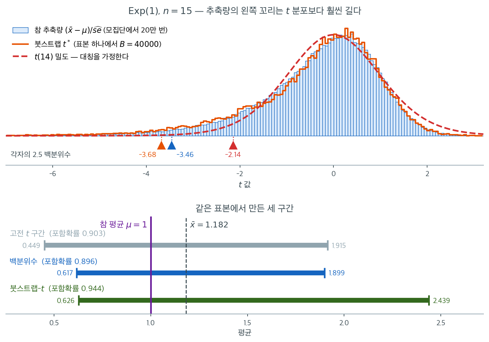

# 붓스트랩-t 방법

## 1. 동기

고전적인 $t$ 구간 $\hat{\theta} \pm t_{\alpha/2} \cdot \hat{\text{se}}$는 추축량 $(\hat{\theta} - \theta)/\hat{\text{se}}$가 알려진 분포(스튜던트 $t$ 또는 표준정규)를 따른다고 가정한다. **붓스트랩-$t$ 방법**(**스튜던트화 붓스트랩**이라고도 한다)은 붓스트랩으로 추축량 자체의 분포를 추정하여 이 가정을 피한다. 그 결과 **2차 정확도**를 갖는 신뢰구간을 얻는다. 포함확률의 정밀도는 BCa 방법과 맞먹지만, 변환 불변성은 갖지 않는다.

핵심 발상은 통계량 $\hat{\theta}$만이 아니라 분모를 포함한 $t$ 통계량 전체를 붓스트랩한다는 것이다.

---

## 2. 스튜던트화 붓스트랩 통계량

각 붓스트랩 표본에서 추정값과 그 추정 표준오차를 함께 계산한다.

$$
t^{*(b)} = \frac{\hat{\theta}^{*(b)} - \hat{\theta}}{\hat{\text{se}}^{*(b)}}
$$

여기서 $\hat{\theta}^{*(b)}$는 $b$번째 붓스트랩 표본에서 계산한 통계량이고, $\hat{\text{se}}^{*(b)}$는 **같은 붓스트랩 표본에서** 계산한 $\hat{\theta}$의 추정 표준오차이다.

$t^{*(b)}$는 추축량 $(\hat{\theta} - \theta)/\hat{\text{se}}$의 붓스트랩 판본이다. 붓스트랩 표본에 걸친 그 분포가 추축량의 참 분포를 근사한다.

---

## 3. 알고리즘

1. 원표본에서 관측 통계량 $\hat{\theta}$와 그 추정 표준오차 $\hat{\text{se}}$를 계산한다.
2. $b = 1, \ldots, B$에 대해:
    - 크기 $n$인 붓스트랩 표본을 복원추출한다.
    - 붓스트랩 표본에서 $\hat{\theta}^{*(b)}$를 계산한다.
    - 붓스트랩 표본에서 $\hat{\text{se}}^{*(b)}$를 계산한다(아래 참고).
    - $t^{*(b)} = (\hat{\theta}^{*(b)} - \hat{\theta}) / \hat{\text{se}}^{*(b)}$를 계산한다.
3. $\{t^{*(1)}, \ldots, t^{*(B)}\}$의 $q$번째 분위수를 $t^*_{(q)}$라 하자.
4. $100(1-\alpha)\%$ 붓스트랩-$t$ 신뢰구간은

$$
\left[\hat{\theta} - t^*_{(1-\alpha/2)} \cdot \hat{\text{se}}, \quad \hat{\theta} - t^*_{(\alpha/2)} \cdot \hat{\text{se}}\right]
$$

분위수가 뒤바뀐 것에 주목하라. $t^*$의 상위 분위수가 구간의 하한에 쓰이고 그 반대도 마찬가지이다. 이는 추축량 부등식 $t^*_{(\alpha/2)} \le (\hat{\theta} - \theta)/\hat{\text{se}} \le t^*_{(1-\alpha/2)}$을 $\theta$에 대해 풀면 나온다.

---

## 4. 내부 표준오차의 추정

붓스트랩-$t$에서 가장 결정적이고 계산이 무거운 부분은 각 붓스트랩 표본마다 $\hat{\text{se}}^{*(b)}$를 계산하는 일이다. 흔한 세 가지 접근이 있다.

**공식 기반.** $\hat{\text{se}}$의 닫힌 공식이 있으면(예: 평균의 $s/\sqrt{n}$) 각 붓스트랩 표본에 같은 공식을 적용한다. 빠르고 수치적으로 안정적이다.

**붓스트랩 안의 잭나이프.** 각 붓스트랩 표본에서 관측값을 하나씩 빼며 잭나이프 표준오차를 계산한다. 붓스트랩 복제마다 $n$번의 추가 계산이 필요하다.

**중첩 붓스트랩(이중 붓스트랩).** 각 붓스트랩 표본에서 $B_2$개의 2단계 재표본을 뽑아 $\hat{\text{se}}^{*(b)}$를 추정한다. 총 $B \times B_2$번의 계산이 들어 대개 감당하기 어렵다.

!!! tip "내부 표준오차에 대한 실무 권고"
    공식이 있으면 공식 기반 추정을 쓴다. 없으면 각 붓스트랩 표본 안에서 잭나이프를 쓴다. 중첩 붓스트랩은 실무에서 거의 필요 없고, $B \times B_2$의 계산비용이 정당화되는 경우가 드물다.

---

## 5. 2차 정확도를 달성하는 이유

붓스트랩-$t$ 구간의 포함확률 오차는 백분위수 구간의 $O(n^{-1/2})$에 비해 $O(n^{-1})$이다. 이유는 스튜던트화된 통계량 $t^* = (\hat{\theta}^* - \hat{\theta})/\hat{\text{se}}^*$이 $(\hat{\theta} - \theta)/\hat{\text{se}}$의 분포를 근사하는 정확도가, 스튜던트화하지 않은 $\hat{\theta}^* - \hat{\theta}$가 $\hat{\theta} - \theta$를 근사하는 정확도보다 한 차수 높기 때문이다.

스튜던트화는 분산이 일정하지 않은 데서 오는 선행 효과를 흡수한다. $\text{Var}(\hat{\theta})$가 $\theta$에 의존하면 스튜던트화하지 않은 붓스트랩 분포는 산포가 틀리는데, 스튜던트화 판본은 $\hat{\text{se}}^*$로 나누어 스스로를 보정한다.

!!! note "BCa와의 비교"
    BCa와 붓스트랩-$t$ 둘 다 2차 정확도를 달성한다. BCa 구간은 변환 불변이지만 가속을 위한 잭나이프 계산이 필요하다. 붓스트랩-$t$는 변환 불변이 아니지만 추축량을 직접 쓰므로 어떤 맥락에서는 더 자연스럽다. 모의실험 연구에서 매끄러운 통계량에 대해 두 방법의 포함확률은 대체로 비슷하다.

---

## 6. t* 분포는 무엇을 학습하는가

말로 하면 추상적이니, 추축량의 참 분포와 그것을 근사하는 두 후보를 한 자리에 놓고 보자.



위 칸의 파란 히스토그램은 $\text{Exp}(1)$ 모집단에서 $n = 15$를 **20만 번** 새로 뽑아 계산한 $T = (\bar{x} - \mu)/\widehat{\text{se}}$의 참 분포이다. 현실에서는 결코 그릴 수 없는 그림이며, 여기서는 정답지로만 쓴다. 이 분포는 왼쪽으로 심하게 치우쳐 있다. 붉은 파선인 $t(14)$ 밀도는 대칭이라 이 모양을 전혀 담지 못한다.

주황 계단이 **표본 하나에서** 얻은 붓스트랩 $t^*$이다. 놀라운 것은 그것이 20만 번 표집한 정답지를 거의 따라간다는 점이다. 축 아래 삼각형이 각자의 $2.5$ 백분위수로, 참값이 $-3.46$인데 $t^*$가 $-3.68$을 내놓았다. 반면 $t(14)$는 $-2.15$로 **왼쪽 꼬리의 길이를 절반 가까이 과소평가한다**. 스튜던트화를 하지 않고 $\hat\theta^* - \hat\theta$만 보면 자료의 척도가 그대로 남아 이만한 정확도가 나오지 않는다. $\widehat{\text{se}}^*$로 나누는 순간 척도가 빠지고 **모양만 남기 때문에** 표본 하나로도 참 분포의 꼬리를 배울 수 있다.

아래 칸이 그 차이가 구간에 미치는 영향이다. 세 구간 모두 같은 표본($\bar{x} = 1.182$)에서 나왔다. 고전 $t$ 구간 $[0.449,\ 1.915]$와 백분위수 구간 $[0.617,\ 1.899]$는 위쪽 한계가 $1.9$ 언저리인데, 붓스트랩-$t$는 상한을 $2.439$까지 늘린다. 분위수 반전 때문에 $t^*$의 **긴 왼쪽 꼬리가 구간의 오른쪽 끝**을 만들기 때문이다. $\bar{x}$가 참값을 아래로 크게 빗나가는 일이 흔하다면, 구간은 위쪽으로 길어야 그 경우를 덮는다. 연습문제 1의 포함확률 $0.944$ 대 $0.896$의 차이가 바로 이 길어진 오른쪽 끝에서 나온다.

<div class="exbox" markdown>

**보기 1.** <span class="diff easy" title="쉬움"></span> 평균의 붓스트랩-t 구간. $n = 20$인 표본에서 $\bar{x} = 7.3$, $s = 2.1$을 얻어 $\hat{\text{se}} = s/\sqrt{n} = 0.470$이라 하자.

**붓스트랩-$t$ 절차:**

1. $b = 1, \ldots, 10{,}000$에 대해 20개를 복원추출하여 $\bar{x}^{*(b)}$와 $s^{*(b)}/\sqrt{20}$을 계산한다.
2. $t^{*(b)} = (\bar{x}^{*(b)} - \bar{x}) / (s^{*(b)}/\sqrt{20})$을 계산한다.
3. $\{t^{*(b)}\}$의 2.5 백분위수와 97.5 백분위수가 $t^*_{(0.025)} = -2.18$, $t^*_{(0.975)} = 2.31$이라 하자.
4. 95% 붓스트랩-$t$ 구간은

</div>

??? success "풀이"
    $$
    [7.3 - 2.31 \times 0.470, \quad 7.3 - (-2.18) \times 0.470] = [6.21, \; 8.32]
    $$

    고전적 $t$ 구간 $7.3 \pm 2.093 \times 0.470 = [6.32, 8.28]$과 비교하라. 붓스트랩-$t$ 구간은 비대칭이며, 표집분포의 완만한 치우침을 반영한다.

---

## 7. 장점

- **2차 정확도**: 포함확률 오차가 $O(n^{-1})$이다.
- **추축량 기반 추론에 자연스럽다**: 고전적 $t$ 통계량 접근의 직접적 확장이다.
- **잭나이프가 필요 없다**($\hat{\text{se}}$의 공식이 있는 경우). BCa와 대비된다.

---

## 8. 한계

**계산비용.** 닫힌 공식이 없으면 붓스트랩 루프 안에서 $\hat{\text{se}}^{*(b)}$를 계산하는 것이 비쌀 수 있다.

**변환 불변이 아니다.** $\phi = m(\theta)$의 붓스트랩-$t$ 구간이 일반적으로 $[m(L), m(U)]$가 아니다. 변환 불변성이 중요하면 BCa가 낫다.

**꼬리가 불안정하다.** $\hat{\text{se}}^{*(b)}$가 이따금 매우 작으면(소표본에서 그렇다) $t^{*(b)}$가 극단적으로 커져 분위수 추정이 요동친다. 극단적인 $t^*$ 값을 윈저화하거나 절사하면 도움이 된다.

!!! warning "붓스트랩 표본의 표준오차가 작을 때"
    붓스트랩 표본이 우연히 변동이 매우 작으면(예: 같은 값이 많이 반복되면) $\hat{\text{se}}^{*(b)}$가 $0$에 가까워져 극단적인 $t^{*(b)}$가 나온다. 이 이상치가 구간 폭을 부풀린다. 실무에서는 극단적인 $t^*$를 감시하고 대응하는 일이 중요하다.

---

## 연습문제

<div class="drillbox" markdown>

**연습문제 1.** <span class="diff med" title="중간"></span>
붓스트랩-$t$가 정말로 백분위수법보다 나은지 확인하라. $\text{Exp}(1)$ 자료의 평균(참값 $=1$)에 대해 $n = 15, 30, 100$에서 포함확률과 구간 폭을 비교하라.

</div>

??? success "풀이"
    ```python
    import numpy as np
    rng = np.random.default_rng(2)

    for n in (15, 30, 100):
        M, B = 2000, 1000
        ct = cp = cn = 0
        wt, wp = [], []
        for _ in range(M):
            x = rng.exponential(1, n)
            th = x.mean(); se = x.std(ddof=1) / np.sqrt(n)
            idx = rng.integers(0, n, (B, n)); xb = x[idx]
            bs = xb.mean(axis=1)
            seb = xb.std(axis=1, ddof=1) / np.sqrt(n)
            t = (bs - th) / seb

            tl, tu = np.percentile(t, [2.5, 97.5])
            lo, hi = th - tu*se, th - tl*se
            ct += lo <= 1 <= hi; wt.append(hi - lo)

            lo2, hi2 = np.percentile(bs, [2.5, 97.5])
            cp += lo2 <= 1 <= hi2; wp.append(hi2 - lo2)

            cn += th - 1.96*se <= 1 <= th + 1.96*se
        print(n, round(ct/M, 3), round(cp/M, 3), round(cn/M, 3),
              round(np.mean(wt), 3), round(np.mean(wp), 3))
    ```

    출력:

    ```
    15 0.944 0.896 0.903 1.314 0.918
    30 0.953 0.924 0.926 0.799 0.673
    100 0.94 0.934 0.936 0.404 0.384
    ```

    | $n$ | 붓스트랩-$t$ | 백분위수 | 정규근사 | $t$ 구간 폭 | 백분위수 폭 |
    |---:|---:|---:|---:|---:|---:|
    | 15 | **0.944** | 0.896 | 0.903 | 1.314 | 0.918 |
    | 30 | **0.953** | 0.924 | 0.926 | 0.799 | 0.673 |
    | 100 | 0.940 | 0.934 | 0.936 | 0.404 | 0.384 |

    $n = 15$에서 붓스트랩-$t$가 $0.944$로 명목값에 거의 도달하는 반면 백분위수는 $0.896$에 그친다. **5%p 가까운 차이**이다.

    대가는 **더 넓은 구간**이다. $n = 15$에서 폭이 $1.314$ 대 $0.918$로 43% 넓다. 그러나 이것은 손해가 아니다. 백분위수 구간이 좁은 것은 참값을 자주 놓친다는 뜻이기 때문이다. 정직한 비교는 **같은 포함확률을 달성하는 데 필요한 폭**이다.

    $n = 100$이 되면 세 방법이 $0.934$--$0.940$으로 수렴하고 폭 차이도 5%로 줄어든다. 붓스트랩-$t$의 이득은 소표본에서 크다.

    **왜 지수분포에서 이렇게 차이가 나는가.** $\text{Exp}(1)$의 왜도가 $2$로 크다. $\bar{X}$의 표집분포가 오른쪽으로 치우쳐 있고, 결정적으로 $\bar{X}$와 $s$가 강한 양의 상관을 갖는다([16장](../../ch16/foundations/motivation.md) 연습문제 2 참조). 스튜던트화가 이 상관을 자동으로 흡수한다.

---

<div class="drillbox" markdown>

**연습문제 2.** <span class="diff med" title="중간"></span>
"꼬리가 불안정하다"는 한계를 실제로 보라. $n = 8$인 지수 자료에서 $t^*$ 분포가 어떻게 되는가?

</div>

??? success "풀이"
    ```python
    import numpy as np
    rng = np.random.default_rng(11)
    n = 8
    x = rng.exponential(1, n)
    th = x.mean(); se = x.std(ddof=1) / np.sqrt(n)

    B = 20000
    idx = rng.integers(0, n, (B, n)); xb = x[idx]
    bs = xb.mean(axis=1)
    seb = xb.std(axis=1, ddof=1) / np.sqrt(n)
    t = (bs - th) / seb

    print("최소 se*  :", round(seb.min(), 5))          # 0.01019
    print("최대 |t*| :", round(np.abs(t).max(), 1))     # 66.0
    print(np.round(np.percentile(t, [0.5, 2.5, 50, 97.5, 99.5]), 3))
    # [-30.537 -11.302  -0.089   1.502   2.054]
    ```

    출력:

    ```
    최소 se*  : 0.01019
    최대 |t*| : 66.0
    [-30.537 -11.302  -0.089   1.502   2.054]
    ```

    | 백분위수 | 0.5 | 2.5 | 50 | 97.5 | 99.5 |
    |---:|---:|---:|---:|---:|---:|
    | $t^*$ | $-30.54$ | $-11.30$ | $-0.09$ | $1.50$ | $2.05$ |

    $t^*$ 분포가 **극도로 비대칭**이다. 2.5 백분위수가 $-11.3$인데 97.5 백분위수는 $+1.50$이다. 정상적인 $t$ 분포라면 $\pm 2.4$ 정도여야 한다.

    결과적으로 신뢰구간이

    $$
    [\hat\theta - 1.50 \times \hat{\text{se}}, \; \hat\theta + 11.30 \times \hat{\text{se}}] = [0.086, \; 5.856]
    $$

    으로 폭이 $5.77$이다. 자료의 척도가 $1$ 정도인데 구간이 그 6배에 이른다.

    **왜 이런 일이 생기는가.** $n = 8$에서 붓스트랩 표본이 같은 값 몇 개로만 채워지는 일이 드물지 않다. 그러면 $s^*$가 $0$에 가까워지고 $t^*$가 폭발한다. 최소 $\hat{\text{se}}^* = 0.0102$이고 최대 $|t^*| = 66$이다.

    비대칭이 한쪽으로 쏠리는 것은 지수분포의 오른쪽 꼬리 때문이다. 큰 값이 붓스트랩 표본에서 빠지면 $\bar{x}^*$가 작아지는 **동시에** $s^*$도 작아져, 분자가 음수이고 분모가 작아 $t^*$가 크게 음수가 된다.

    **완화 방법.**

    ```python
    # 극단 1%를 절사한다
    m = np.abs(t) < np.percentile(np.abs(t), 99)
    tl, tu = np.percentile(t[m], [2.5, 97.5])
    print("절사 후 폭:", round((tu - tl) * se, 4))   # 5.4318 (원래 5.7699)
    ```

    출력:

    ```
    절사 후 폭: 5.4318
    ```

    절사가 도움이 되지만 $5.77 \to 5.43$으로 6% 줄이는 데 그친다. 근본 문제는 $n = 8$이 붓스트랩-$t$에 너무 작다는 것이다.

    **권고:** $n < 15$ 정도에서는 붓스트랩-$t$를 피하거나, 표준오차의 안정적인 공식이 있는 통계량에만 쓴다. 평균처럼 $s/\sqrt{n}$을 쓰는 경우에도 $n$이 작으면 $s^*$의 변동이 문제가 된다.

---

<div class="drillbox" markdown>

**연습문제 3.** <span class="diff med" title="중간"></span>
스튜던트화를 하지 않으면 무엇을 잃는가? 같은 붓스트랩 복제값에서 $(\hat\theta^* - \hat\theta)$의 분위수만 쓰는 기본 구간과 붓스트랩-$t$를 비교하라.

</div>

??? success "풀이"
    두 구간의 차이는 **분모의 유무**뿐이다.

    | 방법 | 사용하는 붓스트랩 양 | 구간 |
    |:---|:---|:---|
    | 기본 (추축) | $\hat\theta^* - \hat\theta$ | $[2\hat\theta - \hat\theta^*_{(1-\alpha/2)}, \; 2\hat\theta - \hat\theta^*_{(\alpha/2)}]$ |
    | 붓스트랩-$t$ | $(\hat\theta^* - \hat\theta)/\hat{\text{se}}^*$ | $[\hat\theta - t^*_{(1-\alpha/2)}\hat{\text{se}}, \; \hat\theta - t^*_{(\alpha/2)}\hat{\text{se}}]$ |

    ```python
    import numpy as np
    rng = np.random.default_rng(2)
    for n in (15, 30, 100):
        M, B = 2000, 1000
        ct = cb = 0
        for _ in range(M):
            x = rng.exponential(1, n)
            th = x.mean(); se = x.std(ddof=1) / np.sqrt(n)
            idx = rng.integers(0, n, (B, n)); xb = x[idx]
            bs = xb.mean(axis=1)
            seb = xb.std(axis=1, ddof=1) / np.sqrt(n)
            t = (bs - th) / seb
            tl, tu = np.percentile(t, [2.5, 97.5])
            ct += th - tu*se <= 1 <= th - tl*se
            lo, hi = np.percentile(bs, [2.5, 97.5])
            cb += 2*th - hi <= 1 <= 2*th - lo
        print(n, round(ct/M, 3), round(cb/M, 3))
    ```

    출력:

    ```
    15 0.944 0.878
    30 0.953 0.906
    100 0.94 0.927
    ```

    | $n$ | 붓스트랩-$t$ | 기본 (추축) |
    |---:|---:|---:|
    | 15 | 0.944 | 0.878 |
    | 30 | 0.953 | 0.906 |
    | 100 | 0.940 | 0.927 |

    스튜던트화 하나로 $n = 15$에서 포함확률이 $0.878 \to 0.944$로 6.6%p 개선된다.

    **무엇이 개선되는가.** $\hat{\theta}^* - \hat{\theta}$의 분포는 $\hat{\text{se}}$가 얼마나 큰지에 따라 산포가 달라진다. 우연히 $s$가 큰 표본을 얻으면 붓스트랩 분포도 넓어지고, 그 넓은 분포를 그대로 구간에 쓰면 폭이 자료에 따라 요동친다.

    $\hat{\text{se}}^*$로 나누면 이 요동이 제거된다. $t^*$는 척도에 대해 (근사적으로) 불변이므로 **자료마다 다른 척도를 자동으로 표준화**한다. 이것이 "스튜던트화가 추축성을 개선한다"는 말의 구체적 의미이다.

    **비유.** 고전적 통계학에서 $\sigma$를 알면 $z = (\bar X - \mu)/(\sigma/\sqrt n)$을 쓰고, 모르면 $t = (\bar X - \mu)/(s/\sqrt n)$을 쓴다. $t$ 분포가 $z$보다 꼬리가 두꺼운 것은 $s$의 변동을 반영하기 때문이다. 붓스트랩-$t$는 이 논리를 비모수 상황으로 옮긴 것이며, $t^*$ 분포가 그 두꺼운 꼬리를 자료에서 직접 학습한다.

---

<div class="drillbox" markdown>

**연습문제 4.** <span class="diff hard" title="어려움"></span>
붓스트랩-$t$ 구간의 분위수 반전이 왜 일어나는지 추축량 부등식에서 유도하라.

</div>

??? success "풀이"
    추축량 $T = (\hat{\theta} - \theta)/\hat{\text{se}}$의 분포를 안다고 하자. $T$의 $q$번째 분위수를 $t_q$라 하면 정의에 의해

    $$
    P\!\left(t_{\alpha/2} \le \frac{\hat{\theta} - \theta}{\hat{\text{se}}} \le t_{1-\alpha/2}\right) = 1 - \alpha
    $$

    이다. $\hat{\text{se}} > 0$을 곱하면

    $$
    t_{\alpha/2}\,\hat{\text{se}} \le \hat{\theta} - \theta \le t_{1-\alpha/2}\,\hat{\text{se}}
    $$

    이다. 각 항에서 $\hat\theta$를 빼고 $-1$을 곱하면 **부등호의 방향이 뒤집힌다**.

    $$
    -t_{1-\alpha/2}\,\hat{\text{se}} \le \theta - \hat{\theta} \le -t_{\alpha/2}\,\hat{\text{se}}
    $$

    $$
    \hat{\theta} - t_{1-\alpha/2}\,\hat{\text{se}} \le \theta \le \hat{\theta} - t_{\alpha/2}\,\hat{\text{se}}
    $$

    따라서 신뢰구간은 $\left[\hat{\theta} - t_{1-\alpha/2}\hat{\text{se}}, \; \hat{\theta} - t_{\alpha/2}\hat{\text{se}}\right]$이고, $T$의 **상위** 분위수가 구간의 **하한**을 만든다. $\square$

    **$t_q$를 붓스트랩으로 추정한다.** 붓스트랩 원리에 따라 $T$의 분포를 $T^* = (\hat{\theta}^* - \hat{\theta})/\hat{\text{se}}^*$의 분포로 근사하므로 $t_q \approx t^*_{(q)}$이다.

    !!! note "고전적 $t$ 구간에서 반전이 보이지 않는 이유"
        고전적 $t$ 구간에서도 같은 반전이 일어나지만 **$t$ 분포가 대칭이라 눈에 띄지 않는다**. $t_{1-\alpha/2} = -t_{\alpha/2}$이므로

        $$
        [\hat\theta - t_{1-\alpha/2}\hat{\text{se}}, \; \hat\theta - t_{\alpha/2}\hat{\text{se}}]
        = [\hat\theta - t_{1-\alpha/2}\hat{\text{se}}, \; \hat\theta + t_{1-\alpha/2}\hat{\text{se}}]
        $$

        이 되어 익숙한 $\hat\theta \pm t\,\hat{\text{se}}$ 형태가 된다. 붓스트랩-$t$에서는 $t^*$의 분포가 비대칭이라 반전이 실제 효과를 낸다.

---

<div class="drillbox" markdown>

**연습문제 5.** <span class="diff hard" title="어려움"></span>
6절의 그림에 적힌 수만으로 그 표본을 되짚을 수 있다. $n = 15$, $\bar{x} = 1.182$, 고전 $t$ 구간 $[0.449,\ 1.915]$, 백분위수 구간 $[0.617,\ 1.899]$, 그리고 붓스트랩-$t$ 구간의 상한 $2.439$가 주어졌다. $t_{0.975,\,14} = 2.1448$을 쓴다.

(가) 고전 $t$ 구간에서 $\hat{\text{se}}$를 복원하라. 구간의 중심이 $\bar{x}$와 맞는지도 확인하라.

(나) 붓스트랩-$t$ 구간의 상한에서 $t^*_{(0.025)}$를 복원하여 본문이 말한 $-3.68$과 맞는지 보라.

(다) 같은 붓스트랩 복제값에서 **기본(역백분위) 구간** $[2\hat\theta - \hat\theta^*_{(1-\alpha/2)},\ 2\hat\theta - \hat\theta^*_{(\alpha/2)}]$을 구하라. 백분위수 구간이 주어졌으므로 추가 재표집 없이 나온다.

(라) 참 추축량의 $2.5$ 백분위수가 $-3.46$이므로 "정답지" 상한은 $\bar{x} + 3.46\,\hat{\text{se}}$이다. 네 방법의 상한을 크기순으로 늘어놓고 어느 것이 가장 크게 빗나가는지, 그 차례가 연습문제 3의 포함확률 차례와 맞는지 말하라.

</div>

??? success "풀이"
    **(가)** 구간의 중심은 $(0.449 + 1.915)/2 = 1.182$로 $\bar{x}$와 정확히 맞는다(고전 구간은 대칭이므로 당연하다). 반폭은 $(1.915 - 0.449)/2 = 0.733$이고 이것이 $t_{0.975,14}\,\hat{\text{se}}$이므로

    $$
    \hat{\text{se}} = \frac{0.733}{2.1448} = 0.3418
    $$

    이다. $n = 15$이니 $s = \sqrt{15} \times 0.3418 = 1.324$인 표본이다. $\text{Exp}(1)$에서 $\bar{x} = 1.182$, $s = 1.324$이면 둘이 비슷한 크기로, 지수분포답다($\sigma = \mu = 1$).

    **(나)** 상한의 정의 $U = \hat\theta - t^*_{(0.025)}\hat{\text{se}}$를 $t^*_{(0.025)}$에 대해 풀면

    $$
    t^*_{(0.025)} = \frac{\bar{x} - U}{\hat{\text{se}}} = \frac{1.182 - 2.439}{0.3418} = -3.678
    $$

    이다. 본문이 말한 $-3.68$과 맞는다. 세 자리까지 복원되는 것은 $\hat{\text{se}}$가 (가)에서 정확히 나왔기 때문이다.

    **(다)** 백분위수 구간이 $[\hat\theta^*_{(0.025)},\ \hat\theta^*_{(0.975)}] = [0.617,\ 1.899]$라는 뜻이므로 기본 구간은

    $$
    [2(1.182) - 1.899, \;\; 2(1.182) - 0.617] = [0.465, \; 1.747]
    $$

    이다.

    **(라)** 정답지 상한은 $1.182 + 3.46 \times 0.3418 = 2.364$이다.

    | 방법 | 상한 | 정답지와의 차 |
    |:---|---:|---:|
    | 기본 (역백분위) | $1.747$ | $-26.1\%$ |
    | 백분위수 | $1.899$ | $-19.7\%$ |
    | 고전 $t$ | $1.915$ | $-19.0\%$ |
    | **정답지** | $2.364$ | — |
    | 붓스트랩-$t$ | $2.439$ | $+3.2\%$ |

    가장 크게 빗나가는 것은 **기본 구간**이다. 왜 그런지는 치우침의 방향을 보면 알 수 있다. 중심 $1.182$에서 백분위수 구간은 위로 $0.717$, 아래로 $0.565$로 **오른쪽이 길다**($\bar{x}^*$의 붓스트랩 분포가 지수 자료답게 오른쪽으로 치우쳐 있다). 기본 구간은 $2\hat\theta$에서 이것을 빼므로 치우침이 **거울상으로 뒤집혀** 위로 $0.565$, 아래로 $0.717$이 된다. 그런데 정답지가 요구하는 것은 **긴 오른쪽**이므로, 기본 구간은 필요한 방향과 정반대로 벌어진다.

    차례도 연습문제 3과 맞는다. 거기서 포함확률이 $n = 15$에서 기본 $0.878$ < 백분위수 $0.896$ < 붓스트랩-$t$ $0.944$였고, 여기서 상한이 정답지에 가까워지는 차례가 그대로 같다. 한 표본에서 본 상한의 어긋남이 2000번 반복한 포함확률의 차이를 미리 설명한다.

    고전 $t$ 구간과 백분위수 구간의 상한이 $1.915$와 $1.899$로 거의 같은 것도 눈여겨볼 만하다. 둘은 전혀 다른 논리로 만든 구간인데, $n = 15$에서 **둘 다 같은 이유로 틀린다** — 왼쪽 꼬리의 길이를 담지 못한다.

---

<div class="drillbox" markdown>

**연습문제 6.** <span class="diff hard" title="어려움"></span>
8절은 붓스트랩-$t$가 변환 불변이 아니라고 했다. 어디까지는 불변이고 어디서 깨지는지 정확히 가려라. 자료 $x_1, \ldots, x_n$, $\hat\theta = \bar{x}$, $\hat{\text{se}} = s/\sqrt{n}$으로 본다.

(가) $y_i = a + c\,x_i$($c > 0$)로 바꾼다. **같은 지표 집합**으로 뽑은 재표본에서 $t^*_y = t^*_x$임을 보이고, 따라서 $y$의 붓스트랩-$t$ 구간이 $[a + cL,\ a + cU]$임을 보여라.

(나) $c < 0$이면 무엇이 달라지는가. 구간은 여전히 정확히 옮겨가는가.

(다) 이제 $\phi = \log\theta$로 바꾼다. 델타방법으로 $\hat{\text{se}}_\phi = s/(\sqrt{n}\,\bar{x})$를 쓴다(붓스트랩 표본에서도 같은 공식을 쓴다). $u = \bar{x}^*/\bar{x}$라 할 때

$$
t^*_\phi = t^* \cdot g(u)
$$

를 만족하는 $g$를 구하라.

(라) $g$가 상수가 아니라는 사실이 왜 "두 구간이 서로 옮겨가지 않는다"로 이어지는가. 두 재표본의 **순위가 뒤바뀌는** 구체적인 수치 보기를 들어라.

(마) 백분위수 구간은 왜 증가변환에 대해 **정확히** 불변인가. 붓스트랩-$t$와 무엇이 다른가.

</div>

??? success "풀이"
    **(가)** $\bar{y} = a + c\bar{x}$이고 $c > 0$이므로 $s_y = c\,s_x$, 따라서 $\hat{\text{se}}_y = c\,\hat{\text{se}}_x$이다. 지표 집합 $I = (i_1, \ldots, i_n)$로 뽑은 재표본에서도 똑같이 $\bar{y}^*_I = a + c\,\bar{x}^*_I$, $\hat{\text{se}}^*_{y,I} = c\,\hat{\text{se}}^*_{x,I}$이다. 그러므로

    $$
    t^*_{y,I} = \frac{(a + c\bar{x}^*_I) - (a + c\bar{x})}{c\,\hat{\text{se}}^*_{x,I}} = \frac{c(\bar{x}^*_I - \bar{x})}{c\,\hat{\text{se}}^*_{x,I}} = t^*_{x,I}
    $$

    이다. **모든** 재표본에서 값이 같으니 $t^*$의 분포가 같고 분위수도 같다. 그러면

    $$
    \bar{y} - t^*_{(1-\alpha/2)}\hat{\text{se}}_y = (a + c\bar{x}) - t^*_{(1-\alpha/2)}\,c\,\hat{\text{se}}_x = a + c\left(\bar{x} - t^*_{(1-\alpha/2)}\hat{\text{se}}_x\right) = a + cL
    $$

    이고 상한도 같은 꼴이다. 즉 붓스트랩-$t$는 **증가 아핀변환에 대해 정확히 동변(equivariant)**이다. $\square$

    **(나)** $c < 0$이면 $s_y = \lvert c \rvert s_x = -c\,s_x$이므로 $\hat{\text{se}}_y = -c\,\hat{\text{se}}_x > 0$이고

    $$
    t^*_{y,I} = \frac{c(\bar{x}^*_I - \bar{x})}{-c\,\hat{\text{se}}^*_{x,I}} = -t^*_{x,I}
    $$

    이다. 부호가 뒤집히므로 분위수가 맞교환된다: $t^*_{y,(q)} = -t^*_{x,(1-q)}$. 하한을 계산하면

    $$
    L_y = \bar{y} - t^*_{y,(0.975)}\hat{\text{se}}_y = (a + c\bar{x}) - \left(-t^*_{x,(0.025)}\right)\left(-c\,\hat{\text{se}}_x\right) = a + c\left(\bar{x} - t^*_{x,(0.025)}\hat{\text{se}}_x\right) = a + cU_x
    $$

    이고 같은 식으로 $U_y = a + cL_x$이다. $c < 0$이니 $a + cU_x < a + cL_x$로 순서도 맞다. 구간은 여전히 **정확히** 옮겨가며 양 끝만 자리를 바꾼다. 따라서 모든 $c \ne 0$에 대해 아핀 동변성이 성립한다. 눈금을 바꾸거나 부호를 바꾸는 것은 붓스트랩-$t$를 흔들지 못한다.

    **(다)** 정의대로 쓴다.

    $$
    t^*_\phi = \frac{\log\bar{x}^* - \log\bar{x}}{s^*/(\sqrt{n}\,\bar{x}^*)} = \frac{\sqrt{n}\,\bar{x}^*\log u}{s^*}, \qquad t^* = \frac{\sqrt{n}\,(\bar{x}^* - \bar{x})}{s^*}
    $$

    두 식을 나누면 $s^*$와 $\sqrt{n}$이 지워진다.

    $$
    \frac{t^*_\phi}{t^*} = \frac{\bar{x}^*\log u}{\bar{x}^* - \bar{x}} = \frac{\bar{x}\,u\log u}{\bar{x}\,(u - 1)} = \frac{u\log u}{u - 1}
    $$

    그러므로

    $$
    g(u) = \frac{u\log u}{u - 1}, \qquad g(1) := 1 \;\text{(연속으로 이어 붙인다)}
    $$

    이다. $g$는 증가함수이고 $g(u) < 1$($u < 1$), $g(u) > 1$($u > 1$)이다. 예컨대 $g(0.1) = 0.2559$, $g(0.5) = \log 2 = 0.6931$, $g(2) = 2\log 2 = 1.3863$이다.

    **(라)** $g$가 상수라면 $t^*_\phi$는 $t^*$의 단조증가 함수이므로 순위가 보존되고, 분위수도 그대로 대응되어 구간이 옮겨갈 것이다. 그런데 $g$는 $u$에 따라 달라지고 $u$는 $t^*$만으로 정해지지 않는다. 같은 $t^*$라도 $(\bar{x}^*, s^*)$ 조합이 다르면 $u$가 다르다. 두 재표본을 잡아 보자($\bar{x} > 0$, 척도는 상관없다).

    | 재표본 | $t^*$ | $u$ | $g(u)$ | $t^*_\phi$ |
    |:---:|---:|---:|---:|---:|
    | A | $-2.0$ | $0.5$ | $0.6931$ | $-1.3863$ |
    | B | $-1.8$ | $0.9$ | $0.9482$ | $-1.7068$ |

    $t^*$로 보면 $A < B$인데($-2.0 < -1.8$) $t^*_\phi$로 보면 $A > B$이다($-1.3863 > -1.7068$). **순위가 뒤집혔다.** 분위수는 순위만 보고 정해지므로, $t^*$의 $2.5$ 백분위수를 주는 재표본과 $t^*_\phi$의 $2.5$ 백분위수를 주는 재표본이 서로 다를 수 있다. 그러면 $t^*_{\phi,(0.025)}$를 $t^*_{(0.025)}$로부터 계산하는 어떤 대응도 존재하지 않고, $\log$ 척도에서 만든 구간을 $\exp$로 되돌린 것이 원래 구간과 일치하지 않는다.

    방향까지 말할 수 있다. $g < 1$($u < 1$)이므로 $\log$ 척도는 $t^*$의 **왼쪽 꼬리를 줄이고** 오른쪽 꼬리를 늘린다. 6절에서 보았듯이 구간의 상한을 만드는 것이 왼쪽 꼬리이므로, $\log$ 척도를 거치면 상한 쪽 정보가 압축된 상태로 전달된다.

    **(마)** 백분위수 구간은 $\hat\theta^*$의 분위수만 쓴다. $m$이 증가함수면 $m(\hat\theta^{*(1)}), \ldots, m(\hat\theta^{*(B)})$의 순위가 $\hat\theta^{*(1)}, \ldots, \hat\theta^{*(B)}$의 순위와 같으므로 $q$번째 순서통계량이 $q$번째 순서통계량의 상으로 옮겨간다. 즉

    $$
    \left[m\!\left(\hat\theta^*_{(\alpha/2)}\right), \; m\!\left(\hat\theta^*_{(1-\alpha/2)}\right)\right]
    $$

    가 정확히 $\phi$의 백분위수 구간이다. 추가 가정도 근사도 없다.

    붓스트랩-$t$가 이것을 못 하는 이유는 **분모 때문**이다. $t^*$는 $\hat\theta^*$만의 함수가 아니라 $(\hat\theta^*, \hat{\text{se}}^*)$의 함수이고, 변환은 분자와 분모를 서로 다른 비율로 늘린다(분자는 $\log$의 차, 분모는 델타방법의 $1/\bar{x}^*$배). 아핀변환에서는 그 두 비율이 똑같이 $c$라서 상쇄되지만, 비선형 변환에서는 상쇄되지 않는다. 8절 "변환 불변이 아니다"의 정확한 내용이 이것이다.

---

<div class="drillbox" markdown>

**연습문제 7.** <span class="diff hard" title="어려움"></span>
붓스트랩의 "이상적인" 분포는 $n^n$개 재표본을 모두 같은 확률 $n^{-n}$로 뽑는 것이다. $n$이 작으면 이것을 **전부 열거**할 수 있어 몬테카를로 오차 없이 정확한 답을 얻는다. $x = (1, 2, 6)$으로 $3^3 = 27$개를 모두 열거하라.

(가) $s^* = 0$이 되는 재표본은 몇 개이고 그 비율은 얼마인가. 일반 $n$에서 그 비율을 $n$의 식으로 쓰라.

(나) 그런 재표본의 $t^*$는 얼마인가. $t^* = -\infty$인 것과 $+\infty$인 것의 비율을 각각 구하라.

(다) 정확한 95% 붓스트랩-$t$ 구간을 구하라. 90% 구간은 어떻게 되는가 — 왜 둘의 모양이 다른가.

(라) $x = (1, 2, 6, 11)$로 $4^4 = 256$개를 열거하여 다시 하라. 무엇이 바뀌고 무엇이 안 바뀌는가.

(마) $n = 8$에서 $s^* = 0$이 될 확률은 얼마인가. $B = 20{,}000$이면 그런 재표본을 한 번이라도 볼 확률은? 그렇다면 연습문제 2의 $\lvert t^* \rvert = 66$은 어디서 왔는가.

</div>

??? success "풀이"
    ```python
    import itertools
    import numpy as np

    def exact_t_star(x):
        """모든 n^n 개 붓스트랩 재표본을 열거하여 t* 를 전부 돌려준다."""
        x = np.asarray(x, float); n = len(x)
        th = x.mean()
        allr = np.array(list(itertools.product(x, repeat=n)))      # (n^n, n)
        seb = allr.std(axis=1, ddof=1) / np.sqrt(n)
        with np.errstate(divide="ignore"):
            return (allr.mean(axis=1) - th) / seb

    def quant(v, p):
        """역분포함수 정의의 p 분위수 — inf 가 섞여 있어도 안전하다."""
        s = np.sort(v)
        return s[max(int(np.ceil(p * len(s))) - 1, 0)]

    for x in ([1.0, 2.0, 6.0], [1.0, 2.0, 6.0, 11.0]):
        n = len(x)
        th = float(np.mean(x)); se = float(np.std(x, ddof=1)) / np.sqrt(n)
        t = exact_t_star(x)
        print(f"x = {x}   n^n = {len(t)}   theta_hat = {th:.4f}  se_hat = {se:.4f}")
        print(f"  s*=0 인 재표본 {np.sum(~np.isfinite(t))}개 "
              f"= {np.mean(~np.isfinite(t)):.6f}"
              f"   (t*=-inf {np.mean(t == -np.inf):.6f}, "
              f"t*=+inf {np.mean(t == np.inf):.6f})")
        for lv, lo_p, hi_p in ((95, 0.025, 0.975), (90, 0.05, 0.95)):
            tl, hi = quant(t, lo_p), quant(t, hi_p)
            print(f"  {lv}%: t*_({lo_p})={tl:.4f}  t*_({hi_p})={hi:.4f}"
                  f"   구간 = [{th - hi*se:.4f}, {th - tl*se:.4f}]")
    ```

    출력:

    ```text
    x = [1.0, 2.0, 6.0]   n^n = 27   theta_hat = 3.0000  se_hat = 1.5275
      s*=0 인 재표본 3개 = 0.111111   (t*=-inf 0.074074, t*=+inf 0.037037)
      95%: t*_(0.025)=-inf  t*_(0.975)=inf   구간 = [-inf, inf]
      90%: t*_(0.05)=-inf  t*_(0.95)=1.2500   구간 = [1.0906, inf]
    x = [1.0, 2.0, 6.0, 11.0]   n^n = 256   theta_hat = 5.0000  se_hat = 2.2730
      s*=0 인 재표본 4개 = 0.015625   (t*=-inf 0.007812, t*=+inf 0.007812)
      95%: t*_(0.025)=-13.0000  t*_(0.975)=2.4249   구간 = [-0.5118, 34.5494]
      90%: t*_(0.05)=-12.1244  t*_(0.95)=1.8000   구간 = [0.9085, 32.5590]
    ```

    **(가)** $s^* = 0$이려면 재표본의 $n$개 값이 모두 같아야 하고, 그런 재표본은 $(x_i, x_i, \ldots, x_i)$ 꼴로 정확히 $n$개다. 비율은

    $$
    \frac{n}{n^n} = n^{1-n}
    $$

    이다. $n = 3$에서 $3^{-2} = 1/9 = 0.1111$이고 출력과 맞는다.

    **(나)** $\bar{x} = 3$이고 상수 재표본의 평균은 $1, 2, 6$이다. 분자 $\bar{x}^* - \bar{x}$가 각각 $-2, -1, +3$으로 $0$이 아니고 분모가 $0$이므로 $t^* = -\infty, -\infty, +\infty$이다. 비율은 $2/27 = 0.0741$과 $1/27 = 0.0370$이다. 결정적인 것은 **둘 다 $0.025$보다 크다**는 점이다.

    **(다)** $t^*$의 $2.5$ 백분위수를 찾으려면 작은 쪽에서 $2.5\%$ 자리를 보는데, 가장 작은 쪽 $7.41\%$가 이미 $-\infty$이므로

    $$
    t^*_{(0.025)} = -\infty, \qquad t^*_{(0.975)} = +\infty
    $$

    이다. 분위수 반전 때문에 상한은 $\hat\theta - t^*_{(0.025)}\hat{\text{se}} = +\infty$, 하한은 $\hat\theta - t^*_{(0.975)}\hat{\text{se}} = -\infty$가 되어 95% 구간이 $(-\infty, \infty)$다. **아무 말도 하지 않는 구간**이며, 이것이 근사가 아니라 이상적 붓스트랩-$t$의 정확한 답이다.

    90%에서는 모양이 달라진다. $-\infty$의 비율 $7.41\%$는 $5\%$보다 크지만 $+\infty$의 비율 $3.70\%$는 $5\%$보다 **작다**. 그래서 $t^*_{(0.05)} = -\infty$이지만 $t^*_{(0.95)} = 1.25$는 유한하고, 구간이 $[1.0906, \infty)$가 된다. 한쪽만 무한한 반쪽 구간이다. 비대칭의 원인은 $\bar{x} = 3$ 아래에 자료점이 둘($1, 2$), 위에 하나($6$)뿐이라는 것뿐이다. 신뢰수준을 조금 낮추는 것만으로 구간의 성질이 질적으로 바뀐다.

    **(라)** $n = 4$에서 상수 재표본의 비율이 $4^{-3} = 1/64 = 0.0156$으로 떨어지고, $x = (1,2,6,11)$은 평균 $5$의 양쪽에 각각 두 점이 있어 $-\infty$와 $+\infty$가 각각 $2/256 = 0.0078$이다. 둘 다 $0.025$보다 **작으므로** 95% 분위수가 유한해지고 구간이 $[-0.5118,\ 34.5494]$로 유한해진다. 무한에서 유한으로 넘어가는 문턱이 $n = 3$과 $n = 4$ 사이에 있다.

    바뀌지 않는 것은 **쓸모없음**이다. 폭이 $35.06$으로 자료의 범위($1$에서 $11$)보다 세 배 넓다. $t^*_{(0.025)} = -13$은 재표본 $(1,2,2,2)$에서 정확히 나온다: 평균 $1.75$, $s^* = 0.5$, $\hat{\text{se}}^* = 0.25$이므로 $t^* = (1.75 - 5)/0.25 = -13$이다. 무한은 사라졌지만 **분모가 아주 작은** 재표본이 남아 꼬리를 만든다.

    **(마)** $n = 8$에서 $8^{-7} = 4.768 \times 10^{-7}$이다. $B = 20{,}000$이면 한 번이라도 볼 확률은

    $$
    1 - (1 - 8^{-7})^{20000} \approx 20000 \times 4.768 \times 10^{-7} = 0.0095
    $$

    로 1%도 안 된다. 그러므로 연습문제 2에서 본 $\lvert t^* \rvert = 66$은 $s^* = 0$에서 온 것이 **아니다**. 거기서 보고된 최소 $\hat{\text{se}}^* = 0.01019$는 $0$이 아니다. 무한의 원자는 $n$이 조금만 커져도 사실상 사라지지만 그 자리를 **$s^*$가 $0$에 가까운 연속적인 재표본들**이 메운다. $n = 3$의 $(-\infty, \infty)$는 그 병의 극단적인 판본일 뿐이고, 병 자체는 $n = 8$에서도 $n = 4$에서도 같다. 작은 $n$에서 붓스트랩-$t$의 꼬리가 불안정한 근본 이유가 여기서 **정확하게** 보인다.

---

<div class="drillbox" markdown>

**연습문제 8.** <span class="diff hard" title="어려움"></span>
연습문제 1은 두쪽 포함확률만 보았다. 그러나 두쪽 포함확률은 양쪽 오차가 서로 **상쇄**되어 실제보다 좋아 보일 수 있다. 명목 $2.5\%$여야 하는 두 비포함확률

$$
P(\theta < L) \quad \text{와} \quad P(\theta > U)
$$

를 따로 재라. $\text{Exp}(1)$ 평균, $n = 15, 30, 100$, $M = 20{,}000$번 반복, $B = 1000$으로 붓스트랩-$t$·백분위수·정규근사를 비교하라.

(가) 백분위수법과 정규근사의 두 꼬리는 어떻게 어긋나는가. 상쇄가 실제로 일어나는가.

(나) 어느 방법이 $2.5\% / 2.5\%$로 수렴하는가.

(다) 단측 신뢰한계(상한만 또는 하한만)를 보고할 때 백분위수법의 오차는 몇 배인가. 두쪽 구간에서 본 오차와 비교하라.

</div>

??? success "풀이"
    ```python
    import numpy as np
    rng = np.random.default_rng(17)

    for n in (15, 30, 100):
        M, B = 20000, 1000
        L = np.zeros(3); R = np.zeros(3)          # 왼쪽/오른쪽 비포함 횟수
        ch = 2_000_000 // (B * n)                 # 메모리에 맞춘 묶음 크기
        for st in range(0, M, ch):
            m = min(ch, M - st)
            x = rng.exponential(1, (m, n))
            th = x.mean(1); se = x.std(1, ddof=1) / np.sqrt(n)
            idx = rng.integers(0, n, (m, B, n))
            xb = np.take_along_axis(x[:, None, :], idx, axis=2)
            bs = xb.mean(2)
            seb = xb.std(2, ddof=1) / np.sqrt(n)
            t = (bs - th[:, None]) / seb

            tl, tu = np.percentile(t, [2.5, 97.5], axis=1)
            lo = [th - tu * se]; hi = [th - tl * se]              # 붓스트랩-t
            pl, pu = np.percentile(bs, [2.5, 97.5], axis=1)
            lo.append(pl); hi.append(pu)                          # 백분위수
            lo.append(th - 1.96 * se); hi.append(th + 1.96 * se)  # 정규근사
            for k in range(3):
                L[k] += np.sum(lo[k] > 1)      # 참값이 구간 아래
                R[k] += np.sum(hi[k] < 1)      # 참값이 구간 위
        for k, nm in enumerate(("붓스트랩-t  ", "백분위수    ", "정규근사    ")):
            print(f"n={n:3d} {nm} 왼쪽 {L[k]/M:.4f}  오른쪽 {R[k]/M:.4f}  "
                  f"포함 {1-(L[k]+R[k])/M:.4f}")
    ```

    출력:

    ```text
    n= 15 붓스트랩-t   왼쪽 0.0147  오른쪽 0.0418  포함 0.9435
    n= 15 백분위수     왼쪽 0.0180  오른쪽 0.0927  포함 0.8892
    n= 15 정규근사     왼쪽 0.0095  오른쪽 0.0951  포함 0.8954
    n= 30 붓스트랩-t   왼쪽 0.0191  오른쪽 0.0345  포함 0.9465
    n= 30 백분위수     왼쪽 0.0163  오른쪽 0.0681  포함 0.9156
    n= 30 정규근사     왼쪽 0.0096  오른쪽 0.0736  포함 0.9168
    n=100 붓스트랩-t   왼쪽 0.0245  오른쪽 0.0286  포함 0.9468
    n=100 백분위수     왼쪽 0.0184  오른쪽 0.0435  포함 0.9381
    n=100 정규근사     왼쪽 0.0140  오른쪽 0.0471  포함 0.9389
    ```

    $M = 20{,}000$이므로 $0.025$ 근처 비율의 몬테카를로 표준오차는 $\sqrt{0.025 \times 0.975/20000} = 0.0011$이고 $0.09$ 근처에서는 $0.0020$이다. 아래의 차이들은 모두 그보다 훨씬 크다.

    **(가)** 백분위수법의 두 꼬리가 $n = 15$에서 $0.0180$과 $0.0927$로 **5배 이상** 어긋난다. 왼쪽은 명목보다 작고($-0.0070$) 오른쪽은 훨씬 크다($+0.0677$). 상쇄가 실제로 일어난다. 두 오차를 따로 더하면 $0.0070 + 0.0677 = 0.0747$인데, 부호가 반대라 합에서는 $0.0677 - 0.0070 = 0.0607$만 드러난다. 즉 두쪽 포함확률 $0.8892$는 **실제 어긋남의 81%만 보여 준다**. 정규근사는 더 심하게 치우쳐 $0.0095$ 대 $0.0951$로 10배 차이다.

    어긋남의 방향은 6절의 그림이 설명한다. 두 방법 모두 상한이 짧아서 참값이 구간 **위로** 빠져나가는 일이 잦다. 그러려면 $\bar{x}$가 $\mu$를 아래로 크게 빗나가야 하는데, 지수 자료에서는 그런 표본이 $s$도 작아 구간이 좁아지므로 더 자주 놓친다.

    **(나)** 붓스트랩-$t$만이 $2.5/2.5$로 다가간다. $n = 15$의 $(0.0147,\ 0.0418)$에서 $n = 100$의 $(0.0245,\ 0.0286)$로 두 꼬리가 **동시에** 명목값에 모인다. 백분위수는 $n = 100$에서도 $(0.0184,\ 0.0435)$로 여전히 2.4배 어긋나 있다.

    | 오른쪽 꼬리 초과 (비율 $-\ 0.025$) | $n = 15$ | $n = 30$ | $n = 100$ |
    |:---|---:|---:|---:|
    | 붓스트랩-$t$ | $0.0168$ | $0.0095$ | $0.0036$ |
    | 백분위수 | $0.0677$ | $0.0431$ | $0.0185$ |

    두 행의 비는 $n = 15$에서 $4.0$배, $n = 100$에서 $5.1$배로 **$n$이 커질수록 벌어진다**. 5절의 $O(n^{-1})$ 대 $O(n^{-1/2})$가 예측하는 방향이다(차수 자체를 이 정도 반복수로 확정할 수는 없다 — $n = 100$의 $0.0036$은 표준오차 $0.0011$의 세 배에 불과하다).

    **(다)** 단측으로 보면 상쇄가 없다. $n = 15$에서 백분위수 상한만 쓰는 사람은 $2.5\%$라고 믿은 위험을 실제로 $9.27\%$ 지므로 오차가 $3.7$배다. 두쪽 구간에서는 $0.95$ 대신 $0.889$로 "$6\%$p 모자람"으로 보였던 것이, 단측에서는 **위험이 네 배**로 보인다. 같은 구간을 어떻게 읽느냐에 따라 결함의 크기가 전혀 다르게 보고된다.

    실무의 교훈이 분명하다. 신뢰하한만 보고하는 경우(예: 효과의 최소 크기, 신뢰도의 하한)가 흔한데, 그럴 때 백분위수법의 오차는 두쪽 표에서 읽은 것보다 훨씬 크다. 단측 추론을 할 생각이라면 붓스트랩-$t$나 BCa를 쓸 이유가 두쪽보다 더 강하다.

---

<div class="drillbox" markdown>

**연습문제 9.** <span class="diff hard" title="어려움"></span>
$B$가 주는 몬테카를로 오차와 $n$이 주는 통계적 오차를 가려 적어라. 연습문제 2의 $n = 8$ 표본을 쓴다. 본문이 준 것은 $t^*_{(0.005)} = -30.537$, $t^*_{(0.025)} = -11.302$, $t^*_{(0.975)} = 1.502$, 그리고 구간 $[0.086,\ 5.856]$이다.

(가) 이 수들만으로 $\hat{\text{se}}$와 $\hat\theta$를 복원하라.

(나) $\hat{t}^*_{(0.025)}$는 $B$개 복제값을 정렬해 $\lceil 0.025B \rceil$번째를 집은 값이다. 이상적($B = \infty$) 분위수보다 작은 복제값의 개수가 $\text{Bin}(B,\ 0.025)$를 따른다는 데서, $B = 1000$과 $B = 20{,}000$에서 그 개수의 표준편차를 구하고 확률 눈금으로 환산하라.

(다) $p \in [0.005,\ 0.025]$에서 분위수함수가 직선이라고 보고, (나)의 자리 흔들림을 $t^*$ 값의 흔들림과 구간 **상한**의 흔들림으로 바꾸어라. 구간 폭 $5.77$과 비교하라.

(라) 상한의 몬테카를로 표준편차를 폭의 $1\%$ 아래로 내리려면 $B$가 얼마나 되어야 하는가. 그만큼 키우면 이 구간이 믿을 만해지는가. 아니라면 남는 오차는 무엇이고 무엇을 바꾸어야 줄어드는가.

</div>

??? success "풀이"
    **(가)** 폭은 $\left(t^*_{(0.975)} - t^*_{(0.025)}\right)\hat{\text{se}}$이므로

    $$
    (1.502 - (-11.302))\,\hat{\text{se}} = 12.804\,\hat{\text{se}} = 5.856 - 0.086 = 5.770
    $$

    에서 $\hat{\text{se}} = 5.770/12.804 = 0.4506$이다. 하한에서

    $$
    \hat\theta = 0.086 + t^*_{(0.975)}\hat{\text{se}} = 0.086 + 1.502 \times 0.4506 = 0.7628
    $$

    이다(연습문제 2의 실제 표본은 $\hat\theta = 0.7630$, $\hat{\text{se}} = 0.4506$이다).

    **(나)** $\text{Bin}(B, p)$의 표준편차는 $\sqrt{Bp(1-p)}$이다. $p = 0.025$이므로 $p(1-p) = 0.024375$이고

    $$
    B = 1000: \;\; \sqrt{24.375} = 4.94 \text{ 개}, \qquad B = 20{,}000: \;\; \sqrt{487.5} = 22.08 \text{ 개}
    $$

    이다. 확률 눈금으로 나누면 $4.94/1000 = 0.00494$($0.49$%p)와 $22.08/20000 = 0.00110$($0.11$%p)이다. $B = 1000$에서는 $2.5$ 백분위수라고 집은 자리가 사실상 $2.0$ 백분위수와 $3.0$ 백분위수 사이를 떠돈다.

    **(다)** 직선 가정에서 분위수함수의 비탈은

    $$
    \frac{-11.302 - (-30.537)}{0.025 - 0.005} = \frac{19.235}{0.02} = 961.8
    $$

    이다($p$ 1 단위당 $t^*$가 $961.8$만큼 움직인다는 뜻이고, 백분율 1%p당 $9.62$다). 자리 흔들림을 곱한다.

    $$
    B = 1000: \;\; \text{sd}\!\left(\hat{t}^*_{(0.025)}\right) \approx 961.8 \times 0.00494 = 4.75
    $$

    $$
    B = 20{,}000: \;\; 961.8 \times 0.00110 = 1.06
    $$

    상한은 $\hat\theta - t^*_{(0.025)}\hat{\text{se}}$이므로 $\hat{\text{se}} = 0.4506$을 곱한다.

    | $B$ | 상한의 몬테카를로 표준편차 | 폭 $5.77$에 대한 비율 |
    |---:|---:|---:|
    | $1000$ | $2.14$ | $37\%$ |
    | $20{,}000$ | $0.48$ | $8.3\%$ |

    $B = 1000$으로 계산한 상한 $5.856$은 **첫 자리도 믿을 수 없다**. 다시 돌리면 $4$가 나올 수도 $8$이 나올 수도 있다. 꼬리에서는 직선 가정이 오히려 낙관적이라는 점도 덧붙여야 한다. 분위수함수가 왼쪽으로 가며 더 급해지므로 실제 흔들림은 표의 값보다 크다. 게다가 $\hat{t}^*_{(0.025)}$는 긴 꼬리 쪽 자리를 더 자주 집어 **아래로 치우친다**. 작은 $B$는 상한을 흔들기만 하는 게 아니라 평균적으로 **넓힌다**.

    **(라)** 폭의 $1\%$는 $0.0577$이다. 요구조건은

    $$
    961.8 \times \sqrt{\frac{0.024375}{B}} \times 0.4506 \le 0.0577
    $$

    이고 $961.8 \times 0.4506 = 433.5$이므로 $\sqrt{0.024375/B} \le 0.0577/433.5 = 1.331 \times 10^{-4}$, 즉

    $$
    B \ge \frac{0.024375}{(1.331\times 10^{-4})^2} = 1.38 \times 10^{6}
    $$

    이다. 백만 번이 넘는다. 몬테카를로 표준편차가 $B^{-1/2}$로 줄기 때문에 흔들림을 10분의 1로 만들려면 일을 **100배** 해야 한다.

    그런데 그렇게 해도 구간은 믿을 만해지지 않는다. $B \to \infty$가 수렴하는 목표는 **이 자료가 가리키는 이상적 붓스트랩-$t$ 구간**이고, 그 구간의 폭은 여전히 $5.8$ 근처다. 자료의 척도가 $1$인데 폭이 $5.8$이다. 포함확률도 $n = 8$이 정한다(연습문제 10에서 $0.936$). $B$를 16배로 키워도 그 $1.4$%p는 메워지지 않는다.

    가려 적으면 이렇다.

    | 오차 | 무엇이 다스리는가 | 줄이는 법 | 한계 |
    |:---|:---|:---|:---|
    | 몬테카를로 오차 | $B$ | $B$를 키운다 | $B^{-1/2}$로만 줄고, CPU로 산다 |
    | 통계적 오차 | $n$ | 관측값을 더 모은다 | 자료 없이는 못 산다 |

    $B$는 "내가 자료에서 읽어낸 것을 얼마나 정확히 읽었나"를 다스리고, $n$은 "자료가 애초에 무엇을 아는가"를 다스린다. $B$를 키우는 것은 돈으로 해결되는 문제이고, $n$이 작은 것은 해결되지 않는 문제다. $B = 10^6$으로 얻은 $[0.086,\ 5.856]$은 소수점 세 자리까지 재현되지만 여전히 아무것도 말하지 않는다.

---

<div class="drillbox" markdown>

**연습문제 10.** <span class="diff hard" title="어려움"></span>
8절은 극단적인 $t^*$를 "윈저화하거나 절사하면 도움이 된다"고 했고, 연습문제 2는 한 표본에서 절사가 폭을 $6\%$ 줄이는 것을 보였다. 그런데 **도움이 된다**가 포함확률로도 참인가?

$n = 8$, $\text{Exp}(1)$, $M = 20{,}000$번 반복으로 (1) 손대지 않은 붓스트랩-$t$, (2) $\lvert t^* \rvert$ 상위 $1\%$ 절사, (3) 상위 $5\%$ 절사, (4) 비교용 백분위수 구간의 포함확률과 평균 폭을 재라.

(가) 절사는 포함확률을 올리는가 내리는가. 폭의 변화와 함께 읽어라.

(나) 절사가 잘라내는 $t^*$의 왼쪽 꼬리는 잡음인가 신호인가. 구간의 어느 끝이 영향을 받는가.

(다) 연습문제 2의 권고("$n < 15$ 정도에서는 붓스트랩-$t$를 피하라")를 자료에 비추어 다시 판정하라. 그 권고가 옳게 읽히는 방식이 있는가.

(라) $s^* = 0$이 된 재표본 수를 연습문제 7의 이론값과 맞춰 보라.

</div>

??? success "풀이"
    ```python
    import numpy as np
    rng = np.random.default_rng(23)

    n, M, B = 8, 20000, 1000
    C = np.zeros(4); W = np.zeros(4); ninf = 0
    ch = 2_000_000 // (B * n)
    for st in range(0, M, ch):
        m = min(ch, M - st)
        x = rng.exponential(1, (m, n))
        th = x.mean(1); se = x.std(1, ddof=1) / np.sqrt(n)
        idx = rng.integers(0, n, (m, B, n))
        xb = np.take_along_axis(x[:, None, :], idx, axis=2)
        bs = xb.mean(2)
        seb = xb.std(2, ddof=1) / np.sqrt(n)
        with np.errstate(divide="ignore"):
            t = (bs - th[:, None]) / seb
        ninf += np.sum(~np.isfinite(t))

        los = []; his = []
        # (1) 손대지 않은 붓스트랩-t
        tl, tu = np.percentile(t, [2.5, 97.5], axis=1)
        los.append(th - tu * se); his.append(th - tl * se)
        # (2) |t*| 상위 1% 절사   (3) 상위 5% 절사
        a = np.abs(t)
        for cut in (99.0, 95.0):
            keep = a < np.percentile(a, cut, axis=1, keepdims=True)
            tt = np.where(keep, t, np.nan)
            tl, tu = np.nanpercentile(tt, [2.5, 97.5], axis=1)
            los.append(th - tu * se); his.append(th - tl * se)
        # (4) 비교용 백분위수 구간
        pl, pu = np.percentile(bs, [2.5, 97.5], axis=1)
        los.append(pl); his.append(pu)
        for k in range(4):
            C[k] += np.sum((los[k] <= 1) & (1 <= his[k]))
            W[k] += np.sum(his[k] - los[k])

    for k, nm in enumerate(("원래 붓스트랩-t", "1% 절사       ", "5% 절사       ",
                            "백분위수       ")):
        print(f"{nm}  포함확률 {C[k]/M:.4f}   평균 폭 {W[k]/M:.4f}")
    print(f"s*=0 이 된 재표본 {ninf}개 / {M*B}개")
    ```

    출력:

    ```text
    원래 붓스트랩-t  포함확률 0.9364   평균 폭 2.2990
    1% 절사         포함확률 0.9244   평균 폭 2.0393
    5% 절사         포함확률 0.8903   평균 폭 1.6721
    백분위수         포함확률 0.8460   평균 폭 1.1531
    s*=0 이 된 재표본 11개 / 20000000개
    ```

    **(가)** 절사는 포함확률을 **내린다**. $0.9364 \to 0.9244 \to 0.8903$으로 자르는 만큼 단조하게 떨어진다. 폭도 $2.299 \to 2.039 \to 1.672$로 함께 줄어든다. 두 수를 같이 읽으면 결론이 분명하다. 절사는 폭을 좁히는 **대가로 정확히 그만큼** 포함확률을 내놓는다. 폭을 $27\%$ 줄이고 포함확률을 $4.6$%p 잃는 것은 거래이지 개선이 아니다. "도움이 된다"를 포함확률로 재면 거짓이다.

    **(나)** 신호다. 지수 자료에서 $\bar{x}$가 $\mu$를 **아래로** 크게 빗나가는 일이 실제로 일어나고, 그런 표본은 큰 값을 못 뽑았으므로 $s$도 작다. 그러면 $t = (\bar{x} - \mu)/\hat{\text{se}}$가 크게 음수가 된다 — 6절에서 참 추축량의 $2.5$ 백분위수가 $-3.46$이었던 것이 그 사건이다. $t^*$의 긴 왼쪽 꼬리는 바로 그 사건을 흉내낸 것이다.

    영향을 받는 끝은 **상한**이다. 분위수 반전 때문에 상한이 $\hat\theta - t^*_{(0.025)}\hat{\text{se}}$이므로, 왼쪽 꼬리를 자르면 $t^*_{(0.025)}$가 덜 음수가 되고 상한이 짧아진다. 그러면 $\bar{x}$가 아래로 빗나간 표본에서 참값이 상한 위로 빠져나간다 — 연습문제 8이 백분위수법에서 본 바로 그 고장이다. 절사는 붓스트랩-$t$를 백분위수법 쪽으로 되돌리는 셈이고, 실제로 $5\%$ 절사의 $0.8903$이 백분위수의 $0.8460$ 쪽으로 다가가 있다.

    **(다)** 포함확률로 읽으면 그 권고는 틀렸다. $n = 8$에서도 붓스트랩-$t$의 $0.9364$가 백분위수의 $0.8460$보다 훨씬 좋고, 세 방법 가운데 가장 낫다. 작은 $n$이 붓스트랩-$t$를 **더 못하게** 만들지는 않는다.

    옳게 읽는 방식은 **쓸모**로 읽는 것이다. 평균 폭 $2.299$는 참 평균 $\mu = 1$의 두 배가 넘는다. $95\%$ 중 $93.6\%$를 덮기는 하지만 "평균은 $0$과 $2.3$ 사이"라고 말하는 구간은 아무 결정도 돕지 못한다. 연습문제 2의 권고는 **"$n = 8$에서는 붓스트랩-$t$가 틀린다"가 아니라 "$n = 8$에서는 정직한 구간이 쓸모없을 만큼 넓다"**로 읽어야 한다. 백분위수 구간이 폭 $1.153$으로 좁아 보기 좋은 것은 정직하지 않아서이고, 그 대가가 $0.846$이다. $n = 8$의 문제는 방법이 아니라 자료다.

    **(라)** $2 \times 10^7$개 재표본 중 $11$개였다. 연습문제 7의 이론값은

    $$
    2 \times 10^{7} \times 8^{-7} = 2 \times 10^{7} \times 4.768 \times 10^{-7} = 9.5 \text{ 개}
    $$

    이고 $\text{Poisson}(9.5)$의 표준편차가 $3.1$이니 $11$개는 꼭 맞는다. $2000$만 번 중 $11$번뿐인 사건이 꼬리를 만드는 것이 아니라는 점을 다시 확인해 준다. 꼬리를 만드는 것은 $\hat{\text{se}}^*$가 작은 수많은 재표본이고, 그것들은 자료가 실제로 품은 비대칭의 그림자다.

---

## 정리하며

붓스트랩-$t$ 방법은 붓스트랩 재표집으로 스튜던트화된 추축량 $(\hat{\theta} - \theta)/\hat{\text{se}}$의 분포를 추정한다. 각 붓스트랩 복제에 표준오차 추정값을 포함시킴으로써 2차 정확도의 포함확률을 달성한다. 주된 난점은 내부 표준오차 $\hat{\text{se}}^{*(b)}$를 효율적으로 계산하는 일이다. 표준오차의 공식이 있으면 붓스트랩-$t$가 직관적이고 매우 효과적이며, 그렇지 않으면 BCa가 더 실용적일 수 있다.
