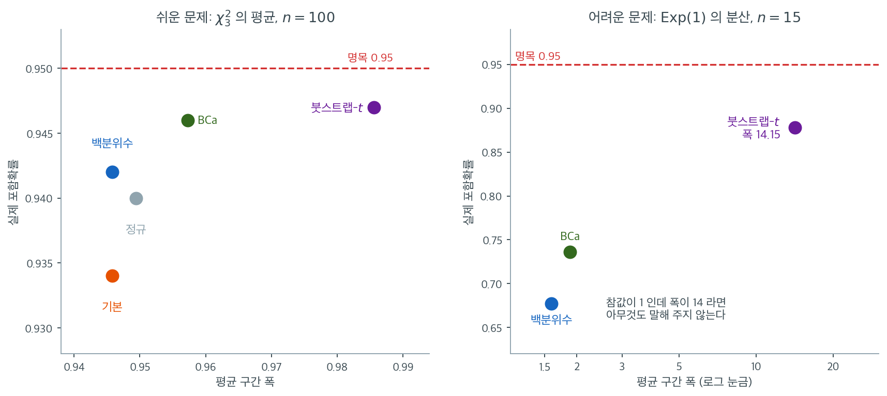

# 붓스트랩 신뢰구간 방법의 비교

## 1. 동기

앞의 절들에서 백분위수, BCa, 붓스트랩-$t$의 세 가지 붓스트랩 신뢰구간 방법을 소개했다. 각각 이론적 성질, 계산 요구사항, 실무적 강점이 다르다. 그중에서 고르려면 이 맞교환을 이해해야 한다. 이 절은 실무자의 판단을 돕기 위한 체계적 비교를 제공한다.

---

## 2. 요약표

| 성질 | 백분위수 | BCa | 붓스트랩-$t$ |
|---|---|---|---|
| **포함확률 정확도** | 1차 $O(n^{-1/2})$ | 2차 $O(n^{-1})$ | 2차 $O(n^{-1})$ |
| **편향보정** | 없음 | 있음 ($\hat{z}_0$) | 암묵적 (추축량을 통해) |
| **치우침 조정** | 없음 | 있음 ($\hat{a}$) | $t^*$ 분포를 통해 |
| **변환 불변** | 예 | 예 (근사적) | 아니오 |
| **모수 경계 존중** | 예 | 예 | 보장 안 됨 |
| **SE 공식 필요** | 아니오 | 아니오 | 예 (또는 중첩 붓스트랩) |
| **잭나이프 필요** | 아니오 | 예 ($n$번 계산) | 아니오 (SE 공식이 있으면) |
| **필요한 붓스트랩 복제 수** | $B \ge 5{,}000$ | $B \ge 5{,}000$ | $B \ge 5{,}000$ |
| **계산비용** | 낮음 | 중간 | 낮음--높음 |
| **구현 난이도** | 매우 간단 | 중간 | 간단--복잡 |

---

## 3. 포함확률 정확도

가장 중요한 구별은 **정확도의 차수**이다. 명목 $100(1-\alpha)\%$ 구간의 실제 포함확률은 다음을 만족한다.

- **백분위수**: $P(\theta \in \text{CI}) = 1 - \alpha + O(n^{-1/2})$
- **BCa**: $P(\theta \in \text{CI}) = 1 - \alpha + O(n^{-1})$
- **붓스트랩-$t$**: $P(\theta \in \text{CI}) = 1 - \alpha + O(n^{-1})$

$n = 20$인 95% 구간에서 1차 오차는 수 퍼센트포인트(실제 포함확률 90--93%)일 수 있는 반면, 2차 오차는 보통 1퍼센트포인트 미만(실제 94--96%)이다.

!!! note "정확도 차수가 언제 중요한가"
    표본이 크면($n > 100$) 세 방법이 대체로 비슷한 포함확률을 준다. 차이는 중간 정도의 표본크기($n = 15$에서 $50$)와 표본분포가 치우쳤거나 꼬리가 두꺼운 통계량에서 가장 두드러진다.

---

## 4. 변환 불변성

백분위수 구간과 BCa 구간은 **변환 불변**이다. $[L, U]$가 $\theta$의 구간이면 임의의 단조증가 $m$에 대해 $[m(L), m(U)]$가 $\phi = m(\theta)$의 구간이다. 붓스트랩-$t$ 구간은 이 성질을 갖지 않는다.

변환 불변성이 중요한 경우는 다음과 같다.

- 모수에 자연스러운 경계가 있을 때(예: $\sigma^2 > 0$, $0 < p < 1$)
- 추론에 "옳은" 척도가 무엇인지 분명하지 않을 때
- 분석자가 변환된 척도로 결과를 보고할 수 있을 때(예: 확률 대신 로그 오즈)

---

## 5. 계산 요구사항

**백분위수**: $\hat{\theta}$의 붓스트랩 복제값 $B$개만 있으면 된다. 가장 싸다.

**BCa**: 붓스트랩 복제값 $B$개에 더해 가속 $\hat{a}$를 위한 $n$번의 잭나이프 계산이 필요하다. 총 $B + n$번.

**붓스트랩-$t$**: 각 붓스트랩 표본마다 $\hat{\theta}^{*(b)}$와 $\hat{\text{se}}^{*(b)}$를 모두 계산해야 한다. $\hat{\text{se}}$의 닫힌 공식이 있으면 비용이 백분위수와 비슷하다. 각 복제마다 잭나이프나 중첩 붓스트랩으로 표준오차를 추정해야 하면 비용이 $B \times n$(잭나이프) 또는 $B \times B_2$(중첩 붓스트랩)이다.

!!! tip "비용 비교"
    표본평균에서는 $\hat{\text{se}}^{*(b)} = s^{*(b)}/\sqrt{n}$이라는 간단한 공식이 있으므로 붓스트랩-$t$가 거의 공짜이다. 중앙값이나 이분산 오차가 있는 회귀계수에서는 붓스트랩 안의 잭나이프 때문에 붓스트랩-$t$가 BCa보다 10--50배 비싸질 수 있다.

---

## 6. 각 방법을 언제 쓰는가

### 백분위수법

- 빠르고 근사적인 구간으로 충분할 때
- 표본크기가 클 때($n > 100$)
- 통계량의 표본분포가 거의 대칭임이 알려져 있을 때
- 계산자원이나 구현 복잡도에 제약이 있을 때

### BCa 방법

- 2차 정확도가 필요할 때(중간 $n$, 치우친 통계량)
- 변환 불변성이 필요할 때
- 통계량에 간단한 표준오차 공식이 없을 때
- 잭나이프가 계산상 가능할 때(즉 $n$이 지나치게 크지 않을 때)

### 붓스트랩-t 방법

- 닫힌 형태의 표준오차 공식이 있을 때(예: 평균)
- 추축량 $(\hat{\theta} - \theta)/\hat{\text{se}}$의 분포가 $\theta$에 거의 무관할 때
- 변환 불변성이 필요 없을 때
- $\hat{\text{se}}^*$의 분포가 안정적일 때($0$에 가까운 값이 없을 때)

---

## 7. 실무 권고

입문 통계학의 대부분 응용에서 다음 결정 규칙이 합리적이다.

1. **기본 선택**: BCa --- 2차 정확도, 변환 불변, 폭넓게 적용 가능
2. **BCa를 쓸 수 없을 때**: 백분위수 --- 단순하고 로버스트하며 큰 $n$에 충분
3. **표본평균의 경우**: 붓스트랩-$t$ --- 추가 비용이 거의 없이 2차 정확도
4. **계산이 매우 비싼 통계량**: 백분위수 --- BCa의 잭나이프 부담을 피한다

!!! warning "보편적으로 최선인 방법은 없다"
    모든 붓스트랩 신뢰구간은 매끄럽지 않은 통계량(예: 동점이 있는 중앙값), 극단 분위수, 매우 작은 표본크기에서 실패할 수 있다. 어떤 구간이든 믿기 전에 붓스트랩 분포를 눈으로 확인해야 한다. 대략 종 모양인가? 극단적인 이상치가 있는가?

---

## 8. 모의실험 보기 1: 잘 작동하는 경우

$\chi^2_3$ 분포(오른쪽으로 치우쳐 있고 참 평균이 $3$)에서 $n = 100$인 표본의 평균을 추정한다. 2000회 반복, $B = 2000$.

| 방법 | 포함확률 | 평균 폭 |
|:---|---:|---:|
| 정규 | 0.940 | 0.9494 |
| 백분위수 | 0.942 | 0.9458 |
| 기본 (추축) | 0.934 | 0.9458 |
| BCa | 0.946 | 0.9573 |
| 붓스트랩-$t$ | 0.947 | 0.9856 |

$n = 100$이고 통계량이 평균이므로 **다섯 방법이 사실상 구별되지 않는다**. 포함확률이 $0.934$--$0.947$, 폭이 $0.946$--$0.986$ 범위에 모여 있다.

이 상황에서는 가장 싸고 간단한 백분위수법을 쓰면 된다. BCa의 잭나이프 $100$번이나 붓스트랩-$t$의 추가 계산이 아무 이득도 주지 않는다.

---

## 9. 모의실험 보기 2: 무너지는 경우

이제 어려운 문제로 바꾼다. $\text{Exp}(1)$ 자료에서 $n = 15$로 모분산 $\sigma^2 = 1$을 추정한다. $s^2$의 표본분포는 오른쪽으로 심하게 치우쳐 있다.

3000회 반복, $B = 1500$:

| 방법 | 포함확률 | 평균 폭 |
|:---|---:|---:|
| 백분위수 | 0.677 | 1.59 |
| BCa | 0.736 | 1.88 |
| 붓스트랩-$t$ | **0.878** | **14.15** |

세 방법 모두 명목 $0.95$에 크게 못 미친다. **어떤 붓스트랩 방법도 이 문제를 풀지 못한다.**

!!! danger "붓스트랩-$t$의 폭 14.15를 어떻게 읽을 것인가"
    붓스트랩-$t$가 포함확률 $0.878$로 가장 높지만, 그 대가로 평균 구간 폭이 $14.15$이다. 참값이 $1$인데 구간의 폭이 $14$이면 사실상 아무것도 말해 주지 않는다.

    원인은 [붓스트랩-$t$](bootstrap_t.md) 연습문제 2에서 본 꼬리 불안정성이다. $n = 15$에서 $\hat{\text{se}}^{*}$가 이따금 $0$에 가까워져 $t^*$의 극단 분위수가 폭발한다.

    **높은 포함확률이 좋은 구간을 뜻하지는 않는다.** $(-\infty, \infty)$는 포함확률 $1$이지만 쓸모가 없다. 포함확률과 폭을 반드시 함께 보아야 한다.

두 모의실험을 하나의 평면에 올려 놓으면 방법 선택이 언제 문제가 되는지가 한눈에 들어온다. 가로축에 평균 폭을, 세로축에 실제 포함확률을 두고 각 방법을 점 하나로 찍었다.



왼쪽이 쉬운 문제다. 다섯 점이 포함확률 $0.934$--$0.947$, 폭 $0.946$--$0.986$의 좁은 구역에 모여 있다. **가로축의 눈금이 $0.94$에서 $0.99$까지라는 점에 주의하라.** 점들이 흩어져 보이지만 실제 차이는 폭에서 $4\%$, 포함확률에서 $1.3$%p에 지나지 않으며, 2000회 반복의 몬테카를로 표준오차 $0.005$의 두세 배 수준이다. 이 구역에서는 가장 싼 백분위수법을 쓰고 계산을 아끼는 것이 옳다.

오른쪽이 어려운 문제다. 가로축이 **로그 눈금**으로 바뀌었다는 사실 자체가 상황을 말해 준다. 백분위수 $(1.59,\ 0.677)$에서 BCa $(1.88,\ 0.736)$로 가는 이동은 폭을 $18\%$ 늘려 포함확률을 $6$%p 사는 정직한 거래다. 그러나 붓스트랩-$t$ $(14.15,\ 0.878)$는 다르다. 포함확률이 가장 높지만 폭이 $14$이고, 참값이 $1$인 문제에서 폭 $14$짜리 구간은 아무것도 말해 주지 않는다. **세로축만 보면 승자이고, 두 축을 함께 보면 탈락이다.**

그리고 오른쪽 그림에서 정작 눈에 띄는 것은 세 점이 모두 붉은 명목선 $0.95$ 아래에 한참 떨어져 있다는 사실이다. 방법을 바꾸어 점을 옮기는 일은 이 그림 안에서의 이동일 뿐, 그림 전체를 위로 올리지는 못한다. 연습문제 2에서 확인하듯 **통계량의 어려움이 표본크기보다 결정적이며**, $\text{Exp}(1)$의 분산을 $n = 15$로 추정한다는 설정 자체가 명목수준을 포기하게 만든다.

**이런 자료에서는 어떻게 해야 하는가.**

1. **변환한다.** $\log s^2$의 척도에서 구간을 만들고 되돌리면 치우침이 크게 줄어든다.
2. **모수적 방법을 쓴다.** 지수분포임을 안다면 $\sigma^2 = 1/\lambda^2$의 정확 구간을 쓸 수 있다.
3. **표본을 늘린다.** $n = 15$로 4차 적률에 의존하는 양을 추정하는 것 자체가 무리이다.

---

## 10. 그 밖의 방법

문헌에 등장하는 다른 두 방법이 있다.

**정규구간** ($\hat{\theta} \pm z_{\alpha/2} \cdot \widehat{\text{SE}}_{\text{boot}}$): 1차 정확도이며 표본분포의 대칭성을 가정한다. 백분위수법보다 간단하지만 변환 불변이 아니고 모수 경계를 존중하지 않는다.

**기본(추축) 구간** ($[2\hat{\theta} - \hat{\theta}^*_{(1-\alpha/2)}, \; 2\hat{\theta} - \hat{\theta}^*_{(\alpha/2)}]$): 붓스트랩 분포의 위치 편향을 보정하지만 여전히 1차 정확도이다. 변환 불변이 아니다.

이들은 덜 권장되지만 특정 맥락에서 유용할 수 있다.

---

## 연습문제

<div class="drillbox" markdown>

**연습문제 1.** <span class="diff easy" title="쉬움"></span>
$\chi^2_3$ 분포(오른쪽으로 치우쳐 있고 참 평균이 $3$)에서 관측값 100개를 생성하라.

**(a)** $B = 10{,}000$으로 네 방법(정규, 백분위수, 기본, BCa)의 평균에 대한 95% 붓스트랩 신뢰구간을 계산하라.

**(b)** 표준 $t$ 구간과 비교하라.

**(c)** 어느 구간이 $\bar{X}$를 중심으로 대칭인가? 어느 것이 아닌가?

**(d)** 2000회 반복하여 각 방법의 포함확률을 추정하라.

</div>

??? success "풀이"

    **(a)--(c)** 한 표본에 대한 결과이다.

    ```python
    import numpy as np
    from scipy import stats
    rng = np.random.default_rng(7)
    n, B = 100, 10000
    x = rng.chisquare(3, n)
    th = x.mean(); se = x.std(ddof=1) / np.sqrt(n)

    idx = rng.integers(0, n, (B, n)); xb = x[idx]
    bs = xb.mean(axis=1)

    lo_p, hi_p = np.percentile(bs, [2.5, 97.5])
    ci = {
        "normal":  (th - 1.96*bs.std(ddof=1), th + 1.96*bs.std(ddof=1)),
        "pct":     (lo_p, hi_p),
        "basic":   (2*th - hi_p, 2*th - lo_p),
        "t-int":   (th - stats.t.ppf(0.975, n-1)*se, th + stats.t.ppf(0.975, n-1)*se),
    }
    for k, (lo, hi) in ci.items():
        print(f"{k:7s} [{lo:.4f}, {hi:.4f}]  중심에서 {th-lo:.4f} / {hi-th:.4f}")
    ```

    출력:

    ```
    normal  [2.1442, 2.9287]  중심에서 0.3923 / 0.3923
    pct     [2.1522, 2.9388]  중심에서 0.3842 / 0.4023
    basic   [2.1341, 2.9207]  중심에서 0.4023 / 0.3842
    t-int   [2.1373, 2.9356]  중심에서 0.3991 / 0.3991
    ```

    | 방법 | 하한까지 거리 | 상한까지 거리 | 대칭인가 |
    |:---|---:|---:|:---|
    | 정규 (붓스트랩 SE) | $d$ | $d$ | **대칭** |
    | 표준 $t$ 구간 | $d'$ | $d'$ | **대칭** |
    | 백분위수 | $d_1$ | $d_2 > d_1$ | 비대칭 (오른쪽으로 김) |
    | 기본 (추축) | $d_2$ | $d_1$ | 비대칭 (왼쪽으로 김) |
    | BCa | --- | --- | 비대칭 |

    구조를 보면 명확하다.

    - **정규 구간과 $t$ 구간**은 $\hat\theta \pm (\text{상수}) \times \text{SE}$ 꼴이므로 정의상 대칭이다.
    - **백분위수 구간**은 붓스트랩 분포의 치우침을 그대로 물려받는다. $\chi^2_3$이 오른쪽으로 치우쳤으므로 구간도 오른쪽으로 길다.
    - **기본 구간**은 그것을 반사하므로 정확히 **거울상**이다. 백분위수 구간의 두 거리 $(d_1, d_2)$가 기본 구간에서 $(d_2, d_1)$이 된다.
    - **BCa**는 $\hat z_0$과 $\hat a$가 결정하는 방식으로 비대칭이다.

    !!! note "$n = 100$에서는 비대칭이 미미하다"
        $\chi^2_3$의 왜도가 $\sqrt{8/3} = 1.63$으로 상당히 크지만, $\bar X$의 왜도는 중심극한정리에 의해 $1.63/\sqrt{100} = 0.163$으로 줄어든다. 따라서 이 보기에서 네 구간의 실제 수치 차이는 소수점 셋째 자리 수준이다.

    **(d)** 2000회 반복($B = 2000$)한 포함확률:

    | 방법 | 포함확률 | 평균 폭 |
    |:---|---:|---:|
    | 정규 | 0.940 | 0.9494 |
    | 백분위수 | 0.942 | 0.9458 |
    | 기본 (추축) | 0.934 | 0.9458 |
    | BCa | 0.946 | 0.9573 |
    | 붓스트랩-$t$ | 0.947 | 0.9856 |

    **다섯 방법이 사실상 같다.** 포함확률 차이가 $0.013$이고, 이는 2000회 반복의 몬테카를로 표준오차 $\sqrt{0.95 \times 0.05/2000} = 0.0049$의 2--3배 수준이다.

    **결론:** $n = 100$이고 통계량이 평균이면 어떤 방법을 써도 무방하다. 이 문제에서 BCa나 붓스트랩-$t$를 쓰는 것은 계산을 낭비하는 것이다. 방법의 선택이 중요해지는 것은 $n$이 작거나 통계량이 어려울 때이다.

<div class="drillbox" markdown>

**연습문제 2.** <span class="diff med" title="중간"></span>
본문의 두 모의실험에서 방법 간 차이가 극적으로 달랐다. 어떤 요인이 그 차이를 만드는가? 표본크기와 통계량을 각각 바꾸어 확인하라.

</div>

??? success "풀이"
    두 요인을 분리해서 보자.

    ```python
    import numpy as np
    from scipy import stats
    rng = np.random.default_rng(21)

    def coverage(gen, stat, target, n, M=800, B=600):
        cp = cb = 0
        for _ in range(M):
            x = gen(n); th = stat(x)
            idx = rng.integers(0, n, (B, n))
            bs = np.array([stat(x[i]) for i in idx])
            lo, hi = np.percentile(bs, [2.5, 97.5])
            cp += lo <= target <= hi
            z0 = stats.norm.ppf(np.clip((bs < th).mean(), 1e-6, 1-1e-6))
            jk = np.array([stat(np.delete(x, i)) for i in range(n)])
            d = jk.mean() - jk
            den = ((d**2).sum())**1.5
            a = (d**3).sum()/(6*den) if den > 0 else 0.0
            zl, zu = -1.959964, 1.959964
            a1 = stats.norm.cdf(z0 + (z0+zl)/(1 - a*(z0+zl)))
            a2 = stats.norm.cdf(z0 + (z0+zu)/(1 - a*(z0+zu)))
            lo, hi = np.percentile(bs, [100*a1, 100*a2])
            cb += lo <= target <= hi
        return cp/M, cb/M

    ex = lambda n: rng.exponential(1, n)
    for n in (15, 50, 200):
        print("mean", n, coverage(ex, np.mean, 1.0, n))
        print("var ", n, coverage(ex, lambda v: v.var(ddof=1), 1.0, n))
    ```

    출력:

    ```
    mean 15 (0.90375, 0.91125)
    var  15 (0.6625, 0.7075)
    mean 50 (0.93125, 0.9375)
    var  50 (0.81, 0.85)
    mean 200 (0.9475, 0.94625)
    var  200 (0.87875, 0.9075)
    ```

    | 통계량 | $n$ | 백분위수 | BCa | BCa의 이득 |
    |:---|---:|---:|---:|---:|
    | 평균 | 15 | 0.904 | 0.911 | $+0.007$ |
    | 평균 | 50 | 0.931 | 0.938 | $+0.007$ |
    | 평균 | 200 | 0.948 | 0.946 | $-0.002$ |
    | 분산 | 15 | 0.662 | 0.708 | $+0.046$ |
    | 분산 | 50 | 0.810 | 0.850 | $+0.040$ |
    | 분산 | 200 | 0.879 | 0.908 | $+0.029$ |

    두 요인이 각각 작용하지만 **통계량의 어려움이 압도적으로 중요하다**.

    1. **통계량의 어려움.** 같은 $n$에서 분산이 평균보다 훨씬 나쁘다. $n = 200$의 분산($0.879$)이 $n = 15$의 평균($0.904$)보다도 낮다. 즉 **분산을 추정하는 것은 평균을 추정하는 것보다 $13$배 넘게 큰 표본을 요구한다**. 그리고 BCa의 이득도 분산에서만 뚜렷하다($+0.03$--$+0.05$ 대 $+0.007$).

    2. **표본크기.** 평균에서는 $n = 200$에서 두 방법이 사실상 같아진다($-0.002$, 몬테카를로 오차 범위). 분산에서는 $n = 200$에서도 $+0.029$가 남는데, 두 방법 모두 아직 명목수준에서 멀기 때문이다.

    (각 칸은 800회 반복이므로 몬테카를로 표준오차가 약 $0.01$이다. $\pm 0.02$ 이내의 차이는 잡음으로 보아야 한다.)

    **왜 분산이 어려운가.** $s^2$의 표본분포는 모집단의 4차 적률에 의존하는데, 4차 적률은 2차 적률보다 훨씬 추정하기 어렵다. 지수분포의 초과첨도가 $6$이므로 이 문제가 증폭된다.

    **실무 지침:** "언제 BCa가 필요한가"를 묻기 전에 "이 통계량이 이 표본크기에서 애초에 추정 가능한가"를 물어야 한다. 포함확률이 $0.68$인 상황에서 $0.73$으로 올리는 것은 근본적 해결이 아니다.

<div class="drillbox" markdown>

**연습문제 3.** <span class="diff med" title="중간"></span>
붓스트랩-$t$가 본문 보기 2에서 폭 $14.15$를 낸 이유를 진단하라. 극단적인 $t^*$를 절사하면
문제가 해결되는가?

</div>

??? success "풀이"
    먼저 평균 폭과 중앙값 폭을 나누어 보자.

    ```python
    import numpy as np
    rng = np.random.default_rng(31)

    def run(n, M=1200, B=1200, trim=None):
        c, w = 0, []
        for _ in range(M):
            x = rng.exponential(1, n)
            xb = x[rng.integers(0, n, (B, n))]
            cc = xb - xb.mean(axis=1, keepdims=True)
            m2 = (cc**2).mean(axis=1); m4 = (cc**4).mean(axis=1)
            bs = xb.var(axis=1, ddof=1)
            seb = np.sqrt(np.maximum((m4 - m2**2)/n, 1e-12))
            co = x - x.mean(); th = x.var(ddof=1)
            se = np.sqrt(max(((co**4).mean() - ((co**2).mean())**2)/n, 1e-12))
            t = (bs - th) / seb
            if trim is not None:
                t = t[np.abs(t) < np.percentile(np.abs(t), 100 - trim)]
            tl, tu = np.percentile(t, [2.5, 97.5])
            lo, hi = th - tu*se, th - tl*se
            c += lo <= 1 <= hi; w.append(hi - lo)
        return round(c/M, 3), round(np.mean(w), 2), round(np.median(w), 2)

    for n in (15, 50, 200):
        print(n, run(n))
    print("trim 1%", run(15, trim=1))
    print("trim 5%", run(15, trim=5))
    ```

    출력:

    ```
    15 (0.895, 14.83, 4.14)
    50 (0.911, 2.74, 1.67)
    200 (0.933, 0.96, 0.83)
    trim 1% (0.84, 9.34, 2.93)
    trim 5% (0.798, 8.25, 2.11)
    ```

    | 설정 | 포함확률 | 평균 폭 | **중앙값 폭** |
    |:---|---:|---:|---:|
    | $n = 15$ | 0.895 | 14.83 | **4.14** |
    | $n = 50$ | 0.911 | 2.74 | 1.67 |
    | $n = 200$ | 0.933 | 0.96 | 0.83 |
    | $n = 15$, 상위 1% 절사 | 0.840 | 9.34 | 2.93 |
    | $n = 15$, 상위 5% 절사 | 0.798 | 8.25 | 2.11 |

    **진단 1: 평균 폭이 중앙값 폭의 3.6배이다.** $14.83$과 $4.14$의 차이가 문제의 성격을 말해 준다. 대부분의 표본에서는 구간이 $4$ 정도로 (여전히 넓지만) 쓸 만하고, 소수의 표본에서 폭이 수백까지 폭발하여 평균을 끌어올린다. **$14.83$이라는 값은 "전형적인 구간"이 아니라 소수의 재앙적 사례가 만든 것이다.**

    **진단 2: 절사는 해결책이 아니다.** 상위 1%를 절사하면 폭이 $14.83 \to 9.34$로 줄지만 포함확률이 $0.895 \to 0.840$으로 떨어진다. 5%를 절사하면 $0.798$까지 내려간다.

    이는 당연한 결과이다. $t^*$의 극단 꼬리가 **잡음이자 동시에 신호**이기 때문이다. 절사하면 잡음과 함께 참 꼬리 정보도 잘려 나가 구간이 지나치게 좁아진다.

    **진단 3: 유일한 근본적 해결책은 $n$을 키우는 것이다.** $n = 200$에서 평균 폭이 $0.96$, 중앙값 폭이 $0.83$으로 둘의 차이가 사라진다. 폭발 사례가 없어졌다는 뜻이다.

    **왜 폭발하는가.** $s^2$의 표준오차 추정에 4차 적률이 들어간다.

    $$
    \widehat{\text{se}}(s^2) = \sqrt{\frac{\hat\mu_4 - \hat\mu_2^2}{n}}
    $$

    $n = 15$인 붓스트랩 표본이 우연히 큰 값을 하나도 뽑지 못하면 $\hat\mu_4$가 매우 작아지고 $\widehat{\text{se}}^*$가 $0$에 가까워진다. 그러면 $t^*$가 폭발한다. 지수분포처럼 꼬리가 있는 분포에서 $n = 15$면 이런 일이 드물지 않다.

    **실무 결론:** 붓스트랩-$t$의 결과를 보고할 때는 **평균 폭이 아니라 중앙값 폭과 폭의 분위수를 함께 확인**하라. 평균 폭만 보면 방법이 완전히 쓸모없어 보이지만, 실제로는 소수 사례의 문제일 수 있다. 반대로 중앙값 폭만 보면 재앙적 사례를 놓친다.

<div class="drillbox" markdown>

**연습문제 4.** <span class="diff med" title="중간"></span>
본문의 요약표는 BCa를 "기본 선택"으로 권한다. 이 권고가 항상 옳은가? BCa를 쓰지 말아야 할 상황을 세 가지 들어라.

</div>

??? success "풀이"

    **1. 통계량이 매끄럽지 않을 때.**

    [BCa](bca.md) 연습문제 3에서 보았듯, 중앙값의 잭나이프 가속은 참값과 무관하게 언제나 $\hat a \approx 0$이 된다. 잭나이프를 $n$번 계산하는 비용을 치르고도 아무 조정을 얻지 못한다. 분위수, 최댓값, 절사평균의 절사 경계 근처 값들도 마찬가지이다.

    → **백분위수 구간**을 쓴다.

    **2. $n$이 매우 클 때.**

    BCa는 $n$번의 잭나이프 계산을 요구한다. $n = 10^6$이고 통계량이 회귀계수라면 잭나이프만으로 백만 번의 회귀 적합이 필요하다.

    동시에 $n$이 크면 BCa의 이득이 사라진다. 연습문제 2에서 $n = 200$일 때 이득이 $+0.005$--$+0.014$였다.

    → **백분위수 구간**을 쓴다. 또는 잭나이프 대신 영향함수로 $\hat a$를 근사하는 방법도 있다.

    **3. 붓스트랩 자체가 실패하는 상황.**

    BCa는 붓스트랩 복제값에서 분위수를 읽는 방법이므로, 붓스트랩 분포 자체가 참 표본분포를 흉내 내지 못하면 조정을 아무리 정교하게 해도 소용이 없다.

    - 극단 순서통계량(최댓값): [붓스트랩 원리](../bootstrap/principle.md) 연습문제 3
    - 종속자료: 블록 붓스트랩이 필요하다
    - 경계 모수: [백분위수법](percentile.md) 연습문제 4

    → 붓스트랩이 아니라 **다른 접근**(모수적 방법, $m$-out-of-$n$ 붓스트랩, subsampling)을 쓴다.

    !!! note "권고를 다시 쓰면"
        "BCa를 기본으로 쓰라"보다 정확한 지침은 이렇다.

        1. 먼저 **붓스트랩 분포를 그려 본다**. 종 모양이 아니거나 이산적이면 방법 선택 이전에 문제가 있다.
        2. $\hat z_0$과 $\hat a$를 계산한다. 둘 다 $0.05$ 아래면 **백분위수**로 충분하다.
        3. 둘 중 하나라도 크면 **BCa**를 쓴다.
        4. 표준오차 공식이 있고 분산안정화 변환도 알면 그 척도에서 **붓스트랩-$t$**가 최선이다.

<div class="drillbox" markdown>

**연습문제 5.** <span class="diff med" title="중간"></span>
10절은 기본(추축) 구간을 $[2\hat\theta - \hat\theta^*_{(1-\alpha/2)},\ 2\hat\theta - \hat\theta^*_{(\alpha/2)}]$로 적었고, 백분위수 구간은 $[\hat\theta^*_{(\alpha/2)},\ \hat\theta^*_{(1-\alpha/2)}]$이다.

**(a)** 두 구간의 폭이 **언제나** 같음을 보이고, 두 중점이 $\hat\theta$에 대해 서로 대칭임을 보여라.

**(b)** $\theta = \sigma^2$을 추정하여 $\hat\theta = 1.00$, $\hat\theta^*_{(0.025)} = 0.30$, $\hat\theta^*_{(0.975)} = 4.00$을 얻었다. 두 구간을 적어라. 요약표의 "모수 경계 존중" 행에 기본 구간을 한 칸 더 넣는다면 무엇이라 적어야 하는가?

**(c)** 분산을 추정할 때 기본 구간의 하한이 음수가 되는 조건을 $\hat\theta$와 복제값 분위수로 적어라. 그 조건을 붓스트랩 분포의 모양으로 한 줄 해석하라.

</div>

??? success "풀이"
    **(a)** $L = \hat\theta^*_{(\alpha/2)}$, $U = \hat\theta^*_{(1-\alpha/2)}$로 줄여 쓴다. 백분위수 구간의 폭은 $U - L$이고, 기본 구간의 폭은

    $$
    (2\hat\theta - L) - (2\hat\theta - U) = U - L
    $$

    로 **같다**. 중점은 각각

    $$
    m_{\text{pct}} = \frac{L+U}{2}, \qquad m_{\text{basic}} = \frac{(2\hat\theta - U) + (2\hat\theta - L)}{2} = 2\hat\theta - m_{\text{pct}}
    $$

    이므로 $m_{\text{basic}} - \hat\theta = -(m_{\text{pct}} - \hat\theta)$이다. 즉 $x \mapsto 2\hat\theta - x$는 $\hat\theta$을 중심으로 한 반사이고, 기본 구간은 백분위수 구간의 **거울상**이다. 연습문제 1 의 표에서 두 거리가 $(d_1, d_2) \to (d_2, d_1)$로 맞바뀐 까닭이 이것이다. $\square$

    **(b)** 백분위수 구간은 $[0.30,\ 4.00]$이다. 기본 구간은

    $$
    [\,2(1.00) - 4.00,\ \ 2(1.00) - 0.30\,] = [-2.00,\ 1.70]
    $$

    이다. 분산의 구간인데 하한이 $-2.00$으로 **모수공간 밖**이다. 백분위수 구간은 복제값 자체를 끝점으로 쓰므로 $s^{2*} \ge 0$인 한 음수가 될 수 없지만, 기본 구간은 복제값을 반사한 값을 끝점으로 쓰므로 그런 보호가 없다. 요약표의 그 행에 기본 구간은 **"아니오"**로 들어간다(정규구간과 같다).

    또 하나 눈여겨볼 것은 상한이다. 백분위수 구간의 상한 $4.00$이 기본 구간에서는 $1.70$으로 줄었다. 반사는 긴 오른쪽 꼬리를 **버리는** 것이 아니라 왼쪽으로 **옮기는** 것이다.

    **(c)** 하한이 음수라는 것은

    $$
    2\hat\theta - \hat\theta^*_{(1-\alpha/2)} < 0 \quad \Longleftrightarrow \quad \hat\theta^*_{(1-\alpha/2)} > 2\hat\theta \quad \Longleftrightarrow \quad d_2 = \hat\theta^*_{(1-\alpha/2)} - \hat\theta > \hat\theta
    $$

    이다. (b)에서 $d_2 = 3.00 > 1.00 = \hat\theta$이었다.

    해석: **붓스트랩 분포의 오른쪽 거리가 추정값 자체보다 클 때**, 즉 추정값이 자기 산포에 비해 경계 $0$에 가까이 있을 때 일어난다. 이는 10절이 기본 구간을 "변환 불변이 아니다"라고 적은 것과 같은 뿌리다. 반사는 치우침을 **고치는** 것이 아니라 **뒤집는** 것이므로, 치우침이 심하면 뒤집힌 꼬리가 경계를 뚫는다.

<div class="drillbox" markdown>

**연습문제 6.** <span class="diff hard" title="어려움"></span>
4절의 변환 불변성을 세 걸음으로 따져 본다.

**(a)** 복제값을 정렬하여 $\hat\theta^*_{[1]} \le \cdots \le \hat\theta^*_{[B]}$라 하자. 단조증가 $m$에 대해 $\phi = m(\theta)$의 복제값은 $m(\hat\theta^{*(b)})$이다. 백분위수 구간이 변환 불변임을 순서통계량으로 보여라. 그리고 이 등식이 **정확히** 성립하려면 $B$와 $\alpha$에 어떤 조건이 필요한가? `np.percentile`의 기본 규칙처럼 이웃한 두 순서통계량을 선형보간하면 무슨 일이 생기는가?

**(b)** $\theta > 0$이고 $\hat\theta = 1.00$, $\widehat{\text{SE}}_{\text{boot}} = 0.60$이다. 정규구간을 (i) $\theta$ 척도에서, (ii) $\phi = \log\theta$ 척도에서 델타방법 $\widehat{\text{SE}}_\phi = \widehat{\text{SE}}_{\text{boot}}/\hat\theta$로 구한 뒤 $\theta$ 척도로 되돌려서, 각각 적어라. 두 결과로 10절이 정규구간을 "모수 경계를 존중하지 않는다"고 적은 까닭을 보여라.

**(c)** 요약표는 BCa 의 변환 불변을 "예 (근사적)"으로 적었다. 두 보정계수 $\hat z_0$과 $\hat a$ 가운데 어느 것이 단조변환 아래에서 **정확히** 불변이고 어느 것이 아닌가? 그래서 괄호 안의 "근사적"이 붙은 것인가?

</div>

??? success "풀이"
    **(a)** $m$이 단조증가이면 순서를 보존하므로 $m(\hat\theta^{*(b)})$들의 정렬 결과는 $m(\hat\theta^*_{[1]}) \le \cdots \le m(\hat\theta^*_{[B]})$이다. 즉 **$j$번째 순서통계량이 $j$번째 순서통계량으로 간다**. [백분위수법](percentile.md) 2절의 정의대로 끝점을 순서통계량으로 읽으면 $\phi$의 구간은

    $$
    \left[m\!\left(\hat\theta^*_{[\lfloor B\alpha/2 \rfloor]}\right),\ m\!\left(\hat\theta^*_{[\lceil B(1-\alpha/2) \rceil]}\right)\right] = [m(L),\ m(U)]
    $$

    로 정확히 원래 구간의 상이다. $\square$

    **정확성의 조건.** 끝점이 **하나의 순서통계량**이어야 한다. `np.percentile`의 기본 규칙은 $q$번째 분위수를 색인 $h = q(B-1)$에서 읽고 $h$가 정수가 아니면 이웃한 두 순서통계량을 선형보간한다. 그러므로 $q = \alpha/2$와 $q = 1-\alpha/2$ 모두에서

    $$
    q(B-1) \in \mathbb{Z}
    $$

    이어야 한다. $\alpha = 0.05$이면 $0.025(B-1) \in \mathbb{Z}$, 즉 $B - 1$이 $40$의 배수여야 한다($B = 41, 81, \ldots, 801, \ldots, 5001$). 이것이 연습문제 7 에서 $B = 801$, 연습문제 10 에서 $B = 5{,}001$로 둔 까닭이다.

    보간이 들어가면 끝점이 가중평균 $(1-f)\hat\theta^*_{[i]} + f\hat\theta^*_{[i+1]}$이 되는데, 비선형 $m$에 대해

    $$
    m\!\left((1-f)u + fv\right) \ne (1-f)m(u) + f\,m(v)
    $$

    이므로 불변성이 깨진다. 다만 어긋남은 이웃한 두 순서통계량의 간격만큼, 곧 $O(1/B)$이다. **불변성은 방법의 성질이지만 그 정확한 성립은 분위수를 어떻게 정의하느냐에 달려 있다.**

    **(b)** $z_{0.975} = 1.959964$이므로 $1.959964 \times 0.60 = 1.1760$이다.

    (i) $\theta$ 척도: $1.00 \pm 1.1760 = [-0.1760,\ 2.1760]$.

    (ii) $\log$ 척도: $\hat\phi = \log 1.00 = 0$, $\widehat{\text{SE}}_\phi = 0.60/1.00 = 0.60$이므로 $\phi$의 구간은 $[-1.1760,\ 1.1760]$이고, 되돌리면

    $$
    [e^{-1.1760},\ e^{1.1760}] = [0.3085,\ 3.2413]
    $$

    이다.

    | 척도 | 구간 | 하한 | 폭 |
    |:---|:---|---:|---:|
    | $\theta$ | $[-0.1760,\ 2.1760]$ | 음수 | 2.352 |
    | $\log\theta$ 에서 만들고 되돌림 | $[0.3085,\ 3.2413]$ | 양수 | 2.933 |

    두 구간이 전혀 다르다. 정규구간은 **어느 척도에서 만들었는지에 답이 달려 있다** --- 변환 불변이 아니라는 뜻이다. 그리고 $\theta$ 척도에서는 하한이 $-0.1760$으로 모수공간을 벗어난다. $\hat\theta \pm z\widehat{\text{SE}}$라는 식 자체가 $\theta$의 정의역을 모르기 때문이다. 반면 $\log$ 척도에서 만든 구간은 지수함수의 상이므로 언제나 양수이다. 백분위수 구간이 경계를 존중하는 것도 같은 이유, 곧 끝점이 복제값(또는 복제값의 상)이기 때문이다.

    **(c)** 편향보정은

    $$
    \hat z_0 = \Phi^{-1}\!\left(\frac{\#\{\hat\theta^{*(b)} < \hat\theta\}}{B}\right)
    $$

    이고, $m$이 단조증가이면 $m(\hat\theta^{*(b)}) < m(\hat\theta) \iff \hat\theta^{*(b)} < \hat\theta$이므로 **세는 개수가 그대로다**. 따라서 $\hat z_0$은 **정확히 불변**이다.

    가속은 잭나이프 값 $\hat\theta_{(-i)}$의 3 차와 2 차 적률의 비

    $$
    \hat a = \frac{\sum_i d_i^3}{6\left(\sum_i d_i^2\right)^{3/2}}, \qquad d_i = \bar{\hat\theta}_{(\cdot)} - \hat\theta_{(-i)}
    $$

    이다. 변환하면 잭나이프 값이 $m(\hat\theta_{(-i)})$로 바뀌는데, 비선형 $m$은 3 차 중심적률과 분산을 **서로 다른 비율로** 바꾸므로 $\hat a$가 달라진다. 아핀변환 $m(t) = ct + d$($c > 0$)만 예외다. 이때는 $d_i \to c\,d_i$이므로 분자가 $c^3$배, 분모가 $(c^2)^{3/2} = c^3$배로 상쇄되어 $\hat a$가 그대로다.

    그러므로 BCa 구간은 $\hat z_0$을 통해서는 정확히, $\hat a$를 통해서는 근사적으로만 불변이다. 요약표의 괄호는 **바로 이 한 조각**을 가리킨다. 실무에서 큰 문제가 아닌 까닭은 $\hat a = O(n^{-1/2})$로 작아서 그 어긋남이 2 차 오차에 묻히기 때문이다.

<div class="drillbox" markdown>

**연습문제 7.** <span class="diff hard" title="어려움"></span>
9절은 무너지는 자료의 첫 처방으로 "변환한다"를 들었다. 그런데 4절은 백분위수 구간이 변환 불변이라고 했다. 두 문장을 함께 읽으면 무엇이 예측되는가?

$\text{Exp}(1)$, $n = 15$, $\sigma^2 = 1$에서 20,000 회 반복으로 확인하라. $\hat\theta = s^2$에 대해 아래 여섯 구간의 포함확률과 **중앙값** 폭을 재어라($B = 801$, 까닭은 연습문제 6(a)).

| 이름 | 구간 |
|:---|:---|
| `pct` | $[\hat\theta^*_{(0.025)},\ \hat\theta^*_{(0.975)}]$ |
| `pct-log` | $\exp$ 로 되돌린 $[(\log\hat\theta^*)_{(0.025)},\ (\log\hat\theta^*)_{(0.975)}]$ |
| `norm` | $\hat\theta \pm 1.96\,\text{SD}(\hat\theta^*)$ |
| `norm-log` | $\exp\{\log\hat\theta \pm 1.96\,\text{SD}(\log\hat\theta^*)\}$ |
| `basic` | $[2\hat\theta - \hat\theta^*_{(0.975)},\ 2\hat\theta - \hat\theta^*_{(0.025)}]$ |
| `basic-log` | $\exp$ 로 되돌린 $[2\log\hat\theta - (\log\hat\theta^*)_{(0.975)},\ 2\log\hat\theta - (\log\hat\theta^*)_{(0.025)}]$ |

</div>

??? success "풀이"
    예측은 분명하다. **`pct`와 `pct-log`는 같은 수가 나와야 하고**(변환 불변), `norm`과 `basic`은 달라져야 한다(불변이 아니므로).

    ```python
    import numpy as np

    rng = np.random.default_rng(170)
    n, B, M, CH = 15, 801, 20000, 200      # 0.025*(B-1) = 20 이 정수 -> 보간이 없다

    names = ["pct", "pct-log", "norm", "norm-log", "basic", "basic-log"]
    hit = np.zeros(6, int)
    wid = [[] for _ in range(6)]
    flip = 0
    z = 1.959964

    for _ in range(M // CH):
        x = rng.exponential(1.0, (CH, n))
        th = x.var(axis=1, ddof=1)
        idx = rng.integers(0, n, (CH, B, n))
        xb = x[np.arange(CH)[:, None, None], idx]
        m1 = xb.mean(axis=2)
        bs = ((xb * xb).mean(axis=2) - m1 * m1) * n / (n - 1)
        lb = np.log(bs)
        qlo, qhi = np.percentile(bs, [2.5, 97.5], axis=1)
        glo, ghi = np.percentile(lb, [2.5, 97.5], axis=1)
        sd, sdl = bs.std(axis=1, ddof=1), lb.std(axis=1, ddof=1)
        lt = np.log(th)
        iv = [(qlo, qhi),
              (np.exp(glo), np.exp(ghi)),
              (th - z * sd, th + z * sd),
              (np.exp(lt - z * sdl), np.exp(lt + z * sdl)),
              (2 * th - qhi, 2 * th - qlo),
              (np.exp(2 * lt - ghi), np.exp(2 * lt - glo))]
        for k, (lo, hi) in enumerate(iv):
            hit[k] += int(((lo <= 1.0) & (1.0 <= hi)).sum())
            wid[k].append(hi - lo)
        flip += int((((iv[0][0] <= 1) & (1 <= iv[0][1]))
                     != ((iv[1][0] <= 1) & (1 <= iv[1][1]))).sum())

    print(f"{'method':10s}{'coverage':>10s}{'med.width':>11s}")
    for k, nm in enumerate(names):
        print(f"{nm:10s}{hit[k]/M:10.4f}{np.median(np.concatenate(wid[k])):11.3f}")
    print(f"pct 와 pct-log 의 포함 판정이 다른 표본 수: {flip}")
    ```

    출력:

    ```text
    method      coverage  med.width
    pct           0.6576      1.120
    pct-log       0.6576      1.120
    norm          0.6701      1.168
    norm-log      0.7925      1.779
    basic         0.6590      1.120
    basic-log     0.7740      2.524
    pct 와 pct-log 의 포함 판정이 다른 표본 수: 0
    ```

    | 방법 | 원 척도 | 로그 척도 | 포함확률 이득 | 폭의 대가 |
    |:---|---:|---:|---:|---:|
    | 백분위수 | 0.6576 | 0.6576 | $0.0000$ | $1.120 \to 1.120$ |
    | 정규 | 0.6701 | 0.7925 | $+0.1224$ | $1.168 \to 1.779$ |
    | 기본 | 0.6590 | 0.7740 | $+0.1150$ | $1.120 \to 2.524$ |

    **읽기 1: 백분위수법에서 로그 변환은 아무것도 하지 않는다.** 포함확률이 소수 넷째 자리까지 같고, 20,000 개 표본 가운데 포함 판정이 달라진 것이 **하나도 없다**. $B = 801$에서 두 분위수가 정확히 순서통계량이므로 연습문제 6(a)의 등식이 글자대로 성립한 것이다. 백분위수법은 사용자가 척도를 고르지 않으므로 **고칠 척도가 없다**.

    **읽기 2: 변환이 돕는 것은 척도를 잘못 고른 방법들이다.** 정규구간은 $0.670 \to 0.793$, 기본 구간은 $0.659 \to 0.774$로 $0.12$쯤 오른다. 두 방법은 "$\hat\theta$ 주변에서 대칭"이라는 틀린 전제를 깔고 있었고, $\log$ 척도에서는 그 전제가 덜 틀리다. 동시에 폭을 대가로 치른다. `basic-log`의 중앙값 폭 $2.524$는 백분위수의 $2.25$배다.

    **읽기 3: 그래도 $0.95$에는 닿지 못한다.** 가장 좋은 `norm-log`도 $0.7925$다. 변환은 치우침을 줄이지만 $n = 15$로 4 차 적률에 의존하는 양을 추정한다는 근본 문제를 없애지 못한다(9절의 처방 3 이 "표본을 늘린다"인 까닭).

    !!! note "9절의 처방 1 을 정확히 다시 쓰면"
        "변환한다"는 **정규·기본·붓스트랩-$t$를 쓸 때의** 처방이다. 백분위수와 (거의) BCa 에게는 공집합 처방이다. 변환 불변성은 공짜 점심이 아니라 **맞교환**이다. 척도를 고를 수고를 면제받는 대신, 척도를 잘 골라서 얻을 이득도 포기한다.

        (본문 9절의 표는 같은 설정에서 $0.677$이다. 여기의 $0.6576$과의 차이는 반복수 3000 대 20,000, $B$ 1500 대 801 에서 오며, 연습문제 8 이 그 둘을 각각 따져 본다.)

<div class="drillbox" markdown>

**연습문제 8.** <span class="diff hard" title="어려움"></span>
요약표는 세 방법 모두에 $B \ge 5{,}000$을 권한다. $B$를 키우면 무엇이 좋아지고 무엇이 좋아지지 않는가? 두 실험으로 가려라.

**(a)** $\text{Exp}(1)$에서 $n = 15$인 표본 **하나**를 뽑아 고정하고, $B = 500,\ 2000,\ 8000,\ 32000$마다 백분위수 구간을 $200$번씩 다시 계산하여 두 끝점의 평균과 표준편차를 재어라. $B$를 4 배 하면 표준편차가 어떻게 되는가? 참값 $\sigma^2 = 1$은 어떻게 되는가?

**(b)** 이제 표본을 20,000 번 다시 뽑으며 $B = 50,\ 200,\ 800$에 대해 포함확률과 중앙값 폭을 재어라.

**(c)** (a)와 (b)가 재는 오차는 각각 무엇인가? $B \to \infty$로 보내면 포함확률은 얼마에 수렴하는가? $B \ge 5{,}000$ 권고는 둘 중 무엇에 대한 처방인가?

</div>

??? success "풀이"
    ```python
    import numpy as np

    rng = np.random.default_rng(34)
    n = 15

    # (a) 자료를 하나로 고정하고 B 만 키운다 -- 몬테카를로 오차
    x = rng.exponential(1.0, n)
    th = x.var(ddof=1)
    print(f"고정된 한 표본: s^2 = {th:.4f}")
    print(f"{'B':>6s}{'lo.mean':>10s}{'lo.sd':>9s}{'hi.mean':>10s}{'hi.sd':>9s}")
    for B in (500, 2000, 8000, 32000):
        lo, hi = np.empty(200), np.empty(200)
        for r in range(200):
            bs = x[rng.integers(0, n, (B, n))].var(axis=1, ddof=1)
            lo[r], hi[r] = np.percentile(bs, [2.5, 97.5])
        print(f"{B:6d}{lo.mean():10.4f}{lo.std(ddof=1):9.4f}"
              f"{hi.mean():10.4f}{hi.std(ddof=1):9.4f}")

    # (b) 자료를 다시 뽑으며 B 만 키운다 -- 통계적 오차
    M, CH = 20000, 200
    print(f"{'B':>6s}{'coverage':>10s}{'med.width':>11s}")
    for B in (50, 200, 800):
        hit, wid = 0, []
        for _ in range(M // CH):
            y = rng.exponential(1.0, (CH, n))
            idx = rng.integers(0, n, (CH, B, n))
            yb = y[np.arange(CH)[:, None, None], idx]
            m1 = yb.mean(axis=2)
            bs = ((yb * yb).mean(axis=2) - m1 * m1) * n / (n - 1)
            q = np.percentile(bs, [2.5, 97.5], axis=1)
            hit += int(((q[0] <= 1.0) & (1.0 <= q[1])).sum())
            wid.append(q[1] - q[0])
        print(f"{B:6d}{hit/M:10.4f}{np.median(np.concatenate(wid)):11.3f}")
    ```

    출력:

    ```text
    고정된 한 표본: s^2 = 0.5413
         B   lo.mean    lo.sd   hi.mean    hi.sd
       500    0.1647   0.0110    0.9684   0.0332
      2000    0.1628   0.0050    0.9716   0.0147
      8000    0.1628   0.0029    0.9716   0.0081
     32000    0.1627   0.0014    0.9713   0.0039
         B  coverage  med.width
        50    0.6397      1.045
       200    0.6610      1.117
       800    0.6622      1.140
    ```

    **(a)** 상한의 표준편차가 $0.0332 \to 0.0147 \to 0.0081 \to 0.0039$로 줄어든다. 연속한 비가 $2.26,\ 1.81,\ 2.08$이므로 $B$를 4 배 할 때마다 대략 절반, 곧

    $$
    \text{SD} = O(B^{-1/2})
    $$

    이다. 하한도 $0.0110 \to 0.0050 \to 0.0029 \to 0.0014$로 같다.

    그런데 **두 평균은 꼼짝하지 않는다**. 하한은 $0.163$, 상한은 $0.971$에 머문다. 이 표본에서 참값 $\sigma^2 = 1$은 상한 밖이고, $B$를 $500$에서 $32{,}000$으로 64 배 키워도 들어오지 않는다. $B = 32{,}000$에서 상한은 $0.9713 \pm 0.0039$이므로 $1$보다 약 $7$ 표준편차 아래다. 자료가 $s^2 = 0.5413$이라고 말한 순간 이 구간이 $1$을 놓치는 것은 정해졌고, **같은 자료를 더 많이 다시 뽑는 일은 그것을 바꾸지 못한다**. ($s^2 = 0.5413$은 특별히 괴상한 표본도 아니다. $n = 15$에서 $s^2$의 25 백분위수 근처다.)

    **(b)** 포함확률은 $0.6397 \to 0.6610 \to 0.6622$다. $B = 50$에서 $200$으로 갈 때 $+0.0213$ 오르고, $200$에서 $800$으로 갈 때는 $+0.0012$로 멈춘다. 20,000 회 반복의 몬테카를로 표준오차가 $\sqrt{0.66 \times 0.34/20000} = 0.0033$이므로 뒤의 변화는 잡음과 구별되지 않는다. 중앙값 폭도 $1.045 \to 1.117 \to 1.140$으로 비슷하게 멈춘다. $B = 50$이 나쁜 것은 $2.5$와 $97.5$ 백분위수를 복제값 50 개에서 읽느라 끝점이 안쪽으로 당겨져 구간이 너무 좁아지기 때문이다.

    **(c)** 두 오차는 다음과 같이 갈린다.

    | | 재는 것 | 줄이는 법 | 크기 |
    |:---|:---|:---|:---|
    | (a) | **몬테카를로 오차** --- 같은 자료에서 재표집을 유한하게 한 탓 | $B$를 키운다 | $O(B^{-1/2})$, 끝점의 SD |
    | (b) | **통계적 오차** --- 자료가 $n = 15$개뿐인 탓 | $n$을 키운다 | 포함확률의 결손 $0.95 - 0.662 = 0.288$ |

    $B \to \infty$로 보내면 몬테카를로 오차는 $0$으로 가고, 포함확률은 "이상적 백분위수 구간"(모든 $n^n$개 재표본을 다 쓴 구간)의 값 $\approx 0.662$에 수렴한다. **$0.95$가 아니다.** 실제 포함확률을 쪼개 보면

    $$
    \underbrace{0.6397}_{B=50} = \underbrace{0.95}_{\text{명목}} - \underbrace{0.288}_{\text{통계적 결손}} - \underbrace{0.022}_{\text{몬테카를로 몫}}
    $$

    이고, $B \ge 800$에서는 마지막 항이 사라진다. $B \ge 5{,}000$ 권고는 **(a)만을 위한 처방**이다. 구간의 끝점을 보고할 자리까지 안정시키고, 특히 BCa 처럼 극단 분위수를 읽는 방법(연습문제 9)에서 필요하다. 포함확률의 결손은 $n$과 통계량의 문제이므로 $B$로는 손댈 수 없다.

    **한 줄:** $B$는 **내가 만든 잡음**을, $n$은 **자료가 가진 한계**를 지배한다. 보고할 때 둘을 섞어 적으면 독자는 $B$를 키워 해결될 문제로 오해한다.

<div class="drillbox" markdown>

**연습문제 9.** <span class="diff hard" title="어려움"></span>
[BCa](bca.md)의 수준 식에서 $\alpha = 0.05$, $z_{0.975} = 1.95996$으로 둔다.

$$
\alpha_1 = \Phi\!\left(\hat z_0 + \frac{\hat z_0 - z_{0.975}}{1 - \hat a(\hat z_0 - z_{0.975})}\right), \qquad \alpha_2 = \Phi\!\left(\hat z_0 + \frac{\hat z_0 + z_{0.975}}{1 - \hat a(\hat z_0 + z_{0.975})}\right)
$$

**(a)** $\hat z_0 = \hat a = 0$이면 $\alpha_1 = 0.025$, $\alpha_2 = 0.975$임을 보여라.

**(b)** $(\hat z_0, \hat a) = (0.10,\ 0)$, $(0,\ 0.05)$, $(0.20,\ 0.10)$ 세 경우의 $\alpha_1, \alpha_2$를 백분율로 소수 셋째 자리까지 구하라. 세 경우에서 두 수준이 움직이는 방향이 같은가? 그것이 구간을 어떻게 옮기는가?

**(c)** $\hat z_0 = 0.20$을 고정하고 $\hat a$를 키운다. $\alpha_2$의 분모가 $0$이 되는 $\hat a$를 구하고, $\hat a = 0.10,\ 0.20,\ 0.30$에서의 $\alpha_2$를 적어라. $B = 5{,}001$이면 $\hat a = 0.20$의 상한은 몇 번째 복제값인가? 요약표의 "2차 $O(n^{-1})$"이 **보장하지 못하는** 것은 무엇인가?

**(d)** 9절의 설정($\text{Exp}(1)$, $n = 15$, $\sigma^2$)에서 전형적인 값이 $\hat z_0 \approx 0.21$, $\hat a \approx 0.10$이다. (b)의 결과로 BCa 포함확률이 백분위수의 $0.68$에서 $0.74$로 오른 까닭을 설명하라.

</div>

??? success "풀이"
    **(a)** $\hat z_0 = 0$, $\hat a = 0$을 넣으면 분모가 $1$이고 앞의 $\hat z_0$도 $0$이므로

    $$
    \alpha_1 = \Phi(-z_{0.975}) = \Phi(z_{0.025}) = 0.025, \qquad \alpha_2 = \Phi(z_{0.975}) = 0.975
    $$

    이다. 즉 두 보정이 모두 꺼지면 BCa 는 **백분위수 구간 그 자체**다. BCa 는 백분위수법을 대체하는 것이 아니라 $(\hat z_0, \hat a)$만큼 **비틀어 놓은** 것이다. $\square$

    **(b)** 차례로 계산한다. $z_{0.025} = -1.95996$을 쓴다.

    $(\hat z_0, \hat a) = (0.10,\ 0)$: 분모가 $1$이므로 괄호 안은 $0.10 + (0.10 \mp 1.95996)$이다.

    $$
    \alpha_1 = \Phi(-1.75996) = 3.921\%, \qquad \alpha_2 = \Phi(2.15996) = 98.461\%
    $$

    $(\hat z_0, \hat a) = (0,\ 0.05)$:

    $$
    \alpha_1 = \Phi\!\left(\frac{-1.95996}{1 + 0.05 \times 1.95996}\right) = \Phi(-1.78503) = 3.713\%
    $$

    $$
    \alpha_2 = \Phi\!\left(\frac{1.95996}{1 - 0.05 \times 1.95996}\right) = \Phi(2.17290) = 98.511\%
    $$

    $(\hat z_0, \hat a) = (0.20,\ 0.10)$: 아래쪽은 $\hat z_0 + z_{0.025} = -1.75996$, 분모 $1 + 0.175996 = 1.175996$이므로 괄호 안이 $0.20 - 1.49657 = -1.29657$. 위쪽은 $\hat z_0 + z_{0.975} = 2.15996$, 분모 $1 - 0.215996 = 0.784004$이므로 괄호 안이 $0.20 + 2.75504 = 2.95504$.

    $$
    \alpha_1 = \Phi(-1.29657) = 9.739\%, \qquad \alpha_2 = \Phi(2.95504) = 99.844\%
    $$

    | $\hat z_0$ | $\hat a$ | $\alpha_1$ | $\alpha_2$ |
    |---:|---:|---:|---:|
    | 0 | 0 | 2.500% | 97.500% |
    | 0.10 | 0 | 3.921% | 98.461% |
    | 0 | 0.05 | 3.713% | 98.511% |
    | 0.20 | 0.10 | 9.739% | 99.844% |

    세 경우 모두 **두 수준이 함께 올라간다**. $\hat z_0 > 0$이든 $\hat a > 0$이든 효과의 방향이 같다. 수준이 올라가면 읽는 분위수가 올라가므로 하한과 상한이 **둘 다 오른쪽으로 옮겨진다**. 즉 $(\hat z_0, \hat a)$가 양수일 때 BCa 가 하는 일은 주로 구간을 **옮기는** 것이고, 폭을 바꾸는 것은 부수 효과다. ($(0.20, 0.10)$에서 폭에 해당하는 수준 간격이 $95\%$에서 $90.1\%$로 줄기까지 한다.)

    **(c)** 분모가 $0$인 곳은

    $$
    1 - \hat a(\hat z_0 + z_{0.975}) = 0 \quad \Longrightarrow \quad \hat a^\ast = \frac{1}{\hat z_0 + z_{0.975}} = \frac{1}{0.20 + 1.95996} = 0.46297
    $$

    이다. 그 앞에서 $\alpha_2$는 이미 끝으로 밀린다.

    | $\hat a$ | $\alpha_2$ | $B = 5{,}001$에서 읽는 자리 |
    |---:|---:|:---|
    | 0.10 | 99.844% | 아래에서 4992 번째 |
    | 0.20 | 99.997% | 아래에서 5000 번째 (끝에서 두 번째) |
    | 0.30 | 100.000% | 사실상 최댓값 |

    $\hat a = 0.20$이면 상한이 복제값 5001 개 가운데 **끝에서 두 번째**다. 그 값은 복제값 하나가 바뀌면 함께 바뀌는 양이므로 몬테카를로 오차가 크고($B$를 키워야 하는 까닭 --- 연습문제 8(c)), 그보다 더 나쁜 것은 극단 순서통계량은 붓스트랩이 애초에 잘 추정하지 못하는 양이라는 점이다(연습문제 4 의 셋째 항목).

    요약표의 "2차 $O(n^{-1})$"은 **$n \to \infty$에서의 점근 성질**이다. 유한한 $n$에서 $\hat a$가 커져 수준이 $100\%$로 밀리는 일, 그래서 상한이 복제값의 최댓값으로 퇴화하는 일은 그 표기가 전혀 막아 주지 않는다. $\hat a$는 잭나이프 3 차 적률의 비이므로 $n$이 작으면 그 자체가 불안정하다. **차수는 평균적인 약속이고, 식이 부서지는 자리는 따로 확인해야 한다.**

    **(d)** $\hat z_0 \approx 0.21$, $\hat a \approx 0.10$은 (b)의 마지막 줄 $(0.20, 0.10)$과 사실상 같다. 따라서 그 설정에서 BCa 는 $2.5\%$--$97.5\%$ 대신 약 $9.7\%$--$99.8\%$ 분위수를 읽는다. 두 수준이 모두 올라가므로 **구간 전체가 위로 옮겨진다**.

    9절에서 세 방법이 모두 $0.95$ 아래였던 것은 구간이 참값보다 아래에 놓이는 일이 잦았기 때문인데, 위로 옮기는 보정은 바로 그 결손을 공격한다. 그래서 포함확률이 $0.68$에서 $0.74$로 오른다. 어느 쪽 꼬리가 얼마나 좋아지는지는 연습문제 10 에서 센다.

<div class="drillbox" markdown>

**연습문제 10.** <span class="diff hard" title="어려움"></span>
9절의 세 포함확률 $0.677$, $0.736$, $0.878$은 모두 명목 $0.95$ 아래다. 그 결손이 **어느 쪽 꼬리에서** 생기는지를 가려라.

$\text{Exp}(1)$, $n = 15$, $\sigma^2 = 1$에서 백분위수·기본·BCa·붓스트랩-$t$ 네 구간 $[L, U]$를 **같은 붓스트랩 표본으로** 만들고, 20,000 회 반복으로 $P(\sigma^2 < L)$과 $P(\sigma^2 > U)$를 따로 세어라($B = 5{,}001$). 명목값은 양쪽 각각 $0.025$이다.

결과를 보고 다음에 답하라. **(a)** 결손은 **폭**의 문제인가 **위치**의 문제인가? **(b)** 연습문제 3 의 $t^*$ 절사가 왜 포함확률을 더 떨어뜨렸는가? **(c)** 기본 구간의 중앙값 폭을 백분위수와 견주어 연습문제 5(a)를 확인하라.

</div>

??? success "풀이"
    ```python
    import numpy as np
    from scipy import stats

    rng = np.random.default_rng(1017)
    n, B, M, CH = 15, 5001, 20000, 50
    z = 1.959964
    names = ["pct", "basic", "BCa", "boot-t"]
    left = np.zeros(4, int)
    right = np.zeros(4, int)
    wid = [[] for _ in range(4)]
    hi_mid = 0                           # th 가 백분위수 구간의 중점보다 위인 표본


    def rowq(s, q):                      # 행마다 다른 분위수 (np.percentile 과 같은 선형보간)
        h = np.asarray(q) * (s.shape[1] - 1)
        i0 = np.floor(h).astype(int)
        i1 = np.minimum(i0 + 1, s.shape[1] - 1)
        f = h - i0
        r = np.arange(s.shape[0])
        return s[r, i0] * (1 - f) + s[r, i1] * f


    for _ in range(M // CH):
        x = rng.exponential(1.0, (CH, n))
        th = x.var(axis=1, ddof=1)
        co = x - x.mean(axis=1, keepdims=True)
        se = np.sqrt(np.maximum(((co**4).mean(axis=1)
                                 - ((co**2).mean(axis=1))**2) / n, 1e-12))

        idx = rng.integers(0, n, (CH, B, n))
        xb = x[np.arange(CH)[:, None, None], idx]
        cc = xb - xb.mean(axis=2, keepdims=True)
        c2 = cc * cc
        m2 = c2.mean(axis=2)
        m4 = (c2 * c2).mean(axis=2)
        bs = m2 * n / (n - 1)
        seb = np.sqrt(np.maximum((m4 - m2 * m2) / n, 1e-12))

        srt = np.sort(bs, axis=1)
        qlo, qhi = rowq(srt, 0.025), rowq(srt, 0.975)
        hi_mid += int((th > 0.5 * (qlo + qhi)).sum())

        # BCa: 편향보정과 잭나이프 가속
        z0 = stats.norm.ppf(np.clip((bs < th[:, None]).mean(axis=1), 1e-6, 1 - 1e-6))
        s1, s2 = x.sum(axis=1, keepdims=True), (x * x).sum(axis=1, keepdims=True)
        m = n - 1
        jk = (s2 - x * x - (s1 - x)**2 / m) / (m - 1)
        d = jk.mean(axis=1, keepdims=True) - jk
        den = ((d**2).sum(axis=1))**1.5
        a = np.where(den > 0, (d**3).sum(axis=1) / (6 * np.maximum(den, 1e-300)), 0.0)
        a1 = stats.norm.cdf(z0 + (z0 - z) / (1 - a * (z0 - z)))
        a2 = stats.norm.cdf(z0 + (z0 + z) / (1 - a * (z0 + z)))

        tt = np.sort((bs - th[:, None]) / seb, axis=1)
        tl, tu = rowq(tt, 0.025), rowq(tt, 0.975)

        iv = [(qlo, qhi),
              (2 * th - qhi, 2 * th - qlo),
              (rowq(srt, a1), rowq(srt, a2)),
              (th - tu * se, th - tl * se)]
        for k, (lo, hi) in enumerate(iv):
            left[k] += int((1.0 < lo).sum())
            right[k] += int((hi < 1.0).sum())
            wid[k].append(hi - lo)

    print(f"{'method':9s}{'coverage':>10s}{'P(1<L)':>9s}{'P(1>U)':>9s}{'med.width':>11s}")
    for k, nm in enumerate(names):
        w = np.median(np.concatenate(wid[k]))
        print(f"{nm:9s}{1-(left[k]+right[k])/M:10.4f}{left[k]/M:9.4f}"
              f"{right[k]/M:9.4f}{w:11.3f}")
    print(f"s^2 이 백분위수 구간의 중점보다 위인 표본의 비율: {hi_mid/M:.4f}")
    ```

    출력:

    ```text
    method     coverage   P(1<L)   P(1>U)  med.width
    pct          0.6622   0.0015   0.3362      1.135
    basic        0.6593   0.0137   0.3271      1.135
    BCa          0.7224   0.0211   0.2565      1.292
    boot-t       0.8775   0.0062   0.1163      3.668
    s^2 이 백분위수 구간의 중점보다 위인 표본의 비율: 0.5897
    ```

    | 방법 | 포함확률 | $P(\sigma^2 < L)$ | $P(\sigma^2 > U)$ | 중앙값 폭 |
    |:---|---:|---:|---:|---:|
    | 명목 | 0.95 | 0.025 | 0.025 | --- |
    | 백분위수 | 0.6622 | 0.0015 | **0.3362** | 1.135 |
    | 기본 | 0.6593 | 0.0137 | 0.3271 | 1.135 |
    | BCa | 0.7224 | 0.0211 | 0.2565 | 1.292 |
    | 붓스트랩-$t$ | 0.8775 | 0.0062 | 0.1163 | 3.668 |

    **(a) 위치의 문제다.** 백분위수 구간의 왼쪽 오차는 $0.0015$로 명목 $0.025$의 **$1/17$**이고, 오른쪽 오차는 $0.3362$로 명목의 **13 배**다. 양쪽이 명목에 맞았다면 두 오차의 합이 $0.05$였을 텐데 실제로는 $0.338$이며, 그 가운데 $0.336$이 한쪽에서 온다. 구간이 **너무 좁은** 것이 아니라 **너무 낮은 곳에 있다**. (하한이 참값을 넘는 일이 거의 없다는 것은, 하한이 쓸모없이 낮다는 뜻이기도 하다.)

    이 진단이 BCa 의 성적을 설명한다. BCa 는 폭을 $1.135 \to 1.292$로 $14\%$만 늘리면서 오른쪽 오차를 $0.3362 \to 0.2565$로 깎고, 동시에 왼쪽 오차를 $0.0015 \to 0.0211$로 **올려** 명목 $0.025$에 거의 맞춘다. 연습문제 9(d)에서 본 대로 $\hat z_0 > 0$, $\hat a > 0$이 두 수준을 함께 올려 구간을 위로 옮긴 결과다. **양쪽 꼬리를 균형 있게 만드는 것**이 2 차 정확도의 실질적 내용이다.

    붓스트랩-$t$는 다른 길로 간다. 폭을 $1.135 \to 3.668$로 $3.2$배 늘려 오른쪽 오차를 $0.1163$까지 줄이지만, 왼쪽 오차는 $0.0062$로 명목보다 더 작아져 **균형은 오히려 나빠졌다**. 포함확률 $0.8775$는 균형으로 번 것이 아니라 **크기로 산** 것이다. 본문 danger 상자의 "높은 포함확률이 좋은 구간을 뜻하지 않는다"가 이것이다.

    **(b)** 연습문제 3 의 절사는 $t^*$의 양쪽 꼬리를 깎아 **폭만** 줄인다. 그런데 위 표가 말하듯 이 문제에서 모자란 것은 폭이 아니라 위치다. 폭을 줄이면 이미 명목의 13 배인 오른쪽 오차가 더 커질 뿐이므로 포함확률이 $0.895 \to 0.840 \to 0.798$로 떨어진 것은 당연한 결과다. **치우친 자리에서 필요한 것은 폭의 조절이 아니라 구간을 옮기는 일이다.**

    **(c)** 기본 구간의 중앙값 폭이 $1.135$로 백분위수와 소수 셋째 자리까지 **같다**. 연습문제 5(a)에서 두 구간의 폭이 표본마다 정확히 일치함을 증명했으니 당연하고, 코드가 제대로 돌았다는 점검도 된다. 두 방법의 차이는 위치뿐인데, 그 차이도 작다. 포함확률 $0.6593$과 $0.6622$의 간격 $0.0029$는 몬테카를로 표준오차 $0.0033$ 안이다.

    다만 꼬리별로 보면 방향이 보인다. 기본 구간은 왼쪽 오차가 $0.0137$로 더 크고 오른쪽 오차가 $0.3271$로 더 작으니, 평균적으로 **조금 위에** 놓여 있다. 까닭은 마지막 줄에 있다. $\hat\theta = s^2$이 백분위수 구간의 중점보다 위인 표본이 $58.97\%$다. 그런 표본에서는 $d_1 > d_2$이므로 반사하면 구간이 위로 간다. 그러나 이 이동은 $\hat\theta$의 위치에 따라 표본마다 방향이 갈리는 **들쭉날쭉한** 보정이어서, BCa 처럼 체계적으로 한 방향을 밀어 주지 못한다. **거울상은 보정이 아니다.**

---

## 정리하며

백분위수, BCa, 붓스트랩-$t$ 방법은 정교함이 커지는 위계를 이룬다. 백분위수법은 가장 단순하지만 1차 정확도에 그친다. BCa와 붓스트랩-$t$는 서로 다른 방식으로 2차 정확도를 달성한다. BCa는 편향과 가속 보정으로 분위수 수준을 조정하고, 붓스트랩-$t$는 통계량을 스튜던트화하여 근사 추축량을 만든다. 일반적인 용도로는 BCa가 권장 기본값이고, 표준오차 공식을 바로 쓸 수 있으면 붓스트랩-$t$가 낫다.
