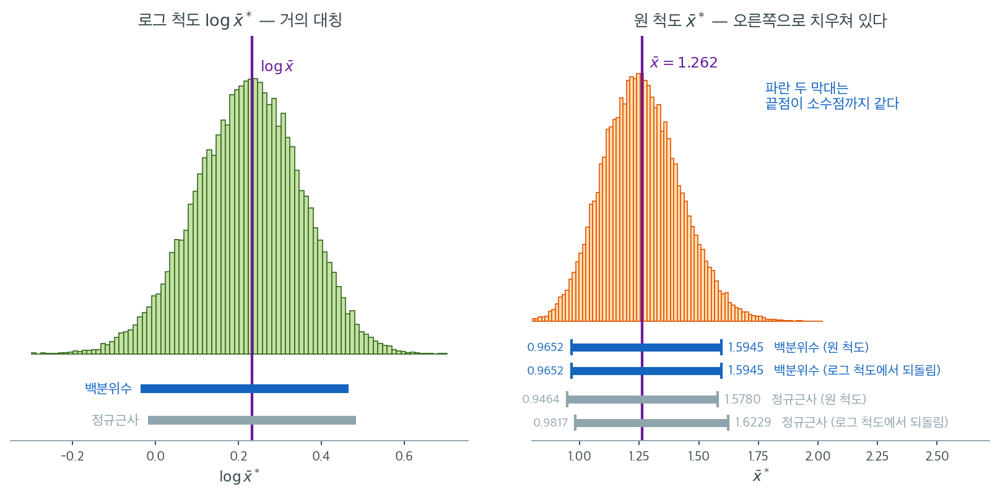
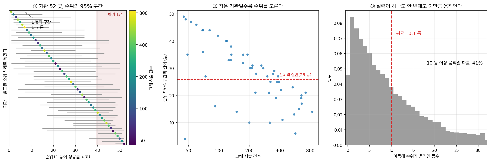

# 백분위수법

## 1. 분위수를 그대로 읽는 것이 가장 단순하다

가장 단순한 붓스트랩 신뢰구간은 붓스트랩 분포의 분위수를 그대로 쓴다. $\hat{\theta}$의 표집분포가 정규라고 가정하는 대신, **백분위수법**은 구간의 양 끝점을 붓스트랩 복제값에서 직접 읽는다. 그 결과 구간이 본질적으로 적응적이다. 치우침을 존중하고, 모수의 자연스러운 경계를 존중하며, 표준오차 공식이 전혀 필요 없다.

단순함에도 불구하고 백분위수법에는 잘 알려진 이론적 한계가 있다. 이 절에서는 방법을 제시하고, 언제 잘 작동하는지 설명하며, 더 정교한 방법이 필요한 상황을 밝힌다.

<div class="defn" markdown>

### 정의 1. 백분위수 붓스트랩 신뢰구간 { .dfn }

관측자료에서 복원추출하여 각 재표본에서 통계량 $\hat{\theta}$를 계산해 얻은 붓스트랩 복제값을 $\hat{\theta}^{*(1)}, \ldots, \hat{\theta}^{*(B)}$이라 하자. 수준 $1 - \alpha$의 **백분위수 붓스트랩 신뢰구간**은

$$
\left[\hat{\theta}^*_{(\alpha/2)}, \quad \hat{\theta}^*_{(1-\alpha/2)}\right]
$$

이며 $\hat{\theta}^*_{(q)}$는 붓스트랩 분포의 $q$번째 분위수이다. 95% 신뢰구간($\alpha = 0.05$)은 붓스트랩 복제값의 2.5 백분위수부터 97.5 백분위수까지이다.

실제로 복제값을 오름차순으로 정렬하여 $\hat{\theta}^*_{[1]} \le \hat{\theta}^*_{[2]} \le \cdots \le \hat{\theta}^*_{[B]}$라 하면, 하한은 $\hat{\theta}^*_{[\lfloor B \cdot \alpha/2 \rfloor]}$, 상한은 $\hat{\theta}^*_{[\lceil B \cdot (1-\alpha/2) \rceil]}$이다.

</div>

---

## 2. 복제값을 늘어놓고 양 끝을 잘라 낸다

1. 관측 통계량 $\hat{\theta} = g(x_1, \ldots, x_n)$을 계산한다.
2. $B$개의 붓스트랩 복제값 $\hat{\theta}^{*(1)}, \ldots, \hat{\theta}^{*(B)}$을 생성한다.
3. 복제값을 오름차순으로 정렬한다.
4. $100(1-\alpha)\%$ 신뢰구간은

$$
\left[\hat{\theta}^*_{[\lfloor B \cdot \alpha/2 \rfloor]}, \quad \hat{\theta}^*_{[\lceil B \cdot (1 - \alpha/2) \rceil]}\right]
$$

!!! tip "백분위수 구간에 필요한 B"
    백분위수법에서는 극단 분위수가 안정될 만큼 $B$가 커야 한다. $B = 1{,}000$이면 2.5 백분위수는 25번째로 작은 값이라 그런대로 쓸 만하지만 잡음이 있다. $B = 10{,}000$이면 250번째 값이 되어 훨씬 안정적이다. 신뢰구간에는 최소 $B = 5{,}000$을 권한다.

---

## 3. 백분위수법이 작동하는 이유

백분위수법에는 우아한 정당화가 있다. $\hat{\phi} = m(\hat{\theta})$가 분산이 일정한 정규분포를 갖게 하는 단조변환 $\phi = m(\theta)$가 존재한다고 하자. 그러면 $\hat{\phi}$는 (위치 이동을 제외하고) **추축량**이고, $\phi$에 대한 백분위수 구간의 포함확률이 정확하다. $m$이 단조이므로 되돌리면

$$
[m^{-1}(\hat{\phi}^*_{(\alpha/2)}), \quad m^{-1}(\hat{\phi}^*_{(1-\alpha/2)})] = [\hat{\theta}^*_{(\alpha/2)}, \quad \hat{\theta}^*_{(1-\alpha/2)}]
$$

가 된다. $\theta$ 척도의 백분위수 구간이 $\phi$ 척도의 구간을 되돌린 것과 동일하므로, 사용자가 $m$을 알 필요 없이 정규화 변환이 자동으로 반영된다.

!!! note "변환 불변성"
    백분위수법은 **변환 불변**이다. 임의의 단조증가 함수 $m$에 대해 $\phi = m(\theta)$이면 $\phi$의 백분위수 구간은 정확히 $[m(\hat{\theta}^*_{(\alpha/2)}), m(\hat{\theta}^*_{(1-\alpha/2)})]$이다. 정규근사 구간 $\hat{\theta} \pm z_{\alpha/2} \cdot \widehat{\text{SE}}$에는 이 성질이 없다.

이 주장은 말로 들으면 미덥지 않다. 척도를 바꾸었는데 답이 그대로라니, 정말 그런지 한 자료에서 확인해 보자.



$\text{LogNormal}(0, 1)$에서 $n = 40$을 뽑아 평균의 붓스트랩 복제값 $B = 40000$개를 만들었다. 왼쪽은 그 복제값에 로그를 취한 것으로 거의 대칭이고, 오른쪽은 원 척도로 오른쪽 꼬리가 길다. **두 그림은 같은 4만 개 숫자이며, 눈금만 다르다.** 어느 쪽에서 구간을 만들어야 옳은지는 이론이 답해 준다. 표집분포를 정규에 가깝게 만드는 척도, 즉 로그 척도이다.

오른쪽 칸의 네 막대가 결론이다. 원 척도에서 바로 읽은 백분위수 구간이 $[0.9652,\ 1.5945]$이고, 로그 척도에서 읽은 뒤 지수변환해 되돌린 구간도 $[0.9652,\ 1.5945]$이다. **소수 넷째 자리까지 같다.** 이유는 정의에서 곧바로 나온다. $\log$가 단조증가이므로 $\text{Quantile}_q(\log \bar{x}^*) = \log(\text{Quantile}_q(\bar{x}^*))$이고, 분위수를 읽고 변환하든 변환하고 읽든 순서가 상관없기 때문이다.

정규근사 구간은 그렇지 않다. 원 척도에서 $[0.9464,\ 1.5780]$, 로그 척도를 거치면 $[0.9817,\ 1.6229]$로 하한이 $3.7\%$ 차이 난다. 평균과 표준오차는 분위수와 달리 단조변환과 교환되지 않기 때문이다. 문제는 **어느 쪽이 맞느냐를 사용자가 판단해야 한다**는 점이다. 로그 척도가 낫다는 것을 알려면 표집분포의 모양을 이미 알고 있어야 하는데, 그 모양을 모르기 때문에 붓스트랩을 쓰는 것이다.

백분위수법의 가치가 여기에 있다. **정규화 변환 $m$이 무엇인지 몰라도, 그것을 찾아 적용한 뒤 되돌린 것과 똑같은 답을 준다.** 다만 이 우아함이 포함확률을 보장하지는 않는다. 아래에서 보듯 애초에 그런 $m$이 존재하지 않는 통계량에서는 변환 불변성이 지켜 줄 것이 없다.

---

## 4. 이 방법만 가진 것은 척도 불변성이다

1. **단순함**: 표준오차 공식이 필요 없다. 복제값을 늘어놓고 양 끝을 자르면 끝이다.
2. **변환 불변성**: 임의의 단조 재모수화에 구간이 자동으로 적응한다.
3. **모수 경계를 존중한다**: $\theta \ge 0$이고 모든 붓스트랩 복제값이 음이 아니면 구간도 음이 아니다.
4. **모양을 포착한다**: 붓스트랩 분포가 비대칭이면 신뢰구간도 비대칭이 된다.

### 척도를 바꾸어도 답이 달라지지 않는다

식은 한 줄이지만, 구현하면 이 방법만 갖는 성질 하나가 드러난다 — **척도를 바꾸어도 답이 달라지지 않는다.**

<div class="exbox" markdown>

**보기 1.** <span class="diff easy" title="쉬움"></span> 백분위수법의 구현. 이 방법에는 다른 방법에 없는 성질이 하나 있다. **척도를 바꾸어도 답이 달라지지 않는다.**

**(1)** $g$가 순증가 함수일 때, $g(\theta)$에 대한 백분위수 구간이 $\theta$에 대한 백분위수 구간의 **상** $[g(\text{하한}),\ g(\text{상한})]$과 같음을 보이시오. 기본법은 왜 그렇지 않은가.

**(2)** $\text{Exp}(1)$에서 $n = 30$을 뽑아 평균의 구간을 원 척도와 로그 척도에서 각각 구하고, 두 방법에 대해 (1)을 확인하시오.

</div>

??? success "풀이"

    **(1) 해석적으로.** 핵심은 **분위수가 순증가 변환과 교환된다**는 사실 하나다. $g$가 순증가이면 $g(X) \le g(q)$와 $X \le q$가 같은 사건이므로

    $$
    q_p\big(g(X)\big) = g\big(q_p(X)\big)
    $$

    이다. 백분위수 구간은 붓스트랩 복제값의 분위수 두 개로만 만들어지므로, 복제값을 $\hat\theta^{*}$에서 $g(\hat\theta^{*})$로 바꾸면 구간의 끝점도 그대로 $g$를 통과한다.

    $$
    \text{CI}_{\text{pct}}\big(g(\theta)\big)
    = \left[q_{\alpha/2}\big(g(\hat\theta^{*})\big),\; q_{1-\alpha/2}\big(g(\hat\theta^{*})\big)\right]
    = \left[g\big(\hat\theta^{*}_{\alpha/2}\big),\; g\big(\hat\theta^{*}_{1-\alpha/2}\big)\right]
    $$

    **곧 로그 척도에서 구간을 만들고 지수를 취하든, 원 척도에서 바로 만들든 똑같다.** 어느 척도에서 작업할지 고민할 필요가 없다는 뜻이다.

    기본법은 그렇지 않다. $2\hat\theta - \hat\theta^{*}_{1-\alpha/2}$에는 분위수뿐 아니라 **뺄셈**이 들어 있는데, 뺄셈은 비선형 변환과 교환되지 않는다. $g$가 비선형이면

    $$
    g^{-1}\!\left(2g(\hat\theta) - g(\hat\theta^{*})_{1-\alpha/2}\right)
    \;\ne\; 2\hat\theta - \hat\theta^{*}_{1-\alpha/2}
    $$

    이다. **기본법은 "어느 척도에서 반사할 것인가"라는 자의적인 선택을 안고 있다.**

    **(2) 수치적으로.** 함수는 이렇다.

    ```python
    def bootstrap_percentile_ci(data, statistic, n_boot=10_000, alpha=0.05, rng=None):
        """백분위수 붓스트랩 신뢰구간.

        붓스트랩 분포의 2.5·97.5 백분위점을 그대로 쓴다. 가장 간단하고
        직관적이지만, 통계량이 치우쳐 있거나 편향이 있으면 어긋난다.
        """
        rng = rng or np.random.default_rng(0)
        n = len(data)
        boot_stats = np.array([
            statistic(data[rng.integers(0, n, n)])
            for _ in range(n_boot)
        ])
        lo = np.percentile(boot_stats, 100 * alpha / 2)
        hi = np.percentile(boot_stats, 100 * (1 - alpha / 2))
        return lo, hi, boot_stats
    ```

    치우친 자료로 확인한다. 복제값 한 벌을 두 척도에 돌려 써야 비교가 공정하다.

    ```python
    import numpy as np

    rng = np.random.default_rng(11)
    d = rng.exponential(1.0, 30)
    B = 10_000
    bs = d[rng.integers(0, 30, (B, 30))].mean(axis=1)   # 복제값 한 벌을 돌려 쓴다
    th = d.mean()

    pc = np.percentile(bs, [2.5, 97.5])                 # 원 척도의 백분위수 구간
    pc_log = np.percentile(np.log(bs), [2.5, 97.5])     # 로그 척도에서 구한 것
    ba = np.array([2 * th - pc[1], 2 * th - pc[0]])     # 원 척도의 기본 구간
    ba_log = np.array([2 * np.log(th) - pc_log[1],
                       2 * np.log(th) - pc_log[0]])

    print(f"theta_hat = {th:.6f}")
    print(f"백분위수 (원 척도)  = [{pc[0]:.6f}, {pc[1]:.6f}]")
    print(f"백분위수 (로그->역) = [{np.exp(pc_log[0]):.6f}, {np.exp(pc_log[1]):.6f}]"
          f"   같은가 {np.allclose(pc, np.exp(pc_log))}")
    print(f"기본     (원 척도)  = [{ba[0]:.6f}, {ba[1]:.6f}]")
    print(f"기본     (로그->역) = [{np.exp(ba_log[0]):.6f}, {np.exp(ba_log[1]):.6f}]"
          f"   같은가 {np.allclose(ba, np.exp(ba_log))}")
    ```

    출력:

    ```
    theta_hat = 1.087874
    백분위수 (원 척도)  = [0.732291, 1.487806]
    백분위수 (로그->역) = [0.732291, 1.487806]   같은가 True
    기본     (원 척도)  = [0.687943, 1.443457]
    기본     (로그->역) = [0.795447, 1.616120]   같은가 False
    ```

    **백분위수법은 열다섯 자리까지 같은 구간을 준다.** 같은 복제값에서 분위수만 읽으므로 당연한 결과이고, 그 당연함이 이 방법의 장점이다.

    **기본법은 두 척도에서 다른 답을 준다.** 원 척도에서 $[0.688,\ 1.443]$, 로그 척도를 거치면 $[0.795,\ 1.616]$으로 하한이 $0.107$, 상한이 $0.173$ 움직인다. 폭도 $0.7555$에서 $0.8207$로 달라진다. **어느 쪽이 옳은지 자료는 말해 주지 않는다.** 척도를 고르는 일이 분석자에게 떠넘겨진 셈이다.

    단순하고 직관적이지만 붓스트랩 분포가 편향되거나 치우쳐 있으면 포함확률이 명목값에 못 미칠 수 있다. 변환 동변성은 백분위수법이 가진 **유일한 이론적 우위**이며, 뒤의 BCa는 그 성질을 지키면서 치우침까지 고친다.

<div class="storybox" markdown>

**그림으로 보는 통계학 1.** 하위 $1/4$ 라고 말할 수 있는 곳은 한 군데였다

백분위수 구간의 쓸모가 가장 선명해지는 자리가 있다. **순위**다. 평균에는 표준오차 공식이
있고 비율에도 있지만, 「$52$ 곳 가운데 몇 등」이라는 수에는 공식이 없다. 순위는 다른 기관들의
값에까지 얽혀 있는 통계량이라 손으로 풀리지 않는다. 재표집은 그 자리를 그냥 메운다 — 복제표본마다
전체를 다시 줄 세우고, 각 기관이 받은 등수의 $2.5$ 백분위수와 $97.5$ 백분위수를 읽으면 된다.

$1998$ 년, 케임브리지 MRC 생물통계연구소의 **엘리자베스 마셜**과 **데이비드 슈피겔할터**가
그 일을 했다. 영국의 체외수정 시술 기관 **$52$ 곳**이 $1994$ 년 $4$ 월부터 $1995$ 년 $3$ 월까지
낸 출생률을 받아, 발표된 순위표의 각 등수에 구간을 붙여 『영국의학저널』에 실었다.

결과는 두 문장이다. 하나는 **「기관들의 출생률에는 실질적이고 유의한 차이가 있었다.」**
다른 하나는 **「그러나 참 순위에 대해서는, 특히 작은 기관들에서 큰 불확실성이 있었다.」**
그리고 가장 자주 인용되는 한 줄이 이어진다. **「이 성과 지표로 하위 $1/4$ 에 든다고 자신 있게
말할 수 있는 기관은 한 곳뿐이었다.」**

같은 일을 직접 해 보았다. 기관 $52$ 곳, 그해 시술 건수 $45$–$839$ 건, 참 성공률 $8.2\%$–$23.1\%$
— 가장 좋은 곳이 가장 나쁜 곳의 $2.8$ 배이니 **차이는 분명히 실재한다.** 각 기관의 $0/1$ 결과를
복원추출해 $20{,}000$ 번 줄을 다시 세웠다.



- **①** 구간의 길이가 **중앙값 $28$ 등**이다. $52$ 등짜리 표에서 절반이 넘는다. 발표된
  $3$ 등(시술 $74$ 건)의 구간은 $1$–$28$ 등이고, $2$ 등의 구간도 $1$–$15$ 등이다. 구간이
  하위 $1/4$ 안에 온전히 드는 기관은 $4$ 곳, 상위 $1/4$ 은 **$1$ 곳**뿐이다.
- **②** 그 길이는 거의 전적으로 **건수**가 정한다. 건수 하위 $1/3$ 의 평균 구간 길이가
  $37$ 등, 상위 $1/3$ 은 $20$ 등이다. 작은 기관은 좋게도 나쁘게도 쉽게 적힌다.
- **③** 참 성공률을 **하나도 바꾸지 않고** 이듬해를 다시 뽑아 보았다. 순위가 평균 $10.1$ 등
  움직이고, $41\%$ 의 확률로 $10$ 등 넘게 뛴다. 「올해 크게 올라선 기관」이라는 기사는
  대개 이 그림의 일부다.

논문도 ③ 을 적어 두었다. **「출생률이 유의하게 변하지 않았는데도 해마다 순위가 크게 바뀐
기관이 많았다.」** 결론 문장은 더 단호하다. 순위는 **「성과와 성과의 변화에 대한 극도로
신뢰할 수 없는 통계적 요약」**이며, **「어떤 성과 지표에든 표집변동의 척도가 반드시 함께
따라야 한다」.**

[백분위수법](percentile.md)이 하는 일은 복제값에서 분위수를 읽는 것, 그뿐이다. 그
단순함 덕에 공식이 없는 통계량에도 그대로 얹힌다. 순위표에 그것을 얹으면 표가 거의 아무것도
구별하지 못한다는 사실이 드러나는데, 그 사실이야말로 표가 숨기고 있던 것이다.

_확인한 곳 — 마셜·슈피겔할터, "Reliability of league tables of in vitro fertilisation clinics:
retrospective analysis of live birth rates", 『BMJ』 $316$ 권 $1701$–$1704$ 쪽($1998$)의 초록에서
인용한 네 문장과 기관 $52$ 곳·$1994$ 년 $4$ 월–$1995$ 년 $3$ 월이라는 기간. 그림의 자료는
그 설정을 본떠 직접 만든 것이며, 수는 모두 직접 계산한 값이다 — 논문의 실제 수치가 아니다_

</div>

---

## 5. 1 차 정확도에 머문다

백분위수법은 **1차 정확도**를 갖는다. 즉 포함확률 오차가 $O(n^{-1/2})$이다. 중간 정도의 표본크기에서 눈에 띄는 과소·과대 포함이 생길 수 있다. 오차의 주된 원천은 다음과 같다.

**편향.** $\hat{\theta}^*$의 붓스트랩 분포가 $\hat{\theta}$에서 벗어난 곳에 중심을 두면(즉 붓스트랩에 편향이 있으면) 백분위수 구간이 잘못된 방향으로 이동한다. 예를 들어 $\hat{\theta}$가 $\theta$를 체계적으로 과대추정하면 붓스트랩 복제값이 $\theta$보다 위에 중심을 두고, 백분위수 구간도 너무 높아진다.

**정규화 변환이 없는 치우침.** $\hat{\theta}$의 표집분포를 근사적으로 정규로 만드는 단조변환이 존재하지 않으면, 백분위수 구간의 한쪽 포함확률이 크게 틀릴 수 있다.

!!! warning "포함확률이 나쁠 수 있다"
    모의실험 연구에 따르면 명목수준이 95%일 때 백분위수법의 실제 포함확률이 85--90%에 그칠 수 있다. 표본분산, 오즈비, 소표본 상관계수처럼 치우친 통계량에서 특히 그렇다. BCa와 붓스트랩-$t$ 방법이 이 결함을 다룬다.

<div class="exbox" markdown>

**보기 2.** <span class="diff easy" title="쉬움"></span> 중앙값의 신뢰구간. 오른쪽으로 치우친 분포에서 $n = 25$인 표본을 얻었고 표본중앙값이 $\hat{\theta} = 14.3$이라 하자.

</div>

??? success "풀이"
    **백분위수 붓스트랩 절차:**

    1. 중앙값의 붓스트랩 복제값 $B = 10{,}000$개를 생성한다.
    2. 복제값을 정렬한다.
    3. 95% 신뢰구간은 $[\hat{\theta}^*_{[250]}, \hat{\theta}^*_{[9750]}]$이다.

    정렬된 붓스트랩 중앙값이 $\hat{\theta}^*_{[250]} = 11.8$, $\hat{\theta}^*_{[9750]} = 16.5$였다고 하자. 95% 백분위수 구간은 $[11.8, 16.5]$이다.

    이 구간이 관측된 중앙값 $14.3$을 중심으로 비대칭임에 주목하라. 하한까지의 거리 $2.5$가 상한까지의 거리 $2.2$와 다르며, 이는 표집분포의 치우침을 반영한 것이다.

---

## 6. 정규구간과의 비교

**정규 붓스트랩 구간**은 붓스트랩 표준오차를 쓴다.

$$
\hat{\theta} \pm z_{\alpha/2} \cdot \widehat{\text{SE}}_{\text{boot}}
$$

이 구간은 언제나 $\hat{\theta}$를 중심으로 대칭이며 모수의 자연스러운 경계를 넘어갈 수 있다. 백분위수 구간은 두 문제를 모두 피하지만 붓스트랩 분포의 편향에 취약하다.

**기본(추축) 붓스트랩 구간**은 편향을 보정하려 한다.

$$
\left[2\hat{\theta} - \hat{\theta}^*_{(1-\alpha/2)}, \quad 2\hat{\theta} - \hat{\theta}^*_{(\alpha/2)}\right]
$$

분위수가 뒤바뀐 것에 주목하라. 기본 구간은 백분위수 구간의 1차 편향을 보정하지만 변환 불변성을 잃는다.

---

## 연습문제

<div class="drillbox" markdown>

**연습문제 1.** <span class="diff med" title="중간"></span>
백분위수 구간의 변환 불변성을 수치로 확인하라. 로그정규 자료의 평균에 대해 (a) 원 척도에서 백분위수 구간을 구한 것과 (b) 로그 척도에서 구간을 구한 뒤 지수변환한 것을 비교하라. 정규근사 구간에서는 어떤가?

</div>

??? success "풀이"
    ```python
    import numpy as np
    rng = np.random.default_rng(0)
    n = 40
    x = rng.lognormal(0, 1, n)
    B = 20000
    idx = rng.integers(0, n, (B, n))
    m = x[idx].mean(axis=1)          # 원 척도 붓스트랩 복제값
    lm = np.log(m)                    # 로그 척도 복제값

    # 백분위수 구간
    print(np.round(np.percentile(m, [2.5, 97.5]), 4))
    print(np.round(np.exp(np.percentile(lm, [2.5, 97.5])), 4))

    # 정규근사 구간
    th = x.mean()
    print(np.round([th - 1.96*m.std(ddof=1), th + 1.96*m.std(ddof=1)], 4))
    lth = np.log(th); lse = lm.std(ddof=1)
    print(np.round(np.exp([lth - 1.96*lse, lth + 1.96*lse]), 4))
    ```

    출력:

    ```
    [0.9639 1.591 ]
    [0.9639 1.591 ]
    [0.9468 1.5776]
    [0.9816 1.6231]
    ```

    | 방법 | 구간 |
    |:---|:---|
    | 백분위수, 원 척도 | $[0.9639, \; 1.5910]$ |
    | 백분위수, 로그 척도 → 지수변환 | $[0.9639, \; 1.5910]$ |
    | 정규근사, 원 척도 | $[0.9468, \; 1.5776]$ |
    | 정규근사, 로그 척도 → 지수변환 | $[0.9816, \; 1.6231]$ |

    백분위수 구간이 **소수점 이하 전부 일치한다**. 우연이 아니라 정의에서 따라 나오는 항등식이다. $\log$가 단조증가이므로 $\log(m)$의 $q$번째 분위수는 $m$의 $q$번째 분위수의 로그와 정확히 같다.

    $$
    \text{Quantile}_q(\log m) = \log\left(\text{Quantile}_q(m)\right)
    $$

    정규근사 구간은 척도에 따라 다르다. 원 척도에서 $[0.947, 1.578]$, 로그 척도를 거치면 $[0.982, 1.623]$이다. 하한이 4% 차이 난다.

    **어느 쪽이 옳은가?** 로그 척도를 거친 쪽이 낫다. 로그정규 평균의 표집분포가 오른쪽으로 치우쳐 있어 로그를 취하면 정규에 가까워지기 때문이다. 그러나 이를 알려면 **사용자가 올바른 변환을 미리 알아야** 한다.

    백분위수법의 가치가 여기에 있다. 어떤 변환이 정규화 변환인지 몰라도, 그 변환을 적용한 결과와 같은 답을 준다.

<div class="drillbox" markdown>

**연습문제 2.** <span class="diff med" title="중간"></span>
백분위수법의 1차 정확도가 실제로 어떤 결과를 낳는가? $\text{Exp}(1)$ 자료의 표본분산(참값 $= 1$)에 대해 $n = 25, 100, 400$에서 포함확률을 계산하라.

</div>

??? success "풀이"
    ```python
    import numpy as np
    rng = np.random.default_rng(3)
    for n in (25, 100, 400):
        M, B = 1500, 1000
        cn = cp = cb = 0
        for _ in range(M):
            x = rng.exponential(1, n)
            th = x.var(ddof=1)
            idx = rng.integers(0, n, (B, n))
            bs = x[idx].var(axis=1, ddof=1)
            se = bs.std(ddof=1)
            cn += th - 1.96*se <= 1.0 <= th + 1.96*se
            lo, hi = np.percentile(bs, [2.5, 97.5])
            cp += lo <= 1.0 <= hi
            cb += 2*th - hi <= 1.0 <= 2*th - lo
        print(n, round(cn/M, 3), round(cp/M, 3), round(cb/M, 3))
    ```

    출력:

    ```
    25 0.743 0.744 0.726
    100 0.845 0.851 0.831
    400 0.914 0.916 0.907
    ```

    | $n$ | 정규 | 백분위수 | 기본 |
    |---:|---:|---:|---:|
    | 25 | 0.743 | 0.744 | 0.726 |
    | 100 | 0.845 | 0.851 | 0.831 |
    | 400 | 0.914 | 0.916 | 0.907 |

    **세 방법 모두 명목수준에 크게 못 미친다.** $n = 25$에서 $0.74$, $n = 400$에서도 $0.92$에 그친다.

    포함확률 오차가 $n^{-1/2}$에 비례하여 줄어드는 것을 확인할 수 있다. $0.95 - 0.744 = 0.206$, $0.95 - 0.851 = 0.099$, $0.95 - 0.916 = 0.034$이고, $n$이 16배가 될 때 오차가 대략 4배 줄었다($0.206/0.099 = 2.08 \approx \sqrt{4}$, $0.099/0.034 = 2.9 \approx \sqrt{4}$). 이것이 "1차 정확도, $O(n^{-1/2})$"의 구체적 의미이다.

    **왜 분산이 이렇게 어려운가.** $s^2$의 표집분포는 모집단의 4차 적률에 지배되는데, 지수분포의 초과첨도는 $6$이다. 붓스트랩 재표집이 원표본의 4차 적률을 그대로 물려받으므로, $n$이 작으면 그 추정 자체가 매우 불안정하다.

    **어떻게 개선하는가.** [BCa](bca.md)나 [붓스트랩-$t$](bootstrap_t.md)를 쓰면 2차 정확도 $O(n^{-1})$를 얻는다. 또는 로그변환처럼 분산을 안정화하는 변환 위에서 구간을 만든 뒤 되돌리는 방법도 있다.

<div class="drillbox" markdown>

**연습문제 3.** <span class="diff med" title="중간"></span>
$B$가 백분위수 구간의 안정성에 미치는 영향을 정량화하라. 같은 자료에 붓스트랩을 여러 번 반복하면 구간의 끝점이 얼마나 흔들리는가?

</div>

??? success "풀이"
    자료를 고정하고 붓스트랩 절차만 반복한다. 이때 관측되는 변동은 순전히 몬테카를로 오차이다.

    ```python
    import numpy as np
    rng = np.random.default_rng(5)
    n = 50
    x = rng.exponential(1, n)          # 자료 고정

    for B in (500, 2000, 10000, 50000):
        los, his = [], []
        for _ in range(200):
            idx = rng.integers(0, n, (B, n))
            bs = x[idx].mean(axis=1)
            lo, hi = np.percentile(bs, [2.5, 97.5])
            los.append(lo); his.append(hi)
        print(B, round(np.std(los), 5), round(np.std(his), 5),
              round(np.mean(his) - np.mean(los), 5))
    ```

    출력:

    ```
    500 0.01 0.01093 0.35653
    2000 0.00514 0.00597 0.35877
    10000 0.00197 0.00235 0.35929
    50000 0.0011 0.00112 0.35964
    ```

    | $B$ | 하한의 표준편차 | 상한의 표준편차 | 평균 구간 폭 |
    |---:|---:|---:|---:|
    | 500 | 0.01000 | 0.01093 | 0.35653 |
    | 2000 | 0.00514 | 0.00597 | 0.35877 |
    | 10000 | 0.00197 | 0.00235 | 0.35929 |
    | 50000 | 0.00110 | 0.00112 | 0.35964 |

    끝점의 몬테카를로 표준편차가 $\sqrt{B}$에 반비례하여 줄어든다. $B$가 100배가 되면 변동이 약 10배 줄어든다($0.0100 \to 0.0011$).

    **실무적 판단 기준.** 구간 폭이 $0.359$인데 $B = 500$에서 끝점의 변동이 $0.010$이다. 폭의 2.8%로, 무시할 만하다고 보기에는 애매하다. $B = 10{,}000$이면 $0.0020$으로 폭의 0.55%가 되어 안전하다.

    **경험칙:** 끝점의 몬테카를로 표준오차가 구간 폭의 1% 아래가 되도록 $B$를 정한다. 대체로 $B = 5{,}000$--$10{,}000$이면 충분하다.

    **한 가지 함정.** $B$를 늘려도 **자료 자체의 변동은 전혀 줄지 않는다**. 위 표의 평균 구간 폭이 $B$에 따라 거의 변하지 않는 것에 주목하라. $B$는 붓스트랩 근사의 잡음만 줄일 뿐, 표본이 하나뿐이라는 근본적 한계는 그대로이다.

<div class="drillbox" markdown>

**연습문제 4.** <span class="diff med" title="중간"></span>
편향된 추정량에서 백분위수 구간과 기본 구간이 어떻게 달라지는가?
$X_i \sim \mathcal{N}(\mu, 1)$에서 $\theta = \mu^2$을 $\hat{\theta} = \bar{X}^2$으로 추정하는 경우를 보라.

</div>

??? success "풀이"
    $\hat{\theta} = \bar{X}^2$은

    $$
    E[\bar{X}^2] = \mu^2 + \frac{1}{n}
    $$

    이므로 $1/n$만큼 **위로 편향**되어 있다.

    ```python
    import numpy as np
    rng = np.random.default_rng(8)
    n, B, M = 20, 2000, 3000
    mu, true = 0.5, 0.25

    cov_p = cov_b = 0
    for _ in range(M):
        x = rng.normal(mu, 1, n)
        th = x.mean() ** 2
        idx = rng.integers(0, n, (B, n))
        bs = x[idx].mean(axis=1) ** 2
        lo, hi = np.percentile(bs, [2.5, 97.5])
        cov_p += lo <= true <= hi
        cov_b += 2*th - hi <= true <= 2*th - lo
    print(round(cov_p/M, 3), round(cov_b/M, 3))
    ```

    출력:

    ```
    0.932 0.732
    ```

    $\mu = 0.5$, $n = 20$, 참값 $\theta = 0.25$:

    | 방법 | 포함확률 |
    |:---|---:|
    | 백분위수 | 0.932 |
    | 기본 (추축) | **0.732** |

    **기본 구간이 훨씬 나쁘다.** 편향을 보정하도록 설계된 방법이 오히려 무너진다.

    **왜 그런가.** 두 힘이 반대로 작용한다.

    1. **편향.** 붓스트랩 복제값 $\bar{X}^{*2}$의 평균이 $\hat{\theta}$보다 크다. 실제로 확인하면

        ```python
        x = rng.normal(0.5, 1, 20)
        idx = rng.integers(0, 20, (20000, 20))
        bs = x[idx].mean(axis=1) ** 2
        print(round(x.mean()**2, 4), round(bs.mean(), 4))   # 0.7267  0.8094
        ```

        출력:

        ```
        0.7267 0.8094
        ```

        차이 $0.083$은 정확히 $\hat\sigma^2/n$이다($\bar{X}^{*2}$의 기댓값이 $\hat\theta + \text{Var}^*(\bar{X}^*)$이므로). 이 편향만 보면 기본 구간의 반사가 옳은 방향이다.

    2. **치우침.** $\bar{X}^2$은 제곱이므로 $0$이라는 바닥이 있고 붓스트랩 분포가 오른쪽으로 심하게 치우친다. 참 표집분포도 **같은 방향으로** 치우쳐 있다. 기본 구간의 반사가 이 치우침을 왼쪽으로 뒤집어 버린다.

    이 자료에서는 두 번째 효과가 압도적이라 기본 구간이 크게 실패한다. [붓스트랩 신뢰구간 방법의 비교](comparison.md) 연습문제 20 에서 지수분포 중앙값에 대해 보는 것과 정확히 같은 현상이다.

    **그렇다면 편향은 어떻게 다루는가.** 반사가 아니라 **명시적인 편향보정**을 쓴다.

    - 복제값에서 $\widehat{\text{Bias}} = \bar{\hat\theta}^* - \hat\theta$를 빼고 백분위수 구간을 만든다.
    - 또는 [BCa](bca.md)를 쓴다. $\hat z_0$이 편향을, $\hat a$가 치우침을 각각 따로 조정하므로 두 효과가 서로 상쇄되지 않는다.

    **경계 모수의 함정.** $\mu = 0$이면 상황이 더 나빠진다. $\theta = 0$이 모수공간의 **경계**에 있어 $\hat\theta \ge 0$이 언제나 성립하고, 어떤 붓스트랩 구간도 $0$을 잘 덮지 못한다. 경계 모수는 붓스트랩의 알려진 실패 지점이며 BCa로도 고쳐지지 않는다.

<div class="drillbox" markdown>

**연습문제 5.** <span class="diff med" title="중간"></span>
6 절의 기본 구간이 백분위수 구간을 $\hat\theta$에 대해 **거울처럼 뒤집은 것**임을 확인하고 그 결과를 따져라. $L = \hat\theta^*_{(\alpha/2)}$, $U = \hat\theta^*_{(1-\alpha/2)}$라 쓴다.

(가) 두 구간의 길이가 언제나 같음을 보여라.

(나) 두 구간의 중점이 $\hat\theta$에 대해 대칭임을 보이고, 두 구간이 **일치하는** 필요충분조건을 구하라.

(다) 보기 $2$ 의 수치($\hat\theta = 14.3$, $L = 11.8$, $U = 16.5$)로 기본 구간을 구하라. 분위수를 뒤바꾸는 것을 잊고 $[2\hat\theta - L,\ 2\hat\theta - U]$라고 적으면 무엇이 나오는가? 이 실수가 모의실험에서 어떤 증상으로 드러나겠는가?

(라) 두 구간의 공통부분이 비는 필요충분조건을 구하고, 그 일이 일어났다면 자료에 대해 무엇을 말하는지 적어라.

</div>

??? success "풀이"
    **(가)** 백분위수 구간은 $[L, U]$, 기본 구간은 $[2\hat\theta - U,\ 2\hat\theta - L]$이다. 기본 구간의 길이는

    $$
    (2\hat\theta - L) - (2\hat\theta - U) = U - L
    $$

    로 백분위수 구간의 길이와 같다. 반사는 길이를 바꾸지 않는다. 즉 **기본 구간은 폭을 다시 계산하지 않고 위치만 옮긴다.**

    **(나)** 중점은 각각

    $$
    c_P = \frac{L + U}{2}, \qquad c_B = \frac{(2\hat\theta - U) + (2\hat\theta - L)}{2} = 2\hat\theta - \frac{L+U}{2} = 2\hat\theta - c_P
    $$

    이므로 $\tfrac{1}{2}(c_P + c_B) = \hat\theta$이다. 두 중점은 $\hat\theta$를 가운데 두고 같은 거리에 있다. 사상 $t \mapsto 2\hat\theta - t$는 $\hat\theta$에 대한 반사이므로 기본 구간은 백분위수 구간의 거울상이다.

    두 구간이 일치하려면 $c_P = c_B$, 즉

    $$
    L + U = 2\hat\theta
    $$

    여야 한다. 말로 하면 **두 분위수가 $\hat\theta$에서 같은 거리에 있을 때**, 즉 붓스트랩 분포가 그 두 분위수에서 $\hat\theta$를 중심으로 대칭일 때이다. 이것이 두 방법의 차이가 곧 붓스트랩 분포의 비대칭의 크기임을 말해 준다. 실제로

    $$
    c_B - c_P = 2(\hat\theta - c_P) = 2\hat\theta - L - U
    $$

    이고, 이 값이 두 구간이 어긋난 거리이다.

    **(다)** 올바른 기본 구간은

    $$
    [2(14.3) - 16.5, \quad 2(14.3) - 11.8] = [12.1, \ 16.8]
    $$

    이다. 길이는 둘 다 $16.5 - 11.8 = 4.7$이고 중점은 $c_P = 14.15$, $c_B = 14.45$로 $14.3$을 가운데 둔다. 붓스트랩 분포가 **왼쪽으로** 치우쳐 있었으므로($\hat\theta - L = 2.5 > U - \hat\theta = 2.2$) 반사가 구간을 오른쪽으로 밀었다.

    분위수를 뒤바꾸지 않으면

    $$
    [2(14.3) - 11.8, \quad 2(14.3) - 16.5] = [16.8, \ 12.1]
    $$

    로 **하한이 상한보다 큰** 빈 구간이 된다. 길이가 $-4.7$이다. 증상은 분명하다. `lo <= theta <= hi` 로 포함을 세면 언제나 거짓이 되어 **포함확률이 0 으로 나온다**. 모의실험에서 포함확률 $0.000$이 나오면 통계가 아니라 부호를 먼저 의심해야 한다. 끝점을 정렬해 버리는 코드라면 더 위험하다 — 정렬이 실수를 조용히 고쳐 주기 때문에 틀린 식을 적어 놓고도 맞는 답을 얻어 영문을 모르게 된다.

    **(라)** 길이가 같은 두 구간이 만나지 않으려면 하나가 다른 하나의 완전히 바깥에 있어야 한다. 기본 구간이 왼쪽에 있는 경우는 $2\hat\theta - L < L$, 즉 $\hat\theta < L$이고, 오른쪽에 있는 경우는 $2\hat\theta - U > U$, 즉 $\hat\theta > U$이다. 합치면

    $$
    I_P \cap I_B = \varnothing \iff \hat\theta \notin [L, U]
    $$

    이다. **관측된 추정값이 자기 자신의 백분위수 구간 밖에 있을 때**이다. 이는 붓스트랩 분포의 중심이 $\hat\theta$에서 구간 폭의 절반 이상 벗어났다는 뜻, 즉 붓스트랩 편향 $\bar{\hat\theta}^* - \hat\theta$가 구간의 반폭을 넘었다는 뜻이다. 그런 자료에서는 두 구간 어느 쪽도 믿을 수 없다. 5 절의 편향 항이 지배하는 상황이므로 [BCa](bca.md)의 $\hat z_0$처럼 편향을 **명시적으로** 다루는 방법으로 가야 한다.

<div class="drillbox" markdown>

**연습문제 6.** <span class="diff med" title="중간"></span>
자료가 $x = (1, 2, 6)$이고 $\hat\theta = \bar{x} = 3$이다. $n = 3$이므로 재표본을 **모두 열거**할 수 있다.

(가) $3^3 = 27$개 재표본을 모두 세어 $\bar{X}^*$의 정확한 붓스트랩 분포를 표로 적어라.

(나) 그 표에서 $\mathrm{E}^*[\bar{X}^*]$와 $\mathrm{Var}^*(\bar{X}^*)$를 직접 계산하고, $\hat\sigma^2 = \frac{1}{n}\sum_i (x_i - \bar{x})^2$을 쓴 $\hat\sigma^2/n$과 비교하라.

(다) 2 절의 지표 규칙 $\left[\hat{\theta}^*_{[\lfloor B \alpha/2 \rfloor]},\ \hat{\theta}^*_{[\lceil B(1-\alpha/2) \rceil]}\right]$을 $\alpha = 0.05$, $B = 27$(전수 열거)에 그대로 적용하면 무엇이 어긋나는가? 두 지표가 모두 존재하려면 $B$가 얼마 이상이어야 하는가?

(라) 분위수를 $\hat\theta^*_{(q)} = \inf\{t : F^*(t) \ge q\}$로 읽기로 하자. $B \to \infty$로 보내 정확한 분위수를 써도 95% 백분위수 구간이 $[1, 6]$임을 보여라. 왜 그런가?

</div>

??? success "풀이"
    **(가)** 순서를 구별해 뽑으면 재표본은 $3^3 = 27$개이고 각각 확률 $1/27$이다. 합이 같은 것끼리 묶는다.

    | $\bar{X}^*$ | 재표본의 구성 | 도수 | 확률 | 누적확률 |
    |---:|:---|---:|---:|---:|
    | $1$ | $(1,1,1)$ | 1 | $1/27$ | $0.0370$ |
    | $4/3$ | $(1,1,2)$ | 3 | $3/27$ | $0.1481$ |
    | $5/3$ | $(1,2,2)$ | 3 | $3/27$ | $0.2593$ |
    | $2$ | $(2,2,2)$ | 1 | $1/27$ | $0.2963$ |
    | $8/3$ | $(1,1,6)$ | 3 | $3/27$ | $0.4074$ |
    | $3$ | $(1,2,6)$ | 6 | $6/27$ | $0.6296$ |
    | $10/3$ | $(2,2,6)$ | 3 | $3/27$ | $0.7407$ |
    | $13/3$ | $(1,6,6)$ | 3 | $3/27$ | $0.8519$ |
    | $14/3$ | $(2,6,6)$ | 3 | $3/27$ | $0.9630$ |
    | $6$ | $(6,6,6)$ | 1 | $1/27$ | $1.0000$ |

    도수의 합은 $1+3+3+1+3+6+3+3+3+1 = 27$로 맞는다. 도수는 다항계수다. 세 값이 모두 다르면 $3! = 6$, 두 개가 같으면 $3$, 셋이 같으면 $1$이다.

    **(나)** 기댓값은

    $$
    \mathrm{E}^*[\bar{X}^*] = \frac{1}{27}\left(1 + 3\cdot\frac43 + 3\cdot\frac53 + 2 + 3\cdot\frac83 + 6\cdot 3 + 3\cdot\frac{10}3 + 3\cdot\frac{13}3 + 3\cdot\frac{14}3 + 6\right) = 3 = \bar{x}
    $$

    이다. 붓스트랩 세계에서 표본평균은 **편향이 없다**. 분산은 $(\bar{X}^* - 3)^2$에 도수를 곱해 더한다.

    $$
    \sum (\text{도수}) (\bar{X}^* - 3)^2 = 4 + 3\cdot\frac{25}{9} + 3\cdot\frac{16}{9} + 1 + 3\cdot\frac19 + 0 + 3\cdot\frac19 + 3\cdot\frac{16}{9} + 3\cdot\frac{25}{9} + 9 = 14 + \frac{252}{9} = 42
    $$

    이므로

    $$
    \mathrm{Var}^*(\bar{X}^*) = \frac{42}{27} = \frac{14}{9} = 1.5556
    $$

    이다. 한편 $\hat\sigma^2 = \frac13\left((-2)^2 + (-1)^2 + 3^2\right) = \frac{14}{3}$이므로

    $$
    \frac{\hat\sigma^2}{n} = \frac{14/3}{3} = \frac{14}{9}
    $$

    로 **정확히 일치한다**. 표본평균의 붓스트랩 분산이 근사가 아니라 항등식으로 $\hat\sigma^2/n$이라는 5 장의 정리를 전수 열거로 확인한 것이다.

    **(다)** $\alpha = 0.05$, $B = 27$이면 하한의 지표가

    $$
    \lfloor B \cdot \alpha/2 \rfloor = \lfloor 27 \times 0.025 \rfloor = \lfloor 0.675 \rfloor = 0
    $$

    이다. **$0$번째 순서통계량은 없다.** 상한은 $\lceil 27 \times 0.975 \rceil = \lceil 26.325 \rceil = 27$로 최댓값 $6$을 가리킨다. 즉 전수 열거를 해도 규칙이 하한을 주지 못한다.

    하한 지표가 $1$ 이상이려면 $\lfloor B/40 \rfloor \ge 1$, 즉

    $$
    B \ge 40
    $$

    이어야 한다. 그런데 $B = 40$이면 하한이 **가장 작은** 복제값이 되어 구간이 붓스트랩 복제값의 전 범위가 된다. 끝점이 극단값이라 요동도 가장 크다. 2 절의 권고 $B \ge 5{,}000$에서는 하한이 $125$번째 값이라 비로소 분포의 안쪽에 놓인다. 이것이 그 권고의 산술적 근거다.

    **(라)** 역 CDF 정의로 읽는다. (가)의 누적확률에서 $P^*(\bar{X}^* \le 1) = 1/27 = 0.0370 \ge 0.025$이므로

    $$
    \hat\theta^*_{(0.025)} = 1
    $$

    이다. 또 $P^*(\bar{X}^* \le 14/3) = 26/27 = 0.9630 < 0.975$이고 그다음 값에서 $1$이 되므로

    $$
    \hat\theta^*_{(0.975)} = 6
    $$

    이다. 따라서 정확한 95% 백분위수 구간은 $[1, 6] = [\min_i x_i, \max_i x_i]$이다.

    이유는 **원자의 질량**이다. 가장 작은 복제값 $\bar{x}^* = \min_i x_i$는 $n$번 모두 최솟값을 뽑아야 나오므로 확률이 $n^{-n} = 1/27 = 0.0370$인데, 이것이 $\alpha/2 = 0.025$보다 크다. 꼬리에 잘라낼 질량이 한 원자보다 적으면 분위수는 끝으로 밀려난다. $B$를 아무리 키워도 이 사실은 변하지 않는다. $B$는 몬테카를로 오차만 줄이고 $n = 3$이 가진 정보는 늘려 주지 않는다(연습문제 3 의 마지막 관찰과 같은 이야기다). $n = 4$면 $(1/4)^4 = 0.0039 < 0.025$가 되어 하한이 최솟값에서 떨어진다.

<div class="drillbox" markdown>

**연습문제 7.** <span class="diff hard" title="어려움"></span>
$X_1, \ldots, X_n \sim \text{Unif}(0, \theta)$에서 $\theta$를 $\hat\theta = \max_i X_i$로 추정한다. $4$ 절의 장점 3 은 "모수 경계를 존중한다"고 했는데, 여기서는 그 성질이 치명적이 된다.

(가) $P^*(\hat\theta^* = \hat\theta)$를 $n$의 식으로 구하고 $n \to \infty$에서의 극한을 말하라.

(나) (가)를 써서, 모든 $n \ge 2$에서 백분위수 구간의 **상한이 언제나 정확히 $\hat\theta$**임을 보여라. 그 결과 95% 백분위수 구간의 포함확률이 $B$와 $n$에 무관하게 $0$임을 논증하라.

(다) 기본 구간은 어떤가? 왜 사정이 다른가?

(라) $M_n/\theta$가 추축량임을 써서 정확한 95% 구간을 구하라. $n = 50$, $\theta = 1$에서 (가)--(라)를 모의로 확인하라.

</div>

??? success "풀이"
    **(가)** 재표본에서 최댓값이 $\hat\theta$가 **아니려면** 최댓값을 한 번도 뽑지 않아야 한다. 복원추출에서 그 확률은 $(1 - 1/n)^n$이므로

    $$
    P^*(\hat\theta^* = \hat\theta) = 1 - \left(1 - \frac1n\right)^n \longrightarrow 1 - e^{-1} = 0.6321
    $$

    이다. **붓스트랩 분포의 질량 약 $63\%$가 한 점 $\hat\theta$에 쌓여 있다.**

    **(나)** 수열 $(1-1/n)^n$은 $n$에 대해 증가하며 $e^{-1} = 0.3679$로 수렴하므로 모든 $n \ge 2$에서 $(1-1/n)^n < 0.3679 < 0.975$이다. 따라서

    $$
    P^*(\hat\theta^* < \hat\theta) = \left(1 - \frac1n\right)^n < 0.975
    $$

    이고, $\hat\theta^* \le \hat\theta$가 항상 성립하므로 $0.975$ 분위수는 $\hat\theta$이다. 즉 상한이 $U = \hat\theta$로 고정된다. 한편 연속분포이므로 $\hat\theta = \max_i X_i < \theta$가 확률 $1$로 성립한다. 따라서

    $$
    U = \hat\theta < \theta
    $$

    이고 구간 $[L, U]$는 $\theta$를 **절대 담지 못한다**. 포함확률은 정확히 $0$이다. $B$를 $10^9$로 키워도, $n$을 $10^6$으로 키워도 그대로다. 붓스트랩의 비일치성(inconsistency)이 드러나는 교과서적 자리다.

    **(다)** 기본 구간의 하한은 $2\hat\theta - U = 2\hat\theta - \hat\theta = \hat\theta$이고 상한은 $2\hat\theta - L > \hat\theta$이다. 즉 기본 구간은 $[\hat\theta,\ 2\hat\theta - L]$로 **전부 $\hat\theta$의 오른쪽**에 놓인다. $\theta$가 있을 수 있는 곳이 바로 그쪽이므로 적어도 가능성이 생긴다. 연습문제 5 의 거울 성질이 여기서는 구원이 된다. 그래도 $0.95$에는 못 미친다. $\hat\theta - \hat\theta^*_{(0.025)}$의 분포가 $\theta - \hat\theta$의 분포를 잘 모방하지 못하기 때문이다(앞의 것은 원자가 섞인 이산분포, 뒤의 것은 매끄러운 분포다).

    **(라)** $M_n = \max_i X_i$에 대해 $P(M_n/\theta \le u) = u^n$ $(0 < u < 1)$이고 이 분포는 $\theta$에 의존하지 않으므로 $M_n/\theta$는 추축량이다. $P\!\left(0.025^{1/n} \le M_n/\theta \le 0.975^{1/n}\right) = 0.95$에서

    $$
    \left[\frac{M_n}{0.975^{1/n}}, \quad \frac{M_n}{0.025^{1/n}}\right]
    $$

    가 **정확한** 95% 구간이다. $n = 50$이면 $0.975^{1/50} = 0.99949$, $0.025^{1/50} = 0.92889$이므로 $[1.0005\,M_n,\ 1.0765\,M_n]$, 즉 거의 전부 $M_n$의 위쪽이다.

    ```python
    import numpy as np
    rng = np.random.default_rng(17)
    n, B, M = 50, 1000, 20000
    atom = cov_p = cov_b = cov_e = 0
    for _ in range(M):
        x = rng.random(n)                       # Uniform(0, 1), 따라서 theta = 1
        th = x.max()
        bs = x[rng.integers(0, n, (B, n))].max(axis=1)
        atom += np.mean(bs == th)
        lo, hi = np.percentile(bs, [2.5, 97.5])
        cov_p += lo <= 1.0 <= hi                # 백분위수
        cov_b += 2*th - hi <= 1.0 <= 2*th - lo  # 기본
        cov_e += th/0.975**(1/n) <= 1.0 <= th/0.025**(1/n)   # 정확한 추축량 구간
    print(f"P*(theta* = theta-hat) = {atom/M:.4f}  이론 {1 - (1 - 1/n)**n:.4f}")
    print(f"포함확률  백분위수 {cov_p/M:.4f}  기본 {cov_b/M:.4f}  정확 {cov_e/M:.4f}")
    ```

    출력:

    ```text
    P*(theta* = theta-hat) = 0.6360  이론 0.6358
    포함확률  백분위수 0.0000  기본 0.8758  정확 0.9494
    ```

    원자의 질량이 이론값 $1 - (1-1/50)^{50} = 0.6358$과 맞고, 백분위수 구간의 포함확률은 $20{,}000$번 중 한 번도 성공하지 못해 $0.0000$이다. 기본 구간은 $0.876$, 정확한 추축량 구간은 $0.949$($\pm 0.0015$)로 명목수준과 맞는다.

    **교훈.** 백분위수법의 "경계를 존중한다"는 장점은 $\theta$가 복제값의 범위 안에 있을 때만 장점이다. 최댓값처럼 $\hat\theta$가 $\theta$를 **한 방향으로만** 벗어나는 추정량에서는 그 성질이 곧 실패의 이유가 된다. $\hat\theta$의 극한분포가 정규가 아니고(여기서는 지수형) 붓스트랩 분포에 원자가 생기는 통계량은 매끄러운 함수가 아니므로 붓스트랩의 전제가 깨진다. 중앙값은 매끄럽지 않아도 유효하지만(분산의 수렴이 $n^{-1/4}$로 느릴 뿐), 최댓값·최솟값은 유효하지 않다.

<div class="drillbox" markdown>

**연습문제 8.** <span class="diff hard" title="어려움"></span>
대응자료에서 **무엇을 다시 뽑는가**가 구간을 바꾼다. 상관이 $0.8$인 전후 측정 $n = 30$쌍에서 평균차 $\bar{d}$의 백분위수 구간을 두 방식으로 구하라.

(가) 쌍 $(a_i, b_i)$를 통째로 뽑는다(올바른 방식).

(나) 두 열을 서로 독립으로 뽑는다(쌍을 흩는다).

5 장의 정리 $\mathrm{Var}^*(\bar{X}^*) = \hat\sigma^2/n$을 써서 두 구간의 **폭의 비**를 표본표준편차들의 식으로 미리 예측하고 수치로 확인하라. 두 구간이 $0$을 담는지가 달라지는가? 쌍을 흩으면 표준오차를 늘 과대평가하는가?

</div>

??? success "풀이"
    **예측.** 쌍째 뽑으면 재표본의 통계량은 차이 $d_i = b_i - a_i$의 평균이므로 5 장의 정리가 그대로 적용되어

    $$
    \mathrm{Var}^*_{\text{쌍}}(\bar{d}^*) = \frac{\hat\sigma_d^2}{n}, \qquad \hat\sigma_d^2 = \frac1n \sum_i (d_i - \bar{d})^2
    $$

    이다. 두 열을 독립으로 뽑으면 $\bar{b}^*$와 $\bar{a}^*$가 독립이므로

    $$
    \mathrm{Var}^*_{\text{따로}}(\bar{b}^* - \bar{a}^*) = \frac{\hat\sigma_b^2}{n} + \frac{\hat\sigma_a^2}{n} = \frac{\hat\sigma_a^2 + \hat\sigma_b^2}{n}
    $$

    이다. 붓스트랩 분포가 둘 다 거의 정규이므로 백분위수 구간의 폭은 표준편차에 비례한다. 따라서

    $$
    \frac{\text{폭}_{\text{따로}}}{\text{폭}_{\text{쌍}}} \approx \sqrt{\frac{\hat\sigma_a^2 + \hat\sigma_b^2}{\hat\sigma_d^2}}, \qquad \hat\sigma_d^2 = \hat\sigma_a^2 + \hat\sigma_b^2 - 2 r\, \hat\sigma_a \hat\sigma_b
    $$

    이다($r$은 표본상관).

    ```python
    import numpy as np
    rng = np.random.default_rng(21)
    n, B, rho = 30, 20000, 0.8
    z1, z2 = rng.normal(size=n), rng.normal(size=n)
    before = z1
    after = 0.5 + rho*z1 + np.sqrt(1 - rho**2)*z2     # 상관 0.8, 참 평균차 0.5
    d = after - before

    i = rng.integers(0, n, (B, n))                    # (가) 쌍째 뽑는다
    bs_pair = (after[i] - before[i]).mean(axis=1)
    j = rng.integers(0, n, (B, n))                    # (나) 두 열을 따로 뽑는다
    k = rng.integers(0, n, (B, n))
    bs_free = after[j].mean(axis=1) - before[k].mean(axis=1)

    w = {}
    for name, bs in (("쌍째", bs_pair), ("따로", bs_free)):
        lo, hi = np.percentile(bs, [2.5, 97.5])
        w[name] = hi - lo
        print(f"{name} [{lo:.4f}, {hi:.4f}]  폭 {hi-lo:.4f}  Var* {bs.var():.5f}")
    print(f"이론 Var*  쌍째 {d.var()/n:.5f}  따로 {(after.var() + before.var())/n:.5f}")
    print(f"폭의 비  실측 {w['따로']/w['쌍째']:.4f}  예측 "
          f"{np.sqrt((after.var() + before.var())/d.var()):.4f}")
    ```

    출력:

    ```text
    쌍째 [0.1885, 0.6061]  폭 0.4177  Var* 0.01137
    따로 [-0.1015, 0.8933]  폭 0.9948  Var* 0.06451
    이론 Var*  쌍째 0.01135  따로 0.06432
    폭의 비  실측 2.3816  예측 2.3809
    ```

    **결과.** 붓스트랩 분산이 이론값과 소수 넷째 자리까지 맞는다($0.01137$ 대 $0.01135$, $0.06451$ 대 $0.06432$ — 차이는 $B = 20{,}000$의 몬테카를로 오차다). 폭의 비도 예측 $2.3809$와 실측 $2.3816$이 맞는다. 이 자료에서 $\hat\sigma_a^2 = 1.1374$, $\hat\sigma_b^2 = 0.7922$, $r = 0.8371$이므로

    $$
    \hat\sigma_d^2 = 1.1374 + 0.7922 - 2(0.8371)\sqrt{1.1374}\sqrt{0.7922} \approx 0.3404, \qquad \sqrt{\frac{1.9296}{0.3404}} = 2.3809
    $$

    이다.

    **결론이 뒤집힌다.** 쌍째 뽑은 구간 $[0.1885, 0.6061]$은 $0$을 담지 않아 "차이가 있다"고 말하고, 쌍을 흩은 구간 $[-0.1015, 0.8933]$은 $0$을 담아 "차이가 없다"고 말한다. 재표집 단위를 잘못 고르는 것만으로 결론이 바뀐다. 대응자료의 요점은 쌍 안의 상관이 차이의 분산을 깎아 준다는 것인데, 열을 따로 뽑으면 그 상관이 지워진다.

    **늘 과대평가하는가? 아니다.** 부호는 상관의 부호가 정한다. $\hat\sigma_d^2 = \hat\sigma_a^2 + \hat\sigma_b^2 - 2r\hat\sigma_a\hat\sigma_b$이므로

    - $r > 0$: $\hat\sigma_d^2 < \hat\sigma_a^2 + \hat\sigma_b^2$이고 쌍을 흩으면 표준오차를 **과대**평가한다(구간이 넓어져 보수적이 된다).
    - $r < 0$: 부등호가 뒤집혀 쌍을 흩으면 표준오차를 **과소**평가한다(구간이 좁아져 명목수준보다 포함확률이 낮아진다).
    - $r = 0$: 두 방식이 같아진다.

    그러므로 "쌍을 흩는 것은 안전한 쪽으로 틀리는 실수"라고 말할 수 없다. 시계열에서 관측값을 하나씩 흩어 뽑는 것도 같은 종류의 잘못이며, 양의 자기상관에서는 표준오차를 **과소**평가해 구간이 너무 좁아진다. 거기서는 블록붓스트랩이 답이다. 원칙은 하나다. **자료를 만들어 낸 추출 구조와 같은 구조로 다시 뽑아야 한다.**

<div class="drillbox" markdown>

**연습문제 9.** <span class="diff hard" title="어려움"></span>
$X_1, \ldots, X_n \sim \mathcal{N}(\mu, \sigma^2)$에서 $\theta = \mu$, $\hat\theta = \bar{X}$라 하자. 붓스트랩 분포는 평균 $\bar{x}$, 분산 $\hat\sigma^2/n$($\hat\sigma^2 = \frac1n\sum_i(x_i-\bar{x})^2$)을 가지며 이를 정규로 근사한다. 이 근사 아래의 **이상적인**($B \to \infty$) 백분위수 구간을 적고,

(가) 정확한 $t$ 구간 $\bar{x} \pm t_{n-1,\,0.025}\, s/\sqrt{n}$과 폭의 비를 $n$의 식으로 적어라.

(나) 이상적 백분위수 구간의 포함확률을 $t_{n-1}$의 CDF로 **정확히** 표현하고 $n = 5, 10, 25, 100$에서 값을 구하라.

(다) 포함확률 오차가 $O(n^{-1/2})$인가 $O(n^{-1})$인가? 5 절의 "1차 정확도" 와 어긋나지 않는가?

(라) 두 군데를 고쳐야 $0.95$가 되는지 밝혀라.

</div>

??? success "풀이"
    분위수는 아핀변환과 교환되므로, 평균 $\bar{x}$·표준편차 $\hat\sigma/\sqrt{n}$인 정규분포의 $0.025$ 및 $0.975$ 분위수를 읽으면 이상적 백분위수 구간은

    $$
    \left[\bar{x} - z_{0.025}\frac{\hat\sigma}{\sqrt{n}}, \quad \bar{x} + z_{0.025}\frac{\hat\sigma}{\sqrt{n}}\right], \qquad z_{0.025} = 1.95996
    $$

    이다. 즉 **백분위수법은 정규모형에서 $z$ 구간으로 되돌아간다.** 단 표준편차가 $s$가 아니라 $\hat\sigma$다.

    **(가)** $\hat\sigma^2 = \frac{n-1}{n}s^2$이므로 $\hat\sigma = s\sqrt{(n-1)/n}$이고

    $$
    \frac{\text{폭}_{\text{백분위수}}}{\text{폭}_{t}} = \frac{z_{0.025}}{t_{n-1,\,0.025}}\sqrt{\frac{n-1}{n}}
    $$

    이다. 두 인자 모두 $1$보다 작으므로 백분위수 구간은 **언제나 더 좁다**.

    **(나)** 구간이 $\mu$를 담는 사건은

    $$
    \lvert \bar{x} - \mu \rvert \le z_{0.025}\frac{\hat\sigma}{\sqrt n} = z_{0.025}\sqrt{\frac{n-1}{n}}\cdot\frac{s}{\sqrt n}
    $$

    이고, $T = (\bar{X} - \mu)/(s/\sqrt n) \sim t_{n-1}$이므로 포함확률은

    $$
    P\left(\lvert T \rvert \le c_n\right) = 2F_{n-1}(c_n) - 1, \qquad c_n = z_{0.025}\sqrt{\frac{n-1}{n}}
    $$

    이다. **$B$도 모의실험도 필요 없다 — 닫힌 식이다.**

    | $n$ | $c_n$ | 포함확률 | 폭의 비 | 오차 | $n \times$ 오차 | $\sqrt{n} \times$ 오차 |
    |---:|---:|---:|---:|---:|---:|---:|
    | 5 | 1.7531 | 0.8455 | 0.6314 | 0.1045 | 0.522 | 0.234 |
    | 10 | 1.8594 | 0.9041 | 0.8220 | 0.0459 | 0.459 | 0.145 |
    | 25 | 1.9204 | 0.9332 | 0.9305 | 0.0168 | 0.419 | 0.084 |
    | 100 | 1.9501 | 0.9460 | 0.9828 | 0.0040 | 0.399 | 0.040 |

    $n = 10$에서 명목 95%가 실제로는 **90.4%**이고 구간은 $t$ 구간보다 $17.8\%$ 좁다. 5 절의 경고문 "실제 포함확률이 85--90%에 그칠 수 있다"가 치우친 통계량만의 이야기가 아님을 보여 준다. 완벽한 정규자료, 완벽한 추정량, $B = \infty$에서도 소표본이면 그렇다.

    **(다)** $n \times$ 오차가 $0.52, 0.46, 0.42, 0.40$으로 거의 일정한 반면 $\sqrt{n} \times$ 오차는 $0.234 \to 0.040$으로 계속 줄어든다. 따라서 오차는 $O(n^{-1})$이다.

    모순이 아니다. 백분위수법의 $O(n^{-1/2})$ 항의 계수는 모집단의 **치우침**(3 차 적률)에 비례하는데, 정규모집단에서는 그것이 $0$이다. 남는 것은 $\hat\sigma$를 쓴 탓의 $O(n^{-1})$ 항뿐이다. $O(n^{-1/2})$는 **최악의 경우의 차수**이고, 연습문제 2 의 지수분포 분산처럼 치우친 자료에서 비로소 드러난다. 그 연습문제에서 오차가 $n$이 16 배일 때 4 배 줄어든 것과, 여기서 $n$이 10 배일 때 10 배 넘게 줄어든 것을 나란히 놓고 보라. 같은 방법의 두 얼굴이다.

    **(라)** 고칠 곳이 둘이다.

    1. **$z$ 대신 $t_{n-1}$.** 붓스트랩 분포 $\bar{X}^*$는 중심의 변동만 담고, 재표본마다 $\hat\sigma^*$가 달라지는 것을 담지 않는다. 그 변동을 넣으려면 $\hat\theta^*$가 아니라 $t^* = (\bar{x}^* - \bar{x})/\widehat{\text{SE}}^*$를 재표집해야 한다. 이것이 [붓스트랩-$t$](bootstrap_t.md)이며, 정규자료에서 $t^*$의 분포는 $t_{n-1}$에 가까워진다.
    2. **$n$ 대신 $n-1$.** 붓스트랩 세계의 "모집단"이 경험분포이므로 분산이 $\hat\sigma^2 = \frac{n-1}{n}s^2$로 나온다. 이 때문에 $\sqrt{(n-1)/n}$만큼 더 좁아진다. $B$를 키워도 사라지지 않는 체계적 축소다.

    두 보정 모두 $O(n^{-1})$이고, 둘을 다 하면 정규모형에서 정확히 $0.95$가 된다. BCa 의 $\hat z_0$·$\hat a$는 **치우침**을 고치는 장치이므로 이 결함은 고치지 못한다. 정규모형에서 BCa 는 $\hat z_0 \approx \hat a \approx 0$이 되어 백분위수 구간으로 되돌아가고, 따라서 위 표의 $0.9041$을 그대로 물려받는다.

<div class="drillbox" markdown>

**연습문제 10.** <span class="diff hard" title="어려움"></span>
5 절은 "한쪽 포함확률이 크게 틀릴 수 있다"고 했다. 그 한쪽을 실제로 재라. $\text{Exp}(1)$의 평균($\theta = 1$), $n = 10$에서

$$
\text{왼쪽 오차} = P(L > \theta), \qquad \text{오른쪽 오차} = P(U < \theta)
$$

를 백분위수 구간과 기본 구간에 대해 따로 추정하라(명목값은 각각 $0.025$다). 그리고 오차가 한쪽으로 몰리는 이유를 진단하라 — $\hat\theta$와 붓스트랩 표준오차 $\widehat{\text{SE}}^*$의 관계, 그리고 오른쪽으로 벗어난 표본들의 $\hat\theta$를 보라. 두 구간의 차이는 연습문제 5 의 거울 성질로 설명되는가?

</div>

??? success "풀이"
    $M = 20{,}000$번 반복한다. 반복마다 붓스트랩을 돌려야 하므로 반복을 $250$개씩 묶어 $(C, B, n)$ 지표를 한꺼번에 뽑는다.

    ```python
    import numpy as np
    rng = np.random.default_rng(29)
    n, B, M, C = 10, 1000, 20000, 250           # C: 한 묶음에서 함께 처리하는 반복 수
    miss = {"백분위수": [0, 0], "기본": [0, 0]}      # [왼쪽 오차, 오른쪽 오차]
    ths, ses, right = [], [], []
    for _ in range(M // C):
        x = rng.exponential(1.0, (C, n))
        th = x.mean(axis=1)                                    # (C,)
        idx = rng.integers(0, n, (C, B, n))
        bs = np.take_along_axis(x[:, None, :], idx, axis=2).mean(axis=2)   # (C, B)
        lo, hi = np.percentile(bs, [2.5, 97.5], axis=1)
        miss["백분위수"][0] += np.sum(lo > 1.0)
        miss["백분위수"][1] += np.sum(hi < 1.0)
        miss["기본"][0] += np.sum(2*th - hi > 1.0)
        miss["기본"][1] += np.sum(2*th - lo < 1.0)
        ths.append(th); ses.append(bs.std(axis=1)); right.append(hi < 1.0)
    for name, (l, r) in miss.items():
        print(f"{name}: 왼쪽 {l/M:.4f}  오른쪽 {r/M:.4f}  포함확률 {1 - (l+r)/M:.4f}")
    th = np.concatenate(ths); se = np.concatenate(ses); bad = np.concatenate(right)
    print(f"corr(theta-hat, SE*) = {np.corrcoef(th, se)[0, 1]:.4f}")
    print(f"theta-hat 평균: 전체 {th.mean():.4f}   U < theta 인 표본 {th[bad].mean():.4f}")
    ```

    출력:

    ```text
    백분위수: 왼쪽 0.0172  오른쪽 0.1191  포함확률 0.8638
    기본: 왼쪽 0.0102  오른쪽 0.1480  포함확률 0.8417
    corr(theta-hat, SE*) = 0.7598
    theta-hat 평균: 전체 0.9983   U < theta 인 표본 0.5555
    ```

    | 방법 | 왼쪽 오차 | 오른쪽 오차 | 포함확률 |
    |:---|---:|---:|---:|
    | 명목 | 0.025 | 0.025 | 0.950 |
    | 백분위수 | 0.0172 | 0.1191 | 0.8638 |
    | 기본 | 0.0102 | 0.1480 | 0.8417 |

    **오차가 한쪽으로 쏠린다.** 백분위수 구간의 전체 오차 $0.136$ 가운데 $0.119$가 오른쪽 한쪽에 있다. 명목값의 $4.8$배다. 양쪽을 합친 $0.864$만 보고하면 "$9$ 퍼센트포인트 모자란다"로 끝나지만, 쪼개 보면 **구간이 거의 언제나 같은 방향으로 틀린다**는 훨씬 나쁜 사실이 드러난다. 이런 구간으로 단측 주장을 하면 오류율이 $0.025$가 아니라 $0.12$다.

    **진단.** 오른쪽 오차란 구간 전체가 $\theta$보다 아래에 놓이는 것이다. 출력의 마지막 줄을 보면 그런 표본들의 $\hat\theta$ 평균이 $0.5555$로 전체 평균 $0.9983$의 절반에 불과하다. 작은 $\bar{x}$가 범인이다. 왜 작은 $\bar{x}$가 유독 위험한가? 지수분포는 표준편차가 평균과 같으므로 $\hat\sigma \approx \bar{x}$이고, 5 장의 정리에 따라

    $$
    \widehat{\text{SE}}^* = \sqrt{\frac{\hat\sigma^2}{n}} = \frac{\hat\sigma}{\sqrt n} \approx \frac{\bar{x}}{\sqrt{n}}
    $$

    이다. 실측 상관이 $0.7598$이다. $\bar{x}$가 작으면 구간의 **위치가 낮아지는 동시에 폭도 좁아진다**. 두 잘못이 같은 방향으로 겹쳐 $\theta$를 놓친다. 거꾸로 $\bar{x}$가 크면 위치도 높고 폭도 넓어 $\theta$를 쉽게 담는다 — 그래서 왼쪽 오차는 명목값보다 오히려 작다($0.0172 < 0.025$).

    **거울 성질로 설명되는가? 그렇다.** 붓스트랩 분포가 오른쪽으로 치우쳐 $U - \hat\theta > \hat\theta - L$이므로 기본 구간의 두 끝점 $2\hat\theta - U < L$, $2\hat\theta - L < U$는 백분위수 구간보다 **왼쪽**에 있다. 구간을 왼쪽으로 옮기면 오른쪽 오차가 커지고 왼쪽 오차가 작아진다. 표가 정확히 그렇다($0.1191 \to 0.1480$, $0.0172 \to 0.0102$). 연습문제 4 와 같은 교훈이다. 치우친 분포에서 반사는 치우침을 뒤집어 버리므로 편향보정을 기대하고 쓰면 손해를 본다.

    **고치는 길.** 병의 뿌리가 $\widehat{\text{SE}}^*$와 $\hat\theta$의 상관이므로, 그 상관을 나눠서 없애면 된다. $t^* = (\bar{x}^* - \bar{x})/\widehat{\text{SE}}^*$를 재표집하는 [붓스트랩-$t$](bootstrap_t.md)가 그것이고, 분산안정화 변환($\text{Exp}$에서는 $\log$)을 거친 뒤 백분위수 구간을 만들어 되돌리는 것도 같은 일을 한다. [BCa](bca.md)에서는 가속상수 $\hat a$가 바로 "표준오차가 모수와 함께 변하는 비율"을 재는 양이라서 이 결함을 겨냥한다.

---

## 정리하며

백분위수법은 붓스트랩 분포에서 분위수를 직접 읽어 신뢰구간을 만든다. 단순함, 변환 불변성, 모수 경계를 존중하는 성질 덕에 자연스러운 출발점이 된다. 그러나 1차 정확도에 그치므로 붓스트랩 분포에 편향이 있거나 정규화 변환이 존재하지 않을 때 포함확률이 나빠질 수 있다. 포함확률을 개선하려면 이어지는 절의 BCa와 붓스트랩-$t$ 방법이 2차 보정을 제공한다.

다음 쪽 **[기본법 (역백분위수법)](basic.md)**으로 넘어간다. 같은 분위수를 $\hat\theta$ 에 대해 **반사해서** 읽는 한 줄 차이인데, 두 구간이 서로 거울상이 된다. 어느 쪽이 옳은지는 붓스트랩 분포가 아니라 **참 표집분포**가 어느 쪽으로 치우쳤는지에 달렸다.
