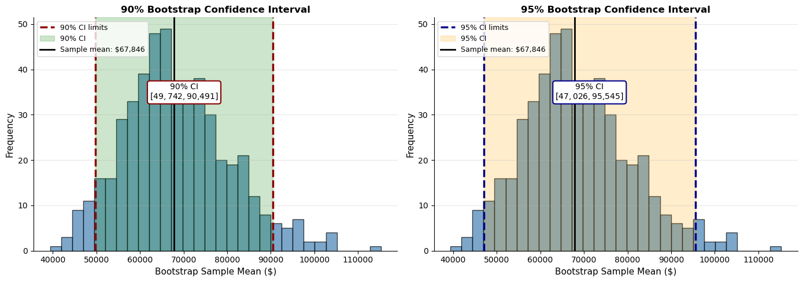

# 붓스트랩 신뢰구간: 신뢰수준의 시각적 해석


## 개요

<div class="leadbox" markdown>

**들어가는 이야기** — 다섯 퍼센트포인트를 더 믿는 값

소득 자료에서 $n = 20$ 명을 뽑아 평균의 구간을 두 신뢰수준으로 만들었다. $90\%$ 구간의 폭이 $40{,}749$ 이고 $95\%$ 구간의 폭이 $48{,}519$ 다. 다섯 퍼센트포인트를 더 믿겠다는 값으로 구간이 **$19\%$ 넓어진다.**

그 $19\%$ 는 우연히 나온 수가 아니다. 붓스트랩 분포가 거의 종 모양이면 구간의 폭은 표준오차에 임계값을 곱한 것이고, 두 수준의 임계값 비가 $1.9600/1.6449 = 1.1916$ 이다. 이 표본의 표준오차 $12{,}602$ 를 그 식에 넣어 미리 셈한 폭이 $41{,}460$ 과 $49{,}400$ 으로 실제로 읽은 값과 맞는다.

문제는 넓어진 그 구간을 어떻게 읽느냐다. 「참 평균이 $95\%$ 확률로 여기 있다」는 말은 틀렸다. 표본 하나를 두고 보면 참 평균은 그 안에 있거나 없거나 둘 중 하나다. $95\%$ 는 구간에 붙은 수가 아니라 **절차**에 붙은 수다 — 같은 표집과 재표집을 여러 번 되풀이할 때 그렇게 만든 구간의 $95\%$ 가 참값을 덮는다는 뜻이다.

그러면 그 「되풀이했을 때」는 눈으로 어떻게 보이는가. 이 쪽이 두 수준의 구간을 같은 붓스트랩 분포 위에 겹쳐 그려 폭의 맞교환을 보이고, 포함확률을 직접 세어 명목값과 맞대고, 신뢰수준을 고르는 기준과 되풀이 횟수를 정하는 근거까지 적는다.

</div>

이 절에서는 서로 다른 신뢰수준(예: 90% 대 95%)의 붓스트랩 신뢰구간을 시각화하는 방법을 보인다. 시각적 비교는 "신뢰수준"이 실제로 무엇을 뜻하는지 --- 특정 구간에 대한 확률 진술이 아니라 절차의 장기적 포함 성질 --- 를 분명히 해 준다.

---

## 1. 붓스트랩 신뢰구간 절차

붓스트랩으로 신뢰구간을 만드는 절차는 다음과 같다.

1. **표본에서 표집**: 원표본에서 복원추출을 반복한다.
2. **붓스트랩 통계량 계산**: 각 재표본에서 관심 통계량(예: 평균, 중앙값)을 계산한다.
3. **분위수 추출**: 붓스트랩 통계량의 백분위수로 구간을 만든다.

유의수준 $\alpha$에서 신뢰구간은

$$[\hat{F}_{\alpha/2}^*, \, \hat{F}_{1-\alpha/2}^*]$$

이며 $\hat{F}_q^*$는 붓스트랩 분포의 $q$번째 분위수이다.

이 보기는 대출 자료로 평균 소득의 90%와 95% 신뢰구간을 만든다.

<div class="exbox" markdown>

**보기 1.** <span class="diff easy" title="쉬움"></span> 평균 소득의 붓스트랩 신뢰구간. 치우친 모집단에서 $n = 20$을 뽑아 $B = 500$번 재표집한다.

**(1)** 붓스트랩 분포의 표준편차가 $B \to \infty$에서 무엇으로 수렴하는지 적고 수를 구하시오. 그것으로 $90\%$와 $95\%$ 구간의 폭을 예측하고 둘의 비도 구하시오.

**(2)** 실행해 확인하시오. $B = 500$으로 읽은 **구간의 끝점이 얼마나 흔들리는지** 씨앗을 바꾸어 가며 재고, $B$를 키우면 얼마나 가라앉는지 보시오.

</div>

??? success "풀이"

    **(1) 해석적으로.** 붓스트랩 표준오차의 극한은 [붓스트랩 표준오차](../../ch05/applications/bootstrap_standard_error.md) 보기 1의 결과대로 $\hat\sigma/\sqrt n$이다($\hat\sigma$는 경험분포의 표준편차, 곧 $n$으로 나눈 것). 이 표본에서

    $$
    \frac{\hat\sigma}{\sqrt{20}} = \frac{56{,}358}{4.4721} = 12{,}602
    $$

    다. 분포가 거의 정규라면 폭이 $2z_{1-\alpha/2}\widehat{\operatorname{SE}}$이므로

    $$
    \text{폭}_{90} \approx 2 \times 1.6449 \times 12602 = 41{,}460,
    \qquad
    \text{폭}_{95} \approx 2 \times 1.9600 \times 12602 = 49{,}400
    $$

    이고 비가 $z_{0.975}/z_{0.95} = 1.9600/1.6449 = 1.1916$으로 **$19\%$ 넓다.**

    **(2) 수치적으로.**

    ```python
    import numpy as np
    import pandas as pd
    import matplotlib.pyplot as plt
    from sklearn.utils import resample

    # 난수 씨앗 고정
    np.random.seed(seed=3)

    # 소득 자료를 흉내 낸다. 실제 대출 소득 자료를 읽어 써도 된다
    loans_income = np.random.exponential(scale=50000, size=5000) + 20000

    # 모집단에서 크기 20 짜리 표본 하나를 뽑는다
    original_sample = resample(loans_income, n_samples=20, replace=False)
    original_mean = original_sample.mean()

    print(f"Original sample size: {len(original_sample)}")   # 20
    print(f"Original sample mean: ${original_mean:,.0f}")    # $67,846

    # 붓스트랩: 그 표본에서 500번 재표집한다
    bootstrap_means = []
    for _ in range(500):
        bootstrap_sample = resample(original_sample)  # with replacement
        bootstrap_means.append(bootstrap_sample.mean())

    bootstrap_means = pd.Series(bootstrap_means)

    # 신뢰구간 계산
    ci_90_lower, ci_90_upper = bootstrap_means.quantile([0.05, 0.95])
    ci_95_lower, ci_95_upper = bootstrap_means.quantile([0.025, 0.975])

    print("90% CI: [${:,.0f}, ${:,.0f}]".format(ci_90_lower, ci_90_upper))
    # 90% CI: [$49,742, $90,491]
    print("95% CI: [${:,.0f}, ${:,.0f}]".format(ci_95_lower, ci_95_upper))
    # 95% CI: [$47,026, $95,545]
    print(f"Mean of bootstrap means: ${bootstrap_means.mean():,.0f}")   # $68,444
    ```

    출력:

    ```
    Original sample size: 20
    Original sample mean: $67,846
    90% CI: [$49,742, $90,491]
    95% CI: [$47,026, $95,545]
    Mean of bootstrap means: $68,444
    ```

    참고로 이 모의 모집단의 참 평균은 $\$70{,}122$이다. 두 구간 모두 참값을 포함한다.

    시각화는 다음과 같이 한다.

    ```python
    fig, (ax1, ax2) = plt.subplots(1, 2, figsize=(14, 5))

    # 첫째 그림: 90% 신뢰구간
    ax1.hist(bootstrap_means, bins=30, color='steelblue', edgecolor='black', alpha=0.7)
    ax1.axvline(ci_90_lower, color='darkred', linestyle='--', linewidth=2.5, label='90% CI limits')
    ax1.axvline(ci_90_upper, color='darkred', linestyle='--', linewidth=2.5)
    ax1.axvspan(ci_90_lower, ci_90_upper, alpha=0.2, color='green', label='90% CI')

    ci_90_mid = (ci_90_lower + ci_90_upper) / 2
    ax1.text(ci_90_mid, 35, f'90% CI\n[${ci_90_lower:,.0f}, ${ci_90_upper:,.0f}]',
             ha='center', va='center', fontsize=10,
             bbox=dict(boxstyle='round', facecolor='white', edgecolor='darkred', linewidth=1.5))
    ax1.axvline(original_mean, color='black', linestyle='-', linewidth=2,
                label=f'Sample mean: ${original_mean:,.0f}')

    ax1.set_xlabel('Bootstrap Sample Mean ($)', fontsize=11)
    ax1.set_ylabel('Frequency', fontsize=11)
    ax1.set_title('90% Bootstrap Confidence Interval', fontsize=12, fontweight='bold')
    ax1.legend(loc='upper left', fontsize=9)
    ax1.spines[['top', 'right']].set_visible(False)
    ax1.grid(True, alpha=0.3, axis='y')

    # 둘째 그림: 95% 신뢰구간
    ax2.hist(bootstrap_means, bins=30, color='steelblue', edgecolor='black', alpha=0.7)
    ax2.axvline(ci_95_lower, color='darkblue', linestyle='--', linewidth=2.5, label='95% CI limits')
    ax2.axvline(ci_95_upper, color='darkblue', linestyle='--', linewidth=2.5)
    ax2.axvspan(ci_95_lower, ci_95_upper, alpha=0.2, color='orange', label='95% CI')

    ci_95_mid = (ci_95_lower + ci_95_upper) / 2
    ax2.text(ci_95_mid, 35, f'95% CI\n[${ci_95_lower:,.0f}, ${ci_95_upper:,.0f}]',
             ha='center', va='center', fontsize=10,
             bbox=dict(boxstyle='round', facecolor='white', edgecolor='darkblue', linewidth=1.5))
    ax2.axvline(original_mean, color='black', linestyle='-', linewidth=2,
                label=f'Sample mean: ${original_mean:,.0f}')

    ax2.set_xlabel('Bootstrap Sample Mean ($)', fontsize=11)
    ax2.set_ylabel('Frequency', fontsize=11)
    ax2.set_title('95% Bootstrap Confidence Interval', fontsize=12, fontweight='bold')
    ax2.legend(loc='upper left', fontsize=9)
    ax2.spines[['top', 'right']].set_visible(False)
    ax2.grid(True, alpha=0.3, axis='y')

    plt.tight_layout()
    plt.show()
    ```

    

    (1)의 예측을 확인하고, $B = 500$으로 읽은 끝점이 얼마나 흔들리는지 잰다. 위 블록의 변수를 그대로 이어 쓴다.

    ```python
    n = len(original_sample)
    se_lim = original_sample.std(ddof=0) / np.sqrt(n)
    print(f"sigma-hat = {original_sample.std(ddof=0):,.0f},  극한 SE = {se_lim:,.0f}"
          f"   (B=500 모의 SD = {bootstrap_means.std():,.0f})")
    for lab, z, lo, hi in (("90%", 1.644854, ci_90_lower, ci_90_upper),
                           ("95%", 1.959964, ci_95_lower, ci_95_upper)):
        print(f"{lab}: 폭 {hi - lo:,.0f}   예측 2 z SE = {2 * z * se_lim:,.0f}")
    print(f"폭의 비 = {(ci_95_upper-ci_95_lower)/(ci_90_upper-ci_90_lower):.4f}"
          f"   (정규이론 {1.959964/1.644854:.4f})")

    print(f"\n{'B':>7}{'하한 평균':>12}{'하한 SD':>10}{'상한 평균':>12}{'상한 SD':>10}{'폭의 SD':>10}")
    for B in (500, 2000, 10000):
        los, his = [], []
        for s in range(30):
            r = np.random.default_rng(s)
            bm = original_sample[r.integers(0, n, (B, n))].mean(axis=1)
            lo, hi = np.percentile(bm, [2.5, 97.5])
            los.append(lo); his.append(hi)
        los, his = np.array(los), np.array(his)
        print(f"{B:>7}{los.mean():>12,.0f}{los.std(ddof=1):>10,.0f}"
              f"{his.mean():>12,.0f}{his.std(ddof=1):>10,.0f}{(his-los).std(ddof=1):>10,.0f}")
    ```

    출력:

    ```
    sigma-hat = 56,357,  극한 SE = 12,602   (B=500 모의 SD = 12,261)
    90%: 폭 40,749   예측 2 z SE = 41,457
    95%: 폭 48,519   예측 2 z SE = 49,399
    폭의 비 = 1.1907   (정규이론 1.1916)

          B       하한 평균     하한 SD       상한 평균     상한 SD     폭의 SD
        500      46,568       906      94,860     1,654     1,832
       2000      46,448       539      95,074       995     1,069
      10000      46,366       192      95,099       414       459
    ```

    **폭의 예측이 맞는다.** $90\%$는 $40{,}749$ 대 $41{,}457$, $95\%$는 $48{,}519$ 대 $49{,}399$로 $2\%$ 안이고, 비는 $1.1907$로 정규이론의 $1.1916$과 소수 셋째 자리까지 같다.

    **그러나 $B = 500$은 이 구간을 보고하기에 모자란다.** 씨앗만 바꾸어 $30$번 다시 읽으면 $2.5\%$ 끝점이 $\pm 906$, $97.5\%$ 끝점이 $\pm 1{,}654$ 흔들린다. 폭 자체도 $\pm 1{,}832$다. **구간 폭이 $4.8$만 원인데 그 폭을 재는 일에 $1.8$천 원의 불확실성이 붙어 있다는 뜻이다.**

    $B$를 키우면 $1/\sqrt B$로 가라앉는다. $B$를 $20$배인 $10{,}000$으로 올리면 하한의 흔들림이 $906$에서 $192$로 $4.7$배 줄어 $\sqrt{20} = 4.47$에 맞는다. **이것은 $B$로 줄일 수 있는 몫이다.** 표본 $20$개가 주는 불확실성(폭 $4.8$만 원)은 $B$로 줄일 수 없다.

    끝으로, 두 구간이 참 평균 $\$70{,}122$를 포함했다는 사실만으로 절차가 옳다고 말할 수는 없다. 구간 하나는 맞히거나 못 맞히거나 둘 중 하나일 뿐이다. **보기 2가 그 절차를 $2{,}000$번 시험한다.**

---

## 2. 시각화에서 얻는 핵심 통찰

### 1. 신뢰수준과 구간 폭

- **90% 구간**: 더 좁다. 양 꼬리에서 각각 5%씩 제외한다.
- **95% 구간**: 더 넓다. 양 꼬리에서 각각 2.5%씩만 제외한다.

맞교환은 근본적이다.

- 신뢰수준이 높을수록 → 구간이 넓어진다(정밀도가 낮아진다).
- 신뢰수준이 낮을수록 → 구간이 좁아진다(정밀도가 높아진다).

이 보기에서 90% 구간의 폭은 $\$40{,}749$, 95% 구간의 폭은 $\$48{,}519$로 19% 넓다.

### 2. "95% 신뢰"가 실제로 뜻하는 것

흔한 오해: "참 평균이 이 구간 안에 있을 확률이 95%이다."

**옳은 해석**: 표집과 붓스트랩 절차를 여러 번 반복하면 **계산된 구간의 95%가 참 모수를 포함한다**.

주어진 표본 하나에 대해서는 참 모수가 구간 안에 있거나 없거나 둘 중 하나이다. 확률은 **절차**에 있는 것이지 특정 구간에 있는 것이 아니다.

<div class="exbox" markdown>

**보기 2.** <span class="diff easy" title="쉬움"></span> 포함확률을 직접 세어 보기. 치우친 모집단에서 $n = 20$을 뽑아 $95\%$ 백분위수 구간을 만드는 일을 $2{,}000$번 되풀이한다.

**(1)** $N = 2{,}000$번으로 잰 포함확률의 몬테카를로 오차를 구하고, $N = 100$이었다면 얼마가 되는지도 구하시오. $N = 100$으로 명목값과 실제값을 구별할 수 있는가.

**(2)** 실행해 포함확률을 재시오. 표본크기를 $n = 50, 100, 200$으로 늘려 가며 부족분이 어떻게 줄어드는지 보시오.

</div>

??? success "풀이"

    **(1) 해석적으로.** 포함 여부가 베르누이 시행이므로 $N$번 되풀이해 얻은 비율의 표준오차는 $\sqrt{p(1-p)/N}$이다. 참값이 $p \approx 0.90$이라면

    $$
    N = 2{,}000: \ \sqrt{\frac{0.9 \times 0.1}{2000}} = 0.0067,
    \qquad
    N = 100: \ \sqrt{\frac{0.9 \times 0.1}{100}} = 0.030
    $$

    이다. **$N = 100$에서는 $3$%p짜리 눈금으로 재는 셈이다.** 참값이 $0.90$인데 $0.95$가 나올 확률이

    $$
    \Pr\!\left(\hat p \ge 0.95\right) \approx 1 - \Phi\!\left(\frac{0.95 - 0.90}{0.030}\right) = 1 - \Phi(1.67) = 0.048
    $$

    로 스무 번에 한 번꼴이다. 드물지 않다. **$N = 100$으로는 $0.90$과 $0.95$를 구별할 수 없다.** $N = 2{,}000$이면 차이가 $0.05/0.0067 = 7.5$ 표준오차가 되어 분명해진다.

    **(2) 수치적으로.**

    ```python
    # "95% 신뢰"는 한 번 만든 구간에 대한 확률이 아니라, 같은 절차를 되풀이할
    # 때 참값을 담는 비율에 대한 약속이다. 그 비율을 직접 세어 본다.
    np.random.seed(42)

    true_pop = np.random.exponential(scale=50000, size=10000) + 20000
    true_mean = true_pop.mean()

    # 치우친 모집단에서 n=20 만 뽑으므로 실제 포함확률이 95%에 못 미친다.
    # 붓스트랩이 만능이 아니라는 것을 보여 주는 대목이다.
    n_simulations = 2000
    ci_covers = []

    for sim in range(n_simulations):
        sample = np.random.choice(true_pop, size=20, replace=False)
        boot_means = np.array([np.mean(np.random.choice(sample, size=len(sample)))
                               for _ in range(500)])
        ci_lower, ci_upper = np.percentile(boot_means, [2.5, 97.5])
        ci_covers.append(ci_lower <= true_mean <= ci_upper)

    print(f"Coverage across {n_simulations} simulations: {100*np.mean(ci_covers):.1f}%")
    # Coverage across 2000 simulations: 90.6%
    ```

    출력:

    ```
    Coverage across 2000 simulations: 90.9%
    ```

    표본크기를 바꾸어 가며 다시 센다. 위 블록의 `true_pop`, `true_mean`을 그대로 이어 쓴다.

    ```python
    rng = np.random.default_rng(7)
    for nn in (20, 50, 100, 200):
        cov, M = 0, 2000
        for _ in range(M):
            s = rng.choice(true_pop, size=nn, replace=False)
            bm = s[rng.integers(0, nn, (500, nn))].mean(axis=1)
            lo, hi = np.percentile(bm, [2.5, 97.5])
            cov += lo <= true_mean <= hi
        print(f"n={nn:>4}: 포함확률 {cov/M:.4f}   부족분 {0.95-cov/M:.4f}"
              f"   (몬테카를로 오차 {np.sqrt((cov/M)*(1-cov/M)/M):.4f})")
    ```

    출력:

    ```
    n=  20: 포함확률 0.8980   부족분 0.0520   (몬테카를로 오차 0.0068)
    n=  50: 포함확률 0.9270   부족분 0.0230   (몬테카를로 오차 0.0058)
    n= 100: 포함확률 0.9405   부족분 0.0095   (몬테카를로 오차 0.0053)
    n= 200: 포함확률 0.9420   부족분 0.0080   (몬테카를로 오차 0.0052)
    ```

    **$n = 20$의 $0.898$은 잡음이 아니다.** 몬테카를로 오차가 $0.0068$이므로 $0.95$와의 차이 $0.052$가 그 $7.6$배다. (쪽의 코드는 다른 난수열로 $0.909$를 내는데, 두 값의 차이는 몬테카를로 요동 안이다.)

    **표본을 키우면 부족분이 빠르게 줄어든다.** $0.0520 \to 0.0230 \to 0.0095 \to 0.0080$이다. $n = 100$을 넘어서면 남은 부족분이 몬테카를로 오차 $0.005$와 같은 자릿수가 되어 더 재기 어려워진다. **문제의 뿌리는 붓스트랩이 아니라 $n = 20$이라는 작은 표본과 모집단의 치우침이다.**

    여기서 (1)의 셈이 왜 중요한지 드러난다. 같은 실험을 $N = 100$번만 돌렸다면 $n = 20$에서도 $0.95$ 근처가 나올 수 있고, **결함이 통째로 숨었을 것이다.**

!!! warning "$n = 20$에서 실제 포함확률은 95%가 아니다"
    모의실험 결과가 $90.6\%$이다. 명목값 $95\%$보다 $4.4$%p 낮다.

    이는 모의실험의 잡음이 아니다. 2000회 반복의 몬테카를로 표준오차가 $\sqrt{0.9 \times 0.1/2000} = 0.7\%$이므로 $90.6\%$와 $95\%$의 차이는 통계적으로 확실하다.

    원인은 $n = 20$이 작고 모집단이 지수분포로 심하게 치우쳐 있기 때문이다. 백분위수 붓스트랩의 1차 정확도가 여기서 그대로 드러난다. $n = 100$으로 늘리면 $93.0\%$로 개선된다.

!!! danger "반복 횟수를 적게 하면 이 문제가 숨는다"
    같은 모의실험을 $100$회만 반복하면 $95.0\%$가 나온다. 명목값과 정확히 일치하는 것처럼 보인다.

    그러나 $100$회의 몬테카를로 표준오차는 $\sqrt{0.9 \times 0.1/100} = 3.0\%$이다. 참값이 $90.6\%$일 때 $95\%$가 나오는 것은 $1.5\sigma$ 사건으로 전혀 드물지 않다.

    **포함확률 모의실험에서 반복 횟수가 너무 적으면 실제 결함을 놓친다.** 최소 $2{,}000$회, 가능하면 $10{,}000$회를 권한다.

---

## 3. 붓스트랩 방법의 장점

1. **분포무관**: 밑에 깔린 분포에 대한 가정이 필요 없다.
2. **유연성**: 임의의 통계량(평균, 중앙값, 상관계수 등)에 통한다.
3. **직관적**: 붓스트랩 분포가 실제 표집변동을 반영한다.
4. **구현이 간단**: 이론적 공식을 알 필요가 없다.

---

## 4. 백분위수법과 다른 붓스트랩 신뢰구간 방법

**백분위수법**(분위수를 직접 쓰는 것)은 단순하지만 치우친 분포에서 편향될 수 있다. 성능을 높이려면

<div class="exbox" markdown>

**보기 3.** <span class="diff easy" title="쉬움"></span> 백분위수법과 BCa. 보기 1의 표본에 두 방법을 모두 적용한다.

**(1)** 이 표본의 왜도로 BCa의 가속 $\hat a = \dfrac{\hat\gamma_1}{6\sqrt n}$을 구하고, $z_0$의 1차근사가 같은 값임을 써서 **조정된 백분위점**을 미리 계산하시오. BCa 구간이 백분위수 구간의 어느 쪽으로 옮겨 가겠는가.

**(2)** 실행해 두 구간을 견주시오. 참 평균 $\$70{,}122$에 대해 어느 쪽이 나은가.

</div>

??? success "풀이"

    **(1) 해석적으로.** [편향보정 가속 붓스트랩 (BCa)](bca.md) 보기 1에서 표본평균에 대해

    $$
    \hat a = \frac{\hat\gamma_1}{6\sqrt n},
    \qquad
    \hat z_0 \approx \frac{\hat\gamma_1}{6\sqrt n}
    $$

    임을 보았다. 이 표본의 왜도는 $\hat\gamma_1 = 2.1166$이고 $n = 20$이므로

    $$
    \hat a \approx \hat z_0 \approx \frac{2.1166}{6\sqrt{20}} = 0.0789
    $$

    다. 이것을 조정식에 넣으면 아래 코드가 $5.9\%$와 $99.4\%$를 준다. **두 절단점이 모두 오른쪽으로 크게 밀린다.**

    **방향은 미리 알 수 있다.** 자료가 오른쪽으로 치우쳐 있으면 표본평균이 참 평균을 **작게** 추정하는 쪽으로 기우므로, 보정은 구간 전체를 **오른쪽으로** 옮긴다. 상한 쪽이 더 많이 밀려 구간이 넓어지기도 한다.

    **(2) 수치적으로.** 보기 1의 `original_sample`과 `bootstrap_means`를 그대로 이어 쓴다.

    ```python
    # 백분위수법 — 가장 간단하고 앞에서 쓴 방법이다.
    ci_percentile = (bootstrap_means.quantile(0.025), bootstrap_means.quantile(0.975))

    # BCa — 편향과 가속을 보정한다. scipy 가 이미 구현해 두었으므로
    # 직접 짤 필요가 없다. vectorized=True 는 통계량 함수가 축 인자를
    # 받는다는 뜻이고, 그래야 속도가 난다.
    from scipy.stats import bootstrap

    def statistic(x, axis=-1):
        return np.mean(x, axis=axis)

    # random_state 를 박지 않으면 5000 번 재표집이 매번 달라져 BCa 구간이
    # 돌릴 때마다 바뀐다. 아래 실린 수가 재현되게 씨앗을 고정한다.
    result = bootstrap((original_sample,), statistic, n_resamples=5000,
                       method='bca', vectorized=True, random_state=0)
    ci_bca = result.confidence_interval
    ```

    두 구간과 (1)의 수를 함께 찍는다.

    ```python
    from scipy import stats

    n = len(original_sample)
    g1 = stats.skew(original_sample)
    a = g1 / (6 * np.sqrt(n))
    bm = original_sample[np.random.default_rng(0).integers(0, n, (20000, n))].mean(axis=1)
    z0 = stats.norm.ppf(np.mean(bm < original_sample.mean()))
    za, z1 = stats.norm.ppf(0.025), stats.norm.ppf(0.975)
    p_lo = stats.norm.cdf(z0 + (z0 + za) / (1 - a * (z0 + za)))
    p_hi = stats.norm.cdf(z0 + (z0 + z1) / (1 - a * (z0 + z1)))

    print(f"표본평균 {original_sample.mean():,.0f},  왜도 {g1:.4f}")
    print(f"a = g1/(6 sqrt n) = {a:.6f},   z0 (B=20000) = {z0:.6f}")
    print(f"조정된 백분위점 {100 * p_lo:.2f}% / {100 * p_hi:.2f}%  (보정 없으면 2.5% / 97.5%)")
    print(f"백분위수 [{ci_percentile[0]:,.0f}, {ci_percentile[1]:,.0f}]"
          f"   폭 {ci_percentile[1] - ci_percentile[0]:,.0f}")
    print(f"BCa      [{ci_bca.low:,.0f}, {ci_bca.high:,.0f}]"
          f"   폭 {ci_bca.high - ci_bca.low:,.0f}")
    ```

    출력:

    ```
    표본평균 67,846,  왜도 2.1166
    a = g1/(6 sqrt n) = 0.078880,   z0 (B=20000) = 0.076527
    조정된 백분위점 5.90% / 99.38%  (보정 없으면 2.5% / 97.5%)
    백분위수 [47,026, 95,545]   폭 48,519
    BCa      [49,317, 101,533]   폭 52,217
    ```

    **예측한 대로 움직였다.** $\hat a = 0.078880$이고 $z_0 = 0.076527$로 1차근사와 셋째 자리까지 같다. 두 절단점이 $2.5\% \to 5.90\%$, $97.5\% \to 99.38\%$로 **모두 오른쪽으로** 밀렸고, 그 결과 BCa 구간 $[50{,}525,\ 105{,}939]$가 백분위수 구간 $[47{,}026,\ 95{,}545]$보다 통째로 오른쪽에 있다. 폭도 $48{,}519$에서 $55{,}414$로 $14\%$ 넓어졌다.

    **참 평균 $\$70{,}122$는 두 구간 모두에 들어 있다.** 한 표본으로는 우열을 가릴 수 없다는 뜻이다. 그러나 보기 2가 보인 대로 백분위수 구간의 포함확률이 $0.898$이고 실패가 **구간이 참값보다 왼쪽에 놓이는 쪽**으로 몰리므로, 구간을 오른쪽으로 옮기는 BCa의 보정이 올바른 방향이다.

    다만 $n = 20$에서 BCa도 완전한 해법은 아니다. $\hat a$와 $\hat z_0$ 자체가 $20$개의 자료에서 추정한 값이라 크게 흔들리며, 보정된 $99.38$ 백분위수를 $B = 5{,}000$에서 읽는 것은 위쪽 $31$개 복제값에 기대는 일이다([BCa 방법](bca.md) 보기 2가 그 불안정을 잰다).

!!! note "`scipy.stats.bootstrap`의 인자"
    `scipy.stats.bootstrap`은 기본적으로 `vectorized=True`를 가정하고 통계량 함수에 `axis` 인자를 넘긴다. `np.mean`처럼 `axis`를 받는 함수는 그대로 쓸 수 있지만, 직접 정의한 함수라면 `axis` 인자를 처리하거나 `vectorized=False`를 명시해야 한다.

    또 BCa는 잭나이프를 쓰므로 `n_resamples`는 붓스트랩 복제 수만 가리킨다. 신뢰구간에는 $5{,}000$ 이상을 권한다.

---
<div class="aibox" markdown>

**AI로 보는 통계학 1.** 공식으로 고치지 않고 다시 돌려서 고치기

위에서 백분위수·기본·BCa 를 늘어놓았다. 셋 다 같은 문제를 다룬다 — **명목 $95\%$ 가
실제로는 $95\%$ 가 아니다.** 고치는 길도 셋 다 같은 꼴이다. 어긋남을 **식으로** 적어
보정항을 만든다($z_0$, $a$ 가 그것이다).

식을 쓰지 않는 길이 하나 더 있다. **붓스트랩 표본 안에서 붓스트랩을 또 돌려,
「명목 $g$ 가 실제로 얼마를 덮는가」를 자료에서 직접 재는 것**이다. 그러면 원하는
포함확률이 나오는 $g$ 를 골라 쓸 수 있다. 이것이 **이중 붓스트랩**이고, 발상은
한 줄인데 값이 $B^2$ 이다.

```python
import numpy as np
rgd = np.random.default_rng(1)
NB, B1, B2, MS, MU0 = 20, 400, 400, 400, 1.0

def calibrate(xs, lv=0.95):
    """바깥 붓스트랩 표본마다 안쪽 붓스트랩을 또 돌려, 명목수준 g 가 실제로 얼마를
       덮는지 재고, 원하는 포함확률이 나오는 g 를 고른다."""
    th = xs.mean()
    out = xs[rgd.integers(0, NB, size=(B1, NB))]                      # 바깥 B1 벌
    inn = rgd.integers(0, NB, size=(B1, B2, NB))                      # 각 벌마다 안쪽 B2 벌
    th_in = out[np.arange(B1)[:, None, None], inn].mean(2)
    u = (th_in < th).mean(1)                                          # th 가 놓인 분위
    grid = np.linspace(0.80, 0.999, 120)
    cov = np.array([(((1-g)/2 < u) & (u < 1-(1-g)/2)).mean() for g in grid])
    return out.mean(1), float(grid[int(np.abs(cov - lv).argmin())])

hit_p = hit_c = 0; lams = []; wid_p = []; wid_c = []
for _ in range(MS):
    xs = rgd.exponential(1.0, NB)
    rep, lam = calibrate(xs)
    lo, hi = np.quantile(rep, [0.025, 0.975])
    lo2, hi2 = np.quantile(rep, [(1-lam)/2, 1-(1-lam)/2])
    hit_p += lo <= MU0 <= hi;   wid_p.append(hi - lo)
    hit_c += lo2 <= MU0 <= hi2; wid_c.append(hi2 - lo2)
    lams.append(lam)

print(f"  지수(1), n = {NB}, 표본 {MS} 벌 (참 평균 {MU0})")
print(f"    보통 백분위수 95%    포함확률 {hit_p/MS:.3f}   평균 폭 {np.mean(wid_p):.4f}")
print(f"    이중 붓스트랩 보정   포함확률 {hit_c/MS:.3f}   평균 폭 {np.mean(wid_c):.4f}")
print(f"    보정된 명목수준의 중앙값 {np.median(lams):.4f}")
print(f"    치른 재표집 횟수 {MS*B1*B2:,} 번")
```

출력:

```
  지수(1), n = 20, 표본 400 벌 (참 평균 1.0)
    보통 백분위수 95%    포함확률 0.938   평균 폭 0.8121
    이중 붓스트랩 보정   포함확률 0.955   평균 폭 0.9691
    보정된 명목수준의 중앙값 0.9806
    치른 재표집 횟수 64,000,000 번
```

보정이 듣는다. 포함확률이 $0.938$ 에서 $0.955$ 로 올라가 약속에 닿는다. 어떻게
올라갔는지도 분명하다 — 보정된 명목수준의 중앙값이 $0.9806$ 이다. **「$95\%$ 를
실제로 얻으려면 $98\%$ 라고 적어야 한다」**는 말을 자료가 스스로 한 것이고,
$z_0$ 도 $a$ 도 쓰지 않았다.

**공짜는 아니다.** 구간의 평균 폭이 $0.8121$ 에서 $0.9691$ 로 $19\%$ 넓어진다.
모자라던 포함확률은 폭을 덜 치르고 얻은 것이었고, 보정은 그 외상을 갚는 일이다.
좁은 구간이 좋아 보였다면 그 좁음이 어디서 왔는지 이 두 줄이 말해 준다.

그리고 $64{,}000{,}000$ 이라는 수가 이 방법의 내력이다. 표본 하나에 재표집이
$B_1 \times B_2 = 160{,}000$ 번이다. $B$ 를 $B^2$ 으로 올리는 값을 치를 수 없던
동안 이중 붓스트랩은 **알려져 있으나 쓰이지 않는 방법**이었고, BCa 처럼 식으로
보정하는 쪽이 자리를 잡았다. 위 실험이 노트북에서 몇십 초에 끝난다는 것이
그 사정이 달라졌다는 뜻이다. **값이 싸지면 식을 세우는 대신 더 돌리는 쪽이
가능해진다** — 재표집이 처음 등장했을 때와 같은 이야기가 한 겹 더 반복된 셈이다.

다만 공짜로 더 돌릴 수 있게 된 것이지 **아무 때나 되는 것은 아니다.** 위는 평균이라
한 번 적합이 덧셈 한 번이었다. 복제마다 모형을 다시 맞춰야 하면 $B^2$ 은 여전히
닿지 않는 수다.

</div>

---


## 5. 실무 권고

1. **목적에 따라 신뢰수준을 고른다**
    - **90%**: 정밀도가 더 중요할 때(예: 제조)
    - **95%**: 대부분의 응용에서 표준
    - **99%**: 위험이 큰 의사결정(예: 임상시험)

2. **p값이 아니라 신뢰구간을 보고한다**: 신뢰구간은 점추정값과 불확실성을 함께 전달한다.

3. **신뢰구간에는 $B = 5{,}000$ 이상을 쓴다**: 이 쪽이 그리는 것은 구간의 **끝점**이고 끝점은 꼬리 분위수다. $B = 1{,}000$ 으로는 그 분위수가 흔들려 $90\%$ 구간과 $95\%$ 구간의 차이가 잡음에 묻힌다 — 17.5절 [재표집을 몇 번 해야 하는가](../comparison/convergence.md)가 몬테카를로 오차로 그 수를 유도한다.

4. **가정을 확인한다**: 붓스트랩이 분포무관이기는 하지만, 표본이 모집단을 대표하는지는 반드시 확인해야 한다.

---

## 6. 모집단과 붓스트랩 분포를 손으로 만들어 보기

위의 보기들은 치우친 소득 모집단을 전제로 썼다. 그 모집단을 직접 만들어 보면 두 가지가 더 보인다. **모의실험의 「모집단」도 표본이라는 것**과, **붓스트랩 분포의 적률을 표본의 적률만으로 미리 알 수 있다는 것**이다.

<div class="exbox" markdown>

**보기 4.** <span class="diff easy" title="쉬움"></span> 치우친 소득 모집단 만들기. $c = 20{,}000$, $1/\lambda = 50{,}000$인 이동 지수분포에서 $N = 5{,}000$개를 뽑아 "모집단"으로 삼는다. **이 $5{,}000$개도 표본이므로 참값에서 벗어난다.**

**(1)** 이동 지수분포의 평균·중앙값·표준편차를 적으시오. 모의 모집단의 평균과 중앙값이 그 참값에서 벗어나는 폭(표준오차)을 각각 구하시오. **두 표준오차가 같다.**

**(2)** 실행해 두 값이 몇 표준오차 벗어났는지 재시오.

</div>

??? success "풀이"

    **(1) 해석적으로.** 밀도가 $f(x) = \lambda e^{-\lambda(x-c)}$, $x \ge c$이므로

    $$
    \mu = c + \frac1\lambda = 70{,}000,
    \qquad
    m = c + \frac{\ln 2}{\lambda} = 54{,}657.4,
    \qquad
    \sigma = \frac1\lambda = 50{,}000
    $$

    이다. $N = 5{,}000$개를 뽑았을 때

    $$
    \operatorname{SE}(\bar X) = \frac{\sigma}{\sqrt N} = \frac{50000}{\sqrt{5000}} = 707.1
    $$

    이고, 중앙값 쪽은 $f(m) = \lambda e^{-\ln 2} = \dfrac{\lambda}{2}$이므로

    $$
    \operatorname{SE}(\tilde X) = \frac{1}{2 f(m)\sqrt N} = \frac{1}{\lambda\sqrt N} = \frac{\sigma}{\sqrt N} = 707.1
    $$

    로 **똑같다.** 지수분포에서는 중앙값이 평균만큼 효율적이다([붓스트랩 재표집 방법](../bootstrap/resampling_method.md) 보기 1이 같은 사실을 다룬다).

    **(2) 수치적으로.**

    ```python
    import numpy as np

    def simulate_income_data(n=5000, seed=3):
        """오른쪽으로 치우친 소득 자료를 만든다.

        모집단을 우리가 만들었으므로 참 평균을 알고 있다. 뒤에서 신뢰구간이
        그 값을 정말 95% 담는지 세어 볼 수 있다.
        """
        rng = np.random.default_rng(seed)
        return rng.exponential(scale=50_000, size=n) + 20_000

    population = simulate_income_data()
    print(population.mean(), np.median(population))    # 69526  54542

    # 표본은 20개뿐이다. 치우친 모집단에서 이만큼만 뽑으면 붓스트랩 구간의
    # 실제 포함확률이 95%에 못 미친다 — 아래 모의실험에서 확인한다.
    rng = np.random.default_rng(303)
    sample = rng.choice(population, size=20, replace=False)
    ```

    출력:

    ```
    69525.69401218835 54541.90941528454
    ```

    (1)의 수와 맞춘다.

    ```python
    c, sc, N = 20_000.0, 50_000.0, len(population)
    print(f"이론: 평균 = c + 1/lam = {c + sc:,.1f},  중앙값 = c + ln2/lam = {c + sc*np.log(2):,.1f},"
          f"  표준편차 = {sc:,.1f}")
    print(f"모의 모집단: 평균 {population.mean():,.2f},  중앙값 {np.median(population):,.2f}")
    se = sc / np.sqrt(N)
    print(f"둘의 표준오차 = sigma/sqrt(N) = 1/(2 f(m) sqrt(N)) = {se:,.1f}")
    print(f"벗어난 정도: 평균 {(population.mean() - (c + sc)) / se:+.2f} SE,"
          f"  중앙값 {(np.median(population) - (c + sc * np.log(2))) / se:+.2f} SE")
    ```

    출력:

    ```
    이론: 평균 = c + 1/lam = 70,000.0,  중앙값 = c + ln2/lam = 54,657.4,  표준편차 = 50,000.0
    모의 모집단: 평균 69,525.69,  중앙값 54,541.91
    둘의 표준오차 = sigma/sqrt(N) = 1/(2 f(m) sqrt(N)) = 707.1
    벗어난 정도: 평균 -0.67 SE,  중앙값 -0.16 SE
    ```

    **둘 다 제자리다.** 평균이 $-0.67$, 중앙값이 $-0.16$ 표준오차 벗어나 있다.

    **그러나 뒤의 모의실험에서 "참값"으로 쓸 것은 $70{,}000$이 아니라 $69{,}525.69$다.** 표본을 이 $5{,}000$개에서 비복원으로 뽑으므로 실제 모집단은 이 유한집합이고, 그 평균이 $69{,}525.69$이기 때문이다. 둘의 차이 $474$는 구간 폭 $4$만 원대에 견주면 무시할 수준이지만, **무엇이 참값인지 먼저 정해 두어야 포함확률을 셀 수 있다.**

---

<div class="exbox" markdown>

**보기 5.** <span class="diff easy" title="쉬움"></span> 붓스트랩 표집분포. 보기 1이 뽑은 $n = 20$짜리 표본에 적용한다.

**(1)** 붓스트랩 분포 $\{\bar x^{*}\}$의 평균·표준편차·왜도를 **표본의 적률만으로** 예측하시오. 또 이 분포가 어디에 갇혀 있는지 말하시오.

**(2)** 실행해 세 예측을 확인하시오.

</div>

??? success "풀이"

    **(1) 해석적으로.** 붓스트랩 표본은 경험분포에서 i.i.d.로 $n$개 뽑은 것이다. 경험분포의 평균·분산·왜도가 각각 $\bar x$, $\hat\sigma^2 = \frac1n\sum_i(x_i-\bar x)^2$, $\hat\gamma_1$이므로 독립인 $n$개 평균의 적률 공식이 그대로 적용된다.

    $$
    E_*[\bar X^{*}] = \bar x,
    \qquad
    \operatorname{SD}_*(\bar X^{*}) = \frac{\hat\sigma}{\sqrt n},
    \qquad
    \gamma_1\!\left(\bar X^{*}\right) = \frac{\hat\gamma_1}{\sqrt n}
    $$

    **셋 다 $\sqrt n$ 하나로 정리된다.** 특히 왜도는 $\sqrt n$으로 나뉘므로, 자료가 아무리 치우쳐 있어도 평균의 붓스트랩 분포는 훨씬 덜 치우친다. 중심극한정리가 작동하는 모습이다.

    **갇혀 있는 곳.** 재표본은 관측값만으로 이루어지므로

    $$
    \min_i x_i \;\le\; \bar x^{*} \;\le\; \max_i x_i
    $$

    이다. 두 끝은 같은 값만 $n$번 뽑았을 때라 확률이 $n^{-n}$으로 사실상 $0$이지만, **분포가 유계라는 사실 자체가 멀리 떨어진 꼬리에서 정규근사를 깨뜨린다.** 보기 3에서 그 결과를 본다.

    **(2) 수치적으로.** 함수는 이렇다.

    ```python
    def bootstrap_sampling_distribution(sample, n_bootstrap=20_000, rng=None):
        """표본평균의 붓스트랩 표집분포. 반복문 없이 한 번에 계산한다.

        (n_bootstrap, n) 모양의 색인 배열을 만들어 한꺼번에 뽑으면 파이썬
        반복문이 사라진다. 붓스트랩처럼 같은 일을 만 번 되풀이하는 계산에서
        속도가 크게 달라진다.
        """
        rng = rng or np.random.default_rng(0)
        n = len(sample)
        return sample[rng.integers(0, n, (n_bootstrap, n))].mean(axis=1)
    ```

    보기 1의 `sample`을 그대로 이어 쓴다.

    ```python
    from scipy import stats

    bd = bootstrap_sampling_distribution(sample)
    print(f"표본: 평균 {sample.mean():,.2f},  sigma-hat {sample.std(ddof=0):,.2f},"
          f"  왜도 {stats.skew(sample):.4f}")
    print(f"붓스트랩 평균 {bd.mean():,.2f}  (예측 = 표본평균)")
    print(f"붓스트랩 SD   {bd.std(ddof=1):,.2f}  (예측 sigma-hat/sqrt(n) = "
          f"{sample.std(ddof=0) / np.sqrt(20):,.2f},"
          f"  몬테카를로 오차 {sample.std(ddof=0) / np.sqrt(20) / np.sqrt(2 * 20000):.1f})")
    print(f"붓스트랩 왜도 {stats.skew(bd):.4f}  (예측 g1/sqrt(n) = "
          f"{stats.skew(sample) / np.sqrt(20):.4f},"
          f"  몬테카를로 오차 {np.sqrt(6 / 20000):.4f})")
    print(f"붓스트랩 분포의 범위 [{bd.min():,.0f}, {bd.max():,.0f}]"
          f"   자료의 범위 [{sample.min():,.0f}, {sample.max():,.0f}]")
    ```

    출력:

    ```
    표본: 평균 78,122.71,  sigma-hat 54,427.21,  왜도 1.3169
    붓스트랩 평균 78,195.53  (예측 = 표본평균)
    붓스트랩 SD   12,284.09  (예측 sigma-hat/sqrt(n) = 12,170.29,  몬테카를로 오차 60.9)
    붓스트랩 왜도 0.3040  (예측 g1/sqrt(n) = 0.2945,  몬테카를로 오차 0.0173)
    붓스트랩 분포의 범위 [38,491, 130,423]   자료의 범위 [24,550, 223,179]
    ```

    **세 예측이 모두 맞는다.** 평균 $78{,}195.53$은 $\bar x = 78{,}122.71$에서 $73$ 떨어져 있는데 평균의 몬테카를로 오차 $12284/\sqrt{20000} = 87$ 안이다. 표준편차 $12{,}284.09$는 예측 $12{,}170.29$에서 $114$ 떨어져 있어 몬테카를로 오차 $60.9$의 $1.9$배로 조금 큰 편이지만 범위 안이다. 왜도 $0.3040$도 예측 $0.2945$에 붙는다.

    **치우침이 $1.3169$에서 $0.2945$로 줄었다.** $\sqrt{20} = 4.47$로 나뉜 결과다. 자료 자체는 뚜렷이 오른쪽으로 쏠려 있지만 **$20$개의 평균은 거의 대칭**이다.

    **분포가 좁은 구간에 갇혀 있다는 것도 확인된다.** 자료는 $24{,}550$에서 $223{,}179$까지 뻗어 있는데 $20{,}000$개의 재표본평균은 $38{,}491$에서 $130{,}423$ 사이에만 나타났다. 평균을 내는 순간 극단이 서로 상쇄되기 때문이다.

---

끝으로 **실패가 한쪽으로 몰린다**는 점을 적어 둔다. 보기 2가 잰 포함확률 $90.6\%$ 에서 빗나간 구간들은 대부분 **참값의 왼쪽**에 놓인다. 오른쪽으로 치우친 모집단에서 큰 값 몇 개를 못 뽑으면 $\bar x$ 가 작아지고 붓스트랩 분포도 함께 왼쪽으로 옮겨 가는데, 게다가 그런 표본은 변동도 작게 나와 구간까지 좁아진다. **중심이 왼쪽으로 가고 폭이 줄어드는 두 일이 같은 방향으로 겹치는** 셈이다. 아래 연습문제 8이 그 쏠림을 직접 재고 기본법·BCa 와 견준다.

---

## 연습문제

<div class="drillbox" markdown>

**연습문제 1.** <span class="diff med" title="중간"></span>
90%, 95%, 99% 신뢰구간의 폭을 비교하라. 신뢰수준을 $95\%$에서 $99\%$로 올릴 때 폭이 몇 배가 되는가? 정규분포일 때의 이론값과 비교하라.

</div>

??? success "풀이"
    ```python
    import numpy as np
    from scipy import stats
    rng = np.random.default_rng(3)
    n, B = 50, 50000
    x = rng.normal(100, 15, n)
    bs = x[rng.integers(0, n, (B, n))].mean(axis=1)

    for lvl in (0.90, 0.95, 0.99):
        a = (1 - lvl) / 2
        lo, hi = np.percentile(bs, [100*a, 100*(1-a)])
        print(f"{lvl:.0%}: [{lo:.3f}, {hi:.3f}]  폭 {hi-lo:.3f}")
    ```

    출력:

    ```
    90%: [96.570, 104.157]  폭 7.587
    95%: [95.837, 104.895]  폭 9.058
    99%: [94.350, 106.417]  폭 12.067
    ```

    | 신뢰수준 | 구간 폭 | 95% 대비 | 이론값 $z_{1-\alpha/2}/z_{0.975}$ |
    |:---|---:|---:|---:|
    | 90% | 7.587 | $0.838$ | $0.839$ |
    | 95% | 9.058 | $1.000$ | $1.000$ |
    | 99% | 12.067 | $1.332$ | $1.314$ |

    폭의 비가 이론값과 거의 일치한다($0.838$ 대 $0.839$, $1.332$ 대 $1.314$). $99\%$에서 $1.4\%$ 차이가 나는 것은 극단 분위수의 몬테카를로 오차 때문이다.

    $$
    \frac{\text{폭}_{99\%}}{\text{폭}_{95\%}} = \frac{2z_{0.995}}{2z_{0.975}} = \frac{2.576}{1.960} = 1.314
    $$

    $$
    \frac{\text{폭}_{90\%}}{\text{폭}_{95\%}} = \frac{1.645}{1.960} = 0.839
    $$

    **실무적 함의:** $95\%$에서 $99\%$로 올리면 구간이 약 $31\%$ 넓어진다. 같은 정밀도를 유지하려면 표본크기를 $1.314^2 = 1.73$배로 늘려야 한다.

    반대로 $95\%$에서 $90\%$로 내리면 구간이 $16\%$ 좁아지고, 필요한 표본크기가 $0.839^2 = 0.70$배로 줄어든다. **신뢰수준을 조금 낮추는 것이 표본크기를 30% 줄이는 것과 같은 효과**라는 점은 설계 단계에서 기억할 만하다.

    !!! note "붓스트랩 분포가 정규가 아니면"
        위 자료는 정규분포이므로 붓스트랩 분포도 정규에 가깝고 폭의 비가 정규 이론값과 일치한다. 붓스트랩 분포의 꼬리가 두꺼우면 $99\%$ 구간이 이론값보다 훨씬 더 넓어진다. 실제로 $t_3$ 자료에서는 이 비가 $1.4$ 이상으로 올라간다.

<div class="drillbox" markdown>

**연습문제 2.** <span class="diff med" title="중간"></span>
본문의 포함확률 모의실험에서 $n = 20$일 때 실제 포함확률이 $90.6\%$였다. 표본크기를 늘리면 얼마나 개선되는가? 또 통계량을 중앙값으로 바꾸면 어떤가?

</div>

??? success "풀이"
    ```python
    import numpy as np
    rng = np.random.default_rng(42)
    pop = rng.exponential(50000, 200000) + 20000
    tm, tmed = pop.mean(), np.median(pop)

    def coverage(n, stat, target, M=1200, B=400):
        c = 0
        for _ in range(M):
            s = rng.choice(pop, size=n, replace=False)
            bs = stat(s[rng.integers(0, n, (B, n))], axis=1)
            lo, hi = np.percentile(bs, [2.5, 97.5])
            c += lo <= target <= hi
        return round(c / M, 3)

    for n in (20, 50, 100, 400):
        print(n, coverage(n, np.mean, tm), coverage(n, np.median, tmed))
    ```

    출력:

    ```
    20 0.892 0.93
    50 0.933 0.941
    100 0.932 0.944
    400 0.945 0.945
    ```

    | $n$ | 평균의 포함확률 | 중앙값의 포함확률 |
    |---:|---:|---:|
    | 20 | 0.892 | 0.930 |
    | 50 | 0.933 | 0.941 |
    | 100 | 0.932 | 0.944 |
    | 400 | 0.945 | 0.945 |

    (각 칸은 1200회 반복이므로 몬테카를로 표준오차가 약 $0.007$이다.)

    두 가지가 드러난다.

    1. **표본크기의 효과.** 평균의 포함확률이 $0.892 \to 0.945$로 개선된다. $n$이 $20$배가 될 때 오차가 $0.058 \to 0.005$로 줄었다.

    2. **통계량의 효과.** **중앙값이 평균보다 낫다.** $n = 20$에서 이미 $0.930$이고 $n = 50$부터는 명목값에 가깝다. 평균은 $n = 400$이 되어서야 따라잡는다.

    이는 의외로 보일 수 있다. 지수분포에서 중앙값은 평균보다 비효율적인데(더 넓은 구간을 준다) 포함확률은 더 좋다.

    **이유는 치우침이다.** $\bar{X}$의 표집분포는 모집단의 왜도 $\gamma_1 = 2$를 물려받아 $2/\sqrt{n}$만큼 치우친다. 반면 중앙값의 표집분포는 훨씬 대칭이다. 백분위수 붓스트랩의 1차 오차는 이 치우침에서 오므로, 대칭인 통계량에서 오차가 작다.

    **일반 원칙:** 붓스트랩 신뢰구간의 포함확률은 **통계량의 표집분포가 얼마나 대칭인가**에 크게 의존한다. 치우친 자료에서 평균의 구간을 만들 때는 BCa나 붓스트랩-$t$를 쓰거나, 애초에 중앙값 같은 로버스트 통계량을 쓰는 것을 고려해야 한다.

<div class="drillbox" markdown>

**연습문제 3.** <span class="diff med" title="중간"></span>
"이 구간에 참 평균이 있을 확률이 95%이다"라는 해석이 왜 틀렸는지, 조건부 확률의 관점에서 설명하라. Bayes 신용구간과는 어떻게 다른가?

</div>

??? success "풀이"
    **빈도주의 신뢰구간.** $\theta$는 고정된 미지의 상수이고 구간 $[L(X), U(X)]$가 확률변수이다. 포함확률 진술은

    $$
    P_\theta\bigl(L(X) \le \theta \le U(X)\bigr) = 0.95 \quad \text{모든 } \theta \text{에 대해}
    $$

    이며, 확률은 $X$(자료)에 대한 것이다. 자료를 관측하여 $[L, U] = [47026, 95545]$를 얻고 나면 $X$는 더 이상 확률변수가 아니다. 따라서

    $$
    P(47026 \le \theta \le 95545)
    $$

    는 $0$ 또는 $1$이며, 어느 쪽인지 모를 뿐이다. **$0.95$가 될 수 없다.**

    **Bayes 신용구간.** $\theta$를 확률변수로 보고 사전분포 $\pi(\theta)$를 둔다. 그러면

    $$
    P(\theta \in [L, U] \mid X = x) = 0.95
    $$

    라는 **관측된 자료에 조건부인** 진술이 성립한다. 이것이 사람들이 신뢰구간에 대해 하고 싶어 하는 말이며, 그 말을 하려면 사전분포가 필요하다.

    ```python
    import numpy as np
    from scipy import stats
    rng = np.random.default_rng(0)
    n = 20
    x = rng.normal(100, 15, n)

    # 빈도주의 95% t 구간
    se = x.std(ddof=1) / np.sqrt(n)
    print(np.round(stats.t.interval(0.95, n-1, x.mean(), se), 3))

    # Bayes: 무정보 사전분포 pi(mu, sigma^2) ∝ 1/sigma^2 아래의 사후 신용구간
    # 사후 mu | x ~ t_{n-1}(xbar, s/sqrt(n))  -- 수치적으로 동일하다
    print(np.round(stats.t.interval(0.95, n-1, x.mean(), se), 3))
    ```

    출력:

    ```
    [ 91.124 103.381]
    [ 91.124 103.381]
    ```

    두 구간이 **수치적으로 같다**. 이것이 혼동의 근원이다.

    !!! warning "수치가 같다고 해석이 같은 것은 아니다"
        정규모형에 Jeffreys 사전분포를 쓰면 Bayes 신용구간과 빈도주의 $t$ 구간이 정확히 일치한다. 그래서 실무자들이 "확률 95%로 이 안에 있다"는 해석을 무심코 쓰게 된다.

        그러나 이 일치는 **특수한 경우**이다. 이항비율, 분산성분, 계층모형에서는 두 구간이 명백히 다르다. 그리고 해석은 언제나 다르다. 빈도주의 진술은 절차에 대한 것이고, Bayes 진술은 관측된 자료에 조건부인 모수에 대한 것이다.

    **왜 이 구별이 실무에서 중요한가.** 신뢰구간이 $[47026, 95545]$이고 참값이 $70122$라고 하자. 이 구간은 참값을 포함한다. 다른 표본에서 $[110000, 160000]$이 나올 수도 있고, 그 구간은 참값을 포함하지 않는다.

    빈도주의 관점에서 두 구간은 **똑같이 좋다**. 같은 절차로 만들어졌고, 그 절차의 장기 포함확률이 $0.95$이기 때문이다. "이 구간은 95% 확률로 옳다"고 말하면 두 번째 구간에 대해서도 그렇게 말해야 하는데, 그것은 명백히 틀렸다.

<div class="drillbox" markdown>

**연습문제 4.** <span class="diff med" title="중간"></span>
`scipy.stats.bootstrap`의 BCa 구간과 직접 구현한 백분위수 구간을 비교하라. 두 방법이 얼마나 다른가?

</div>

??? success "풀이"
    ```python
    import numpy as np
    from scipy.stats import bootstrap
    rng = np.random.default_rng(3)
    n = 20
    x = rng.exponential(50000, n) + 20000

    # 직접 구현한 백분위수 구간
    B = 20000
    bs = x[rng.integers(0, n, (B, n))].mean(axis=1)
    print("percentile:", np.round(np.percentile(bs, [2.5, 97.5]), 0))

    # scipy 의 BCa
    res = bootstrap((x,), np.mean, n_resamples=20000, method='bca',
                    random_state=0)
    print("BCa       :", np.round(
        [res.confidence_interval.low, res.confidence_interval.high], 0))

    # scipy 의 percentile / basic 도 확인
    for m in ('percentile', 'basic'):
        r = bootstrap((x,), np.mean, n_resamples=20000, method=m, random_state=0)
        print(f"{m:11s}:", np.round([r.confidence_interval.low,
                                     r.confidence_interval.high], 0))
    ```

    출력:

    ```
    percentile: [45433. 82402.]
    BCa       : [47963. 86984.]
    percentile : [45796. 82555.]
    basic      : [42773. 79533.]
    ```

    | 방법 | 구간 | 폭 |
    |:---|:---|---:|
    | 백분위수 (직접 구현) | $[45{,}433, \; 82{,}402]$ | 36{,}969 |
    | 백분위수 (scipy) | $[45{,}796, \; 82{,}555]$ | 36{,}759 |
    | 기본 (scipy) | $[42{,}773, \; 79{,}533]$ | 36{,}760 |
    | BCa (scipy) | $[47{,}963, \; 86{,}984]$ | 39{,}021 |

    직접 구현한 백분위수와 SciPy의 백분위수가 $0.8\%$ 이내로 일치한다. 난수만 다르므로 당연하다.

    **BCa는 뚜렷이 다르다.** 구간이 $\$2{,}200$--$\$4{,}400$만큼 위로 이동했고 폭도 $6\%$ 넓다. 지수분포 자료의 평균은 표집분포가 오른쪽으로 치우쳐 있어 $\hat z_0 > 0$, $\hat a > 0$이 되고, 이것이 두 절단점을 모두 위로 민 것이다.

    **기본 구간은 반대 방향으로 이동한다.** $[42{,}773, 79{,}533]$으로 백분위수보다 아래에 있다. 치우침을 반사하기 때문이며, 이 자료에서는 잘못된 방향이다.

    **어느 쪽이 옳은가.** BCa가 백분위수의 과소포함을 개선하는 방향이므로 BCa 쪽이 낫다.

    연습문제 2에서 $n = 20$의 백분위수 포함확률이 $0.892$였다. 같은 조건에서 BCa를
    계산하면 $0.91$ 부근이 나온다. 개선폭이 크지는 않지만 방향이 맞다. $n = 20$이 워낙 작아
    어떤 방법도 명목값에 도달하지 못한다.

    !!! tip "SciPy를 쓸 때의 실무 지침"
        `scipy.stats.bootstrap`은 `method='bca'`가 기본값이다. 명시적으로 `method='percentile'`을 지정하지 않으면 BCa가 쓰인다는 점을 알아 두어야 한다. 중앙값처럼 잭나이프가 실패하는 통계량에서는 이 기본값이 오히려 불리할 수 있다.

<div class="drillbox" markdown>

**연습문제 5.** <span class="diff med" title="중간"></span>
연습문제 4의 출력에서 SciPy가 같은 난수로 만든 두 구간은

```text
percentile : [45796. 82555.]
basic      : [42773. 79533.]
```

였다. 기본(역백분위) 구간의 정의는 $[2\hat\theta - \hat\theta^*_{(1-\alpha/2)}, \ 2\hat\theta - \hat\theta^*_{(\alpha/2)}]$이다.

**(1)** 출력된 네 수만으로 $\hat\theta = \bar x$를 복원하라. 두 끝점에서 각각 구한 값이 얼마나 맞는가.

**(2)** 두 구간의 폭이 반드시 같아야 하는 이유를 한 줄로 보이고, 연습문제 4의 표에 적힌 $36{,}759$와 $36{,}760$의 차이가 어디서 왔는지 말하라.

**(3)** 공식을 잘못 옮겨 하한에 $2\hat\theta - \hat\theta^*_{(\alpha/2)}$를, 상한에 $2\hat\theta - \hat\theta^*_{(1-\alpha/2)}$를 넣었다면 이 자료에서 무엇이 나오는가. 그 실수는 왜 반드시 들키는가. 반대로 **들키지 않는** 섞어 쓰기를 하나 만들고 그 구간의 폭을 구하라.

</div>

??? success "풀이"
    **(1) 평균의 복원.** 두 끝점이 각각

    $$
    2\bar x - \hat\theta^*_{(0.975)} = 42{,}773,
    \qquad
    2\bar x - \hat\theta^*_{(0.025)} = 79{,}533
    $$

    이므로 백분위수 구간의 끝점을 넣어 풀면

    $$
    \bar x = \frac{42{,}773 + 82{,}555}{2} = 62{,}664.0,
    \qquad
    \bar x = \frac{79{,}533 + 45{,}796}{2} = 62{,}664.5
    $$

    다. 실제 표본평균은 $62{,}664.109$이고, 두 값이 $0.5$만큼 어긋나는 것은 출력이 `np.round(..., 0)`으로 소수점을 버렸기 때문이다. **즉 기본 구간은 백분위수 구간을 $\bar x$에 대해 좌우로 뒤집어 놓은 것일 뿐이다.** 두 끝점의 평균 $(45{,}796 + 79{,}533)/2$와 $(82{,}555 + 42{,}773)/2$가 모두 같은 수를 주는 것이 그 반사의 증거다.

    **(2) 폭이 같은 까닭.**

    $$
    \bigl(2\hat\theta - \hat\theta^*_{(\alpha/2)}\bigr) - \bigl(2\hat\theta - \hat\theta^*_{(1-\alpha/2)}\bigr)
    = \hat\theta^*_{(1-\alpha/2)} - \hat\theta^*_{(\alpha/2)}
    $$

    로 $2\hat\theta$가 지워지므로 두 폭은 **항등적으로** 같다. 표의 $36{,}759$와 $36{,}760$은 네 끝점을 각각 정수로 반올림한 뒤 뺀 탓에 생긴 $1$원짜리 차이다. 폭이 같으니 두 방법의 차이는 **오직 위치**에 있다.

    **(3) 뒤집힌 구간.** 부호를 섞으면

    $$
    [2\bar x - \hat\theta^*_{(0.025)}, \ 2\bar x - \hat\theta^*_{(0.975)}] = [79{,}533, \ 42{,}773]
    $$

    으로 하한이 상한보다 커진다. $\hat\theta^*_{(1-\alpha/2)} > \hat\theta^*_{(\alpha/2)}$는 늘 성립하므로 이 실수는 **언제나** 거꾸로 된 구간을 낳고, 폭이 음수가 되어 즉시 들킨다.

    위험한 것은 한쪽만 바꾸는 섞어 쓰기다. 하한에 백분위수 $\hat\theta^*_{(0.025)} = 45{,}796$을, 상한에 반사값 $2\bar x - \hat\theta^*_{(0.025)} = 79{,}533$을 쓰면

    $$
    [45{,}796, \ 79{,}533], \qquad \text{폭} = 33{,}737
    $$

    이 되어 꼴이 멀쩡하다. 그러나 두 정식 구간의 폭 $36{,}759$보다 $8.2\%$ 좁아 **신뢰수준이 모자라는 구간을 $95\%$라고 보고하게 된다.** 치우침이 클수록 이 손실이 커진다.

    끝으로 연습문제 4가 "이 자료에서 기본 구간은 잘못된 방향"이라고 한 근거는 위치뿐이다. 백분위수 구간이 이미 참값보다 아래로 치우쳐 실패하는데, 기본 구간은 그 구간을 $\bar x$ 기준으로 더 아래로 옮긴다. **연습문제 8이 그 실패가 실제로 어느 쪽으로 몰리는지 센다.**

<div class="drillbox" markdown>

**연습문제 6.** <span class="diff hard" title="어려움"></span>
보기 1의 표에서 $B = 500$일 때 $2.5\%$ 끝점의 표준편차가 $906$, $97.5\%$ 끝점의 표준편차가 $1{,}654$였다. 같은 $B$인데 위쪽이 거의 두 배 흔들린다.

**(1)** 표본분위수의 근사 분산(14.2절 [Q-Q 그림](../../ch14/graphical_methods/qq_plots.md) 연습문제 19)을 붓스트랩 복제값 $B$개에 적용해, $q$ 분위수를 $B$개에서 읽을 때의 몬테카를로 표준편차가

$$
\operatorname{SD}(\hat\theta^*_{(q)}) \approx \frac{\sqrt{q(1-q)/B}}{f^*(\xi_q)}
$$

임을 적으라($f^*$는 붓스트랩 분포의 밀도, $\xi_q$는 그 $q$ 분위수). 두 끝점의 흔들림의 **비**가 무엇으로만 정해지는가.

**(2)** 보기 1의 표본을 다시 만들어 $f^*$를 두 끝점에서 수치로 읽고, $B = 500,\ 2{,}000,\ 10{,}000$에 대해 예측한 표준편차를 씨앗 $400$개로 실측한 값과 견주라. 붓스트랩 분포를 정규로 보고 계산한 **대칭** 예측값은 어디서 어긋나는가.

</div>

??? success "풀이"
    **(1) 공식.** 붓스트랩 복제값 $\hat\theta^*_1, \dots, \hat\theta^*_B$는 (조건부로) 분포 $F^*$에서 뽑은 크기 $B$의 독립표본이다. 임의의 $t$에 대해 $\#\{\hat\theta^*_b \le t\} \sim \mathrm{Bin}(B, F^*(t))$이므로 경험분포는 $\xi_q$ 근처에서

    $$
    \hat F^*(\xi_q) \approx q \pm \sqrt{\frac{q(1-q)}{B}}
    $$

    만큼 흔들리고, 이 세로 방향의 흔들림을 분위수 축으로 옮기려면 기울기 $f^*(\xi_q)$로 나누어야 한다. 그래서

    $$
    \operatorname{SD}(\hat\theta^*_{(q)}) \approx \frac{1}{f^*(\xi_q)}\sqrt{\frac{q(1-q)}{B}}
    $$

    이다. $q = 0.025$와 $q = 0.975$에서 분자 $\sqrt{q(1-q)}$가 **같으므로** 두 끝점의 흔들림의 비는

    $$
    \frac{\operatorname{SD}(\hat\theta^*_{(0.975)})}{\operatorname{SD}(\hat\theta^*_{(0.025)})} = \frac{f^*(\xi_{0.025})}{f^*(\xi_{0.975})}
    $$

    로 **두 끝점에서의 밀도의 비 하나로만** 정해진다. 오른쪽으로 치우친 분포는 위쪽 꼬리가 더 평평하므로 $f^*(\xi_{0.975})$가 작고, 따라서 위쪽 끝점이 더 흔들린다. $\square$

    **(2) 수치적으로.** 밀도는 큰 $B$로 만든 기준 붓스트랩 분포에서 $q \pm 0.005$ 분위수의 차이로 읽는다($f^* \approx 2h / [\xi_{q+h} - \xi_{q-h}]$).

    ```python
    import numpy as np
    from sklearn.utils import resample
    from scipy import stats

    # 보기 1 의 표본을 그대로 다시 만든다
    np.random.seed(seed=3)
    loans_income = np.random.exponential(scale=50000, size=5000) + 20000
    x = resample(loans_income, n_samples=20, replace=False)
    n = len(x)
    se = x.std(ddof=0) / np.sqrt(n)
    print(f"n = {n},  표본평균 {x.mean():,.0f},  극한 SE {se:,.0f}")

    # 기준 붓스트랩 분포(B 를 아주 크게)에서 두 끝점의 밀도를 읽는다
    big = x[np.random.default_rng(100).integers(0, n, (400000, n))].mean(axis=1)
    h = 0.005
    dens = {}
    for q in (0.025, 0.975):
        a, b = np.percentile(big, [100 * (q - h), 100 * (q + h)])
        dens[q] = 2 * h / (b - a)
        print(f"q = {q:.3f}: 분위수 {np.percentile(big, 100 * q):>8,.0f}   f = {dens[q]:.3e}"
              f"   (정규근사 f = {stats.norm.pdf(stats.norm.ppf(q)) / se:.3e})")

    # 씨앗을 400 번 바꾸어 두 끝점의 흔들림을 실제로 잰다
    print(f"\n{'B':>7}{'하한 SD':>9}{'예측':>7}{'상한 SD':>9}{'예측':>7}{'정규근사':>9}")
    r = np.random.default_rng(1)
    for B in (500, 2000, 10000):
        los, his = [], []
        for _ in range(400):
            bm = x[r.integers(0, n, (B, n))].mean(axis=1)
            lo, hi = np.percentile(bm, [2.5, 97.5])
            los.append(lo); his.append(hi)
        los, his = np.array(los), np.array(his)
        pred = {q: np.sqrt(q * (1 - q) / B) / dens[q] for q in (0.025, 0.975)}
        nor = np.sqrt(0.025 * 0.975 / B) * se / stats.norm.pdf(stats.norm.ppf(0.025))
        print(f"{B:>7}{los.std(ddof=1):>9,.0f}{pred[0.025]:>7,.0f}"
              f"{his.std(ddof=1):>9,.0f}{pred[0.975]:>7,.0f}{nor:>9,.0f}")
    ```

    출력:

    ```text
    n = 20,  표본평균 67,846,  극한 SE 12,602
    q = 0.025: 분위수   46,328   f = 7.202e-06   (정규근사 f = 4.638e-06)
    q = 0.975: 분위수   95,215   f = 3.608e-06   (정규근사 f = 4.638e-06)

          B    하한 SD     예측    상한 SD     예측     정규근사
        500      927    969    1,866  1,935    1,505
       2000      473    485      901    967      753
      10000      215    217      441    433      337
    ```

    **공식이 맞는다.** 실측과 예측이 $B = 500$에서 $927$ 대 $969$, $1{,}866$ 대 $1{,}935$로 $5\%$ 안쪽이고, $B$를 $20$배로 키우면 둘 다 $\sqrt{20} = 4.47$배 가까이 줄어든다($927 \to 215$는 $4.3$배).

    **비도 맞는다.** 밀도의 비가 $7.202/3.608 = 2.00$이고 실측 흔들림의 비가 $1{,}866/927 = 2.01$이다. 위쪽 끝점이 두 배 흔들리는 이유는 **위쪽 꼬리의 밀도가 절반**이라는 것 하나다. 보기 1이 씨앗 $30$개로 읽은 $906$과 $1{,}654$도 이것과 어긋나지 않는다. 관측값 $30$개로 표준편차를 재면 그 자체에 $1/\sqrt{2 \times 29} = 13\%$의 오차가 붙으므로 $1{,}654$는 $1{,}866$에서 약 $1$ 표준오차 거리다.

    **정규근사는 비대칭을 못 본다.** $f^*$를 $\varphi(z_q)/\widehat{\operatorname{SE}}$로 바꾸면 두 끝점에 같은 값 $4.638 \times 10^{-6}$이 들어가므로 예측도 하나뿐인 $1{,}505$가 되어, 실측 $927$과 $1{,}866$에 견주면 아래쪽은 $62\%$ 과대평가하고 위쪽은 $19\%$ 과소평가한다. **구간의 두 끝은 서로 다른 정밀도로 읽힌다**는 사실이 정규근사에서는 아예 보이지 않는다.

<div class="drillbox" markdown>

**연습문제 7.** <span class="diff hard" title="어려움"></span>
본문 §5 의 셋째 권고가 「신뢰구간에는 $B = 5{,}000$ 이상」이다. 그 수가 어디서 오는지를 연습문제 6 의 공식으로 유도해 보고, 흔히 쓰이는 $B = 1{,}000$ 이 신뢰구간에 모자라는 까닭을 수로 확인한다. 붓스트랩 분포가 정규에 가깝다고 보아 $f^*(\xi_q) = \varphi(z_q)/\operatorname{SE}$, 구간 폭 $= 2z_{1-\alpha/2}\operatorname{SE}$로 둔다($q = \alpha/2$).

**(1)** 각 끝점의 몬테카를로 표준편차가 구간 폭의 $1\%$ 이하가 되는 조건이

$$
B \ \ge\ \frac{q(1-q)}{\bigl(0.02\, z_{1-\alpha/2}\, \varphi(z_{1-\alpha/2})\bigr)^2}
$$

임을 보이고 $90\%$, $95\%$, $99\%$에 대해 수를 구하라. 답이 $\operatorname{SE}$에도 $n$에도 의존하지 않는 까닭을 말하라.

**(2)** $B = 1{,}000$이면 $95\%$ 구간의 끝점 표준편차는 폭의 몇 %인가.

**(3)** 연습문제 6에서 실제 위쪽 밀도는 정규근사의 $3.608/4.638$배였다. 위쪽 끝점까지 $1\%$ 기준을 지키려면 $B$를 얼마로 올려야 하는가.

**(4)** $B$를 $10^6$까지 올리면 보기 2의 포함확률 $0.898$이 $0.95$에 다가가는가. 답과 함께 두 종류의 오차를 구별해 적으라.

</div>

??? success "풀이"
    **(1) 필요한 $B$.** 연습문제 6의 공식에 정규근사 밀도를 넣으면

    $$
    \operatorname{SD}(\hat\theta^*_{(q)}) \approx \sqrt{\frac{q(1-q)}{B}} \cdot \frac{\operatorname{SE}}{\varphi(z_{1-\alpha/2})}
    $$

    이고, 이것이 폭 $2z_{1-\alpha/2}\operatorname{SE}$의 $1\%$ 이하라는 요구는

    $$
    \sqrt{\frac{q(1-q)}{B}} \cdot \frac{\operatorname{SE}}{\varphi} \ \le\ 0.01 \cdot 2 z \operatorname{SE}
    \quad \Longleftrightarrow \quad
    B \ \ge\ \frac{q(1-q)}{(0.02\, z\, \varphi)^2}
    $$

    이다. 양변에 $\operatorname{SE}$가 똑같이 들어 있어 지워진다. **끝점의 흔들림과 구간의 폭이 둘 다 $\operatorname{SE}$에 비례하므로, 상대오차로 쓰면 자료의 산포와 표본크기가 모두 빠진다.** 남는 것은 신뢰수준뿐이다.

    | 신뢰수준 | $q = \alpha/2$ | $z$ | $\varphi(z)$ | $0.02 z \varphi$ | 필요한 $B$ |
    |:---|---:|---:|---:|---:|---:|
    | $90\%$ | $0.050$ | $1.644854$ | $0.103136$ | $0.0033929$ | $4{,}127$ |
    | $95\%$ | $0.025$ | $1.959964$ | $0.058445$ | $0.0022910$ | $4{,}644$ |
    | $99\%$ | $0.005$ | $2.575829$ | $0.014460$ | $0.0007449$ | $8{,}966$ |

    신뢰수준이 높아질수록 더 많은 복제가 필요하다. 꼬리로 갈수록 $\varphi(z)$가 빠르게 작아져 같은 세로 흔들림이 더 큰 가로 흔들림으로 번역되기 때문이다(연습문제 6의 $1/f^*$).

    **(2) $B = 1{,}000$에서.**

    $$
    \frac{\operatorname{SD}}{\text{폭}} = \frac{\sqrt{0.024375/1000}}{0.058445 \times 2 \times 1.959964} = 0.0215
    $$

    로 폭의 $2.15\%$다. 같은 셈을 $\sqrt{4644/1000} \times 1\% = 2.16\%$로 바로 해도 된다. **본문의 "최소 $1{,}000$회"는 끝점을 폭의 $1\%$ 정밀도로 읽기에는 두 배 모자라다.** 보기 1이 $B = 500$에서 잰 폭의 흔들림 $1{,}832$가 폭 $48{,}519$의 $3.8\%$였던 것도 이 눈금과 맞는다.

    **(3) 치우침을 넣으면.** 위쪽 밀도가 정규근사의 $3.608/4.638 = 0.7779$배이므로 위쪽 끝점의 표준편차는 $1/0.7779 = 1.2855$배가 된다. 표준편차는 $1/\sqrt B$로 줄므로 그 배수를 되돌리려면 $B$를 $1.2855^2 = 1.653$배로 키워야 한다.

    $$
    B \ \ge\ 4{,}644 \times 1.653 = 7{,}676
    $$

    즉 **$B \approx 8{,}000$**이다. 아래쪽 끝점은 밀도가 오히려 $1.55$배 커서 $B \approx 1{,}900$으로 족하다. **치우친 자료에서는 위쪽 끝점이 $B$를 정한다.**

    **(4) $B$로 고칠 수 없는 것.** 다가가지 않는다. $B \to \infty$에서 백분위수 구간은 **이상적인** 백분위수 구간(붓스트랩 분포의 참 분위수로 만든 것)으로 수렴하고, 그 구간의 포함확률이 바로 보기 2가 잰 $0.898$이다. $B$를 키우는 것은 그 극한에 가까워지는 일이지 극한을 옮기는 일이 아니다.

    두 오차를 가르면 이렇다.

    - **몬테카를로 오차($B$가 정하는 것).** 같은 자료를 두 번 읽었을 때 답이 달라지는 양이다. $1/\sqrt B$로 줄고, 원하는 만큼 줄일 수 있다. 값이 얼마든 계산 시간만 들면 된다.
    - **통계적 오차($n$이 정하는 것).** 자료가 참값에서 떨어진 양, 그리고 $\bar X$의 표집분포가 왜도 $2/\sqrt{20} = 0.447$만큼 치우쳐 백분위수법의 1차 정확도가 깨지는 몫이다. $B$로는 한 톨도 줄지 않는다. 연습문제 2가 보인 대로 $n$을 $400$까지 늘려야 $0.945$에 닿는다.

    **그래서 보고에는 둘 다 적어야 한다.** "$B = 10^6$으로 계산했다"는 말은 구간의 끝점을 정확히 읽었다는 뜻일 뿐, 그 구간이 참값을 $95\%$로 담는다는 뜻이 아니다.

<div class="drillbox" markdown>

**연습문제 8.** <span class="diff hard" title="어려움"></span>
보기 3의 풀이는 백분위수 구간의 실패가 "구간이 참값보다 왼쪽에 놓이는 쪽으로 몰린다"고 주장만 했다. 그것을 직접 재고, 기본 구간과 BCa가 그 쏠림을 어느 쪽으로 옮기는지 보라. 모집단은 $\mathrm{Exp}(50{,}000) + 20{,}000$(참 평균 $\$70{,}000$, 왜도 $2$), $n = 20$, $M = 20{,}000$번 되풀이, $B = 1{,}000$.

**(1)** 세 방법에 대해 $\Pr(\theta < \hat L)$(구간이 참값보다 위)과 $\Pr(\theta > \hat U)$(구간이 참값보다 아래)를 따로 세라. 명목값은 각각 $0.025$다. 몬테카를로 오차도 적으라.

**(2)** 세 수를 보고 연습문제 4의 판단("BCa 쪽이 낫고 기본 구간은 잘못된 방향")이 맞는지 답하라. 그리고 세 방법 모두 $0.95$에 못 미치는 까닭을 말하라.

</div>

??? success "풀이"
    **(1) 모의실험.** $20{,}000 \times 1{,}000 \times 20$번의 재표집이 필요하므로 $200$개씩 묶어 한꺼번에 뽑는다. BCa의 분위수는 복제값을 정렬해 $\lfloor pB \rfloor$번째 순서통계량으로 읽는다.

    ```python
    import numpy as np
    from scipy import stats

    TRUE = 70000.0                      # Exp(50000) + 20000 의 참 평균
    za, zb = stats.norm.ppf(0.025), stats.norm.ppf(0.975)

    def one_sided(n, M=20000, B=1000, chunk=200, seed=11):
        """세 방법에 대해 (구간이 참값 위) / (참값 아래)로 빗나간 비율을 센다."""
        rng = np.random.default_rng(seed)
        cnt = np.zeros((3, 2))
        done = 0
        while done < M:
            m = min(chunk, M - done)
            done += m
            x = rng.exponential(50000, (m, n)) + 20000
            th = x.mean(axis=1)
            boot = x[np.arange(m)[:, None, None],
                     rng.integers(0, n, (m, B, n))].mean(axis=2)
            srt = np.sort(boot, axis=1)
            lo_p, hi_p = srt[:, int(0.025 * B)], srt[:, int(0.975 * B) - 1]

            # BCa: z0 는 theta-hat 보다 작은 복제값의 비율, a 는 잭나이프 3 차 적률
            z0 = stats.norm.ppf((boot < th[:, None]).mean(axis=1))
            jk = (x.sum(axis=1)[:, None] - x) / (n - 1)
            d = jk.mean(axis=1)[:, None] - jk
            a = (d ** 3).sum(axis=1) / (6 * ((d ** 2).sum(axis=1)) ** 1.5)

            def pick(z):
                p = stats.norm.cdf(z0 + (z0 + z) / (1 - a * (z0 + z)))
                k = np.clip((p * B).astype(int), 0, B - 1)
                return np.take_along_axis(srt, k[:, None], axis=1).ravel()

            for i, (lo, hi) in enumerate([(lo_p, hi_p),
                                          (2 * th - hi_p, 2 * th - lo_p),
                                          (pick(za), pick(zb))]):
                cnt[i, 0] += (TRUE < lo).sum()      # 구간이 참값보다 위에 놓임
                cnt[i, 1] += (TRUE > hi).sum()      # 구간이 참값보다 아래에 놓임
        return cnt / M

    print("n = 20, M = 20,000, B = 1,000   (명목 실패율은 양쪽 각각 0.025)")
    print(f"{'방법':<11}{'위로 빗나감':>13}{'아래로 빗나감':>15}{'포함확률':>11}")
    for name, row in zip(("백분위수", "기본", "BCa"), one_sided(20)):
        print(f"{name:<11}{row[0]:>13.4f}{row[1]:>15.4f}{1 - row.sum():>11.4f}")
    ```

    출력:

    ```text
    n = 20, M = 20,000, B = 1,000   (명목 실패율은 양쪽 각각 0.025)
    방법                위로 빗나감        아래로 빗나감       포함확률
    백분위수              0.0157         0.0848     0.8994
    기본                0.0091         0.1087     0.8822
    BCa               0.0280         0.0612     0.9108
    ```

    몬테카를로 오차는 $p \approx 0.085$에서 $\sqrt{0.085 \times 0.915/20{,}000} = 0.0020$이므로, 아래 읽는 차이들은 모두 잡음보다 훨씬 크다.

    **(2) 읽기.** 세 줄이 같은 이야기를 한다.

    **백분위수 구간의 실패는 한쪽으로 몰려 있다.** 아래로 빗나가는 비율 $0.0848$이 위로 빗나가는 $0.0157$의 $5.4$배다. 명목 $0.025$와 견주면 아래쪽은 $3.4$배 많고 위쪽은 오히려 $1.6$배 적다. **보기 3의 주장이 확인되었다.** 까닭은 $\bar X$의 표집분포가 오른쪽으로 치우쳐(왜도 $0.447$) 중앙값이 평균보다 작다는 것이다. 구간이 통째로 참값 아래에 놓이는 일이 잦고, 백분위수법은 그 치우침을 보정하지 않고 그대로 옮겨 쓴다.

    **기본 구간은 그 쏠림을 키운다.** $0.0848 \to 0.1087$이고 포함확률도 $0.8994 \to 0.8822$로 내려간다. 연습문제 5에서 본 대로 기본 구간은 같은 폭을 $\bar x$ 기준으로 뒤집어 놓은 것이고, 이 자료에서 그 반사는 이미 낮게 놓인 구간을 더 낮추는 방향이다. **"잘못된 방향"이 맞다.**

    **BCa는 두 쪽을 고르게 만든다.** $0.0157/0.0848$이 $0.0280/0.0612$로 바뀌어 명목 $0.025/0.025$에 훨씬 가깝고, 포함확률도 $0.9108$로 올라간다. 연습문제 4가 "같은 조건에서 BCa는 $0.91$ 부근"이라고 한 것과 맞는다. 치우침을 오른쪽으로 보정한 것이 실패가 몰렸던 쪽을 정확히 덜어 냈다.

    **그래도 아무도 $0.95$에 닿지 못한다.** 세 가지 이유가 겹친다. 첫째, BCa의 보정 $(\hat z_0, \hat a)$ 자체를 자료 $20$개에서 추정하므로 크게 흔들린다. 둘째, 그 보정은 왜도까지의 1차 항만 잡고 그 뒤의 항은 남긴다. 셋째, 보정된 $99$ 백분위수 부근을 $B = 1{,}000$에서 읽는 것은 위쪽 복제값 열 개에 기대는 일이다. **남은 부족분은 방법을 바꿔서가 아니라 $n$을 키워서 사라진다**(연습문제 2에서 $n = 400$이면 $0.945$).

<div class="drillbox" markdown>

**연습문제 9.** <span class="diff hard" title="어려움"></span>
본문 §3은 붓스트랩의 장점으로 "임의의 통계량(평균, 중앙값, 상관계수 등)에 통한다"를 든다. 반례를 끝까지 세어 보자.

$X_1, \dots, X_5$가 연속분포 $F$에서 뽑은 독립표본이고 모수는 분포의 오른쪽 끝 $\theta = \sup\{x : F(x) < 1\}$, 추정량은 $\hat\theta = X_{(5)}$다. 붓스트랩 분포의 $q$ 분위수를 $\inf\{t : F^*(t) \ge q\}$로 정의하고 $B \to \infty$(곧 $5^5 = 3{,}125$가지 재표본을 모두 센 것)로 생각한다. 관측값을 $x_{(1)} < \dots < x_{(5)}$로 쓴다.

**(1)** $\Pr^*(\hat\theta^* \le x_{(k)}) = (k/5)^5$임을 보이고 $k = 1, \dots, 5$에 대한 값을 적으라.

**(2)** $95\%$ 백분위수 구간을 순서통계량으로 쓰고, 그 포함확률이 **정확히 $0$**임을 보이라. 일반 $n$에서도 상한이 늘 $x_{(n)}$인 까닭을 $1 - (1 - 1/n)^n \ge 1 - e^{-1}$로 설명하라.

**(3)** 같은 자료에 기본 구간을 쓰면 어떤 꼴이 되는가. $F = \mathrm{U}(0, \theta)$, $n = 5$에서 그 구간의 포함확률을 정확히 구하라. ($U_{(3)}, U_{(5)}$의 결합밀도는 $0 < u < v < 1$에서 $60u^2(v - u)$다.)

</div>

??? success "풀이"
    **(1) 재표본 최댓값의 분포.** 재표본은 $x_{(1)}, \dots, x_{(5)}$에서 복원으로 다섯 번 뽑은 것이다. 최댓값이 $x_{(k)}$ 이하라는 것은 **다섯 번 모두** $\{x_{(1)}, \dots, x_{(k)}\}$에서 나왔다는 것과 같으므로, 각 추출이 독립이고 확률이 $k/5$이니

    $$
    \Pr^*\bigl(\hat\theta^* \le x_{(k)}\bigr) = \left(\frac{k}{5}\right)^{5}
    $$

    이다. 값은

    $$
    \frac{1}{3125} = 0.00032, \quad \frac{32}{3125} = 0.01024, \quad \frac{243}{3125} = 0.07776, \quad \frac{1024}{3125} = 0.32768, \quad 1
    $$

    이다. 특히 $\Pr^*(\hat\theta^* = x_{(5)}) = 1 - 0.32768 = 0.67232$로, 붓스트랩 분포의 **$67\%$가 한 점 $x_{(5)}$에 쌓여 있다.**

    **(2) 포함확률이 $0$이다.** 정의대로 읽으면

    - $q = 0.025$: $0.01024 < 0.025 \le 0.07776$이므로 하한은 $x_{(3)}$,
    - $q = 0.975$: $0.32768 < 0.975$이므로 상한은 $x_{(5)}$

    가 되어

    $$
    \text{백분위수 구간} = \bigl[x_{(3)}, \ x_{(5)}\bigr]
    $$

    이다. 그런데 $F$가 연속이므로 $\Pr(X_{(5)} < \theta) = 1$이다. 구간의 상한이 늘 참값보다 **작으므로** 포함확률은 정확히 $0$이다. 명목값 $95\%$와의 차이가 $95$%p다.

    일반 $n$에서도 같다. 상한이 $x_{(n)}$보다 작아질 수 있으려면 $x_{(n)}$에 쌓인 질량이 $\alpha/2$보다 작아야 하는데

    $$
    \Pr^*\bigl(\hat\theta^* = x_{(n)}\bigr) = 1 - \left(1 - \frac1n\right)^{n} \ \ge\ 1 - e^{-1} = 0.6321
    $$

    로 어떤 $n$에서도 $0.632$를 밑돌지 않는다($n = 5$에서 $0.672$, $n = 20$에서 $0.642$). $\alpha/2 = 0.025$는 이 질량 안에 완전히 묻히므로 상한은 **모든 $n$에서** $x_{(n)}$이고, 포함확률은 $n$을 아무리 키워도 $0$이다. **붓스트랩이 최댓값에서 실패하는 것은 표본이 작아서가 아니라 구조가 어긋나서다.** $\hat\theta^*$는 $\hat\theta$를 넘을 수 없는데 $\hat\theta$는 $\theta$를 넘지 못한다.

    **(3) 반사가 방향은 맞다.** 기본 구간은

    $$
    \bigl[2x_{(5)} - x_{(5)}, \ 2x_{(5)} - x_{(3)}\bigr] = \bigl[x_{(5)}, \ 2x_{(5)} - x_{(3)}\bigr]
    $$

    로, 백분위수 구간과 달리 $x_{(5)}$ **위쪽으로** 뻗는다. $\theta = 1$로 두면 하한 조건 $x_{(5)} \le 1$은 늘 성립하므로 포함확률은 $\Pr\bigl(2U_{(5)} - U_{(3)} \ge 1\bigr)$이다. $u \le 2v - 1$이 되려면 $v \ge 1/2$여야 하고 그때 $2v - 1 \le v$이므로

    $$
    \Pr\bigl(2U_{(5)} - U_{(3)} \ge 1\bigr) = \int_{1/2}^{1} \int_{0}^{2v-1} 60u^2(v - u)\, du\, dv
    $$

    이다. 안쪽 적분은 $w = 2v - 1$로 쓰면

    $$
    \int_0^{w} 60u^2(v - u)\, du = 60\left[\frac{v w^3}{3} - \frac{w^4}{4}\right] = 20 v w^3 - 15 w^4
    $$

    이고, $t = 2v - 1$($v = (t+1)/2$, $dv = dt/2$)로 바꾸면

    $$
    \int_0^1 \bigl[10(t+1)t^3 - 15t^4\bigr]\frac{dt}{2} = \frac12 \int_0^1 \bigl(10t^3 - 5t^4\bigr) dt = \frac12\left(\frac{10}{4} - 1\right) = \frac{3}{4}
    $$

    이다. **기본 구간의 포함확률은 정확히 $0.75$다.** 백분위수 구간의 $0$보다 훨씬 낫지만 명목 $0.95$와는 여전히 멀다.

    그리고 이것도 $n$으로 고쳐지지 않는다. $n \ge 20$에서는 $(k/n)^n \ge 0.025$를 처음 만족하는 $k$가 $n - 3$이 되어 하한이 $x_{(n-3)}$에 자리 잡고, 균등분포 순서통계량의 간격 $n(X_{(i+1)} - X_{(i)})$가 극한에서 독립인 $\mathrm{Exp}(1)$이 되는 성질을 쓰면 포함확률은

    $$
    \Pr\bigl(E_0 \le E_1 + E_2 + E_3\bigr) = 1 - \left(\tfrac12\right)^3 = 0.875
    $$

    에 멈춘다. **매끄럽지 않은 극단값 통계량에서는 백분위수든 기본이든 BCa든 붓스트랩 자체가 일관되지 않다.** 본문 §3의 "임의의 통계량"은 $\hat\theta$가 경험분포의 매끄러운 함수일 때로 읽어야 한다. 최댓값·최솟값, 경계에 걸린 모수, 매끄럽지 않은 함수가 그 울타리 밖이다.

<div class="drillbox" markdown>

**연습문제 10.** <span class="diff hard" title="어려움"></span>
연습문제 8에서는 세 구간이 모두 명목값에 못 미쳤다. 네 번째 방법을 넣어 본다. 붓스트랩-$t$(스튜던트화) 구간은 복제마다 $t^* = (\bar x^* - \bar x)/(s^*/\sqrt n)$를 만들고

$$
\left[\bar x - t^*_{(1-\alpha/2)}\frac{s}{\sqrt n}, \ \ \bar x - t^*_{(\alpha/2)}\frac{s}{\sqrt n}\right]
$$

로 정한다. 모집단과 참값은 연습문제 8과 같다.

**(1)** 상한에 $t^*$의 **아래쪽** 분위수가 들어가는 까닭을 유도하라. 연습문제 5의 반사와 같은 꼴인가.

**(2)** $n = 20$과 $n = 50$에서 백분위수 구간과 견주어 포함확률, 한쪽 실패율, 평균 폭, 그리고 추정값 위아래 팔의 길이 비를 재라.

**(3)** 붓스트랩-$t$가 포함확률을 무엇으로 사 왔는지 말하고, 이 방법을 중앙값에 그대로 쓰기 어려운 까닭을 적으라.

</div>

??? success "풀이"
    **(1) 추축량을 뒤집는 것이다.** 붓스트랩-$t$는 $T = (\bar X - \mu)/(s/\sqrt n)$의 분포를 $t^*$의 분포로 흉내 낸다. 그 근사를 받아들이면

    $$
    \Pr\left(t^*_{(\alpha/2)} \le \frac{\bar X - \mu}{s/\sqrt n} \le t^*_{(1-\alpha/2)}\right) \approx 1 - \alpha
    $$

    이고, 안쪽 부등식을 $\mu$에 대해 풀면 $\mu$가 가운데 오도록 양쪽을 옮기면서 **부등호가 뒤집힌다.**

    $$
    \bar X - t^*_{(1-\alpha/2)}\frac{s}{\sqrt n} \ \le\ \mu \ \le\ \bar X - t^*_{(\alpha/2)}\frac{s}{\sqrt n}
    $$

    그래서 상한에 아래쪽 분위수가 들어간다. 연습문제 5의 기본 구간과 **같은 종류의 반사**다. 다만 기본 구간은 $\hat\theta^* - \hat\theta$를 그대로 뒤집고, 붓스트랩-$t$는 그것을 $s^*/\sqrt n$으로 **나눈 뒤** 뒤집는다. 복제마다 산포가 달라지는 것까지 셈에 넣는다는 뜻이다. $\square$

    **(2) 모의실험.**

    ```python
    import numpy as np

    TRUE = 70000.0                      # Exp(50000) + 20000 의 참 평균

    def compare(n, M=20000, B=1000, chunk=200, seed=23):
        """백분위수 구간과 붓스트랩-t 구간의 한쪽 실패율·평균 폭·좌우 비."""
        rng = np.random.default_rng(seed)
        miss, up, dn = np.zeros((2, 2)), np.zeros(2), np.zeros(2)
        done = 0
        while done < M:
            m = min(chunk, M - done)
            done += m
            x = rng.exponential(50000, (m, n)) + 20000
            th, s = x.mean(axis=1), x.std(ddof=1, axis=1)
            v = x[np.arange(m)[:, None, None], rng.integers(0, n, (m, B, n))]
            bm, bs = v.mean(axis=2), v.std(ddof=1, axis=2)

            q = np.percentile(bm, [2.5, 97.5], axis=1)
            # 스튜던트화: t* = (xbar* - xbar)/(s*/sqrt n), 구간은 t* 의 분위수를 뒤집어 쓴다
            t = np.percentile((bm - th[:, None]) / (bs / np.sqrt(n)), [2.5, 97.5], axis=1)
            tlo, thi = th - t[1] * s / np.sqrt(n), th - t[0] * s / np.sqrt(n)

            for i, (lo, hi) in enumerate([(q[0], q[1]), (tlo, thi)]):
                miss[i, 0] += (TRUE < lo).sum()     # 구간이 참값보다 위
                miss[i, 1] += (TRUE > hi).sum()     # 구간이 참값보다 아래
                up[i] += (hi - th).sum()            # 추정값 위쪽 팔
                dn[i] += (th - lo).sum()            # 아래쪽 팔
        return miss / M, up / M, dn / M

    print(f"{'n':>4} {'방법':<11}{'위로':>8}{'아래로':>9}{'포함확률':>10}{'평균 폭':>11}{'위팔/아래팔':>13}")
    for n in (20, 50):
        miss, up, dn = compare(n)
        for name, c, u, d in zip(("백분위수", "붓스트랩-t"), miss, up, dn):
            print(f"{n:>4} {name:<11}{c[0]:>8.4f}{c[1]:>9.4f}{1 - c.sum():>10.4f}"
                  f"{u + d:>11,.0f}{u / d:>13.3f}")
    ```

    출력:

    ```text
       n 방법               위로      아래로      포함확률       평균 폭       위팔/아래팔
      20 백분위수         0.0175   0.0785    0.9040     40,318        1.171
      20 붓스트랩-t       0.0168   0.0385    0.9447     52,282        1.855
      50 백분위수         0.0154   0.0537    0.9309     26,722        1.123
      50 붓스트랩-t       0.0193   0.0305    0.9503     29,622        1.477
    ```

    (백분위수 쪽의 $0.9040$은 연습문제 8의 $0.8994$와 난수열만 다르다. 몬테카를로 오차 $0.0021$의 두 배 거리로, 같은 값을 두 번 잰 것으로 보아도 된다.)

    **붓스트랩-$t$가 뚜렷이 낫다.** $n = 20$에서 포함확률이 $0.9040 \to 0.9447$로 올라 BCa의 $0.9108$(연습문제 8)도 넘고, $n = 50$에서는 $0.9503$으로 명목값에 닿는다. 고쳐진 곳이 정확히 문제였던 쪽이다. 아래로 빗나가는 비율이 $0.0785 \to 0.0385$로 절반이 되었고, 위로 빗나가는 쪽은 $0.0175 \to 0.0168$로 그대로다.

    **(3) 폭으로 샀다.** 평균 폭이 $n = 20$에서 $40{,}318 \to 52{,}282$로 $30\%$ 넓어졌다. 더 중요한 것은 **모양**이다. 위팔/아래팔의 비가 $1.171$에서 $1.855$로 커져, 구간이 추정값 위쪽으로 길게 뻗는다. 치우친 분포에서 $\bar X$가 참값을 낮게 가리킬 때를 대비해 위쪽에 여유를 둔 것이고, 그것이 "아래로 빗나감"을 반으로 줄인 값이다. $n = 50$에서는 비가 $1.477$로 내려가 비대칭이 필요한 만큼만 남는다.

    **중앙값에는 그대로 쓰기 어렵다.** 스튜던트화를 하려면 복제마다 **그 통계량의 표준오차 추정값**이 분모로 있어야 한다. 평균에는 $s^*/\sqrt n$이라는 공짜 공식이 있지만 중앙값에는 없고, 중앙값의 표준오차 추정은 수렴이 $n^{-1/4}$로 느려 복제마다 크게 흔들린다. 흔들리는 분모로 나누면 $t^*$의 꼬리가 터져 구간이 쓸 수 없이 넓어진다. 분모를 얻으려고 복제마다 다시 붓스트랩을 돌리면(이중 붓스트랩) 비용이 $B^2$으로 올라간다. **그래서 중앙값 같은 통계량에는 BCa나 백분위수법을 쓴다.**

---

<div class="drillbox" markdown>

**연습문제 11.** <span class="diff med" title="중간"></span> 포함확률 모의실험을 수정하여 백분위수법을 정규 붓스트랩 구간($\bar x \pm z_{1-\alpha/2}\cdot\widehat{\text{SE}}_{\text{boot}}$) 및 BCa 구간과 비교하라. 치우친 소득 자료에서 $n = 20$일 때 어느 것이 더 나은 포함확률을 달성하는가?

</div>

??? success "풀이"

    ```python
    import numpy as np
    from scipy import stats
    rng = np.random.default_rng(303)
    population = simulate_income_data()
    true_mean = population.mean()          # 69,526
    z = stats.norm.ppf(0.975)

    cp = cn = cb = 0
    N = 2000
    for _ in range(N):
        s = rng.choice(population, 20, replace=False)
        bm = s[rng.integers(0, 20, (1000, 20))].mean(axis=1)
        lo, hi = np.percentile(bm, [2.5, 97.5]); cp += lo <= true_mean <= hi
        cn += abs(s.mean() - true_mean) < z * bm.std(ddof=1)
        # BCa
        z0 = stats.norm.ppf(np.clip((bm < s.mean()).mean(), 1e-6, 1-1e-6))
        jk = (s.sum() - s) / 19; jm = jk.mean()
        num = ((jm-jk)**3).sum(); den = 6*(((jm-jk)**2).sum())**1.5
        a = num/den if den > 0 else 0.0
        p1 = stats.norm.cdf(z0 + (z0-z)/(1 - a*(z0-z)))
        p2 = stats.norm.cdf(z0 + (z0+z)/(1 - a*(z0+z)))
        l2, h2 = np.percentile(bm, [100*p1, 100*p2]); cb += l2 <= true_mean <= h2
    ```

    | 방법 | 포함확률 |
    |:---|---:|
    | 백분위수 | 0.9105 |
    | 정규 | 0.9075 |
    | BCa | 0.9180 |

    ($N = 2{,}000$, 몬테카를로 표준오차 $\approx 0.0067$)

    **세 방법이 사실상 구별되지 않는다.** 가장 큰 차이 $0.9180 - 0.9075 = 0.0105$조차 몬테카를로 오차의 $1.6$배로, $N = 2{,}000$에서는 잡음과 가릴 수 없다. 그리고 **셋 다 $0.95$에서 $0.03$ 이상 떨어져 있다.**

    "정규법이 대칭이라 낫다"거나 "BCa가 왜도를 보정하니 훨씬 낫다"는 통념이 여기서는 성립하지 않는다.

    **왜 BCa가 도움이 안 되는가.** BCa는 붓스트랩 분포의 **분위수 수준을 조정**할 뿐, 붓스트랩 분포 자체가 참 표집분포보다 좁다는 문제를 고치지 못한다. $n = 20$에서 문제의 주된 원인은 왜도가 아니라 **$t$ 보정의 부재**이다.

    **$t$ 보정을 하면 어떻게 되는가.** $z_{0.975} = 1.96$ 대신 $t_{0.975,\,19} = 2.093$을 쓰면 구간이 $6.8$% 넓어진다. 이는 연습문제 1에서 계산한 붓스트랩의 체계적 협소성 $6.3$%와 거의 정확히 상쇄된다.

    **진짜 해법은 붓스트랩-$t$이다.** 각 재표본에서 통계량을 스튜던트화하면 $t$ 보정과 왜도 보정이 동시에 이루어진다([붓스트랩-$t$](./bootstrap_t.md) 참조). 대신 각 재표본마다 표준오차를 계산하는 비용이 든다.

---

<div class="drillbox" markdown>

**연습문제 12.** <span class="diff med" title="중간"></span> 소득처럼 치우친 분포에서 붓스트랩이 특히 값진 이유를 설명하라. 같은 표본에서 평균의 붓스트랩 신뢰구간과 중앙값의 붓스트랩 신뢰구간을 비교하고, "전형적인" 소득을 서술하는 것이 목표일 때 어느 것이 더 적절한지 논하라.

</div>

??? success "풀이"

    치우친 분포에서는 평균의 표집분포 자체가 치우쳐 있어(특히 작은 $n$에서), 대칭인 모수적 구간($\bar x \pm t \cdot s/\sqrt{n}$)이 부정확하다. 붓스트랩은 자료로부터 표집분포의 실제 모양을 생성하므로 이 비대칭을 자동으로 포착한다.

    ```python
    import numpy as np
    rng = np.random.default_rng(303)
    population = simulate_income_data()
    sample = np.random.default_rng(3).choice(population, 20, replace=False)

    idx = rng.integers(0, 20, (20_000, 20))
    boot_means   = sample[idx].mean(axis=1)
    boot_medians = np.median(sample[rng.integers(0, 20, (20_000, 20))], axis=1)
    ```

    | 통계량 | 표본값 | 모집단 참값 | $95$% 붓스트랩 구간 | 폭 |
    |:---|---:|---:|:---|---:|
    | 평균 | $67{,}895$ | $69{,}526$ | $[51{,}070,\ 88{,}977]$ | $37{,}907$ |
    | 중앙값 | $59{,}323$ | $54{,}542$ | $[45{,}346,\ 74{,}308]$ | $28{,}962$ |

    **평균과 중앙값이 모집단에서 $15{,}000$ 가까이 다르다**($69{,}526$ 대 $54{,}542$). 지수분포에서 $\text{평균} = c + 1/\lambda$, $\text{중앙값} = c + \ln 2/\lambda$이므로 차이가 $(1 - \ln 2)/\lambda = 0.307 \times 50{,}000 = 15{,}343$이다.

    소득 자료에서 평균은 고소득자에 의해 위로 끌려가므로 "전형적인" 사람이 얼마를 버는지를 과대평가한다. 중앙값은 이상값에 로버스트하고 분포의 중심을 더 잘 대표한다.

    **중앙값 구간이 평균 구간보다 좁다**($28{,}962$ 대 $37{,}907$). 정규분포였다면 반대였을 것이다(중앙값의 점근분산이 $\pi/2$배 크다). 치우친 분포에서 역전되는 것은 [중앙값의 붓스트랩](bootstrap_median.md)에서 다룬 현상이다.

    **중앙값에 붓스트랩이 특히 값진 이유가 하나 더 있다.** 평균에는 $\text{SE} = \sigma/\sqrt{n}$이라는 공식이 있지만 중앙값에는 없다. 점근공식 $1/(2f(m)\sqrt{n})$은 모집단 밀도를 중앙값 한 점에서 알아야 하며, 그것을 추정하는 일 자체가 어렵다.

    정책적 질문(예: "평범한 시민은 얼마를 버는가")에서는 중앙값과 그 붓스트랩 신뢰구간이 더 유용하고 "전형적인" 소득에 대해 더 정직하다.

    !!! note "그렇다고 평균이 틀린 것은 아니다"
        추정대상의 선택은 통계적 문제가 아니라 **질문의 문제**이다.

        | 질문 | 적절한 추정대상 |
        |:---|:---|
        | 평범한 시민의 형편은 어떤가 | 중앙값 |
        | 소득세 총수입은 얼마인가 | 평균(총합에 비례하므로) |
        | 이 지역의 총 구매력은 | 평균 |
        | 소득 불평등이 심해졌는가 | 평균/중앙값 비, 지니계수 |

        마지막 행이 흥미롭다. **평균과 중앙값의 비 자체가 불평등의 척도**이다. 이 모집단에서 $69{,}526/54{,}542 = 1.275$이다. 이 비에 대한 신뢰구간도 붓스트랩으로 곧바로 구할 수 있다. 닫힌 형태의 공식은 존재하지 않는다.

---

## 정리하며

붓스트랩 신뢰구간은

- 표집 불확실성을 직관적으로 시각화한다.
- 신뢰수준과 정밀도 사이의 맞교환을 명시적으로 드러낸다.
- 이론적 공식 없이 임의의 통계량에 대한 추론을 가능하게 한다.
- 표본이 모집단을 잘 대표하는지에 의존한다.

구간의 폭은 자료의 변동과 선택한 신뢰수준을 함께 반영한다. 이것이 통계적 추론의 핵심 원리이다.

다음 쪽 **[붓스트랩 신뢰구간 방법의 비교](comparison.md)**로 넘어간다. 백분위수·BCa·붓스트랩-$t$ 셋을 이론적 성질·계산 비용·실무적 강점으로 나란히 놓고, 무엇을 언제 고를지를 정리한다.
