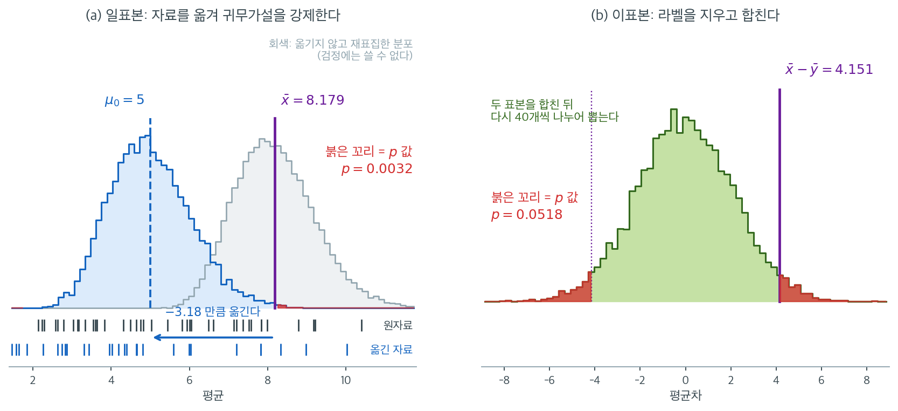

# 붓스트랩 가설검정 (코드)

## 개요

붓스트랩 가설검정은 모수적 가정에 기대는 대신 관측 자료를 재표집하여 귀무분포를 만든다. 이 페이지에서는 세 가지 핵심적인 붓스트랩 검정을 다룬다. 평균에 대한 일표본 검정, 두 평균을 비교하는 이표본 검정, 그리고 중앙값의 붓스트랩 표준오차 추정이다. 이 방법들은 검정통계량의 표집분포를 모르거나 해석적으로 유도하기 어려울 때 특히 값지다.

---

## 1. 일표본 붓스트랩 검정

$H_0\colon \mu = \mu_0$을 양측 대립가설에 대해 검정한다. 절차는 다음과 같다.

1. 귀무가설 아래로 자료를 **중심화**한다. $x_i^0 = x_i - \bar x + \mu_0$.
2. $\{x_1^0, \ldots, x_n^0\}$에서 복원추출로 $B$번 **재표집**하고 각 재표본의 평균을 계산한다.
3. 관측 평균만큼 극단적인 붓스트랩 평균의 비율로 **$p$값을 계산**한다.

$$
p = \frac{\#\bigl\{b : |\bar x^{*(b)} - \mu_0| \ge |\bar x - \mu_0|\bigr\} + 1}{B + 1}
$$

중심화 단계가 결정적이다. 재표집된 자료의 평균이 평균적으로 $\mu_0$이 되게 하여 붓스트랩 세계에서 귀무가설을 강제한다.

<div class="exbox" markdown>

**보기 1.** <span class="diff easy" title="쉬움"></span> 일표본 붓스트랩 검정. 중심이동이 무엇을 바꾸고 무엇을 바꾸지 않는지 따진다.

**(1)** 중심화한 자료 $x_i^0 = x_i - \bar x + \mu_0$에서 재표집할 때 $\bar X^{*}$의 평균·표준편차·왜도를 적으시오. 셋 가운데 **중심이동이 바꾸는 것은 하나뿐**이다. 그것으로 정규근사 $p$값을 예측하시오.

**(2)** 뒤의 보기 4가 쓰는 자료($n = 50$, $\mu_0 = 5$)로 확인하시오. 중심이동을 빼먹으면 $p$값이 얼마가 되는지도 보이시오.

</div>

??? success "풀이"

    **(1) 해석적으로.** 평행이동은 분포의 **모양을 전혀 건드리지 않는다.** 중심화한 경험분포의 중심적률이

    $$
    \text{평균} = \mu_0, \qquad
    \hat\sigma^2 = \frac1n\sum_i (x_i - \bar x)^2, \qquad
    \hat\gamma_1 = \frac{\hat\mu_3}{\hat\mu_2^{3/2}}
    $$

    로, 둘째와 셋째는 원자료의 것과 **같다.** 거기서 독립으로 $n$개 뽑아 평균을 내므로

    $$
    E_*[\bar X^{*}] = \mu_0,
    \qquad
    \operatorname{SD}_*(\bar X^{*}) = \frac{\hat\sigma}{\sqrt n},
    \qquad
    \gamma_1(\bar X^{*}) = \frac{\hat\gamma_1}{\sqrt n}
    $$

    이다. **중심이동이 바꾸는 것은 중심 하나뿐이고, 폭과 치우침은 그대로다.** 바로 그래서 이 한 줄이 "귀무가설만 참인 세계"를 만든다.

    귀무분포가 정규라면 $p \approx 2\Phi(-|z|)$, $z = \dfrac{\bar x - \mu_0}{\hat\sigma/\sqrt n}$이다. 다만 왜도가 $\hat\gamma_1/\sqrt n$만큼 남아 있으므로 오른쪽 꼬리가 정규보다 두껍고, **실제 $p$값은 정규근사보다 클 것**이다.

    **(2) 수치적으로.** 함수는 이렇다.

    ```python
    import numpy as np

    def bootstrap_mean_test(data, mu_0=0, n_boot=10_000, rng=None):
        """H0: 평균 = mu_0 에 대한 붓스트랩 검정. 양측 p-값을 돌려준다.

        검정을 하려면 귀무가설이 참인 상태에서 뽑아야 한다. 그래서 자료의
        중심을 mu_0 으로 옮긴 뒤 재표집한다. 이 중심 이동 한 줄이 신뢰구간을
        만들 때와 검정을 할 때를 가르는 핵심이다.
        """
        rng = rng or np.random.default_rng(0)
        n = len(data)
        # 자료를 통째로 옮겨 평균이 정확히 mu_0 이 되게 한다. 퍼짐과 모양은
        # 그대로 남으므로, 귀무가설만 참인 세계를 흉내 낸 셈이다.
        centered = data - data.mean() + mu_0
        boot_means = centered[rng.integers(0, n, (n_boot, n))].mean(axis=1)
        obs_mean = data.mean()
        # 분자와 분모에 1 을 더한다. 이래야 p-값이 0 이 되는 일을 막을 수 있다.
        # 관측된 자료 자체도 하나의 가능한 재표본으로 세는 셈이다.
        p_value = ((np.abs(boot_means - mu_0) >= abs(obs_mean - mu_0)).sum() + 1) \
                  / (n_boot + 1)
        return obs_mean, p_value, boot_means
    ```

    보기 4의 자료로 돌려 본다.

    ```python
    from scipy import stats

    rng_data = np.random.default_rng(1)
    rng = np.random.default_rng(7)
    data = rng_data.exponential(scale=5, size=50) + 2
    obs, p, boots = bootstrap_mean_test(data, mu_0=5.0, rng=rng)

    n = len(data)
    sig = data.std(ddof=0)
    print(f"sigma-hat = {sig:.4f},  예측 귀무 SD = {sig/np.sqrt(n):.4f}"
          f"   (모의 {boots.std(ddof=1):.4f},  몬테카를로 오차 {sig/np.sqrt(n)/np.sqrt(2*10000):.4f})")
    print(f"귀무분포 평균 = {boots.mean():.4f}  (예측 mu_0 = 5)")
    print(f"귀무분포 왜도 = {stats.skew(boots):.4f}  (예측 g1/sqrt(n) = {stats.skew(data)/np.sqrt(n):.4f})")
    z = (obs - 5) / (sig / np.sqrt(n))
    print(f"z = {z:.4f},  정규근사 양측 p = {2*stats.norm.sf(z):.4f}")
    print(f"붓스트랩 p = {p:.4f},   t 검정 p = {stats.ttest_1samp(data, 5.0).pvalue:.4f}")

    rng9 = np.random.default_rng(7)
    bm_nc = data[rng9.integers(0, n, (10000, n))].mean(axis=1)
    print(f"중심이동을 빼먹으면 p = {((np.abs(bm_nc-5)>=abs(obs-5)).sum()+1)/10001:.4f}")
    ```

    출력:

    ```
    sigma-hat = 7.2062,  예측 귀무 SD = 1.0191   (모의 1.0270,  몬테카를로 오차 0.0072)
    귀무분포 평균 = 5.0088  (예측 mu_0 = 5)
    귀무분포 왜도 = 0.3969  (예측 g1/sqrt(n) = 0.4257)
    z = 3.1190,  정규근사 양측 p = 0.0018
    붓스트랩 p = 0.0032,   t 검정 p = 0.0033
    중심이동을 빼먹으면 p = 0.4741
    ```

    **세 적률이 모두 예측대로다.** 귀무분포의 평균이 $5.0088$로 $\mu_0 = 5$에 붙고(평균의 몬테카를로 오차 $0.0103$), 표준편차 $1.0270$이 예측 $1.0191$에서 $1.1$ 몬테카를로 오차 떨어져 있으며, 왜도 $0.3969$도 예측 $0.4257$ 근처다($\sqrt{6/B} = 0.0245$의 $1.2$배).

    **정규근사보다 붓스트랩 $p$가 크다.** $0.0018$ 대 $0.0032$로 거의 두 배다. (1)에서 예상한 대로 귀무분포의 오른쪽 꼬리가 정규보다 두껍기 때문이며, $t$ 검정의 $0.0033$과는 오히려 잘 맞는다. **$t$ 분포도 정규보다 꼬리가 두껍다는 점에서 같은 방향의 보정을 하고 있는 셈이다.**

    **중심이동을 빼먹으면 $p = 0.4741$이 된다.** 옮기지 않은 붓스트랩 분포는 $\bar x = 8.179$에 중심을 두므로 $\mu_0 = 5$에서 잰 거리가 복제값들의 거리와 비슷해지고, $p$값이 $0.5$ 근처에 머문다. **어떤 자료를 넣어도 기각하지 못한다.** 오류 없이 조용히 실패하는 종류의 버그다.

!!! note "$+1$ 보정"
    분자와 분모의 $+1$은 관측된 자료 자신을 하나의 재표본으로 세는 것이다. 이 보정이 없으면 $p$값이 정확히 $0$이 될 수 있고, 검정의 크기가 명목수준을 미세하게 넘는다([대응 순열검정](../permutation/paired.md) 연습문제 4 참조).

---

## 2. 이표본 붓스트랩 검정

$H_0\colon \mu_x = \mu_y$를 검정하기 위해 두 표본을 합치고 합친 자료에서 재표집한다. $H_0$ 아래에서 집단 라벨은 교환 가능하다.

1. $\{x_1,\ldots,x_m,y_1,\ldots,y_n\}$을 크기 $m + n$의 한 집합으로 **합친다**.
2. 그 집합에서 $m + n$개를 복원추출로 **재표집**하고, 앞의 $m$개를 집단 $X$에, 나머지 $n$개를 집단 $Y$에 배정한다.
3. 각 반복에서 평균차 $\bar x^{*(b)} - \bar y^{*(b)}$를 **계산한다**.
4. 관측 차이만큼 극단적인 붓스트랩 차이의 비율이 **$p$값**이다.

<div class="exbox" markdown>

**보기 2.** <span class="diff easy" title="쉬움"></span> 이표본 붓스트랩 검정. 합쳐서 **복원추출**하는 이 방식은 라벨을 섞는 순열검정과 사촌이지만 똑같지는 않다.

**(1)** 합친 자료의 경험분포 분산을 $\hat\sigma_p^2$이라 할 때 귀무분포 $\bar X^{*} - \bar Y^{*}$의 평균과 분산을 구하시오. 같은 자료의 **순열** 귀무분포와 표준편차의 비는 얼마인가.

**(2)** 보기 4의 자료($m = n = 40$)로 확인하고, 붓스트랩 $p$값을 정규근사·Welch $t$ 검정과 견주시오.

</div>

??? success "풀이"

    **(1) 해석적으로.** 합친 $N = m + n$개에서 **복원으로** $N$개를 뽑아 앞의 $m$개를 $X$, 나머지를 $Y$라 부른다. 뽑기가 독립이므로 두 집단의 평균도 독립이고, 각각의 분산이 $\hat\sigma_p^2/m$과 $\hat\sigma_p^2/n$이다. 따라서

    $$
    E_*\!\left[\bar X^{*} - \bar Y^{*}\right] = 0,
    \qquad
    \operatorname{Var}_*\!\left(\bar X^{*} - \bar Y^{*}\right)
    = \hat\sigma_p^2\left(\frac1m + \frac1n\right)
    $$

    이다($\hat\sigma_p^2 = \frac1N\sum_i (z_i - \bar z)^2$, $z$는 합친 자료).

    **순열검정과의 차이는 딱 하나다.** [이표본 순열검정](../permutation/two_sample.md) 보기 1에서 라벨을 **비복원으로** 섞을 때의 분산이 $S^2(1/m + 1/n)$임을 보았고, 여기서 $S^2$은 $N-1$로 나눈 표본분산이다. $\hat\sigma_p^2 = \frac{N-1}{N}S^2$이므로

    $$
    \frac{\operatorname{SD}_{\text{붓스트랩}}}{\operatorname{SD}_{\text{순열}}} = \sqrt{\frac{N-1}{N}}
    $$

    다. $N = 80$이면 $0.99373$으로 **$0.6\%$ 좁다.** 복원추출이 유한모집단 보정을 잃는 대신 집단의 크기를 고정하지 않기 때문이며, $N$이 크면 사라지는 차이다.

    **(2) 수치적으로.** 함수는 이렇다.

    ```python
    def bootstrap_two_sample(x, y, n_boot=10_000, rng=None):
        """H0: 두 평균이 같다에 대한 붓스트랩 검정.

        귀무가설이 참이면 두 집단이 같은 모집단에서 나온 것이다. 그래서 둘을
        합쳐 하나의 웅덩이로 만들고 거기서 다시 뽑는다.
        """
        rng = rng or np.random.default_rng(0)
        obs_diff = x.mean() - y.mean()
        pooled = np.concatenate([x, y])
        m, N = len(x), len(pooled)
        P = pooled[rng.integers(0, N, (n_boot, N))]
        boot_diffs = P[:, :m].mean(axis=1) - P[:, m:].mean(axis=1)
        p_value = ((np.abs(boot_diffs) >= abs(obs_diff)).sum() + 1) / (n_boot + 1)
        return obs_diff, p_value, boot_diffs
    ```

    보기 1의 블록에서 이어 쓴다.

    ```python
    x = rng_data.normal(52, 10, 40)
    y = rng_data.normal(48, 10, 40)
    diff, p2, boots2 = bootstrap_two_sample(x, y, rng=rng)

    pooled = np.concatenate([x, y]); N = len(pooled); m = len(x)
    sp = pooled.std(ddof=0)
    print(f"합친 sigma-hat = {sp:.4f}")
    print(f"예측 귀무 SD = sigma-hat*sqrt(1/m+1/n) = {sp*np.sqrt(1/m+1/(N-m)):.4f}"
          f"   (모의 {boots2.std(ddof=1):.4f},  몬테카를로 오차 {sp*np.sqrt(2/m)/np.sqrt(2*10000):.4f})")
    print(f"순열(비복원) 판본의 SD = S*sqrt(2/m) = {pooled.std(ddof=1)*np.sqrt(2/m):.4f}"
          f"   비 = {sp/pooled.std(ddof=1):.6f}  (sqrt((N-1)/N) = {np.sqrt((N-1)/N):.6f})")
    z2 = diff / (sp*np.sqrt(2/m))
    print(f"z = {z2:.4f},  정규근사 양측 p = {2*stats.norm.sf(z2):.4f}")
    w = stats.ttest_ind(x, y, equal_var=False)
    print(f"붓스트랩 p = {p2:.4f},   Welch t p = {w.pvalue:.4f}")
    ```

    출력:

    ```
    합친 sigma-hat = 9.4434
    예측 귀무 SD = sigma-hat*sqrt(1/m+1/n) = 2.1116   (모의 2.1242,  몬테카를로 오차 0.0149)
    순열(비복원) 판본의 SD = S*sqrt(2/m) = 2.1249   비 = 0.993730  (sqrt((N-1)/N) = 0.993730)
    z = 1.9657,  정규근사 양측 p = 0.0493
    붓스트랩 p = 0.0518,   Welch t p = 0.0504
    ```

    **유도한 두 식이 맞는다.** 예측 $2.1116$에 대해 모의값 $2.1242$가 몬테카를로 오차 $0.0149$의 $0.8$배 안에 있고, 순열 판본과의 비 $0.993730$이 $\sqrt{79/80}$과 여섯 자리까지 같다.

    **세 $p$값이 $0.05$ 양쪽에 걸쳐 있다.** 정규근사 $0.0493$은 턱걸이로 기각하고, 붓스트랩 $0.0518$과 Welch $0.0504$는 기각하지 못한다. **셋의 차이는 $0.0025$에 지나지 않지만 $\alpha = 0.05$라는 선 위에 걸려 결론이 갈린다.** 붓스트랩 $p$값 자체의 몬테카를로 표준오차가 $\sqrt{0.05 \times 0.95/10^4} = 0.0022$이므로, 이 자료에서 "유의한가"를 묻는 것은 의미가 없다. **구간을 보고하거나 자료를 더 모으는 것이 옳은 대응이다.**

!!! warning "합치기는 등분산도 가정한다"
    합쳐진 자료에서 재표집하면 두 집단이 같은 분산을 갖게 된다. 두 집단의 분산이 실제로 다르고 표본크기가 불균형하면 이 검정의 제1종 오류율이 무너진다. 그때는 각 집단을 자기 평균으로 중심화한 뒤 **따로** 재표집해야 한다([두 평균에 대한 붓스트랩 검정](./two_means.md) 참조).

---

## 3. 중앙값의 붓스트랩 표준오차

중앙값에는 간단한 닫힌 형태의 표준오차가 없다. 붓스트랩이 직접적인 추정값을 준다.

$$
\widehat{\text{SE}}_{\text{boot}}(\text{median}) = \sqrt{\frac{1}{B-1}\sum_{b=1}^{B}\bigl(\tilde x^{*(b)} - \overline{\tilde x^*}\bigr)^2}
$$

여기서 $\tilde x^{*(b)}$는 $b$번째 붓스트랩 표본의 중앙값이다. 붓스트랩 편향은

$$
\widehat{\text{bias}} = \overline{\tilde x^*} - \tilde x
$$

이다.

<div class="exbox" markdown>

**보기 3.** <span class="diff easy" title="쉬움"></span> 중앙값의 표준오차와 편향. 보기 4는 $\text{LogNormal}(10.5,\ 0.8^2)$에서 $n = 200$을 뽑아 이 함수를 쓴다.

**(1)** 이 모집단에서 **표본중앙값이 놓인 자리**의 밀도를 구해 $\dfrac{1}{2f\sqrt n}$을 계산하시오. 붓스트랩 편향의 **부호**도 미리 말하고, 그 크기를 어떻게 판정할지 적으시오.

**(2)** 실행해 (1)과 견주시오. 붓스트랩 중앙값이 몇 가지 값만 갖는지도 세시오.

</div>

??? success "풀이"

    **(1) 해석적으로.** 로그정규 밀도는

    $$
    f(x) = \frac{1}{x\sigma\sqrt{2\pi}}\exp\!\left(-\frac{(\ln x - \mu)^2}{2\sigma^2}\right)
    $$

    이다. 표본중앙값 $\tilde x = 31{,}508.1$을 넣으면 $f(\tilde x) = 1.557962\times10^{-5}$이고

    $$
    \frac{1}{2 f(\tilde x)\sqrt{200}} = 2{,}269.3
    $$

    이다. **모집단 중앙값 $e^{10.5} = 36{,}315.5$ 자리의 값 $2{,}574.7$과 다르다**는 데 주의할 것. 표본중앙값이 참값보다 작게 나왔고, 로그정규는 그 언저리에서 밀도가 더 높으므로 표준오차가 작아진다.

    **편향의 부호.** 붓스트랩 편향은 $\overline{\tilde x^{*}} - \tilde x$, 곧 붓스트랩 중앙값 분포의 **평균과 중앙값의 차이**에 가깝다. 모집단이 오른쪽으로 치우쳐 있으면 재표본 중앙값의 분포도 오른쪽으로 치우치고, 치우친 분포에서는 평균이 중앙값보다 크다. **그러므로 편향은 양수일 것이다.**

    **크기 판정.** 편향은 절대 크기가 아니라 **표준오차에 견준 크기**로 본다. $\lvert\widehat{\text{bias}}\rvert/\widehat{\operatorname{SE}} < 0.25$이면 무시할 만하다는 것이 흔한 경험칙이다.

    **(2) 수치적으로.** 함수는 이렇다.

    ```python
    def bootstrap_se_median(data, n_boot=10_000, rng=None):
        """중앙값의 표준오차와 편향을 붓스트랩으로 추정한다.

        편향은 붓스트랩 값들의 평균에서 원래 추정값을 뺀 것이다. 0 에서 멀면
        그 통계량이 참값을 체계적으로 빗나간다는 뜻이다.
        """
        rng = rng or np.random.default_rng(0)
        n = len(data)
        boot_medians = np.median(data[rng.integers(0, n, (n_boot, n))], axis=1)
        se = boot_medians.std(ddof=1)
        bias = boot_medians.mean() - np.median(data)
        return se, bias, boot_medians
    ```

    보기 2의 블록에서 이어 쓴다.

    ```python
    income = rng_data.lognormal(mean=10.5, sigma=0.8, size=200)
    se_med, bias, boot_med = bootstrap_se_median(income, rng=rng)

    mu_, sg_ = 10.5, 0.8
    m_s = np.median(income)
    f_at = np.exp(-(np.log(m_s) - mu_) ** 2 / (2 * sg_ ** 2)) / (m_s * sg_ * np.sqrt(2 * np.pi))
    print(f"표본중앙값 = {m_s:,.1f},  모집단 중앙값 = {np.exp(mu_):,.1f}")
    print(f"표본중앙값 자리의 참 밀도 = {f_at:.6e}  ->  SE = {1/(2*f_at*np.sqrt(200)):,.1f}")
    print(f"붓스트랩 SE = {se_med:,.1f},  편향 = {bias:,.1f},  |편향|/SE = {abs(bias)/se_med:.4f}")
    print(f"붓스트랩 중앙값의 왜도 = {stats.skew(boot_med):.4f},"
          f"  고유값 수 = {len(np.unique(boot_med))}")
    ```

    출력:

    ```
    표본중앙값 = 31,508.1,  모집단 중앙값 = 36,315.5
    표본중앙값 자리의 참 밀도 = 1.557962e-05  ->  SE = 2,269.3
    붓스트랩 SE = 1,912.2,  편향 = 269.2,  |편향|/SE = 0.1408
    붓스트랩 중앙값의 왜도 = 0.2382,  고유값 수 = 263
    ```

    **편향의 부호를 맞혔다.** $+269.2$로 양수이고, 붓스트랩 중앙값 분포의 왜도가 $+0.2382$인 것이 그 까닭이다. $\lvert\text{편향}\rvert/\widehat{\operatorname{SE}} = 0.1408$로 경험칙 $0.25$를 밑돈다. **보정할 만큼 크지 않다.**

    **표준오차는 $1{,}912.2$로 이론값 $2{,}269.3$보다 $16\%$ 작다.** $B = 10{,}000$의 몬테카를로 요동이 $1912/\sqrt{2B} = 13.5$뿐이므로 $B$ 탓이 아니다. 까닭은 [중앙값의 붓스트랩](../bootstrap_ci/bootstrap_median.md) 보기 1에서 본 그대로다. 붓스트랩이 쓰는 것은 참 밀도가 아니라 **표본중앙값 둘레의 관측 간격**이고, 이 표본은 그 자리가 모집단보다 촘촘했다. 중앙값의 표준오차를 붓스트랩으로 구할 때 한 자리 이상을 믿어서는 안 되는 이유다.

    **값이 $263$가지뿐이라는 것도 눈여겨볼 것.** $10{,}000$개의 복제값이 서로 다른 값을 그만큼만 갖는다. 재표본 중앙값이 원자료 순서통계량 두 개의 평균일 수밖에 없기 때문이며, 그래서 중앙값의 붓스트랩 분포는 계단 모양이 된다.

---

## 4. 시연

세 방법을 모의자료에 적용한다.

<div class="exbox" markdown>

**보기 4.** <span class="diff easy" title="쉬움"></span> 세 검정 실행. 앞의 세 함수를 모의자료에 한꺼번에 적용한다.

**(1)** 세 결과에 각각 어떤 몬테카를로 오차가 붙는지 $B = 10{,}000$에서 구하시오. 셋 가운데 **고전적 비교 대상이 없는 것**은 무엇이며 왜 그런가.

**(2)** 실행해 표를 채우고, 두 $p$값을 대응하는 $t$ 검정과 견주시오.

</div>

??? success "풀이"

    **(1) 해석적으로.** 몬테카를로 오차의 꼴이 양마다 다르다.

    | 양 | 몬테카를로 오차 | $B = 10{,}000$에서 |
    |:---|:---|---:|
    | $p$값 | $\sqrt{p(1-p)/B}$ | $p = 0.0032$에서 $0.00056$ |
    | $p$값 | $\sqrt{p(1-p)/B}$ | $p = 0.0518$에서 $0.00222$ |
    | 표준오차 | $\widehat{\operatorname{SE}}/\sqrt{2B}$ | $1912/141.4 = 13.5$ |
    | 편향 | $\widehat{\operatorname{SE}}/\sqrt{B}$ | $1912/100 = 19.1$ |

    **둘째 줄이 문제가 된다.** $p = 0.0518$에 $\pm 0.0022$가 붙으므로 $\alpha = 0.05$라는 선을 사이에 두고 어느 쪽인지 말할 수 없다. 첫째 줄은 $0.0032 \pm 0.00056$으로 결론이 흔들리지 않는다.

    **고전적 비교 대상이 없는 것은 셋째다.** 중앙값의 표준오차는 $\dfrac{1}{2f(m)\sqrt n}$인데 이 식에는 **모집단 밀도 $f(m)$**이 들어 있다. 평균의 $\sigma/\sqrt n$에서 $\sigma$를 $s$로 바꾸듯 $f(m)$을 자료에서 바로 바꿔 넣을 수가 없다. 밀도를 추정하려면 띠너비를 골라야 하고 그 선택이 답을 바꾼다. **붓스트랩은 그 선택을 하지 않고 같은 일을 해낸다.** 게다가 셋째는 애초에 검정이 아니라 **추정의 불확실성을 재는 일**이라 $p$값이 없다.

    **(2) 수치적으로.**

    ```python
    import numpy as np
    from scipy import stats

    rng_data = np.random.default_rng(1)
    rng = np.random.default_rng(7)

    # 1. 일표본 검정: 2 만큼 이동된 지수 자료
    data = rng_data.exponential(scale=5, size=50) + 2
    obs, p, boots = bootstrap_mean_test(data, mu_0=5.0, rng=rng)
    print(obs, p)                    # 8.1786  0.0032

    # 2. 이표본 검정: 두 정규 모집단
    x = rng_data.normal(52, 10, 40)
    y = rng_data.normal(48, 10, 40)
    diff, p2, boots2 = bootstrap_two_sample(x, y, rng=rng)
    print(diff, p2)                  # 4.151  0.0518

    # 3. 중앙값의 붓스트랩 표준오차: 로그정규 소득
    income = rng_data.lognormal(mean=10.5, sigma=0.8, size=200)
    se_med, bias, boot_med = bootstrap_se_median(income, rng=rng)
    print(np.median(income), se_med, bias)   # 31508  1912  269
    ```

    출력:

    ```
    8.178614426992942 0.0031996800319968005
    4.150721066684774 0.051794820517948204
    31508.06500959787 1912.1800372703474 269.241019752415
    ```

    **두 $p$값이 $t$ 검정과 거의 같다.**

    | 검정 | 결과 | 비교 대상 |
    |:---|:---|:---|
    | 일표본 ($H_0: \mu = 5$) | $\bar{x} = 8.179$, $p = 0.0032 \pm 0.0006$ | $t$ 검정 $p = 0.0033$ |
    | 이표본 | $\bar{x} - \bar{y} = 4.151$, $p = 0.0518 \pm 0.0022$ | Welch $t$ 검정 $p = 0.0504$ |
    | 중앙값 SE | $\tilde{x} = 31{,}508$, $\widehat{\operatorname{SE}} = 1{,}912 \pm 14$ | 닫힌 형태 없음 |

    **일표본 쪽은 사실상 일치한다.** $0.0032$ 대 $0.0033$으로 차이가 몬테카를로 오차 $0.0006$의 $0.2$배다. $n = 50$에서 정규근사가 이미 잘 통하고, 보기 1에서 보았듯 붓스트랩 귀무분포의 왜도가 $t_{49}$의 두꺼운 꼬리와 비슷한 보정을 하기 때문이다.

    **이표본 쪽은 $0.0518$ 대 $0.0504$로 $\alpha = 0.05$의 양쪽에 걸쳐 있지만 구별할 수 없다.** 차이 $0.0014$가 몬테카를로 오차 $0.0022$보다 작다. **"유의하다/아니다"를 가르는 대신 차이의 구간을 보고해야 할 자료다.**

    **셋째는 비교할 것이 없다.** 그것이 이 절차를 쓰는 이유다.

---

## 5. 귀무분포를 어디서 얻는가

앞의 두 검정은 코드 한 줄씩만 다르다. 하나는 자료를 **옮기고**, 다른 하나는 두 표본을 **합친다**. 둘 다 같은 목적을 갖는다. 재표집을 시작하기 전에 귀무가설이 참인 세계를 만드는 것이다.



(a)가 일표본 검정이다. 축 아래 두 줄의 눈금이 핵심이다. 위쪽 검은 눈금이 원자료이고 아래쪽 파란 눈금은 그것을 통째로 $-3.179$만큼 옮긴 것으로, **간격과 모양은 그대로이고 중심만 $\mu_0 = 5$로 바뀌었다.** 파란 히스토그램은 옮긴 자료에서 재표집한 평균들이며 이것이 귀무분포다. 관측된 $\bar{x} = 8.179$는 이 분포의 오른쪽 끝에 놓이고, 양쪽 꼬리의 붉은 면적을 세면 $p = 0.0032$가 된다. 자유도 $49$인 $t$ 검정의 $p = 0.0033$과 사실상 같은데, $n = 50$이면 정규근사가 이미 잘 통하기 때문이다.

회색 곡선이 **옮기지 않고** 재표집했을 때의 분포다. $\bar{x} = 8.179$ 주위에 중심을 두므로 관측값이 한가운데에 앉고, 그보다 극단적인 복제값의 비율은 $0.5$ 근처를 맴돈다. 이 분포로 검정하면 무엇을 넣어도 기각하지 못한다. 중심 이동 한 줄을 빠뜨리면 정확히 이런 일이 벌어지며, 오류 메시지 없이 조용히 실패한다는 것이 이 함정의 성질이다.

(b)는 이표본 검정이다. 여기서는 옮길 필요가 없다. $H_0$ 아래에서 두 집단이 같은 모집단에서 왔다면 **어느 관측이 어느 집단인지가 무의미**하므로, 80개를 한 웅덩이에 붓고 다시 40개씩 뽑으면 그것이 귀무분포다. 분포가 $0$에 중심을 두는 것은 강제한 것이 아니라 라벨을 지운 결과이다. 관측된 차이 $4.151$이 오른쪽 꼬리에 겨우 걸쳐 $p = 0.0518$이고, Welch $t$ 검정의 $0.0504$와 마찬가지로 $\alpha = 0.05$를 간발의 차로 넘지 못한다.

---

## 6. 해석

- **일표본 붓스트랩 검정**은 자료 평균이 $5$에서 멀 때 $H_0\colon \mu = 5$을 기각한다. 자료가 지수분포이므로(정규가 아니므로) 붓스트랩 접근은 $t$ 분포에 대한 의존을 피한다. 여기서는 $n = 50$이 충분히 커서 두 $p$값이 $0.0001$ 이내로 일치한다.
- **이표본 붓스트랩 검정**은 두 정규 모집단 사이의 $4$단위 이동을 탐지한다. 정규성이 성립하면 $p$값이 이표본 $t$ 검정의 것과 대개 가깝다($0.0518$ 대 $0.0504$). 이 보기는 $\alpha = 0.05$ 문턱 바로 위에 걸려 있어, 두 방법 모두 "기각하지 못한다"는 같은 결론을 준다.
- **중앙값의 붓스트랩 표준오차**는 로그정규 같은 치우친 분포에서 특히 유용하다. 이 경우 $\text{SE}(\text{median})$에 대한 간단한 공식이 없으므로 붓스트랩이 사실상 유일한 선택이다.

일반 원리: 모수적 가정이 성립하면 붓스트랩과 고전적 검정이 일치한다. 가정이 깨지면 붓스트랩이 대개 더 믿을 만하다.

---

## 연습문제

<div class="drillbox" markdown>

**연습문제 1.** <span class="diff easy" title="쉬움"></span> 표준정규분포에서 크기 $n = 40$인 표본을 뽑아라. $H_0\colon \mu = 0$에 대해 일표본 붓스트랩 검정을 수행하고, $H_0\colon \mu = 0.5$에 대해서도 반복하라. $p$값을 보고하고 결과가 다른 이유를 설명하라.

</div>

??? success "풀이"

    ```python
    import numpy as np
    from scipy import stats
    rng = np.random.default_rng(101)
    data = np.random.default_rng(3).normal(0, 1, 40)
    print(data.mean(), data.std(ddof=1))       # -0.0411  1.1751

    _, p0, _ = bootstrap_mean_test(data, mu_0=0.0, rng=rng)
    _, p05, _ = bootstrap_mean_test(data, mu_0=0.5, rng=rng)
    ```

    출력:

    ```
    -0.041112513627908596 1.1751281074452444
    ```

    | 가설 | 붓스트랩 $p$값 | $t$ 검정 $p$값 |
    |:---|---:|---:|
    | $H_0: \mu = 0$ | 0.821 | 0.826 |
    | $H_0: \mu = 0.5$ | 0.0032 | 0.0059 |

    참 평균이 $0$이므로 $H_0\colon \mu = 0$에서는 큰 $p$값이 나와 기각하지 못한다. $H_0\colon \mu = 0.5$에서는 표본평균 $-0.041$이 $0.5$에서 $2.9$ 표준오차 떨어져 있어($\widehat{\text{se}} = 1.175/\sqrt{40} = 0.186$) 강하게 기각한다.

    **중심화가 무엇을 하는지 정확히 보자.** $\mu_0 = 0.5$일 때 중심화된 자료는 $x_i - (-0.041) + 0.5 = x_i + 0.541$이다. 이 자료의 평균은 정확히 $0.5$이고, 재표집된 평균들은 $0.5$ 주위에 표준편차 $0.186$으로 흩어진다.

    관측된 편차 $|{-0.041} - 0.5| = 0.541$은 이 분포에서 $2.9$ 표준편차에 해당하므로 그만큼 극단적인 재표본이 거의 나오지 않는다.

    **붓스트랩 $p$값이 $t$ 검정의 절반이다**($0.0032$ 대 $0.0059$). 이는 붓스트랩이 정규이론의 $t$ 보정을 하지 않기 때문이다. $n = 40$에서 $t_{39}$의 꼬리가 정규분포보다 두꺼운 만큼 차이가 난다. 꼬리로 갈수록 이 차이가 커지므로, **작은 $p$값을 붓스트랩으로 보고할 때는 주의해야 한다**.

    !!! warning "표본에 따라 결론이 달라진다"
        이 연습문제의 결과는 "참 평균이 $0$이면 $H_0: \mu = 0$이 기각되지 않는다"가 **아니다**. 그것은 $95$%의 표본에서만 참이다.

        예를 들어 씨앗을 $7$로 바꾸면 표본평균이 $-0.395$가 되고 $H_0: \mu = 0$의 $p$값이 $0.0021$로 **기각된다**. 이것이 바로 제1종 오류이며, 설계상 $5$%의 확률로 일어난다.

---

<div class="drillbox" markdown>

**연습문제 2.** <span class="diff easy" title="쉬움"></span> $\text{Gamma}(2, 1)$ 분포에서 $200$개의 관측을 생성하라. 붓스트랩으로 평균과 중앙값의 표준오차를 모두 추정하고, 평균의 이론적 표준오차 $\sigma/\sqrt{n}$과 비교하라. 중앙값에는 왜 유사한 공식이 없는가?

</div>

??? success "풀이"

    ```python
    import numpy as np
    from scipy import stats
    rng = np.random.default_rng(101)
    data = np.random.default_rng(12).gamma(shape=2, scale=1, size=200)
    print(data.mean(), np.median(data))       # 1.9889  1.7680

    boot_means = data[rng.integers(0, 200, (10_000, 200))].mean(axis=1)
    se_mean_boot = boot_means.std(ddof=1)
    se_med, _, _ = bootstrap_se_median(data, rng=rng)
    ```

    출력:

    ```
    1.9888641137690775 1.7679603646706958
    ```

    | 양 | 값 |
    |:---|---:|
    | 붓스트랩 $\widehat{\text{SE}}$(평균) | 0.0861 |
    | 표본에서의 $s/\sqrt{n}$ | 0.0860 |
    | 이론값 $\sigma/\sqrt{n} = \sqrt{2}/\sqrt{200}$ | 0.1000 |
    | 붓스트랩 $\widehat{\text{SE}}$(중앙값) | 0.1202 |
    | 중앙값의 점근 공식 $1/(2f(m)\sqrt{n})$ | 0.1128 |

    **붓스트랩 $\widehat{\text{SE}}$(평균)이 $s/\sqrt{n}$과 소수 넷째 자리까지 일치한다**($0.0861$ 대 $0.0860$). 이는 우연이 아니다. 평균의 붓스트랩 분산은 정확히 $\hat{\sigma}^2/n = \frac{n-1}{n}s^2/n$이므로 두 값이 이론적으로 같아야 한다.

    **이론값 $0.1000$과는 $14$% 차이가 난다.** 이는 붓스트랩의 오차가 아니라 이 표본의 $s = 1.216$이 참값 $\sigma = \sqrt{2} = 1.414$보다 작기 때문이다. 붓스트랩은 참 $\sigma$를 알 수 없으므로 표본에서 추정할 수밖에 없다.

    **중앙값에 공식이 없는 이유.** 중앙값의 점근 표준오차는

    $$
    \text{SE}(\tilde{X}) \approx \frac{1}{2f(m)\sqrt{n}}
    $$

    이다. 여기서 $f$는 모집단 밀도, $m$은 모중앙값이다. $\text{Gamma}(2,1)$에서 $m = 1.678$, $f(m) = 0.313$이므로 $1/(2 \times 0.313 \times 14.14) = 0.1128$이다.

    문제는 이 공식이 **모집단 밀도를 중앙값 한 점에서 알아야 한다**는 것이다. 평균의 공식이 $\sigma$만 필요한 것과 대조적이다. $f(m)$은 밀도추정을 해야 하고, 그 자체가 대역폭 선택 등의 문제를 안고 있으며 수렴이 느리다($n^{-2/5}$).

    **붓스트랩은 이 문제를 완전히 우회한다.** `np.median`을 반복 계산할 뿐이며 밀도를 추정할 필요가 없다. 위 표에서 붓스트랩 $0.1202$가 점근값 $0.1128$과 $7$% 이내로 일치한다.

    !!! warning "중앙값의 붓스트랩은 수렴이 느리다"
        중앙값은 매끄럽지 않은 통계량이므로 붓스트랩의 수렴 속도가 평균보다 느리다. 평균에서 $O(n^{-1})$인 오차가 중앙값에서는 $O(n^{-1/4})$이다.

        일치하기는 하므로 $n = 200$ 정도면 실용적으로 쓸 만하다. 그러나 $n$이 작거나($n < 30$) 자료에 동점이 많으면 평활 붓스트랩(재표집된 값에 작은 잡음을 더하는 것)을 고려해야 한다.

---

<div class="drillbox" markdown>

**연습문제 3.** <span class="diff med" title="중간"></span> 코드의 이표본 붓스트랩 검정은 합쳐진 자료에서 *복원*추출한다. 라벨을 *비복원*으로 섞는 순열검정과 개념적으로 어떻게 다른지 설명하라. 두 접근이 비슷한 $p$값을 주는 조건은 무엇인가?

</div>

??? success "풀이"

    이표본 붓스트랩 검정에서는 합친 집합에서 $m + n$개를 *복원*추출한 뒤 크기 $m$과 $n$으로 나눈다. 따라서 어떤 관측은 여러 번 나타나고 어떤 관측은 그 반복에서 아예 빠진다.

    순열검정에서는 $m + n$개의 라벨을 비복원으로 섞으므로 모든 관측이 각 순열된 자료에 정확히 한 번 나타난다. 합친 표본의 구성이 정확히 보존된다.

    **비슷한 $p$값을 주는 조건은 표본크기 $m$과 $n$이 어느 정도 클 때이다.** $m, n \to \infty$에서 평균차의 붓스트랩 분포가 순열분포로 수렴한다. 작은 표본에서는 순열검정이 (자료에 조건부로) 정확한 반면 붓스트랩 검정은 근사이다.

    **구체적인 차이.** 붓스트랩 분산과 순열 분산의 비는 대략

    $$
    \frac{\text{Var}^*_{\text{boot}}}{\text{Var}^*_{\text{perm}}} \approx \frac{N}{N-1}
    $$

    이다($N = m + n$). 순열은 유한모집단 수정계수를 자동으로 반영하지만 복원추출은 그렇지 않기 때문이다. $N = 10$이면 $11$%, $N = 80$이면 $1.3$% 차이이다.

    이 차이가 실제로 얼마나 큰지는 [비교](../comparison/comparison.md) 연습문제 1에서 확인했다. $m = n = 5$일 때 붓스트랩 꼬리 확률 $0.0006$과 정확 순열 $p$값 $0.0397$이 **$66$배** 차이가 났다. 위 비율만으로는 설명되지 않는 차이이며, 작은 표본에서 붓스트랩이 $t$ 보정을 놓치는 것이 더 큰 원인이다.

    순열검정은 무작위화 메커니즘을 직접 모형화하므로 교환가능성이라는 귀무가설 아래에서 더 자연스럽기도 하다. $\square$

---

<div class="drillbox" markdown>

**연습문제 4.** <span class="diff hard" title="어려움"></span> 중앙값의 붓스트랩 편향 공식을 유도하라. 중앙값의 붓스트랩 분포가 표본중앙값 $\tilde x$에 대해 대칭이면 편향이 $0$임을 보여라.

</div>

??? success "풀이"

    붓스트랩 편향의 정의는

    $$
    \widehat{\text{bias}} = E^*[\tilde x^*] - \tilde x = \overline{\tilde x^*} - \tilde x
    $$

    이다. $E^*$는 붓스트랩 분포(자료의 경험분포) 아래의 기댓값이고 $\overline{\tilde x^*} = \frac{1}{B}\sum_{b=1}^{B}\tilde x^{*(b)}$가 이를 추정한다.

    중앙값의 붓스트랩 분포가 $\tilde x$에 대해 대칭이면, $\tilde x^{*(b)} = \tilde x + \delta$를 내는 반복마다 (근사적으로) $\tilde x - \delta$를 내는 반복이 대응한다. 따라서 $E^*[\tilde x^*] = \tilde x$이고

    $$
    \widehat{\text{bias}} = \tilde x - \tilde x = 0
    $$

    이다. $\square$

    **실제로는 대칭이 아니다.** 시연의 로그정규 소득 자료에서 붓스트랩 편향이 $+269$였다. 표본중앙값 $31{,}508$의 $0.85$%이다.

    양의 편향이 나오는 이유는 두 가지가 겹친다.

    **첫째, 중앙값의 붓스트랩 분포는 이산적이다.** 붓스트랩 중앙값은 원자료의 값(또는 짝수 개일 때 인접 두 값의 평균)만 취할 수 있다. $n = 200$이면 가능한 값이 몇 백 개뿐이다.

    **둘째, 모분포가 오른쪽으로 치우쳐 있다.** 표본중앙값 위쪽의 관측들이 아래쪽보다 더 넓게 퍼져 있으므로, 붓스트랩 중앙값이 위로 움직일 여지가 아래로 움직일 여지보다 크다.

    !!! note "편향 보정을 해야 하는가"
        하지 않는 것이 보통이다. 편향 보정된 추정량 $2\tilde{x} - \overline{\tilde x^*}$는 편향을 줄이지만 분산을 늘린다. 여기서 편향 $269$는 표준오차 $1{,}912$의 $14$%에 불과하므로, 평균제곱오차 관점에서 보정이 손해이다.

        경험칙으로 $|\widehat{\text{bias}}| / \widehat{\text{SE}} < 0.25$이면 무시한다. [비모수 붓스트랩](../bootstrap/nonparametric.md) 연습문제 4에서 보정이 오히려 MSE를 $0.0950$에서 $0.1013$으로 악화시키는 예를 다루었다.

---

<div class="drillbox" markdown>

**연습문제 5.** <span class="diff hard" title="어려움"></span> 일표본 붓스트랩 검정이 일치성을 가짐을 증명하라. 즉 $\mu \neq \mu_0$이면 $n \to \infty$에서 $p$값이 $0$으로 수렴함을 보여라. (힌트: $|\bar x - \mu_0|$의 거동과 중심화된 자료에서의 $|\bar x^* - \mu_0|$의 붓스트랩 분포를 생각하라.)

</div>

??? success "풀이"

    대립가설 $\mu \neq \mu_0$ 아래에서 큰 수의 법칙에 의해 $n \to \infty$일 때 $\bar x \to \mu$이므로

    $$
    |\bar x - \mu_0| \to |\mu - \mu_0| > 0
    $$

    이다.

    중심화된 자료 $x_i^0 = x_i - \bar x + \mu_0$의 표본평균은 정확히 $\mu_0$이다. 붓스트랩 중심극한정리에 의해 중심화된 자료에서 재표집한 평균 $\bar x^{*(b)}$는

    $$
    \sqrt{n}(\bar x^{*(b)} - \mu_0) \xrightarrow{d} N(0, \sigma^2)
    $$

    를 만족한다. 여기서 $\sigma^2$은 모분산이다. 따라서 $|\bar x^{*(b)} - \mu_0| = O_p(n^{-1/2})$이고 이는 $0$으로 수렴한다.

    한편 $|\bar x - \mu_0| \to |\mu - \mu_0| > 0$은 고정된 양의 상수이다. $n$이 크면 붓스트랩 반복이 $|\bar x^{*(b)} - \mu_0| \ge |\bar x - \mu_0|$를 만족할 확률이 무시할 수준이 된다.

    $$
    p = P^*\!\bigl(|\bar x^{*(b)} - \mu_0| \ge |\bar x - \mu_0|\bigr) \to 0
    $$

    따라서 검정은 일치한다. $\square$

    **수렴 속도.** 더 정확히는, $\bar{x}^* - \mu_0$가 근사적으로 $N(0, \sigma^2/n)$이므로

    $$
    p \approx 2\Bigl[1 - \Phi\Bigl(\frac{\sqrt{n}\,|\mu - \mu_0|}{\sigma}\Bigr)\Bigr]
    $$

    이고, 이는 $n$에 대해 **지수적으로** $0$에 접근한다. $|\mu - \mu_0|/\sigma = 0.5$일 때

    | $n$ | 근사 $p$값 |
    |---:|---:|
    | 10 | 0.114 |
    | 40 | 0.0016 |
    | 100 | $5.7\times10^{-7}$ |
    | 200 | $1.5\times10^{-12}$ |

    실용적 함의가 하나 있다. **$B$가 유한하면 이 수렴을 관측할 수 없다.** $B = 10{,}000$이면 붓스트랩이 낼 수 있는 최소 $p$값이 $1/10001 = 0.0001$이다. $n = 100$의 참 $p$값 $5.7 \times 10^{-7}$은 표현조차 되지 않는다.

    작은 $p$값을 정량적으로 보고해야 한다면 붓스트랩 대신 점근 근사를 쓰는 것이 옳다. 붓스트랩의 강점은 $p$값의 정밀도가 아니라 가정으로부터의 자유이다.

---

<div class="drillbox" markdown>

**연습문제 6.** <span class="diff hard" title="어려움"></span> 자료가 세 점 $x = (1, 2, 6)$뿐일 때 $H_0\colon \mu = 1$을 양측으로 검정한다. $n = 3$이므로 붓스트랩 재표본이 $3^3 = 27$가지뿐이고 모두 확률이 같다. 몬테카를로를 쓰지 말고 **끝까지 세어라.**

**(1)** [비모수 붓스트랩](../bootstrap/nonparametric.md) 연습문제 5 (a)가 **같은 자료**에서 중심이동 없는 정확한 분포를 이미 구해 놓았다. 그 표를 중심화한 자료의 분포로 **옮겨** 적고, 재표집을 다시 하지 않고도 그럴 수 있는 까닭을 한 줄로 밝히시오. 두 적률이 보기 1의 예측 $\mu_0$와 $\hat\sigma^2/n$에 맞는지 확인하시오.

**(2)** 정확한 양측 $p$값을 분수로 구하시오. $B$개를 뽑아 $\hat p = (\#{} + 1)/(B+1)$로 추정할 때 $E[\hat p]$는 얼마인가($B = 10{,}000$). 이 자료에서 **얻을 수 있는 $p$값의 목록**을 보고, 수준 $0.05$의 검정이 가능한지 말하시오.

**(3)** 중심화한 자료에서 재표본 평균이 $\mu_0$에서 떨어질 수 있는 거리의 최댓값은 $\mu_0$에 **전혀 달려 있지 않음**을 보이시오. 그로부터 $+1$ 보정을 하지 않은 $p$값이 정확히 $0$이 되는 $\mu_0$의 범위를 구하시오.

</div>

??? success "풀이"

    **(1) 표를 옮겨 적는다.** $\bar x = 3$이므로 중심화한 자료는

    $$
    x^0 = x - \bar x + \mu_0 = (1,\ 2,\ 6) - 3 + 1 = (-1,\ 0,\ 4)
    $$

    으로 원자료를 통째로 $\mu_0 - \bar x = -2$만큼 평행이동한 것이다. **같은 지수를 뽑으면 재표본 평균도 똑같이 $-2$만큼 옮겨진다**(연습문제 10 (1)이 이 등식을 일반적으로 적는다). 중복도는 어느 지수를 몇 번 뽑았는지로만 정해지므로 하나도 바뀌지 않는다. 그래서 $27$가지를 다시 셀 필요가 없다. $a_1 = -1$, $a_2 = 0$, $a_3 = 4$를 각각 $k_1, k_2, k_3$번 뽑은 재표본의 중복도는 다항계수 $3!/(k_1!k_2!k_3!)$이다.

    | $(k_1, k_2, k_3)$ | $\bar x^{*}$ (중심이동 없음) | $\bar x^{*0} = \bar x^{*} - 2$ | 중복도 |
    |:---|---:|---:|---:|
    | $(3,0,0)$ | $1$ | $-1$ | $1$ |
    | $(2,1,0)$ | $4/3$ | $-2/3$ | $3$ |
    | $(1,2,0)$ | $5/3$ | $-1/3$ | $3$ |
    | $(0,3,0)$ | $2$ | $0$ | $1$ |
    | $(2,0,1)$ | $8/3$ | $2/3$ | $3$ |
    | $(1,1,1)$ | $3$ | $1$ | $6$ |
    | $(0,2,1)$ | $10/3$ | $4/3$ | $3$ |
    | $(1,0,2)$ | $13/3$ | $7/3$ | $3$ |
    | $(0,1,2)$ | $14/3$ | $8/3$ | $3$ |
    | $(0,0,3)$ | $6$ | $4$ | $1$ |

    중복도의 합이 $1+3+3+1+3+6+3+3+3+1 = 27$로 맞는다. 평행이동이므로 적률은 셀 것도 없다.

    $$
    E_*\!\left[\bar X^{*0}\right] = E_*\!\left[\bar X^{*}\right] - 2 = 3 - 2 = 1 = \mu_0,
    \qquad
    \operatorname{Var}_*\!\left(\bar X^{*0}\right) = \operatorname{Var}_*\!\left(\bar X^{*}\right) = \frac{14}{9}
    $$

    직접 세어도 같다. $\sum w\,\bar x^{*0} = -1-2-1+0+2+6+4+7+8+4 = 27$에서 $E_* = 27/27 = 1$이고,

    $$
    \sum w\left(\bar x^{*0}\right)^2 = 1 + \frac43 + \frac13 + 0 + \frac43 + 6 + \frac{16}{3} + \frac{49}{3} + \frac{64}{3} + 16 = 23 + \frac{138}{3} = 69
    $$

    에서 $\operatorname{Var}_* = \frac{69}{27} - 1 = \frac{14}{9} = 1.5556$, $\operatorname{SD}_* = \frac{\sqrt{14}}{3} = 1.2472$다. 한편 $\hat\sigma^2 = \frac13[(1-3)^2+(2-3)^2+(6-3)^2] = \frac{14}{3}$이므로 $\hat\sigma^2/n = \frac{14}{9}$로 **정확히 같다.**

    **보기 1 (1)이 전수 열거로 확인되었다.** 중심이동은 평균을 $3$에서 $1$로 옮겼을 뿐 분산($14/9$)과 중복도의 모양을 건드리지 않았다. 그 한 줄이 "귀무가설만 참인 세계"를 만든다는 말의 뜻이 $27$개의 수 위에서 눈에 보인다.

    **(2) 정확한 $p$값은 $2/27$이다.** 관측된 편차가 $\lvert \bar x - \mu_0\rvert = \lvert 3-1\rvert = 2$이므로 $\lvert \bar x^{*0} - 1\rvert \ge 2$인 재표본을 센다. 셋째 열에서 $\bar x^{*0} \ge 3$인 것은 $4$ 하나(중복도 $1$)이고, $\bar x^{*0} \le -1$인 것은 $-1$ 하나(중복도 $1$)다. 두 번째 것은 편차가 **정확히 $2$**로 관측값과 동점이며, 정의의 $\ge$가 이것을 센다. 따라서

    $$
    p = \frac{2}{27} = 0.074074
    $$

    이다. 유한한 $B$로 추정하면 [이표본 순열검정](../permutation/two_sample.md) 보기 1에서 본 대로 $E[\hat p] = p + (1-p)/(B+1)$이므로

    $$
    E[\hat p] = 0.074074 + \frac{0.925926}{10001} = 0.074167
    $$

    로 위쪽으로 $0.000093$만큼 치우친다. 치우침은 몬테카를로 요동 $\sqrt{p(1-p)/B} = 0.0026$의 $3.6\%$에 지나지 않으므로 여기서는 무해하다.

    **수준 $0.05$의 검정은 없다.** 전수 열거가 낼 수 있는 $p$값은 $27$분모의 분수뿐, 곧 $0,\ \frac1{27} = 0.0370,\ \frac2{27} = 0.0741,\ \ldots$이다. $0.05$는 $\frac1{27}$과 $\frac2{27}$ 사이에 있어 어느 쪽도 $0.05$를 채우지 못한다. $n^n$이 $B$보다 작으면 **$B$를 아무리 키워도 격자가 촘촘해지지 않는다.** 몬테카를로 오차와 격자의 거침은 다른 것이다.

    **(3) 최댓값은 $\mu_0$와 무관하다.** 중심화의 정의에서

    $$
    x_i^0 - \mu_0 = (x_i - \bar x + \mu_0) - \mu_0 = x_i - \bar x = (-2,\ -1,\ 3)
    $$

    으로 $\mu_0$가 깨끗이 지워진다. 재표본 평균의 편차 $\bar x^{*0} - \mu_0$는 $\{-2,-1,3\}$에서 세 개를 복원추출해 평균한 것이므로 그 절댓값의 최댓값은 한 점을 세 번 뽑은 경우의

    $$
    \max_i \lvert x_i - \bar x\rvert = 3
    $$

    이다. 관측된 편차는 $\lvert 3 - \mu_0\rvert$이므로, 보정을 하지 않은 $p$값이 $0$이 되는 것은

    $$
    \lvert 3 - \mu_0\rvert > 3
    \quad\Longleftrightarrow\quad
    \mu_0 < 0 \ \text{ 또는 } \ \mu_0 > 6
    $$

    일 때다(경계 $\mu_0 = 0,\ 6$에서는 동점이 하나 세어져 $p = 1/27$이다). 곧 $\mu_0 \in [0, 6]$ 밖에서는 귀무분포가 관측값에 **닿지도 못한다.** 그래도 $+1$ 보정은 $p = 1/(B+1)$을 돌려주므로 $\mu_0 = 10^6$이든 $\mu_0 = 7$이든 같은 $p$값이 나온다. **붓스트랩 $p$값은 아래로 $1/(B+1)$에서 잘린다**는 연습문제 5의 결론이 여기서는 $n = 3$ 탓에 훨씬 거칠게 나타난다.

---

<div class="drillbox" markdown>

**연습문제 7.** <span class="diff hard" title="어려움"></span> §2의 경고 상자는 "두 집단의 분산이 실제로 다르고 표본크기가 불균형하면 이 검정의 제1종 오류율이 무너진다"고만 말한다. 그 말을 식으로 바꾸어라. $H_0\colon \mu_x = \mu_y$가 참이고 $\operatorname{Var}(X) = \sigma_x^2$, $\operatorname{Var}(Y) = \sigma_y^2$, $m/N \to \lambda$라 한다.

**(1)** 합친 자료의 경험분산이 $\hat\sigma_p^2 \to \lambda\sigma_x^2 + (1-\lambda)\sigma_y^2$임을 보이시오. 그로부터 붓스트랩 귀무분산과 $\bar X - \bar Y$의 **참** 분산의 비가

$$
R = \frac{\lambda\sigma_x^2 + (1-\lambda)\sigma_y^2}{(1-\lambda)\sigma_x^2 + \lambda\sigma_y^2}
$$

임을 보이고, $R = 1$이 되는 경우를 모두 찾으시오.

**(2)** $\sigma_x = 1$, $\sigma_y = 3$에서 $(m, n) = (10, 40)$과 $(40, 10)$의 $R$을 구하시오. 명목수준 $\alpha = 0.05$인 양측검정의 실제 크기를 $2\Phi(-1.96\sqrt R)$로 어림하고, **어느 배치가 위험한가**를 한 문장으로 적으시오.

**(3)** 경고 상자가 권하는 처방(집단마다 자기 평균으로 중심화한 뒤 **따로** 재표집)을 쓰면 $R = 1$이 됨을 보이시오. 같은 진단이 순열검정에도 적용되는가.

</div>

??? success "풀이"

    **(1) 합친 분산의 한계.** 합친 자료 $z = (x_1,\ldots,x_m,y_1,\ldots,y_n)$의 제곱합을 집단별로 쪼개면

    $$
    \sum_i (z_i - \bar z)^2 = \sum_i (x_i - \bar x)^2 + \sum_j (y_j - \bar y)^2 + \frac{mn}{N}(\bar x - \bar y)^2
    $$

    이다. $N$으로 나누면

    $$
    \hat\sigma_p^2 = \frac{m}{N}\hat\sigma_x^2 + \frac{n}{N}\hat\sigma_y^2 + \frac{mn}{N^2}(\bar x - \bar y)^2
    $$

    이고, $H_0$ 아래에서 셋째 항은 $\frac{mn}{N^2}O_p(1/N) = O_p(1/N)$으로 사라진다. 따라서 $\hat\sigma_p^2 \to \lambda\sigma_x^2 + (1-\lambda)\sigma_y^2$이다.

    보기 2 (1)에서 붓스트랩 귀무분산이 $\hat\sigma_p^2(1/m + 1/n)$임을 보았다. $1/m + 1/n = N/(mn) = \dfrac{1}{N\lambda(1-\lambda)}$이므로

    $$
    v_0 = \frac{\lambda\sigma_x^2 + (1-\lambda)\sigma_y^2}{N\lambda(1-\lambda)},
    \qquad
    v_1 = \frac{\sigma_x^2}{m} + \frac{\sigma_y^2}{n}
    = \frac{1}{N}\left(\frac{\sigma_x^2}{\lambda} + \frac{\sigma_y^2}{1-\lambda}\right)
    = \frac{(1-\lambda)\sigma_x^2 + \lambda\sigma_y^2}{N\lambda(1-\lambda)}
    $$

    다. $N\lambda(1-\lambda)$가 깨끗이 약분되어

    $$
    R = \frac{v_0}{v_1} = \frac{\lambda\sigma_x^2 + (1-\lambda)\sigma_y^2}{(1-\lambda)\sigma_x^2 + \lambda\sigma_y^2}
    $$

    를 얻는다. 분자와 분모는 $\lambda$와 $1-\lambda$를 맞바꾼 꼴이므로 **$R = 1$이 되는 것은 $\lambda = 1/2$(균형) 또는 $\sigma_x = \sigma_y$(등분산)인 경우뿐이다.** 경고 상자의 "분산이 다르**고** 표본이 불균형하면"이라는 접속사가 왜 '그리고'인지가 이 한 줄로 설명된다. 하나만 깨지면 아무 일도 일어나지 않는다.

    **(2) 두 배치.** $\sigma_x^2 = 1$, $\sigma_y^2 = 9$를 넣는다.

    | 배치 | $\lambda$ | $\hat\sigma_p^2$의 한계 | $v_0$ | $v_1$ | $R$ | $\sqrt R$ | 실제 크기 |
    |:---|---:|---:|---:|---:|---:|---:|---:|
    | $m=10,\ n=40$ | $0.2$ | $7.4$ | $0.9250$ | $0.3250$ | $2.8462$ | $1.6871$ | $0.00094$ |
    | $m=40,\ n=10$ | $0.8$ | $2.6$ | $0.3250$ | $0.9250$ | $0.3514$ | $0.5927$ | $0.2453$ |

    두 줄의 $v_0$와 $v_1$이 서로 맞바뀌어 있다는 데 주목할 것. 크기는 $2\Phi(-1.96 \times 1.6871) = 2\Phi(-3.3066) = 0.00094$와 $2\Phi(-1.96 \times 0.5927) = 2\Phi(-1.1618) = 0.2453$이다.

    **위험한 것은 작은 집단이 큰 분산을 가진 배치다.** $m = 40$ 쪽이 $\sigma = 1$, $n = 10$ 쪽이 $\sigma = 3$일 때 합치기는 큰 분산을 $40$개의 관측에 희석해 버리므로 귀무분포가 참보다 $1/0.5927 = 1.69$배 좁아지고, 명목 $5\%$ 검정이 실제로 $24.5\%$에서 기각한다. **다섯 배 가까이 거짓 발견을 낸다.** 거꾸로 작은 집단이 작은 분산을 가지면 귀무분포가 넓어져 크기가 $0.1\%$로 떨어지고, 검정력을 그만큼 잃는다.

    **(3) 처방.** 집단마다 자기 평균으로 중심화해 $X$에서는 $m$개, $Y$에서는 $n$개를 따로 뽑으면 두 재표본 평균이 독립이고 각각의 붓스트랩 분산이 $\hat\sigma_x^2/m$과 $\hat\sigma_y^2/n$이다. 따라서

    $$
    v_0' = \frac{\hat\sigma_x^2}{m} + \frac{\hat\sigma_y^2}{n} \ \longrightarrow\ \frac{\sigma_x^2}{m} + \frac{\sigma_y^2}{n} = v_1
    $$

    으로 $R = 1$이 된다. 두 분산을 하나로 뭉개지 않았기 때문이다. **고친 곳은 "합친다"를 "각각 중심화한다"로 바꾼 한 줄뿐인데 크기가 $0.245$에서 $0.05$로 돌아온다.**

    **순열검정도 똑같이 무너진다.** 연습문제 3에서 보았듯 라벨 섞기의 귀무분산은 $S^2(1/m+1/n)$으로 붓스트랩의 것과 $\sqrt{(N-1)/N}$ 배밖에 다르지 않다. 곧 위의 $R$이 거의 그대로 적용된다. 순열검정이 **정확한** 것은 교환가능성 아래에서인데, 분산이 다르면 $H_0\colon \mu_x = \mu_y$가 참이어도 라벨을 바꿀 수 없으므로 교환가능성이 깨진다([기초](../permutation/foundations.md) 연습문제 참조). 평균차 대신 스튜던트화한 $t$ 통계량을 섞으면 척도가 자료에서 다시 추정되어 이 어긋남이 상당히 줄어든다.

---

<div class="drillbox" markdown>

**연습문제 8.** <span class="diff hard" title="어려움"></span> 보기 1 (2)는 중심이동을 빼먹으면 $p = 0.4741$이 된다고 했고 §5는 "$0.5$ 근처를 맴돈다"고 했다. 그 $0.5$가 어디서 오고 $0.4741$이 왜 $0.5$보다 **작은지**를 끝까지 따져라. 아래에서 $\delta = \bar x - \mu_0 > 0$, $\tau = \hat\sigma/\sqrt n$이고 $\gamma$는 $\bar X^{*}$의 왜도 $\hat\gamma_1/\sqrt n$이다.

**(1)** 중심이동을 빼먹은 $p$값이

$$
p_{\text{bug}} = P_*\!\left(\bar X^{*} \ge \bar x\right) + P_*\!\left(\bar X^{*} \le \bar x - 2\delta\right)
$$

임을 보이시오. 이것이 $\delta$에 대해 감소함을 보이고 하한과 상한을 적으시오.

**(2)** $\bar X^{*}$를 표준화한 $S$에 에지워스 어림

$$
P_*(S \le s) \approx \Phi(s) + \phi(s)\,\frac{\gamma}{6}\,(1 - s^2)
$$

를 써서 첫째 항을 $\gamma$로 적으시오. 보기 1의 수치를 넣어 $p_{\text{bug}}$를 예측하고 실제 $0.4741$과 견주시오.

**(3)** $n \to \infty$에서 $p_{\text{bug}}$는 어디로 가는가. "오류 없이 조용히 실패한다"는 §5의 말을 정량적인 문장으로 바꾸어 적으시오.

</div>

??? success "풀이"

    **(1) 사건을 두 조각으로.** 중심이동을 빼먹으면 재표집의 대상이 원자료이므로 $E_*[\bar X^{*}] = \bar x$다. 그런데 코드가 비교하는 것은 여전히 $\lvert \bar X^{*} - \mu_0\rvert \ge \lvert \bar x - \mu_0\rvert = \delta$다. $\bar X^{*} - \mu_0 = (\bar X^{*} - \bar x) + \delta$로 쪼개면 이 사건은

    $$
    (\bar X^{*} - \bar x) + \delta \ge \delta
    \qquad\text{또는}\qquad
    (\bar X^{*} - \bar x) + \delta \le -\delta
    $$

    곧 $\bar X^{*} \ge \bar x$ 또는 $\bar X^{*} \le \bar x - 2\delta$다. $\delta > 0$이므로 두 사건이 서로 배타이고, 확률이 더해져 주장한 꼴이 된다.

    첫째 항은 $\delta$에 전혀 달려 있지 않고 둘째 항은 $\delta$가 커질수록 줄어든다. 그러므로 $p_{\text{bug}}$는 $\delta$의 감소함수이고

    $$
    P_*\!\left(\bar X^{*} \ge \bar x\right) \ \le\ p_{\text{bug}} \ \le\ 1
    $$

    로 갇힌다. 아래 끝은 $\delta \to \infty$($\mu_0$를 아무리 멀리 보내도)에서 다가가고, 위 끝은 $\delta \to 0^{+}$($\mu_0$를 $\bar x$에 붙일 때)에서 $P_*(\bar X^{*} \ge \bar x) + P_*(\bar X^{*} < \bar x) = 1$로 다가간다. **$\mu_0$를 어디에 두어도 $p_{\text{bug}}$가 $P_*(\bar X^{*} \ge \bar x)$ 아래로 내려갈 수 없다**는 것이 요점이다.

    **(2) 하한은 $1/2$에서 왜도만큼 내려간 값이다.** $S = (\bar X^{*} - \bar x)/\tau$라 두면 첫째 항이 $P_*(S \ge 0)$이고, 어림식을 $s = 0$에서 쓰면 $\Phi(0) = 1/2$, $\phi(0) = 0.398942$이므로

    $$
    P_*(S \le 0) \approx \frac12 + \frac{\phi(0)}{6}\gamma = \frac12 + 0.066490\,\gamma,
    \qquad
    P_*(S \ge 0) \approx \frac12 - 0.066490\,\gamma
    $$

    다. **오른쪽으로 치우친 분포($\gamma > 0$)에서는 중앙값이 평균보다 작으므로 평균 위로 갈 확률이 $1/2$보다 작다.** 이것이 $0.5$가 $0.4741$로 내려앉은 까닭이다.

    보기 1의 수치를 넣는다. 둘째 항은 $z = \delta/\tau = 3.1190$이므로

    $$
    P_*\!\left(\bar X^{*} \le \bar x - 2\delta\right) = P_*(S \le -2z) = P_*(S \le -6.238) \approx 2.2\times 10^{-10}
    $$

    으로 **완전히 무시된다.** 남은 첫째 항에 복제값에서 잰 왜도 $\gamma = 0.3969$를 넣으면

    $$
    p_{\text{bug}} \approx \frac12 - 0.066490 \times 0.3969 = 0.5 - 0.02639 = 0.47361
    $$

    이다. 실제 값 $0.47405$와의 차이가 $0.00044$로, 몬테카를로 요동 $\sqrt{0.474 \times 0.526/10^4} = 0.0050$의 $0.09$배다. **에지워스 한 항으로 소수 셋째 자리까지 맞혔다.** (왜도로 예측값 $\hat\gamma_1/\sqrt n = 0.4257$을 쓰면 $0.47170$이 되어 $0.0024$ 빗나가는데, 이는 복제값의 왜도가 유한한 $n$에서 예측값보다 조금 작기 때문이다.)

    **(3) 버그의 극한은 $1/2$이다.** $\gamma = \hat\gamma_1/\sqrt n \to 0$이므로 $\delta > 0$을 고정하면

    $$
    p_{\text{bug}} \longrightarrow \frac12
    $$

    이다. **$H_0$이 얼마나 거짓이든 상관없다.** 연습문제 5가 보인 올바른 검정의 $p$값은 $\mu$가 $\mu_0$에서 떨어진 만큼 지수적으로 $0$으로 가는데, 중심이동을 빼먹은 쪽은 $\mu$가 무엇이든 $1/2$로 간다. 둘째 항이 $\delta$에 대해 감소하므로 $p_{\text{bug}}$는 $\mu_0$가 멀어질수록 **커지지도 않고** $1/2$에 수렴할 뿐이다.

    정량적으로 적으면 이렇다. **$p_{\text{bug}} \ge \frac12 - 0.0665\,\hat\gamma_1/\sqrt n$이므로 $n = 50$, $\hat\gamma_1 = 3.01$에서 $p_{\text{bug}} \ge 0.472$이고, 어떤 $\alpha \le 0.4$로도 결코 기각하지 않는다.** 예외를 던지지도, 터무니없는 수를 찍지도 않고, "증거가 없다"처럼 보이는 수를 꾸준히 돌려준다. 게다가 $\mu_0$에 거의 달려 있지 않으므로 **버그 난 $p$값이 재고 있는 것은 가설이 아니라 자료의 왜도다.**

---

<div class="drillbox" markdown>

**연습문제 9.** <span class="diff hard" title="어려움"></span> §3은 중앙값의 표준오차를 $B$개의 재표본으로 **추정**했다. 홀수 $n$에서는 몬테카를로 없이 **정확히** 구할 수 있다. 자료 $x_{(1)} < \cdots < x_{(n)}$이 모두 다르고 $n = 2r+1$이라 한다.

**(1)** $P_*\!\left(\tilde X^{*} \le x_{(k)}\right) = G(k/n)$, $G(p) = P\!\left(\operatorname{Bin}(n, p) \ge r+1\right)$임을 보이고 $w_k = P_*\!\left(\tilde X^{*} = x_{(k)}\right)$를 적으시오. $w_k$가 **자료에 전혀 달려 있지 않고** 순위에 대해 대칭($w_k = w_{n+1-k}$)임을 보이시오.

**(2)** 그 대칭성으로 붓스트랩 편향이

$$
\widehat{\text{bias}} = \sum_{j=1}^{r} w_{r+1+j}\Bigl[\bigl(x_{(r+1+j)} - x_{(r+1)}\bigr) - \bigl(x_{(r+1)} - x_{(r+1-j)}\bigr)\Bigr]
$$

임을 보이고, 이것이 연습문제 4의 결론을 어떻게 **날카롭게** 하는지 적으시오. $n = 5$, $x = (2, 3, 5, 9, 31)$에서 $w$와 정확한 편향·표준오차를 손으로 구하시오.

**(3)** $n = 199$인 로그정규 표본에서 정확한 값과 $B = 10{,}000$, $100{,}000$의 몬테카를로 추정값을 견주시오. 편향의 **부호**가 모집단의 치우침만으로 정해지지 않음도 확인하시오.

</div>

??? success "풀이"

    **(1) 순서통계량으로 바꾸어 센다.** $n = 2r+1$이 홀수이므로 재표본의 중앙값은 재표본의 $(r+1)$번째 순서통계량이다. 따라서

    $$
    \tilde X^{*} \le x_{(k)}
    \quad\Longleftrightarrow\quad
    \#\{j : X_j^{*} \le x_{(k)}\} \ge r+1
    $$

    이다. 자료값이 모두 다르므로 한 번의 복원추출이 $x_{(k)}$ 이하를 뽑을 확률은 정확히 $k/n$이고, $n$번의 뽑기가 독립이므로 그 개수는 $\operatorname{Bin}(n, k/n)$을 따른다. 그러므로

    $$
    P_*\!\left(\tilde X^{*} \le x_{(k)}\right) = P\!\left(\operatorname{Bin}(n, k/n) \ge r+1\right) = G(k/n),
    \qquad
    w_k = G\!\left(\frac{k}{n}\right) - G\!\left(\frac{k-1}{n}\right)
    $$

    이다. **이 식에 자료값이 들어 있지 않다.** $w$는 $n$만으로 정해지는 순위 가중치이고, 자료는 그 가중치가 얹히는 위치 $x_{(k)}$로만 들어온다.

    대칭성은 이항분포의 뒤집기에서 나온다. $n - (r+1) = r$이므로

    $$
    G(1-p) = P\!\left(\operatorname{Bin}(n, 1-p) \ge r+1\right) = P\!\left(\operatorname{Bin}(n, p) \le r\right) = 1 - G(p)
    $$

    이고, 따라서

    $$
    w_{n+1-k} = \Bigl[1 - G\!\left(\tfrac{k-1}{n}\right)\Bigr] - \Bigl[1 - G\!\left(\tfrac{k}{n}\right)\Bigr] = w_k
    $$

    다. $\square$

    **(2) 편향은 간격의 차이만으로 결정된다.** 정의에서 $\widehat{\text{bias}} = \sum_k w_k x_{(k)} - x_{(r+1)}$이고 $\sum_k w_k = 1$이므로

    $$
    \widehat{\text{bias}} = \sum_{k} w_k \bigl(x_{(k)} - x_{(r+1)}\bigr)
    $$

    이다. $k = r+1+j$와 $k = r+1-j$를 짝지으면 $w_{r+1-j} = w_{r+1+j}$이므로 두 항이 묶여

    $$
    \widehat{\text{bias}} = \sum_{j=1}^{r} w_{r+1+j}\Bigl[\bigl(x_{(r+1+j)} - x_{(r+1)}\bigr) - \bigl(x_{(r+1)} - x_{(r+1-j)}\bigr)\Bigr]
    $$

    를 얻는다($j = 0$ 항은 $0$이다). **괄호 안은 "중앙값에서 $j$칸 위의 간격 $-$ $j$칸 아래의 간격"이다.**

    **연습문제 4를 어떻게 날카롭게 하는가.** 그 풀이는 양의 편향이 나오는 까닭으로 (가) 붓스트랩 분포의 이산성과 (나) 모분포의 오른쪽 치우침 둘을 들었다. 위 식은 이렇게 가른다.

    - **(가)는 편향의 원인이 아니다.** 이산성은 가중치 $w$에 있는데 $w$는 **언제나 정확히 대칭**이다. 격자가 거칠다는 사실만으로는 편향이 생기지 않는다.
    - **(나)만 남는데, 그것도 모집단의 치우침이 아니라 이 표본의 간격이다.** 편향의 부호는 $x_{(r+1\pm j)}$라는 **실현된 순서통계량**이 정한다. 연습문제 4가 "대칭이면 $0$"이라고 한 것을 여기서는 "순서통계량이 중앙값에 대해 대칭이면 괄호가 항마다 $0$이 되어 편향이 정확히 $0$"으로 바꿀 수 있다. 근사 논법이 등식이 되었다.

    **$n = 5$의 수치.** $r = 2$이므로 $G(p) = \sum_{j=3}^{5}\binom5j p^j (1-p)^{5-j}$다.

    | $p$ | $G(p)$ |
    |---:|---:|
    | $0$ | $0$ |
    | $0.2$ | $0.05792$ |
    | $0.4$ | $0.31744$ |
    | $0.6$ | $0.68256$ |
    | $0.8$ | $0.94208$ |
    | $1$ | $1$ |

    예컨대 $G(0.4) = 10(0.4)^3(0.6)^2 + 5(0.4)^4(0.6) + (0.4)^5 = 0.2304 + 0.0768 + 0.01024 = 0.31744$이고, $G(0.6) = 1 - G(0.4) = 0.68256$으로 대칭성이 확인된다. 차를 잡으면

    $$
    w = (0.05792,\ 0.25952,\ 0.36512,\ 0.25952,\ 0.05792)
    $$

    로 합이 $1$이고 순위에 대해 대칭이다. $x = (2,3,5,9,31)$, $x_{(3)} = 5$이므로 (2)의 식에서

    $$
    \widehat{\text{bias}} = 0.25952\,[(9-5) - (5-3)] + 0.05792\,[(31-5) - (5-2)]
    = 0.25952(2) + 0.05792(23) = 1.8512
    $$

    이다. 직접 세어도 같다. $E_*[\tilde X^{*}] = \sum w_k x_{(k)} = 6.8512$이고 $6.8512 - 5 = 1.8512$다. 표준오차는

    $$
    E_*\!\left[(\tilde X^{*})^2\right] = \sum_k w_k x_{(k)}^2 = 88.3776,
    \qquad
    \operatorname{Var}_* = 88.3776 - 6.8512^2 = 41.4387,
    \qquad
    \widehat{\operatorname{SE}} = 6.4373
    $$

    이다. $\lvert\widehat{\text{bias}}\rvert/\widehat{\operatorname{SE}} = 1.8512/6.4373 = 0.2876$으로 연습문제 4의 경험칙 $0.25$를 **넘는다.** $31$이라는 한 점이 위쪽 간격을 $23$까지 벌려 놓았기 때문이며, $n = 5$에서는 꼬리의 한 점이 편향을 지배한다.

    **(3) 정확한 값과 몬테카를로.**

    ```python
    import numpy as np
    from scipy import stats

    # === 순위 가중치는 자료가 아니라 n 에만 달려 있다 ============================
    n9 = 199
    r9 = (n9 - 1) // 2                       # 중앙값은 (r9+1) = 100 번째 순서통계량
    k = np.arange(1, n9 + 1)
    G = stats.binom.sf(r9, n9, k / n9)       # G(p) = P(Bin(n, p) >= r+1)
    w = np.diff(np.concatenate(([0.0], G)))  # w_k = G(k/n) - G((k-1)/n)

    print(f"가중치 합 = {w.sum():.12f},  순위 대칭성 최대오차 = {np.abs(w - w[::-1]).max():.2e}")
    print(f"w_100 = {w[r9]:.6f},  중앙 +-7 순위의 무게 합 = {w[r9 - 7:r9 + 8].sum():.6f}")

    # === 한 표본에서 정확한 SE 와 편향 ==========================================
    rng_ex = np.random.default_rng(2024)
    y = np.sort(rng_ex.lognormal(mean=10.5, sigma=0.8, size=n9))
    med = y[r9]
    mean_exact = w @ y
    se_exact = np.sqrt(w @ (y - mean_exact) ** 2)
    bias_exact = mean_exact - med
    m4 = w @ (y - mean_exact) ** 4
    kurt = m4 / se_exact ** 4
    print(f"표본중앙값 = {med:,.1f}")
    print(f"정확 SE = {se_exact:,.2f},  정확 편향 = {bias_exact:,.2f},"
          f"  |편향|/SE = {abs(bias_exact) / se_exact:.4f}")
    print(f"정확 첨도 = {kurt:.4f}  (정규 = 3)")

    # === 몬테카를로와 견준다 =====================================================
    def mc_median(B, chunk=20_000):
        rng = np.random.default_rng(7)
        out, done = [], 0
        while done < B:
            c = min(chunk, B - done)
            out.append(np.median(y[rng.integers(0, n9, (c, n9))], axis=1))
            done += c
        return np.concatenate(out)

    for B in (10_000, 100_000):
        ms = mc_median(B)
        se_mc = ms.std(ddof=1)
        print(f"B = {B:>7,}:  SE = {se_mc:,.2f} (어긋남 {se_mc - se_exact:+.2f},"
              f" 예상 {se_exact * np.sqrt((kurt - 1) / (4 * B)):.2f}),  "
              f"편향 = {ms.mean() - med:,.2f} (어긋남 {ms.mean() - mean_exact:+.2f},"
              f" 예상 {se_exact / np.sqrt(B):.2f})")

    # === 편향의 부호는 표본의 간격이 정한다 ======================================
    rng_many = np.random.default_rng(11)
    Y = np.sort(rng_many.lognormal(mean=10.5, sigma=0.8, size=(20_000, n9)), axis=1)
    bias_many = Y @ w - Y[:, r9]
    print(f"독립 표본 20,000 개:  편향 평균 = {bias_many.mean():,.1f},"
          f"  양수 비율 = {(bias_many > 0).mean():.4f}")
    ```

    출력:

    ```text
    가중치 합 = 1.000000000000,  순위 대칭성 최대오차 = 8.60e-16
    w_100 = 0.056584,  중앙 +-7 순위의 무게 합 = 0.713656
    표본중앙값 = 36,999.7
    정확 SE = 2,318.38,  정확 편향 = -247.92,  |편향|/SE = 0.1069
    정확 첨도 = 2.9445  (정규 = 3)
    B =  10,000:  SE = 2,289.64 (어긋남 -28.74, 예상 16.16),  편향 = -240.90 (어긋남 +7.03, 예상 23.18)
    B = 100,000:  SE = 2,320.26 (어긋남 +1.88, 예상 5.11),  편향 = -249.81 (어긋남 -1.89, 예상 7.33)
    독립 표본 20,000 개:  편향 평균 = 87.7,  양수 비율 = 0.5760
    ```

    **가중치가 자료와 무관하다는 것이 눈으로 확인된다.** 대칭성 오차가 $8.6\times10^{-16}$으로 부동소수점 한계이고, 중앙 순위의 무게가 $w_{100} = 0.0566$, 중앙 $\pm7$ 순위가 전체의 $71.4\%$를 가진다. 재표본 중앙값은 사실상 $\sqrt n \approx 14$칸 폭의 순위 창 안에서만 움직인다. 그래서 **정확한 표준오차를 구하는 데 재표집이 한 번도 필요하지 않다.**

    **몬테카를로는 예상대로 수렴한다.** 첨도가 $2.9445$로 정규의 $3$에 가까우므로 $\widehat{\operatorname{SE}}$의 요동을 정규 기준 $\operatorname{SE}\sqrt{(\kappa-1)/(4B)}$로 어림할 수 있고, $B = 10{,}000$에서 어긋남 $-28.74$가 그 어림 $16.16$의 $1.8$배, $B = 100{,}000$에서 $+1.88$이 $5.11$의 $0.37$배다. 한 번의 실현으로는 흔한 요동이며 $B$를 열 배로 키우니 어긋남이 $\sqrt{10}$배가 아니라 그보다 더 줄었다. 편향 쪽은 $B$에 대해 $\operatorname{SE}/\sqrt B$로 줄어 $B = 100{,}000$에서 $-1.89$다. **$B$는 이렇게 통제되지만, 정확한 값 $2{,}318.38$ 자체가 참 표준오차가 아니라는 점은 변하지 않는다**(보기 3에서 이론값 $2{,}269.3$ 대 붓스트랩 $1{,}912.2$였다). $B$를 키워 줄이는 것은 몬테카를로 오차뿐이고, 표본이 모르는 것은 끝내 알 수 없다.

    **편향의 부호는 모집단이 정하지 않는다.** 이 표본에서는 편향이 $-247.92$로 **음수**다. 로그정규는 오른쪽으로 치우쳐 있는데도 그렇다. (2)의 식이 그 이유를 말해 준다. 부호를 정하는 것은 실현된 간격 $x_{(100+j)} - x_{(100)}$와 $x_{(100)} - x_{(100-j)}$의 차이이고, 이 표본은 중앙값 위쪽이 유독 촘촘했다. $20{,}000$개의 독립 표본으로 재면 편향의 평균은 $+87.7$로 양수지만 **양수인 표본이 $57.6\%$뿐이다.** 보기 3의 "오른쪽으로 치우쳐 있으므로 편향은 양수일 것"은 평균에 대해서는 맞고 한 표본에 대해서는 동전 던지기보다 조금 나은 예측일 뿐이다.

---

<div class="drillbox" markdown>

**연습문제 10.** <span class="diff hard" title="어려움"></span> §1의 검정을 **구간으로 뒤집으면** 어떤 구간이 나오는가. 아래에서 $\bar x^{*}$는 중심이동을 하지 **않은** 자료에서 재표집한 복제값이고 $\bar x^{*}_{(q)}$는 그 $q$분위수다.

**(1)** 같은 지수를 뽑았을 때 중심화한 자료의 복제값이 $\bar x^{*0} = \bar x^{*} - \bar x + \mu_0$임을 **정확히** 보이시오. 그로부터 §1의 $p$값이 $\mu_0$를 전혀 담지 않은 양 $\lvert \bar x^{*} - \bar x\rvert$로만 적힘을 보이시오.

**(2)** 양쪽 꼬리를 따로 쓰는 판본(아래 $\alpha/2$, 위 $\alpha/2$)으로 **기각하지 않는 $\mu_0$의 집합**이 기본(역백분위) 구간

$$
\left[2\bar x - \bar x^{*}_{(1-\alpha/2)},\ 2\bar x - \bar x^{*}_{(\alpha/2)}\right]
$$

와 정확히 같음을 보이시오. §1의 절댓값 판본을 뒤집으면 어떤 구간이 되는가.

**(3)** 백분위 구간 $[\bar x^{*}_{(\alpha/2)},\ \bar x^{*}_{(1-\alpha/2)}]$는 이 검정의 역이 **아니다.** 두 구간이 어긋나는 구역이 길이 $\lvert \bar x^{*}_{(\alpha/2)} + \bar x^{*}_{(1-\alpha/2)} - 2\bar x\rvert$인 두 토막임을 보이고, 보기 1의 자료에서 그 길이를 코니시–피셔 어림

$$
\bar x^{*}_{(q)} \approx \bar x + \tau\left[z_q + \frac{\gamma}{6}\left(z_q^2 - 1\right)\right]
$$

로 계산하시오($\tau = \hat\sigma/\sqrt n$, $\gamma$는 $\bar X^{*}$의 왜도). 이 어긋남은 $n$과 함께 어떻게 줄어드는가.

</div>

??? success "풀이"

    **(1) 중심이동은 복제값을 통째로 평행이동한다.** 지수 집합 $I = (i_1,\ldots,i_n)$을 뽑았다 하자. 중심화한 자료의 그 재표본 평균은

    $$
    \bar x^{*0}(I) = \frac1n\sum_{t=1}^{n} x_{i_t}^0 = \frac1n\sum_{t=1}^{n}\bigl(x_{i_t} - \bar x + \mu_0\bigr) = \bar x^{*}(I) - \bar x + \mu_0
    $$

    으로 **어떤 $I$에 대해서도 등식**이다(어림이 아니다). 그러므로

    $$
    \lvert \bar x^{*0} - \mu_0\rvert = \lvert \bar x^{*} - \bar x\rvert
    $$

    이고 §1의 $p$값은

    $$
    p(\mu_0) = P_*\!\left(\lvert \bar x^{*} - \bar x\rvert \ge \lvert \bar x - \mu_0\rvert\right)
    $$

    로 적힌다. **왼쪽(귀무분포)에는 $\mu_0$가 없고 오른쪽(관측값)에만 있다.** 그래서 복제값 한 벌을 만들어 두면 모든 $\mu_0$에 대한 검정을 다시 재표집하지 않고 끝낼 수 있다. 연습문제 1처럼 $\mu_0 = 0$과 $\mu_0 = 0.5$를 따로 돌리는 것은 낭비다.

    **(2) 뒤집으면 기본 구간이 나온다.** 꼬리를 따로 쓰는 판본은 관측값 $\bar x$가 귀무분포 $\bar X^{*0}$의 아래 $\alpha/2$ 또는 위 $\alpha/2$ 꼬리에 들면 기각한다. (1)에서 $\bar X^{*0}$의 $q$분위수가 $\bar x^{*}_{(q)} - \bar x + \mu_0$이므로 기각하지 않을 조건은

    $$
    \bar x^{*}_{(\alpha/2)} - \bar x + \mu_0 \ \le\ \bar x \ \le\ \bar x^{*}_{(1-\alpha/2)} - \bar x + \mu_0
    $$

    이다. 세 변에서 $\mu_0$를 풀면

    $$
    2\bar x - \bar x^{*}_{(1-\alpha/2)} \ \le\ \mu_0 \ \le\ 2\bar x - \bar x^{*}_{(\alpha/2)}
    $$

    로 **기본(역백분위) 구간과 글자까지 같다**(17.2절 [기본법 (역백분위수법)](../bootstrap_ci/basic.md)). 절댓값 판본은 $\lvert \bar x^{*} - \bar x\rvert$의 $(1-\alpha)$분위수를 $q_{1-\alpha}$라 할 때

    $$
    \lvert \bar x - \mu_0\rvert \le q_{1-\alpha}
    \quad\Longleftrightarrow\quad
    \mu_0 \in \left[\bar x - q_{1-\alpha},\ \bar x + q_{1-\alpha}\right]
    $$

    로 $\bar x$에 대해 **대칭인** 구간을 준다. 절댓값을 씌운 탓에 양쪽 꼬리가 한 덩어리로 섞여 팔 길이가 하나로 줄어든 것이며, 치우침에 대한 정보를 버린 판본이다.

    **(3) 백분위 구간은 거울상이다.** $L = \bar x - \bar x^{*}_{(\alpha/2)}$, $U = \bar x^{*}_{(1-\alpha/2)} - \bar x$라 두면

    $$
    \text{백분위} = [\bar x - L,\ \bar x + U],
    \qquad
    \text{기본} = [\bar x - U,\ \bar x + L]
    $$

    이다. 길이가 둘 다 $L + U$로 같고 서로 $\bar x$에 대한 거울반사다([붓스트랩 신뢰구간의 시각화](../bootstrap_ci/bootstrap_ci_visualization.md) 연습문제 6). $U > L$이면 기본 구간만 $(\bar x - U,\ \bar x - L)$을 품고 백분위 구간만 $(\bar x + L,\ \bar x + U)$를 품으므로, 어긋나는 구역은 각각 길이

    $$
    U - L = \bar x^{*}_{(\alpha/2)} + \bar x^{*}_{(1-\alpha/2)} - 2\bar x
    $$

    인 **두 토막**이다. 곧 백분위 구간의 두 끝점의 중점이 $\bar x$에서 벗어난 거리의 **두 배**가 어긋남의 길이이고, 붓스트랩 분포가 $\bar x$에 대해 대칭일 때만 $0$이 된다.

    **보기 1의 자료.** $\tau = 7.2062/\sqrt{50} = 1.019104$, $\gamma = \hat\gamma_1/\sqrt n = 0.425749$, $\alpha = 0.05$에서 $z_{0.975} = 1.959964$이므로 $z_{0.975}^2 - 1 = 2.841459$다. 코니시–피셔 어림에서 두 분위수의 치우침 항이 **부호가 같게** 더해지므로

    $$
    U - L \approx 2\tau\,\frac{\gamma}{6}\left(z_{0.975}^2 - 1\right)
    = 2 \times 1.019104 \times \frac{0.425749}{6} \times 2.841459
    = 0.4110
    $$

    이다. 같은 어림으로 두 구간을 적으면 $\bar x = 8.1786$에서

    | 구간 | 하한 | 상한 | 왼팔 $L$ | 오른팔 $U$ |
    |:---|---:|---:|---:|---:|
    | 백분위 | $6.3867$ | $10.3815$ | $1.7920$ | $2.2029$ |
    | 기본(검정의 역) | $5.9757$ | $9.9705$ | $2.2029$ | $1.7920$ |

    이다. 보기 1의 복제값 `boots`에 $\bar x - \mu_0$를 더해 백분위를 직접 재면 $[6.401,\ 10.381]$로 $U - L = 0.424$이니, 어림 $0.4110$이 $B = 10{,}000$의 요동 안에서 맞는다.

    **$\mu_0 \in (5.9757,\ 6.3867)$이 두 방법이 갈리는 구역이다.** 그 안의 $\mu_0$를 §1의 검정은 수준 $0.05$에서 기각하지 않는데 $95\%$ 백분위 구간은 밖으로 내몬다. 길이가 $0.411$로 구간 폭 $3.995$의 $10\%$이니 작지 않다.

    **줄어드는 속도.** $\tau = \hat\sigma/\sqrt n$이고 $\gamma = \hat\gamma_1/\sqrt n$이므로

    $$
    U - L \approx \frac{\hat\sigma\,\hat\gamma_1}{3n}\left(z_{1-\alpha/2}^2 - 1\right) = O\!\left(n^{-1}\right)
    $$

    인데 구간의 폭 자체는 $O(n^{-1/2})$다. 곧 **상대적인 어긋남은 $O(n^{-1/2})$로 사라진다.** 두 구간은 모두 1차로 올바르고 2차에서 갈라지는 셈이며, 어느 쪽이 더 나은지는 이 식만으로 정해지지 않는다. 치우침을 제대로 다루려면 2차로 올바른 구간, 곧 붓스트랩-$t$나 [BCa](../bootstrap_ci/bca.md)로 가야 한다. §1의 검정을 뒤집은 것이 기본 구간이라는 사실은 그 검정이 기본 구간의 2차 오차를 그대로 물려받는다는 뜻이기도 하다.

    보기 1에서 $\mu_0 = 5$는 $\bar x$보다 **아래**에 있고, 기본 구간의 하한 $5.9757$이 백분위 구간의 하한 $6.3867$보다 $5$에 가깝다. 아래쪽에서는 검정의 역이 백분위보다 조심스럽다는 뜻이고, 붓스트랩 $p = 0.0032$가 정규근사 $0.0018$보다 컸던 것과 같은 방향이다.

---

## 정리하며

부트스트랩 검정 **세 가지**를 구현했다.

- **일표본 평균 검정.** 자료를 $\mu_0$ 으로 중심화한 뒤 재표집해 귀무분포를 만든다.
- **이표본 평균 검정.** 앞 절의 중심화 전략을 코드로 옮긴 것이다.
- **중앙값의 표준오차.** 검정이 아니라 추정이지만 같은 재표집 절차를 쓴다.
- **$p$ 값 계산에 $+1$ 보정을 쓴다.** $(\text{초과}+1)/(B+1)$ 로 두어 $p=0$ 을 피하는 것이 관례다.
- **재현성을 위해 씨앗을 고정한다.** 부트스트랩 결과는 난수에 의존하므로, 보고할 때 $B$ 와 씨앗을 밝히는 것이 좋다.

다음 절부터 **순열검정**으로 넘어간다.
