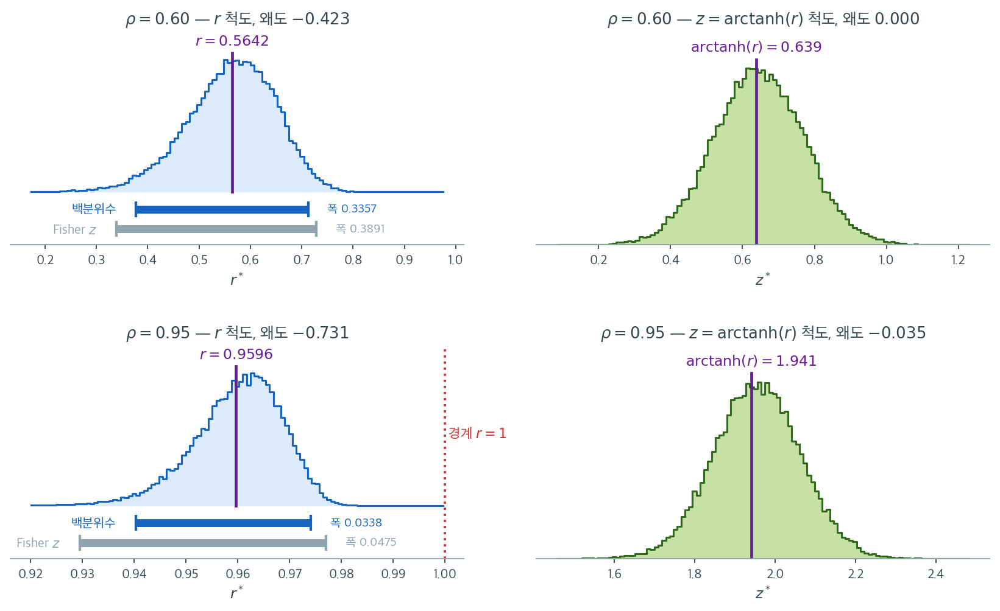

# 상관에 대한 붓스트랩 검정

## 1. 동기

Pearson 상관계수 $r$에 대한 고전적 검정은 이변량 정규성을 가정한다. 이 가정과 $H_0: \rho = 0$ 아래에서 통계량 $t = r\sqrt{(n-2)/(1-r^2)}$가 $t_{n-2}$ 분포를 따른다. 자료가 비정규이면 --- 꼬리가 두껍거나, 치우쳤거나, 이상치가 있으면 --- 이 분포 결과가 성립하지 않고 고전적 $p$값을 믿을 수 없게 된다.

붓스트랩은 상관 검정에 두 가지 보완적 접근을 제공한다. (1) 구간을 역전시켜 임의의 가설값 $\rho_0$을 검정하는 **붓스트랩 신뢰구간** 접근, (2) $H_0: \rho = 0$ 아래의 귀무분포를 직접 추정하는 **순열형 접근**이다.

---

## 2. 상관이 0인지 검정하기

가장 흔한 가설은

$$
H_0: \rho = 0 \quad \text{대} \quad H_1: \rho \neq 0
$$

이다. $H_0$ 아래에서 $X$와 $Y$는 무상관이며, 다른 가정을 두지 않으면 짝짓기에 대해 교환 가능하다. 이것이 **순열 접근**의 동기이다. 한 변수를 고정한 채 다른 변수를 섞어 $X$와 $Y$ 사이의 연관을 끊는다.

---

## 3. 알고리즘: 순열 접근

대응 관측값 $(x_1, y_1), \ldots, (x_n, y_n)$이 주어졌을 때:

1. 원자료에서 관측 상관 $r_{\text{obs}}$를 계산한다.
2. $b = 1, \ldots, B$에 대해:
    - $y$ 값을 무작위로 순열한다: $(x_1, y_{\pi(1)}), \ldots, (x_n, y_{\pi(n)})$.
    - 순열된 자료에서 $r^{*(b)}$를 계산한다.
3. 양측 $p$값은

$$
p = \frac{1}{B}\sum_{b=1}^{B}\mathbf{1}\!\left(|r^{*(b)}| \ge |r_{\text{obs}}|\right)
$$

이는 엄밀히 말하면 붓스트랩 검정이 아니라 순열검정이다(순열분포에서 비복원으로 표집한다). $X$와 $Y$가 독립이라는 귀무가설의 정확검정을 제공하며, 이는 $\rho = 0$만 주장하는 것보다 강한 가설이다.

!!! note "상관 검정에서 순열과 붓스트랩"
    $H_0: \rho = 0$을 검정할 때는 순열 접근이 대체로 낫다. 귀무가설 아래의 독립성을 직접 강제하기 때문이다. 붓스트랩 접근(쌍을 재표집)은 $\rho$의 신뢰구간을 만들거나 $\rho_0 \ne 0$인 $H_0: \rho = \rho_0$을 검정하는 데 더 적합하다.

---

## 4. 알고리즘: 붓스트랩 신뢰구간 접근

$0$이 아닌 임의의 $\rho_0$에 대해 $H_0: \rho = \rho_0$을 검정하려면 $\rho$의 붓스트랩 신뢰구간을 만들고 $\rho_0$이 그 바깥이면 기각한다.

1. 원 대응자료에서 $r_{\text{obs}}$를 계산한다.
2. $b = 1, \ldots, B$에 대해:
    - 쌍 $(x_i, y_i)$를 **통째로** $n$개 복원추출한다.
    - 붓스트랩 표본에서 $r^{*(b)}$를 계산한다.
3. $100(1-\alpha)\%$ 붓스트랩 신뢰구간을 만든다(백분위수, BCa, 붓스트랩-$t$).
4. $\rho_0$이 구간에 없으면 수준 $\alpha$에서 $H_0: \rho = \rho_0$을 기각한다.

!!! warning "쌍을 함께 유지하라"
    상관을 위해 재표집할 때는 언제나 쌍 $(x_i, y_i)$ 전체를 재표집해야 한다. $x$ 값과 $y$ 값을 따로 재표집하면 의존 구조가 파괴되어 무의미한 붓스트랩 상관이 나온다. ([비모수 붓스트랩](../bootstrap/nonparametric.md) 연습문제 4에서 이를 정량적으로 확인했다. 따로 재표집하면 $r^*$의 분포가 $0$ 주위에 중심을 두어 사실상 순열검정의 귀무분포가 된다.)

---

## 5. 상관의 붓스트랩 표준오차

$r^*$의 붓스트랩 분포는 표준오차 추정값도 제공한다.

$$
\widehat{\text{SE}}_{\text{boot}}(r) = \text{sd}(r^{*(1)}, \ldots, r^{*(B)})
$$

이변량 정규성 아래에서 $r$의 점근 표준오차는 근사적으로 $(1-\rho^2)/\sqrt{n}$이며 $(1-r^2)/\sqrt{n}$으로 추정할 수 있다. 붓스트랩 표준오차는 정규성에 기대지 않으므로 더 넓게 타당하다.

---

## 6. Fisher z 변환 붓스트랩

상관계수에는 Fisher의 $z$ 변환이 붓스트랩 근사를 개선하는 경우가 많다.

$$
z = \frac{1}{2}\ln\!\left(\frac{1+r}{1-r}\right) = \text{arctanh}(r)
$$

이변량 정규성 아래에서 $z$는 근사적으로 $\mathcal{N}(\text{arctanh}(\rho), 1/(n-3))$이다. 변환된 통계량의 표집분포가 정규에 더 가까워 백분위수 구간과 BCa 구간의 포함확률이 개선된다.

**절차:**

1. 각 붓스트랩 복제값에 대해 $z^{*(b)} = \text{arctanh}(r^{*(b)})$를 계산한다.
2. $z$ 척도에서 붓스트랩 신뢰구간을 만든다.
3. $r = \tanh(z)$로 $r$ 척도로 되돌린다.

백분위수법과 BCa가 변환 불변이므로 **이 변환은 두 방법의 구간을 바꾸지 않는다**. 그러나 붓스트랩-$t$와 정규 구간의 성능은 개선할 수 있다.

변환이 무엇을 고치는지는 $\rho$가 $1$에 가까워질 때 분명해진다. $n = 50$에서 $\rho = 0.6$과 $\rho = 0.95$인 자료를 각각 만들어 두 척도에서 붓스트랩 분포를 그렸다.



왼쪽 두 칸이 $r$ 척도다. $\rho = 0.6$일 때($r = 0.5642$) 왜도가 $-0.423$으로 이미 왼쪽으로 기울어 있고, $\rho = 0.95$일 때($r = 0.9596$)는 $-0.731$까지 커진다. **$r$이 $1$을 넘을 수 없기 때문이다.** 아래 칸의 붉은 점선이 그 벽이며, 분포의 오른쪽이 벽에 눌려 짧아지고 왼쪽만 길게 늘어난다. 상관계수의 붓스트랩 분포가 "위로 갈수록 좁아지는" 것은 표본의 우연이 아니라 모수공간의 모양이 만든 필연이다.

오른쪽 두 칸이 $\text{arctanh}$ 척도다. 이 변환이 구간 $(-1, 1)$을 실수 전체로 펴 주므로 벽이 사라지고, 왜도가 $0.000$과 $-0.035$로 **거의 정확히 대칭**이 된다. Fisher가 이 변환을 도입한 이유가 그림에 그대로 보인다.

아래 칸의 두 막대가 실용적 결론이다. 백분위수 구간 $[0.9403,\ 0.9740]$은 폭이 $0.0338$이고 관측값 $0.9596$에서 아래로 $0.019$, 위로 $0.014$로 **비대칭이며 상한이 $1$을 넘지 않는다.** 반면 모수적 Fisher 구간 $[0.9295,\ 0.9770]$은 $z$ 척도에서 대칭인 구간을 되돌린 것이라 폭이 $0.0475$로 $40\%$ 넓다. $\text{SE}(z) = 1/\sqrt{n-3}$이 $\rho$와 무관하다고 가정하는 대가이다. 다만 주의할 것이 하나 있다. **붓스트랩 복제값에 $\text{arctanh}$를 씌운 뒤 백분위수를 읽고 되돌려도 첫 번째 막대와 완전히 같은 구간이 나온다.** 변환 불변성 때문이며, Fisher 변환이 개선하는 것은 백분위수 구간이 아니라 정규근사 구간과 붓스트랩-$t$이다.

<div class="exbox" markdown>

**보기 1.** <span class="diff easy" title="쉬움"></span> 상관의 순열검정과 붓스트랩. 학생 $n = 25$명의 자료에서 공부시간과 시험점수의 상관이 $r_{\text{obs}} = 0.47$이었다.

</div>

??? success "풀이"
    **순열 접근으로 $H_0: \rho = 0$ 검정:**

    1. 시험점수를 $B = 10{,}000$번 순열하며 매번 $r^{*(b)}$를 계산한다.
    2. $|r^{*(b)}| \ge 0.47$인 횟수를 센다.
    3. $10{,}000$번 중 $178$번이 이 조건을 만족했다고 하자.
    4. $p$값은 $178/10{,}000 = 0.018$이다.

    **$\rho$의 95% 붓스트랩 신뢰구간:**

    1. 쌍 25개를 복원추출하는 것을 $B = 10{,}000$번 반복한다.
    2. 각 재표본에서 $r^{*(b)}$를 계산한다.
    3. BCa 95% 구간이 $[0.11, 0.72]$이다.
    4. $0 \notin [0.11, 0.72]$이므로 이 역시 5% 수준에서 $H_0: \rho = 0$을 기각한다.

    !!! example "r의 붓스트랩 분포 해석"
        25쌍 재표본에서 얻은 $r^*$의 붓스트랩 분포는 왼쪽으로 치우칠 가능성이 높다. $r_{\text{obs}} = 0.47$이 적당히 양수이고 분포가 위로 $1$에 막혀 있기 때문이다. 이 치우침 때문에 상관계수에는 백분위수 구간보다 BCa 구간이 선호된다.

---

## 7. 접근들의 비교

| 접근 | 검정 대상 | 가정 | 보존하는 것 |
|---|---|---|---|
| 순열 | $H_0: \rho = 0$만 | $H_0$ 아래의 교환가능성 | 원자료의 값 |
| 붓스트랩 신뢰구간 | 임의의 $H_0: \rho = \rho_0$ | i.i.d. 쌍 | 쌍의 구조 |
| 고전적 $t$ 검정 | $H_0: \rho = 0$ | 이변량 정규성 | 모수적 효율 |

순열 접근은 정확한 귀무분포를 쓰므로 무상관 검정에 가장 강력하다. 붓스트랩 신뢰구간 접근은 더 유연하여 임의의 가설값을 검정할 수 있고 구간추정을 동시에 제공한다.

<div class="aibox" markdown>

**AI로 보는 통계학 1.** 쌍을 뽑느냐 잔차를 뽑느냐

위 표의 마지막 칸은 붓스트랩이 **쌍의 구조를 보존한다**고 적었다. 상관에서는 그것이
유일한 길이다 --- $(x_i, y_i)$ 는 떼어 놓을 수 없는 한 덩어리이므로, 다시 뽑을 것은
쌍밖에 없다.

그런데 같은 자료에 직선을 하나 얹는 순간, 곧 $y_i = \beta_0 + \beta_1 x_i +
\varepsilon_i$ 로 넘어가는 순간 **다시 뽑을 수 있는 것이 셋으로 갈린다.** 오늘 회귀
표준오차를 붓스트랩으로 재는 코드는 이 셋 가운데 하나를 고르고 있고, 고른 것이
무엇인지 적어 두지 않으면 나중에 아무도 모른다.

| 이름 | 다시 뽑는 것 | 믿는 것 |
|:---|:---|:---|
| 쌍 붓스트랩 | $(x_i, y_i)$ 를 통째로 | 쌍이 i.i.d. 라는 것 |
| 잔차 붓스트랩 | $\hat\varepsilon_i$ 만, $x$ 는 붙들고 | 오차가 **등분산**이라는 것 |
| 와일드 붓스트랩 | $\hat\varepsilon_i$ 의 **부호**만 | 오차의 평균이 $0$ 이라는 것 |

셋째가 생소할 것이다. 잔차를 섞지 않고 $\hat\varepsilon_i$ 에 평균 $0$, 분산 $1$ 인
난수 $v_i$ 를 곱해 그 자리에 되돌려 놓는다. $v_i$ 를 $\pm 1$ 로만 뽑으면
$\lvert \hat\varepsilon_i \rvert$ 가 제자리에 그대로 남으므로, **$x_i$ 마다 다른 분산이
섞이지 않고 보존된다.**

가정이 깨질 때 셋이 어디로 갈리는지는 재 보면 된다. 분산이 $x$ 와 함께 커지는 자료를
만들어, 세 방법의 기울기 구간이 참값을 얼마나 덮는지 센다.

```python
import numpy as np
rgw = np.random.default_rng(2)
NW, BW, MW, BETA = 200, 999, 1500, 1.0

def wslope(wx, wy):                                   # 열마다 단순회귀 기울기
    xc = wx - wx.mean(1, keepdims=True)
    return (xc * (wy - wy.mean(1, keepdims=True))).sum(1) / (xc ** 2).sum(1)

def wthree(wx, wy):
    wb = wslope(wx[None], wy[None])[0]
    wfit = wy.mean() + wb * (wx - wx.mean())
    wres = wy - wfit
    widx = rgw.integers(0, NW, size=(BW, NW))
    wtile = np.tile(wx, (BW, 1))
    return {
        "쌍":     wslope(wx[widx], wy[widx]),          # (x, y) 를 통째로 다시 뽑는다
        "잔차":   wslope(wtile, wfit + wres[widx]),    # x 는 붙들고 잔차만 섞는다
        "와일드": wslope(wtile, wfit                   # 섞지 않고 부호만 뒤집는다
                        + wres * rgw.choice([-1.0, 1.0], size=(BW, NW))),
    }

hitw = {k: 0 for k in ("쌍", "잔차", "와일드")}
widw = {k: [] for k in hitw}
for _ in range(MW):
    wx = rgw.uniform(0, 3, NW)
    wy = BETA * wx + rgw.normal(0, 0.05 + 1.6 * wx)   # 분산이 x 와 함께 커진다
    for k, rep in wthree(wx, wy).items():
        lo, hi = np.quantile(rep, [0.025, 0.975])
        hitw[k] += lo <= BETA <= hi
        widw[k].append(hi - lo)

print(f"  이분산 단순회귀, n = {NW}, 표본 {MW} 벌 (참 기울기 {BETA:.1f})")
# 한글은 고정폭에서 두 칸을 차지하므로 f-string 자리맞춤이 보이는 열과 어긋난다
print("    다시 뽑는 것   포함확률(약속 0.95)   평균 폭")
for k, pad in (("쌍", "     "), ("잔차", "   "), ("와일드", " ")):
    print(f"    {k}{pad}              {hitw[k]/MW:.3f}         {np.mean(widw[k]):.4f}")
```

출력:

```
  이분산 단순회귀, n = 200, 표본 1500 벌 (참 기울기 1.0)
    다시 뽑는 것   포함확률(약속 0.95)   평균 폭
    쌍                   0.941         0.9715
    잔차                 0.919         0.8917
    와일드               0.941         0.9631
```

**잔차 붓스트랩만 약속을 못 지킨다**($0.919$). 까닭이 평균 폭에 드러나 있다 --- 셋
가운데 **가장 좁다**($0.8917$ 대 $0.9715$). 잔차를 한 주머니에 쏟아 섞는 순간 큰
$x$ 에서의 큰 흔들림이 작은 $x$ 로 흩어지고, 모든 $x$ 가 **평균 분산**을 나눠 갖게
된다. 그런데 기울기의 분산은 $\sum (x_i - \bar{x})^2 \sigma_i^2 \big/ \left[ \sum
(x_i - \bar{x})^2 \right]^2$ 로, **지레가 큰 점의 분산에 더 무게를 준다.** 여기서는
큰 $x$ 가 지레도 크고 분산도 큰 쪽이라, 섞어 버리면 참 분산을 과소평가한다. 구간이
좁아지고 포함확률이 깎인 것이 그 결과다.

쌍과 와일드는 둘 다 $0.941$ 로 약속을 거의 지킨다. 서로 다른 까닭으로 그렇다. 쌍은
$x_i$ 와 그 자리의 흔들림을 **함께** 집어 오고, 와일드는 $x_i$ 를 제자리에 둔 채
$\lvert \hat\varepsilon_i \rvert$ 를 **건드리지 않는다.** 둘 다 이분산을 지우지 않는다.

그래서 와일드 붓스트랩이 13.5절 [등분산성](../../ch13/assumptions/checking_homoscedasticity.md)의 **HC 표준오차**와 한 자리에 선다. 둘은 같은 병을
서로 다른 쪽에서 고친다. HC 는 분산 공식을 $\sum (x_i - \bar{x})^2 \hat\varepsilon_i^2$
로 **고쳐 쓰고**, 와일드는 공식을 건드리지 않고 **다시 돌린다.** 표본이 작을 때
와일드 쪽이 흔히 낫다고 보고되는데, 그것은 분포를 점근정규로 밀지 않기 때문이다.

쓸 때 세 가지를 조심한다. 첫째, $x$ 가 설계로 고정된 것이면(용량을 정해 놓고 거는
실험) 쌍 붓스트랩은 $x$ 를 흔들어 버리므로 와일드가 맞다. 둘째, 지레가 큰 점이
몇 개뿐이면 쌍 붓스트랩이 그 점을 아예 빼놓은 표본을 만들어 내는데, 그러면 기울기가
크게 튄다. 셋째, 와일드의 $\pm 1$ 은 세 번째 적률을 $0$ 으로 못 맞춘다 --- 치우친
오차에서는 다른 가중을 쓴다.

_확인한 곳 --- Wu 가 1986 년 Annals of Statistics 14권 4호 1261-1295쪽에 실은
「Jackknife, Bootstrap and Other Resampling Methods in Regression Analysis」가
와일드 붓스트랩이 나온 자리이고, 이분산 회귀를 다루려고 제안되었다. 같은 호에
Freedman 의 토론이 붙어 있다. 그림과 표의 수는 모두 직접 계산한 값이다_

</div>

---

---

## 연습문제

<div class="drillbox" markdown>

**연습문제 1.** <span class="diff med" title="중간"></span>
붓스트랩으로 두 변수 사이 **상관계수**의 표준오차와 95% 신뢰구간을 추정하라. $\rho = 0.6$인 이변량 정규분포에서 $n = 50$개를 생성하라.

**(a)** $B = 5{,}000$으로 붓스트랩 표준오차를 계산하라.

**(b)** 백분위수 구간과 Fisher $z$ 변환 구간을 비교하라.

**(c)** $\rho = 0.95$로 반복하라. 백분위수 구간이 경계 근처의 치우침을 포착하는가?

</div>

??? success "풀이"

    ```python
    import numpy as np
    from scipy import stats
    rng = np.random.default_rng(0)

    def gen(n, rho):
        z = rng.multivariate_normal([0, 0], [[1, rho], [rho, 1]], n)
        return z[:, 0], z[:, 1]

    for rho in (0.6, 0.95):
        x, y = gen(50, rho)
        r = stats.pearsonr(x, y).statistic
        B = 5000
        idx = rng.integers(0, 50, (B, 50))
        rb = np.array([stats.pearsonr(x[i], y[i]).statistic for i in idx])

        print("r = %.4f" % r)
        print("  붓스트랩 SE = %.4f, 점근 SE = %.4f"
              % (rb.std(ddof=1), (1 - r**2) / np.sqrt(50)))
        print("  백분위수    :", np.round(np.percentile(rb, [2.5, 97.5]), 4))

        z = np.arctanh(r); zse = 1 / np.sqrt(50 - 3)
        print("  Fisher z    :", np.round(np.tanh([z - 1.96*zse, z + 1.96*zse]), 4))
        print("  붓스트랩 z→r:", np.round(np.tanh(
            np.percentile(np.arctanh(rb), [2.5, 97.5])), 4))
        print("  r* 의 왜도  : %.3f" % stats.skew(rb))
    ```

    출력:

    ```
    r = 0.5642
      붓스트랩 SE = 0.0860, 점근 SE = 0.0964
      백분위수    : [0.3766 0.7142]
      Fisher z    : [0.3391 0.7282]
      붓스트랩 z→r: [0.3766 0.7142]
      r* 의 왜도  : -0.448
    r = 0.9596
      붓스트랩 SE = 0.0087, 점근 SE = 0.0112
      백분위수    : [0.9398 0.9739]
      Fisher z    : [0.9295 0.977 ]
      붓스트랩 z→r: [0.9398 0.9739]
      r* 의 왜도  : -0.642
    ```

    **(a) 표준오차** ($\rho = 0.6$, 관측 $r = 0.5642$):

    | 방법 | $\widehat{\text{SE}}(r)$ |
    |:---|---:|
    | 붓스트랩 | 0.0860 |
    | 점근 공식 $(1-r^2)/\sqrt{n}$ | 0.0964 |

    붓스트랩 SE가 점근 공식보다 $11\%$ 작다. 두 값이 정확히 같을 이유는 없다. 점근 공식은 $n \to \infty$의 극한값이고 $n = 50$에서 실제 표준오차를 다소 과대평가한다.

    **(b) 구간 비교** ($\rho = 0.6$):

    | 방법 | 구간 | 폭 |
    |:---|:---|---:|
    | 백분위수 | $[0.3766, \; 0.7142]$ | 0.3376 |
    | Fisher $z$ (모수적) | $[0.3391, \; 0.7282]$ | 0.3891 |
    | 붓스트랩 복제값을 $z$ 척도에서 → 되돌림 | $[0.3766, \; 0.7142]$ | 0.3376 |

    **핵심 관찰 두 가지.**

    1. **첫째와 셋째 줄이 완전히 같다.** 백분위수 구간의 변환 불변성 때문이다. $\text{arctanh}$가 단조증가이므로 $z$ 척도에서 분위수를 뽑고 되돌리는 것은 $r$ 척도에서 바로 뽑는 것과 정확히 같다. **붓스트랩 백분위수 구간에 Fisher 변환을 적용하는 것은 아무 효과가 없다.**

    2. **모수적 Fisher 구간이 더 넓다**($0.389$ 대 $0.338$). 이 구간은 $\text{SE}(z) = 1/\sqrt{n-3} = 0.1459$를 쓰는데, 붓스트랩이 추정한 실제 $\text{SE}(z)$는 더 작다.

    **(c) $\rho = 0.95$** (관측 $r = 0.9596$):

    | 방법 | 구간 | 폭 |
    |:---|:---|---:|
    | 백분위수 | $[0.9398, \; 0.9739]$ | 0.0341 |
    | Fisher $z$ (모수적) | $[0.9295, \; 0.9770]$ | 0.0475 |

    $r^*$의 왜도가 $\rho = 0.6$에서 $-0.448$, $\rho = 0.95$에서 $-0.642$로 경계에 가까워질수록 커진다.

    **백분위수 구간이 치우침을 포착하는가?** 부분적으로만 그렇다.

    - 관측값 $0.9596$에서 하한까지 거리가 $0.0198$, 상한까지 거리가 $0.0143$이다. 아래쪽이 $38\%$ 길다. 왼쪽 치우침을 반영한 **비대칭 구간**이 나왔다.
    - 그리고 상한 $0.9739 < 1$로 **자연스러운 경계를 넘지 않는다**.

    반면 모수적 Fisher 구간은 $\text{SE}(z)$가 $\rho$와 무관하다고 가정하므로 $z$ 척도에서 대칭이고, 되돌린 결과가 $[0.9295, 0.9770]$으로 백분위수보다 $39\%$ 넓다.

    !!! note "그럼에도 BCa를 권하는 이유"
        백분위수 구간이 경계를 존중하고 비대칭이기는 하지만, 붓스트랩 분포의 **편향**은 보정하지 못한다. $\rho$가 $1$에 가까우면 $r$이 아래로 편향되므로 $\hat z_0 < 0$이 되고 BCa가 구간을 아래로 조정한다.

        상관계수는 BCa의 두 보정이 모두 의미 있게 작동하는 대표적 통계량이다. [BCa](../bootstrap_ci/bca.md) 연습문제 1 참조.

<div class="drillbox" markdown>

**연습문제 2.** <span class="diff med" title="중간"></span>
순열검정과 붓스트랩 신뢰구간 접근이 $H_0: \rho = 0$에 대해 같은 결론을 내는가? 두 방법의 제1종 오류율과 검정력을 비교하라.

</div>

??? success "풀이"
    ```python
    import numpy as np
    from scipy import stats
    rng = np.random.default_rng(5)

    def corr_rows(A, B2):
        """행마다 피어슨 상관을 한꺼번에. A, B2 는 같은 꼴의 (m, n) 배열이다.

        stats.pearsonr 을 파이썬 루프에서 부르면 이 모의실험이 600 만 번 호출로
        불어나 50 분이 걸린다. 벡터화하면 2 초이고, permuted 가 행마다 같은
        셔플을 하므로 난수 소비가 같아 **찍히는 수도 똑같다.**
        """
        A = A - A.mean(1, keepdims=True)
        B2 = B2 - B2.mean(1, keepdims=True)
        return (A * B2).sum(1) / np.sqrt((A**2).sum(1) * (B2**2).sum(1))

    def run(n, rho, M=1000, B=999):
        c_perm = c_boot = c_t = 0
        for _ in range(M):
            z = rng.multivariate_normal([0, 0], [[1, rho], [rho, 1]], n)
            x, y = z[:, 0], z[:, 1]
            pr = stats.pearsonr(x, y)
            r = pr.statistic
            c_t += pr.pvalue < 0.05

            # 순열검정 — 순열 B 개를 한꺼번에 만든다
            yp = rng.permuted(np.tile(y, (B, 1)), axis=1)
            rp = corr_rows(np.tile(x, (B, 1)), yp)
            c_perm += (np.abs(rp) >= abs(r)).mean() < 0.05

            # 붓스트랩 백분위수 구간이 0 을 포함하는지
            idx = rng.integers(0, n, (B, n))
            rb = corr_rows(x[idx], y[idx])
            lo, hi = np.percentile(rb, [2.5, 97.5])
            c_boot += not (lo <= 0 <= hi)
        return round(c_perm/M, 3), round(c_boot/M, 3), round(c_t/M, 3)

    for rho in (0.0, 0.3, 0.5):
        print(rho, run(30, rho))
    ```

    출력:

    ```
    0.0 (0.04, 0.062, 0.042)
    0.3 (0.357, 0.406, 0.358)
    0.5 (0.823, 0.844, 0.823)
    ```

    $n = 30$, 이변량 정규:

    | 참 $\rho$ | 순열검정 | 붓스트랩 구간 | 고전 $t$ |
    |---:|---:|---:|---:|
    | 0.0 (크기) | 0.040 | **0.062** | 0.042 |
    | 0.3 | 0.357 | 0.406 | 0.358 |
    | 0.5 | 0.823 | 0.844 | 0.823 |

    **순열검정과 고전 $t$ 검정의 결과가 사실상 동일하다**($0.040$ 대 $0.042$, $0.357$ 대 $0.358$, $0.823$ 대 $0.823$). 이변량 정규 자료이므로 당연하다. 고전 검정의 가정이 정확히 성립하는 상황이다.

    **붓스트랩 구간 접근은 크기가 $0.062$로 $24\%$ 부풀려진다.** 검정력이 높아 보이는 것($0.406$, $0.844$)도 상당 부분 이 때문이다.

    **왜 붓스트랩 구간이 크기를 못 지키는가.** 두 가지 이유가 겹친다.

    1. **백분위수 구간의 1차 정확도.** $n = 30$에서 상관계수의 백분위수 구간은 포함확률이 $0.95$에 못 미친다. 구간이 좁으면 $0$을 제외하는 일이 잦아진다.
    2. **귀무가설을 강제하지 않는다.** 붓스트랩은 관측된 쌍 구조를 그대로 재표집하므로 $H_0$ 아래의 분포가 아니라 참 분포를 근사한다. 검정에 쓰려면 구간을 역전시켜야 하는데, 그 역전이 정확하려면 구간의 포함확률이 정확해야 한다.

    **권고:** $H_0: \rho = 0$을 검정할 때는 **순열검정을 쓴다**. 붓스트랩 구간은 $\rho$의 추정에 쓰고, 검정 목적으로 역전시킬 때는 BCa를 써서 포함확률을 개선해야 한다.

<div class="drillbox" markdown>

**연습문제 3.** <span class="diff med" title="중간"></span>
이상치 하나가 상관 검정에 미치는 영향을 세 방법에서 비교하라.

</div>

??? success "풀이"
    독립인 두 변수에 지렛대 이상치를 하나 추가한다.

    ```python
    import numpy as np
    from scipy import stats
    rng = np.random.default_rng(2)
    n = 30
    x = rng.normal(0, 1, n)
    y = rng.normal(0, 1, n)          # 참 상관 = 0

    xo = np.append(x, 8.0)
    yo = np.append(y, 8.0)           # 지렛대 이상치

    for name, (a, b) in [("원자료", (x, y)), ("이상치 추가", (xo, yo))]:
        r = stats.pearsonr(a, b)
        rs = stats.spearmanr(a, b)
        B = 20000
        rp = np.array([stats.pearsonr(a, rng.permutation(b)).statistic
                       for _ in range(2000)])
        p_perm = (np.abs(rp) >= abs(r.statistic)).mean()
        print(f"{name}: r={r.statistic:.4f} p_t={r.pvalue:.4f} "
              f"p_perm={p_perm:.4f} r_s={rs.statistic:.4f} p_s={rs.pvalue:.4f}")
    ```

    출력:

    ```
    원자료: r=0.2044 p_t=0.2786 p_perm=0.2650 r_s=0.2085 p_s=0.2690
    이상치 추가: r=0.7422 p_t=0.0000 p_perm=0.0075 r_s=0.2827 p_s=0.1234
    ```

    | 자료 | Pearson $r$ | 고전 $t$ $p$ | 순열 $p$ | Spearman $r_s$ | Spearman $p$ |
    |:---|---:|---:|---:|---:|---:|
    | 원자료 ($n=30$) | $0.2044$ | 0.2786 | 0.2680 | $0.2085$ | 0.2690 |
    | 이상치 추가 ($n=31$) | **0.7422** | **$<10^{-5}$** | **0.0060** | $0.2827$ | 0.1234 |

    **자료점 하나가 상관을 $0.20$에서 $0.74$로 바꾼다.** 고전 $t$ 검정과 순열검정이 모두 기각한다.

    **순열검정이 이상치로부터 보호해 주지 못한다는 점이 핵심이다.** 순열검정은 $r$의 귀무분포를 정확히 계산하지만, **$r$이라는 통계량 자체가 이상치에 취약하다**. 정확한 귀무분포로 취약한 통계량을 검정하면 여전히 취약하다.

    Spearman 상관은 $0.209 \to 0.283$으로 완만하게만 움직이고 $p$값도 $0.269 \to 0.123$으로 유의하지 않다. 순위변환이 $(8, 8)$을 $(31, 31)$로 바꾸어 영향력을 순위 한 칸으로 제한하기 때문이다.

    !!! warning "검정의 타당성과 통계량의 로버스트성은 별개이다"
        이 보기는 흔한 혼동을 바로잡는다. "순열검정은 분포 가정이 없으므로 로버스트하다"는 말은 **오류율의 통제**에 대해서만 참이다. 자료가 실제로 교환 가능하면 순열검정의 제1종 오류율은 정확히 $\alpha$이다.

        그러나 통계량이 이상치에 민감하면, 이상치가 만들어 낸 연관성을 순열검정이 **정확하게** 탐지한다. 검정은 옳게 작동했고, 다만 우리가 재고 싶었던 것을 재지 않았을 뿐이다.

        해결책은 검정 방법이 아니라 **통계량을 바꾸는 것**이다. Spearman $r_s$, Kendall $\tau$, 또는 로버스트 상관 추정량에 순열검정을 적용한다.

<div class="drillbox" markdown>

**연습문제 4.** <span class="diff med" title="중간"></span>
Fisher $z$ 변환이 붓스트랩 백분위수 구간을 바꾸지 못한다는 것을 확인했다. 그렇다면 어떤 방법에서 이 변환이 실제로 도움이 되는가?

</div>

??? success "풀이"
    변환 불변이 **아닌** 방법들에서 도움이 된다. 세 방법을 두 척도에서 비교한다.

    ```python
    import numpy as np
    from scipy import stats
    rng = np.random.default_rng(11)

    def cover(n, rho, M=800, B=1500):
        c = {k: 0 for k in ("normal_r", "normal_z", "basic_r", "basic_z", "pct")}
        for _ in range(M):
            z = rng.multivariate_normal([0, 0], [[1, rho], [rho, 1]], n)
            x, y = z[:, 0], z[:, 1]
            r = stats.pearsonr(x, y).statistic
            idx = rng.integers(0, n, (B, n))
            rb = np.array([stats.pearsonr(x[i], y[i]).statistic for i in idx])
            zb = np.arctanh(np.clip(rb, -0.9999, 0.9999))
            zr = np.arctanh(r)

            lo, hi = r - 1.96*rb.std(), r + 1.96*rb.std()
            c["normal_r"] += lo <= rho <= hi
            lo, hi = np.tanh([zr - 1.96*zb.std(), zr + 1.96*zb.std()])
            c["normal_z"] += lo <= rho <= hi

            p_lo, p_hi = np.percentile(rb, [2.5, 97.5])
            c["pct"] += p_lo <= rho <= p_hi
            c["basic_r"] += 2*r - p_hi <= rho <= 2*r - p_lo
            zl, zh = np.percentile(zb, [2.5, 97.5])
            lo, hi = np.tanh([2*zr - zh, 2*zr - zl])
            c["basic_z"] += lo <= rho <= hi
        return {k: round(v/M, 3) for k, v in c.items()}

    print(cover(25, 0.8))
    ```

    출력:

    ```
    {'normal_r': 0.914, 'normal_z': 0.942, 'basic_r': 0.856, 'basic_z': 0.94, 'pct': 0.931}
    ```

    $n = 25$, $\rho = 0.8$에서 포함확률:

    | 방법 | $r$ 척도 | $z$ 척도 → 되돌림 | 개선 |
    |:---|---:|---:|---:|
    | 정규 구간 | 0.914 | **0.942** | $+0.028$ |
    | 기본 (추축) 구간 | 0.856 | **0.940** | $+0.084$ |
    | 백분위수 구간 | 0.931 | 0.931 | $0$ (불변) |

    변환이 **정규 구간과 기본 구간에서만** 효과를 낸다. 기본 구간의 개선이 특히 크다($0.856 \to 0.940$, $8.4$%p). 백분위수 구간은 정의상 전혀 변하지 않는다.

    변환 후에는 세 방법이 $0.931$--$0.942$로 모여, $z$ 척도가 상관계수의 "옳은" 척도임을 보여 준다.

    **왜 효과가 있는가.** 두 방법 모두 "$\hat\theta \pm (\text{무언가})$" 형태로 **대칭적인** 조작을 한다.

    - $\rho = 0.8$ 근처에서 $r$의 표집분포는 왼쪽으로 심하게 치우쳐 있고 위로 $1$에 막혀 있다. $r$ 척도에서 대칭 구간을 만들면 상한이 $1$을 넘거나 하한이 지나치게 짧아진다.
    - $z = \text{arctanh}(r)$ 척도에서는 분포가 거의 대칭이고 경계가 없다. 여기서 대칭 구간을 만들고 $\tanh$로 되돌리면 자동으로 비대칭이면서 $(-1, 1)$ 안에 머무는 구간이 된다.

    **일반 원칙:** 변환 불변이 아닌 방법(정규, 기본, 붓스트랩-$t$)을 쓸 때는 **분산안정화 변환을 먼저 적용하라**. 상관계수에는 Fisher $z$, 양수 척도모수에는 로그, 비율에는 로짓이 표준이다.

    변환 불변인 방법(백분위수, BCa)을 쓰면 이 고민이 필요 없다. 그것이 이 방법들의 주된 장점이다.

<div class="drillbox" markdown>

**연습문제 5.** <span class="diff med" title="중간"></span>
$n = 4$인 대응자료가 다음과 같다.

| $x$ | 1 | 2 | 3 | 4 |
|:---|---:|---:|---:|---:|
| $y$ | 2 | 3 | 5 | 10 |

**(a)** $y$를 순열해도 $r^*$의 분모가 변하지 않음을 보이고, $S = \sum_i x_i y_{\pi(i)}$에 대해 $r^*(\pi) = (S - 50)/\sqrt{190}$임을 확인하라.

**(b)** $4! = 24$개 순열을 **모두** 열거하여 "$X$와 $Y$가 독립"이라는 귀무가설의 양측 순열 $p$값을 분수로 정확히 구하라.

**(c)** $n = 4$에서 양측 순열 $p$값이 가질 수 있는 가장 작은 값은 얼마인가? 어떤 자료가 와도 $5\%$ 수준에서 기각이 가능하려면 $n$이 적어도 얼마여야 하는가? 단측검정이면 어떠한가?

</div>

??? success "풀이"
    **(a) 분모는 순열에 대해 불변이다.**

    순열 $\pi$는 $y$ 값의 **집합**을 바꾸지 않으므로 $\bar y$와 $S_{yy} = \sum_i (y_i - \bar y)^2$이 그대로이고, $x$는 손대지 않았으므로 $\bar x$와 $S_{xx}$도 그대로다. 따라서

    $$
    r^*(\pi) = \frac{\sum_i x_i y_{\pi(i)} - n \bar x \bar y}{\sqrt{S_{xx} S_{yy}}} = \frac{S - n\bar x \bar y}{\sqrt{S_{xx}S_{yy}}}
    $$

    에서 분모와 $n \bar x \bar y$가 모두 상수이고, $r^*$는 $S$의 **증가하는 일차함수**다. 순열검정에서 $r^*$를 비교하는 일은 $S$를 비교하는 일과 똑같다.

    수치를 넣으면 $\bar x = 2.5$, $\bar y = 5$, $n \bar x \bar y = 50$이고

    $$
    S_{xx} = 30 - 4(2.5)^2 = 5, \qquad S_{yy} = 138 - 4(5)^2 = 38, \qquad \sqrt{S_{xx}S_{yy}} = \sqrt{190} = 13.7840
    $$

    이므로 $r^*(\pi) = (S - 50)/\sqrt{190}$이다. 관측된 배치는

    $$
    S_{\text{obs}} = 1 \cdot 2 + 2 \cdot 3 + 3 \cdot 5 + 4 \cdot 10 = 63
    $$

    이므로 $r_{\text{obs}} = 13/\sqrt{190} = 0.9431$이다.

    **(b) 24개를 모두 센다.**

    $x = (1,2,3,4)$를 고정하고 $y = (2,3,5,10)$의 24개 배치를 열거하면 $S$가 다음과 같이 나온다(순열 수의 합은 24).

    | $S$ | 순열 수 | $r^*$ |
    |---:|---:|---:|
    | 37 | 1 | $-0.9431$ |
    | 38 | 1 | $-0.8706$ |
    | 39 | 1 | $-0.7980$ |
    | 41 | 1 | $-0.6529$ |
    | 42 | 2 | $-0.5804$ |
    | 43 | 2 | $-0.5078$ |
    | 46 | 1 | $-0.2902$ |
    | 49 | 3 | $-0.0725$ |
    | 51 | 3 | $0.0725$ |
    | 54 | 1 | $0.2902$ |
    | 57 | 2 | $0.5078$ |
    | 58 | 2 | $0.5804$ |
    | 59 | 1 | $0.6529$ |
    | 61 | 1 | $0.7980$ |
    | 62 | 1 | $0.8706$ |
    | 63 | 1 | $0.9431$ |

    (a)에 의해

    $$
    |r^*| \ge 0.9431 \iff |S - 50| \ge 13 \iff S \ge 63 \ \text{또는} \ S \le 37
    $$

    이다. 재배열부등식에 따라 $S$는 $x$와 $y$를 같은 방향으로 정렬해 짝지을 때 최대이고 반대로 정렬해 짝지을 때 최소이며, $x$의 네 값과 $y$의 네 값이 모두 서로 다르므로 두 극단은 **각각 한 순열에서만** 나온다. 최대는 관측된 배치 자신의 $S = 63$이고, 최소는 뒤집은 배치 $1 \cdot 10 + 2 \cdot 5 + 3 \cdot 3 + 4 \cdot 2 = 37$이다. 따라서 조건을 만족하는 순열은 2개뿐이고

    $$
    p = \frac{2}{24} = \frac{1}{12} = 0.0833
    $$

    이다. **관측된 짝짓기가 24개 가운데 가장 극단적인데도 $p$값이 $0.05$보다 크다.**

    **(c) $n = 4$에서는 기각이 불가능하다.**

    양측 $p$값의 최솟값은 두 극단 배치가 늘 $\pm r_{\max}$를 주므로 $2/4! = 1/12 = 0.0833$이다. 어떤 자료가 와도 $0.05$ 아래로 내려갈 수 없다. 일반적으로 최솟값은 $2/n!$이므로

    $$
    \frac{2}{n!} \le 0.05 \iff n! \ge 40 \iff n \ge 5
    $$

    이다($5! = 120$, $2/120 = 0.0167$). 단측검정이면 최솟값이 $1/n!$이고 $n = 4$에서 $1/24 = 0.0417 \le 0.05$이므로 이미 기각이 가능하다.

    전수 열거에서는 관측된 배치(항등순열)가 24개 가운데 하나로 **자동으로 세어진다.** 그래서 순열 $p$값은 0이 될 수 없다. 무작위 순열 $B$개로 근사할 때 분자와 분모에 1을 더하는 것이 바로 이 한 개를 되살리는 일이다(연습문제 6).

<div class="drillbox" markdown>

**연습문제 6.** <span class="diff hard" title="어려움"></span>
3절의 $p$값 공식 $p = \frac{1}{B}\sum_b \mathbf{1}(|r^{*(b)}| \ge |r_{\text{obs}}|)$은 무작위 순열 $B$개만 쓴다. $K = \#\{b : |r^{*(b)}| \ge |r_{\text{obs}}|\}$라 하고 동점은 없다고 하자.

**(a)** 귀무가설 아래에서 $K$가 $\{0, 1, \ldots, B\}$ 위의 균등분포를 따름을 보여라.

**(b)** $B = 20$, $\alpha = 0.05$에서 $\hat p = K/B$를 쓰는 검정의 크기와 $\tilde p = (1+K)/(B+1)$을 쓰는 검정의 크기를 정확한 분수로 구하라.

**(c)** 일반적으로 $P(\tilde p \le \alpha) = \lfloor \alpha(B+1) \rfloor / (B+1) \le \alpha$임을 보이고, $\alpha = 0.05$에서 등호가 성립하는 $B$를 말하라.

**(d)** 순열 $p$값이 $0$이 될 수 없는 까닭을 한 줄로 적고, $p < 0.001$을 보고하려면 $B$가 얼마나 커야 하는지 말하라.

</div>

??? success "풀이"
    **(a) $K$는 균등분포를 따른다.**

    $x$를 고정하고 $y$ 값들의 집합(순서 없는 다중집합)을 조건으로 둔다. 귀무가설 아래에서 $X$와 $Y$가 독립이므로 **관측된 짝짓기는 $n!$개 순열 가운데 하나를 균등하게 뽑은 것과 구별되지 않고**, 우리가 따로 뽑은 $B$개 순열과도 독립이다. 그러므로

    $$
    T = |r_{\text{obs}}|, \quad T^*_1, \ldots, T^*_B
    $$

    은 모두 같은 순열분포에서 나온 독립인 $B+1$개 값이다. 동점이 없으면 이 $B+1$개 값 가운데 $T$의 순위 $R$(큰 쪽부터 센다)이 $\{1, \ldots, B+1\}$ 위에서 균등하고, $K = R - 1$이므로

    $$
    P(K \le k) = \frac{k+1}{B+1}, \qquad k = 0, 1, \ldots, B
    $$

    이다.

    **(b) $B = 20$에서 크기를 센다.**

    $\hat p = K/20 \le 0.05 \iff K \le 1$이므로 순진한 검정의 크기는

    $$
    P(K \le 1) = \frac{2}{21} = 0.0952
    $$

    로 **$\alpha = 0.05$의 거의 두 배**다. 반면 $\tilde p = (1+K)/21 \le 0.05 \iff 1 + K \le 1.05 \iff K = 0$이므로 고친 검정의 크기는

    $$
    P(K = 0) = \frac{1}{21} = 0.0476 \le 0.05
    $$

    이다.

    **(c) 고친 $p$값은 어떤 $B$에서도 수준을 지킨다.**

    $\tilde p \le \alpha \iff K \le \alpha(B+1) - 1$이다. $m = \lfloor \alpha(B+1) \rfloor$이라 하자.

    - $\alpha(B+1) = m$이 정수면 조건은 $K \le m - 1$이고 해당하는 $k$는 $0, \ldots, m-1$의 $m$개다.
    - 정수가 아니면 $\alpha(B+1) - 1 = m + f - 1$ ($0 < f < 1$)이 $m - 1$ 이상 $m$ 미만이므로 조건은 다시 $K \le m - 1$이고 역시 $m$개다.

    (a)에 의해 각 $k$의 확률이 $1/(B+1)$이므로

    $$
    P(\tilde p \le \alpha) = \frac{m}{B+1} = \frac{\lfloor \alpha(B+1) \rfloor}{B+1} \le \alpha
    $$

    이고, 등호는 $\alpha(B+1)$이 정수일 때뿐이다. $\alpha = 0.05$면 $B+1$이 20의 배수여야 하므로 $B = 19, 39, 59, \ldots, 99, \ldots, 999, 9999$다. $B = 999$나 $B = 9999$가 관례인 이유의 하나다. $\square$

    같은 계산을 순진한 검정에 하면 $P(\hat p \le \alpha) = (\lfloor \alpha B \rfloor + 1)/(B+1)$로, 거의 언제나 $\alpha$를 넘는다. $B = 99$에서는 $(4+1)/100 = 0.05$로 우연히 같아진다.

    **(d) 분모가 $B+1$인 이유.**

    관측된 배치 자신이 언제나 순열분포의 한 점이므로 $|r^*| \ge |r_{\text{obs}}|$를 만족하는 배치가 적어도 하나(그 자신) 있다. 연습문제 5에서 전수 열거가 이것을 자동으로 세었던 것과 같다. 따라서

    $$
    \tilde p \ge \frac{1}{B+1} > 0
    $$

    이고 순열 $p$값은 결코 $0$이 아니다. $p < 0.001$을 보고하려면 $1/(B+1) < 0.001$, 즉 $B \ge 1000$이어야 하고 (c)에 따라 $B = 9999$로 잡는 것이 좋다.

    !!! warning "3절의 공식을 그대로 쓰지 마라"
        $\frac{1}{B}\sum_b \mathbf{1}(\cdot)$은 $B \to \infty$의 극한에서 참 순열 $p$값으로 가지만, 유한한 $B$에서는 수준을 지키지 못하고 $p = 0$이라는 보고를 만들어 낸다. 이 장에서 가장 흔하고 가장 조용한 실수다.

<div class="drillbox" markdown>

**연습문제 7.** <span class="diff hard" title="어려움"></span>
연습문제 6 (b)를 모의실험으로 확인하라. $n = 12$인 독립 정규 쌍을 100,000번 생성하여, $B = 20$과 $B = 99$ 각각에서 $\hat p = K/B$와 $\tilde p = (1+K)/(B+1)$의 $5\%$ 기각률을 재라. $\hat p$가 정확히 $0$이 되는 비율도 세어라.

$B$에 따라 두 공식의 차이가 사라지는 까닭을 설명하라.

</div>

??? success "풀이"
    순열을 $B$개씩 100,000번 뽑아야 하므로 `rng.permuted(..., axis=2)`로 축을 따라 한꺼번에 섞는다.

    ```python
    import numpy as np
    rng = np.random.default_rng(17)

    def corr_rows(a, b):
        """마지막 축을 따라 행별로 Pearson 상관을 계산한다."""
        ac = a - a.mean(-1, keepdims=True)
        bc = b - b.mean(-1, keepdims=True)
        return (ac * bc).sum(-1) / np.sqrt((ac**2).sum(-1) * (bc**2).sum(-1))

    def size(n, B, M=100000, chunk=1000):
        naive = exact = zero = 0
        for _ in range(M // chunk):
            x = rng.standard_normal((chunk, n))
            y = rng.standard_normal((chunk, n))          # H0: X 와 Y 는 독립
            r = np.abs(corr_rows(x, y))
            xr = np.repeat(x[:, None, :], B, axis=1)
            yp = rng.permuted(np.repeat(y[:, None, :], B, axis=1), axis=2)
            K = (np.abs(corr_rows(xr, yp)) >= r[:, None]).sum(1)
            naive += (K / B <= 0.05).sum()               # 관측값을 빼먹은 p
            exact += ((1 + K) / (B + 1) <= 0.05).sum()   # 관측값을 넣은 p
            zero += (K == 0).sum()                       # 순진한 p 가 0 이 되는 경우
        return naive / M, exact / M, zero / M

    print(" B    순진한 p    고친 p    이론(순진/고친)    p=0 비율")
    for B in (20, 99):
        a, e, z = size(12, B)
        th_n = (np.floor(0.05 * B) + 1) / (B + 1)
        th_e = np.floor(0.05 * (B + 1)) / (B + 1)
        print(f"{B:3d}   {a:.4f}     {e:.4f}    {th_n:.4f} / {th_e:.4f}      {z:.4f}")
    ```

    출력:

    ```
     B    순진한 p    고친 p    이론(순진/고친)    p=0 비율
     20   0.0941     0.0464    0.0952 / 0.0476      0.0464
     99   0.0500     0.0500    0.0500 / 0.0500      0.0098
    ```

    | $B$ | $\hat p = K/B$ | $\tilde p = (1+K)/(B+1)$ | 이론값 | $\hat p = 0$인 비율 |
    |---:|---:|---:|:---|---:|
    | 20 | **0.0941** | 0.0464 | $2/21 = 0.0952$ / $1/21 = 0.0476$ | 0.0464 |
    | 99 | 0.0500 | 0.0500 | $0.0500$ / $0.0500$ | 0.0098 |

    모의오차가 $\sqrt{0.095 \times 0.905/10^5} = 0.0009$ 수준이므로 네 숫자가 모두 연습문제 6의 이론값과 맞는다.

    **$B = 20$에서 1을 빼먹으면 크기가 $0.0941$로 부푼다.** 명목 수준의 1.9배이고, 이 정도의 수준 위반은 $B$를 키우는 것으로 고쳐지지 않는다 --- $B$를 $20$으로 잡은 것이 잘못이 아니라 공식이 잘못이다.

    **$\hat p = 0$이 21번에 한 번(0.0464 $\approx 1/21$) 나온다.** $B = 99$에서도 100번에 한 번(0.0098)이다. 이때 보고되는 "$p = 0$"은 참 $p$값이 0이라는 뜻이 아니라 **뽑아 본 $B$개 순열 중에 더 극단적인 것이 없었다**는 뜻일 뿐이다. 연습문제 5가 보여 준 대로 참 $p$값은 적어도 $1/n!$이다.

    **$B = 99$에서 두 공식이 같은 결정을 내린다.** $\alpha B = 4.95$, $\alpha(B+1) = 5$이므로

    $$
    \frac{K}{99} \le 0.05 \iff K \le 4 \iff \frac{1+K}{100} \le 0.05
    $$

    로 기각 영역이 글자 그대로 같다. 일반적으로 $\alpha(B+1)$이 정수이면 두 공식의 결정이 일치하고 크기가 정확히 $\alpha$가 된다. 그렇지 않은 $B$를 쓸 때만 차이가 드러나는데, **어느 $B$를 쓰든 안전한 쪽은 1을 더하는 쪽**이다.

<div class="drillbox" markdown>

**연습문제 8.** <span class="diff hard" title="어려움"></span>
3절은 순열검정이 "$X$와 $Y$가 독립"이라는 귀무가설의 정확검정이며 이것이 "$\rho = 0$"보다 **강한** 가설이라고 했다. 그 차이가 검정의 크기에 얼마나 나타나는지 재어 보자. $X \sim \mathcal{N}(0, 1)$, $Y = \lvert X \rvert$로 두면 $Y$는 $X$의 함수이므로 둘은 전혀 독립이 아니다.

**(a)** $\rho = \text{Corr}(X, \lvert X \rvert) = 0$임을 보여라.

**(b)** $\rho = 0$일 때 $\sqrt{n}\, r$의 점근분산이 $E[\tilde X^2 \tilde Y^2]$($\tilde X, \tilde Y$는 표준화한 변수)라는 사실을 쓴다. $Y = \lvert X \rvert$에서 이 값이 **정확히 3**임을 보여라. ($E\lvert X \rvert = \sqrt{2/\pi}$, $E\lvert X \rvert^3 = 2\sqrt{2/\pi}$, $E X^4 = 3$을 쓰라.)

**(c)** 순열 귀무분포는 독립일 때의 분포이므로 $\sqrt{n}\, r \approx \mathcal{N}(0, 1)$이다. 이를 써서 순열검정의 실제 크기를 정규근사로 예측하고 모의실험으로 확인하라. 쌍을 재표집하는 붓스트랩 백분위수 구간을 역전시킨 검정도 함께 재어 비교하라.

</div>

??? success "풀이"
    **(a) 상관은 정확히 0이다.**

    $x \mapsto x\lvert x \rvert$는 홀함수이고 $X$의 밀도는 우함수이므로 $E[X\lvert X \rvert] = 0$이다. $E X = 0$이므로

    $$
    \text{Cov}(X, \lvert X \rvert) = E[X \lvert X \rvert] - E[X]\,E[\lvert X \rvert] = 0
    $$

    이고 $\rho = 0$이다. 그런데 $Y$는 $X$로 완전히 결정된다. **$\rho = 0$은 독립보다 훨씬 약한 조건이다.**

    **(b) 점근분산은 $3$이다.**

    $c = E\lvert X \rvert = \sqrt{2/\pi} = 0.7979$, $\tau^2 = \text{Var}(\lvert X \rvert) = 1 - 2/\pi = 0.3634$라 하자. $\tilde X = X$, $\tilde Y = (\lvert X \rvert - c)/\tau$이므로

    $$
    E[X^2(\lvert X \rvert - c)^2] = E X^4 - 2c\,E\lvert X \rvert^3 + c^2 E X^2 = 3 - 2c(2c) + c^2 = 3 - 3c^2
    $$

    이다. $c^2 = 2/\pi$이므로 $3 - 3c^2 = 3(1 - 2/\pi) = 3\tau^2$이고

    $$
    E[\tilde X^2 \tilde Y^2] = \frac{E[X^2(\lvert X \rvert - c)^2]}{1 \cdot \tau^2} = \frac{3\tau^2}{\tau^2} = 3
    $$

    이다. 즉 $\text{Var}(r) \approx 3/n$으로 독립일 때보다 **정확히 3배** 크다. $\square$

    **(c) 순열검정의 크기는 $0.05$가 아니라 $0.26$이다.**

    순열 귀무분포가 $\mathcal{N}(0, 1/n)$에 가까우므로 순열검정은 대략 $\lvert r \rvert > 1.96/\sqrt{n}$에서 기각한다. 참 분포는 $\mathcal{N}(0, 3/n)$이므로 기각확률은

    $$
    2\left[1 - \Phi\!\left(\frac{1.96}{\sqrt{3}}\right)\right] = 2[1 - \Phi(1.1316)] = 0.2578
    $$

    이다. 모의로 확인한다.

    ```python
    import numpy as np
    rng = np.random.default_rng(8)

    def corr_rows(a, b):
        ac = a - a.mean(-1, keepdims=True)
        bc = b - b.mean(-1, keepdims=True)
        return (ac * bc).sum(-1) / np.sqrt((ac**2).sum(-1) * (bc**2).sum(-1))

    def run(n, kind, M=20000, B=199, chunk=500):
        perm = boot = 0
        rs = []
        for _ in range(M // chunk):
            x = rng.standard_normal((chunk, n))
            y = np.abs(x) if kind == "dep" else rng.standard_normal((chunk, n))
            r = corr_rows(x, y)
            rs.append(r)

            # (1) 순열검정: y 를 섞어 귀무분포를 만든다
            xr = np.repeat(x[:, None, :], B, axis=1)
            yp = rng.permuted(np.repeat(y[:, None, :], B, axis=1), axis=2)
            K = (np.abs(corr_rows(xr, yp)) >= np.abs(r)[:, None]).sum(1)
            perm += ((1 + K) / (B + 1) <= 0.05).sum()

            # (2) 쌍 붓스트랩 백분위수 구간이 0 을 품는지
            idx = rng.integers(0, n, (chunk, B, n))
            rb = corr_rows(np.take_along_axis(x[:, None, :], idx, axis=2),
                           np.take_along_axis(y[:, None, :], idx, axis=2))
            lo, hi = np.percentile(rb, [2.5, 97.5], axis=1)
            boot += ((lo > 0) | (hi < 0)).sum()
        r = np.concatenate(rs)
        return perm / M, boot / M, r.std() * np.sqrt(n)

    print("자료            n    순열검정   붓스트랩구간   sd(r)*sqrt(n)")
    for n in (20, 50):
        p, b, s = run(n, "dep")
        print(f"Y = |X| (종속)  {n:2d}   {p:.4f}     {b:.4f}        {s:.3f}")
    p, b, s = run(50, "ind")
    print(f"Y 독립          50   {p:.4f}     {b:.4f}        {s:.3f}")
    print(f"\nsqrt(3) = {np.sqrt(3):.3f}")
    ```

    출력:

    ```
    자료            n    순열검정   붓스트랩구간   sd(r)*sqrt(n)
    Y = |X| (종속)  20   0.2564     0.1164        1.666
    Y = |X| (종속)  50   0.2615     0.0900        1.714
    Y 독립          50   0.0494     0.0761        1.008

    sqrt(3) = 1.732
    ```

    | 자료 | $n$ | 순열검정 | 붓스트랩 구간 역전 | $\sqrt{n}\,\text{sd}(r)$ |
    |:---|---:|---:|---:|---:|
    | $Y = \lvert X \rvert$ (종속, $\rho = 0$) | 20 | **0.2564** | 0.1164 | 1.666 |
    | $Y = \lvert X \rvert$ (종속, $\rho = 0$) | 50 | **0.2615** | 0.0900 | 1.714 |
    | $Y$ 독립 (대조군) | 50 | 0.0494 | 0.0761 | 1.008 |

    **순열검정의 크기가 $0.26$으로 예측값 $0.2578$과 맞는다. 명목 수준의 5배다.** $\sqrt{n}\,\text{sd}(r)$이 $1.666 \to 1.714$로 $\sqrt{3} = 1.732$에 다가가는 것이 (b)의 계산을 수치로 확인해 준다. 독립인 대조군에서는 순열검정이 $0.0494$로 정확하고 $\sqrt{n}\,\text{sd}(r) = 1.008$이다.

    **순열검정은 아무 잘못도 하지 않았다.** 그것은 "$X$와 $Y$가 독립"을 정확히 검정했고, 여기서는 그 가설이 **거짓**이므로 기각하는 것이 옳다. 어긋난 것은 우리의 질문이다. 우리가 검정하려던 가설은 $\rho = 0$이고 그것은 참인데, 순열은 라벨을 섞어 독립을 강제하므로 참 분포보다 $\sqrt{3}$배 좁은 귀무분포를 쓰게 된다.

    **쌍 붓스트랩은 같은 상황에서 $0.116$, $0.090$으로 훨씬 낫다.** 쌍 $(x_i, y_i)$를 통째로 뽑으면 자료가 가진 $E[\tilde X^2 \tilde Y^2] = 3$이 복제값의 산포에 그대로 들어오기 때문이다. 남은 부풀림은 백분위수 구간 자체의 1차 정확도 탓이며($B = 199$도 한몫한다), 독립인 대조군에서도 $0.0761$로 비슷하게 부푼다 --- 연습문제 2에서 본 것과 같은 현상이다.

    !!! warning "무엇을 고정하고 무엇을 다시 뽑는가"
        순열은 $y$를 섞어 **독립을 강제**한다. 귀무가설이 독립일 때는 정확하지만, 귀무가설이 "$\rho = 0$"뿐일 때는 **가설이 말하지 않은 것까지 강제**한 것이 되어 크기가 깨진다.

        연습문제 2의 권고("$H_0: \rho = 0$이면 순열을 쓰라")는 이변량 정규처럼 $\rho = 0$과 독립이 같은 뜻인 모형에서의 권고다. 그렇지 않은 자료 --- 분산이 수준에 따라 변하거나 비선형 의존이 있는 자료 --- 에서는 두 가설이 갈라지고, 그때는 쌍을 통째로 재표집하는 붓스트랩이 묻고 싶은 것을 묻는다.

<div class="drillbox" markdown>

**연습문제 9.** <span class="diff hard" title="어려움"></span>
연습문제 1의 출력을 다시 쓴다. $\rho = 0.6$ 실행은 $r = 0.5642$, 백분위수 구간 $[0.3766,\ 0.7142]$였고, $\rho = 0.95$ 실행은 $r = 0.9596$, 백분위수 구간 $[0.9398,\ 0.9739]$였다.

**(a)** 두 실행의 **기본(역백분위) 구간** $[2r - \hat r^*_{(1-\alpha/2)},\ 2r - \hat r^*_{(\alpha/2)}]$를 계산하라. 백분위수 구간과 폭·중심이 어떻게 다른가?

**(b)** 기본 구간의 상한이 $1$을 넘는 조건을 $r$과 $\hat r^*_{(\alpha/2)}$로 적어라. $\rho = 0.95$ 실행은 그 조건에 얼마나 가까운가? 상한이 $1$을 넘는 수치 예를 하나 만들어라.

**(c)** 백분위수 구간의 끝점만 가지고 $\rho = 0.95$ 실행의 **$z = \text{arctanh}$ 척도 기본 구간**을 계산하라. 연습문제 4의 포함확률과 함께 어떤 결론을 내리겠는가?

</div>

??? success "풀이"
    **(a) 두 구간은 $r$에 대한 거울상이다.**

    $\rho = 0.6$ 실행은 $2r = 1.1284$이므로

    $$
    [2r - 0.7142,\ 2r - 0.3766] = [0.4142,\ 0.7518]
    $$

    이고, $\rho = 0.95$ 실행은 $2r = 1.9192$이므로 $[0.9453,\ 0.9794]$다.

    | 실행 | 백분위수 | 기본 | 공통 폭 | 백분위수 중심 | 기본 중심 |
    |:---|:---|:---|---:|---:|---:|
    | $\rho = 0.6$, $r = 0.5642$ | $[0.3766,\ 0.7142]$ | $[0.4142,\ 0.7518]$ | 0.3376 | 0.5454 | 0.5830 |
    | $\rho = 0.95$, $r = 0.9596$ | $[0.9398,\ 0.9739]$ | $[0.9453,\ 0.9794]$ | 0.0341 | 0.9568 | 0.9624 |

    **폭은 정확히 같다.** $[L, U] \mapsto [2r - U,\ 2r - L]$은 $r$을 중심으로 한 반사이고 반사는 길이를 보존한다. 다른 것은 위치뿐이다. 붓스트랩 분포가 왼쪽으로 치우쳤으므로 백분위수 구간의 중심이 $r$보다 아래에 있고($0.5454 < 0.5642$), 기본 구간의 중심은 **같은 거리만큼 위**에 있다($0.5830 = 0.5642 + 0.0188$). $\rho = 0.95$ 실행에서는 그 어긋남이 $\pm 0.0028$이다.

    두 공식을 섞어 쓰면 구간이 통째로 반대편에 놓인다. 폭이 같아서 결과가 그럴듯해 보이는 것이 이 부호 실수가 눈에 띄지 않는 이유다.

    **(b) 기본 구간은 $1$을 넘을 수 있다.**

    $$
    2r - \hat r^*_{(\alpha/2)} > 1 \iff r - \hat r^*_{(\alpha/2)} > 1 - r
    $$

    즉 **붓스트랩 분포의 왼쪽 꼬리 길이가 $r$에서 $1$까지의 거리보다 길면** 넘는다. $\rho = 0.95$ 실행은 왼쪽 꼬리가 $0.9596 - 0.9398 = 0.0198$, $1 - r = 0.0404$이므로 아직 절반이다. 그러나 $n$이 작아지거나 $r$이 더 $1$에 붙으면 쉽게 넘어선다. 예를 들어 $r = 0.97$, 백분위수 구간 $[0.90,\ 0.99]$라면 기본 구간은

    $$
    [2(0.97) - 0.99,\ 2(0.97) - 0.90] = [0.95,\ 1.04]
    $$

    다. "상관계수가 $1.04$일 수 있다"는 구간은 쓸 수 없다. 백분위수 구간은 복제값 자신의 분위수이므로 언제나 $(-1, 1)$ 안에 머문다.

    **(c) $z$ 척도에서는 반사가 거의 아무 일도 하지 않는다.**

    $\text{arctanh}$를 씌우면 $z = 1.9408$, 끝점이 $1.7363$과 $2.1629$다. $z$ 척도의 기본 구간은

    $$
    [2(1.9408) - 2.1629,\ 2(1.9408) - 1.7363] = [1.7188,\ 2.1453]
    $$

    이고 $\tanh$로 되돌리면 $[0.9377,\ 0.9730]$이다. 백분위수 구간 $[0.9398,\ 0.9739]$과 끝점 차이가 $0.0021$과 $0.0009$로 거의 같고 $1$을 넘을 위험도 없다. $z$ 척도에서는 붓스트랩 분포가 거의 대칭이어서($6$절에서 왜도가 $0.000$과 $-0.035$였다) 반사가 구간을 거의 움직이지 못하기 때문이다.

    연습문제 4는 $n = 25$, $\rho = 0.8$에서 기본 구간의 포함확률이 $r$ 척도 $0.856$, $z$ 척도 $0.940$이었다. 두 결과를 합치면 결론이 하나다. **기본 구간을 $r$ 척도에서 쓰지 마라.** 쓰려면 $z$ 척도에서 만들어 되돌리거나, 척도를 걱정할 필요가 없는 백분위수·BCa를 쓰라.

<div class="drillbox" markdown>

**연습문제 10.** <span class="diff hard" title="어려움"></span>
순열 $p$값에는 두 가지 오차가 섞여 있다. 순열 횟수 $B$가 만드는 **몬테카를로 오차**와 표본 크기 $n$이 만드는 **통계적 오차**다.

$n = 30$, $\rho = 0.35$인 자료를 한 번 뽑아 **고정**하고, 같은 자료에 순열검정을 200번 되풀이해 $B = 99,\ 999,\ 9999$ 각각에서 $\tilde p = (1+K)/(B+1)$의 표준편차를 재고 $\sqrt{\tilde p(1 - \tilde p)/B}$와 비교하라. 그다음 같은 모형에서 자료를 20,000번 **새로** 뽑아 $p$값의 표준편차를 재라.

**(a)** $B$를 10배 키우면 어느 오차가 줄고 어느 오차는 그대로인가?

**(b)** $B = 9999$에서도 이 자료의 $5\%$ 결정이 흔들리는 비율이 $0.3$에 가깝다. 왜인가?

**(c)** $B = 99$에서 $\tilde p$의 평균이 참값보다 큰 까닭을 연습문제 6의 보정과 연결해 설명하라.

</div>

??? success "풀이"
    ```python
    import numpy as np
    from scipy import stats
    rng = np.random.default_rng(27)

    def corr_rows(a, b):
        ac = a - a.mean(-1, keepdims=True)
        bc = b - b.mean(-1, keepdims=True)
        return (ac * bc).sum(-1) / np.sqrt((ac**2).sum(-1) * (bc**2).sum(-1))

    # --- 자료를 한 번만 뽑아 고정한다 ---
    n, rho = 30, 0.35
    z = rng.multivariate_normal([0, 0], [[1, rho], [rho, 1]], n)
    x, y = z[:, 0], z[:, 1]
    res = stats.pearsonr(x, y)
    print(f"고정된 자료: r = {res.statistic:.4f}, 고전 t 의 p = {res.pvalue:.4f}")

    # --- (1) 같은 자료에 순열검정을 200 번 되풀이한다: B 가 주는 몬테카를로 오차 ---
    def perm_p(B, reps=200, chunk=50):
        out = []
        for _ in range(reps // chunk):
            yp = rng.permuted(np.tile(y, (chunk, B, 1)), axis=2)
            K = (np.abs(corr_rows(np.tile(x, (chunk, B, 1)), yp))
                 >= abs(res.statistic)).sum(1)
            out.append((1 + K) / (B + 1))
        return np.concatenate(out)

    print("\n   B    p 의 평균   p 의 표준편차   sqrt(p(1-p)/B)   p<=0.05 인 비율")
    for B in (99, 999, 9999):
        p = perm_p(B)
        se = np.sqrt(p.mean() * (1 - p.mean()) / B)
        print(f"{B:5d}   {p.mean():.4f}      {p.std(ddof=1):.4f}         {se:.4f}"
              f"           {(p <= 0.05).mean():.3f}")

    # --- (2) 자료를 20,000 번 새로 뽑는다: n 이 주는 통계적 오차 ---
    M = 20000
    zz = rng.multivariate_normal([0, 0], [[1, rho], [rho, 1]], (M, n))
    r = corr_rows(zz[:, :, 0], zz[:, :, 1])
    p_new = 2 * stats.t.sf(np.abs(r * np.sqrt((n - 2) / (1 - r**2))), n - 2)
    print(f"\n자료를 새로 뽑을 때 p 의 표준편차 = {p_new.std(ddof=1):.4f}")
    print(f"  p 의 5~95 백분위수 = [{np.percentile(p_new, 5):.4f}, "
          f"{np.percentile(p_new, 95):.4f}]")
    print(f"  5% 수준 기각률 = {(p_new < 0.05).mean():.4f}")
    ```

    출력:

    ```
    고정된 자료: r = 0.3595, 고전 t 의 p = 0.0510

       B    p 의 평균   p 의 표준편차   sqrt(p(1-p)/B)   p<=0.05 인 비율
       99   0.0583      0.0209         0.0235           0.460
      999   0.0522      0.0067         0.0070           0.390
     9999   0.0512      0.0022         0.0022           0.295

    자료를 새로 뽑을 때 p 의 표준편차 = 0.2241
      p 의 5~95 백분위수 = [0.0005, 0.7061]
      5% 수준 기각률 = 0.4872
    ```

    **(a) $B$는 몬테카를로 오차만 줄인다.**

    | 오차 | 재는 방법 | 크기 |
    |:---|:---|---:|
    | 몬테카를로, $B = 99$ | 같은 자료에 200번 되풀이 | 0.0209 |
    | 몬테카를로, $B = 999$ | 같은 자료에 200번 되풀이 | 0.0067 |
    | 몬테카를로, $B = 9999$ | 같은 자료에 200번 되풀이 | 0.0022 |
    | 통계적 | 자료를 20,000번 새로 뽑음 | **0.2241** |

    $B$를 10배 키우면 몬테카를로 오차만 $\sqrt{10}$배 줄고, 마지막 줄은 **꼼짝도 하지 않는다.**

    $\tilde p$의 표준편차가 $0.0209 \to 0.0067 \to 0.0022$로 줄고 $0.0209/0.0067 = 3.12 \approx \sqrt{10}$이며, 이항 공식 $\sqrt{p(1-p)/B}$가 준 $0.0235$, $0.0070$, $0.0022$와 맞는다.

    반면 같은 모집단에서 $n = 30$을 새로 뽑으면 $p$값의 표준편차가 $0.2241$이고 $5$~$95$ 백분위수가 $[0.0005,\ 0.7061]$이다. **$B = 9999$의 몬테카를로 오차는 통계적 오차의 $1/100$에 불과하다.** $B$는 "이 자료가 주는 $p$값"을 정확히 아는 데만 쓰인다. 그 $p$값 자체가 자료마다 얼마나 흔들리는지는 $n$만이 줄일 수 있다. 참 $\rho = 0.35$에서 기각률이 $0.4872$인 것이 그 흔들림의 정체다 --- $n = 30$은 이 효과를 반만 잡아낸다.

    **(b) 참 $p$값이 경계에 걸려 있다.**

    $B = 9999$ 행에서 참 순열 $p$값이 약 $0.0511$임을 읽을 수 있다(평균 $0.0512$에서 (c)의 치우침 $0.0001$을 뺀 값). $\alpha = 0.05$와의 거리가 $0.0011$인데 몬테카를로 표준오차가 $0.0022$이므로

    $$
    P(\tilde p \le 0.05) \approx \Phi\!\left(\frac{0.05 - 0.0511}{0.0022}\right) = \Phi(-0.5) = 0.31
    $$

    이고 모의값 $0.295$가 그것이다. 결정이 흔들리는 까닭은 $B$가 작아서가 아니라 **참 $p$값이 경계에 있어서**다. $B$를 $10^6$으로 키우면 "기각하지 않음"으로 굳지만, 그것은 이 자료에 대한 결정이 굳는 것이고 $\rho$에 대한 결론이 굳는 것이 아니다. (a)의 표가 그 차이를 말해 준다.

    **(c) 1을 더한 $p$값은 보수적이다.**

    참 순열 $p$값을 $p$라 하면 자료를 고정했을 때 $E[K] = Bp$이므로

    $$
    E[\tilde p] = \frac{1 + Bp}{B + 1} = p + \frac{1 - p}{B + 1}
    $$

    이다. 보정은 늘 위로 $(1-p)/(B+1)$만큼 치우치고, 이것이 연습문제 6에서 $P(\tilde p \le \alpha) \le \alpha$로 **부등호**가 나온 까닭이다. $p = 0.0511$에 넣으면 $B = 99$에서 $0.0511 + 0.9489/100 = 0.0606$, $B = 999$에서 $0.0521$, $B = 9999$에서 $0.0512$로, 모의값 $0.0583$(200번의 평균이므로 $\pm 0.0015$의 오차가 있다), $0.0522$, $0.0512$와 맞는다.

    치우침은 $1/(B+1)$로 사라지므로 $B$를 충분히 크게 잡으면 걱정할 것이 없다. 그러나 $B = 99$처럼 작은 $B$에서는 참 $p$값이 $0.05$보다 작아도 $\tilde p$가 $0.05$를 넘는 일이 생긴다. 수준을 지키는 대가로 검정력을 조금 내놓는 것이고, 수준을 깨는 쪽(연습문제 7)보다 훨씬 나은 거래다.

---

## 정리하며

상관 검정을 위한 붓스트랩 방법은 두 형태를 갖는다. $H_0: \rho = 0$을 검정할 때는 한 변수를 섞는 순열 접근이 낫다. 귀무가설 아래의 독립성을 직접 강제하기 때문이다. $\rho_0 \ne 0$인 $H_0: \rho = \rho_0$을 검정하거나 신뢰구간을 만들 때는 쌍을 복원추출하고 백분위수, BCa, 붓스트랩-$t$ 구간을 적용한다. 두 접근 모두 고전적 검정이 요구하는 이변량 정규성 가정을 피한다.

다음 절부터 **[순열검정의 기초](../permutation/foundations.md)**로 넘어간다. 17.3절이 **복원**추출로 표집분포를 흉내 냈다면, 17.4절은 자료를 **다시 섞어** 귀무가설 아래의 분포를 만든다. 귀무가설이 「섞어도 같다」는 꼴이면 그 분포가 **정확**하다.
