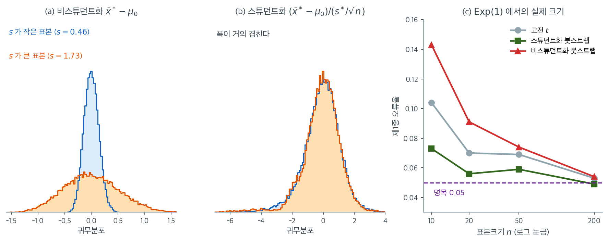

# 일표본 평균에 대한 붓스트랩 검정

## 1. 동기

일표본 $t$ 검정은 $\bar{X}$의 표집분포가 근사적으로 정규라고 가정한다. 모집단이 심하게 치우쳤거나 꼬리가 두껍거나 표본크기가 작으면 이 가정이 성립하지 않을 수 있다. **일표본 평균에 대한 붓스트랩 검정**은 정규성에 기대지 않는 대안을 제공한다. 재표집으로 검정통계량의 귀무분포를 추정하므로, $t$ 분포가 나쁜 근사일 때에도 타당한 추론이 가능하다.

---

## 2. 가설

다음을 검정한다.

$$
H_0: \mu = \mu_0 \quad \text{대} \quad H_1: \mu \neq \mu_0
$$

(양측이며, 단측은 $p$값 계산만 바꾸면 된다.)

관측 검정통계량은

$$
t_{\text{obs}} = \bar{x} - \mu_0
$$

또는 스튜던트화한 형태로

$$
t_{\text{obs}} = \frac{\bar{x} - \mu_0}{s / \sqrt{n}}
$$

이다.

---

## 3. 붓스트랩 분포의 중심화

붓스트랩 가설검정에서 결정적인 단계는 **귀무가설을 만족하는 붓스트랩 표본을 생성하는 것**이다. $H_0: \mu = \mu_0$ 아래에서는 $\mu_0$에 중심을 둔 붓스트랩 표본이 필요한데, 원자료는 $\bar{x}$에 중심을 두고 있다.

해법은 재표집 전에 자료를 **이동**시키는 것이다.

$$
\tilde{x}_i = x_i - \bar{x} + \mu_0, \quad i = 1, \ldots, n
$$

이동된 표본 $\{\tilde{x}_1, \ldots, \tilde{x}_n\}$은 평균이 $\mu_0$이면서 원래의 산포와 모양을 그대로 보존한다. 여기서 뽑은 붓스트랩 표본은 "$H_0$이 참이라면 자료가 어떻게 보일까"를 나타낸다.

!!! note "왜 중심화가 필요한가"
    중심화하지 않으면 $\bar{x}$에 중심을 둔 자료에서 재표집하게 되고, 이는 참 모수값 아래의 표집분포를 근사한다. 가설검정에는 귀무분포 --- $H_0$이 참이라는 가정 아래 검정통계량의 분포 --- 가 필요하다. $\mu_0$으로 중심화해야 붓스트랩이 이 귀무분포를 생성한다.

    이 단계를 빠뜨리면 $H_0$이 참이어도 $p$값이 언제나 $1$에 가까워진다. [15장](../../ch15/advanced_methods/bootstrap_var_test.md)에서 같은 함정을 보았다.

---

## 4. 알고리즘: 스튜던트화하지 않은 판본

1. $t_{\text{obs}} = \bar{x} - \mu_0$을 계산한다.
2. 중심화된 자료 $\tilde{x}_i = x_i - \bar{x} + \mu_0$을 만든다.
3. $b = 1, \ldots, B$에 대해:
    - $\{\tilde{x}_1, \ldots, \tilde{x}_n\}$에서 복원추출로 $\tilde{x}_1^*, \ldots, \tilde{x}_n^*$을 뽑는다.
    - $t^{*(b)} = \bar{\tilde{x}}^{*(b)} - \mu_0$을 계산한다.
4. 양측 $p$값은

$$
p = \frac{1}{B}\sum_{b=1}^{B} \mathbf{1}\!\left(|t^{*(b)}| \ge |t_{\text{obs}}|\right)
$$

---

## 5. 알고리즘: 스튜던트화 판본

스튜던트화 판본은 $t$ 통계량을 쓰며 대체로 검정력이 더 좋다.

1. $t_{\text{obs}} = (\bar{x} - \mu_0) / (s / \sqrt{n})$을 계산한다.
2. 중심화된 자료 $\tilde{x}_i = x_i - \bar{x} + \mu_0$을 만든다.
3. $b = 1, \ldots, B$에 대해:
    - $\{\tilde{x}_1, \ldots, \tilde{x}_n\}$에서 복원추출로 뽑는다.
    - $t^{*(b)} = (\bar{\tilde{x}}^{*(b)} - \mu_0) / (s^{*(b)} / \sqrt{n})$을 계산한다.
4. 양측 $p$값은

$$
p = \frac{1}{B}\sum_{b=1}^{B} \mathbf{1}\!\left(|t^{*(b)}| \ge |t_{\text{obs}}|\right)
$$

!!! tip "스튜던트화 대 비스튜던트화"
    스튜던트화 판본이 선호된다. 붓스트랩 표본마다 표준오차가 달라지는 변동을 반영하기 때문이다. 그 결과 검정이 이분산에 더 로버스트해지고 대체로 더 정확한 $p$값을 낸다. 연습문제 1에서 이 차이가 얼마나 큰지 확인한다.

이 권고의 근거는 "귀무분포가 표본마다 얼마나 달라지는가"에 있다. $\text{Exp}(1)$에서 $n = 10$짜리 표본을 여럿 뽑아, $s$가 유난히 작은 것($s = 0.46$)과 큰 것($s = 1.73$)을 하나씩 골라 각자의 귀무분포를 그려 보았다.



(a)의 두 분포는 **폭이 4배 가까이 다르다.** 표준편차가 $0.138$과 $0.517$이다. 귀무가설은 양쪽 모두 $\mu = 1$로 같은데, 기각의 기준이 되는 분포가 어느 표본을 얻었느냐에 따라 이만큼 달라진다는 뜻이다. 문제는 여기서 그치지 않는다. 지수분포에서는 $\bar{x}$와 $s$가 강한 양의 상관을 가지므로, **$s$가 작은 표본은 $\bar{x}$도 작아 $|t_{\text{obs}}|$가 크게 나오는데 동시에 귀무분포까지 좁아진다.** 두 효과가 같은 방향으로 겹쳐 과도한 기각을 만든다.

(b)는 같은 두 표본의 스튜던트화 귀무분포다. 이번에는 거의 포개진다. $2.5$/$97.5$ 백분위수가 $(-2.76,\ 2.04)$와 $(-3.01,\ 1.98)$로, 왼쪽 꼬리가 길다는 공통된 모양까지 같다. $s^*$로 나누는 순간 자료의 척도가 빠져나가고 **모양만 남기** 때문이며, 이것이 "$t^*$가 근사 추축량"이라는 말의 실제 내용이다.

(c)가 그 대가와 보상이다. 비스튜던트화 붓스트랩은 $n = 10$에서 제1종 오류율이 $0.143$으로 명목값의 세 배에 이르러 고전 $t$ 검정($0.104$)보다도 나쁘다. 스튜던트화 붓스트랩은 $0.073$으로 셋 중 가장 낫다. 다만 $n = 10$에서는 그것도 명목값보다 $46\%$ 크다는 점을 함께 보아야 한다. **붓스트랩이 정규성 가정을 없애 주지만 표본이 작다는 사실까지 없애 주지는 않는다.**

---

## 6. 단측검정

$H_1: \mu > \mu_0$이면 양의 방향으로 극단적인 복제값을 센다.

$$
p = \frac{1}{B}\sum_{b=1}^{B} \mathbf{1}\!\left(t^{*(b)} \ge t_{\text{obs}}\right)
$$

$H_1: \mu < \mu_0$이면

$$
p = \frac{1}{B}\sum_{b=1}^{B} \mathbf{1}\!\left(t^{*(b)} \le t_{\text{obs}}\right)
$$

<div class="exbox" markdown>

**보기 1.** <span class="diff easy" title="쉬움"></span> 배달시간 평균의 붓스트랩 검정. 어느 음식점의 배달시간(분) $n = 12$개 표본에서 $\bar{x} = 34.2$, $s = 8.7$이었다. 음식점은 평균 배달시간이 30분이라고 주장한다. $H_0: \mu = 30$ 대 $H_1: \mu \neq 30$을 검정한다.

</div>

??? success "풀이"
    **1단계.** $t_{\text{obs}} = (34.2 - 30) / (8.7/\sqrt{12}) = 1.672$

    **2단계.** 자료를 이동한다: $\tilde{x}_i = x_i - 34.2 + 30 = x_i - 4.2$

    **3단계.** 이동된 자료에서 스튜던트화 통계량의 붓스트랩 복제값 $B = 10{,}000$개를 생성한다.

    **4단계.** $10{,}000$개 중 $832$개가 $|t^{*(b)}| \ge 1.672$를 만족했다고 하자.

    붓스트랩 $p$값은 $832/10{,}000 = 0.0832$이다.

    비교를 위해 고전적 $t$ 검정은 $t_{11}$ 분포로 $p = 0.1226$을 준다. 차이가 나는 것은 붓스트랩이 정규성을 가정하지 않기 때문이다. 배달시간이 오른쪽으로 치우쳐 있다면 붓스트랩 $p$값이 더 믿을 만하다.

---

## 7. 신뢰구간과의 관계

붓스트랩 검정과 붓스트랩 신뢰구간 사이에는 직접적인 쌍대성이 있다. 붓스트랩 검정이 수준 $\alpha$에서 $H_0: \mu = \mu_0$을 기각하는 것은 $\mu_0$이 대응하는 $100(1-\alpha)\%$ 붓스트랩 신뢰구간 바깥에 있는 것과 같다.

따라서 붓스트랩 검정을 따로 돌리는 대신 붓스트랩 신뢰구간을 만들고 $\mu_0$이 그 안에 있는지 확인해도 된다.

!!! warning "쌍대성은 짝이 맞는 방법 사이에서만 정확하다"
    이 쌍대성은 **검정통계량과 구간의 구성 방식이 대응할 때**에만 정확하다.

    - 스튜던트화하지 않은 붓스트랩 검정 ↔ **기본(추축) 구간**
    - 스튜던트화 붓스트랩 검정 ↔ **붓스트랩-$t$ 구간**

    백분위수 구간이나 BCa 구간은 여기에 정확히 대응하지 않는다. 스튜던트화 붓스트랩 검정의 $p$값이 $0.03$인데 백분위수 구간이 $\mu_0$을 포함하는 일이 얼마든지 가능하다. 검정과 구간을 함께 보고할 때는 짝을 맞추어야 한다.

!!! warning "p값의 몬테카를로 변동"
    붓스트랩 $p$값은 모의실험으로 추정되므로 몬테카를로 오차를 갖는다. $B = 10{,}000$에서 참 $p$값이 $0.05$이면 몬테카를로 표준오차가 약 $\sqrt{0.05 \times 0.95 / 10{,}000} \approx 0.002$이다. $p$값이 유의수준에 가까우면 $B$를 늘려 잘못된 결정의 확률을 줄여야 한다.

---

## 연습문제

<div class="drillbox" markdown>

**연습문제 1.** <span class="diff med" title="중간"></span>
붓스트랩 검정이 정말로 $t$ 검정보다 나은지 확인하라. $\text{Exp}(1)$ 자료에서 $H_0: \mu = 1$을 검정할 때 세 방법(고전 $t$, 스튜던트화 붓스트랩, 비스튜던트화 붓스트랩)의 제1종 오류율을 비교하라.

</div>

??? success "풀이"
    ```python
    import numpy as np
    from scipy import stats
    rng = np.random.default_rng(0)

    for n in (10, 20, 50, 200):
        M, B = 2000, 999
        s_t = s_stud = s_unstud = 0
        for _ in range(M):
            x = rng.exponential(1, n)
            s_t += stats.ttest_1samp(x, 1).pvalue < 0.05

            xs = x - x.mean() + 1.0          # 중심화
            xb = xs[rng.integers(0, n, (B, n))]

            tobs = (x.mean() - 1) / (x.std(ddof=1) / np.sqrt(n))
            tb = (xb.mean(axis=1) - 1) / (xb.std(axis=1, ddof=1) / np.sqrt(n))
            s_stud += (np.abs(tb) >= abs(tobs)).mean() < 0.05

            uobs = x.mean() - 1
            ub = xb.mean(axis=1) - 1
            s_unstud += (np.abs(ub) >= abs(uobs)).mean() < 0.05
        print(n, round(s_t/M, 3), round(s_stud/M, 3), round(s_unstud/M, 3))
    ```

    출력:

    ```
    10 0.104 0.074 0.143
    20 0.07 0.056 0.091
    50 0.069 0.06 0.074
    200 0.053 0.048 0.054
    ```

    | $n$ | 고전 $t$ | 스튜던트화 붓스트랩 | 비스튜던트화 붓스트랩 |
    |---:|---:|---:|---:|
    | 10 | 0.104 | **0.073** | 0.143 |
    | 20 | 0.070 | **0.056** | 0.091 |
    | 50 | 0.069 | **0.059** | 0.074 |
    | 200 | 0.053 | **0.049** | 0.054 |

    **스튜던트화 붓스트랩이 모든 표본크기에서 가장 낫다.** $n = 10$에서 $0.073$으로 $t$ 검정의 $0.104$보다 명목값에 훨씬 가깝다.

    **비스튜던트화 붓스트랩은 $t$ 검정보다도 나쁘다.** $n = 10$에서 $0.143$으로 명목값의 거의 세 배이다. 이것이 "스튜던트화 판본이 선호된다"는 권고의 구체적 근거이다.

    **왜 스튜던트화가 이렇게 중요한가.** 비스튜던트화 통계량 $\bar{X}^* - \mu_0$의 붓스트랩 분포는 산포가 관측된 $s$에 의존한다. 우연히 $s$가 작은 표본을 얻으면 붓스트랩 분포가 좁아지고, 좁은 귀무분포에 비해 관측값이 극단적으로 보여 기각을 많이 하게 된다.

    지수분포에서는 [16장](../../ch16/foundations/motivation.md) 연습문제 2에서 본 대로 $\bar{X}$와 $s$가 강한 양의 상관을 갖는다. $\bar{X}$가 작으면 $s$도 작아 이 문제가 증폭된다.

    **한계도 정직하게 보아야 한다.** $n = 10$에서 스튜던트화 붓스트랩도 $0.073$으로 명목값보다 46% 크다. 붓스트랩이 정규성 가정을 없애 주지만, 표본이 작으면 여전히 부정확하다.

<div class="drillbox" markdown>

**연습문제 2.** <span class="diff med" title="중간"></span>
중심화를 빠뜨리면 어떻게 되는가? 중심화 없이 $\hat\theta^{*}$를 $\mu_0$과 직접 비교하는 잘못된 구현을 만들어 $p$값 분포를 확인하라.

</div>

??? success "풀이"
    ```python
    import numpy as np
    rng = np.random.default_rng(5)
    n, B, M = 30, 999, 2000
    mu0 = 1.0

    p_right, p_wrong = [], []
    for _ in range(M):
        x = rng.exponential(1, n)          # H0 가 참이다
        tobs = x.mean() - mu0

        # 올바른 구현: 중심화 후 재표집
        xs = x - x.mean() + mu0
        tb = xs[rng.integers(0, n, (B, n))].mean(axis=1) - mu0
        p_right.append((np.abs(tb) >= abs(tobs)).mean())

        # 잘못된 구현: 중심화 없이 재표집
        bb = x[rng.integers(0, n, (B, n))].mean(axis=1) - mu0
        p_wrong.append((np.abs(bb) >= abs(tobs)).mean())

    p_right, p_wrong = np.array(p_right), np.array(p_wrong)
    print("올바름: 크기 %.3f, p 중앙값 %.3f" % ((p_right < .05).mean(),
                                                np.median(p_right)))
    print("잘못됨: 크기 %.3f, p 중앙값 %.3f" % ((p_wrong < .05).mean(),
                                                np.median(p_wrong)))
    ```

    출력:

    ```
    올바름: 크기 0.079, p 중앙값 0.453
    잘못됨: 크기 0.000, p 중앙값 0.571
    ```

    | 구현 | 제1종 오류율 | $p$값의 중앙값 | $p$값의 5백분위수 |
    |:---|---:|---:|---:|
    | 올바름 (중심화) | 0.079 | 0.453 | 0.022 |
    | 잘못됨 (중심화 없음) | **0.000** | 0.571 | **0.479** |

    잘못된 구현의 **제1종 오류율이 정확히 $0$**이다. $2000$번의 모의실험에서 한 번도 귀무가설을 기각하지 않았다. $p$값의 5백분위수가 $0.479$이므로, 이 검정은 어떤 자료를 주어도 $p < 0.48$을 낼 수 없다.

    이유는 명확하다. 중심화하지 않으면 붓스트랩 분포 $\bar{X}^* - \mu_0$이 $\bar{x} - \mu_0 = t_{\text{obs}}$ 주위에 중심을 둔다. 즉 **관측된 통계량이 붓스트랩 분포의 한가운데에 놓인다**. 그보다 극단적인 복제값의 비율은 $0.5$ 아래로 내려가기 어렵다.

    올바른 구현에서 $p$값의 분포는 대략 균등해야 한다. 중앙값 $0.453$, 5백분위수 $0.022$로 균등분포에 가깝다(완벽하지 않은 것은 $n = 30$의 유한표본 효과이다).

    !!! danger "이 오류는 조용히 실패한다"
        중심화를 빠뜨린 검정은 오류를 내지 않고 그럴듯한 $p$값을 반환한다. 다만 그 값이 언제나 크다. 분석자는 "효과가 없다"고 결론짓고 넘어가게 된다.

        **자기 점검 방법:** 귀무가설이 참인 자료를 여러 번 생성하여 $p$값의 히스토그램을 그려 보라. 균등분포가 아니면 구현에 문제가 있다.

<div class="drillbox" markdown>

**연습문제 3.** <span class="diff med" title="중간"></span>
붓스트랩 검정과 신뢰구간의 쌍대성이 어느 조합에서 가장 잘 맞는지 수치로 확인하라.

</div>

??? success "풀이"
    각 표본에서 두 검정의 기각 여부와 세 구간의 $\mu_0$ 제외 여부를 계산하여 **일치율**을 센다.

    ```python
    import numpy as np
    rng = np.random.default_rng(17)
    n, B, M = 25, 4000, 1500
    mu0 = 1.0
    agree = {k: 0 for k in ("unstud~basic", "stud~boott", "stud~pct",
                            "unstud~pct", "stud~basic")}

    for _ in range(M):
        x = rng.exponential(1, n)
        th = x.mean(); se = x.std(ddof=1) / np.sqrt(n)
        idx = rng.integers(0, n, (B, n))

        # 두 검정 (중심화된 자료에서)
        xsb = (x - th + mu0)[idx]
        p_un = (np.abs(xsb.mean(axis=1) - mu0) >= abs(th - mu0)).mean()
        tbs = (xsb.mean(axis=1) - mu0) / (xsb.std(axis=1, ddof=1) / np.sqrt(n))
        p_st = (np.abs(tbs) >= abs((th - mu0)/se)).mean()

        # 세 구간 (원자료에서)
        xb = x[idx]; bs = xb.mean(axis=1)
        lo, hi = np.percentile(bs, [2.5, 97.5])
        basic = (2*th - hi, 2*th - lo)
        tt = (bs - th) / (xb.std(axis=1, ddof=1) / np.sqrt(n))
        tl, tu = np.percentile(tt, [2.5, 97.5])
        bt = (th - tu*se, th - tl*se)

        r_un, r_st = p_un < 0.05, p_st < 0.05
        o_b = not (basic[0] <= mu0 <= basic[1])
        o_t = not (bt[0] <= mu0 <= bt[1])
        o_p = not (lo <= mu0 <= hi)

        agree["unstud~basic"] += r_un == o_b
        agree["stud~boott"]   += r_st == o_t
        agree["stud~pct"]     += r_st == o_p
        agree["unstud~pct"]   += r_un == o_p
        agree["stud~basic"]   += r_st == o_b

    for k, v in agree.items():
        print(k, round(v/M, 4))
    ```

    출력:

    ```
    unstud~basic 0.9853
    stud~boott 0.972
    stud~pct 0.9707
    unstud~pct 0.982
    stud~basic 0.954
    ```

    | 조합 | 결정 일치율 | 짝이 맞는가 |
    |:---|---:|:---:|
    | 비스튜던트화 검정 ↔ 기본 구간 | **0.985** | ✓ |
    | 비스튜던트화 검정 ↔ 백분위수 구간 | 0.982 | ✗ |
    | 스튜던트화 검정 ↔ 붓스트랩-$t$ 구간 | **0.972** | ✓ |
    | 스튜던트화 검정 ↔ 백분위수 구간 | 0.971 | ✗ |
    | 스튜던트화 검정 ↔ 기본 구간 | 0.954 | ✗ |

    짝이 맞는 조합이 각각 자기 그룹에서 가장 높다. 비스튜던트화 검정은 기본 구간과($0.985$), 스튜던트화 검정은 붓스트랩-$t$ 구간과($0.972$) 가장 잘 일치한다.

    !!! note "왜 일치율이 $1.0$이 아닌가"
        이론적 쌍대성은 **같은 붓스트랩 복제값**을 쓸 때 정확하다. 위 코드는 검정에 중심화된 자료를, 구간에 원자료를 써서 재표집하므로 재표본이 다르다. 이 몬테카를로 차이가 $1$--$3\%$의 불일치를 만든다.

        또 짝이 맞지 않는 조합의 일치율도 $0.95$ 이상으로 높다. 대부분의 표본에서 다섯 방법이 모두 "기각하지 않음"으로 같은 결정을 내리기 때문이다. 결정이 갈리는 것은 $p$값이 $0.05$ 근처인 소수의 경우뿐이다.

    **실무적 함의:** 검정과 구간을 함께 보고할 때 짝을 맞추면 모순이 생기지 않는다. 짝이 맞지 않으면 "$p = 0.03$으로 유의하지만 95% 신뢰구간이 귀무값을 포함한다"는 혼란스러운 보고가 나올 수 있다. 위 표에서 스튜던트화 검정과 기본 구간의 조합이 $4.6\%$의 확률로 그런 모순을 낸다.

<div class="drillbox" markdown>

**연습문제 4.** <span class="diff med" title="중간"></span>
붓스트랩 검정의 검정력은 $t$ 검정과 비교해 어떤가? 크기를 맞춘 뒤 비교하라.

</div>

??? success "풀이"
    크기가 다른 검정의 기각률을 비교하는 것은 무의미하므로, 먼저 각 검정의 임계 $p$값을 조정하여 실제 크기를 $0.05$로 맞춘다.

    ```python
    import numpy as np
    from scipy import stats
    rng = np.random.default_rng(13)
    n, B, M = 20, 999, 2500

    def pvals(shift, one_sided=False):
        pt, pb = [], []
        alt = 'greater' if one_sided else 'two-sided'
        for _ in range(M):
            x = rng.exponential(1, n) * shift      # 참 평균 = shift
            pt.append(stats.ttest_1samp(x, 1, alternative=alt).pvalue)
            xs = x - x.mean() + 1.0
            xb = xs[rng.integers(0, n, (B, n))]
            tobs = (x.mean() - 1) / (x.std(ddof=1) / np.sqrt(n))
            tb = (xb.mean(axis=1) - 1) / (xb.std(axis=1, ddof=1) / np.sqrt(n))
            pb.append((tb >= tobs).mean() if one_sided
                      else (np.abs(tb) >= abs(tobs)).mean())
        return np.array(pt), np.array(pb)

    p0t, p0b = pvals(1.0)
    ct, cb = np.percentile(p0t, 5), np.percentile(p0b, 5)   # 크기 보정 임계값
    for shift in (2.0, 3.0, 5.0):
        p1t, p1b = pvals(shift)
        print(shift, round((p1t < ct).mean(), 3), round((p1b < cb).mean(), 3))
    ```

    출력:

    ```
    2.0 0.334 0.318
    3.0 0.788 0.652
    5.0 0.962 0.82
    ```

    보정 전 크기는 $t$ 검정 $0.087$, 붓스트랩 $0.071$이다. 크기를 $0.05$로 맞추는 임계 $p$값은 각각 $0.0186$, $0.0340$이다.

    **양측검정** (참 평균 = shift, $H_0: \mu = 1$):

    | 참 평균 | 크기 보정 $t$ | 크기 보정 붓스트랩 | 보정 전 $t$ | 보정 전 붓스트랩 |
    |---:|---:|---:|---:|---:|
    | 2.0 | 0.334 | 0.318 | 0.605 | 0.434 |
    | 3.0 | **0.788** | 0.652 | 0.940 | 0.766 |
    | 5.0 | **0.962** | 0.820 | 0.995 | 0.892 |

    **뜻밖의 결과: 크기를 맞추면 $t$ 검정이 붓스트랩보다 강력하다.** 참 평균이 $3$일 때 $0.788$ 대 $0.652$로 차이가 크다.

    **왜 그런가.** [붓스트랩-$t$](../bootstrap_ci/bootstrap_t.md) 연습문제 2에서 본 $t^*$ 분포의 극단적 비대칭이 원인이다. 지수 자료에서 $t^*$의 왼쪽 꼬리가 $-30$까지 뻗는다. 양측검정은 $|t^*| \ge |t_{\text{obs}}|$를 세므로, 관측값이 오른쪽으로 크게 벗어나도 **왼쪽 꼬리의 극단값들이 모두 세어져** $p$값이 부풀려진다.

    **단측검정으로 바꾸면 문제가 사라진다.**

    | 참 평균 | 크기 보정 $t$ | 크기 보정 붓스트랩 |
    |---:|---:|---:|
    | 2.0 | 0.896 | **0.909** |
    | 3.0 | 0.994 | **0.996** |
    | 5.0 | 1.000 | 1.000 |

    단측에서는 붓스트랩이 오히려 근소하게 낫다.

    **실무적 교훈 셋.**

    1. **"붓스트랩을 쓰면 더 강력하다"는 기대는 틀렸다.** 붓스트랩의 이점은 검정력이 아니라 **크기의 정확성**이다. 보정 전 붓스트랩의 검정력이 $t$ 검정보다 낮아 보이는 것도 상당 부분 크기가 작기 때문이다($0.071$ 대 $0.087$).

    2. **치우친 자료의 양측 붓스트랩 검정에서 $|t^*|$를 쓰는 것은 위험하다.** 대안은 (a) 대립가설의 방향이 분명하면 단측검정을 쓰거나, (b) 양쪽 꼬리를 따로 세는 "동등꼬리(equal-tailed)" $p$값을 쓰는 것이다.

    3. **크기 보정 비교가 필수이다.** 보정 전 표만 보면 $t$ 검정이 압도적으로 좋아 보이지만($0.940$ 대 $0.766$), 그중 상당 부분이 부풀려진 제1종 오류의 부산물이다.

<div class="drillbox" markdown>

**연습문제 5.** <span class="diff med" title="중간"></span>
§7의 경고 상자는 $B = 10{,}000$에서 참 $p$값이 $0.05$이면 몬테카를로 표준오차가 약 $0.002$라고 했다. 이 오차와 "자료가 달라져서 생기는 오차"를 가려 보자.

(가) 몬테카를로 표준오차를 $0.001$ 이하로 줄이려면 $B$가 얼마여야 하는가?

(나) 어떤 자료의 **이상적 붓스트랩 $p$값**(가능한 모든 재표본을 다 쓴 값)이 정확히 $0.04$라고 하자. 몬테카를로 오차만으로 $\hat p \ge 0.05$가 되어 $\alpha = 0.05$에서의 결정이 뒤집힐 확률을 $B = 999$와 $B = 10{,}000$에서 정규근사로 구하라.

(다) $B \to \infty$로 보내도 없어지지 않는 오차는 무엇인가? 귀무가설 아래에서 이상적 $p$값이 근사적으로 $\text{U}(0,1)$이라는 사실을 써서 그 크기를 (나)의 몬테카를로 오차와 견주고, 연습문제 1의 $n = 10$ 결과가 이 오차의 어떤 면을 보여 주는지 한 줄로 말하라.

</div>

??? success "풀이"
    **(가)** 세어지는 복제값의 개수를 $K$라 하면 $K \sim \text{Bin}(B, p)$이고 $\hat p = K/B$이므로

    $$
    \text{sd}(\hat p) = \sqrt{\frac{p(1-p)}{B}}
    $$

    이다. $p = 0.05$에서 $\sqrt{0.05 \times 0.95 / B} \le 0.001$은 $B \ge 0.0475 / 10^{-6} = 47{,}500$과 같다. 표준오차를 절반 이하로 줄이는 데 복제값을 $4.75$배로 늘려야 한다. 몬테카를로 정확도는 $B^{-1/2}$로만 좋아진다.

    **(나)** $p = 0.04$에서 $\hat p$의 표준오차는 $\sqrt{0.04 \times 0.96 / B}$이다.

    | $B$ | $\text{sd}(\hat p)$ | $z = (0.05 - 0.04)/\text{sd}$ | $\Pr(\hat p \ge 0.05)$ |
    |---:|---:|---:|---:|
    | 999 | 0.00620 | 1.613 | 0.053 |
    | 10,000 | 0.00196 | 5.103 | $1.7 \times 10^{-7}$ |

    $B = 999$로는 **스무 번에 한 번** 결정이 뒤집힌다(정확한 이항확률은 $0.065$로 이산성 때문에 정규근사보다 조금 더 크다). $B = 10{,}000$이면 실질적으로 뒤집히지 않는다. $p$값이 유의수준에 가까울 때 $B$를 늘리라는 권고가 이 계산이다.

    **(다)** 이상적 $p$값 자체가 **자료 한 벌의 함수**이므로 새 표본을 얻으면 달라진다. 이 변동은 $B$와 무관하고 $n$이 정한다. $H_0$ 아래에서 이상적 $p$값이 $\text{U}(0,1)$이면 그 표준편차는

    $$
    \frac{1}{\sqrt{12}} = 0.2887
    $$

    로, (나)의 $B = 10{,}000$짜리 몬테카를로 표준오차 $0.002$의 약 $130$배이다($0.2887/0.00218 = 132$). 같은 자료에서 $\hat p$가 흔들리는 폭은 자료가 바뀔 때 흔들리는 폭에 비하면 무시할 만하다.

    연습문제 1의 $n = 10$에서 스튜던트화 붓스트랩의 크기가 $0.073$이었던 것은 **$B$를 아무리 키워도 고쳐지지 않는다.** 그것은 몬테카를로 오차가 아니라 "이상적 붓스트랩 검정 자체가 작은 표본에서 치우쳐 있다"는 뜻이기 때문이다.

    한 줄로: **$B$는 같은 자료에서 답이 흔들리는 폭을, $n$은 그 답이 겨누는 과녁이 얼마나 비뚤어져 있는지를 정한다.** 둘을 섞어 적으면 "$B$를 늘렸으니 더 정확하다"는 잘못된 안심을 하게 된다.

<div class="drillbox" markdown>

**연습문제 6.** <span class="diff med" title="중간"></span>
수리시간(분)을 세 번 재어 $x = (2,\, 4,\, 12)$를 얻었다. §4의 비스튜던트화 붓스트랩 검정으로 $H_0: \mu = 3$ 대 $H_1: \mu \neq 3$을 검정한다. $n = 3$이므로 붓스트랩 표본은 $3^3 = 27$가지가 전부이고 모두 같은 확률을 가진다.

(가) 중심화된 자료를 적고, $27$개 재표본을 모두 열거하여 **이상적 붓스트랩 $p$값**(몬테카를로 오차가 없는 값)을 분수로 구하라.

(나) 같은 자료에 §5의 스튜던트화 판본을 쓰면 $27$개 중 몇 개의 재표본에서 $t^{*}$가 정의되지 않는가? 왜 그런가? 그 비율은 $n$이 커지면 어떻게 되는가?

(다) 이 자료에서 얻을 수 있는 $p$값은 어떤 수들뿐인가? 수준 $0.05$에서 기각이 가능한가?

</div>

??? success "풀이"
    **(가)** $\bar{x} = 6$이므로 $t_{\text{obs}} = 6 - 3 = 3$이고, 중심화된 자료는

    $$
    \tilde{x} = (2, 4, 12) - 6 + 3 = (-1,\, 1,\, 9)
    $$

    이다(평균이 $\mu_0 = 3$임을 확인하라). 재표본의 값 묶음별로 $t^{*} = \bar{\tilde{x}}^{*} - 3$을 계산한다. 순서를 구별하면 같은 묶음이 다항계수만큼 나온다.

    | 재표본의 값 묶음 | $\bar{\tilde{x}}^{*}$ | $t^{*}$ | 가짓수 | $\lvert t^{*} \rvert \ge 3$ |
    |:---|---:|---:|---:|:---:|
    | $(-1,-1,-1)$ | $-1$ | $-4$ | 1 | ✓ |
    | $(-1,-1,1)$ | $-1/3$ | $-10/3$ | 3 | ✓ |
    | $(-1,1,1)$ | $1/3$ | $-8/3$ | 3 | ✗ |
    | $(1,1,1)$ | $1$ | $-2$ | 1 | ✗ |
    | $(-1,-1,9)$ | $7/3$ | $-2/3$ | 3 | ✗ |
    | $(-1,1,9)$ | $3$ | $0$ | 6 | ✗ |
    | $(1,1,9)$ | $11/3$ | $2/3$ | 3 | ✗ |
    | $(-1,9,9)$ | $17/3$ | $8/3$ | 3 | ✗ |
    | $(1,9,9)$ | $19/3$ | $10/3$ | 3 | ✓ |
    | $(9,9,9)$ | $9$ | $6$ | 1 | ✓ |

    가짓수의 합은 $1+3+3+1+3+6+3+3+3+1 = 27$로 맞다. $\lvert t^{*} \rvert \ge 3$인 것은 $1 + 3 + 3 + 1 = 8$개이므로

    $$
    p = \frac{8}{27} = 0.2963
    $$

    이다. 기각하지 않는다. $\bar{x} - \mu_0 = 3$이 커 보이지만 $s = 5.29$에 비하면 크지 않다. $12$라는 한 점이 $\bar{x}$를 끌어올린 것이어서, 그 점이 재표본에 몇 번 들어가느냐에 따라 $\bar{\tilde{x}}^{*}$가 $-1$에서 $9$까지 널뛴다.

    **(나)** 세 값이 모두 같은 재표본 $(-1,-1,-1)$, $(1,1,1)$, $(9,9,9)$에서 $s^{*} = 0$이므로 $t^{*} = (\bar{\tilde{x}}^{*} - 3)/(0/\sqrt{3})$이 정의되지 않는다. 세 재표본 모두 분자가 각각 $-4$, $-2$, $6$으로 $0$이 아니어서 $t^{*}$는 $\mp\infty$로 발산한다. $27$개 중 $3$개, 곧 확률 $1/9$이다.

    모두 같은 값이 뽑힐 확률은 $n \cdot n^{-n} = n^{1-n}$이므로 $n = 10$에서 $10^{-9}$, $n = 20$에서 $20^{-19}$로 급히 사라진다. 스튜던트화 판본의 이 고장은 $n$이 아주 작을 때만 실제로 일어나지만, 그런 $n$에서는 애초에 $s^{*}$가 거의 $0$에 가까운 재표본들이 $t^{*}$를 터무니없이 크게 만들어 귀무분포의 꼬리를 오염시킨다.

    **(다)** 세어지는 개수가 $0, 1, \ldots, 27$이므로 가능한 $p$값은 분모가 $27$인 분수뿐이다. $0.05$보다 작은 것은 $0$과 $1/27 = 0.0370$ 둘뿐이므로, **$27$개 재표본 중 극단적인 것이 하나 이하일 때만** 기각할 수 있다.

    이상적 붓스트랩 검정조차 $n = 3$에서는 유의수준 $0.05$를 가를 해상도가 거의 없다. $B$를 $10^6$으로 키워도 달라지지 않는다. 가능한 재표본이 $27$가지뿐이라는 것은 자료의 한계이고, 이것이 연습문제 5 (다)에서 말한 "$B$로 고칠 수 없는 오차"의 가장 극단적인 모습이다.

<div class="drillbox" markdown>

**연습문제 7.** <span class="diff hard" title="어려움"></span>
§4와 §5의 $p$값 식은 $p = \frac{1}{B}\sum_b \mathbf{1}(\cdot)$이다. 이 식은 $\hat p = 0$을 낼 수 있다.

(가) 어떤 자료의 이상적 $p$값이 $p$라고 하자. 복제값 $B$개로 얻은 $\hat p$가 정확히 $0$이 될 확률을 $p$와 $B$로 적고, $p = 0.001$, $B = 999$에서 값을 구하라.

(나) 흔히 쓰는 수정식 $\hat p_{+} = (1 + \#\{\cdot\})/(B+1)$의 최솟값을 적고, $\mathbb{E}[\hat p_{+}]$를 계산하여 그것이 **언제나 $p$보다 크다**는 것을 보여라. 두 식의 차이는 $B$가 커지면 어떻게 되는가?

(다) 그렇다면 붓스트랩 검정의 **이상적** $p$값은 정확히 $0$이 될 수 있는가? $n = 3$, $x = (9,\, 10,\, 11)$, $\mu_0 = 0$으로 답하고, 관측통계량이 귀무분포에 자동으로 포함되지 않는 까닭을 밝혀라.

</div>

??? success "풀이"
    **(가)** 복제값은 중심화된 자료에서 독립으로 뽑히고 각각 확률 $p$로 "관측값만큼 극단"이다. 세어지는 개수를 $K$라 하면 $K \sim \text{Bin}(B, p)$이고

    $$
    \Pr(\hat p = 0) = \Pr(K = 0) = (1-p)^{B}
    $$

    이다. $p = 0.001$, $B = 999$에서 $0.999^{999} = 0.368$이다. 이상적 $p$값이 $0.001$인 — 즉 증거가 분명한 — 자료에서도 **세 번에 한 번은 $\hat p = 0$이 찍힌다.** $p = 0.003$이면 $0.997^{999} = 0.0497$로 스무 번에 한 번이다.

    **(나)** $K \ge 0$이므로

    $$
    \hat p_{+} \ge \frac{1}{B+1} = 0.001 \quad (B = 999)
    $$

    이고 $0$이 될 수 없다. $\mathbb{E}[K] = Bp$이므로 $\mathbb{E}[\hat p_{+}] = (1 + Bp)/(B+1)$이고

    $$
    \mathbb{E}[\hat p_{+}] - p = \frac{1 + Bp - p(B+1)}{B+1} = \frac{1-p}{B+1} > 0
    $$

    이다. $p < 1$이면 언제나 양수이므로 수정식은 평균적으로 이상적 $p$값보다 크다 — **보수적**이다. 치우침은 $(1-p)/(B+1)$로 $B$와 함께 사라진다. $p = 0.05$, $B = 999$에서 $0.00095$, $B = 10{,}000$에서 $0.000095$이다. 결정을 바꿀 크기가 아니다. **$0$을 찍지 않게 되는 이득에 비해 치르는 값이 싸다.**

    **(다)** 될 수 있다. $\bar{x} = 10$이므로 $t_{\text{obs}} = 10 - 0 = 10$이고 중심화된 자료는 $\tilde{x} = (9,10,11) - 10 + 0 = (-1,\, 0,\, 1)$이다. $27$개 재표본의 $\bar{\tilde{x}}^{*}$는 $-1$과 $1$ 사이이므로 모든 재표본에서

    $$
    \lvert t^{*} \rvert = \lvert \bar{\tilde{x}}^{*} - 0 \rvert \le 1 < 10 = \lvert t_{\text{obs}} \rvert
    $$

    이다. 세어지는 재표본이 하나도 없으므로 이상적 $p$값이 **정확히 $0$**이다.

    까닭은 중심화의 성질에 있다. 원표본을 그대로 다시 뽑은 재표본은 $\bar{\tilde{x}}^{*} = \mu_0$, 즉 $t^{*} = 0$을 준다 — 귀무분포에서 **가장 극단적이지 않은** 값이다. 관측통계량 $t_{\text{obs}} = \bar{x} - \mu_0$은 귀무분포를 이루는 어떤 재표본에도 들어 있지 않다. 순열검정에서는 관측된 배치 자신이 늘 하나로 세어지므로 참 $p$값이 $1/(\text{배치 수})$ 아래로 내려갈 수 없는데, 붓스트랩 검정에는 그런 보호 장치가 없다.

    그러므로 붓스트랩에서 $+1$ 수정은 **정확성을 만들어 주는 장치가 아니다.** 몬테카를로 오차가 "$p = 0$"이라는, 자료에 없는 확실성을 보고하게 만드는 것을 막아 주는 장치일 뿐이다. 복제값 $B$개로는 $1/B$보다 작은 $p$값을 분해할 수 없으므로 보고는 "$p = 0$"이 아니라 "$p < 1/B$"여야 한다.

<div class="drillbox" markdown>

**연습문제 8.** <span class="diff hard" title="어려움"></span>
연습문제 3의 주석은 "이론적 쌍대성은 같은 붓스트랩 복제값을 쓸 때 정확하다"고 했지만, 거기서는 검정과 구간이 서로 다른 재표본을 썼다. 이번에는 같은 재표본으로 쌍대성을 정확히 맞춰 보자.

(가) 같은 지표 $(i_1, \ldots, i_n)$으로 뽑을 때, 중심화된 자료에서 얻는 $t^{*} = \bar{\tilde{x}}^{*} - \mu_0$이 원자료에서 얻는 $\bar{x}^{*} - \bar{x}$와 **정확히 같음**을 보여라. (중심화 단계가 난수를 하나도 더 쓰지 않는다는 뜻이다.)

(나) 양측 $p$값을 $\lvert t^{*} \rvert$로 세는 대신 **동등꼬리**로, 즉

$$
p_{\text{et}} = \frac{2}{B}\min\left\{\#\{t^{*} \le t_{\text{obs}}\},\ \#\{t^{*} \ge t_{\text{obs}}\}\right\}
$$

로 세면 "$p_{\text{et}} < \alpha$"와 "$\mu_0$이 기본 구간 바깥"이 동치임을 보여라.

(다) $n = 25$인 $\text{Exp}(1)$ 자료 $20{,}000$벌에서 결정 일치율을 재어 (나)를 확인하고, $\lvert t^{*} \rvert$ 판본은 왜 일치율이 $1$이 아닌지 설명하라. 경험분위수의 규약이 결과에 어떻게 끼어드는지도 보라.

</div>

??? success "풀이"
    **(가)** $\tilde{x}_i = x_i - \bar{x} + \mu_0$이므로 같은 지표로 뽑으면

    $$
    \bar{\tilde{x}}^{*} = \frac{1}{n}\sum_{j=1}^{n} \tilde{x}_{i_j} = \frac{1}{n}\sum_{j=1}^{n}\left(x_{i_j} - \bar{x} + \mu_0\right) = \bar{x}^{*} - \bar{x} + \mu_0
    $$

    이고 따라서 $t^{*} = \bar{\tilde{x}}^{*} - \mu_0 = \bar{x}^{*} - \bar{x}$이다. $\square$

    중심화는 붓스트랩 분포를 통째로 $-(\bar{x} - \mu_0)$만큼 평행이동하는 것일 뿐이고, 재표집 자체는 원자료에서 한 것과 똑같다. 그래서 검정과 구간을 **같은 지표로** 계산할 수 있다.

    **(나)** $d^{*} = \bar{x}^{*} - \bar{x}$, $d_{\text{obs}} = \bar{x} - \mu_0$이라 쓰면 (가)에 따라 $t^{*} = d^{*}$이고 $t_{\text{obs}} = d_{\text{obs}}$이다. 복제평균 $\bar{x}^{*}$의 경험분위수를 $q_u$라 하면 기본 구간은 $[\,2\bar{x} - q_{1-\alpha/2},\ 2\bar{x} - q_{\alpha/2}\,]$이고, $\mu_0$이 그 **아래로** 벗어나는 것은

    $$
    \mu_0 < 2\bar{x} - q_{1-\alpha/2} \iff q_{1-\alpha/2} - \bar{x} < \bar{x} - \mu_0 \iff Q_{1-\alpha/2}(d^{*}) < d_{\text{obs}}
    $$

    와 같다($Q_u$는 $d^{*}$의 경험분위수). 이는 $d_{\text{obs}}$보다 큰 복제값이 $\alpha/2$보다 적다는 것, 곧 $\#\{d^{*} \ge d_{\text{obs}}\}/B < \alpha/2$이다. 위로 벗어나는 쪽도 같은 계산으로 $\#\{d^{*} \le d_{\text{obs}}\}/B < \alpha/2$가 된다. 둘을 합치면

    $$
    \mu_0 \notin \text{기본 구간} \iff \min\left\{\frac{\#\{d^{*} \le d_{\text{obs}}\}}{B},\ \frac{\#\{d^{*} \ge d_{\text{obs}}\}}{B}\right\} < \frac{\alpha}{2} \iff p_{\text{et}} < \alpha
    $$

    이다. $\square$

    자료가 연속이면 $d^{*} = d_{\text{obs}}$인 동점은 확률 $0$이다. 경험분위수를 $Q_u = d^{*}_{(\lceil uB \rceil)}$로 정의하면(numpy 의 `method="inverted_cdf"`) 이 동치가 정수 수준에서 정확하다. $B = 999$, $\alpha = 0.05$에서 $\lceil 0.975 \times 999 \rceil = 975$이므로 $Q_{0.975} < d_{\text{obs}}$는 $\#\{d^{*} \ge d_{\text{obs}}\} \le 24$와 같고, 한편 $\#/999 < 0.025$도 $\# \le 24$와 같다.

    **(다)**

    ```python
    import numpy as np
    rng = np.random.default_rng(2024)
    n, B, M, mu0 = 25, 999, 20000, 1.0
    agree = {"동등꼬리 ~ 기본(inverted_cdf)": 0,
             "동등꼬리 ~ 기본(linear)": 0,
             "|t*| ~ 기본(inverted_cdf)": 0}
    checked = False

    for _ in range(M):
        x = rng.exponential(1, n)
        th = x.mean()
        idx = rng.integers(0, n, (B, n))
        bs = x[idx].mean(axis=1)          # 원자료의 붓스트랩 평균
        d = bs - th                       # (가) 의 등식: 중심화 자료의 t* 와 같다
        dobs = th - mu0

        if not checked:                   # (가) 를 수치로 확인한다
            tb = (x - th + mu0)[idx].mean(axis=1) - mu0
            print("t* 두 방식의 최대 차이 < 1e-12:",
                  bool(np.abs(tb - d).max() < 1e-12))
            checked = True

        p_et = 2 * min((d <= dobs).mean(), (d >= dobs).mean())
        p_abs = (np.abs(d) >= abs(dobs)).mean()

        for meth in ("inverted_cdf", "linear"):
            lo, hi = np.percentile(bs, [2.5, 97.5], method=meth)
            out = not (2 * th - hi <= mu0 <= 2 * th - lo)      # 기본 구간 바깥인가
            if meth == "inverted_cdf":
                agree["동등꼬리 ~ 기본(inverted_cdf)"] += (p_et < 0.05) == out
                agree["|t*| ~ 기본(inverted_cdf)"] += (p_abs < 0.05) == out
            else:
                agree["동등꼬리 ~ 기본(linear)"] += (p_et < 0.05) == out

    for k, v in agree.items():
        print("%s  %.4f" % (k, v / M))
    ```

    출력:

    ```text
    t* 두 방식의 최대 차이 < 1e-12: True
    동등꼬리 ~ 기본(inverted_cdf)  1.0000
    동등꼬리 ~ 기본(linear)  0.9982
    |t*| ~ 기본(inverted_cdf)  0.9842
    ```

    | 조합 | 결정 일치율 | 어긋난 표본 수 |
    |:---|---:|---:|
    | 동등꼬리 검정 ↔ 기본 구간, `inverted_cdf` | **1.0000** | 0 / 20,000 |
    | 동등꼬리 검정 ↔ 기본 구간, `linear` | 0.9982 | 36 / 20,000 |
    | $\lvert t^{*} \rvert$ 검정 ↔ 기본 구간, `inverted_cdf` | 0.9842 | 316 / 20,000 |

    **같은 재표본과 같은 분위수 규약을 쓰면 쌍대성이 $20{,}000$벌 모두에서 정확히 성립한다.** 연습문제 3에서 $0.985$에 머물렀던 것은 이론의 한계가 아니라 검정과 구간이 서로 다른 재표본을 썼기 때문이다.

    분위수 규약이 바뀌면 $36$벌이 어긋난다. `linear`(numpy 의 기본값)은 인접한 두 순서통계량을 선형보간하므로 경계가 $d^{*}_{(974)}$와 $d^{*}_{(975)}$ 사이에 놓이고, $d_{\text{obs}}$가 바로 그 사이에 떨어진 표본에서 구간과 검정의 결정이 갈린다. 쌍대성을 글자 그대로 쓰려면 분위수 정의까지 맞추어야 한다.

    $\lvert t^{*} \rvert$ 판본은 $316$벌에서 어긋난다. 양쪽 꼬리를 **한데 묶어** 세기 때문이다. 치우친 귀무분포에서는 관측값이 오른쪽으로 벗어나도 왼쪽 꼬리의 극단적인 복제값들이 함께 세어진다. 그것의 짝은 기본 구간이 아니라 $\bar{x} \pm Q_{1-\alpha}(\lvert d^{*} \rvert)$ 꼴의 **대칭** 구간이다.

    실무적으로는 양측 붓스트랩 검정에 $\lvert t^{*} \rvert$를 쓸 것인지 동등꼬리를 쓸 것인지가 "어느 구간과 짝을 지을 것인지"를 이미 정한다. 두 선택의 대가는 연습문제 9에서 잰다.

<div class="drillbox" markdown>

**연습문제 9.** <span class="diff hard" title="어려움"></span>
연습문제 4는 치우친 자료에서 양측 붓스트랩 검정이 크기 보정 후 $t$ 검정보다 약하고, 그 원인이 $\lvert t^{*} \rvert$로 양쪽 꼬리를 묶어 세는 데 있다고 진단했다(교훈 2(b)). 연습문제 8의 동등꼬리 $p$값으로 바꾸어 그 진단이 맞는지 확인하라.

$\text{Exp}$ 자료, $n = 20$, $H_0: \mu = 1$, $B = 999$로 세 방법(고전 $t$, $\lvert t^{*} \rvert$ 스튜던트화 붓스트랩, 동등꼬리 스튜던트화 붓스트랩)의 실제 크기와 크기 보정 검정력을 참 평균 $2$, $3$에서 비교하라. 귀무분포 $t^{*}$의 양쪽 임계값을 함께 재어, 차이가 어디서 오는지 설명하라.

</div>

??? success "풀이"
    ```python
    import numpy as np
    from scipy import stats
    rng = np.random.default_rng(7)
    n, B, mu0 = 20, 999, 1.0
    rt = np.sqrt(n)

    def three_p(scale, M, chunk=200):
        """양측 p 값 셋(고전 t, |t*| 붓스트랩, 동등꼬리 붓스트랩)을 M 개 표본에서."""
        pt, pa, pe = [], [], []
        for start in range(0, M, chunk):
            m = min(chunk, M - start)
            x = rng.exponential(scale, (m, n))              # 참 평균 = scale
            th = x.mean(axis=1)
            tobs = (th - mu0) / (x.std(axis=1, ddof=1) / rt)
            pt.append(stats.ttest_1samp(x, mu0, axis=1).pvalue)
            xs = x - th[:, None] + mu0                      # 중심화
            xb = xs[np.arange(m)[:, None, None], rng.integers(0, n, (m, B, n))]
            tb = (xb.mean(axis=2) - mu0) / (xb.std(axis=2, ddof=1) / rt)
            t0 = tobs[:, None]
            pa.append((np.abs(tb) >= np.abs(t0)).mean(axis=1))
            pe.append(np.minimum(2 * np.minimum((tb <= t0).mean(axis=1),
                                                (tb >= t0).mean(axis=1)), 1.0))
        return [np.concatenate(v) for v in (pt, pa, pe)]

    p0 = three_p(1.0, 20000)                                # H0 가 참
    print("실제 크기      t %.4f   |t*| %.4f   동등꼬리 %.4f"
          % tuple((p < .05).mean() for p in p0))
    crit = [np.percentile(p, 5) for p in p0]                # 크기 보정 임계값
    print("보정 임계 p    t %.4f   |t*| %.4f   동등꼬리 %.4f" % tuple(crit))
    for scale in (2.0, 3.0):
        p1 = three_p(scale, 10000)
        print("참 평균 %.1f  보정 검정력  t %.3f   |t*| %.3f   동등꼬리 %.3f"
              % ((scale,) + tuple((p < c).mean() for p, c in zip(p1, crit))))

    q = np.empty((2000, 2))                                 # 귀무분포의 양쪽 임계값
    for i in range(2000):
        x = rng.exponential(1, n)
        xs = x - x.mean() + mu0
        xb = xs[rng.integers(0, n, (B, n))]
        tb = (xb.mean(axis=1) - mu0) / (xb.std(axis=1, ddof=1) / rt)
        q[i] = np.percentile(tb, [2.5, 97.5])
    print("t* 의 2.5/97.5 백분위수 평균  %.2f  %.2f   (t_19 은 -2.09  2.09)"
          % tuple(q.mean(axis=0)))
    ```

    출력:

    ```text
    실제 크기      t 0.0791   |t*| 0.0588   동등꼬리 0.0506
    보정 임계 p    t 0.0238   |t*| 0.0410   동등꼬리 0.0480
    참 평균 2.0  보정 검정력  t 0.414   |t*| 0.379   동등꼬리 0.805
    참 평균 3.0  보정 검정력  t 0.828   |t*| 0.690   동등꼬리 0.988
    t* 의 2.5/97.5 백분위수 평균  -3.07  1.73   (t_19 은 -2.09  2.09)
    ```

    | 방법 | 실제 크기 | 보정 임계 $p$ | 보정 검정력 (평균 2) | 보정 검정력 (평균 3) |
    |:---|---:|---:|---:|---:|
    | 고전 $t$ | 0.0791 | 0.0238 | 0.414 | 0.828 |
    | $\lvert t^{*} \rvert$ 붓스트랩 | 0.0588 | 0.0410 | 0.379 | 0.690 |
    | 동등꼬리 붓스트랩 | **0.0506** | 0.0480 | **0.805** | **0.988** |

    **진단이 맞았다.** 세는 방식만 바꾸었는데 크기 보정 검정력이 참 평균 $2$에서 $0.379$에서 $0.805$로 두 배 넘게 올랐다. 게다가 크기도 가장 정확하다($0.0506$으로 명목값과 사실상 같다). 크기가 이미 맞아서 보정 임계값도 $0.048$로 거의 손댈 것이 없다.

    **왜 그런가.** 귀무분포 $t^{*}$의 $2.5$/$97.5$ 백분위수가 평균적으로 $(-3.07,\ 1.73)$이다. $t_{19}$의 $\pm 2.09$와 견주면 **왼쪽은 훨씬 멀고 오른쪽은 훨씬 가깝다.** 지수 자료에서 $\bar{x}$와 $s$가 함께 커지므로 $t$의 오른쪽 꼬리는 눌리고 왼쪽 꼬리는 길어지는데, 붓스트랩이 그 비대칭을 그대로 읽어 낸 것이다.

    동등꼬리 검정은 오른쪽 기각을 $t^{*} > 1.73$에서 하므로 $t$ 검정의 문턱 $2.09$보다 낮다. 그만큼 검정력이 높다. 그런데도 크기가 유지되는 것은 왼쪽 문턱을 $-3.07$까지 늘려 **두 꼬리를 각각 $2.5\%$로 맞추기** 때문이다. $\lvert t^{*} \rvert$ 판본은 이 비대칭을 쓸 수 없다. $\lvert t^{*} \rvert$의 분포는 긴 왼쪽 꼬리에 끌려 올라가 하나뿐인 문턱이 $3$ 근처가 되고, 오른쪽으로 벗어난 자료를 기각하기 어려워진다.

    **연습문제 4의 결론을 다시 읽어야 한다.** "붓스트랩이 주는 것은 검정력이 아니라 크기의 정확성"이라는 진술은 $\lvert t^{*} \rvert$ 판본에만 해당한다. 양쪽 꼬리를 따로 세면 치우친 자료에서 붓스트랩-$t$는 크기와 검정력 양쪽에서 고전 $t$ 검정을 이긴다. 자료의 비대칭이라는 정보가 거기에 들어 있기 때문이다. 물론 이 이점은 자료가 실제로 치우쳐 있을 때의 이야기다. 대칭 자료에서는 귀무분포도 대칭이어서 두 판본이 거의 같아진다.

    !!! tip "보고할 때"
        치우친 자료의 양측 붓스트랩 검정에서는 $p$값과 함께 **어느 꼬리에서 기각했는지**를 적어야 한다. 동등꼬리 $p$값은 $2\min\{\cdot,\cdot\}$이므로 어느 쪽 꼬리가 작았는지가 방향 정보를 그대로 담고 있다. 연습문제 8에 따라 이 검정의 짝은 기본(역백분위) 구간이므로, 구간도 그것으로 맞추어 보고한다.

<div class="drillbox" markdown>

**연습문제 10.** <span class="diff hard" title="어려움"></span>
일표본 붓스트랩 검정이 가장 많이 쓰이는 자리는 **대응표본**이다. 같은 피험자를 전후로 재어 차이 $d_i = y_i - x_i$를 만들고 $H_0: \mu_d = 0$을 검정한다. 어떤 분석자가 "자료가 두 열이니 두 열을 각각 재표집하자"며 $x$와 $y$를 독립으로 뽑아 $\bar{y}^{*} - \bar{x}^{*}$의 귀무분포를 만들었다.

피험자 효과 $a_i \sim N(0, 3^2)$와 측정오차 $e_i, f_i \sim N(0, 1^2)$로 $x_i = a_i + e_i$, $y_i = \pm a_i + \delta + f_i$ ($n = 16$)를 만든다.

(가) 두 구현이 각각 겨누는 $\bar{d}$의 표준오차를 이론값으로 구하라($+a_i$인 경우와 $-a_i$인 경우 모두). 쌍의 상관은 각각 얼마인가?

(나) $\delta = 0$에서 실제 크기, $\delta = 1$에서 검정력, 그리고 평균 추정 표준오차를 모의로 재어 (가)와 맞춰 보라.

(다) 쌍을 깨는 잘못이 언제 보수적이고 언제 반대인지 한 줄로 정리하라.

</div>

??? success "풀이"
    **(가)** $\tau = 3$, $\sigma = 1$이라 쓴다. 쌍을 지키는 올바른 구현은 $\bar{d}$의 표준오차로 $\sqrt{\operatorname{Var}(d)/n}$을 겨눈다.

    $y = +a + \delta + f$이면 $d = \delta + f - e$이므로 $\operatorname{Var}(d) = 2\sigma^2 = 2$이고

    $$
    \text{SE} = \sqrt{2/16} = 0.354, \qquad \rho = \operatorname{Corr}(X, Y) = \frac{\tau^2}{\tau^2 + \sigma^2} = 0.9
    $$

    이다. $y = -a + \delta + f$이면 $d = \delta - 2a + f - e$이므로 $\operatorname{Var}(d) = 4\tau^2 + 2\sigma^2 = 38$이고

    $$
    \text{SE} = \sqrt{38/16} = 1.541, \qquad \rho = -0.9
    $$

    이다. 한편 쌍을 깨는 구현은 $X$와 $Y$가 독립이라고 보므로 두 경우 모두

    $$
    \sqrt{\frac{\operatorname{Var}(X) + \operatorname{Var}(Y)}{n}} = \sqrt{\frac{2(\tau^2 + \sigma^2)}{16}} = \sqrt{\frac{20}{16}} = 1.118
    $$

    을 겨눈다. 일반적으로 쌍을 깨면 $\operatorname{Var}(\bar{d})$를 $2\operatorname{Cov}(X,Y)/n$만큼 틀리게 본다. 상관의 부호가 오차의 방향을 정한다.

    **(나)**

    ```python
    import numpy as np
    rng = np.random.default_rng(31)
    n, B, tau, sig = 16, 499, 3.0, 1.0
    rt = np.sqrt(n)

    def run(sign, delta, M, chunk=200):
        """sign=+1 이면 쌍의 상관이 +0.9, -1 이면 -0.9. 두 구현의 기각률을 돌려준다."""
        r_ok = r_bad = 0
        se_ok = se_bad = 0.0
        for start in range(0, M, chunk):
            m = min(chunk, M - start)
            a = rng.normal(0, tau, (m, n))                  # 피험자 효과
            x = a + rng.normal(0, sig, (m, n))
            y = sign * a + delta + rng.normal(0, sig, (m, n))
            row = np.arange(m)[:, None, None]
            dbar = (y - x).mean(axis=1)

            # 올바름: 쌍의 차이에 일표본 붓스트랩 검정 (mu0 = 0 으로 중심화)
            d = y - x
            se_d = d.std(axis=1, ddof=1) / rt
            db = (d - dbar[:, None])[row, rng.integers(0, n, (m, B, n))]
            tb = db.mean(axis=2) / (db.std(axis=2, ddof=1) / rt)
            r_ok += ((np.abs(tb) >= np.abs(dbar / se_d)[:, None]).mean(axis=1)
                     < 0.05).sum()
            se_ok += se_d.sum()

            # 잘못됨: 두 열을 각각 독립으로 재표집한다 (쌍을 깬다)
            se_u = np.sqrt((x.var(axis=1, ddof=1) + y.var(axis=1, ddof=1)) / n)
            xb = x[row, rng.integers(0, n, (m, B, n))]
            yb = y[row, rng.integers(0, n, (m, B, n))]
            ub = ((yb.mean(axis=2) - xb.mean(axis=2)) - dbar[:, None]) / np.sqrt(
                (xb.var(axis=2, ddof=1) + yb.var(axis=2, ddof=1)) / n)
            r_bad += ((np.abs(ub) >= np.abs(dbar / se_u)[:, None]).mean(axis=1)
                      < 0.05).sum()
            se_bad += se_u.sum()
        return r_ok / M, r_bad / M, se_ok / M, se_bad / M

    for sign, name in ((1, "쌍의 상관 +0.9"), (-1, "쌍의 상관 -0.9")):
        s_ok, s_bad, e_ok, e_bad = run(sign, 0.0, 20000)
        p_ok, p_bad, _, _ = run(sign, 1.0, 5000)
        print(name)
        print("  실제 크기      쌍 지킴 %.4f   쌍 깸 %.4f" % (s_ok, s_bad))
        print("  검정력 d=1     쌍 지킴 %.3f    쌍 깸 %.3f" % (p_ok, p_bad))
        print("  평균 추정 SE   쌍 지킴 %.3f    쌍 깸 %.3f" % (e_ok, e_bad))
    ```

    출력:

    ```text
    쌍의 상관 +0.9
      실제 크기      쌍 지킴 0.0442   쌍 깸 0.0000
      검정력 d=1     쌍 지킴 0.738    쌍 깸 0.009
      평균 추정 SE   쌍 지킴 0.348    쌍 깸 1.103
    쌍의 상관 -0.9
      실제 크기      쌍 지킴 0.0440   쌍 깸 0.1474
      검정력 d=1     쌍 지킴 0.089    쌍 깸 0.234
      평균 추정 SE   쌍 지킴 1.516    쌍 깸 1.102
    ```

    | 쌍의 상관 | 구현 | 평균 추정 SE (이론값) | 실제 크기 | 검정력 ($\delta = 1$) |
    |---:|:---|---:|---:|---:|
    | $+0.9$ | 쌍 지킴 | 0.348 (0.354) | 0.0442 | **0.738** |
    | $+0.9$ | 쌍 깸 | 1.103 (1.118) | **0.0000** | 0.009 |
    | $-0.9$ | 쌍 지킴 | 1.516 (1.541) | 0.0440 | 0.089 |
    | $-0.9$ | 쌍 깸 | 1.102 (1.118) | **0.1474** | 0.234 |

    추정된 표준오차가 (가)의 이론값과 맞는다. 조금씩 작은 것은 $n = 16$에서 $s$가 $\sigma$를 약간 작게 추정하기 때문이다($\mathbb{E}[s]/\sigma = 0.984$).

    상관이 $+0.9$일 때 쌍을 깬 구현은 표준오차를 $3.2$배($1.118/0.354$)로 보므로 귀무분포가 그만큼 넓어진다. 실제 크기가 $20{,}000$번 중 한 번도 기각하지 않아 $0.0000$이고, 검정력은 $0.738$에서 $0.009$로 무너진다. **대응설계로 얻은 이득을 전부 버린 것이다.**

    상관이 $-0.9$일 때는 반대로 표준오차를 $1.118/1.541 = 0.73$배로 **과소평가**하여, 명목 $0.05$짜리 검정이 실제로는 $0.1474$로 세 배 기각한다. 이때 검정력이 $0.089$에서 $0.234$로 올라간 것은 검정력이 아니라 부풀려진 제1종 오류의 그림자다.

    **(다)** 쌍을 깨면 $\operatorname{Var}(\bar{d})$를 $2\operatorname{Cov}(X,Y)/n$만큼 틀리게 본다. 상관이 **양수면 표준오차를 과대평가해 지나치게 보수적**이 되고(크기 $0$, 검정력 붕괴), **음수면 과소평가해 명목수준을 크게 넘는다**(크기 $0.147$).

    되뽑아야 하는 단위는 관측값 하나하나가 아니라 **관측의 독립 단위**, 곧 피험자(쌍)다. 쌍을 지켜 뽑는 것은 차이 $d_i$에 일표본 붓스트랩 검정을 그대로 적용하는 것과 같다. 올바른 구현의 크기가 $0.05$보다 조금 작은 $0.044$인 것은 $n = 16$에서 스튜던트화 붓스트랩이 약간 보수적인 탓이며(연습문제 1에서는 치우친 지수 자료여서 반대로 조금 컸다), 쌍을 깬 구현의 $0.0000$이나 $0.1474$와는 차원이 다른 오차다.

---

## 정리하며

일표본 평균에 대한 붓스트랩 검정은 가설값 $\mu_0$으로 중심화한 자료에서 재표집하여 귀무분포를 생성한다. $p$값은 관측된 통계량만큼 또는 그보다 극단적인 붓스트랩 통계량의 비율이다. 스튜던트화 판본이 검정력과 정확도 면에서 더 낫다. 이 접근은 고전적 $t$ 검정의 정규성 가정을 피하므로, 중간 정도의 표본크기를 갖는 치우친 자료나 두꺼운 꼬리 자료에서 특히 값지다.
